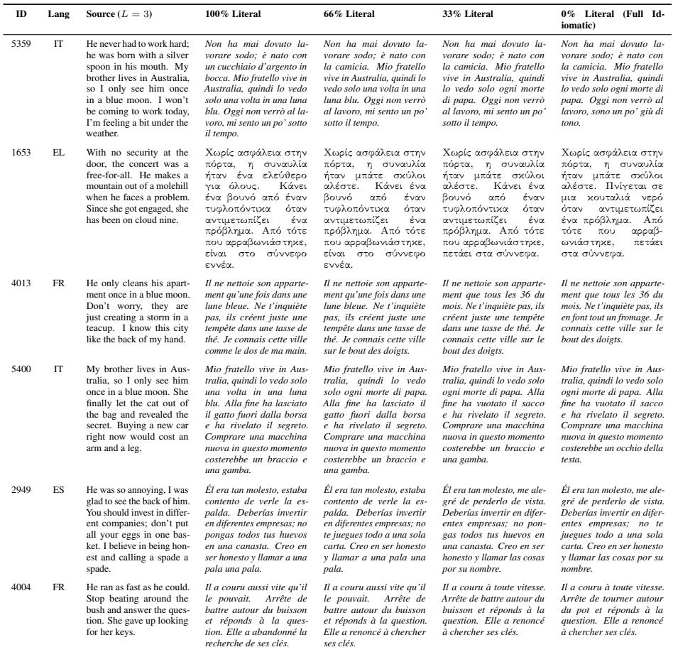
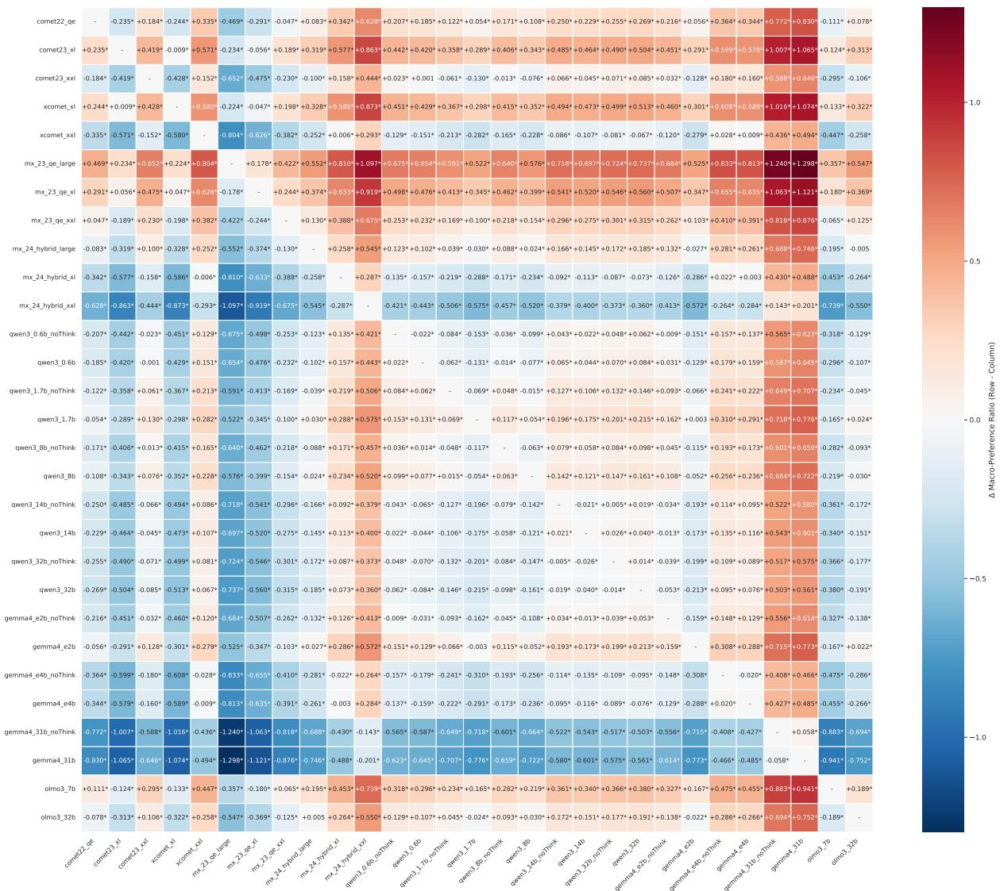

# The Lay of the Land in Idiom-Translation Quality Estimation

Malik Marmonier Benoît Sagot Rachel Bawden

Inria, Paris, France {firstname.lastname}@inria.fr

## Abstract

Idioms have long been a challenge for machine translation, and while large language models (LLMs) have proven increasingly adept at handling them, whether quality estimation (QE) systems have kept pace and can reliably score idiomatic renderings of these expressions above faulty literal ones remains unclear. We introduce the first parallel dataset pairing idiombearing English sentences with both literal and idiomatic translations across nine target languages, augmented into multi-sentence segments and a graded literality continuum. Using this dataset, we benchmark eleven conventional QE metrics from the COMET and MetricX families and ten LLMs from the Qwen-3, Gemma-4 and OLMo-3 families used as GEMBA-style judges. We find that most systems, especially older metrics and smaller models, display a marked literality bias, rating literal translations of idioms above idiomatic ones. Higher parameter counts and newer training sets appear to reduce this bias to an extent; nevertheless, of all the benchmarked systems, only MetricX-24-Hybrid (XL, XXL) and Gemma-4-31B consistently rate idiomatic translations of idioms above literal ones, and only Gemma-4-31B reliably ranks intermediate degrees of idiomaticity and literality. Our findings caution against deploying standard QE metrics in domains rich in figurative language, where higher scores might be rewarding undesirable literalism.

## 1 Introduction

Idioms are formulaic phrases whose meaning cannot be deduced from the semantic analysis of their isolated constituents: I have other fish to fry (I have more important things to care about'); they're cutting corners (they are trying to save money at the expense of quality and safety'). Idioms can be borrowed through calques between languages in contact, inherited from a common ancestor language, or acquired identically through independent convergence, in which cases they might be translatable literally. Such is rarely the case, however, and idioms generally rule out literal translation, instead requiring the use of complex techniques of paraphrase and cultural equivalence. For this reason, idioms have historically posed a significant challenge in machine translation (MT) research, and were once even cited as proof of the impossibility of MT as a task (Bar-Hillel, 1952), with guidelines to academic MT users recommending their removal from system input (Bowker and Ciro, 2019).

MT research has since progressed by leaps and bounds (Sutskever et al., 2014; Bahdanau et al., 2015; Vaswani et al., 2017), and the shift to large language models (LLMs) has led to substantial improvements in the translation of figurative language and multi-word expressions (Raunak et al., 2023)— categories to which idioms belong—as the large parametric memory of these models and the gargantuan volumes of text data used to train them enhance their ability to learn these constructions. Whether the evaluation and benchmarking apparatus of MT has kept pace remains unclear, however, particularly with respect to quality estimation (QE) techniques.

QE consists in evaluating the quality of a candidate translation on the sole basis of its source segment, without a gold standard reference translation. Such a task is eminently useful. In realworld applications, the existence of a reference translation would naturally obviate the need for a candidate translation. While the actual extent of QE “deployment" in the context of contemporary translation practices is partly obscured by trade secrets, clues within the research output of language service providers and the publications of industry analysts indicate that QE systems are likely assuming a growing role in contemporary translation workflows (Rei et al., 2022; Edwards, 2023; Guerreiro et al., 2024; Stasimioti, 2025). In MT research, QE metrics likewise serve an increasing range of functions, from data filtering for in-context learning (Sharami et al., 2024) to applications in quality-aware decoding (Fernandes et al., 2022; Koneru et al., 2025; Mrozinski et al., 2025). In light of these roles and growing importance, developing a better understanding of the properties and behaviors of dominant QE systems has become an imperative,¹ with notable past work analyzing the gender biases these QE systems might display (Zaranis et al., 2025). The present work aims to study the performance of dominant QE approaches in idiom translation.

Through this work, we introduce the first parallel dataset pairing idiom-bearing English sentences with both literal and idiomatic translations across nine target languages, and use it to benchmark eleven conventional QE metrics from the COMET and MetricX families and ten LLMs from the Qwen-3, Gemma-4 and OLMo-3 families used as GEMBA-style judges. We find that most systems, especially older metrics and smaller models, show a marked literality bias, rating literal translations of idioms above idiomatic ones. While larger parameter counts and more recent training sets reduce this bias, of all the benchmarked systems, only MetricX-24-Hybrid (XL, XXL) and Gemma-4-31B consistently rate idiomatic translations of idioms above literal ones, and only Gemma-4-31B reliably ranks intermediate degrees of idiomaticity and literality. Our findings caution against deploying standard QE metrics in domains rich in figurative language, where high scores might be rewarding undesirable literalism.

We publish our dataset under CC BY-SA license.2

## 2 Methods

In this section we describe the methods we applied to the study of QE in idiom translation, presenting the dataset we compiled and the QE metrics we benchmarked using it.

## 2.1 Idiom Dataset

To the best of our knowledge, while there exist many idiom datasets (see Related Work), none of these corpora systematically features paired idiomatic and literal translations of idiom-bearing sentences, in any language. Such a resource would be of precious help to researchers interested in studying a variety of phenomena (e.g., literality bias, literary translation performance), topics of growing importance in MT research (Wang et al., 2023, 2024; Raunak et al., 2023; Kocmi et al., 2025).

To address this gap, we constructed a parallel dataset across nine target languages: Arabic, Chinese, French, Italian, Japanese, Modern Greek, Russian, Spanish, and Turkish, with English as the source language.

Base Triplets The core of the dataset comprises 163 one-sentence triplets, with each triplet consisting of an English source sentence containing an idiom, paired with both a highly literal translation and a fluent idiomatic translation (see Table 1 for a sample). These base triplets were manually curated on the basis of lexicographical resources and the linguistic competence of the authors and their native-speaker colleagues. Each triplet had to meet the two following conditions: 1) the English idiom needed to have a readily identifiable equivalent in the target language and 2) said equivalent target idiom needed to differ from a literal rendering of the English source idiom. As a consequence, the resulting base dataset is not strictly multiparallel since these conditions could not be uniformly met across all target languages for any given English source idiom. The per-target-language distribution of these base triplets is as follows: Spanish (38 triplets), French (20 triplets), and 15 triplets each for the remaining seven languages.

Data Augmentation We applied a data augmentation strategy to these base triplet instances in order to generate multi-sentence segments. For each target language, we randomly sampled and concatenated base triplets into new instances of varying lengths (L ∈ {2, 3, 4, 5} sentences). We generated exactly N = 300 unique combinations for each length, resulting in 1,200 augmented multisentence segments per language pair (see Table 2 for a data sample).

Literality Gradient Judgments of literality/idiomaticity exist on a continuous spectrum rather than as a strict dichotomy. To test the models' sensitivity to graded changes in literality, we constructed 300 instances per target language by concatenating three base triplets (L = 3). For each instance, we generated four target variants in which 0, 1, 2, or all 3 sentences (selected at random) are literal translations and the remainder idiomatic, yielding a literality gradient of 0%, 33%, 66%, and 100% (see Table 3 for examples).

<table><tr><td>ID</td><td>Lang</td><td>English Source</td><td>Literal Translation</td><td>Idiomatic Translation</td></tr><tr><td>1228</td><td>EL</td><td>As soon as the bill arrived, he van- ished into thin air.</td><td>λι τασ  λγαιασ, εξαφανíστε στν λεπτó αÉα.</td><td>Mλι τασ  λγαιασ, Éγιν αν.</td></tr><tr><td>2448</td><td>ES</td><td>When he offered to work for free, I started to smell a rat.</td><td>Cuando se ofreció a trabajar gratis, empecé a oler una rata.</td><td>Cuando se ofreció a trabajar gratis me empezó a oler a chamusquina.</td></tr><tr><td>2455</td><td>ES</td><td>That name doesn&#x27;t ring a bell.</td><td>Ese nombre no toca una campana.</td><td>Ese nombre no me suena.</td></tr><tr><td>2437</td><td>ES</td><td>I&#x27;m so tired, I&#x27;m going to hit the sack early tonight.</td><td>Estoy tan cansado, voy a golpear el saco temprano esta noche.</td><td>Estoy tan cansado, me voy a meter en el sobre temprano esta noche.</td></tr><tr><td>3683</td><td>FR</td><td>He will finally pay you back when pigs fly.</td><td>Il te remboursera enfin quand les cochons voleront.</td><td>Il te remboursera enfin quand les poules auront des dents.</td></tr><tr><td>4889</td><td>IT</td><td>She always bends over backwards to help her friends.</td><td>Si piega sempre all&#x27;indietro per aiutare i suoi amici.</td><td>Si fa sempre in quattro per aiutare i suoi amici.</td></tr><tr><td>3677</td><td>FR</td><td>He only cleans his apartment once in a blue moon.</td><td>Il ne nettoie son appartement qu&#x27;une fois dans une lune bleue.</td><td>Il ne nettoie son appartement que tous les 36 du mois.</td></tr><tr><td>1220</td><td>EL</td><td>I tried reading the instructions, but it&#x27;s all Greek to me.</td><td>ροσπáησα να διαβσω τ oδnγíeζ, αλλá εívαι óλα ελλnνixá για Éνα.</td><td>∏ροσπáησα να διαβσω τι oδnγíε, αλλá μoυ φαívoντα ινζια.</td></tr><tr><td>3688</td><td>FR</td><td>He said he was sick? Sick, my foot!</td><td>Il a dit qu&#x27;il était malade ? Malade, mon pied!</td><td>Il a dit qu&#x27;il était malade ? Malade, mon œil !</td></tr><tr><td>2458</td><td>ES</td><td>He got cold feet right before the wedding.</td><td>Él tuvo pies fríos justo antes de la boda.</td><td>Él se echó atrás justo antes de la boda.</td></tr></table>

Table 1: Examples of single-sentence base triplets, featuring an English source idiom alongside its highly literal and fluent idiomatic translations.

The compiled dataset comprises a total of 10,963 instances.

## 2.2 QE System Query

To find the “lay of the land" in idiom-translation QE, we conducted extensive experiments, prompting a wide range of conventional QE systems and LLMs in a GEMBA-style regime to provide QE scores for the segments in our dataset, before computing deltas between the scores obtained by the literal and idiomatic translations for a given system. The following sections present the QE systems we queried.

## 2.2.1 Conventional QE Systems

Conventional QE relies on dedicated models trained to regress on human judgments from past WMT evaluation campaigns, chiefly direct assessment (DA) scores (Graham et al., 2013) and the more fine-grained MQM annotations (Lommel et al., 2013). We tested eleven such systems from two dominant families. From the COMET family, we used wmt22-cometkiwi-da³ (Rei et al., 2022), built on top of InfoXLM (approx. 600M parameters; Chi et al., 2021); its XL and XXL successors wmt23-cometkiwi-da-xl⁴ and wmt23-cometkiwida-xxl⁵ (Rei et al., 2023), built on XLM-R XL and

XXL (3.5B and 10.5B parameters, respectively; Conneau et al., 2020); and XCOMET-XL6 and XCOMET-XXL7 (Guerreiro et al., 2024), which unify reference-based and reference-free evaluation with error span detection while relying on the same base models. Ensembles of these models ranked first at the WMT 2022–2024 QE shared tasks (Zerva et al., 2022; Blain et al., 2023; Zerva et al., 2024). From the MetricX family, built on top of mT5 (Xue et al., 2021), we used metricx-23-qe-large,8 metricx-23-qe-xl9 and metricx-23- qe-xxl¹0 (1.2B, 3.7B and 13B parameters, respectively; Juraska et al., 2023), and metricx-24- hybrid-large,11 metricx-24-hybrid-xl,12 metricx-24-hybrid-xxl¹³ (1.2B, 3.7B and 13B parameters, respectively; Juraska et al., 2024), the latter additionally trained on synthetic data covering failure modes underrepresented in WMT data (e.g., fluent but unrelated translations).14 COMET models were run with the unbabel-comet library,15 and MetricX models through the Transformers library (Wolf et al., 2020). All models were run at full precision, except metricx-24-hybrid-xxl, for which we used the official bfloat16 checkpoint due to hard-

<table><tr><td>ID</td><td>Lang</td><td>Concatenated Source (L = 3)</td><td>100% Literal Target</td><td>0% Literal (Full Idiomatic)</td></tr><tr><td>2991</td><td>ES</td><td>He decided to quit smoking and went cold turkey. Don&#x27;t worry about the exam, it&#x27;s a piece of cake. If you help me move, I&#x27;ll scratch your back later.</td><td>Él decidió dejar de fumar y se volvió pavo frío. No te preocupes por el examen, es un trozo de pastel. Si me ayudas a mudarme, rascaré tu espalda más tarde.</td><td>Él decidió dejar de fumar y lo dejó de golpe. No te preocupes por el ex- amen, es pan comido. Si me ayudas a mudarme, te devolveré el favor más tarde.</td></tr><tr><td>5243</td><td>IT</td><td>Please don&#x27;t fly off the handle over such a small mistake. I won&#x27;t be coming to work today, I&#x27;m feeling a bit under the weather. Are your ears burning? We were just talking about</td><td>Per favore, non volare via dal man- ico per un errore così piccolo. Oggi non verrò al lavoro, mi sento un po sotto il tempo. Ti stanno bruciando le orecchie? Stavamo proprio par-</td><td>Per favore, non perdere le staffe per un errore così piccolo. Oggi non verrò al lavoro, sono un po&#x27; giù di tono. Ti fischiano le orecchie? Stavamo proprio parlando di te.</td></tr><tr><td>1609</td><td>EL</td><td>you. Trying to convince him is like beat- ing a dead horse. When the alarm went off, he was running around like a headless chicken. The manager really put me through the wringer today.</td><td>lando di te. To να πρσπαε να τν πεí- σει εíναι σν να χτπ Éνα νεxρó λογο. &#x27;Oταν χτúπησε συναγε, τεε τιγ σ αxφαλ οτπουλο.  διευυν- τ παγατι ε πéασε απó</td><td>To να πσπαεí να τν πεσει εívαι πσε τ αυγó αι ευ τo. &#x27;Oταν χτúπησε 0 συναγε- ó, εε χσε τα αυγ αι τα πασχλια.  διευυντÉ παγ- ατι υ ησ τ ι στα</td></tr><tr><td>1666</td><td>EL</td><td>I appreciate that she does not mince her words. I warned him about the danger, but he couldn&#x27;t care less. He will finally pay you back when pigs fly.</td><td>τον στíφτη σμεα. Eτι τ δν ιλει τα λ- για τη. Toν πειδπoínσα για τν νυν, αλλ δεν ποοσε να νοιαστεÍ λιγóτεο. Tελιxá θα σε αππλησει ταν τα γουο-</td><td>χεíλη σμεpα. Exτμ óτι ιλει ξω απó τα δóντiα. Toν ποειδποínσα για τον νδυν, αλλ ε γαε στα παλιá του τα παποúτσια. Για να σε απoπλnpσει, ζńσε Mán μoυ</td></tr><tr><td>4239</td><td>FR</td><td>I have other fish to fry today. He only cleans his apartment once in a blue moon. I worked my fingers to the bone on this project.</td><td>νια πετáξουν. J&#x27;ai d&#x27;autres poissons à frire, au- jourd&#x27;hui. Il ne nettoie son ap- partement qu&#x27;une fois dans une lune bleue. J&#x27;ai travaillé mes doigts jusqu&#x27;à l&#x27;os sur ce projet.</td><td>vα φα τιφúλλι. J&#x27;ai d&#x27;autres chats à fouetter, au- jourd&#x27;hui. Il ne nettoie son apparte- ment que tous les 36 du mois. J&#x27;ai travaillé d’arrache-pied sur ce pro- jet.</td></tr></table>

Table 2: Examples of augmented multi-sentence segments (L = 3), demonstrating the combination of base triplets prior to gradient permutation.

ware constraints.

## 2.2.2 LLMs

LLM-as-a-judge approaches have achieved increasingly competitive results in dedicated QE shared tasks (Zerva et al., 2024; Lavie et al., 2025), notably through GEMBA-style prompting (Kocmi and Federmann, 2023). Following Zaranis et al. (2025), we adopted zero-shot DA-style prompts for our task, presenting the LLM with an English source segment containing an idiom and a candidate translation (either literal or idiomatic) from our dataset, demanding that it output a score between 0 (“no meaning preserved") and 100 (“perfect meaning and grammar"). The full prompt templates are given in Appendix A.

We selected a total of 10 LLMs as QE judges, from 3 model families: Qwen-3-32B (Yang et al., 2025), a reasoning LLM with 32 billion parameters, and Qwen-3-14B, Qwen-3-8B, Qwen-3-1.7B, and Qwen-3-0.6B, its smaller distilled variants; 01mo-3-32B-Think (Olmo et al., 2025), a reasoning LLM with 32 billion parameters, and 0lmo-3-7B-Think, its smaller variant; Gemma-4-31B-it (Google DeepMind, 2026), a reasoning LLM with 31 billion parameters, and its smaller edge-optimized variants, Gemma-4-E4B-it and Gemma-4-E2B-it.

To investigate the impact of reasoning on the task at hand, the Qwen-3 and Gemma-4 models were prompted under two distinct settings, one with their reasoning mode turned on and the other with this mode turned off, using slightly different prompt templates and hyperparameters (see Appendix A). Inference was conducted using H100 GPU nodes, the vLLM framework (Kwon et al., 2023) and the Transformers library (Wolf et al., 2020) with greedy decoding (t = 0), and the max-tokens parameter set to 50 for the reasoning-off setting, and to 16,384 tokens for the reasoning-on setting.

## 3 Results

In order to study the QE systems’ behaviors in idiom translation, we calculated the per-languagepair corpus-level preference ratio for each evaluated system. For quality metrics (all COMETderived systems and GEMBA scores), this is expressed as the ratio of the mean score assigned to fully literal translations over the mean score assigned to the fully idiomatic translations. For errorbased metrics (MetricX), the ratio is inverted for legibility purposes:

$$
\mathrm { P R } = \left\{ \begin{array} { l l } { \overline { { s } } _ { \mathrm { l i t } } } & { \mathrm { f o r ~ q u a l i t y - b a s e d ~ m e t r i c s ~ ( C O M E T , ~ G E M B A ) } , } \\ { \overline { { s } } _ { \mathrm { i d i o } } } & { \mathrm { f o r ~ e r r o r - b a s e d ~ m e t r i c s ~ ( M e t r i c X ) } , } \\ { \overline { { s } } _ { \mathrm { l i t } } } & { \mathrm { f o r ~ e r r o r - b a s e d ~ m e t r i c s ~ ( M e t r i c X ) } , } \end{array} \right.\tag{1}
$$

where $\bar { s } _ { \mathrm { l i t } }$ and $\bar { s } _ { \mathrm { i d i o } }$ denote the mean scores assigned to fully literal and fully idiomatic translations across the corpus. Consequently, a ratio greater than 1.0 indicates a literality bias whereby the QE system rates the literal translation higher than the idiomatic one, a ratio less than 1.0 indicates an idiomatic preference, and a ratio of exactly 1.0 indicates neutral scoring.

  
Table 3: Examples of the semantic gradient for concatenated segments (L = 3). The intermediate steps (66% and 33% literal) randomly mix literal and idiomatic sentence-level translations to test granular sensitivity.

Table 4 displays these ratios, from which we draw the following observations.16

An analysis of the “conventional" COMET and MetricX QE systems reveals that the ability to reward idiomaticity in idiom translation—and, conversely, to penalize literality—is driven by an interplay between model scale and finetuning data composition. The impact of the latter is evidenced by the observable “generational"shift within the MetricX system family: despite matching parameter counts across their Large (1.2B), XL (3.7B), and XXL (13B) mT5-derived checkpoints, the MetricX-24-Hybrid group effectively suppresses the severe literality bias exhibited by its predecessor, MetricX-23-QE. This improvement is likely attributable to

MetricX-24’s exposure to larger MQM training sets and/or to the hybrid nature of the model, capable of performing both QE and reference-based evaluation. A similar though fainter trend of improvement is visible between the WMT23 COMET-Kiwi models and the newer XCOMET architecture. Concurrently, a scaling law appears to govern QE performance in idiom translation. Scaling up parameter counts—such as moving from Large to XXL in MetricX-24, or from XL (3.5B) to XXL (10.5B) in XCOMETconsistently shifts the metrics away from a literal bias and toward an idiomatic preference. This is likely due to the non-compositional nature of idioms: since their meaning cannot be deduced analytically, recognizing idioms and their idiomatic equivalent in a target language depends on memorized knowledge of specific expressions, which inherently benefits from the increased parametric memory of larger models. Ultimately, reliable idiomatic sensitivity in conventional QE systems is currently only achieved by the XL and XXL checkpoint of MetricX-24-Hybrid.

When using LLMs as QE judges under the

<table><tr><td rowspan=1 colspan=11>QE System                  en-ar  en-el  en-es  en-fr  en-it  en-ja  en-ru  en-tr  en-zh</td></tr><tr><td rowspan=1 colspan=1>wmt22_cometkiwi_qe</td><td rowspan=1 colspan=2>1.230   1.449</td><td rowspan=1 colspan=1>1.093</td><td rowspan=1 colspan=7>1.221   1.424   1.084  1.232   1.087   1.065</td></tr><tr><td rowspan=1 colspan=1>wmt23_cometkiwi_xl</td><td rowspan=1 colspan=2>1.237   2.338</td><td rowspan=1 colspan=1>1.010</td><td rowspan=1 colspan=6>1.784   1.959   1.263   1.296   1.224</td><td rowspan=1 colspan=1>0.887</td></tr><tr><td rowspan=1 colspan=1>wmt23_cometkiwi_xxl</td><td rowspan=1 colspan=2>1.183   1.949</td><td rowspan=1 colspan=1>0.647</td><td rowspan=1 colspan=3>1.248   1.297</td><td rowspan=1 colspan=3>0.990   0.754   0.682</td><td rowspan=1 colspan=1>0.479</td></tr><tr><td rowspan=1 colspan=1>xcomet_xl</td><td rowspan=1 colspan=2>1.499   2.301</td><td rowspan=1 colspan=1>1.038</td><td rowspan=1 colspan=3>1.498   1.922</td><td rowspan=1 colspan=3>1.289   1.338   1.288</td><td rowspan=1 colspan=1>0.906</td></tr><tr><td rowspan=1 colspan=1>xcomet_xxl</td><td rowspan=1 colspan=3>0.896   1.125   0.778</td><td rowspan=1 colspan=3>0.971   1.030</td><td rowspan=1 colspan=1>0.916</td><td rowspan=1 colspan=3>0.788   0.685   0.675</td></tr><tr><td rowspan=1 colspan=1>metricx_23_qe_large</td><td rowspan=1 colspan=3>1.587   1.921   1.443</td><td rowspan=1 colspan=3>1.607   2.287</td><td rowspan=1 colspan=1>1.682</td><td rowspan=1 colspan=1>1.500</td><td rowspan=1 colspan=1>1.299</td><td rowspan=1 colspan=1>1.775</td></tr><tr><td rowspan=1 colspan=1>metricx_23_qe_xl</td><td rowspan=1 colspan=1>1.477</td><td rowspan=1 colspan=1>1.917</td><td rowspan=1 colspan=1>1.390</td><td rowspan=1 colspan=3>1.694   1.829</td><td rowspan=1 colspan=1>1.509</td><td rowspan=1 colspan=1>1.406</td><td rowspan=1 colspan=1>1.088</td><td rowspan=1 colspan=1>1.193</td></tr><tr><td rowspan=1 colspan=1>metricx_23_qe_xxl</td><td rowspan=1 colspan=1>1.033</td><td rowspan=1 colspan=1>1.316</td><td rowspan=1 colspan=1>1.206</td><td rowspan=1 colspan=3>1.403   1.724</td><td rowspan=1 colspan=2>1.557   1.152</td><td rowspan=1 colspan=1>1.033</td><td rowspan=1 colspan=1>0.877</td></tr><tr><td rowspan=3 colspan=1>metricx_24_hybrid_large</td><td rowspan=3 colspan=1>1.069</td><td rowspan=3 colspan=1>1.263</td><td rowspan=3 colspan=1>1.037</td><td rowspan=3 colspan=3>1.202   1.512</td><td></td><td></td><td></td><td></td></tr><tr><td rowspan=2 colspan=1>1.078</td><td></td><td></td><td></td></tr><tr><td rowspan=1 colspan=4>0.982   1.010  0.981</td></tr><tr><td rowspan=1 colspan=1>metricx_24_hybrid_xl</td><td rowspan=1 colspan=1>0.930</td><td rowspan=1 colspan=1>0.847</td><td rowspan=1 colspan=1>0.834</td><td rowspan=1 colspan=3>0.977   0.966</td><td rowspan=1 colspan=1>0.934</td><td rowspan=1 colspan=3>0.826   0.841   0.654</td></tr><tr><td rowspan=1 colspan=1>metricx_24_hybrid_xxl</td><td rowspan=1 colspan=1>0.635</td><td rowspan=1 colspan=1>0.509</td><td rowspan=1 colspan=1>0.496</td><td rowspan=1 colspan=3>0.759   0.767</td><td rowspan=1 colspan=3>0.734   0.424  0.531</td><td rowspan=1 colspan=1>0.374</td></tr><tr><td rowspan=1 colspan=1>gemba_qwen3_0.6b_noThink</td><td rowspan=1 colspan=1>1.000</td><td rowspan=1 colspan=1>1.002</td><td rowspan=1 colspan=1>1.000</td><td rowspan=1 colspan=3>1.000   1.000</td><td rowspan=1 colspan=1>1.013</td><td rowspan=1 colspan=2>1.000   1.002</td><td rowspan=1 colspan=1>1.006</td></tr><tr><td rowspan=1 colspan=1>gemba_qwen3_0.6b</td><td rowspan=1 colspan=1>1.018</td><td rowspan=1 colspan=1>1.031</td><td rowspan=1 colspan=1>1.012</td><td rowspan=1 colspan=1>1.019</td><td rowspan=1 colspan=2>1.068</td><td rowspan=1 colspan=1>1.041</td><td rowspan=1 colspan=2>1.027   1.008</td><td rowspan=1 colspan=1>0.994</td></tr><tr><td rowspan=1 colspan=1>gemba_qwen3_1.7b_noThink</td><td rowspan=1 colspan=1>1.102</td><td rowspan=1 colspan=1>1.384</td><td rowspan=1 colspan=1>1.022</td><td rowspan=1 colspan=1>1.081</td><td rowspan=1 colspan=2>1.129</td><td rowspan=1 colspan=1>1.022</td><td rowspan=1 colspan=1>1.022</td><td rowspan=1 colspan=1>1.066</td><td rowspan=1 colspan=1>0.954</td></tr><tr><td rowspan=1 colspan=1>gemba_qwen3_1.7b</td><td rowspan=1 colspan=1>1.228</td><td rowspan=1 colspan=1>1.793</td><td rowspan=1 colspan=1>1.038</td><td rowspan=1 colspan=1>1.097</td><td rowspan=1 colspan=2>1.103</td><td rowspan=1 colspan=1>1.055</td><td rowspan=1 colspan=1>1.028</td><td rowspan=1 colspan=1>1.168</td><td rowspan=1 colspan=1>0.891</td></tr><tr><td rowspan=1 colspan=1>gemba_qwen3_8b_noThink</td><td rowspan=1 colspan=1>1.078</td><td rowspan=1 colspan=1>1.936</td><td rowspan=1 colspan=1>0.947</td><td rowspan=1 colspan=1>0.937</td><td rowspan=1 colspan=2>0.922</td><td rowspan=1 colspan=1>0.916</td><td rowspan=1 colspan=1>0.902</td><td rowspan=1 colspan=1>0.889</td><td rowspan=1 colspan=1>0.817</td></tr><tr><td rowspan=1 colspan=1>gemba_qwen3_8b</td><td rowspan=1 colspan=1>1.203</td><td rowspan=1 colspan=1>2.300</td><td rowspan=1 colspan=1>0.912</td><td rowspan=1 colspan=1>0.948</td><td rowspan=1 colspan=2>0.913</td><td rowspan=1 colspan=1>0.907</td><td rowspan=1 colspan=1>0.903</td><td rowspan=1 colspan=1>1.015</td><td rowspan=1 colspan=1>0.812</td></tr><tr><td rowspan=1 colspan=1>gemba_qwen3_14b_noThink</td><td rowspan=1 colspan=1>1.010</td><td rowspan=1 colspan=1>1.100</td><td rowspan=1 colspan=1>0.967</td><td rowspan=1 colspan=1>0.956</td><td rowspan=1 colspan=2>0.987</td><td rowspan=1 colspan=1>0.909</td><td rowspan=1 colspan=1>0.974</td><td rowspan=1 colspan=1>0.957</td><td rowspan=1 colspan=1>0.777</td></tr><tr><td rowspan=1 colspan=1>gemba_qwen3_14b</td><td rowspan=1 colspan=1>1.082</td><td rowspan=1 colspan=1>1.357</td><td rowspan=1 colspan=1>0.932</td><td rowspan=1 colspan=1>0.954</td><td rowspan=1 colspan=2>0.938</td><td rowspan=1 colspan=1>0.856</td><td rowspan=1 colspan=1>0.934</td><td rowspan=1 colspan=1>0.997</td><td rowspan=1 colspan=1>0.775</td></tr><tr><td rowspan=1 colspan=1>gemba_qwen3_32b_noThink</td><td rowspan=1 colspan=1>1.022</td><td rowspan=1 colspan=1>1.091</td><td rowspan=1 colspan=1>0.936</td><td rowspan=1 colspan=1>0.951</td><td rowspan=1 colspan=2>0.980</td><td rowspan=1 colspan=1>0.907</td><td rowspan=1 colspan=1>0.964</td><td rowspan=1 colspan=1>0.997</td><td rowspan=1 colspan=1>0.743</td></tr><tr><td rowspan=1 colspan=1>gemba_qwen3_32b</td><td rowspan=1 colspan=1>1.038</td><td rowspan=1 colspan=1>1.180</td><td rowspan=1 colspan=1>0.898</td><td rowspan=1 colspan=1>0.916</td><td rowspan=1 colspan=2>0.937</td><td rowspan=1 colspan=1>0.839</td><td rowspan=1 colspan=1>0.927</td><td rowspan=1 colspan=1>1.010</td><td rowspan=1 colspan=1>0.719</td></tr><tr><td rowspan=1 colspan=1>gemba_gemma4_e2b_noThink</td><td rowspan=1 colspan=1>0.978</td><td rowspan=1 colspan=1>2.117</td><td rowspan=1 colspan=1>0.853</td><td rowspan=1 colspan=1>0.870</td><td rowspan=1 colspan=2>1.017</td><td rowspan=1 colspan=1>0.709</td><td rowspan=1 colspan=2>0.879   0.860</td><td rowspan=1 colspan=1>0.659</td></tr><tr><td rowspan=1 colspan=1>gemba_gemma4_e2b</td><td rowspan=1 colspan=1>1.295</td><td rowspan=1 colspan=1>3.238</td><td rowspan=1 colspan=1>0.810</td><td rowspan=1 colspan=1>0.853</td><td rowspan=1 colspan=2>1.144</td><td rowspan=1 colspan=1>0.741</td><td rowspan=1 colspan=2>0.787   0.890</td><td rowspan=1 colspan=1>0.623</td></tr><tr><td rowspan=1 colspan=1>gemba_gemma4_e4b_noThink</td><td rowspan=1 colspan=1>0.919</td><td rowspan=1 colspan=1>1.438</td><td rowspan=1 colspan=1>0.773</td><td rowspan=1 colspan=1>0.807</td><td rowspan=1 colspan=2>0.873</td><td rowspan=1 colspan=1>0.689</td><td rowspan=1 colspan=2>0.727   0.793</td><td rowspan=1 colspan=1>0.591</td></tr><tr><td rowspan=1 colspan=1>gemba_gemma4_e4b</td><td rowspan=1 colspan=1>0.938</td><td rowspan=1 colspan=1>1.737</td><td rowspan=1 colspan=1>0.707</td><td rowspan=1 colspan=1>0.788</td><td rowspan=1 colspan=2>0.825</td><td rowspan=1 colspan=1>0.676</td><td rowspan=1 colspan=2>0.703   0.836</td><td rowspan=1 colspan=1>0.577</td></tr><tr><td rowspan=4 colspan=1>gemba_gemma4_31b</td><td rowspan=1 colspan=3>gemba gemma4 31b noThink</td><td rowspan=1 colspan=1>0.472</td><td rowspan=1 colspan=2>0.578</td><td rowspan=1 colspan=1>0.489</td><td rowspan=1 colspan=1>0.547</td><td rowspan=1 colspan=1>0.456</td><td rowspan=1 colspan=1>0.317</td></tr><tr><td></td><td></td><td></td><td></td><td></td><td></td><td rowspan=3 colspan=3>0.277   0.375   0.277</td><td></td></tr><tr><td></td><td></td><td></td><td></td><td></td><td></td><td rowspan=2 colspan=1>0.3420.281</td></tr><tr><td rowspan=1 colspan=1>0.413</td><td rowspan=1 colspan=1>0.493</td><td rowspan=1 colspan=2>0.407   0.465</td><td rowspan=1 colspan=2>0.429</td></tr><tr><td rowspan=2 colspan=1>gemba_olmo3_7bgemba_olmo3_32b</td><td rowspan=2 colspan=9>1.437   1.991   1.151   1.184   1.4941.319   1.603   0.985   1.072  1.300   1.134   1.030   1.013</td><td rowspan=1 colspan=1>94 1.272 1.166 1.236</td></tr><tr><td rowspan=1 colspan=1>0.727</td></tr></table>

Table 4: Macro-preference ratio of QE models (Literal / Idiomatic). Values > 1 indicate a literal bias, while values < 1 indicate an idiomatic preference. The color scale saturates at 0.85 (blue) and 1.15 (red), as the direction of the model's preference is more informative than the magnitude of the score difference in binary judgments.

GEMBA framework, sensitivity to idiomaticity is characterized by stark inter-family variance and diverse scaling trajectories. The Qwen 3 family exhibits a distinct, non-linear progression: its smallest checkpoint (0.6B) gives preference ratios hovering tightly around 1.0, indicating that it is effectively blind to the distinction between literal and idiomatic phrasing. As parameter count increases (1.7B and 8B), the models develop a severe literality bias, before eventually tilting toward an idiomatic preference at the 32B scale for a majority of the target languages, though not for their totality, with Arabic and Greek eliciting a literality bias and Turkish neutral judgments. Conversely, the Gemma 4 family bypasses this initial blindness entirely. Even its smallest edge-optimized model (E2B) actively differentiates translations, albeit unreliably—exhibiting an extreme literality bias for target segments in Greek (incidentally the lowest-resource target language represented in our dataset) and to a lesser extent in Arabic and Italian with its reasoning mode switched on. Scaling up the Gemma parameter count rapidly stabilizes this behavior: Gemma-4-E4B achieves broad idiomatic preference, albeit with a persistent literality bias in Greek, and Gemma-4-31B demonstrates a uniform robust preference for idiomaticity across all target languages. Parameter scale does not compensate for everything, however. Although OLMo-3-32B shows a weaker literality bias than its 7B counterpart, it remains well behind Qwen-3 and Gemma-4 models of comparable size. OLMo differs from these models in its training data, both in pretraining and post-training, and in particular in its far more limited multilingual coverage. This suggests that scale helps only insofar as the relevant idiomatic knowledge has been acquired during training.

LLMs as QE judges therefore have checkered performance, with Gemma-4-31B as the only LLM reliably capable of penalizing literality in idiom translation over idiomaticity.

As previously stated, judgments of literality and idiomaticity exist on a continuous scale rather than as a strictly binary dichotomy. To evaluate the systems’ sensitivity to more granular degrees of idiomaticity, we analyzed their performance on the graded L = 3 dataset partition we compiled, which features three-sentence segments representing various degrees of literality/idiomaticity (100%, 66%, 33%, and 0% literal permutations; see Table 3). For each three-sentence instance, we calculated Kendall's $\tau _ { b }$ rank correlation coefficient (Kendall, 1938) to measure how closely a model's predicted scores aligned with the ideal 4-step idiomaticity gradient the segments represent. Kendall's τ evaluates the ordinal association between two measured quantities; in the context of this experiment, a τ of 1.0 indicates a perfect monotonic preference for idiomaticity (correctly ranking all four steps of the gradient in the right order), a τ near 0.0 indicates random scoring, and a negative τ denotes an active preference for literal translations. The mean segment-level τ scores are displayed in Table 5 and broadly corroborate the binary macropreference trends: older “conventional" QE metrics and smaller LLM checkpoints exhibit strong negative correlations, heavily penalizing idiomaticity. Crucially, however, evaluating rank order across intermediate steps provides the resolution needed to separate the top-performing systems. While metricx\_24\_hybrid\_xxl and gemba\_gemma4\_31b appeared roughly on par when evaluating the binary extremes of full literality and idiomaticity, this Kendall's τ analysis reveals the performance boundaries of the “conventional" QE metric. Metricx\_24\_hybrid\_xxl struggles to reliably rank the intermediate 33% and 66% sentence mixtures, resulting in only moderate correlations on languages like Arabic (τ = 0.355) and French (τ = 0.387). In stark contrast, gemba\_gemma4\_31b maintains near-perfect monotonic tracking across the board, achieving τ scores above 0.900 for the vast majority of languages. This suggests that while large conventional systems reliably capture extreme contrasts, the 31B LLM is substantially better equipped to track subtle “real-world" gradations of idiomaticity and literality.

<table><tr><td rowspan=1 colspan=13>QE System                   ar      el      es     fr      it     ja     ru      tr     zh</td></tr><tr><td rowspan=1 colspan=1>wmt22_cometkiwi_qe</td><td rowspan=1 colspan=1>-0.642</td><td rowspan=1 colspan=1>-0.796</td><td rowspan=1 colspan=4>-0.249</td><td rowspan=1 colspan=1>-0.548</td><td rowspan=1 colspan=1>-0.774</td><td rowspan=1 colspan=1>-0.339</td><td rowspan=1 colspan=1>-0.586</td><td rowspan=1 colspan=1>-0.441</td><td rowspan=1 colspan=1>-0.071</td></tr><tr><td rowspan=1 colspan=1>wmt23_cometkiwi_xl</td><td rowspan=1 colspan=1>-0.403</td><td rowspan=1 colspan=1>-0.720</td><td rowspan=1 colspan=2></td><td rowspan=1 colspan=2>-0.005</td><td rowspan=1 colspan=1>5</td><td rowspan=1 colspan=1>-0.572</td><td rowspan=1 colspan=1>-0.636</td><td rowspan=1 colspan=1>-0.529</td><td rowspan=1 colspan=1>-0.467</td><td rowspan=1 colspan=1>-0.374</td></tr><tr><td rowspan=1 colspan=1>wmt23_cometkiwi_xxl</td><td rowspan=1 colspan=1>-0.190</td><td rowspan=1 colspan=1>-0.384</td><td rowspan=1 colspan=2>0.3</td><td rowspan=1 colspan=2>77</td><td rowspan=1 colspan=1>-0.277</td><td rowspan=1 colspan=1>-0.180</td><td rowspan=1 colspan=1>0.133</td><td rowspan=1 colspan=1>0.297</td><td rowspan=1 colspan=1>0.513</td><td rowspan=1 colspan=1>0.579</td></tr><tr><td rowspan=1 colspan=1>xcomet_xl</td><td rowspan=1 colspan=1>-0.482</td><td rowspan=1 colspan=1>-0.589</td><td rowspan=1 colspan=4>0.006</td><td rowspan=1 colspan=1>-0.460</td><td rowspan=1 colspan=1>-0.647</td><td rowspan=1 colspan=1>-0.491</td><td rowspan=1 colspan=1>-0.477</td><td rowspan=1 colspan=1>-0.373</td><td rowspan=1 colspan=1>0.136</td></tr><tr><td rowspan=1 colspan=1>xcomet_xxl</td><td rowspan=1 colspan=1>0.266</td><td rowspan=1 colspan=1>-0.201</td><td rowspan=1 colspan=4>0.549</td><td rowspan=1 colspan=1>-0.006</td><td rowspan=1 colspan=1>0.065</td><td rowspan=1 colspan=1>0.230</td><td rowspan=1 colspan=1>0.584</td><td rowspan=1 colspan=1>0.637</td><td rowspan=1 colspan=1>0.710</td></tr><tr><td rowspan=2 colspan=1>metricx_23_qe_large</td><td></td><td></td><td></td><td></td><td></td><td></td><td></td><td></td><td></td><td></td><td></td><td></td></tr><tr><td rowspan=1 colspan=1>-0.524</td><td rowspan=1 colspan=1>-0.776</td><td rowspan=1 colspan=4>-0.457</td><td rowspan=1 colspan=1>-0.606</td><td rowspan=1 colspan=1>-0.902</td><td rowspan=1 colspan=1>-0.722</td><td rowspan=1 colspan=1>-0.587</td><td rowspan=1 colspan=1>-0.526</td><td rowspan=1 colspan=1>-0.694</td></tr><tr><td rowspan=1 colspan=1>metricx_23_qe_xl</td><td rowspan=1 colspan=1>-0.312</td><td rowspan=1 colspan=1>-0.446</td><td rowspan=1 colspan=4>-0.366</td><td rowspan=1 colspan=1>-0.684</td><td rowspan=1 colspan=1>-0.559</td><td rowspan=1 colspan=1>-0.628</td><td rowspan=1 colspan=1>-0.474</td><td rowspan=1 colspan=1>-0.078</td><td rowspan=1 colspan=1>-0.124</td></tr><tr><td rowspan=1 colspan=1>metricx_23_qe_xxl</td><td rowspan=1 colspan=1>-0.001</td><td rowspan=1 colspan=1>-0.332</td><td rowspan=1 colspan=4>-0.046</td><td rowspan=1 colspan=1>-0.346</td><td rowspan=1 colspan=1>-0.433</td><td rowspan=1 colspan=1>-0.253</td><td rowspan=1 colspan=1>-0.219</td><td rowspan=1 colspan=1>0.178</td><td rowspan=1 colspan=1>0.269</td></tr><tr><td rowspan=2 colspan=1>metricx_24_hybrid_large</td><td></td><td></td><td></td><td></td><td></td><td></td><td></td><td></td><td></td><td></td><td></td><td></td></tr><tr><td rowspan=1 colspan=1>-0.186</td><td rowspan=1 colspan=1>-0.481</td><td rowspan=1 colspan=4>-0.100</td><td rowspan=1 colspan=1>-0.292</td><td rowspan=1 colspan=1>-0.703</td><td rowspan=1 colspan=1>-0.122</td><td rowspan=1 colspan=1>0.059</td><td rowspan=1 colspan=1>0.044</td><td rowspan=1 colspan=1>0.256</td></tr><tr><td rowspan=1 colspan=1>metricx_24_hybrid_xl</td><td rowspan=1 colspan=1>0.133</td><td rowspan=1 colspan=1>0.403</td><td rowspan=1 colspan=4>0.362</td><td rowspan=1 colspan=1>0.071</td><td rowspan=1 colspan=1>0.231</td><td rowspan=1 colspan=1>0.198</td><td rowspan=1 colspan=1>0.413</td><td rowspan=1 colspan=1>0.427</td><td rowspan=1 colspan=1>0.647</td></tr><tr><td rowspan=1 colspan=1>metricx_24_hybrid_xxl</td><td rowspan=1 colspan=1>0.355</td><td rowspan=1 colspan=1>0.629</td><td rowspan=1 colspan=4>0.615</td><td rowspan=1 colspan=1>0.387</td><td rowspan=1 colspan=1>0.509</td><td rowspan=1 colspan=1>0.564</td><td rowspan=1 colspan=1>0.958</td><td rowspan=1 colspan=1>0.660</td><td rowspan=1 colspan=1>0.822</td></tr><tr><td rowspan=4 colspan=1>gemba_qwen3_0.6b_noThink</td><td rowspan=4 colspan=1>N/A</td><td></td><td></td><td></td><td></td><td></td><td></td><td></td><td></td><td></td><td></td><td></td></tr><tr><td rowspan=3 colspan=1>N/A</td><td rowspan=3 colspan=4>N/A</td><td rowspan=3 colspan=1>-0.079</td><td rowspan=3 colspan=1>0.136</td><td rowspan=3 colspan=1>-0.198</td><td></td><td></td><td></td></tr><tr><td rowspan=2 colspan=1>-0.047</td><td rowspan=2 colspan=1>-0.236</td><td></td></tr><tr><td rowspan=1 colspan=1>-0.523</td></tr><tr><td rowspan=1 colspan=1>gemba_qwen3_0.6b</td><td rowspan=1 colspan=1>-0.071</td><td rowspan=1 colspan=1>-0.226</td><td rowspan=1 colspan=4>-0.072</td><td rowspan=1 colspan=1>-0.140</td><td rowspan=1 colspan=1>-0.313</td><td rowspan=1 colspan=1>-0.153</td><td rowspan=1 colspan=1>-0.185</td><td rowspan=1 colspan=1>-0.106</td><td rowspan=1 colspan=1>-0.010</td></tr><tr><td rowspan=1 colspan=1>gemba_qwen3_1.7b_noThink</td><td rowspan=1 colspan=1>-0.675</td><td rowspan=1 colspan=1>-0.732</td><td rowspan=1 colspan=4>0.035</td><td rowspan=1 colspan=1>-0.283</td><td rowspan=1 colspan=1>-0.295</td><td rowspan=1 colspan=1>-0.127</td><td rowspan=1 colspan=1>-0.280</td><td rowspan=1 colspan=1>-0.521</td><td rowspan=1 colspan=1>0.377</td></tr><tr><td rowspan=1 colspan=1>gemba_qwen3_1.7b</td><td rowspan=1 colspan=1>-0.538</td><td rowspan=1 colspan=1>-0.671</td><td rowspan=1 colspan=4>-0.018</td><td rowspan=1 colspan=1>-0.266</td><td rowspan=1 colspan=1>-0.160</td><td rowspan=1 colspan=1>-0.106</td><td rowspan=1 colspan=1>-0.212</td><td rowspan=1 colspan=1>-0.313</td><td rowspan=1 colspan=1>0.573</td></tr><tr><td rowspan=1 colspan=1>gemba_qwen3_8b_noThink</td><td rowspan=1 colspan=1>-0.273</td><td rowspan=1 colspan=1>-0.743</td><td rowspan=1 colspan=4>0.272</td><td rowspan=1 colspan=1>0.416</td><td rowspan=1 colspan=1>0.185</td><td rowspan=1 colspan=1>0.458</td><td rowspan=1 colspan=1>0.497</td><td rowspan=1 colspan=1>0.344</td><td rowspan=1 colspan=1>0.749</td></tr><tr><td rowspan=1 colspan=1>gemba_qwen3_8b</td><td rowspan=1 colspan=1>-0.361</td><td rowspan=1 colspan=1>-0.757</td><td rowspan=1 colspan=4>0.292</td><td rowspan=1 colspan=1>0.337</td><td rowspan=1 colspan=1>0.201</td><td rowspan=1 colspan=1>0.365</td><td rowspan=1 colspan=1>0.439</td><td rowspan=1 colspan=1>0.051</td><td rowspan=1 colspan=1>0.750</td></tr><tr><td rowspan=1 colspan=1>gemba_qwen3_14b_noThink</td><td rowspan=1 colspan=1>0.033</td><td rowspan=1 colspan=1>-0.594</td><td rowspan=1 colspan=4>0.295</td><td rowspan=1 colspan=1>0.532</td><td rowspan=1 colspan=1>0.237</td><td rowspan=1 colspan=1>0.694</td><td rowspan=1 colspan=1>0.558</td><td rowspan=1 colspan=1>0.347</td><td rowspan=1 colspan=1>0.867</td></tr><tr><td rowspan=1 colspan=1>gemba_qwen3_14b</td><td rowspan=1 colspan=1>-0.006</td><td rowspan=1 colspan=1>-0.485</td><td rowspan=1 colspan=4>0.285</td><td rowspan=1 colspan=1>0.322</td><td rowspan=1 colspan=1>0.313</td><td rowspan=1 colspan=1>0.616</td><td rowspan=1 colspan=1>0.426</td><td rowspan=1 colspan=1>0.099</td><td rowspan=1 colspan=1>0.757</td></tr><tr><td rowspan=1 colspan=1>gemba_qwen3_32b_noThink</td><td rowspan=1 colspan=1>-0.125</td><td rowspan=1 colspan=1>-0.746</td><td rowspan=1 colspan=4>0.365</td><td rowspan=1 colspan=1>0.431</td><td rowspan=1 colspan=1>0.268</td><td rowspan=1 colspan=1>0.619</td><td rowspan=1 colspan=1>0.540</td><td rowspan=1 colspan=1>-0.076</td><td rowspan=1 colspan=1>0.892</td></tr><tr><td rowspan=1 colspan=1>gemba_qwen3_32b</td><td rowspan=1 colspan=1>0.056</td><td rowspan=1 colspan=1>-0.374</td><td rowspan=1 colspan=4>0.369</td><td rowspan=1 colspan=1>0.399</td><td rowspan=1 colspan=1>0.288</td><td rowspan=1 colspan=1>0.645</td><td rowspan=1 colspan=1>0.482</td><td rowspan=1 colspan=1>-0.010</td><td rowspan=1 colspan=1>0.856</td></tr><tr><td rowspan=2 colspan=1>gemba_gemma4_e2b_noThink</td><td></td><td></td><td></td><td></td><td></td><td></td><td></td><td></td><td></td><td></td><td></td><td></td></tr><tr><td rowspan=1 colspan=1>0.072</td><td rowspan=1 colspan=1>-0.708</td><td rowspan=1 colspan=4>0.593</td><td rowspan=1 colspan=1>0.644</td><td rowspan=1 colspan=1>0.077</td><td rowspan=1 colspan=1>0.684</td><td rowspan=1 colspan=1>0.641</td><td rowspan=1 colspan=1>0.570</td><td rowspan=1 colspan=1>0.899</td></tr><tr><td rowspan=1 colspan=1>gemba_gemma4_e2b</td><td rowspan=1 colspan=1>-0.281</td><td rowspan=1 colspan=1>-0.737</td><td rowspan=1 colspan=4>0.494</td><td rowspan=1 colspan=1>0.482</td><td rowspan=1 colspan=1>-0.112</td><td rowspan=1 colspan=1>0.506</td><td rowspan=1 colspan=1>0.517</td><td rowspan=1 colspan=1>0.265</td><td rowspan=1 colspan=1>0.769</td></tr><tr><td rowspan=1 colspan=1>gemba_gemma4_e4b_noThink</td><td rowspan=1 colspan=1>0.270</td><td rowspan=1 colspan=1>-0.555</td><td rowspan=1 colspan=4>0.679</td><td rowspan=1 colspan=1>0.694</td><td rowspan=1 colspan=1>0.377</td><td rowspan=1 colspan=1>0.826</td><td rowspan=1 colspan=1>0.859</td><td rowspan=1 colspan=1>0.587</td><td rowspan=1 colspan=1>0.881</td></tr><tr><td rowspan=1 colspan=1>gemba_gemma4_e4b</td><td rowspan=1 colspan=1>0.208</td><td rowspan=1 colspan=1>-0.432</td><td rowspan=1 colspan=4>0.690</td><td rowspan=1 colspan=1>0.648</td><td rowspan=1 colspan=1>0.343</td><td rowspan=1 colspan=1>0.698</td><td rowspan=1 colspan=1>0.779</td><td rowspan=1 colspan=1>0.373</td><td rowspan=1 colspan=1>0.890</td></tr><tr><td rowspan=2 colspan=1>gemba_gemma4_31b_noThinkgemba_gemma4_31b</td><td rowspan=1 colspan=1>0.937</td><td rowspan=1 colspan=1>0.695</td><td rowspan=1 colspan=4>0.911</td><td rowspan=1 colspan=1>0.941</td><td rowspan=1 colspan=1>0.884</td><td rowspan=1 colspan=1>0.988</td><td rowspan=1 colspan=1>0.968</td><td rowspan=1 colspan=1>0.999</td><td rowspan=1 colspan=1>0.974</td></tr><tr><td rowspan=1 colspan=1>0.950</td><td rowspan=1 colspan=1>0.715</td><td rowspan=1 colspan=4>0.905</td><td rowspan=1 colspan=1>0.947</td><td rowspan=1 colspan=1>0.807</td><td rowspan=1 colspan=1>0.993</td><td rowspan=1 colspan=1>0.985</td><td rowspan=1 colspan=1>0.999</td><td rowspan=1 colspan=1>0.970</td></tr><tr><td rowspan=1 colspan=1>gemba_olmo3_7b</td><td rowspan=1 colspan=1>-0.374</td><td rowspan=1 colspan=1>-0.575</td><td rowspan=1 colspan=4>-0.120</td><td rowspan=1 colspan=1>-0.228</td><td rowspan=1 colspan=1>-0.361</td><td rowspan=1 colspan=1>-0.315</td><td rowspan=1 colspan=1>-0.249</td><td rowspan=1 colspan=1>-0.228</td><td rowspan=1 colspan=1>0.162</td></tr><tr><td rowspan=1 colspan=1>gemba_olmo3_32b</td><td rowspan=1 colspan=1>-0.400</td><td rowspan=1 colspan=1>-0.493</td><td rowspan=1 colspan=4>0.111</td><td rowspan=1 colspan=1>-0.145</td><td rowspan=1 colspan=1>-0.275</td><td rowspan=1 colspan=1>-0.202</td><td rowspan=1 colspan=1>-0.154</td><td rowspan=1 colspan=1>0.046</td><td rowspan=1 colspan=1>0.642</td></tr></table>

Table 5: Mean Kendall's τ rank correlation coefficient demonstrating adherence to the idiomaticity gradient. Values closer to 1.0 indicate a perfect monotonic preference for idiomaticity over literality. N/A values denote instances where a model collapsed into outputting a single, constant score for all permutations within a segment, rendering rank correlation mathematically undefined.

## 4 Related Work

The state of the art in QE research was shaped through successive editions of WMT shared tasks beginning in 2012 (Callison-Burch et al., 2012; Bojar et al., 2013, 2014, 2015, 2016, 2017; Specia et al., 2018; Fonseca et al., 2019; Specia et al., 2020, 2021; Zerva et al., 2022; Blain et al., 2023; Zerva et al., 2024; Lavie et al., 2025), though QE as a research program had substantial precedents under the banner of “confidence estimation" (inter alia Gandrabur and Foster, 2003; Quirk, 2004; Blatz et al., 2004; Ueffing and Ney, 2005; Specia et al., 2009; Xiong et al., 2010; Bach et al., 2011). Zhao et al. (2024) offer a comprehensive survey of QE research, grouping approaches into three categories that also reflect the historical evolution of the task: handcrafted-feature-based systems (Specia et al., 2013, 2015, inter alia), deep-learningbased systems—a category subdivided into “classic deep learning methods" (Kreutzer et al., 2015; Kim and Lee, 2016; Kim et al., 2017; Ive et al., 2018; Martins et al., 2017, inter alia) and “methods incorporating pre-trained language models" the subcategory to which COMET and MetricX systems belong—and LLM-based approaches, to which the GEMBA framework belongs.

Recent studies have begun probing the specific failure modes and biases of QE systems. Work by Zaranis et al. (2025), which is closest to our own in its methodology, audited the gender biases of QE systems, showing that they systematically favor masculine-inflected translations when gender is ambiguous in source segments. Contemporaneously, Tian et al. (2026) investigated the broader challenges reference-based and reference-free metrics face when evaluating non-literal translations (spanning social media slang and puns, culturespecific realia, and the literary domain) for the English-Chinese language pair, demonstrating that traditional QE metrics correlate poorly with human preferences in non-literal translation contexts, whereas LLM-as-a-judge approaches align most closely. To the best of our knowledge, ours is the first study of QE focused strictly on idiom translation, though the topic of idiom translation itself has received ample treatment in MT research (Wehrli, 1998; Anastasiou, 2010; Salton et al., 2014b,a; Martins et al., 2017; Santing et al., 2022; Zaitova et al., 2025; Wang et al., 2025; Gasparovic et al., 2025; Thanh Nguyen and Kordjamshidi, 2025; Donthi et al., 2025; Arslan et al., 2025; Rezaeimanesh et al., 2025; Jiang et al., 2026; Montesinos et al., 2026, inter alia).

Flor et al. (2025) present an extensive inventory of idiom corpora,17 distinguishing between datasets compiled for the purpose of psycholinguistic and second language acquisition research on the one hand (19 corpora; inter alia, Cronk et al., 1993; Libben and Titone, 2008; Caillies, 2009; Morid and Sabourin, 2024), and natural language processing research on the other hand (34 corpora). The latter category comprises a wide range of datasets, and includes a few parallel corpora, with idioms used in context and translated idiomatically into a target language (Fadaee et al. 2018; Stap et al., 2024), idioms in their dictionary citation form with idiomatic translations in target languages (Tang, 2022; Agrawal et al., 2018; Moussallem et al., 2018; Li et al., 2024), as well as monolingual“parallel" corpora consisting in idioms paired with an explicit paraphrase in the same language (Zhou et al., 2021; Liu and Hwa, 2016; Pershina et al., 2015), with Tayyar Madabushi et al. (2021) additionally providing literal paraphrases of idioms in the same language for a subset of their corpus.18 The dataset closest to our own is the concurrently compiled G-IdiomAlign benchmark (Ye et al., 2026), which pairs cross-lingual idioms automatically retrieved from Wiktionary in their dictionary form and notably includes literal translations to evaluate LLM bias toward literal transfer. Our own work complements it in at least one critical way, by featuring idioms embedded within full sentences, as approaches relying on absolute dictionary citation forms naturally tend to abstract away the discourse often required to disambiguate literal from figurative usage. To the best of our knowledge, ours is the first dataset to align idiom-containing source sentences with idiomatic and literal translations across a graded continuum.

## 5 Conclusion

We introduced a novel parallel idiom dataset of paired literal and idiomatic translations across nine languages, and used it to study the performance of QE systems in idiom translation. Our results show that while smaller models and older QE metrics exhibit a marked literality bias, scaling up model parameters reliably improves idiomatic sensitivity. Our findings also reveal that while the largest conventional QE metrics can successfully evaluate binary extremes of literality/idiomaticity, LLMs in the GEMBA regime are uniquely capable of accurately ranking more granular, intermediate gradations of these textual properties.

## Limitations

Dataset coverage and construction English is our only source language. Our results may therefore overestimate QE performance on rarer, more culture-specific idioms, and they may not transfer to other source languages. Our nine target languages are also comparatively well resourced. The triplets were curated by the authors and nativespeaker colleagues drawing on established lexicographical resources but without a formal validation protocol or inter-annotator agreement measure. Finally, the concatenated segments are generally topically incoherent rather than naturally occurring discourse, which might restrict this dataset's usefulness for other downstream tasks.

Model and prompt coverage We only evaluated open-weight systems (see Ethics Statement). Proprietary LLMs are therefore absent from our study in spite of their wide use as QE judges. Each LLM was queried with a single zero-shot DA-style prompt under greedy decoding. Other regimes, such as MQM-style error annotation, few-shot prompting or prompts that mention idiomaticity explicitly, may produce different behaviors. Finally, our observations about scale rest on few checkpoints per family, and size might be confounded with other factors such as distillation.

## Ethics Statement

We acknowledge the environmental impact of largescale LLM inference, particularly with the reasoning modes enabled. We had initially planned a further comparison between literality/idiomaticity judgments and QE sensitivity to synthetic error patterns (word deletion and permutation, character deletion and permutation) in idiom-bearing sentences at several degrees of corruption, but chose to abandon this analysis as its compute cost and environmental impact did not appear justified in light of the limited insight it was expected to offer. Our work consumed allocations on a cluster that operates on largely decarbonized electricity, and we release all model outputs under CC licenses for re-use by the community (see below).

The dataset was constructed by the authors and consenting colleagues on a voluntary basis, with no compensation involved and no personal data collected. We screened the triplets for offensive content, but idioms can encode cultural or ethnic stereotypes, and some expressions in the dataset may carry such connotations.

We used all models in accordance with their licenses and intended research use, limiting our experiments to open-weight models with permissive licenses to this specific end. We release the dataset under a CC BY-SA 4.0 license. We also release all LLM completions, including reasoning traces, and all QE metric scores under CC BY-NC-SA 4.0,19 so that our results can be reproduced and reused by the community. The dataset is intended as an evaluation resource and will be published as a password-protected archive to prevent its inclusion in web crawls; we discourage—but do not prohibit—its use as training data for QE and MT systems.

QE systems are increasingly used in professional translation workflows. Our finding that many of them prefer literal over idiomatic renderings implies that, in such settings, skillful human translations could be scored below poor literal machine output. We encourage practitioners to keep human oversight in place wherever QE scores inform decisions about translated content or about translators' work, especially for text domains rich in figurative language.

## Acknowledgments

This work was funded by the French Agence Nationale de la Recherche (ANR) under the project TraLaLaM (“ANR-23-IAS1-0006"), as well as by Inria under the “Défi’-type project COLaF. It was also partly funded by Benoît Sagot's chair in the PRAIRIE-PSAI institute, also funded by the French national agency ANR as part of the “France 2030" strategy under the reference ANR-23-IACL-0008.

This work was also granted access to the HPC resources of IDRIS under allocations 2025- AD011015117R2, 2025-AD011012254R5 and 2025-AD011017228 made by GENCI. The authors acknowledge the use of LLMs as coding assistants during the implementation of this work.

## References

Ruchit Agrawal, Vighnesh Chenthil Kumar, Vigneshwaran Muralidharan, and Dipti Sharma. 2018. No more beating about the bush : A step towards idiom handling for Indian language NLP. In Proceedings of the Eleventh International Conference on Language

Resources and Evaluation (LREC 2018), Miyazaki, Japan. European Language Resources Association (ELRA).

Saeed Almheiri, Bilal Elbouardi, Salsabila Zahirah Pranida, Irina Nikishina, Ashwath Rao B, Parameswari Krishnamurthy, Muhammad Cendekia Airlangga, Rifo Ahmad Genadi, Nguyen Phan Gia Bao, Amir Hossein Yari, Hawau Olamide Toyin, Nurdaulet Mukhituly, Mena Attia, Besher Hassan, Ahmad Fathan Hidayatullah, Tatsuki Kuribayashi, Haonan Li, Suma Bhat, and Fajri Koto. 2026. Multilingual idioms in sentences and conversations across high-, medium-, and low-resource languages. In Proceedings of the 64th Annual Meeting of the Association for Computational Linguistics (Volume 1: Long Papers), pages 12363–12389, San Diego, California, United States. Association for Computational Linguistics.

Dimitra Anastasiou. 2010. Idiom Treatment Experiments in Machine Translation. Cambridge Scholars Publishing.

Doğukan Arslan, Hüseyin Anıl Çakmak, Gülşen Eryiğit, and Joakim Nivre. 2025. Using LLMs to advance idiom corpus construction. In Proceedings of the 21st Workshop on Multiword Expressions (MWE 2025), pages 21–31, Albuquerque, New Mexico, U.S.A. Association for Computational Linguistics.

Nguyen Bach, Fei Huang, and Yaser Al-Onaizan. 2011. Goodness: A method for measuring machine translation confidence. In Proceedings of the 49th Annual Meeting of the Association for Computational Linguistics: Human Language Technologies, pages 211–219, Portland, Oregon, USA. Association for Computational Linguistics.

Dzmitry Bahdanau, Kyunghyun Cho, and Yoshua Bengio. 2015. Neural machine translation by jointly learning to align and translate. In Proceedings of the 3rd International Conference on Learning Representations (ICLR).

Yehoshua Bar-Hillel. 1952. The treatment of “idioms" by a translating machine. In Proceedings of the Conference on Mechanical Translation, Massachusetts Institute of Technology.

Frederic Blain, Chrysoula Zerva, Ricardo Rei, Nuno M. Guerreiro, Diptesh Kanojia, José G. C. de Souza, Beatriz Silva, Tânia Vaz, Yan Jingxuan, Fatemeh Azadi, Constantin Orasan, and André Martins. 2023. Findings of the WMT 2023 shared task on quality estimation. In Proceedings of the Eighth Conference on Machine Translation, pages 629–653, Singapore. Association for Computational Linguistics.

John Blatz, Erin Fitzgerald, George Foster, Simona Gandrabur, Cyril Goutte, Alex Kulesza, Alberto Sanchis, and Nicola Ueffing. 2004. Confidence estimation for machine translation. In COLING 2004: Proceedings of the 20th International Conference on Computational Linguistics, pages 315–321, Geneva, Switzerland. COLING.

Ondřej Bojar, Christian Buck, Chris Callison-Burch, Christian Federmann, Barry Haddow, Philipp Koehn, Christof Monz, Matt Post, Radu Soricut, and Lucia Specia. 2013. Findings of the 2013 Workshop on Statistical Machine Translation. In Proceedings of the Eighth Workshop on Statistical Machine Translation, pages 1–44, Sofia, Bulgaria. Association for Computational Linguistics.

Ondřej Bojar, Christian Buck, Christian Federmann, Barry Haddow, Philipp Koehn, Johannes Leveling, Christof Monz, Pavel Pecina, Matt Post, Herve Saint-Amand, Radu Soricut, Lucia Specia, and Aleš Tamchyna. 2014. Findings of the 2014 workshop on statistical machine translation. In Proceedings of the Ninth Workshop on Statistical Machine Translation, pages 12–58, Baltimore, Maryland, USA. Association for Computational Linguistics.

Ondřej Bojar, Rajen Chatterjee, Christian Federmann, Yvette Graham, Barry Haddow, Shujian Huang, Matthias Huck, Philipp Koehn, Qun Liu, Varvara Logacheva, Christof Monz, Matteo Negri, Matt Post, Raphael Rubino, Lucia Specia, and Marco Turchi. 2017. Findings of the 2017 conference on machine translation (WMT17). In Proceedings of the Second Conference on Machine Translation, pages 169–214, Copenhagen, Denmark. Association for Computational Linguistics.

Ondřej Bojar, Rajen Chatterjee, Christian Federmann, Yvette Graham, Barry Haddow, Matthias Huck, Antonio Jimeno Yepes, Philipp Koehn, Varvara Logacheva, Christof Monz, Matteo Negri, Aurélie Névéol, Mariana Neves, Martin Popel, Matt Post, Raphael Rubino, Carolina Scarton, Lucia Specia, Marco Turchi, and 2 others. 2016. Findings of the 2016 conference on machine translation. In Proceedings of the First Conference on Machine Translation: Volume 2, Shared Task Papers, pages 131–198, Berlin, Germany. Association for Computational Linguistics.

Ondřej Bojar, Rajen Chatterjee, Christian Federmann, Barry Haddow, Matthias Huck, Chris Hokamp, Philipp Koehn, Varvara Logacheva, Christof Monz, Matteo Negri, Matt Post, Carolina Scarton, Lucia Specia, and Marco Turchi. 2015. Findings of the 2015 workshop on statistical machine translation. In Proceedings of the Tenth Workshop on Statistical Machine Translation, pages 1–46, Lisbon, Portugal. Association for Computational Linguistics.

Lynne Bowker and Jairo Buitrago Ciro. 2019. Machine Translation and Global Research: Towards Improved Machine Translation Literacy in the Scholarly Community. Emerald Publishing Limited.

Stéphanie Caillies. 2009. Descriptions de 300 expressions idiomatiques : familiarité, connaissance de leur signification, plausibilité littérale, « décomposabilité » et « prédictibilité ». L'Année psychologique, 109(3):463–508.

Chris Callison-Burch, Philipp Koehn, Christof Monz, Matt Post, Radu Soricut, and Lucia Specia. 2012.

Findings of the 2012 workshop on statistical machine translation. In Proceedings of the Seventh Workshop on Statistical Machine Translation, pages 10–51, Montréal, Canada. Association for Computational Linguistics.

Zewen Chi, Li Dong, Furu Wei, Nan Yang, Saksham Singhal, Wenhui Wang, Xia Song, Xian-Ling Mao, Heyan Huang, and Ming Zhou. 2021. InfoXLM: An information-theoretic framework for cross-lingual language model pre-training. In Proceedings of the 2021 Conference of the North American Chapter of the Association for Computational Linguistics: Human Language Technologies, pages 3576–3588, Online. Association for Computational Linguistics.

Alexis Conneau, Kartikay Khandelwal, Naman Goyal, Vishrav Chaudhary, Guillaume Wenzek, Francisco Guzmán, Edouard Grave, Myle Ott, Luke Zettlemoyer, and Veselin Stoyanov. 2020. Unsupervised cross-lingual representation learning at scale. In Proceedings of the 58th Annual Meeting of the Association for Computational Linguistics, pages 8440— 8451, Online. Association for Computational Linguistics.

Brian C. Cronk, Susan D. Lima, and Wendy A. Schweigert. 1993. Idioms in sentences: Effects of frequency, literalness, and familiarity. Journal of Psycholinguistic Research, 22(1):59–82.

Sundesh Donthi, Maximilian Spencer, Om B. Patel, Joon Young Doh, Eid Rodan, Kevin Zhu, and Sean O'Brien. 2025. Improving LLM abilities in idiomatic translation. In Proceedings of the First Workshop on Language Models for Low-Resource Languages, pages 175–181, Abu Dhabi, United Arab Emirates. Association for Computational Linguistics.

Alex Edwards. 2023. Automating machine translation quality estimation gains traction. Slator.

Marzieh Fadaee, Arianna Bisazza, and Christof Monz. 2018. Examining the tip of the iceberg: A data set for idiom translation. In Proceedings of the Eleventh International Conference on Language Resources and Evaluation (LREC 2018), Miyazaki, Japan. European Language Resources Association (ELRA).

Patrick Fernandes, António Farinhas, Ricardo Rei, José G. C. de Souza, Perez Ogayo, Graham Neubig, and Andre Martins. 2022. Quality-aware decoding for neural machine translation. In Proceedings of the 2022 Conference of the North American Chapter of the Association for Computational Linguistics: Human Language Technologies, pages 1396–1412, Seattle, United States. Association for Computational Linguistics.

Michael Flor, Xinyi Liu, and Anna Feldman. 2025. A survey of idiom datasets for psycholinguistic and computational research. In Proceedings of the 21st Conference on Natural Language Processing (KON-VENS 2025): Long and Short Papers, pages 90–100, Hannover, Germany. HsH Applied Academics.

Erick Fonseca, Lisa Yankovskaya, André F. T. Martins, Mark Fishel, and Christian Federmann. 2019. Findings of the WMT 2019 shared tasks on quality estimation. In Proceedings of the Fourth Conference on Machine Translation (Volume 3: Shared Task Papers, Day 2), pages 1–10, Florence, Italy. Association for Computational Linguistics.

Simona Gandrabur and George Foster. 2003. Confidence estimation for translation prediction. In Proceedings of the Seventh Conference on Natural Language Learning at HLT-NAACL 2003, pages 95–102.

Marijana Gasparovic, Marija Brala Vukanovic, and Marija Brkic Bakaric. 2025. Assessing the accuracy of AI-generated idiom translations. In Proceedings of the Workshop on Beyond English: Natural Language Processing for all Languages in an Era of Large Language Models, pages 131–140, Varna, Bulgaria. INCOMA Ltd., Shoumen, BULGARIA.

Google DeepMind. 2026. Gemma 4 model card. https://ai.google.dev/gemma/docs/ core/model\_card\_4.

Yvette Graham, Timothy Baldwin, Alistair Moffat, and Justin Zobel. 2013. Continuous Measurement Scales in Human Evaluation of Machine Translation. In Proceedings of the 7th Linguistic Annotation Workshop and Interoperability with Discourse, pages 33–41, Sofia, Bulgaria. Association for Computational Linguistics.

Nuno M. Guerreiro, Ricardo Rei, Daan van Stigt, Luisa Coheur, Pierre Colombo, and André F. T. Martins. 2024. xCOMET: Transparent machine translation evaluation through fine-grained error detection. Transactions of the Association for Computational Linguistics, 12:979–995.

Julia Ive, Frédéric Blain, and Lucia Specia. 2018. deep-Quest: A framework for neural-based quality estimation. In Proceedings of the 27th International Conference on Computational Linguistics, pages 3146– 3157, Santa Fe, New Mexico, USA. Association for Computational Linguistics.

Rongqing Jiang, Xuebo Liu, Shengxin Liu, Yutong Wang, Min Zhang, Shimin Tao, Daimeng Wei, and Min Zhang. 2026. DeReA: Improving idiom translation with detect-retrieve-arbitrate reasoning. In Proceedings of the 64th Annual Meeting of the Association for Computational Linguistics (Volume 1: Long Papers), pages 6603–6621, San Diego, California, United States. Association for Computational Linguistics.

Juraj Juraska, Daniel Deutsch, Mara Finkelstein, and Markus Freitag. 2024. MetricX-24: The Google Submission to the WMT 2024 Metrics Shared Task. In Proceedings of the Ninth Conference on Machine Translation, pages 492–504, Miami, Florida, USA. Association for Computational Linguistics.

Juraj Juraska, Tobias Domhan, Mara Finkelstein, Tetsuji Nakagawa, Geza Kovacs, Daniel Deutsch, Pidong

Wang, and Markus Freitag. 2025. MetricX-25 and GemSpanEval: Google Translate submissions to the WMT25 evaluation shared task. In Proceedings of the Tenth Conference on Machine Translation, pages 957–968, Suzhou, China. Association for Computational Linguistics.

Juraj Juraska, Mara Finkelstein, Daniel Deutsch, Aditya Siddhant, Mehdi Mirzazadeh, and Markus Freitag. 2023. MetricX-23: The Google submission to the WMT 2023 metrics shared task. In Proceedings of the Eighth Conference on Machine Translation, pages 756–767, Singapore. Association for Computational Linguistics.

M. G. Kendall. 1938. A new measure of rank correlation. Biometrika, 30(1-2):81–93.

Hyun Kim and Jong-Hyeok Lee. 2016. A recurrent neural networks approach for estimating the quality of machine translation output. In Proceedings of the 2016 Conference of the North American Chapter of the Association for Computational Linguistics: Human Language Technologies, pages 494–498, San Diego, California. Association for Computational Linguistics.

Hyun Kim, Jong-Hyeok Lee, and Seung-Hoon Na. 2017. Predictor-estimator using multilevel task learning with stack propagation for neural quality estimation. In Proceedings of the Second Conference on Machine Translation, pages 562–568, Copenhagen, Denmark. Association for Computational Linguistics.

Tom Kocmi, Ekaterina Artemova, Eleftherios Avramidis, Rachel Bawden, Ondřej Bojar, Konstantin Dranch, Anton Dvorkovich, Sergey Dukanov, Mark Fishel, Markus Freitag, Thamme Gowda, Roman Grundkiewicz, Barry Haddow, Marzena Karpinska, Philipp Koehn, Howard Lakougna, Jessica Lundin, Christof Monz, Kenton Murray and 10 others. 2025. Findings of the WMT25 general machine translation shared task: Time to stop evaluating on easy test sets. In Proceedings of the Tenth Conference on Machine Translation, pages 355–413, Suzhou, China. Association for Computational Linguistics.

Tom Kocmi and Christian Federmann. 2023. GEMBA-MQM: Detecting translation quality error spans with GPT-4. In Proceedings of the Eighth Conference on Machine Translation, pages 768–775, Singapore. Association for Computational Linguistics.

Philipp Koehn. 2004. Statistical significance tests for machine translation evaluation. In Proceedings of the 2004 Conference on Empirical Methods in Natural Language Processing, pages 388–395, Barcelona, Spain. Association for Computational Linguistics.

Sai Koneru, Matthias Huck, Miriam Exel, and Jan Niehues. 2025. Quality-aware decoding: Unifying quality estimation and decoding. In Proceedings of

the 22nd International Conference on Spoken Language Translation (IWSLT 2025), pages 33–46, Vienna, Austria (in-person and online). Association for Computational Linguistics.

Julia Kreutzer, Shigehiko Schamoni, and Stefan Riezler. 2015. QUality estimation from ScraTCH (QUETCH): Deep learning for word-level translation quality estimation. In Proceedings of the Tenth Workshop on Statistical Machine Translation, pages 316–322, Lisbon, Portugal. Association for Computational Linguistics.

Woosuk Kwon, Zhuohan Li, Siyuan Zhuang, Ying Sheng, Lianmin Zheng, Cody Hao Yu, Joseph E. Gonzalez, Hao Zhang, and Ion Stoica. 2023. Efficient memory management for large language model serving with pagedattention. In Proceedings of the ACM SIGOPS 29th Symposium on Operating Systems Principles.

Alon Lavie, Greg Hanneman, Sweta Agrawal, Diptesh Kanojia, Chi-Kiu Lo, Vilém Zouhar, Frederic Blain, Chrysoula Zerva, Eleftherios Avramidis, Sourabh Deoghare, Archchana Sindhujan, Jiayi Wang, David Ifeoluwa Adelani, Brian Thompson, Tom Kocmi, Markus Freitag, and Daniel Deutsch. 2025. Findings of the WMT25 shared task on automated translation evaluation systems: Linguistic diversity is challenging and references still help. In Proceedings of the Tenth Conference on Machine Translation, pages 436– 483, Suzhou, China. Association for Computational Linguistics.

Shuang Li, Jiangjie Chen, Siyu Yuan, Xinyi Wu, Hao Yang, Shimin Tao, and Yanghua Xiao. 2024. Translate meanings, not just words: Idiomkb's role in optimizing idiomatic translation with language models. In Proceedings of the Thirty-Eighth AAAI Conference on Artificial Intelligence and Thirty-Sixth Conference on Innovative Applications of Artificial Intelligence and Fourteenth Symposium on Educational Advances in Artificial Intelligence, AAAI'24/IAAI'24/EAAI'24. AAAI Press.

Maya R. Libben and Debra A. Titone. 2008. The multidetermined nature of idiom processing. Memory & Cognition, 36(6):1103–1121.

Changsheng Liu and Rebecca Hwa. 2016. Phrasal substitution of idiomatic expressions. In Proceedings of the 2016 Conference of the North American Chapter of the Association for Computational Linguistics: Human Language Technologies, pages 363–373, San Diego, California. Association for Computational Linguistics.

Arle Richard Lommel, Aljoscha Burchardt, and Hans Uszkoreit. 2013. Multidimensional quality metrics: a flexible system for assessing translation quality. In Proceedings of Translating and the Computer 35, London, UK. Aslib.

André F. T. Martins, Marcin Junczys-Dowmunt, Fabio N. Kepler, Ramón Astudillo, Chris Hokamp,

and Roman Grundkiewicz. 2017. Pushing the limits of translation quality estimation. Transactions of the Association for Computational Linguistics, 5:205– 218.

Lúa Santamaría Montesinos, Saúl Buján, Daniel Bardanca, and Pablo Gamallo. 2026. Improving machine translation of idioms: A Spanish-Galician parallel dataset and synthetic augmentation approach. In Proceedings of the 17th International Conference on Computational Processing of Portuguese (PROPOR 2026) - Vol. 1, pages 980–987, Salvador, Brazil. Association for Computational Linguistics.

Mahsa Morid and Laura Sabourin. 2024. Affective and sensory-motor norms for idioms by 11 and 12 english speakers. Applied Psycholinguistics, 45(1):138–155.

Diego Moussallem, Mohamed Ahmed Sherif, Diego Esteves, Marcos Zampieri, and Axel-Cyrille Ngonga Ngomo. 2018. LIdioms: A multilingual linked idioms data set. In Proceedings of the Eleventh International Conference on Language Resources and Evaluation (LREC 2018), Miyazaki, Japan. European Language Resources Association (ELRA).

Krzysztof Mrozinski, Minji Kang, Ahmed Khota, Vincent Michael Sutanto, and Giovanni Gatti De Giacomo. 2025. Quality estimation reranking for document-level translation. Preprint, arXiv:2510.08870.

Team Olmo, Allyson Ettinger, Amanda Bertsch, Bailey Kuehl, David Graham, David Heineman, Dirk Groeneveld, Faeze Brahman, Finbarr Timbers, Hamish Ivison, Jacob Morrison, Jake Poznanski, Kyle Lo, Luca Soldaini, Matt Jordan, Mayee Chen, Michael Noukhovitch, Nathan Lambert, Pete Walsh, and 49 others. 2025. Olmo 3. Preprint, arXiv:2512.13961.

Maria Pershina, Yifan He, and Ralph Grishman. 2015. Idiom paraphrases: Seventh heaven vs cloud nine. In Proceedings of the First Workshop on Linking Computational Models of Lexical, Sentential and Discourse-level Semantics, pages 76–82, Lisbon, Portugal. Association for Computational Linguistics.

Christopher B. Quirk. 2004. Training a sentence-level machine translation confidence measure. In Proceedings of the Fourth International Conference on Language Resources and Evaluation (LREC’04), Lisbon, Portugal. European Language Resources Association (ELRA).

Vikas Raunak, Arul Menezes, Matt Post, and Hany Hassan. 2023. Do GPTs produce less literal translations? In Proceedings of the 61st Annual Meeting of the Association for Computational Linguistics (Volume 2: Short Papers), pages 1041–1050, Toronto, Canada. Association for Computational Linguistics.

Ricardo Rei, Nuno M. Guerreiro, José Pombal, Daan van Stigt, Marcos Treviso, Luisa Coheur, José G. C. de Souza, and André F. T. Martins. 2023. Scaling up CometKiwi: Unbabel-IST 2023 submission for

the quality estimation shared task. In Proceedings of the Eighth Conference on Machine Translation, pages 841–848, Singapore. Association for Computational Linguistics.

Ricardo Rei, Marcos Treviso, Nuno M. Guerreiro, Chrysoula Zerva, Ana C Farinha, Christine Maroti, José G. C. de Souza, Taisiya Glushkova, Duarte Alves, Luisa Coheur, Alon Lavie, and André F. T. Martins. 2022. CometKiwi: IST-Unbabel 2022 Submission for the Quality Estimation Shared Task. In Proceedings of the Seventh Conference on Machine Translation (WMT), pages 634–645, Abu Dhabi, United Arab Emirates (Hybrid). Association for Computational Linguistics.

Sara Rezaeimanesh, Faezeh Hosseini, and Yadollah Yaghoobzadeh. 2025. Large language models for Persian-English idiom translation. In Proceedings of the 2025 Conference of the Nations of the Americas Chapter of the Association for Computational Linguistics: Human Language Technologies (Volume 1: Long Papers), pages 7974–7985, Albuquerque, New Mexico. Association for Computational Linguistics.

Giancarlo Salton, Robert Ross, and John Kelleher. 2014a. An empirical study of the impact of idioms on phrase based statistical machine translation of English to Brazilian-Portuguese. In Proceedings of the 3rd Workshop on Hybrid Approaches to Machine Translation (HyTra), pages 36–41, Gothenburg, Sweden. Association for Computational Linguistics.

Giancarlo Salton, Robert Ross, and John Kelleher. 2014b. Evaluation of a substitution method for idiom transformation in statistical machine translation. In Proceedings of the 10th Workshop on Multiword Expressions (MWE), pages 38–42, Gothenburg, Sweden. Association for Computational Linguistics.

Lukas Santing, Ryan Sijstermans, Giacomo Anerdi, Pedro Jeuris, Marijn ten Thij, and Riza Batista-Navarro. 2022. Food for thought: How can we exploit contextual embeddings in the translation of idiomatic expressions? In Proceedings of the 3rd Workshop on Figurative Language Processing (FLP), pages 100–110, Abu Dhabi, United Arab Emirates (Hybrid). Association for Computational Linguistics.

Javad Pourmostafa Roshan Sharami, Dimitar Shterionov, and Pieter Spronck. 2024. Guiding in-context learning of LLMs through quality estimation for machine translation. In Proceedings of the 16th Conference of the Association for Machine Translation in the Americas (Volume 1: Research Track), pages 88–101, Chicago, USA. Association for Machine Translation in the Americas.

Lucia Specia, Frédéric Blain, Marina Fomicheva, Erick Fonseca, Vishrav Chaudhary, Francisco Guzmán, and André F. T. Martins. 2020. Findings of the WMT 2020 shared task on quality estimation. In Proceedings of the Fifth Conference on Machine Translation, pages 743–764, Online. Association for Computational Linguistics.

Lucia Specia, Frédéric Blain, Marina Fomicheva, Chrysoula Zerva, Zhenhao Li, Vishrav Chaudhary, and André F. T. Martins. 2021. Findings of the WMT 2021 shared task on quality estimation. In Proceedings of the Sixth Conference on Machine Translation, pages 684–725, Online. Association for Computational Linguistics.

Lucia Specia, Frédéric Blain, Varvara Logacheva, Ramón F. Astudillo, and André F. T. Martins. 2018. Findings of the WMT 2018 shared task on quality estimation. In Proceedings of the Third Conference on Machine Translation: Shared Task Papers, pages 689–709, Belgium, Brussels. Association for Computational Linguistics.

Lucia Specia, Gustavo Paetzold, and Carolina Scarton. 2015. Multi-level translation quality prediction with QuEst++. In Proceedings of ACL-IJCNLP 2015 System Demonstrations, pages 115–120, Beijing, China. Association for Computational Linguistics and The Asian Federation of Natural Language Processing.

Lucia Specia, Kashif Shah, Jose G.C. de Souza, and Trevor Cohn. 2013. QuEst - a translation quality estimation framework. In Proceedings of the 51st Annual Meeting of the Association for Computational Linguistics: System Demonstrations, pages 79–84, Sofia, Bulgaria. Association for Computational Linguistics.

Lucia Specia, Marco Turchi, Nicola Cancedda, Nello Cristianini, and Marc Dymetman. 2009. Estimating the sentence-level quality of machine translation systems. In Proceedings of the 13th Annual Conference of the European Association for Machine Translation, Barcelona, Spain. European Association for Machine Translation.

David Stap, Eva Hasler, Bill Byrne, Christof Monz, and Ke Tran. 2024. The fine-tuning paradox: Boosting translation quality without sacrificing LLM abilities. In Proceedings of the 62nd Annual Meeting of the Association for Computational Linguistics (Volume 1: Long Papers), pages 6189–6206, Bangkok, Thailand. Association for Computational Linguistics.

Maria Stasimioti. 2025. Does word-level quality estimation really improve AI translation post-editing? Slator.

Maria Stasimioti. 2026. AMTA launches working group to standardize translation quality estimation evaluation.

Ilya Sutskever, Oriol Vinyals, and Quoc V. Le. 2014. Sequence to sequence learning with neural networks. In Proceedings of the 28th International Conference on Neural Information Processing Systems - Volume 2, NIPS'14, page 3104–3112, Cambridge, MA, USA. MIT Press.

Kenan Tang. 2022. PETCI: A Parallel English Translation Dataset of Chinese Idioms. Preprint arXiv:2202.09509.

Harish Tayyar Madabushi, Edward Gow-Smith, Carolina Scarton, and Aline Villavicencio. 2021. AStitchInLanguageModels: Dataset and methods for the exploration of idiomaticity in pre-trained language models. In Findings of the Association for Computational Linguistics: EMNLP 2021, pages 3464–3477, Punta Cana, Dominican Republic. Association for Computational Linguistics.

Luan Thanh Nguyen and Parisa Kordjamshidi. 2025. Don't Take it Literally! Idiom-aware Vietnamese Translation via In-context Learning. In Proceedings of the 14th International Joint Conference on Natural Language Processing and the 4th Conference of the Asia-Pacific Chapter of the Association for Computational Linguistics, pages 1795–1814, Mumbai, India. The Asian Federation of Natural Language Processing and The Association for Computational Linguistics.

Yanzhi Tian, Cunxiang Wang, Zeming Liu, Heyan Huang, Wenbo Yu, Dawei Song, Jie Tang, and Yuhang Guo. 2026. Beyond literal mapping: Benchmarking and improving non-literal translation evaluation. In Proceedings of the 64th Annual Meeting of the Association for Computational Linguistics (Volume 1: Long Papers), pages 4490–4524, San Diego, California, United States. Association for Computational Linguistics.

Nicola Ueffing and Hermann Ney. 2005. Word-level confidence estimation for machine translation using phrase-based translation models. In Proceedings of Human Language Technology Conference and Conference on Empirical Methods in Natural Language Processing, pages 763–770, Vancouver, British Columbia, Canada. Association for Computational Linguistics.

Ashish Vaswani, Noam Shazeer, Niki Parmar, Jakob Uszkoreit, Llion Jones, Aidan N. Gomez, Łukasz Kaiser, and Illia Polosukhin. 2017. Attention is all you need. In Proceedings of the 31st International Conference on Neural Information Processing Systems, NeurIPS'17, page 6000–6010, Red Hook, NY, USA. Curran Associates Inc.

Longyue Wang, Siyou Liu, Chenyang Lyu, Wenxiang Jiao, Xing Wang, Jiahao Xu, Zhaopeng Tu, Yan Gu, Weiyu Chen, Minghao Wu, Liting Zhou, Philipp Koehn, Andy Way, and Yulin Yuan. 2024. Findings of the WMT 2024 shared task on discourse-level literary translation. In Proceedings of the Ninth Conference on Machine Translation, pages 699–700, Miami, Florida, USA. Association for Computational Linguistics.

Longyue Wang, Zhaopeng Tu, Yan Gu, Siyou Liu, Dian Yu, Qingsong Ma, Chenyang Lyu, Liting Zhou, Chao-Hong Liu, Yufeng Ma, Weiyu Chen, Yvette Graham, Bonnie Webber, Philipp Koehn, Andy Way, Yulin Yuan, and Shuming Shi. 2023. Findings of the WMT 2023 shared task on discourse-level literary translation: A fresh orb in the cosmos of LLMs. In Proceedings of the Eighth Conference on Machine

Translation, pages 55–67, Singapore. Association for Computational Linguistics.

Minghan Wang, Viet Thanh Pham, Farhad Moghimifar, and Thuy-Trang Vu. 2025. Proverbs run in pairs: Evaluating proverb translation capability of large language model. In Findings of the Association for Computational Linguistics: ACL 2025, pages 1646–1662, Vienna, Austria. Association for Computational Linguistics.

Eric Wehrli. 1998. Translating idioms. In 36th Annual Meeting of the Association for Computational Linguistics and 17th International Conference on Computational Linguistics, Volume 2, pages 1388– 1392, Montreal, Quebec, Canada. Association for Computational Linguistics.

Thomas Wolf, Lysandre Debut, Victor Sanh, Julien Chaumond, Clement Delangue, Anthony Moi, Pierric Cistac, Tim Rault, Rémi Louf, Morgan Funtowicz, Joe Davison, Sam Shleifer, Patrick von Platen, Clara Ma, Yacine Jernite, Julien Plu, Canwen Xu, Teven Le Scao, Sylvain Gugger, and 3 others. 2020. Transformers: State-of-the-art natural language processing. In Proceedings of the 2020 Conference on Empirical Methods in Natural Language Processing: System Demonstrations, pages 38–45, Online. Association for Computational Linguistics.

Deyi Xiong, Min Zhang, and Haizhou Li. 2010. Error detection for statistical machine translation using linguistic features. In Proceedings of the 48th Annual Meeting of the Association for Computational Linguistics, pages 604–611, Uppsala, Sweden. Association for Computational Linguistics.

Linting Xue, Noah Constant, Adam Roberts, Mihir Kale, Rami Al-Rfou, Aditya Siddhant, Aditya Barua, and Colin Raffel. 2021. mT5: A massively multilingual pre-trained text-to-text transformer. In Proceedings of the 2021 Conference of the North American Chapter of the Association for Computational Linguistics: Human Language Technologies, pages 483–498, Online. Association for Computational Linguistics.

An Yang, Anfeng Li, Baosong Yang, Beichen Zhang, Binyuan Hui, Bo Zheng, Bowen Yu, Chang Gao, Chengen Huang, Chenxu Lv, Chujie Zheng, Dayiheng Liu, Fan Zhou, Fei Huang, Feng Hu, Hao Ge, Haoran Wei, Huan Lin, Jialong Tang, and 41 others. 2025. Qwen3 technical report. Preprint, arXiv:2505.09388.

Fengying Ye, Yanming Sun, Runzhe Zhan, Lidia S. Chao, Zheqi Zhang, and Derek F. Wong. 2026. G-IdiomAlign: A gloss-pivoted benchmark for crosslingual idiom alignment. In Proceedings of the 64th Annual Meeting of the Association for Computational Linguistics (Volume 1: Long Papers), pages 38720– 38739, San Diego, California, United States. Association for Computational Linguistics.

Iuliia Zaitova, Badr M. Abdullah, Wei Xue, Dietrich Klakow, Bernd Möbius, and Tania Avgustinova. 2025.

It's Not a Walk in the Park! Challenges of Idiom Translation in Speech-to-text Systems. In Proceedings of the 63rd Annual Meeting of the Association for Computational Linguistics (Volume 1: Long Papers), pages 31310–31322, Vienna, Austria. Association for Computational Linguistics.

Emmanouil Zaranis, Giuseppe Attanasio, Sweta Agrawal, and Andre Martins. 2025. Watching the watchers: Exposing gender disparities in machine translation quality estimation. In Proceedings of the 63rd Annual Meeting of the Association for Computational Linguistics (Volume 1: Long Papers), pages 25261–25284, Vienna, Austria. Association for Computational Linguistics.

Chrysoula Zerva, Frederic Blain, José G. C. De Souza, Diptesh Kanojia, Sourabh Deoghare, Nuno M. Guerreiro, Giuseppe Attanasio, Ricardo Rei, Constantin Orasan, Matteo Negri, Marco Turchi, Rajen Chatterjee, Pushpak Bhattacharyya, Markus Freitag, and André Martins. 2024. Findings of the quality estimation shared task at WMT 2024: Are LLMs closing the gap in QE? In Proceedings of the Ninth Conference on Machine Translation, pages 82–109, Miami, Florida, USA. Association for Computational Linguistics.

Chrysoula Zerva, Frédéric Blain, Ricardo Rei, Piyawat Lertvittayakumjorn, José G. C. de Souza, Steffen Eger, Diptesh Kanojia, Duarte Alves, Constantin Orăsan, Marina Fomicheva, André F. T. Martins, and Lucia Specia. 2022. Findings of the WMT 2022 shared task on quality estimation. In Proceedings of the Seventh Conference on Machine Translation (WMT), pages 69–99, Abu Dhabi, United Arab Emirates (Hybrid). Association for Computational Linguistics.

Haofei Zhao, Yilun Liu, Shimin Tao, Weibin Meng, Yimeng Chen, Xiang Geng, Chang Su, Min Zhang, and Hao Yang. 2024. From handcrafted features to 1lms: A brief survey for machine translation quality estimation. In 2024 International Joint Conference on Neural Networks (IJCNN), pages 1–10.

Jianing Zhou, Hongyu Gong, and Suma Bhat. 2021. PIE: A parallel idiomatic expression corpus for idiomatic sentence generation and paraphrasing. In Proceedings of the 17th Workshop on Multiword Expressions (MWE 2021), pages 33–48, Online. Association for Computational Linguistics.

## A GEMBA-Style Prompt Template

The following are unpopulated examples of the system and user GEMBA-style prompts used to obtain direct assesment QE scores from various models of the Qwen-3, Olmo-3 and Gemma-4 model families. The placeholders {tgt\_lang}, {src}, and {hyp} stand for “target language" (one of the nine in our custom dataset), “source segment" (an English source segment from our dataset) and “translation hypothesis" (one of the variously literal or idiomatic translations in our dataset), respectively. Two prompt templates were used to either encourage or prohibit reasoning/chain of thought; the LLMs' reasoning mode were further triggered through the modalities prescribed by their developers (e.g., through the injection of a “<| think|>" token at the beginning of the Gemma-4 system prompts).

## System Prompt

You are an expert translator and translation evaluator.

## User Prompt Template (Reasoning On)

Score the following translation from English to {tgt\_lang} on a continuous scale from 0 to 100, where a score of zero means “no meaning preserved" and a score of one hundred means “perfect meaning and grammar." You may reflect on the task at hand prior to stating your score. You must output your final score strictly between XML tags thusly: <score>your score here</score>, with only the score digits and no extraneous text between the tags.

English source: “{src}"

{tgt\_lang} translation: “{hyp}”

## User Prompt Template (Reasoning Off)

Score the following translation from English to {tgt\_lang} on a continuous scale from 0 to 100, where a score of zero means “no meaning preserved" and a score of one hundred means “perfect meaning and grammar." You must output your final score strictly between XML tags thusly: <score>your score here</score>. Provide ONLY the score and the tags, with no additional text, explanation, or reflection.

English source: “{src}"

{tgt\_lang} translation: "{hyp}"

## B Bootstrap Significance Test

To compare the performance of all evaluated QE systems, we conducted a stratified bootstrap resampling analysis (N = 1000 iterations), computing the statistical significance of the differences in macro-preference ratios between every pair of systems while ensuring that each language pair contributes equally to the global evaluation. For quality metrics (COMET, GEMBA scale), this is calculated as the mean score of full literal translations divided by the mean score of full idiomatic translations. For error-based metrics (MetricX), the ratio is inverted to maintain reporting consistency. For each bootstrap iteration, the global macro-preference ratio was computed for every system. We then calculated the pairwise differences (∆) by subtracting the column system's ratio from the row system's ratio. Two-tailed p-values were derived by measuring the proportion of bootstrap iterations in which the calculated ∆ crossed zero. Differences that achieved statistical significance $( p < 0 . 0 5 )$ are explicitly annotated with an asterisk (\*) in the resulting heatmap. The resulting matrix provides a comprehensive system-wide comparison of literality bias. The numerical value inside each cell represents the mean ∆ Macro-Preference Ratio (Row - Column). The diverging color palette (Red/Blue) visually encodes this difference. Red cells indicate a positive delta, meaning the row system exhibits a stronger literality bias than the column system. Conversely, blue cells indicate a negative delta, meaning the row system rates idiomatic translations higher than literal ones by a larger margin than the column system.

  
Figure 1: System-Wide Comparison of Preference Ratio Deltas; blue means row rates idiomatic higher than literal by a larger margin than column, and red the opposite; \* denotes p < 0.05 via Stratified Bootstrap).