# The Voice on the Line

Husein Zolkepli

husein.zolkepli@scicom.com.my

Scicom (MSC) Berhad, Malaysia

## ABSTRACT

A transcriber listening through one microphone also hears everyone near it. We train causal voice isolators: masking transformers of 140M, 243M and 374M parameters, 20 ms of latency, enrolling the caller from the call itself. Short evaluation windows hide two failures that real calls expose: forgetting the caller when another voice talks alone for a while, and damaging a caller who is alone. Long calls with turns, memory beyond the attention window, real headset crosstalk and drifting caller levels address both, but each trades one against the other. WavLM-Large’s own weights, made causal and trained with the model, move the trade: M with them (555M parameters) lowers the error on our development sets from 11.44% to 10.55%; a student trained from scratch to imitate WavLM does not, and w2v-BERT 2.0 and Whisper’s encoder, pre-trained on far more audio, help less or not at all. A lone caller loses most at the start of a recording: no training call opened with someone already talking. Training on windows cut from longer calls lowers the error on clean development calls from 3.92% to 2.96%; this is our release. Live, the release makes 16.13% word errors on 60 s AMI windows, against 23.66% for VoxLock, the strongest open isolator, and 10.19% on its own AMI windows, against 11.71%; it is level on Krisp’s benchmark (5.74% against 5.63%), and a caller who is alone still loses more words than with VoxLock (5.58% against 2.92% on clean test calls). Distilled into 22.1M parameters without WavLM, it runs live on one CPU thread inside a LiveKit agent, at 33% of a core per call in 20 ms frames, with 10.66% error on our development sets (the release 10.49%). We open-source the release and this CPU model, with a LiveKit plugin, at https://huggingface.co/collections/Scicom-intl/voice-isolator.

## 1 Introduction

A call-centre transcriber listens through one microphone, and so does everyone near it. On Krisp’s benchmark of 265 real recordings with a second voice in the room [Krisp Engineering Team, 2026], Parakeet TDT 0.6B v2 [NVIDIA, 2025a] gets 23.19% of the words wrong, almost all of them other people’s words (Figure 1). A noise suppressor keeps them, because they are speech. VoxLock [Siddiqui, 2026], the strongest open isolator, is a causal target-speaker extractor that takes its sample of the caller from the call itself.

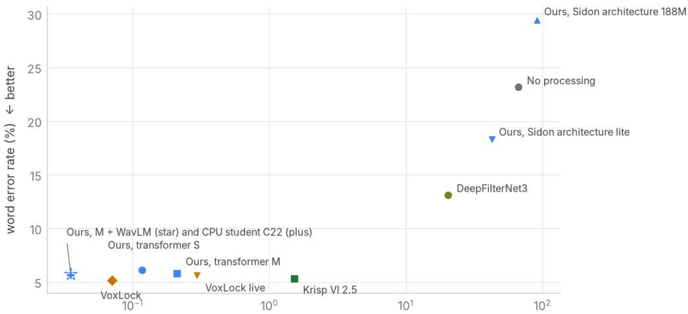  
leaked words per minute of background-only speech (log) ← better  
FIGURE 1 Krisp: word error rate against leaked words per minute of background-only speech, one point per system, our models live. A noise suppressor (DeepFilterNet3) keeps the other voices; isolators remove them.

We train causal isolators for GPU serving, in three sizes, that start with no sample, enroll the caller from the loudest 3 s they have heard, and add no look-ahead to a 20 ms window [Dubey et al., 2024]. The contributions: an open evaluation that reproduces VoxLock’s and adds long meeting windows and real call-centre calls; two failures that short windows hide, forgetting the caller over a long call and damaging a lone caller (much of it a cold start: recordings open mid-sentence, training calls never did), and the training stages that address them; large pre-trained speech encoders made causal and trained inside the isolator, of which WavLM-Large improves both failures at once; ablations of the objective, enrollment, speech, simulation, real crosstalk, model size and resynthesis; a batched GPU server with its stress tests; a 22.1M student of the release for one CPU thread; and a LiveKit plugin for both, measured inside running agents. The models are open at https://huggingface.co/ collections/Scicom-intl/voice-isolator, the plugin at https://github.com/Scicom-AI-Enterprise-Organization/STT-API/tree/main/stt\_api/livekit\_plugin/voice\_isolator.

## 2 Background

Three problems. Noise suppression removes everything that is not speech and keeps every voice [Reddy et al., 2021, Dubey et al., 2024, Schröter et al., 2023]. Target speaker extraction keeps one voice given a clue about it, usually an enrollment clip [Zmolikova et al., 2023, Wang et al., 2019, Žmolíková et al., 2019, Xu et al., 2020, Ge et al., 2020, Zeng and Li, 2025, Zhang et al., 2025]. Primary-speaker isolation keeps whoever is on the microphone; nearness alone is a weak cue [Dubey et al., 2024, Patterson et al., 2022, Pärnamaa and Saabas, 2024], so VoxLock cuts an enrollment from the call.

Two failures for a recogniser. Over-suppression deletes the caller’s words [Wang et al., 2020, Iwamoto et al., 2022, 2024, Sato et al., 2021]; leakage inserts other people’s [Dubey et al., 2024, Microsoft Research, 2022]. We report word error rate with its parts, as VoxLock does: missed words (substitutions and deletions), inserted words, and leaked words, recognised words whose midpoint falls where only the background talks, per minute of that time.

Real recordings. Simulated mixtures overstate extraction on real conversations [Li et al.,

2025, Wang et al., 2026]. Krisp records the second voice for real and labels who talks when [Krisp Engineering Team, 2026]; AMI and NOTSOFAR give every meeting participant a head-worn microphone that also hears the others [Carletta et al., 2006, Vinnikov et al., 2024, Microsoft, 2024]. Intervals resample speakers, not files [Bisani and Ney, 2004, Liu and Peng, 2020].

Latency. An overlap-add STFT model holds each sample for its window plus any look-ahead [Wang et al., 2023]; the 2023 DNS challenge caps the sum at 20 ms [Microsoft Research, 2022, Dubey et al., 2024]. VoxLock’s is 24 ms, DeepFilterNet3’s 40 ms [Schröter et al., 2023]. On GPUs a call also waits for its chunk and for the batched step.

## 3 Data

Every training example is a call simulated on the fly from clean speech (Figure 2). The target is the person on the microphone alone, through the same room position, device and band as the mixture: the model never has to invent bandwidth, and never has to keep anyone else.

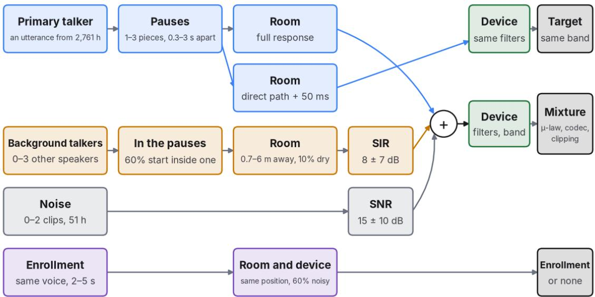  
FIGURE 2 How a training example is made. Blue: the primary talker; amber: synthetic crosstalk; grey: noise; purple: the enrollment. The device filters and band limit act on mixture and target alike; µ-law, codecs and clipping on the mixture only. Every probability is in Appendix C.

## 3.1 SPEECH, NOISE AND ROOMS

The speech is the 2,761 h clean pool of our restoration work (Figure 3), in 131 Common Voice languages and more; 423 h of it is English. Speakers are split 199 to 1 into training and development. Noise is 51.3 h from five corpora [Snyder et al., 2015, Fonseca et al., 2022, Gemmeke et al., 2017, Thiemann et al., 2013, Piczak, 2015] (Figure 4).

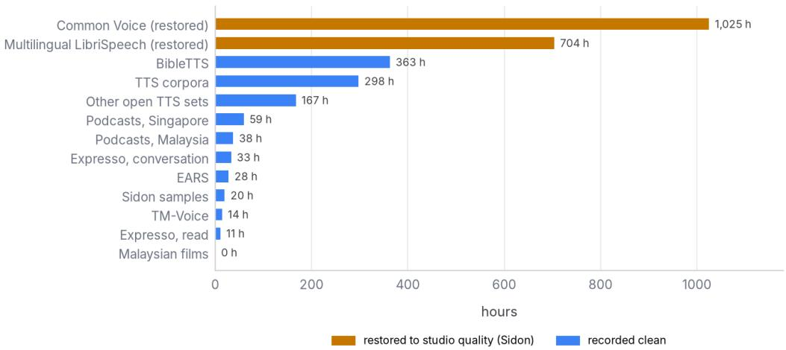  
FIGURE 3 Training speech by source. Common Voice [Ardila et al., 2020] and Multilingual LibriSpeech [Pratap et al., 2020] are restored to studio quality with Sidon [Nakata et al., 2025]; the rest is recorded clean.

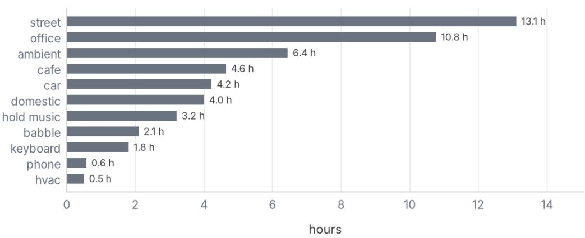  
FIGURE 4 Noise by kind. One clip in 20 is held out for development and tests.

Rooms are 20,000 shoebox rooms simulated with the image method [Allen and Berkley, 1979, Scheibler et al., 2018], each with one microphone and four talker positions (Figures 5 and 6); the last 1,000 are held out.

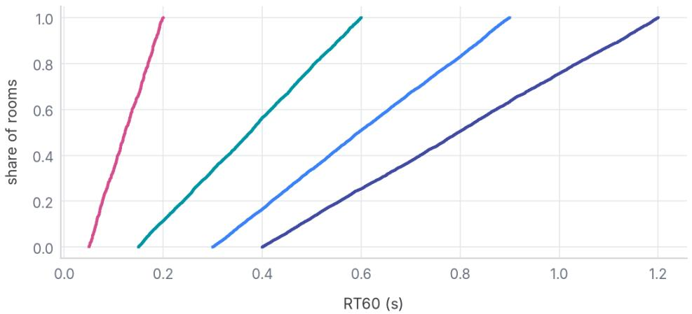  
car cabin (651)  small room (4,501)  meeting room (7,669)  open-plan floor (7,179)

FIGURE 5 Reverberation time of the simulated rooms, by type. Car cabins are 3.3% of rooms: talker placement fails more often in a cabin and the room is redrawn.  
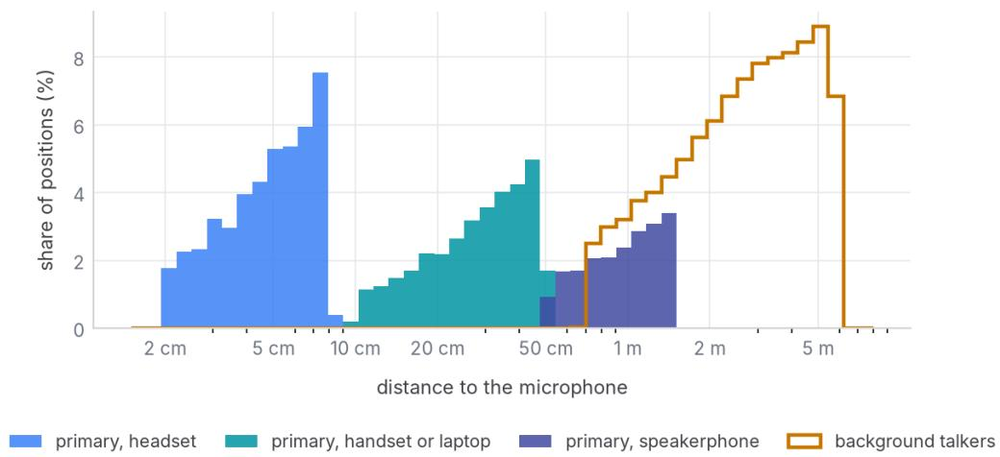  
FIGURE 6 Distance from each talker to the microphone. The primary sits at a headset, a handset or a speakerphone; the background talkers are further away, but not always (a tenth of them are rendered dry, as close as the primary).

## 3.2 SYNTHETIC CROSSTALK, NOISE AND THE LINE

Figure 7 builds one call step by step. The primary’s speech is cut into pieces with pauses; up to three background talkers are added, most of them inside those pauses, so that 71% of examples contain more than half a second where only someone else talks; up to two noises follow; then the device and the line. Figures 8 and 9 show what the simulator draws over 3,000 examples.

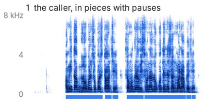

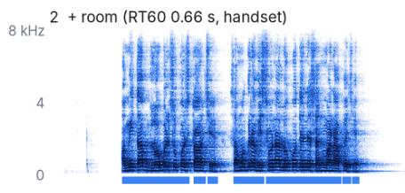

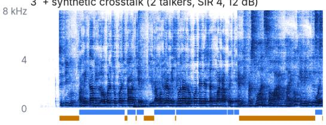  
5 + phone line (8 kHz, mu-law, GSM)

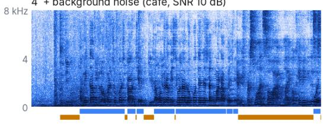  
6 target: direct path + 50 ms, same band

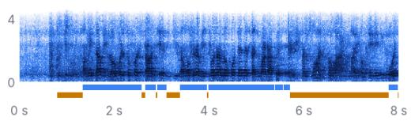

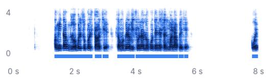  
FIGURE 7 One simulated call, 8 s, built step by step; panels 2 to 5 add one stage each to the one before, panel 6 is what the model is asked to output. Bars under a spectrogram: blue where the primary talks, amber where only a background talker does (where a leaked word would count). Held-out speakers, noise and room; same colour scale throughout.

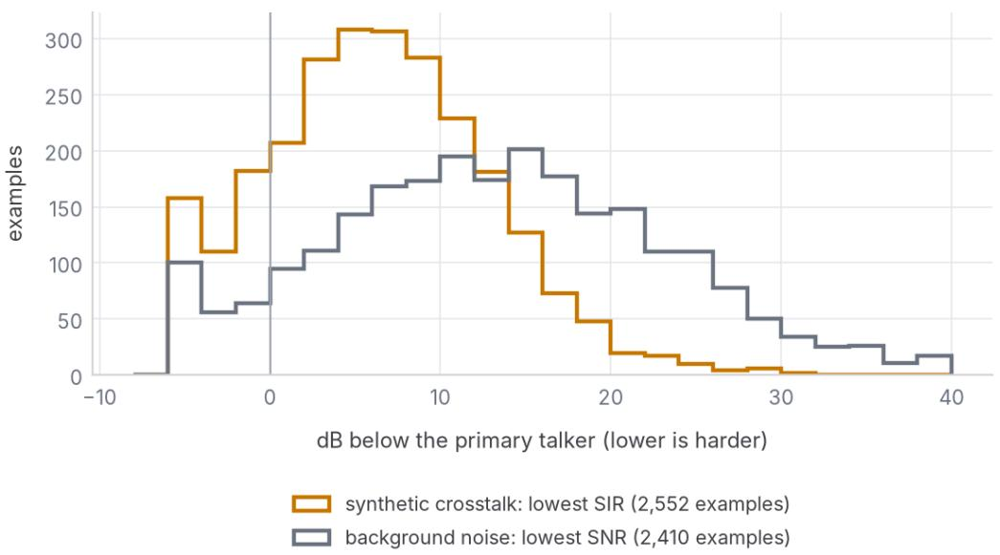  
FIGURE 8 How hard the simulator makes it: the lowest signal-to-interference ratio among an example’s background talkers, and the lowest signal-to-noise ratio among its noises, both relative to the primary talker.

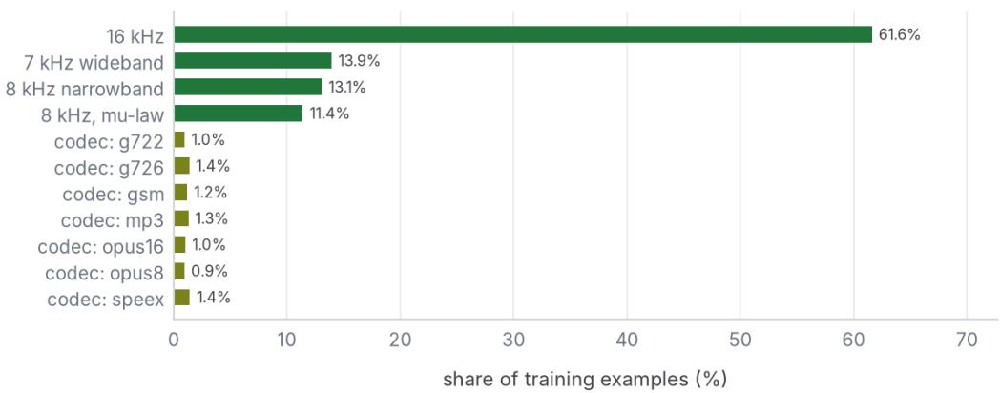  
FIGURE 9 The line: band limits (green) and real codecs run through ffmpeg on the mixture (olive). G.723.1 and Codec2 are kept out of training for testing.

Seven examples in ten also carry an enrollment: 2 to 5 s of the same voice through the same position and device, noisy in 60% of cases. The rest carry none, so the same model also learns to find the primary from the audio alone.

## 3.3 LONG CALLS

Six-second examples teach separation, not memory: the caller is never silent for more than 3 s, so nothing teaches the model to keep suppressing a voice that goes on talking. The long-call stage uses 24 s calls; in six of ten the caller talks in turns and one background voice takes most of the pauses between them (Figure 10), so the caller comes back after the other voice has talked alone, 4.5 s per call in stretches over 8 s against 0.0 s before.

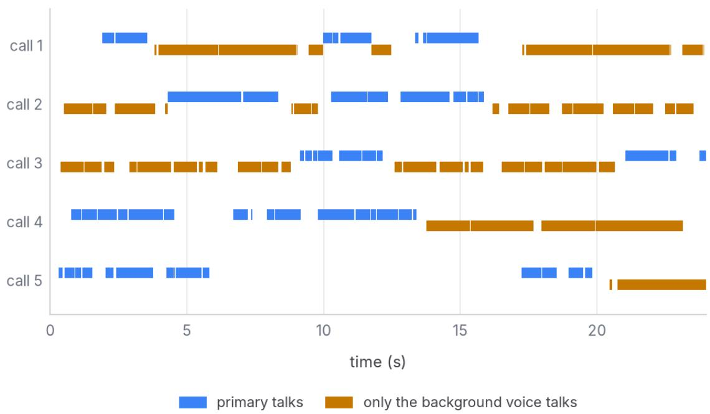  
FIGURE 10 Five simulated calls of the long-call stage (development speakers). Blue: the caller talks; amber: only the background voice does. The caller often comes back after the other voice has talked alone for several seconds.

## 3.4 REAL CALLERS

Four changes come from real callers (Section 6.4): the mixture level spans −65 to −10 dBFS (below −45 dBFS every model removed most of the caller); in half the long calls the caller’s level drifts, by gains drawn every 1 to 4 s with a 4 dB spread; a third of the long calls have nobody else at all; and, in the release’s long-call stage, three examples in ten are cut out of a call 0.5 to 3 s longer, so whoever talks at the cut is already talking at the first sample.

## 3.5 REAL CROSSTALK

From each AMI, NOTSOFAR and AliMeeting wearer’s channel [Carletta et al., 2006, Vinnikov et al., 2024, Yu et al., 2022], a window where nobody else speaks is an exact target and a window where only others speak is real crosstalk at its natural level. Only meetings outside every evaluation set are used: 362 meetings, 620 h.

## 3.6 EVALUATION SETS

Table 1 lists the sets; only the development ones choose a model. Krisp and VoxLock’s AMI windows (a wearer’s turn and the 4 s after it) follow VoxLock [Krisp Engineering Team, 2026, Siddiqui, 2026], and we build the same windows on more AMI meetings, NOTSOFAR and AliMeeting (Mandarin, scored by characters).

TABLE 1 Evaluation sets. Callers: distinct people on the microphone, the unit the bootstrap resamples. Bg-only min: minutes in which only someone else speaks, where every recognised word is a leaked word.
<table><tr><td>SET</td><td>USE</td><td>ITEMS</td><td>CALLERS</td><td>MINUTES</td><td>REF. WORDS</td><td>BG-ONLY MIN</td><td>ASR</td></tr><tr><td>Krisp VI benchmark</td><td>test</td><td>265</td><td>47</td><td>337.5</td><td>31,418</td><td>85.3</td><td>Parakeet v2</td></tr><tr><td>AMI, VoxLock&#x27;s windows</td><td>test</td><td>134</td><td>19</td><td>25.5</td><td>2,874</td><td>7.5</td><td>Parakeet v3</td></tr><tr><td>AMI, evaluation meetings</td><td>test</td><td>599</td><td>61</td><td>109.1</td><td>11,964</td><td>34.2</td><td>Parakeet v3</td></tr><tr><td>NOTSOFAR, evaluation split</td><td>test</td><td>800</td><td>413</td><td>140.2</td><td>16,747</td><td>47.2</td><td>Parakeet v3</td></tr><tr><td>AMI, 60 s windows, evaluation meetings</td><td>test</td><td>120</td><td>44</td><td>123.8</td><td>8,197</td><td>63.2</td><td>Parakeet v3</td></tr><tr><td>AMI, development meetings</td><td>selection</td><td>400</td><td>65</td><td>67.5</td><td>7,148</td><td>22.4</td><td>Parakeet v3</td></tr><tr><td>AMI, 60 s windows, development meetings</td><td>selection</td><td>120</td><td>50</td><td>122.5</td><td>7,867</td><td>62.0</td><td>Parakeet v3</td></tr><tr><td>Calls, one speaker, development split</td><td>selection</td><td>120</td><td>120</td><td>120.0</td><td>8,050</td><td>0.0</td><td>Parakeet v2</td></tr><tr><td>Calls + another call&#x27;s speaker, development split</td><td>selection</td><td>120</td><td>120</td><td>120.0</td><td>8,050</td><td>4.9</td><td>Parakeet v2</td></tr><tr><td>Calls, one speaker, evaluation split</td><td>test</td><td>120</td><td>120</td><td>120.0</td><td>8,008</td><td>0.0</td><td>Parakeet v2</td></tr><tr><td>Calls + another call&#x27;s speaker, evaluation split</td><td>test</td><td>120</td><td>120</td><td>120.0</td><td>8,008</td><td>19.4</td><td>Parakeet v2</td></tr><tr><td>ai-coustics test calls</td><td>test</td><td>83</td><td>4</td><td>35.5</td><td>2,657</td><td>15.8</td><td>Parakeet v2</td></tr><tr><td>NOTSOFAR, development split</td><td>selection</td><td>400</td><td>156</td><td>68.8</td><td>8,343</td><td>23.5</td><td>Parakeet v3</td></tr><tr><td>Simulated 60 s calls</td><td>analysis</td><td>200</td><td>40</td><td>200.0</td><td>23,643</td><td>10.6</td><td>Parakeet v2</td></tr></table>

Short windows never hold more than 4 s of background-only speech; Krisp’s comes in stretches with a median of 16.9 s (Figure 11). We add 60 s AMI windows that each hold a stretch of at least 8 s where only others talk, followed by the wearer again. Meetings are not calls, so we also add AppTek’s call-centre recordings [Beck et al., 2026], 60 s of one speaker’s channel scored alone (any change is damage to a lone caller, measured against plain recognition) and with another call’s speaker added 0 to 12 dB below; and ai-coustics’ 83 real test calls [Wohlgemuth, 2026], reported only, like Krisp.

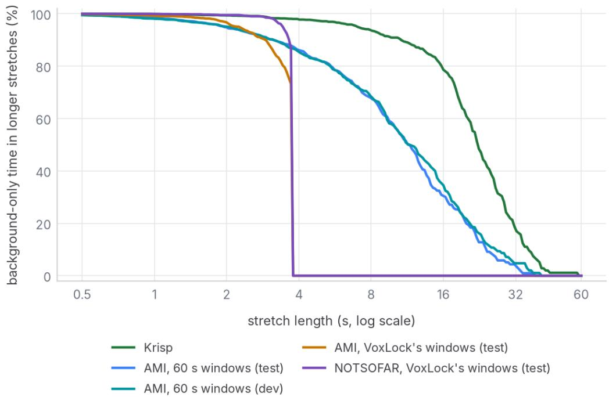  
FIGURE 11 Share of each set’s background-only time in stretches longer than a given length (gaps under 1 s closed). Every VoxLock-style window set stops at 4 s.

## 4 Model

Two kinds of model, both on GPUs: a causal masking transformer in three sizes, our release, and Sidon’s restoration architecture at 16 kHz for comparison.

## 4.1 REALTIME: A CAUSAL TRANSFORMER OVER FRAMES

Each 20 ms frame (10 ms hop) is split into 32 bands [Luo and Yu, 2023, Yu et al., 2023], encoded with attention across bands and a small LSTM along time in each band, and folded into one token (Figure 12). A causal transformer sees the last 10 s of tokens, with one LSTM over the tokens after its middle layer; a band decoder predicts a complex mask. The sizes differ only in width (Table 2).

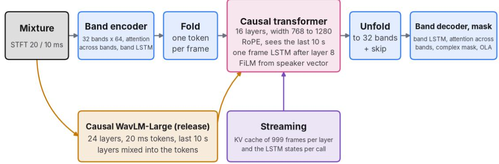  
FIGURE 12 The realtime model. One token per 10 ms frame; the speaker vector enters every layer through FiLM. The release adds a causal WavLM-Large whose layers are mixed into the tokens.

The release adds WavLM-Large [Chen et al., 2022], pre-trained on 94k hours with overlapped speech, keeping its weights and changing only what causality needs: the waveform is divided by its running level instead of the utterance’s, the positional convolution keeps its 65 taps on the frame and the past (it looked 1.28 s ahead), and attention is causal over the last 10 s, keeping the gated relative position bias. Its 20 ms frames arrive one tick behind the tokens: token t reads WavLM frame ⌊t/2⌋ − 1, the last one complete, so no latency is added. A learned mix of its 25 layers, each normalised, is projected and added to the tokens through a gate that starts at zero, so the model starts as it was. w2v-BERT 2.0 [Seamless Communication et al., 2023] and Whisper large-v3’s encoder [Radford et al., 2023] were made causal the same way for comparison: a running normalisation of the filterbank, and for Whisper the floor under the running maximum of the log-mel and positions taken modulo 30 s.

TABLE 2 The models. GMAC: multiply-accumulates per second of audio. State: what one live call keeps on the GPU between frames.
<table><tr><td>MODEL</td><td>KIND</td><td>SHAPE</td><td>PARAMS (M)</td><td>GMAC / S</td><td>STATE / CALL</td></tr><tr><td>Transformer S</td><td>realtime, 20 ms</td><td>16 layers, width 768</td><td>140</td><td>17.4</td><td>49.2 MB</td></tr><tr><td>Transformer M</td><td>realtime, 20 ms</td><td>16 layers, width 1024</td><td>243</td><td>28.5</td><td>65.6 MB</td></tr><tr><td>Transformer L</td><td>realtime, 20 ms</td><td>16 layers, width 1280</td><td>374</td><td>42.5</td><td>82.0 MB</td></tr><tr><td>S + WavLM</td><td>realtime, 20 ms</td><td>16 layers, width 768 + WavLM 24 layers</td><td>452</td><td>36.5</td><td>98.7 MB</td></tr><tr><td>M + WavLM (release)</td><td>) realtime, 20 ms</td><td>16 layers, width 1024 + WavLM 24 layers</td><td>555</td><td>47.7</td><td>115.1 MB</td></tr><tr><td>L + WavLM</td><td>realtime, 20 ms</td><td>16 layers, width 1280 + WavLM 24 layers</td><td>687</td><td>61.6</td><td>131.5 MB</td></tr><tr><td>Sidon-arch. 188M</td><td>offline, 4 s windows</td><td>w2v-BERT 2.0 + LoRA, 3072 ch</td><td>580 + 187</td><td>139</td><td>-</td></tr><tr><td>Sidon-arch. lite</td><td>offline, 4 s windows</td><td>DistilHuBERT 2L + head, 1536 ch</td><td>37 + 52</td><td>32</td><td>一</td></tr></table>

## 4.2 ENROLLMENT AND SELF-ENROLLMENT

A speaker vector enters every layer through FiLM [Perez et al., 2018]: a clip of the caller through a small encoder (0.87M parameters), or a learned null vector. Live, a call starts with the null vector and from 3 s in enrolls the loudest 3 s it has heard, fixed once the call is 15 s old: VoxLock’s sample rule without its look-ahead [Siddiqui, 2026].

## 4.3 OFFLINE: SIDON’S ARCHITECTURE AT 16 KHZ

A feature predictor maps the call to the w2v-BERT 2.0 features [Seamless Communication et al., 2023] of the caller alone, and a DAC decoder [Kumar et al., 2023] resynthesises them (Figure 13). We keep CallEnhancer’s two sizes, trained with Sidon’s own scripts on our calls and ending at 16 kHz.

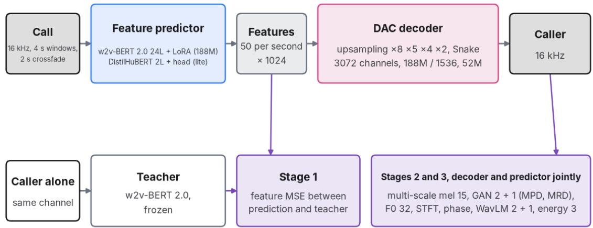  
FIGURE 13 The Sidon-architecture models: inference in 4 s windows (top) and the two training signals (bottom).

## 4.4 TRAINING

The transformer minimises the negative signal-to-noise ratio [Wisdom et al., 2020], a multiresolution spectral distance [Wilson et al., 2018, Braun and Tashev, 2021] and the output energy where the caller is silent [Wisdom et al., 2021], in three stages (Figure 14); the WavLM branch joins at the second, and every choice was made on the development sets.

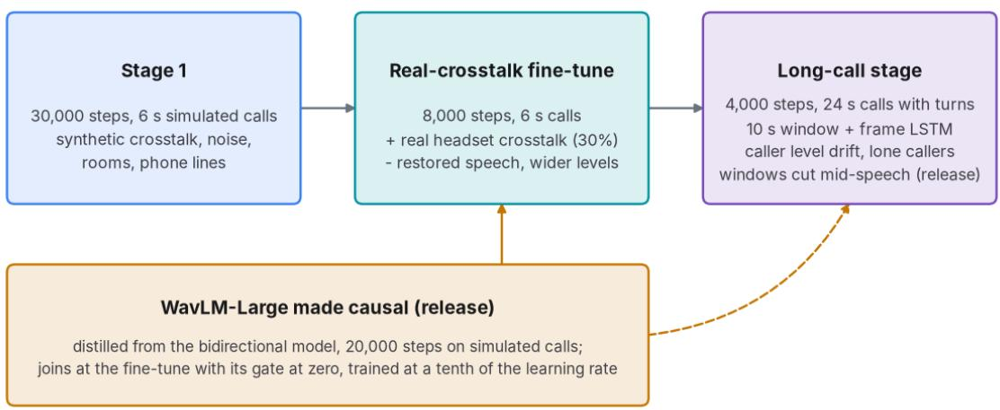  
FIGURE 14 The release recipe. AdamW, cosine schedules, bfloat16, weights averaged (0.999). The long-call stage widens the attention window and adds the frame LSTM with its output at zero, so it starts as the model before it.

## 5 Evaluation

We run every open system ourselves on the same 16 kHz files: VoxLock 1.1.1 with its published protocol (the loudest 3 s of the first 15 s, which looks ahead) and in its live mode, its PyTorch script, DeepFilterNet3 [Schröter et al., 2023], and Krisp VI 2.5 through the outputs Krisp published [Krisp Engineering Team, 2026]. Our models run live (the loudest 3 s so far), with VoxLock’s look-ahead sample, with no enrollment, or with an oracle clip. Krisp, the call

sets and ai-coustics’ calls are scored with Parakeet TDT 0.6B v2 and Krisp’s normaliser, the meetings with Parakeet v3 and AliMeeting with Whisper large-v3 [NVIDIA, 2025a,b, Vaessen, 2025, Zhang et al., 2021]; intervals come from 2,000 resamples of callers.

## 6 Results

## 6.1 REPRODUCING THE BASELINES

Our evaluation reproduces VoxLock’s. Unprocessed Krisp scores 23.19% (VoxLock’s table: 23.21%), 262 of the 265 files give identical error counts, and Krisp’s published outputs reproduce VoxLock’s rows exactly (VI 2.5 Default: 5.30%, published 5.30%). VoxLock’s PyTorch script gives 4.99% on Krisp and 10.26% on its AMI windows (published: 4.95% and 10.12%); its streaming ONNX package does worse (5.19% and 11.26%). We show both.

## 6.2 AGAINST EXISTING SYSTEMS

Figure 15 compares the release with VoxLock, live against live; every system on every test set is in Appendix A. We make fewer errors on every meeting and call set with a second voice (on VoxLock’s own AMI windows the interval over callers still reaches past zero), are level on Krisp, and lose only where the caller is alone: 5.58% against 2.92% on clean calls, where the model before the window cut of Section 6.4 made 7.27%. On Krisp and the meeting sets the window cut adds at most 0.22 points, on each within the interval over callers. Without WavLM, M also lost on AliMeeting, where the loudest 3 s is often someone else (18.57% of the characters wrong against 16.28%); with it, 15.69%.

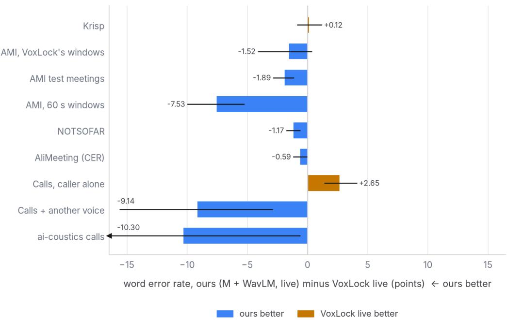  
FIGURE 15 Every test set: word error rate of the release (M + WavLM), live, minus VoxLock live, with a 95% interval over callers (an arrow: the interval runs past the axis). Left of zero, we make fewer errors. AliMeeting: character error rate. Calls, caller alone: change against plain recognition.

## 6.3 LONG CALLS

A windowed transformer forgets the caller: once another voice has talked alone for a few seconds, it lets that voice through, and VoxLock, a recurrent network, does not (Figure 16).

Only long windows show it (Figure 11). Calls of 24 s with turns, a 10 s window and one frame LSTM fix most of it (Figure 17).

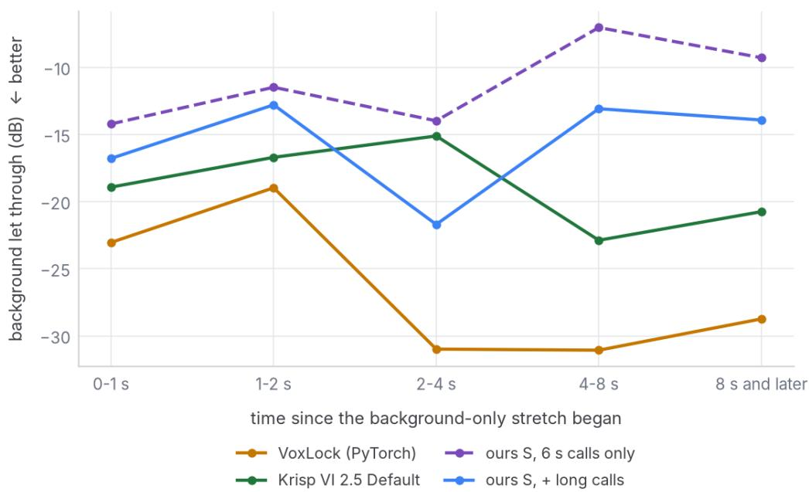  
FIGURE 16 Krisp: background let through, by how long the background-only stretch has lasted, relative to each system’s gain while the caller talks. Our S before and after the long-call stage; Krisp is never used to choose.

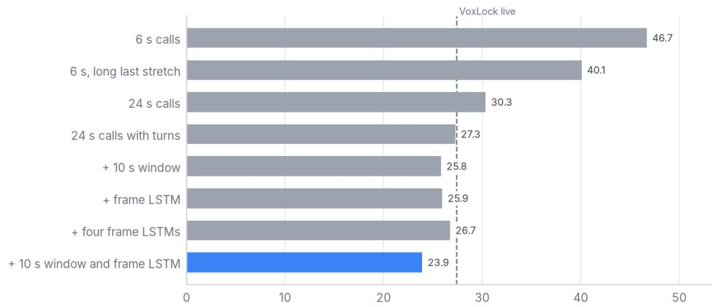  
word error rate on the 60 s AMI development windows (%)← better  
FIGURE 17 The long-call stage, S, 4,000 steps from one checkpoint, one change per bar. Short examples that end with the other voice alone (second bar) also cut the caller when they come back.

## 6.4 A LONE CALLER

The stage that teaches the model to keep suppressing a lone voice also teaches it to doubt a lone caller. Figure 18 follows S through the stages: the real-crosstalk fine-tune leaves a lone caller almost untouched, the long-call stage costs it again, and a drifting caller level with more single-talker calls pays part of it back. Figure 19 places every variant on this trade; the release recipe is the best compromise on the four development sets together (dev-4: 11.44% for M, 11.91% for VoxLock). WavLM inside the model is the first change that moves both at

meetings (mean of three dev sets)lone caller (clean calls)

once (the stars). A perceptual loss on the caller’s frames gives a further operating point without it: M then keeps a lone caller almost as VoxLock does (3.43%) and scores 5.10% on Krisp, below VoxLock live’s 5.63%, at the cost of the meetings (15.49%).

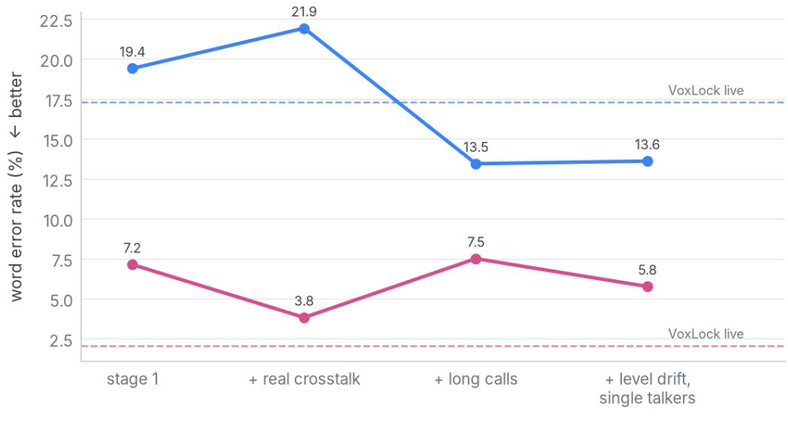  
FIGURE 18 S through the training stages, live enrollment: the three meeting development sets (mean) and clean real calls, where any change is damage to a lone caller. Dashed: VoxLock live.

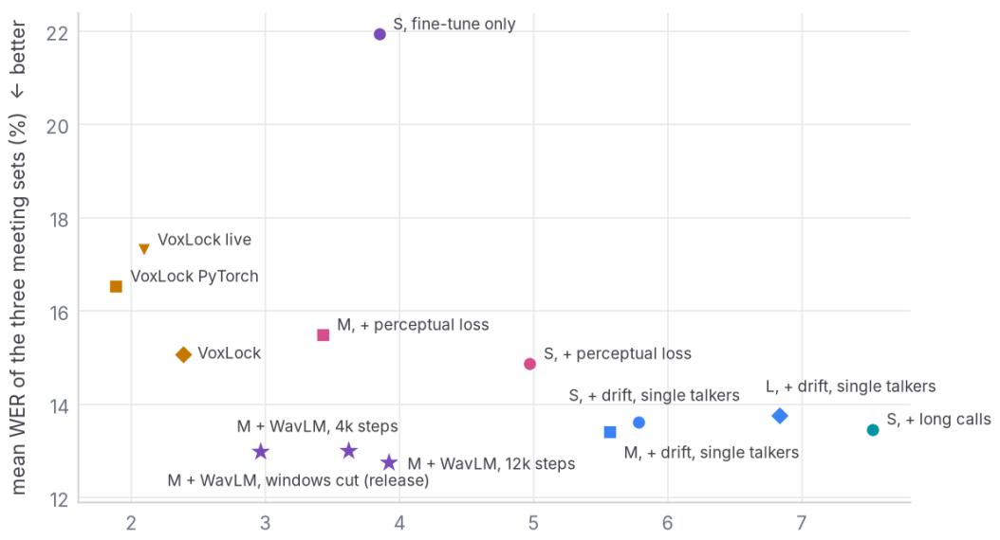  
WER on clean real calls, against plain ASR (%) ← better  
FIGURE 19 Development sets, every system live. Down: less of the other voices in meetings. Left: less damage to a lone real caller. Stars: M with WavLM inside.

The clean calls are one side of a recorded call-centre line, and the line carries nothing between the caller’s turns: 51% of their 10 ms frames are digital silence, with 1.8 silences of 3 s or more per minute (Krisp 0.1, the AMI windows 0.0). No simulated call has such a stretch: every pause we simulate carries noise or room tone. M + WavLM as trained so far loses the caller in two places (Figure 20); the change that ends this section, now in the release, fixes the first. At the start it removes 23% of the caller’s first 3 s of speech, where VoxLock live passes the call through until it has enrolled. When the caller comes back after a silence it removes 11%, at times for several seconds (Figure 21). Elsewhere it is close to VoxLock. We first saw this on the test calls; the numbers here are from the development calls, and what follows was chosen on dev-4 alone.

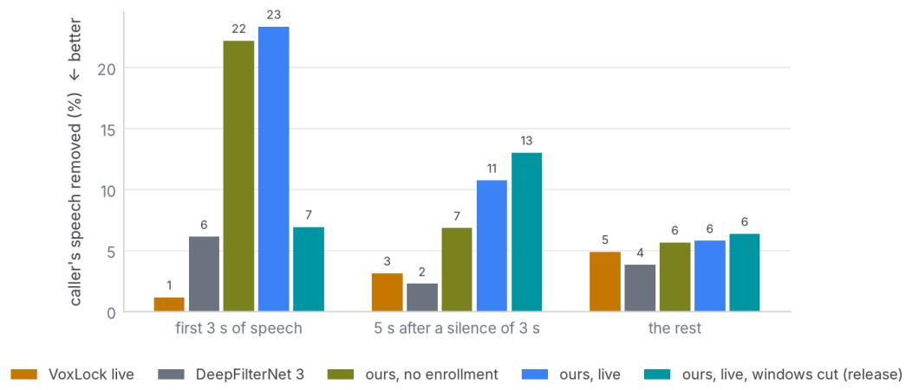  
FIGURE 20 Development calls with the caller alone: share of the caller’s speech removed (output 20 dB or more under the input), in the first 3 s of speech, in the 5 s after a silence of 3 s or more, and elsewhere. Ours before the window cut, and the release.

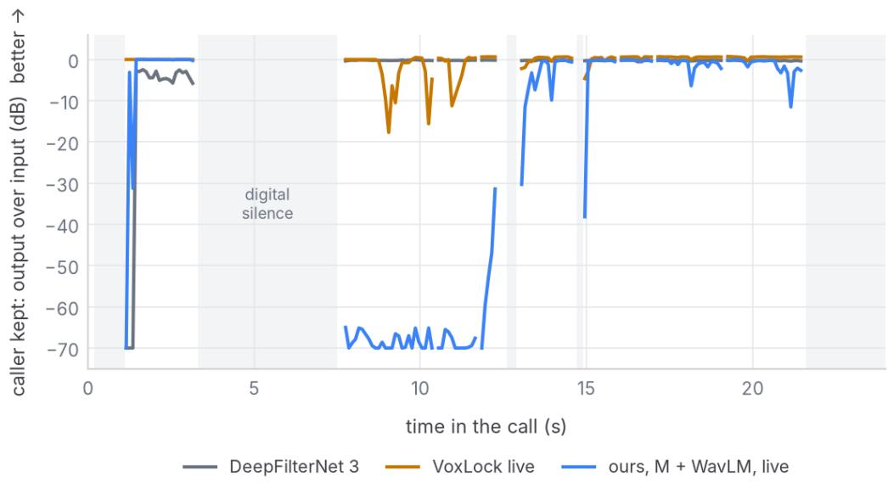  
FIGURE 21 One development call, the caller alone: how much of the caller each system keeps, per 100 ms of speech. After a stretch of digital silence (grey) the release removes the returning caller for several seconds, as the model before the window cut does.

The start is not a matter of enrollment. Given the caller’s voice from the first frame (the loudest 3 s, as VoxLock’s benchmark enrolls), the model still removes 17% of it (VoxLock 8%). It is a cold start (Figure 22). In the 55 of 120 development calls whose window opens with the caller already talking, it removes 38% of the first 3 s; in the 53 where the caller starts after 2 s, 6%. No training example has anyone talking at its first sample: every simulated voice starts with its onset, after the example does. A voice that is there from the first frame is something the model never saw, and it takes it out.

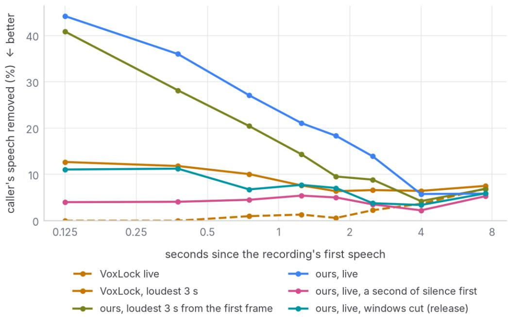  
FIGURE 22 Development calls with the caller alone: share of the caller’s speech removed against the time since the recording’s first speech (bins, plotted at their middle). M + WavLM from a cold start, with the caller’s enrollment from the first frame, and after a second of digital silence; the release, trained on windows cut from longer calls.

We tried rules at inference first, then changes to training (Figure 23; Figure 24 shows where each keeps the caller, and Appendix A lists them all). A second of digital silence before each call, its output dropped and its state computed once per server, saves the start (4% of it lost instead of 23%), but the cold start had also removed the other speakers who open some meeting windows: with the silence first they stay, and dev-4 rises, so we do not adopt it. Passing the input through until the enrollment exists, as VoxLock live does, lets the meetings’ other voices through as well, and mixing the input back in lets every voice back: the recogniser transcribes a voice 30 dB down (AMI 60 s windows 82.13% against 17.59%). Enrolling from the first second barely moves the start; its small gain in dev-4 lies within the interval over callers and is gone after the window cut (10.52% against 10.49%). Skipping the line’s digital silence helps the return but starts every call cold, and teaching the line in training (the caller’s pauses turned into digital silence) helps the clean calls but not dev-4. What the model removes is the caller, by a speaker-verification model’s account, its soft speech no more often than its loud: it loses the caller in the two states it never trained in, a voice there from the first frame and a voice after seconds of exact zeros.

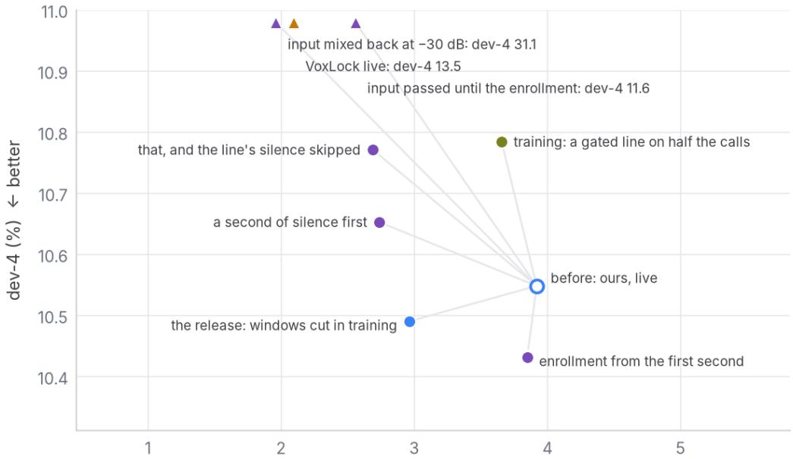  
word error rate, clean development calls, the caller alone (%) ← better

FIGURE 23 Every fix tried for the lone caller, from M + WavLM before the window cut: rules at inference and changes to training, word error rate on the clean development calls against dev-4. Fixes whose dev-4 lies above the axis sit on its top edge with their dev-4.  
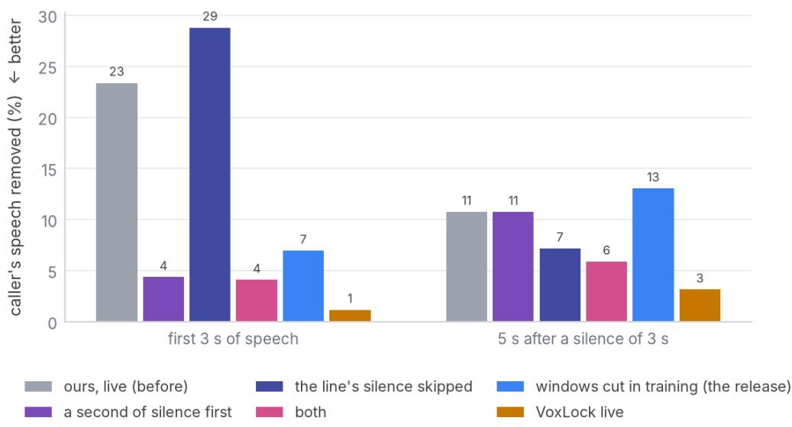  
FIGURE 24 Where each fix keeps the lone caller: share of the caller’s speech removed in the first 3 s of speech and in the 5 s after a silence of 3 s, development calls.

Teaching the start does. In three of ten long-call examples we cut the example out of a call 0.5 to 3 s longer, so whoever talks at the cut, usually the caller, is already talking at its first sample. In two seeds at S and at M the window cut lowers the error on the clean calls and dev-4, and raises the 60 s meeting windows by about as much as two runs of one recipe lie apart there (Figure 25). At S the windows that open mid-speech lose 4% of their first 3 s instead of 33%. With the lowest dev-4 of any M we trained, M with the window cut is the release. On the test calls, which chose nothing, its start loses 7% of the caller instead of 23%, and the error falls from 7.27% to 5.58% (VoxLock live 2.92%); what remains is spread over the call (Figure 20). A gated line and fewer pauses held by another voice, each on top of the window cut, lower the clean calls further but cost the 60 s windows and dev-4: the trade of Section 6.3 once more, and the release stays as it is.

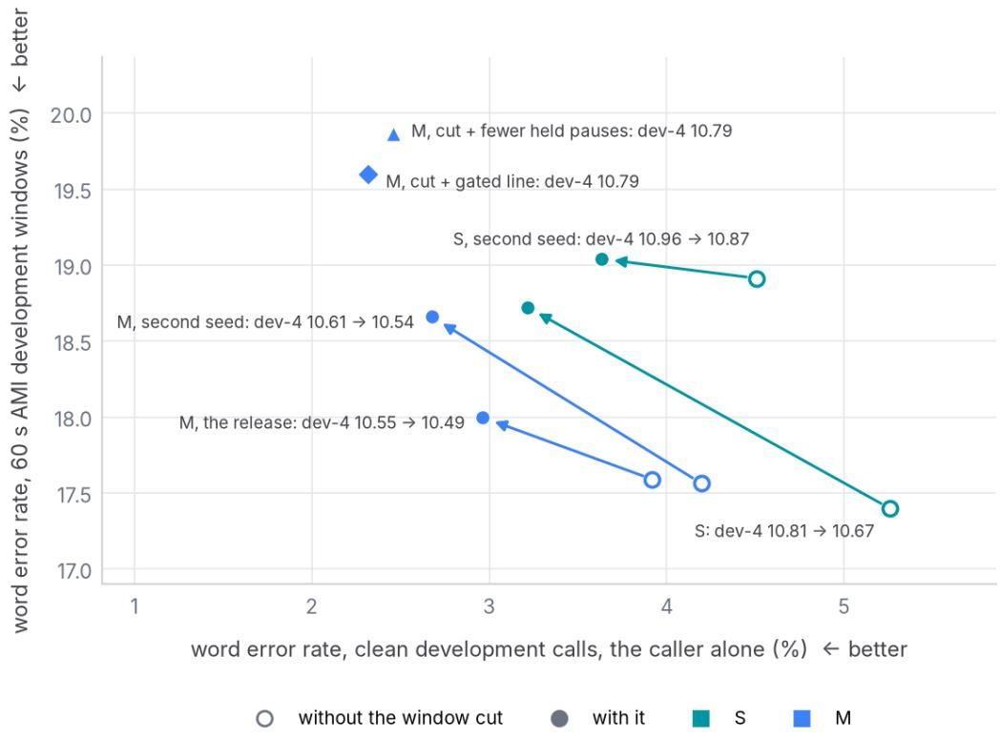  
FIGURE 25 The window cut in the long-call stage, two seeds at S and at M: word error rate on the clean development calls against the 60 s AMI development windows, an arrow from each run without the cut to the same seed with ${ \mathrm { i t } } ,$ and two more changes on top of the cut at M. Labels: dev-4 without and with the cut.

## 6.5 ABLATIONS

Figure 26 changes one thing at a time in stage 1 of S. Synthetic crosstalk, noise and rooms matter most; the signal-to-noise loss alone lets crosstalk through; English-only speech, leaving out the restored speech and real crosstalk each help, and the last two entered the release recipe. Without the enrollment branch the short windows look fine and Krisp’s long calls leak 19.03 words per minute, against 5.88.

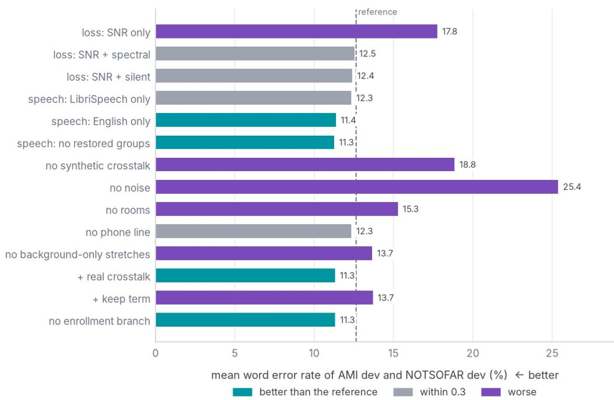  
FIGURE 26 Stage 1 of S, 30,000 steps, one change per bar: mean word error rate of AMI dev and NOTSOFAR dev. These short windows cannot see long calls or a lone caller.

## 6.6 ENROLLMENT

The loudest 3 s heard so far beats enrolling from the model’s own output; no enrollment at all is kinder to a lone caller and worse on long meetings (Figure 27).

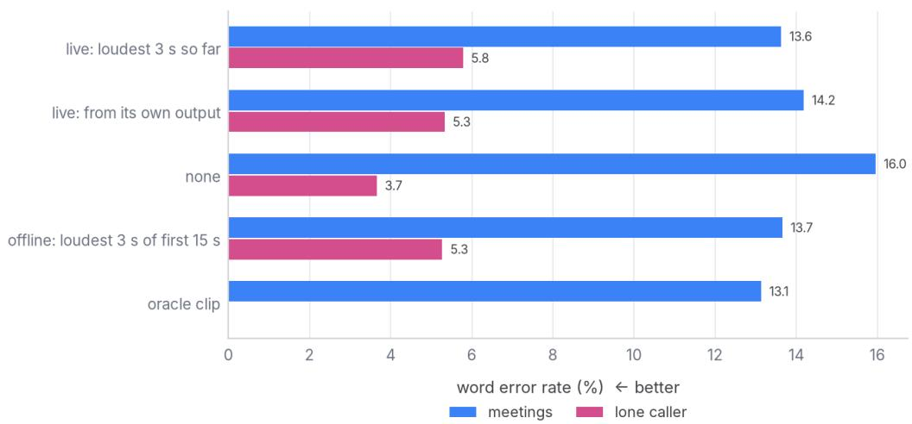  
FIGURE 27 Enrollment modes of the S release candidate: meetings (mean of three development sets) and a lone caller (clean calls). Only the live modes can run in a call.

## 6.7 MODEL SIZE

M beats S, and L does not beat M, even with a gentler long-call stage, with WavLM inside or without it (Figure 28): dev-4 11.67, 11.44 and 12.04% alone, 10.81, 10.55 and 10.66% with it (all before the window cut of Section 6.4, which only the release has). WavLM is worth more than any width: S with it beats every size without it.

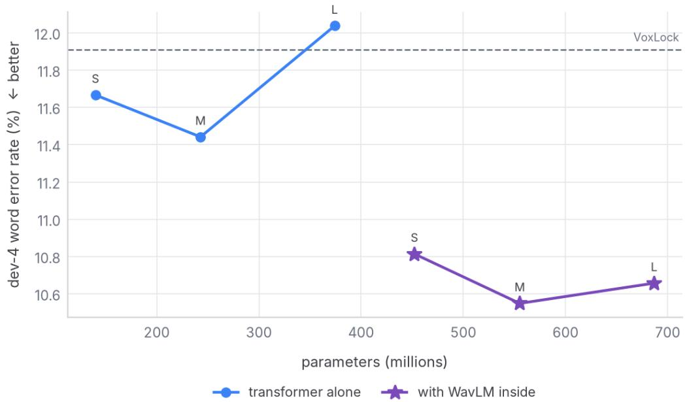  
FIGURE 28 Dev-4 (live enrollment) against parameters: S, M and L with the release recipe, alone and with WavLM inside. Dashed: VoxLock.

## 6.8 SELF-SUPERVISED SPEECH MODELS

Used only through its outputs, WavLM did not help: as a training-time teacher it kept more of the caller and let more crosstalk through, as the speaker encoder it was worse, and a 331M causal student trained from scratch to imitate it, added beside the model, did not improve the development sets (dev-4 12.00% for M with it, 11.44% without). That student learns WavLM’s outputs on our simulated calls, not what WavLM learned from its 94k hours. Keeping WavLM’s own weights and only making them causal (Section 4) leaves it far from the original at first (cosine 0.59 to its layer 16); distilled from the original, it passes the scratch student within a thousand steps and ends at 0.81 (Figure 29).

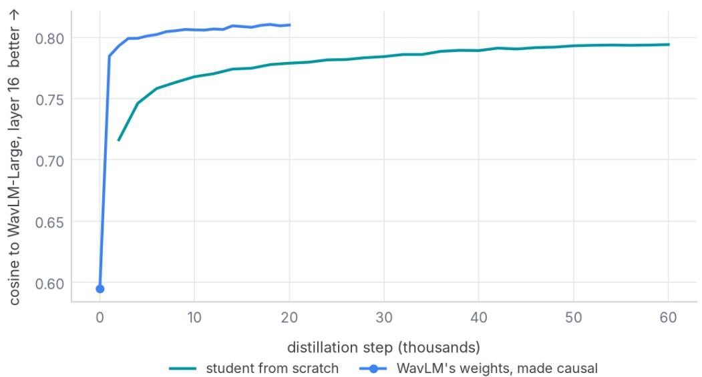  
FIGURE 29 How close a causal encoder gets to WavLM-Large (cosine to its layer 16, held-out simulated calls) during distillation: a student from scratch, and WavLM’s own weights made causal (the dot: before any training).

Inside the model, trained at a tenth of the learning rate, WavLM lowers dev-4 from 11.44% to 10.67% after the long-call stage alone and to 10.55% when it joins at the real-crosstalk fine-tune (Figure 30; before the window cut): meetings 12.76% against 13.40%, a lone caller 3.92% against 5.57%. Distilling first matters little once the encoder trains with the model, and a frozen one helps less. More pre-training data is not what helps: w2v-BERT 2.0 (4.5M hours, 143 languages) reaches 11.35% and Whisper’s encoder (5M hours) 11.74% with the same recipe. WavLM was pre-trained to describe the main speaker of overlapped speech, the nearest task to ours.

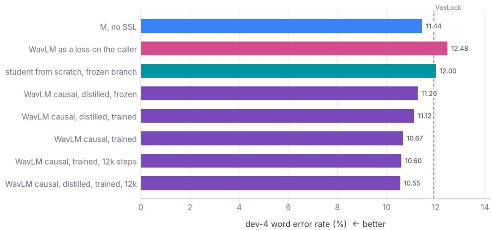  
FIGURE 30 Dev-4 of M with each use of WavLM, live enrollment (the selection criterion: three meeting sets and clean calls). Dashed: VoxLock.

Scaling the encoder does not replace that pre-training task (Figure 31). HuBERT-Large, WavLM’s size and family without overlapped speech, makes M worse (dev-4 11.69%), and three times its size helps little (HuBERT-XLarge, 11.62%). XLS-R 1B, pre-trained on 436k hours in 128 languages, comes closest (10.82%) at three times WavLM’s cost; w2v-BERT 2.0 and Whisper’s encoder stay near M without an encoder even with three times the training (11.40% and 11.24%).

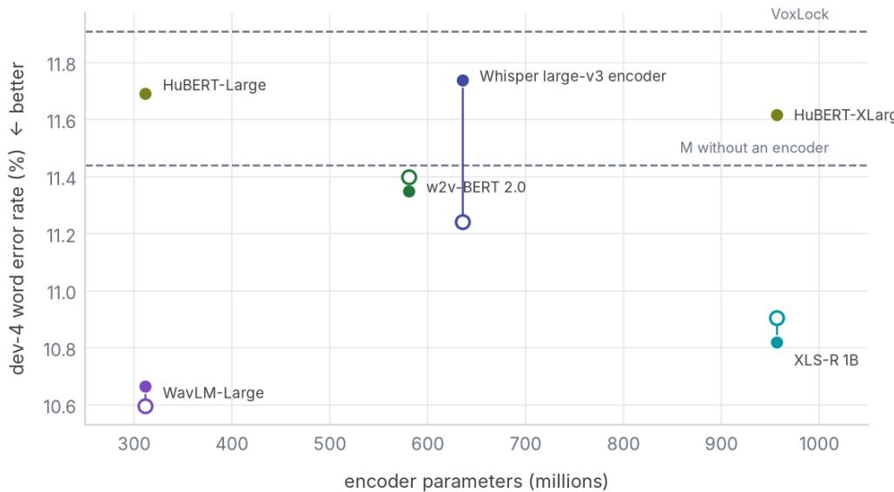  
C 4k steps with the model 12k steps (from the fine-tune stage on)  
FIGURE 31 Dev-4 of M with each pre-trained encoder made causal and trained with the model, against the encoder’s size. Filled: the long-call stage only (4k steps); open: from the real-crosstalk fine-tune on (12k steps).

## 6.9 MASKING OR RESYNTHESIS

The Sidon-architecture models resynthesise self-supervised features, and the features of a mixture carry everyone: they keep every voice (Figure 32).

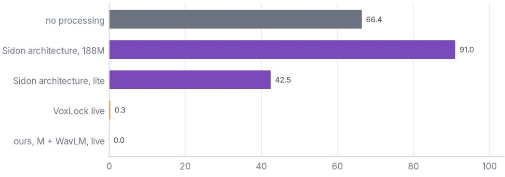  
leaked words per minute of background-only speech, Krisp ← better  
FIGURE 32 Krisp: leaked words per minute of background-only speech. The Sidon-architecture models are trained on the same calls as ours.

## 6.10 CONTROLLED CONDITIONS

On simulated stress sets built from held-out speakers, rooms and noises, M is ahead of VoxLock under noise, on narrow or unseen phone lines, with a distant caller and on long calls, and slightly behind when the background talker is as loud as the caller or louder (Figure 33).

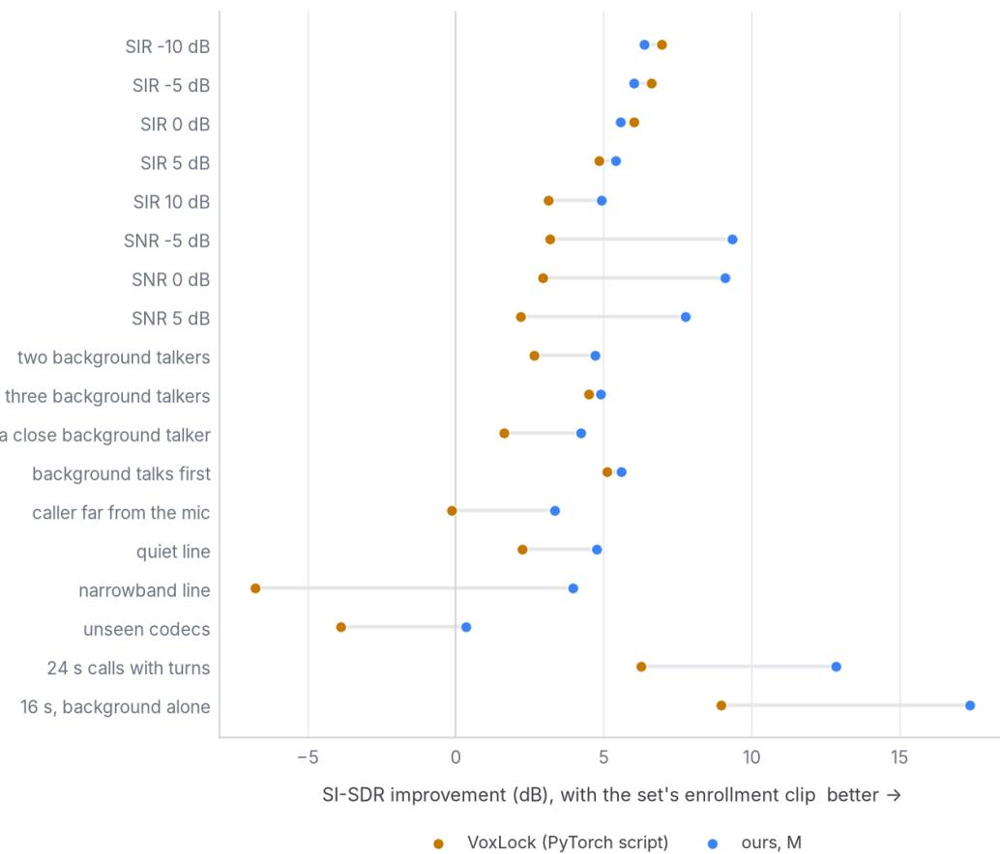  
FIGURE 33 Simulated stress sets: SI-SDR improvement of our M and VoxLock’s PyTorch script, both given the set’s enrollment clip. Scale-invariant, so output gain does not matter.

## 7 Serving

One GPU serves many calls (Figure 34). Each call keeps its state in a bank: the key-value cache of the last 999 frames in every layer, kept as a ring with keys rotated by their absolute frame, the LSTM states and the speaker vector, 82 MB for L. Every 20 ms one step, captured as a CUDA graph per batch size, runs the network for every call with a chunk, in half precision, with the LSTMs and their states kept in single precision (their cell state sums a whole call); on real calls it agrees with the offline model to 70 dB. The release’s WavLM branch keeps a bank of its own in the same step: its input history, running level, positionalconvolution history, a key-value ring per layer and a frame counter per call, which marks the frame a call’s first chunk cannot complete, so the step needs no branch. It moves in 20 ms frames, so chunks are multiples of 20 ms; a call then keeps 115 MB, and the step agrees with the offline release to 69 dB.

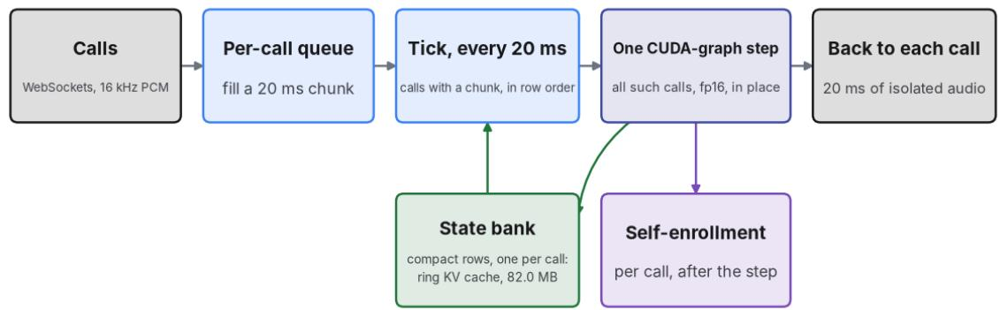  
FIGURE 34 The server. Open calls stay in the first rows of the state bank, so the step reads and writes it in place.

## 7.1 STRESS TESTS

On one GPU, with 20 ms chunks, one step serves 512 calls in real time with S, 384 with M and 320 with L (Figure 35); for M, 224 with 10 ms chunks and 512 with 40 ms. The release costs WavLM’s share of the step: 160 calls with 20 ms chunks and 256 with 40 ms (47.7 GMAC per second of audio against 28.5 for M alone).

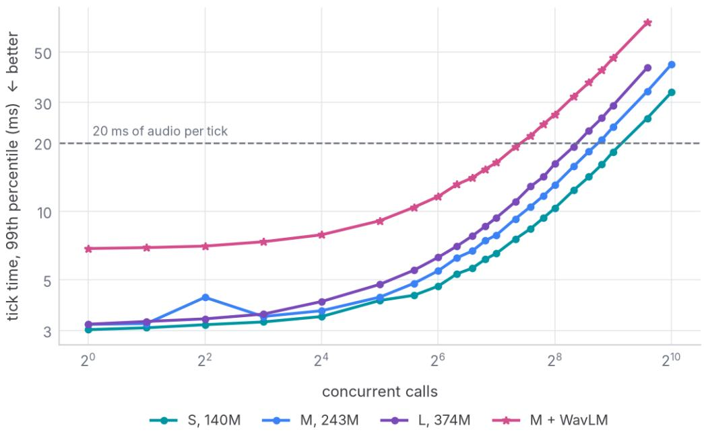  
FIGURE 35 Step time (99th percentile) against concurrent calls, fp16 with CUDA graphs, 20 ms chunks, one GPU, release architectures. Below the dashed line a step keeps up with real time.

End to end, calls stream Krisp’s recordings in real time over WebSockets on the same machine, and we time each chunk from leaving the client to its isolated audio coming back. Every call of a run opens in the same half second and enrolls in its first seconds, so we report the chunks sent after each call’s first 15 s. One Python process carrying every connection fills up before the GPU does (Figure 36): with 20 ms chunks it holds 96 calls of M (20 ms at the median, 35 ms at the 99th percentile) and falls behind at 128, and 32 of the release (21 and 33 ms), falling behind at 48. With the connections spread over eight processes that share the port, and a ninth that only steps the engine and passes the audio through shared memory, the GPU is the limit again: the release holds 128 calls (27 and 38 ms) and falls behind at 160, where its step needs nearly all of the 20 ms; with 40 ms chunks it holds 224 (59 and 77 ms). M keeps up with all 256 calls we tried (28 and 38 ms).

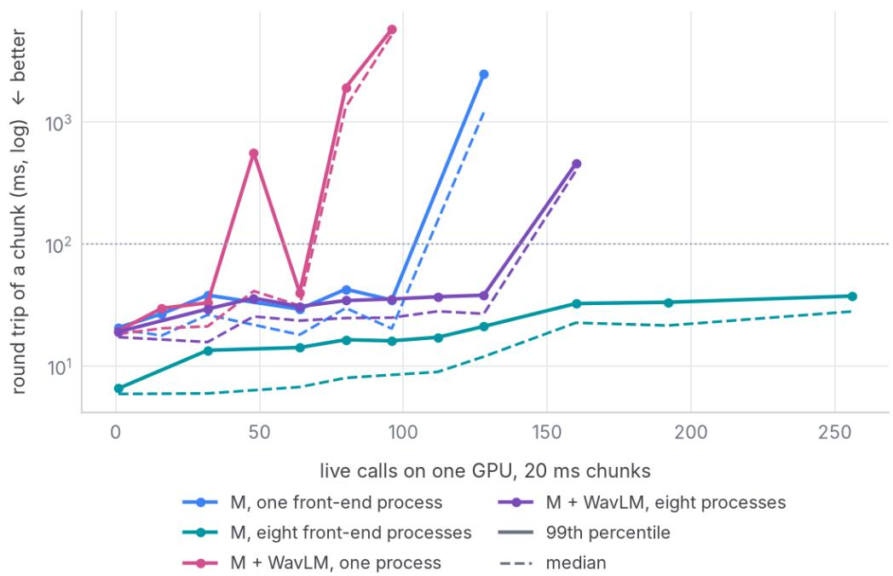  
FIGURE 36 End to end over WebSockets on one GPU, live enrollment, 20 ms chunks: the delay from a chunk leaving the client to its isolated audio coming back (99th percentile solid, median dashed), over the chunks sent after each call’s first 15 s, against live calls; M and the release, with every connection in one front-end process or spread over eight. Runs where calls timed out are left out. One process is erratic once it falls behind: a later, larger run can land on time again.

Two kernels of our own decide much of a step’s time (Figure 37). Each layer asks its ring for one or two new frames per call, where the fused attention kernels tile 64 queries: ours (Triton) reads each key and value once and builds the mask from each slot’s frame. The band LSTMs step thousands of two-frame sequences, which cuDNN runs 11 times slower than PyTorch’s own LSTM. A step of 64 calls then takes 11.6 ms instead of 18.8 on 20 ms chunks, and its output agrees with the old step’s to 69 dB; offline evaluation does not use them. Batch sizes come in steps of 16 calls (in powers of two, 80 calls ran as a step of 128), and the live enrollment’s encoder replays a CUDA graph per batch size, captured before the first call: run kernel by kernel, it put a fresh server that took 64 calls at once 900 ms behind (Figure 38). Over 30 minutes at 64 calls the release lost no call and held its 99th percentile at 32 ms (Figure 39); the host’s memory grew 1.7% in the first minute and then stayed, and the GPU memory in use stayed at 44% of the GPU’s, most of it the state banks of 512 calls.

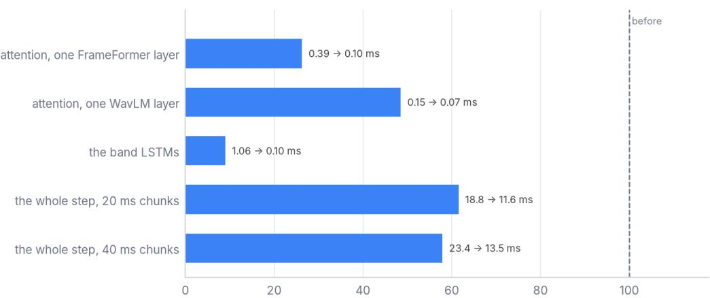  
time at 64 calls, share of what it took before (%) ← better

FIGURE 37 The serving kernels at 64 calls of the release: each part’s time as a share of what it took before them, the milliseconds on the bars.  
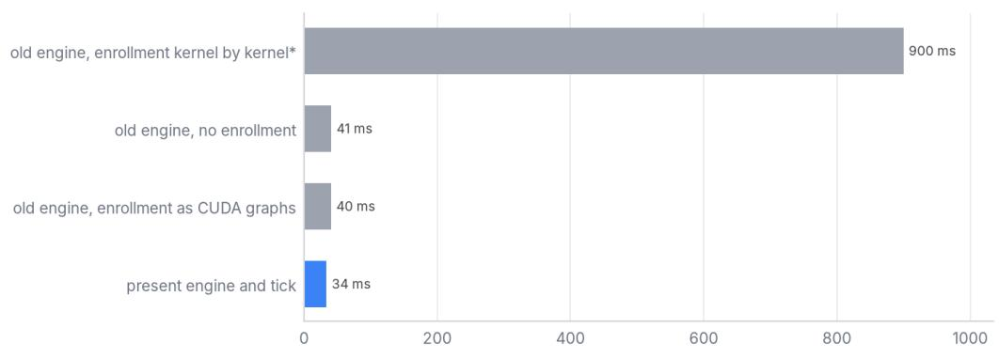  
a chunk's round trip, worst 99th percentile in the first 30 s (ms) ← better  
FIGURE 38 A fresh server given 64 calls of the release at once on 20 ms chunks: the worst 99th percentile of a chunk’s round trip in its first 30 s (\*: in its first minute), as the live enrollment’s cost was taken out of the step.

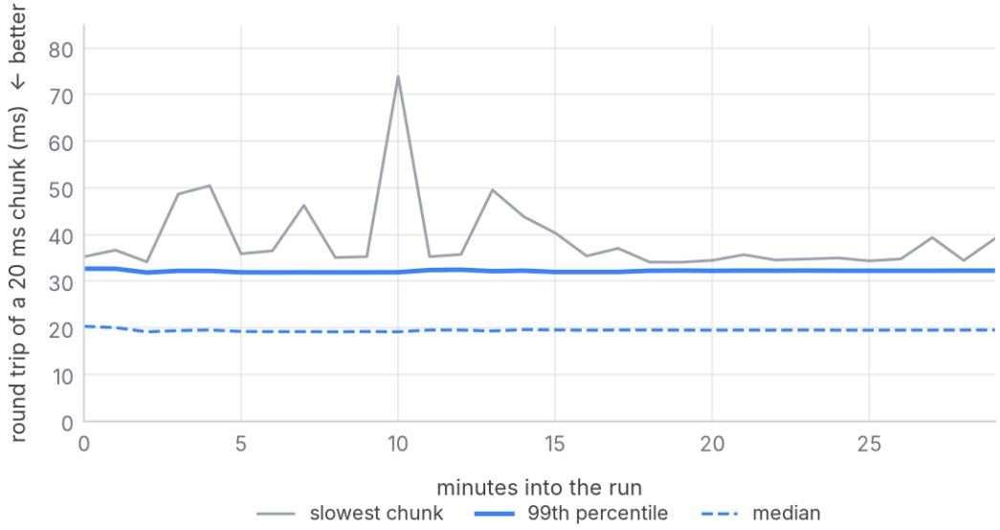  
FIGURE 39 Thirty minutes at 64 calls of the release on 20 ms chunks: a chunk’s round trip in each minute.

## 8 In a voice agent

A voice agent decides from the caller’s audio when to listen, when to answer and what was said: a voice activity detector (VAD), a turn detector and the recogniser. LiveKit Agents, a framework many such agents run on, lets an audio filter hear the call before all three: its audio input takes any frame processor, an object called once per incoming frame inside the agent’s process. We ship the isolator as one (Figure 40). It needs neither a GPU nor PyTorch: one streaming step of the model is exported to ONNX with everything a call keeps between steps passed in and out, and numpy does the STFT, the overlap-add, the attention rings and the live enrollment rule. On real calls the exported stream reproduces the PyTorch model to 124 dB with live enrollment and 128 dB without, which is float rounding.

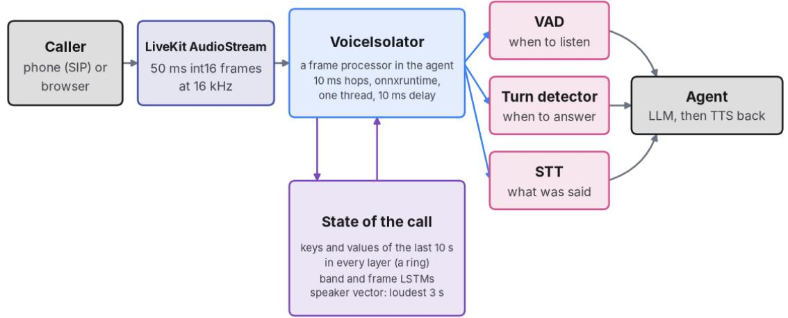  
FIGURE 40 The isolator in a LiveKit agent: a frame processor on the caller’s audio stream, ahead of the ${ \mathsf { V A D } } ,$ the turn detector and the recogniser. Each call keeps its own state; the onnxruntime session is shared by every call in the process.

LiveKit hands the audio over in small frames, 50 ms by default, and that does not cut the model’s context. The model decides who the caller is from a speaker vector (the loudest 3 s heard so far), attention over the last 10 s and two LSTMs that have heard the whole call. All of it is the call’s state, carried from one frame to the next (Figure 41), so the frame size changes how often the step runs, not what a hop sees: the output is the model’s offline output, 10 ms later, in frames of any size. The context runs short only at the start of a call. Before 3 s there is no speaker vector, and that is where the model still removes some of a lone caller’s first words (Section 6.4).

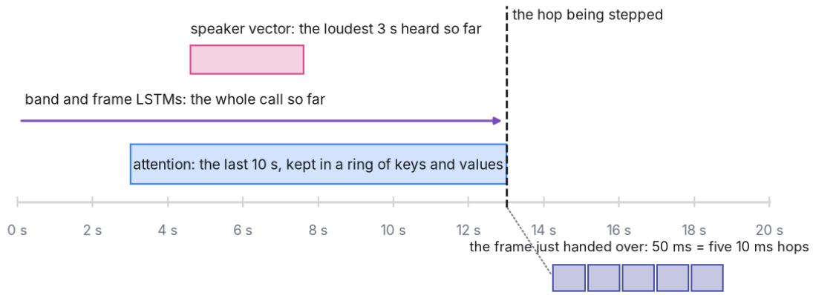  
FIGURE 41 What one 10 ms hop sees, to scale over a 20 s call, while LiveKit hands the call over in 50 ms frames: the attention window, the LSTMs and the speaker vector belong to the call, not to the frame.

Does the VAD gain from it? We ran LiveKit’s own VAD behind each system: Silero, with LiveKit’s rule on its smoothed probability for every 32 ms (speech starts after 0.05 s above 0.5 and ends after 0.55 s below 0.35). A VAD answers whether anyone is talking, so another voice starts speech just as the caller does, and the agent stops to listen to nobody (Figure 42). Over the stretches where only another voice talks, the raw call starts speech 5.09 times a minute on Krisp, 9.03 on ai-coustics’ calls and 2.53 on the AMI test meetings; behind the release, 0.13, 1.77 and 1.71 (Figure 43). Noise suppression goes the other way. Behind GTCRN, the filter that STT-API’s LiveKit plugin ships, the counts are 6.54, 10.54 and 3.91: a background voice cleaned of its noise sounds more like speech.

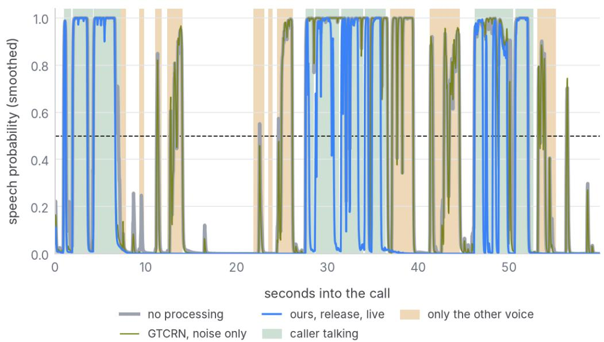  
FIGURE 42 One call with another voice: LiveKit’s smoothed Silero probability on the raw call, behind GTCRN and behind the release. Green: the caller talks (the same VAD on the caller’s own channel); orange: only the other voice does. Above the dashed line a window counts as speech.

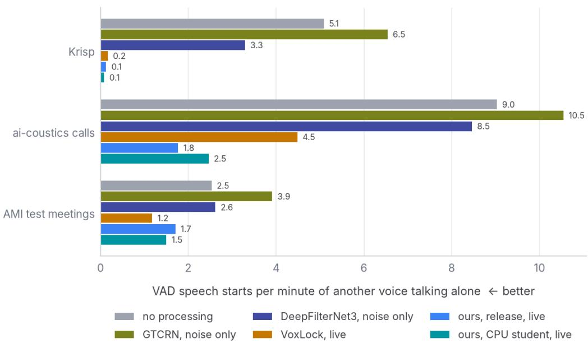  
FIGURE 43 LiveKit’s VAD behind each system: speech starts inside the labelled stretches where only another voice talks, per minute of them, on three sets of real recordings.

On the calls with another voice we have the caller’s own channel, and the same VAD on it is the reference (Table 3). Raw, the VAD hears speech in 47.9% of the caller’s pauses, and behind the release in 22.8%. The end of the caller’s turn, where the agent should answer, comes late while someone else keeps talking: at the 90th percentile, 2.43 s after the calleralone VAD sees it on the raw call and 1.00 s behind the release, and the share of turn ends the VAD misses until the caller talks again falls from 28% to 18%. The cost is the caller’s own speech: behind the release the VAD misses 5.2% of a lone caller’s speech (VoxLock 2.6%, GTCRN 0.6%), most of it in the first seconds of a call, and 8.4% with another voice on the

line. The CPU student of Section 9 keeps most of the gain: the VAD hears speech in 26.2% of the caller’s pauses behind it, sees the end of a turn 1.34 s late at the 90th percentile, and misses 4.9% of a lone caller’s speech.

TABLE 3 LiveKit’s VAD behind each system on the test calls, against the same VAD on the caller’s own channel. False starts: speech starts while the caller is silent. Turn ends held: the caller’s turn ends the VAD does not see before the caller talks again. Turn end p90: how much later than the reference it sees the others, 90th percentile.
<table><tr><td colspan="5">Calls + another voice</td><td colspan="2">Caller alone</td></tr><tr><td></td><td>speech in the false starts</td><td></td><td></td><td>turn ends turn end</td><td>caller</td><td>caller</td></tr><tr><td>System</td><td>caller&#x27;s pauses %</td><td>per min</td><td>held %</td><td>p90 (s)</td><td>missed %</td><td>missed %</td></tr><tr><td>No processing</td><td>47.9</td><td>3.33</td><td>28</td><td>2.43</td><td>0.1</td><td>0.0</td></tr><tr><td>GTCRN (noise only; STT-API&#x27;s plugin)</td><td>48.3</td><td>3.58</td><td>26</td><td>2.40</td><td>0.3</td><td>0.6</td></tr><tr><td>DeepFilterNet3 (noise only)</td><td>45.2</td><td>3.14</td><td>27</td><td>2.28</td><td>0.6</td><td>0.9</td></tr><tr><td>VoxLock, live</td><td>27.5</td><td>2.28</td><td>24</td><td>1.51</td><td>11.0</td><td>2.6</td></tr><tr><td>Ours, M, live</td><td>24.2</td><td>2.27</td><td>19</td><td>1.41</td><td>8.4</td><td>8.4</td></tr><tr><td>Ours, release, live</td><td>22.8</td><td>1.94</td><td>18</td><td>1.00</td><td>8.4</td><td>5.2</td></tr><tr><td>Ours, CPU student, live</td><td>26.2</td><td>2.27</td><td>20</td><td>1.34</td><td>6.7</td><td>4.9</td></tr></table>

## 9 On one CPU core

Many voice agents run without a GPU, and that is where VoxLock is at home: its default 8-bit ONNX model needs 132% of one thread of our host’s CPU per live call, fed 20 ms at a time (158% in float). The release cannot follow it there; even S without WavLM needs 1.36 s of one thread per second of audio. So we distilled the release into three FrameFormers sized for one core, C10, C22 and C51, with 9.8M, 22.1M and 50.9M parameters (Figure 44). Each went through the release’s three-stage recipe with the release as its teacher.

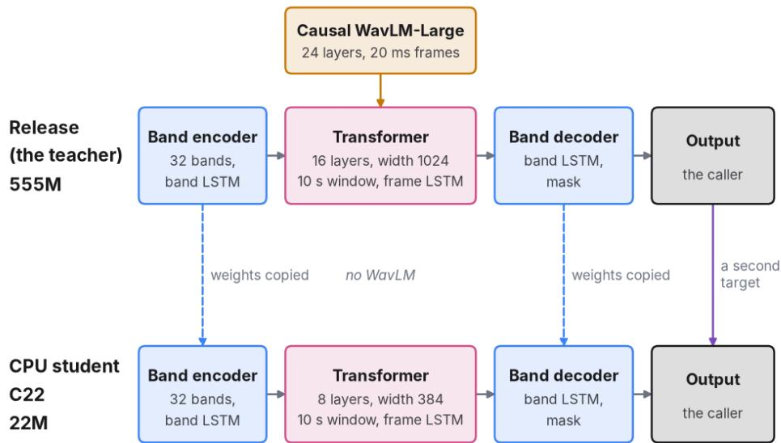  
FIGURE 44 The CPU student beside the release it learns from. The pipeline is the same. The band encoder and decoder, with their band LSTMs, the mask head and the enrollment encoder keep their shapes and start from the release’s weights (92 tensors); the transformer shrinks (C22: 8 layers of width 384; C10: 6 of 256; C51: 12 of 512) but keeps the 10 s window and the frame LSTM; WavLM is dropped. On every training call the release’s output is a second target, beside the clean caller.

The teacher is worth more than size. Trained on the recipe alone, C22 reaches 12.14% on dev-4; taught by the release, 10.66% (Figure 45), against 10.49% for the release itself (555M parameters with WavLM) and 11.67% for S (140M, no WavLM). Most of the gain is the lone caller. From scratch C22 loses words on the clean dev calls as S does (7.00% and 5.78%); taught, it makes 2.84%, as few as the release (2.96%). What WavLM gave the release, the student takes from the release’s output, without WavLM. Started from the release’s weights but trained toward the clean caller alone, C22 reaches 11.47% (clean dev calls 5.04%). Trained from scratch with the release’s output as the second target, it reaches 11.64% (clean dev calls 4.21%) but loses the 60 s windows (21.05% against 19.93% from scratch). Each half alone gets less than half of the way; together they do more than the two apart.

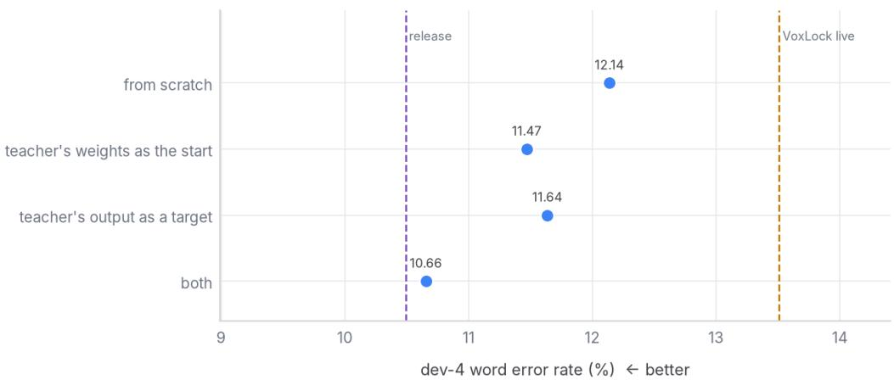  
FIGURE 45 Distilling the release into C22, the release recipe every time: dev-4 from scratch, started from the release’s weights, with the release’s output as a second target, and both. Dashed: VoxLock live and the release.

We fixed the rule that picks the student before any distilled run was scored: the distilled size with the lowest dev-4, except that a larger size must beat the next smaller one by more than 0.2 points, about what separates two training runs of one recipe (Section 6.4). C10 reaches 11.06%, C22 10.66% and C51 10.78% (Figure 46), so the student is C22. The three are level on the shorter meeting windows and on the clean calls. C10 loses the 60 s windows (20.08% against 18.45%), and C51 does no better there than C22 (19.07%).

  
FIGURE 46 Dev-4 against the share of one CPU thread a live call takes through the plugin in 20 ms frames, for each distilled size in float and in 8 bits, and for VoxLock’s own 8-bit package. Dashed: the release, on a GPU.

Figure 47 sets the student beside GTCRN, the noise suppressor STT-API ships, and VoxLock, each through its own streaming entry point on one thread, on the same calls cut into LiveKit’s frames. In 50 ms frames the student takes 17% of a core per call, GTCRN 5% and VoxLock’s default model 65%. The student and VoxLock run once per frame, and much of a run’s cost does not grow with the frame, so smaller frames cost more: in 20 ms frames the student takes 33% and VoxLock 132%, more than the thread has. GTCRN steps 16 ms at a time whatever the frame and stays at 5%. It is the cheapest, and it removes only noise (Section 8).

  
FIGURE 47 The share of one CPU thread a live call takes, by the frame size LiveKit hands the agent: GTCRN (noise only), the CPU student in float and in 8 bits, and VoxLock’s default 8-bit model, each through its own streaming entry point on the same calls, timed in one run. Above the dashed line a call needs more than one thread.

Weights in 8 bits, quantised dynamically by onnxruntime, take the student down to 12% in 50 ms frames and 23% in 20 ms frames (Table 4), and cost no words we can measure: dev-4 is 10.52% against 10.66% in float, closer than two training runs of one recipe land. They come with a catch. Dynamic quantisation sets each step’s activation scales from what the step sees, so the 8-bit output depends on how LiveKit cuts the call: the same call in 20 ms and in 50 ms frames agrees to 40 dB in 8 bits, and to 104 dB in float. The plugin runs the float model unless asked.

TABLE 4 The distilled students through the plugin on one thread: share of one core per live call in 20 ms and 50 ms frames, float and 8-bit weights, and dev-4. VoxLock’s package steps 20 ms at a time; its 8-bit column is its default model.
<table><tr><td rowspan="2">Model</td><td colspan="2">% of a core, 20 ms</td><td colspan="2">% of a core, 50 ms</td><td colspan="2">dev-4 WER</td></tr><tr><td>float</td><td>8-bit float</td><td></td><td>8-bit</td><td>float</td><td>8-bit</td></tr><tr><td>VoxLock (its ONNX package, 27M)</td><td>158</td><td>132</td><td>88</td><td>65</td><td>13.51</td><td></td></tr><tr><td>GTCRN (noise only, STT-API&#x27;s plugin)</td><td>5</td><td></td><td>5</td><td></td><td></td><td></td></tr><tr><td>Ours, C10, 9.8M</td><td>18</td><td>14</td><td>10</td><td>8</td><td>11.06</td><td>11.10</td></tr><tr><td>Ours, C22, 22.1M</td><td>33</td><td>22</td><td>17</td><td>12</td><td>10.66</td><td>10.52</td></tr><tr><td>Ours, C51, 50.9M</td><td>64</td><td>39</td><td>31</td><td>21</td><td>10.78</td><td>10.87</td></tr></table>

On the test sets, which chose nothing, the student is ahead of VoxLock live by more than the interval over callers on four (Figure 48): 10.29% against 12.07% on the AMI test meetings, 15.55% against 23.66% on their 60 s windows, where it does better than the release (16.13%), 7.58% against 8.84% on NOTSOFAR and 49.90% against 56.65% on the calls with another voice. It is ahead within the interval on VoxLock’s AMI windows, AliMeeting and ai-coustics’ calls (18.03% against 24.55%, 83 calls by 4 callers), level on Krisp (5.66% and 5.63%), and behind on the lone caller (5.32% against 2.92%), as the release is (5.58%).

  
FIGURE 48 Every test set: word error rate of the CPU student, live, on one CPU thread, minus VoxLock live, with a 95% interval over callers. Left of zero: the student makes fewer errors.

## 10 In a running agent

Section 8 put the isolator in a LiveKit agent (Figure 40) and measured the VAD on recordings. Here it runs inside real agents. 32 callers stream the test calls with another voice at once, and each agent’s AgentSession runs LiveKit’s Silero VAD on what the isolator gives it. A timer around the isolator records every frame; the same rooms with each caller’s own channel and no filter are the reference. Table 5 gives what the isolator costs the agent, Table 6 what the VAD did.

TABLE 5 What the isolator costs a LiveKit agent: 32 test calls with another voice streamed at once (the last row 64). Frame: its time per frame on the agent’s audio loop (on the GPU rows mostly a wait for the server’s reply); core: its share of one CPU core per call, where it computes; delay: how far its output stood behind the call; unfiltered: audio let through because the server’s reply came later than the plugin’s cap on its delay (40 ms while frames wait for their replies, 250 ms when they do not).
<table><tr><td>Filter</td><td>frame p50 / p99 (ms)</td><td></td><td>core per call delay p50 / p99 (ms)</td><td>unfiltered %</td></tr><tr><td>No filter</td><td>0.00 / 0.00</td><td>0.000</td><td>0</td><td></td></tr><tr><td>GTCRN (noise only)</td><td>3.05 / 5.58</td><td>0.066</td><td></td><td></td></tr><tr><td>Ours, CPU student</td><td>15.21/ 24.88</td><td>0.323</td><td>10 /10</td><td></td></tr><tr><td>Ours, CPU student, 8-bit</td><td>9.49 / 16.66</td><td>0.200</td><td>10/ 10</td><td></td></tr><tr><td>Ours, release on a GPU, 50 ms frames</td><td>14.46 / 30.25</td><td></td><td>40/50</td><td>0.1</td></tr><tr><td>Ours, release on a GPU, 50 ms frames, no waiting</td><td>0.11 / 0.31</td><td></td><td>90/ 90</td><td>0.0</td></tr><tr><td>Ours, release on a GPU, 20 ms frames</td><td>0.12 / 11.83</td><td></td><td>30/50</td><td>0.0</td></tr><tr><td>Ours, release on a GPU, 50 ms frames, 64 calls</td><td>18.23 / 30.30</td><td></td><td>50/50</td><td>1.0</td></tr></table>

TABLE 6 What the agent’s VAD did in the same runs, against the same rooms with each caller’s own channel; the columns are those of Table 3.
<table><tr><td></td><td>false starts</td><td>speech in the turn end turn ends</td><td></td><td></td><td>caller</td></tr><tr><td>Filter</td><td></td><td>per min caller&#x27;s pauses %</td><td>p90 (s)</td><td></td><td>held % missed %</td></tr><tr><td>No filter</td><td>2.84</td><td>47.5</td><td>2.04</td><td>23</td><td>0.3</td></tr><tr><td>GTCRN (noise only)</td><td>2.88</td><td>46.8</td><td>2.03</td><td>22</td><td>0.7</td></tr><tr><td>Ours, CPU student</td><td>2.12</td><td>27.7</td><td>1.03</td><td>18</td><td>3.0</td></tr><tr><td>Ours, CPU student, 8-bit</td><td>2.25</td><td>28.2</td><td>1.04</td><td>16</td><td>2.9</td></tr><tr><td>Ours, release on a GPU, 50 ms frames</td><td>1.75</td><td>24.9</td><td>1.06</td><td>18</td><td>6.9</td></tr><tr><td>Ours, release on a GPU, 50 ms frames, no waiting</td><td>1.59</td><td>25.4</td><td>1.15</td><td>19</td><td>7.0</td></tr><tr><td>Ours, release on a GPU, 20 ms frames</td><td>1.59</td><td>24.1</td><td>1.03</td><td>18</td><td>6.8</td></tr><tr><td>Ours, release on a GPU, 50 ms frames, 64 calls</td><td>1.61</td><td>22.8</td><td>1.02</td><td>21</td><td>8.5</td></tr></table>

The isolator keeps up in both places. On the GPU each frame waits for the server’s reply to it, 14.46 ms at the median and 30.25 ms at the 99th percentile, and the caller comes back 40 ms late: 30 ms in 20 ms frames, 50 ms with 64 calls on one GPU. A reply that would put the caller more than 40 ms behind goes through unfiltered instead: 0.1% of the audio at 32 calls, 1.0% at 64. A plugin that returns at once, with what came back for earlier frames, puts every reply a frame late: 90 ms behind. On the CPU the student takes 15.21 ms of each 50 ms frame (24.88 ms at the 99th percentile) and is 10 ms behind.

The VAD behaves as it did on the recordings (Figure 49). Behind the GPU and the CPU model it hears speech in 24.9% and 27.7% of the caller’s pauses (no filter 47.5%, GTCRN 46.8%). It sees the end of the caller’s turn within 1.06 and 1.03 s at the 90th percentile (2.04 s without), and misses 6.9% and 3.0% of the caller’s speech.

  
FIGURE 49 One call through a running agent, in time. The caller stops at 0.8 s while another voice goes on. LiveKit’s VAD ends a turn after 0.55 s of silence: on the raw frames it hears the other voice and waits for it too; behind the isolator it hears only the caller, late by the isolator’s delay (10 ms on the CPU, 40 ms through the GPU server). The end of the turn is where the agent’s turn detector lets it answer. A schematic, with LiveKit’s rule and the measured delays.

Three things broke on the way, each of which would have broken a deployment:

• The GPU server fell behind real agents. Agents send frames a few milliseconds apart, and the server stepped again for each one. It now steps again only within its tick’s budget: 64 calls of the release opening at once on 20 ms chunks stay within 34 ms over the first 30 s. With 40 ms chunks, LiveKit’s setting, a step of 64 calls takes 10 ms of each 40 ms tick, and the server spends 33 ms of it (medians), stepping again for calls whose next chunk has already arrived.

• The plugin waited for a late server without bound. It now caps the delay (40 ms while frames wait for their replies, 250 ms when they do not) and lets later audio through unfiltered.

• A stream that opens with silence enrolls on it. A caller silent for the first 15 s is enrolled on the line’s silence; the plugin takes a clip of the caller when there is one.

## 11 Conclusion

An isolator for transcription must remove every other voice however long it talks, and leave the caller alone however quietly they speak; short evaluation windows test neither. Long windows showed that an attention window forgets the caller, and lone real callers showed that fixing it makes the model doubt them. Width did not settle that trade (M beat S, L did not beat M); WavLM’s own weights, made causal and trained inside the model, moved it, where a student imitating WavLM, w2v-BERT 2.0 and Whisper’s encoder did not. Much of what a lone caller still lost was a cold start: recordings open mid-sentence, and no training call did, until we cut training windows out of longer calls. The release is ahead of VoxLock live on long meetings and on calls with a second voice, ahead or level on the other test meetings, level on Krisp, and still behind it where the caller is alone. It costs about 47.7 GMAC per second of audio, and one GPU carries 160 live calls. The release and its CPU student, with the LiveKit plugin, are open at https://huggingface.co/collections/Scicom-intl/voice-isolator.

## 12 Limitations

Recognisers. Every score comes from Parakeet or Whisper; other recognisers react differently to processing [Iwamoto et al., 2024]. Calls. Krisp’s calls are scripted, and our call-centre windows carry a second voice only as a mixture we made, with a recogniser’s transcript as reference. Enrollment. The live rule takes the loudest 3 s; when someone else is loudest, as in many AliMeeting windows, it keeps the wrong voice. Selection. The meeting sets reward suppression and the clean calls restraint; another weighting picks another model. Two training runs of one recipe at S land at 10.81 and 10.96% on dev-4 and differ on the 60 s windows and the clean calls by more than our intervals over callers allow, which resample callers, not training runs; at M two runs land at 10.55 and 10.61%. Dev-4 differences of a tenth of a point or two rank runs rather than recipes; the release’s last step held in two seeds at M, by less than that. Cost. The WavLM branch adds 311M parameters and steps in 20 ms frames: no 10 ms chunks, and fewer calls per GPU than M alone. WavLM was pre-trained on English. Licences. Krisp, ai-coustics’ calls and AppTek’s recordings are evaluation-only; results are for internal study until a release is cleared.

## 13 Acknowledgement

This work was carried out at Scicom (MSC) Berhad. The author thanks Scicom for the compute.

## References

Jont B. Allen and David A. Berkley. Image method for efficiently simulating small-room acoustics. The Journal of the Acoustical Society of America, 65(4):943–950, 1979. doi: 10.1121/1.382599. URL https://pubs.aip.org/jasa/article/65/4/943/765693/Image-method-for-efficientlysimulating-small-room.

Rosana Ardila et al. Common Voice: A massively-multilingual speech corpus. In Proceedings of the Twelfth Language Resources and Evaluation Conference (LREC 2020), pages 4218–4222, 2020. URL https://aclanthology.org/2020.lrec-1.520/.

Eugen Beck, Sarah Beranek, Uma Moothiringote, Daniel Mann, Wilfried Michel, Katie Nguyen, and Taylor Tragemann. AppTek call-center dialogues: A multi-accent long-form benchmark for English ASR, 2026. URL https://arxiv.org/abs/2604.27543.

M. Bisani and H. Ney. Bootstrap estimates for confidence intervals in ASR performance evaluation. In Proc. IEEE International Conference on Acoustics, Speech and Signal Processing (ICASSP), volume 1, pages I–409–I–412, 2004. doi: 10.1109/ICASSP.2004.1326009. URL https://www-i6.informatik.rwthaachen.de/\~bisani/bootlog.html.

Sebastian Braun and Ivan Tashev. A consolidated view of loss functions for supervised deep learningbased speech enhancement. In Proc. 44th International Conference on Telecommunications and Signal Processing (TSP), pages 72–76, 2021. doi: 10.1109/TSP52935.2021.9522648. URL https://doi.org/10.1109/TSP52935.2021.9522648.

Jean Carletta et al. The AMI meeting corpus: A pre-announcement. In Steve Renals and Samy Bengio, editors, Machine Learning for Multimodal Interaction: Second International Workshop, MLMI 2005, Edinburgh, UK, July 11–13, 2005, Revised Selected Papers, Lecture Notes in Computer Science, pages 28–39. Springer, 2006. doi: 10.1007/11677482\_3. URL https://doi.org/10.1007/11677482\_3.

Sanyuan Chen, Chengyi Wang, Zhengyang Chen, Yu Wu, Shujie Liu, Zhuo Chen, Jinyu Li, Naoyuki Kanda, Takuya Yoshioka, Xiong Xiao, Jian Wu, Long Zhou, Shuo Ren, Yanmin Qian, Yao Qian, Jian Wu, Michael Zeng, Xiangzhan Yu, and Furu Wei. WavLM: Large-scale self-supervised pre-training for full stack speech processing. IEEE Journal of Selected Topics in Signal Processing, 16(6):1505–1518, 2022. doi: 10.1109/JSTSP.2022.3188113.

Harishchandra Dubey et al. ICASSP 2023 deep noise suppression challenge. IEEE Open Journal of Signal Processing, 5:725–737, 2024. doi: 10.1109/OJSP.2024.3378602. URL https://ieeexplore.ieee.org/ document/10474162/. arXiv:2303.11510 is the shorter 2023 challenge-overview version of this article.

Eduardo Fonseca, Xavier Favory, Jordi Pons, Frederic Font, and Xavier Serra. FSD50K: An open dataset of human-labeled sound events. IEEE/ACM Transactions on Audio, Speech, and Language Processing, 30:829–852, 2022. doi: 10.1109/TASLP.2021.3133208. URL https://ieeexplore.ieee.org/document/ 9645159.

Meng Ge, Chenglin Xu, Longbiao Wang, Eng Siong Chng, Jianwu Dang, and Haizhou Li. SpEx+: A complete time domain speaker extraction network. In Proc. Interspeech 2020, pages 1406–1410, 2020. doi: 10.21437/Interspeech.2020-1397. URL https://doi.org/10.21437/Interspeech.2020-1397.

Jort F. Gemmeke, Daniel P. W. Ellis, Dylan Freedman, Aren Jansen, Wade Lawrence, R. Channing Moore, Manoj Plakal, and Marvin Ritter. Audio set: An ontology and human-labeled dataset for audio events. In Proc. IEEE International Conference on Acoustics, Speech and Signal Processing (ICASSP), pages 776–780, 2017. doi: 10.1109/ICASSP.2017.7952261. URL https://ieeexplore.ieee.org/document/ 7952261.

Kazuma Iwamoto, Tsubasa Ochiai, Marc Delcroix, Rintaro Ikeshita, Hiroshi Sato, Shoko Araki, and Shigeru Katagiri. How bad are artifacts?: Analyzing the impact of speech enhancement errors on ASR. In Proc. Interspeech 2022, pages 5418–5422, 2022. doi: 10.21437/Interspeech.2022-318. URL https://www.isca-archive.org/interspeech\_2022/iwamoto22\_interspeech.html.

Kazuma Iwamoto, Tsubasa Ochiai, Marc Delcroix, Rintaro Ikeshita, Hiroshi Sato, Shoko Araki, and Shigeru Katagiri. How does end-to-end speech recognition training impact speech enhancement artifacts? In Proc. IEEE International Conference on Acoustics, Speech and Signal Processing

(ICASSP), pages 11031–11035, 2024. doi: 10.1109/ICASSP48485.2024.10447750. URL https: //doi.org/10.1109/ICASSP48485.2024.10447750.

Krisp Engineering Team. STT handles noise now. It still can’t handle a background voice. Krisp blog, 2026. URL https://krisp.ai/blog/voice-isolation-benchmark/. Published 2026-09-23, updated October 2026. Accessed 2026-10-20.

Rithesh Kumar, Prem Seetharaman, Alejandro Luebs, Ishaan Kumar, and Kundan Kumar. High-fidelity audio compression with improved RVQGAN. In Advances in Neural Information Processing Systems, volume 36, 2023. URL https://arxiv.org/abs/2306.06546.

Shaole Li, Shuai Wang, Jiangyu Han, Ke Zhang, Wupeng Wang, and Haizhou Li. REAL-T: Real conversational mixtures for target speaker extraction. In Proc. Interspeech 2025, pages 1923–1927, 2025. doi: 10.21437/Interspeech.2025-2662. URL https://www.isca-archive.org/interspeech\_ 2025/li25da\_interspeech.html.

Zhe Liu and Fuchun Peng. Statistical testing on ASR performance via blockwise bootstrap. In Proc. Interspeech 2020, pages 596–600, 2020. doi: 10.21437/Interspeech.2020-1338. URL https://www.isca-archive.org/interspeech\_2020/liu20c\_interspeech.html.

Yi Luo and Jianwei Yu. Music source separation with band-split RNN. IEEE/ACM Transactions on Audio, Speech, and Language Processing, 31:1893–1901, 2023. doi: 10.1109/TASLP.2023.3271145. URL https://ieeexplore.ieee.org/document/10121418/.

Microsoft. NOTSOFAR benchmark datasets (hugging face: microsoft/notsofar). https://huggingface.co/ datasets/microsoft/NOTSOFAR, 2024. CC BY 4.0; close-talk channel per participant with word timings in gt\_transcription.json.

Microsoft Research. ICASSP 2023 deep noise suppression challenge (challenge website: rules and results). Microsoft Research website, 2022. URL https://www.microsoft.com/en-us/research/ academic-program/deep-noise-suppression-challenge-icassp-2023/. Results tab: .../deep-noisesuppression-challenge-icassp-2023/results/. Accessed 2026-10-20.

Wataru Nakata, Yuki Saito, Yota Ueda, and Hiroshi Saruwatari. Sidon: Fast and robust open-source multilingual speech restoration for large-scale dataset cleansing, 2025. URL https://arxiv.org/abs/ 2509.17052.

NVIDIA. parakeet-tdt-0.6b-v2: Parakeet TDT 0.6b v2 model card. Hugging Face model card, 2025a. URL https://huggingface.co/nvidia/parakeet-tdt-0.6b-v2. Release date 05/01/2025; CC-BY-4.0. Accessed 2026-10-20.

NVIDIA. parakeet-tdt-0.6b-v3: Parakeet TDT 0.6b v3 model card. Hugging Face model card, 2025b. URL https://huggingface.co/nvidia/parakeet-tdt-0.6b-v3. Release date 08/14/2025; CC-BY-4.0. Accessed 2026-10-20.

Tanel Pärnamaa and Ando Saabas. Personalized speech enhancement without a separate speaker embedding model. In Proc. Interspeech 2024, pages 4863–4867, 2024. doi: 10.21437/Interspeech.2024- 1234. URL https://doi.org/10.21437/Interspeech.2024-1234.

Katharine Patterson, Kevin Wilson, Scott Wisdom, and John R. Hershey. Distance-based sound separation. In Proc. Interspeech 2022, pages 901–905, 2022. doi: 10.21437/Interspeech.2022-11100. URL https://www.isca-archive.org/interspeech\_2022/patterson22\_interspeech.html.

Ethan Perez, Florian Strub, Harm de Vries, Vincent Dumoulin, and Aaron Courville. FiLM: Visual reasoning with a general conditioning layer. In Proc. AAAI Conference on Artificial Intelligence, volume 32, 2018. doi: 10.1609/aaai.v32i1.11671. URL https://ojs.aaai.org/index.php/AAAI/article/view/11671.

Karol J. Piczak. ESC: Dataset for environmental sound classification. In Proceedings of the 23rd ACM International Conference on Multimedia (MM ’15), pages 1015–1018, 2015. doi: 10.1145/2733373. 2806390. URL https://dl.acm.org/doi/10.1145/2733373.2806390.

Vineel Pratap, Qiantong Xu, Anuroop Sriram, Gabriel Synnaeve, and Ronan Collobert. MLS: A largescale multilingual dataset for speech research. In Proc. Interspeech 2020, pages 2757–2761, 2020. doi: 10.21437/Interspeech.2020-2826. URL https://www.isca-archive.org/interspeech\_2020/ pratap20\_interspeech.html.

Alec Radford, Jong Wook Kim, Tao Xu, Greg Brockman, Christine McLeavey, and Ilya Sutskever. Robust speech recognition via large-scale weak supervision. In Proc. International Conference on Machine Learning (ICML), volume 202 of Proceedings of Machine Learning Research, pages 28492–28518, 2023. URL https://proceedings.mlr.press/v202/radford23a.html.

Chandan K. A. Reddy, Harishchandra Dubey, Vishak Gopal, Ross Cutler, Sebastian Braun, Hannes Gamper, Robert Aichner, and Sriram Srinivasan. ICASSP 2021 deep noise suppression challenge. In Proc. IEEE International Conference on Acoustics, Speech and Signal Processing (ICASSP), pages 6623–6627, 2021. doi: 10.1109/ICASSP39728.2021.9415105. URL https://ieeexplore.ieee.org/ document/9415105/.

Hiroshi Sato, Tsubasa Ochiai, Marc Delcroix, Keisuke Kinoshita, Takafumi Moriya, and Naoyuki Kamo. Should we always separate?: Switching between enhanced and observed signals for overlapping speech recognition. In Proc. Interspeech 2021, pages 1149–1153, 2021. doi: 10.21437/Interspeech.2021- 2253. URL https://www.isca-archive.org/interspeech\_2021/sato21\_interspeech.html.

Robin Scheibler, Eric Bezzam, and Ivan Dokmanić. Pyroomacoustics: A Python package for audio room simulation and array processing algorithms. In Proc. IEEE International Conference on Acoustics, Speech and Signal Processing (ICASSP), pages 351–355, 2018. doi: 10.1109/ICASSP.2018.8461310. URL https://ieeexplore.ieee.org/document/8461310.

Hendrik Schröter, Alberto N. Escalante-B., Tobias Rosenkranz, and Andreas Maier. DeepFilterNet: Perceptually motivated real-time speech enhancement. In Proc. Interspeech 2023, pages 2008–2009, 2023. URL https://www.isca-archive.org/interspeech\_2023/schroter23b\_interspeech.html. Show and Tell paper (DeepFilterNet3).

Seamless Communication, Loïc Barrault, Yu-An Chung, Mariano Coria Meglioli, David Dale, et al. Seamless: Multilingual expressive and streaming speech translation, 2023. URL https://arxiv.org/ abs/2312.05187.

Arbaz Siddiqui. VoxLock. Hugging Face model card, version 1.1.1, 2026. URL https://huggingface. co/arbazsiddiqui/voxlock. Apache-2.0. Code, benchmark harness and per-file results: https: //github.com/arbazsiddiqui/voxlock. Accessed 2026-10-20.

David Snyder, Guoguo Chen, and Daniel Povey. MUSAN: A music, speech, and noise corpus. arXiv preprint arXiv:1510.08484, 2015. URL https://arxiv.org/abs/1510.08484.

Joachim Thiemann, Nobutaka Ito, and Emmanuel Vincent. The diverse environments multi-channel acoustic noise database (DEMAND): A database of multichannel environmental noise recordings. Proceedings of Meetings on Acoustics, 19(1):035081, 2013. doi: 10.1121/1.4799597. URL https: //pubs.aip.org/asa/poma/article/838946.

Nik Vaessen. JiWER: Evaluate your speech-to-text system with similarity measures such as word error rate (WER). GitHub repository, version 4.0.0, 2025. URL https://github.com/jitsi/jiwer. PyPI release 4.0.0 of 2025-06-19; Apache-2.0. Accessed 2026-10-20.

Alon Vinnikov, Amir Ivry, Aviv Hurvitz, Igor Abramovski, Sharon Koubi, Ilya Gurvich, Shai Pe’er, Xiong Xiao, Benjamin Martinez Elizalde, Naoyuki Kanda, et al. NOTSOFAR-1 challenge: New datasets, baseline, and tasks for distant meeting transcription, 2024. URL https://arxiv.org/abs/2401.08887.

Quan Wang et al. VoiceFilter: Targeted voice separation by speaker-conditioned spectrogram masking. In Proc. Interspeech 2019, pages 2728–2732, 2019. doi: 10.21437/Interspeech.2019-1101. URL https://www.isca-archive.org/interspeech\_2019/wang19h\_interspeech.html.

Quan Wang et al. VoiceFilter-Lite: Streaming targeted voice separation for on-device speech recognition. In Proc. Interspeech 2020, pages 2677–2681, 2020. doi: 10.21437/Interspeech.2020-1193. URL https://www.isca-archive.org/interspeech\_2020/wang20z\_interspeech.html.

Shuai Wang et al. SLT 2026 REAL-TSE challenge: Real-world target speaker extraction from conversational recordings. arXiv preprint arXiv:2607.15198, 2026. URL https://arxiv.org/abs/2607.15198. Overview paper of the IEEE SLT 2026 REAL-TSE Challenge.

Zhong-Qiu Wang, Gordon Wichern, Shinji Watanabe, and Jonathan Le Roux. STFT-domain neural speech enhancement with very low algorithmic latency. IEEE/ACM Transactions on Audio, Speech,

and Language Processing, 31:397–410, 2023. doi: 10.1109/TASLP.2022.3224285. URL https: //doi.org/10.1109/TASLP.2022.3224285.

Kevin Wilson, Michael Chinen, Jeremy Thorpe, Brian Patton, John Hershey, Rif A. Saurous, Jan Skoglund, and Richard F. Lyon. Exploring tradeoffs in models for low-latency speech enhancement. In Proc. 16th International Workshop on Acoustic Signal Enhancement (IWAENC), pages 366–370, 2018. doi: 10.1109/IWAENC.2018.8521347. URL https://doi.org/10.1109/IWAENC.2018.8521347.

Scott Wisdom, Efthymios Tzinis, Hakan Erdogan, Ron J. Weiss, Kevin Wilson, and John R. Hershey. Unsupervised sound separation using mixture invariant training. In Advances in Neural Information Processing Systems (NeurIPS), volume 33, pages 3846–3857, 2020. URL https://proceedings. neurips.cc/paper/2020/hash/28538c394c36e4d5ea8ff5ad60562a93-Abstract.html.

Scott Wisdom et al. What’s all the FUSS about free universal sound separation data? In Proc. IEEE International Conference on Acoustics, Speech and Signal Processing (ICASSP), pages 186–190, 2021. doi: 10.1109/ICASSP39728.2021.9414774. URL https://doi.org/10.1109/ICASSP39728.2021.9414774.

Joschka Wohlgemuth. aic\_test\_calls\_en: An evaluation dataset of real call recordings for accurate speaker transcription, 2026. URL https://huggingface.co/datasets/ai-coustics/aic\_test\_calls\_en. Hugging Face dataset ai-coustics/aic\_test\_calls\_en, CC BY-NC 4.0.

Chenglin Xu, Wei Rao, Eng Siong Chng, and Haizhou Li. SpEx: Multi-scale time domain speaker extraction network. IEEE/ACM Transactions on Audio, Speech, and Language Processing, 28:1370–1384, 2020. doi: 10.1109/TASLP.2020.2987429. URL https://doi.org/10.1109/TASLP.2020.2987429.

Fan Yu et al. M2MeT: The ICASSP 2022 multi-channel multi-party meeting transcription challenge. In Proc. IEEE International Conference on Acoustics, Speech and Signal Processing (ICASSP), pages 6167–6171, 2022. doi: 10.1109/ICASSP43922.2022.9746465. URL https://ieeexplore.ieee.org/ document/9746465.

Jianwei Yu, Hangting Chen, Yi Luo, Rongzhi Gu, and Chao Weng. High fidelity speech enhancement with band-split RNN. In Proc. Interspeech 2023, pages 2483–2487, 2023. doi: 10.21437/Interspeech.2023- 1433. URL https://www.isca-archive.org/interspeech\_2023/yu23b\_interspeech.html.

Bang Zeng and Ming Li. USEF-TSE: Universal speaker embedding free target speaker extraction. IEEE Transactions on Audio, Speech and Language Processing, 33:2110–2124, 2025. doi: 10.1109/TASLPRO. 2025.3572756. URL https://doi.org/10.1109/TASLPRO.2025.3572756.

Ke Zhang, Junjie Li, Shuai Wang, Yangjie Wei, Yi Wang, Yannan Wang, and Haizhou Li. Multi-level speaker representation for target speaker extraction. In Proc. IEEE International Conference on Acoustics, Speech and Signal Processing (ICASSP), pages 1–5, 2025. doi: 10.1109/ICASSP49660.2025.10889409. URL https://ieeexplore.ieee.org/document/10889409.

Yang Zhang, Evelina Bakhturina, Kyle Gorman, and Boris Ginsburg. NeMo inverse text normalization: From development to production. In Proc. Interspeech 2021, pages 4468–4472, 2021. doi: 10. 21437/Interspeech.2021-1571. URL https://www.isca-archive.org/interspeech\_2021/zhang21ga\_ interspeech.html.

Kateřina Žmolíková, Marc Delcroix, Keisuke Kinoshita, Tsubasa Ochiai, Tomohiro Nakatani, Lukáš Burget, and Jan Černocký. SpeakerBeam: Speaker aware neural network for target speaker extraction in speech mixtures. IEEE Journal of Selected Topics in Signal Processing, 13(4):800–814, 2019. doi: 10.1109/JSTSP.2019.2922820. URL https://doi.org/10.1109/JSTSP.2019.2922820.

Katerina Zmolikova, Marc Delcroix, Tsubasa Ochiai, Keisuke Kinoshita, Jan Černocký, and Dong Yu. Neural target speech extraction: An overview. IEEE Signal Processing Magazine, 40(3):8–29, 2023. doi: 10.1109/MSP.2023.3240008. URL https://doi.org/10.1109/MSP.2023.3240008.

## A Tables

The numbers behind the figures: every system on every test set (Table 7); the recipe (Table 8) and its long-call stage (Tables 9, 10 and 11); model size (Table 12); self-supervised models (Table 13); enrollment modes (Table 14); and the stage-1 ablations (Tables 15, 16, 17, 18, 19 and 20).

TABLE 7 Test sets: word error rate (AliMeeting: character error rate). Bold: the best live system per column (VoxLock’s loudest-3 s sample and its PyTorch script look up to 15 s ahead).
<table><tr><td>SYSTEM</td><td>KRISP</td><td>AMI (VOXLOCK)</td><td>AMI TEST</td><td>AMI 60 S</td><td>NOTSOFAR</td><td>ALIMEETING</td><td>CALLS, CLEAN</td><td>CALLS + VOICE</td><td>AI-COUSTICS</td></tr><tr><td>No processing</td><td>23.19</td><td>33.00</td><td>42.59</td><td>121.79</td><td>34.70</td><td>29.40</td><td>0.04</td><td>69.79</td><td>66.36</td></tr><tr><td>DeepFilterNet3 (noise only)</td><td>13.15</td><td>21.56</td><td>26.00</td><td>41.77</td><td>15.38</td><td>18.48</td><td>2.63</td><td>69.65</td><td>35.35</td></tr><tr><td>Krisp VI 2.5 Default</td><td>5.30</td><td></td><td></td><td></td><td></td><td></td><td></td><td></td><td></td></tr><tr><td>VoxLock, loudest 3 s</td><td>5.19</td><td>11.26</td><td>9.70</td><td>19.52</td><td>7.61</td><td>17.11</td><td>3.37</td><td>47.05</td><td>20.31</td></tr><tr><td>VoxLock, PyTorch script</td><td>4.99</td><td>10.26</td><td>10.31</td><td>20.20</td><td>7.78</td><td>15.38</td><td>2.87</td><td>48.59</td><td>20.49</td></tr><tr><td>VoxLock, live</td><td>5.63</td><td>11.71</td><td>12.07</td><td>23.66</td><td>8.84</td><td>16.28</td><td>2.92</td><td>56.65</td><td>24.55</td></tr><tr><td>Ours, Sidon architecture 188M</td><td>29.49</td><td>32.45</td><td>37.51</td><td>101.80</td><td>30.01</td><td>42.94</td><td></td><td></td><td></td></tr><tr><td>Ours, Sidon architecture lite</td><td>18.27</td><td>17.45</td><td>24.06</td><td>66.15</td><td>13.40</td><td>19.31</td><td></td><td></td><td></td></tr><tr><td>Ours, S, live</td><td>6.12</td><td>10.23</td><td>10.47</td><td>15.48</td><td>7.78</td><td>18.09</td><td>8.55</td><td>48.86</td><td>18.46</td></tr><tr><td>Ours, M, live</td><td>5.79</td><td>9.95</td><td>10.51</td><td>16.84</td><td>7.58</td><td>18.57</td><td>8.80</td><td>48.22</td><td>16.57</td></tr><tr><td>Ours, M, loudest 3 s</td><td>5.76</td><td>11.23</td><td>10.62</td><td>16.44</td><td>7.70</td><td>17.85</td><td>7.60</td><td>47.99</td><td>15.47</td></tr><tr><td>Ours, M, no enrollment</td><td>6.55</td><td>10.26</td><td>10.27</td><td>18.39</td><td>7.64</td><td>16.02</td><td>6.84</td><td>50.85</td><td>16.86</td></tr><tr><td>Ours, M + WavLM, live, before the window cut</td><td>5.55</td><td>10.06</td><td>9.97</td><td>15.91</td><td>7.76</td><td>15.75</td><td>7.27</td><td>48.36</td><td>14.36</td></tr><tr><td>Ours, M + WavLM, live</td><td>5.74</td><td>10.19</td><td>10.18</td><td>16.13</td><td>7.67</td><td>15.69</td><td>5.58</td><td>47.52</td><td>14.26</td></tr><tr><td>Ours, M + WavLM, loudest 3 s</td><td>5.93</td><td>11.37</td><td>10.35</td><td>16.22</td><td>7.67</td><td>15.40</td><td>5.66</td><td>47.87</td><td>12.54</td></tr><tr><td>Ours, M + WavLM, no enrollment</td><td>6.28</td><td>10.02</td><td>10.09</td><td>16.19</td><td>7.74</td><td>15.74</td><td>5.90</td><td>47.43</td><td>14.47</td></tr></table>

TABLE 8 The recipe, S, live enrollment, with VoxLock. Word error rate on each development set (clean calls: against plain recognition, deleted words in brackets), the mean of the three meeting sets, dev-4 (that and the clean calls), Krisp reported only.
<table><tr><td>SYSTEM</td><td>AMI DEV</td><td>NSF DEV</td><td>AMI 60 S</td><td>CLEAN CALLS (DEL.)</td><td>CALLS + VOICE</td><td>MEETINGS</td><td>DEV-4</td><td>KRISP</td></tr><tr><td>VoxLock, loudest 3 s</td><td>13.48</td><td>8.11</td><td>23.66</td><td>2.39 (1.59)</td><td>58.84</td><td>15.08</td><td>11.91</td><td>5.19</td></tr><tr><td>VoxLock, live</td><td>16.38</td><td>8.18</td><td>27.39</td><td>2.09 (1.53)</td><td>64.82</td><td>17.32</td><td>13.51</td><td>5.63</td></tr><tr><td>VoxLock, PyTorch</td><td>14.34</td><td>8.28</td><td>26.97</td><td>1.89 (1.49)</td><td>60.14</td><td>16.53</td><td>12.87</td><td>4.99</td></tr><tr><td>S, stage 1 (6 s calls)</td><td>15.69</td><td>8.71</td><td>33.87</td><td>7.16 (5.71)</td><td>61.63</td><td>19.42</td><td>16.36</td><td>8.16</td></tr><tr><td>+ real-crosstalk fine-tune</td><td>13.66</td><td>7.86</td><td>44.29</td><td>3.85 (2.70)</td><td>62.66</td><td>21.94</td><td>17.42</td><td>8.25</td></tr><tr><td>+ long-call stage</td><td>13.03</td><td>7.72</td><td>19.65</td><td>7.53 (5.90)</td><td>52.71</td><td>13.47</td><td>11.98</td><td>6.06</td></tr><tr><td>+ caller level drift, single talkers</td><td>13.23</td><td>7.63</td><td>20.02</td><td>5.78 (4.56)</td><td>51.42</td><td>13.63</td><td>11.67</td><td>6.12</td></tr></table>

TABLE 9 Changes to the long-call stage, S, live unless marked. Word error rate on each development set (clean calls: against plain recognition, deleted words in brackets), the mean of the three meeting sets, dev-4 (that and the clean calls), Krisp reported only.
<table><tr><td>SYSTEM</td><td>AMI DEV</td><td>NSF DEV</td><td>AMI 60 S</td><td>CLEAN CALLS (DEL.)</td><td>CALLS + VOICE</td><td>MEETINGS</td><td>DEV-4</td><td>KRISP</td></tr><tr><td>long-call stage (reference)</td><td>13.03</td><td>7.72</td><td>19.65</td><td>7.53 (5.90)</td><td>52.71</td><td>13.47</td><td>11.98</td><td>6.06</td></tr><tr><td>2,000 steps instead of 4,000</td><td>12.90</td><td>7.63</td><td>21.31</td><td>6.21 (4.86)</td><td></td><td>13.95</td><td>12.01</td><td>5.52</td></tr><tr><td>caller level drift</td><td>13.18</td><td>7.66</td><td>18.84</td><td>8.77 (7.00)</td><td>52.30</td><td>13.23</td><td>12.11</td><td>6.63</td></tr><tr><td>more single-talker calls</td><td>13.03</td><td>7.62</td><td>19.91</td><td>6.75 (5.19)</td><td>51.24</td><td>13.52</td><td>11.83</td><td>6.68</td></tr><tr><td>both</td><td>13.23</td><td>7.63</td><td>20.02</td><td>5.78 (4.56)</td><td>51.42</td><td>13.63</td><td>11.67</td><td>6.12</td></tr><tr><td>enrollments taken as the live rule takes them</td><td>13.25</td><td>7.85</td><td>18.40</td><td>8.82 (7.10)</td><td>48.50</td><td>13.17</td><td>12.08</td><td>8.11</td></tr><tr><td>perceptual loss on the caller&#x27;s frames</td><td>13.64</td><td>7.94</td><td>21.34</td><td>5.85 (4.39)</td><td>50.24</td><td>14.31</td><td>12.19</td><td>5.56</td></tr><tr><td>both + perceptual loss</td><td>13.77</td><td>7.76</td><td>23.09</td><td>4.97 (3.67)</td><td>57.78</td><td>14.87</td><td>12.40</td><td>5.07</td></tr><tr><td>reference, no enrollment</td><td>13.08</td><td>7.71</td><td>25.00</td><td>4.96 (3.97)</td><td>51.20</td><td>15.26</td><td>12.69</td><td>7.01</td></tr><tr><td>both, no enrollment</td><td>13.65</td><td>7.63</td><td>26.59</td><td>3.66 (2.78)</td><td>54.26</td><td>15.96</td><td>12.88</td><td>6.87</td></tr></table>

TABLE 10 A lone caller on a recorded line: rules at inference on M + WavLM before the window cut, then changes to the long-call stage (its pauses gated to digital silence, the enrollment through the call’s own line, fewer held pauses, windows cut from longer calls, which gives the release) and second runs with another seed. Columns as in Table 9.
<table><tr><td>SYSTEM</td><td>AMI DEV</td><td>NSF DEV</td><td>AMI 60 S</td><td>CLEAN CALLS (DEL.)</td><td>CALLS + VOICE</td><td></td><td>MEETINGS</td><td>DEV-4 KRISP</td></tr><tr><td>M + WavLM, live (from 3 s in)</td><td>13.00</td><td>7.69</td><td>17.59</td><td>3.92 (2.82)</td><td>51.05</td><td>12.76</td><td>10.55</td><td>5.55</td></tr><tr><td>no enrollment</td><td>13.19</td><td>7.72</td><td>21.19</td><td>3.61 (2.62)</td><td>49.77</td><td>14.04</td><td>11.43</td><td>5.85</td></tr><tr><td>live from 2 s in</td><td>13.03</td><td>7.66</td><td>17.50</td><td>3.88 (2.77)</td><td>51.17</td><td>12.73</td><td>10.52</td><td>5.58</td></tr><tr><td>live from 1 s in</td><td>12.94</td><td>7.64</td><td>17.30</td><td>3.85 (2.68)</td><td>51.14</td><td>12.63</td><td>10.43</td><td>5.63</td></tr><tr><td>the line&#x27;s digital silence not stepped</td><td></td><td></td><td></td><td>4.18 (3.01)</td><td></td><td></td><td></td><td></td></tr><tr><td>the input passed until the enrollment exists</td><td>14.14</td><td>8.03</td><td>21.85</td><td>2.56 (1.67)</td><td>51.46</td><td>14.67</td><td>11.64</td><td>5.51</td></tr><tr><td>the input passed for the first 5 s</td><td>16.62</td><td>9.39</td><td>23.85</td><td>2.44 (1.58)</td><td>51.50</td><td>16.62</td><td>13.07</td><td>5.47</td></tr><tr><td>the input mixed back at —30 dB</td><td>30.84</td><td>9.62</td><td>82.13</td><td>1.96 (1.27)</td><td>67.70</td><td>40.86</td><td>31.14</td><td>7.78</td></tr><tr><td>the input mixed back at —20 dB</td><td>35.51</td><td>19.16</td><td>103.22</td><td>1.92 (1.18)</td><td>70.53</td><td>52.63</td><td>39.95</td><td>12.79</td></tr><tr><td>a second of digital silence first</td><td>13.48</td><td>7.73</td><td>18.66</td><td>2.74 (1.82)</td><td></td><td>13.29</td><td>10.65</td><td></td></tr><tr><td>a second of digital silence first, no enrollment</td><td></td><td></td><td></td><td>2.47 (1.58)</td><td></td><td></td><td></td><td></td></tr><tr><td>a second of digital silence first, the line&#x27;s silence not stepped</td><td>13.47</td><td>7.73</td><td>19.19</td><td>2.69 (1.57)</td><td></td><td>13.47</td><td>10.77</td><td></td></tr><tr><td>trained with a gated line (30% of calls)</td><td>13.07</td><td>7.82</td><td>17.79</td><td>4.88 (3.80)</td><td>50.90</td><td>12.89</td><td>10.89</td><td>5.54</td></tr><tr><td>trained with a gated line (50% of calls)</td><td>13.30</td><td>7.71</td><td>18.47</td><td>3.66 (2.62)</td><td>54.22</td><td>13.16</td><td>10.78</td><td>5.49</td></tr><tr><td>trained on windows cut from longer calls (30%): the release</td><td>13.23</td><td>7.77</td><td>18.00</td><td>2.96 (1.96)</td><td>51.32</td><td>13.00</td><td>10.49</td><td>5.74</td></tr><tr><td>no enrollment</td><td>13.29</td><td>7.77</td><td>22.57</td><td>2.62 (1.76)</td><td>48.75</td><td>14.54</td><td>11.56</td><td>6.28</td></tr><tr><td>live from 1 s in</td><td>13.07</td><td>7.79</td><td>18.10</td><td>3.11 (2.02)</td><td>51.87</td><td>12.99</td><td>10.52</td><td>5.79</td></tr><tr><td>M + WavLM again, another seed</td><td>13.01</td><td>7.69</td><td>17.56</td><td>4.19 (3.26)</td><td></td><td>12.75</td><td>10.61</td><td>5.60</td></tr><tr><td>windows cut, another seed</td><td>13.08</td><td>7.73</td><td>18.66</td><td>2.68 (1.83)</td><td></td><td>13.16</td><td>10.54</td><td>5.63</td></tr><tr><td>windows cut and a gated line</td><td>13.48</td><td>7.75</td><td>19.60</td><td>2.32 (1.47)</td><td>54.22</td><td>13.61</td><td>10.79</td><td>5.27</td></tr><tr><td>windows cut and fewer pauses held by another voice</td><td>13.00</td><td>7.85</td><td>19.87</td><td>2.46 (1.64)</td><td>50.13</td><td>13.57</td><td>10.79</td><td>5.30</td></tr><tr><td>S + WavLM, live</td><td>12.90</td><td>7.70</td><td>17.40</td><td>5.26 (3.91)</td><td>51.63</td><td>12.67</td><td>10.81</td><td>5.37</td></tr><tr><td>gated line</td><td>13.16</td><td>7.71</td><td>17.74</td><td>4.92 (3.27)</td><td>52.03</td><td>12.87</td><td>10.89</td><td>5.50</td></tr><tr><td>enrollment through the call&#x27;s line</td><td>13.19</td><td>7.68</td><td>18.52</td><td>4.22 (3.02)</td><td>50.88</td><td>13.13</td><td>10.90</td><td>5.79</td></tr><tr><td>both</td><td>12.93</td><td>7.66</td><td>18.54</td><td>4.18 (2.96)</td><td>50.29</td><td>13.05</td><td>10.83</td><td>5.24</td></tr><tr><td>fewer pauses held by another voice</td><td>12.62</td><td>7.69</td><td>18.80</td><td>3.84 (2.59)</td><td>54.20</td><td>13.04</td><td>10.74</td><td>5.15</td></tr><tr><td>windows cut from longer calls</td><td>13.00</td><td>7.76</td><td>18.72</td><td>3.21 (2.10)</td><td>52.73</td><td>13.16</td><td>10.67</td><td>5.50</td></tr><tr><td>gated line and windows cut from longer calls</td><td>13.07</td><td>7.75</td><td>18.23</td><td>3.63 (2.38)</td><td>52.75</td><td>13.01</td><td>10.67</td><td>5.35</td></tr><tr><td>the reference again, another seed</td><td>12.71</td><td>7.72</td><td>18.91</td><td>4.50 (3.21)</td><td></td><td>13.11</td><td>10.96</td><td>5.42</td></tr><tr><td>windows cut from longer calls, another seed</td><td>13.14</td><td>7.69</td><td>19.04</td><td>3.63 (2.15)</td><td></td><td>13.29</td><td>10.87</td><td>5.58</td></tr></table>

TABLE 11 The long-call stage, S, 4,000 steps from one checkpoint, self-enrolled. Simulated development set: SI-SDR improvement, leak and keep (dB); real sets: word error rate / leaked words per minute.
<table><tr><td>ARM</td><td>SI-SDRI</td><td>LEAK DB</td><td>KEEP DB</td><td>AMI DEV</td><td>NOTSOFAR DEV</td><td>AMI DEV, 60 S</td><td>KRISP</td></tr><tr><td>6 s calls</td><td>4.26</td><td>-27.0</td><td>-1.14</td><td>15.47 / 9.78</td><td>8.39 / 0.47</td><td>46.70 /41.98</td><td>9.41 / 11.81</td></tr><tr><td>6 s calls, 30% with a long last stretch</td><td>3.64</td><td>-28.0</td><td>-1.36</td><td>15.86 / 7.32</td><td>10.68 / 0.55</td><td>40.08/ 33.59</td><td>11.62 /7.51</td></tr><tr><td>24 s calls</td><td>3.86</td><td>-19.4</td><td>-1.19</td><td>14.68 /10.36</td><td>7.75 / 0.55</td><td>30.34 /14.18</td><td>6.73 / 1.89</td></tr><tr><td>24 s calls, 60% with turns</td><td>3.11</td><td>-26.0</td><td>-2.45</td><td>15.22 / 8.53</td><td>8.12 / 0.72</td><td>27.28 /16.33</td><td>6.70 / 2.39</td></tr><tr><td>+ 10 s attention window</td><td>3.51</td><td>-25.4</td><td>-1.91</td><td>14.79 / 7.32</td><td>7.96 / 0.43</td><td>25.81 / 10.97</td><td>8.63 / 0.25</td></tr><tr><td>+ one frame LSTM</td><td>3.18</td><td>-25.7</td><td>-2.24</td><td>14.52 / 7.86</td><td>7.76 / 0.51</td><td>25.94 /14.92</td><td>8.36 / 0.68</td></tr><tr><td>+ four frame LSTMs</td><td>3.12</td><td>-25.8</td><td>-2.27</td><td>14.84 / 8.39</td><td>7.83 / 0.47</td><td>26.73 / 14.94</td><td>6.89 / 0.76</td></tr><tr><td>+ 10 s window and one frame LSTM</td><td>3.54</td><td>-25.7</td><td>-1.92</td><td>14.45 / 7.14</td><td>7.93 / 0.38</td><td>23.91 / 9.89</td><td>6.64 / 0.43</td></tr></table>

TABLE 12 Model size, live enrollment. Word error rate on each development set (clean calls: against plain recognition, deleted words in brackets), the mean of the three meeting sets, dev-4 (that and the clean calls), Krisp reported only.
<table><tr><td>SYSTEM</td><td>AMI DEV</td><td>NSF DEV</td><td>AMI 60 S</td><td>CLEAN CALLS (DEL.)</td><td>CALLS + VOICE</td><td>MEETINGS</td><td>DEV-4</td><td>KRISP</td></tr><tr><td>S,140M</td><td>13.23</td><td>7.63</td><td>20.02</td><td>5.78 (4.56)</td><td>51.42</td><td>13.63</td><td>11.67</td><td>6.12</td></tr><tr><td>M, 243M</td><td>13.18</td><td>7.56</td><td>19.46</td><td>5.57 (4.30)</td><td>52.19</td><td>13.40</td><td>11.44</td><td>5.79</td></tr><tr><td>L, 374M</td><td>13.32</td><td>7.58</td><td>21.65</td><td>6.83 (5.48)</td><td>56.28</td><td>14.18</td><td>12.35</td><td>6.77</td></tr><tr><td>L, gentler long-call stage</td><td>13.36</td><td>7.61</td><td>20.35</td><td>6.83 (5.27)</td><td>52.63</td><td>13.77</td><td>12.04</td><td>6.50</td></tr><tr><td>S + perceptual loss</td><td>13.77</td><td>7.76</td><td>23.09</td><td>4.97 (3.67)</td><td>57.78</td><td>14.87</td><td>12.40</td><td>5.07</td></tr><tr><td>M + perceptual loss</td><td>14.62</td><td>7.98</td><td>23.88</td><td>3.43 (2.52)</td><td>56.39</td><td>15.49</td><td>12.48</td><td>5.10</td></tr><tr><td>S + WavLM, 452M</td><td>12.90</td><td>7.70</td><td>17.40</td><td>5.26 (3.91)</td><td>51.63</td><td>12.67</td><td>10.81</td><td>5.37</td></tr><tr><td>M + WavLM, 555M</td><td>13.00</td><td>7.69</td><td>17.59</td><td>3.92 (2.82)</td><td>51.05</td><td>12.76</td><td>10.55</td><td>5.55</td></tr><tr><td>L + WavLM, 687M</td><td>12.82</td><td>7.76</td><td>17.89</td><td>4.16 (3.04)</td><td>52.30</td><td>12.82</td><td>10.66</td><td>5.47</td></tr><tr><td>M + WavLM, windows cut (release)</td><td>13.23</td><td>7.77</td><td>18.00</td><td>2.96 (1.96)</td><td>51.32</td><td>13.00</td><td>10.49</td><td>5.74</td></tr></table>

TABLE 13 Self-supervised speech models with S. Word error rate on each development set (clean calls: against plain recognition, deleted words in brackets), the mean of the three meeting sets, dev-4 (that and the clean calls), Krisp reported only.
<table><tr><td>SYSTEM</td><td>AMI DEV</td><td>NSF DEV</td><td>AMI 60 S</td><td>CLEAN CALLS (DEL.)</td><td>CALLS + VOICE</td><td>MEETINGS</td><td>DEV-4</td><td>KRISP</td></tr><tr><td>reference (stage 2, level range)</td><td>13.30</td><td>8.06</td><td>20.17</td><td>9.99 (8.48)</td><td>51.82</td><td>13.85</td><td>12.88</td><td>6.17</td></tr><tr><td>WavLM teacher: perceptual + distillation</td><td>13.94</td><td>8.36</td><td>20.95</td><td></td><td></td><td>14.42</td><td></td><td>8.05</td></tr><tr><td>WavLM speaker encoder (self-enrolled)</td><td>14.01</td><td>8.26</td><td>26.28</td><td></td><td></td><td>16.18</td><td></td><td>8.96</td></tr><tr><td>reference (real-crosstalk recipe)</td><td>13.03</td><td>7.72</td><td>19.65</td><td>7.53 (5.90)</td><td>52.71</td><td>13.47</td><td>11.98</td><td>6.06</td></tr><tr><td>perceptual loss on the caller&#x27;s frames</td><td>13.64</td><td>7.94</td><td>21.34</td><td>5.85 (4.39)</td><td>50.24</td><td>14.31</td><td>12.19</td><td>5.56</td></tr><tr><td>causal SSL branch, 20k-step student</td><td>12.93</td><td>7.80</td><td>19.37</td><td>9.99 (8.59)</td><td>49.38</td><td>13.37</td><td>12.52</td><td>8.18</td></tr><tr><td>reference (+ level drift, single talkers)</td><td>13.23</td><td>7.63</td><td>20.02</td><td>5.78 (4.56)</td><td>51.42</td><td>13.63</td><td>11.67</td><td>6.12</td></tr><tr><td>causal SSL branch, 60k-step student</td><td>13.61</td><td>7.73</td><td>19.97</td><td>6.36 (4.49)</td><td>53.14</td><td>13.77</td><td>11.92</td><td>5.74</td></tr><tr><td>M reference</td><td>13.18</td><td>7.56</td><td>19.46</td><td>5.57 (4.30)</td><td>52.19</td><td>13.40</td><td>11.44</td><td>5.79</td></tr><tr><td>causal SSL branch, 60k-step student</td><td>13.08</td><td>7.63</td><td>20.64</td><td>6.66 (5.14)</td><td>51.06</td><td>13.78</td><td>12.00</td><td>6.03</td></tr><tr><td>WavLM made causal, trained with the model</td><td>12.64</td><td>7.62</td><td>18.79</td><td>3.62 (2.62)</td><td>54.71</td><td>13.01</td><td>10.67</td><td>5.79</td></tr><tr><td>WavLM made causal and distilled, frozen</td><td>13.00</td><td>7.58</td><td>19.71</td><td>4.76 (3.60)</td><td>53.81</td><td>13.43</td><td>11.26</td><td>5.69</td></tr><tr><td>WavLM made causal and distilled, trained</td><td>12.78</td><td>7.69</td><td>18.70</td><td>5.31 (4.22)</td><td>51.02</td><td>13.05</td><td>11.12</td><td>5.69</td></tr><tr><td>the same from the fine-tune stage on (12k steps)</td><td>13.00</td><td>7.69</td><td>17.59</td><td>3.92 (2.82)</td><td>51.05</td><td>12.76</td><td>10.55</td><td>5.55</td></tr><tr><td>w2v-BERT 2.0 made causal, trained with the model</td><td>12.89</td><td>7.57</td><td>19.51</td><td>5.42 (4.03)</td><td>52.77</td><td>13.32</td><td>11.35</td><td>5.87</td></tr><tr><td>Whisper large-v3 encoder made causal, trained with the model</td><td>13.03</td><td>7.68</td><td>19.50</td><td>6.75 (4.97)</td><td>52.04</td><td>13.40</td><td>11.74</td><td>6.45</td></tr><tr><td>HuBERT-Large (316M) made causal, trained with the model</td><td>13.00</td><td>7.64</td><td>20.20</td><td>5.93 (4.49)</td><td>51.14</td><td>13.61</td><td>11.69</td><td>6.03</td></tr><tr><td>HuBERT-XLarge (964M) made causal, trained with the model</td><td>13.08</td><td>7.65</td><td>21.22</td><td>4.52 (3.33)</td><td>53.09</td><td>13.98</td><td>11.62</td><td>5.95</td></tr><tr><td>XLS-R 1B made causal, trained with the model</td><td>12.69</td><td>7.70</td><td>18.75</td><td>4.13 (2.84)</td><td>50.48</td><td>13.05</td><td>10.82</td><td>5.51</td></tr><tr><td>WavLM made causal, from the fine-tune stage on (12k steps)</td><td>12.97</td><td>7.69</td><td>18.25</td><td>3.48 (2.57)</td><td>52.66</td><td>12.97</td><td>10.60</td><td>5.54</td></tr><tr><td>w2v-BERT 2.0, from the fine-tune stage on (12k steps)</td><td>12.98</td><td>7.70</td><td>19.17</td><td>5.75 (4.70)</td><td>51.51</td><td>13.28</td><td>11.40</td><td>5.79</td></tr><tr><td>Whisper large-v3 encoder, from the fine-tune stage on (12k steps)</td><td>13.04</td><td>7.70</td><td>19.43</td><td>4.79 (3.49)</td><td>49.74</td><td>13.39</td><td>11.24</td><td>5.64</td></tr></table>

TABLE 14 Enrollment modes of the S release candidate. Word error rate on each development set (clean calls: against plain recognition, deleted words in brackets), the mean of the three meeting sets, dev-4 (that and the clean calls), Krisp reported only.
<table><tr><td>SYSTEM</td><td>AMI DEV</td><td>NSF DEV</td><td>AMI 60 S</td><td>CLEAN CALLS (DEL.)</td><td>CALLS + VOICE</td><td>MEETINGS</td><td>DEV-4</td><td>KRISP</td></tr><tr><td>live: loudest 3 s heard so far</td><td>13.23</td><td>7.63</td><td>20.02</td><td>5.78 (4.56)</td><td>51.42</td><td>13.63</td><td>11.67</td><td>6.12</td></tr><tr><td>live: from its own output</td><td>13.46</td><td>7.57</td><td>21.52</td><td>5.33 (4.21)</td><td></td><td>14.18</td><td>11.97</td><td>6.23</td></tr><tr><td>offline: loudest 3 s of the first 15 s</td><td>13.43</td><td>7.61</td><td>19.94</td><td>5.27 (4.03)</td><td></td><td>13.66</td><td>11.56</td><td>6.08</td></tr><tr><td>none</td><td>13.65</td><td>7.63</td><td>26.59</td><td>3.66 (2.78)</td><td>54.26</td><td>15.96</td><td>12.88</td><td>6.87</td></tr><tr><td>oracle: another clip of the caller</td><td>13.16</td><td>7.59</td><td>18.65</td><td></td><td></td><td>13.13</td><td></td><td></td></tr></table>

TABLE 15 Training objective, stage 1 of S. Simulated development set: SI-SDR improvement, leak and keep (dB); real sets: word error rate / leaked words per minute.
<table><tr><td>ARM</td><td>SI-SDRI</td><td>LEAK DB</td><td>KEEP DB</td><td>AMI DEV</td><td>NOTSOFAR DEV</td><td>KRISP</td></tr><tr><td>SNR only</td><td>6.06</td><td>-18.9</td><td>-0.79</td><td>21.10 / 32.37</td><td>14.42 / 21.56</td><td>7.50 / 10.16</td></tr><tr><td>SNR + spectral 10</td><td>5.98</td><td>-19.7</td><td>-0.85</td><td>16.33 / 12.77</td><td>8.73 / 3.15</td><td>7.58 / 9.71</td></tr><tr><td>SNR + silent 2</td><td>5.51</td><td>-32.9</td><td>-1.14</td><td>16.51 / 8.53</td><td>8.29 / 0.34</td><td>8.71 / 9.28</td></tr><tr><td>SNR + spectral 10 + silent 2</td><td>5.41</td><td>-31.6</td><td>-1.05</td><td>16.29 / 9.24</td><td>8.97 / 0.38</td><td>7.51 / 5.88</td></tr></table>

TABLE 16 Training speech, stage 1 of S. Simulated development set: SI-SDR improvement, leak and keep (dB); real sets: word error rate / leaked words per minute.
<table><tr><td>ARM</td><td>SI-SDRI</td><td>LEAK DB</td><td>KEEP DB</td><td>AMI DEV</td><td>NOTSOFAR DEV</td><td>KRISP</td></tr><tr><td>LibriSpeech only (VoxLock&#x27;s speech)</td><td>4.91</td><td>-28.6</td><td>-1.14</td><td>16.26 / 7.81</td><td>8.43 / 0.51</td><td>8.23 / 6.28</td></tr><tr><td>pool, English groups</td><td>4.68</td><td>-28.0</td><td>-1.18</td><td>14.57 / 8.79</td><td>8.18 / 0.38</td><td>8.44 / 8.37</td></tr><tr><td>pool, all languages</td><td>5.41</td><td>-31.6</td><td>-1.05</td><td>16.29 / 9.24</td><td>8.97 / 0.38</td><td>7.51 /5.88</td></tr><tr><td>pool without restored groups</td><td>5.50</td><td>-30.4</td><td>-1.06</td><td>14.52 / 7.68</td><td>7.99 / 0.38</td><td>8.01 / 7.56</td></tr></table>

TABLE 17 Simulation, stage 1 of S, one part removed at a time. Simulated development set: SI-SDR improvement, leak and keep (dB); real sets: word error rate / leaked words per minute.
<table><tr><td>ARM</td><td>SI-SDRI</td><td>LEAK DB</td><td>KEEP DB</td><td>AMI DEV</td><td>NOTSOFAR DEV</td><td>KRISP</td></tr><tr><td>all augmentation</td><td>5.41</td><td>-31.6</td><td>-1.05</td><td>16.29 / 9.24</td><td>8.97 / 0.38</td><td>7.51 / 5.88</td></tr><tr><td>no synthetic crosstalk</td><td>3.29</td><td>-10.7</td><td>0.18</td><td>29.84 / 58.62</td><td>7.85 / 0.47</td><td>12.75 /27.04</td></tr><tr><td>no background noise</td><td>4.09</td><td>-26.5</td><td>-1.05</td><td>31.41 / 9.51</td><td>19.34 / 0.64</td><td>9.51/ 8.51</td></tr><tr><td>no rooms</td><td>4.75</td><td>-24.2</td><td>-0.81</td><td>21.83 / 10.00</td><td>8.71 / 0.26</td><td>11.45 / 19.81</td></tr><tr><td>no phone line</td><td>3.13</td><td>-34.6</td><td>-4.49</td><td>15.95 / 7.46</td><td>8.73 / 0.26</td><td>8.81 / 7.59</td></tr><tr><td>no background-only stretches</td><td>5.46</td><td>-31.2</td><td>-0.94</td><td>18.63 / 9.46</td><td>8.68 / 0.30</td><td>8.33 / 9.36</td></tr></table>

TABLE 18 Real crosstalk, stage 1 of S. Simulated development set: SI-SDR improvement, leak and keep (dB); real sets: word error rate / leaked words per minute.
<table><tr><td>ARM</td><td>SI-SDRI</td><td>LEAK DB</td><td>KEEP DB</td><td>AMI DEV</td><td>NOTSOFAR DEV</td><td>KRISP</td></tr><tr><td>reference (SNR + spectral 10 + silent 2)</td><td>5.41</td><td>-31.6</td><td>-1.05</td><td>16.29 / 9.24</td><td>8.97 / 0.38</td><td>7.51 /5.88</td></tr><tr><td>+ real AMI, NOTSOFAR, AliMeeting crosstalk (30%)</td><td>4.60</td><td>-29.5</td><td>-1.09</td><td>14.58 / 11.56</td><td>8.05 / 0.85</td><td>8.48 /10.78</td></tr></table>

TABLE 19 A keep term, stage 1 of S. Simulated development set: SI-SDR improvement, leak and keep (dB); real sets: word error rate / leaked words per minute.
<table><tr><td>ARM</td><td>SI-SDRI</td><td>LEAK DB</td><td>KEEP DB</td><td>AMI DEV</td><td>NOTSOFAR DEV</td><td>KRISP</td></tr><tr><td>reference (SNR + spectral 10 + silent 2)</td><td>5.41</td><td>-31.6</td><td>-1.05</td><td>16.29 / 9.24</td><td>8.97 / 0.38</td><td>7.51 / 5.88</td></tr><tr><td>+ keep term (hinge on turning the caller down), weight 2</td><td>5.55</td><td>-12.5</td><td>-0.24</td><td>15.47 / 13.08</td><td>11.93 / 13.33</td><td>8.63 / 13.28</td></tr></table>

TABLE 20 The enrollment branch, stage 1 of S. Simulated development set: SI-SDR improvement, leak and keep (dB); real sets: word error rate / leaked words per minute.
<table><tr><td>ARM</td><td>SI-SDRI</td><td>LEAK DB</td><td>KEEP DB</td><td>AMI DEV</td><td>NOTSOFAR DEV</td><td>KRISP</td></tr><tr><td>reference (SNR + spectral 10 + silent 2)</td><td>5.41</td><td>-31.6</td><td>-1.05</td><td>16.29 / 9.24</td><td>8.97 / 0.38</td><td>7.51 / 5.88</td></tr><tr><td>no enrollment branch</td><td>4.28</td><td>-26.2</td><td>-1.18</td><td>14.59 / 8.04</td><td>8.06 / 0.38</td><td>11.93 /19.03</td></tr></table>

## B Full results

Word error rate, missed and inserted words as shares of the reference words, leaked words per minute of background-only time, and the difference in word error rate to VoxLock’s PyTorch script with a 95% interval from 2,000 resamples of callers.

TABLE 21 Krisp.
<table><tr><td>SYSTEM</td><td>WER</td><td>MISSED</td><td>INSERTED</td><td>LEAKED/MIN</td><td>DNSMOS-C</td><td>∆WER VS VOXLOCK</td></tr><tr><td>No processing</td><td>23.19</td><td>4.27</td><td>18.92</td><td>66.44</td><td>3.59</td><td>+18.20 [+15.50, +20.70]</td></tr><tr><td>DeepFilterNet3 (noise only)</td><td>13.15</td><td>6.96</td><td>6.18</td><td>20.34</td><td>4.06</td><td>+8.15 [+5.73, +10.23]</td></tr><tr><td>Krisp VI 2.5 Default</td><td>5.30</td><td>4.21</td><td>1.09</td><td>1.52</td><td>3.92</td><td>+0.31 [-0.27, +0.93]</td></tr><tr><td>Krisp VI 2.5 Balanced</td><td>5.32</td><td>4.06</td><td>1.26</td><td>2.02</td><td></td><td>+0.32 [-0.31, +0.90]</td></tr><tr><td>Krisp VI 2.5 HD</td><td>5.79</td><td>4.36</td><td>1.42</td><td>2.74</td><td>4.00</td><td>+0.79 [-0.09, +1.77]</td></tr><tr><td>Krisp VI 2.5 Lite</td><td>6.21</td><td>4.26</td><td>1.94</td><td>4.52</td><td></td><td>+1.21 [+0.23, +2.03]</td></tr><tr><td>VoxLock 1.1.1, live</td><td>5.63</td><td>4.78</td><td>0.84</td><td>0.29</td><td>3.91</td><td>+0.63 [+0.21, +1.31]</td></tr><tr><td>VoxLock 1.1.1, loudest 3 s</td><td>5.19</td><td>4.46</td><td>0.72</td><td>0.07</td><td>3.95</td><td>+0.20 [+0.01, +0.39]</td></tr><tr><td>VoxLock, its PyTorch script</td><td>4.99</td><td>4.25</td><td>0.74</td><td>0.09</td><td>3.91</td><td></td></tr><tr><td>Sidon CallEnhancer v2, as released</td><td>33.50</td><td>4.09</td><td>29.41</td><td>103.40</td><td></td><td>4.00 +28.51 [+24.24, +31.76]</td></tr><tr><td>Ours, M + WavLM, live, loudest 3 s so far (causal)</td><td>5.74</td><td>5.08</td><td>0.67</td><td>0.04</td><td></td><td>+0.75 [+0.12, +1.71]</td></tr><tr><td>Ours, M + WavLM, loudest 3 s of first 15 s</td><td>5.93</td><td>5.26</td><td>0.67</td><td>0.05</td><td>3.75</td><td>+0.93 [+0.27, +1.88]</td></tr><tr><td>Ours, M + WavLM, no enrollment</td><td>6.28</td><td>5.14</td><td>1.14</td><td>1.80</td><td></td><td>+1.28 [+0.41, +2.38]</td></tr><tr><td>Ours, transformer M, live, loudest 3 s so far (causal)</td><td>5.79</td><td>5.05</td><td>0.73</td><td>0.21</td><td>3.77</td><td>+0.79 [+0.31, +1.37]</td></tr><tr><td>Ours, transformer M, loudest 3 s of first 15 s</td><td>5.76</td><td>4.92</td><td>0.84</td><td>0.48</td><td>3.77</td><td>+0.77 [+0.36, +1.23]</td></tr><tr><td>Ours, transformer M, no enrollment</td><td>6.55</td><td>5.12</td><td>1.43</td><td>2.72</td><td>3.73</td><td>+1.56 [+0.95, +2.13]</td></tr><tr><td>Ours, transformer S, live, loudest 3 s so far (causal)</td><td>6.12</td><td>5.40</td><td>0.73</td><td>0.12</td><td>3.72</td><td>+1.13 [+0.57, +1.91]</td></tr><tr><td>Ours, CPU student C22, live, loudest 3 s so far (causal)</td><td>5.66</td><td>4.98</td><td>0.69</td><td>0.04</td><td></td><td>+0.67 [+0.12, +1.27]</td></tr><tr><td>Ours, Sidon architecture 188M</td><td>29.49</td><td>4.04</td><td>25.45</td><td>91.02</td><td>4.08</td><td>+24.50 [+20.93, +27.17]</td></tr><tr><td>Ours, Sidon architecture lite</td><td>18.27</td><td>6.22</td><td>12.05</td><td>42.50</td><td>4.00</td><td>+13.28 [+10.77, +15.36]</td></tr></table>

TABLE 22 AMI, VoxLock’s 134 windows.
<table><tr><td>SYSTEM</td><td>WER</td><td>MISSED</td><td>INSERTED</td><td>LEAKED/MIN</td><td>ΔWER VS VOXLOCK</td></tr><tr><td>No processing</td><td>33.00</td><td>8.05</td><td>24.95</td><td>78.20</td><td>+22.74[+17.85,+29.23]</td></tr><tr><td>DeepFilterNet3 (noise only)</td><td>21.56</td><td>12.68</td><td>8.88</td><td>23.33</td><td>+11.30 [+5.57, +19.20]</td></tr><tr><td>VoxLock 1.1.1, live</td><td>11.71</td><td>7.98</td><td>3.73</td><td>3.05</td><td>+1.45 [-0.22, +3.96]</td></tr><tr><td>VoxLock 1.1.1, loudest 3 s</td><td>11.26</td><td>8.12</td><td>3.14</td><td>2.65</td><td>+1.00 [-0.49, +3.71]</td></tr><tr><td>VoxLock, its PyTorch script</td><td>10.26</td><td>6.88</td><td>3.39</td><td>2.12</td><td></td></tr><tr><td>Sidon CallEnhancer v2, as released</td><td>44.54</td><td>9.09</td><td>35.45</td><td></td><td>121.14 +34.28 [+31.14, +38.66]</td></tr><tr><td>Ours, M + WavLM, live, loudest 3 s so far (causal)</td><td>10.19</td><td>6.74</td><td>3.46</td><td>2.39</td><td>-0.07 [-0.41, +0.40]</td></tr><tr><td>Ours, M + WavLM, loudest 3 s of first 15 s</td><td>11.37</td><td>7.98</td><td>3.39</td><td>2.25</td><td>+1.11 [-0.45, +3.90]</td></tr><tr><td>Ours, M + WavLM, no enrollment</td><td>10.02</td><td>6.70</td><td>3.32</td><td>2.25</td><td>-0.24 [-0.63, +0.26]</td></tr><tr><td>Ours, transformer M, live, loudest 3 s so far (causal)</td><td>9.95</td><td>6.67</td><td>3.28</td><td>2.25</td><td>-0.31 [-0.64, +0.10]</td></tr><tr><td>Ours, transformer M, loudest 3 s of first 15 s</td><td>11.23</td><td>8.09</td><td>3.14</td><td>2.25</td><td>+0.97 [-0.55, +3.57]</td></tr><tr><td>Ours, transformer M, no enrollment</td><td>10.26</td><td>6.84</td><td>3.42</td><td>2.92</td><td>+0.00 [-0.53, +0.74]</td></tr><tr><td>Ours, transformer S, live, loudest 3 s so far (causal)</td><td>10.23</td><td>6.88</td><td>3.35</td><td>2.12</td><td>-0.03 [-0.30, +0.24]</td></tr><tr><td>Ours, CPU student C22, live, loudest 3 s so far (causal)</td><td>11.23</td><td>7.91</td><td>3.32</td><td>2.52</td><td>+0.97 [-0.58, +3.53]</td></tr><tr><td>Ours, Sidon architecture 188M</td><td>32.45</td><td>9.02</td><td>23.43</td><td>79.39</td><td>+22.18 [+17.94, +28.37]</td></tr><tr><td>Ours, Sidon architecture lite</td><td>17.45</td><td>9.02</td><td>8.43</td><td>21.07</td><td>+7.19 [+3.29, +12.35]</td></tr></table>

TABLE 23 AMI, evaluation meetings.
<table><tr><td>SYSTEM</td><td>WER</td><td>MISSED</td><td>INSERTED</td><td>LEAKED/MIN</td><td>ΔWER VS VOXLOCK</td></tr><tr><td>No processing</td><td>42.59</td><td>9.75</td><td>32.84</td><td>101.40</td><td>+32.28 [+28.55, +36.23]</td></tr><tr><td>DeepFilterNet3 (noise only)</td><td>26.00</td><td>14.40</td><td>11.60</td><td>32.79</td><td>+15.69 [+12.53, +19.51]</td></tr><tr><td>VoxLock 1.1.1, live</td><td>12.07</td><td>8.39</td><td>3.69</td><td>3.80</td><td>+1.76 [+0.76, +2.83]</td></tr><tr><td>VoxLock 1.1.1, loudest 3 s</td><td>9.70</td><td>7.53</td><td>2.17</td><td>1.20</td><td>-0.62 [-1.34, -0.12]</td></tr><tr><td>VoxLock, its PyTorch script</td><td>10.31</td><td>7.87</td><td>2.45</td><td>2.14</td><td></td></tr><tr><td>Sidon CallEnhancer v2, as released</td><td>49.92</td><td>9.30</td><td>40.62</td><td>130.80</td><td>+39.61 [+35.51, +43.48]</td></tr><tr><td>Ours, M + WavLM, live, loudest 3 s so far (causal)</td><td>10.18</td><td>7.51</td><td>2.67</td><td>1.90</td><td>-0.13 [-0.97, +0.52]</td></tr><tr><td>Ours, M + WavLM, loudest 3 s of first 15 s</td><td>10.35</td><td>7.83</td><td>2.51</td><td>1.90</td><td>+0.03[-0.79, +0.70]</td></tr><tr><td>Ours, M + WavLM, no enrollment</td><td>10.09</td><td>7.54</td><td>2.55</td><td>1.90</td><td>-0.22 [-0.94, +0.30]</td></tr><tr><td>Ours, transformer M, live, loudest 3 s so far (causal)</td><td>10.51</td><td>7.95</td><td>2.56</td><td>2.02</td><td>+0.19 [-0.76, +1.17]</td></tr><tr><td>Ours, transformer M, loudest 3 s of first 15 s</td><td>10.62</td><td>8.13</td><td>2.49</td><td>1.87</td><td>+0.31 [-0.60, +1.12]</td></tr><tr><td>Ours, transformer M, no enrollment</td><td>10.27</td><td>7.83</td><td>2.44</td><td>1.64</td><td>-0.04 [-0.83, +0.61]</td></tr><tr><td>Ours, transformer S, live, loudest 3 s so far (causal)</td><td>10.47</td><td>8.05</td><td>2.41</td><td>1.55</td><td>+0.15 [-0.74, +0.87]</td></tr><tr><td>Ours, CPU student C22, live, loudest 3 s so far (causal)</td><td>10.29</td><td>7.89</td><td>2.40</td><td>1.29</td><td>-0.02 [-0.85, +0.65]</td></tr><tr><td>Ours, Sidon architecture 188M</td><td>37.51</td><td>8.47</td><td>29.04</td><td>98.03</td><td>+27.20 [+23.91, +30.11]</td></tr><tr><td>Ours, Sidon architecture lite</td><td>24.06</td><td>8.26</td><td>15.81</td><td>49.26</td><td>+13.75 [+10.90, +16.67]</td></tr></table>

TABLE 24 AMI, 60 s windows, evaluation meetings.
<table><tr><td>SYSTEM</td><td>WER</td><td>MISSED</td><td>INSERTED</td><td>LEAKED/MIN</td><td>ΔWER VS VOXLOCK</td></tr><tr><td>No processing</td><td>121.79</td><td>13.08</td><td>108.71</td><td>137.17</td><td>+101.59[+82.24,+122.96]</td></tr><tr><td>DeepFilterNet3 (noise only)</td><td>41.77</td><td>22.17</td><td>19.60</td><td>24.37</td><td>+21.57 [+14.69, +31.79]</td></tr><tr><td>VoxLock 1.1.1, live</td><td>23.66</td><td>16.00</td><td>7.66</td><td>9.11</td><td>+3.46 [+1.10, +6.01]</td></tr><tr><td>VoxLock 1.1.1, loudest 3 s</td><td>19.52</td><td>15.95</td><td>3.57</td><td>3.73</td><td>-0.67 [-3.01, +0.98]</td></tr><tr><td>VoxLock, its PyTorch script</td><td>20.20</td><td>14.78</td><td>5.41</td><td>5.47</td><td></td></tr><tr><td>Ours, M + WavLM, live, loudest 3 s so far (causal)</td><td>16.13</td><td>11.55</td><td>4.58</td><td>4.11</td><td>-4.07 [-7.02, -1.68]</td></tr><tr><td>Ours, M + WavLM, loudest 3 s of first 15 s</td><td>16.22</td><td>11.82</td><td>4.39</td><td>3.91</td><td>-3.98 [-6.98, -1.57]</td></tr><tr><td>Ours, M + WavLM, no enrollment</td><td>16.19</td><td>11.10</td><td>5.09</td><td>5.34</td><td>-4.01 [-8.02, -0.43]</td></tr><tr><td>Ours, transformer M, live, loudest 3 s so far (causal)</td><td>16.84</td><td>12.94</td><td>3.90</td><td>3.59</td><td>-3.36 [-6.41, -0.63]</td></tr><tr><td>Ours, transformer M, loudest 3 s of first 15 s</td><td>16.44</td><td>12.98</td><td>3.46</td><td>3.08</td><td>-3.75 [-7.03, -0.98]</td></tr><tr><td>Ours, transformer M, no enrollment</td><td>18.39</td><td>11.99</td><td>6.40</td><td>6.72</td><td>-1.80 [-5.64, +2.53]</td></tr><tr><td>Ours, transformer S, live, loudest 3 s so far (causal)</td><td>15.48</td><td>11.74</td><td>3.74</td><td>3.10</td><td>-4.72 [-7.81, -2.29]</td></tr><tr><td>Ours, CPU student C22, live, loudest 3 s so far (causal)</td><td>15.55</td><td>12.04</td><td>3.51</td><td>3.08</td><td>-4.64 [-7.62, -2.23]</td></tr><tr><td>Ours, Sidon architecture 188M</td><td>101.80</td><td>10.04</td><td>91.76</td><td>118.92</td><td>+81.61 [+65.07, +98.84]</td></tr><tr><td>Ours, Sidon architecture lite</td><td>66.15</td><td>12.69</td><td>53.46</td><td>70.88</td><td>+45.95[+34.42, +60.76]</td></tr></table>

TABLE 25 NOTSOFAR, evaluation split.
<table><tr><td>SYSTEM</td><td>WER</td><td>MISSED</td><td>INSERTED</td><td>LEAKED/MIN</td><td>ΔWER VS VOXLOCK</td></tr><tr><td>No processing</td><td>34.70</td><td>6.84</td><td>27.86</td><td>90.90</td><td>+26.92 [+24.75, +29.28]</td></tr><tr><td>DeepFilterNet3 (noise only)</td><td>15.38</td><td>6.23</td><td>9.14</td><td>26.09</td><td>+7.59 [+6.32, +9.02]</td></tr><tr><td>VoxLock 1.1.1, live</td><td>8.84</td><td>6.53</td><td>2.31</td><td>2.99</td><td>+1.05 [+0.52, +1.66]</td></tr><tr><td>VoxLock 1.1.1, loudest 3 s</td><td>7.61</td><td>5.77</td><td>1.84</td><td>0.68</td><td>-0.17 [-0.33, -0.02]</td></tr><tr><td>VoxLock, its PyTorch script</td><td>7.78</td><td>5.84</td><td>1.94</td><td>1.02</td><td></td></tr><tr><td>Sidon CallEnhancer v2, as released</td><td>47.35</td><td>8.47</td><td>38.89</td><td>131.19</td><td>+39.57 [+37.17, +42.12]</td></tr><tr><td>Ours, M + WavLM, live, loudest 3 s so far (causal)</td><td>7.67</td><td>5.76</td><td>1.91</td><td>0.38</td><td>-0.11 [-0.35, +0.11]</td></tr><tr><td>Ours, M + WavLM, loudest 3 s of first 15 s</td><td>7.67</td><td>5.79</td><td>1.89</td><td>0.47</td><td>−0.11 [-0.36, +0.11]</td></tr><tr><td>Ours, M + WavLM, no enrollment</td><td>7.74</td><td>5.82</td><td>1.91</td><td>0.49</td><td>-0.05 [-0.30, +0.17]</td></tr><tr><td>Ours, transformer M, live, loudest 3 s so far (causal)</td><td>7.58</td><td>5.74</td><td>1.84</td><td>0.42</td><td>-0.21 [-0.46, +0.03]</td></tr><tr><td>Ours, transformer M, loudest 3 s of first 15 s</td><td>7.70</td><td>5.83</td><td>1.87</td><td>0.38</td><td>-0.08 [-0.36, +0.20]</td></tr><tr><td>Ours, transformer M, no enrollment</td><td>7.64</td><td>5.81</td><td>1.83</td><td>0.47</td><td>-0.14 [-0.42, +0.16]</td></tr><tr><td>Ours, transformer S, live, loudest 3 s so far (causal)</td><td>7.78</td><td>5.89</td><td>1.90</td><td>0.53</td><td>+0.00 [-0.28, +0.29]</td></tr><tr><td>Ours, CPU student C22, live, loudest 3 s so far (causal)</td><td>7.58</td><td>5.74</td><td>1.84</td><td>0.55</td><td>-0.21 [-0.46, +0.03]</td></tr><tr><td>Ours, Sidon architecture 188M</td><td>30.01</td><td>6.81</td><td>23.20</td><td>76.82</td><td>+22.23 [+20.25, +24.26]</td></tr><tr><td>Ours, Sidon architecture lite</td><td>13.40</td><td>6.04</td><td>7.36</td><td>20.65</td><td>+5.61 [+4.48, +6.80]</td></tr></table>

TABLE 26 AliMeeting, evaluation split (character error rate).
<table><tr><td>SYSTEM</td><td>WER</td><td>MISSED</td><td>INSERTED</td><td>LEAKED/MIN</td><td>ΔWER VS VOXLOCK</td></tr><tr><td>No processing</td><td>29.40</td><td>15.12</td><td>14.28</td><td></td><td>61.12 +14.02 [+10.52, +18.03]</td></tr><tr><td>DeepFilterNet3 (noise only)</td><td>18.48</td><td>16.92</td><td>1.56</td><td>4.46</td><td>+3.10 [+1.90, +4.58]</td></tr><tr><td>VoxLock 1.1.1, live</td><td>16.28</td><td>15.27</td><td>1.01</td><td>1.37</td><td>+0.90 [+0.41, +1.45]</td></tr><tr><td>VoxLock 1.1.1, loudest 3 s</td><td>17.11</td><td>15.15</td><td>1.97</td><td>1.21</td><td>+1.74 [+0.26, +4.39]</td></tr><tr><td>VoxLock, its PyTorch script</td><td>15.38</td><td>14.38</td><td>1.00</td><td>1.01</td><td></td></tr><tr><td>Ours, M + WavLM, live, loudest 3 s so far (causal)</td><td>15.69</td><td>14.47</td><td>1.21</td><td>1.79</td><td>+0.31 [-0.16, +0.80]</td></tr><tr><td>Ours, M + WavLM, loudest 3 s of first 15 s</td><td>15.40</td><td>14.25</td><td>1.15</td><td>1.88</td><td>+0.02 [-0.47, +0.53]</td></tr><tr><td>Ours, M + WavLM, no enrollment</td><td>15.74</td><td>14.49</td><td>1.25</td><td>1.93</td><td>+0.36 [-0.17, +0.93]</td></tr><tr><td>Ours, transformer M, live, loudest 3 s so far (causal)</td><td>18.57</td><td>15.28</td><td>3.30</td><td>12.83</td><td>+3.20 [+0.57, +7.98]</td></tr><tr><td>Ours, transformer M, loudest 3 s of first 15 s</td><td>17.85</td><td>14.56</td><td>3.29</td><td>13.03</td><td>+2.48 [-0.10, +7.38]</td></tr><tr><td>Ours, transformer M, no enrollment</td><td>16.02</td><td>14.94</td><td>1.08</td><td>1.46</td><td>+0.64 [+0.11, +1.18]</td></tr><tr><td>Ours, transformer S, live, loudest 3 s so far (causal)</td><td>18.09</td><td>14.70</td><td>3.39</td><td>12.97</td><td>+2.72 [+0.13, +7.63]</td></tr><tr><td>Ours, CPU student C22, live, loudest 3 s so far (causal)</td><td>15.82</td><td>14.66</td><td>1.17</td><td>1.96</td><td>+0.45 [-0.09, +1.02]</td></tr><tr><td>Ours, Sidon architecture 188M</td><td>42.94</td><td>16.82</td><td>26.12</td><td>124.03</td><td>+27.57 [+24.18, +31.48]</td></tr><tr><td>Ours, Sidon architecture lite</td><td>19.31</td><td>15.75</td><td>3.56</td><td>9.25</td><td>+3.93 [+1.87, +6.61]</td></tr></table>

## C Simulator parameters

Table 27 lists every random choice the simulator makes for one training example, at the defaults the ablations start from.

TABLE 27 The simulator’s default draws (vi/simulate.py). Percentages are probabilities per example (per background talker for the talker rows).
<table><tr><td>PARAMETER VALUE</td><td></td></tr><tr><td>Example length</td><td>6 s</td></tr><tr><td>Primary speech pieces (1 / 2 / 3)</td><td>45% / 35% / 20%</td></tr><tr><td>Pause between pieces</td><td>0.3-3.0 s</td></tr><tr><td>Primary starts late (1.5–4 s)</td><td>10%</td></tr><tr><td>Background talkers (0 / 1 / 2 / 3)</td><td>15% /50% / 25% / 10%</td></tr><tr><td>SIR per talker</td><td>normal(8, 7) dB, clipped to [–6, 30]</td></tr><tr><td>Talker placed in a primary pause</td><td>60%</td></tr><tr><td>Talker dry (no room)</td><td>10%</td></tr><tr><td>Noises (0 / 1 / 2)</td><td>20% / 60% / 20%</td></tr><tr><td>SNR per noise</td><td>normal(15, 10) dB, clipped to [–5, 40]</td></tr><tr><td>No room at all</td><td>8%</td></tr><tr><td>Target reflections kept</td><td>50 ms</td></tr><tr><td>High-pass / peaking EQ</td><td>50% / 60%</td></tr><tr><td>Narrowband (of which μ-law) / 7 kHz</td><td>25% (50%) / 15%</td></tr><tr><td>Real codec on the mixture</td><td>8%: gsm, g726, opus8, opus16, mp3, speex, g722</td></tr><tr><td>Held-out codecs (tests only)</td><td>g723_1, codec2</td></tr><tr><td>Mixture level</td><td>-45 to −14 dBFS</td></tr><tr><td>Clipping</td><td>2%</td></tr><tr><td>Enrollment given (length)</td><td>70% (2–5 s), noisy in 60%</td></tr></table>