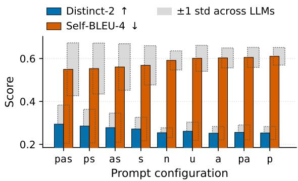
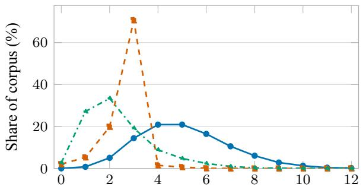
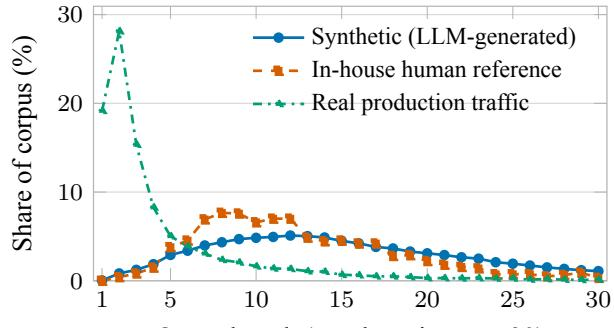

# Useful Diversity or Hallucinated Variety? Persona-Conditioned Synthetic Query Generation for E-Commerce Search

Filippos Ventirozos1,2 Tom Armitage2 Mahmoud Oshagh2

Peter A. Appleby2 Matthew Shardlow1

1Manchester Metropolitan University, Manchester, UK 2Autotrader UK, Manchester, UK {f.ventirozos, m.shardlow}@mmu.ac.uk

## Abstract

Synthetic supervision can bootstrap semantic parsers in new search domains, but promptinduced diversity is useful only when generations are faithful to the structured intent. We explore this for cold-start e-commerce search: 118,098 synthetic pairs produced by 6 LLMs with 9 persona-conditioned prompt families on a 47-field UK automotive schema, against 1,214 human-annotated and 15,304 production queries. We show that the IPIP personality bundle improves parser F1 in all four matched contrasts (Holm-corrected p < .001), and all three bundles have a positive main effect over the complete 23 grid. Syntax conditioning is the axis that moves generations towards real traffic. It also induces lexical diversity. Alignment sKL, the divergence between von Mises–Fisher distributions fitted to synthetic and humanannotated queries, is an unlabelled proxy for parser F1 $( \rho = - 0 . 9 1 7$ on intent-elicited human queries, lower is closer). An LLM committee, checked against a blinded author pass, triages the 927 queries missed by every parser and labels 37% as hallucinated. Dropped constraints dominate. The four syntax-bearing families have the largest hallucinated shares, 38 to 42%, while IPIP alone has the lowest at 28%.

## 1 Introduction

E-commerce platforms gain substantial UX and operational advantages by replacing faceted filters with natural-language interfaces. Form-based UIs scale poorly across vast catalogues (Hearst, 2009), while modern shoppers embed complex constraints, such as long-tail specifications and compound Boolean logic, that static forms cannot accommodate (Papenmeier et al., 2021; Luo et al., 2023; Moulton and Ng, 2024). Recent approaches therefore frame e-commerce retrieval as semantic parsing, mapping raw NL queries directly into structured API fields (Tagliabue and Greco, 2023; Weld et al., 2022). Training robust parsers requires extensive labelled data, making synthetic query generation an attractive scalable solution (Malik et al., 2024; Siddiqui et al., 2026). The task is not open-ended dialogue but the narrower problem of mapping a structured search intent to a plausible natural-language query and training a smaller downstream model on those pairs. We study it in UK automotive search, a real, high-dimensional testbed with 47 search fields and long-tail combinations of make, model, pricing, mileage, seller, finance, and feature constraints.

The central problem is not whether synthetic data can be made diverse. It mostly can. The problem is that useful diversity and schema faithfulness pull in different directions: aggressive prompting increases lexical and structural variation but can introduce unsupported attributes, flip inequality directions, or drift into assistant-style text that no longer matches the intent, while tightly constrained prompting preserves the schema and collapses outputs into repetitive templates. We use personas as an experimental mechanism for controlled variation along four axes (IPIP personality, attributestyle adjectives, syntactic modes, and UK demographic descriptors); their construction is in §3.1.

Our main empirical contributions are threefold. First, every conditioned parser beats the vanilla prompt; the complete 23 grid gives positive main effects for all three bundles, and the four matched contrasts put the IPIP bundle at +1.1 to +2.1 F1 points (§6.1). Second, we show that the alignment sKL between the synthetic corpus and a human reference is an unlabelled proxy for parser utility $( \rho = - 0 . 9 1 7$ on our elicited reference). Additionally, we compare an in-house reference with 15,304 live production queries (§4.5). Third, a three-judge LLM committee audit of the 927 universal parser failures, checked against a blinded author pass, locates the residual defects where syntax-bearing and demographic prompts drop the operator words that bind values to schema fields, and types them:

dropped constraints dominate, unsupported additions and direction reversals follow (§6.2).

## 2 Related Work

Persona-conditioned synthetic generation. LLM-generated supervision has become a standard substitute for human annotation (Wang et al., 2021; Honovich et al., 2023), and persona prompting is now the dominant axis for injecting controllable variation into those generations. Persona Hub (Ge et al., 2025) scales this to a billion personas, and a broader literature surveys role-play and personadriven generation as a controllable-variation mechanism (Tseng et al., 2024). The mechanism rests on the observation that Big Five personality variables (Goldberg, 1992) map onto measurable language cues (Mairesse et al., 2007). Most of this work evaluates persona-conditioned outputs through surface diversity or downstream accuracy; Kambhatla et al. (2025) found that fine-grained persona detail adds little lexical diversity over a prompt-length control, which makes prompt length a live confound for any persona manipulation. Whether persona-induced variation remains faithful to a structured target intent is still open.

Synthetic data generation for e-commerce search. A parallel line of work applies LLMgenerated supervision to e-commerce search. Luo et al. (2023) parse compound implicit constraints in Amazon product queries at scale, and Malik et al. (2024) build a natural-language productsearch interface with synthetic supervision in a cold-start setting; more broadly, synthetic-query generation is now a standard tool for training retrievers and rankers without labels (Bonifacio et al., 2022; Chaudhary et al., 2024). These papers evaluate synthetic queries through downstream retrieval or parser metrics, rarely by auditing the corpus itself against the structured catalogue fields the queries encode.

Position. The two closest prior works are by Kambhatla et al. (2025) on persona-induced lexical diversity in creative writing and by Schaffelder and Gatt (2026) on source diversity in fine-tuning corpora. We share the question but instrument it against a structured e-commerce schema, with a three-lens audit per prompt configuration: internal diversity, distributional alignment to a held-out human reference and downstream parser utility, plus an LLM-judge audit of the residual failures.

## 3 Synthetic Dataset

We generated synthetic natural-language queries from a proprietary structured search dataset provided by our industry partner Autotrader UK, a large UK online automotive marketplace,1 amounting to 13M search intents over 7 days. Each example begins as a structured search intent: field– value constraints such as make, model, body type, mileage limit, price bound, or seller type. Several fields carry an operator as well as a value, the relation that binds the value to the field: a price or mileage limit is a floor or a ceiling, a sort has a direction, and a location comes with a radius. In query text these relations are signalled by operator words such as “under”, “within”, “from” and “lowest”. We dampen high-frequency queries with a concave power transform to reduce duplicates.

For each LLM, we use the same set of intents for all 9 prompt settings. Between LLMs, however, the intent sets differ. The 9 configurations are therefore directly comparable, since each one is generated from the exact same underlying intents, whereas between the LLMs we draw conclusions more broadly.

## 3.1 Prompt Types and Motivation

We construct prompts from four different sources. Three of them (p, a, s) compose freely with one another, while the UK demographic axis u is used stand-alone, for reasons given below.

IPIP Big Five traits (p). To induce controlled linguistic variation, we steer register and phrasing using the IPIP Big Five personality axes (Goldberg, 1992): openness modulates exploratory versus conventional wording, conscientiousness governs explicit constraint marking, extraversion affects enthusiasm, agreeableness influences politeness, and neuroticism controls tentativeness. Prior work shows that these signals are reliably interpretable, with Jiang et al. (2024) reporting approximately 80% rater accuracy for intended traits, and that they remain stable across frontier models (Sorokovikova et al., 2024), which is important for multi-generator comparability. Each axis is sampled at three levels (high, low, neutral), with probability 0.3 assigned to the neutral state, yielding up to $3 ^ { 5 }$ combinatorial profiles per generation call (Appendix B).

UK demographic descriptors (u). Motivated by NVIDIA’s US-demographic persona set (Meyer and Corneil, 2025) and by evidence that structured demographic profiles aid realistic synthetic user conversations (Yun et al., 2025), we build UK demographic profiles from a UK Open Data consumer-segmentation source. Each frequent postcode area carries 57–221 attribute flags (median 132) spanning age, income, household, and lifestyle; per call we sample a postcode and draw 3–15 of its attributes (Appendix C).

Syntax modes (s). Following the Yahoo! webquery-log grammar of Barr et al. (2008), in which web queries form a grammar of their own dominated by noun phrases, we add an explicit syntax axis with six modes (noun phrases, telegraphic fragments, natural-language questions, imperatives, post-modified noun phrases, navigational fragments), weighted as in that study and each accompanied by two sampled in-prompt examples (Appendix D).

Attribute-style adjectives (a). Shoppers in our partner’s beta tests described cars with vague adjectives such as reliable, cheap and decent, which the schema has no field to hold. This is the vocabulary problem in human-system communication (Furnas et al., 1987): people name a thing differently from the system that stores it. We therefore add an axis that supplies such words deliberately, together with guards on when each one fits. It draws on eight dimensions: hard\_specs, aesthetic (sleek), kinetic (fast), affordance (family), evaluative (pristine), economic (affordable), social (luxury) and vague. One dimension is sampled per call, and a semantic-fit guard blocks mismatches. For instance, prestige wording is reserved for luxury models (Appendix E).

Prompt families. Table 4 in Appendix A lists the 9 prompt families. Here n is the vanilla prompt: the model receives only the structured intent and a generic instruction to produce a faithful shopper query. The three text-style bundles (p, a, s) compose freely, yielding the complete 23 grid: n, three single-bundle families, three pairwise families and the full pas. The UK demographic bundle stays stand-alone (u). A single postcode draw already injects 3–15 attributes from a pool of 57–221 flags, saturating the prompt with multi-cue conditioning, so mixing it with p, a and s would overflow the prompt budget and push us into the four-axis regime where mixing complete personas has been reported to degrade alignment (Bui et al., 2025).

We therefore read u as an exploratory comparator rather than a fourth axis.

Generation pool. We chose 6 state-of-the-art reasoning-mode LLMs, spanning closed-source frontier APIs (GPT-5.4 (OpenAI, 2026), Claude Opus 4.6 (Anthropic, 2026), Gemini 3.1 Pro (Google DeepMind, 2026)) and open-weight reasoning models (DeepSeek-R1-Distill-Llama-70B (Guo et al., 2025), Hunyuan-A13B-Instruct (Tencent Hunyuan Team et al., 2026), Qwen3-Next-80B-A3B-Thinking (Yang et al., 2025)). We held reasoning mode constant across the pool because chain-of-thought generation supports complex reasoning (Wei et al., 2022), which we expect to translate into schema faithfulness. Under the per-LLM intent-paired design, each LLM contributes 118,098/6 queries and each configuration’s slice holds 118,098/9 pooled across generators (Appendix F).

## 3.2 Diversity

We report two measures of internal lexical diversity. Distinct-2 (Li et al., 2016) rewards fresh bigrams, so a higher score means a more diverse corpus. Self-BLEU-4 (Zhu et al., 2018) goes the other way. It measures how much a corpus repeats itself, so lower values indicate greater diversity. Because the intents are matched across prompt configurations within each generator (§3.1), we compute both metrics separately for every (LLM, configuration) cell. Each cell is scored on its own train and validation pool, meaning everything in that cell’s corpus except for the reserved synthetic test set (§5.1). For each configuration, we then take the mean and standard deviation across LLMs.

Figure 1 orders the 9 configurations by Self-BLEU-4 (the more reliable of the two on a fixed pool). Two patterns dominate. First, syntaxbearing families are the diversity engine: ps, pas, as, and s lead on both metrics. Second, the cross-LLM spread itself grows with syntax: the grey shadows on ps and pas are roughly three times wider than on n, meaning a syntax instruction lets generator identity express itself — Gemini-3.1 and Opus-4.6 lean into the new register and lift diversity sharply, while three stay close to their default phrasing and Qwen3 becomes more repetitive (Table 9). Syntax-free conditioning is mostly a lexical nudge with tight cross-LLM agreement: p, a, and pa sit within 0.003 Distinct-2 of n. The demographicsonly family u is the only syntax-free prompt with a

  
Figure 1: Internal diversity per prompt configuration, ordered by Self-BLEU-4 (more diverse on the left). Coloured bars are the mean across 6 generators; the light-grey shadow behind each bar spans ±1 std across LLMs. Tall shadows flag configurations whose diversity depends heavily on the generator; short shadows indicate that the prompt itself, not the LLM, is doing the work.

Distinct-2 lead over n, and a small one.

## 4 Human Dataset

We collected 1,214 (NL query, structured intent) pairs through a University annotation campaign. The campaign ran two protocols. In the first, annotators write a free-form query and then express it by hand in the partner’s filter interface (§4.1). Under the second, annotators see a fixed, structured intent on a custom HTML page and write a query for it in their own words (§4.2). Ecological validity is higher in the first. The second protocol gives some of that up, in return for coverage breadth and for the intent matching that the alignment analysis needs. It also supplies 87% of the corpus. Because the intents are fixed in advance, the corpus spans vehicle types, price tiers and buying scenarios beyond the subset the recruited annotators would gravitate towards on their own.

Both protocols draw on the same pool of nine annotators: seven took part in the persona-card protocol and six in the website-front verification, with four in both. All were screened to give a mix of age, gender and self-rated car knowledge via a pre-task questionnaire. Self-rated car knowledge ranged from 1 to 4 on a 5-point scale, so the pool holds novices, intermediates and enthusiasts side by side. Five of the nine were planning to buy a car, either actively or in the near term, and prior familiarity with the partner platform ranged from frequent users to people who had never opened it. The spread is deliberate, so the corpus exhibits betweenuser variation rather than a single domain-expert style. Appendix G gives the agreement metrics and filtering.

## 4.1 Protocol 1: Verification through the Partner’s Website Front

Annotators write a free-form NL query and then express it themselves on the partner’s ordinary filter-based search page, choosing make, model, body type, price, mileage and the rest by hand and recording the resulting URL. The structured intent is therefore the annotator’s own reading of their query rather than a system’s parse, and these are the only rows written without a schema or persona stimulus in view. A second independent pass over the same items supplies double coverage. The protocol yielded 156 pairs after filtering (Appendix G), across six 30-item batches.

## 4.2 Protocol 2: Custom HTML Page Experiment

Annotators see each structured intent as a thirdperson scenario card and type their own NL query into a browser form. GPT-5.2 wrote the cards. We settled on it after comparing how several LLMs structure such scenarios. A field list beside the card—the same field–value list the card was written from—lets annotators verify that their query covers all intended constraints. Below, we refer to this as the persona-card protocol. It yielded 1,058 retained pairs after filtering (Appendix G).

## 4.3 External Reference: Live Production Traffic

To obtain a reference that no annotation stimulus shaped, we additionally take one month of naturallanguage queries submitted to the partner’s deployed search interface. We never score a parser on it: its query text feeds the alignment analysis, and its recorded fields enter only the corpus comparison of §4.4. Every logged string was screened for personal data and matching rows discarded (Ethics Statement), leaving 15,304 of the 15,562 logged queries.

## 4.4 Data Statistics

The synthetic corpus contains 118,098 (query, intent) pairs across the 9 prompt configurations; the held-out human reference contains 1,214 pairs (1,058 persona-card, 156 website-front); the unlabelled production reference contains 15,304 queries. Synthetic examples average 5.96 structured fields and 17.6-word queries, human examples 3.17 fields and 14.3 words, and production queries 4.8 words (median 3). Real queries are short because most are lookups rather than constrained requests: 19.2% are a single word, 83.0% contain no operator word at all, and among queries of two words or fewer that the deployed engine parsed, 62.4% resolve to a make or a model and nothing else. Mitsubishi outlander, BMW 330i, electric corsa, wheelchair accessible and LHD (left-hand drive) are typical. The length gap is real (Table 10): 47.3% of production queries are two words or shorter, against 0.4% of the human reference and 0.9% of the synthetic corpus. Field coverage on both annotated sides follows the marketplace distribution, with search\_make and search\_model most frequent.

## 4.5 Alignment to Human and Production References

We fit von Mises–Fisher distributions (Banerjee et al., 2005) to each synthetic and each reference embedding cloud (OpenAI text-embedding-3-large, unit-normalised) by maximum likelihood with the Banerjee–Sra high-dimensional approximation. We report Spread κ (the synthetic-side concentration; lower is broader) and Alignment sKL (the symmetric KL divergence between a synthetic fit and a reference fit; lower is closer). Repeating the measurement against the production corpus of §4.3, with parser F1 (§5.1) held at its in-house value, isolates one question: whether the ranking depends on how the reference was elicited (Table 1).

The two configurations that pair personality with syntax, pas and ps, produce the synthetic queries that are closest to every reference, including real traffic. The adjectives-only configuration a is always the furthest or second furthest. Its queries and those of the vanilla prompt n form the two most concentrated clouds (κ). The two references written without a stimulus in view, website-front (protocol 1) and real traffic, order all nine configurations almost identically (Kendall $\tau = 0 . 9 4 4 )$ . Both put the four syntax-bearing configurations closest, because s shortens queries and strips grammatical glue (Appendix J).

Persona-card (protocol 2) queries have a different register. Annotators write them in response to a descriptive scenario card, and the queries are longer and mostly in the first person (15.0 words on average, compared with 9.5 for website-front). An annotation stimulus shapes the data collected under it (Parmar et al., 2023). That first-person register is what p and u add to generated queries (Appendix J), so the persona-card reference moves u and pa up the ranking and s down $( \tau = 0 . 5 0 0$ against real traffic).

The parsers are scored mostly on persona-card rows, yet the IPIP gains in F1 also hold on the free-form website-front queries, in three of the four contrasts (Table 12). Alignment to the persona-card reference tracks parser F1 closely $( \rho = - 0 . 9 1 7 \mathrm { . }$ $p \ < \ . 0 0 1 )$ . The correlation stays strong against the full in-house (protocols 1 & 2) reference $( \rho =$ −0.800, Table 13), but against real traffic it is weak $( \rho = - 0 . 3 5 0 , p = . 3 6 )$ . Each reference answers its own question. Label-free alignment sKL therefore tracks parser utility when the reference matches the evaluation queries, and measures realism when the reference is real traffic.

## 5 Methodology

## 5.1 Per-Configuration Parser

We fine-tuned a Flan-T5-Large parser (Chung et al., 2024) for each prompt configuration on 10,910 instances of that configuration alone, with 1,212 for validation, plus a mixed-corpus parser on a training set of the same size sampled uniformly across all 9 configurations. All 9 + 1 parsers were fully fine-tuned with best-checkpoint selection on validation F1 (training details in Appendix I) and were evaluated with greedy decoding on the 1,214-pair held-out human reference (§4) and a reserved synthetic test set. Following the tuple-level F1 used in aspect-based sentiment analysis (ABSA) (Pontiki et al., 2016), a predicted (field, value) tuple counts as a true positive only if both the field name and its value match the gold, regardless of prediction order.

## 5.2 LLM-as-Judge Committee

To triage T5 errors into likely parser-side failures and likely unfaithful synthetic instances, we use a three-judge LLM committee. Each judge is a current frontier reasoning model from one of the closed-source generator families: claude-opus-4-7, gpt-5.5-pro and gemini-3.1-pro-preview, each invoked at its highest reasoning setting. Per-instance labels are taken by majority vote. The committee was asked one binary question, whether the generator hallucinated the intent, under a cleanroom prompt exposing only the seed (field, value) tuples and the resulting query, with no LLM identity, promptconfiguration code, or parser predictions visible. That rubric is more permissive than the metric the parser is scored on, accepting “Japanese car” for make=Honda and “low mileage” for an exact 40,000-mile bound, which the exact field–value metric counts as errors. Its labels are therefore a triage signal for locating defects, not faithfulness scores on the parser’s scale. Full prompts, model settings, aggregation, reliability, and one scoring rule for the no-limit search radius are in Appendix K.

<table><tr><td rowspan=1 colspan=7>In-house human reference              Real usersCfg F1↑      Spread κ↓  Persona-card  Website-front  Both protocols  Production $_ { n = 1 , 0 5 8 }$          $n { = } 1 5 6$           $_ { n = 1 , 2 1 4 }$        $\scriptstyle n = 1 5 , 3 0 4$ </td></tr><tr><td rowspan=1 colspan=1>pas</td><td rowspan=1 colspan=1> $7 9 . 6 2 _ { 1 \mathrm { s t } }$ </td><td rowspan=1 colspan=1>3641</td><td rowspan=1 colspan=1> $\mathbf { 2 6 4 . 6 } _ { \mathrm { l s t } }$ </td><td rowspan=1 colspan=1> $\mathbf { 4 3 8 . 5 } _ { \mathrm { l s t } }$ </td><td rowspan=1 colspan=1> $\mathbf { 2 5 2 . 5 } _ { \mathrm { l s t } }$ </td><td rowspan=1 colspan=1> $\mathbf { 8 1 2 . 5 } _ { \mathrm { 1 s t } }$ </td></tr><tr><td rowspan=1 colspan=1>pa</td><td rowspan=1 colspan=1> $7 9 . 4 0 _ { 2 \mathrm { n d } }$ </td><td rowspan=1 colspan=1>3786</td><td rowspan=1 colspan=1> $2 7 9 . 5 _ { 4 0 }$ </td><td rowspan=1 colspan=1> $4 9 7 . 5 \mathrm { { 7 t h } }$ </td><td rowspan=1 colspan=1> $2 7 3 . 5 \mathrm { { s t h } }$ </td><td rowspan=1 colspan=1> $\overline { { 9 2 8 . 7 _ { 8 \mathrm { t h } } } }$ </td></tr><tr><td rowspan=1 colspan=1>u</td><td rowspan=1 colspan=1> $7 9 . 1 9 _ { 3 \mathrm { r d } }$ </td><td rowspan=1 colspan=1>3756</td><td rowspan=1 colspan=1> $2 7 7 . 0 _ { 3 \mathrm { r d } }$ </td><td rowspan=1 colspan=1> $4 8 3 . 7 _ { 5 \mathrm { t h } }$ </td><td rowspan=1 colspan=1> $2 6 9 . 5 _ { 3 \mathrm { r d } }$ </td><td rowspan=1 colspan=1> $8 9 4 . 1 _ { 5 \mathrm { t h } }$ </td></tr><tr><td rowspan=1 colspan=1>ps</td><td rowspan=1 colspan=1> $7 9 . 0 5 _ { 4 0 }$ </td><td rowspan=1 colspan=1>3653</td><td rowspan=1 colspan=1> $2 7 0 . 1 _ { 2 \mathrm { n d } }$ </td><td rowspan=1 colspan=1> $4 4 7 . 2 _ { 2 \mathrm { n d } }$ </td><td rowspan=1 colspan=1> $2 5 8 . 5 _ { 2 \mathrm { n d } }$ </td><td rowspan=1 colspan=1> $8 2 1 . 6 _ { 2 \mathrm { n d } }$ </td></tr><tr><td rowspan=1 colspan=1>as</td><td rowspan=1 colspan=1> $7 8 . 5 5 \mathrm { { 5 } \mathrm { { 5 } \mathrm { { t h } } } }$ </td><td rowspan=1 colspan=1>3681</td><td rowspan=1 colspan=1> $2 8 1 . 9 _ { 5 \mathrm { t h } }$ </td><td rowspan=1 colspan=1> $4 5 5 . 5 _ { 3 \mathrm { r d } }$ </td><td rowspan=1 colspan=1> $2 6 9 . 9 _ { 4 0 }$ </td><td rowspan=1 colspan=1> $8 3 0 . 9 _ { 3 \mathrm { r d } }$ </td></tr><tr><td rowspan=1 colspan=1>p</td><td rowspan=1 colspan=1> $7 7 . 9 9 _ { 6 \mathrm { t h } }$ </td><td rowspan=1 colspan=1>3789</td><td rowspan=1 colspan=1> $2 8 2 . 4 6 \mathrm { t h \ }$ </td><td rowspan=1 colspan=1> $5 0 0 . 0 _ { 8 0 }$ </td><td rowspan=1 colspan=1> $2 7 6 . 4 \mathrm { { 7 t h } }$ </td><td rowspan=1 colspan=1> $9 2 7 . 1 \mathrm { _ { 7 t h } }$ </td></tr><tr><td rowspan=1 colspan=1>a</td><td rowspan=1 colspan=1> $7 7 . 7 0 \mathrm { { 7 t h } }$ </td><td rowspan=1 colspan=1>3838</td><td rowspan=1 colspan=1> $3 1 8 . 7 _ { 8 \mathrm { t h } }$ </td><td rowspan=1 colspan=1> $5 2 4 . 8 9 \mathrm { { t h } }$ </td><td rowspan=1 colspan=1> $3 1 1 . 1 \mathrm { { . 9 1 } \mathrm { { 1 } } }$ </td><td rowspan=1 colspan=1> $9 4 5 . 0 9 \mathrm { { t h } }$ </td></tr><tr><td rowspan=1 colspan=1>S</td><td rowspan=1 colspan=1> $7 6 . 9 1 _ { 8 1 \mathrm { h } }$ </td><td rowspan=1 colspan=1>3691</td><td rowspan=1 colspan=1> $2 8 7 . 2 \mathrm { { 7 t h } }$ </td><td rowspan=1 colspan=1> $4 6 5 . 7 _ { 4 0 }$ </td><td rowspan=1 colspan=1> $2 7 5 . 8 _ { 6 \mathrm { t h } }$ </td><td rowspan=1 colspan=1> $8 4 1 . 5 _ { 4 \mathrm { t h } }$ </td></tr><tr><td rowspan=1 colspan=2>n      $7 5 . 9 8 \mathrm { { _ { 9 t h } } }$ </td><td rowspan=1 colspan=1>3869</td><td rowspan=1 colspan=1> $3 2 1 . 4 \mathrm { { g } } \mathrm { { h } }$ </td><td rowspan=1 colspan=1> $4 9 5 . 6 _ { 6 \mathrm { t h } }$ </td><td rowspan=1 colspan=1> $3 0 9 . 8 _ { 8 \mathrm { t h } }$ </td><td rowspan=1 colspan=1> $9 0 2 . 2 _ { 6 \mathrm { t h } }$ </td></tr><tr><td rowspan=1 colspan=7>Reference spread κ                 3323           3116            3233           2407Spearman ρ (rank vs. F1)          -0.917          $- 0 . 4 1 7$          -0.800        -0.350</td></tr></table>

Table 1: Alignment sKL (von Mises–Fisher symmetric KL, lower is closer) from each prompt configuration to each reference, with every value’s within-column rank as a subscript and cell shading on each column separately (darker is better: higher F1, lower sKL). Spread κ is the synthetic cloud’s own concentration (lower is broader). Rows are ordered by tuple F1 on the in-house test set, so a proxy that tracked utility perfectly would read 1st, 2nd, . . . down each column; F1 is identical across columns because no parser was scored on production text. Absolute sKL is not comparable across columns (real traffic is more dispersed); only the within-column ranking is. All three production views give identical rankings (τ=1.000).

## 6 Results

We report parser utility per configuration (§6.1) and a conditional universal-fail audit by configuration and generator (§6.2).

## 6.1 Parser Utility on Human Eval

Table 2 reports F1 with field–value precision and recall on the held-out 1,214-pair human reference for the 9 + 1 per-configuration T5 parsers.

The vanilla baseline n underperforms every conditioned configuration, by 0.9 to 3.6 F1 points. We test the four planned IPIP contrasts with a paired bootstrap over the 1,214 human test queries (100,000 resamples, Appendix I). The IPIP bundle improves F1 in all four contrasts. The gains are +2.01 points for $\mathsf { n {  } p } , \mathsf { + } 1 . 7 0$ for a→pa, +2.14 for s→ps and +1.08 for as→pas. All four 95% confidence intervals exclude zero. Holm-corrected p-values are below .001 throughout. These gains are attributable to the whole p bundle (§3.1), and the effect of personality alone cannot be isolated from it. Recall exceeds precision in every configuration (80.87–82.50 against 73.57–79.10), so the parsers recover the intended fields but also produce false-positive tuples.

<table><tr><td>Cfg</td><td>F1</td><td>Prec.</td><td>Rec.</td></tr><tr><td>n</td><td> $7 5 . 9 8 \pm 0 . 2 2$ </td><td> $7 3 . 5 7 \pm 0 . 4 0$ </td><td> $8 0 . 9 4 \pm 0 . 1 4$ </td></tr><tr><td>S</td><td> $7 6 . 9 1 \pm 0 . 2 0$ </td><td> $7 4 . 6 7 \pm 0 . 2 4$ </td><td> $8 1 . 7 1 \pm 0 . 2 9$ </td></tr><tr><td>a</td><td> $7 7 . 7 0 \pm 0 . 2 0$ </td><td> $7 6 . 5 5 \pm 0 . 3 3$ </td><td> $8 0 . 8 7 \pm 0 . 1 8$ </td></tr><tr><td>p</td><td> $7 7 . 9 9 \pm 0 . 2 3$ </td><td> $7 6 . 4 0 \pm 0 . 3 9$ </td><td> $8 1 . 6 9 \pm 0 . 0 7$ </td></tr><tr><td>as</td><td> $7 8 . 5 5 \pm 0 . 2 7$ </td><td> $7 7 . 0 7 \pm 0 . 1 7$ </td><td> $8 2 . 2 1 \pm 0 . 4 5$ </td></tr><tr><td>ps</td><td> $7 9 . 0 5 \pm 0 . 4 0$ </td><td> $7 7 . 7 4 \pm 0 . 5 7$ </td><td> ${ \pm 0 . 5 0 \pm 0 . 1 1 }$ </td></tr><tr><td>u</td><td> $7 9 . 1 9 \pm 0 . 5 5$ </td><td> ${ \bf 7 9 . 1 0 \pm 0 . 7 8 }$ </td><td> $8 1 . 3 6 \pm 0 . 4 2$ </td></tr><tr><td>pa</td><td> $7 9 . 4 0 \pm 0 . 3 1$ </td><td> $7 8 . 8 5 \pm 0 . 3 6$ </td><td> $8 1 . 9 1 \pm 0 . 2 5$ </td></tr><tr><td>pas</td><td> $\mathbf { 7 9 . 6 2 \pm 0 . 4 0 }$ </td><td> $7 8 . 7 1 \pm 0 . 4 7$ </td><td> $8 2 . 4 7 \pm 0 . 3 4$ </td></tr><tr><td>mixed</td><td> $7 9 . 3 6 \pm 0 . 1 8$ </td><td> $7 8 . 7 1 \pm 0 . 3 7$ </td><td> $8 2 . 0 2 \pm 0 . 0 7$ </td></tr></table>

Table 2: Per-configuration parser utility on the held-out human reference, tuple-level F1 with field–value precision and recall, mean ± std across three train/val resamples (test set held fixed, all numbers ×100). mixed is the uniform-sample baseline pooling all 9 configurations at matched training volume.

The bundles p, a and s form a complete $2 ^ { 3 }$ grid. The same rows, therefore, give main effects and interactions for all three bundles. Averaged over the other two bundles, the main effects are +1.73 F1 points for p (95% confidence interval 1.40 to 2.07), +1.34 for a (1.05 to 1.63) and +0.76 for s (0.42 to 1.11). All three intervals exclude zero. Combining bundles still helps, but their gains overlap. A pairwise interaction measures how much smaller one bundle’s gain is when the other is already present. Every interaction is negative. The values are −0.68 F1 points for pa, −0.46 for as, −0.25 for ps and −0.75 for the three-way pas term. Adding p, for instance, is worth +2.01 F1 on the vanilla prompt and +1.08 on top of as (n→p against as→pas). The pas parser scores highest, but only by 0.22 F1 points over pa and 0.27 over mixed. The confidence intervals of both differences include zero. The three parsers are therefore statistically indistinguishable.

The IPIP gains hold when we split the human reference by collection protocol (persona-card or website-front) or by the number of fields in the gold intent (0–2, 3, or 4+). Across these five subsets, all 20 gains (four contrasts per subset) stay positive, and 16 of their 20 confidence intervals exclude zero (Appendix I, Table 12).

## 6.2 Conditional Universal-Fail Audit

We next audit the synthetic test mixed-corpus, a 9,000-row pool uniformly sampled across the 9 prompt configurations. A query missed by every parser, across every configuration and all three resamples, is unlikely to be one run’s idiosyncrasy, and it isolates the generator’s central question: is the query a faithful but rare expression of the intent, or did generation drift from the intended field– value set? We mark a query universally failed if all 3 × (9 + 1) = 30 runs fail to parse it perfectly, yielding 927 rows, about 10% of the pool. The estimand is explicitly conditional: we measure P(hallucination | universal failure), which is not P(hallucination).

Where the hard cases sit. Hard cases concentrate in the demographic and syntax-bearing prompts (Table 3, denominators): u contributes the most rows (129) and n and a the fewest (73 and 72). Column totals are comparable because, within each generator, the same intent indices are verbalised under every configuration (§3), so no configuration is favoured by an easier slice of intents. Row totals are not: each generator holds an equal share of the test pool, but each LLM verbalised its own intent index set, so Opus-4.6’s 415 rows against GPT-5.4’s 62 count universal failures on different intents rather than ranking the generators.

Hallucination audit. Within the 927 universal failures, the committee labels 345 rows (37.2%) as hallucinated and 582 (62.8%) as faithful (Table 3). By prompt configuration, the share of hallucinated rows rises from 28.2% to 42.3% in the order $\mathsf { p } < \mathsf { n } < \mathsf { a } < \mathsf { p a } < \mathsf { u } < \mathsf { s } < \mathsf { a s } < \mathsf { p s } < \mathsf { p a s } .$ Every judge places p, n and a lowest. The three multi-axis syntax configurations, as, ps and pas, sit in the upper half of every judge’s ordering, while the positions of s, u and pa vary by judge. By generator, Opus-4.6 (124 rows) and Gemini-3.1 (74) together account for 57% of the 345 hallucinated rows. For both generators, about two thirds of their hallucinated rows fall in the four syntax-bearing configurations (63% and 70%). Qwen3 is a clean outlier (0/78). Hunyuan-A13B and DeepSeek have the highest hallucinated share of their own rows (63/101 and 65/116). Read together, the two orderings locate the hallucinated universal failures. Among the queries that every parser missed, those written under a syntax-bearing configuration are the most likely to have drifted from their intent (42.3% for pas against 28.2% for p). Opus-4.6 and Gemini-3.1 produce the most drifted queries, largely under those same configurations. Hunyuan-A13B and DeepSeek produce fewer, but a larger fraction of their own universal failures has drifted.

Manual author audit. On a random sample of 100 cases, drawn in proportion to configuration, a two-pass author audit (a blinded first pass followed by adjudication of the disagreements) agrees with the committee majority on 83% of cases (Appendix K). The author labels 25 cases as hallucinated: nine omitted constraints (most often the sort order), six omitted search radii of 40 to 100 miles, nine altered values (five of which reverse a direction) and one ambiguous numeric case. The committee flags more than the author accepts, with precision 0.60 at recall 0.96 against the author’s labels, which is why we read it as a triage instrument (§5.2).

Hallucination types. Each judge also gives a short rationale for its verdict. We tag the rationales of all 948 hallucinated verdicts, up to three per query, with deterministic cue lexicons for four non-exclusive patterns (Appendix K). The resulting shares are cue rates, not a partition of errors. Dropped constraints dominate (57.3%), especially under u and the syntax-bearing prompts. Unsupported additions are less common (15.7%), and their commonest form is quietly widening a discrete field: an intent for five doors gets written as “3 or 5 doors”. Under the u configuration a second kind shows up, with Gemini-3.1 carrying the sampled persona’s town and price preference into the query. An intent with no location and no price becomes “cheapest Volvo XC40 SUV 2018 or newer within 30 miles of Doncaster”. Direction reversals are rarer (6.8%) and concentrated in Hunyuan-A13B and DeepSeek. They sit on ordered fields: a minimum price of £500 becomes “under £500” and a descending price sort becomes “lowest to highest”. Swapped values are essentially absent (0.2%). The two flagged rationales come down to one intent, where the “Petrol Hybrid” fuel type was written as plain “Petrol”.

<table><tr><td>LLM</td><td>n</td><td>u</td><td>p</td><td>a</td><td>S</td><td>pa</td><td>ps</td><td>as</td><td>pas</td><td>All</td></tr><tr><td>DeepSeek</td><td>2/9</td><td>8/13</td><td>7/13</td><td>7/13</td><td>4/10</td><td>11/17</td><td>8/13</td><td>9/13</td><td>9/15</td><td>65/116</td></tr><tr><td>Gemini-3.1</td><td>3/9</td><td>14/20</td><td>2/6</td><td>2/10</td><td>14/28</td><td>1/7</td><td>8/17</td><td>13/31</td><td>17/27</td><td>74/155</td></tr><tr><td>GPT-5.4</td><td>2/7</td><td>2/6</td><td>3/8</td><td>2/5</td><td>2/7</td><td>2/6</td><td>2/8</td><td>2/6</td><td>2/9</td><td>19/62</td></tr><tr><td>Hunyuan</td><td>10/16</td><td>10/14</td><td>3/7</td><td>5/8</td><td>13/16</td><td>7/11</td><td>5/10</td><td>4/9</td><td>6/10</td><td>63/101</td></tr><tr><td>Opus-4.6</td><td>6/20</td><td>14/65</td><td>9/43</td><td>8/29</td><td>15/57</td><td>9/33</td><td>27/64</td><td>18/50</td><td>18/54</td><td>124/415</td></tr><tr><td>Qwen3</td><td>0/12</td><td>0/11</td><td>0/8</td><td>0/7</td><td>0/9</td><td>0/8</td><td>0/8</td><td>0/7</td><td>0/8</td><td>0/78</td></tr><tr><td>All</td><td>23/73</td><td>48/129</td><td>24/85</td><td>24/72</td><td>48/127</td><td>30/82</td><td>50/120</td><td>46/116 52/123</td><td></td><td>345/927</td></tr></table>

Table 3: Committee majority-vote labels within the conditional universal-fail subset, under the rubric of §5.2. Each cell shows $n _ { \mathrm { h a l l u } } / n _ { \mathrm { m a j o r i t y } }$ among the 927 universal failures after the scoring rule of Appendix K, shaded by absolute $n _ { \mathrm { h a l l u } }$ . Configurations enter this pool at different rates, so these composition counts estimate neither configuration-level nor corpus-level hallucination rates.

The errors under syntax prompts seem to come from a function-word tax: noun-phrase and telegraphic modes drop words such as “under”, “within”, “from”, and “lowest”, which often carry the schema operator. Those two modes have the largest hallucinated shares, 43.4% and 41.8%, while post-modified noun phrases, which keep the relational prepositions, carry the smallest, 25.7% (Table 6). Syntax prompting still helps, but it should not blindly strip prepositions or stop-words.

## 7 Discussion

We read each axis through the four lenses of the paper: utility is parser F1 (§6.1), realism is alignment sKL to real traffic (§4.5), diversity is Distinct-2 and Self-BLEU-4 (§3.2), and faithfulness is the audit (§6.2).

Syntax (s). Realism: the only axis that moves generations towards real traffic in every matched contrast (−60.7 to −116.1 sKL, Table 15). It works by deleting grammatical glue. Adding s cuts the function-word share by 2.5 points and the share of queries carrying an operator word by 4.2 points (Appendix J), and real traffic is 20.8% function words against 42.3% in our reference. Diversity: the four syntax-bearing families lead on both metrics, and the cross-LLM spread grows with syntax (§3.2). Utility: the smallest main effect of the three, +0.76 F1. Faithfulness: the deleted glue includes the operator words (“under”, “within”, “from”). Their absence is the commonest cue in the hallucinated rationales, and the four syntax-bearing configurations have the highest hallucinated shares in the audited pool (§6.2). Realism and faithfulness risk may therefore be two sides of one operation.

Personality (p). Utility: the most reliable gain of the three bundles, +1.73 F1 as a main effect and positive in all four matched contrasts (§6.1). Realism: the gain does not come from moving closer to real traffic, most of which is short keyword queries. The bundle makes queries longer (+3.4 words) and more often written in the first person, “I” or “my” (+7 points, Appendix J): on the vanilla prompt it moves generations away from real traffic (+24.9 sKL), while towards the reference our annotators wrote it helps in every contrast (−17.3 to −37.6 sKL, Table 15). A persona prompt does not turn the model into that person (Zheng et al., 2024; Hu and Collier, 2024). p works instead like paraphrasing, which widens wording but leaves sentence structure intact (Niu et al., 2023): operator words and intent stay, and the parser trains on more wordings of each field–value set. Diversity: a lexical nudge only (§3.2). Faithfulness: p is low on hallucinations (28.2% of its hard cases, the lowest share in Table 3), which makes it the cleanest case of useful diversity. The tension between diversity and label correctness reported for LLM-generated data (Chung et al., 2023) is therefore two dials rather than one, and our axes turn them separately. The lexical dial, p, buys utility. The form dial, s, buys realism at the plausible cost of operator words, and pas turns both.

Adjectives (a). Utility: a barely changes query length or word choice (Appendix J), yet its gain is almost all precision, the vanilla parser’s weak side (precision 73.6 against recall 80.9): +2.20 precision, +0.15 recall, +1.34 F1 (main effects derived from Table 2). Realism: alone, a is the furthest configuration from real traffic (+42.9 sKL over n), but under s it helps (−10.6 and −9.0). Diversity: none beyond n. The adjectives are given as suggestions in the prompt when they match semantically (Appendix E). Mostly Gemini-3.1 and Opus-4.6 use them, and only their cells move on Distinct-2. Faithfulness: 33% of its hard cases are hallucinated, below the pooled 37% (Table 3).

Demographics (u). We did not cross u with the other axes, so it has no matched contrasts, and the UK-exposure caveat of §9 applies. Utility: the highest precision of the nine parsers (79.10) and third on F1. It also has the widest coverage of frequent production vocabulary, 73.6% of the thousand most frequent content words against 60.9% for n (Appendix J). Realism: real traffic ranks it fifth of nine, behind every syntax-bearing configuration. The in-house reference ranks it third (§4.5). Diversity: a small Distinct-2 lead over the other syntax-free prompts (+0.007 over n) and no gain on Self-BLEU-4. Faithfulness: 37% of its hard cases are hallucinated, equal to the pooled rate (Table 3), and it has a failure type of its own, persona leakage: Gemini-3.1 writes the sampled persona’s town and price preference into queries whose intent has neither (§6.2).

Diversity and alignment as proxies. Distinct-2 and Self-BLEU-4 flag a generator that recycles a few templates. Neither tracks parser F1. Alignment sKL does (ρ = −0.917, Table 1), but only against the reference that produced it (§4.5). Without labels, track sKL against a named reference (real traffic where available), watch synthetic κ for generations bunching up, and hand-check a sample for missing constraints, unsupported additions and direction reversals.

Generator identity. Generator identity is a second source of risk, and the last column of Table 3 shows the spread, from Qwen3’s zero to more than half of the hard cases of Hunyuan-A13B and DeepSeek (§6.2). Hunyuan-A13B and DeepSeek also hold nearly all the direction reversals (§6.2).

Adding syntax raises Gemini-3.1’s share in all four matched pairs and Opus-4.6’s in three, the two generators whose diversity also responds most to syntax. Hunyuan-A13B hallucinates in at least four of ten hard cases, whatever the prompt. These are generator-level patterns, descriptive only (§6.2, §9). Ultimately, prompt recipes behave differently from model to model. Reasoning-capable LLMs writing short queries can still hallucinate.

## 8 Conclusion

We evaluated 9 persona-conditioned prompt configurations across 6 LLM generators at matched training volume, against 1,214 human-annotated and 15,304 production queries. Conditioning pays. Every conditioned parser beats the vanilla prompt, and the IPIP personality bundle is the most reliable addition, +1.1 to +2.1 F1 in all four matched contrasts. Adjectives and syntax add smaller gains that partly overlap, and pas, pa and the mixed corpus form a statistically indistinguishable top group. Syntax alone moves generations towards real traffic in every contrast and drives diversity, at the plausible cost of the operator words where the audited defects concentrate. Personality widens the wording of each intent. Adjectives raise precision and leave recall almost unchanged. Alignment sKL is a good label-free proxy for parser F1 (ρ = −0.917 on the persona-card reference). For deployment we recommend the IPIP prompt as the default, adjectives when the parser over-extracts, and syntax when realism matters, with a check that operator words survive. Each new generator needs a hallucination audit of sampled generations.

## 9 Limitations

Domain and distribution. The study is limited to one UK automotive marketplace and one search schema. Automotive search is a useful stress test because it contains many numeric, categorical, and operator-valued fields, but the findings are evidence about this domain and schema only.

UK-cultural exposure confound. The u condition assumes that generators can interpret UK geodemographic descriptors, postcode-area cues, and British automotive/search vocabulary. We do not know how much UK-specific data each LLM saw during pre-training, instruction tuning, localisation, or reinforcement learning. Since the generator pool includes models developed by organisations in different countries and deployment ecosystems, differences under u may reflect uneven exposure to British data rather than the demographic prompt design alone. We therefore avoid attributing behaviour to model nationality; the relevant unobserved factor is each model’s training and alignment data composition.

Generator comparisons. Prompt comparisons are controlled within each generator, but generatorlevel patterns are descriptive. Different generators use different seed-intent slices, vendor stacks, decoding controls, and closed-model implementations. Per-generator diversity trends and auditedpool counts should therefore be read as diagnostics rather than as risk estimates or a definitive LLM leaderboard.

Conditional faithfulness audit. The committee audit is restricted to universal parser failures, so it estimates P(hallucination | universal parser failure) rather than full-corpus hallucination. Its three LLM judges overlap with generator families and are a triage instrument, not an oracle. The manual author-validation sample contains only 100 cases from this same subset; one author cannot provide human–human agreement, per-configuration cells are too small for rate comparisons, and the sample does not estimate fullcorpus label noise. Because pool entry requires every parser to fail, systematic drift that the parsers have absorbed is invisible to the audit.

Reasoning-model and scale restriction. The generator pool consists of relatively large reasoning-capable LLMs. Smaller models, nonreasoning chat models, or models run without explicit reasoning support may respond very differently to persona, syntax, and demographic prompts. They may show different diversity–faithfulness trade-offs, different rates of dropped or reversed constraints, and different sensitivity to UK-specific cues. Therefore, the prompt rankings reported here should not be applied directly to cheaper, smaller, or non-reasoning generators without re-running the same alignment, parser-utility, and faithfulness checks.

Prompt-axis sampling. The prompt families use different internal sampling schemes: IPIP trait levels, syntax modes, adjective classes, and UK demographic attributes are sampled from separate priors. The families also differ in token length, constraint wording, in-prompt demonstrations, and semantic guards, and we ran no length-matched placebo, so a bundle’s effect is not separated from the extra instruction text it carries; Kambhatla et al. (2025) report that fine-grained persona detail can add little over a length control. The related finding of Bui et al. (2025) concerns mixing several complete personas within one generation and does not speak to combining the stylistic bundles used here, so it is not evidence for or against our composition choice. Alternative priors or bundle designs could shift the absolute diversity, alignment, and parser-utility scores, and our results should be read as evidence about these operationalisations rather than as an exhaustive search over prompt-sampling policies.

## Ethics Statement

Privacy and data minimisation. The marketplace data that seed generation are treated as anonymised structured search intents rather than user histories. No persistent user identifiers, session trajectories, or personal profiles are used in the experiments. The production reference of §4.3 additionally uses real user query text, which is not anonymous at source, so before any query left our infrastructure every logged string was screened for vehicle registration marks, full residential postcodes, telephone numbers, and first-person household detail, and matching rows were discarded rather than redacted (257 of 15,562 rows, 1.65%, plus one blank query dropped before embedding). Discarding rather than masking avoids leaving partial identifiers in place, and structured browser and account context in the logs (postcode, latitude, longitude, session sort order) is dropped upstream by the schema map and never reaches the reference.

Human annotators. Human-authored queries are used only for evaluation and alignment analysis, not to infer annotator traits or train user-specific models. Annotator background information is reported only in aggregate. Annotators were recruited through a University annotation campaign and rewarded with University credits.

Demographic prompting. The UK demographic prompts use synthetic area-level descriptors and must not be interpreted as modelling real individuals. Such prompts can encode stereotypes or proxy protected attributes. They should not be used for user profiling, eligibility decisions, personalised pricing, or demographic targeting.

Consumer-facing risk. Unfaithful synthetic queries can teach parsers to drop, add, or reverse constraints such as price limits, radius, finance terms, mileage, or sort order. In a live search product, these errors could affect which listings users see. Synthetic data should therefore be filtered or repaired before deployment, and user-facing systems should preserve confirmation, correction, or fallback mechanisms.

## Acknowledgements

We thank the annotators who took part in the University annotation campaign for their time and care. This work was funded by Autotrader UK, which also provided the data; we are grateful to our colleagues there for their support.

## References

Anthropic. 2026. System card: Claude Opus 4.6. Technical report, Anthropic. https://www-cdn.anthropic.com/ 14e4fb01875d2a69f646fa5e574dea2b1c0ff7b5. pdf. Accessed 1 October 2026.

Arindam Banerjee, Inderjit S. Dhillon, Joydeep Ghosh, and Suvrit Sra. 2005. Clustering on the unit hypersphere using von Mises-Fisher distributions. Journal ofMachine Learning Research, 6(46):1345–1382.

Cory Barr, Rosie Jones, and Moira Regelson. 2008. The linguistic structure of English web-search queries. In Proceedings of the 2008 Conference on Empirical Methods in Natural Language Processing, pages 1021–1030, Honolulu, Hawaii. Association for Computational Linguistics.

Luiz Bonifacio, Hugo Abonizio, Marzieh Fadaee, and Rodrigo Nogueira. 2022. InPars: Unsupervised dataset generation for information retrieval. In Proceedings ofthe 45th International ACM SIGIR Conference on Research and Development in Information Retrieval, SIGIR ’22, pages 2387–2392, New York, NY, USA. Association for Computing Machinery.

Ngoc Bui, Hieu Trung Nguyen, Shantanu Kumar, Julian Theodore, Weikang Qiu, Viet Anh Nguyen, and Rex Ying. 2025. Mixture-of-personas language models for population simulation. In Findings of the Association for Computational Linguistics: ACL 2025, pages 24761–24778, Vienna, Austria. Association for Computational Linguistics.

Aditi Chaudhary, Karthik Raman, and Michael Bender sky. 2024. It’s all relative! – a synthetic query generation approach for improving zero-shot relevance prediction. In Findings ofthe Associationfor Computational Linguistics: NAACL 2024, pages 1645–1664, Mexico City, Mexico. Association for Computational Linguistics.

Hyung Won Chung, Le Hou, Shayne Longpre, Barret Zoph, Yi Tay, William Fedus, Yunxuan Li, Xuezhi

Wang, Mostafa Dehghani, Siddhartha Brahma, Albert Webson, Shixiang Shane Gu, Zhuyun Dai, Mirac Suzgun, Xinyun Chen, Aakanksha Chowdhery, Alex Castro-Ros, Marie Pellat, Kevin Robinson, and 16 others. 2024. Scaling instruction-finetuned language models. Journal of Machine Learning Research, 25(70):1–53.

John Chung, Ece Kamar, and Saleema Amershi. 2023. Increasing diversity while maintaining accuracy: Text data generation with large language models and human interventions. In Proceedings ofthe 61st Annual Meeting ofthe Associationfor Computational Linguistics (Volume 1: Long Papers), pages 575–593, Toronto, Canada. Association for Computational Linguistics.

G. W. Furnas, T. K. Landauer, L. M. Gomez, and S. T. Dumais. 1987. The vocabulary problem in human-system communication. Communications of the ACM, 30(11):964–971.

Tao Ge, Xin Chan, Xiaoyang Wang, Dian Yu, Haitao Mi, and Dong Yu. 2025. Scaling synthetic data creation with 1,000,000,000 personas. Preprint, arXiv:2406.20094.

Lewis R. Goldberg. 1992. The development of markers for the Big-Five factor structure. Psychological Assessment, 4(1):26–42.

Google DeepMind. 2026. Gemini 3.1 Pro model card. https://deepmind.google/models/ model-cards/gemini-3-1-pro/. Accessed 1 October 2026.

Daya Guo, Dejian Yang, Haowei Zhang, Junxiao Song, Peiyi Wang, Qihao Zhu, Runxin Xu, Ruoyu Zhang, Shirong Ma, Xiao Bi, Xiaokang Zhang, Xingkai Yu, Yu Wu, Z. F. Wu, Zhibin Gou, Zhihong Shao, Zhuoshu Li, Ziyi Gao, Aixin Liu, and 175 others. 2025. DeepSeek-R1 incentivizes reasoning in LLMs through reinforcement learning. Nature, 645(8081):633–638.

Marti A. Hearst. 2009. Search User Interfaces. Cambridge University Press, Cambridge.

Or Honovich, Thomas Scialom, Omer Levy, and Timo Schick. 2023. Unnatural instructions: Tuning language models with (almost) no human labor. In Proceedings of the 61st Annual Meeting of the Associationfor Computational Linguistics (Volume 1: Long Papers), pages 14409–14428, Toronto, Canada. Association for Computational Linguistics.

Tiancheng Hu and Nigel Collier. 2024. Quantifying the persona effect in LLM simulations. In Proceedings of the 62nd Annual Meeting of the Association for Computational Linguistics (Volume 1: Long Papers), pages 10289–10307, Bangkok, Thailand. Association for Computational Linguistics.

Hang Jiang, Xiajie Zhang, Xubo Cao, Cynthia Breazeal, Deb Roy, and Jad Kabbara. 2024. PersonaLLM: Investigating the ability of large language models to

express personality traits. In Findings ofthe Associationfor Computational Linguistics: NAACL 2024, pages 3605–3627, Mexico City, Mexico. Association for Computational Linguistics.

Gauri Kambhatla, Chantal Shaib, and Venkata S Govindarajan. 2025. Measuring lexical diversity of synthetic data generated through fine-grained persona prompting. In Findings of the Association for Computational Linguistics: EMNLP 2025, pages 21024– 21033, Suzhou, China. Association for Computational Linguistics.

Jiwei Li, Michel Galley, Chris Brockett, Jianfeng Gao, and Bill Dolan. 2016. A diversity-promoting objective function for neural conversation models. In Proceedings of the 2016 Conference of the North American Chapter of the Association for Computational Linguistics: Human Language Technologies, pages 110–119, San Diego, California. Association for Computational Linguistics.

Chen Luo, Rahul Goutam, Haiyang Zhang, Chao Zhang, Yangqiu Song, and Bing Yin. 2023. Implicit query parsing at Amazon product search. In Proceedings ofthe 46th International ACM SIGIR Conference on Research and Development in Information Retrieval, SIGIR ’23, pages 3380–3384, New York, NY, USA. Association for Computing Machinery.

François Mairesse, Marilyn A. Walker, Matthias R. Mehl, and Roger K. Moore. 2007. Using linguistic cues for the automatic recognition of personality in conversation and text. Journal ofArtificial Intelligence Research, 30:457–500.

Vijit Malik, Vinayak Puranik, Anirban Majumder, and Vivek Sembium. 2024. Building natural language interface for product search. In Proceedings ofthe 33rd ACM International Conference on Information and Knowledge Management, CIKM ’24, pages 4768– 4776, New York, NY, USA. Association for Computing Machinery.

Yev Meyer and Dane Corneil. 2025. Nemotron-Personas-USA: Synthetic personas aligned to real-world distributions. Hugging Face dataset, https://huggingface.co/datasets/nvidia/ Nemotron-Personas-USA. Accessed 1 October 2026.

Matthew Moulton and Yiu-Kai Ng. 2024. Boolean interpretation, matching, and ranking of natural language queries in product selection systems. Discover Computing, 27(1):2.

Yilin Niu, Fei Huang, Wei Liu, Jianwei Cui, Bin Wang, and Minlie Huang. 2023. Bridging the gap between synthetic and natural questions via sentence decomposition for semantic parsing. Transactions of the Associationfor Computational Linguistics, 11:367– 383.

OpenAI. 2026. GPT-5.4 Thinking system card. Technical report, OpenAI. https://openai.com/index/ gpt-5-4-thinking-system-card/. Accessed 1 October 2026.

Andrea Papenmeier, Dagmar Kern, Daniel Hienert, Alfred Sliwa, Ahmet Aker, and Norbert Fuhr. 2021. Starting conversations with search engines - Interfaces that elicit natural language queries. In Proceedings ofthe 2021 Conference on Human Information Interaction and Retrieval, CHIIR ’21, pages 261–265, New York, NY, USA. Association for Computing Machinery.

Mihir Parmar, Swaroop Mishra, Mor Geva, and Chitta Baral. 2023. Don’t blame the annotator: Bias already starts in the annotation instructions. In Proceedings of the 17th Conference of the European Chapter of the Association for Computational Linguistics, pages 1779–1789, Dubrovnik, Croatia. Association for Computational Linguistics.

Maria Pontiki, Dimitris Galanis, Haris Papageorgiou, Ion Androutsopoulos, Suresh Manandhar, Mohammad AL-Smadi, Mahmoud Al-Ayyoub, Yanyan Zhao, Bing Qin, Orphée De Clercq, Véronique Hoste, Marianna Apidianaki, Xavier Tannier, Natalia Loukachevitch, Evgeniy Kotelnikov, Nuria Bel, Salud María Jiménez-Zafra, and Gül¸sen Eryigit.˘ 2016. SemEval-2016 task 5: Aspect based sentiment analysis. In Proceedings of the 10th International Workshop on Semantic Evaluation (SemEval-2016), pages 19–30, San Diego, California. Association for Computational Linguistics.

Max Schaffelder and Albert Gatt. 2026. Synthetic eggs in many baskets: The impact of synthetic data diversity on LLM fine-tuning. In Findings ofthe Associationfor Computational Linguistics: ACL 2026, pages 7265–7293, San Diego, California, United States. Association for Computational Linguistics.

Emad Siddiqui, Venkatesh Terikuti, and Xuan Lu. 2026. LLM-based semantic search for conversational queries in e-commerce. Preprint, arXiv:2601.16492.

Aleksandra Sorokovikova, Sharwin Rezagholi, Natalia Fedorova, and Ivan P. Yamshchikov. 2024. LLMs simulate Big5 personality traits: Further evidence. In Proceedings ofthe 1st Workshop on Personalization ofGenerative AI Systems (PERSONALIZE 2024), pages 83–87, St. Julians, Malta. Association for Computational Linguistics.

Jacopo Tagliabue and Ciro Greco. 2023. (Vector) space is not the final frontier: Product search as program synthesis. In Proceedings ofthe 2023 SIGIR Workshop on eCommerce, volume 3589 of CEUR Workshop Proceedings, Taipei, Taiwan. CEUR-WS.org.

Tencent Hunyuan Team, Ao Liu, Botong Zhou, Can Xu, Chayse Zhou, ChenChen Zhang, Chengcheng Xu, Chenhao Wang, Decheng Wu, Dengpeng Wu, Dian Jiao, Dong Du, Dong Wang, Feng Zhang, Fengzong Lian, Guanghui Xu, Guanwei Zhang, Hai Wang, Haipeng Luo, and 56 others. 2026. Hunyuan-A13B technical report. Preprint, arXiv:2609.27284.

Yu-Min Tseng, Yu-Chao Huang, Teng-Yun Hsiao, Wei-Lin Chen, Chao-Wei Huang, Yu Meng, and Yun-Nung Chen. 2024. Two tales of persona in LLMs: A

survey of role-playing and personalization. In Findings ofthe Associationfor Computational Linguistics: EMNLP 2024, pages 16612–16631, Miami, Florida, USA. Association for Computational Linguistics.

Shuohang Wang, Yang Liu, Yichong Xu, Chenguang Zhu, and Michael Zeng. 2021. Want to reduce la beling cost? GPT-3 can help. In Findings of the Associationfor Computational Linguistics: EMNLP 2021, pages 4195–4205, Punta Cana, Dominican Republic. Association for Computational Linguistics.

Jason Wei, Xuezhi Wang, Dale Schuurmans, Maarten Bosma, Brian Ichter, Fei Xia, Ed H. Chi, Quoc V. Le, and Denny Zhou. 2022. Chain-of-thought prompting elicits reasoning in large language models. In Advances in Neural Information Processing Systems, volume 35, pages 24824–24837. Curran Associates, Inc.

Henry Weld, Xiaoqi Huang, Siqu Long, Josiah Poon, and Soyeon Caren Han. 2022. A survey of joint intent detection and slot filling models in natural language understanding. ACM Computing Surveys, 55(8):156:1–156:38.

An Yang, Anfeng Li, Baosong Yang, Beichen Zhang, Binyuan Hui, Bo Zheng, Bowen Yu, Chang Gao, Chengen Huang, Chenxu Lv, Chujie Zheng, Dayiheng Liu, Fan Zhou, Fei Huang, Feng Hu, Hao Ge, Haoran Wei, Huan Lin, Jialong Tang, and 41 others. 2025. Qwen3 technical report. Preprint, arXiv:2505.09388.

Taedong Yun, Eric Yang, Mustafa Safdari, Jong Ha Lee, Vaishnavi Vinod Kumar, S. Sara Mahdavi, Jonathan Amar, Derek Peyton, Reut Aharony, Andreas Michaelides, Logan Douglas Schneider, Isaac Galatzer-Levy, Yugang Jia, John Canny, Arthur Gretton, and Maja Mataric. 2025. Sleepless nights, sugary days: Creating synthetic users with health conditions for realistic coaching agent interactions. In Findings ofthe Associationfor Computational Linguistics: ACL 2025, pages 14159–14181, Vienna, Austria. Association for Computational Linguistics.

Shimao Zhang, Yu Bao, and Shujian Huang. 2024. EDT: Improving large language models’ generation by entropy-based dynamic temperature sampling. Preprint, arXiv:2403.14541.

Mingqian Zheng, Jiaxin Pei, Lajanugen Logeswaran, Moontae Lee, and David Jurgens. 2024. When “a helpful assistant” is not really helpful: Personas in system prompts do not improve performances of large language models. In Findings of the Associationfor Computational Linguistics: EMNLP 2024, pages 15126–15154, Miami, Florida, USA. Association for Computational Linguistics.

Yaoming Zhu, Sidi Lu, Lei Zheng, Jiaxian Guo, Weinan Zhang, Jun Wang, and Yong Yu. 2018. Texygen: A benchmarking platform for text generation models. In The 41st International ACM SIGIR Conference on Research & Development in Information Retrieval,

SIGIR ’18, pages 1097–1100, New York, NY, USA.   
Association for Computing Machinery.

## A Prompt Configuration Legend

<table><tr><td>Code</td><td>UK</td><td>IPIP</td><td>Adj</td><td>Syn</td><td>Active conditioning</td></tr><tr><td>n</td><td></td><td></td><td></td><td></td><td>no persona conditioning</td></tr><tr><td>u</td><td>√</td><td></td><td></td><td></td><td>UK demographic descriptors only</td></tr><tr><td>p</td><td></td><td> $\checkmark$ </td><td></td><td></td><td>IPIP personality only</td></tr><tr><td>a</td><td></td><td></td><td>√</td><td>1</td><td>attribute-style adjectives only</td></tr><tr><td>S</td><td></td><td> $-$ </td><td>一</td><td>√</td><td>syntactic mode only</td></tr><tr><td>pa</td><td></td><td> $\checkmark$ </td><td>√</td><td>一</td><td>IPIP + adjectives</td></tr><tr><td>ps</td><td></td><td> $\checkmark$ </td><td>一</td><td>√</td><td>IPIP + syntax</td></tr><tr><td>as</td><td></td><td> $-$ </td><td>√</td><td>√</td><td>adjectives + syntax</td></tr><tr><td>pas</td><td></td><td> $\checkmark$ </td><td>√</td><td>√</td><td>IPIP + adjectives + syntax</td></tr></table>

Table 4: Legend for the 9 prompt families. Columns indicate which of the four prompt axes are active: UK = UK demographic descriptors, IPIP = IPIP Big Five personality cues, Adj = attribute-style adjective injection, Syn = syntactic mode. u is the only family that uses the UK demographic axis; the other eight families combine subsets of the IPIP, adjective and syntax axes.

## B IPIP Linguistic Mapping

<table><tr><td>Trait</td><td colspan="2">Intended linguistic cues</td></tr><tr><td>Openness</td><td>exploratory broader product framing, more descriptive modifiers</td><td rowspan="3">wording,</td></tr><tr><td>Conscientiousness</td><td>explicit constraint listing, precise budgeting, careful</td></tr><tr><td>Extraversion</td><td>slot marking energetic wording, higher affect, more direct engage-</td></tr><tr><td>Agreeableness</td><td>ment with the request polite requests, softened di- rectives, cooperative fram- ing</td><td></td></tr><tr><td>Neuroticism</td><td>hedging, uncertainty mark- ers, reassurance-seeking lan- guage</td><td></td></tr></table>

Table 5: Operational mapping from IPIP personality axes to prompt-level linguistic cues.

Persona pool and sampling. The neutral level carries $p _ { \mathrm { n e u t r a l } } = 0 . 3 ,$ giving up to $3 ^ { 5 } = 2 4 3 { \mathrm { p r o } } -$ files per generation call.

Prompt assembly. For each non-neutral trait, the corresponding linguistic-cue snippet from Table 5 is concatenated into the system prompt; neutral traits contribute no text. This keeps the conditioning compact (at most five short cue strings per call).

## C UK Demographic Persona Sampling

The UK demographic prompt family u is anchored in a proprietary postcode-indexed attribute store assembled internally from UK Open Data sources (consumer-segmentation, census-derived, and lifestyle-survey aggregates), keyed by postcode area. The store is not publicly released, and the persona profiles are synthetic constructs (cf. Ethics Statement).

Pool size. The allocation covers 111 UK postcode areas, representing the most geographically distinct postcodes by visitor frequency. Each postcode is keyed to a county or city label (e.g. a Birmingham-area postcode resolves to Birmingham); where the source assigns more than one county to a single postcode, the pipeline takes the first label for brevity in the prompt scaffold. Each postcode carries around 130 area-level attribute flags, drawn from a broader shared pool of around 560 distinct descriptions.

Each postcode’s attribute list mixes coarse demographic indicators (age and occupation bands, household and housing context, financial-context bands) with lifestyle and consumer-style cues (shopping and payment habits, media and technology use, and attitudinal statements such as “It is worth paying extra for quality goods”). The aggregates are banded rather than individual-level, which is what makes the resulting persona prompts read as plausible UK consumer voices rather than as identifying records.

Sampling. For each generation call assigned to the u family, the pipeline performs three steps:

1. Sample a postcode area uniformly from the 111 available.

2. Sample $k \in [ 3 , 1 5 ]$ attributes uniformly without replacement from that postcode’s attribute list (default range; the lower bound of 3 is large enough to fill the prompt context given the cleaned descriptions).

3. Inject the resulting bullet list into a systemprompt scaffold of the form “You are generating a search query as a person from [location] with the following characteristics: ⟨bullets⟩. Generate the query in a way that reflects this person’s background, priorities, and typical concerns.”

## D Syntactic Mode Sampling

The syntactic axis (§3.1) is implemented as a probabilistic choice over six modes calibrated against the web-query grammar of Barr et al. (2008), with probabilities normalised at sample time: noun phrase (head noun with modifiers, no verb) 0.40, telegraphic (keywords only, stop-words removed) 0.22, natural question (wh-words or auxiliary verbs) 0.18, imperative (verb-initial command) 0.12, postmodified noun phrase (noun with a prepositional phrase) 0.08, and navigational (URL or site-name fragment) 0.001.

Per-mode prompting. For each call assigned to a mode, a short instruction template specific to that mode is injected into the system prompt together with two examples sampled uniformly from a permode example bank (e.g. “Generate the query as a noun phrase without verbs or articles. Examples: ⟨ex1⟩, ⟨ex2⟩.”). Each mode’s example bank holds 10–20 hand-curated UK automotive queries; sampling fresh examples per call prevents the LLM from anchoring on a single canonical form.

Mode-wise faithfulness. Table 6 breaks the committee verdicts of §6.2 down by the syntactic mode assigned to each generation.

<table><tr><td>Mode</td><td>n</td><td>Hallucinated</td><td>Rate</td></tr><tr><td>Noun phrase</td><td>228</td><td>99</td><td>0.434</td></tr><tr><td>Telegraphic</td><td>134</td><td>56</td><td>0.418</td></tr><tr><td>Imperative</td><td>32</td><td>11</td><td>0.344</td></tr><tr><td>Natural question</td><td>57</td><td>21</td><td>0.368</td></tr><tr><td>Post-modified NP</td><td>35</td><td>9</td><td>0.257</td></tr></table>

Table 6: Committee positive-label share by syntactic mode within the selected universal-fail subset. Functionword-suppressing modes (noun phrase, telegraphic) carry the largest share; the post-modified noun phrase, which preserves relational prepositions, the smallest. These conditional shares are not mode-level risk estimates.

## E Attribute-Style Adjective Sampling

Table 7 gives the sampling probabilities and semantic gates for the eight dimensions of §3.1.

Per-dimension prompting. For each call, five candidate adjectives are sampled without replacement from the chosen dimension’s vocabulary (e.g. aggressive, sleek, sporty, elegant, matte for aesthetic) and offered as optional suggestions (“Consider words like . . . ”). For the six dimensions whose adjectives can imply product constraints, the prompt adds a semantic-fit guard: the adjective is used only when the provided search fields, the vehicle type or brand, and a natural shopper query support it, and omitted otherwise. hard\_specs injects no adjective and vague supplies low-commitment fillers (nice, decent, cracking) treated as stylistic colour, so the axis varies style without adding intent constraints.

<table><tr><td>Dimension</td><td>Pr</td><td>Semantic gate (illustra- tive)</td></tr><tr><td>hard_specs</td><td>0.20</td><td>always eligible; no adjec- tive injection</td></tr><tr><td>economic</td><td>0.18</td><td>price field or sort_by=PRICE_ASC</td></tr><tr><td>affordance</td><td>0.15</td><td>present body type / seat count</td></tr><tr><td>evaluative</td><td>0.15</td><td>compatible mileage / condition / certi-</td></tr><tr><td>vague</td><td>0.12</td><td>fication present always eligible</td></tr><tr><td>aesthetic</td><td>0.08</td><td>colour / body type present</td></tr><tr><td>kinetic</td><td>0.06</td><td>engine / horsepower /</td></tr><tr><td>social</td><td>0.06</td><td>transmission present luxury / exotic make only</td></tr></table>

Table 7: Configured probabilities and example semantic gates for the eight attribute-style adjective dimensions. Gates ensure adjective injection is consistent with the recoverable structured intent.

## F Generator Pool Specification

For reproducibility, Table 8 lists the exact model identifiers for the 6 reasoning-mode LLMs in the generator pool (§3.1).

Each generator runs under its provider’s recommended inference regime, taking packaged configurations or production scripts first, then model-card ranges, then community defaults, with every parameter labelled by source. Closed reasoning APIs expose only documented reasoning effort, which is all we vary; for open-weight models we sample temperature, top-p, and top-k within vendor safe bands, since decoding variation supports diversity– quality trade-offs (Zhang et al., 2024).

Per-generator diversity. Table 9 gives the pergenerator Self-BLEU-4 values behind the perconfiguration means of Figure 1. Lower values indicate greater diversity; the Range column shows how strongly each generator responds to prompt configuration. DeepSeek and GPT-5.4 are nearly flat across configurations, Hunyuan rises slightly, and Qwen3 moves the other way: every conditioned configuration makes its outputs more redundant than the vanilla prompt.

## G Human Reference Data: Collection and Validation

This appendix gives the agreement metrics and filtering behind the 1,214-pair corpus of §4.

<table><tr><td>Model</td><td>Provider</td><td>Exact identifier</td></tr><tr><td>Closed-source frontier APIs GPT-5.4 Claude Opus 4.6 Gemini 3.1 Pro</td><td>OpenAI Anthropic</td><td>gpt-5.4 claude-opus-4-6 Google Deep- gemini-3.1-pro-</td></tr><tr><td>Open-weight reasoning models (Hugging Face Hub)</td><td>Mind</td><td>preview deepseek-ai/</td></tr><tr><td>DeepSeek-R1- Distill-Llama- 70B</td><td>DeepSeek- AI</td><td>DeepSeek-R1-Distil1- Llama-70B</td></tr><tr><td>Hunyuan-A13B- Instruct</td><td>Tencent</td><td>tencent/Hunyuan- A13B-Instruct</td></tr><tr><td>Qwen3-Next- 80B-A3B- Thinking</td><td>Alibaba Qwen Team</td><td>Qwen/Qwen3-Next-80B- A3B-Thinking</td></tr></table>

Table 8: Generator pool used to build the synthetic corpus. The top block lists closed-source frontier APIs; the bottom block lists open-weight reasoning models, with Hugging Face Hub identifiers shown verbatim.

Validation and pooled IAA. Agreement metrics reflect both judge–annotator agreement (for persona-card items) and inter-annotator agreement (for website-front items). We observe a judgeanchored slot-value F1 of 0.85 for the persona-card protocol, while the website-front items show an inter-annotator slot-value F1 of 0.67, with disagreements stemming mostly from slot selection rather than value assignment.

Filtering pipeline. Persona-card items are validated by a GPT-5.4 reasoning judge that compares each written NL query against the source structured intent; these items are human-written, so the judge’s overlap with the generator pool does not bear on them. Items flagged as potentially inconsistent or as field-direction reversals (e.g. price floor vs. price ceiling) are manually reviewed by the lead researcher and dropped if the intent was not faithfully captured. Website-front: 176 items carry both annotation rounds. Pairs where either annotator’s URL is missing (12 of 176) are excluded from the agreement metrics but not from the retained pool. Items where the two rounds disagree (132) are adjudicated by the lead researcher: 112 are resolved to one round and 20 where neither round is accepted are dropped, leaving 44 agreeing plus 112 adjudicated pairs, 156 in all.

## H Corpus Comparison

Table 10 places the three corpora on a common footing. Field counts are given on two bases because production gold is restricted to the 23 parityshared fields before it is written, so the 47-field schema used elsewhere in the paper has no production counterpart; only the parity basis is likefor-like. The deployed engine is in a beta phase that parses these 23 fields: make, model, variant, body type, colour, condition, drivetrain, fuel type and gearbox, bounds on mileage, year, engine size and price, and doors, seats, category, battery range, annual tax and search radius. The other 24 fields of the schema are scheduled for the final release: finance and leasing terms (deposit, monthly price, contract term, annual mileage allowance), running costs (insurance group, $\mathrm { { C O } _ { 2 } }$ emissions, fuel consumption), electric-vehicle charging times, engine power, acceleration and boot size, listing filters (seller type, manufacturer-approved, Northern Ireland only, part exchange, write-off categories) and sort order. On that basis the human–production difference is 0.30 fields. The length difference has no such explanation (§4.4): real traffic is dominated by short lookups, and its distinct-type rate of 0.705 shows that the same strings recur, whereas the human reference is almost entirely unique. Figure 2 plots the two distributions behind the table. Table 11 lists the schema by category.

<table><tr><td>LLM</td><td>n</td><td>u</td><td>p</td><td>a</td><td>S</td><td>pa</td><td>ps</td><td>as</td><td>pas</td><td>Range</td></tr><tr><td>DeepSeek</td><td>0.606</td><td>0.580</td><td>0.580</td><td>0.582</td><td>0.587</td><td>0.584</td><td>0.582</td><td>0.586</td><td>0.585</td><td>0.026</td></tr><tr><td>Gemini-3.1</td><td>0.591</td><td>0.620</td><td>0.610</td><td>0.572</td><td>0.440</td><td>0.608</td><td>0.376</td><td>0.409</td><td>0.368</td><td>0.251</td></tr><tr><td>GPT-5.4</td><td>0.662</td><td>0.655</td><td>0.658</td><td>0.655</td><td>0.649</td><td>0.651</td><td>0.656</td><td>0.657</td><td>0.654</td><td>0.013</td></tr><tr><td>Hunyuan</td><td>0.582</td><td>0.626</td><td>0.626</td><td>0.628</td><td>0.620</td><td>0.624</td><td>0.623</td><td>0.628</td><td>0.623</td><td>0.046</td></tr><tr><td>Opus-4.6</td><td>0.582</td><td>0.489</td><td>0.547</td><td>0.537</td><td>0.469</td><td>0.523</td><td>0.436</td><td>0.440</td><td>0.422</td><td>0.160</td></tr><tr><td>Qwen3</td><td>0.524</td><td>0.637</td><td>0.641</td><td>0.643</td><td>0.645</td><td>0.641</td><td>0.647</td><td>0.642</td><td>0.645</td><td>0.123</td></tr></table>

Table 9: Self-BLEU-4 (lower is more diverse) per (LLM, configuration) cell on split\_0. Cell shading is on a global green scale (deeper green = more diverse); the Range column gives each LLM’s max−min Self-BLEU across the nine configurations.
<table><tr><td></td><td>Synth.</td><td>Human</td><td>Prod.</td></tr><tr><td>n</td><td>109,098</td><td>1,214</td><td>15,304</td></tr><tr><td>Fields, 47-basis (mean)</td><td>5.96</td><td>3.17</td><td></td></tr><tr><td>Fields, 23-basis (mean)</td><td>5.10</td><td>2.66</td><td>2.36</td></tr><tr><td>Fields, 23-basis (median)</td><td>5</td><td>3</td><td>2</td></tr><tr><td>Words (mean)</td><td>17.64</td><td>14.31</td><td>4.85</td></tr><tr><td>Words (median)</td><td>15</td><td>12</td><td>3</td></tr><tr><td>Queries ≤ 2 words</td><td>0.9%</td><td>0.4%</td><td>47.3%</td></tr><tr><td>Queries ≤ 4 words</td><td>4.0%</td><td>2.7%</td><td>70.9%</td></tr><tr><td>Distinct-type rate</td><td>0.873</td><td>0.999</td><td>0.705</td></tr></table>

Table 10: Corpus comparison. Synthetic counts are the nine per-configuration train+val pools used for the alignment fits; production field counts are computed on the 12,610 rows where the deployed engine returned a parse, while length statistics use every retained row.

<table><tr><td>Category</td><td>Representative examples</td></tr><tr><td>Vehicle attributes</td><td>manufacturer, model, transmission</td></tr><tr><td>Vehicle</td><td>mileage, registration year, engine</td></tr><tr><td>specifications Purchase price</td><td>size minimum price, maximum price,</td></tr><tr><td></td><td>total-price band</td></tr><tr><td>Finance/leasing</td><td>deposit, annual mileage allowance, contract length</td></tr><tr><td>Search controls</td><td>search radius, newest-first sorting, price sorting</td></tr><tr><td>Listing filters</td><td>manufacturer-approved listings, Northern Ireland only, part exchange</td></tr><tr><td>Running costs</td><td>available annual tax, insurance group, CO2</td></tr><tr><td>Electric vehicles</td><td>emissions battery range, charge time, quick-charge time</td></tr></table>

Table 11: The 47-field schema by category. Examples are representative schema constraints rather than exhaustive field lists.

## I Protocol- and Complexity-Stratified Robustness

Parser training. All 9+ 1 Flan-T5-Large parsers were fully fine-tuned in bf16 on a single NVIDIA H200 for up to 10 epochs with early stopping (patience 2) and best-checkpoint selection on validation F1, at learning rate $2 . 5 \times 1 0 ^ { - 4 }$ , effective batch 192 without gradient accumulation, weight decay 0.01, and warmup ratio 0.1.

Bootstrap. Each row-level metric in Table 12 is first averaged across the three parser runs: for each configuration, we average the F1 of the three runs on every human test query. Bootstrap resampling is paired on human rows: we resample the 1,214 queries 100,000 times and, in each resample, compare the two configurations of a contrast on the same queries.

## J Surface Anatomy of the Prompt Axes

This appendix holds the token-level measurements behind the mechanism reading in §7. Table 14 measures what each axis does to the text itself, with the two reference corpora in the same units; Table 15 gives the matched-contrast alignment deltas with paired-bootstrap intervals, the alignment-side analogue of the F1 contrasts in §6.1. Function words, operator words and first-person forms are counted against fixed word lists: closed-class glue (articles, pronouns, auxiliaries, prepositions, conjunctions and contractions), 35 operator words such as under, within, from and newest, and the first-person pronouns. With nine configurations, every crossconfiguration correlation is descriptive.

  
Structured fields per query (23-field parity basis)

  
Query length (words; axis cut at 30)

Figure 2: Corpus distributions behind Table 10. Left: share of each corpus by number of structured fields per query on the 23-field parity basis (axis cut at 12 fields). Right: share by query length in words, axis cut at 30 words, which covers 90%, 93% and 99% of the synthetic, human and production corpora respectively. Production field counts as in Table 10.
<table><tr><td>Subset</td><td>Contrast</td><td>∆F1</td><td>95% CI</td></tr><tr><td>By collection protocol</td><td></td><td></td><td></td></tr><tr><td>Persona-card</td><td>n→p</td><td>2.019</td><td>[1.425, 2.617]</td></tr><tr><td>Persona-card</td><td>a→pa</td><td>1.568</td><td>[1.071, 2.073]</td></tr><tr><td>Persona-card</td><td>s→ps</td><td>2.082</td><td>[1.562, 2.620]</td></tr><tr><td>Persona-card</td><td>as→pas</td><td>1.204</td><td>[0.740, 1.685]</td></tr><tr><td>Website-front</td><td>n→p</td><td>1.931</td><td>[0.271, 3.608]</td></tr><tr><td>Website-front</td><td>a→pa</td><td>2.620</td><td>[0.884, 4.441]</td></tr><tr><td>Website-front</td><td>s→ps</td><td>2.517</td><td>[0.994, 4.125]</td></tr><tr><td>Website-front</td><td>as→pas</td><td>0.230</td><td>[-1.464, 1.724]</td></tr><tr><td>By gold-intent field count</td><td></td><td></td><td></td></tr><tr><td>0–2 fields</td><td>n→p</td><td>2.018</td><td>[0.493, 3.561]</td></tr><tr><td>0–2 fields</td><td>a→pa</td><td>0.901</td><td>[-0.408, 2.218]</td></tr><tr><td>0–2 fields</td><td>s→ps</td><td>2.644</td><td>[0.797, 4.537]</td></tr><tr><td>0–2 fields</td><td>as→pas</td><td>0.591</td><td>[-1.157,2.247]</td></tr><tr><td>3 fields</td><td>n→p</td><td>2.328</td><td>[1.515, 3.143]</td></tr><tr><td>3 fields</td><td>a→pa</td><td>1.710</td><td>[1.042, 2.395]</td></tr><tr><td>3 fields</td><td>s→ps</td><td>2.042</td><td>[1.434, 2.677]</td></tr><tr><td>3 fields</td><td>as→pas</td><td>1.513</td><td>[0.932, 2.116]</td></tr><tr><td>4+ fields</td><td>n→p</td><td>1.554</td><td>[0.672, 2.443]</td></tr><tr><td>4+ fields</td><td>a→pa</td><td>2.018</td><td>[1.191, 2.894]</td></tr><tr><td>4+ fields</td><td>s→ps</td><td>2.069</td><td>[1.278, 2.910]</td></tr><tr><td></td><td></td><td></td><td></td></tr><tr><td>4+ fields</td><td>as→pas</td><td>0.664</td><td>[-0.021, 1.406]</td></tr></table>

Table 12: Paired IPIP contrasts within subsets of the human reference: by collection protocol (persona-card $n = 1 , 0 5 8 .$ , website-front n = 156) and by gold-intent field count (n = 174 with 0–2 fields, 608 with 3, 432 with 4+). The absolute protocol gap (persona-card F1 79.6–83.2 against website-front 51.7–55.2 across the nine configurations) motivates reporting paired effects within, rather than pooling away, protocol. Overall-tostratum rank agreement across the field-count strata is $\rho = 0 . 9 3 3$ , 0.983 and 0.950. All nine training configurations contain exactly the same 12,122-intent multiset and field-count distribution, so the field-count rows test persistence across human intent complexity, not reweighted training.

<table><tr><td>Human reference</td><td>n</td><td>ρ 95% interval</td></tr><tr><td>Both protocols</td><td></td><td>1,214 -0.800 [-0.917, -0.633]</td></tr><tr><td>Persona-card</td><td>1,058-0.917</td><td> $[ - 0 . 9 6 7 , - 0 . 7 8 3 ]$ </td></tr><tr><td>Website-front</td><td>156-0.500</td><td> $[ - 0 . 8 0 0 , - 0 . 2 0 0 ]$ </td></tr></table>

Table 13: Spearman association between vMF sKL (lower is closer) and F1 (higher is better) across nine prompt configurations. F1 is computed on each reference’s own rows, whereas Table 1 ranks every column against the pooled F1 it displays, which is why the website-front ρ is −0.500 here and −0.417 there. Intervals jointly bootstrap human rows 2,000 times, recomputing both alignment and F1 ranks; the proportions below zero are 1.000, 1.000, and 0.999. This is an unlabelled alignment proxy, not an absolute-F1 predictor.

## K LLM Judge Protocol and Reliability

Judges and aggregation. Each item is judged independently by claude-opus-4-7 with adaptive thinking at maximum effort, gpt-5.5-pro with reasoning effort xhigh, and gemini-3.1-pro-preview with a high thinking level. The Opus and GPT judges are later releases than their generator counterparts, and the Gemini judge is the same model as the Gemini generator. Majority vote labels the 927 universally failed rows, 345 hallucinated and 582 faithful. One scoring rule applies first: a 1,500-mile radius is the marketplace’s no-limit value, which generators and annotators alike leave unexpressed, so a verdict

<table><tr><td>Cfg</td><td>Words</td><td>Func.%</td><td>1st-p.%</td><td>Oper.%</td><td>Types</td><td>Cov.%</td></tr><tr><td>n</td><td>15.26</td><td>29.7</td><td>10.6</td><td>92.1</td><td>1,799</td><td>60.9</td></tr><tr><td>u</td><td>18.90</td><td>33.1</td><td>17.4</td><td>92.3</td><td>2,615</td><td>73.6</td></tr><tr><td>p</td><td>20.84</td><td>34.1</td><td>19.0</td><td>92.3</td><td>2,582</td><td>69.6</td></tr><tr><td>a</td><td>16.50</td><td>29.4</td><td>10.8</td><td>92.2</td><td>1,801</td><td>63.6</td></tr><tr><td>S</td><td>15.74</td><td>28.8</td><td>10.9</td><td>88.4</td><td>1,858</td><td>61.4</td></tr><tr><td>pa</td><td>21.47</td><td>34.4</td><td>20.0</td><td>92.4</td><td>2,649</td><td>71.0</td></tr><tr><td>ps</td><td>17.10</td><td>30.1</td><td>16.3</td><td>88.2</td><td>2,407</td><td>68.8</td></tr><tr><td>as</td><td>15.72</td><td>28.7</td><td>11.1</td><td>88.2</td><td>1,839</td><td>63.6</td></tr><tr><td>pas</td><td>17.25</td><td>29.9</td><td>16.1</td><td>87.6</td><td>2,612</td><td>70.4</td></tr><tr><td colspan="7">Axis effect (mean over the four matched contrasts)</td></tr><tr><td>+p</td><td>+3.36</td><td>+2.92</td><td>+7.01</td><td>-0.11</td><td>+738</td><td>+7.6</td></tr><tr><td>+a</td><td>+0.50</td><td>-0.06</td><td>+0.30</td><td>-0.13</td><td>+64</td><td>+2.0</td></tr><tr><td>+s</td><td>-2.07</td><td>-2.54</td><td>-1.48</td><td>-4.18</td><td>-29</td><td>-0.2</td></tr><tr><td>In-house human reference</td><td>14.31</td><td>42.3</td><td>58.7</td><td>74.5</td><td></td><td>51.8</td></tr><tr><td>Real production traffic</td><td>4.85</td><td>20.8</td><td>5.2</td><td>16.9</td><td></td><td></td></tr></table>

Table 14: Surface anatomy of the prompt axes. Words: mean query length (whitespace tokens, as in Table 10). Func.%: function-word share of tokens, from a fixed closed-class list released with the code. 1st-p.%: share of queries containing a first-person form. Oper.%: share of queries containing an operator-bearing word (under, within, from, newest, . . . ); the operator list overlaps the function-word list, so the two columns are related signals, not independent ones. Types: distinct word types in a fixed 100k-token sample (seed 20260801) — vocabulary breadth at matched budget; the nine banks are row-matched rather than tokenmatched, and the anchor corpora are too small for the budget, so their value is withheld. Cov.%: share of the 1,000 most frequent production content words (glue and bare numbers excluded) present in the corpus vocabulary — lexical coverage, not distributional match. Adding s deletes grammatical glue, operator words included (the realism direction); adding p adds glue of the annotator-register kind (pronouns, politeness) while leaving operator presence untouched, and widens the vocabulary at fixed intent; adding a moves no surface channel. Real traffic is nearly glue- and first-person-free, while the in-house reference is majority first-person. All values are descriptive statistics over nine configurations.

that faults only its omission does not count as a hallucination. All committee and author figures in the paper are reported after this rule.

Reliability. Across their valid verdicts, Opus-4.7 labels 23.4% of cases hallucinated, GPT-5.5 41.5% and Gemini-3.1 37.4%. Pairwise κ is 0.871 for GPT-5.5–Gemini-3.1, 0.632 for Opus-4.7–Gemini-3.1 and 0.603 for Opus-4.7–GPT-5.5, with Krippendorff’s α = 0.701 across the three. GPT-5.5 and Gemini-3.1 are near-substitutable, and Opus-4.7 is more lenient.

Manual author audit. We draw a 100-case random sample, allocated proportionally across the nine prompt configurations. The author sees only the structured intent and the generated query, and labels each casefaithful or hallucinated under the judge prompt below. Prompt configuration, generator, parser outputs, committee labels and judge rationales stay hidden until all 100 labels are submitted. A fully blinded first pass agreed with the committee majority on 72 of 100 cases. A second pass re-examined only the 16 cases where a unanimous committee disagreed with the blinded verdict and corrected 11 annotation slips (a missed constraint, an unnoticed reversal). The 83% in Table 16 is therefore adjudicated agreement, and all scores in the paper use the corrected labels. Sixteen of the 17 remaining disagreements are cases the author labels faithful and the committee labels hallucinated.

<table><tr><td></td><td colspan="2">Real traffic</td><td colspan="2">In-house, both protocols</td></tr><tr><td>Contrast</td><td>∆ sKL</td><td>95% CI</td><td>∆ sKL</td><td>95% CI</td></tr><tr><td colspan="5">Adding s</td></tr><tr><td>n→s</td><td>-60.7</td><td>[−61.4,-60.0]</td><td>-33.9</td><td>[-35.9, -31.9]</td></tr><tr><td>p→ps</td><td>-105.5</td><td>[-106.1,-104.9]</td><td>-17.9</td><td>[−21.1, −14.7]</td></tr><tr><td>a→as</td><td>-114.1</td><td>-114.7, −113.6]</td><td>-41.2</td><td>43.9, −38.5]</td></tr><tr><td>pa→pas</td><td>-116.1</td><td>[−116.8, −115.4]</td><td>-21.0</td><td>-24.5, −17.5]</td></tr><tr><td colspan="5">Adding p</td></tr><tr><td>n→p</td><td>+24.9</td><td>[+24.2, +25.6]</td><td>-33.3</td><td>[−36.5, -30.1]</td></tr><tr><td>a→pa</td><td>-16.4</td><td>[−16.8, −16.0]</td><td>-37.6</td><td>-40.2, -35.1]</td></tr><tr><td>s→ps</td><td>-19.9</td><td>-20.1, −19.8]</td><td>-17.3</td><td>-18.3, −16.4]</td></tr><tr><td>as→pas</td><td>-18.4</td><td>[−18.6, −18.2]</td><td>-17.4</td><td>[−18.4, −16.3]</td></tr><tr><td colspan="5">Adding a</td></tr><tr><td>n→a</td><td>+42.9</td><td>[+42.4, +43.3]</td><td>+1.3</td><td>[−0.8, +3.3]</td></tr><tr><td>p→pa</td><td>+1.6</td><td> $[ + 1 . 5 , + 1 . 7 ] ^ { }$ </td><td>-2.9</td><td>-3.4, −2.5]</td></tr><tr><td>s→as</td><td>-10.6</td><td> $[ \dot { - } 1 0 . 7 , - 1 0 . \dot { 5 } ]$ </td><td>-5.9</td><td>-6.4, −5.5]</td></tr><tr><td>ps→pas</td><td>-9.0</td><td> $[ - 9 . 1 , - 9 . 0 ]$ </td><td>-5.9</td><td>[−6.3, −5.6]</td></tr></table>

Table 15: Matched-contrast change in Alignment sKL (negative is closer) from adding each prompt axis, against real production traffic and the in-house reference (both protocols). Intervals are 2,000-replicate paired bootstraps over reference rows (seed 20260801): each replicate resamples the reference once and evaluates all configurations against it, so the four contrasts of an axis are paired; synthetic fits are held at their full-corpus values, as in every other interval reported for the alignment analysis. Adding s moves generations toward real traffic in all four contrasts; adding p moves them toward the in-house reference in all four but not toward real traffic (n→p is positive), and a helps only when s is present.

Rationale cues. The four patterns of §6.2 are tagged on the rationale text with hand-audited, word-boundary cue lists: dropped constraints (missing, omits, drops, absent, not in, not encoded, not expressed, not reflected, not present, not mentioned, not included, never mentions), unsupported additions (introduces, adds, extra, additional, not in the intent, not present in the intent), direction reversals (reverses, contradicts, opposite, instead of, flips) and swapped values (substitutes, replaces, wrong value, different value, changes the value, mismatched).

<table><tr><td>Comparator</td><td>n</td><td>Agreement [95% CI]</td><td>κ</td><td>Precision</td><td>Recall</td><td>F1</td><td>TP/FP/FN/TN</td></tr><tr><td>Opus-4.7</td><td>100</td><td>91.0 [83.8, 95.2]</td><td>.775</td><td>.767</td><td>.920</td><td>.836</td><td>23/7/2/68</td></tr><tr><td>GPT-5.5</td><td>100</td><td>80.0 [71.1, 86.7]</td><td>.570</td><td>.558</td><td>.960</td><td>.706</td><td>24/19/1/56</td></tr><tr><td>Gemini-3.1</td><td>100</td><td>85.0 [76.7, 90.7]</td><td>.659</td><td>.632</td><td>.960</td><td>.762</td><td>24/14/1/61</td></tr><tr><td>Committee majority</td><td>100</td><td>83.0 [74.5, 89.1]</td><td>.622</td><td>.600</td><td>.960</td><td>.738</td><td>24/16/1/59</td></tr></table>

Table 16: Author–committee agreement within the universal-fail subset after the author’s targeted correction pass, under the rubric as run and the scoring rule of this appendix. Agreement is adjudicated rather than independent: the blinded first pass agreed on 72%. Hallucination is the positive class, and the final single-author label is the reference. Agreement intervals are 95% Wilson intervals.

## Judge prompt. The judge system prompt is:

You are evaluating whether a natural-language   
search query faithfully encodes a given set of   
intent constraints. You will be shown:   
INTENT: a list of (field, value) constraints   
the query was supposed to express.   
QUERY: the natural-language query produced   
from that intent.   
Decide: did the QUERY faithfully encode the   
INTENT, or did it hallucinate?   
FAITHFUL = every INTENT constraint is   
recoverable from a reasonable reading of the   
QUERY (paraphrase, synonym, indirect   
formulation, unusual word order all count as   
faithful) AND the QUERY does not introduce any   
constraint not in the INTENT.   
A fuzzy or approximate rendering of a   
constraint is acceptable as long as it is a   
sensible match for the original value. For   
example:   
- INTENT search\_max\_mileage: 40000   
-> QUERY "low mileage" = FAITHFUL   
- INTENT search\_make: ["Honda"]   
-> QUERY "Japanese car" = FAITHFUL   
- INTENT search\_manufactured\_year\_from: 2018   
-> QUERY "around 2020" = HALLUCINATED   
(changes which years pass the constraint)   
- INTENT search\_make: ["Honda"]   
-> QUERY "Toyota" = HALLUCINATED   
HALLUCINATED = at least one of:   
- the QUERY adds a constraint not in the   
INTENT;   
- the QUERY drops a constraint from the   
INTENT;   
- the QUERY reverses or contradicts a   
constraint (e.g. "over X" when the INTENT   
said "under X");   
- the QUERY substitutes a value that is not   
a sensible fuzzy match for the INTENT   
value.   
Rare phrasing alone is not hallucination. A   
fuzzy term that sensibly maps to the intent   
value is not hallucination.   
Return JSON only, with exactly two keys:   
{"hallucinated": true | false,   
"rationale": "<one short sentence>"}   
Do not include any text outside the JSON   
object.