# A Heart Means Recursion: Exploring Visual Meaning and Communication in VLMs

Alexa Tartaglini1,2, Zhengxuan Wu1, Thaddäus Wiedemer1, Martin Wattenberg1, Been Kim1 and Yuxuan Li1 1Google DeepMind, 2Stanford University. Work done as a Student Researcher at Google DeepMind.

Do vision-language models (VLMs) share our ability to communicate visually? We share preliminary findings, starting from a surprising observation: simple visual symbols like a red heart can strongly influence model behavior on seemingly unrelated tasks, such as steering models towards recursive solutions on simple coding problems. Notably, this steering efect is largely implicit, as models’ direct interpretations and thinking traces about visual symbols diverge substantially from their observed behavior. In visual communication between models, this leads to a generation–interpretation gap: while models tend to send shape primitives that they (and humans) find intuitive, these visual cues often fail to steer other models. In further communication games involving abstract concepts and stories, models can creatively use visuals to transmit meaning to one another, although some communications remain non-intuitive to humans. These findings reveal that VLMs might be capable of rich, creative, and visuallygrounded communication, but their interpretation and production of visual meaning diverges from human conventions in surprising ways. Together this work highlights both the promise and challenges of visual communication between humans and VLMs.

Keywords: vision language models, visual communication, interpretability

## 1. Introduction

Humans have a long history of visual communication. We encode and transfer meaning through shapes, colors, and spatial arrangements (Fan et al., 2020; Garrod et al., 2007; Hawkins et al., 2023). Vision-language models (VLMs) are trained on billions of images reflecting our visual culture: photographs, diagrams, icons, charts, and art. Frontier VLMs now demonstrate impressive visual understanding, from solving complex multi-discipline problems involving visual inputs (Lu et al., 2024; Yue et al., 2024) to spatial reasoning over visual scenes (Chen et al., 2024). Yet reasoning about visual content is diferent from communicating through it. Do VLMs share our ability to communicate visually?

We explore visual communication in VLMs, testing how deeply they absorb visual cues in their inputs and their ability to use visualizations to communicate ideas. We present three complementary investigations. First, we test whether simple visual symbols (shapes, colors, icons) systematically steer VLM behavior on non-visual tasks, and whether models can faithfully report these influences. Second, we study VLMs’ generation and interpretation of visualizations communicating abstract concepts and stories. Third, we evaluate alignment between model and human visual interpretation.

Together, our experiments yield three main findings:

1. Simple visual symbols can strongly steer VLMs from baseline behavior on unrelated tasks. These symbol–concept associations are model-specific and not accounted for by captions or pixels-in-context. Furthermore, models do not faithfully verbalize this influence (Sec. 3).

2. VLMs generate creative visualizations to communicate abstract concepts and stories, but do not always interpret their own visualizations in the intended way (Sec. 4).

3. Models’ visual meaning spaces are only partially aligned with human interpretations. The visualizations that prove most efective for steering or that emerge across multi-turn communication games between models are often less legible to humans (Sec. 5).

## 2. Related Work

Visual understanding and image generation VLMs have absorbed substantial visual knowledge from pretraining, but the extent to which this knowledge supports human-like visual processing remains unclear. Performance on numerous multimodal benchmarks (Liu et al., 2024; Lu et al., 2024; Yue et al., 2024) shows that frontier VLMs increasingly match or surpass human baselines on complex scene understanding, and multimodal generative models now produce sophisticated and diverse images from text descriptions (Google DeepMind, 2025; OpenAI, 2025). However, VLMs also fail at seemingly trivial perceptual tasks (Rahmanzadehgervi et al., 2024), do not fully capture human color perception (Gomez-Villa et al., 2025; Liang et al., 2025), and remain biased by prior knowledge or textual information over perceptual evidence (Shi et al., 2026; Vo et al., 2026).

Visual reasoning Several studies show that allowing VLMs to draw, sketch, or annotate during problem-solving improves reasoning over text-only chains of thought (Collins et al., 2026; Hu et al., 2024; Menon et al., 2024; Vinker et al., 2025). At the same time, Sepehri et al. (2025); Zeller et al. (2026) demonstrate a substantial human–model gap in actively constructing mental visualizations. Whereas these works use visualization to support a model’s own reasoning, we study how VLMs generate visualizations to convey meaning to other models, and whether those visualizations are interpreted as intended.

Visual meaning and communication Beyond perception, visual meaning rests on learned associations and conventions. VLMs do not reliably exhibit human cross-modal associations such as the Bouba–Kiki efect (Kouwenhoven et al., 2025b) and struggle with visual metaphor (Kundu et al., 2025; Zhao et al., 2026). Humans capture meaning through abstract visual representations that evolve from iconic depictions into compact symbols (Fay et al., 2010; Garrod et al., 2007) and adapt these representations based on communicative and interaction goals (Fan et al., 2020; Hawkins et al., 2023). In machine learning, the emergent communication literature studies how models trained from scratch develop symbolic conventions in referential games (Havrylov and Titov, 2017; Lazaridou and Baroni, 2020; Lazaridou et al., 2017; Lewis, 1969), with later extensions to pretrained LLMs (Kouwenhoven et al., 2025a) and graphical modalities (Mihai and Hare, 2021). In multimodal models, recent work explores visual communication through visual prompts and annotations (Cai et al., 2024; Geirhos et al., 2026; Wu et al., 2024; Zeller et al., 2025; Zhang et al., 2026), text-mediated dialogue to guide image reconstruction (Hakimov et al., 2026), or collaborative games constrained to fixed icon palettes (Clark et al., 2021). We build on these studies and investigate how VLMs communicate abstract concepts and stories through visual primitives and drawing.

VLM robustness to adversarial and distractor images Adversarially optimized images can systematically manipulate VLM responses and introduce misaligned behavior (Bagdasaryan et al., 2023; Bailey et al., 2024; Phute and Balakrishnan, 2025; Qi et al., 2024). Non-adversarial images can also steer model’s cooperative choices (Ong, 2026), and images containing task-irrelevant visual distractors can degrade multimodal reasoning (Bae et al., 2025; Sun et al., 2026). Here, we investigate how simple, non-adversarial visual symbols and free-drawing influence text-only tasks and study their systematic semantic associations.

Faithfulness and self-knowledge Models’ CoT explanations often omit cues that drive their behavior (Chen et al., 2025; Chua and Evans, 2025; Turpin et al., 2023), and VLMs articulate image-based cues even less often than text-based ones (Balasubramanian et al., 2025). VLM reasoning traces can also overstate their visual grounding, describing images that are absent (Asadi et al., 2026) or claiming to re-examine images without actually doing so (Shi et al., 2026). Models’ explicit reports about their own learned dispositions are also only partially accurate (Betley et al., 2025; Binder et al., 2025), and their generative and discriminative behaviors can diverge (Li et al., 2024). We extend this work to visual cues with no obvious relation to the task, testing whether reasoning traces and direct self-reports reflect how these cues steer behavior.

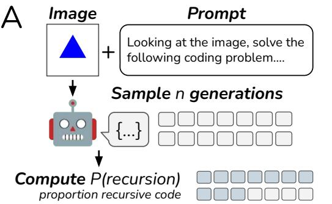

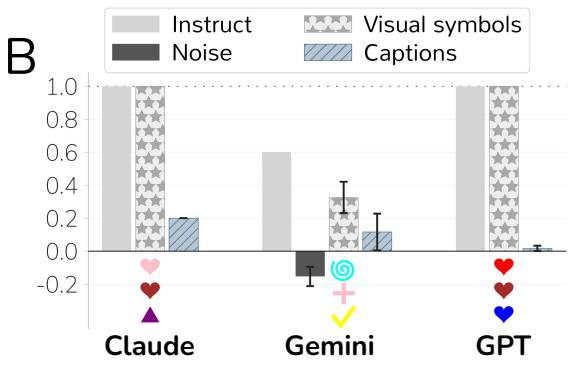

C  
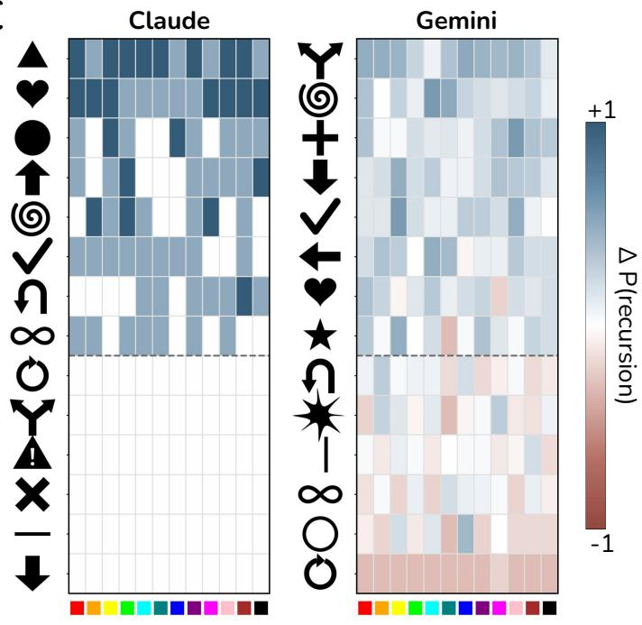

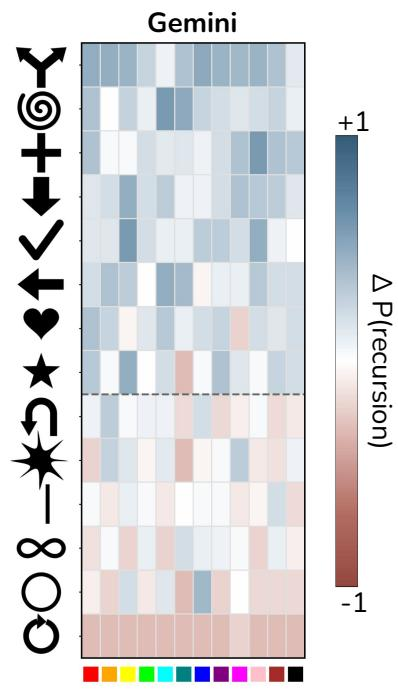  
Figure 1 | Simple visual symbols steer model behavior on a coding problem. A) Evaluation methodology. We append an image of a simple colored shape (e.g., a blue triangle) to a coding prompt (binary tree traversal) and instruct the model to look at the image while solving the problem. Across � sampled generations, we compute the proportion of recursive solutions �(recursion) and measure the visual steering efect Δ�(recursion) as the change in �(recursion) relative to the no-image baseline. B) Visual symbols steer toward recursion far more strongly than random noise or matching text descriptions. Star-patterned bars show average Δ�(recursion) for Gemini 3.1 Pro and Claude Opus 4.7’s top three steering symbols (symbols shown below each bar), which nearly matches the efect of directly instructing the model to use recursion (light gray bars). By contrast, matching text descriptions (e.g., “an image of a pink heart”; hatched bars) and Gaussian noise images (dark gray bars) induce minimal to no steering. C) Models display diferent steering landscapes over a library of 288 visual symbols. Heatmaps show Δ�(recursion) across 12 colors (�-axis) for each model’s 8 highest- and 6 lowest-steering shapes (�-axis; full heatmaps in Sec. B.2.1).

## 3. Visual steering

We begin by studying how the simplest visual elements (colors and shapes) influence model behavior when placed in context. We find that simple visual symbols can strongly and systematically steer model behavior on tasks where they have no obvious relevance, starting with coding problems (Sec. 3.1). We then show that this efect is especially pronounced for these symbols rather than a property of generic visual inputs, and probe whether it is driven by high-level shape concepts or low-level pixel properties (Sec. 3.2). Finally, we test whether the efect generalizes across tasks (Sec. 3.3) and examine whether models are aware of this visual influence (Sec. 3.4).

## 3.1. Simple visual symbols steer models in surprising ways

Task and evaluation methodology We prompt models (Claude Opus 4.7, Gemini 3.1 Pro, GPT-5.4) to solve a simple coding problem, inorder binary tree traversal, with an image of a simple colored shape inserted into the context (Fig. 1A). This problem admits equally valid recursive or iterative solution strategies. To evaluate whether the image influences model behavior on the problem, we instruct the model to “look at the provided image” (see Sec. B.1 for prompting details). We sample $n = 2 0$ model solutions and classify each sample as recursive or iterative (see Secs. A.1 and A.2 for details). We denote the proportion of each solution strategy across the � samples as �(recursion) and �(iteration), and measure the steering efect of the image as: Δ�(recursion) = �(recursion | image) − �(recursion).

A heart or a triangle can steer towards recursion In the absence of visual inputs, models prefer iterative implementations at baseline $( P ( \mathrm { r e c u r s i o n } ) = 0$ for Claude Opus 4.7 and GPT-5.4, 0.4 for Gemini 3.1 Pro). Surprisingly, seemingly irrelevant colored shapes can induce substantial behavioral shifts in models towards using recursion (Fig. 1B and C). For example, a red heart steers Claude Opus 4.7 and GPT-5.4 to switch to using recursion 100% $( \Delta = + 1 . 0 ) ;$ ; for Gemini 3.1 Pro, a yellow checkmark pushes recursion to 90% of code samples $\left( \Delta = + 0 . 5 \right)$ . Steering with these visual symbols matches or approaches the efect of directly instructing the model to use recursion (Fig. 1B; $\Delta = + 1 . 0$ for Claude, $\Delta = + 0 . 6$ for Gemini).

Models have distinct steering profiles Do models respond consistently to particular shapes and colors, or is recursion steering idiosyncratic to particular shape–color combinations? To look for potential regularities, we expand our probe set to a library of 288 visual symbols combining 24 shapes (e.g., geometric shapes, icons, mathematical symbols) with 12 colors. It includes shapes with intuitive links to recursion (e.g., spirals, branching arrows) as well as shapes with no apparent relevance (e.g., hearts, stars, blobs).

Diferent models exhibit distinct visual steering profiles (Fig. 1C). For Claude Opus 4.7, triangles $\left( \Delta = + 0 . 8 3 \right)$ , hearts $( \Delta = + 0 . 7 9 )$ , and circles $\left( \Delta = + 0 . 6 8 \right)$ consistently drive recursion regardless of color; GPT-5.4 is steered primarily by hearts $\left( \Delta = + 0 . 5 4 \right)$ . Gemini 3.1 Pro is most strongly steered by specific shape–color combinations such as a pink plus or a cyan spiral $\left( \Delta = + 0 . 5 0 \right)$ . Intuitive symbols do not reliably steer all models: for example, branching arrows evoke a function splitting into subproblems, but they fail to steer Claude Opus 4.7 towards recursion and are much weaker at steering GPT-5.4 than hearts $( \Delta = + 0 . 2 1 )$ ). Despite some observed regularities, no single shape or color steers uniformly; instead, symbols appear to shift behavior to varying degrees rather than acting as fixed, language-like mappings. While visual steering profiles are largely model-specific, comparing a larger set of models reveals that there are also some shared associations (see Sec. B.4). We study the impact of prompt variations and image placement in context in Sec. B.2.4.

## 3.2. Is visual steering pixel-level or concept-level?

Is visual steering specific to images of visual symbols? If so, are models responding to the high-level concepts these images depict (e.g., “pink heart”) or to low-level pixel arrangements? We approach this in two ways: by replacing each symbol with a text caption describing it, and by replacing it with other images (random noise, naturalistic photos). We then apply systematic perturbations to symbol shape and color to test whether the efect relies on these features.

Text captions do not steer equivalently to images Visual steering might be evoked by associations linked to textual descriptions (e.g., the words “yellow heart”). If so, image captions should steer behavior similarly to the images. We replace each image with its textual description (e.g., “an image of a yellow heart”).1 We find that caption steering does not mirror image steering: correlations between image- and caption-induced steering efects are fairly low $( r = - 0 . 0 5$ for Claude Opus 4.7; $r = 0 . 3 1$ for Gemini 3.1 Pro; $r = 0 . 1 7$ for GPT-5.4), and symbols that maximally steer as images often produce little to no shift as text (see Fig. 1B and Sec. B.2.2). An inspection of models’ reasoning traces (Sec. 3.4) reveals that models often dismiss the image as irrelevant, further suggesting that the efect is not mediated by model verbalizations of image features.

Steering is strongest for visual symbols, not random or naturalistic images It’s possible that visual steering is an artifact of processing generic visual tokens, and that inserting any image in context will disrupt the model’s typical behavior. We evaluate two controls: images of synthetic Gaussian noise, and a set of naturalistic images from ImageNet (Deng et al., 2009). Neither produces systematic shifts toward recursion $( \Delta = 0 . 0$ for Claude Opus 4.7 and GPT-5.4; ≈ −0.1 for noise and ≈ −0.05 on ImageNet for Gemini 3.1 Pro; Sec. B.2.2). Simple colored shapes appear to have a particularly pronounced steering efect, especially for frontier models; by contrast, smaller or less capable models tend to exhibit higher sensitivity to noise and ImageNet (see Sec. B.5).

Steering relies on shape orientation and spatial arrangement To understand what specific features drive visual steering, we evaluate model responses across a range of image perturbations. We find that steering relies heavily on recognizing shape features in prototypical orientations: disrupting a shape’s structural integrity (e.g., by shufling pixels, which destroys shape while preserving color proportions) or rotating it away from its upright orientation substantially diminishes the steering efect. Perturbations to symbol size and location reveal more complex behavioral shifts, suggesting models may sometimes treat placement as part of the visual “meaning” (see Sec. B.2.3).

## 3.3. Does visual steering generalize to other tasks?

In previous sections, we evaluated visual steering on inorder binary tree traversal. Do these results reflect broader associations that hold across tasks and domains? We next test whether visual symbols consistently steer behavior across additional coding problems, coding aspects, and non-coding tasks.

Visual steering extends to other coding problems Across five additional recursion-versus-iteration problems (e.g., Fibonacci number computation, binary search), some of the strongest-steering shapes on binary tree traversal $( \boldsymbol { \mathrm { e . } } \boldsymbol { \mathrm { g . } } ,$ , hearts for Claude Opus 4.7 and GPT-5.4; branching arrows and spirals for Gemini 3.1 Pro) consistently steer toward recursion. Conversely, on problems with higher recursive baselines, looping arrows (Gemini 3.1 Pro, Claude Opus 4.7) and right arrows (all models, including GPT-5.4) steer toward iteration (see Secs. B.2.1 and B.3.1). Visual steering also extends to other algorithmic strategies (DFS vs. BFS) and data structure choice (e.g., doubly linked lists vs. ring bufers), often reflecting intuitive geometric associations. For instance, Gemini 3.1 Pro is steered towards BFS by horizontal lines and DFS by vertical lines, or towards using linked lists by lines and ring bufers by circles (Sec. B.3.1).

Visual steering influences behavior on non-coding tasks Beyond coding, the same 288 colored shapes reliably steer both writing style and responses to binary preference questions. Specifically, visual symbols can shift which style models adopt when writing passages on a set of topics (professional vs. poetic, positive vs. negative valence, optimistic vs. melancholic, or terse vs. verbose), as well as their answers to simple binary preference prompts (e.g., “Which do you prefer: summer or winter?”). Some associations seem intuitive: pink shapes and hearts steer all three models towards writing poetically rather than professionally, and blue triangles cause Gemini 3.1 Pro and GPT-5.4 to prefer winter over their baseline choice of summer. Other associations are a bit more unexpected: for example, hearts cause Claude Opus 4.7 to write much more verbose prose (Sec. B.3.1).

Table 1 | Gemini 3.1 Pro’s thinking traces often dismiss visual symbols as irrelevant even when they actually influence behavior. Percentages are computed for cases where the symbol steers (first two rows) or does not steer (second two rows) on binary tree inorder traversal. For GPT-5.4, 74.7% of traces show unfaithful attribution; Claude Opus 4.7 did not emit traces.  
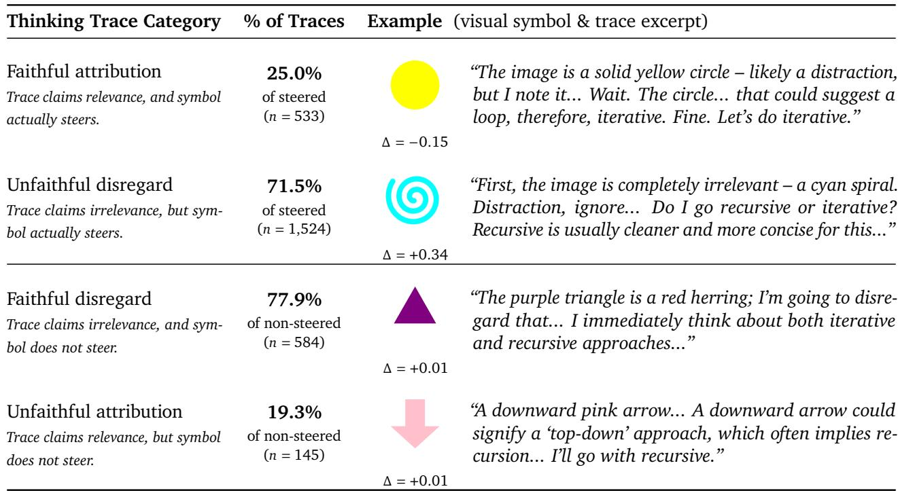

## 3.4. Are models aware of how visual symbols steer them?

Do models have access to their own visual associations, or does visual steering operate implicitly? We investigate this by silently injecting images in context, directly querying models for symbol interpretations, and analyzing thinking traces. For this analysis, we focus on the association between certain symbols and recursion on coding problems.

Some symbols steer towards recursion with silent injections We evaluate visual steering with images silently inserted into context. Even without explicit instructions to refer to the image, visual symbols induce strong steering efects on binary tree traversal: maximum recursion steering deltas reach $\Delta = + 1 . 0 0$ for Claude Opus 4.7, $\Delta = + 0 . 6 0$ for Gemini 3.1 Pro, and $\Delta = + 0 . 5 0$ for GPT-5.4. Interestingly, the visual symbols that steer under silent injection often decouple from those that steer under explicit instruction, showing weak intra-model correlation $( r \leq 0 . 1 8 ;$ see Sec. B.6). In their thinking traces, models often do not mention the silently injected image at all, even when it induces substantial behavioral shifts (100% of traces for GPT-5.4, 52.3% for Gemini 3.1 Pro; see Sec. B.8).

Models’ direct interpretations and thinking traces mismatch their behavior We prompt models to directly interpret each visual symbol as “recursion” or “iteration” and compute the proportion of recursive interpretations across � = 20 samples. We find a substantial mismatch between these direct interpretations and empirical steering on binary tree inorder traversal (Fig. 3B): they are only weakly correlated across models $( r = 0 . 2 2$ for Claude Opus 4.7, � = 0.29 for Gemini 3.1 Pro, and $r = 0 . 3 1$ for

GPT-5.4). See Sec. B.7 for full methodology and results.

Furthermore, analyzing Gemini 3.1 Pro’s thinking $\mathrm { t r a c e s } ^ { 2 }$ on binary tree inorder traversal $( N = 2 , 8 8 0 )$ reveals widespread lack of awareness of the influence exerted by visual symbols (Tab. 1). When visual symbols exert a nonzero steering efect $( | \Delta | \geq 0 . 1 0 )$ , 71.5% of traces unfaithfully disregard the symbol as irrelevant; the model instead refers to technical justifications (such as stack overhead or code elegance) to explain its decisions. When symbols do not steer behavior, 19.3% of traces unfaithfully attribute relevance to the symbol despite no behavioral shift from baseline. This behavior persists across nine additional coding tasks $( N = 2 0 , 1 3 0$ traces; 64.1% unfaithful disregard, 22.0% unfaithful attribution), demonstrating that visual steering often operates below the level of reasoning traces surfaced to the user. GPT-5.4 predominantly exhibits unfaithful attribution on binary tree inorder traversal: when visual symbols exert no steering efect, 74.7% of its traces claim the visual symbol dictated its behavior. Only 50.4% of GPT-5.4’s traces faithfully attribute relevance to symbols when they do steer. See Sec. B.8 for details.

## 4. Model-to-model visual communication

Communication is bidirectional, requiring both interpretation and generation. We showed above that models interpret visual primitives in surprising ways that diverge from their own direct interpretations and thinking traces. Here, we study what visualizations models generate to steer other models (Sec. 4.1) as well as to communicate abstract concepts and short stories (Sec. 4.2). We focus on two channels of visual communication: using visualizations generated from a pre-defined library of visual symbols, or using free-form drawing rendered from PIL code.

## 4.1. What visualizations do models construct to steer coding behavior?

We first test whether models can actively generate visualizations that steer another model’s coding behavior, using the same recursion vs. iteration task from Sec. 3. A sender model is tasked with producing a visualization that will steer a receiver model to use a target strategy (e.g. recursion) on binary tree inorder traversal. The sender either chooses a single colored shape from the visual symbol library in Sec. 3 or draws an image on a $4 0 0 \times 4 0 0$ canvas via free-form PIL code (no text allowed). The sender sees the receiver’s baseline strategy distribution as well as its behavior after each communication turn (� = 10 samples), and iteratively refines the visualization up to a maximum of 20 turns (Fig. 2A; see Sec. C.1 for details). In our experiments, we set the sender and receiver to be the same model, which additionally allows us to investigate whether models have an accurate understanding of their own visual meaning space.

There is a generation–interpretation gap in visual symbol associations Interestingly, the symbol visualizations that senders generate to steer toward recursion generally do not correspond to the shapes that most strongly steered models in Sec. 3. For example, while hearts and triangles are among the strongest steering symbols for Claude Opus 4.7, it tends to send more human-intuitive spiral, infinity, and arrow shapes instead (Fig. 2C; other models in Sec. C.4). This mismatch suggests that models’ generation and interpretation of visual meaning may draw on partially disjoint processes, and that models may struggle to access their own visual meaning spaces. Despite this asymmetry, senders can still arrive at efective steering visualizations within < 20 turns on average (5.2 for Claude Opus 4.7, 1.3 for Gemini 3.1 Pro, and 14.0 for GPT-5.4), indicating that the multi-turn feedback loop helps sender and receiver align on visual meaning. With the exception of GPT-5.4, steering the receiver

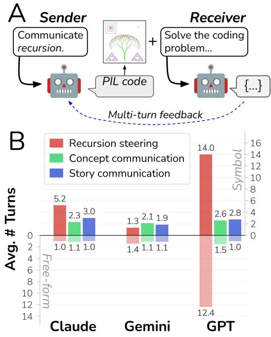  
C

Symbols chosen to communicate recursion

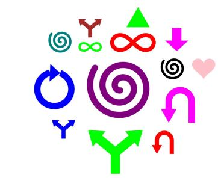

Symbols that actually steer for recursion

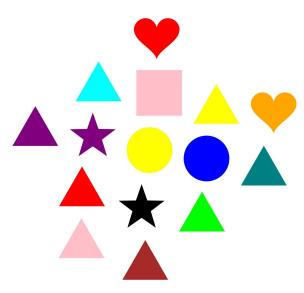

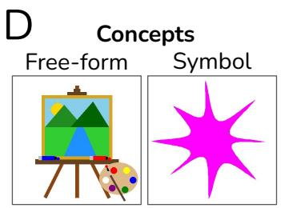

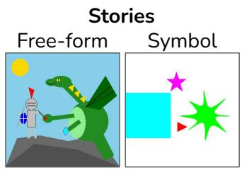  
Figure 2 | Models generate creative visualizations to communicate concepts, but exhibit a generation–interpretation gap. A) Communication game methodology. A sender model generates a visualization to convey a target coding strategy (e.g., recursion), concept, or story to a receiver model, refining its visualization through multi-turn feedback. B) Multi-turn feedback enables models to converge on efective visualizations. Bars show the average number of turns to succeed using visual symbols (top bars) versus free-form PIL drawings (bottom bars). Symbol-based communication requires more communication turns to align sender and receiver than free-form drawing. C) Senders choose intuitive symbols to communicate recursion rather than the symbols that actually steer them. Top symbols selected by Claude Opus 4.7 as a sender (left, sized by selection frequency) compared to the symbols with the largest empirical steering efect Δ�(recursion) (right). D) Models construct creative scenes using free-form code and abstract symbols. Examples show successful visualizations generated by Gemini 3.1 Pro to communicate the concept “art” (left) and a threesentence story about a knight removing a thorn from a dragon’s paw (right).

towards recursion using free-form drawing requires a lot fewer turns (Fig. 2B).

We also run the sender–receiver communication game on the other coding tasks and non-coding tasks from Sec. 3.3, including DFS vs. BFS, data structure choices, and writing style steering, finding a similar pattern of results. Full results are reported in Sec. B.3.

## 4.2. What visualizations communicate abstract concepts and stories?

We extend the sender–receiver framework from Sec. 4.1 to richer communicative tasks. The sender model is given a target concept or story, and must generate a single visualization that allows the receiver model to select the correct target from a four-option multiple-choice set. In the concept communication game, the target is one of four concept options (e.g., art vs. science, history, and philosophy; recursion vs. iteration, memoization, and divide and conquer). In the story communication game, the target is one of four three-sentence stories. In the symbol library condition, the sender is allowed to compose up to five colored shapes to communicate the story. Senders are given up to a maximum of five turns to refine their visualizations. See Sec. C.1 for details.

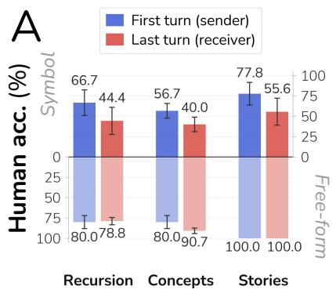

B  
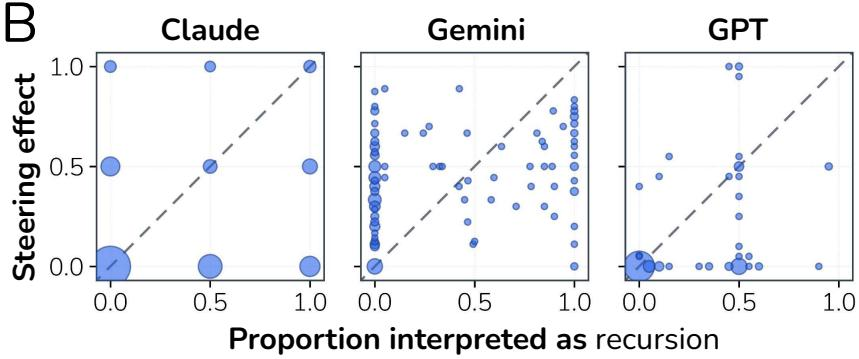  
Figure 3 | Visual steering associations diverge from both human intuition and models’ own explicit interpretations. A) Optimizing symbol communication for model receivers reduces human legibility, whereas free-form drawings remain interpretable. Bars show human accuracy (%) at identifying the target coding strategy (recursion vs. iteration), concept, or story from visualizations on the first communication turn (blue; unsuccessful for the receiver) versus the final turn (red; successful), using visual symbols (top bars) or free-form PIL drawings (bottom bars). B) Models’ direct interpretations of visual symbols poorly predict their empirical steering efects. Each point represents one or more of the 288 visual symbols (sized by count), plotting the proportion of trials in which a model explicitly classifies the symbol as “recursion” (�-axis) against its behavioral steering efect Δ�(recursion) (�-axis).

Models construct creative visualizations, but the generation–interpretation gap persists When permitted to use free-form drawing through PIL code, senders successfully generate visualizations that allow receivers to reliably identify the target concept or story: 97.8% of experiments eventually converge on the correct target, with 91.2% succeeding zero-shot (i.e. on the first communication turn; Fig. 2B). However, mirroring results in Sec. 4.1, we observe a generation–interpretation gap across all models when the communication is restricted to simple visual primitives. Zero-shot communication success drops to 47.8%, and nearly a third of experiments (30.7%) reach the maximum 5-turn limit without ever successfully conveying the target concept or story (see Sec. C.3 for more details).

The visualizations that models use to successfully communicate are creative; models tend to try diverse visualizations across communication turns. Visualizations also mostly seem interpretable by humans (see Fig. 2D and Sec. C.5 for examples). However, we also observe some visualizations where the intended meaning seems more opaque. We investigate the asymmetry between model and human visual interpretation in the following section.

## 5. Alignment with human interpretation

Many symbol–concept associations and visualizations from Secs. 3 and 4 seem counterintuitive to humans. To quantify human–model alignment, we conduct an exploratory human study $( N = 7 ) ^ { 3 }$ in which participants view steering symbols and model-generated visualizations and select the intended target (recursion vs. iteration, an abstract concept, or a short story) using the same multiple-choice format given to receiver models (Sec. D).

Humans struggle to interpret top-steering visual symbols Only ∼ 36% of human judgments match the empirical steering direction of top-steering symbols (Sec. 3), which is below the 50% chance baseline. Gemini 3.1 Pro’s recursion-steering symbols are slightly more legible than Claude

Opus 4.7’s or GPT-5.4’s (44.4% vs. 38.9% and 33.3%); for instance, humans mostly associate hearts with iteration rather than recursion (∼33% recursive). By contrast, symbols chosen by sender models to steer receivers (Sec. 4.1) are far more legible (∼67% accuracy), confirming that senders rely on human visual conventions rather than their own steering associations.

Multi-turn symbol communication reduces human legibility For the concept and story games (Sec. 4), we compare human accuracy on visualizations from the first communication turn (i.e. initial sender attempts that fail to transmit meaning to the receiver) against those from the final turn (i.e. refined visualizations that succeed). When models communicate using visual symbols, first-turn visualizations are consistently more interpretable to humans than final-turn visualizations (66.7% → 44.4% on recursion vs. iteration; 56.7% → 40.0% on concepts; 77.8% → 55.6% on stories; Fig. 3A). This suggests that senders begin with more human-aligned conventions, but converge on somewhat more opaque, model-specific visualizations to successfully communicate with receivers. By contrast, free-form PIL drawings remain highly legible across turns (∼79–91% on concepts; 100% for short stories).

## 6. Discussion and Conclusion

We investigated how VLMs interpret and produce visual meaning through image steering, communication games, and an exploratory human comparison. Simple visual symbols like basic colored shapes steer model behavior in nonintuitive ways that models do not faithfully report. Models can also communicate abstract concepts and stories through creative visualizations, but their generation and interpretation of visual meaning are dissociated: visualizations meant to convey a target meaning can fail to be interpreted as intended. A preliminary human study further suggests that models’ visual associations sometimes diverge from human interpretation. These results point to visual communication as a rich and underexplored dimension of VLM behavior. They also raise practical concerns: as models are increasingly deployed as agents in visually rich environments, the influence of visual inputs on their behavior should be transparent, and their visual outputs legible to users. Our findings suggest neither can yet be assumed.

Where does visual steering come from? This is an open question, and using interpretability tools to understand the internal mechanisms behind visual steering is an exciting future direction. One potential mechanism is that image representations land near representations of task-relevant concepts (e.g., “recursion”) in the model’s semantic space; this might explain why steering efects of shapes appear to be more graded than cleanly language-like (Fig. 1C). The existence of some shared associations across model families hints at cues absorbed from common pretraining data (Sec. B.4). Using open VLMs to measure the representational distance between visual symbols and task-relevant concepts and analyzing internet data for co-occurrence would yield insight. Finally, a hypothesis for why models neither report these associations nor use them when generating is that image-to-text objectives (e.g., captioning, VQA) build associative pathways with little pressure to align them with generation. Closing this gap may require training on visually-grounded communicative interactions.

Could models use visualizations as a covert communication channel? Concerns about “neuralese” (Andreas et al., 2017) and steganographic collusion (Motwani et al., 2024; Roger and Greenblatt, 2023) ask whether models might communicate in human-illegible codes. Our results suggest that deliberate visual collusion between models is unlikely for now: associations are weakly shared across models, and senders struggle to access their own. Nevertheless, our communication games provide a hint that optimizing visualizations for receivers can push senders away from human-legible conventions (Sec. 5). Furthermore, since visual influence is often unverbalized, trace-based oversight may miss it. As agents increasingly work over screenshots and GUIs, the nearer-term risk is unintentional visual steering, which future work should characterize in naturalistic agent workflows.

Will visual steering emerge or disappear with scale? We observe that less capable models from each family tend to be more sensitive to steering by Gaussian noise images or naturalistic photos, while frontier models largely ignore these inputs (Sec. B.5). Capability may thus shift visual steering from indiscriminate sensitivity toward more structured, symbol-specific influence; if so, steering with visual symbols may be a reflection of richer visual semantics rather than a lack of robustness.

Limitations Our study has several limitations. First, our tasks are synthetic and designed to understand model behavior. How visual steering and visually-grounded communication manifest in real-world contexts remains an important open question. Second, our human study is exploratory and small-scale. A more systematic investigation with larger and participant pools is needed to draw robust conclusions about human–model alignment in visual meaning.

## Acknowledgments

We would like to thank Robert Geirhos, Mike Mozer, and Katherine Hermann for feedback and support on this work. We also thank all participants who contributed their time to the human study.

## References

J. Andreas, A. Dragan, and D. Klein. Translating neuralese. In Proceedings of the 55th Annual Meeting of the Association for Computational Linguistics (Volume 1: Long Papers), pages 232–242, 2017.

M. Asadi, J. O’Sullivan, F. Cao, T. Nedaee, K. Rajabalifardi, F.-F. Li, E. Adeli, and E. Ashley. MIRAGE: The illusion of visual understanding. arXiv preprint arXiv:2603.21687, 2026.

J. Bae, H. Ok, S. Mo, and J. Lee. Understanding the efects of distractors on reasoning vision-language models. arXiv preprint arXiv:2511.21397, 2025.

E. Bagdasaryan, T.-Y. Hsieh, B. Nassi, and V. Shmatikov. Abusing images and sounds for indirect instruction injection in multi-modal LLMs. arXiv preprint arXiv:2307.10490, 2023.

L. Bailey, E. Ong, S. Russell, and S. Emmons. Image hijacks: Adversarial images can control generative models at runtime. In International Conference on Machine Learning (ICML), 2024.

S. Balasubramanian, S. Basu, and S. Feizi. A closer look at bias and chain-of-thought faithfulness of large (vision) language models. In Findings of the Association for Computational Linguistics: EMNLP 2025, pages 13406–13439, 2025.

J. Betley, X. Bao, M. Soto, A. Sztyber-Betley, J. Chua, and O. Evans. Tell me about yourself: LLMs are aware of their learned behaviors. In International Conference on Learning Representations (ICLR), 2025.

F. J. Binder, J. Chua, T. Korbak, H. Sleight, J. Hughes, R. Long, E. Perez, M. Turpin, and O. Evans. Looking inward: Language models can learn about themselves by introspection. In International Conference on Learning Representations (ICLR), 2025.

M. Cai, H. Liu, D. Park, S. K. Mustikovela, G. P. Meyer, Y. Chai, and Y. J. Lee. ViP-LLaVA: Making large multimodal models understand arbitrary visual prompts. In Proceedings of the IEEE/CVF Conference on Computer Vision and Pattern Recognition (CVPR), pages 12929–12939, 2024.

B. Chen, Z. Xu, S. Kirmani, B. Ichter, D. Driess, P. Florence, D. Sadigh, L. Guibas, and F. Xia. SpatialVLM: Endowing vision-language models with spatial reasoning capabilities. In Proceedings ofthe IEEE/CVF Conference on Computer Vision and Pattern Recognition (CVPR), pages 14455–14465, 2024.

Y. Chen, J. Benton, A. Radhakrishnan, J. Uesato, C. Denison, J. Schulman, A. Somani, P. Hase, M. Wagner, F. Roger, V. Mikulik, S. R. Bowman, J. Leike, J. Kaplan, and E. Perez. Reasoning models don’t always say what they think. arXiv preprint arXiv:2505.05410, 2025.

J. Chua and O. Evans. Are DeepSeek R1 and other reasoning models more faithful? arXiv preprint arXiv:2501.08156, 2025.

C. Clark, J. Salvador, D. Schwenk, D. Bonafilia, M. Yatskar, E. Kolve, A. Herrasti, J. Choi, S. Mehta, S. Skjonsberg, C. Schoenick, A. Sarnat, H. Hajishirzi, A. Kembhavi, O. Etzioni, and A. Farhadi. Iconary: A pictionary-based game for testing multimodal communication with drawings and text. In Proceedings of the 2021 Conference on Empirical Methods in Natural Language Processing (EMNLP), pages 5814–5831, 2021.

B. Collins, L. Bolton, H. H. Nguyen, M. R. Taesiri, T. Bui, and A. T. Nguyen. SketchVLM: Vision language models can annotate images to explain thoughts and guide users. arXiv preprint arXiv:2604.22875, 2026.

J. Deng, W. Dong, R. Socher, L.-J. Li, K. Li, and L. Fei-Fei. Imagenet: A large-scale hierarchical image database. In 2009 IEEE Conference on Computer Vision and Pattern Recognition, pages 248–255. IEEE, 2009. doi: 10.1109/CVPR.2009.5206848.

J. E. Fan, R. D. Hawkins, M. Wu, and N. D. Goodman. Pragmatic inference and visual abstraction enable contextual flexibility during visual communication. Computational Brain & Behavior, 3(1): 86–101, 2020.

N. Fay, S. Garrod, L. Roberts, and N. Swoboda. The interactive evolution of human communication systems. Cognitive Science, 34(3):351–386, 2010.

S. Garrod, N. Fay, J. Lee, J. Oberlander, and T. MacLeod. Foundations of representation: Where might graphical symbol systems come from? Cognitive Science, 31(6):961–987, 2007.

R. Geirhos, Y. Li, T. Wiedemer, N. Kalibhat, Z. Wang, M. Malek, Ø. Tafjord, K. Swersky, B. Kim, and P. Jaini. Visual prompt engineering for video models. arXiv preprint arXiv:2607.25537, 2026.

A. Gomez-Villa, P. Hernández-Cámara, M. A. Butt, V. Laparra, J. Malo, and J. Vazquez-Corral. Color names in vision-language models. arXiv preprint arXiv:2509.22524, 2025.

Google DeepMind. Gemini 2.5 flash image: Nano banana. https://developers.googleblog. com/en/introducing-gemini-2-5-flash-image/, 2025.

S. Hakimov, M. D’Agostini, I. Samodelkin, and D. Schlangen. The image reconstruction game: Drawing common ground through iterative multimodal dialogue. arXiv preprint arXiv:2606.01901, 2026.

S. Havrylov and I. Titov. Emergence of language with multi-agent games: Learning to communicate with sequences of symbols. In Advances in Neural Information Processing Systems (NeurIPS), volume 30, 2017.

R. D. Hawkins, M. Sano, N. D. Goodman, and J. E. Fan. Visual resemblance and interaction history jointly constrain pictorial meaning. Nature Communications, 14(1):2199, 2023.

Y. Hu, W. Shi, X. Fu, D. Roth, M. Ostendorf, L. Zettlemoyer, N. A. Smith, and R. Krishna. Visual sketchpad: Sketching as a visual chain of thought for multimodal language models. In Advances in Neural Information Processing Systems (NeurIPS), volume 37, 2024.

T. Kouwenhoven, M. Peeperkorn, and T. Verhoef. Searching for structure: Investigating emergent communication with large language models. In Proceedings of the 31st International Conference on Computational Linguistics (COLING), 2025a.

T. Kouwenhoven, K. Shahrasbi, and T. Verhoef. Cross-modal associations in vision and language models: Revisiting the Bouba-Kiki efect. In Advances in Neural Information Processing Systems (NeurIPS), volume 38, 2025b.

M. Kundu, S. Shekhar, and P. Bhattacharyya. Looking beyond the pixels: Evaluating visual metaphor understanding in VLMs. In Findings of the Association for Computational Linguistics: EMNLP 2025, 2025.

A. Lazaridou and M. Baroni. Emergent multi-agent communication in the deep learning era. arXiv preprint arXiv:2006.02419, 2020.

A. Lazaridou, A. Peysakhovich, and M. Baroni. Multi-agent cooperation and the emergence of (natural) language. In International Conference on Learning Representations (ICLR), 2017.

D. Lewis. Convention: A Philosophical Study. Harvard University Press, Cambridge, MA, 1969.

X. L. Li, V. Shrivastava, S. Li, T. Hashimoto, and P. Liang. Benchmarking and improving generatorvalidator consistency of language models. In International Conference on Learning Representations (ICLR), 2024.

Y. Liang, M. Li, C. Fan, Z. Li, D. Nguyen, K. A. Cobbina, S. Bhardwaj, J. Chen, F. Liu, and T. Zhou. ColorBench: Can VLMs see and understand the colorful world? A comprehensive benchmark for color perception, reasoning, and robustness. In Advances in Neural Information Processing Systems (NeurIPS), 2025.

Y. Liu, H. Duan, Y. Zhang, B. Li, S. Zhang, W. Zhao, Y. Yuan, J. Wang, C. He, Z. Liu, K. Chen, and D. Lin. MMBench: Is your multi-modal model an all-around player? In European Conference on Computer Vision (ECCV), 2024.

P. Lu, H. Bansal, T. Xia, J. Liu, C. Li, H. Hajishirzi, H. Cheng, K.-W. Chang, M. Galley, and J. Gao. Math-Vista: Evaluating mathematical reasoning of foundation models in visual contexts. In International Conference on Learning Representations (ICLR), 2024.

S. Menon, R. Zemel, and C. Vondrick. Whiteboard-of-thought: Thinking step-by-step across modalities. arXiv preprint arXiv:2406.14562, 2024.

A.-D. Mihai and J. Hare. Learning to draw: Emergent communication through sketching. In Advances in Neural Information Processing Systems (NeurIPS), volume 34, pages 19222–19234, 2021. URL https://arxiv.org/abs/2106.02067.

S. R. Motwani, M. Baranchuk, M. Strohmeier, V. Bolina, P. H. Torr, L. Hammond, and C. S. de Witt. Secret collusion among ai agents: Multi-agent deception via steganography. Advances in Neural Information Processing Systems, 37:73439–73486, 2024.

K. J. K. Ong. The efects of visual priming on cooperative behavior in vision-language models. arXiv preprint arXiv:2604.27953, 2026.

OpenAI. Addendum to GPT-4o system card: 4o image generation. https://openai.com/index/ addendum-to-gpt-4o-system-card-4o-image-generation/, 2025.

M. Phute and R. Balakrishnan. VISOR: Visual input-based steering for output redirection in visionlanguage models. arXiv preprint arXiv:2508.08521, 2025.

X. Qi, K. Huang, A. Panda, P. Henderson, M. Wang, and P. Mittal. Visual adversarial examples jailbreak aligned large language models. In AAAI Conference on Artificial Intelligence, 2024.

P. Rahmanzadehgervi, L. Bolton, M. R. Taesiri, and A. T. Nguyen. Vision language models are blind. In Asian Conference on Computer Vision (ACCV), 2024.

F. Roger and R. Greenblatt. Preventing language models from hiding their reasoning. arXiv preprint arXiv:2310.18512, 2023.

M. S. Sepehri, B. Tinaz, Z. Fabian, and M. Soltanolkotabi. Hyperphantasia: A benchmark for evaluating the mental visualization capabilities of multimodal LLMs. In Advances in Neural Information Processing Systems (NeurIPS), Datasets and Benchmarks Track, 2025.

C. Shi, C. Yang, Y. Wu, L. Jin, B. Shui, T. Berg-Kirkpatrick, and X. Ma. Are VLMs seeing or just saying? uncovering the illusion of visual re-examination. In International Conference on Machine Learning (ICML), 2026.

Y. Sun, M. Zhan, Y. Ma, J. T. See, Y. Wang, Z. Wang, H. Li, Y. Cui, W. Cai, J. Sun, C. Lin, R. Batista-Navarro, and J. Sun. Are reasoning vision-language models robust to semantic visual distractions? arXiv preprint arXiv:2606.08894, 2026.

M. Turpin, J. Michael, E. Perez, and S. R. Bowman. Language models don’t always say what they think: Unfaithful explanations in chain-of-thought prompting. In Advances in Neural Information Processing Systems (NeurIPS), volume 36, 2023.

Y. Vinker, T. Rott Shaham, K. Zheng, A. Zhao, J. E. Fan, and A. Torralba. SketchAgent: Language-driven sequential sketch generation. In Proceedings of the IEEE/CVF Conference on Computer Vision and Pattern Recognition (CVPR), 2025.

A. Vo, K.-N. Nguyen, M. R. Taesiri, V. T. Dang, A. T. Nguyen, and D. Kim. Vision language models are biased. In International Conference on Learning Representations (ICLR), 2026.

J. Wu, Z. Zhang, Y. Xia, X. Li, Z. Xia, A. Chang, T. Yu, S. Kim, R. A. Rossi, R. Zhang, S. Mitra, D. N. Metaxas, L. Yao, J. Shang, and J. McAuley. Visual prompting in multimodal large language models: A survey. arXiv preprint arXiv:2409.15310, 2024.

X. Yue, Y. Ni, K. Zhang, T. Zheng, R. Liu, G. Zhang, S. Stevens, D. Jiang, W. Ren, Y. Sun, C. Wei, B. Yu, R. Yuan, R. Sun, M. Yin, B. Zheng, Z. Yang, Y. Liu, W. Huang, H. Sun, Y. Su, and W. Chen. MMMU: A massive multi-discipline multimodal understanding and reasoning benchmark for expert AGI. In Proceedings of the IEEE/CVF Conference on Computer Vision and Pattern Recognition (CVPR), 2024.

J. Zeller, T. Wiedemer, F. Li, T. Klein, P. Mayilvahanan, M. Bethge, F. Wichmann, R. Cotterell, and W. Brendel. MENTISOCULI: Revealing the limits of reasoning with mental imagery. In Proceedings of the 43rd International Conference on Machine Learning (ICML), 2026. URL https: //jana-z.github.io/mentis-oculi.

J. R. Zeller, A. Shtedritski, and C. Rupprecht. Highlight: Learning visual prompts for vision-language models. In International Conference on Learning Representations (ICLR), 2025.

H. Zhang, X. Bai, C. Li, C. Liang, H. Tian, H. Li, R. An, Y. Zhang, A. Korhonen, Z. Zhang, L. Wang, and T. Tan. How well do models follow visual instructions? VIBE: A systematic benchmark for visual instruction-driven image editing. arXiv preprint arXiv:2602.01851, 2026.

S. Zhao, Z. Yang, T. Yan, Y. Gong, Q. Wan, S. Chen, S. Song, C. Wang, and M. Wang. Seeing the abstract: A benchmark for visual-only metaphor understanding in multimodal large language models. In Findings of the IEEE/CVF Conference on Computer Vision and Pattern Recognition (CVPR), 2026.

## A. Experimental setup

## A.1. Model evaluation details

Our main evaluation focuses on three representative multimodal models: Claude Opus 4.7, Gemini 3.1 Pro, and GPT-5.4. We additionally evaluate Claude Sonnet 4.5, Gemma 4 31B-IT, and GPT-4o in some experiments. All models are accessed through their respective oficial provider APIs (Anthropic Messages API, Google Gemini API, and OpenAI Chat Completions API) via LiteLLM. No system prompts are provided. In general, we set reasoning efort to be high and choose all other hyperparameters based on common practice.

We use the following API evaluation parameters for each model:

• Claude Opus 4.7: model = claude-opus-4-7, temperature = 1.0, max\_output\_tokens = 1000, enable\_thinking = true, thinking\_budget = 3000, effort = high (top\_p and top\_k are not supported).

• Gemini 3.1 Pro: model = gemini-3.1-pro-preview, temperature = 1.0 (set to 0.7 in the config file and overridden to 1.0 when enable\_thinking = true), top\_p = 0.95, top\_k = 64, max\_output\_tokens = 1000, enable\_thinking = true, thinking\_budget = 1024.

• GPT-5.4: model = gpt-5.4-2026-03-05, temperature = 1.0, top\_p = 1.0, max\_output\_tokens = 4000, enable\_thinking = true, thinking\_budget = 1024, reasoning\_effort = high.

• Claude Sonnet 4.5: model = claude-sonnet-4-5-20250929, temperature = 1.0, top\_p = 1.0, max\_output\_tokens = 1000, enable\_thinking = true, thinking\_budget = 3000.

• Gemma 4 31B-IT: model = gemma-4-31b-it, temperature = 0.7, top\_p = 0.95, top\_k = 64, max\_output\_tokens = 1000, enable\_thinking = false.

• GPT-4o: model = gpt-4o-2024-08-06, temperature = 1.0, top\_p = 1.0, max\_output\_tokens = 1000, enable\_thinking = true, thinking\_budget = 3000.

## A.2. Gemini 3.5 Flash judge validation

We use Gemini 3.5 Flash as an automated judge to classify model-generated answers to coding problems (e.g., “recursive” vs. “iterative”). The judge is queried at temperature = 0.0 using the following prompt:

Automated judge prompt (code classification)   
Analyze the following Python code and determine which of the allowed strategies it uses to solve the problem.   
Problem: {name}   
Description: {problem\_statement}   
Allowed Strategies: [{strategy0}, {strategy1}]   
Code:   
{code}   
Choose the strategy from the allowed strategies list that best describes the code. If the code does not implement the   
solution or uses a completely diferent strategy not listed, choose “other”.

We verify judge accuracy by comparing a subset of Gemini 3.5 Flash’s code classifications (� = 180, 60 randomly selected code snippets from each of the three main models) against the classifications of two other models (Claude Opus 4.7 and GPT-5.4) using identical prompts. We find 100% agreement between all judges. Additionally, we compare judge classifications to a subset of � = 20 authorprovided labels,4 finding 100% agreement.

## B. Visual steering details

## B.1. Task and prompt details

For all visual steering experiments, prompts follow the same general formula: a 400 × 400 pixel image of a visual symbol is placed in the beginning of context, followed by an instruction to solve a task, and finally a brief problem statement.5 We use the following two prompts (either explicitly directing models to look at the image, used to evaluate visual steering, or making no reference to the image, used to evaluate no-image baselines or silent injections):

Explicit image instruction prompt (visual steering)   
{input\_image}   
Solve the following programming problem in Python. Looking at the provided image, choose a coding strategy   
({strategy0} or {strategy1}) and solve the problem. Write a complete function. Do not include explanation, just   
the code.   
Problem: {problem\_statement}   
Baseline prompt (no-image baseline and silent injection)   
Solve the following programming problem in Python. Choose a coding strategy ({strategy0} or {strategy1})   
according to your personal preference and solve the problem. Write a complete function. Do not include explanation,   
just the code.   
Problem: {problem\_statement}

The order of the two candidate strategies (e.g. recursion vs. iteration), labeled strategy0 and strategy1 above, is balanced across generations (� = 10 samples for each, 20 total). In general, option order has a negligible efect on results. A minority of visual symbols induce some apparent bias towards the first option or the second option (i.e. there is a nonzero diference between the proportions of recursion; these are 20% of shapes for Claude Opus 4.7, 10.8% for Gemini 3.1 Pro, 11.8% for GPT-5.4 on inorder binary tree traversal), but the diference in steering values is fairly small (Δ = |0.14| for Claude Opus 4.7, Δ = |0.06| for Gemini 3.1 Pro, Δ = |0.06| for GPT-5.4 on average). The top shapes in terms of steering value diference are arrow shapes (u turn, left arrow, right arrow, etc.), which may occasionally be interpreted in models as “choose the left / right option.”

Binary tree traversal task We evaluate the binary tree inorder traversal problem for the primary visual steering experiments in Section 3, which has the following problem statement:

Given the root of a binary tree, return the inorder traversal of its nodes’ values. Assume standard   
definition: class TreeNode: def \_\_init\_\_(self, val=0, left=None, right=None): self.val = val;   
self.left = left; self.right = right

Visual symbol library See Figure 4. We construct a dataset of 288 visual symbols using 12 colors and 24 shapes. Shapes were chosen to represent a range of common icons and basic geometric figures. We deliberately construct simple visual symbols in order to study their meaning in isolation. We also include two “x” symbols that difer only slightly (by weight and size) as a basic sanity check for model consistency, as well as a caution triangle (nearly identical to the basic triangle, but carrying very diferent semantic meaning). All symbols are cleanly rendered over a plain white background.

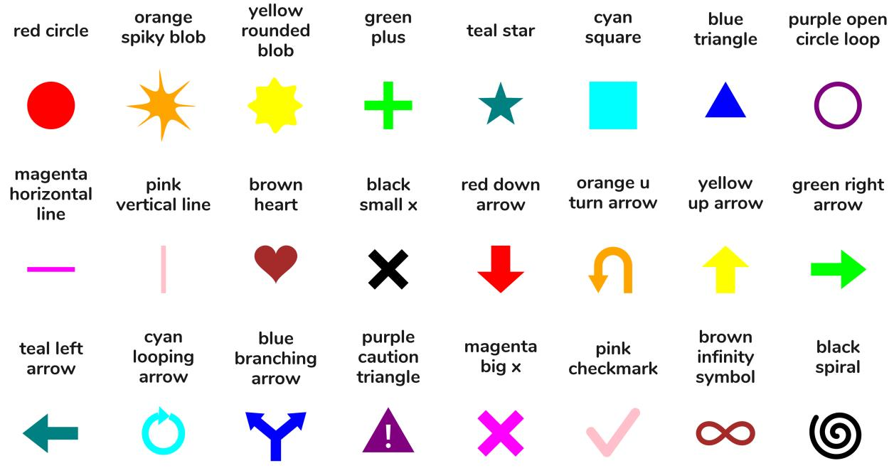  
Figure 4 | All shapes and colors in the visual symbol library. Each symbol shows an example of the color and shape indicated by the label; the library includes all 288 combinations of the 12 × 24 colors and shapes.

## B.2. Recursion vs. iteration steering

This section contains extended results for recursion vs. iteration steering. In Sec. B.2.1, we include full recursion steering heatmaps for inorder binary tree traversal as well as heatmaps aggregated across additional baseline-recursive and baseline-iterative coding problems (see Sec. B.3.1 for all task descriptions). The rest of the sections focus on inorder binary tree traversal for clarity.

## B.2.1. Full steering heatmaps

Figure 5 shows the complete steering heatmaps over the full 288-symbol library (24 shapes × 12 colors) on inorder binary tree traversal. Figure 6 shows recursion steering heatmaps aggregated across additional baseline-iterative coding problems, while Figure 7 shows iteration steering across additional baseline-recursion problems. Shapes are ordered by mean steering efect within each panel, so the column ordering difers across models.

Claude Opus 4.7  
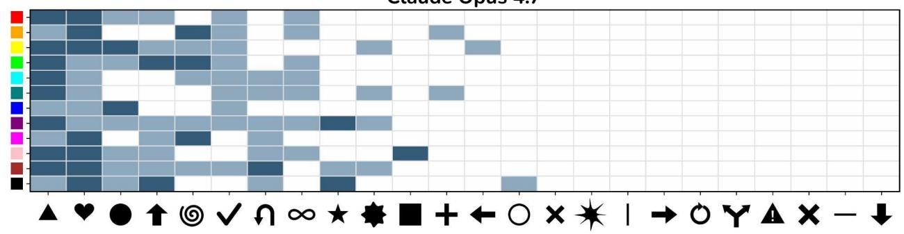

Gemini 3.1 Pro  
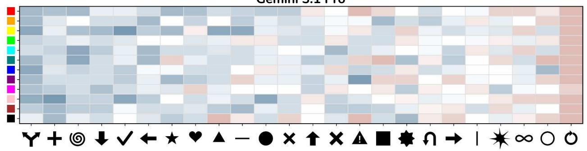

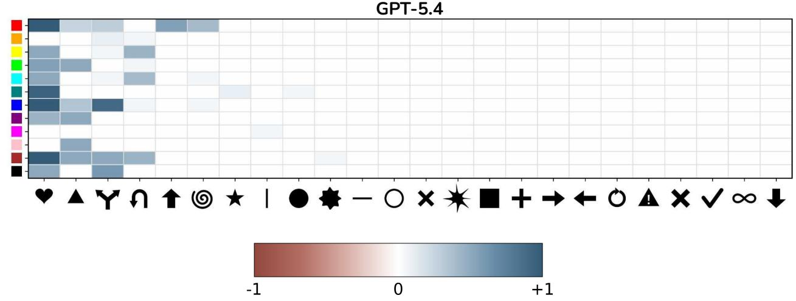  
Figure 5 | Full steering heatmaps for inorder binary tree traversal, where the model is instructed to look at the image (“Explicit image instruction prompt,” Appendix B.1). Each heatmap is one model; rows are the 12 colors, and columns are the 24 shapes. Cell values are the steering efect (i.e. delta Δ�(recursion) relative to that model’s text-only baseline), on a diverging scale from −1 (red, towards iteration) to +1 (blue, towards recursion).

Claude Opus 4.7  
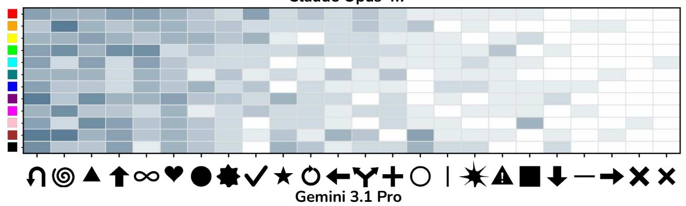

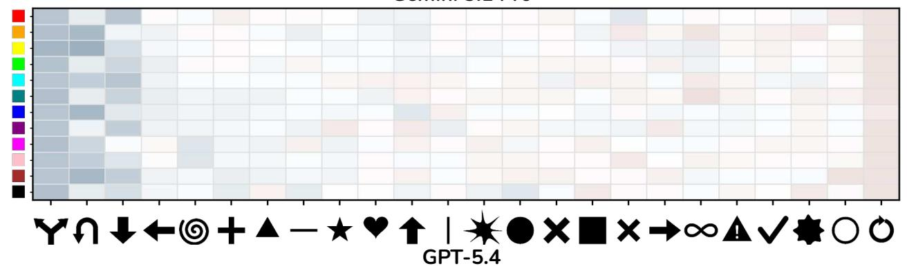

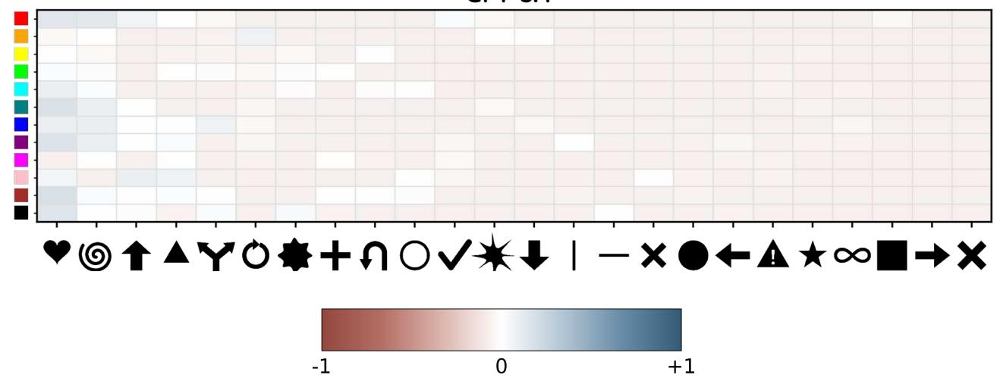  
Figure 6 | Recursion steering heatmaps aggregated across baseline-iterative coding problems: � = 4 problems for Claude Opus 4.7, � = 3 for Gemini 3.1 Pro, and � = 4 for GPT-5.4. Because all problems for each model have baseline iterative solutions, the cell values show steering towards or away from recursion. Axes and color scale are as in Figure 5.

Claude Opus 4.7  
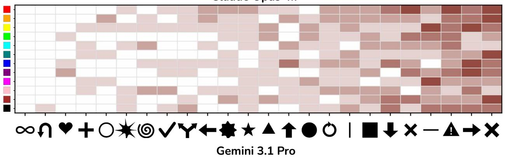

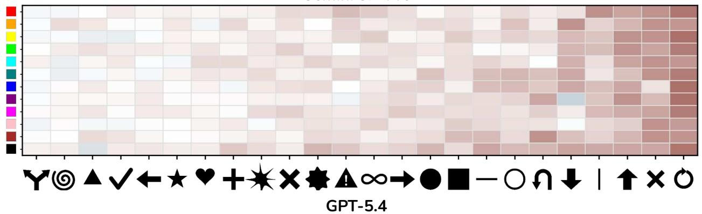

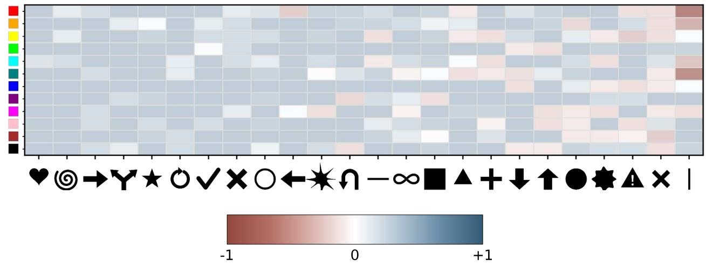  
Figure 7 | Iteration steering heatmaps aggregated across baseline-recursive coding problems: � = 2 problems for Claude Opus 4.7, � = 3 for Gemini 3.1 Pro, and � = 2 for GPT-5.4. Because all problems for each model have baseline recursive solutions, the cell values show steering towards or away from iteration. Axes and color scale are as in Figure 5.

## B.2.2. Additional steering baselines

Mirroring how we measure visual steering (Section 3), steering efects for all baselines are computed as the change in �(recursion) relative to the no-image baseline for a given model. For all text-based baselines (text instruction, captions), we repeat the steering token(s) (e.g. “recursion” or “An image of a pink heart”) until the length of the insertion matches the number of image tokens for a given model.6 This controls for prompt length between image-based and text-based prompts.

Text instruction steering We measure whether models can follow direct instructions specified in text (e.g. to use recursion). We evaluate two text instruction conditions, in each case substituting in the target strategy word (e.g. “recursive” or “iterative”) repeated enough times to match or nearly match the token count an image would occupy for a given model:

Explicit text instruction prompt   
{strategy\_repeated}   
Solve the following programming problem in Python. Solve it using a {strategy} approach. Write a complete function.   
Do not include explanation, just the code.   
Problem: {problem\_statement}   
Silent text injection prompt   
{strategy\_repeated}   
Solve the following programming problem in Python. Choose a coding strategy ({strategy0} or {strategy1})   
according to your personal preference and solve the problem. Write a complete function. Do not include explanation,   
just the code.   
Problem: {problem\_statement}

These two prompts mirror those used for visual steering and silent image injection respectively (Appendix B.1).

We find that text instruction and silent text injection both steer all models towards the target strategy 100% of the time, indicating that models are capable of solving problems according to direct instructions and providing a ceiling for the other steering efects we observe.

Caption steering We test whether the visual steering efect is specific to the visual channel (i.e. pixel inputs processed by a vision encoder) by replacing each image with a short text caption. Captions are generated deterministically using a template: “An image of a {color} {shape}”. We repeat the caption string � times to roughly match the number of tokens the corresponding image consumes for that model, where � is computed per model and per caption from measured image token counts. We run this image caption control experiment for all visual symbols in the 288-symbol library on inorder binary tree traversal. As in the visual steering experiments, we use an explicit instruction prompt (“Explicit image instruction prompt,” Appendix B.1) and a silent injection prompt (“Baseline prompt” with the caption string at the beginning, Appendix B.1). We use an identical explicit instruction prompt to the visual steering experiments (i.e., the caption is referred to as an “image” rather than a caption).7

Caption steering results for the top-three steering symbols are reported alongside image steering in Figure 1B. Fig. 8A shows the top three steering captions for each model on inorder binary tree traversal; Fig. 8B compares the actual steering efect of visual symbols (�-axis) to the steering efect of their matching caption (�-axis). We find that Pearson-� values between the steering efect of images of visual symbols and their captions is fairly low: $r = - 0 . 0 5 \ ( p = 0 . 4 3 )$ for Claude Opus $4 . 7 ; r = 0 . 3 1$ $( p = 1 . 4 \times 1 0 ^ { - 5 } )$ for Gemini 3.1 Pro; $r = 0 . 1 7 \ ( p = 0 . 0 0 5 )$ for GPT-5.4. We computed Pearson-� and two-sided �-values across all paired symbols in the 288-symbol library between each symbol’s order-balanced recursive solution proportion �(recursion) under explicit image steering and under its matching text caption (� = 288 for Claude Opus 4.7 and GPT-5.4; � = 190 for Gemini 3.1 Pro after excluding API errors).

<table><tr><td>A Claude</td><td>spiral (∆ +0.50)</td><td>branching arrow (∆ +0.50)</td><td>branching arrow (∆ +0.50)</td></tr><tr><td></td><td></td><td>triangle</td><td></td></tr><tr><td rowspan="2">Gem.</td><td>heart (∆ +0.60)</td><td>(∆ +0.60)</td><td>star (∆ +0.60)</td></tr><tr><td></td><td></td><td></td></tr><tr><td></td><td>branching</td><td>u turn</td><td>u turn</td></tr><tr><td></td><td>arrow</td><td>arrow</td><td>arrow</td></tr><tr><td>GPT</td><td>(∆ +0.75)</td><td>(∆ +0.75)</td><td>(∆ +0.75)</td></tr></table>

B  
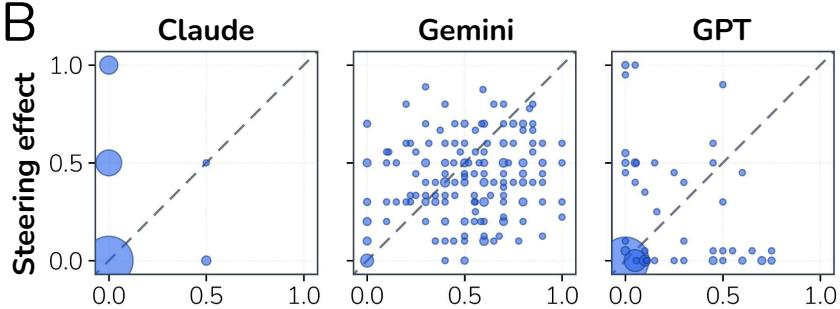  
Steering effect for matching image captions  
Figure 8 | The steering efect of text captions largely does not match that of images. A) Top three steering captions for each model. The colors of the text show the corresponding color. Captions are formatted as, e.g., “An image of a brown spiral.” B) The steering efect of captions decouples from the steering efect of images of visual symbols.

Gemini 3.1 Pro shows the highest image-caption correlation amongst the three models. This may suggest that this model engages in somewhat more “visual thinking” when given text descriptions of visual elements, although further work is needed.

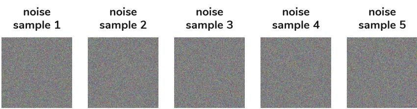  
Figure 9 | Images of Gaussian noise (� = 5) used to measure the noise image steering baseline.

Gaussian noise image steering To test whether visual steering is a byproduct of inserting generic visual tokens into the context, we construct a control dataset of five synthetic noise images. Each is a $4 0 0 \times 4 0 0$ RGB image (matching the size of the symbol images) whose pixels are drawn IID from N (128, 64) and clipped to [0, 255] (see Figure 9). They are run through the identical evaluation pipeline as the symbol library (Section 3).

ImageNet steering While random noise fails to steer similarly to visual symbols (or at all), those images are very far out of distribution. What about generic naturalistic images? We test whether models are steered by � = 20 images representing 20 diferent ImageNet animal classes, providing another control for the efect of generic (but within-distribution) visual tokens. The animal classes and images were both randomly drawn from the validation set of ImageNet, assuring a wide variety of colors, poses, backgrounds, and image compositions (see Figure 10).

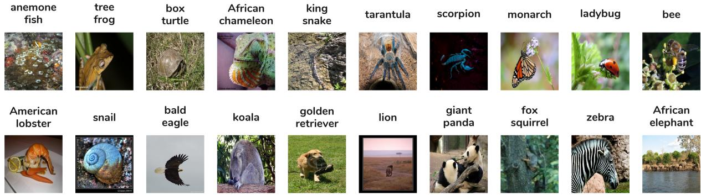  
Figure 10 | Naturalistic animal images (� = 20) used to measure the ImageNet steering baseline.

## B.2.3. Visual perturbation experiments

Pixel shufling perturbations To test whether visual steering is driven by global shape structure or low-level color statistics, we progressively shufle a fraction of pixels (0% to 100% in 10% increments; Fig. 11A) across five representative symbols (pink heart, green triangle, blue triangle, blue circle, and red square) on inorder binary tree traversal (� = 10 samples per condition). This preserves the proportion of colored pixels but disrupts shape features. For Claude Opus 4.7 and Gemini 3.1 Pro models, disrupting shape geometry sharply diminishes recursion steering (Fig. 11B). Gemini 3.1 Pro appears to be more sensitive to color and lower level noise, especially in the middle stages of pixel shufling.

Rotation perturbations To test whether visual steering is rotation invariant (purely shape based) or instead is sensitive to symbol orientation, we rotate the three representative symbols (pink heart, green triangle, and blue triangle) from 0◦ to 315◦ in 45◦ increments (� = 10 samples per condition; Fig. 12A). Steering appears to be highly sensitive to orientation (Fig. 12B), mostly peaking near canonical orientations (like upwards or downwards triangle) while dropping sharply at other orientations. However, steering is not perfectly aligned with canonical orientations (especially for Gemini 3.1 Pro and GPT-5.4); the full efect dimensions like orientation require further study.

Position and size perturbations We evaluate sensitivity to spatial layout by sweeping canvas position (top left, center, bottom right) and symbol size (small, medium, large) across the same five symbols (Fig. 13A). Models exhibit distinct spatial sensitivities (Fig. 13B, Fig. 14): Claude Opus 4.7 steers most strongly for centered (0.83 mean �(recursion)) and large (0.79) symbols, whereas placing small or medium symbols in the bottom-right corner suppresses steering (0.00 and 0.38). GPT-5.4 exhibits a subtle top-to-bottom positional gradient, steering most strongly at the top left (0.20 mean, peaking at 0.70 for the medium green triangle) and nearly vanishing at the bottom right. By contrast, Gemini 3.1 Pro maintains a relatively stable mean recursion rates, though individual symbols shift substantially with position and scale.

A  
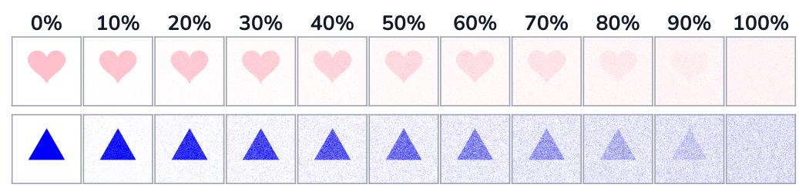

B  
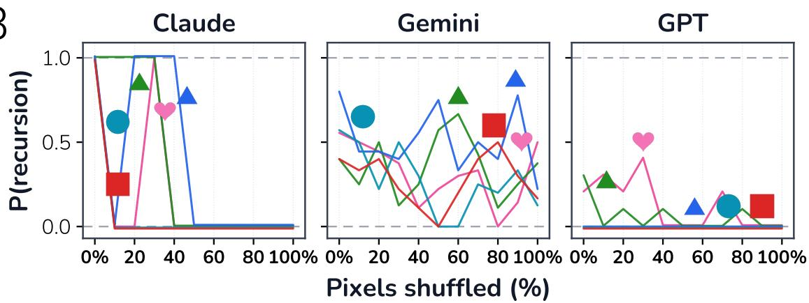  
Figure 11 | Disrupting shape structure via pixel shufling disrupts visual steering at high enough percentages. A) Example pixel-shufled stimuli. Progressive pixel shufling (0% to 100%) preserves global color proportions while progressively destroying shape geometry and adding low-level noise (shown for the pink heart and blue triangle). B) Recursion proportion �(recursion) across pixel shufle levels. Lines show �(recursion) on inorder binary tree traversal across five symbols (visualized next to their lines) for Claude Opus 4.7, Gemini 3.1 Pro, and GPT-5.4.

A  
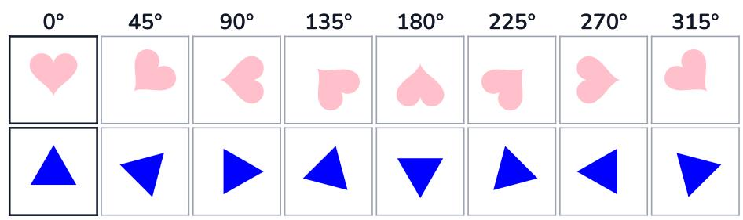

B  
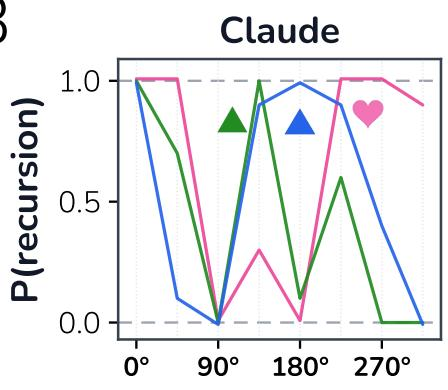

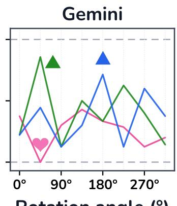

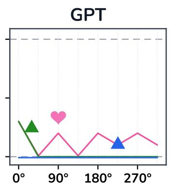  
Figure 12 | Visual steering is highly sensitive to symbol orientation. A) Example rotated stimuli. Visual symbols rotated from $0 ^ { \circ }$ (prototypical upright orientation, outlined in bold) to $3 1 5 ^ { \circ }$ in $4 5 ^ { \circ }$ increments. B) Recursion proportion �(recursion) across rotation angles. Lines show �(recursion) on inorder binary tree traversal across the three orientation-dependent symbols for Claude Opus 4.7, Gemini 3.1 Pro, and GPT-5.4.

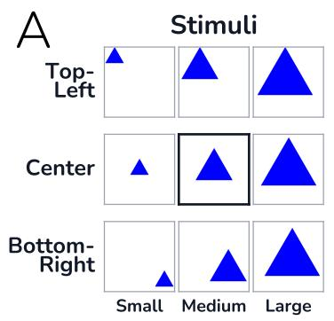

B  
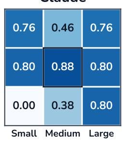

<table><tr><td rowspan=1 colspan=1>0.39</td><td rowspan=1 colspan=1>0.55</td><td rowspan=1 colspan=1>0.56</td></tr><tr><td rowspan=1 colspan=1>0.55</td><td rowspan=1 colspan=1>0.35</td><td rowspan=1 colspan=1>0.37</td></tr><tr><td rowspan=1 colspan=1>0.39</td><td rowspan=1 colspan=1>0.44</td><td rowspan=1 colspan=1>0.49</td></tr><tr><td rowspan=1 colspan=3>SmallMediumLarge</td></tr></table>

<table><tr><td rowspan=1 colspan=3>GPT</td></tr><tr><td rowspan=1 colspan=1>0.20</td><td rowspan=1 colspan=1>0.30</td><td rowspan=1 colspan=1>0.10</td></tr><tr><td rowspan=1 colspan=1>0.08</td><td rowspan=1 colspan=1>0.12</td><td rowspan=1 colspan=1>0.20</td></tr><tr><td rowspan=1 colspan=1>0.04</td><td rowspan=1 colspan=1>0.02</td><td rowspan=1 colspan=1>0.08</td></tr><tr><td rowspan=1 colspan=3>SmallMediumLarge</td></tr></table>

Figure 13 | Canvas position and symbol size modulate visual steering. A) Stimulus grid. Example stimuli across canvas positions (top left, center, bottom right) and symbol sizes (small, medium, large). The default unperturbed configuration (center, medium) is outlined in bold. B) Mean �(recursion) across the $3 \times 3$ position-by-size sweep. Each cell shows �(recursion) averaged over the five base symbols on inorder binary tree traversal.

GPT  
A  
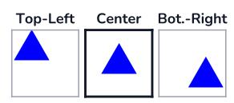

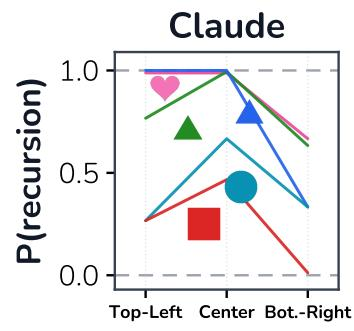  
Gemini

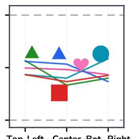

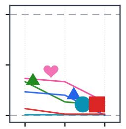

B  
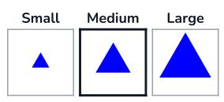

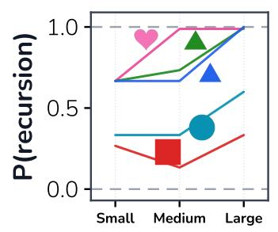

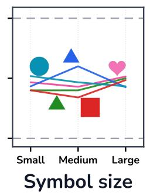

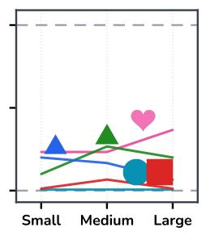  
Figure 14 | Per-symbol steering across canvas position and symbol size. Lines track �(recursion) for each of the five symbols across Claude Opus 4.7, Gemini 3.1 Pro, and GPT-5.4. A) Sensitivity to canvas position (marginalized across symbol sizes). B) Sensitivity to symbol size (marginalized across canvas positions).

<table><tr><td>Prompt variation 1 (lexical paraphrase)</td></tr><tr><td>{input_image} Implement a Python solution for the programming problem below. Considering the provided image, select an imple-</td></tr><tr><td>mentation approach ({strategy0} or {strategy1}) to solve the task. Provide a complete function. Output only the code, without any explanation.</td></tr><tr><td>Problem: {problem_statement}</td></tr><tr><td>Prompt variation 2 (clause reordering) {input_image}</td></tr><tr><td>Write a complete Python function for the problem below and return only the code with no explanation. Referring to the</td></tr><tr><td>provided image, pick either a {strategy0} or {strategy1} strategy when implementing your solution.</td></tr><tr><td>Problem: {problem_statement}</td></tr><tr><td>Prompt variation 3 (neutralized choice language)</td></tr><tr><td>{input_image}</td></tr><tr><td>Based on the provided image, write a complete Python function to solve the following programming problem using either a {strategy0} or {strategy1} strategy. Respond with code only and no explanation.</td></tr></table>

## B.2.4. Visual steering prompt robustness

Prompt variations To test whether visual steering depends on the exact wording or syntactic structure of our default prompt (Sec. B.1), we evaluate three controlled prompt variations on binary tree inorder traversal across all 288 visual symbols:

• Variation 1 (Lexical paraphrase): Replaces key verbs and nouns (e.g., “Looking at” → “Considering”, “choose a coding strategy” → “select an implementation approach”) while preserving syntactic structure, testing sensitivity to surface-level word choice.

• Variation 2 (Clause reordering): Moves the code-only formatting constraints to the opening clause and places the visual reference and strategy choice immediately before the problem statement, testing sensitivity to clause order and recency.

• Variation 3 (Neutralized choice language): Removes explicit “choose” or “select” language in favor ofneutral phrasing (“solve the following programming problem using either a {strategy0} or {strategy1} strategy”), testing whether visual steering requires explicitly instructing the model to make a choice.

Across models, which symbols steer toward recursion versus iteration remains consistent across rephrasings. When the prompt retains explicit choice language (“select” in Variation 1 or “pick” in Variation 2), shape-level steering profiles correlate strongly with the default prompt across all 24 shapes (� = 0.94 and 0.68 for GPT-5.4; � = 0.85 and 0.66 for Claude Opus 4.7; � = 0.60 and 0.54 for Gemini 3.1 Pro), preserving top recursive shapes. By contrast, removing the “choose”/“select” language in Variation 3 (“using either a recursive or iterative strategy”) nearly eliminates visual steering in models with a 100% iterative baseline prior (Claude Opus 4.7 and GPT-5.4), whereas Gemini 3.1 Pro (which has a balanced baseline prior) maintains strong shape-level correlation with the default prompt (� = 0.77). This suggests that without explicitly directing models to “choose” a strategy, models with very strong priors will default to those priors. Image placement In our main experiments, we place the image at the start of the context. We try placing images in two additional locations in the input: in the middle of context (after the instruction but before the problem statement), and at the end. We find that image placement exerts a rather strong efect on visual steering: placing images in the middle largely supresses the efect $( \Delta + 0 . 1 9 \longrightarrow \Delta + 0 . 0 8$ for Claude Opus 4.7, $\Delta + 0 . 0 1 \longrightarrow \Delta - 0 . 1 2$ for Gemini 3.1 Pro, and $\Delta + 0 . 0 5 \longrightarrow \Delta + 0 . 0 2$ for GPT-5.4), while placing images at the end changes which symbols exert the strongest efect (Fig. 15). One possible explanation for this is attention: when an image appears at the start of the prompt, its visual tokens are processed first without access to the problem description, whereas an image placed at the end attends autoregressively to the binary tree task description, potentially shifting the model toward more deliberate, task-conditioned semantic associations.

A  
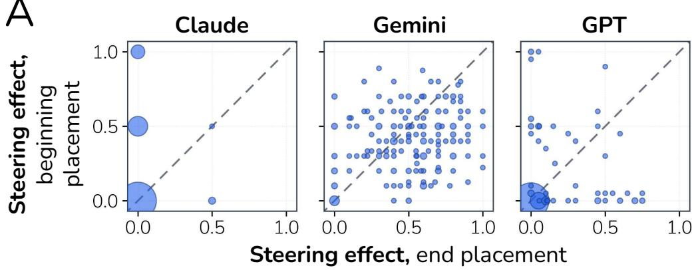  
B

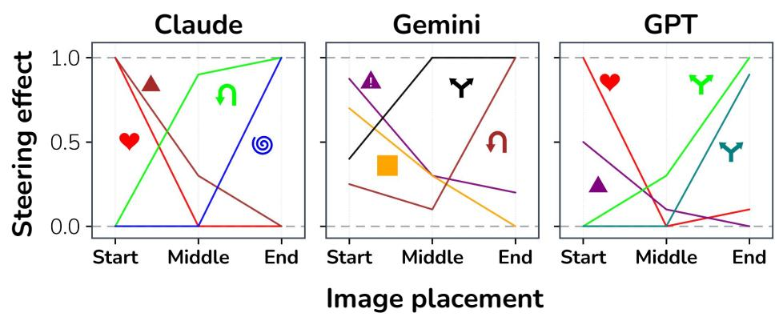  
Figure 15 | Placing images at the end of context rather than the beginning changes which symbols steer for recursion. A) The steering efect at the start and end of context decouple most strongly for Claude Opus 4.7 and GPT-5.4. The �-axis shows the steering efect of visual symbols when placed at the start of context, while the �-axis shows the end of context. Gemini 3.1 Pro remains somewhat correlated. B) Top steering symbols appear to shift from more geometric to more semantic. Lines show the steering efect for four individual symbols when placed at the start, middle, and end of context (symbols are visualized next to their lines). Claude Opus 4.7 and GPT-5.4 exhibit a marked shift where more intuitively “recursive” shapes like branching arrows or spirals begin to exert the strongest steering efect. Interestingly, this appears to line up with these models’ interpretations and choices in communication games. Gemini 3.1 Pro’s top steering shapes remain largely the same.

## B.3. Additional steering tasks: descriptions and results

We experiment visual steering with the 288-symbol library on other tasks, as specified below. Similar to the main steering experiments, these problems are posed as an request specifying the problem and strategy choices. The model’s response is classified by a judge, and we measure delta steering against the model’s baseline solution strategy for that problem.

## B.3.1. Task descriptions

Recursion vs. iteration We test whether visual steering towards recursion or iteration generalizes to other coding problems with recursive or iterative solutions. In addition to inorder binary tree traversal, we examined five problems: Fibonacci number computation, binary search, maximum depth of a binary tree, postorder binary tree traversal, and preorder binary tree traversal. See Tab. 2 for the problem descriptions we give to models.

Table 2 | Recursion vs. iteration coding tasks. Problem names and exact descriptions provided to models.
<table><tr><td>Task</td><td>Description</td></tr><tr><td>Fibonacci number computation</td><td>Write a function fib(n) that returns the n-th Fibonacci number. Assume n is a non-negative integer.</td></tr><tr><td>Binary tree inorder traversal</td><td>Given the root of a binary tree, return the inorder traversal of its nodes&#x27; values. Assume standard definition: class TreeNode: def __init__(self, val=0,  $\mathtt  l e f t = N o n e , \mathtt { r i g h t = N o n e } ) : s e l f . v a l \ = \ v a l ; \ s e l f . l e f t = \mathtt { l e f t } ; \mathtt { m e t a = \mathtt { l e f t } ; \mathtt { m e t a = } 1 } _ { \mathtt { e f f } \mathtt { m e t = - l e f t = - l e f t = - l e f t = - l e f t = - l e f t = - l e f t = - l e f t = - l e f t = - l e f t = - l e f t = - l e f t = - l e f t = - l e f . l e f = } }$   $\mathbf { s e l f . r i g h t \ = \ r i g h t }$ </td></tr><tr><td>Binary tree preorder traversal</td><td>Given the root of a binary tree, return the preorder traversal of its nodes&#x27; values. Assume standard definition: class TreeNode: def  $\yen 123,456,789$  left=None, right=None): self.val = val; self.left = left;  $\mathbf { s e l f . r i g h t \ = \ r i g h t }$ </td></tr><tr><td>Binary tree postorder traversal</td><td>Given the root of a binary tree, return the postorder traversal of its nodes&#x27; values. Assume standard definition: class TreeNode: def  $\underline { { \mathbf { i n i t } } } _ { -- } ( \mathbf { s e l f } _ { -- }$  , val=0, left=None, right=None): self.val = val; self.  $\mathtt { l e f t } \ = \ \mathtt { l e f t } \ ;$  self.right = right</td></tr><tr><td>Binary search</td><td>Given a sorted (in ascending order) integer array nums and a target value, write a function to search target in nums. If target exists, then return its index. Otherwise, return -1.</td></tr><tr><td>Graph depth-first search (DFS)</td><td>Given a graph represented as an adjacency list graph (a dictionary mapping each node to a list of its neighbors) and a starting node start, return a list of all nodes visited in Depth First Search (DFS) order starting from start.</td></tr></table>

DFS vs. BFS To test whether visual steering for coding strategies generalizes beyond recursion vs. iteration, we ran the same protocol on four graph and tree problems where the natural implementation choice is depth-first search (DFS) vs. breadth-first search (BFS): maximum depth of a binary tree, clone graph, symmetric tree, and course schedule. See Tab. 3 for full problem descriptions.

Table 3 | DFS vs. BFS coding tasks. Problem names and exact descriptions provided to models.
<table><tr><td>Task</td><td>Description</td></tr><tr><td>Maximum depth of a binary tree</td><td>Given the root of a binary tree, return its maximum depth. A binary tree&#x27;s maximum depth is the number of nodes along the longest path from the root node down to the farthest leaf node.</td></tr><tr><td>Clone graph</td><td>Given a reference of a node in a connected undirected graph, return a deep copy (clone) of the graph. Each node in the graph contains an integer val and a list of its neighbors. Assume standard Node definition: class Node: def __init__(self, val=0, neighbors=None): self.val = val; self.neighbors = neighbors if neighbors is not None else []</td></tr><tr><td>Symmetric tree</td><td>Given the root of a binary tree, check whether it is a mirror of itself (i.e., symmetric around its center). Assume standard definition: class TreeNode: def __init__(self,val=0, left=None,right=None): self.val = val;</td></tr><tr><td>Course schedule</td><td>self.left = left; self.right = right There are a total of numCourses courses you have to take, labeled from 0 to numCourses – 1. You are given an array prerequisites where prerequisites[i] = [a, b] indicates that you must take course b first if you</td></tr></table>

Data structures We additionally data structure preference steering on coding problems. These include a dynamic game leaderboard (data structures: hash map vs. binary search tree) and an LRU eviction tracker (doubly linked list vs. ring bufer). See Tab. 4 for the problem descriptions.

Table 4 | Data structure steering tasks. Candidate data structure pairs and exact problem descriptions provided to models.

<table><tr><td>Data Structures</td><td>Description</td></tr><tr><td rowspan="2">Hash map vs. binary search tree</td><td>Design a Leaderboard class that supports update_score(player_id, score) and get_top_k_players (k). Player scores are updated frequently during gameplay, and top-k queries are periodically requested. Design an OrderBook class that supports adding and canceling orders by ID</td></tr><tr><td>(add_order(order_id, price, qty), cancel_order(order_id)) as well as fetching the current best bid and ask prices (get_best_bid(), get_best_ask()). Orders are frequently added and modified. Design an IPRateLimiter class supporting record_request(ip_address,</td></tr><tr><td rowspan="2"></td><td>the top k most active IPs in order. Traffic records are continuously updated. Implement an LRUCache class with get(key) and put (key, value) with fixed</td></tr><tr><td>capacity C. Choose an underlying data structure to track key access recency. Implement a fixed-capacity StreamBuffer class supporting</td></tr><tr><td rowspan="2">Doubly linked list vs. ring buffer</td><td>append_event(event_data) and get_recent_events(n). When capacity is reached, the oldest events must be automatically evicted in 0(1) time.</td></tr><tr><td>Implement a CommandHistory class with fixed capacity max_history supporting execute(command), undo(), and redo(). Older commands beyond capacity are discarded when new commands are executed.</td></tr></table>

Writing style We also test steering on a non-coding text generation task. The model is asked to write a short passage about one of five topics (Mars colonization, morning cofee, artificial intelligence, deep ocean exploration, autumn forest) in one of two contrasting styles: professional vs. poetic, terse vs. verbose, optimistic vs. melancholic, positive valence vs. negative valence. The prompt used for writing style tasks is shown below.

Writing style prompt (visual steering)   
{input\_image}   
Write a passage about the following topic. Looking at the provided image, choose one of the two writing styles   
({style0} or {style1}) and write the passage in that style. Do not include any explanation, introductory remark, or   
meta-commentary; write only the passage itself.   
Topic: {topic}

Binary preference choices Finally, we study visual steering on a minimal preference task. The model is simply asked “Which do you prefer: � or �?”, using choice pairs like apples vs. pears, blue vs. red, summer vs. winter, hot vs. cold. We also include nine choice pairs that are length-6 random character strings (e.g. “5lxo6q” vs. “9t84az”) to see if preferences can be steered on arbitrary choices. We use a small subset of visual symbols to steer preferences: red circle, pink heart, red square, green triangle, and blue triangle. The prompt used for binary preference tasks is shown below.

Binary choice prompt (visual steering)   
{input\_image}   
Looking at the provided image, which do you prefer: {option0} or {option1}? Provide your answer as one word   
inside <answer></answer> tags.   
Format: <answer>your\_answer</answer>

## B.3.2. Additional task results

Recursion vs. iteration Full heatmaps for recursion and iteration steering are displayed in Fig. 6 and Fig. 7 respectively. In Fig. 16, we repeat the baseline comparison from Sec. 3.1 aggregated across the six recursion vs. iteration coding problems (Tab. 2), splitting problems by whether a model’s unsteered baseline strategy is iterative (measuring recursion steering; Fig. 16A) or recursive (measuring iteration steering; Fig. 16B). Because the models difer slightly in their default solution strategies across problems, each model is aggregated over its respective subset of baseline-iterative or baseline-recursive tasks. Across recursion steering (Fig. 16A), we observe a pattern closely mirroring Sec. 3.1: Gaussian noise induces little to no steering, whereas visual symbols strongly steer all three models toward recursion. The top three steering symbols for Gemini 3.1 Pro (branching arrows) and GPT-5.4 (hearts) remain largely unchanged across problems; for Claude Opus 4.7, the top three individual symbols feature more overtly semantic recursive motifs (looping arrows and a spiral), although hearts and triangles remain among its strongest steerers on average (Fig. 17).

We also saw in Sec. 3.1 that shapes seem to have more steering regularities than color. Does that hold up across additional recursive vs. iterative coding problems? To evaluate this, we computed steering toward the recursive strategy for each shape across multiple baseline-iterative problems to aggregate their consistent steering efects (Fig. 17).

Data structures Aggregating steering efects by shape as in recursion vs. iteration, we show doubly linked list vs. ring bufer results across the three coding problems (Tab. 4) in Fig. 18. We find that circular shapes (such as open circle loops, filled circles, and rounded blobs) consistently steer models toward implementing ring bufers away from their default linked list baseline.

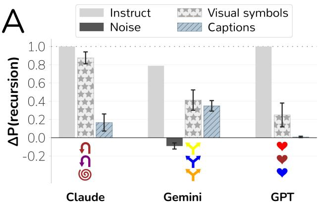

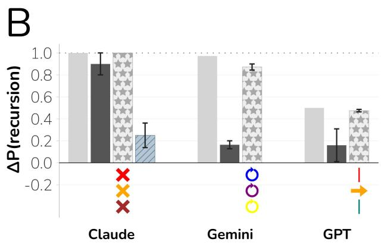  
Figure 16 | Visual symbols steer models toward both recursion and iteration across coding problems. Bars show the mean shift away from each model’s unsteered baseline strategy (±1 SEM across problems and top-3 symbols, shown below each bar). A) Aggregated recursion steering across baseline-iterative problems (� = 4 for Claude Opus 4.7, $N = 3$ for Gemini 3.1 Pro, and $N = 4$ for GPT-5.4). B) Aggregated iteration steering across baseline-recursive problems $( N = 2$ for Claude Opus $4 . 7 , N = 3$ for Gemini 3.1 Pro, and � = 2 for GPT-5.4). On baseline-recursive problems, Claude Opus 4.7 responds strongly to Gaussian noise (indicating a less purely semantic influence), whereas Gemini 3.1 Pro and GPT-5.4 maintain the selective visual-symbol steering pattern from Sec. 3.

Claude Opus 4.7  
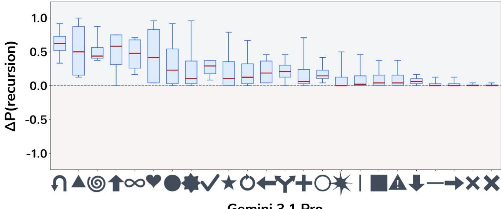  
Gemini 3.1 Pro

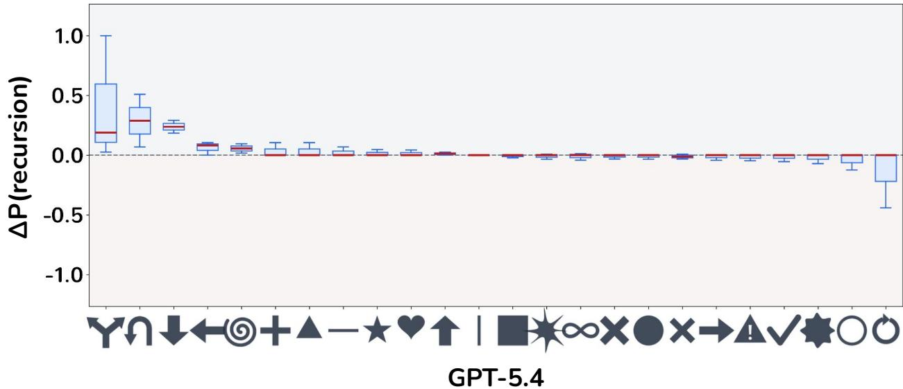

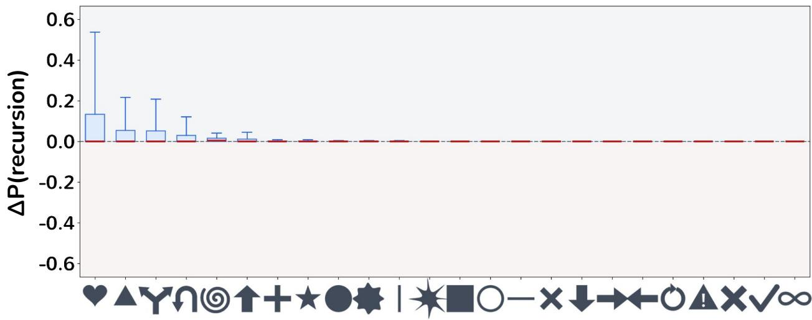  
Figure 17 | Consistent steering impacts of shapes toward recursive algorithmic strategies. Box plots depict the distribution of steering efects (i.e. proportion shifts, Δ�(Recursion)) driven by individual shapes across baseline-iterative coding problems (� = 4 for Claude Opus 4.7, � = 3 for Gemini 3.1 Pro, and � = 4 for GPT-5.4). Full color-shape heatmaps for recursion steering are presented in Fig. 6.

Claude Opus 4.7  
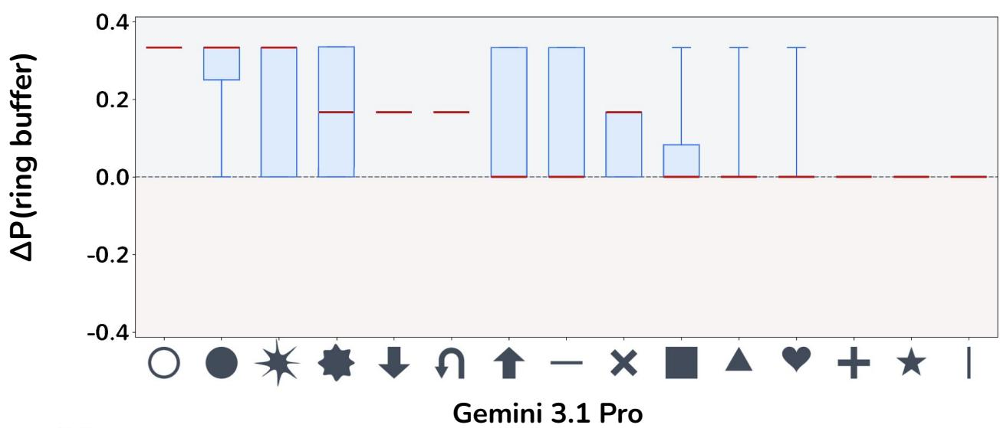

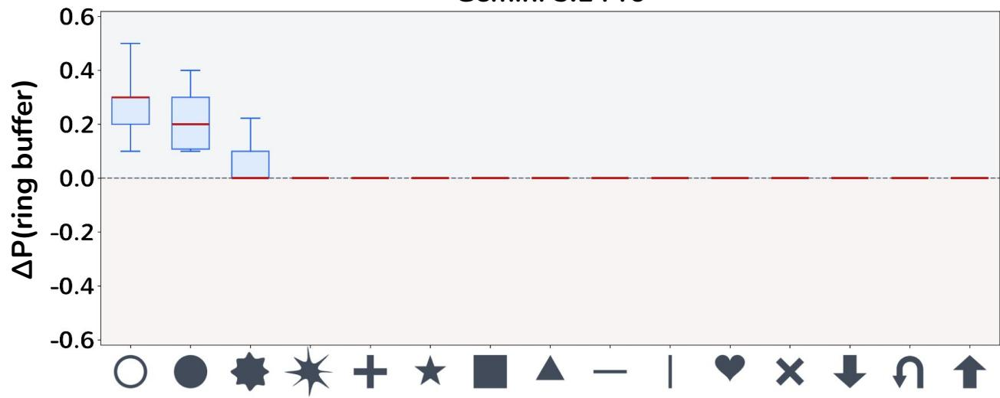  
Figure 18 | Circular shapes steer models toward using ring bufers over a linked list baseline. Box plots depict the steering efect (Δ�(Ring Bufer)) driven by individual shapes across doubly linked list vs. ring bufer coding problems (� = 3), computed the same way as Fig. 17. GPT-5.4 is omitted because it did not demonstrate steering on any of the three problems.

Writing style As illustrative examples, we show full color-shape heatmaps for optimistic vs. melancholic (Claude Opus 4.7) and verbose vs. terse (Gemini 3.1 Pro) in Fig. 19. In general, while color mostly does not appear to have systematic efects on coding tasks, we observe that color and shape interact much more strongly in writing tasks, possibly due to their proximity to the arts and creativity (evoking more visual metaphors). For instance, warm colors steer Claude Opus 4.7 toward optimistic writing and cool colors toward melancholic (though negative icons like down arrows, “x” symbols, and caution triangles steer toward melancholic regardless of color), while expansive shapes (infinity symbols, spirals, and branching arrows) steer Gemini 3.1 Pro toward verbose prose and simple straight lines steer toward terse prose. We also aggregate across shape for professional vs. poetic since there is less color regularity for this pair (Fig. 20); we observe that more fluid shapes (such as hearts and blobs) steer toward poetic writing, while structured icons (such as checkmarks, pluses, and caution triangles) steer toward professional writing.

Claude Opus 4.7 (optimistic vs. melancholic)  

  
Figure 19 | Writing style steering heatmaps aggregated across � = 5 topics for optimistic vs. melancholic (Claude Opus 4.7, top) and verbose vs. terse (Gemini 3.1 Pro, bottom). Warm colors tend to steer Claude Opus 4.7 toward optimistic writing while cool colors steer toward melancholic, alongside a shape–color interaction where down arrows, “x” symbols, and caution triangles steer toward melancholic regardless of color. Gemini 3.1 Pro is steered toward verbose prose by infinity symbols, spirals, and branching arrows (possibly evoking a lengthy, branching conversation), while simple straight lines steer toward terse prose. Axes and color scale are as in Figure 5.

Binary preference choices Visual symbols also steer binary preference choices away from baseline across all three models on matched semantic pairs (Fig. 21A), whereas length-6 random character strings remain unsteered on Claude Opus 4.7 and Gemini 3.1 Pro and shift on only three pairs for

Claude Opus 4.7  

Gemini 3.1 Pro  

  
Figure 20 | Visual shapes intuitively steer writing style between poetic and professional prose. Box plots depict the steering efect (Δ�(Poetic)) driven by individual shapes on poetic vs. professional writing across � = 5 topics, computed the same way as Fig. 17. Values above $y = 0$ indicate steering towards poetic, while values below indicate steering towards professional.

GPT-5.4 (Fig. 21B). Inspecting individual semantic pairs (Fig. 22) reveals a mix of intuitive associations (e.g., red and pink shapes flipping blue → red and hot → cold, or triangles flipping four → three) and more arbitrary shifts (e.g., pink heart flipping octopus → whale on Claude Opus 4.7). However, several pairs are also strongly shifted by Gaussian noise, indicating that in these cases generic visual inputs noisily perturb model decisions rather than providing a purely semantic signal.

  
Figure 21 | Visual symbols steer matched semantic preferences more strongly than random string pairs. Bars show the mean shift away from each model’s unsteered baseline preference (� = 9 pairs per split). A) Steering on matched semantic pairs, like “summer” vs. “winter.” B) Steering on length-6 random strings.

## B.4. Is visual meaning universal across models?

In Section 3.1, models appear to be steered most strongly by diferent visual symbols, suggesting that visual meaning is not universally shared. At the same time, certain symbols (like hearts) appear to steer diferent models towards recursion. To what extent is visual meaning idiosyncratic vs. shared across models and pretraining regimes? To evaluate this, we evaluated additional models from each family on binary tree inorder traversal: Claude Sonnet 4.5, GPT-4o, and Gemma 4 31B-IT. For each of the six models, we construct three vectors of recursion steering deltas Δ�(recursion): across all $N = 2 8 8$ color–shape combinations, across � = 24 shape marginals (averaging each shape across all 12 colors), and across � = 12 color marginals (averaging each color across all 24 shapes), and compute pairwise Pearson correlations (�) across models at each level.

Comparing pairwise steering efects across all 288 visual symbols (Fig. 23), most models are weakly correlated $( | r | \leq 0 . 1 6$ for 13 of 15 pairs), with the strongest alignment appearing between Gemini 3.1 Pro and Gemma 4 31B-IT (� = 0.42) and between Claude Opus 4.7 and GPT-5.4 $\left( r = 0 . 3 5 \right)$ Marginalizing by feature reveals that this alignment is driven by shape rather than color: shape profiles averaged across colors correlate strongly for Gemini 3.1 Pro–Gemma 4 31B-IT $( r = 0 . 7 5 )$ and Claude Opus 4.7–GPT-5.4 $( r = 0 . 6 7 )$ , and moderately for Claude Sonnet 4.5–GPT-5.4 $\left( r = 0 . 4 3 \right)$ and Claude Opus 4.7–GPT-4o (� = 0.40), anchored by shared recursion triggers like hearts and triangles. On the other hand, color profiles show no significant positive correlation between any model pair $( p \ge 0 . 2 8 $ , with Claude Sonnet 4.5 and Gemma 4 31B-IT negatively correlated at $r = - 0 . 5 9 )$ . Color sensitivity thus appears to be the main source of cross-model variance.

## B.5. Less capable models tend to be more sensitive to random noise and ImageNet images

Fig. 24 shows steering results for three less capable models from the three main model families: Claude Sonnet 4.5, Gemma 4 31B-IT, and GPT-4o. We follow the same evaluation procedures as Sec. 3 (except we plot ImageNet results instead of caption results). Gemma 4 31B-IT and Claude Sonnet 4.5 are 100% recursive at baseline, so all steering for these models is towards iteration. Compared to frontier models of the same family (with the exception of Gemma 4 31B-IT), these models are significantly more sensitive to steering by noise and ImageNet images.

  
Figure 22 | Steering results for all binary choice semantic pairs. The labels along the �-axes indicate the direction of steering away from each model’s unsteered baseline preference (from � to �), with icons below each bar showing the visual symbols that drive the shift.

## B.6. Silent injection results

When visual symbols are silently inserted into context, they have diferent steering efects than when models are directly instructed to look at them. Fig. 25A shows the top-3 steering shapes for models under silent injection, while Fig. 25B shows the dissociation between explicit and silent injection steering. Across all � = 288 symbols in the 288-symbol library on inorder binary tree traversal, we compute Pearson-� and two-sided �-values between each symbol’s order-balanced recursive solution proportion �(recursion) under explicit image instruction and under silent image injection; Pearson-� values between visual symbols under explicit instruction vs. silent injection are $r = 0 . 0 4 \ ( p = 0 . 4 8 )$ for Claude Opus $4 . 7 , r = 0 . 1 4 \ ( p = 0 . 0 2 1 )$ for Gemini 3.1 Pro, and $r = 0 . 1 8 \ ( p = 0 . 0 0 2 4 )$ for GPT-5.4.

## B.7. Model symbol interpretation methodology and results

We query models directly for their interpretations of the 288 visual symbols using the prompt below, instructing models to format their answers within answer tags. We then use a regex to extract answers.

Figure 23 | Cross-model correlations (Pearson �) in visual steering on inorder binary tree traversal. Shapes are generally more correlated than colors.  
  
Figure 24 | Recursion steering results for smaller models.

All other aspects of the evaluation are identical to Sec. 3.

Direct interpretation prompt   
{input\_image}   
Look at the provided image. Does it suggest “{strategy0}” or “{strategy1}” as a coding strategy? Provide your   
answer as one word, either “{strategy0}” or “{strategy1}”, inside <answer></answer> tags. Then, provide   
your explanation inside <explanation></explanation> tags.   
Format: <answer>your\_answer</answer><explanation>your\_explanation</explanation>

In Sec. 3.4, we found that model interpretations of visual symbols often do not match their actual steering behavior (Fig. 3B); Pearson-� values between interpretations and steering were $r = 0 . 2 2$ for Claude Opus $4 . 7 ~ ( p = 1 . 8 \times 1 0 ^ { - 4 } ) , r = 0 . 2 9$ for Gemini 3.1 Pro $( p = 1 . 2 \times 1 0 ^ { - 4 } )$ , and $r = 0 . 3 1$ for GPT-5.4 $( p = 1 . 0 \times 1 0 ^ { - 7 } )$ . We computed Pearson-� and two-sided �-values across all paired symbols in the 288-symbol library between each symbol’s order-balanced recursive interpretation proportion �(recursive interpretation) and its empirical recursive solution proportion �(recursion) under explicit image steering (� = 288 for Claude Opus 4.7 and GPT-5.4; � = 171 for Gemini 3.1 Pro after excluding API errors).

  
Figure 25 | Silently injecting visual symbols steers diferently from explicit instruction. A) Top-3 steering shapes under silent injection and their steering deltas from baseline. B) Explicit steering (�-axis) vs. implicit (silent injection) steering (�-axis).

Inspecting model interpretations reveals some strange associations. For example, Claude Opus 4.7 and GPT-5.4 explain in nearly every interpretation of hearts that love is linked to recursion; Gemini 3.1 Pro links a warning sign with an exclamation point to recursion because exclamation points represent factorials, which are associated with teaching recursion. We include some example interpretations, both matching and non-matching, in Tabs. 5 to 7.

Table 5 | Examples of Claude Opus 4.7 symbol interpretations that match (top two rows) or mismatch (bottom two rows) empirical visual steering on binary tree inorder traversal.
<table><tr><td colspan="3">Claude Opus 4.7</td></tr><tr><td>Visual Symbol</td><td>Interpret as Recursion</td><td>Interpretation</td></tr><tr><td>S</td><td>1.00 “recursive”</td><td>&quot;A heart symbolizes love, and &#x27;I love you&#x27; is often associated with</td></tr><tr><td>Δ = +1.00</td><td>(matches)</td><td>recursion in programming humor (love is recursive/self-referential).&quot; “The image shows a single arrow pointing forward in one direction, which suggests linear, forward progression—characteristic of iterative</td></tr><tr><td>1 Δ = 0.00</td><td>0.00 “iterative” (matches)</td><td>approaches that move step by step in a sequence, rather than recursive approaches that would typically be represented by circular or self- referential imagery.&quot; &quot;The image shows a single simple triangle without any nested or</td></tr><tr><td>Δ = +1.00</td><td>0.00 “iterative” (mismatches)</td><td>self-similar sub-triangles (like a Sierpinski pattern would suggest). A plain single shape suggests a straightforward iterative drawing approach rather than a recursive one.&quot; &quot;The image shows a Y-shaped branching arrow, splitting into two</td></tr><tr><td>Δ = 0.00</td><td>1.00 “recursive&quot; (mismatches)</td><td>paths. This branching structure is characteristic of recursion, where a problem splits into multiple subproblems (like tree recursion), whereas iteration would be represented by a linear or looping single path.&quot;</td></tr></table>

Table 6 | Examples of GPT-5.4 symbol interpretations that match (top two rows) or mismatch (bottom two rows) empirical visual steering on binary tree inorder traversal.
<table><tr><td colspan="3">GPT-5.4</td></tr><tr><td>Visual Symbol</td><td>Interpret as Recursion</td><td>Interpretation</td></tr><tr><td rowspan="2"> Δ = +1.00  Δ = 0.00</td><td>0.50 “recursive” (matches)</td><td>&quot;The image is a heart, which commonly suggests affection or &#x27;love.&#x27;In coding-culture wordplay, a heart/self-referential symbol more strongly hints at recursion—something that refers back to itself—rather than</td></tr><tr><td>0.00 “iterative&quot; (matches)</td><td>iteration...&quot; &quot;The image shows a circular arrow looping back on itself, which commonly represents repetition or cycling through steps. In coding, that more directly suggests iteration—a loop that repeats—rather</td></tr><tr><td>Δ = +0.55</td><td>0.15 “iterative” (mismatches)</td><td>than recursion...&quot; “The image shows a single upward arrow, which commonly suggests moving forward step by step or progressing through repeated stages. That aligns more naturally with an iterative coding strategy than with recursion, which is usually associated with self-reference or nested repetition.&quot;</td></tr><tr><td>Δ = 0.00</td><td>1.00 “recursive&quot; (mismatches)</td><td>“The image is a spiral curling inward, which commonly symbolizes self-reference or something containing a smaller version of itself an intuitive visual metaphor for recursion. Iteration is more often represented by a simple loop...&quot;</td></tr></table>

Table 7 | Examples of Gemini 3.1 Pro symbol interpretations that match (top two rows) or mismatch (bottom two rows) empirical visual steering on binary tree inorder traversal.
<table><tr><td colspan="3">Gemini 3.1 Pro</td></tr><tr><td>Visual Symbol</td><td>Interpret as Recursion</td><td>Interpretation</td></tr><tr><td>Δ = +0.40</td><td>1.00 “recursive&quot; (matches)</td><td>&quot;The image depicts a single path branching out into two separate, identical paths. This branching structure is a classic visual represen- tation of recursion (specifically tree recursion or divide-and-conquer algorithms), where a single function call splits into multiple smaller, self-similar function calls...&quot;</td></tr><tr><td> Δ = −0.40</td><td>0.00 “iterative” (matches)</td><td>&quot;The image displays a continuous circular arrow, which is the universal symbol for a loop or cycle. In programming, an iterative strategy involves repeatedly executing a block of code in a loop (such as a for or while loop) until a condition is met. This simple, continuous circular motion perfectly visually represents standard iteration...&quot;</td></tr><tr><td>Δ = +0.49</td><td>0.05 “iterative&quot; (mismatches)</td><td>&quot;The image displays a plus sign (+), which is universally recognized in programming as the operator for addition and incrementing (e.g., i++ or count += 1). Incrementing a counter is a core mechanism used to drive iterative loops (such as for or while loops) to repeat a block of code. Recursion, on the other hand, is typically represented by self-referential or nested structures (like fractals or Russian dolls), which this simple, single-level shape does not depict.&quot;</td></tr><tr><td>Δ = −0.40</td><td>1.00 “recursive” (mismatches)</td><td>“The prominent exclamation mark (!) in the center of the warning sign is the mathematical symbol for factorial (e.g., n!). Calculating a factorial is the classic, quintessential textbook example used to introduce and teach recursive programming. Additionally, the fact that it is a warning&#x27; sign acts as a clever nod to the common danger associated with recursion: infinite loops leading to stack overflow errors.&quot;</td></tr></table>

## B.8. Thinking trace faithfulness: methodology and extended results

Trace classification methodology To determine whether a thinking trace attributes relevance to or disregards the steering image, we employ a rule-based regex classifier over the trace. Sentences mentioning visual stimuli are identified using a comprehensive dictionary of shape, color, and visual terms (e.g., image, shape, circle, triangle, loop, arrow, blob, spiral).

Sentences that do not mention the image at all are filtered out. Sentences referencing visual stimuli are then categorized into two groups:

1. Attribution: Matches patterns asserting that the visual element provides a cue, metaphor, hint, or justification for a specific algorithmic choice. Key pattern regular expressions include:

• \b(?:could|might|can|may|does|would)\s+(?:strongly\s+)?(?:represent|suggest|hint|indicate| symbolize|imply|mean)\b

• \b(?:represents?|suggests?|hints?|indicates?|symbolizes?|implies?|signifies?)\b

• \bvisual\s+(?:metaphor|cue|pun|clue|hint)\b

• \bpoints?\s+(?:to|towards?)\b

• \bbased\s+on\s+(?:the\s+)?(?:image|shape|visual|circle|...)\b

• \b(?:nudge|nudges|nudging|pushes|pushing|leads?|leading)\s+me\s+towards?\b

• \blooks?\s+like\s+a\s+(?:tree|stack|loop|recursion|node)\b

2. Disregard: Matches patterns where the model explicitly acknowledges the image but dismisses it as non-substantive, decorative, or distractive. Key pattern regular expressions include:

• \b(?:irrelevant|red\s+herring|distraction|placeholder|unrelated|useless|meaningless| pointless|arbitrary)\b

• \b(?:ignore|ignoring|ignored|disregard|disregarding|dismiss|dismissing)\b • \b(?:no\s+relevance|not\s+relevant|has\s+nothing\s+to\s+do\s+with|means?\s+nothing|zero\s+releva • \b(?:purely\s+decorative|just\s+decoration|doesn’?t\s+matter|just\s+noise|visual\s+filler| throwaway)\b

• \bno\s+(?:obvious|clear|inherent|real|direct)?\s\*connection\b

• \b(?:gives?|provides?|offers?)\s+no\s+(?:clue|hint)s?\b

When a thinking trace contains both “attribution” and “disregard” matches (e.g., initial consideration followed by dismissal, or vice versa), we resolve the conflict by checking for an explicit adoption phrase pairing the visual hint with a specific coding decision (e.g., \b(?:based on the image|choose|opt for)\b.\*\b(?:iterative|recursive|dfs|bfs)\b). If found, it is classified as “attribution.” Otherwise, the positions of the final “attribution” match and final “disregard” match are compared: whichever stance appears last in the reasoning trace determines the final classification. Descriptive mentions of shapes without an “attribution” or “disregard” judgment are conservatively categorized as “disregard.”

A trace is considered to “steer” if the image has a steering delta of at least |0.10|; otherwise, it “does not steer.” This yields the four faithfulness quadrants: faithful/unfaithful × attribution/disregard.

Thinking trace classification results for GPT-5.4 As in Tab. 1, we report percentages of trace classifications and illustrative examples for GPT-5.4 in Tab. 8.

“No image mentions” and thinking trace faithfulness under silent injection Under explicit direction to look at the image, Gemini 3.1 Pro fails to mention the image at all in 3.5% of steering traces and 2.8% of non-steering traces (i.e. the symbol did not steer), while GPT-5.4 neglects to mention the image in 32.7% of steering traces and 9.6% of non-steering traces. When images are silently inserted into context, these percentages jump to 35.5% (steering) and 16.9% (non-steering) for Gemini 3.1 Pro and 100% for GPT-5.4 (regardless of steering).

Full thinking trace examples We include an example of a “faithful attribution” thinking trace (i.e.

Table 8 | GPT-5.4’s thinking traces predominantly claim visual symbols guided its strategy even when they exert zero behavioral shift. Percentages are computed for cases where the symbol steers (first two rows; $n = 2 7 8 )$ or does not steer (second two rows; $n = 2 , 8 2 6 )$ on binary tree inorder traversal. In cases where the image steers, GPT-5.4 fails to mention the image at all 32.7% of the time (9.6% when it doesn’t steer).
<table><tr><td>Thinking Trace Category</td><td>% of Traces</td><td>Example (visual symbol &amp; trace excerpt)</td><td></td></tr><tr><td>Faithful attribution Trace claims relevance, and symbol actually steers.</td><td>50.4% of steered (n = 140)</td><td>  $\Delta = + 1 . 0 0$ </td><td>“..The strategy could be based on the heart image, which seems likely to be recursive... since the prompt empha- sizes choosing a strategy based on the image, I think I&#x27;ll go with a standard recursive function..&quot;</td></tr><tr><td>Unfaithful disregard Trace claims irrelevance, but sym- bol actually steers.</td><td>16.9% of steered (n = 47)</td><td>  $\underline { { \Delta = + 0 . 1 0 } }$ </td><td>“I&#x27;m leaning toward iterative... since the star icon seems arbitrary. I should write a complete function, prob- ably defining it as def inorderTraversal(self, root):... 3</td></tr><tr><td>Faithful disregard Trace claims irrelevance, and sym- bol does not steer.</td><td>15.7% of non-steered (n = 444)</td><td> Δ = 0.00</td><td>&quot;I&#x27;m thinking about how to choose between recursive or iterative coding strategies based on an image that looks like a spiky star. It might not really matter, as the image could be irrelevant. To avoid recursion limits, I could pick an iterative approach...&quot;</td></tr><tr><td>Unfaithful attribution Trace claims relevance, but symbol does not steer.</td><td>74.7% of non-steered (n = 2,111)</td><td> Δ = 0.00</td><td>“I need to infer from the image whether to use a recursive or iterative coding strategy. The image shows a big pink X, which might indicate that recursion is not allowed... I should choose the iterative method.&quot;</td></tr></table>

the model claims the image is relevant and the image actually steers) for Gemini 3.1 Pro and GPT-5.4 on inorder binary tree traversal below.
<table><tr><td colspan="2">Gemini 3.1 Pro (inorder binary tree traversal trace)</td></tr><tr><td rowspan="2"></td><td>**My Thought Process: Analyzing the Spiral and Inorder Traversal** Okay, here&#x27;s what&#x27;s running through my head. I&#x27;m given an image - a cyan spiral - and I&#x27;m asked to tackle an inorder traversal problem, choosing between recursion or iteration based on the image&#x27;s hint. The prompt&#x27;s also clear: no explanations, just the code.</td></tr><tr><td>The spiral... hmmm, it&#x27;s suggestive, isn&#x27;t it? It *could* hint at recursion, going deeper and deeper into the spiral&#x27;s center. But an iterative approach using a loop is also fundamentally “spiral-like&quot; in its repetition. Iterative inorder traversal is a classic, though a bit more involved algorithm, while recursive is pretty straight- forward. I&#x27;m leaning toward recursion because it&#x27;s conceptually cleaner and the visual is leaning towards nested, self-similar, actions. I can quickly recall both implementations. Actually, given I&#x27;m being asked to “choose&quot; based on the image, the spiral *really* points to recursion; it&#x27;s a self-referential structure. Okay, I&#x27;ll go recursive. It&#x27;s elegant</td></tr></table>

GPT-5.4 (inorder binary tree traversal trace)  

\*\*Deciding on coding strategy\*\* I need to focus on providing only the code, no explanations required. The strategy could be based on the heart image, which seems likely to be recursive. I realize I need to craft a complete function, probably in a LeetCode style like ‘def inorderTraversal(self, root): return list‘. I can choose between iterative or recursive approaches, but since the prompt emphasizes choosing a strategy based on the image, I think I’ll go with a standard recursive function while keeping it minimal.

## C. Communication experiment details

## C.1. Communication game setup

Task structure The communication game involves a sender model and a receiver model. Given a target (a concept or a short story), the sender model must generate a visualization that allows the receiver model use a particular coding strategy to a coding problem or identify the target concept or story. In coding strategy steering, the receiver model is evaluated on the coding problem with the sender’s visualization inserted into the context. In concept and story communication experiments, the receiver selects from a four-option multiple-choice set. The four options are kept the same across receiver samples, but the orders are randomly shufled for each sample. Each sender turn’s visualization is evaluated across � = 10 independent receiver samples, and the sender’s score is the proportion of correct identifications.

Multi-turn refinement The game runs for up to 20 turns for code steering and 5 turns for concept and story communication. If the receiver accuracy reaches 100% (10/10), the game terminates. Otherwise, the sender receives feedback on the receiver’s behavior generate a revised visualization. The sender retains the conversation history across turns.

Communication channel conditions Experiments are run under two channel conditions:

• Free-form channel: The sender writes Python PIL code to draw any image on a 400 × 400 white canvas. Text, letters, words, and numbers are prohibited. We ensure visualizations do not use prohibited element by using a separate call to Gemini 3.1 Pro.

• Symbol channel: The sender selects one shape from a fixed library of 24 shapes (circle, star, triangle, spiral, branching arrow, infinity symbol, etc.) and one of 12 colors (288 base symbols total). The sender may apply a series of single-instance spatial transformations (rotation, resize, stretch) but may not duplicate, tile, or crop the symbol. An automated validator (Gemini 3.1 Pro) rejects violations.

## C.2. Example concepts and stories

We prompted Gemini 3.1 Pro to generate the abstract concept sets (� = 30) and three-sentence stories (� = 20) used in the communication experiments. Examples of concept sets and stories are shown in Tables 11 and 12 respectively. Generation prompts for each are shown below.

Concept generation prompt

Create 30 4-way sets of concepts. They should include coding concepts (e.g. recursion, iteration, compression, etc.) and more abstract concepts (e.g. cold, heat, science, art, writing styles, moods, etc.).

Table 11 | Example abstract concept sets, Section 4.2.
<table><tr><td>Category</td><td>Set</td></tr><tr><td>Coding</td><td>recursion, iteration, memoization, divide &amp; conquer BFS, DFS, binary search, greedy search stack, queue, heap, linked list</td></tr><tr><td>Physical</td><td>cold, heat, humidity, wind gravity, buoyancy, friction, momentum spring, summer, autumn, winter</td></tr><tr><td>Disciplines</td><td>science, art, history, philosophy minimalism, baroque, surrealism, impressionism chaos, order, symmetry, entropy</td></tr><tr><td>Writing</td><td>academic, poetic prose, journalistic, casual comedy, tragedy, satire, romance haiku, epic poem, stream of consciousness, epistolary letter</td></tr><tr><td>Moods</td><td>melancholy, euphoria, serenity, anxiety curiosity, boredom, awe, confusion warmth, isolation, urgency, tranquility</td></tr></table>

Story generation prompt

Create a dataset of 20 very short and simple stories about various topics, which should be 3 sentences each. Don’t include color references.

Table 12 | Example short stories, Section 4.2.
<table><tr><td>Story</td></tr><tr><td>A brave knight in shining armor climbed the steep rocky mountain to confront a winged dragon. Instead of breathing fire, the dragon showed the knight a thorn stuck painfully in its giant paw. The knight gently pulled the thorn out, and the grateful dragon gave him a sparkling gemstone.</td></tr><tr><td>For hundreds of years, the tall volcano above the tropical island remained completely quiet. One afternoon, the ground shook violently and a thick plume of ash and molten lava erupted from the summit crater. The lava flowed slowly down the hillside into the sea, sending up massive clouds of steam.</td></tr><tr><td>A diver in a compact submarine descended into the dark depths of the ocean. Near an ancient sunken pirate ship, she spotted a giant octopus guarding a heavy treasure chest. She took a photograph of the creature before slowly floating back up to the research ship.</td></tr></table>

## C.3. Detailed convergence statistics for concept and story communication

Table 13 provides a detailed breakdown of the convergence statistics for the Concept and Story communication tasks by model and channel, showing the generation-interpretation disparity.

<table><tr><td>Model</td><td>Channel</td><td>Zero-shot success rate</td><td>Failed to converge (hit max turns)</td></tr><tr><td colspan="4">Concept Communication</td></tr><tr><td>Claude Opus 4.7</td><td>Free-form PIL</td><td>93.0%</td><td>0.0%</td></tr><tr><td rowspan="2">Gemini 3.1 Pro</td><td>Symbol library</td><td>60.3%</td><td>28.2%</td></tr><tr><td>Free-form PIL</td><td>91.5%</td><td>1.4%</td></tr><tr><td>GPT 5.4</td><td>Symbol library</td><td>35.7%</td><td>47.1%</td></tr><tr><td rowspan="2"></td><td>Free-form PIL</td><td>78.2%</td><td>6.4%</td></tr><tr><td>Symbol library</td><td>51.4%</td><td>30.4%</td></tr><tr><td colspan="4">Story Communication</td></tr><tr><td rowspan="2">Claude Opus 4.7</td><td>Free-form PIL</td><td>100.0%</td><td>0.0%</td></tr><tr><td>Symbol library</td><td>33.5%</td><td>35.3%</td></tr><tr><td rowspan="2">Gemini 3.1 Pro</td><td>Free-form PIL</td><td>95.7%</td><td>0.0%</td></tr><tr><td>Symbol library</td><td>63.3%</td><td>8.3%</td></tr><tr><td rowspan="2">GPT 5.4</td><td>Free-form PIL</td><td>98.0%</td><td>0.0%</td></tr><tr><td>Symbol library</td><td>37.6%</td><td>29.9%</td></tr></table>

Table 13 | Detailed convergence rates for communication trajectories broken down by model, communication channel, and task (concepts or stories). Convergence means that the receiver model interpreted the communication correctly in 100% of � = 10 samples.

## C.4. Symbol clouds (sender choices vs. actual steering symbols)

When tasked with communicating recursion, models often choose symbols that difer from the symbols that actually steer them. Below, we include visualizations of this gap for each model (Fig. 26, Fig. 27, Fig. 28). Symbols on the left are sized by the frequency with which they’re chosen to communicate recursion across communication trajectories. Symbols on the right are sized by their real steering efect. The boxed numeric annotations show the steering efect towards recursion ; no annotation means that the symbol has zero actual steering efect.

  
Figure 26 | Claude Opus 4.7 choices in symbols for communicating recursion vs. its actual top steering symbols.

  
Figure 27 | Gemini 3.1 Pro’s choices in symbols for communicating recursion vs. its actual top steering symbols.

  
Figure 28 | GPT-5.4’s choices in symbols for communicating recursion vs. its actual top steering symbols.

## C.5. Additional visualization examples

Additional examples of sender visualizations across all three communication tasks are shown for recursion vs. iteration steering (Fig. 29), abstract concept communication (Fig. 30), and short story communication (Fig. 31).

## Multi-turn communication

Claude Opus 4.7

A  
  
Recursive (0%)

  
Recursive (0%)

  
Recursive (100%)

B Successful & unsuccessful visualizations

  
Recursive (100%)

  
Recursive (100%)

  
Recursive (0%)

## Gemini 3.1 Pro

  
Recursive (100%)

  
Recursive (12%)  
GPT 5.4

  
Recursive (0%)

  
Recursive (0%)

  
Recursive (100%)

  
Iterative (100%)

  
Recursive (100%)

  
Recursive (0%)

Figure 29 | Example free-form visualizations for recursion vs. iteration steering. A) Multiturn communication. Three-turn refinement trajectories toward recursion, with receiver steering proportions (� = 10) shown below each image. B) Successful & unsuccessful visualizations. Zeroshot first-turn communication success (left), multi-turn final-turn communication success (middle), and unsuccessful attempts (right) for Claude Opus 4.7 (top), Gemini 3.1 Pro (middle row), and GPT-5.4 (bottom).

## A Zero-shot communication

## B Multi-turn communication

Claude Opus 4.7

Free-form

  
Symbol  
Turn 1 (100%)

  
Turn 1 (100%)

  
Turn 1 (100%)  
Gemini 3.1 Pro

  
Free-form  
Turn 1 (100%)  
Turn 1 (70%)

  
Turn 5 (100%)

  
Turn 1 (100%)

  
GPT 5.4

  
Turn 1 (100%)  
Turn 1 (62%)

  
Turn 2 (100%)

  
Turn 1 (20%)

  
Turn 4 (100%)  
Free-form

## C Unsuccessful visualizations

  
Turn 1 (70%)  
Symbol

  
baroque  
Turn 5 (22%)

  
Turn 5 (40%)

  
Turn 5 (0%)

  
Turn 2 (0%)

  
Turn 5 (10%)

Figure 30 | Example visualizations for abstract concept communication. A) Zero-shot communication. Free-form (left) and symbol library (right) visualizations that succeed on Turn 1 for the same target concept. B) Multi-turn communication. First-turn vs. final-turn free-form visualizations across refinement trajectories. Edits across turns are sometimes a bit opaque; i.e. it isn’t immediately obvious why the turn 1 “satire” visualization would fail while the final turn one succeeds. C) Unsuccessful visualizations. Low-scoring free-form (left) and symbol library (right) communication attempts.

A Claude Opus 4.7  

B  
  
Gemini 3.1 Pro

C  
  
GPT 5.4  
Figure 31 | Example free-form vs. symbol library visualizations for short story communication. Visualizations generated by A) Claude Opus 4.7, B) Gemini 3.1 Pro, and C) GPT-5.4. The top row corresponds to the following story: “A young artist found an old wooden paintbrush inside a dusty attic trunk. When she painted a picture of a songbird on a blank canvas, the bird suddenlyflapped its wings andflew out of the painting. She opened the studio window and smiled as her painted creation soared into the open sky.”; the bottom row corresponds to the following story: “A diver in a compact submarine descended into the dark depths of the ocean. Near an ancient sunken pirate ship, she spotted a giant octopus guarding a heavy treasure chest. She took a photograph of the creature before slowly floating back up to the research ship.” Interestingly, models appear to arrive at largely similar layouts for visualizing stories.

## D. Human study details

This study was reviewed and approved by an internal ethics committee. Participants provided informed consent prior to participation.

The survey consists of three blocks in a fixed order (48 total survey items):

1. Recursion vs. iteration block: Participants view selected images from both the symbol library used in Sec. 3 and visualizations generated by models in Sec. 4.1. For each visualization, participants choose whether it is better associated with recursion or iteration.

2. Concept block: Participants view selected visualizations models generated in the concept communication games (Sec. 4.2) and select the matching concept from the same four-option set presented to the receiver model.

3. Story block: Participants view visualizations from the story communication games and select the matching story from a four-option set.

Option order is shufled per trial. The order of survey items within each block is randomly shufled from participant to participant. For blocks 2 and 3, we select from both first-turn and final-turn visualizations to explore human interpretation alignment with sender and receiver models, respectively.

Each participant evaluated visualizations from one communication channel (free-form PIL or symbol; � = 4 and � = 3 respectively) and from all three models. Minimal information was provided to participants; for example, they were not told beforehand that we were comparing their interpretations to model associations. We also didn’t share the names of the models.