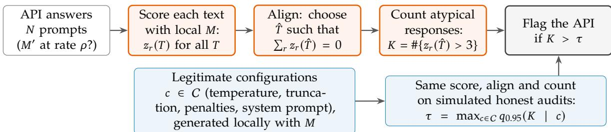
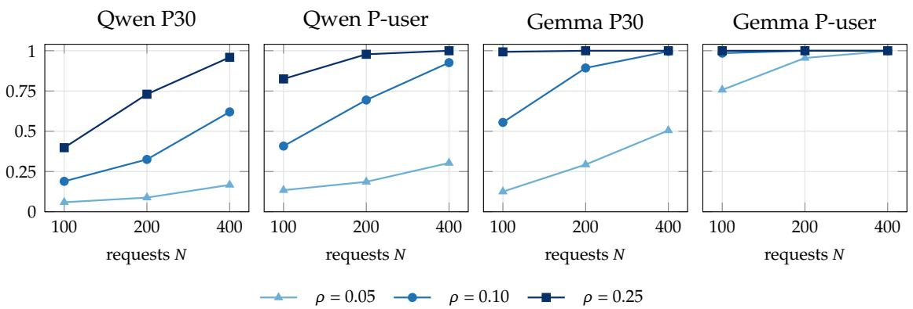

# API-TAIL: Detecting Model Substitution in LLM APIs through Temperature-Aligned Likelihood Tails

TokenRhythm Technologies

## Abstract

Commercial language model APIs return only text, allowing a provider to cut costs by quietly routing a fraction of user requests to a cheaper substitute model while billing for the advertised one. Detecting such partial substitution is challenging because honest providers also alter the output distribution through undocumented decoding and serving choices—such as temperature scaling, sampling truncation, repetition and presence penalties, and default system prompts—forcing an audit to test against a composite null of legitimate configurations rather than a single reference. Our key insight is that these legitimate variations primarily shift response typicality across the entire batch, whereas partial substitution injects individual responses that remain anomalous under the claimed model. Building on this, we introduce API-TAIL, a typicality audit that first absorbs batch-level shifts by aligning a single effective temperature to center standardized surprisal scores across the audited batch, and then flags the endpoint if the number of remaining tail responses exceeds a threshold calibrated across legitimate configurations. Evaluated on real-world commercial APIs, API-TAIL reliably controls false alarms across diverse honest providers while detecting even low-rate partial substitution with a small query budget, substantially outperforming existing rank- and MMD-based audits that lose detection power under the same composite calibration.

§ Project Page: https://github.com/TokenRhythm/API-TAIL

## 1. Introduction

Commercial language model APIs allow users to select and pay for a specific model by name while returning only generated text. A provider can therefore cut cost by answering a fraction � of the requests with a cheaper substitute, such as an older release, a smaller or mixture-ofexperts sibling, or a model of another family, while billing for the advertised model. Such partial substitution is invisible in any single response, and auditing APIs for it has become an active problem [13, 5, 37, 6, 33, 35, 21].

The central obstacle is that honest providers do not serve a model in one canonical way. They choose decoding temperatures and truncation thresholds, apply repetition or presence penalties, and add default system prompts, usually without documenting these choices. Each choice shifts the distribution of the returned text, so an honest endpoint is not a sample from one reference distribution but from one of many legitimate deployments: the audit has to test a composite null hypothesis. Audits built around a single reference face a dilemma under this null. They either raise false alarms on honest providers or, once calibrated to accept all legitimate deployments, lose their power. In our experiments, a published rank-based audit [37] and an MMD-based audit [13], calibrated on the same legitimate configurations as our method, have zero power against 10% substitution with 200 requests, even on the controlled short-response panels where their repeated sampling per prompt is feasible.

  
Figure 1 | API-TAIL audits an API from returned text. Each response is scored under the claimed model �; one effective temperature is aligned to the audited batch to absorb batch-level shifts from honest decoding and serving choices; the number of responses that remain atypical is compared with a threshold calibrated by running the same procedure on locally generated responses of � across legitimate deployment configurations.

Our approach starts from how the two kinds of change act on the text when every returned response is scored under the claimed model. Legitimate decoding and serving choices—whether temperature scaling, truncation, repetition and presence penalties, or default system prompts— shift how surprising the honest responses are for the claimed model, and they shift the whole batch together. A substitute model instead writes individual responses that stay atypical for the claimed model across temperatures. This suggests absorbing the batch-level shift first and testing what remains against a threshold that accounts for residual configuration differences.

API-TAIL implements this idea in three steps (Figure 1). It scores each response by its standardized excess surprisal: how much more surprising the response is under the claimed model at temperature � than a typical sample, in units of its standard deviation. It aligns one effective temperature to the audited batch by choosing the � at which these scores are centered, thereby absorbing batch-level shifts from undocumented decoding and serving choices. It then counts the responses whose score stays above 3 and compares the count with a threshold calibrated on locally generated responses of the claimed model across a pool of legitimate configurations, including the penalty configurations that providers use. Scores are computed exactly over the full vocabulary, so an audit is deterministic and reproducible.

We evaluate API-TAIL on real APIs: 26 plain honest endpoints serving Qwen3.8-27B or Gemma-4-31B-it through OpenRouter, two request protocols, and six substitute models served by seven endpoints, 143,955 responses in total. Our contributions are:

• Formulation. We cast text-only auditing of language model APIs as a test against a composite null of legitimate deployment configurations, with validity evaluated directly on real honest providers (Section 2).

• Method. We propose API-TAIL, which aligns an effective temperature by centering standardized typicality to absorb batch-level deployment shifts, counts the responses that remain atypical, and calibrates the count across a pool of legitimate decoding and serving configurations (Section 3). One audit of 200 requests needs one response per prompt, less than 0.16 USD of API calls and two to eight GPU-minutes of deterministic local scoring.

• Evidence. API-TAIL keeps the false-alarm rate at or below 0.069 on all 26 plain honest endpoints and detects 10% substitution with power of at least 0.69 in 13 of 16 substitute settings at 200 requests (Section 5). Matched ablations explain the design (Section 6): aligning instead of maximizing likelihood adds 0.09 to 0.63 power by keeping the composite threshold low, full-vocabulary scoring adds 0.62 power over a top-20 window on long responses, and the penalty configurations in the pool are what make the model developer’s own endpoint pass.

## 2. Problem Setup

Access model. An API advertises a target model � (for example, Qwen3.8-27B) and bills each request as a call to �. The auditor sends prompts $x _ { 1 } , \ldots , x _ { N }$ and observes only the returned texts $y _ { 1 } , \ldots , y _ { N } ;$ it does not use log-probabilities, seeds or logit bias from the endpoint, and it does not assume that the endpoint honours sampling parameters. With access to the weights of �, the auditor can run � locally and compute teacher-forced next-token distributions for any returned text.

Partial substitution. A dishonest endpoint answers each request independently with a substitute model $M ^ { \prime } \ne M$ with probability $\rho$ and with � otherwise. Substitutes are typically cheaper: an older release of the same family, a smaller or mixture-of-experts sibling, or a model of another family. Small $\rho$ is the hard and economically relevant regime: it saves the provider money while leaving most responses untouched.

Legitimate variation and the composite null. An honest endpoint serves $M ,$ but not necessarily the way the auditor would. Providers choose the decoding temperature, top-� and top-� cutoffs, presence and repetition penalties, default system prompts and inference backends [26], usually without documenting these choices. We therefore define honesty through a set C of legitimate deployment configurations: the null hypothesis is that there is a configuration $c \in C$ under which � generates the audited responses [3, 1]. This null is composite. An audit that compares the endpoint with a single reference deployment of � conflates legitimate deployment choices with substitution.

Validity and power. An audit maps � responses to a binary verdict. We require it to be valid on real traffic: its false-alarm rate, the probability of flagging an honest endpoint, must stay at most 0.10 for every honest provider endpoint in the evaluation, and this verdict must be stable when the calibration samples are re-drawn (we require it in at least 16 of 20 re-drawn calibrations). Among valid audits we compare power, the probability of flagging an endpoint that substitutes at rate $\rho ,$ at a fixed budget of � requests.

## 3. API-TAIL: Temperature-Aligned Typicality Auditing

API-TAIL has three parts (Figure 1): it scores every returned response by how typical it is under the claimed model at a given temperature, it aligns a single effective temperature to the audited batch so that batch-level shifts from honest decoding and serving choices cancel out, and it counts the responses that remain atypical, comparing the count with a threshold calibrated across the legitimate configurations $c$ to cover residual configuration differences.

## 3.1. Typicality under a tempered model

For a prompt � and a returned response $y = \left( y _ { 1 } , \ldots , y _ { L } \right)$ , let $\ell _ { t } \in \mathbb { R } ^ { | \mathcal { V } | }$ be the next-token logits of � at position � (teacher forcing), and let $q _ { t , T } = \mathrm { s o f t m a x } ( \ell _ { t } / T )$ be the tempered distribution. With the per-token surprisal $s _ { t } ( T ) = - \log q _ { t , T } ( y _ { t } )$ , its expectation $H _ { t } ( T )$ (the entropy of $q _ { t , T } )$ and its variance $\sigma _ { t } ^ { 2 } ( T )$ under $q _ { t , T } .$ , we define the excess surprisal, its variance and the standardized typicality score of the response,

$$
S ( T ) = \sum _ { t = 1 } ^ { L } \bigl ( s _ { t } ( T ) - H _ { t } ( T ) \bigr ) , \qquad V ( T ) = \sum _ { t = 1 } ^ { L } \sigma _ { t } ^ { 2 } ( T ) , \qquad z ( T ) = \frac { S ( T ) } { \sqrt { V ( T ) } } .\tag{1}
$$

$\operatorname { I f } y$ is sampled from � at temperature $T ,$ the summands $s _ { t } ( T ) - H _ { t } ( T )$ form a martingale difference sequence with conditional variances $\sigma _ { t } ^ { 2 } ( T )$ , so �(�) is approximately standard normal: the response is typical. A response written by a different model tends to contain tokens that � finds surprising in their context, which shows up as a large positive �.

## 3.2. Temperature alignment

An honest provider may alter the output distribution through temperature scaling, truncation, repetition or presence penalties, or a default system prompt, all of which shift the overall typicality of the batch; evaluating � at a fixed reference � confounds substitution with these deployment choices. API-TAIL removes this batch-level confounder by fitting one effective temperature to the audited batch,

$$
\hat { T } = \underset { T \in \mathcal { T } } { \arg \operatorname* { m i n } } \biggl | \sum _ { r = 1 } ^ { N } z _ { r } ( T ) \biggr | , \qquad \mathcal { T } = \{ 0 . 3 0 , 0 . 3 1 , \dots , 1 . 8 0 \} ,\tag{2}
$$

that is, the grid temperature at which the standardized scores of the batch are centered. Whatever legitimate decoding or serving configuration the provider used, the bulk of honest responses is centered at �ˆ.

Alignment differs from fitting the temperature by maximum likelihood. Since $\begin{array} { r } { \frac { \partial } { \partial T } \log q _ { t , T } ( y _ { t } ) = } \end{array}$ $\big ( s _ { t } ( T ) - H _ { t } ( T ) \big ) / T$ , the likelihood equation for � is $\begin{array} { r } { \sum _ { r } S _ { r } ( T ) = \sum _ { r } \sqrt { V _ { r } ( T ) } z _ { r } ( T ) = 0 \colon } \end{array}$ it weights each response by the standard deviation of its score, so long and high-entropy responses dominate the fit. API-TAIL centers the unweighted scores, $\begin{array} { r } { \sum _ { r } z _ { r } ( T ) = 0 . } \end{array}$ , and gives every response the same weight. This matters because the test counts standardized scores: alignment centers exactly the quantity that is thresholded, which keeps the number of null exceedances small also for legitimate configurations that a pure temperature change does not describe, such as repetition penalties or a default system prompt. Section 6 shows that this is where the two estimators part ways.

## 3.3. Counting atypical responses against a composite null

Because alignment centers the scores of the batch, a small fraction of substituted responses cannot be detected through their mean; it appears as an excess of large scores [9]. API-TAIL therefore counts the responses that remain atypical after alignment,

$$
K = \# \{ r \leq N \colon z _ { r } ( \hat { T } ) > 3 \} .\tag{3}
$$

To calibrate $K ,$ the auditor generates responses of � locally under every configuration $c \in C$ on prompts disjoint from the audit prompts, simulates honest audits of � requests for each $c ,$ and records the 95th percentile $q _ { 0 . 9 5 } ( K \mid c )$ , an integer. The threshold is the largest of these percentiles, $\tau = \operatorname* { m a x } _ { c \in C } q _ { 0 . 9 5 } ( K \mid c )$ , and the endpoint is flagged when $K > \tau$ . By construction, the false-alarm rate is at most 5% under every configuration in C (up to simulation error); the experiments test whether this carries over to real honest endpoints, whose configurations the auditor does not know.

## 3.4. Exact and reproducible scoring

API-TAIL scores the full vocabulary. For every position, one forward pass of � yields the logits, from which we accumulate in double precision the moment sums $\begin{array} { r } { \sum _ { \nu } e ^ { \ell _ { t , \nu } / T } , \mathbf { \dot { \mu } } _ { \nu } \sum e ^ { \ell _ { t , \nu } / T } \ell _ { t , \nu } } \end{array}$ and $\begin{array} { r } { \sum _ { \nu } e ^ { \ell _ { t , \nu } / T } \ell _ { t , \nu } ^ { 2 } } \end{array}$ for all temperatures on the grid; these give $s _ { t } , H _ { t }$ and $\sigma _ { t } ^ { 2 }$ exactly, without truncating to a top-� window or a nucleus. Scoring runs with batch size one and deterministic GPU kernels, so repeated audits of the same responses are bitwise identical (Appendix B). Auditing one endpoint with $N = 2 0 0$ responses takes about two GPU-minutes for 30-token responses and about eight for responses of up to 400 tokens on a single L20X GPU.

## 4. Experimental Setup

Claimed models and honest endpoints. We audit two widely served models offered by many independent providers through OpenRouter: Qwen3.8-27B and Gemma-4-31B-it. From provider metadata, documentation and a short parameter-compliance probe (Appendix A), we separate plain honest endpoints, which advertise BF16, FP16 or FP8 weights or state no precision, document no system-prompt injection and honour the requested temperature, from special endpoints, which serve FP4-class weights, document injecting their own system prompt, or ignore the temperature parameter. This yields 26 plain honest endpoints (17 for Qwen3.8-27B and 9 for Gemma-4-31B-it), on which validity is evaluated, and 10 special endpoints (4 and 6), analysed in Appendix A.

Request protocols and prompts. We query every endpoint under two protocols. P30 fixes the sampling parameters (temperature 0.5, top-� 1.0, at most 30 tokens, reasoning disabled) and is the controlled setting; P-user sends requests the way a typical user does, with the provider’s default sampling and responses of up to 400 tokens. Crossing the two models with the two protocols gives four panels. All audits use $1 { , } 0 0 0$ fresh test prompts (WildChat conversations [36], code and mathematics, in English and Chinese) that are disjoint from the prompts used for calibration.

Substitutes and simulated audits. We collected real API responses from six substitute models served by seven endpoints: for Qwen3.8-27B, the previous same-family release Qwen3.6-27B (from a third-party provider, “provider $\mathbf { A ^ { \prime \prime } } ,$ and from the developer’s own platform), the mixture-of-experts sibling Qwen3.6-35B-A3B, the smaller sibling Qwen3.8-Flash, and DeepSeek-V4.1-Flash; for Gemma-4-31B-it, the mixture-of-experts sibling Gemma-4-26B-A4B and two models of other families (DeepSeek-V4.1-Flash and Qwen3.8-27B). In total we collected 143,955 responses (every source has at least 99% of the requested responses) for 29.92 USD of API cost. An honest audit draws � test prompts and uses the endpoint’s own API responses to them; a substitution audit answers each request with the substitute’s API response with probability $\rho$ and otherwise with a response of the claimed model generated locally under the protocol’s default configuration. We vary $\rho \in \{ 0 . 0 5 , 0 . 1 0 , 0 . 2 5 \}$ and $N \in \{ 1 0 0 , 2 0 0 , 4 0 0 \}$ , and simulate 4,000 audits per honest endpoint and 1,000 audits per substitution setting. Since the honest audits consist entirely of real API traffic and are not flagged (Section 5), detections are not explained by differences between API serving and local generation.

Legitimate configurations. The pool C contains 16–19 configurations per panel, generated locally with �: default sampling (two seeds), temperatures 0.7 and 1.0 with top-� and top-� variants, the model’s generation-config defaults, a default system prompt, presence penalties 1.5 and 2.0, repetition penalties 1.05 and 1.10, one combined penalty setting, and precision variants (Appendix A). Penalties belong in C because real providers apply them; an earlier profiling study of our own found that the model developer’s endpoint applies a presence penalty of about 1.5. Each configuration contributes 2,000 simulated honest audits for calibration.

Baselines. All baselines receive the same responses, the same pool and the same thresholding rule, so that differences reflect the statistic alone. We compare against the two published audits that test natural responses against samples of the claimed model: MET [13], a maximummean-discrepancy test with a Hamming kernel, run at the same request budget and in its own sampling protocol (10 samples per prompt at temperature 1), and RUT [37], a rank-uniformity test against 100 reference samples per prompt. Both need several samples per prompt and were run on the P30 panels. We further include likelihood-based count tests in the spirit of zero-shot detectors [14, 24, 30, 16], which count responses whose negative log-likelihood, log-rank or entropy exceeds the 99th percentile of the pool. In Section 6, we also compare against ablations of our own statistic: fixed-temperature typicality at � = 1 (the Fast-DetectGPT criterion [2]), typicality at the maximum-likelihood temperature, and typicality restricted to a top-20 window or the 0.95 nucleus [18] (Appendix B).

Statistical evaluation. The pools, thresholds and comparisons were fixed before any collected API response was scored. Confidence intervals for differences in power use a paired bootstrap over test prompts (� = 2,000) that re-draws the calibration audits and recalibrates the threshold in every replicate, and the paired comparisons within each panel are corrected with Holm’s method [17].

## 5. Substitution Detection under Deployment Variation

Validity on real providers. Table 1 first answers whether an audit can be trusted on real traffic. Calibrated on the pool C, every audit keeps the false-alarm rate on the evaluated plain endpoints below 0.10. For API-TAIL, the largest false-alarm rate over the 17 Qwen and 9 Gemma plain endpoints is 0.035, 0.002, 0.003 and 0.069 on the four panels, and the validity verdict is the same in all 20 re-drawn calibrations. The endpoints are served by independent providers whose decoding settings the auditor does not know; the pool covers them through its range of temperatures, cutoffs, penalties and default prompts.

Detection at the main setting. Validity is easy to obtain by flagging nothing, so the comparison that matters is power at equal validity. API-TAIL detects 10% substitution of the main substitute with power 0.33 (Qwen P30), 0.69 (Qwen P-user), 0.89 (Gemma P30) and 1.00 (Gemma P-user) at � = 200. Under the same calibration, RUT and same-budget MET have power 0.00 in the P30 main settings, MET in its own sampling protocol has power 0.00 at every substitution rate up to 0.25 (Appendix B), and the likelihood-count tests (NLL, log-rank and entropy counts) reach at most 0.13 across all four panels. Section 6 further compares API-TAIL against ablations of its own alignment and scoring components.

<table><tr><td rowspan="2">Audit</td><td colspan="2">Qwen P30</td><td colspan="2">Qwen P-user</td><td colspan="2">Gemma P30</td><td colspan="2">Gemma P-user</td></tr><tr><td>Power↑</td><td>FAR↓</td><td>Power↑</td><td>FAR↓</td><td>Power↑</td><td>FAR↓</td><td>Power↑</td><td>FAR↓</td></tr><tr><td>API-TAIL (ours)</td><td>0.33</td><td>0.035</td><td>0.69</td><td>0.002</td><td>0.89</td><td>0.003</td><td>1.00</td><td>0.069</td></tr><tr><td>NLL count</td><td>0.00</td><td>0.000</td><td>0.00</td><td>0.000</td><td>0.08</td><td>0.000</td><td>0.13</td><td>0.000</td></tr><tr><td>Log-rank count</td><td>0.00</td><td>0.000</td><td>0.00</td><td>0.000</td><td>0.03</td><td>0.000</td><td>0.10</td><td>0.000</td></tr><tr><td>Entropy count</td><td>0.01</td><td>0.022</td><td>0.00</td><td>0.065</td><td>0.02</td><td>0.029</td><td>0.00</td><td>0.001</td></tr><tr><td>RUT [37]</td><td>0.00</td><td>0.003</td><td> $\mathbf { n } / \mathbf { a }$ </td><td></td><td>0.00</td><td>0.000</td><td> $\mathfrak { n } / \mathfrak { a }$ </td><td></td></tr><tr><td>MET [13]</td><td>0.00</td><td>0.005</td><td> $\mathbf { n } / \mathbf { a }$ </td><td></td><td>0.00</td><td>0.000</td><td>n/a</td><td></td></tr></table>

Table 1 | Audits compared on equal footing: same responses, same pool C, same thresholding rule, � = 200 requests. FAR (↓): largest false-alarm rate over the plain endpoints of the panel (17 for Qwen, 9 for Gemma); all values are below the 0.10 validity limit and the validity verdicts hold in 20 of 20 re-drawn calibrations. Power (↑): 10% substitution by the panel’s main substitute (Qwen3.6-27B served by provider A for Qwen; Gemma-4-26B-A4B for Gemma). RUT and same-budget MET need several responses per prompt and were run on the P30 panels.
<table><tr><td rowspan="2">Panel</td><td rowspan="2">Substitute</td><td colspan="3">Power ↑ (N = 200)</td><td rowspan="2">Power ↑ (N = 400)</td></tr><tr><td>ρ = 0.05</td><td>ρ= 0.10</td><td>ρ= 0.25</td></tr><tr><td rowspan="5">Qwen P30</td><td>Qwen3.6-27B (provider A)</td><td>0.09</td><td>0.33</td><td>0.73</td><td>0.62</td></tr><tr><td>Qwen3.6-27B (developer platform)</td><td>0.11</td><td>0.42</td><td>0.78</td><td>0.71</td></tr><tr><td>Qwen3.6-35B-A3B</td><td>0.23</td><td>0.73</td><td>0.98</td><td>0.96</td></tr><tr><td>Qwen3.8-Flash</td><td>0.29</td><td>0.83</td><td>1.00</td><td>0.98</td></tr><tr><td>DeepSeek-V4.1-Flash</td><td>0.76</td><td>1.00</td><td>1.00</td><td>1.00</td></tr><tr><td rowspan="5">Qwen P-user</td><td>Qwen3.6-27B (provider A)</td><td>0.19</td><td>0.69</td><td>0.98</td><td>0.93</td></tr><tr><td>Qwen3.6-27B (developer platform)</td><td>0.00</td><td>0.00</td><td>0.07</td><td>0.00</td></tr><tr><td>Qwen3.6-35B-A3B</td><td>0.74</td><td>1.00</td><td>1.00</td><td>1.00</td></tr><tr><td>Qwen3.8-Flash</td><td>0.69</td><td>0.99</td><td>1.00</td><td>1.00</td></tr><tr><td>DeepSeek-V4.1-Flash</td><td>0.94</td><td>1.00</td><td>1.00</td><td>1.00</td></tr><tr><td rowspan="3">Gemma P30</td><td>Gemma-4-26B-A4B</td><td>0.29</td><td>0.89</td><td>1.00</td><td>1.00</td></tr><tr><td>DeepSeek-V4.1-Flash</td><td>0.56</td><td>1.00</td><td>1.00</td><td>1.00</td></tr><tr><td>Qwen3.8-27B</td><td>0.54</td><td>0.99</td><td>1.00</td><td>1.00</td></tr><tr><td rowspan="3">Gemma P-user</td><td>Gemma-4-26B-A4B</td><td>0.95</td><td>1.00</td><td>1.00</td><td>1.00</td></tr><tr><td>DeepSeek-V4.1-Flash</td><td>0.96</td><td>1.00</td><td>1.00</td><td>1.00</td></tr><tr><td>Qwen3.8-27B</td><td>0.96</td><td>1.00</td><td>1.00</td><td>1.00</td></tr></table>

Table 2 | Sensitivity analysis of API-TAIL’s detection power (↑) across different substitute types (cross-family models, same-family MoE or smaller siblings, and previous same-size releases), substitution rates $\rho ,$ and query budgets � (calibrated on pool $C ;$ false-alarm rates are identical to Table 1). “Provider $\mathrm { A } ^ { \bar { \prime } \prime }$ and “developer platform” denote two deployments of the same previous-release substitute.

Breadth across substitutes. Table 2 reports every substitute. At $\rho = 0 . 1 0$ and � = 200, API-TAIL has power of at least 0.69 in 13 of the 16 substitute–panel settings, and the median over the 16 settings is 0.99. Models from another family are detected even at $\rho = 0 . 0 5$ : DeepSeek-V4.1-Flash with power 0.56 to 0.96 and Qwen3.8-27B (as a substitute for Gemma) with 0.54 and 0.96. The mixture-of-experts and smaller siblings, which share tokenizer and training lineage with the claimed model, are detected with power 0.73 to 1.00 at � = 0.10. The closest substitute is the previous release of the claimed model, Qwen3.6-27B: at � = 0.10 it is detected with power 0.33 (P30) and 0.69 (P-user) when served by provider A and with 0.42 on short responses from the developer’s platform, rising to 0.62, 0.93 and 0.71 at � = 400. Its deployment on the developer’s platform is the only substitute that stays undetected on long default-sampling responses, even at $\rho = 0 . 2 5 .$

Figure 2 | Power of API-TAIL as the audit budget grows, for the main substitute of each panel (Qwen3.6-27B from provider A on the Qwen panels, Gemma-4-26B-A4B on the Gemma panels) at three substitution rates. Every substitute is listed in Table 2 and Appendix B.
<table><tr><td>Variant of API-TAIL</td><td>Qwen P30</td><td>Qwen P-user</td><td>Gemma P30</td><td>Gemma P-user</td></tr><tr><td>MLE temperature</td><td>+0.22 [+0.07, +0.27]</td><td>+0.63 [+0.37, +0.67]</td><td>+0.09 [+0.06, +0.13]</td><td>0.00 [0.00, 0.00]</td></tr><tr><td>Fixed T=1, no alignment</td><td>+0.33 [+0.22, +0.42]</td><td>+0.69 [+0.47, +0.78]</td><td>-0.04 [-0.07, +0.05]</td><td>+1.00 [+1.00, +1.00]</td></tr><tr><td>Top-20 window</td><td>-0.01 [-0.04, +0.02]</td><td>+0.62 [+0.41, +0.68]</td><td>0.00 [0.00, 0.00]</td><td>0.00 [0.00, 0.00]</td></tr><tr><td>Nucleus (p=0.95)</td><td>+0.30 [+0.20, +0.40]</td><td>+0.69 [+0.47, +0.78]</td><td>+0.83 [+0.78, +0.88]</td><td>0.00 [0.00, +0.01]</td></tr><tr><td>Threshold τ (API-TAIL / MLE)</td><td>7/9</td><td>5 / 10</td><td>8/9</td><td>5/5</td></tr><tr><td>Max. FAR without penalties</td><td>0.269†</td><td>0.074</td><td>0.003</td><td>0.069</td></tr></table>

Table 3 | Each design choice in isolation (� = 200, main substitute, $\rho = 0 . 1 0 )$ . Top: power of API-TAIL minus the power of the variant, with paired-bootstrap 95% intervals (� = 2,000); positive values favour API-TAIL. Middle: integer composite-null thresholds � of API-TAIL and of the MLE variant. Bottom: largest plain-endpoint false-alarm rate of API-TAIL with the five penalty configurations removed from C (†: above the 0.10 limit).

Audit budget. Power grows smoothly with both the budget and the substitution rate (Figure 2). For the main substitutes, doubling the budget from � = 200 to � = 400 raises power from 0.33 to 0.62 on Qwen P30 and from 0.69 to 0.93 on Qwen P-user, and at � = 0.25 already 200 requests give power 0.73 to 1.00 on every panel. Over all substitutes at � = 400 and $\rho = 0 . 1 0 $ , 14 of the 16 settings reach power of at least 0.70 and 12 reach 0.96 or higher (Appendix B gives every budget and rate).

## 6. Why the Design Works

Table 3 changes one ingredient of API-TAIL at a time, keeping the responses, the pool and the thresholding rule fixed.

Aligning, rather than maximizing likelihood. The defining choice of API-TAIL is the alignment equation. Replacing it by the maximum-likelihood temperature, with everything else fixed, lowers power by 0.22 on Qwen P30, 0.63 on Qwen P-user and 0.09 on Gemma P30; all three differences are significant after Holm correction, and on Gemma P-user both audits reach power 1.00. The two estimators do not disagree about the temperature. From honest traffic to 10% substitution, the mean fitted temperature moves from 0.498 to 0.567 under alignment and from 0.498 to 0.561 under maximum likelihood on Qwen P30, and from 0.849 to 0.869 versus 0.847 to 0.867 on Qwen P-user. They disagree about the null. Because alignment centers the very standardized scores that are counted, configurations outside the temperature family still produce few exceedances, and the composite threshold stays low: 7 versus 9, 5 versus 10 and 8 versus 9 atypical responses out of 200 on the three unsaturated panels. The configuration that sets the likelihood audit’s threshold is the repetition penalty 1.10 on Qwen P30, the combined presence and repetition penalty on Qwen P-user, and the default system prompt on Gemma P30: exactly the variation that maximum likelihood leaves uncentered.

Aligning, rather than fixing the temperature. Without any alignment, the threshold has to cover every legitimate temperature at once, and power falls to zero on three panels. Alignment turns these panels into detections with power 0.33, 0.69 and 1.00. On Gemma P30 the two audits are statistically indistinguishable.

Scoring the full vocabulary. Substituted text contains tokens to which the claimed model assigns low probability, and these lie in the tail of the vocabulary, beyond the top-20 logprobabilities that many serving APIs expose. Computing the scores from a top-20 window leaves the short-response panels unchanged, but on Qwen P-user, whose responses are up to 400 tokens long, power drops from 0.69 to 0.08. Restricting the scores to the 0.95 nucleus removes most of the power on all three unsaturated panels (0.30 to 0.83 lower).

Covering legitimate penalties. Penalties are part of how providers serve models, so they belong in the pool. Without the five penalty configurations, API-TAIL remains valid on three of the four panels, but on Qwen P30 the false-alarm rate of the model developer’s own endpoint rises to 0.269; with them this endpoint is accepted, and the largest false-alarm rate over all Qwen P30 plain endpoints is 0.035. Configurations that are not in the pool are not absorbed: the endpoint that documents injecting its own system prompt is flagged in 79% (Qwen P30) and 99% (Qwen P-user) of audits, whereas FP4-quantized endpoints pass on short responses (Appendix A).

## 7. Related Work

Auditing which model an API serves. Model equality testing [13] compares samples from an API with samples from the claimed model by a maximum-mean-discrepancy test, and the rankbased uniformity test [37] checks whether API responses are uniformly ranked among reference samples of the claimed model. Cai et al. [5] study model substitution in LLM APIs, including quantized and randomized substitution, and compare a range of detection approaches; empirical studies also document deceptive model claims, routing opacity and backend divergence across commercial API gateways and providers [35, 21, 26]. Related lines of work detect behavioral changes of a black-box model over time [7, 29, 8, 6], fingerprint models or inference stacks with designed probes or output idiosyncrasies [15, 11, 27, 31, 19, 10, 4, 28], audit substitution and routing dilution in LLM gateways under a probe budget [33], and show that fingerprints can be spoofed [34]. With cooperation of the provider, inference can be verified despite numerical nondeterminism [32, 25, 20]. API-TAIL differs from these audits in two respects: it works on natural traffic, without designed probes or repeated sampling of the same prompt, and it treats legitimate deployment variation [12, 22, 26] as a composite null hypothesis [3, 1] instead of comparing with a single reference deployment.

Likelihood and typicality. Zero-shot detectors of machine-generated text score a text by its token likelihood, rank or entropy under a language model [14, 30]: DetectGPT [24] uses probability curvature, Fast-DetectGPT [2] standardizes the log-likelihood of a text by the mean and variance of the log-likelihood under the model’s own sampling distribution, and Binoculars [16] normalizes perplexity by cross-perplexity. When the same model samples and scores, the Fast-DetectGPT criterion is our typicality score at a fixed temperature � = 1; API-TAIL instead fits the temperature to the audited batch and tests a count of exceedances [9] against a composite null, which our ablations show to be essential. The comparison of surprisal with entropy also underlies locally typical sampling [23], and nucleus sampling [18] truncates the low-probability tail of the vocabulary, the region in which, according to our ablations, most evidence of substitution lies.

## 8. Conclusion

Honest API providers serve the same language model in many legitimate ways, which turns substitution auditing into a test against a composite null. API-TAIL absorbs this variation instead of suffering from it: aligning one effective temperature absorbs batch-level shifts from honest decoding and serving choices, the responses that remain in the atypical tail carry the evidence of substitution, and calibrating their count across a pool of legitimate configurations covers residual deployment differences. On real providers of two model families, this yields an audit that accepts every plain honest endpoint and detects 10% substitution with a few hundred requests, at an API cost of cents and a few GPU-minutes of local scoring.

## Contributors

Haocheng Mei, Yuchuan Tian, Ye Yuan, Chao Xu, Allen Chen, Kai Han, Yunhe Wang

## References

[1] Aranyak Acharyya, Carey E. Priebe, and Hayden S. Helm. 2025. Testing for LLM response differences: The case of a composite null consisting of semantically irrelevant query perturbations. Preprint, arXiv:2509.10963.

[2] Guangsheng Bao, Yanbin Zhao, Zhiyang Teng, Linyi Yang, and Yue Zhang. 2024. Fast-DetectGPT: Efficient zero-shot detection of machine-generated text via conditional probability curvature. In The Twelfth International Conference on Learning Representations.

[3] Roger L. Berger. 1982. Multiparameter hypothesis testing and acceptance sampling. Technometrics, 24(4):295–300.

[4] Tomas Bruckner. 2026. One token is enough: Fingerprinting and verifying large language models from single-token output distributions. Preprint, arXiv:2607.10252.

[5] Will Cai, Tianneng Shi, Xuandong Zhao, and Dawn Song. 2025. Are you getting what you pay for? Auditing model substitution in LLM APIs. Preprint, arXiv:2504.04715.

[6] Timothée Chauvin, Clément Lalanne, Erwan Le Merrer, Jean-Michel Loubes, François Taïani, and Gilles Tredan. 2026. Token-efficient change detection in LLM APIs. In Proceedings of the 43rd International Conference on Machine Learning, pages 13247–13277.

[7] Lingjiao Chen, Matei Zaharia, and James Zou. 2023. How is ChatGPT’s behavior changing over time? Preprint, arXiv:2307.09009.

[8] Alden Dima, James Foulds, Shimei Pan, and Philip Feldman. 2025. You’ve changed: Detecting modification of black-box large language models. Preprint, arXiv:2504.12335.

[9] David Donoho and Jiashun Jin. 2004. Higher criticism for detecting sparse heterogeneous mixtures. The Annals of Statistics, 32(3):962–994.

[10] Yijia Fang, Yiqing Feng, Bingyu Li, and Mingxun Zhou. 2026. KBF: Knowledge boundary as fingerprint for language model and black-box API auditing. Preprint, arXiv:2605.29524.

[11] Matthew Finlayson, Xiang Ren, and Swabha Swayamdipta. 2024. Logits of API-protected LLMs leak proprietary information. In Proceedings of the 41st International Conference on Machine Learning.

[12] Elias Frantar, Saleh Ashkboos, Torsten Hoefler, and Dan Alistarh. 2023. GPTQ: Accurate posttraining quantization for generative pre-trained transformers. In The Eleventh International Conference on Learning Representations.

[13] Irena Gao, Percy Liang, and Carlos Guestrin. 2025. Model equality testing: Which model is this API serving? In The Thirteenth International Conference on Learning Representations.

[14] Sebastian Gehrmann, Hendrik Strobelt, and Alexander M. Rush. 2019. GLTR: Statistical detection and visualization of generated text. In Proceedings of the 57th Annual Meeting of the Association for Computational Linguistics: System Demonstrations, pages 111–116.

[15] Martin Gubri, Dennis Ulmer, Hwaran Lee, Sangdoo Yun, and Seong Joon Oh. 2024. TRAP: Targeted random adversarial prompt honeypot for black-box identification. In Findings ofthe Associationfor Computational Linguistics: ACL 2024, pages 11524–11543.

[16] Abhimanyu Hans, Avi Schwarzschild, Valeriia Cherepanova, Hamid Kazemi, Aniruddha Saha, Micah Goldblum, Jonas Geiping, and Tom Goldstein. 2024. Spotting LLMs with binoculars: Zeroshot detection of machine-generated text. In Proceedings of the 41st International Conference on Machine Learning.

[17] Sture Holm. 1979. A simple sequentially rejective multiple test procedure. Scandinavian Journal of Statistics, 6(2):65–70.

[18] Ari Holtzman, Jan Buys, Li Du, Maxwell Forbes, and Yejin Choi. 2020. The curious case of neural text degeneration. In The Eighth International Conference on Learning Representations.

[19] Pingyi Hu, Xiaofan Bai, Xiaojing Ma, Chaoxiang He, Dongmei Zhang, and Bin Benjamin Zhu. 2025. RESF: Regularized-entropy-sensitive fingerprinting for black-box tamper detection of large language models. In Proceedings of the 2025 Conference on Empirical Methods in Natural Language Processing, pages 4889–4903.

[20] Adam Karvonen, Daniel Reuter, Roy Rinberg, Luke Marks, Adrià Garriga-Alonso, and Keri Warr. 2025. DiFR: Inference verification despite nondeterminism. Preprint, arXiv:2511.20621.

[21] Guanjie Lin, Yinxin Wan, Shichao Pei, Ting Xu, Kuai Xu, and Guoliang Xue. 2026. Behavioral consistency and transparency analysis on large language model API gateways. In Proceedings ofthe 2026 ACM Internet Measurement Conference.

[22] Ji Lin, Jiaming Tang, Haotian Tang, Shang Yang, Wei-Ming Chen, Wei-Chen Wang, Guangxuan Xiao, Xingyu Dang, Chuang Gan, and Song Han. 2024. AWQ: Activation-aware weight quantization for on-device LLM compression and acceleration. In Proceedings of Machine Learning and Systems, volume 6, pages 87–100.

[23] Clara Meister, Tiago Pimentel, Gian Wiher, and Ryan Cotterell. 2023. Locally typical sampling. Transactions of the Association for Computational Linguistics, 11:102–121.

[24] Eric Mitchell, Yoonho Lee, Alexander Khazatsky, Christopher D. Manning, and Chelsea Finn. 2023. DetectGPT: Zero-shot machine-generated text detection using probability curvature. In Proceedings of the 40th International Conference on Machine Learning.

[25] Jack Min Ong, Matthew Di Ferrante, Aaron Pazdera, Ryan Garner, Sami Jaghouar, Manveer Basra, Max Ryabinin, and Johannes Hagemann. 2025. TOPLOC: A locality sensitive hashing scheme for trustless verifiable inference. Preprint, arXiv:2501.16007.

[26] David Pape, Jonathan Evertz, and Lea Schönherr. 2026. The silent hyperparameter: Quantifying the impact of inference backends on LLM reproducibility. Preprint, arXiv:2605.19537.

[27] Dario Pasquini, Evgenios M. Kornaropoulos, and Giuseppe Ateniese. 2025. LLMmap: Fingerprinting for large language models. In Proceedings of the 34th USENIX Security Symposium, pages 299–318.

[28] Gurvan Richardeau, Gohar Dashyan, Erwan Le Merrer, and Gilles Tredan. 2026. FLIPS: Instancefingerprinting for LLMs via pseudo-random sequences. In Proceedings of the 43rd International Conference on Machine Learning, pages 38974–38993.

[29] Leo Richter, Xuanli He, Pasquale Minervini, and Matt J. Kusner. 2025. An auditing test to detect behavioral shift in language models. In The Thirteenth International Conference on Learning Representations.

[30] Jinyan Su, Terry Yue Zhuo, Di Wang, and Preslav Nakov. 2023. DetectLLM: Leveraging log rank information for zero-shot detection of machine-generated text. In Findings of the Association for Computational Linguistics: EMNLP 2023, pages 12395–12412.

[31] Mingjie Sun, Yida Yin, Zhiqiu Xu, J. Zico Kolter, and Zhuang Liu. 2025. Idiosyncrasies in large language models. In Proceedings of the 42nd International Conference on Machine Learning.

[32] Yifan Sun, Yuhang Li, Yue Zhang, Yuchen Jin, and Huan Zhang. 2024. SVIP: Towards verifiable inference of open-source large language models. Preprint, arXiv:2410.22307.

[33] Yuewei Zhang, Zhi-Hai Zhang, and Hanzhang Qin. 2026a. Which model is actually serving you? IRIS: Budgeted black-box auditing of model substitution and routing dilution in LLM gateways. Preprint, arXiv:2607.20860.

[34] Jiahao Zhang, Xiuyu Li, and Suhang Wang. 2026b. Your “Pro” LLM subscription may actually be “free”: Exposing fingerprint spoofing risks in LLM inference services. Preprint, arXiv:2606.16100.

[35] Yage Zhang, Yukun Jiang, Zeyuan Chen, Michael Backes, Xinyue Shen, and Yang Zhang. 2026c. Real money, fake models: Deceptive model claims in shadow APIs. In Proceedings ofthe 2026 ACM SIGSAC Conference on Computer and Communications Security.

[36] Wenting Zhao, Xiang Ren, Jack Hessel, Claire Cardie, Yejin Choi, and Yuntian Deng. 2024. Wild-Chat: 1M ChatGPT interaction logs in the wild. In The Twelfth International Conference on Learning Representations.

[37] Xiaoyuan Zhu, Yaowen Ye, Tianyi Qiu, Hanlin Zhu, Sijun Tan, Ajraf Mannan, Jonathan Michala, Raluca Ada Popa, and Willie Neiswanger. 2025. Auditing black-box LLM APIs with a rank-based uniformity test. Preprint, arXiv:2506.06975.

## A. Composite-Null Pool and Endpoints

Table 4 summarizes C, generated locally with � on disjoint prompts (1,000×4 Qwen; 500×2 Gemma) across temperatures (0.7, 1.0), top-� (0.8–1.0), top-� (none, 20, 64), penalties and precision variants. Endpoints (Table 5) with FP4 weights, system prompts, or failing a 20-prompt probe (�=0 vs. �=1, first 16 tokens, Fisher �<0.05) are special; others are plain (∗: developer).

<table><tr><td>Configuration group</td><td>Q-P30 Q-user</td><td></td><td>G-P30 G-user</td><td></td></tr><tr><td>Protocol defaults (two seeds)</td><td>2</td><td>2</td><td>2</td><td>2</td></tr><tr><td>Other temperature, top-p, top-k Generation-config defaults</td><td>5</td><td>8</td><td>5</td><td>8</td></tr><tr><td>Default system prompt</td><td>1</td><td>一</td><td>1</td><td>一</td></tr><tr><td>FP8 / INT4 weights</td><td>1</td><td>1</td><td>1</td><td>1</td></tr><tr><td>Penalties (pres., rep., combined)</td><td>4 5</td><td>3 5</td><td>2 5</td><td>2 5</td></tr><tr><td>Total</td><td>18</td><td>19</td><td>16</td><td>18</td></tr></table>

Table 4 | Members of the composite-null pool C per panel.

<table><tr><td colspan="3">Qwen3.8-27B (Q01–Q13)</td></tr><tr><td>ID</td><td>Prec. Class P30 P-user</td><td></td></tr><tr><td>Q01 FP8 Q02* n/s Q03 FP16 Q04 FP8 Q05 n/s Q06 FP8 Q07 BF16 Q08 n/s</td><td>plain 0.002 0.000 plain 0.035 0.000 plain 0.001 plain 0.001 plain 0.001 plain 0.001 plain 0.002</td><td>0.000 0.002 0.000 0.000 0.000</td></tr></table>

<table><tr><td colspan="3">Qwen (Q14–Q21) &amp; Gemma (G01–G05)</td></tr><tr><td>ID Prec. Class</td><td>P30</td><td>P-user</td></tr><tr><td>Q14 FP8 plain Q15 n/s plain Q16 FP8 plain Q17 FP8 plain Q18 FP4 FP4 Q19 FP4 FP4, no-T Q20 FP4 FP4</td><td>0.001 0.000 0.001 0.002 0.000 0.003 0.000</td><td>0.000 0.000 0.000 0.000 0.000 0.000 0.000 0.993</td></tr><tr><td>G01 BF16 plain G02 FP8 plain</td><td>0.000 0.002</td><td>0.000 0.000</td></tr><tr><td>G03 FP8 plain</td><td>0.003</td><td>0.001</td></tr><tr><td>G04 FP8 plain</td><td>0.000</td><td>0.000</td></tr><tr><td></td><td></td><td></td></tr><tr><td></td><td></td><td></td></tr><tr><td></td><td></td><td></td></tr><tr><td>G05 n/s</td><td>0.000</td><td></td></tr><tr><td></td><td></td><td>0.000</td></tr><tr><td></td><td></td><td></td></tr><tr><td></td><td></td><td></td></tr><tr><td></td><td></td><td></td></tr><tr><td></td><td></td><td></td></tr><tr><td></td><td>plain</td><td></td></tr></table>

<table><tr><td colspan="3">Gemma-4-31B-it (G06-G16)</td></tr><tr><td>ID Prec.</td><td>Class</td><td>P30 P-user</td></tr><tr><td>G06 BF16</td><td>plain 0.001</td><td>0.003</td></tr><tr><td>G07 FP8</td><td>plain</td><td>0.000 0.001</td></tr><tr><td>G08 n/s</td><td>plain</td><td>0.000 0.007</td></tr><tr><td>G09 FP8</td><td>plain</td><td>0.000 0.069</td></tr><tr><td>G10 FP4</td><td>FP4, no-T</td><td>0.009 0.360</td></tr><tr><td>G11 FP4</td><td>FP4, no-T</td><td>0.012 0.344</td></tr><tr><td>G12 FP4</td><td>FP4</td><td>0.009 0.135</td></tr><tr><td>G13 n/s</td><td>no-T</td><td>0.004 0.134</td></tr><tr><td>G14 n/s</td><td>no probe</td><td>0.003</td></tr><tr><td>G15 FP4</td><td>FP4, no-T</td><td>0.013 0.023</td></tr><tr><td>G16 FP4</td><td>FP4, sys., no-T</td><td>0.004 0.525</td></tr></table>

Table 5 | Per-endpoint false-alarm rate of API-TAIL (�=200, pool C, 4,000 audits; “no-�”: � ignored).

## B. Baselines, Full Power Grid and Reproducibility

All baselines share the same audit draws and composite calibration $( \tau = \operatorname* { m a x } _ { c \in C }$ �0.95 over 2,000 audits per �). Variants ofAPI-TAIL: MLE solves $\begin{array} { r } { \sum _ { r } S _ { r } ( T ) = 0 ; } \end{array}$ fixed-� counts � (1) > 3 (Fast-DetectGPT [2]); nucleusrestricted renormalizes $q _ { T }$ on its 0.95 nucleus (top-4,096 tokens); top-20 uses the top-20 tokens/position. Likelihood counts threshold NLL, log-rank or entropy at the 99th pool percentile; RUT [37] tests Cramér– von Mises mid-rank uniformity (100 references/prompt); MET [13] computes 30-token Hamming MMD (2 requests and 2 references/prompt at matched budget, or 10 samples/prompt at �=1; power 0.00 at $N _ { \mathrm { r e q } } { = } 2 0 0 )$ . Teacher-forcing scoring in Transformers (batch 1, deterministic kernels, FP64 moments across 151 temperatures in one pass) is bitwise reproducible; all 143,955 responses cost 29.92 USD (0.007–0.155 USD and 2–8 L20X GPU-minutes/audit).

<table><tr><td rowspan="2">Panel</td><td rowspan="2">Substitute</td><td colspan="3">ρ = 0.05</td><td colspan="3">ρ = 0.10</td><td colspan="3">ρ= 0.25</td></tr><tr><td>100</td><td>200</td><td>400</td><td>100</td><td>200</td><td>400</td><td>100</td><td>200</td><td>400</td></tr><tr><td rowspan="5">Qwen P30</td><td>Qwen3.6-27B (provider A)</td><td>0.06</td><td>0.09</td><td>0.17</td><td>0.19</td><td>0.33</td><td>0.62</td><td>0.40</td><td>0.73</td><td>0.96</td></tr><tr><td>Qwen3.6-27B (developer platform)</td><td>0.07</td><td>0.11</td><td>0.22</td><td>0.26</td><td>0.42</td><td>0.71</td><td>0.54</td><td>0.78</td><td>0.98</td></tr><tr><td>Qwen3.6-35B-A3B</td><td>0.14</td><td>0.23</td><td>0.49</td><td>0.47</td><td>0.73</td><td>0.96</td><td>0.85</td><td>0.98</td><td>1.00</td></tr><tr><td>Qwen3.8-Flash</td><td>0.20</td><td>0.29</td><td>0.57</td><td>0.53</td><td>0.83</td><td>0.98</td><td>0.93</td><td>1.00</td><td>1.00</td></tr><tr><td>DeepSeek-V4.1-Flash</td><td>0.52</td><td>0.76</td><td>0.96</td><td>0.97</td><td>1.00</td><td>1.00</td><td>1.00</td><td>1.00</td><td>1.00</td></tr><tr><td rowspan="5">Qwen P-user</td><td>Qwen3.6-27B (provider A)</td><td>0.13</td><td>0.19</td><td>0.30</td><td>0.41</td><td>0.69</td><td>0.93</td><td>0.82</td><td>0.98</td><td>1.00</td></tr><tr><td>Qwen3.6-27B (developer platform)</td><td>0.00</td><td>0.00</td><td>0.00</td><td>0.01</td><td>0.00</td><td>0.00</td><td>0.04</td><td>0.07</td><td>0.07</td></tr><tr><td>Qwen3.6-35B-A3B</td><td>0.49</td><td>0.74</td><td>0.92</td><td>0.94</td><td>1.00</td><td>1.00</td><td>1.00</td><td>1.00</td><td>1.00</td></tr><tr><td>Qwen3.8-Flash</td><td>0.40</td><td>0.69</td><td>0.88</td><td>0.88</td><td>0.99</td><td>1.00</td><td>1.00</td><td>1.00</td><td>1.00</td></tr><tr><td>DeepSeek-V4.1-Flash</td><td>0.73</td><td>0.94</td><td>1.00</td><td>0.99</td><td>1.00</td><td>1.00</td><td>1.00</td><td>1.00</td><td>1.00</td></tr><tr><td rowspan="3">Gemma P30</td><td>Gemma-4-26B-A4B</td><td>0.12</td><td>0.29</td><td>0.51</td><td>0.56</td><td>0.89</td><td>1.00</td><td>0.99</td><td>1.00</td><td>1.00</td></tr><tr><td>DeepSeek-V4.1-Flash</td><td>0.33</td><td>0.56</td><td>0.86</td><td>0.91</td><td>1.00</td><td>1.00</td><td>1.00</td><td>1.00</td><td>1.00</td></tr><tr><td>Qwen3.8-27B</td><td>0.28</td><td>0.54</td><td>0.78</td><td>0.87</td><td>0.99</td><td>1.00</td><td>1.00</td><td>1.00</td><td>1.00</td></tr><tr><td rowspan="3">Gemma P-user</td><td>Gemma-4-26B-A4B</td><td>0.76</td><td>0.95</td><td>1.00</td><td>0.98</td><td>1.00</td><td>1.00</td><td>1.00</td><td>1.00</td><td>1.00</td></tr><tr><td>DeepSeek-V4.1-Flash</td><td>0.78</td><td>0.96</td><td>1.00</td><td>0.99</td><td>1.00</td><td>1.00</td><td>1.00</td><td>1.00</td><td>1.00</td></tr><tr><td>Qwēn3.8-27B</td><td>0.77</td><td>0.96</td><td>1.00</td><td>0.99</td><td>1.00</td><td>1.00</td><td>1.00</td><td>1.00</td><td>1.00</td></tr></table>

Table 6 | Power of API-TAIL across substitutes, rates � and budgets � ∈ {100, 200, 400} (1,000 audits).