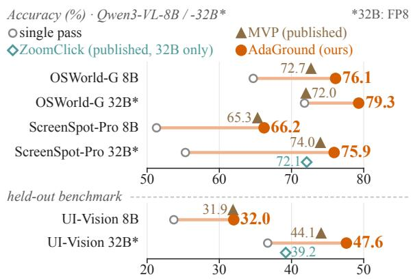
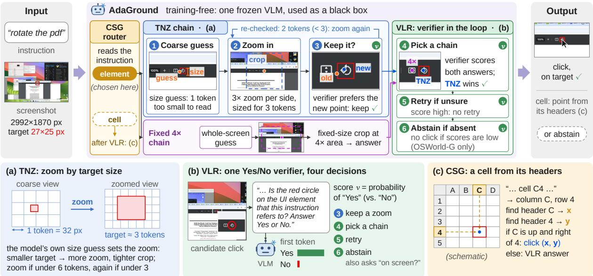
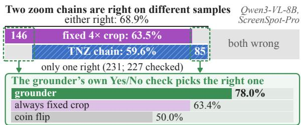
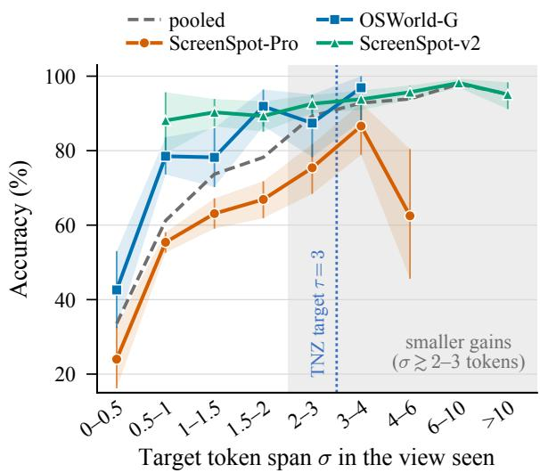
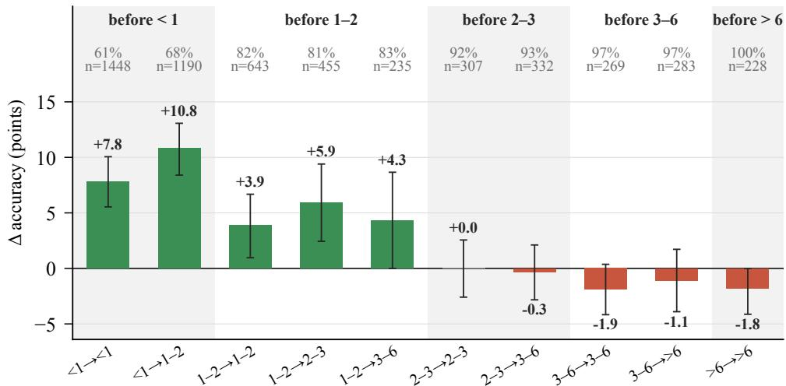

# AdaGround: Token-Normalized Adaptive Zooming with Verifier-in-the-Loop Refinement for GUI Grounding

Bingchao Wang1,2∗, Yongcheng Jing2, Chengyu Wang3, Jun Huang3, Jie Yang1†, Wei Liu1†, Dacheng Tao2†

1Shanghai Jiao Tong University 2Nanyang Technological University 3Alibaba Cloud Computing

{bc\_wang, jieyang, weiliucv}@sjtu.edu.cn, yongcheng.jing@ntu.edu.sg, dacheng.tao@gmail.com, {chengyu.wcy, huangjun.hj}@alibaba-inc.com

## Abstract

GUI grounding on high-resolution screens fails mostly on small targets, and zooming in is a common training-free remedy. However, most existing zooming pipelines do not match the zoom to the target’s size, accept the zoomed answer unconditionally and never revisit a wrong answer. To address these issues, we propose AdaGround, a training-free framework with three components: (1) Token-Normalized Adaptive Zooming, which sets the magnification, field of view and zoom depth of each sample from the model’s own estimate of the target size; (2) Verifier-in-the-Loop Refinement, which uses one marked-click Yes/No verifier to keep or reject each zoom, choose between zoom chains, trigger re-grounding and, with an existence query, decide when to abstain; and (3) Compositional Structure Grounding, which composes spreadsheet cells from their headers. On Qwen3-VL models, AdaGround surpasses state-of-the-art training-free zooming methods and many trained GUI models, improving accuracy over the backbone by 7.4 to 20.6 points on OSWorld-G and ScreenSpot-Pro, and its gains carry over to held-out UI-Vision. Code is available at https://github. com/bcwang-sjtu/AdaGround.

## 1 Introduction

Autonomous agents that operate graphical user interfaces (GUIs) are central to generalist assistants (Nguyen et al., 2025; Tang et al., 2025; Zhang et al., 2025). Their perceptual core is GUI grounding, which takes an instruction and a screenshot and localizes the target element precisely enough to act on it (Zheng et al., 2024; Hui et al., 2025). Large vision-language models (VLMs) (Bai et al., 2025a; Guo et al., 2025; Anthropic, 2024) cast grounding as coordinate generation (Cheng et al., 2024; Hong et al., 2024; Qin et al., 2025), which remains fragile on professional, high-resolution software, where targets are small and dense (Li et al., 2025b). Training-based specialists (Gou et al., 2025; Wu et al., 2025b; Liu et al., 2026b; Zhou et al., 2026) and learned focusing (Lei et al., 2026; Ouyang et al., 2026) improve it but need annotated data and re-training per backbone. This makes training-free test-time refinement attractive. It crops the screenshot around a coarse prediction and re-grounds at higher resolution.

  
Figure 1: Accuracy of AdaGround, the single pass and the published results of MVP and ZoomClick, each measured from its own single pass. ZoomClick reports Qwen3-VL-32B only. UI-Vision is held out.

Shortcomings of training-free refinement. Most current refinement pipelines share five shortcomings. (i) Scale-agnostic zoom geometry. Iterative narrowing (Nguyen, 2024), Zoom-Click (Jiang et al., 2025), AdaZoom-GUI (Pei et al., 2026), UI-Zoomer (Tang et al., 2026a) and MVP (Zhang et al., 2026d) set the crop by fixed ratios, size triggers, candidate spread or fixed-size attention windows. None relates the zoom to the number of visual tokens the target will occupy in the rendered view. (ii) Open-loop acceptance. The zoomed prediction replaces the coarse one unconditionally, even when the crop has discarded the context that identified the target. (iii) No second attempt. Without a check on the answer, a pipeline cannot tell which answers to revisit. (iv) White-box, vote-based aggregation. Attention-guided methods (Xu et al., 2025) such as MVP need attention maps from inside the backbone. MVP also aggregates its views by spatial voting, which cannot tell which of two disagreeing views is right. (v) Always zooming and answering. Targets absent from the screen are solved by no view, and targets defined by their position in a structure, like a spreadsheet cell, lose their evidence in a tight zoom. Yet every pipeline zooms and answers.

  
Figure 2: Overview of AdaGround. Compositional Structure Grounding (CSG) reads the instruction. Two zoom chains, Token-Normalized Adaptive Zooming (TNZ) and a fixed 4× crop, run on every sample. Verifier-in-the-Loop Refinement (VLR) uses one Yes/No verifier to keep a zoom, pick a chain, retry with the rejected click crossed out, and abstain. Top: the pipeline on one ScreenSpot-Pro sample with Qwen3-VL-8B (real model outputs), where v badges mark the model’s Yes/No checks. Bottom: (a) TNZ, (b) VLR and (c) CSG, of which (a) and (c) are schematic.

AdaGround. Our key observation is that differently zoomed views fail on different samples. On Qwen3-VL-8B ScreenSpot-Pro, a fixed crop and an adaptive one are right on 63.5% and 59.6% of samples, but at least one of them is right on 68.9%. Refinement should therefore not commit to one zoom but choose, per sample, which zoomed answer to trust. The grounder itself can make that choice when shown a marked click. We propose AdaGround (Figure 2), a training-free framework in which the grounder sizes its own zoom and verifies its own answers. Token-Normalized Adaptive Zooming (TNZ) answers (i). From the model’s own bounding box on the coarse view, it solves per sample for the magnification, the crop side and the number of zoom stages. They are chosen so that the target spans a fixed number of visual tokens while the crop still covers the coarse localization error. Verifier-in-the-Loop Refinement (VLR) answers (ii)–(iv) and the absent targets of (v). One marked-click Yes/No verifier drives verificationgated acceptance, a verifier-arbitrated chain portfolio and negative-feedback re-grounding. The portfolio selects between the TNZ chain and a fixedcrop chain by verification instead of by vote, and regrounding runs with the rejected location crossed out. With a companion existence query, the verifier also decides existence-gated abstention. Compositional Structure Grounding (CSG) answers the structural targets of (v) by composing a spreadsheet cell from its separately grounded column and row headers. Throughout, the VLM is a black box that takes images and text and returns text and firsttoken probabilities. One set of constants serves both backbones and all benchmarks (Section 3.5).

Results. On OSWorld-G (Xie et al., 2026) and ScreenSpot-Pro, with Qwen3-VL-8B and Qwen3- VL-32B, AdaGround is above every published result of MVP and ZoomClick (Figure 1), by up to 7.3 points. The lead is significant in every paired test against MVP’s per-sample predictions. Ada-Ground is also above all proprietary models and trained GUI specialists in Tables 1 and 2, including 72B ones. Its gains are largest on ScreenSpot-Pro’s high-resolution screens (+14.9 and +20.6 points over the single pass) and carry over to held-out UI-Vision (Nayak et al., 2025). On ScreenSpot-v2 (Wu et al., 2025b), whose large targets the single pass already resolves, they are not significant.

Our contributions are as follows:

• TNZ sizes every zoom in visual tokens from the model’s own estimate of the target, so that the target reaches a legible span at any screen resolution (Property 1).

• VLR makes the grounder its own verifier. One marked-click Yes/No question replaces openloop acceptance and voting, and it decides regrounding and abstention.

• CSG composes structural targets from separately grounded headers instead of zooming.

## 2 Related Work

GUI grounding. GUI grounding is commonly cast as coordinate generation by a VLM (Cheng et al., 2024; Bai et al., 2025a; Guo et al., 2025), following UI-specialised models (Baechler et al., 2024; You et al., 2024). Specialists fine-tuned on GUI corpora (Gou et al., 2025; Wu et al., 2025b; Hong et al., 2024; Lin et al., 2025; Wu et al., 2026) and reinforcement post-training or selfdistillation (Liu et al., 2026b; Tang et al., 2026b; Zhou et al., 2026; Qiu et al., 2026; Zhang et al., 2026c) improve the grounder itself. AdaGround instead changes how an off-the-shelf grounder is queried.

Test-time zooming. Iterative narrowing (Nguyen, 2024) re-predicts on crops of fixed geometry around the previous answer, RegionFocus (Luo et al., 2025) and DiMo-GUI (Wu et al., 2025a) zoom into candidate regions, and V∗ (Wu and Xie, 2024) searches for small objects outside GUIs. Three recent systems refine the zoom. ZoomClick (Jiang et al., 2025) crops with a fixed shrink ratio for a fixed three iterations. AdaZoom-GUI (Pei et al., 2026) uses a trained grounder’s box as a small-or-large trigger and then magnifies by a predefined ratio. UI-Zoomer (Tang et al., 2026a) sizes one crop from the variance of eight sampled candidates, scaled by a modeland benchmark-specific constant. None derives the zoom from the target’s token span, and all three accept the zoomed prediction unconditionally (shortcomings (i) and (ii)). Other training-free pipelines progressively zoom onto interface elements (Liu et al., 2026d), refine through multi-step visual reasoning (Li et al., 2025a) or search over screen regions (Liu et al., 2026a). Others mitigate grounding biases (Zhang et al., 2026a), crop coarse-to-fine with OCR and detected components as cues (Fu et al., 2026), or guide a visual search by the perplexity of coordinate tokens (Yao et al., 2026).

Attention-guided and vote-based aggregation. MVP (Zhang et al., 2026d), the attention-guided zooming method we compare against, extracts attention-cropped views and aggregates their predictions by spatial clustering. Attention-driven grounding (Xu et al., 2025) likewise reads the model’s attention, and GUI-RC (Du et al., 2026) votes over sampled predictions on a spatial grid. Concurrent with our work, Re-Prefill (Lin et al., 2026a) selects visual tokens from the attention of a first prefill and modifies the model’s prefill in a second pass. Like MVP, it needs model internals. AdaGround reads only the generated text and first-token probabilities, and replaces voting with verification (shortcoming (iv)).

Verification and feedback. GUI-Cursor (Zhao et al., 2026) and UI-Ins (Chen et al., 2026) train spatial feedback and instruction reasoning into the grounder. LookAgain (Zhang et al., 2026b) and Measure Twice, Click Once (Wang et al., 2026b) train the grounder or a visual critic to re-examine its clicks. SafeGround (Wang et al., 2026a) and Kumar et al. (2026) calibrate and benchmark uncertainty in GUI grounding. AdaGround obtains these signals from the unmodified model through one Yes/No question about a marked click and an existence question (shortcomings (iii) and (v)).

Learned focusing and agent memory. FocusUI (Ouyang et al., 2026) learns a positionpreserving selection of visual tokens, GUI-Spotlight (Lei et al., 2026) trains a model to narrow its focus, and DeepEyes (Zheng et al., 2026) and AdaptVision (Lin et al., 2026b) learn to request zooms. Agent frameworks add visual procedural memory (Liu et al., 2026c) or evolve skills from traces (Hu et al., 2026; Xiao et al., 2026). Ada-Ground is training-free and solves whether and how far to zoom from the model’s own size estimate.

## 3 The AdaGround Framework

As shown in Figure 2 (Algorithm 1 in Appendix A), AdaGround maps a screenshot–instruction pair (S, I) to a click point or an abstention. CSG (Section 3.4) first reads the instruction. Every sample then runs through two zoom chains, the TNZ chain (steps 1–3 of Figure 2, Section 3.2) and the fixed 4× chain. VLR (Section 3.3) uses one Yes/No verifier to keep a zoom (step 3), pick a chain (step 4), retry (step 5) and abstain (step 6). Finally, a cell flagged by CSG is composed from its headers. All three components share one set of constants (Section 3.5).

## 3.1 Problem Formulation

Given a screenshot $S \in \mathbb { R } ^ { H \times W \times 3 }$ and an instruction I, GUI grounding predicts a point $p = ( x , y )$ which is correct iff $p \in B$ , the ground-truth region of the referenced element. When the instruction has no target on screen, the only correct output is an abstention, and an abstention on any other sample is an error. An off-the-shelf VLM M, used without any weight update, receives a rendered view and the instruction and emits a coordinate as text, $p = M ( \mathcal { R } ( S , b ) , I )$ . The renderer $\mathcal { R } ( S , b )$ scales the area of S by b, so the linear scale is $\sqrt { b }$ and $b > 1$ up-samples. Access to M is black-box. We read its generated text and first-token probabilities, and never its attention maps, hidden states or gradients.

Token pitch and token span. Encoders that work at dynamic resolution tile a rendered view into patches and merge neighbouring patches into one visual token. Qwen3-VL (Bai et al., 2025a) merges $2 \times 2$ patches of 16 pixels, so one token covers a square of side $\pi = 3 2$ rendered pixels. For a target whose shorter side measures s original pixels, shown in a view of linear scale k relative to the screenshot, the token span

$$
\sigma ~ = ~ { \frac { s k } { \pi } }\tag{1}
$$

is the number of visual tokens the target occupies along its shorter side in the view the model is given. Because it is measured after rendering, it is comparable across resolutions, crops and up-sampling. Accuracy climbs steeply below about three tokens and gains much less above (Appendix E). This motivates two design choices of TNZ. Every zoom is normalized to a target span of τ tokens, and the first zoom fires under a looser criterion than later ones.

## 3.2 Token-Normalized Adaptive Zooming

TNZ decides per sample whether to zoom, how much, how wide and how often. All four decisions follow from one quantity that the model reports, the extent of the target.

Scale-aware coarse localization (step 1). The screenshot is first rendered at the budget $b _ { 1 } \ =$ min $\left( 1 , \operatorname* { m a x } ( b _ { \operatorname* { m i n } } , A _ { 0 } / ( H W ) ) \right)$ , which keeps the coarse view near $A _ { 0 }$ pixels. A 4K screenshot is therefore down-sampled, while a 1080p one is not. The model returns a coarse point $p _ { 1 } ~ =$ $M ( \mathcal { R } ( S , b _ { 1 } ) , I )$ . In a second, separate query on the same view, it also returns the target’s bounding box. The shorter side of that box, mapped back to original pixels, is the self-reported extent sˆ. Let $k _ { \mathrm { p r e v } } = \sqrt { b _ { 1 } }$ be the linear scale of the view that the current point came from. The estimated span is then $\hat { \sigma } = \hat { s } k _ { \mathrm { p r e v } } / \pi$ . If no box is returned, no zoom is issued. sˆ only sets a scale and need only be right to within a factor (Appendix B.3).

Footprint-matched magnification and erroraware field of view (step 2). TNZ magnifies the crop so that the estimated footprint is rendered at τ tokens, and sizes it to cover both the target’s context and the coarse localization error:

$$
\begin{array} { r } { k = \mathrm { c l i p } { \left( \tau \pi / \hat { s } , 1 , k _ { \mathrm { m a x } } \right) } , } \end{array}\tag{2}
$$

$$
d = \mathrm { c l i p } \big ( \mathrm { m a x } ( \gamma \hat { s } , \varepsilon \pi / k _ { \mathrm { p r e v } } ) , d _ { \mathrm { m i n } } , d _ { \mathrm { m a x } } \big ) ,\tag{3}
$$

with $d _ { \operatorname* { m a x } } \ = \ \operatorname* { m i n } ( W , H )$ . The term $\gamma \hat { s }$ keeps the context proportional to the target. The term $\varepsilon \pi / k _ { \mathrm { p r e v } }$ reserves ε tokens of the view the current point came from, where one token covers $\pi / k _ { \mathrm { p r e v } }$ original pixels. The square crop of side d is centred on the current point and shifted inside the screenshot.

Property 1 (Invariance and coverage) (a) If the estimate is exact, $\hat { s } ~ = ~ s ,$ and $\tau \pi / k _ { \mathrm { m a x } } \le s \le$ τπ, the zoomed view renders the target at $\sigma = \tau$ tokens whatever the screenshot resolution (up to the renderer’s rounding). (b) If the current point is offthe target centre by at most ε/2 tokens ofthe previous view along each axis, the target centre lies inside the crop (provided $\varepsilon \pi / k _ { p r e \nu } \leq d _ { \mathrm { { m a x } } } )$

Argument. (a) On this range Eq. (2) is unclipped, so Eq. (1) gives $\sigma ^ { \prime } = s k / \pi = \tau$ , in which neither H, W nor $b _ { 1 }$ appears. (b) $d / 2 \geq \varepsilon \pi / ( 2 k _ { \mathrm { p r e v } } )$ , which is $\varepsilon / 2$ tokens of the previous view in original pixels. Shifting the box inside the screenshot keeps the in-screen part of the centred box. □

With Qwen3-VL and the constants of Section 3.5 the range of (a) is 24 to 96 pixels. Below this range, k saturates at $k _ { \mathrm { m a x } }$ . Above it, k = 1 gives a native-resolution crop, which gated acceptance may reject.

Magnified re-grounding. The crop $C ,$ whose actual top-left corner after shifting is $( x _ { 0 } , y _ { 0 } )$ , is rendered at area $k ^ { 2 }$ and re-grounded. The answer, given in pixels of the zoomed view, is mapped back to the screenshot:

$$
p ^ { \prime } \ = \ ( x _ { 0 } , y _ { 0 } ) + M \big ( \mathcal { R } ( C , k ^ { 2 } ) , I \big ) / k .\tag{4}
$$

Adaptive depth. Each stage re-crops the screenshot around the current answer. Stage t fires iff $\hat { \sigma } ~ < ~ \lambda _ { t } \tau$ and, for $t \ge 2 , k _ { \mathrm { p r e v } } < k _ { \mathrm { m a x } }$ , where $\lambda _ { 1 } = \lambda > 1$ and $\lambda _ { t } = 1$ for $t \geq 2$ . At most $D$ stages run. After every stage but the last, the box query is repeated on the zoomed view. The new box updates sˆ (in original pixels) whether or not $p ^ { \prime }$ is accepted, while $k _ { \mathrm { p r e v } }  k \mathrm { o n l y }$ when $p ^ { \prime }$ is accepted (Eq. (6)). The depth, from zero to $D$ stages, is thus decided per sample. A target whose coarse estimate already spans λτ tokens gets no crop.

## 3.3 Verifier-in-the-Loop Refinement

TNZ proposes and VLR decides. A black-box Yes/No verifier and a companion existence query close the loop around four decisions that earlier pipelines take open-loop or through model internals.

The verifier. For a candidate point $p ,$

$$
v ( p ) \ = \ { \frac { P _ { M } ( \mathrm { Y E S } \mid x _ { p } ) } { P _ { M } ( \mathrm { Y E S } \mid x _ { p } ) + P _ { M } ( \mathrm { N O } \mid x _ { p } ) } } ,\tag{5}
$$

where $\boldsymbol { x } _ { p } = ( \mathcal { V } ( \boldsymbol { S } , p ) , q ( I ) )$ and first-token probabilities are summed over the case variants of each word. The verification view $\mathcal { V } ( S , p )$ is the window of side $d _ { 0 } ( W , H ) = \mathrm { c l i p } ( \lfloor \sqrt { W H / 8 } \rfloor , 5 1 2 , 1 0 2 4 )$ centred on $p$ and shifted inside the screenshot. It is rendered at $4 \times$ area with a red circle drawn at $p .$ The question $q ( I )$ asks whether the circle lies on the element the instruction refers to $( \mathsf { A p } \cdot$ pendix A.3).

Verification-gated acceptance (step 3). A TNZ stage’s answer $p ^ { \prime }$ replaces the current answer p only if the verifier does not prefer $p ,$

$$
p  p ^ { \prime } \quad \mathrm { i f f } \quad v ( p ^ { \prime } ) \geq v ( p ) ,\tag{6}
$$

and $v ( p )$ is queried only when a zoom is planned, so unzoomed samples cost no verification.

Verifier-arbitrated chain portfolio (step 4). Chains of different zoom geometry fail on different samples. On Qwen3-VL-8B ScreenSpot-Pro, the chains $c _ { \mathrm { T N Z } }$ and $c _ { 4 \times }$ defined below are right on 59.6% and 63.5% of samples, but at least one of them is right on 68.9% (Appendix B.1). VLR therefore runs a static portfolio $\mathcal { C } = \{ c _ { \mathrm { T N Z } } , c _ { 4 \times } \}$ the same for every input, benchmark and backbone. Here $c _ { \mathrm { T N Z } }$ is TNZ with gated acceptance, and $c _ { 4 \times }$ runs the common fixed 4× crop as a chain. It first answers on the whole screen and then re-grounds in a $1 2 8 8 \times 7 2 8 .$ -pixel window around that answer at 4× area. The answers $\{ p ^ { ( c ) } \} _ { c \in \mathcal { C } }$ are grouped by complete linkage with radius $\delta _ { \mathrm { p x } } ,$ so a point joins a group only if it lies within $\delta _ { \mathrm { p x } }$ of every member. Each group G is represented by its member $r ( G )$ from the highest-priority chain, with cTNZ first. With two or more groups, the representatives of the K largest groups, $\mathcal { G } _ { K }$ , are verified, each on its own window, and

$$
p \ = \ \underset { G \in \mathcal { G } _ { K } } { \arg \operatorname* { m a x } } \ v \big ( r ( G ) \big ) ;\tag{7}
$$

with a single group, its representative is returned. With the two chains used here, arbitration thus keeps the better-verified of two disagreeing answers, whereas the spatial vote of MVP (Zhang et al., 2026d) keeps the largest cluster.

Negative-feedback re-grounding (step 5). When the verifier does not confirm the answer kept by arbitration, $v ( p ) < \theta _ { r }$ , the model is asked again, but on different evidence. The rejected location is crossed out in red on the whole-screen view, and a note saying that it was judged not to be the target is appended to the instruction for that pass. The model then re-grounds from coarse to fine. It answers on the whole screenshot, then on a native-resolution crop of side $d _ { 0 }$ around the new point, and finally on a tighter crop of side $d _ { 0 } / 2$ around the resulting point at $3 \times$ linear magnification, which gives $p ^ { \prime \prime }$ . The answer is replaced, $p  p ^ { \prime \prime } , \mathrm { i f f } v ( p ^ { \prime \prime } ) > v ( p )$

Existence-gated abstention (step 6). Let $e ( S , I )$ be the normalized first-token YES probability, as in Eq. (5), of one query on the whole screenshot $( b = 1 )$ asking whether any element on the screen can carry out the instruction. Neither signal alone is a safe reason to refuse. The existence query denies targets that are present but tiny on the whole-screen view, and the verifier rejects answers it cannot confirm at its own scale. AdaGround therefore abstains only when the mean of the two is low, which requires each to be below $2 \theta _ { e }$

<table><tr><td>Method</td><td>Text</td><td>Element</td><td>Layout</td><td>Fine-gr.</td><td>Refusal</td><td>Overall</td></tr><tr><td colspan="7">Closed-source / proprietary models</td></tr><tr><td> $\mathrm { O p e r a t o r } ^ { \dag \circ } \left( \mathrm { O p e n A I } , 2 0 2 5 \right) ^ { \dag }$ </td><td>51.3</td><td>42.4</td><td>46.6</td><td>31.5</td><td>0.0</td><td>40.6</td></tr><tr><td>Gemini-2.5-pro†° (Comaníci et al., 2025)</td><td>59.8</td><td>45.5</td><td>49.0</td><td>33.6</td><td>38.9</td><td>45.2</td></tr><tr><td>Seed1.5-VL↑° (Guo et al., 2025)</td><td>73.9</td><td>66.7</td><td>69.6</td><td>47.0</td><td>18.5</td><td>62.9</td></tr><tr><td colspan="7">Open-source SFT/ RL-trained specialists</td></tr><tr><td> $\mathbf { Q } \mathrm { { w e n } } 2 . 5 \mathbf { - } \mathbf { V } \mathbf { L } \mathbf { - } 7 . 2 \mathbf { B } ^ { \dagger } \ ( \mathbf { B a i } \mathrm { { e t } \mathbf { a l . } , 2 0 2 5 \mathbf { b } ) }$ </td><td>52.6</td><td>74.6</td><td>74.7</td><td>55.3</td><td>0.0</td><td>62.2</td></tr><tr><td> $\tilde { \mathrm { U I } } \mathrm { - T A R S } \mathrm { - } 7 2 \mathrm { B } ^ { \dag \circ } ( \mathrm { Q i n } \mathrm { \ e t \ a l . , } 2 0 2 5 )$ </td><td>69.4</td><td>60.6</td><td>62.9</td><td>45.6</td><td>0.0</td><td>57.1</td></tr><tr><td>UI-Venus-Ground-72B† (Gu et al., 2025)</td><td>82.1</td><td>71.2</td><td>70.7</td><td>64.4</td><td></td><td>70.4</td></tr><tr><td> $\mathrm { O S ^ { - } A t l a s { - } 7 B ^ { \dag \circ } \left( W u \ e t \ a l . , 2 0 2 5 b \right) }$ </td><td>44.1</td><td>29.4</td><td>35.2</td><td>16.8</td><td>7.4</td><td>27.7</td></tr><tr><td>UGround-  $\mathrm { V } 1 - 7 \dot { \mathrm { B } } ^ { \dag \circ }$  (Gou et al., 2025)</td><td>51.3</td><td>40.3</td><td>43.5</td><td>24.8</td><td>0.0</td><td>36.4</td></tr><tr><td>Jedi-7B†° (Xie et al., 2026)</td><td>65.9</td><td>55.5</td><td>57.7</td><td>46.9</td><td>7.4</td><td>54.1</td></tr><tr><td>GTA1-72B† (Yang et al., 2026)</td><td>57.9</td><td>76.9</td><td>77.3</td><td>66.7</td><td>0.0</td><td>66.7</td></tr><tr><td colspan="7">Training-free test-time methods</td></tr><tr><td>Qwen3-V-8B single pass</td><td>78.2</td><td>68.5</td><td>71.9</td><td>53.7</td><td>0.0</td><td>64.7</td></tr><tr><td> $+ \mathbf { M V P } ^ { \dagger }$  (published, from its 68.8 single pass)</td><td>82.4</td><td>76.7</td><td>79.5</td><td>61.7</td><td></td><td> $7 2 . 7 _ { + 3 . 9 }$ </td></tr><tr><td>+ AdaGround (ours)</td><td>85.1</td><td>80.0</td><td>81.8</td><td>65.1</td><td>27.8</td><td> $7 6 . 1 _ { + 1 1 . 3 }$ </td></tr><tr><td>Qwen3-VL-32B* single pass</td><td>81.6</td><td>75.8</td><td>77.5</td><td>63.1</td><td>0.0</td><td>71.8</td></tr><tr><td>+ MVP† (published, from its 71.7 single pass)</td><td>81.6</td><td>76.4</td><td>77.5</td><td>62.4</td><td></td><td>72.0+0.3</td></tr><tr><td>+ AdaGround (ours)</td><td>85.8</td><td>84.8</td><td>84.6</td><td>67.1</td><td>14.8</td><td>79.3+7.4</td></tr></table>

Table 1: OSWorld-G accuracy (%). Refusal: abstention rate on the 54 absent-target instructions. †Quoted from the cited papers or the tables of Yang et al. (2026) and Zhang et al. (2026d). ◦Original instructions (Appendix D.2). –: not reported. Bold: best training-free result. Subscripts: gain over the method’s own single pass. ∗FP8 weights.

$$
\begin{array} { r } { \frac { 1 } { 2 } \big ( v ( p ) + e ( S , I ) \big ) \ < \ \theta _ { e } , } \end{array}\tag{8}
$$

where $p$ is the answer after re-grounding, so $v ( p )$ is the larger of the scores before and after re-grounding. An answer the verifier accepts $( v ( p ) \ \geq \ \theta _ { r } )$ is never withdrawn, and abstention never overrides a CSG-composed answer. Abstention is enabled only where the task admits a refusal (OSWorld-G).

## 3.4 Compositional Structure Grounding

A spreadsheet cell is defined by its place in a structure, not by its appearance. The cell is identified by its column and row headers. These lie outside any crop tight enough to magnify the cell, so zooming tends to discard the evidence. CSG changes the primitive instead of the view. The same model, reading the instruction text only, rewrites I into a program $\rho \in \{ \mathrm { G R O U N D } , \mathrm { C E L L } ( c o l , r o w ) \}$ (the router of Figure 2, whose ‘element’ branch is GROUND). Any other output is executed as GROUND. CELL(col, row) grounds descriptions of the column header and of the row header separately. Each header is grounded first on the whole screenshot and then on a crop of side $d _ { 0 } / 2$ around that point at 3× linear magnification, which gives $( x _ { \mathrm { c o l } } , y _ { \mathrm { c o l } } )$ and $( x _ { \mathrm { r o w } } , y _ { \mathrm { r o w } } )$ . The program then composes

$$
p = ( x _ { \mathrm { c o l } } , y _ { \mathrm { r o w } } ) \operatorname { i f f } x _ { \mathrm { c o l } } > x _ { \mathrm { r o w } } , y _ { \mathrm { c o l } } < y _ { \mathrm { r o w } } ,\tag{9}
$$

i.e. when the column header lies to the right of and above the row header, as in a spreadsheet grid. Otherwise it falls back to the VLR answer.

## 3.5 One Configuration

One set of constants serves both backbones and all benchmarks (Table 5). The coarse view uses $A _ { 0 } = 2 . 2 \mathbf { M P }$ and $b _ { \operatorname* { m i n } } = 0 . 2 5$ . TNZ uses $\tau = 3$ $\gamma = 1 6 , \varepsilon = 4 , k _ { \operatorname* { m a x } } = 4 , \lambda = 2 , d _ { \operatorname* { m i n } } = 1 9 2$ and $D = 2$ . The verifier window has side $d _ { 0 }$ and is rendered at 4× area, and $c _ { 4 \times }$ uses a 1288 × 728 window at 4× area. Arbitration uses $\delta _ { \mathrm { p x } } = 1 4$ and $K = 3 ,$ re-grounding uses $\theta _ { r } = 0 . 9 9$ (whole screen at $b = 1 )$ , and abstention uses $\theta _ { e } = 0 . 0 3$ Only π comes from the encoder.

## 4 Experiments

## 4.1 Experimental Setup

Backbones and benchmarks. Following MVP (Zhang et al., 2026d), we evaluate Qwen3-VL-8B-Instruct and Qwen3-VL-32B-Instruct (Bai et al., 2025a), the latter with FP8 weights. We develop on three benchmarks, each in full. OSWorld-G (Xie et al., 2026) (refined split, 564 instructions) includes 54 instructions whose target is absent from the screen. ScreenSpot-Pro (Li et al., 2025b) (1,581 instructions) covers professional desktop software on high-resolution screens, with a median target of 24 pixels on its shorter side. ScreenSpotv2 (Wu et al., 2025b) (1,272 instructions) has larger targets (median 85 pixels). As a held-out test we add UI-Vision (Nayak et al., 2025) (the element grounding task, with 5,479 instructions on 1,181 screenshots of 83 desktop applications and a median target of 26 pixels).

<table><tr><td>Method</td><td>Dev.</td><td>Creative</td><td>CAD</td><td>Scientific</td><td>Office</td><td>OS</td><td>Overall</td></tr><tr><td colspan="8">Closed-source / proprietary models</td></tr><tr><td>GPT-4o† (Hurst et al., 2024)</td><td>0.7</td><td>0.6</td><td>1.5</td><td>1.2</td><td>0.9</td><td>0.0</td><td>0.8</td></tr><tr><td>Claude Computer Use† (Anthropic, 2024)</td><td>12.6</td><td>16.8</td><td>11.9</td><td>25.8</td><td>26.9</td><td>8.1</td><td>17.1</td></tr><tr><td>UI-TARS-1.5† (Qin et al., 2025)</td><td>63.9</td><td>50.4</td><td>58.2</td><td>69.3</td><td>79.6</td><td>51.0</td><td>61.6</td></tr><tr><td>Seed1.5-VL† (Ġuo et al., 2025)</td><td>53.8</td><td>59.2</td><td>59.0</td><td>61.4</td><td>74.8</td><td>60.2</td><td>60.9</td></tr><tr><td colspan="8">Open-source SFT / RL-trained specialists</td></tr><tr><td>SeeClick-7B† (Cheng et al., 2024)</td><td>0.3</td><td>0.6</td><td>1.9</td><td>2.0</td><td>0.9</td><td>1.5</td><td>1.1</td></tr><tr><td>UGround-V1-7B† (Gou et al., 2025)</td><td>28.1</td><td>31.7</td><td>14.6</td><td>39.0</td><td>49.6</td><td>24.5</td><td>31.1</td></tr><tr><td>GUI-G1-3B† (Zhou et al., 2026)</td><td>31.1</td><td>26.6</td><td>32.2</td><td>48.0</td><td>59.1</td><td>16.1</td><td>37.1</td></tr><tr><td>SE-GUI-7B† (Yuan et al., 2026)</td><td>44.5</td><td>37.2</td><td>42.1</td><td>54.7</td><td>70.4</td><td>38.8</td><td>47.2</td></tr><tr><td>InfiGUI-G1-7B†§ (Liu et al., 2026b)</td><td>50.2</td><td>44.0</td><td>49.0</td><td>59.4</td><td>67.4</td><td>44.4</td><td>51.9</td></tr><tr><td>GTA1-72B† (Yang et al., 2026)</td><td>57.2</td><td>51.0</td><td>49.8</td><td>63.0</td><td>77.0</td><td>57.1</td><td>58.4</td></tr><tr><td>UI-Venus-Ground-72B†§ (Gu et al., 2025)</td><td>59.5</td><td>55.4</td><td>57.5</td><td>66.5</td><td>77.8</td><td>57.7</td><td>61.9</td></tr><tr><td colspan="8">Training-free test-time methods</td></tr><tr><td>Qwen3-VL-8B single pass</td><td>47.2</td><td>46.0</td><td>44.4</td><td>53.9</td><td>71.3</td><td>49.0</td><td>51.3</td></tr><tr><td>+ MVP† (published, from its 55.0 single pass)</td><td>61.5</td><td>60.2</td><td>61.3</td><td>67.3</td><td>82.6</td><td>62.8</td><td>65.3+10.3</td></tr><tr><td>+ AdaGround (ours)</td><td>61.5</td><td>57.2</td><td>65.5</td><td>66.9</td><td>85.2</td><td>66.3</td><td>66.2+14.9</td></tr><tr><td colspan="8">Qwen3-V-32B* single pass</td></tr><tr><td>+ MVP† (pubļished, from its 55.3 single pass)</td><td>43.1 71.6</td><td>53.7 69.3</td><td>57.1 74.7</td><td>63.0 70.5</td><td>73.0 87.4</td><td>43.9 73.5</td><td>55.3 74.0+18.7</td></tr><tr><td>+ ZoomClick† (from its 54.0 single pass; Jiang et al., 2025)</td><td>72.6</td><td>64.2</td><td>71.3</td><td>68.9</td><td>90.0</td><td>69.4</td><td>72.1+18.1</td></tr><tr><td>+ AdaGround (ours)</td><td>71.6</td><td>70.1</td><td>76.6</td><td>74.8</td><td>91.3</td><td>75.0</td><td> $7 5 . 9 _ { + 2 0 . 6 }$ </td></tr></table>

Table 2: ScreenSpot-Pro accuracy (%). †Quoted from the cited papers or as compiled by Yang et al. (2026) and Zhang et al. (2026d). §Category averages computed from the reported text/icon accuracies. Bold: best training-free result. Subscripts: gain over the method’s own single pass. ∗FP8 weights.

<table><tr><td>Method</td><td></td><td></td><td>Basic Func. Spatial</td><td>Avg.</td></tr><tr><td colspan="5">Open-source SFT / RL-trained specialists†</td></tr><tr><td>UI-TARS-7B (Qin et al., 2025)</td><td>20.1</td><td>24.3</td><td>8.4</td><td>17.6</td></tr><tr><td>UI-TARS-72B (Qin et al., 2025)</td><td>31.4</td><td>30.5</td><td>14.7</td><td>25.5</td></tr><tr><td>UI-Venus-Ground-72B (Gu et al., 2025)</td><td>45.6</td><td>42.3</td><td>23.7</td><td>36.8</td></tr><tr><td>OS-Atlas-7B (Wu et al., 2025b)</td><td>12.2</td><td>11.2</td><td>3.7</td><td>9.0</td></tr><tr><td>UGround-V1-7B (Gou et al., 2025)</td><td>15.4</td><td>17.1</td><td>6.3</td><td>12.9</td></tr><tr><td>GUI-Spotlight (Lei et al., 2026)</td><td>32.1</td><td>30.2</td><td>9.1</td><td>23.4</td></tr><tr><td colspan="5">Training-free test-time methods</td></tr><tr><td>Qwen3-VL-8B single pass</td><td>29.2</td><td>30.1</td><td>11.8</td><td>23.7</td></tr><tr><td>+ MVP†</td><td>38.3</td><td>38.8</td><td>18.7</td><td> $3 1 . 9 _ { + 4 . 7 }$ </td></tr><tr><td>+ AdaGround (ours)</td><td>37.0</td><td>38.7</td><td>20.4</td><td>32.0+8.3</td></tr><tr><td>Qwen3-VL-32B* single pass</td><td>44.2</td><td>43.2</td><td>22.6</td><td>36.7</td></tr><tr><td>+MVP†</td><td>49.4</td><td>52.0</td><td>30.8</td><td> $4 4 . 1 _ { + 7 . 7 }$ </td></tr><tr><td>+ ZoomClick†</td><td>45.1</td><td>45.1</td><td>28.3</td><td> $3 9 . 2 _ { + 2 . 6 }$ </td></tr><tr><td>+ AdaGround (ours)</td><td>52.5</td><td>51.7</td><td>38.4</td><td>47.6+10.9</td></tr></table>

Table 3: UI-Vision element grounding (Nayak et al., 2025) (held out), accuracy (%). Avg.: mean of the three tasks (as published for † rows). †From Zhang et al. (2026d) (specialists from the UI-Vision leaderboard) and Jiang et al. (2025). Subscripts: gain over the method’s own single pass (MVP: 27.2, 36.4; Zoom-Click: 36.6). Bold: best training-free. ∗FP8 weights.

Baselines. The single pass grounds on the whole screenshot and comes from the same runs as Ada-Ground. MVP (Zhang et al., 2026d), a recent attention-guided zooming method, is our main comparison on the same backbones. ZoomClick (Jiang et al., 2025) reports Qwen3-VL-32B results. The main tables quote both as published. For paired tests, we also reproduce MVP with its official code and published configuration on Qwen3-VL-8B. For Qwen3-VL-32B, we score the per-sample ScreenSpot-Pro predictions released by its authors (Appendices C and D.1). The fixed 4× crop, Ada-Ground’s chain $c _ { 4 \times }$ alone, is analysed as an ablation (Section 4.3).

<table><tr><td rowspan="2"></td><td colspan="2">OSWorld-G</td><td colspan="2">SSPro</td><td colspan="2">SSv2</td></tr><tr><td>8B</td><td>32B*</td><td>8B</td><td>32B*</td><td>8B</td><td>32B*</td></tr><tr><td>Single pass</td><td>64.7</td><td>71.8</td><td>51.3</td><td>55.3</td><td>92.1</td><td>94.7</td></tr><tr><td>Fixed 4× crop</td><td>70.7</td><td>77.1</td><td>63.5</td><td>73.9</td><td>91.9</td><td>95.4</td></tr><tr><td>CTNZ</td><td>72.7</td><td>76.6</td><td>59.6</td><td>72.4</td><td>92.5</td><td>95.4</td></tr><tr><td>+ arbitration</td><td>73.6</td><td>76.8</td><td>65.6</td><td>75.6</td><td>92.5</td><td>96.0</td></tr><tr><td>+ re-grounding</td><td>73.2</td><td>77.0</td><td>66.2</td><td>76.0</td><td>91.9</td><td>95.4</td></tr><tr><td>+ CSG</td><td>73.6</td><td>77.8</td><td>66.2</td><td>75.9</td><td>91.9</td><td>95.4</td></tr><tr><td>+ abstention</td><td>76.1</td><td>79.3</td><td>66.2</td><td>75.9</td><td>91.9</td><td>95.4</td></tr><tr><td>Oracle of two chains 76.1</td><td></td><td>79.8</td><td>68.9</td><td>78.8</td><td>94.0</td><td>96.6</td></tr></table>

Table 4: Where the gains come from: accuracy (%) as components are added (Algorithm 1). Shaded: Ada-Ground. Bold: best per column (oracle excluded). Underlined: the better chain. Oracle: either chain is right. SSPro/SSv2: ScreenSpot-Pro/-v2. ∗FP8 weights.

Protocol. A prediction is correct if its point falls inside the target region. OSWorld-G uses its official scorer, which credits an absent-target instruction only when the system abstains. ScreenSpot-Pro, ScreenSpot-v2 and UI-Vision give every instruction a target and are scored point-in-box. Ada-

Ground and its baselines use greedy decoding on vLLM 0.11.2 (Kwon et al., 2023). All constants were fixed during development on OSWorld-G, ScreenSpot-Pro and ScreenSpot-v2 (Appendix A). UI-Vision, on which the configuration was neither developed nor tuned, serves as a held-out test. An earlier version of the method had been evaluated on it (Appendix A). Paired differences are in points, with 95% confidence intervals from 4,000 bootstrap resamples of screenshots (Table 13, Appendix D.2). A difference is called significant when its interval excludes zero.

## 4.2 Main Results

Comparison with MVP and ZoomClick. Ada-Ground scores above MVP’s published results on OSWorld-G and ScreenSpot-Pro with both backbones (Tables 1 and 2), by 3.4 and 7.3 points on OSWorld-G and by 0.9 and 1.9 on ScreenSpot-Pro, and above ZoomClick’s published Qwen3-VL-32B result on ScreenSpot-Pro. Measured from each method’s own single pass, AdaGround adds more than MVP and ZoomClick in every case. Paired against MVP’s per-sample predictions, the lead is significant in every test (Table 13). It is +6.2 and +4.2 points on OSWorld-G and ScreenSpot-Pro against our Qwen3-VL-8B reproduction, which recovers the gain MVP adds to its own single pass, and +1.8 against MVP’s released Qwen3-VL-32B ScreenSpot-Pro predictions. The OSWorld-G lead holds without abstention, which MVP does not use. Our reproduction and its single pass both score below MVP’s published results (Appendix D.1).

Held-out benchmark. On UI-Vision, Ada-Ground matches MVP’s published average with Qwen3-VL-8B (32.0% against 31.9%) and exceeds it with Qwen3-VL-32B (47.6% against 44.1%), as well as ZoomClick’s 39.2% (Table 3).

## 4.3 Ablation: Where the Gains Come From

Table 4 adds the components one at a time (Appendix B.1). Fixed crop. The full AdaGround is significantly above the fixed 4× crop chain $c _ { 4 \times }$ on ScreenSpot-Pro, on held-out UI-Vision (most on spatial instructions) and on OSWorld-G with Qwen3-VL-8B (Table 13). Token span explains where a zoom pays. On the same samples before and after a crop pass (Qwen3-VL-8B), accuracy rises by +7.8 and +10.8 points when the target spans under one token and stops rising from two tokens on (Appendix E), so TNZ targets τ = 3 tokens. TNZ as a gated chain (cTNZ) improves the single pass by 4.8 to 17.1 points on OSWorld-G and ScreenSpot-Pro and beats the fixed crop on held-out UI-Vision. On ScreenSpot-Pro the two chains disagree on 45 and 34% of samples, and chain arbitration (Figure 3) raises cTNZ there by 5.9 and 3.2 points, 39 and 36% of the way from the better chain to the oracle. A crop fixed at TNZ’s median geometry arbitrates as well on OSWorld-G and ScreenSpot-Pro but significantly worse on ScreenSpot-v2 and held-out UI-Vision (Qwen3-VL-8B, Appendix B.6). CSG recovers the OSWorld-G spreadsheet cells that zooming loses (2 and 5 samples net). Abstention adds 2.5 and 1.4 points on OSWorld-G and withdraws at most one correct answer (Table 7). Cost. The two chains with arbitration alone (about 10 calls) already beat the fixed crop on ScreenSpot-Pro (Table 4).

  
Figure 3: Chain arbitration (counts: samples on which only that chain is right). The Yes/No check runs whenever the two clicks differ. With Qwen3-VL-32B the three bars read 72.4, 56.9 and 50.0%.

## 5 Conclusion

We presented AdaGround, a training-free, blackbox framework that addresses five shortcomings of test-time refinement for GUI grounding. With one configuration shared by Qwen3-VL-8B and Qwen3-VL-32B, AdaGround scores above MVP’s published results on OSWorld-G and ScreenSpot-Pro and above many trained GUI models, including 72B ones. It is also significantly above its own fixed 4× crop chain on ScreenSpot-Pro and on held-out UI-Vision. The lesson for test-time refinement is that zoom geometries fail on different samples and that the grounder itself, asked about a marked click, can choose between them. On ScreenSpot-Pro, this choice recovers more than a third of the headroom above the better chain.

## Limitations

Scope. We evaluate Qwen3-VL-8B and Qwen3-VL-32B (FP8 weights) on OSWorld-G,

ScreenSpot-Pro and ScreenSpot-v2, on which the constants were developed, and on held-out UI-Vision. Our conclusions are limited to these two backbones and four benchmarks and do not extend to agentic tasks in which grounding is one step of a longer episode. On Qwen3-VL-32B OSWorld-G, the comparison with MVP rests on its published number and is not paired.

Cost. AdaGround reads 3.5 to 3.9 times the visual tokens of the fixed 4× crop and 6 to 12 times those of the single pass. With sequential calls, its latency is 3.4 to 4.2 times that of the fixed crop (Appendix A.4). The extra compute pays off where targets are small. On ScreenSpot-v2, whose targets are large, AdaGround matches the fixed crop at a higher cost.

Components. A second crop fixed at TNZ’s median geometry is not significantly different from TNZ in arbitration on OSWorld-G and ScreenSpot-Pro, nor in the full pipeline on any benchmark, at fewer visual tokens (Appendix B.6). TNZ assumes that the model answers the box query with a box. A model that returns a point instead gets no zoom from TNZ. A target that falls outside an over-tight view is rejected by verification and left to the fixed 4× chain and re-grounding.

Verifier and abstention. One verifier score controls acceptance, re-grounding, arbitration and abstention, so a verifier that prefers a plausible but wrong element passes that preference to every decision it controls. Many of its decisions are between scores near 1 (Appendix B.1). The joint abstention rule is set for few false refusals (0.8% and 0.4%; Appendix B.2) and catches 15 and 8 of the 54 absent-target instructions of OSWorld-G.

Structure. CSG covers spreadsheet cells but does not handle slider positions or text-cursor placement. On these cells, the single-pass answer does as well as the composed one (Appendix B.1).

## Ethical Considerations

AdaGround is an inference-time procedure that trains no model and collects no new data. All experiments use the screenshots and instructions of four public GUI grounding benchmarks and involve no human subjects. Better grounding makes GUI agents more capable, including agents that act without supervision. A wrong click can trigger an unintended, possibly irreversible action, and capable agents can be misused to automate interactions that services intend for humans. Abstention removes one failure mode but does not replace user confirmation before consequential actions.

## References

Anthropic. 2024. Introducing computer use, a new Claude 3.5 Sonnet, and Claude 3.5 Haiku. Anthropic News.

Gilles Baechler, Srinivas Sunkara, Maria Wang, Fedir Zubach, Hassan Mansoor, Vincent Etter, Victor Carbune, Jason Lin, Jindong Chen, and Abhanshu Sharma. 2024. Screenai: A vision-language model for ui and infographics understanding. In Proceedings of the Thirty-Third International Joint Conference on Artificial Intelligence, IJCAI-24, pages 3058–3068. International Joint Conferences on Artificial Intelligence Organization. Main Track.

Shuai Bai, Yuxuan Cai, Ruizhe Chen, Keqin Chen, Xionghui Chen, Zesen Cheng, Lianghao Deng, Wei Ding, Chang Gao, Chunjiang Ge, et al. 2025a. Qwen3-vl technical report. arXiv preprint arXiv:2511.21631.

Shuai Bai, Keqin Chen, Xuejing Liu, Jialin Wang, Wenbin Ge, Sibo Song, Kai Dang, Peng Wang, Shijie Wang, Jun Tang, Humen Zhong, Yuanzhi Zhu, Mingkun Yang, Zhaohai Li, Jianqiang Wan, Pengfei Wang, Wei Ding, Zheren Fu, Yiheng Xu, and 8 others. 2025b. Qwen2.5-vl technical report. Preprint, arXiv:2502.13923.

Liangyu Chen, Hanzhang Zhou, Jianan Zhang, Panrong Tong, Xu Zhang, Quyu Kong, Chen Liu, Yuqi Liu, Wenxuan Wang, Yue Wang, et al. 2026. Ui-ins: Enhancing gui grounding with multi-perspective instruction as reasoning. In International Conference on Learning Representations, volume 2026, pages 54418–54444.

Kanzhi Cheng, Qiushi Sun, Yougang Chu, Fangzhi Xu, Li YanTao, Jianbing Zhang, and Zhiyong Wu. 2024. Seeclick: Harnessing gui grounding for advanced visual gui agents. In Proceedings ofthe 62nd Annual Meeting of the Association for Computational Linguistics (Volume 1: Long Papers), pages 9313–9332.

Gheorghe Comanici, Eric Bieber, Mike Schaekermann, Ice Pasupat, Noveen Sachdeva, Inderjit Dhillon, Marcel Blistein, Ori Ram, Dan Zhang, Evan Rosen, et al. 2025. Gemini 2.5: Pushing the frontier with advanced reasoning, multimodality, long context, and next generation agentic capabilities. arXiv preprint arXiv:2507.06261.

Yong Du, Yuchen Yan, Fei Tang, Zhengxi Lu, Chang Zong, Weiming Lu, Shengpei Jiang, and Yongliang Shen. 2026. Test-time reinforcement learning for gui grounding via region consistency. In Proceedings of the AAAI Conference on Artificial Intelligence, volume 40, pages 30593–30601.

Zichuan Fu, Shirong Wang, Wenlin Zhang, Guojing Li, Yimin Deng, Jingtong Gao, Junjia Qi, Hanyu Yan, Yefeng Zheng, Xiaopeng Li, et al. 2026. Gui-lens: Coarse-to-fine cropping for gui grounding with general-purpose vlms. arXiv preprint arXiv:2608.03270.

Boyu Gou, Demi Ruohan Wang, Boyuan Zheng, Yanan Xie, Cheng Chang, Yiheng Shu, Huan Sun, and Yu Su. 2025. Navigating the digital world as humans do: Universal visual grounding for gui agents. In International Conference on Learning Representations, volume 2025, pages 30851–30883.

Zhangxuan Gu, Zhengwen Zeng, Zhenyu Xu, Xingran Zhou, Shuheng Shen, Yunfei Liu, Beitong Zhou, Changhua Meng, Tianyu Xia, Weizhi Chen, et al. 2025. Ui-venus technical report: Building high-performance ui agents with rft. arXiv preprint arXiv:2508.10833.

Dong Guo, Faming Wu, Feida Zhu, Fuxing Leng, Guang Shi, Haobin Chen, Haoqi Fan, Jian Wang, Jianyu Jiang, Jiawei Wang, et al. 2025. Seed1. 5-vl technical report. arXiv preprint arXiv:2505.07062.

Wenyi Hong, Weihan Wang, Qingsong Lv, Jiazheng Xu, Wenmeng Yu, Junhui Ji, Yan Wang, Zihan Wang, Yuxiao Dong, Ming Ding, et al. 2024. Cogagent: A visual language model for gui agents. In 2024 IEEE/CVF Conference on Computer Vision and Pattern Recognition (CVPR), pages 14281–14290. IEEE.

Longtao Hu, Xiao Liang, and Linchao Zhu. 2026. From interaction traces to persistent skills: Online evolution for computer-use agents. CoRR, abs/2609.04869.

Zheng Hui, Yinheng Li, Dan Zhao, Colby R. Banbury, Tianyi Chen, and Kazuhito Koishida. 2025. Winspot: GUI grounding benchmark with multimodal large language models. In ACL (2), pages 1086–1096. Association for Computational Linguistics.

Aaron Hurst, Adam Lerer, Adam P Goucher, Adam Perelman, Aditya Ramesh, Aidan Clark, AJ Ostrow, Akila Welihinda, Alan Hayes, Alec Radford, et al. 2024. Gpt-4o system card. arXiv preprint arXiv:2410.21276.

Zhiyuan Jiang, Shenghao Xie, Wenyi Li, Wenqiang Zu, Peihang Li, Jiahao Qiu, Siqi Pei, Lei Ma, Tiejun Huang, Mengdi Wang, et al. 2025. Zoom in, click out: Unlocking and evaluating the potential of zooming for gui grounding. arXiv preprint arXiv:2512.05941.

Divake Kumar, Sina Tayebati, Devashri Naik, Amanda Sofie Rios, Nilesh Ahuja, Omesh Tickoo, Ranganath Krishnan, and Amit Ranjan Trivedi. 2026. Uncertainty quantification for computer-use agents: A benchmark across vision-language models and gui grounding datasets. arXiv preprint arXiv:2606.25760.

Woosuk Kwon, Zhuohan Li, Siyuan Zhuang, Ying Sheng, Lianmin Zheng, Cody Hao Yu, Joseph Gonzalez, Hao Zhang, and Ion Stoica. 2023. Efficient memory management for large language model serving with pagedattention. In Proceedings ofthe 29th symposium on operating systems principles, pages 611–626.

Bin Lei, Nuo Xu, Ali Payani, Mingyi Hong, Chunhua Liao, Yu Cao, and Caiwen Ding. 2026. GUI-spotlight: Adaptive iterative focus refinement for enhanced GUI visual grounding. In Proceedings of the 43rd International Conference on Machine Learning, volume 306 of Proceedings of Machine Learning Research, pages 65506–65519. PMLR.

Aiden Yiliu Li, Bizhi Yu, Daoan Lei, Tianhe Ren, and Shilong Liu. 2025a. Chain-of-ground: Improving gui grounding via iterative reasoning and reference feedback. arXiv preprint arXiv:2512.01979.

Kaixin Li, Ziyang Meng, Hongzhan Lin, Ziyang Luo, Yuchen Tian, Jing Ma, Zhiyong Huang, and Tat-Seng Chua. 2025b. Screenspot-pro: Gui grounding for professional high-resolution computer use. In Proceedings ofthe 33rd ACM International Conference on Multimedia, pages 8778–8786.

Jiaping Lin, Fei Shen, Junzhe Li, Ping Nie, Fei Yu, Ming Li, and Haizhou Li. 2026a. What happens before decoding? prefill determines gui grounding in vlms. arXiv preprint arXiv:2605.12549.

Kevin Qinghong Lin, Linjie Li, Difei Gao, Zhengyuan Yang, Shiwei Wu, Zechen Bai, Stan Weixian Lei, Lijuan Wang, and Mike Zheng Shou. 2025. Showui: One vision-language-action model for gui visual agent. In 2025 IEEE/CVF Conference on Computer Vision and Pattern Recognition (CVPR), pages 19498–19508. IEEE.

Zichuan Lin, Yicheng Liu, Yang Yang, Lvfang Tao, and Deheng Ye. 2026b. Adaptvision: Efficient vision-language models via adaptive visual acquisition. In CVPR, pages 11923–11932. Computer Vision Foundation.

Yichao Liu, Huawen Shen, Liu Yu, Shiyu Liu, Zeyu Chen, and Yu Zhou. 2026a. DRS-GUI: dynamic region search for training-free GUI grounding. In CVPR, pages 34606–34616. Computer Vision Foundation.

Yuhang Liu, Zeyu Liu, Shuanghe Zhu, Pengxiang Li, Congkai Xie, Jiasheng Wang, Xueyu Hu, Xiaotian Han, Jianbo Yuan, Xinyao Wang, et al. 2026b. Infigui-g1: Advancing gui grounding with adaptive exploration policy optimization. In Proceedings of the AAAI Conference on Artificial Intelligence, volume 40, pages 32267–32275.

Zhou Liu, Ligang Huang, Zeli Su, Zewei Pan, Zhaoyang Han, Xing Chen, Yuanfeng Song, and Wentao Zhang. 2026c. Skilllens: Visual skill cards for retrieval-augmented GUI action prediction and on-policy distillation. CoRR, abs/2608.10775.

Ziwei Liu, Tao Feng, Borui Kang, Yanbing Yang, and Jun Luo. 2026d. Zoom to essence: Trainless gui grounding by inferring upon interface elements. arXiv preprint arXiv:2603.14448.

Tiange Luo, Lajanugen Logeswaran, Justin Johnson, and Honglak Lee. 2025. Visual test-time scaling for gui agent grounding. In 2025 IEEE/CVF International Conference on Computer Vision (ICCV), pages 19989–19998. IEEE.

Shravan Nayak, Xiangru Jian, Kevin Qinghong Lin, Juan A. Rodríguez, Montek Kalsi, Nicolas Chapados, M. Tamer Özsu, Aishwarya Agrawal, David Vázquez, Christopher Pal, Perouz Taslakian, Spandana Gella, and Sai Rajeswar. 2025. Ui-vision: A desktop-centric GUI benchmark for visual perception and interaction. In ICML, volume 267 of Proceedings of Machine Learning Research. PMLR / OpenReview.net.

Anthony Nguyen. 2024. Improved gui grounding via iterative narrowing. arXiv preprint arXiv:2411.13591.

Dang Nguyen, Jian Chen, Yu Wang, Gang Wu, Namyong Park, Zhengmian Hu, Hanjia Lyu, Junda Wu, Ryan Aponte, Yu Xia, et al. 2025. Gui agents: A survey. In Findings of the Association for Computational Linguistics: ACL 2025, pages 22522–22538.

OpenAI. 2025. Introducing Operator. OpenAI Blog.

Mingyu Ouyang, Kevin Qinghong Lin, Mike Zheng Shou, and Hwee Tou Ng. 2026. Focusui: Efficient ui grounding via position-preserving visual token selection. In Proceedings of the IEEE/CVF Conference on Computer Vision and Pattern Recognition (CVPR), pages 20313–20323.

Siqi Pei, Liang Tang, Tiaonan Duan, Long Chen, Shuxian Li, Kaer Huang, Yanzhe Jing, Yiqiang Yan, Bo Zhang, Chenghao Jiang, et al. 2026. Adazoom-gui: Adaptive zoom-based gui grounding with instruction refinement. arXiv preprint arXiv:2603.17441.

Yujia Qin, Yining Ye, Junjie Fang, Haoming Wang, Shihao Liang, Shizuo Tian, Junda Zhang, Jiahao Li, Yunxin Li, Shijue Huang, et al. 2025. Ui-tars: Pioneering automated gui interaction with native agents. arXiv preprint arXiv:2501.12326.

Xinyu Qiu, Yunzhu Zhang, Heng Jia, Shuheng Shen, Changhua Meng, and Linchao Zhu. 2026. Vista: View-consistent self-verified training for gui grounding. arXiv preprint arXiv:2606.14579.

Fei Tang, Bofan Chen, Zhengxi Lu, Tongbo Chen, Songqin Nong, Tao Jiang, Wenhao Xu, Weiming Lu, Jun Xiao, Yueting Zhuang, et al. 2026a. Ui-zoomer: Uncertainty-driven adaptive zoom-in for gui grounding. arXiv preprint arXiv:2604.14113.

Fei Tang, Zhangxuan Gu, Zhengxi Lu, Xuyang Liu, Shuheng Shen, Changhua Meng, Wen Wang, Wenqi Zhang, Yongliang Shen, Weiming Lu, et al. 2026b.

Gui-g2: Gaussian reward modeling for gui grounding. In Proceedings of the AAAI Conference on Artificial Intelligence, volume 40, pages 33214–33222.

Fei Tang, Haolei Xu, Hang Zhang, Siqi Chen, Xingyu Wu, Yongliang Shen, Wenqi Zhang, Guiyang Hou, Zeqi Tan, Yuchen Yan, et al. 2025. A survey on (m) llm-based gui agents. arXiv preprint arXiv:2504.13865.

Qingni Wang, Yue Fan, and Xin Eric Wang. 2026a. Safeground: Know when to trust gui grounding models via uncertainty calibration. arXiv preprint arXiv:2602.02419.

Wenkai Wang, Xiyun Li, Hongcan Guo, Wenhao Yu, Tianqing Fang, Haitao Mi, Dong Yu, and Shengyu Zhang. 2026b. Measure twice, click once: Co-evolving proposer and visual critic via reinforcement learning for gui grounding. In Proceedings of the 64th Annual Meeting of the Association for Computational Linguistics (Volume 1: Long Papers), pages 20964–20984.

Thomas Wolf, Lysandre Debut, Victor Sanh, Julien Chaumond, Clement Delangue, Anthony Moi, Pierric Cistac, Tim Rault, Rémi Louf, Morgan Funtowicz, et al. 2020. Transformers: State-of-the-art natural language processing. In Proceedings ofthe 2020 conference on empirical methods in natural language processing: system demonstrations, pages 38–45.

Hang Wu, Hongkai Chen, Yujun Cai, Chang Liu, Qingwen Ye, Ming-Hsuan Yang, and Yiwei Wang. 2025a. Dimo-gui: Advancing test-time scaling in gui grounding via modality-aware visual reasoning. In Proceedings of the 2025 Conference on Empirical Methods in Natural Language Processing, pages 26246–26256.

Penghao Wu and Saining Xie. 2024. V\*: Guided visual search as a core mechanism in multimodal llms. In 2024 IEEE/CVF Conference on Computer Vision and Pattern Recognition (CVPR), pages 13084–13094. IEEE.

Qianhui Wu, Kanzhi Cheng, Rui Yang, Chaoyun Zhang, Jianwei Yang, Huiqiang Jiang, Jian Mu, Baolin Peng, Bo Qiao, Reuben Tan, et al. 2026. Gui-actor: Coordinate-free visual grounding for gui agents. Advances in Neural Information Processing Systems, 38:15101–15128.

Zhiyong Wu, Zhenyu Wu, Fangzhi Xu, Yian Wang, Qiushi Sun, Chengyou Jia, Kanzhi Cheng, Zichen Ding, Liheng Chen, Paul Pu Liang, et al. 2025b. Os-atlas: Foundation action model for generalist gui agents. In International Conference on Learning Representations, volume 2025, pages 5090–5108.

Yixiong Xiao, Lang An, Hucheng Yang, Pinxue Ma, Yongquan Chen, Jingjia Cao, Yusai Zhao, Ting Wang, Ting Liu, Siqi Bao, Jingbo Zhou, and Hua Wu. 2026. Omegause-sop: SOP engineering for professional computer use from human demonstrations. CoRR, abs/2609.02149.

Tianbao Xie, Jiaqi Deng, Xiaochuan Li, Junlin Yang, Haoyuan Wu, Jixuan Chen, Wenjing Hu, Xinyuan Wang, Yuhui Xu, Zekun Wang, et al. 2026. Scaling computer-use grounding via user interface decomposition and synthesis. Advances in Neural Information Processing Systems, 38.

Hai-Ming Xu, Qi Chen, Lei Wang, and Lingqiao Liu. 2025. Attention-driven gui grounding: Leveraging pretrained multimodal large language models without fine-tuning. In Proceedings of the AAAI Conference on Artificial Intelligence, volume 39, pages 8851–8859.

Yan Yang, Dongxu Li, Yutong Dai, Yuhao Yang, Ziyang Luo, Zirui Zhao, Zhiyuan Hu, Junzhe Huang, Amrita Saha, Zeyuan Chen, et al. 2026. Gta1: Gui test-time scaling agent. In International Conference on Learning Representations, volume 2026, pages 48295–48323.

Ruilin Yao, Shegnwu Xiong, Tianyu Zou, Shili Xiong, and Yi Rong. 2026. Autofocus: Uncertainty-aware active visual search for gui grounding. arXiv preprint arXiv:2605.02630.

Keen You, Haotian Zhang, Eldon Schoop, Floris Weers, Amanda Swearngin, Jeffrey Nichols, Yinfei Yang, and Zhe Gan. 2024. Ferret-ui: Grounded mobile ui understanding with multimodal llms. In European Conference on Computer Vision, pages 240–255. Springer.

Xinbin Yuan, Jian Zhang, Kaixin Li, Zhuoxuan Cai, Lujian Yao, Jie Chen, Enguang Wang, Qibin Hou, Jinwei Chen, Peng-Tao Jiang, et al. 2026. Se-gui: Enhancing visual grounding for gui agents via self-evolutionary reinforcement learning. Advances in Neural Information Processing Systems, 38:127658–127679.

Borui Zhang, Bo Zhang, Bo Wang, Wenzhao Zheng, Yuhao Cheng, Liang Tang, Yiqiang Yan, Jie Zhou, and Jiwen Lu. 2026a. BAMI: training-free bias mitigation in GUI grounding. In CVPR, pages 34596–34605. Computer Vision Foundation.

Chaoyun Zhang, Shilin He, Jiaxu Qian, Bowen Li, Liqun Li, Si Qin, Yu Kang, Minghua Ma, Guyue Liu, Qingwei Lin, Saravan Rajmohan, Dongmei Zhang, and Qi Zhang. 2025. Large Language Model-Brained GUI Agents: A Survey. Transactions on Machine Learning Research.

Renshan Zhang, Haoyang Meng, Yixiao He, Rui Shao, April Hua Liu, and Liqiang Nie. 2026b. Lookagain: Closed-loop gui grounding with visually grounded reflection. arXiv preprint arXiv:2608.09723.

Yan Zhang, Daiqing Wu, Huawen Shen, Can Ma, and Yu Zhou. 2026c. Learn where to click from yourself: On-policy self-distillation for gui grounding. arXiv preprint arXiv:2605.00642.

Yunzhu Zhang, Zeyu Pan, Zhengwen Zeng, Shuheng Shen, Changhua Meng, and Linchao Zhu. 2026d.

Mvp: Multiple view prediction improves gui grounding. In Proceedings of the IEEE/CVF Conference on Computer Vision and Pattern Recognition, pages 27482–27492.

Yu Zhao, Wei-Ning Chen, Huseyin A Inan, Samuel Kessler, Lu Wang, Lukas Wutschitz, Fangkai Yang, Chaoyun Zhang, Pasquale Minervini, Saravan Rajmohan, and Robert Sim. 2026. Learning GUI grounding with spatial reasoning from visual feedback. In Proceedings of the 43rd International Conference on Machine Learning, volume 306 of Proceedings of Machine Learning Research, pages 161193–161218. PMLR.

Boyuan Zheng, Boyu Gou, Jihyung Kil, Huan Sun, and Yu Su. 2024. Gpt-4v(ision) is a generalist web agent, if grounded. In ICML, volume 235 of Proceedings ofMachine Learning Research, pages 61349–61385. PMLR / OpenReview.net.

Ziwei Zheng, Minghao Yang, Jack Hong, Chenxiao Zhao, Guohai Xu, Le Yang, Chao Shen, and Xing Yu. 2026. Deepeyes: Incentivizing "thinking with images" via reinforcement learning. In ICLR. proceedings.iclr.cc.

Yuqi Zhou, Sunhao Dai, Shuai Wang, Kaiwen Zhou, Qinglin Jia, and Jun Xu. 2026. Gui-g1: Understanding r1-zero-like training for visual grounding in gui agents. Advances in Neural Information Processing Systems, 38:95683–95705.

## Appendix Contents

A Implementation Details and Prompts. . 13   
A.1 Implementation Details . . . . . . 13   
A.2 Prompt Template and Output   
Parsing. 14   
A.3 Verbatim Prompts . 15   
A.4 Compute and Cost . . 16   
B Ablations and Component Analyses . . 16   
B.1 Components 17   
B.2 Abstention. 17   
B.3 Quality of the Size Estimate 17   
B.4 Design Choices. 18   
B.5 Chain Arbitration 18   
B.6 Fixed-Geometry Controls. . 18   
C Reproduced Baselines and   
ScreenSpot-v2 . . . . 18   
D MVP Comparison and Statistical   
Notes . . . 18   
D.1 MVP Setup 18   
D.2 Scoring and Paired Tests . 20   
E Token-Span Analysis . . . . . . 20   
E.1 Definition, Relation to Area   
Measures, and Pitch Sensitivity . . . 21   
E.2 Accuracy versus Token Span. . . . . 21   
E.3 The $2 \times 2$ Control and   
ScreenSpot-v2 . . . . . . . . . 22   
E.4 What a Well-Placed Crop Leaves   
Behind . . 22   
E.5 Targets without Visual Evidence . . 22   
E.6 From the Analysis to the Design . . 23

## A Implementation Details and Prompts

Table 5 lists the constants and Algorithm 1 the procedure.

Baselines and the fixed chain $c _ { 4 \times \cdot }$ . The single pass grounds on the whole screenshot at $b = 1$ Thefixed 4× crop, i.e. the chain $c _ { 4 \times }$ , re-grounds on a 1288×728-pixel window centred on the singlepass answer (clamped to the screen size, shifted inside the screenshot) at four times its area. Both baselines come from the same runs as AdaGround. The verifier, re-grounding and CSG windows are squares of side $d _ { 0 } ( W , H )$ or $d _ { 0 } / 2 .$ , where $d _ { 0 }$ is 512 pixels on a $1 9 2 0 \times 1 0 8 0$ screen and 1,018 on a $3 8 4 0 \times 2 1 6 0$ one.

Development and held-out evaluation. All components and constants, including the 1288×728 window, were developed on OSWorld-G, ScreenSpot-Pro and ScreenSpot-v2, mostly with Qwen3-VL-8B, by comparing alternatives on these benchmarks. The abstention rule and $\theta _ { e }$ were chosen on the full OSWorld-G. No part of the three was held out, so their numbers include the effect of these choices. Varying $\tau \in \{ 2 , 3 , 4 \}$ (Qwen3-VL-8B) or ${ \theta _ { r } } \in \{ 0 . 9 , 0 . 9 9 \}$ changes accuracy by at most 0.6 points (Appendix B.4). The configuration was neither developed nor tuned on UI-Vision (Nayak et al., 2025), which is evaluated only with the final constants (Table 3) and the fixed-geometry control (Appendix B.6). An earlier version of the method had been evaluated on it.

Verifier score along the pipeline. The decisions of Section 3.3 give the following property.

Property 2 (Monotone verification) Treat v as a deterministic function of (S, I, p). Up to the CSG step, the verifier score ofthe current answer never decreases wherever it is evaluated (a property of the score, not of accuracy).

Argument. TNZ accepts only a non-decreasing v (Eq. (6)), and re-grounding accepts only a strictly higher one. Since $| { \mathcal { C } } | \leq K$ , arbitration verifies every group and returns the arg max over a set that contains the cTNZ answer. A single consensus group keeps its $c _ { \mathrm { T N Z } }$ member. □

## A.1 Implementation Details

• Backbones and inference engine: Qwen3- VL-8B-Instruct and Qwen3-VL-32B-Instruct (FP8 weights) on vLLM 0.11.2, greedy decoding (temperature = 0), enforce\_eager=True, 4×NVIDIA H20 GPUs.

• Prompt template: Qwen3-VL’s chat template with the grounding system message of Appendix A.3, which states the size of the rendered view. The model writes points on the [0, 1000] grid of that view. This is its native convention, and the prompt does not restate it. A grounding pass generates at most 32 tokens.

• Rendering: every view is resized to a 32-pixel grid with 3,136 to $^ { 8 , 8 4 7 , 3 6 0 }$ pixels. A view at area factor $b > 1$ is first up-sampled by $\sqrt { b }$ in each dimension. A coarse view with $b < 1$ is capped at b times the pixel count of the fullresolution view.

• Coarse pass: the budget $b _ { 1 }$ of Section 3.2 renders a $1 9 2 0 \times 1 0 8 0$ screenshot at native resolution and a $3 8 4 0 \times 2 1 6 0$ one at about half its linear size. The point query and the box query are two separate calls on the same coarse view. If no box is returned, no zoom is issued.

• TNZ geometry: Eqs. (2) and (3) with the constants of Table 5. The $d \times d$ crop is centred on the current answer, shifted inside the screenshot and rendered at $k ^ { 2 }$ times its area. The box is requeried on the zoomed view after every stage except the last, and sˆ is updated whether or not the stage is accepted. A zoomed answer $p ^ { \prime }$ replaces p iff $v ( p ^ { \prime } ) \geq v ( p )$ , in which case $k _ { \mathrm { p r e v } }  k$

• Verifier-in-the-loop refinement: $v ( p )$ is read from the red circle of Table 5, drawn at the candidate on its own window of side $d _ { 0 } ( W , H )$ and rendered at four times the area. This window is independent of the crop of the stage being verified. The score is $v ( p ) = P ( \mathrm { Y e s } ) / ( P ( \mathrm { Y e s } ) \ .$ + $P ( \mathrm { N o } ) )$ , computed from the first-token logprobabilities with the case variants of each word summed over the 20 most likely first tokens. A word outside them contributes zero, and $v = 0 . 5$ when neither word is among them. Re-grounding fires when $v ( p ) < \theta _ { r }$ and keeps its answer only if that answer verifies strictly higher. Arbitration groups the chains’ answers at $\delta _ { \mathsf { p x } } ~ = ~ 1 4$ pixels and verifies up to $K = 3$ group representatives. A tie goes to cTNZ. The existence query is one whole-screen Yes/No pass at $b = 1$ whose normalized YES probability is $e ( S , I )$

<table><tr><td>Component</td><td>Constant</td><td>Value</td></tr><tr><td>Rendering</td><td>grid; pixels per view</td><td>32 px; 3,136 to 8,847,360</td></tr><tr><td>Coarse view</td><td>pixel budget  $A _ { 0 } ;$  floor  $b _ { \mathrm { m i n } } \ \mathrm { o f } \ b _ { 1 }$ </td><td>2.2 MP; 0.25</td></tr><tr><td>TNZ</td><td>token pitch  $\pi$  target span τ</td><td>32 (Qwen3-VL) 3 tokens</td></tr><tr><td></td><td>context multiple γ; error budget ε maximum magnification  $k _ { \mathrm { m a x } }$  (linear) first-stage looseness  $\lambda ;$  maximum depth D minimum crop side  $d _ { \mathrm { m i n } }$ </td><td>4 2; 2 stages 192 px</td></tr><tr><td>Verifier</td><td>window</td><td>side  $d _ { 0 } ( W , H )$  centred on the candidate, shifted inside the screenshot,  $4 \times$  area</td></tr><tr><td></td><td>mark</td><td>red circle of radius  $r = \operatorname* { m a x } ( 1 0 , \lfloor 0 . 0 2 5 L \rfloor )$   $\operatorname* { m a x } ( 2 , \lfloor r / 4 \rfloor )$ </td></tr><tr><td></td><td></td><td></td></tr><tr><td>Chain arbitration</td><td>portfolio C (priority order) fixed chain  $c _ { 4 \times }$ </td><td> $\left\{ c _ { \mathrm { T N Z } } , c _ { 4 \times } \right\}$  whole screen at  $b = 1 \to 1 2 8 8 \times 7 2 8 – p \mathrm { x }$ </td></tr><tr><td></td><td></td><td>its answer, 4× area</td></tr><tr><td></td><td>grouping radius  $\delta _ { \mathrm { p x } } ;$  representatives K</td><td>14 px; 3</td></tr><tr><td></td><td></td><td></td></tr><tr><td>Re-grounding</td><td>threshold  $\theta _ { r }$ </td><td>0.99</td></tr><tr><td></td><td></td><td>whole screen at  $b = 1$ </td></tr><tr><td></td><td>schedule</td><td>with the rejected point crossed</td></tr><tr><td></td><td></td><td>out → native crop of side  $d _ { 0 } $ </td></tr><tr><td></td><td></td><td>crop of side  $d _ { 0 } / 2$ </td></tr><tr><td></td><td></td><td>area</td></tr><tr><td></td><td></td><td>never on a</td></tr><tr><td>Abstention</td><td>rule; threshold  $\theta _ { e }$ </td><td>abstain iff  $\begin{array} { r } { \frac { 1 } { 2 } ( v ( p ) + e ( S , I ) ) < \theta _ { e } ; 0 . 0 3 ; } \end{array}$ </td></tr><tr><td></td><td></td><td>CSG-composed answer; OSWorld-G only</td></tr><tr><td></td><td></td><td></td></tr><tr><td></td><td></td><td></td></tr><tr><td></td><td></td><td></td></tr><tr><td>CSG</td><td></td><td></td></tr><tr><td></td><td></td><td></td></tr><tr><td></td><td>operators</td><td></td></tr><tr><td></td><td></td><td></td></tr><tr><td></td><td></td><td></td></tr><tr><td></td><td></td><td> $\mathrm { G R O U N D } , \mathrm { C E L L } ( c o l , r o w )$ </td></tr><tr><td></td><td></td><td></td></tr><tr><td></td><td></td><td></td></tr><tr><td></td><td></td><td></td></tr><tr><td></td><td></td><td></td></tr><tr><td></td><td></td><td></td></tr><tr><td></td><td></td><td></td></tr><tr><td></td><td></td><td></td></tr><tr><td></td><td></td><td></td></tr><tr><td></td><td></td><td></td></tr><tr><td></td><td>header refinement</td><td> $d _ { 0 } / 2$ </td></tr><tr><td></td><td></td><td> $b = 1 $ </td></tr><tr><td></td><td></td><td>whole screen at crop of side</td></tr><tr><td></td><td></td><td></td></tr><tr><td></td><td></td><td></td></tr><tr><td></td><td></td><td></td></tr><tr><td></td><td></td><td></td></tr><tr><td></td><td></td><td></td></tr><tr><td></td><td></td><td></td></tr><tr><td></td><td></td><td></td></tr></table>

Table 5: Constants of AdaGround (Section 3.5). A single set serves both backbones and all benchmarks, and only π is read off the encoder. $d _ { 0 } ( W , H )$ is the window side of Section 3.3, L is the longer side of the rendered view, and n× area means $\sqrt { n }$ times the linear size.

OSWorld-G is the only benchmark here that admits a refusal. On it, the pipeline abstains iff $\begin{array} { r } { \frac { 1 } { 2 } ( v ( p ) + e ( S , I ) ) < \theta _ { e } = 0 . 0 3 ( \mathrm { E q . ~ } ( 8 ) ) } \end{array}$ , where $v ( p )$ is the score of the answer after re-grounding. It never abstains on a CSG-composed answer.

## A.2 Prompt Template and Output Parsing

Template structure. Every grounding pass uses the grounding system prompt of Appendix A.3, one image and the benchmark instruction I verbatim. The image is the whole screenshot or a crop, at the area factor of its stage, and no chain-of-thought or reasoning suffix is added. The box, verification, existence and program queries use the system message “You are a helpful assistant.” and the strings of Appendix A.3.

Output format and parsing. The point query returns a pair $( \alpha , \beta )$ on the grid $[ 0 , \bar { 1 } , 0 0 0 ] ^ { \bar { 2 } }$ of the rendered view. The parser takes the first pair written as $( x , y )$ , provided every such pair has integer values. It maps this pair to the screenshot as $( \lfloor x _ { 0 } + \alpha w _ { C } / 1 0 0 0 \rfloor , \lfloor y _ { 0 } + \beta h _ { C } / 1 0 0 0 \rfloor )$ , where $( x _ { 0 } , y _ { 0 } )$ and $w c \times h _ { C }$ are the crop’s actual corner and size in original pixels (the whole screenshot for a whole-screen view). This is Eq. (4) without its dependence on the rendered size, so neither the rounding to the 32-pixel grid nor the pixel cap enters the mapping. Every crop and window is centred on the current answer and shifted inside the screenshot, hence the actual corner rather than $p - d / 2 . \mathrm { A }$ pass without such a pair yields no point, and its stage keeps the answer it had. Accordingly, TNZ does not zoom when the coarse pass fails, a zoom stage keeps its starting answer, re-grounding keeps the answer of its previous step, and a header grounding keeps its whole-screen point. The box query returns "bbox\_ $. 2 \mathsf { d } ^ { \prime \prime }$ : [x1, y1, x2, $\mathsf { y } _ { 2 } \mathsf { ] }$ on the same grid. Its shorter side, rescaled to original pixels, is sˆ.

Determinism and reproducibility. Outputs are not bit-exact across runs, because the continuous batching of vLLM (Kwon et al., 2023) can change the batch in which a request is computed. Every configuration can be reproduced from public model weights, public benchmark inputs and the settings above.

Algorithm 1 AdaGround   
Require: screenshot $S \left( H \times W \right)$ , instruction I, VLM M, token pitch π, constants of Section 3.5, portfolio $\mathcal { C } = \{ c _ { \mathrm { T N Z } } , c _ { 4 \times } \}$   
in priority order   
Ensure: click point p in screenshot pixels, or ABSTAIN   
1: $\rho \gets$ REWRITEM(I) ▷ CSG: text-only program, ρ ∈ {GROUND, CELL(col, row)}   
2: $p ^ { ( c ) } \gets c ( S , I )$ for every $c \in { \mathcal { C } } ,$ with $c _ { \mathrm { T N Z } } = \mathrm { T N Z } ( S , I )$ below ▷ VLR: chain portfolio   
3: $\mathcal { G } $ complete-linkage groups of $\{ p ^ { ( c ) } \}$ at radius $\delta _ { \mathrm { p x } } ; r ( G ) \gets \mathrm { h i g }$ hest-priority member of G   
4: if $| \mathcal { G } | \geq 2 ^ { \cdot }$ then $p \gets \mathsf { \bar { a r g m a x } } _ { G \in \mathcal { G } _ { K } } v ( r ( G ) )$ over the K largest groups else ${ \dot { p } } \gets r ( G )$ ▷ Eq. (7)   
5: i $\dot { \cdot } \dot { v } ( \dot { p } ) < \theta _ { r }$ then   
6: $p ^ { \prime \prime } $ REGROUND $( S , I , p )$ : whole screen, p crossed out → native d0 crop → d0/2 crop at 3× linear ▷ VLR: negative   
feedback   
7: i $\because v ( p ^ { \prime \prime } ) > v ( p )$ then $p  p ^ { \prime \prime }$   
8: end if   
9: if ρ = CELL(col, row) then   
10: ground both header descriptions (whole screen, then $d _ { 0 } / 2$ crop at 3× linear) $ ( x _ { \mathrm { c o l } } , y _ { \mathrm { c o l } } ) , ( x _ { \mathrm { r o w } } , y _ { \mathrm { r o w } } )$ ▷ CSG   
11: $\mathbf { i f } \ x _ { \mathrm { c o l } } > x _ { \mathrm { r o w } }$ and $y _ { \mathrm { c o l } } <$ yrow then return (xcol, yrow) ▷ Eq. (9)   
12: end if   
13: if refusal admissible and $\frac { 1 } { 2 } ( v ( p ) + e ( S , I ) ) < \theta _ { e }$ then return ABSTAIN ▷ VLR: Eq. (8)   
14: return p   
Procedure $\mathrm { T N Z } ( S , I )$ ▷ Token-Normalized Adaptive Zooming with gated acceptance   
1: b ← min(1, max(b , A /(HW))); p ← M(R(S, b ), I); sˆ ← shorter side of BOX $_ M ( \mathcal { R } ( S , \overline { { b } } _ { 1 } ) , I )$ in original pixels;   
$k _ { \mathrm { p r e v } }  \sqrt { b _ { 1 } }$   
2: for $t = 1$ to D do   
3: $\hat { \sigma } \gets \hat { s } k _ { \mathrm { p r e v } } / \pi$   
4: if no coarse box or $\hat { \sigma } \geq \lambda _ { t } \tau$ or $\left( t \geq 2 \right)$ and $k _ { \mathrm { p r e v } } \geq k _ { \mathrm { m a x } } )$ then break ▷ adaptive depth   
5: k ← Eq. (2); d ← Eq. (3); C ← box of side d centred on $p ,$ shifted inside S, top-left (x0, y0)   
6: $p ^ { \prime } \gets ( \widehat { x } _ { 0 } , y _ { 0 } ) + M ( \mathbf { \widehat { \mathcal { R } } } ( C , k ^ { 2 } ) , I ) / k$ ▷ Eq. (4)   
7: i $\cdot _ { t < D }$ then sˆ ← shorter side of BO ${ \mathrm { \tilde { \rho } } } _ { M } ( \mathcal { R } ( C , k ^ { 2 } ) , I )$ in original pixels (kept if no box)   
8: i $\cdot v ( p ^ { \prime } ) \geq v ( p )$ then $p  p ^ { \prime } ; ~ k _ { \mathrm { p r e v } }  k$ ▷ gated acceptance, Eq. (6)   
9: end for   
10: return p

## A.3 Verbatim Prompts

Every decision in AdaGround is a query to the same backbone M. The re-grounding threshold θr (Table 5) and the existence decision are defined on the first-token probabilities that these exact strings produce, so we give the strings in full. In them, [instruction] stands for the benchmark instruction, inserted verbatim (in the rewrite query its double quotes are replaced by single quotes). The symbol ←- marks a line break, and quotation marks inside the prompts are typeset.

Grounding (system message). [H] and [W] are the height and width of the rendered view.

“The red circle marks a candidate click position in this region of a screenshot. Instruction: "[instruction]". Is the red circle on the UI element that this instruction refers to? Answer Yes or No.”

## Existence e(S, I).

“Instruction: "[instruction]". ←- Is there a UI element on this screen that this instruction refers to, so that the instruction can be carried out by clicking it? Answer Yes or No.”

“You are an expert UI element locator. Given a   
GUI image and a user’s element description, pro  
vide the coordinates of the specified element as a   
single (x,y) point. The image resolution is height   
[H] and width [W]. For elements with area, return   
the center point. ←-←- Output the coordinate pair   
exactly: ←- (x,y)”

## Size estimation (box query). The system message is “You are a helpful assistant.” and the user text is:

Negative-feedback re-grounding. This query uses the grounding prompt above on the whole-screen view, with a red cross drawn at the rejected location and this note appended to the instruction:

“Locate the UI element that this instruction refers to: "[instruction]". ←- Output its bounding box as JSON [{"bbox\_2d": [x1, y1, x2, y2]}] with coordinates on the 0-1000 grid of the image.”

## Verification v(p).

“Note: a previous attempt clicked the location marked with the red X, and that was judged NOT to be the target. Find the correct element (it may be close to or far from the X).”

On a view of longer side L, the cross has arms reaching max(8, ⌊0.012 L⌋) pixels from the centre along each axis. The cross and the note are used in the first, whole-screen pass only. The two crops that follow use the plain instruction.

CSG: instruction-to-program rewrite. A textonly query, with no image:

“Convert a GUI click instruction into a JSON program for a grounding engine. Operations: ←- 1.

$\{ \ " \mathsf { o p } ^ { \prime \prime } \}$ : "ground"} - the instruction names or describes a UI element (button, icon, menu item, tab, field, link, list item, text, image, etc.) and clicking anywhere on that element is fine. Use this for almost all instructions. $\longleftrightarrow 2 . \quad \{ { } " ^ { \prime \prime } { 0 \mathsf { p } } ^ { \prime \prime } \colon { } ^ { \prime \prime } { \mathsf { c e l } } 1 ^ { \prime \prime }$ $" _ { \mathsf { C O } } 1 ^ { n } :$ "<column letters>", "row": <row number>} - the instruction asks for one cell inside the data grid of a spreadsheet, given by its column and row, e.g. “cell C12” or “the 3rd column and 12th row ${ \mathrm { } } ^ { \prime } { \mathrm { } } ^ { \flat }  \{ { } ^ { \prime } { } ^ { \prime } { \mathsf { o p } } ^ { \prime \prime } \colon { \mathrm { } } ^ { \prime } { \mathsf { c e l } } 1 ^ { \prime \prime } , \quad { \mathsf { \Omega } } ^ { \prime } { \mathsf { c o l } } ^ { \prime \prime } \colon { \mathrm { } } ^ { \prime \prime } { \mathsf { c } } ^ { \prime \prime }$ $\ " r o w \prime \prime : \quad 1 2 \}$ . Do NOT use it for a row header (row number button), a column header (column letter button), a cell corner or fill handle, a cell described only by its content, or a grid that is not a spreadsheet (color palette, shape gallery, icon table, calendar) - use ground for those. ←- $3 . \quad \{ ^ { \prime \prime } { \boldsymbol { 0 } } { \boldsymbol { \rho } } ^ { \prime \prime } \colon ^ { \prime \prime } { \boldsymbol { \alpha } } \mathsf { I o n g } ^ { \prime \prime }$ "element": "<short description of the long element>", $" \mathrm { f } \times " :$ $< \theta . . 1 > , ~ " \mathrm { f } \mathrm { y } " \mathrm { : } ~ < \theta . . 1 > \mathrm  \}$ - the instruction asks for a specific relative position on a slider, progress bar, scroll bar, divider line or another long thin element; fx/fy are the relative position inside that element’s box, e.g. “the left end of the volume slider” -> fx 0.02, fy 0.5; “30% along the seek bar” -> fx 0.3, fy 0.5; “the bottom part of the vertical scroll bar” -> fx 0.5, fy 0.9; “the middle of the divider” -> fx 0.5, fy 0.5. ←- 4. {"op": "text\_edge", "anchor": "<exact visible $\mathsf { t e x t } { > } ^ { \nu } , \quad \mathsf { \bar { \nu } } _ { \mathsf { S } } \mathsf { i d e } ^ { \nu } { \colon } \quad { } ^ { \nu } \mathsf { b e f o r e } ^ { \nu } \quad \mathsf { o r } \quad { } ^ { \nu } \mathsf { a f t e r } ^ { \prime }$ "context": "<where that text ${ \mathrm { i } } s { > } " \}$ - the instruction asks to place the text cursor immediately before or after a specific visible piece of text, e.g. “put the cursor right after the word ’Total: in the table heade $\mathrm { r ^ { 3 }  \downarrow ^ { \prime \prime } \mathrm { o p ^ { \prime \prime } \vdots ^ { \prime } \hbar ^ { \prime } \mathrm { e x t \mathrm { \Lambda } _ { - } \mathrm { e d g e ^ { \prime \prime } } } } }$ $" a \mathsf { n c h o r } " \cdot \mathrm {  ~ \Delta ~ } ^ { \prime } \mathsf { I o t a l } : ^ { \prime \prime } , \mathrm {  ~ \Delta ~ } ^ { \prime } \mathsf { s i d e } ^ { \prime \prime } : \mathrm {  ~ \Delta ~ } ^ { \prime \prime } \mathsf { t e r } ^ { \prime \prime } ,$ "context": "table header"}. ←- Instruction: "[instruction]" ←- Output only the JSON object.”

Programs of the last two types are not executed and fall back to GROUND. The CELL operator grounds two header instructions, “The column header labeled $" l c o l f"$ at the top of the spreadsheet grid” and “The row header labeled "[row]" at the left of the spreadsheet grid”. Each is grounded first on the whole screen at $b = 1$ and then on a crop of side $d _ { 0 } / 2$ around that point at 9× area. The answer $( x _ { \mathrm { c o l } } , y _ { \mathrm { r o w } } )$ is composed iff $x _ { \mathrm { c o l } } > x _ { \mathrm { r o w } }$ and ycol $< y _ { \mathrm { r o w } }$ . Otherwise the VLR answer is kept.

Chain arbitration. The chains’ answers are grouped by complete linkage at $\delta _ { \mathrm { p x } }$ , so a point joins a group only if it lies within $\delta _ { \mathrm { p x } }$ of every member. Each group is represented by its member from the highest-priority chain. With a single group, its representative is returned. Otherwise the representatives of up to K largest groups are verified independently with the verification prompt above, each on its own window, and the highest v wins. No prompt shows two candidates at once.

## A.4 Compute and Cost

All experiments ran on one node with 4× NVIDIA H20 (96 GB). AdaGround and the baselines ran under vLLM 0.11.2 with batched offline inference (at most 16 and 8 concurrent sequences), BF16 weights for Qwen3-VL-8B and FP8 weights for Qwen3-VL-32B. In Table 6, re-grounding is charged its three passes and their verification only where it fires, and the verification that triggers it on every sample. Latency is measured with sequential calls on one GPU at batch size 1, on 150 random samples per benchmark, with vLLM’s prefix caching enabled (as in all experiments) and each stage’s warm-up excluded. The text-only CSG rewrite is sent as one batched request and charged at its mean share per sample. AdaGround takes 3.4 to 4.2 times the latency of the fixed 4× crop. On both backbones it reads 3.5 to 3.9 times the visual tokens of that crop (1.7 to 2.0 times those of cTNZ alone). On Qwen3-VL-32B it makes 12.2 to 13.7 calls per sample, 6.2 to 6.6 of them in sequence.

<table><tr><td>Qwen3-VL-8B</td><td colspan="5">Acc. Tok. (k) Calls Depth Lat. (s)</td></tr><tr><td>OSWorld-G</td><td></td><td></td><td></td><td></td></tr><tr><td>Single pass</td><td>64.7</td><td>1.7</td><td>1.0</td><td>1.0 0.9</td><td>1.3</td></tr><tr><td>Fixed 4× crop</td><td>70.7</td><td>5.3</td><td>2.0 2.0</td><td>3.1</td><td>3.8</td></tr><tr><td>CTNZ</td><td>72.7</td><td>10.4</td><td>6.9</td><td>4.0 7.7</td><td>10.5</td></tr><tr><td>+ arbitration</td><td>73.6</td><td>16.2</td><td>9.3</td><td>4.2 11.1</td><td>14.6</td></tr><tr><td>+ re-grounding</td><td>73.2</td><td>17.7</td><td>10.9</td><td>5.8 12.0</td><td>16.5</td></tr><tr><td>+ CSG</td><td>73.6</td><td>17.9</td><td>12.0</td><td>5.8 12.7</td><td>17.2</td></tr><tr><td>+ abstention</td><td>76.1</td><td>19.5</td><td>13.0</td><td>5.8 13.3</td><td>18.3</td></tr><tr><td>ScreenSpot-Pro</td><td></td><td></td><td></td><td></td><td></td></tr><tr><td>Single pass</td><td>51.3</td><td>5.4</td><td>1.0</td><td>1.0 4.7</td><td>7.6</td></tr><tr><td>Fixed 4× crop</td><td>63.5</td><td>9.1</td><td>2.0</td><td>2.0 7.3</td><td>10.3</td></tr><tr><td>CTNZ</td><td>59.6</td><td>15.7</td><td>6.9</td><td>4.0 11.8</td><td>18.8</td></tr><tr><td>+ arbitration</td><td>65.6</td><td>27.3</td><td>9.8</td><td>4.5 21.0</td><td>33.1</td></tr><tr><td>+ re-grounding</td><td>66.2</td><td>31.9</td><td>11.4</td><td>6.2 24.5</td><td>45.5</td></tr><tr><td>+ CSG</td><td>66.2</td><td>31.9</td><td>12.5</td><td>6.2 24.9</td><td>45.8</td></tr><tr><td>ScreenSpot-v2</td><td></td><td></td><td></td><td></td><td></td></tr><tr><td>Single pass</td><td>92.1</td><td>2.7</td><td>1.0</td><td>1.0</td><td>1.8 2.6</td></tr><tr><td>Fixed 4× crop</td><td>91.9</td><td>6.0</td><td>2.0</td><td>2.0 4.2</td><td>5.2</td></tr><tr><td>CTNZ</td><td>92.5</td><td>12.2</td><td>6.9</td><td>4.0</td><td>8.9 11.3</td></tr><tr><td>+ arbitration</td><td>92.5</td><td>18.8</td><td>9.3</td><td>4.3 13.3</td><td>17.2</td></tr><tr><td>+ re-grounding</td><td>91.9</td><td>21.0</td><td>10.8</td><td>5.8</td><td>14.6 21.1</td></tr><tr><td>+ CSG</td><td>91.9</td><td>21.0</td><td>11.8</td><td>5.8</td><td>14.9 21.4</td></tr></table>

Table 6: Cost per sample (Qwen3-VL-8B, full benchmarks). Columns: accuracy (%), visual tokens (thousands), model calls, and calls in sequence (depth, with independent calls in parallel). Latency: mean and 95thpercentile seconds per sample on 150 random samples per benchmark, with sequential calls (Appendix A.4). The last row of each block is AdaGround.

## B Ablations and Component Analyses

All results use the full benchmarks and, except for the quantity varied, the configuration of Section 3.5. Intervals are computed as in Appendix D.2.

## B.1 Components

This subsection tests the steps of Table 4.

TNZ. cTNZ improves the single pass by 4.8 to 17.1 points on OSWorld-G and ScreenSpot-Pro and stays within a point of it on ScreenSpot-v2 $( + 0 . 4 \ \mathrm { a n d } \ + 0 . 6 .$ both intervals containing zero). Compared with the fixed 4× crop, it is significantly lower on Qwen3-VL-8B ScreenSpot-Pro $( - 3 . 9 \left[ - 5 . 8 , - 2 . 0 \right] )$ , and the other five differences (−1.5 to +2.0 points) are not significant. On heldout UI-Vision, cTNZ is above the fixed crop by $+ 2 . 6 \ [ + 1 . 5 , + 3 . 6 ]$ and +2.5 [+1.2, +3.8] points. There, the full AdaGround’s lead over the fixed crop is largest on spatial instructions, which name the target by its relation to other elements (+4.9 and +7.9).

Chain arbitration pays off where the chains’ answers fall into two groups. This happens on 716 (45%) and 545 (34%) of the 1,581 ScreenSpot-Pro samples (Qwen3-VL-8B and 32B), but only on 115 and 107 of the 564 OSWorld-G samples. On ScreenSpot-Pro, arbitration raises cTNZ by +5.9 [+4.6, +7.3] and +3.2 [+2.2, +4.4] points, recovering 38.8% and 35.9% of the headroom between the better chain and the oracle (Table 8). Most of AdaGround’s gain over the fixed crop there is thus already present after arbitration (2.1 and 1.8 of 2.7 and 2.0 points, Table 13). On OSWorld-G it adds +0.9 [−0.3, +2.2] and +0.2 [−0.4, +0.8] points over cTNZ, and on ScreenSpot-v2 0.0 and $+ 0 . 6 \ [ + 0 . 2 , + 1 . 2 ]$ ]. Many verifier decisions are between scores near 1. Both scores are at least 0.999 in 45.2–76.9% of TNZ acceptance decisions, and the two highest scores are in 10.3–47.2% of arbitrations.

Re-grounding helps on ScreenSpot-Pro but costs 0.6 points on ScreenSpot-v2, where more than 92% of answers are already right and it replaces more correct answers than it repairs.

CSG acts only on OSWorld-G, where it adds 2 and 5 samples net (not significant). Qwen3-VL-8B and 32B rewrite 20 and 23 instructions into cell programs and compose a cell on 19 of each. On these programs the chain up to re-grounding solves 13 of each, the single pass 15 and 17, and AdaGround 15 and 18. Returning the single-pass answer instead of composing (exempt from abstention, like a composed answer) does as well. It changes AdaGround by 0.0 [−0.5, +0.5] and −0.2 [−1.1, +0.5] points, and on the composed cells it is right on 15 and 16, against 14 and 15 for the composed point. CSG’s gain thus comes from replacing the zoomed answer, not from composing the headers.

<table><tr><td>Backbone</td><td>Rule</td><td> $\theta _ { e }$ </td><td>Overall</td><td>Present targets</td><td>Abstentions (correct / false)</td></tr><tr><td>Qwen3-VL-8B</td><td>no gate</td><td></td><td>73.6</td><td>81.4</td><td>0/0</td></tr><tr><td></td><td>existence</td><td>0.01</td><td>74.6</td><td>77.8</td><td>24/31</td></tr><tr><td></td><td>joint</td><td>0.03</td><td>76.1</td><td>81.2</td><td>15/4</td></tr><tr><td>Qwen3-VL-32B*</td><td>no gate</td><td></td><td>77.8</td><td>86.1</td><td>0/0</td></tr><tr><td></td><td>existence</td><td>0.01</td><td>81.9</td><td>83.9</td><td>34 / 19</td></tr><tr><td></td><td>joint</td><td>0.03</td><td>79.3</td><td>86.1</td><td>8/2</td></tr></table>

Table 7: Abstention rules on OSWorld-G. Existence: abstain iff $e ( S , I ) \ < \ \theta _ { e }$ . Joint: abstain iff ${ \frac { 1 } { 2 } } ( v ( p ) +$ $e ( S , I ) ) < \theta _ { e }$ (Eq. (8)). Abstentions: correct (absent target) / false (present target). Present targets: accuracy where the target is present. The existence rule uses $\theta _ { e } = 0 . 0 1$ , the most conservative value tried. Shaded: the configuration used elsewhere. ∗FP8 weights.

Abstention adds 2.5 and 1.4 points on OSWorld-G (Table 4) and accounts for about half or more of AdaGround’s gain there over the fixed crop (14 of 30 and 8 of 12 samples net). Without it, the lead over the crop is significant on Qwen3-VL-8B only (Table 13, superscript a).

## B.2 Abstention

The existence query alone withdraws many answers whose target is present (Table 7). The joint rule of Eq. (8) abstains only when the verifier also fails to confirm the answer. Its overall accuracy stays within 75.9–76.2% and 79.1–79.6% for $\theta _ { e }$ from 0.01 to 0.2. At $\theta _ { e } = 0 . 0 3$ it recalls 27.8% [17.6, 40.9] and 14.8% [7.7, 26.6] of the absent targets at false-refusal rates of 0.8% [0.3, 2.0] and 0.4% [0.1, 1.4] (Wilson intervals). On Qwen3-VL-32B the existence rule at $\theta _ { e } ~ = ~ 0 . 0 1$ reaches a higher overall accuracy, but with 19 false abstentions.

The rule also works without AdaGround. Applied to the answers of the fixed 4× crop and of MVP on OSWorld-G (Table 13, superscript b), it raises them to 73.8% $( + 3 . 0 \ [ + 1 . 3 , + 5 . 0 ] )$ and 73.0% (+3.2 [+1.5, +5.0]) on Qwen3-VL-8B. On 32B it raises the fixed crop to 78.5% (+1.4 $[ + 0 . 2 , + 2 . 8 ] )$

## B.3 Quality of the Size Estimate

Both backbones return a box, and thus sˆ, on every sample. On ScreenSpot-Pro the estimate is coarse. Its median ratio to the true side is 1.2 (Qwen3-VL-8B) and 1.4 (32B), and its error is below the true side on 82.4% and 84.1% of samples. Both backbones therefore under-magnify on average (mean first-stage magnification 3.1 and 2.7, against 3.4 with the true s). On ScreenSpot-v2 the estimate is closer (median ratio 0.8 and 0.9) and both overmagnify slightly (1.8 and 1.7 against 1.5). TNZ is robust to this error. With the true s, the arbitrated accuracy changes by −0.6 to −0.2 points, and every interval contains zero (Qwen3-VL-8B). The estimate is not corrected, and a target outside an over-tight view can only be rejected by verification, not recovered.

## B.4 Design Choices

Removing one component of AdaGround at a time gives three significant differences, all of them losses. They come from abstention on OSWorld-G with both backbones and from re-grounding on Qwen3-VL-8B ScreenSpot-Pro. A looser regrounding threshold $( \theta _ { r } = 0 . 9 )$ changes accuracy by at most one sample net in every cell. Accuracy is not sensitive to the target span and changes by at most 0.6 points at τ = 2 and τ = 4. Within TNZ, the first zoom carries most of the gain over the coarse point. The negative feedback in regrounding (the crossed-out location and the exclusion note) changes which answers re-grounding returns, but overall accuracy differs significantly on no benchmark.

## B.5 Chain Arbitration

Arbitration (Eq. (7)) is significantly above the better chain on ScreenSpot-Pro, and significantly above a random choice in four of the six cells (Table 8). The gain comes from the samples on which exactly one chain is right. On Qwen3-VL-8B ScreenSpot-Pro, both chains are right on 858 samples, only $c _ { 4 \times }$ on 146, only $c _ { \mathrm { T N Z } }$ on 85 and neither on 492. The verifier is called on the 716 samples whose two clicks lie more than $\delta _ { \mathrm { p x } }$ apart (545 on Qwen3-VL-32B). These include 227 of the 231 samples with exactly one chain right. The other 4 keep cTNZ’s answer. On these 227, always taking $c _ { 4 \times }$ would be right on 144 (63.4%), while the verifier is right on 177 (78.0%). On Qwen3- VL-32B, the counts are 99 of 174 (56.9%) against 126 (72.4%).

Ties and score precision. On Qwen3-VL-8B, 304 of the 1,066 arbitrations (28.5%) are ties at four decimals. Most of them have both scores at 1.0000, i.e. the verifier confirms both clicks. On

32B the tie rate is 9.8%, and fewer than half of these ties are at 1.0000. Where exactly one chain is right on a tie, the verifier picks it on 28 of 56. The net gain over $c _ { 4 \times }$ comes from decisions with a margin above 10−4 (+61 samples, against −6 at smaller margins). The score uses the 20 most likely first tokens, which contain Yes and No in all 8,762 verifications. Scoring with the 1,000 most likely tokens changes no answer’s correctness.

## B.6 Fixed-Geometry Controls

Table 9 tests whether the complementarity that arbitration exploits is specific to TNZ’s geometry. The control is a second fixed chain at TNZ’s median first-stage geometry (Qwen3-VL-8B, three development benchmarks). On OSWorld-G and ScreenSpot-Pro it is not significantly different from TNZ, after arbitration or in the full pipeline. On these two benchmarks it uses 41 to 47% fewer visual tokens when the single pass the two chains share is counted once. On Qwen3-VL-8B ScreenSpot-Pro the chain alone is above cTNZ (+2.7 [+0.9, +4.5]). On ScreenSpot-v2, whose targets are larger, its 540-pixel window is too narrow (TNZ’s median window there is 990 and 1,074 pixels). It is significantly worse there after arbitration on both backbones, as it is on held-out UI-Vision (Qwen3-VL-8B), whose targets are small. In the full pipeline these losses are no longer significant.

## C Reproduced Baselines and ScreenSpot-v2

Table 10 gives the overall accuracy on the three development benchmarks, including ScreenSpotv2, for which MVP reports no results. Its targets are large (median 85 pixels), and the single pass already reaches 92.1% and 94.7%, which leaves refinement little to add. AdaGround ties the fixed 4× crop on both backbones and is not significantly different from the single pass (Table 13).

Table 11 gives the reproduced baselines per category.

## D MVP Comparison and Statistical Notes

Table 12 contrasts the designs of AdaGround and MVP (Zhang et al., 2026d).

## D.1 MVP Setup

On Qwen3-VL-8B we reproduce MVP with its official code, prompt and published configuration (attention layer 24, two sub-image inferences) under Hugging Face transformers (Wolf et al., 2020). The only change, made for speed, turns the vision tower’s patch-embedding convolution into the equivalent linear map. On OSWorld-G we use its ScreenSpot-Pro attention pipeline, because its released OSWorld-G code implements a different procedure. The reproduction scores below the published results (Table 10). So does MVP’s own single pass in our environment, with 65.1% and 51.5% on OSWorld-G and ScreenSpot-Pro against the published 68.8% and 55.0%. The gain MVP adds to its single pass is reproduced, at +4.8 and +10.4 points against the published $+ 3 . 9 \mathrm { a n d } + 1 0 . 3 .$

<table><tr><td></td><td colspan="5">Accuracy (%)</td><td colspan="5">Arbitration minus (points)</td><td>Verifier</td></tr><tr><td>Benchmark</td><td>CTNZ</td><td> $c _ { 4 \times }$ </td><td>random</td><td>arbitration</td><td>oracle</td><td></td><td>better chain</td><td></td><td>random</td><td></td><td>pick</td></tr><tr><td>Qwen3-VL-8B</td><td></td><td></td><td></td><td></td><td></td><td></td><td></td><td></td><td></td><td></td><td></td></tr><tr><td>OSWorld-G</td><td>72.7</td><td>70.7</td><td>71.7</td><td>73.6</td><td>76.1</td><td></td><td> $+ 0 . 9 \left[ - 0 . 3 , + 2 . 2 \right] 8 / 3$ </td><td></td><td></td><td> $+ 1 . 9 \ [ + 0 . 6 , + 3 . 1 ]$ </td><td>27/35</td></tr><tr><td>ScreenSpot-Pro</td><td>59.6</td><td>63.5</td><td>61.6</td><td>65.6</td><td>68.9</td><td></td><td> $+ 2 . 1 \ [ \dot { + } 0 . 8 , + 3 . 3 ] \ \dot { 6 } 7 / 3 4$ </td><td></td><td></td><td> $+ 4 . 0 \ [ + 3 . 1 , + 4 . 9 ]$ </td><td>177/227</td></tr><tr><td>ScreenSpot-v2</td><td>92.5</td><td>91.9</td><td>92.2</td><td>92.5</td><td>94.0</td><td></td><td> $0 . 0 \ [ - 0 . 6 , + 0 . 6 ] \ 8 / 8$ </td><td></td><td></td><td> $+ 0 . 3 \left[ - 0 . 2 , + 0 . 8 \right]$ </td><td>27/46</td></tr><tr><td>Qwen3-VL-32B*</td><td></td><td></td><td></td><td></td><td></td><td></td><td></td><td></td><td></td><td></td><td></td></tr><tr><td>OSWorld-G</td><td>76.6</td><td>77.1</td><td>76.9</td><td>76.8</td><td>79.8</td><td></td><td> $- 0 . 4 \left[ - 2 . 1 , + 1 . 5 \right] 1 3 / 1 5$ </td><td></td><td></td><td> $- 0 . 1 \left[ - 1 . 0 , + 0 . 9 \right]$ </td><td>11/24</td></tr><tr><td>ScreenSpot-Pro</td><td>72.4</td><td>73.9</td><td>73.1</td><td>75.6</td><td>78.8</td><td></td><td> $+ 1 . 8 \left[ + 0 . 4 , + 3 . 0 \right] 6 5 / 3 7$ </td><td></td><td></td><td> $+ 2 . 5 \ [ + 1 . 7 , + 3 . 4 ]$ </td><td>126/174</td></tr><tr><td>ScreenSpot-v2</td><td>95.4</td><td>95.4</td><td>95.4</td><td>96.0</td><td>96.6</td><td></td><td> $+ 0 . 6 \dot { [ - 0 . 1 , + 1 . 2 ] } 1 3 / 6$ </td><td></td><td></td><td> $+ 0 . 6 \ [ + 0 . 2 , + 1 . 0 ]$ </td><td>23/31</td></tr></table>

(expected). Oracle: either chain is right. Underlined: the better chain, chosen after the fact. Differences: 95% CI and, against the better chain, samples won/lost. Pick: verifier picks the right chain / samples with exactly one chain right (verifier called). ∗FP8 weights.
<table><tr><td></td><td>Second chain</td><td>Chain</td><td>+ arbitration</td><td>AdaGround variant</td><td>∆ vs. AdaGround</td></tr><tr><td colspan="6">Qwen3-VL-8B</td></tr><tr><td rowspan="2">OSWorld-G</td><td>CTNZ (AdaGround)</td><td>72.7</td><td>73.6</td><td>76.1</td><td></td></tr><tr><td>fixed 540×540 crop, 2.78×</td><td>71.1 (−1.6)</td><td> $7 2 . 7 \ : ( - 0 . 9 \ : [ - 2 . 9 , + 1 . 2 ] )$ </td><td>75.7</td><td> $- 0 . 4 \left[ - 2 . 3 , + 1 . 5 \right]$ </td></tr><tr><td rowspan="2">ScreenSpot-Pro</td><td>CTNz (AdaGround)</td><td>59.6</td><td>65.6</td><td>66.2</td><td></td></tr><tr><td>fixed 540×540 crop, 2.78×</td><td>62.4 (+2.7)</td><td> $6 5 . 7 \ : ( + 0 . 1 \ : [ - 1 . 1 , + 1 . 3 ] )$ </td><td>66.1</td><td> $- 0 . 1 \left[ - 1 . 3 , + 1 . 1 \right]$ </td></tr><tr><td rowspan="2">ScreenSpot-v2</td><td>CTNZ (AdaGround)</td><td>92.5</td><td>92.5</td><td>91.9</td><td></td></tr><tr><td>fixed 540×540 crop, 2.78×</td><td>89.3 (−3.2)</td><td> $9 0 . 8 \ : ( - 1 . 7 \ : [ - 2 . 8 , - 0 . 7 ] )$ </td><td>91.0</td><td> $- 0 . 9 \left[ - 1 . 9 , 0 . 0 \right]$ </td></tr><tr><td rowspan="2">UI-Visionh</td><td>CTNz (AdaGround)</td><td>30.4</td><td>31.3</td><td>31.7</td><td></td></tr><tr><td>fixed 540×540 crop, 2.78×</td><td>29.1 (−1.2)</td><td> $3 0 . 2 \ : ( - 1 . 1 \ : [ - 1 . 8 , - 0 . 4 ] )$ </td><td>31.2</td><td> $- 0 . 5 \left[ - 1 . 2 , + 0 . 3 \right]$ </td></tr><tr><td colspan="6">Qwen3-VL-32B*</td></tr><tr><td rowspan="2">OSWorld-G</td><td>CTNZ (AdaGround)</td><td>76.6</td><td>76.8</td><td>79.3</td><td></td></tr><tr><td>fixed 540×540 crop, 2.78×</td><td>76.4 (−0.2)</td><td> $7 7 . 5 \ : ( + 0 . 7 \ : [ - 1 . 1 , + 2 . 5 ] )$ </td><td>78.0</td><td> $- 1 . 2 \ [ - 2 . 9 , + 0 . 2 ]$ </td></tr><tr><td rowspan="2">ScreenSpot-Pro</td><td>CTNz (AdaGround)</td><td>72.4</td><td>75.6</td><td>75.9</td><td></td></tr><tr><td>fixed  $5 4 0 { \times } 5 4 0 \mathrm { c r o p , 2 . 7 8 { \times } }$ </td><td>75.3 (+2.9)</td><td> $7 6 . 6 \left( + 0 . 9 \left[ - 0 . 2 , + 2 . 1 \right] \right)$ </td><td>77.0</td><td> $+ 1 . 1 \left[ 0 . 0 , + 2 . 3 \right]$ </td></tr><tr><td rowspan="2">ScreenSpot-v2</td><td>CTNz (AdaGround)</td><td>95.4</td><td>96.0</td><td>95.4</td><td></td></tr><tr><td>fixed 540×540 crop, 2.78×</td><td>93.9 (−1.5)</td><td> $9 5 . 1 \left( - 0 . 9 \left[ - 1 . 6 , - 0 . 2 \right] \right)$ </td><td>95.4</td><td> $- 0 . 1 \left[ - 0 . 8 , + 0 . 6 \right]$ </td></tr></table>

Table 9: Fixed-geometry controls. Each control replaces cTNZ with another second chain and leaves everything else unchanged. Values are accuracy (%). In parentheses: the paired difference in points to the same column of the cTNZ (AdaGround) row, with 95% CI for arbitration. 2.78×: linear scale. hHeld out and pooled over its instructions (Qwen3-VL-8B only). ∗FP8 weights.
<table><tr><td></td><td colspan="4">OSWorld-G</td><td colspan="4">ScreenSpot-Pro</td><td colspan="3">ScreenSpot-v2</td></tr><tr><td>Backbone</td><td>Single</td><td>Fixed 4×</td><td>MVP</td><td>AdaGround</td><td>1Single</td><td> $\mathrm { F i x e d } _ { 4 \times }$ </td><td>MVP</td><td>AdaGroundSingle</td><td></td><td> $\mathrm { F i x e d } _ { 4 \times }$ </td><td>AdaGround</td></tr><tr><td>Qwen3-VL-8B</td><td>64.7</td><td>70.7</td><td> $6 9 . 9 / 7 2 . 7 ^ { \dagger }$ </td><td>76.1</td><td>51.3</td><td>63.5</td><td> $6 1 . 9 / 6 5 . 3 ^ { \dagger }$ </td><td>66.2</td><td>92.1</td><td>91.9</td><td>91.9</td></tr><tr><td> $\mathrm { Q w e n 3 – V L } { - 3 2 \mathbf { B } ^ { * } }$ </td><td>71.8</td><td>77.1</td><td>72.0†</td><td>79.3</td><td>55.3</td><td>73.9</td><td> $7 4 . 1 ^ { \ddagger } / 7 4 . 0 ^ { \dagger }$ </td><td>75.9</td><td>94.7</td><td>95.4</td><td>95.4</td></tr></table>

Table 10: Overall accuracy (%) on the full benchmarks, with one configuration of AdaGround for both backbones and all benchmarks. Best value per backbone and benchmark in bold. MVP (Zhang et al., 2026d) values are our reproduction with its official code when unmarked, the authors’ released per-sample predictions when marked ‡, and published results when marked †. ∗FP8 weights.

<table><tr><td>OSWorld-G</td><td>Text</td><td>Element</td><td colspan="2">Layout</td><td colspan="2">Fine-gr.</td><td>Refusal</td><td>Overall</td></tr><tr><td>Qwen3-VL-8B single pass</td><td>78.2</td><td>68.5</td><td colspan="2">71.9</td><td colspan="2">53.7</td><td></td><td>64.7</td></tr><tr><td>+ fixed 4× crop (c4× alone)</td><td>80.1</td><td>77.3</td><td colspan="2">78.7</td><td colspan="2">58.4</td><td>0.0</td><td> $7 0 . 7 _ { + 6 . 0 }$ </td></tr><tr><td>+ MVP (official code‡, reproduced)</td><td>78.2</td><td>76.4</td><td colspan="2">79.4</td><td colspan="2">56.4</td><td>0.0</td><td> $6 9 . 9 _ { + 4 . 8 }$ </td></tr><tr><td>+ AdaGround</td><td>85.1</td><td>80.0</td><td colspan="2">81.8</td><td colspan="2">65.1</td><td>27.8</td><td> $7 6 . 1 _ { + 1 1 . 3 }$ </td></tr><tr><td>Qwen3-VL-32B* single pass</td><td>81.6</td><td>75.8</td><td colspan="2">77.5</td><td colspan="2">63.1</td><td>0.0</td><td>71.8</td></tr><tr><td>+ fixed 4× crop (c4× alone)</td><td>82.0</td><td>84.2</td><td colspan="2">86.6</td><td colspan="2">63.8</td><td>0.0</td><td> $7 7 . 1 _ { + 5 . 3 }$ </td></tr><tr><td>+ AdaGround</td><td>85.8</td><td>84.8</td><td colspan="2">84.6</td><td colspan="2">67.1</td><td>14.8</td><td>79.3+7.4</td></tr><tr><td>ScreenSpot-Pro</td><td>Dev.</td><td>Creative</td><td colspan="2">CAD</td><td colspan="2">Scientific Office</td><td>OS</td><td>Overall</td></tr><tr><td>Qwen3-VL-8B single pass</td><td>47.2</td><td>46.0</td><td colspan="2">44.4</td><td colspan="2">53.9</td><td>49.0</td><td>51.3</td></tr><tr><td>+ fixed 4× crop (c4× alone)</td><td>60.5</td><td>54.3</td><td colspan="2">60.5</td><td colspan="2">71.3 83.9</td><td>65.3</td><td> $6 3 . 5 _ { + 1 2 . 2 }$ </td></tr><tr><td>+ MVP (official code, reproduced)</td><td>58.2</td><td>54.5</td><td colspan="2">57.5</td><td colspan="2">62.6 60.6 82.6</td><td>63.8</td><td> $6 1 . 9 _ { + 1 0 . 4 }$ </td></tr><tr><td>+ AdaGround</td><td>61.5</td><td>57.2</td><td colspan="2">65.5</td><td colspan="2">66.9 85.2</td><td>66.3</td><td> $6 6 . 2 _ { + 1 4 . 9 }$ </td></tr><tr><td>Qwen3-VL-32B* single pass</td><td>43.1</td><td>53.7</td><td colspan="2">57.1</td><td colspan="2"></td><td>43.9</td><td>55.3</td></tr><tr><td>+ fixed 4× crop (c4× alone)</td><td>69.9</td><td>67.7</td><td colspan="2">74.3</td><td>63.0 71.3</td><td colspan="2">73.0 90.0</td><td> $7 3 . 9 _ { + 1 8 . 5 }$ </td></tr><tr><td>+ MVP (authors&#x27; released predictions) 71.6</td><td></td><td>69.5</td><td colspan="2">74.7</td><td>70.5</td><td colspan="2">74.5 87.8 74.0</td><td>74.1</td></tr><tr><td>+ AdaGround</td><td>71.6</td><td>70.1</td><td colspan="2">76.6</td><td></td><td colspan="2">91.3 75.0</td><td> $7 5 . 9 _ { + 2 0 . 6 }$ </td></tr><tr><td>UI-Vision (held out)</td><td></td><td>Basic</td><td colspan="2">Func.</td><td></td><td colspan="2">Spatial</td><td>Avg.</td></tr><tr><td>Qwen3-VL-8B single pass</td><td></td><td>29.2</td><td colspan="2">30.1</td><td></td><td></td><td></td><td>23.7</td></tr><tr><td>+ fixed 4× crop (c4× alone)</td><td></td><td colspan="2">33.6</td><td colspan="2">35.4</td><td>11.8 15.5</td><td></td><td>28.2+4.5</td></tr><tr><td>+ AdaGround</td><td colspan="2"></td><td colspan="2">38.7</td><td colspan="2"></td><td></td><td> $3 2 . 0 _ { + 8 . 3 }$ </td></tr><tr><td>Qwen3-VL-32B* single pass</td><td></td><td colspan="2">37.0</td><td colspan="2">43.2</td><td>20.4</td><td></td><td>36.7</td></tr><tr><td>+ fixed 4× crop (c4× alone)</td><td></td><td colspan="2">44.2 50.5</td><td colspan="2">50.5</td><td>22.6 30.6</td><td></td><td> $4 3 . 9 _ { + 7 . 2 }$ </td></tr><tr><td>+ AdaGround</td><td></td><td colspan="2">52.5</td><td colspan="2">51.7</td><td>38.4</td><td></td><td> $4 7 . 6 _ { + 1 0 . 9 }$ </td></tr></table>

Table 11: Reproduced baselines, accuracy (%) per category, which the main tables omit. The fixed 4× crop is AdaGround’s chain $c _ { 4 \times }$ alone (an ablation, Section 4.3). MVP (Zhang et al., 2026d) is reproduced with its official code on Qwen3-VL-8B, or scored from the per-sample predictions released by its authors for Qwen3-VL-32B ScreenSpot-Pro. ‡On OSWorld-G, MVP runs its ScreenSpot-Pro pipeline (Appendix D.1). Single pass and AdaGround as in Tables 1, 2 and 3. Subscripts: gain over the method’s own single pass. MVP’s single pass scores 65.1 and 51.5 in our reproduction, and the released predictions include none. UI-Vision Avg.: mean of the three tasks. ∗FP8 weights.

On Qwen3-VL-32B we score the ScreenSpot-Pro predictions released by MVP’s authors, which allow a paired test, and list the published OSWorld-G result.

## D.2 Scoring and Paired Tests

Scoring. OSWorld-G uses its released evaluation, which scores polygon targets point-in-polygon and credits an absent target only on abstention. The other benchmarks are scored point-in-box with abstention off. As in the official scorer, an answer without a parsable point is wrong. On 12 of the 54 absent-target instructions, Qwen3-VL-32B states in text, in every configuration, that the element is not on the screen, and it returns no coordinate within the 32-token limit of a grounding pass. Only Eq. (8) counts as a refusal, so these 12 are wrong for every method. The rows of Table 1 marked ◦ are quoted from Xie et al. (2026), which evaluated them on the original instructions. On the refined instructions, its Figure 5 reports 63.7 for UI-TARS-

72B, 57.5 for Operator, 47 for Gemini-2.5-pro and   
63.8 for Jedi-7B.

Paired tests. Paired differences, in Table 13 and Appendix B, carry 95% intervals from 4,000 bootstrap resamples of screenshots (the samples of one screenshot resampled together). For a baseline with abstention (superscript b), the verifier scores the baseline’s own answer, with the same existence query as AdaGround.

## E Token-Span Analysis

Unless stated otherwise, this appendix uses the following baseline passes of Qwen3-VL-8B: the single pass, and a square crop of side $d _ { 0 } ( W , H )$ centred on its answer, rendered at native resolution (the square crop) and at 4× area (the square 4× crop). These passes are separate from the experiments of Section 4 and have their own crop geometry and preprocessing, so their accuracies differ from Table 10.

<table><tr><td></td><td>MVP (Zhang et al., 2026d)</td><td>AdaGround (ours)</td></tr><tr><td>Target scale</td><td>not modelled; fixed-size attention crops</td><td>estimated from the model&#x27;s own box; k and d solved per sample (TNZ)</td></tr><tr><td>View selection</td><td>attention maps from a chosen layer</td><td>size estimate from the model&#x27;s own box</td></tr><tr><td>Aggregation</td><td>spatial clustering of 3 predictions, largest group</td><td>output verifier arbitration over a static chain portfolio; verification-gated</td></tr><tr><td>Failure handling</td><td>none</td><td>acceptance negative-feedback re-grounding; existence-gated</td></tr><tr><td></td><td>Model access attention maps (white black box: text and box)</td><td>grounding first-token</td></tr><tr><td>Decoding</td><td>greedy</td><td>probabilities greedy</td></tr></table>

Table 12: AdaGround vs. MVP: design differences.

## E.1 Definition, Relation to Area Measures, and Pitch Sensitivity

The token span σ = sk/π (Eq. (1), with π = 32 for Qwen3-VL (Bai et al., 2025a)) is measured in the rendered view. An area measure, the effective tokens on the target $r _ { \mathrm { e f f } } = T ( A _ { I } ) \cdot A _ { t } / A _ { I } ,$ , is defined on the whole screenshot instead. Here $A _ { t }$ and $A _ { I }$ are the areas of the target and the screenshot, and $T ( A _ { I } )$ is the number of visual tokens of the whole screenshot. It satisfies $r _ { \mathrm { e f f } } \approx \sigma ^ { 2 }$ for a square target at k = 1. A 4× up-sampled crop leaves $A _ { t } / A _ { I }$ unchanged but doubles $\sigma .$ This is why σ, and not the area ratio, predicts the effect of a zoom. For example, a 24-pixel target on a 3840×2160 screenshot spans 0.4 tokens on TNZ’s coarse view (k ≈ 0.5), 0.75 at k = 1 and 1.5 after a 4× crop. Eq. (2) with the constants of Table 5 solves $k = \mathrm { c l i p } ( 3 { \cdot } 3 2 / 2 4 , 1 , 4 ) = 4$ and lands the target on 3.0.

Pitch sensitivity. The pitch π only fixes the unit. What matters is that size is measured after rendering. A gate on original pixels is a different rule, because the same target is rendered at different scales on different screens.

## E.2 Accuracy versus Token Span

Table 14 and Figure 4 pool the whole-screen and crop passes of the three baselines on the three benchmarks (nine passes). They are restricted to the 15,488 of 16,813 view–sample pairs whose view contains the target, so that a miss measures legibility and not framing. Accuracy climbs steeply below about three tokens and gains much less above. In the pooled data, all four steps below three tokens exclude zero, although the step from 1–1.5 to 1.5–2 tokens does so only narrowly $( + 4 . 5 ~ [ + 0 . 0 3 , + 8 . 7 ] )$ . Two paired contrasts isolate the span. Up-sampling the same crop 4×, which changes σ alone, gains 2.6 [+1.1, +4.0], 6.6 [+4.4, +8.7] and 0.9 [−0.1, +2.0] points on ScreenSpot-Pro, OSWorld-G and ScreenSpot-v2. The second contrast compares the same sample on the coarse view and on the crop of the same baseline (bottom of Table 14 and Figure 5). The crop gains +7.8 and +10.8 points below one token and nothing significant once the target spans two tokens or more. We call this empirical trend on three benchmarks with Qwen3-VL-8B the token-span regularity. It governs the benefit of a zoom.

  
Figure 4: Accuracy versus token span per benchmark (bins with $\geq 3 0$ views) and pooled (dashed), on views that contain the target (Table 14). Whiskers and bands: 95% screenshot-bootstrap intervals. Dotted line: TNZ’s target span τ = 3.

Exceptions and composition. One ScreenSpot-Pro bin, four to six tokens, runs against the trend (−24.1 [−43.3, −4.3] points below the bin beneath it), but it holds only 56 views from 41 screenshots. The pooled within-sample fade is partly composition. Low-span cells are 72% ScreenSpot-Pro, and high-span cells are almost all ScreenSpot-v2. Even so, each benchmark follows the trend over its own range (cells with $n \geq 4 0 )$ . Every ScreenSpot-Pro cell starts below two tokens and gains (+10.6 to +13.3 points). No OSWorld-G cell excludes zero $( 0 . 0 \mathrm { t o } + 5 . 1 )$ . Eight of ten ScreenSpot-v2 cells are negative (−2.8 to +5.7), none significantly. The sign flips from ScreenSpot-Pro to ScreenSpot-v2. The square 4× crop beats the single pass on the former (+10.7 [+8.8, +12.6]) and loses to it on the latter (−2.6 [−4.0, −1.2]).

<table><tr><td>Benchmark</td><td>vs. single</td><td>vs. fixed 4×</td><td>vs. fixed  $4 \times ^ { a }$ </td><td>vs. fixed  $4 \times ^ { b }$ </td><td>vs. MVP</td><td>vs. MVPa</td><td>vs. MVPb</td></tr><tr><td colspan="8">Qwen3-VL-8B</td></tr><tr><td>OSWorld-G</td><td>+11.3 [+8.3, +14.4] 71/7</td><td>+5.3 47/17</td><td>+2.8 [+2.3, +8.5] [+0.4, +5.4] 32/16</td><td>+2.3 [0.0, +4.8] 32/19</td><td>+6.2 [+3.3, +9.1] [+1.3, +6.1] [+0.6, +5.4] 53/18</td><td>+3.7 38/17</td><td>+3.0 38/21</td></tr><tr><td>ScreenSpot-Pro</td><td>+14.9 [+12.8, +16.9] 276/41</td><td>+2.7 [+1.3, +4.0] 81/39</td><td></td><td></td><td>+4.2 [+2.6, +5.9] 125/58</td><td></td><td></td></tr><tr><td>ScreenSpot-v2</td><td>-0.2 [−1.5, +1.0] 31/34</td><td>0.0 [-1.0, +1.0] 22/22</td><td></td><td></td><td></td><td></td><td></td></tr><tr><td>UI-Vision</td><td>+8.3 [+7.2, +9.4] 606/150</td><td>+3.9 [+2.9, +4.8] 388/175</td><td></td><td></td><td></td><td></td><td></td></tr><tr><td colspan="8">Qwen3-VL-32B*</td></tr><tr><td>OSWorld-G</td><td>+7.4 [+4.8, +10.1] 51/9</td><td>+2.1 ] [−0.2, +4.4] [−1.3, +2.7] [−1.4, +2.7] 28/16</td><td>+0.7 20/16</td><td>+0.7 21/17</td><td></td><td></td><td></td></tr><tr><td>ScreenSpot-Pro</td><td>+20.6 [+18.3, +22.8] 358/33</td><td>+2.0 [+0.7, +3.4] 76/44</td><td></td><td></td><td>+1.8 [+0.3, +3.3] 92/64</td><td></td><td></td></tr><tr><td>ScreenSpot-v2</td><td>+0.7 [−0.2, +1.7] 25/16</td><td>0.0 [−0.9, +0.9] 16/16</td><td></td><td></td><td></td><td></td><td></td></tr><tr><td>UI-Vision</td><td>+11.0 [+9.6, +12.5] 820/216</td><td>+3.8 [+2.7, +5.0] 508/299</td><td></td><td></td><td></td><td></td><td></td></tr></table>

Table 13: Paired differences (points) of AdaGround on the full benchmarks, with 95% confidence intervals (Appendix D.2) and, below, samples won/lost. MVP: our reproduction (Qwen3-VL-8B) or the authors’ released predictions (Qwen3-VL-32B ScreenSpot-Pro). UI-Vision: held out, pooled over its instructions. aAdaGround without abstention. bThe baseline with the abstention rule of Eq. (8) applied to its own answer (OSWorld-G). ∗FP8 weights.

## E.3 The 2×2 Control and ScreenSpot-v2

A crop also discards the screen around the target, a cost the regularity does not describe. A 2×2 control over {whole screen, crop} × {native, 4×} places both the benefit and the cost in the crop. Rendering the whole screen at four times the area raises the median view scale from 1.01 to 1.76, so the median span grows 1.7× with no context lost. Yet accuracy changes by only +0.4 points on ScreenSpot-Pro $( p = 0 . 7 2$ , at 2.2 times the visual tokens) and −0.7 on ScreenSpot-v2 $( p = 0 . 2 3 )$ Cropping at native scale changes them by +8.1 and −3.5 points. Span bought without restricting the view brings no gain. The crop both raises the span and removes candidate locations, and σ says which effect dominates. On ScreenSpot-v2, TNZ’s loose first-stage criterion fires on 92.5% and 91.8% of samples (Qwen3-VL-8B and 32B). Gated acceptance keeps the zoomed answer on only 60.8% and 58.2%, so cTNZ stays level with the single pass (Table 4).

## E.4 What a Well-Placed Crop Leaves Behind

On ScreenSpot-Pro, an oracle square crop centred on the ground truth resolves only 287 of the single pass’s 787 failures and breaks 50 correct answers. With the square 4× crop, 322 of the 618 remaining failures (52%) have the target inside the crop. In these cases the model saw the target and committed to another location. Refinement therefore needs a signal to accept or reject a zoomed answer, push the model off a wrong choice and choose between disagreeing views.

## E.5 Targets without Visual Evidence

Two classes of OSWorld-G instruction are not about legibility. A spreadsheet cell is named by its column and row, whose headers lie outside any crop tight enough to magnify it. On these instructions the zoomed chain solves fewer than the single pass (Appendix B.1). The 54 instructions whose target is absent are credited only on abstention, so a pipeline that always answers forfeits 9.6 points however well it grounds. Both call for a decision outside the zoom.

<table><tr><td rowspan="2">σ (tokens)</td><td colspan="2">ScreenSpot-Pro</td><td colspan="2">OSWorld-G</td><td colspan="2">ScreenSpot-v2</td><td colspan="2">Pooled</td></tr><tr><td>n</td><td>Acc.</td><td>n</td><td>Acc.</td><td>n</td><td>Acc.</td><td>n</td><td>Acc. [95% CI]</td></tr><tr><td>0-0.5</td><td>342</td><td>24.0</td><td>366</td><td>42.6</td><td>0</td><td></td><td>708</td><td>33.6 [26.7, 40.4]</td></tr><tr><td>0.5-1</td><td>4180</td><td>55.4</td><td>1109</td><td>78.5</td><td>185</td><td>88.1</td><td>5474</td><td>61.2 [58.9, 63.6]</td></tr><tr><td>1-1.5</td><td>1396</td><td>63.1</td><td>532</td><td>78.2</td><td>743</td><td>90.3</td><td>2671</td><td>73.7 [70.6, 76.6]</td></tr><tr><td>1.5-2</td><td>813</td><td>66.9</td><td>173</td><td>91.9</td><td>615</td><td>89.3</td><td>1601</td><td>78.2 [75.0, 81.3]</td></tr><tr><td>2-3</td><td>317</td><td>75.4</td><td>174</td><td>87.4</td><td>1422</td><td>92.6</td><td>1913</td><td>89.3 [86.8, 91.6]</td></tr><tr><td>3-4</td><td>149</td><td>86.6</td><td>32</td><td>96.9</td><td>817</td><td>93.8</td><td>998</td><td>92.8 [90.3, 95.1]</td></tr><tr><td>4-6</td><td>56</td><td>62.5</td><td>27</td><td>92.6</td><td>1003</td><td>95.7</td><td>1086</td><td>93.9 [91.6, 96.0]</td></tr><tr><td>6-10</td><td>19</td><td>89.5</td><td>11</td><td>90.9</td><td>673</td><td>98.2</td><td>703</td><td>97.9 [96.5, 99.0]</td></tr><tr><td>&gt; 10</td><td>2</td><td>100.0</td><td>8</td><td>100.0</td><td>324</td><td>95.1</td><td>334</td><td>95.2 [91.5, 98.4]</td></tr></table>

Within-sample (5,390 pairs in the ten cells with n ≥ 40; 5,399 in all)
<table><tr><td>Before After</td><td></td><td>n</td><td>Mean σ before→after Acc. before</td><td></td><td>Acc. after</td><td></td><td>∆ [95% CI]</td></tr><tr><td>&lt; 1</td><td>&lt; 1</td><td>1448</td><td> $0 . 6 5  0 . 7 0$ </td><td>61.0</td><td>68.8</td><td></td><td> $+ 7 . 8 \ : [ + 5 . 5 , + 1 0 . 1 ]$ </td></tr><tr><td>&lt; 1</td><td>1-2</td><td>1190</td><td> $0 . 7 3  1 . 4 5$ </td><td>68.1</td><td>78.8</td><td></td><td>+10.8 [+8.4, +13.1]</td></tr><tr><td>1-2</td><td>1-2</td><td>643</td><td> $1 . 3 7  1 . 4 0$ </td><td>82.3</td><td>86.2</td><td></td><td>+3.9 [+1.0, +6.7]</td></tr><tr><td>1-2</td><td>2-3</td><td>455</td><td> $1 . 2 5  2 . 4 2$ </td><td>81.3</td><td>87.3</td><td>+5.9</td><td>[+2.4, +9.4]</td></tr><tr><td>1-2</td><td>3-6</td><td>235</td><td> $1 . 7 1  3 . 4 6$ </td><td>83.0</td><td>87.2</td><td>+4.3</td><td>[+0.0, +8.7]</td></tr><tr><td>2-3</td><td>2-3</td><td>307</td><td> $2 . 3 7  2 . 4 2$ </td><td>92.5</td><td>92.5</td><td>+0.0</td><td>[−2.6, +2.6]</td></tr><tr><td>2-3</td><td>3-6</td><td>332</td><td> $2 . 4 1  4 . 7 3$ </td><td>93.1</td><td>92.8</td><td>-0.3</td><td>[−2.8, +2.1]</td></tr><tr><td>3-6</td><td>3-6</td><td>269</td><td> $3 . 9 7  4 . 0 4$ </td><td>97.4</td><td>95.5</td><td>-1.9</td><td>[−4.2, +0.4]</td></tr><tr><td>3-6</td><td>&gt; 6</td><td>283</td><td> $4 . 0 7  8 . 0 2$ </td><td>96.8</td><td>95.8</td><td>-1.1</td><td>[−3.9, +1.7]</td></tr><tr><td>&gt; 6</td><td>&gt; 6</td><td>228</td><td> $8 . 4 0  1 2 . 6 8$ </td><td>100.0</td><td>98.2</td><td></td><td>−1.8[−4.1, +0.0]</td></tr></table>

Table 14: Accuracy versus token span (Qwen3-VL-8B, with the nine baseline passes of Appendix E), on views that contain the target. Top: accuracy by the token span σ in the view the model saw, per benchmark and pooled (n = views). Pooled cells carry 95% screenshot-bootstrap intervals, with all views of a screenshot resampled together. Bottom: the same sample on its coarse view and on the crop of the same baseline, with mean span, accuracy before and after, and the paired change.

  
Span before → after the crop pass (same sample; crops that contain the target)  
Figure 5: Within-sample change from the crop pass (Table 14, bottom), by span before → after (green gain, red loss). Above each bar: accuracy before the crop and n. Whiskers: 95% paired screenshot-bootstrap intervals.

## E.6 From the Analysis to the Design

(1) The steep climb below about three tokens sets the span τ of every zoom (Eq. (2)). (2) A crop gains most below one token and nothing significant above three, so a missed zoom costs more than an unnecessary one. The first stage therefore fires under the looser criterion $\hat { \sigma } < \lambda \tau , \lambda > 1$ , and gated acceptance undoes unnecessary zooms. (3) The span is unobservable, so TNZ estimates it from the model’s box. The context a crop discards is not predicted by the span (Appendix E.3), so every zoom is verified. (4) Errors with the target in view (Appendix E.4) motivate negative-feedback re-grounding, and (5) targets without visual evidence (Appendix E.5) motivate CSG and abstention.