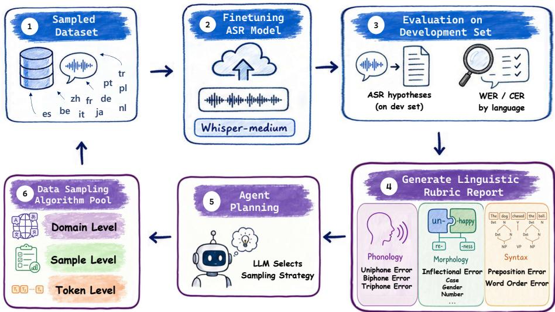
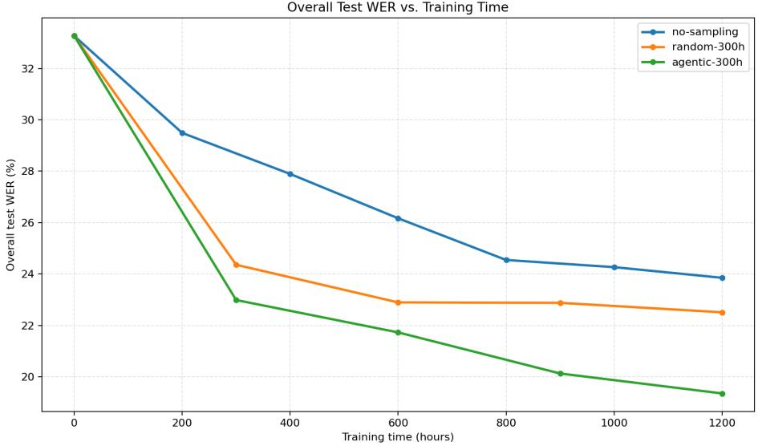

# Agentic Data Sampling Framework for Multilingual ASR via Linguistic-Aware Error-Driven Optimization

Zhiheng Qian<sup>1,⋆</sup>, Junhao Du<sup>2,⋆</sup>, Jing Peng<sup>1</sup>, Hanqi Li<sup>1</sup>, Kunyang Peng<sup>2</sup>, Feng Xue<sup>2</sup>, Lu Chen<sup>1</sup>, Shuai Wang<sup>3</sup>, and Kai Yu<sup>1,†</sup>

<sup>1</sup> Shanghai Jiao Tong University <sup>2</sup> AISpeech Co., Ltd. 3 Nanjing University

{n1vnhil,jing.peng,daqige,chenlusz,kai.yu}@sjtu.edu.cn dujunhao0114@gmail.com {kunyang.peng,feng.xue}@aispeech.com shuaiwang@nju.edu.cn

Abstract. Multilingual automatic speech recognition (ASR) has achieved rapid progress with large-scale pretrained models and multilingual speech corpora. Previous studies have proved the pivotal role of data sampling in multilingual ASR performance. However, existing sampling strategies largely rely on time-consuming manual, heuristic-based designs. To address this, we propose a linguistic-aware agentic data sampling framework that introduces a data sampling LLM agent into the multilingual ASR training loop. The agent is driven by a linguistically grounded rubric that analyzes ASR errors from phonological, morphological, and syntactic perspectives, and uses the resulting feedback together with training statistics, budget constraints, and algorithm profiles to select domain-level, sample-level, and token-level sampling strategies. This design turns evaluation results into adaptive data-selection decisions rather than treating WER/CER as final endpoints only. We conduct experiments on twelve Common Voice languages using Whisper-medium as the ASR backbone. The results show that our method achieves performance better than fulldata training while using less training data and lower computational resources, and substantially accelerates training convergence compared to conventional sampling strategies.

Keywords: Multilingual ASR · Agentic Data Sampling · Linguistic Error Analysis

## 1 Introduction

Multilingual automatic speech recognition (ASR) aims to recognize multiple languages within a unified model, reducing the cost of developing and maintaining language-specific systems. Large-scale joint training has demonstrated the value of cross-lingual parameter sharing, particularly for low-resource languages [1]. Cross-lingual self-supervised pretraining, weakly supervised sequenceto-sequence learning, and massively multilingual scaling have further extended language coverage and transferability [2–4]. Despite this progress, recognition performance remains uneven across languages because multilingual corpora differ substantially in data availability, acoustic conditions, pronunciation systems, morphology, and writing conventions.

A central challenge is therefore how to use heterogeneous multilingual training data efectively under a limited budget. Existing approaches typically concatenate corpora, balance languages, follow predefined curricula, or select auxiliary data according to corpus relatedness, historical feedback, or acoustic and phonetic similarity [5–8]. These methods demonstrate that multilingual data are not equally useful. However, most optimize a predefined criterion at a single granularity, such as language weighting or utterance selection. They do not jointly adapt language allocation, utterance selection, and token supervision to the model’s evolving error profile.

Current evaluation practice provides limited support for such adaptation. Multilingual benchmarks commonly report average and per-language WER/CER [9]. Although essential for system comparison, these metrics are afected by tokenization, writing systems, morphology, and normalization [10, 11], and do not identify the linguistic source of an error. Typological studies show that phonological, morphological, and syntactic properties help explain cross-language performance diferences [12]. Nevertheless, such analyses are generally performed after training and are rarely converted into decisions about what data the model should learn from next. This leaves a gap between multilingual ASR error diagnosis and data optimization.

In this work, we propose a linguistic-aware agentic data sampling framework that closes this loop. After each training round, recognition outputs are analyzed through a linguistic rubric covering phonology, morphology, and syntax. An LLM agent combines these diagnostics with per-language performance, training history, budget constraints, and algorithm profiles. It then produces an executable sampling plan consisting of domain-, sample-, and token-level algorithm choices and their parameters for the next round. Data sampling is thus formulated as an adaptive, feedback-driven process rather than a fixed preprocessing strategy.

Our contributions are threefold. First, we formulate multilingual ASR data sampling as a closed-loop optimization problem in which evaluation results directly guide subsequent training-data selection. Second, we provide a linguistic error rubric and a hierarchical agentic sampler that coordinate language allocation, utterance selection, and token-level supervision according to the current model state. Third, extensive experiments on twelve Common Voice languages show that the proposed method outperforms both no-sampling and randomsampling baselines in average multilingual recognition performance under the same cumulative training budget, while achieving the best results on most evaluated languages. Further analyses demonstrate improved training convergence, consistent reductions in phonological, morphological, and function-word errors, and adaptive changes in the agent’s decisions as the model error profile evolves.

## 2 Related Works

## 2.1 Evaluation and Error Diagnosis in Multilingual ASR

Multilingual ASR evaluation has developed from testing individual languages on separate corpora toward broader and more standardized cross-lingual benchmarks. Common Voice provides diverse community-contributed speech across many resource conditions, while FLEURS enables more controlled comparison through parallel content across languages [13, 14]. XTREME-S and the ML-SUPERB series further evaluate multilingual speech representations across languages, datasets, adaptation settings, and related speech tasks [9, 15, 16]. Recent extensions additionally consider language varieties, accents, dialects, codeswitching, and long-form recognition [17–19]. These benchmarks have made perlanguage performance and cross-lingual robustness increasingly visible, rather than relying only on a single macro-average score.

Despite this broader coverage, multilingual ASR is still evaluated primarily with WER and CER. These metrics provide reproducible measures of transcription accuracy, but their interpretation varies with writing systems, tokenization conventions, word boundaries, and morphological structure. CER can ofer greater consistency than WER for some multilingual comparisons, but neither metric identifies the linguistic source of an error [10]. Reported results are also sensitive to evaluation design: language-insensitive normalization may remove meaningful orthographic information, while annotation and language-label inconsistencies in multilingual corpora can distort the measured performance [11, 20].

This limitation is important because similar WER/CER values may reflect diferent model weaknesses. Errors may arise from phone confusions and phonotactic patterns, missing inflectional markers, or incorrectly recognized function words. Typologically informed analyses have shown that phonological, morphological, and syntactic properties help explain cross-language performance variation in multilingual ASR systems [12]. Such analyses therefore ofer a more informative view of model behavior than aggregate edit distance alone.

However, existing evaluation and diagnostic studies are mainly used for benchmarking or post-hoc interpretation. They reveal which languages or linguistic properties are dificult, but usually do not determine how the training data should be changed in response. This leaves a gap between error diagnosis and model optimization. Our work addresses this gap by converting phonological, morphological, and syntactic error statistics into structured feedback for subsequent domain-, sample-, and token-level data selection. In this way, multilingual evaluation is used not only to measure the final model, but also to guide the next training round.

## 2.2 Data Sampling Algorithms

Data sampling and selection improve training eficiency by assigning diferent importance to data sources, examples, or supervision units. At the domain level, DoReMi learns mixtures of heterogeneous data sources using proxy-model excess losses and distributionally robust optimization [21]. DoGE estimates the contribution of each domain to target generalization through bilevel optimization and gradient-based signals [22], while exponentiated-gradient reweighting provides a general mechanism for converting domain scores into adaptive sampling distributions [23]. These methods show that a fixed data mixture may become suboptimal as training progresses.

Finer-grained methods operate on individual examples or tokens. LESS uses low-dimensional gradient representations to select examples that align with a target or validation objective [24]. RHO-1 prioritizes under-learned tokens according to their excess loss relative to a reference model [25], whereas TOSS uses token-level risk signals to suppress undesirable supervision [26]. Although these methods were mainly developed for language-model training, they establish complementary mechanisms for domain reweighting, example selection, and token-level control.

Multilingual ASR introduces additional selection criteria because the value of speech data depends on both linguistic and acoustic relationships. Corpusrelatedness sampling selects auxiliary speech according to source–target similarity [5], while adversarial meta-sampling adapts language selection using historical model feedback [6]. Other approaches use phoneme overlap and pronunciation information for dynamic multilingual sampling [7], or estimate positive crosslingual transfer through acoustic pseudo-tokens and clip-level acoustic similarity [8, 27]. These findings show that data quantity or loss alone cannot fully determine the usefulness of multilingual speech.

Beyond multilingual ASR, recent studies have investigated the use of LLMs and agentic mechanisms for data selection and preparation. AskLLM leverages the zero-shot reasoning capability of an instruction-tuned LLM to directly assess the quality of individual training examples, demonstrating that LLM-based semantic judgments can serve as efective data-selection signals [28]. Bai et al. introduce a multi-actor collaborative framework in which multiple data-selection strategies independently prioritize samples and a central console dynamically combines their decisions according to the current training state [29]. Moving beyond sample scoring, DataFlow introduces an LLM-driven agent that translates natural-language data requirements into executable preparation pipelines composed of generation, evaluation, filtering, and refinement operators [30].

These agentic data sampling method has not been adapted to multilingual ASR. Existing approaches, however, generally employ a predefined selection criterion and operate at one granularity, such as language weighting or utterance selection. Coordinating language-level allocation, utterance-level relevance, and token-level supervision according to changing multilingual ASR errors remains comparatively underexplored[31].

  
Fig. 1. Overview of the proposed agentic data sampling framework. The blue nodes show the common ASR model training pipeline, while the purple nodes belong to our agentic data sampling workflow.

## 3 Method

We propose a linguistic-aware agentic data sampling framework. The system use an LLM-based agent to drive the data sampling process to train a multi-lingual ASR model. The overall pipeline is shown in Fig. 1.

In summary, the agentic workflow proceeds as an iterative training loop. At each epoch, the system first samples a batch from the training corpus and uses it to fine-tune the ASR model. The fine-tuned model is then evaluated on the development set, and its recognition outputs are converted into a linguistic rubric report. Based on this report together with the training statistics, the LLM agent designs a three-stage data-sampling plan covering domain-level, samplelevel, and token-level decisions. This plan is then applied to the training corpus to construct the subset used for fine-tuning in the next epoch.

## 3.1 Linguistic Rubric

We propose a linguistic rubric for our multilingual ASR data sampling agent, which converts raw ASR recognition errors into more detailed statistics from a linguistic perspective, and provides structured feedback for data sampling. The rubric attributes some ASR errors into three linguistic dimensions: phonology, morphology, and syntax. The goal of the rubric is not to replace WER or CER, but to explain which linguistic phenomena contribute to the observed errors. Based on the detailed error distribution in each linguistic dimension, the agent can identify more specific weaknesses and select more targeted sampling strategies.

Phonology. The phonology dimension analyzes ASR errors at the phoneme level. We convert grapheme-level references and predictions into IPA representations using eSpeak NG [32], and then identify errors at the granularity of uniphones, biphones, and triphones. This dimension helps identify which sounds or sound combinations are dificult for the model and supports phone-aware sample selection.

Morphology. The morphology dimension focuses on word-formation errors, especially inflectional errors and case, gender, number, or tense marker errors. We compare aligned reference and hypothesis tokens to determine whether the main lexical stem is preserved while a morphological marker changes or disappears. In morphologically rich languages, a single inflectional error can alter the grammatical or semantic function of a word while causing only a minimal change in character-level edit distance.

Syntax. The syntax dimension focuses on errors involving prepositions, function words, and local word-order patterns. Although ASR is an acoustic-to-text task, recognition errors often appear as systematic textual mistakes, such as dropped function words or confused short grammatical words. Syntax-level analysis therefore provides additional guidance for selecting utterances that contain error-prone grammatical contexts.

For each linguistics dimension, the rubric report contains both categorical distribution and short natural-language summaries. The report is then passed to the agent together with WER/CER and training statistics. In this way, the agent can distinguish, for example, a language whose high WER is mainly caused by phoneme confusions from another language whose errors are dominated by inflectional endings or function words.

## 3.2 Data Sampling Agent

Hierarchical Algorithm Pool We formulate data sampling for multilingual ASR as a hierarchical decision process with three stages: domain, sample, and token. These stages correspond to three increasingly fine-grained data sampling level: the language ratios of the training dataset, the utterances to be selected for each language, and operations (e.g. gradient weights or masking) applied to tokens during optimization.

The agent designs the data sampling plan using a hirachical algorithm pool. At each training epoch, the agent observes the linguistic rubric report, training statistics, and budget constraints, then selects one compatible algorithm from each level together with its parameters. The algorithms selected by the data sampling agent are executed in hierarchical order.

Table 1. Multi-level data sampling algorithm pool.
<table><tr><td>Algorithm</td><td>Stage Description</td></tr><tr><td>Doremi</td><td>Domain Updates language sampling weights using loss-based signals.</td></tr><tr><td>Exp-Reweight DOGE</td><td>Domain Reweights languages using an agent-selected score.</td></tr><tr><td>LESS</td><td>Domain Uses gradient similarity for domain-level weighting. Sample Selects utterances using training-validation gradient</td></tr><tr><td></td><td>alignment. Phone Error Distribution Sample Selects utterances matching phoneme error distri-</td></tr><tr><td>RHO-1</td><td>butions. Token Selects informative tokens using token-level loss or</td></tr><tr><td>TOSS</td><td>entropy. Token Filters tokens according to utility or risk scores.</td></tr></table>

We predefined the algorithm pool using 7 algorithms as shown in Table 1. The pool is extensible: each algorithm is a self-contained module that only requires its declared inputs to execute. Once implemented, registering a new algorithm simply requires providing a profile describing its behaviour and parameter schema. The agent can then reason about it based on its profile alongside all other registered algorithms.

Data Sampling Procedure The decision-making process of agentic data sampling can be formulated as follows. Given the original multilingual corpus D, the agent selects a sequence of three actions:

$$
a = ( a ^ { d o m a i n } , a ^ { s a m p l e } , a ^ { t o k e n } ) ,\tag{1}
$$

where each action is itself a pair $a ^ { l } = ( m ^ { l } , \theta ^ { l } )$ consisting of an algorithm choice $m ^ { l }$ from a level of the predefined pool and its parameters $\theta ^ { l }$ . The actions are applied sequentially:

$$
\mathcal { S } = a ^ { t o k e n } ( a ^ { s a m p l e } ( a ^ { d o m a i n } ( \mathcal { D } ) ) ) .\tag{2}
$$

which first adjusts language-level sampling weights, then selects utterances under the adjusted weights, and finally applies per-token operation during optimization.

At each data-sampling stage, the agent receives a compact state description that combines the current epoch statistics, including the training-loss curve and WER/CER with per-language breakdowns, with the linguistic rubric reports. This state also includes the available algorithm profiles and their parameter schemas, the execution results from earlier sampling stages in the same epoch, such as the selected algorithm, parameters, and filtered dataset, and the running history of the agent’s decisions in previous epochs. Given this information, the agent outputs a structured decision for the current stage, specifying the selected algorithm and parameters together with an interpretable rationale for the choice.

## 4 Experiments

## 4.1 Setup

Dataset We employ a 12-language subset of Common Voice [13] as our benchmark, covering Belarusian (be), Chinese (zh), Dutch (nl), French (fr), German (de), Italian (it), Japanese (ja), Polish (pl), Portuguese (pt), Russian (ru), Spanish (es), and Turkish (tr). This subset comprises a training corpus, a development set, and a test set. Both the development and test sets are 12 hours, equally distributed with exactly one hour per language. The training corpus comprises a total duration of 600 hours, with each language contributing an equal share of 50 hours.

Baselines and Implementation We fine-tune the Whisper-medium [3] model on this dataset using various data sampling strategies to evaluate their impact on automatic speech recognition (ASR) performance. To isolate the efects of the sampling strategies, all methods are assessed under identical model architectures, optimizer configurations, and evaluation protocols. Specifically, we employ Low-Rank Adaptation [33] with a rank r = 64, α = 64, and a dropout rate of 0.05. The model is optimized using the AdamW optimizer with a learning rate of $1 \times 1 0 ^ { - 4 }$ and a per-device batch size of 128, distributed across 8 Ascend 910B NPUs.

To ensure a fair comparison, the total duration of trained data for all models is strictly fixed at 1,200 hours. We benchmark our proposed agentic data sampling method against two baselines: a no-sampling baseline and a random sampling baseline. The no-sampling baseline utilizes the complete training corpus without any selection strategy; specifically, it was trained on the full 600-hour data for 2 epochs. The random sampling method involves randomly selecting 300 hours of data from the training corpus, repeated over 4 iterations. For our agentic sampling method, we evaluated diferent sampling durations, extracting batches of 100 and 300 hours of data from the training corpus respectively to reach the target training volume. Consequently, the agentic system performs 12 and 4 sampling iterations respectively.

## 4.2 Main Results

Table 2 presents the comparative analysis of ASR performance across models trained with varying data sampling strategies. Our proposed agentic sampling strategies demonstrate superior performance compared to the baselines. Specifically, the agentic sampling method with 300 hours sampling batch achieves the best average performance with an error rate of 19.4, significantly outperforming the no-sampling baseline (23.9) and the random sampling baseline (22.5). In terms of specific language performance, it yields the lowest error rates in 9 out of 12 languages and shows significant improvement in Indo-European languages, especially Romance languages. The agentic-300h method reduced the WER for Spanish and Portuguese by 38.5% and 38.0% respectively, compared with the no-sampling baseline. This may be benefit from our linguistic-aware rubric as these languages shares similar linguistic features.

  
Fig. 2. Comparison of overall test WER over training time under no sampling, random sampling, and agentic sampling. The sampling batch of random and agentic method is 300 hours.

As shown in Figure 2, the baseline systems tend to converge after approximately 1200 hours of training, whereas the agentic sampling method continues to reduce the overall WER. This suggests that agentic sampling selects more informative training data and remains efective beyond the point where the baseline strategies begin to saturate.

Table 2. Comparison of ASR performance across diferent data sampling strategies. The sufix of each method denotes the data duration sampled per iteration. Performance is measured in Character Error Rate (CER) for Japanese (ja) and Chinese (zh), and Word Error Rate (WER) for all other languages. The best results for each language are highlighted in bold.
<table><tr><td>Method</td><td>be</td><td>de</td><td>es</td><td>fr</td><td>it</td><td>ja</td><td>nl</td><td>pl</td><td>pt</td><td>ru</td><td>tr zh</td><td>Avg.</td></tr><tr><td>no-sampling random-300h</td><td>70.3</td><td>39.9 36.1</td><td>20.5 18.6</td><td>21.5 20.1</td><td>10.9 10.1</td><td>10.4 9.1</td><td>19.0 18.3</td><td>21.0 19.0</td><td>18.7</td><td>19.2 17.3</td><td>22.3</td><td>23.9</td></tr><tr><td>agentic-100h agentic-300h</td><td>67.6</td><td>75.9 28.7 19.2 66.2 30.1 12.6 17.1 8.6</td><td></td><td>17.4</td><td>8.9</td><td>9.7</td><td>10.1 14.4 15.5 14.0 15.7 11.6 15.4 14.4 20.5 19.4</td><td></td><td>17.9 12.4 13.9</td><td>15.6 15.6</td><td>20.2 24.1</td><td>20.4 22.5 21.1</td></tr></table>

Table 3. Representative test cases corrected by agentic data sampling. Red text marks persistent recognition errors, while green text marks the corrected linguistic unit after finetuning.
<table><tr><td>Morphology French</td></tr><tr><td>Reference: yvan publie des anthologies de poètes allemands et français et vit de ses traductions Whisper: yvon publie des anthologies de poètes allemand et français et vit de ces traductions</td></tr><tr><td>No-sampling: yvon publie des anthologies de poètes allemand et français et vit de ses traductions Agentic: yvan publie des anthologies de poètes allemands et français et vit de ses</td></tr><tr><td>traductions Syntax Italian</td></tr><tr><td>Reference: a causa degli enormi debiti fu costretta a vivere grazie a dei prestiti Whisper: a kaoza da gdje normi debiti fukustreta a vivere gracija da ih prestiti No-sampling: a causa degli enormi debiti fu costretta a vivere grazie ai prestiti</td></tr><tr><td>Agentic: a causa degli enormi debiti fu costretta a vivere grazie a dei prestiti</td></tr><tr><td>Phonology Portuguese</td></tr><tr><td>Reference: ivaí Whisper: e vai</td></tr></table>

## 4.3 Case Analysis

Table 3 presents three representative cases of errors in each linguistic dimension. The base Whisper model makes the error and no-sampling finetuning still fails to correct it, while our agentic sampling model produces the correct transcription. These examples illustrate that the improvement of agentic data sampling is not limited to general lexical recovery, but also appears in linguistically meaningful error categories.

In the morphology case, an inflectional error occurs in the baseline as it transcribes poètes allemands as poètes allemand, dropping the plural agreement marker -s on the adjective. The agentic model restores allemands, suggesting that the selected training samples help the model better preserve inflectional information in Romance languages.

Table 4. Representative agent-selected sampling strategies.
<table><tr><td colspan="2">Round Main Error Pattern</td><td colspan="2">Domain Action Sample/Token Action</td></tr><tr><td>1</td><td>Cold-start uncertainty without reliable DoReMi error feedback</td><td></td><td> $\mathrm { L E S S + R H O { - } 1 }$ </td></tr><tr><td>2</td><td>Concentrated phonological errors</td><td>Exp-Reweight</td><td> $\mathrm { P E \mathrm { - } D S T B + T O S S }$ </td></tr><tr><td>3</td><td>Persistent phone-level confusions</td><td>DOGE</td><td> $\mathrm { P E } \mathrm { - D S T B + R H O  – 1 }$ </td></tr><tr><td>4</td><td>Language-specific phonetic errors</td><td>DoReMi</td><td> $\mathrm { L E S S + T O S S }$ </td></tr></table>

In the syntax error case, the baseline simplifies the prepositional phrase grazie a dei prestiti to grazie ai prestiti. The agentic model, however, recovers the full prepositional construction, demonstrating an improved ability to model functionword structures rather than merely correcting surface-level spelling errors. This enhancement is likely attributable to token-level data sampling, which efectively resolves uncertainty at the local token level.

The phonology case shows a clear diagnosis-action-test loop together with the rubric traces. This phone error is identified in the rubric, and the phone error distributiont sampling algorithm is selected in the middle epochs to target such phonological patterns, and the final model resolves a persistent phonological confusion on the test set.

Overall, these cases suggest that agentic data sampling improves ASR behavior across morphology, syntax, and phonology by selecting training data that is more closely aligned with the model’s observed error patterns.

## 5 Analysis

## 5.1 Agent Decision Behavior

We further examine whether the sampling policy produced by the agent is adaptive and interpretable rather than equivalent to a fixed schedule. At each round, the agent receives the evaluation history and linguistic error diagnostics from the preceding round, and jointly selects domain-, sample-, and token-level sampling strategies for the next round.

Table 4 shows a transition from a conservative cold-start policy to diagnosisconditioned decisions. In the first round, no previous evaluation history is available, so the agent selects broadly applicable loss-based methods rather than making language- or error-specific interventions. Once diagnostic feedback becomes available, the selected actions change across rounds instead of repeating the initial configuration. This behavior indicates that the policy is conditioned on the evolving error profile of the ASR model rather than following a predefined sampling schedule.

More importantly, the selected actions are aligned with the granularity of the observed errors. When phonological errors become concentrated, the agent introduces PE-DSTB at the sample level, connecting phone-level diagnostics to the selection of training utterances. Meanwhile, the alternation among Exp-Reweight, DOGE, and DoReMi suggests that the agent distinguishes between multilingual allocation and within-domain data quality. Domain-level actions determine where training emphasis should be placed, whereas sample- and tokenlevel actions determine which supervision within those domains is most useful.

Table 5. Linguistic error counts of the original and model trained with agentic data sampling.
<table><tr><td>Category</td><td>Error Type</td><td>Original Agentic-trained</td><td>Reduction</td></tr><tr><td>Phonology</td><td>Uniphone</td><td>124,191</td><td>114,831 9,360 (7.5%)</td></tr><tr><td>Biphone</td><td></td><td>129,700</td><td>121,123 8,577 (6.6%)</td></tr><tr><td></td><td>Triphone</td><td>131,243</td><td>122,970 8,273 (6.3%)</td></tr><tr><td></td><td>Morphology Inflectional marker / word-ending</td><td>975</td><td>467 508 (52.1%)</td></tr><tr><td>Syntax</td><td>Preposition / function-word</td><td>526</td><td>403 123 (23.4%)</td></tr><tr><td></td><td>Word-order deviation</td><td>3</td><td>1 2 (66.7%)</td></tr></table>

The alternation between RHO-1 and TOSS further shows that the agent does not treat all dificult tokens as equally valuable. Some persistent errors may require greater emphasis on under-learned tokens, while others may benefit from filtering unreliable token-level signals. The resulting policy is therefore hierarchical: the agent first identifies the data regions requiring intervention and then selects an appropriate level of filtering or emphasis within those regions.

Overall, the decisions provide evidence that the agent uses linguistic diagnostics to revise both the target and the granularity of data selection. These examples do not establish that every selected strategy is globally optimal, but they demonstrate that the decision process is traceable, responsive to model feedback, and distinct from a fixed combination of sampling algorithms. Together with the linguistic error reductions in Table 5, this behavior supports the interpretation of the proposed framework as an adaptive feedback loop between error diagnosis and data selection.

## 5.2 Linguistic Error Reduction

Beyond aggregate WER/CER, we further examine whether agentic data sampling reduces linguistically meaningful recognition errors. We compare the original Whisper-medium model with the model obtained after four epochs of agentic data sampling. Both models are evaluated on the same Common Voice test set covering 12 languages. For phonological analysis, we convert each reference and hypothesis into IPA phone sequences using G2P, strip non-phonemic markers, and count all mismatched 1-, 2-, and 3-phone n-gram events over the full test set. For morphology and syntax, we use rule-based detectors for inflectional marker errors, preposition/function-word errors, and word-order deviations. The relative reduction is computed with respect to the original Whisper-medium model.

Table 5 reveals a complementary pattern across linguistic levels. Phonological errors contribute the largest absolute reductions, reflecting their high frequency in multilingual ASR, while morphological errors exhibit the largest relative improvement. This suggests that the benefit of agentic data sampling is not confined to frequent acoustic–phonetic confusions: it also extends to less frequent but linguistically informative errors, such as inflectional sufixes and word-final grammatical markers. The consistent reductions from uniphone to triphone errors further indicate improved modeling of both individual phonemes and short phonetic contexts, although the smaller gain at higher n-gram orders suggests that longer context-dependent confusions remain more dificult.

These results support the central motivation of our agentic sampling framework. A uniform sampling strategy treats all training data as equally useful, whereas the agent adjusts the data distribution using historical model performance and linguistic error feedback. The observed error profile is consistent with the agent allocating additional training exposure to languages or samples containing persistent phonological contrasts, morphologically marked word forms, and grammatical function words. In particular, the substantial reduction in morphological errors suggests that adaptive sampling can improve phenomena that may be underrepresented in the overall training distribution and therefore receive insuficient attention under uniform sampling.

The reduction in preposition and function-word errors also indicates that the improvement is not limited to content-word recognition, but extends to local grammatical information. However, the number of word-order deviations is too small to draw a reliable conclusion about global syntactic modeling. Overall, the linguistic breakdown provides evidence that agentic data sampling changes not only the aggregate error rate but also the composition of the remaining errors, yielding improvements across acoustic–phonetic and grammatical dimensions that cannot be fully characterized by WER/CER alone.

## 6 Conclusion

We proposed a linguistic-aware agentic data sampling framework for multilingual ASR that converts phonological, morphological, and syntactic error diagnostics into domain-, utterance-, and token-level sampling decisions. By placing evaluation inside the training loop, the framework treats data sampling as an adaptive process rather than a fixed preprocessing strategy.

Experiments on twelve Common Voice languages with Whisper-medium show that the agentic-300h setting achieves an average error rate of 19.4, compared with 23.9 for no sampling and 22.5 for random sampling, and obtains the best result on nine languages. The method also reduces phone-level, inflectional, and function-word errors, while the selected strategies change with the evolving model error profile. These results suggest that multilingual ASR evaluation can serve not only to measure performance, but also to provide actionable feedback for subsequent data selection. Future work will extend the framework to broader language coverage and conduct finer-grained ablations of the linguistic rubric and individual sampling decisions.

## References

1. Pratap, V., Sriram, A., Tomasello, P., Hannun, A., Liptchinsky, V., Synnaeve, G., Collobert, R.: Massively multilingual asr: 50 languages, 1 model, 1 billion parameters (2020)

2. Babu, A., Wang, C., Tjandra, A., Lakhotia, K., Xu, Q., Goyal, N., Singh, K., von Platen, P., Saraf, Y., Pino, J., et al.: Xls-r: Self-supervised cross-lingual speech representation learning at scale. Interspeech 2022 (2022)

3. Radford, A., Kim, J.W., Xu, T., Brockman, G., McLeavey, C., Sutskever, I.: Robust speech recognition via large-scale weak supervision. In: Proceedings of the 40th International Conference on Machine Learning. pp. 28492–28518 (2023)

4. Pratap, V., Tjandra, A., Shi, B., Tomasello, P., Babu, A., Kundu, S., Elkahky, A., Ni, Z., Alexei, A.V.M.F.Z., Adi, B.Y., et al.: Scaling speech technology to 1,000+ languages. Journal of Machine Learning Research 25, 1–52 (2024)

5. Li, X., Dalmia, S., Black, A.W., Metze, F.: Multilingual speech recognition with corpus relatedness sampling. In: Proc. Interspeech 2019. pp. 2120–2124 (2019)

6. Xiao, Y., Gong, K., Zhou, P., Zheng, G., Liang, X., Lin, L.: Adversarial meta sampling for multilingual low-resource speech recognition. In: Proceedings of the AAAI Conference on Artificial Intelligence. vol. 35, pp. 14112–14120 (2021)

7. Hsieh, I.T., Wu, C.H., Zhao, Z.H.: Dynamic sampling-based meta-learning using multilingual acoustic data for under-resourced speech recognition. IEEE Access 12, 106070–106083 (2024)

8. San, N., Paraskevopoulos, G., Arora, A., He, X., Kaur, P., Adams, O., Jurafsky, D.: Predicting positive transfer for improved low-resource speech recognition using acoustic pseudo-tokens. In: Proceedings of the 6th workshop on research in computational linguistic typology and multilingual NLP. pp. 100–112 (2024)

9. Shi, J., Berrebbi, D., Chen, W., Hu, E.P., Huang, W.P., Chung, H.L., Chang, X., Li, S.W., Mohamed, A., Lee, H.y., et al.: Ml-superb: Multilingual speech universal performance benchmark. INTERSPEECH 2023 (2023)

10. Thennal, D., James, J., Gopinath, D.P., et al.: Advocating character error rate for multilingual asr evaluation. In: Findings of the Association for Computational Linguistics: NAACL 2025. pp. 4926–4935 (2025)

11. Manohar, K., Pillai, L.G.: What is lost in normalization? exploring pitfalls in multilingual asr model evaluations. In: Proceedings of the 2024 Conference on Empirical Methods in Natural Language Processing. pp. 10864–10869 (2024)

12. Gonzalez, S., Hoang, T., Kim, M.M.H., Donnelly, B., Biggs, J., Cawley, T.: Understanding multilingual asr systems: The role of language families and typological features in seamless and whisper. In: Proceedings of the 23rd Annual Workshop of the Australasian Language Technology Association. pp. 90–100 (2025)

13. Ardila, R., Branson, M., Davis, K., Kohler, M., Meyer, J., Henretty, M., Morais, R., Saunders, L., Tyers, F., Weber, G.: Common voice: A massively-multilingual speech corpus. In: Proceedings of the twelfth language resources and evaluation conference. pp. 4218–4222 (2020)

14. Conneau, A., Ma, M., Khanuja, S., Zhang, Y., Axelrod, V., Dalmia, S., Riesa, J., Rivera, C., Bapna, A.: Fleurs: Few-shot learning evaluation of universal representations of speech. In: 2022 IEEE Spoken Language Technology Workshop (SLT). pp. 798–805. IEEE (2023)

15. Conneau, A., Bapna, A., Zhang, Y., Ma, M., von Platen, P., Lozhkov, A., Cherry, C., Jia, Y., Rivera, C., Kale, M., et al.: Xtreme-s: Evaluating cross-lingual speech representations. In: Proc. Interspeech 2022. pp. 3248–3252 (2022)

16. Shi, J., Wang, S.H., Chen, W., Bartelds, M., Bannihatti Kumar, V., Tian, J., Chang, X., Jurafsky, D., Livescu, K., Lee, H.y., et al.: Ml-superb 2.0: Benchmarking multilingual speech models across modeling constraints, languages, and datasets. In: Proc. Interspeech 2024. pp. 1230–1234 (2024)

17. Chen, W., Meng, C., Shi, J., Bartelds, M., Wang, S.H., Wang, H.H., Mosquera, R., Hincapie, S., Jurafsky, D., Anastasopoulos, A., et al.: The ml-superb 2.0 challenge: Towards inclusive asr benchmarking for all language varieties. In: Proc. Interspeech 2025. pp. 2093–2097 (2025)

18. Yan, B., Hamed, I., Shimizu, S., Lodagala, V.S., Chen, W., Iakovenko, O., Talafha, B., Hussein, A., Polok, A., Chang, K., et al.: Cs-fleurs: A massively multilingual and code-switched speech dataset. In: Proc. Interspeech 2025. pp. 743–747 (2025)

19. Srivastav, V., Zheng, S., Bezzam, E., Le Bihan, E., Koluguri, N., Żelasko, P., Majumdar, S., Moumen, A., Gandhi, S.: Open asr leaderboard: Towards reproducible and transparent multilingual and long-form speech recognition evaluation. arXiv e-prints pp. arXiv–2510 (2025)

20. Lau, M., Chen, Q., Fang, Y., Xu, T., Chen, T., Golik, P.: Data quality issues in multilingual speech datasets: The need for sociolinguistic awareness and proactive language planning. In: Proceedings of the 63rd Annual Meeting of the Association for Computational Linguistics (Volume 1: Long Papers). pp. 7466–7492 (2025)

21. Xie, S.M., Pham, H., Dong, X., Du, N., Liu, H., Lu, Y., Liang, P.S., Le, Q.V., Ma, T., Yu, A.W.: Doremi: Optimizing data mixtures speeds up language model pretraining. Advances in Neural Information Processing Systems 36, 69798–69818 (2023)

22. Fan, S., Pagliardini, M., Jaggi, M.: Doge: Domain reweighting with generalization estimation. In: International Conference on Machine Learning. pp. 12895–12915. PMLR (2024)

23. Majidi, N., Amid, E., Talebi, H., Warmuth, M.K.: Exponentiated gradient reweighting for robust training under label noise and beyond. arXiv preprint arXiv:2104.01493 (2021)

24. Xia, M., Malladi, S., Gururangan, S., Arora, S., Chen, D.: Less: selecting influential data for targeted instruction tuning. In: Proceedings of the 41st International Conference on Machine Learning. pp. 54104–54132 (2024)

25. Lin, Z., Gou, Z., Gong, Y., Liu, X., Shen, Y., Xu, R., Lin, C., Yang, Y., Jiao, J., Duan, N., et al.: Not all tokens are what you need for pretraining. In: Proceedings of the 38th International Conference on Neural Information Processing Systems. pp. 29029–29063 (2024)

26. Li, Y., Liu, Z., Li, Z., Lin, Z., Zhang, J.: Token-level data selection for safe llm finetuning. In: The Fourteenth International Conference on Learning Representations

27. Mitsumori, S., Kashiwagi, S., Tanaka, K., Morishima, S.: Cross-lingual data selection using clip-level acoustic similarity for enhancing low-resource automatic speech recognition. In: Proc. Interspeech 2025. pp. 3314–3318 (2025)

28. Sachdeva, N., Coleman, B., Kang, W.C., Ni, J., Hong, L., Chi, E.H., Caverlee, J., McAuley, J., Cheng, D.Z.: How to train data-eficient llms. arXiv preprint arXiv:2402.09668 (2024)

29. Bai, T., Yang, L., Wong, Z.H., Sun, F., Zhuang, X., Peng, J., Zhang, C., Wu, L., Jiantao, Q., Zhang, W., et al.: Eficient pretraining data selection for language models via multi-actor collaboration. In: Proceedings of the 63rd Annual Meeting of the Association for Computational Linguistics (Volume 1: Long Papers). pp. 9465–9491 (2025)

30. Liang, H., Ma, X., Liu, Z., Wong, Z.H., Zhao, Z., Meng, Z., He, R., Shen, C., Cai, Q., Han, Z., et al.: Dataflow: An llm-driven framework for unified data preparation and workflow automation in the era of data-centric ai. arXiv preprint arXiv:2512.16676 (2025)

31. Peng, J., Wang, Y., Li, B., Guo, Y., Wang, H., Fang, Y., Xi, Y., Li, H., Li, X., Zhang, K., et al.: A survey on speech large language models for understanding. IEEE Journal of Selected Topics in Signal Processing (2025)

32. eSpeak NG Contributors: eSpeak NG text-to-speech. https://github.com/ espeak-ng/espeak-ng

33. Hu, E.J., Shen, Y., Wallis, P., Allen-Zhu, Z., Li, Y., Wang, S., Wang, L., Chen, W.: Lora: Low-rank adaptation of large language models. In: International Conference on Learning Representations (2022)

## Appendix 1

Structure of agent decision in each stage:

{   
"rationale": {   
"algorithm": "Per-language CER shows high variation...",   
"param": "alpha=0.8 to smooth weights for low-resource languages..."   
}   
"algorithm": "doremi",   
"params": {"alpha": 0.8, "reweight\_eta": 2.0, ...},   
}

## Appendix 2

Example of linguistic rubric: Example of linguistic rubric:

```jsonl
{
"phonology": {
"uniphone_errors": [
{"phone": "i", "error_rate": 0.68, "languages": ["be", "pl", "pt"]},
],
"biphone_errors": [...],
"triphone_errors": [...],
"summary": "High phonological error rates are observed..."
},
"morphology": {
"inflection_errors": [
{"language": "de", "marker": "er", "error_rate": 0.10, ...}
],
"summary": "Inflectional errors concentrate on..."
},
"syntax": {
"prep_errors": [
{"language": "fr", "prep": "de", "error_rate": 0.13, ...}
],
"summary": "Preposition and function-word errors are frequent..."
}
}
```

## Appendix 3: Prompt Template

The prompt template used by the LLM agent at each sampling stage is as follows.   
Placeholders enclosed in braces are filled by the workflow before each LLM call.

You are a data sampling agent for multilingual ASR training.   
## Context   
The pipeline runs three stages sequentially:   
domain (= language) -> sample (= utterance) -> token (= subword)   
Each stage's output feeds into the next.   
## Current stage   
You are configuring \*\*Stage {stage\_num} -- {stage\_name} ({stage\_level})\*\*.   
Available algorithms: {available\_algorithms}   
This stage runs \*\*{stage\_phase}\*\*.   
## What you will receive   
\`\`rubric\_diagnosis\`\`: error patterns, per-language CER, overall CER,   
phone/grapheme distributions, and summary text.   
\`previous\_stages\`\`: summary of what earlier stages did and their results.   
(empty for the first stage)   
\`\`selection\_context\`\`: experiment-level constraints and cross-epoch   
algorithm usage history, including under-used algorithms and recent   
domain->sample->token paths.   
## Rules   
1. Choose exactly ONE algorithm from the available list.   
2. Set specific parameter values using the parameter schemas below.   
3. Prefer conservative settings unless the diagnosis clearly supports aggressive filtering.   
4. This experiment must explore the algorithm pool across epochs. Prefer   
under-used algorithms and new stage combinations when their required   
inputs are available from the rubric or from orchestrator precompute.   
If an algorithm has zero or much lower usage than the alternatives at the   
same stage, choose it before reusing a heavily repeated stage algorithm   
unless it is invalid for the current inputs.   
Avoid repeating the same stage algorithm for more than two consecutive   
epochs unless every alternative is invalid; if you repeat, explain why.   
5. Do not choose an algorithm only because it was used in the previous epoch.   
Balance current diagnosis fit with coverage of doremi/exp\_reweight/doge,   
less/pe\_dstb, and rho1/toss over the full run.   
6. Return valid JSON matching the required schema.   
7. Output schema fields following their original order in the schema (rationale ->   
,→ algorithm -> params).   
.. note::   
File-path parameters such as \`\`error\_results\_path\`\`, \`\`loss\_path\`\`, and   
\`\`score\_path\`\` must refer to real run artifacts when you set them. For   
model-based score fields such as DoReMi losses or rho1 token scores, the   
orchestrator precomputes missing fields before training from the current   
epoch checkpoint and the fixed train split. Algorithms do not fall back   
to package-local offline scored JSONL files.   
## Algorithm parameter schemas   
{algo\_schemas}