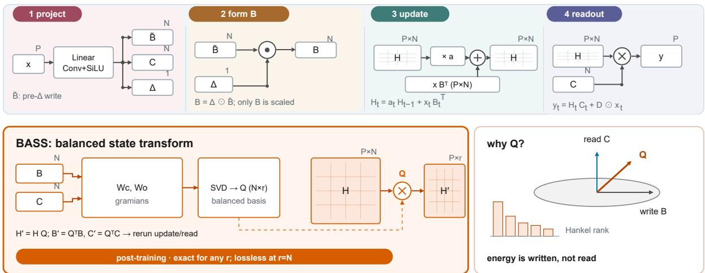
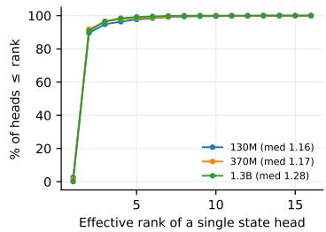
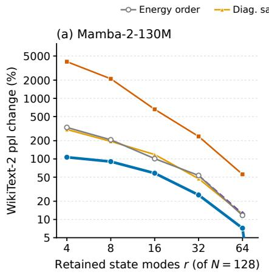
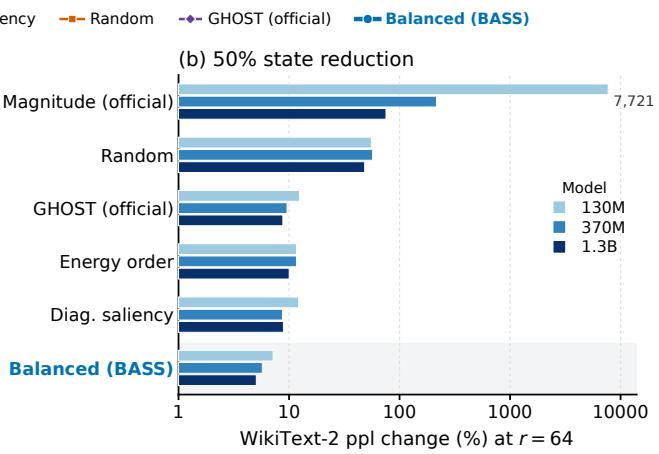
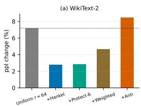
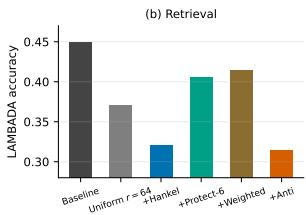

# Balanced State Subspaces for Mamba-2 State Compression

Tingyu Shanga, Wenfei Caoa,\*

aSchool of Mathematics and Statistics, Shaanxi Normal University, Xi’an 710119, China

## Abstract

Mamba-2 compresses all context into a fixed size recurrent state that dominates decoding memory and bandwidth. Existing compressors quantize state values or prune state coordinates, scoring each channel independently in the native basis. We examine trained Mamba-2 states and find that energy is almost rank-one, but the output does not read the energetic directions: energy concentrates in a bias-like direction accumulated by the recurrence, while the content the output reads lives in a low-dimensional sub space that is not aligned with the state’s coordinates. Even output-aware scores are computed coordinate by coordinate, so they miss the di rections that determine the input–output map. Compression should therefore target the write– read subspace rather than individual coordi nates. We propose BASS, a post-training transform that instantiates balanced truncation with full controllability and observability Gramians and applies the rotation exactly via Mamba 2’s scalar-identity transition. Because the useful rank varies widely across layers, we fur ther introduce HARP, which allocates ranks per layer from the Hankel spectrum and protects retrieval-sensitive layers, improving both perplexity and retrieval over uniform budgets. Calibration takes a single forward pass, an order of magnitude faster than GHOST’s released protocol, with lower peak memory. With HARP, BASS halves the state dimension at an average WikiText-2 perplexity increase of 0.3 points (1.8%) across 130M–2.7B, versus 1.6 (9.3%) for GHOST, and the gap widens at 25% retention.

## 1 Introduction

State space models (SSMs) such as Mamba and Mamba-2 have become a competitive alternative to Transformers for long-sequence modeling: they scale linearly in sequence length, avoid the growing key–value cache, and match or exceed attentionbased models at small and medium scale (Gu and Dao, 2023; Dao and Gu, 2024). Their efficiency at inference stems from a single mechanism: the entire context is compressed into a fixed-size recurrent state. For Mamba-2, each layer keeps one matrix state per head (N=128 state modes), and generation updates this state in place at every token, so the state becomes the bottleneck: at batch size 128, the recurrent states of Mamba2-2.7B account for roughly 80% of decoding memory (Chen et al., 2025), and every generated token must stream them from memory (Nguyen, 2026).

Reducing the cost of the state has therefore become an active goal. Post-training quantization compresses state values (e.g., Quamba and Q-Mamba (Chiang et al., 2025b; Chen et al., 2025)). An orthogonal direction prunes state coordinates: GHOST selects state channels by an output-aware controllability×observability score (Menezes and Kyrillidis, 2026), and Nazari and Rusch (2026) discard key/query channels in linear attention. All of these methods operate in the native coordinate system of the state, scoring coordinates once from calibration statistics; even output-aware criteria score each coordinate independently, and none can represent the joint structure that governs how the state as a whole is written and read.

In this paper we ask two questions. First, how should we read trained Mamba-2 states? Second, given that structure, what is the right way to compress them? Related properties have been reported in isolation—anisotropy for Mamba-1 (Wagh and Singh, 2026), low-rank and headstratified states for linear attention (Sun et al., 2026; Nazari and Rusch, 2026), and output-aware selection for Mamba-2 (Menezes and Kyrillidis, 2026)— but not jointly, under one measurement protocol. We therefore re-examine Mamba-2 checkpoints from 130M to 1.3B with a single capture pipeline and find three facts. (i) State energy is almost rankone: most heads carry their energy in at most two directions, and the leading direction recurs across sequences. (ii) The state is functionally concentrated, but not in its coordinates: keeping only a handful of randomly chosen modes out of 128 recovers almost none of the output energy, the leading energy direction is bias-like rather than a readout direction, and no coordinate ordering captures the subspace that governs the input–output map. (iii) Unlike the head-level stratification reported for linear attention, heterogeneity in Mamba-2 is across layers, not heads. These findings suggest that compression should be posed as subspace selection: find the low-dimensional subspace that best preserves the input–output map, rather than discarding coordinates by a heuristic score.

  
Figure 1: BASS overview. Top: one Mamba-2 layer with $\mathrm { p r e } { - } \Delta$ write ${ \tilde { B } } _ { t } ,$ , read $C _ { t }$ , and step $\Delta _ { t }$ , where $B _ { t } = \Delta _ { t } \odot { \tilde { B } } _ { t }$ state and output follow Eqs. (1)–(2). Bottom: BASS estimates $W _ { c } , W _ { o } ,$ keeps the balanced basis $Q .$ , and applies $H ^ { \prime } = H Q , B ^ { \prime } = Q ^ { \top } B _ { t } , C ^ { \prime } = Q ^ { \top } C _ { t }$ ; the compressed layer reruns update and read with $H ^ { \prime } , B ^ { \prime } , C ^ { \prime }$ . The rotation is exact for any r; lossless at $r = N$ ; only truncation $r < N$ approximates. Post-training; all other parameters untouched.

We translate this insight into BASS, a posttraining state-reduction transform built on balanced state subspaces. BASS estimates empirical controllability and observability Gramians of the state from forward statistics, computes the classical balanced-truncation subspace from their product, and applies it exactly by exploiting Mamba-2’s scalar-identity transition: the state shrinks from B̃N to r modes while all other parameters stay untouched (Section 5); Figure 1 summarizes the approach.

B̃Experiments on Mamba2 checkpoints from 130M to 2.7B show that BASS halves the state dimension at an average WikiText-2 perplexity cost of 0.8 points (1.6 for GHOST); HARP lowers the

50% cost to 0.3, widens the lead at 25% retention where coordinate-space selection collapses, and improves LAMBADA over uniform allocation. Random and anti-allocated controls (ranks permuted across layers) confirm that the choice of subspace, not the budget, drives quality (Section 6).

Our contributions are:

• We show that trained Mamba-2 states (130M– 1.3B) are almost rank-one in energy, yet the subspace that carries function is not coordinate-aligned, and that heterogeneity is across layers rather than heads; these observations motivate both the subspace transform and per-layer allocation (Section 4).

• We propose BASS, a post-training transform that performs balanced truncation of the recurrent state using full (non-diagonal) controllability and observability Gramians and applies the rotation exactly via Mamba-2’s scalar-identity transition, without retraining; to our knowledge, this is the first balancedtruncation method to use full empirical Gramians for the recurrent state of a trained selective SSM (Section 5).

• We propose HARP, a layer-adaptive rankselection scheme that allocates ranks from the Hankel spectrum and protects retrievalsensitive layers with a leave-one-out probe; it improves both WikiText-2 perplexity and

LAMBADA accuracy over uniform per-layer budgets (Section 6).

## 2 Related Work

State space models. Structured SSMs originate with S4 (Gu et al., 2022) and were made inputdependent (“selective”) by Mamba (Gu and Dao, 2023). Mamba-2 introduced state space duality (SSD): a selective SSM with scalar-times-identity transition is equivalent to a masked linear attention and admits tensor-core-friendly computation (Dao and Gu, 2024). The same duality underlies linear attention (Katharopoulos et al., 2020), whose states share the structure studied here. Mamba-3 (Lahoti et al., 2026) improves state tracking and retrieval with a trapezoidal, complex-valued rotational update and matches Mamba-2 perplexity at half the state size; this is an architectural reduction, whereas we study the complementary post-training question of compressing a trained checkpoint.

State compression. Quantization compresses the values of the state: Quamba caches the state in 8 bits with hardware-aware scan kernels (Chiang et al., 2025b); Q-Mamba handles outliers along the state and channel dimensions to quantize state caches to 4 bits (Chen et al., 2025); Quamba2 extends this to several weight/activation formats and both Mamba generations (Chiang et al., 2025a), and MambaQuant equalizes channel variances to make the family 8-bit friendly (Xu et al., 2025). These methods are orthogonal to ours and can be applied after our rotation. Structured pruning removes coordinates: GHOST, the closest prior work, scores each state channel by the product of empirical controllability and observability from forward passes—the diagonal of the Gramians—and prunes the lowest-scoring channels (Menezes and Kyrillidis, 2026). The scalar-identity transition makes the state’s dynamics coordinate-wise, but the write and read couplings are not, so its per-channel score ignores the joint structure that governs the input– output map (Section 4). PerfMamba prunes states whose gate activity is consistently low (Asif et al., 2025), and Mamba-Shedder removes blocks and sub-modules (Muñoz et al., 2025). In linear attention, Nazari and Rusch (2026) select key/query channels with a rank-revealing QR. These methods all operate in the native coordinate system. Prior analyses report anisotropy and low-rank dynamics in trained states (Wagh and Singh, 2026; Sun et al., 2026) and study what the state encodes (Ali et al.,

2025; Endy et al., 2025); none measures the joint write–read geometry or uses it for compression.

System-theoretic reduction. Balanced truncation (Moore, 1981) retains the subspace that is simultaneously reachable and observable, ranked by Hankel singular values. Prior work applies it to linear time-invariant SSMs in three settings: during training (Chahine et al., 2026), to S4’s diagonal layers (Ezoe and Sato, 2024), and for order reduction of deep SSMs (Forgione et al., 2024); Hankel spectra also set layer ranks (Schwerdtner et al., 2025), and a recent instrument measures per-input mode usage in Mamba-1 (Bhattacharya, 2026). Mamba-2 is time-varying, so these guarantees do not apply directly, and prior work on trained Mamba-2 states still selects among native coordinates by diagonal scores (Menezes and Kyrillidis, 2026). We instead estimate full empirical Gramians from calibration statistics; in this regime the scalar-identity transition lets us apply the transform exactly, without altering the recurrence.

## 3 Preliminaries

Mamba-2 recurrence. A Mamba-2 layer applies, per head, the recurrence

$$
H _ { t } = a _ { t } H _ { t - 1 } + x _ { t } B _ { t } ^ { \top } ,\tag{1}
$$

$$
y _ { t } = H _ { t } C _ { t } + D \odot x _ { t } ,\tag{2}
$$

where $H _ { t } \in \mathbb { R } ^ { P \times N }$ is the recurrent state, $\boldsymbol { x } _ { t } \in \mathbb { R } ^ { P }$ (the value/input stream), $B _ { t } , C _ { t } \in \mathbb { R } ^ { N }$ are inputdependent write and read couplings, $D \in \mathbb { R } ^ { \bar { P } }$ is a skip connection, and $a _ { t } \in ( 0 , 1 )$ is a scalar decay shared by all $N \times P$ state elements of the head (Dao and Gu, 2024). In the implementation, $B _ { t } = \Delta _ { t } \odot { \tilde { B } } _ { t }$ (with $\tilde { B } _ { t }$ the pre-∆ write) and $C _ { t }$ are produced by linear projections of the token representation followed by a short depthwise convolution and a SiLU activation. Throughout, B and $C$ are shared across the heads of a group (a groupedquery-attention-like structure). The state is the only context memory of the layer: at sequence length $L ,$ the layer stores P · N numbers per head regardless of $L ,$ and autoregressive decoding touches all of them at every step.

Balanced truncation. For a stable linear timeinvariant (LTI) system $\begin{array} { r c l } { \mathbf { x } _ { t + 1 } } & { = } & { A \mathbf { x } _ { t } + B u _ { t } } \end{array}$ $\begin{array} { r } { \boldsymbol { y } _ { t } ~ = ~ C \mathbf { x } _ { t } . } \end{array}$ , the controllability and observability Gramians $\begin{array} { r } { P _ { c } \ = \ \sum _ { k > 0 } { A } ^ { \bar { k } } B B ^ { \top } ( A ^ { \top } ) ^ { k } } \end{array}$ and $\begin{array} { r } { P _ { o } = \sum _ { k > 0 } ( A ^ { \top } ) ^ { k } C ^ { \top } C A ^ { k } } \end{array}$ quantify how strongly inputs drive each state direction and how strongly each direction affects outputs. The eigenvalues of $P _ { c } P _ { o }$ are the squared Hankel singular values $\sigma _ { i } ^ { 2 } = \lambda _ { i } ( P _ { c } P _ { o } ) $ ; balanced truncation retains the subspace spanned by the leading generalized directions and is provably near-optimal for LTI systems (Moore, 1981). For a selective SSM, A is timevarying and no such guarantee holds; we therefore work with empirical Gramians $W _ { c } , W _ { o }$ (the analogues of $P _ { c } , P _ { o } )$ estimated from calibration trajectories, and evaluate the resulting transform end-toend (Sections 5 and 6). A crucial simplification of Mamba-2 is that $A _ { t } = a _ { t } I$ is a scalar multiple of the identity: any invertible change of state coordinates $H \mapsto M H$ leaves the recurrence invariant up to transformed input and output couplings, because scalar matrices commute with M. We exploit this property to apply the truncated transform exactly.

## 4 The Structure of Trained Mamba-2 States

We capture per-layer, per-head states of Mamba2- 130M, 370M and 1.3B (Dao and Gu, 2024) on four WikiText-2 training sequences (Merity et al., 2017), using windows held out from calibration (Appendix A). Because the fused implementation does not expose per-step states, we recompute $x _ { t } , B _ { t } , C _ { t } , \Delta _ { t }$ from the exact reference equations and verify the replay against the model’s cached recurrence; the maximum relative error is $2 . 2 \times 1 0 ^ { - 6 }$ across probed layers. We write energy for the mean squared state norm and anisotropy for the mean pairwise cosine between cross-sequence states.

Finding 1: energy is almost rank-one. Consistent with prior reports of anisotropy and low rank (Wagh and Singh, 2026; Sun et al., 2026), Table 1 and Figure 2 show that per-head spectra are dominated by one direction: the median effective rank (participation ratio of the squared singular values) is 1.16–1.28, 89.6–91.9% of heads have effective rank at most two, and the leading direction carries 89–93% of the energy. States are strongly anisotropic: the mean cross-sequence cosine is 0.32–0.43 and reaches 0.99 in early layers.

Finding 2: functional content is concentrated, but not in the coordinates. The scalar-identity transition makes the channel recurrences independent, but it does not make the useful subspace coordinate-wise. The leading energy direction is bias-like: it aligns with the layer’s mean write direction B (median | cos | 0.88–0.95), whereas individual writes vary (consecutive $B _ { t }$ cosine 0.51–0.54). Content-carrying directions therefore have small energy but non-trivial readout coupling. Keeping four randomly chosen coordinates of 128 retains at most 8.5% of the output energy $\| C _ { t } ^ { \top } H _ { t } \| ^ { 2 }$ (median ≈3%, against the 4/128=3.1% baseline), so channel independence does not make the state coordinate-sparse. Nor does a coordinate ordering: even the best r native coordinates—an oracle over coordinate subsets—capture only 0.69–0.72 of the squared row mass of the retained balanced subspace at $r { = } 6 4$ (random subspace: 0.55; Appendix D), and at matched rank the balanced subspace retains 96.6% of the empirical Hankel energy versus 70.0% for the strongest diagonal ordering on 130M at r=32 (Table 18). The relevant subspace is defined jointly by how the state is written and how it is read—the balanced-truncation criterion we adopt next.

<table><tr><td>Model</td><td>L</td><td>H</td><td>erank med. (p90)</td><td> $\leq 2$ </td><td>top-1</td><td>aniso</td></tr><tr><td>130M</td><td>24</td><td>24</td><td>1.16 (2.10)</td><td>89.6%</td><td>0.93</td><td>0.43</td></tr><tr><td>370M</td><td>48</td><td>32</td><td>1.17 (1.76)</td><td>91.9%</td><td>0.92</td><td>0.39</td></tr><tr><td>1.3B</td><td>48</td><td>64</td><td>1.28 (1.93)</td><td>90.7%</td><td>0.89</td><td>0.32</td></tr></table>

Table 1: State statistics per model. L: layers; H: heads. “erank”: median effective rank of a head; $\ " \leq 2 \ "$ : fraction of heads with effective rank $\leq 2 ; { \mathrm { ' ' o p  – 1 } } ^ { \flat } ;$ median energy share of the leading direction; “aniso”: median per-layer mean pairwise cosine of cross-sequence states.

  
Figure 2: Empirical CDF of per-head effective rank. About 90% of state heads live in at most two directions, across all model scales.

Finding 3: the useful rank varies across layers, not heads. State-reduction methods fix one retention ratio for all layers and, where heads are treated separately, for all heads. Heads within a layer are similar (median within-layer standard deviation of effective rank 0.16–0.23), so per-head budgets have little room to improve; across layers, a few early-to-middle layers host heads with effective rank up to 12.8 while the rest are effectively rank-one, more than an order of magnitude apart. A uniform budget therefore over-provisions the many near-rank-one layers. HARP reallocates the same average budget across layers and improves both perplexity and retrieval (Section 6.3)—this is what per-layer rather than per-head budgets mean.

## 5 Method: BASS

BASS is a post-training transform with three steps: estimate empirical Gramians of the state (Section 5.1), build the balanced subspace and apply it exactly (Section 5.2), and allocate ranks across layers (Section 5.3). Figure 1 summarizes the first two steps and fixes notation.

Overview. The top strip of Figure 1 follows one Mamba-2 layer: the input $x _ { t }$ is projected to the $\mathrm { p r e } { - } \Delta$ write $\tilde { B } _ { t }$ , the read $C _ { t }$ , and the step $\Delta _ { t } ;$ the write is scaled, $B _ { t } ~ = ~ \Delta _ { t } \odot { \tilde { B } } _ { t }$ , and the state and output follow Eqs. (1)–(2). BASS changes only the state and the couplings $B _ { t } , C _ { t } ;$ the projections, convolution, $\Delta _ { t } , A _ { t } , D$ , and normalization are untouched. The lower panel isolates the surgery: estimate the empirical Gramians $W _ { c } , W _ { o }$ from $B _ { t } , C _ { t }$ (Section 5.1), take the balanced basis $Q \ =$ orth $( L _ { c } V _ { : , 1 : r } ) \ \in \ \mathbb { R } ^ { N \times r }$ (Section 5.2), and apply $H ^ { \prime } = H Q , B ^ { \prime } = Q ^ { \top } B _ { t } , C ^ { \prime } = Q ^ { \top } C _ { t }$ the compressed layer then reruns update and read with $H ^ { \prime } , B ^ { \prime } , C ^ { \prime }$ . The rotation is exact for any r; at $r = N$ it is lossless, and only truncation $r < N$ approximates. HARP (Section 5.3) selects r per layer and is not shown.

## 5.1 Calibrating the state Gramians

Balanced truncation is defined by the controllability and observability Gramians of the state; for a trained selective SSM neither has a closed form, so we estimate both from calibration statistics. For each layer (and each group, since B and C are shared across heads of a group) we run the pretrained model over four 1,024-token calibration sequences and collect the write and read couplings $B _ { t } , C _ { t } \in \mathbb { R } ^ { N }$ after the convolution and activation, together with the states $H _ { t }$ for diagnostics. We then form the empirical Gramians

$$
W _ { c } = \frac { 1 } { T } \sum _ { t = 1 } ^ { T } B _ { t } B _ { t } ^ { \top } , \qquad W _ { o } = \frac { 1 } { T } \sum _ { t = 1 } ^ { T } C _ { t } C _ { t } ^ { \top } ,\tag{3}
$$

which measure, respectively, how strongly the input history writes into each state direction and how strongly each direction is read out. For an LTI system with $A = a I ,$ , the infinite-horizon Gramians reduce to these time-averaged covariances up to the common decay weighting; for the selective case we treat (3) as an empirical analogue rather than an exact infinite-horizon Gramian. Both are $N \times N$ and estimated once per layer (4,096 tokens, Appendix A); the cost is a single forward pass over the calibration set.

## 5.2 Balanced subspace and exact transform

Balanced truncation keeps the r-dimensional subspace that is simultaneously easy to reach (controllable) and easy to observe (observable). At a fixed r it minimizes the discarded Hankel energy; directions that are written but never read—or read but never written—receive small Hankel values and are truncated first. Let $W _ { c } = L _ { c } L _ { c } ^ { \top }$ and $W _ { o } = L _ { o } L _ { o } ^ { \top }$ be the Gramian factorizations. The balanced coordinates are obtained from the singular value decomposition

$$
\begin{array} { r } { L _ { o } ^ { \top } L _ { c } = U \Sigma V ^ { \top } , } \end{array}\tag{4}
$$

and the leading r directions in the original state space are spanned by $L _ { c } V _ { : , 1 : r } ;$ we orthonormalize them into $Q \in \mathbb { R } ^ { N \times r }$ supported on the subspace that is both strongly written and strongly read, ranked by Hankel singular values $\sigma _ { i }$ . Coordinate selection is the special case $Q = I \colon$ it can only keep native axes, while Q may mix them.

Because Mamba-2 uses a scalar-times-identity transition (Section 3), the transform $H  H Q$ commutes with the recurrence: applying the rotation to the couplings,

$$
\boldsymbol { B } _ { t } ^ { \prime } = \boldsymbol { Q } ^ { \intercal } \boldsymbol { B } _ { t } , \qquad \boldsymbol { C } _ { t } ^ { \prime } = \boldsymbol { Q } ^ { \intercal } \boldsymbol { C } _ { t } ,\tag{5}
$$

yields a smaller selective SSM whose state is $\mathbf { \bar { \boldsymbol { H } } } \boldsymbol { Q } \in \mathbb { R } ^ { P \times { \boldsymbol { r } } }$ and whose outputs coincide with the original model restricted to the retained subspace. The remaining parameters—∆, A, D, normalization, and the input projections— are untouched. At $r = N$ with $Q$ orthonormal, the transform is exact; we verify this at full rank in Section 6.

In practice, the couplings are produced after a depthwise convolution and a SiLU activation, so the rotation cannot be folded into the input projection weights exactly. BASS therefore applies a small $N \times r$ linear map to $B _ { t }$ and $C _ { t }$ at runtime. This costs $2 N r$ multiply–accumulates per token per layer—negligible compared with the $2 N r P$ state update itself—while reducing the state memory and the per-step state traffic by a factor $N / r$ Folding the rotation into the projections via a short recovery fine-tune, or into the scan kernel, is a systems extension we leave to future work.

## 5.3 HARP: Hankel allocation with retrieval protection

The balanced construction provides, for each layer ℓ, Hankel singular values $\hat { \sigma } _ { 1 } ^ { ( \ell ) } \geq \cdots \geq \sigma _ { N } ^ { ( \ell ) }$ ; truncating that layer to rank r discards the tail energy $\begin{array} { r } { e _ { \ell } ( r ) = \sum _ { i > r } ( \sigma _ { i } ^ { ( \ell ) } ) ^ { 2 } } \end{array}$ . Given a target average rank r¯ and a per-layer floor $r _ { \mathrm { m i n } }$ , HARP allocates ranks by solving

$$
\begin{array} { r l } { \displaystyle \operatorname* { m i n } _ { r _ { 1 } , \ldots , r _ { L } } } & { \displaystyle \sum _ { \ell = 1 } ^ { L } e _ { \ell } ( r _ { \ell } ) } \\ { \mathrm { s . t . } } & { \displaystyle \sum _ { \ell = 1 } ^ { L } r _ { \ell } = L \bar { r } , \qquad r _ { \mathrm { m i n } } \leq r _ { \ell } \leq N . } \end{array}\tag{6}
$$

The marginal reductions $e _ { \ell } ( r ) - e _ { \ell } ( r + 1 )$ are nonincreasing in r, so a greedy procedure is optimal for the discrete problem: starting from $r _ { \ell } = r _ { \mathrm { m i n } } ,$ repeatedly grant one mode to the layer with the largest marginal tail reduction until the budget Lr¯ is met. A priority queue implements this in O(LN log L) time.

The Hankel tail is a likelihood-oriented proxy and does not guarantee retrieval performance (Section 6.3). HARP therefore measures retrieval sensitivity with a leave-one-layer-out probe. For each layer $\ell ,$ it compresses only that layer to a probe rank $r _ { \mathrm { p } }$ while keeping every other layer at r¯, evaluates the model on a held-out retrieval set $\mathcal { D } _ { \mathrm { p r o b e } }$ disjoint from the evaluation set, and records the accuracy drop

$$
s _ { \ell } = a ( \bar { r } ) - a _ { \ell } ,\tag{7}
$$

where $a ( \bar { r } )$ is the accuracy of the uniformly allocated model and $a \ell$ that of the probed model. The probe requires L forward passes and no gradients.

HARP then imposes a retrieval floor: the k layers with the largest $s _ { \ell } .$ , ranked by (7), keep $r _ { \ell } = \bar { r }$ and (6) is re-solved over the remaining $L - k$ layers with the remaining budget $( L - k ) \bar { r }$ , or with $r _ { \ell }$ capped at r¯ if the floor alone exhausts it. The floor changes only the per-layer ranks fed to the transform of Section 5.2; at a matched average rank it adds no parameters or FLOPs beyond BASS. A sensitivity-weighted alternative multiplies each layer’s marginal Hankel gain in the greedy step by $1 + s \ell / { \bar { s } } ,$ , where s¯ is the mean probe sensitivity; we evaluate it in Section 6.3 and Appendix E.

The full procedure costs one calibration pass, one $N \times N$ singular value decomposition per layer, O(LN log L) allocation, and L probe passes; inference adds only the 2Nr map of Section 5.2.

## 6 Experiments

## 6.1 Setup

Models and evaluation. We use the public Mamba2-130M, 370M, 780M, 1.3B and 2.7B checkpoints (Dao and Gu, 2024) in float32. Language modeling is evaluated as chunked perplexity on the WikiText-2 test set (8 segments of 1024 tokens for 130M/370M/780M and 4 for 1.3B/2.7B; we report the change relative to the uncompressed model, whose perplexities are 25.21, 17.97, 14.78, 12.39 and 10.93). Retrieval is evaluated on LAM-BADA (Paperno et al., 2016) with last-token accuracy over the first 512 examples. All methods, including the uncompressed baseline, run through the same independent scan implementation.

Compression methods. All methods reduce every layer from N=128 modes to r modes and are applied as the transform of (5): saliency selects the r largest $\mathbb { E } [ H ^ { 2 } C ^ { 2 } ]$ coordinates, the diagonal output-aware criterion of GHOST-style channel selection; balanced (BASS) is the joint-Gramian subspace of Section 5.2. BASS + HARP applies perlayer Hankel allocation with a retrieval floor (Section 6.3). Energy and random-coordinate selection are tabulated in Table 7. Gramians and saliency are estimated from four 1024-token sequences drawn from the WikiText-2 training split (the Gramians use the full sequences; energy and saliency use their post-warmup tokens), strictly disjoint from all evaluation data; the sensitivity of BASS to this calibration set is analyzed in Appendix C.

## 6.2 Main results

Table 2 reports absolute WikiText-2 perplexity and Figure 3 the corresponding changes. BASS+HARP is the best compressed configuration on perplexity at every scale and budget: at 50% retention it adds 0.3 ppl on average versus 1.6 for GHOST, and at 25% retention the gap widens to 1.7 versus 111. Even uniform BASS costs +7.2% at 130M versus +12.5% for GHOST. Three controls point to the basis: a diagonal-saliency control tracks GHOST, random selection is far worse, and permuting ranks is worse than uniform (Appendix E). A full-testfile evaluation of uniform BASS reproduces these costs with bootstrap intervals and makes the 1.3B r=32 entry conservative (Appendix J).

<table><tr><td rowspan="3">Method</td><td colspan="10">WikiText-2 perplexity ↓</td><td rowspan="2" colspan="2">Avg. increase vs. dense</td></tr><tr><td colspan="2">130M</td><td colspan="2">370M</td><td colspan="2">780M</td><td colspan="2">1.3B</td><td colspan="2"></td></tr><tr><td colspan="2">r=64 r=32</td><td colspan="2">r=64 r=32</td><td colspan="2">r=64 r=32</td><td colspan="2">r=64 r=32</td><td colspan="2">2.7B r=64 r=32</td><td>25%</td></tr><tr><td>Dense</td><td>25.21</td><td></td><td>17.97</td><td></td><td>14.78</td><td></td><td>12.39</td><td></td><td>10.93</td><td></td><td></td><td>ref.</td></tr><tr><td>GHOST</td><td>28.35</td><td>38.67</td><td>19.69</td><td>459.6</td><td>16.17</td><td>101.2</td><td>13.47</td><td>22.75</td><td>11.65</td><td>14.56</td><td>ref. +1.6 (9.3%)</td><td>+111 (643%)</td></tr><tr><td>Magnitude</td><td>1972</td><td>105.8</td><td>56.81</td><td>2771</td><td>26.77</td><td>91.71</td><td>21.72</td><td>33.49</td><td>16.03</td><td>24.17</td><td>+402 (1628%)</td><td>+589 (3290%)</td></tr><tr><td>Saliency</td><td>28.30</td><td>37.11</td><td>19.54</td><td>62.65</td><td>15.96</td><td>43.91</td><td>13.49</td><td>19.78</td><td>11.48</td><td>13.71</td><td>+1.5 (8.6%)</td><td>+19.2 (116%)</td></tr><tr><td>BASS (uniform)</td><td>27.02</td><td>31.61</td><td>19.00</td><td>21.62</td><td>15.04</td><td>16.11</td><td>13.01</td><td>15.20</td><td>11.08</td><td>11.65</td><td>+0.8 (4.2%)</td><td>+3.0 (16.8%)</td></tr><tr><td>BASS + HARP</td><td>25.95</td><td>30.20</td><td>18.46</td><td>19.6714.86 15.4412.6313.4111.03 11.31</td><td></td><td></td><td></td><td></td><td></td><td></td><td>+0.3 (1.8%)</td><td>+1.7 (9.1%)</td></tr></table>

Table 2: WikiText-2 perplexity at r=64/32 (50%/25% retention). Last two columns: average increase vs. dense in ppl points, with relative change in parentheses (mean over five checkpoints). Bold marks the best compressed method in each column and underline indicates the second best; Dense is a reference and is not compared. Official rows use released implementations; ours use BASS.

  
Figure 3: (a) Perplexity change vs. retained rank for Mamba2-130M (log scale). (b) At 50% state reduction for the three checkpoints with complete method sweeps (log scale); 780M/2.7B are in Table 2.

Official baseline suite. We additionally run the remaining criteria compared in the GHOST paper with the authors’ released implementations: Magnitude (static $\| B _ { n } \| \| C _ { n } \|$ scoring) and random selection. Magnitude is catastrophic and not even monotone in budget, so static weight magnitude does not track functional importance; Taylor-2 is numerically explosive at 50% (Table 7). Random selection sits between GHOST and Magnitude. All reported rows are our re-runs under one protocol; every layer prunes 64/128 states, and the 25% GHOST rows reproduce under hard truncation with 31–32 of 128 states retained (Appendix B).

## 6.3 Layer-adaptive budgets and retrieval

Allocation versus retrieval. Table 10 separates allocation from the retrieval floor on 130M at r¯=64. Hankel allocation nearly closes the perplexity gap but loses LAMBADA accuracy; rank floors do not recover it, and the retrieval floor restores most of it (+2.9% at 0.404, versus +7.2% at 0.371 for uniform). The sensitivity-weighted variant is unstable across probe draws, so we use the hard floor; probe settings are in Section 5.3 and full results in Appendix E.

Across scales. The ordering holds at every probed scale, and the full LAMBADA set confirms the gains (Appendix E). Table 3 places HARP next to the baselines: at 370M/50% GHOST retains slightly more retrieval accuracy but at several times HARP’s perplexity cost.

## 6.4 Exactness controls

At r=N both the identity and the full-rank balanced transform reproduce the baseline perplexity exactly $( \Delta = 0 . 0 0 \% )$ , and the offline state recomputation matches the reference implementation to $2 . 2 \times 1 0 ^ { - 6 }$ relative error; at r<N only the retained subspace changes.

## 7 Discussion

Why balanced truncation wins. A coordinatespace method is the special case of our transform with Q = I: it can only keep or drop native axes, and its per-channel scores ignore the cross-channel covariance that joint drops induce. The state’s energy and functional axes differ—a bias-like direction dominates energy while the readout uses lowenergy directions—so any diagonal criterion trades one against the other; rotating first lets selection operate in the basis that diagonalizes the input–output map. The subspace is optimal in the LTI limit, and empirically best or within 0.2 points of the best control at every budget, with write-only, read-only, and random-rotation controls falling behind as budgets tighten (Appendix H).

<table><tr><td></td><td colspan="10">LAMBADA last-word accuracy ↑</td><td colspan="2">Avg. change vs. dense</td></tr><tr><td>Method</td><td colspan="2">130M</td><td colspan="2">370M</td><td colspan="2">780M</td><td colspan="2">1.3B</td><td colspan="2">2.7B</td><td></td><td></td></tr><tr><td></td><td>r=64 r=32</td><td></td><td></td><td>r=64 r=32</td><td>r=64 r=32</td><td></td><td></td><td>r=64 r=32</td><td>r=64 r=32</td><td></td><td></td><td>25%</td></tr><tr><td>Dense</td><td>0.449</td><td></td><td></td><td>0.557</td><td></td><td>0.607</td><td></td><td>0.648</td><td>0.703</td><td></td><td>ref.</td><td>ref.</td></tr><tr><td>GHOST</td><td>0.355</td><td>0.193</td><td></td><td>0.4630.246</td><td>0.471</td><td>0.307</td><td>0.520</td><td>0.332</td><td>0.609</td><td>0.459</td><td> $- 1 0 . 9 ( - 1 8 . 7 \% )$ </td><td>-28.6 (-49.2%)</td></tr><tr><td>Magnitude</td><td>0.092</td><td>0.037</td><td>0.102</td><td>0.006</td><td>0.164</td><td>0.027</td><td>0.154</td><td>0.039</td><td>0.295</td><td>0.088</td><td> $- 4 3 . 2 ( - 7 3 . 7 \% )$ </td><td>-55.4(−93.5%)</td></tr><tr><td>Saliency</td><td>0.330</td><td>0.139</td><td>0.449</td><td>0.279</td><td>0.461</td><td>0.299</td><td>0.520</td><td>0.318</td><td>0.596</td><td>0.443</td><td> $- 1 2 . 2 ( - 2 1 . 0 \% )$ </td><td>-29.7(-51.5%)</td></tr><tr><td>BASS (uniform)</td><td>0.371</td><td>0.256</td><td>0.412</td><td>0.309</td><td>0.535</td><td>0.369</td><td>0.572</td><td>0.402</td><td>0.639</td><td>0.459</td><td> ${ \underline { { - 8 . 7 } } } \left( - 1 5 . 2 \% \right)$ </td><td> $\underline { { - 2 3 . 4 } } ( - 3 9 . 9 \% )$ </td></tr><tr><td>BASS + HARP</td><td>0.404 0.352</td><td></td><td>0.438</td><td>0.400 0.602</td><td></td><td></td><td>0.5040.592</td><td>0.545</td><td>0.6640.602</td><td></td><td> $\overline { { - 5 . { \bf 1 } } } ( - 9 . 0 \% )$ </td><td>-11.2 (−19.5%)</td></tr></table>

Table 3: LAMBADA last-word accuracy at the budgets of Table 2 (512 examples). Last two columns: average change vs. dense in accuracy points, with relative change in parentheses (unweighted mean over the five checkpoints). Official rows use released implementations; ours use BASS. HARP selects layers on held-out examples (512–767), disjoint from evaluation. Bold marks the best compressed method in each column and underline indicates the second best; Dense is a reference and is not compared. Magnitude is a failure floor.

Interaction with quantization. Quantization and subspace reduction are complementary, and the best mix depends on the budget and scale. At 2× compression, 16-bit state quantization is close to lossless on the smaller models and leaves little room for truncation; from 4× down, low-bit quantization alone either loses accuracy or collapses, and the subspace transform becomes necessary. At 4×, HARP with int16 is best on 130M/370M while dense int8 remains best on 1.3B; at 8× and 16×, only subspace plus int8 remains functional (Appendix K).

## 8 Conclusion

We studied the recurrent state of Mamba-2 as a compression target and found that its energy is nearly rank-one, yet its functional content is concentrated in a subspace that is not aligned with the coordinates. Based on this, we proposed BASS, which casts state compression as balanced truncation of the selective SSM and applies the subspace transform exactly through the scalar-identity transition, with per-layer Hankel allocation and a retrieval floor layered on top. At 50% retention it adds 0.3 ppl on average across the five checkpoints (1.6 for GHOST); on the three probed scales HARP also recovers 0.02–0.03 LAMBADA accuracy, and the gap widens at 25% retention. The characterization and released toolkit support statelevel, system-theoretic work on efficient recurrent models.

## Limitations

Method scope. The capacity limit remains: 25% retention costs +20–+25% on 130M/370M/1.3B, 16 of 128 modes costs +58% at 130M, and smaller models are more sensitive (+7.2% vs. +5.0% at 50%). Calibration moves the cost: across disjoint sources the 50% cost varies by up to 1.5 points, and 128-token sequences cost up to 1.0/9.9 points at r=64/32 (Appendix C).

Evaluation scope. We evaluate language modeling (WikiText-2, LAMBADA) on 130M– 2.7B checkpoints; length generalization, out-ofdistribution and zero-shot suites, and vision and hybrid models remain untested.

Cost and implementation. The rotation adds 0.6–0.8% to prefill latency; calibration takes 1.7– 6.8 s and 2.3–10.2 GB versus 14.9–70.4 s and 3.3– 16.3 GB for GHOST (Appendix F). Decode measurements show the N/r saving at large batch (1.5– 2.2× throughput, 19–38% lower peak memory) but a 6–10% loss at batch 1 in our unoptimized loop (Appendix G); state quantization uses a simulated per-mode integer scheme, not production kernels (Appendix K).

Future work. Fusing the rotation into decode kernels or into the model via recovery fine-tuning would remove the batch-1 overhead; extending

BASS to Mamba-1 (non-rotation-invariant diagonal transition) and to complex-state models such as Mamba-3 (Lahoti et al., 2026) (data-dependent rotation), and extending the retrieval probe to longcontext recall, are natural next steps.

## References

Ameen Ali, Itamar Zimerman, and Lior Wolf. 2025. The hidden attention of mamba models. In Proceedings ofthe 63rd Annual Meeting ofthe Association for Computational Linguistics (ACL).

Ali A. Asif, Mahdi Kashaniyan, Simin Yu, J. Pablo Muñoz, and Ali Jannesari. 2025. PerfMamba: Performance analysis and pruning of selective state space models. arXiv preprint arXiv:2511.22849.

Raktim Bhattacharya. 2026. An exact instrument for state usage in selective state-space models, and the input-driven migration it reveals. arXiv preprint arXiv:2607.11796.

Makram Chahine, Philipp Nazari, Daniela Rus, and T. Konstantin Rusch. 2026. The curious case of intraining compression of state space models. In International Conference on Learning Representations (ICLR). ArXiv:2510.02823.

Tianqi Chen, Yuanteng Chen, Weixiang Xu, Zeyu Zhu, Peisong Wang, and Jian Cheng. 2025. Q-Mamba: Towards more efficient mamba models via post-training quantization. In Findings ofthe Associationfor Computational Linguistics: ACL 2025.

Hung-Yueh Chiang, Chi-Chih Chang, Natalia Frumkin, Kai-Chiang Wu, Mohamed S. Abdelfattah, and Diana Marculescu. 2025a. Quamba2: A robust and scalable post-training quantization framework for selective state space models. In Proceedings of the 42nd International Conference on Machine Learning (ICML).

Hung-Yueh Chiang, Chi-Chih Chang, Natalia Frumkin, Kai-Chiang Wu, and Diana Marculescu. 2025b. Quamba: A post-training quantization recipe for selective state space models. In International Conference on Learning Representations (ICLR).

Tri Dao and Albert Gu. 2024. Transformers are SSMs: Generalized models and efficient algorithms through structured state space duality. In Proceedings ofthe 41st International Conference on Machine Learning (ICML).

Nir Endy, Idan Daniel Grosbard, Yuval Ran-Milo, Yonatan Slutzky, Itay Tshuva, and Raja Giryes. 2025. Mamba knockout for unraveling factual information flow. In Proceedings of the 63rd Annual Meeting of the Associationfor Computational Linguistics (ACL), pages 23457–23477, Vienna, Austria. Association for Computational Linguistics.

Haruka Ezoe and Kazuhiro Sato. 2024. Model compression method for S4 with diagonal state space layers using balanced truncation. arXiv preprint arXiv:2402.15993.

Marco Forgione, Manas Mejari, and Dario Piga. 2024. Model order reduction of deep structured state-space models: A system-theoretic approach. arXiv preprint arXiv:2403.14833.

Albert Gu and Tri Dao. 2023. Mamba: Linear-time sequence modeling with selective state spaces. arXiv preprint arXiv:2312.00752.

Albert Gu, Karan Goel, and Christopher Ré. 2022. Efficiently modeling long sequences with structured state spaces. International Conference on Learning Representations (ICLR).

Angelos Katharopoulos, Apoorv Vyas, Nikolaos Pappas, and François Fleuret. 2020. Transformers are RNNs: Fast autoregressive transformers with linear attention. In Proceedings of the 37th International Conference on Machine Learning (ICML).

Aakash Lahoti, Kevin Y. Li, Berlin Chen, Caitlin Wang, Aviv Bick, J. Zico Kolter, Tri Dao, and Albert Gu. 2026. Mamba-3: Improved sequence modeling using state space principles. In International Conference on Learning Representations (ICLR).

Michael Menezes and Anastasios Kyrillidis. 2026. GHOST: Unmasking phantom states in Mamba2 via grouped hidden-state output-aware selection and truncation. arXiv preprint arXiv:2602.11408. ICML 2026.

Stephen Merity, Caiming Xiong, James Bradbury, and Richard Socher. 2017. Pointer sentinel mixture models. In International Conference on Learning Representations (ICLR).

Bruce C. Moore. 1981. Principal Component Analysis in Linear Systems: Controllability, Observability, and Model Reduction, volume 26.

J. Pablo Muñoz, Jinjie Yuan, and Nilesh Jain. 2025. Mamba-shedder: Post-transformer compression for efficient selective structured state space models. In Proceedings ofthe 2025 Conference ofthe Nations ofthe Americas Chapter ofthe ACL (NAACL).

Philipp Nazari and T. Konstantin Rusch. 2026. The key to state reduction in linear attention: A rank-based perspective. arXiv preprint arXiv:2602.04852. ICLR 2026.

An Xuan Nguyen. 2026. Asymmetric virtual memory paging for hybrid mamba-transformer inference. arXiv preprint arXiv:2605.22416.

Denis Paperno, Germán Kruszewski, Angeliki Lazaridou, Quan Ngoc Pham, et al. 2016. The LAMBADA dataset: Word prediction requiring a broad discourse context. In Proceedings of the 54th Annual Meeting of the Association for Computational Linguistics (ACL).

Paul Schwerdtner, Jules Berman, and Benjamin Peherstorfer. 2025. Hankel singular value regularization for highly compressible state space models. In Advances in Neural Information Processing Systems (NeurIPS). ArXiv:2510.22951.

Ao Sun, Hongtao Zhang, Heng Zhou, Yixuan Ma, Yiran Qin, Tongrui Su, Yan Liu, Zhanyu Ma, Jun Xu, Jiuchong Gao, Jinghua Hao, and Renqing He. 2026. State rank dynamics in linear attention LLMs. arXiv preprint arXiv:2602.02195.

Bhagyashree Wagh and Akash Singh. 2026. Lost in state space: Probing frozen mamba representations. arXiv preprint arXiv:2605.00253.

Zukang Xu et al. 2025. MambaQuant: Quantizing the mamba family with variance aligned rotation methods. In International Conference on Learning Representations (ICLR). ArXiv:2501.13484.

Organization. This appendix is organized by the question it answers; the A–K letters match the main text. A–B cover the capture protocol and a releasedvs-rerun audit of baseline numbers. C, D, H, and I test sensitivity and attribution: calibration robustness, off-diagonal coupling and subspace stability, single-sided and random-rotation controls, and Hankel-energy retention. E–G report layer budgets, calibration and prefill cost, and decode measurements. J–K close with full-test-set evaluation and matched-budget quantization; readers in a hurry should start with B, H, and J.

## A State Capture Protocol

Capturing recurrent states from fused SSM kernels is unreliable: the fused scan does not expose per-step states, and installing optimized kernels disables the reference forward path that calibration hooks rely on. We therefore recompute states offline. For each layer we register forward hooks on the input projection and the depthwise convolution, reconstruct $x _ { t } , B _ { t } , C _ { t } , \Delta _ { t }$ with the exact equations of the reference implementation (including the SiLU activation, the causal padding of the convolution, the softplus reparameterization of $\Delta .$ , and the shared $B , C$ within a group), and replay the recurrence $H _ { t } = \exp ( \Delta _ { t } A ) H _ { t - 1 } + \left( \Delta _ { t } B _ { t } \right) x _ { t } ^ { \top }$ with the model’s own parameters. We verify the replay against the cached recurrent state maintained by the reference implementation at several probe layers and model scales; the maximum relative error is $2 . 2 \times 1 0 ^ { - 6 }$

Calibration uses four 1024-token sequences from the WikiText-2 training split: energy and saliency accumulate over their post-warmup tokens (256–1023), and the Gramians over the full sequences. The diagnostic analysis of Section 4 uses the same calibration windows (tokens 256– 512) and held-out windows (tokens 640–896) of four disjoint training sequences; all perplexity and retrieval evaluation is on the test split. The surgery experiments reuse the same rank grid for all methods and evaluate on the same token segments, so all comparisons are paired.

## B Baseline Reproduction Details

All official rows run the authors’ released mamba2\_ghost implementation with its default soft pruning (is\_hard=false) and its calibration protocol (128 WikiText-2 samples of 128 tokens, batch 8, sequential layer-wise pruning); every pruned and uncompressed model is evaluated with our protocol. Released values are word-level perplexities from the paper or repository, whereas our reruns are token-level, so Table 4 reports the metric per row rather than a ∆. We count a method as reproduced when it lands in the same order of magnitude and preserves the ordering against the dense model.

Where the two runs diverge. Taylor-2 at 1.3B is near-dense in the released sweep, whereas our rerun reaches 539 ppl. The compressor skips layers for which no calibration gradient is available (its salience map is never populated), the released run peaks at 44.9 GB and uses 1024-token calibration, and all layers prune 64/128 in our check, so we treat the released run as likely not pruned. Magnitude’s two-fold gap is consistent with wordlevel versus token-level scoring. For 370M/25%, the released pipeline is far worse than our joint re-implementation of the same diagonal criterion; both remain behind BASS, and the residual gap is consistent with sequential versus joint selection, so we report both.

Robustness of the 25% collapse. The 25% collapse persists under the authors’ calibration protocol, a 32k-token window, and a second calibration draw (Table 5). Hard truncation reproduces the soft results with 31–32 of 128 states retained per layer, and BASS stays at +18–26% under the same window.

Released sweep and additional baselines. The released 1.3B sweep is qualitatively identical (Table 6): GHOST degrades smoothly but is severe at high sparsity, Taylor-2 jumps between mid and high sparsity, and Magnitude is unstable from the lowest sparsity. Table 7 lists Taylor-2 at 780M/2.7B and the energy and random controls under our protocol.

<table><tr><td>Method</td><td>Model / budget</td><td>Released</td><td>Ours</td><td>Metric</td><td>Reading</td></tr><tr><td>GHOST-2</td><td>130M / 50%</td><td>+3.21</td><td>+3.14</td><td>word / token ppl</td><td>match</td></tr><tr><td>Random</td><td>130M / 50%</td><td>45.6</td><td>47.5</td><td>token ppl</td><td>match</td></tr><tr><td>Taylor-2</td><td>370M / 50%</td><td>12647</td><td>13851</td><td>word / token ppl</td><td>same order</td></tr><tr><td>Taylor-2</td><td>1.3B / 50%</td><td>13.94</td><td>539</td><td>word / token ppl</td><td>released likely no-op</td></tr><tr><td>Taylor-2</td><td>130M / 50%</td><td> $1 . 0 { \cdot } 1 0 ^ { 1 6 }$ </td><td> $4 . 3 { \cdot } 1 0 ^ { 1 8 }$ </td><td>word / token ppl</td><td>both catastrophic</td></tr><tr><td>Magnitude</td><td>130M / 50%</td><td>910</td><td>1972</td><td>word / token ppl</td><td>metric gap</td></tr></table>

Table 4: Reproduction audit. Released values are word-level perplexities from the GHOST paper or repository; ours are reruns with the released compressor under our evaluation. No ∆ is reported because the metrics differ. “Reading” states the interpretation defended in the text.

<table><tr><td>Setting</td><td>130M</td><td>370M</td><td>1.3B</td></tr><tr><td>Replica (Table 2)</td><td>+53.4</td><td>+2458</td><td>+83.7</td></tr><tr><td>Replica, 32k window</td><td>+47.3</td><td>+1719.7</td><td>+106.3</td></tr><tr><td>Official calib., 32k window Official calib., draw 2, 32k</td><td>+47.3</td><td>+1719.3</td><td>+61.7</td></tr><tr><td>Replica calib., draw 2, 32k</td><td>一</td><td>+1748.9</td><td>+62.5</td></tr><tr><td>Hard truncation</td><td>+53.4</td><td>+2063.6 +2458</td><td></td></tr><tr><td>BASS (ours), 32k window</td><td>+25.6</td><td>+21.9</td><td> $+ 8 3 . 7$   $+ 1 8 . 1$ </td></tr></table>

Table 5: GHOST-2 perplexity change at 25% under different calibration protocols, calibration draws and evaluation windows (all relative to the same uncompressed model). The collapse persists in every setting. Hard truncation removes channels physically and retains 31–32 of 128 states per layer. “–”: not run.
<table><tr><td>Sparsity</td><td>0.1</td><td>0.3</td><td>0.5</td><td>0.7</td><td>0.9</td></tr><tr><td>Dense</td><td></td><td></td><td>13.17</td><td></td><td></td></tr><tr><td>GHOST-2</td><td>13.24</td><td>13.51</td><td>14.23</td><td>16.16</td><td>25.07</td></tr><tr><td>Magnitude</td><td>427.7</td><td>22.39</td><td>29.34</td><td>39.96</td><td>69.49</td></tr><tr><td>Taylor-2</td><td>13.18</td><td>13.26</td><td>13.94</td><td>4255</td><td>4690</td></tr><tr><td>Random</td><td>13.52</td><td>15.04</td><td>17.77</td><td>30.14</td><td>64.21</td></tr><tr><td>SparseGPT</td><td>13.17</td><td>13.19</td><td>13.25</td><td>13.52</td><td>15.51</td></tr></table>

Table 6: Word-level WikiText-2 perplexity from the authors’ released sweep on Mamba2-1.3B. SparseGPT is unstructured and does not reduce the state dimension; it is shown for reference.

## C Calibration Sensitivity

The balanced basis is estimated from finite calibration statistics, so its sensitivity to the calibration set matters. Table 8 re-estimates the Gramians from disjoint calibration sources and re-runs the BASS surgery at 50% and 25%. Across train and validation calibration sets the 50% perplexity cost varies by at most 1.5 points; at 25% the variation reaches 7.7 points on the 130M model. The final row of Table 8 calibrates on the evaluation text as a leakage control; all reported results use train calibration. Ridge shrinkage of the Gramians $( \varepsilon \in \{ 0 . 0 1 , 0 . 0 5 , 0 . 2 \} )$ ) and doubling the calibration set did not improve results further.

Subspace identity is not stable at this calibration budget: pairwise principal angles between balanced subspaces from different sources reach ${ \sim } 8 5 ^ { \circ }$ in the tail of the Hankel spectrum, and the rank-r Hankel operator itself changes by O(1) in relative Frobenius norm, because the eigenvalues beyond the leading one form a near-degenerate cluster. What is stable is behavior: the Hankel spectra agree across sources (e.g., layer-0 leading eigenvalues 6.21/0.24/0.075 vs. 5.83/0.22/0.072), and the resulting perplexity is consistent (Table 8). The comparison to baselines is robust to the calibration source: even the weakest source at 130M/50% (+8.18%) remains clearly better than GHOST (+12.5%), and at 1.3B all sources lie within 0.2 points and are 1.7× better. We therefore report single-source (train) calibration and treat tailsubspace variability as an inherent property of finite-sample balanced truncation at this scale.

<table><tr><td rowspan="2">Calibration source</td><td colspan="2">130M</td><td colspan="2">1.3B</td></tr><tr><td>r=64</td><td>r=32</td><td>r=64</td><td>r=32</td></tr><tr><td>Train, 4 seq. (reported)</td><td>+7.18 +25.38 +5.06 +22.75</td><td></td><td></td><td></td></tr><tr><td>Validation, 4 seq. Train, 8 seq.</td><td>+7.38+27.09+4.89+22.02</td><td>+8.18 +33.06 +5.00 +22.34</td><td></td><td></td></tr><tr><td>Eval. text (leaky, excluded) +3.50 +13.96 +1.02 +8.95</td><td></td><td></td><td></td><td></td></tr></table>

Table 8: WikiText-2 perplexity change of BASS under different calibration sources. The last row calibrates on the evaluation text as a leakage control; all reported results use train calibration.

Calibration sequence length. The reported protocol uses 1024-token sequences, which estimate the steady-state write/read statistics; GHOST instead calibrates on 128-token sequences. To separate the protocol from the method, we re-calibrate BASS on 128 samples of 128 tokens (batch 8, 16k tokens; Table 9). Shorter sequences cost up to 1.0 point at r=64 and up to 9.9 points at r=32 (130M), an effect of the same order as the calibration-source variation above; the ranking against GHOST is unchanged—at $1 2 8 \times 1 2 8$ BASS still costs $+ 8 . 1 / + 6 . 2 / + 6 . 0 \%$ at 50% versus +12.5/+9.6/+8.7% for GHOST, and remains far ahead at 25%.

<table><tr><td></td><td colspan="9">WikiText-2 perplexity ↓</td></tr><tr><td></td><td colspan="2">130M</td><td colspan="2">370M</td><td colspan="2">780M</td><td colspan="2">1.3B</td><td colspan="2">2.7B</td></tr><tr><td>Method</td><td> $r { = } 6 4$ </td><td> $r { = } 3 2$ </td><td></td><td>r=64 r=32</td><td> $r { = } 6 4$ </td><td> $r { = } 3 2$ </td><td>r=64 r=32</td><td></td><td>r=64 r=32</td><td></td></tr><tr><td>Taylor-2 (released code, our run)</td><td> $4 . 3 { \cdot } 1 0 ^ { 1 8 }$ </td><td> $4 . 5 { \cdot } 1 0 ^ { 3 4 }$ </td><td>13851</td><td></td><td>11654 1.7·105</td><td> $\mathrm { 1 . 2 { \cdot } 1 0 ^ { 6 } }$ </td><td>539.0</td><td>813.4</td><td>511.7</td><td>542.9</td></tr><tr><td>Energy (ours)</td><td>28.16</td><td>38.64</td><td>20.07</td><td>24.47</td><td>16.11</td><td>21.04</td><td>13.63</td><td>17.32</td><td>11.67</td><td>13.74</td></tr><tr><td>Random (ours)</td><td>39.23</td><td>84.54</td><td>28.21</td><td></td><td>26.20</td><td></td><td>18.38</td><td></td><td>14.02</td><td></td></tr></table>

Table 7: Additional baselines moved from Table 2 to keep the main comparison focused. Taylor-2 entries for 780M/2.7B are evaluated in bf16 (fp32 exceeds 24 GB); energy selects the r largest $\mathbb { E } [ H ^ { 2 } ]$ coordinates, random draws coordinates uniformly, and both use the BASS protocol and the same evaluation as Table $2 . \ ^ { 6 6 } - \mathrm { ^ { 9 9 } } \cdot$ not run.

<table><tr><td></td><td colspan="2">r=64</td><td colspan="2">r=32</td></tr><tr><td>Model</td><td>128×128</td><td>4×1024</td><td>128×128</td><td>4×1024</td></tr><tr><td>130M</td><td>+8.14</td><td>+7.18</td><td>+35.25</td><td>+25.38</td></tr><tr><td>370M</td><td>+6.24</td><td>+5.73</td><td>+23.97</td><td>+20.34</td></tr><tr><td>1.3B</td><td>+5.98</td><td>+5.06</td><td>+25.59</td><td> $+ 2 2 . 7 5$ </td></tr></table>

Table 9: Calibration-length control: BASS perplexity change when the Gramians are estimated from 128- token sequences (GHOST’s protocol, 16k tokens) instead of the reported 1024-token sequences.

## D Off-Diagonal Coupling and Retained-Subspace Stability

Coupling structure. The empirical Gramians are dominated by their leading direction: a rankone matrix with that direction already has an off-diagonal Frobenius fraction of 0.92–0.98 at $N { = } 1 2 8$ , above our measured 0.84–0.94, so raw off-diagonal mass reflects the rank-one component rather than cross-channel structure per se. The functionally relevant question is whether native coordinates can represent the subspace that the joint write–read geometry selects. They cannot: for the retained balanced subspace at r=64, the best 64 native coordinates capture only 0.69–0.72 of the achievable squared row mass (random subspace: 0.55; a coordinate-aligned one: 1.0; at r=32: 0.53– 0.54 vs. 0.32)—coordinate selection and joint subspace selection are genuinely different families, consistent with the control results above.

Stability of the retained subspace. Across disjoint calibration draws (the default 4×1024 training sequences, the validation split, 16 training sequences, and the leaky test-text control; up to six pairs per model), the retained top-64 subspace overlaps the default draw in 0.76–0.91 mean squared principal cosines (0.67–0.88 at rank 32), against 0.50/0.25 for random subspaces of the same dimension; the retained Hankel tail mass agrees to $\leq 0 . 0 0 4 \ : ( \leq 0 . 0 0 8$ at rank 32). Individual principal directions can rotate (maximum per-layer angles up to 90◦) because the kept spectrum is graded with near-degenerate tail values, so the exact basis is not identified by finite calibration; the operational object—the subspace span and the end-toend cost—is stable across draws (Table 8).

## E Layer-Adaptive Budgets and Retrieval

Allocation ablations. Table 10 studies layeradaptive allocation on the 130M model at a matched average budget (r¯=64). The Hankel tail proxy cuts the perplexity cost by 2.6× but costs LAMBADA accuracy (0.371→0.320): it measures likelihood sensitivity, not retrieval. Per-layer floors do not recover it (0.313 at floor 32); anti-allocating the same ranks is worse than uniform (+8.47% vs. +7.18%), so the per-layer distribution matters.

Retrieval probe. The probe compresses one layer at a time to $r _ { \mathrm { p } } { = } 8$ while all other layers stay at r¯, and evaluates 256 held-out LAMBADA examples (indices 512–767, disjoint from the 512 evaluation examples); Table 12 lists the most sensitive layers and probe times. One late layer dominates in every model, and the ranking correlates only moderately with the Hankel allocation (+0.41, +0.41 and −0.01 at 130M, 370M and 1.3B).

Retrieval floor. The floor keeps the six most sensitive layers at $r _ { \ell } ~ = ~ \bar { r }$ and re-solves (6) on the remaining layers with the remaining budget (ties below one point are broken arbitrarily); the sensitivity-weighted variant is defined in Section 5.3. Table 11 compares the two variants with uniform allocation at every scale: the floor dominates on both axes. The floor budgets are stable across disjoint probe draws (≤ 0.1 ppl-point and ≤ 0.02 LAMBADA differences), whereas the weighted variant is not: at 1.3B it costs +2.45% under the first draw but +59% under the second, so we recommend the floor. A paired bootstrap over the 512 evaluation examples for the floor-minusuniform difference gives 95% confidence intervals of $\left[ + 0 . 0 0 8 , + 0 . 0 5 9 \right]$ at 130M $\scriptstyle \left( { p = 0 . 0 1 6 } \right)$ and [+0.004, +0.049] at 370M (p=0.041). On thefull LAMBADA test set (4,897 examples, excluding the probe window 512–767) the gains are significant at every scale: +0.0145 [0.007, 0.022] $( p { = } 2 \times 1 0 ^ { - 4 } )$ $+ 0 . 0 2 5 9 \ [ 0 . 0 1 9 , 0 . 0 3 3 ]$ $( p < 1 0 ^ { - 4 } )$ and +0.0384 [0.031, 0.046] $( p \ < \ 1 0 ^ { - 4 } )$ at 130M/370M/1.3B (the earlier 512-example evaluation reported the 1.3B margin as within noise, $\scriptstyle p = 0 . 1 1$ ; the larger evaluation resolves it). Figure 4 shows the perlayer budgets for the 130M model.

<table><tr><td>Configuration (130M)</td><td>ppl change</td><td>LAMBADA</td></tr><tr><td>Uncompressed baseline</td><td>0.00%</td><td>0.449</td></tr><tr><td>Uniform r=64</td><td>+7.18%</td><td>0.371</td></tr><tr><td>Adaptive r=64, floor 2</td><td>+2.78%</td><td>0.320</td></tr><tr><td>Adaptive ī=64, floor 32</td><td>+2.81%</td><td>0.313</td></tr><tr><td>Retrieval floor (k=6)</td><td>+2.92%</td><td>0.404</td></tr><tr><td>Retrieval floor, weighted</td><td>+3.24%</td><td>0.422</td></tr><tr><td>Anti-allocated r=64</td><td>+8.47%</td><td>0.314</td></tr><tr><td>Uniform r=32</td><td>+25.38%</td><td>0.256</td></tr><tr><td>Adaptive r=32, floor 2</td><td>+11.60%</td><td>0.221</td></tr></table>

Table 10: Allocation ablations at a matched average budget on Mamba2-130M. Hankel allocation improves perplexity but trades off retrieval; per-layer rank floors do not recover it, while the retrieval floor does.

<table><tr><td rowspan="2">Model</td><td colspan="2">Uniform r=64</td><td rowspan="2">HARP (floor)</td><td colspan="2">HARP (weighted)</td></tr><tr><td>ppl</td><td>LAMB. ppl</td><td>LAMB. ppl</td><td>LAMB.</td></tr><tr><td>130M</td><td>+7.18</td><td>0.371</td><td>+2.92 0.404</td><td>+3.24</td><td>0.422</td></tr><tr><td>370M</td><td>+5.73</td><td>0.412</td><td>+2.75 0.438</td><td>+2.05</td><td>0.563</td></tr><tr><td>1.3B</td><td>+5.0</td><td>0.572</td><td>+1.92 0.592</td><td>+59.0</td><td>0.440</td></tr></table>

Table 11: Retrieval-aware allocation across scales. The probe selects layers on held-out LAMBADA examples (512–767), disjoint from the evaluation set (0–511). The retrieval floor (k=6) protects the six most probesensitive layers; the weighted variant is unstable across probe draws.

  
Figure 4: Uniform, Hankel-adaptive, retrieval-floor (k=6), sensitivity-weighted and anti-allocated budgets at 50% reduction (130M): the retrieval-aware budgets dominate uniform allocation on both perplexity and LAMBADA.

<table><tr><td>Model</td><td>probe-sensitive layers (drop, pts)</td><td>probe time</td></tr><tr><td>130M</td><td>20 (16.4), 19 (7.4), 10 (2.3), 17 (2.3)</td><td>218s</td></tr><tr><td>370M</td><td>38 (15.6), 32 (3.5), 35 (2.7), 28 (2.3)</td><td>779 s</td></tr><tr><td>1.3B</td><td>33 (26.2), 6 (1.6), 25 (1.2), 37 (0.8)</td><td>1362 s</td></tr></table>

Table 12: Leave-one-layer-out retrieval probe $( r _ { \mathrm { p } } { = } 8$ for the probed layer, r¯=64 otherwise; held-out LAMBADA examples 512–767, disjoint from the evaluation set).

## F Computational Cost

Table 13 compares the one-time calibration cost of BASS and GHOST, measured on one RTX 3090 in float32, under each method’s released protocol and under a token-matched swap. BASS calibrates from four 1024-token sequences with a single forward pass and a per-layer 128 × 128 eigendecomposition; GHOST’s released protocol uses 128 samples of 128 tokens (batch 8, sequential layer-wise pruning). Under the released protocols BASS is 8.8–10.3× faster and peaks lower; at matched token budgets it is still 3.2–3.3× faster at 16k tokens and 7.7–9.0× faster at 4k tokens, where GHOST also exceeds the 24 GB card at 1.3B. GHOST’s cost is dominated by its sequential layer-wise processing and is nearly token-independent (13.1 s at 4k versus 14.9 s at 16k on 130M).

<table><tr><td>BASS 4×1024</td><td>BASS 128×128</td><td>GHOST 128×128</td><td>GHOST 4×1024</td></tr><tr><td>130M 1.7 / 2.3 3.7 / 4.0</td><td>4.6 / 2.3</td><td>14.9 / 3.3</td><td>13.1 / 10.2</td></tr><tr><td>370M 1.3B 6.8 / 10.2</td><td>11.3 / 4.0 22.0 / 10.3</td><td>37.2 / 5.7 70.4 / 16.3</td><td>33.3 / 15.1 OOM</td></tr></table>

Table 13: One-time calibration cost (median seconds / peak GB, RTX 3090, float32) under each method’s released protocol and under a token-matched swap. GHOST’s 4×1024 run exceeds 24 GB at 1.3B.

Table 14 lists the recurrent-state size, and Table 15 the cost of a 1024-token prefill (batch 1, float32), for the uncompressed model and BASS at r=64 and r=32. All rows run the same chunked scan implementation, so the comparison isolates the retained subspace: applying an identity $N \times N$ map to the uncompressed state costs only 0.6–0.8% (the “+map” column), so the runtime rotation is negligible. The compressed model is 1.4× (r=64) to $1 . 8 \times ( r { = } 3 2 )$ faster than the uncompressed scan and peaks lower in memory at 130M and 370M; at 1.3B the uncompressed scan exceeds the 24 GB card while the compressed variants fit. These are prefill measurements under our reference implementation; decode-side throughput and memory are measured in Appendix G.

<table><tr><td colspan="2">Model N=128 r=64 r=32</td></tr><tr><td>130M</td><td>18.0 9.0 4.5</td></tr><tr><td>370M 48.0 96.0</td><td>24.0 12.0</td></tr><tr><td>1.3B</td><td>48.0 24.0</td></tr></table>

Table 14: Recurrent-state size summed over layers (MB, float32).

<table><tr><td>Model</td><td>baseline</td><td>+map</td><td>r=64</td><td>r=32</td></tr><tr><td>130M</td><td>244.6 / 5.12</td><td></td><td>+0.8%173.0 /4.01</td><td>137.9 / 3.61</td></tr><tr><td>370M</td><td>657.2 / 12.63+0.6%460.4 / 10.20367.2 / 9.18</td><td></td><td></td><td></td></tr><tr><td>1.3B</td><td>OOM</td><td></td><td>OOM968.2 / 22.50782.7 / 20.47</td><td></td></tr></table>

Table 15: Prefill at $L { = } 1 0 2 4$ , batch 1, float32, one RTX 3090 (median ms / peak GB over five runs). All rows use the same chunked scan; “+map” applies an identity map to the uncompressed state. At 1.3B the uncompressed scan exceeds 24 GB.

## G Decode Measurements

Table 16 measures token-by-token decoding with cached convolution buffers and recurrent states: the same reference loop (plain PyTorch, no fused kernels) runs the uncompressed model and BASS at $r { = } 6 4 / 3 2$ with the runtime rotation included, so the comparison isolates the retained state size. The loop reproduces the prefill logits to $2 . 6 \times 1 0 ^ { - 4 }$ max absolute error and the r=N transform to the same tolerance. At batch 1, launch overhead dominates: the 130M model is 3–7% faster with the smaller state, while 370M/1.3B are 6–10% slower from the per-step rotation, and no memory difference is visible. At larger batches the state read–write traffic dominates: the 130M model decodes 1.6– 2.2× faster and the 1.3B model gains $1 . 5 \mathrm { - } 1 . 6 5 \times \ddagger$ peak memory falls with $N / r$ . Absolute rates reflect the unoptimized loop; production kernels would move the crossover batch lower.

<table><tr><td colspan="4">decode tokens/s</td><td colspan="2">peak GB</td></tr><tr><td>Model</td><td>B</td><td></td><td>dense r=64 r=32</td><td></td><td>dense r=64 / r=32</td></tr><tr><td>130M</td><td>1</td><td>66.9</td><td>69.2 71.9</td><td>2.53</td><td>2.52 / 2.51</td></tr><tr><td>130M</td><td>128</td><td>4050</td><td>6555 8717</td><td>6.32</td><td>4.74 / 3.95</td></tr><tr><td>370M</td><td>1</td><td>37.0</td><td>34.2 34.7</td><td>7.19</td><td>7.17 / 7.15</td></tr><tr><td>370M</td><td>32</td><td>1131</td><td>1052</td><td>1074 10.31</td><td>9.47 / 9.05</td></tr><tr><td>1.3B</td><td>1</td><td>37.7</td><td>33.8</td><td>35.2 5.24</td><td>5.19 / 5.17</td></tr><tr><td>1.3B</td><td>32</td><td>664</td><td>992</td><td>1094 8.55</td><td>6.92 / 6.11</td></tr></table>

Table 16: Decode throughput and peak GPU memory (float32, one RTX 3090), measured over 128 steps after warmup with a cached-state reference loop; rotation included for BASS rows.

## H Rotation and Single-Sided Controls

To isolate whether the gain comes from the balanced basis rather than from rotation or from either Gramian alone, we re-run the surgery with three controls under the identical protocol: (i) write-only, the top-r eigenvectors of $W _ { c } ;$ (ii) read-only, the top-r eigenvectors of $W _ { o } ; ~ ( \mathrm { i i i } )$ random rotation, a random orthogonal $N \times r$ basis with the same retention. Table 17 reports perplexity change. At 25% retention the joint balanced subspace is best on all three models; at 50% it is best or within 0.1 points of the better single-sided control on 1.3B; and a random orthogonal rotation with the same retention is catastrophic, so retaining coordinates is not enough—the basis must be aligned with the state’s write–read geometry.

<table><tr><td>Model r</td><td>BASS</td><td>write-only</td><td>read-only</td><td>rand-rot</td></tr><tr><td>130M 64</td><td>+7.2</td><td>+7.4</td><td>+10.0</td><td>+78.7</td></tr><tr><td>130M 32</td><td>+25.4</td><td>+28.6</td><td>+34.7</td><td>8*</td></tr><tr><td>370M 64</td><td>+5.7</td><td>+6.2</td><td>+6.1</td><td>+135.4</td></tr><tr><td>370M 32</td><td>+20.3</td><td>+22.5</td><td>+60.1</td><td>+239.9</td></tr><tr><td>1.3B 64</td><td>+5.0</td><td>+6.1</td><td>+4.9</td><td>+31.3</td></tr><tr><td>1.3B 32</td><td>+22.7</td><td>+27.7</td><td>+23.3</td><td>+206.2</td></tr></table>

Table 17: WikiText-2 perplexity change (%) under matched surgery with single-sided Gramian bases and a random orthogonal rotation. ∗Diverged to $4 \times 1 0 ^ { 2 1 }$ ppl.

## I Hankel-Energy Retention: Coordinate Orderings vs. Balanced Subspace

For each layer we compute the fraction of the empirical Hankel spectral energy $\mathrm { t r } ( W _ { c } W _ { o } )$ retained by an r-dimensional subspace. For a native-coordinate subset K this is $\mathrm { t r } ( ( W _ { c } ) _ { K K } ( W _ { o } ) _ { K K } ) / \mathrm { t r } ( W _ { c } W _ { o } )$ whereas the balanced subspace retains $\textstyle \sum _ { i \leq r } \sigma _ { i } ^ { 2 } / \sum _ { i } \sigma _ { i } ^ { 2 }$

Coordinate orderings use the layer-mean percoordinate score: $\mathbb { E } [ H ^ { 2 } ]$ (energy), $\mathbb { E } [ H ^ { 2 } C ^ { 2 } ]$ (saliency), and diag(Wc) ⊙ $\mathrm { d i a g } ( W _ { o } )$ (the strongest marginal-diagonal ordering). Table 18 reports medians over layers; the balanced subspace dominates at every $r ,$ and the gap is largest at small r.

<table><tr><td>Model</td><td>r</td><td>Balanced Hankel-diag</td><td>Saliency</td><td>Energy</td></tr><tr><td>130M</td><td>8</td><td>89.6</td><td>42.7 37.1</td><td>23.8</td></tr><tr><td>130M</td><td>16</td><td>93.3</td><td>47.4 54.3</td><td>41.2</td></tr><tr><td>130M</td><td>32</td><td>96.6 70.0</td><td>69.5</td><td>61.2</td></tr><tr><td>370M</td><td>8</td><td>86.9 32.3</td><td>33.4</td><td>26.1</td></tr><tr><td>370M</td><td>16</td><td>91.5 44.3</td><td>42.5</td><td>39.8</td></tr><tr><td>370M</td><td>32</td><td>95.5 65.7</td><td>63.9</td><td>55.7</td></tr><tr><td>1.3B</td><td>8</td><td>86.8 29.0</td><td>28.0</td><td>18.6</td></tr><tr><td>1.3B</td><td>16</td><td>91.7 42.0</td><td>42.1</td><td>36.7</td></tr><tr><td>1.3B</td><td>32</td><td>96.0</td><td>67.0 66.3</td><td>58.1</td></tr></table>

Table 18: Fraction (%) of the empirical Hankel spectral energy $\mathrm { t r } ( W _ { c } W _ { o } )$ retained by an r-dimensional subspace (median over layers). Coordinate columns select native coordinates by the layer-mean score $\mathbb { E } [ H ^ { 2 } ]$ (energy), $\mathbb { E } [ H ^ { 2 } C ^ { 2 } ]$ (saliency), or the strongest marginaldiagonal ordering diag(Wc) ⊙ diag(Wo).

## J Full-Test-Set Evaluation

Table 19 re-evaluates dense and BASS on thefull WikiText-2 test file (280 segments of 1,024 tokens, 286,440 tokens) instead of the 8/4-segment protocol of the main table, with 95% confidence intervals from a paired segment-level bootstrap (10,000 resamples). Dense perplexity differs from the main table (22.69/15.87/11.71 here vs. 25.21/17.97/12.39 on the first 8/4 segments) because the full file is a different token sample; all comparisons are within-protocol. The full-set costs agree with the main table for r=64 and are slightly smaller at r=32; in particular the 1.3B r=32 headline (+22.7% on four segments) is conservative— the full test set gives +16.7%.

<table><tr><td>Model</td><td>dense ppl</td><td>r=64</td><td>95% CI</td><td>r=32</td></tr><tr><td>130M</td><td>22.69</td><td>+6.8%</td><td>[6.5, 7.2]</td><td>+24.7%</td></tr><tr><td>370M</td><td>15.87</td><td>+5.9%</td><td>[5.6, 6.1]</td><td>+20.2%</td></tr><tr><td>1.3B</td><td>11.71</td><td>+4.9%</td><td>[4.7, 5.1]</td><td>+16.7%</td></tr></table>

Table 19: Full-test-file evaluation (280×1024 tokens): perplexity of the uncompressed model and BASS relative change; CIs are for the r=64 change (the r=32 CIs are within ±1.3 points, [23.5, 26.0]/[19.4, 21.1]/[16.0, 17.4]).

## K State Quantization at Matched Budgets

Table 20 compares subspace reduction with permode symmetric state quantization at matched budgets, using the same token-by-token loop (rotation included for BASS rows; integer rows use permode absmax scales recomputed each step, without fused kernels or clipping calibration). The best configuration depends on the budget and scale. At 2×, 16-bit quantization is close to lossless on 130M/370M but degrades 1.3B, leaving little room for truncation on the smaller models. At 4×, HARP with int16 is best on 130M/370M, while dense int8 remains best on 1.3B. At 8×, dense int4 collapses, and only subspace plus int8 remains functional; HARP leads on 130M/370M, uniform BASS on 1.3B. At 16×, HARP plus int8 is best on all three scales. Quantization therefore dominates at mild budgets, and subspace reduction extends the usable bit-width range at aggressive ones (Table 20).

<table><tr><td>Configuration</td><td>130M 370M</td><td></td><td>1.3B</td></tr><tr><td>4096 bits/head (1×) Dense, r=128, fp32</td><td>25.21</td><td>17.97</td><td>12.39</td></tr><tr><td>2048 bits/head (2×)</td><td></td><td></td><td></td></tr><tr><td>Dense, r=128, int16</td><td>25.21</td><td>17.97</td><td>13.36</td></tr><tr><td>BASS, r=64, fp32</td><td>27.02</td><td>19.00</td><td>13.01</td></tr><tr><td>BASS+HARP, ī=64, fp32</td><td>25.95</td><td>18.46</td><td>12.63</td></tr><tr><td>1024 bits/head (4×)</td><td>28.39</td><td>18.79</td><td>12.69</td></tr><tr><td>Dense, r=128, int8</td><td>27.03</td><td>19.00</td><td>13.88</td></tr><tr><td>BASS, r=64, int16 BASS+HARP, r=64, int16</td><td>25.93</td><td>18.45</td><td>13.62</td></tr><tr><td>BASS, r=32, fp32</td><td>31.61</td><td>21.62</td><td>15.20</td></tr><tr><td>BASS+HARP, r=32, fp32</td><td>30.20</td><td>19.67</td><td>13.41</td></tr><tr><td>512 bits/head (8×)</td><td></td><td></td><td></td></tr><tr><td>Dense, r=128, int4</td><td>217.2</td><td>98.9</td><td>34.36</td></tr><tr><td>BASS, r=64, int8</td><td>30.80</td><td>20.00</td><td>13.40</td></tr><tr><td>BASS+HARP, τ=64, int8</td><td>29.75</td><td>19.49</td><td>14.04</td></tr><tr><td>256 bits/head (16×)</td><td></td><td></td><td></td></tr><tr><td>BASS, r=32, int8</td><td>35.37</td><td>22.50</td><td>15.38</td></tr><tr><td>BASS+HARP, τ=32, int8</td><td>34.49</td><td>20.79</td><td>14.77</td></tr></table>

Table 20: WikiText-2 perplexity (lower is better) at matched per-head state budgets (bits = retained modes × bits per value). r: modes per layer; r¯: average for HARP, whose per-layer ranks vary; compression is relative to the 4,096-bit dense state. Bold marks the best entry for each model within a budget. All rows use the same token-by-token loop; integer rows use per-mode absmax scales without fused kernels or clipping calibration.