# Batching the Reflective Optimization Loop: Parallel Proposals Make GEPA Faster and Better

Jialin Zhang<sup>∗</sup> Lakshya A Agrawal<sup>∗</sup> Shangyin Tan<sup>∗</sup> Donghyun Lee<sup>∗</sup> Lutfi Eren Erdogan Dan Klein Koushik Sen Alex Dimakis Matei Zaharia University of California, Berkeley benzhang04@berkeley.edu

## Abstract

Reflective text optimization makes agentic systems better, but the optimization loop is itself a resource-hungry workload whose sequential structure leaves parallel evaluation capacity idle. We extend the open-source GEPA optimizer to propose and evaluate a batch of candidates on each optimization step instead of one candidate at a time. In our sweep on two tasks, most batched runs finished in half the wall-clock time or less, and the fastest in about a quarter to a third. Batched settings also achieved higher held-out test scores, from 68.9% to 72.1% on LiveBench-Math (with 2×2) and from 49.0% to 60.0% on HoVer (with 8×1). A simple runtime model explains the measured speedups under a finite worker pool, and batched settings also spend their metric-call and dollar budgets more efficiently. We frame the axes along which a reflective optimization step can scale in parallel, a first look at allocating a fixed optimization budget across them.

LiveBench-Math (5k metric calls)  
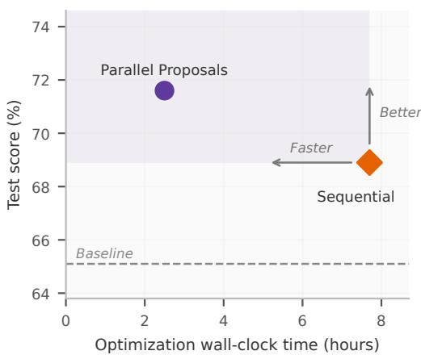

HoVer (3k metric calls)  
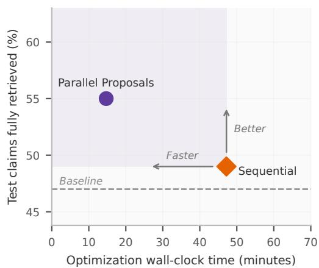  
Figure 1: At the same metric-call budget, parallel proposals are faster and better than single mutation, achieving up to about a 3 to 4× speedup, while scoring up to 11 points higher on the held-out test set.

## 1 Introduction

Optimizing an agentic AI system is itself a resource problem. Reflective optimizers such as GEPA [Agrawal et al., 2026] improve an agent by proposing textual mutations of its prompts or code, scoring them with rollouts, and keeping the winners, so a run consumes LLM calls, dollars, and, above all, wall-clock time. GEPA is sample-efficient in the number of rollouts it needs, but its loop is sequential. Running GEPA on a task can take hours because each optimization step waits for a proposal and its evaluation before the next step begins. In each iteration, GEPA samples a parent, proposes a mutation, evaluates it on a mini-batch, and, if it improves on its parent, evaluates it on the full validation set.

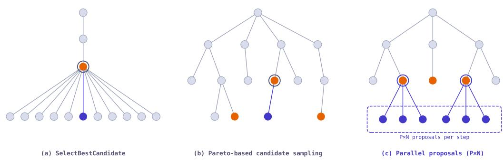  
Figure 2: From best-candidate selection to parallel proposals. SelectBestCandidate extends only the current best candidate, GEPA’s Pareto-based candidate sampling explores a broader tree one proposal at a time, and parallel proposals (P×N) extend several frontier candidates at once.

We extend GEPA with batched parallel proposals. Instead of advancing one proposal at a time, a step can propose several candidates and dispatch their evaluations concurrently. This allows for evaluating more proposals at a time, so the same budget of metric calls finishes in less wall-clock time, and it delivers better results, by exploring more of the search tree per step. In our experiments, batching cut the wall-clock time by roughly 3 to 4×, while raising held-out test scores from 68.9% to 72.1% on LiveBench-Math and from 49.0% to 60.0% on HoVer (Figure 1).

Faster and better optimization makes GEPA more accessible and practical for more tasks, and lets users spend more budget in the same amount of time. Beyond the batching mechanism itself, we also introduce the axes of parallel scaling in reflective optimization, a potential area for future study (Appendix A).

## 2 How parallel proposals work

The mechanism is closely analogous to batch Bayesian optimization [Ginsbourger et al., 2010], which proposes and evaluates a batch of candidates per round rather than adapting after every single one. Similar to how GEPA uses a Pareto frontier instead of a single best numerical score to select candidates, parallel proposals push the idea further by drawing several extensions of the frontier within each step (Figure 2), thus reducing how often the search adapts to the validation set. Prior work [Dwork et al., 2015] also shows that repeatedly steering decisions with one fixed holdout can inflate its apparent performance, so committing to more proposals simultaneously should transfer better beyond the validation set.

Standard GEPA advances one proposal per step, extending a single candidate drawn from its Pareto frontier. Parallel proposals sample several parents from the frontier, draw several reflective mutations of each, and score all of the proposals concurrently (Figure 3).

In our P×N sampling strategy, one GEPA step

1. samples P parents from the current Pareto frontier;

2. draws N mini-batches per parent and evaluates each parent on them through batch\_evaluate(), producing P · N reflection requests;

3. dispatches the reflection requests concurrently;

4. screens the proposals by batch-evaluating them again on their mini-batches;

5. evaluates accepted candidates on the full validation set in parallel, then updates the frontier.

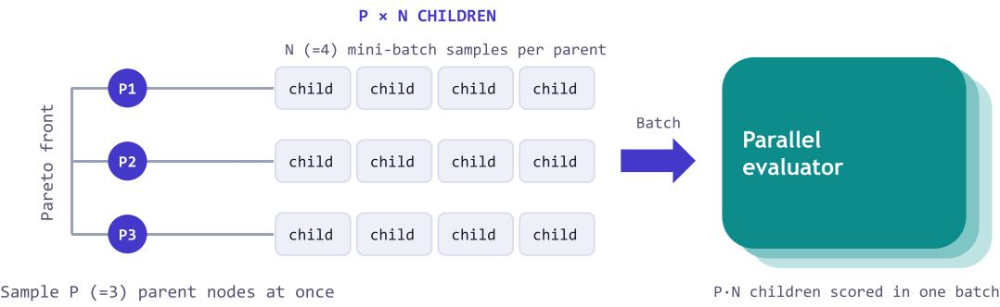  
Figure 3: One batched iteration. GEPA samples $P$ parents from the frontier, draws N reflective mutations for each parent, and scores all P · N children in one parallel evaluation. This lets GEPA propose more candidates in each iteration while paying the iteration latency once.

## 3 Runtime analysis

Write $T ( k )$ for the wall-clock time of a run with $k = P$ · N proposals per step, so that $T ( 1 )$ is a single-mutation run. It is the sum of the time spent on each iteration. Every iteration incurs a step latency $L _ { \mathrm { s t e p } }$ for the k reflection calls and k mini-batch evaluations, which run concurrently. Whenever one or more proposals beat their parent on the mini-batch, the iteration additionally pays a full-validation latency $\bar { L } _ { \mathrm { v a l } }$ to evaluate all accepted proposals on the validation set in parallel.

The metric-call budget determines the total number of proposals a run can afford, whether parallel or sequential (if we assume the candidate acceptance rate stays the same). The number of iterations is the number of proposals divided by k, so a width-k run needs about $1 / k$ as many iterations as single mutation. The main bottleneck is full validation. If each proposal is accepted with probability a, and proposal outcomes are independent, then an iteration triggers full validation with probability

$$
q _ { k } = 1 - ( 1 - a ) ^ { k } ,\tag{1}
$$

which grows with k. Multiplying the per-iteration cost by the number of iterations gives the speedup of a width-k run over single mutation,

$$
\frac { T ( 1 ) } { T ( k ) } \approx \frac { k \left( L _ { \mathrm { s t e p } } + a L _ { \mathrm { v a l } } \right) } { L _ { \mathrm { s t e p } } + q _ { k } L _ { \mathrm { v a l } } } .\tag{2}
$$

In practice, two effects slow wide steps down. First, the reflection stage takes as long as the slowest of its k concurrent calls, so $L _ { \mathrm { s t e p } }$ grows with width. Second, evaluation can be limited by the worker pool. A validation stage can carry up to k accepted candidates, each evaluated on all $\check { V }$ validation examples, so with W concurrent workers and a per-rollout latency of $T _ { e } .$

$$
L _ { \mathrm { v a l } } \approx { \left\{ { T _ { e } } \atop \left( k V / W \right) { T _ { e } } \right. }  \mathrm { i f } k V \leq W ,\tag{3}
$$

The predicted curve in Figure 4 uses the expected number of accepted candidates, ak, in place of the worst case k, so its validation term per iteration is ma $\natural ( q _ { k } L _ { \mathrm { v a l } } , \ \dot { a } k V T _ { e } / W )$ with $L _ { \mathrm { v a l } }$ evaluated at width one, and it holds $L _ { \mathrm { s t e p } }$ fixed at its measured single-mutation value.

According to strong scaling [Amdahl, 1967], a run with a budget of B metric calls needs at least $\boldsymbol { B } \cdot \boldsymbol { T _ { e } } / \boldsymbol { \bar { W } }$ of wall-clock time for evaluation alone when W is fixed. This bound is most relevant for system-bound workloads, where available CPU or cluster capacity is genuinely fixed. In agent optimization workloads evaluated against large-scale inference services, however, the worker pool can often be increased substantially. By raising the number of workers in the pool, we expect to further lower this bound.

## 4 Results

We evaluated parallel proposals on LiveBench-Math [White et al., 2025] and HoVer [Jiang et al., 2020], where the optimized agent is selected using a validation set and then measured on a held-out test set. For both tasks, we used gpt-5-mini as the proposer. As in standard GEPA runs, we measured the optimization budget by the number of metric calls. One metric call corresponds to evaluating one candidate on one example. Every setting on a task received the same total metric-call budget. LiveBench-Math optimizes a single solver prompt over competition math problems with a budget of 5,000 metric calls, and HoVer optimizes the two components of a four-hop retrieval agent over a multi-hop claim verification corpus with a budget of 3,000 metric calls. Appendix B gives the full task setups, splits, and metrics.

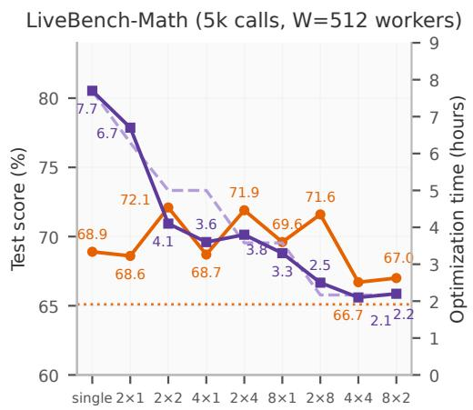

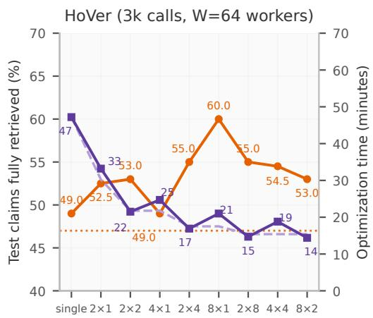  
Figure 4: As the per-step width P · N scales up, runtime falls with diminishing returns. The finiteworker prediction matches the measured runtimes. Most settings perform as well as or better than single mutation on test, and the best setting scores much higher.

## 4.1 Batching cuts the wall-clock time and scores higher on held-out tests

We ran evaluations with up to 512 concurrent workers on LiveBench-Math and 64 on HoVer. The measured runs (Figure 4) align with the runtime model above, cutting the wall-clock time by about 3 to 4× at 16-way parallelism. For example, on LiveBench-Math, moving from single mutation to 2×2 cut the number of iterations by 4.9× (219 to 45), but the fraction of iterations that triggered full validation rose from 17% to 53%, so the run gained a 1.9× speedup (7.7 to 4.1 hours).

Figure 4 also shows that most batched settings match or beat single mutation on the held-out tests, and the best settings reach 72.1% against 68.9% on LiveBench-Math (2×2) and 60.0% against 49.0% on HoVer (8×1).

## 4.2 Scaling parents (P) vs. mutations (N)

In principle, larger P extends more members of the frontier at once, which should help when no single generally good candidate exists and the frontier holds genuinely different specialists worth advancing in parallel, and larger N draws more mutations with different mini-batches, which should help when the dataset is rich enough to expose many distinct directions to improve one candidate. LiveBench-Math is the second case, with problems spanning multiple areas, so giving each parent several mutations (larger N) transferred better to test than spreading single mutations across more parents (larger P). HoVer additionally keeps a more complementary candidate pool, where different candidates succeed on different claims, and its test scores tend to grow with both P and N. With P held at 2, test scores rise with N from 68.6 at 2×1 to 71.6–72.1 at 2×2 through 2×8 on LiveBench-Math, and from 52.5 to 55.0 on HoVer (as shown in Figure 4). Generally, we observe scaling N improves performance on both tasks, even though the highest-scoring split remains task-dependent (2×2 on LiveBench-Math, 8×1 on HoVer). We leave further ablations on other budgets and parallelisms for future work.

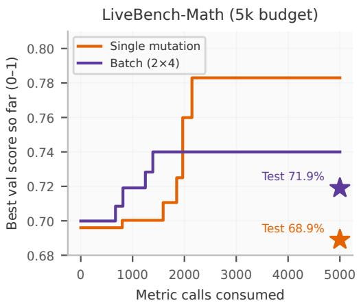

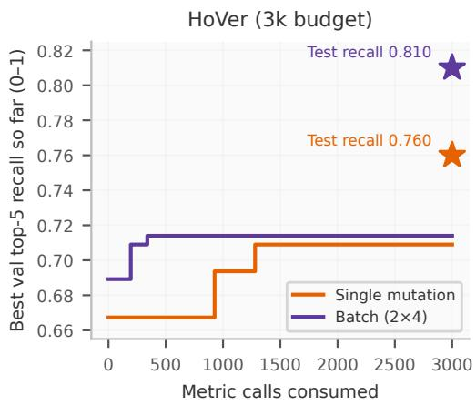  
Figure 5: Best validation quality against metric calls consumed, for single mutation and 2×4. 2×4 dominates small budgets and scores higher on the held-out test set.

## 4.3 Batched settings are more budget-efficient

We also probed how efficiently each setting spends its budget during the run. Here we compare a batched setting, 2×4, against single mutation on both tasks.

More quality per metric call. 2×4 dominates small budgets. On LiveBench-Math it reaches validation scores that single mutation needs about 2,000 calls to match, and on HoVer it leads at every budget (Figure 5). Single mutation raises validation scores later in the budget, but still scores lower on the held-out test set on both tasks.

On the held-out test sets, 2×4 won 3.0pp over single mutation on LiveBench-Math and 6.0pp on HoVer. The validation scores tell a different story. On LiveBench-Math, single mutation scored higher on validation but lower on test. Its generalization gap (the drop from validation score to test score) was nine points, against only two for 2×4. On HoVer, both settings’ test scores landed above their validation scores, and 2×4 ended higher on both. This is consistent with the hypothesis above, that committing to more proposals before adapting to the validation set transfers better beyond it.

More quality per dollar. By measuring the total LLM spend during optimization (sum of solver calls and reflection calls), we found that the batched setting is also cost-efficient, reaching strong validation scores within the first few dollars (Figure 6). On LiveBench-Math, 2×4 reaches its final validation score within about \$4 of spend, and on HoVer it passes single mutation’s final validation score within about \$2.6. The total spend stays comparable across settings, within the \$12 to \$16 range.

## 5 Related work

Compile-time optimizers for LLM programs, including the DSPy family [Khattab et al., 2024, Opsahl-Ong et al., 2024] and reflective evolution in GEPA [Agrawal et al., 2026], treat prompts and program text as the parameters of an agentic system; evolutionary search with LLM mutation operators likewise drives systems such as AlphaEvolve [Novikov et al., 2025]. Our batching strategy adapts a classical idea from batch Bayesian optimization [Ginsbourger et al., 2010], where the optimizer commits to several evaluations per round instead of adapting after each one. The generalization behavior we observe connects to adaptive data analysis, where limiting the number of adaptive rounds against a fixed holdout preserves validity [Dwork et al., 2015, Blum and Hardt, 2015]. Finally, allocating a fixed budget across the width and depth of an optimization step echoes work on scaling test-time compute [Snell et al., 2024], applied here to the optimization loop rather than to a single query.

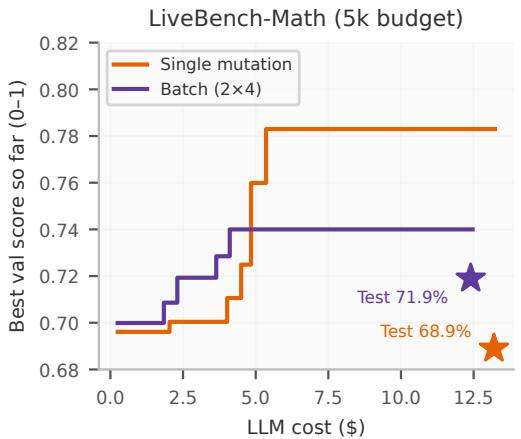

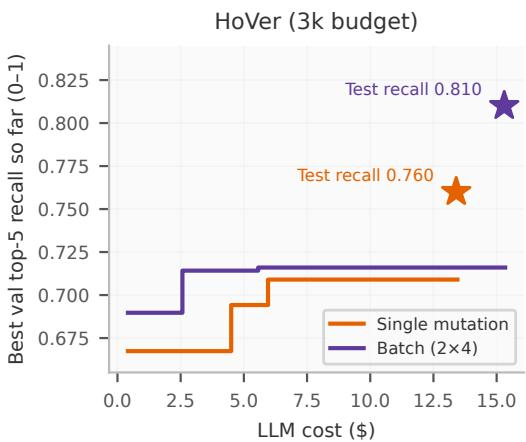  
Figure 6: Best validation quality against total LLM spend, solver and reflection calls combined. The batched setting reaches strong validation quality within the first few dollars.

## 6 Conclusion

Parallel proposals batch GEPA’s reflective optimization loop. Across LiveBench-Math and HoVer, batched settings cut optimization wall-clock time by about 3 to 4×, most of them matched or beat single mutation on held-out tests, and a batched setting reached strong validation quality with fewer metric calls and fewer dollars. A simple runtime model predicts the measured speedups and shows where the remaining time goes. The axes of parallel scaling (Appendix A) frame the open question of how to allocate a fixed optimization budget across parents, mutations, reflection mini-batches, and reflection compute. Our implementation builds on the open-source gepa package as a plug-in sampling strategy (Appendix C).

## References

Lakshya A Agrawal, Shangyin Tan, Dilara Soylu, Noah Ziems, Rishi Khare, Krista Opsahl-Ong, Arnav Singhvi, Herumb Shandilya, Michael J Ryan, Meng Jiang, Christopher Potts, Koushik Sen, Alexandros G. Dimakis, Ion Stoica, Dan Klein, Matei Zaharia, and Omar Khattab. GEPA: Reflective prompt evolution can outperform reinforcement learning. In International Conference on Learning Representations (ICLR), 2026. URL https://arxiv.org/abs/2507.19457.

Gene M. Amdahl. Validity of the single processor approach to achieving large scale computing capabilities. In Proceedings ofthe April 18-20, 1967, Spring Joint Computer Conference, AFIPS ’67 (Spring), pages 483–485, New York, NY, USA, 1967. Association for Computing Machinery. ISBN 9781450378956. doi: 10.1145/1465482.1465560. URL https://doi.org/10.1145/ 1465482.1465560.

Avrim Blum and Moritz Hardt. The Ladder: A reliable leaderboard for machine learning competitions. In Proceedings ofthe 32nd International Conference on Machine Learning (ICML), volume 37 of PMLR, pages 1006–1014, 2015. URL https://arxiv.org/abs/1502.04585.

Cynthia Dwork, Vitaly Feldman, Moritz Hardt, Toniann Pitassi, Omer Reingold, and Aaron Roth. The reusable holdout: Preserving validity in adaptive data analysis. Science, 349(6248):636–638, 2015. doi: 10.1126/science.aaa9375. URL https://www.science.org/doi/abs/10.1126/ science.aaa9375.

David Ginsbourger, Rodolphe Le Riche, and Laurent Carraro. Kriging is well-suited to parallelize optimization. In Yoel Tenne and Chi-Keong Goh, editors, Computational Intelligence in Expensive Optimization Problems, pages 131–162. Springer Berlin Heidelberg, Berlin, Heidelberg, 2010. ISBN 978-3-642-10701-6. doi: 10.1007/978-3-642-10701-6\_6. URL https://doi.org/10. 1007/978-3-642-10701-6\_6.

Yichen Jiang, Shikha Bordia, Zheng Zhong, Charles Dognin, Maneesh Singh, and Mohit Bansal. HoVer: A dataset for many-hop fact extraction and claim verification. In Trevor Cohn, Yulan He, and Yang Liu, editors, Findings of the Association for Computational Linguistics: EMNLP 2020, pages 3441–3460, Online, November 2020. Association for Computational Linguistics. doi: 10.18653/v1/2020.findings-emnlp.309. URL https://aclanthology.org/2020. findings-emnlp.309/.

Omar Khattab, Arnav Singhvi, Paridhi Maheshwari, Zhiyuan Zhang, Keshav Santhanam, Sri Vardhamanan, Saiful Haq, Ashutosh Sharma, Thomas T. Joshi, Hanna Moazam, Heather Miller, Matei Zaharia, and Christopher Potts. DSPy: Compiling declarative language model calls into selfimproving pipelines. In International Conference on Learning Representations (ICLR), 2024. URL https://arxiv.org/abs/2310.03714.

Hanchen Li, Runyuan He, Qizheng Zhang, Changxiu Ji, Qiuyang Mang, Xiaokun Chen, Lakshya A Agrawal, Wei-Liang Liao, Eric Yang, Alvin Cheung, James Zou, Kunle Olukotun, Ion Stoica, and Joseph E. Gonzalez. Combee: Scaling prompt learning for self-improving language model agents, 2026. URL https://arxiv.org/abs/2604.04247.

Alexander Novikov, Ngân Vu, Marvin Eisenberger, Emilien Dupont, Po-Sen Huang, Adam Zsolt Wag-˜ ner, Sergey Shirobokov, Borislav Kozlovskii, Francisco J. R. Ruiz, Abbas Mehrabian, M. Pawan Kumar, Abigail See, Swarat Chaudhuri, George Holland, Alex Davies, Sebastian Nowozin, Pushmeet Kohli, and Matej Balog. AlphaEvolve: A coding agent for scientific and algorithmic discovery, 2025. URL https://arxiv.org/abs/2506.13131.

Krista Opsahl-Ong, Michael J Ryan, Josh Purtell, David Broman, Christopher Potts, Matei Zaharia, and Omar Khattab. Optimizing instructions and demonstrations for multi-stage language model programs. In Yaser Al-Onaizan, Mohit Bansal, and Yun-Nung Chen, editors, Proceedings of the 2024 Conference on Empirical Methods in Natural Language Processing (EMNLP), pages 9340– 9366, Miami, Florida, USA, November 2024. Association for Computational Linguistics. doi: 10.18653/v1/2024.emnlp-main.525. URL https://aclanthology.org/2024.emnlp-main. 525/.

Charlie Snell, Jaehoon Lee, Kelvin Xu, and Aviral Kumar. Scaling LLM test-time compute optimally can be more effective than scaling model parameters, 2024. URL https://arxiv.org/abs/ 2408.03314.

Colin White, Samuel Dooley, Manley Roberts, Arka Pal, Benjamin Feuer, Siddhartha Jain, Ravid Shwartz-Ziv, Neel Jain, Khalid Saifullah, Sreemanti Dey, Shubh-Agrawal, Sandeep Singh Sandha, Siddartha Naidu, Chinmay Hegde, Yann LeCun, Tom Goldstein, Willie Neiswanger, and Micah Goldblum. LiveBench: A challenging, contamination-limited LLM benchmark. In International Conference on Learning Representations (ICLR), 2025. URL https://arxiv.org/abs/2406. 19314.

## A Axes of parallel scaling

Parallel proposals fit into the bigger picture of scaling each reflection optimization step along several axes (Figure 7). P controls how many programs are selected for mutation at each step, and N controls how many mutations are proposed for each selected program. A third axis is the size of the reflection mini-batch per mutation. Approaches like ComBEE [Li et al., 2026] scale along this axis by reflecting on larger mini-batches of examples and rollouts through a map-reduce-style pipeline. Finally, a fourth axis is the compute spent within each reflection step. It can be turned up by using stronger reflection programs ranging from a single LM call to chain-of-thought, multi-step pipelines, or agentic workflows such as Claude Code.<sup>2</sup> In each case, more compute is spent to produce a higher-information mutation at each step.

With this, GEPA offers four independently tunable dials for spending more optimization compute per step, namely P, N, reflection mini-batch (ComBEE), and reflection compute (reflection LM, agentic proposers). They interact through a shared optimization budget (metric calls, tokens, or dollars). Parallel proposals are one way to spend it. The open question is how to allocate a fixed optimization budget across these dials, and this work is a first look at that trade-off.

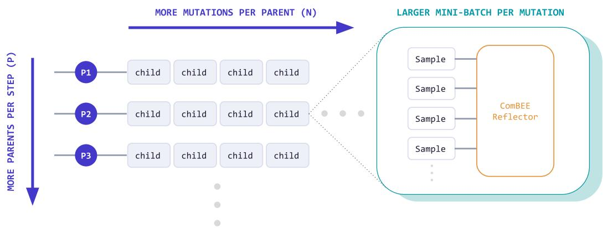  
Figure 7: Scaling axes for the optimization step: more parents per step (P), more mutations per parent (N), and a larger reflection mini-batch per mutation (ComBEE).

## B Task setup details

LiveBench-Math. LiveBench-Math [White et al., 2025] asks a model to solve competition math problems (AMC and AIME questions, symbolic algebra, and olympiad problems), graded by LiveBench’s own scorers, with the Terrarium<sup>3</sup> split of 100 training, 100 validation, and 168 test problems. Budget: 5,000 metric calls, each one a gpt-4.1-mini solution attempt.

HoVer. HoVer [Jiang et al., 2020] asks a system to gather the Wikipedia pages needed to verify a multi-hop claim. We optimize the two components (a query writer and a note taker) of a four-hop gpt-4.1-mini retrieval agent over a BM25 index of 5.2 million 2017 Wikipedia abstracts, on three-hop claims split into 200 training, 150 validation, and 200 test claims; one rollout makes about eight calls. During optimization, GEPA scores each rollout by the fraction of the claim’s three gold pages that appear in the retrieved pages (top-5 recall), as shown by the validation curves and test stars in Figures 5 and 6. The headline numbers in the text and in Figures 1 and 4 are the share of test claims with all three gold pages retrieved. Budget: 3,000 metric calls, each one a full program rollout.

## C Using parallel proposals

Our implementation plugs into the sampling-strategy interface of the open-source gepa engine and is enabled with the setting change below. The sampling strategy says how many candidates to propose per step, and the selection strategy says which of the improved candidates to keep. For example, two parents with two mutations each gives four candidates per step.

```python
from gepa.optimize_anything import optimize_anything, OptimizeAnythingConfig
from gepa.strategies.proposal_sampling import PxNSampling
from gepa.strategies.proposal_selection import AllImprovements
config = OptimizeAnythingConfig(
engine="gepa",
max_concurrency=64,
engine_config={
"engine": {
"sampling_strategy": PxNSampling(p=2, n=2),
"selection_strategy": AllImprovements(),
},
"reflection": {"reflection_lm": "gpt-5-mini"},
},
)
```

result = optimize\_anything( seed\_candidate=seed, evaluator=evaluate, dataset=trainset, valset=valset, objective=objective, config=config,   
)

GEPA by default calls the user-supplied evaluate function in parallel, so max\_concurrency should be set high enough to match the capacity of the evaluator and inference provider. For system-bound evaluations, max\_concurrency may be constrained by available CPU, GPU, or cluster capacity. For API-backed optimization, much larger worker pools may be practical, subject to provider rate limits and budget. Optionally, users may provide a custom batch\_evaluate function via the batch\_evaluator argument. Since the GEPA engine remains single-threaded and dependencyfree, the choice of parallelism is entirely up to the user. Any concurrency or distributed-execution framework (Harbor, Ray, Slurm, Modal, Daytona, and more) can run the evaluations, and any inference backend that supports batch completion to run reflections in parallel, with no changes to GEPA itself. Users may also choose or define other sampling and selection strategies.