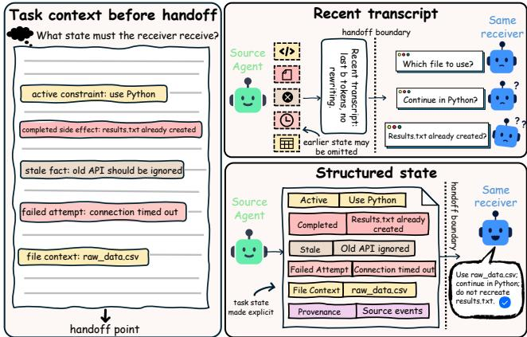
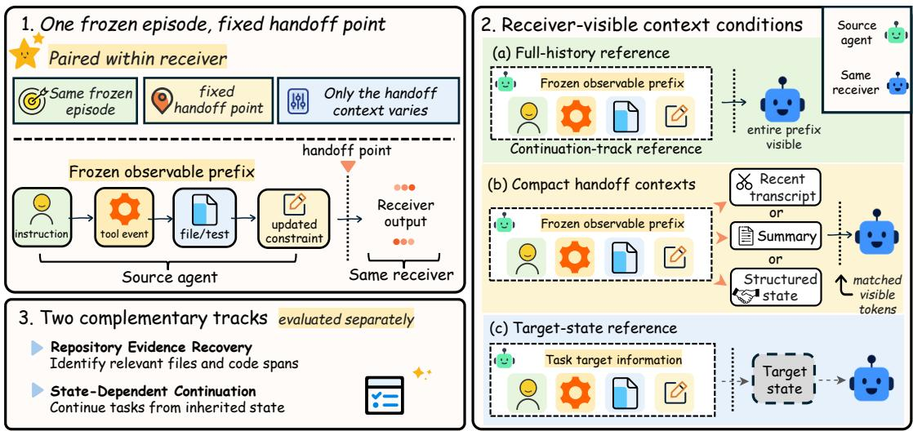
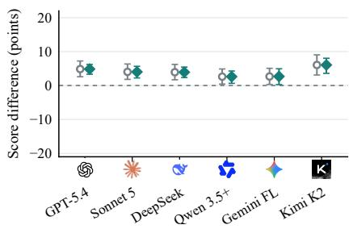
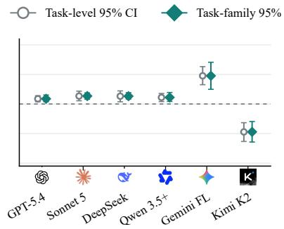
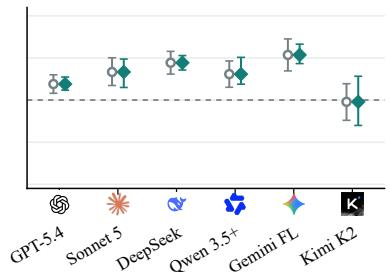
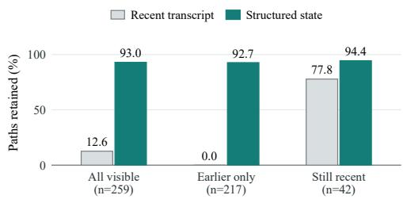
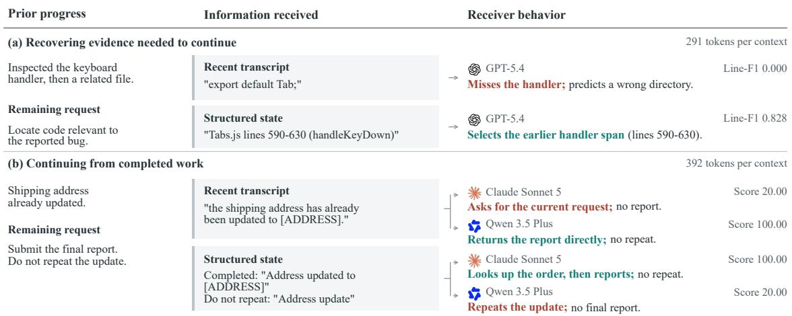
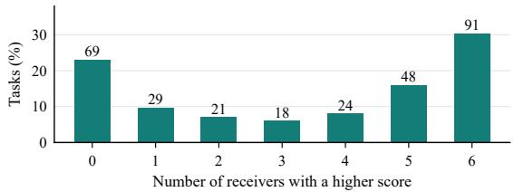
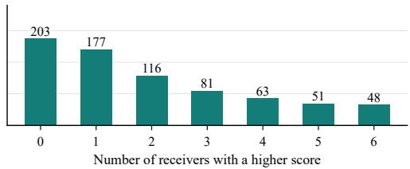
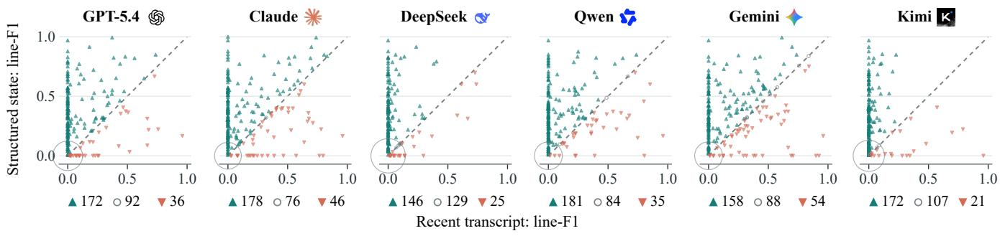

# Benchmarking Task Takeover Across Agent Handofs

Wenyuan Li   
Hokkaido University   
Sapporo, Japan

Keisuke Maeda Hokkaido University Sapporo, Japan

Guang Li∗   
Hokkaido University   
Sapporo, Japan

Takahiro Ogawa Hokkaido University Sapporo, Japan

Dongyuan Li The University of Tokyo Tokyo, Japan

Miki Haseyama Hokkaido University Sapporo, Japan

## Abstract

As agents collaborate on longer tasks, responsibility may pass be tween models before the work is complete. The receiving model must build on prior decisions, observations, and actions while ad dressing the remaining requirements. Evaluating this transition requires connecting the information preserved at handof to how the receiver continues the work, a relationship that task-success and memory-retention scores alone do not capture. We introduce the Handof State Continuity Benchmark (HSC-Bench), comprising 1,039 tasks that evaluate two complementary aspects of task takeover: recovering relevant repository evidence and continuing from established conversational, tool, and file-work state. Comparisons across six receiving models show that structured handof state improves repository evidence recovery for every model and continuation performance for most models. The strongest receivers difer between the two tracks, showing that evidence-recovery rankings alone do not characterize performance when continuing from inherited state. By combining these comparisons with checks of subsequent responses and actions, HSC-Bench evaluates both access to prior evidence and adherence to established commitments and completed work. This provides a basis for selecting receiving models and assessing handof representations according to the work that must be carried forward.

## CCS Concepts

• Computing methodologies → Artificial intelligence.

## Keywords

Agent handof, task takeover, state continuity, agent evaluation

Relevance Statement. This work addresses the Semantics and Knowledge track by studying knowledge continuity across LLM agent handofs. HSC-Bench evaluates how structured task state supports evidence recovery and continuation from prior decisions and actions. These capabilities are essential for reliable Web-based agentic workflows.

## 1 Introduction

Web agents gather information and perform actions [1, 15, 26] across workflows that may involve multiple models [5, 31]. When responsibility shifts before a task is finished, the receiving model inherits a partially completed process: earlier interactions have established decisions, accumulated evidence, and changed the environment. These developments determine what remains to be done and which next steps are appropriate. For example, a confirmed user choice should guide subsequent work, while a completed service operation may no longer need to be performed. We study task takeover: how a receiving model continues another agent’s unfinished work from the progress already made, as illustrated in Figure 1.

  
Figure 1: Task takeover from a shared history. A recent transcript may omit earlier decisions and completed work, leaving the receiver uncertain about the next step. Structured state preserves this information explicitly: in the illustrated example, the receiver identifies the required input, follows the established constraint, and recognizes that an output has already been created. The comparison holds the receiving model and visible token count fixed.

Evaluating task takeover requires connecting this inherited progress to the receiver’s subsequent behavior. Agent benchmarks assess task completion and policy compliance [27, 34], while interactivememory benchmarks examine the retrieval and use of accumulated or revised information [30]. These perspectives provide relevant measures, but neither a final outcome nor successful recall alone establishes whether a receiver has continued appropriately from the handof point. The evaluation must also account for what was already settled, what remained unresolved, and how those conditions shaped the receiver’s response. This calls for making the state at handof explicit and assessing both the recovery of relevant evidence and the consistency of subsequent responses and actions with that state.

We operationalize these requirements through two complementary evaluation targets. Evidence recovery measures whether the receiver can identify task-relevant information from the inherited context, using annotated repository files and code spans as references [14]. State-dependent continuation measures whether subsequent responses and actions satisfy the requirements of the inherited task state, including maintaining valid commitments, incorporating updated facts, and accounting for completed operations. The two targets provide separate measures of what a receiver recovers from prior work and how it continues from that work.

We instantiate these evaluation targets in HSC-Bench, a benchmark of 1,039 tasks. Its repository track pairs recorded coding-agent trajectories with ContextBench annotations [14], yielding 300 tasks across 38 repositories. Its continuation track comprises 739 synthetic tasks covering conversational state, tool use, and reported file-work state, with explicit targets for evaluating subsequent responses and actions.

We evaluate six receiving models, including GPT-5.4 and Kimi K2, using shared source histories and fixed handof points, so that each model takes over the same prior work. To examine the efect of inherited context, we pair recent transcripts with structured state at the same visible token count, holding the receiver and task request fixed. This design supports comparisons across receiving models and within-model estimates ofhow their performance changes with the context provided at handof.

The results show that evidence recovery and continuation reveal complementary strengths of receiving models. Structured state improves repository recovery across all evaluated models and continuation performance for most, but the leading models difer between the two tracks. A receiver’s strength in locating relevant evidence therefore provides only part of the basis for choosing it to continue unfinished work. These findings motivate assessing handof repre sentations together with the models that use them, judging their value by both the evidence recovered and the subsequent responses and actions required by the inherited task state.

To summarize, our contributions are as follows.

• We introduce HSC-Bench, comprising 1,039 tasks that combine recorded repository work with synthetic continuation scenarios covering conversational state, tool use, and reported file-work state.

• We develop an evaluation protocol that scores recovered evidence against annotated code locations and checks whether subsequent responses and actions preserve valid commitments, incorporate updated facts, and respect completed operations.

• We show that structured state improves repository evidence recovery across all six receiving models and continuation performance for most, while the leading models difer between the two evaluation tracks, highlighting their complementary roles in assessing how receivers recover relevant evidence and continue from inherited task state.

## 2 Related Work

## 2.1 Agent Evaluation

Agent benchmarks evaluate whether models can complete tasks and satisfy the requirements of their environments [3, 18, 37]. SWE bench examines issue resolution in real repositories [8], while the Berkeley Function Calling Leaderboard evaluates function selection and execution [23]. In stateful environments, success also depends on how actions afect subsequent steps. ToolSandbox evaluates intermediate and final milestones [19], and �-bench checks the resulting database state together with required user-facing information [34]. These benchmarks connect agent behavior to observable outcomes and constraints.

More fine-grained evaluation examines which requirements an agent satisfies within a task. This includes distinguishing task completion from subtask progress and atomic capabilities in Color-Bench [27], assessing scholarly search and reading operations in PaperAsk [32], and checking retrieved product evidence against individual preferences in AgenticShop [12]. We build on this emphasis on specific requirements to evaluate a receiving model’s continuation of prior work. At a handof, some requirements have already been satisfied, while earlier decisions and actions constrain how the remaining work should proceed. HSC-Bench evaluates the receiver relative to this inherited progress, examining whether its subsequent responses and actions satisfy the requirements that apply at the handof.

## 2.2 Interactive Memory

Interactive memory enables agents to draw on information accumulated across earlier interactions. Memory tiers, retrieval guided by global memory, and history organization for personalized generation ofer diferent ways to make this information accessible [20, 21, 24, 29, 35, 36]. Evaluating memory also requires examining how retrieved information is used [22]. LongMemEval separates retrieval from reading and tests reasoning across sessions, temporal changes, and knowledge updates [30]. Related long-context studies show that performance depends on evidence position and input length, including when relevant information is successfully retrieved [4, 16]. Together, these studies motivate evaluating both access to prior information and its contribution to subsequent responses.

Under a limited context budget, this distinction also shapes how memory is compressed. Prompt compression selects which information remains available [6, 7], while failure-guided compression and continuation-based summary validation assess how the retained information supports later work [2, 9]. Task takeover adds a specific requirement to the use of prior information: earlier decisions and completed actions establish what the receiving model should do next. HSC-Bench examines whether the context passed between agents supports continuation consistent with these commitments and prior progress, connecting memory evaluation to the requirements of an unfinished task.

## 2.3 Evidence Recovery and Agent Handofs

Evaluating task takeover requires references for both the evidence relevant to a task and the progress made before the handof. In repository work, annotated files and code spans provide a basis for measuring evidence recovery [14], while budgeted context restoration evaluates retrieval with a shared synthesis model [25]. Execution traces complement these references by recording how the task reached its current state; reconstructing state transitions can help locate failures within that process [13]. Our repository track uses ContextBench annotations to evaluate the evidence recovered from recorded work at a fixed handof point.

Studies of agent handofs examine how prior work afects a model that resumes an unfinished task. Dialogue and coding settings reveal changes in continuation performance, rediscovery costs, and issue resolution after a handof [10, 11]. Checkpoint-based evaluation further distinguishes reaching a useful task state from successfully solving the task from that state [17]. Our focus is on comparing receiving models under shared handof conditions. HSC-Bench holds the source history and handof point fixed across receivers and evaluates two complementary targets: recovering annotated repository evidence and satisfying explicit requirements when continuing from inherited task state. This provides a common basis for examining how receiver performance difers between identifying relevant prior information and carrying forward established progress.

## 3 HSC-Bench

Each task in HSC-Bench begins with a recorded history of work performed by a source agent. At a fixed handof point, we prepare the context provided to receiving models, using GPT-4.1 as the fixed model for constructing structured state and narrative summaries. Receivers share the same source history, handof point, and prepared context within each condition, allowing their performance to be compared on the same inherited work. The benchmark comprises 300 repository evidence-recovery tasks and 739 state-dependent continuation tasks (Figure 2).

## 3.1 Repository Evidence Recovery Track

The repository track evaluates whether a receiving model can identify code relevant to an unresolved issue from the issue description and inherited context. We pair issues and code-location annotations from ContextBench [14] with GPT-5 trajectories released in Code-TraceBench [13]. The resulting 300 tasks span 38 repositories and eight programming languages. Appendix A details source selection and construction.

We place the handof after ten complete action–observation pairs and prepare the receiver’s context from the preceding history. The receiver predicts relevant files and line spans, which are scored against the withheld annotations using line-F1. The annotations cover the whole issue and may include relevant locations that do not appear in the pre-handof history.

To examine how recovery performance varies with the visibility of these historical cues, we group tasks according to whether an notated file paths appear in the pre-handof history and the recent transcript. In 217 tasks, at least one annotated path appears in the history but none remains in the recent transcript; 42 tasks retain at least one annotated path in the recent transcript; and 41 contain none in the pre-handof history.

## 3.2 State-Dependent Continuation Track

The continuation track evaluates how a receiving model carries for ward unfinished work. Its 739 synthetic tasks cover conversational state, tool use, and reported file-work state. Following a recorded GPT-5 source history, the receiver continues through prescribed user and environment messages, with explicit requirements for its responses and actions.

Table 1: Controlled tasks and per-task scoring criteria.
<table><tr><td>Task type</td><td>Tasks</td><td>Criteria</td></tr><tr><td>Conversational state</td><td>205</td><td>17</td></tr><tr><td>Tool state</td><td>386</td><td>10</td></tr><tr><td>File-work progress</td><td>148</td><td>8</td></tr><tr><td>Total</td><td>739</td><td>1</td></tr></table>

Conversational state. Established choices can remain valid even as other facts change. A project brief, for example, may retain its selected plan after the user revises the target region. These tasks ask the receiver to report the resulting conversational state, preserving prior commitments while incorporating updated facts and excluding obsolete values.

Tool state. Completed operations determine which actions remain necessary. In a stateful order-service simulator, an address update performed before the handof should inform how the receiver handles subsequent requests. The receiver can call tools and must report the order and operation states. Evaluation examines both this report and the tool-call record, distinguishing recognition of a completed update from avoidance of repeating it.

File-work state. An unfinished coding task leaves a record of progress and unresolved questions, including file changes, test outcomes, failed attempts, and working hypotheses. These tasks present that record through messages and ask the receiver to maintain a structured progress report as further information arrives. The report must preserve the required work details and edit boundaries. The evaluated output is this report; receivers do not modify files or execute tests.

Each task is evaluated using a fixed set of binary criteria. Each criterion checks whether a specific requirement concerning task state, actions, or the requested output is satisfied, using the relevant response fields or interaction records. The task score is the proportion of criteria satisfied. Table 1 reports the number of tasks in each type and the number of criteria applied to each task. Appendix B describes the scoring criteria.

## 3.3 Task Construction and Screening

For the continuation track, GPT-5.4 generates candidate task specifications and supplies diagnostic responses and screening judgments. Each specification contains user and environment messages, target states, and supporting information. We check these specifications for internal consistency, clarity, and plausibility before assessing their dependence on prior information.

Screening asks whether a task requires the intended history and whether its targets are attainable with suficient context. We probe the former using only the final request, user messages, or output schema, and the latter using full history or target-state information. Recent-transcript probes additionally assess dificulty under limited context. Of 1,130 candidates, 739 meet the screening criteria and enter the continuation track. GPT-5 then generates the shared source histories used for receiver evaluation. Appendix A provides the screening thresholds.

  
Figure 2: Overview of HSC-Bench. Shared source histories and fixed handof points support comparisons across receivers and paired comparisons of context conditions within each receiver. Recent transcripts and structured state are evaluated on both tracks for all six receivers. GPT-4.1 constructs narrative summaries and structured state from observable history, with compact contexts matched in visible token count. The continuation track additionally evaluates full history for all six receivers, and narrative summaries and a target-state reference for GPT-5.4. The target-state reference supplies privileged task targets. The two tracks assess repository evidence recovery and state-dependent continuation separately.

## 4 Evaluation Protocol

We compare receiving models on the same recorded tasks and examine how their performance changes under diferent handof context conditions.

## 4.1 Models and Context Conditions

The shared evaluation compares six receivers: GPT-5.4, Claude Sonnet 5, DeepSeek V3.2, Qwen 3.5 Plus, Gemini 3.5 Flash Lite, and Kimi K2. All six receive recent transcripts and structured state in both tracks. Recent transcripts retain the end of the pre-handof history in its original wording; structured state organizes relevant facts, commitments, prior actions, and remaining work. On the continuation track, all six are also evaluated with the complete pre-handof history.

Supplementary comparisons on GPT-5.4 cover all 739 continuation tasks and add two conditions: narrative summaries, which condense prior work into prose, and a target-state reference, which supplies privileged task targets for diagnostic evaluation. Thus, GPT-5.4 is evaluated with all three compact representations and both reference contexts. We additionally evaluate GPT-5 continuing from its own full history as a source-model reference.

GPT-4.1 constructs summaries and structured state from the task description and observable history, without access to reference annotations or target values. For file-work tasks, only structured-state preparation additionally receives the required output-field names. Recent transcripts and summaries are matched to the structuredstate message’s visible token count for each task. Within-model comparisons keep the task request and scoring rules fixed, vary ing the information selected and how it is presented. Appendix A provides model settings and context preparation details.

## 4.2 Evaluation Metrics

For repository evidence recovery, we report line-F1 as the primary metric and file-F1 as a complementary measure ofwhether receivers identify the relevant files. Both metrics are computed per task and averaged across tasks.

For state-dependent continuation, each task � has $K _ { i }$ binary criteria. Let �� denote the receiver’s response or interaction trace, and let ��� (��) equal 1 if criterion � is satisfied and 0 otherwise. Each criterion uses the designated response fields or interaction records, together with the fixed source history and task targets where required. The task score is the fraction of criteria satisfied:

$$
s _ { i } ( y _ { i } ) = { \frac { 1 } { K _ { i } } } \sum _ { j = 1 } ^ { K _ { i } } c _ { i j } ( y _ { i } ) , \qquad c _ { i j } ( y _ { i } ) \in \{ 0 , 1 \} .\tag{1}
$$

Appendix B details the criteria and their passing conditions.

For a fixed receiver and context condition, we report the mean task score �¯ and the empirical all-criteria pass rate �ˆ over � evaluated tasks:

$$
\begin{array} { l } { \displaystyle \bar { s } = \frac { 1 } { N } \sum _ { i = 1 } ^ { N } s _ { i } ( y _ { i } ) , } \\ { \displaystyle \hat { p } = \frac { 1 } { N } \sum _ { i = 1 } ^ { N } 1 \big [ s _ { i } \big ( y _ { i } ) = 1 \big ] . } \end{array}\tag{2}
$$

Here 1[·] equals 1 when its condition holds and 0 otherwise. We label these metrics Mean and Pass in tables, respectively. The mean score captures partial satisfaction of task requirements, whereas the pass rate requires every criterion within a task to be satisfied.

Overall continuation metrics weight all 739 tasks equally, rather than weighting the three task types equally. We report continuation scores and pass rates on a 0–100 scale and repository F1 scores on a 0–1 scale.

Table 2: Receiver performance on the Repository Evidence Recovery and State-Dependent Continuation tracks, abbreviated as Repository and State-Dependent in the table. Repository scores are line-F1 on 300 tasks; continuation results report mean scores on a 0–100 scale and all-criteria pass rates in percent on 739 tasks. Recent, State, and Full denote recent transcripts, structured state, and full history, respectively. The task-type breakdown reports structured-state mean scores for conversational, tool, and file-work state. Bold indicates the highest value in each column.
<table><tr><td></td><td colspan="2">Repository</td><td colspan="9">State-Dependent</td></tr><tr><td></td><td colspan="2">Line-F1</td><td colspan="3">Mean score</td><td colspan="3">Pass (%)</td><td colspan="3">State by task type (Mean score)</td></tr><tr><td>Receiver</td><td>Recent</td><td>State</td><td>Recent</td><td>State</td><td>Full</td><td>Recent</td><td>State</td><td>Full</td><td>Conv.</td><td>Tool</td><td>File</td></tr><tr><td>GPT-5.4</td><td>0.075</td><td>0.229</td><td>89.73</td><td>92.76</td><td>94.51</td><td>44.7</td><td>52.1</td><td>57.9</td><td>87.63</td><td>96.81</td><td>89.27</td></tr><tr><td>Claude Sonnet 5</td><td>0.121</td><td>0.263</td><td>87.19</td><td>91.05</td><td>92.77</td><td>41.1</td><td>50.2</td><td>52.1</td><td>86.74</td><td>96.61</td><td>82.52</td></tr><tr><td>DeepSeek V3.2</td><td>0.033</td><td>0.189</td><td>85.29</td><td>89.54</td><td>92.65</td><td>35.0</td><td>47.2</td><td>55.3</td><td>85.45</td><td>95.18</td><td>80.49</td></tr><tr><td>Qwen 3.5 Plus</td><td>0.089</td><td>0.250</td><td>86.71</td><td>89.84</td><td>92.37</td><td>36.7</td><td>47.2</td><td>51.6</td><td>85.80</td><td>95.98</td><td>79.39</td></tr><tr><td>Gemini 3.5 Flash Lite</td><td>0.147</td><td>0.261</td><td>77.96</td><td>85.83</td><td>90.65</td><td>30.7</td><td>42.9</td><td>53.9</td><td>86.48</td><td>90.54</td><td>72.64</td></tr><tr><td>Kimi K2</td><td>0.031</td><td>0.192</td><td>82.78</td><td>79.45</td><td>88.90</td><td>27.5</td><td>36.5</td><td>42.2</td><td>83.87</td><td>81.81</td><td>67.15</td></tr></table>

  
(a) Conversational State (n = 205)

  
(b) Tool State (n = 386)

  
(c) File-work State (n = 148)  
Figure 3: Efects of handof context within the State-Dependent Continuation Track. Panels show conversational, tool, and file-work state tasks. Points represent paired mean score diferences, computed as structured state minus recent transcript; positive values favor structured state. Error bars show 95% bootstrap confidence intervals from resampling tasks or task families. Sample sizes appear below each panel. Model abbreviations correspond to Table 2.

## 4.3 Statistical Analysis

To measure how inherited context afects performance, we compare each receiver’s scores on the same tasks under diferent context conditions. Let $y _ { i } ^ { ( S ) }$ and $y _ { i } ^ { ( R ) }$ denote a fixed receiver’s outputs on task � under structured state and recent transcripts, respectively. We use $s _ { i }$ to denote line-F1 for repository tasks and the criterion-based score in Equation 1 for continuation tasks. For � paired tasks, the task-level diference $d _ { i }$ and its mean $\widehat { \Delta }$ are

$$
\begin{array} { l } { { d _ { i } = s _ { i } ( y _ { i } ^ { ( S ) } ) - s _ { i } ( y _ { i } ^ { ( R ) } ) , } } \\ { { \displaystyle \widehat { \Delta } = \frac { 1 } { N } \sum _ { i = 1 } ^ { N } d _ { i } . } } \end{array}\tag{3}
$$

Positive diferences favor structured state. For GPT-5.4, the comparison with narrative summaries uses the same within-task pairing.

We report 95% percentile bootstrap confidence intervals from 20,000 resamples. Repository analyses resample whole repositories while retaining equal task weights within each draw. Continuation analyses resample paired tasks; an additional analysis resamples whole task families to assess sensitivity to dependence among tasks sharing a scenario. All resampling preserves the pairing between context conditions.

## 5 Results

## 5.1 Model Performance Across the Two Tracks

As shown in Table 2, Claude Sonnet 5 and Gemini achieve the highest repository evidence-recovery scores with structured state, reaching line-F1 values of 0.263 and 0.261, respectively. Qwen follows at 0.250, ahead of GPT-5.4 at 0.229, while Kimi and DeepSeek obtain similar scores of 0.192 and 0.189. The leading pair also achieves the highest repository scores with recent transcripts, although Gemini ranks ahead of Claude in that condition.

GPT-5.4 leads state-dependent continuation in both mean score and all-criteria pass rate under all three shared context conditions. Claude has the second-highest mean throughout. With structured state, their mean scores are 92.76 and 91.05, and their pass rates are 52.1% and 50.2%, respectively. Qwen and DeepSeek form a closely matched pair, with mean scores of 89.84 and 89.54 and pass rates that both round to 47.2%. Gemini and Kimi obtain lower continuation means, despite Gemini’s strong repository recovery. Thus, the models leading code localization are not identical to those leading continuation.

  
Figure 4: Evidence available at takeover. Path retention is the fraction of previously observed, annotated target paths retained in the received context. Bars average this fraction over tasks. The 259 eligible tasks comprise 217 earlier-only and 42 still-recent tasks; retention is undefined for the remaining 41. Earlier-only transcript retention is zero by definition.

The task-type breakdown shows that the gaps between receivers are uneven across continuation requirements. Under structured state, GPT-5.4 exceeds Claude by only 0.20 points on tool state, but by 6.75 points on reported file-work state. Gemini’s conversationalstate score is also close to Claude’s, difering by only 0.26 points, while its tool and file-work scores are lower by 6.07 and 9.88 points, respectively. Gemini’s lower overall continuation score therefore coexists with conversational-state performance close to that of the second-ranked receiver. The comparison distinguishes models with similar conversational-state scores but diferent performance on operation state and unfinished file-work reports.

## 5.2 Efects of Handof Context

Structured state improves repository evidence recovery across all six receivers. Table 6 shows line-F1 gains of 0.114–0.162 over recent transcripts, with all repository-level bootstrap intervals above zero. On the continuation track, five receivers also improve in overall mean score. We next examine how these gains are distributed across task types and individual tasks.

The task types that benefit most difer across receivers. Figure 3 shows that Gemini gains most on file-work state, improving by 10.73 points, compared with 2.67 points on conversational state. GPT-5.4 instead gains most on conversational state, with a 4.85- point increase, while its tool-state gain is 1.76 points. For Kimi, the diference extends to the direction of the efect: conversationalstate scores rise by 6.05 points, whereas tool-state scores fall by 9.43 points. Both directions persist under task-level and task-family resampling. These comparisons show that structured state does not benefit the same task requirements equally across receivers. An overall mean can therefore conceal which parts of continuation improve and which remain dificult for a particular model.

Agreement in average gains also does not imply agreement on the tasks that benefit. Figure 6 shows that 231 of the 300 repository tasks improve for at least one receiver, but only 91 improve for all six. For continuation, 536 of the 739 tasks improve for at least one receiver, while only 48 improve for all six. Thus, the positive average efects observed across multiple receivers arise from partially overlapping sets of tasks. In continuation, most tasks with an observed gain benefit only a subset of models. The usefulness of a handof context therefore depends on the receiving model even when the underlying task and source history are held fixed.

Table 3: GPT-5.4 across context conditions on all 739 controlled tasks. Mean scores use a 0–100 scale; completion requires all task criteria over the full record. Target state supplies privileged target information.
<table><tr><td>Context condition</td><td>Mean score</td><td>Completion (%)</td></tr><tr><td>Recent transcript</td><td>89.73</td><td>44.7</td></tr><tr><td>Narrative summary</td><td>87.34</td><td>42.8</td></tr><tr><td>Structured state</td><td>92.76</td><td>52.1</td></tr><tr><td>Full history</td><td>94.51</td><td>57.9</td></tr><tr><td>Target state</td><td>98.30</td><td>85.3</td></tr></table>

## 5.3 Evidence Recovery Beyond Recent History

Structured state provides the largest recovery gains when relevant evidence has left the recent context. On the 217 tasks whose annotated target paths appear earlier in the source history but not in the recent transcript, line-F1 gains range from 0.132 to 0.189. Table 6 shows that this group has the largest estimated gain for every receiver, with all repository-level bootstrap intervals above zero. Figure 4 shows the corresponding diference in evidence retention: across the 259 tasks with target paths observed in the source history, structured state retains an average of 93.0% of those paths, compared with 12.6% for recent transcripts. The recovery advantage is therefore strongest where retaining only the latest interactions leaves out previously encountered evidence.

Figure 5(a) illustrates how an earlier location contributes to the receiver’s prediction. The source model inspects a keyboard handler before moving to a related file. With the recent transcript, GPT-5.4 misses the handler; with structured state, which retains its location, GPT-5.4 includes it in the predicted evidence. The other five receivers also obtain higher line-F1 on this task. The example shows why the latest focus of an investigation may be insuficient for takeover: a location encountered earlier can remain relevant to the unresolved request.

Retaining a relevant file, however, does not by itself resolve which lines should be returned. To examine this distinction, we apply a fixed rule that directly extracts explicit file paths and line ranges from structured state, as detailed in Appendix C. This rule achieves file-F1 of 0.578, within the receivers’ range of 0.531–0.599, but its line-F1 is only 0.080, below all six receivers at 0.189–0.263. It produces valid line predictions on 90 of the 300 tasks. Thus, the explicit locations in structured state already support substantial filelevel recovery, while the receivers achieve finer-grained localization than this direct extraction rule.

  
Figure 5: Evidence recovery and subsequent action in task takeover. Read left to right: prior progress and the remaining request, information received, and actual behavior. (a) GPT-5.4 locates the earlier keyboard handler when its location is retained. (b) Both contexts record the completed address update, yet receivers submit the report, ask for the request again, or repeat the update. Input excerpts are quoted; behavior descriptions are condensed from recorded outputs. Gray values give complete-prediction line-F1 in (a) and mean scores (0–100) over ten requirements in (b). Appendix D details case selection and action sequences.

## 5.4 Continuing from Recorded Progress

A record of completed work should change what the receiver does next. Our continuation traces show that this does not always happen, even when the completion record is explicitly retained. Figure 5(b) illustrates an order task in which the address has already been updated and only the final report remains. Both context conditions preserve this information, yet the receivers take diferent courses of action. With structured state, Claude checks the order and submits the report without repeating the update. Qwen instead repeats the completed update and ends without a final report, although it submits the report when given recent transcripts. The fail ure occurs after the necessary completion information has reached the receiver.

To examine whether receivers repeat an operation whose completion is visible, we inspect 19 tasks where both contexts explicitly retain the completed update and its address. Across six receivers, two of the 114 structured-state continuations repeat the update, compared with none under recent transcripts. Both repetitions occur on the illustrated task, under DeepSeek and Qwen. Appendix D.1 reports action counts across the broader task set. These observations identify a specific failure: an explicit record that an operation is complete does not always prevent the receiver from executing it again.

Criterion-level results distinguish reporting completed work from satisfying the action constraints. Across receivers, completedaction reporting improves from 77.3% to 87.3%, while satisfaction of the update-count criterion changes from 95.5% to 95.3%. This criterion counts calls across both source and receiver histories; Appendix B.1 provides the full breakdown.

Together, the two cases illustrate complementary requirements for task takeover. Retaining an earlier code location can support evidence recovery, while retaining a completion record does not always prevent repetition of the completed operation. The two tracks examine both recovery of relevant information and continuation consistent with inherited progress.

## 5.5 Context Representation and Access to Task State

The supplementary comparisons on GPT-5.4 examine whether the benefits of structured state extend beyond comparison with recent transcripts. Table 3 shows that structured state outperforms narrative summaries by 5.42 points in mean score and 9.3 percentage points in all-criteria pass rate. Both representations condense prior interactions, but the narrative summary does not match the continuation performance of structured state. The diference motivates a closer examination of their length and source information.

Some narrative summaries are truncated to meet the token budget, and structured-state preparation additionally receives outputfield names for file-work tasks. We therefore examine the 429 conversational and tool tasks with untruncated summaries and equivalent source access. Structured state retains a mean advantage of 3.04 points, with a task-level 95% bootstrap confidence interval of [2.07, 4.03]. The advantage also remains positive under task-family resampling, as reported in Appendix C.1. Thus, summary truncation and the additional file-work information do not fully account for the observed advantage. This comparison concerns the information selected and its presentation together.

The reference contexts further distinguish access to the interaction record from access to the expected task state. With full history, GPT-5.4 achieves an all-criteria pass rate of 57.9%; supplying privileged target-state information raises it to 85.3%. Full history preserves the interactions from which the receiver must determine the current state and remaining requirements, whereas the target-state reference supplies the expected targets directly. The gap shows that removing history truncation alone does not eliminate continuation failures. Together with the action analysis, these results highlight

  
(a) Repository (n = 300)

  
(b) Controlled (n = 739)  
Figure 6: Shared and receiver-specific improvements. Each bin counts tasks on which structured state scores higher than the recent transcript for the given number of receivers. Heights are task percentages; labels give repository and controlled task counts under the main scoring rules.

Table 4: Completion diferences on 739 tasks (structured state minus recent transcript, percentage points). Benchmark uses the criteria in Section 4; + status match adds order-status matching in the tool-observation field. Both columns give task-family 95% intervals.

<table><tr><td>Receiver</td><td>Benchmark</td><td>+ status match</td></tr><tr><td>GPT-5.4</td><td>+7.44 [3.11, 12.59]</td><td>+6.09 [1.79, 11.19]</td></tr><tr><td>Claude</td><td>+9.07 [5.26, 13.32]</td><td>-9.88 [-18.49, 0.43]</td></tr><tr><td>DeepSeek</td><td>+12.18 [8.31, 15.60]</td><td>-7.58 [-14.50, 0.81]</td></tr><tr><td>Qwen</td><td>+10.55 [5.26, 15.41]</td><td>-6.09 [-10.98, -0.15]</td></tr><tr><td>Gemini</td><td>+12.18 [5.71, 17.96]</td><td>-3.92 [-7.92, 0.42]</td></tr><tr><td>Kimi</td><td>+9.07 [5.14, 12.76]</td><td>-5.28 [-10.28, 0.74]</td></tr></table>

the importance of how the receiver uses the supplied information to determine what to do next.

## 5.6 When Mean Scores and Pass Rates Diverge

The efect of handof context depends on whether we measure average criterion satisfaction or the proportion of tasks satisfying every criterion. Table 4 shows that structured state improves the all-criteria pass rate for all six receivers, with gains of 7.44–12.18 percentage points. All task-family bootstrap intervals for these gains are above zero. For five receivers, higher pass rates accompany higher mean scores. Kimi presents a diferent pattern: structured state yields 67 more tasks that pass every criterion, despite a 3.33- point decrease in its mean score. Its lower mean therefore does not imply that fewer tasks meet all evaluation requirements.

The distinction also matters when interpreting absolute performance. With structured state, GPT-5.4 achieves a mean score of 92.76, but only 52.1% of tasks pass every criterion. Claude similarly obtains a mean of 91.05 and a pass rate of 50.2%. These models satisfy most criteria on average, while approximately half of their tasks still have at least one unmet requirement.

## 6 Discussion

A handof message can correctly record that an operation is complete while the receiving model still performs it again. This matters because a completion record changes what the model needs to do next: it can move on to the unfinished work. Checking whether the record survives the handof therefore answers only part of the evaluation question. Inspecting the next action helps locate the failure: was the completion record missing, or did the receiver repeat the operation despite having that record? This distinction identifies whether an observed problem concerns the information passed to the receiver or its use during continuation.

The receiver comparisons also have implications for choosing how to pass work between models. When the remaining task is to locate relevant code, the useful information may be a file path or a previously inspected function. When the remaining task is to report an operation’s outcome, the receiver needs to use the completion record to decide what to report and whether another action is necessary. These requirements give diferent purposes to the information retained at handof. Comparing representations with the intended receiver and remaining task therefore provides a more useful basis for choosing a handof format than evaluating the message in isolation.

Repeated handofs introduce a further problem: one receiver’s output becomes part of the next receiver’s input. For example, if a model incorrectly reports that an operation is complete, a later model could skip work that still needs to be done. The singlehandof setting studied here provides a starting point for examining such errors. An extension could follow the same task through several receivers and compare each completion record with the actions actually executed. This would reveal where an incorrect record first appears, whether later models act on it, and whether they correct it before passing the task onward.

## 7 Conclusion

We introduced HSC-Bench to evaluate how models take over unfinished work through two complementary tracks: recovering relevant repository evidence and continuing from inherited task state. The benchmark connects the context available at handof with checks of the receiver’s predictions, responses, and actions. Our evaluation shows that structured state improves evidence recovery across all six receivers, with the largest gains on tasks whose relevant paths have disappeared from recent transcripts. However, the models that lead evidence recovery do not necessarily lead task continuation. Action records also reveal cases in which receivers repeat completed operations despite receiving explicit completion records. These findings distinguish recovering prior information from using it to continue existing work. Assessing task takeover requires checking both what the receiver can recover and whether its next actions respect what has already been done.

## References

[1] Hongru Cai, Yongqi Li, Wenjie Wang, Fengbin Zhu, Xiaoyu Shen, Wenjie Li, and Tat-Seng Chua. 2025. Large language models empowered personalized web agents. In Proceedings ofthe ACM on Web Conference 2025. 198–215.

[2] Zhuofu Chen, Rui Pan, Yinwei Dai, and Ravi Netravali. 2026. Slipstream: Trajectory-Grounded Compaction Validation for Long-Horizon Agents. arXiv preprint arXiv:2605.08580 (2026).

[3] Alexandre Drouin, Maxime Gasse, Massimo Caccia, Issam H Laradji, Manuel Del Verme, Tom Marty, Léo Boisvert, Megh Thakkar, Quentin Cappart, David Vazquez, et al. 2024. WorkArena: How capable are web agents at solving common knowledge work tasks? arXiv preprint arXiv:2403.07718 (2024).

[4] Yufeng Du, Minyang Tian, Srikanth Ronanki, Subendhu Rongali, Sravan Bodapati, Aram Galstyan, Azton Wells, Roy Schwartz, Eliu A Huerta, and Hao Peng. 2025. Context length alone hurts LLM performance despite perfect retrieval. arXiv preprint arXiv:2510.05381 (2025).

[5] Sirui Hong, Mingchen Zhuge, Jonathan Chen, Xiawu Zheng, Yuheng Cheng, Jinlin Wang, Ceyao Zhang, Zili Wang, Steven Yau, Zijuan Lin, Liyang Zhou, et al. 2024. MetaGPT: Meta programming for a multi-agent collaborative framework. In International Conference on Learning Representations, Vol. 2024. 23247–23275.

[6] Huiqiang Jiang, Qianhui Wu, Chin-Yew Lin, Yuqing Yang, and Lili Qiu. 2023. Llmlingua: Compressing prompts for accelerated inference of large language models. In Proceedings ofthe 2023 conference on empirical methods in natural language processing. 13358–13376.

[7] Huiqiang Jiang, Qianhui Wu, Xufang Luo, Dongsheng Li, Chin-Yew Lin, Yuqing Yang, and Lili Qiu. 2024. Longllmlingua: Accelerating and enhancing llms in long context scenarios via prompt compression. In Proceedings of the 62nd Annual Meeting ofthe Association for Computational Linguistics (Volume 1: Long Papers). 1658–1677.

[8] Carlos E Jimenez, John Yang, Alexander Wettig, Shunyu Yao, Kexin Pei, Ofir Press, and Karthik Narasimhan. 2024. Swe-bench: Can language models resolve real-world github issues?. In International Conference on Learning Representations, Vol. 2024. 54107–54157.

[9] Minki Kang, Wei-Ning Chen, Dongge Han, Huseyin A Inan, Lukas Wutschitz, Yanzhi Chen, Robert Sim, and Saravan Rajmohan. 2025. Acon: Optimizing context compression for long-horizon llm agents. arXiv preprint arXiv:2510.00615 (2025).

[10] Dipesh KC and Anjila Budathoki. 2026. Handof Debt: The Rediscovery Cost When Coding Agents Take Over Interrupted Tasks. arXiv preprint arXiv:2606.02875 (2026).

[11] Raad Khraishi, Iman Zafar, Katie Myles, and Greig A Cowan. 2026. Evaluating Performance Drift from Model Switching in Multi-Turn LLM Systems. arXiv preprint arXiv:2603.03111 (2026).

[12] Sunghwan Kim, Ryang Heo, Yongsik Seo, Jinyoung Yeo, and Dongha Lee. 2026. Agenticshop: Benchmarking agentic product curation for personalized web shopping. In Proceedings ofthe ACM Web Conference 2026. 2489–2500.

[13] Han Li, Yifan Yao, Letian Zhu, Rili Feng, Hongyi Ye, Jiaming Wang, Yancheng He, Pengyu Zou, Lehan Zhang, Xinping Lei, et al. 2026. Codetracer: Towards traceable agent states. arXiv preprint arXiv:2604.11641 (2026).

[14] Han Li, Letian Zhu, Bohan Zhang, Rili Feng, Jiaming Wang, Yue Pan, Earl T Barr, Federica Sarro, Zhaoyang Chu, and He Ye. 2026. Contextbench: A benchmark for context retrieval in coding agents. arXiv preprint arXiv:2602.05892 (2026).

[15] Xiaoxi Li, Wenxiang Jiao, Jiarui Jin, Guanting Dong, Jiajie Jin, Yinuo Wang, Hao Wang, Yutao Zhu, Ji-Rong Wen, Yuan Lu, et al. 2026. Deepagent: A general reasoning agent with scalable toolsets. In Proceedings of the ACM Web Conference 2026. 2219–2230.

[16] Nelson F Liu, Kevin Lin, John Hewitt, Ashwin Paranjape, Michele Bevilacqua, Fabio Petroni, and Percy Liang. 2024. Lost in the middle: How language models use long contexts. Transactions ofthe association for computational linguistics 12 (2024), 157–173.

[17] Xuan Liu and Jingbin Qian. 2026. Reach or Solve? Deep Diving into Agentic RL Gains with Checkpoint Handofs. arXiv:2609.19636 [cs.AI] https://arxiv.org/ abs/2609.19636

[18] Xiao Liu, Hao Yu, Hanchen Zhang, Yifan Xu, Xuanyu Lei, Hanyu Lai, Yu Gu, Hangliang Ding, Kaiwen Men, Kejuan Yang, et al. 2024. Agentbench: Evaluating llms as agents. In International Conference on Learning Representations, Vol. 2024. 52989–53046.

[19] Jiarui Lu, Thomas Holleis, Yizhe Zhang, Bernhard Aumayer, Feng Nan, Haoping Bai, Shuang Ma, Shen Ma, Mengyu Li, Guoli Yin, et al. 2025. Toolsandbox: A stateful, conversational, interactive evaluation benchmark for llm tool use capabilities. In Findings ofthe Association for Computational Linguistics: NAACL

2025. 1160–1183.

[20] Adyasha Maharana, Dong-Ho Lee, Sergey Tulyakov, Mohit Bansal, Francesco Barbieri, and Yuwei Fang. 2024. Evaluating very long-term conversational memory ofllm agents. In Proceedings ofthe 62nd Annual Meeting ofthe Association for Computational Linguistics (Volume 1: Long Papers). 13851–13870.

[21] Charles Packer, Sarah Wooders, Kevin Lin, Vivian Fang, Shishir G Patil, Ion Stoica, and Joseph E Gonzalez. 2023. Memgpt: Towards llms as operating systems. arXiv preprint arXiv:2310.08560 (2023).

[22] Zhuoshi Pan, Qianhui Wu, Huiqiang Jiang, Xufang Luo, Hao Cheng, Dongsheng Li, Yuqing Yang, Chin-Yew Lin, H Vicky Zhao, Lili Qiu, et al. 2025. Secom: On memory construction and retrieval for personalized conversational agents. In International Conference on Learning Representations, Vol. 2025. 91851–91885.

[23] Shishir G Patil, Huanzhi Mao, Fanjia Yan, Charlie Cheng-Jie Ji, Vishnu Suresh, Ion Stoica, and Joseph E Gonzalez. 2025. The berkeley function calling leaderboard (bfcl): From tool use to agentic evaluation of large language models. In Fortysecond International Conference on Machine Learning.

[24] Hongjin Qian, Zheng Liu, Peitian Zhang, Kelong Mao, Defu Lian, Zhicheng Dou, and Tiejun Huang. 2025. Memorag: Boosting long context processing with global memory-enhanced retrieval augmentation. In Proceedings ofthe ACM on Web Conference 2025. 2366–2377.

[25] Maksim Sheverev, David Finkelstein, and Sergey Nikolenko. 2026. Beyond Memory Leaderboards: Evaluating Scientific Memory as Budgeted Context Restora tion. arXiv preprint arXiv:2607.16848 (2026).

[26] Zhengliang Shi, Shen Gao, Lingyong Yan, Yue Feng, Xiuyi Chen, Zhumin Chen, Dawei Yin, Suzan Verberne, and Zhaochun Ren. 2025. Tool learning in the wild: Empowering language models as automatic tool agents. In Proceedings ofthe ACM on Web Conference 2025. 2222–2237.

[27] Yuanyi Song, Heyuan Huang, Qiqiang Lin, Yin Zhao, Xiangmou Qu, Jun Wang, Xingyu Lou, Weiwen Liu, Zhuosheng Zhang, Jun Wang, et al. 2026. Colorbench: Benchmarking mobile agents with graph-structured framework for complex long-horizon tasks. In Proceedings ofthe ACM Web Conference 2026. 7024–7035.

[28] Xingyao Wang, Boxuan Li, Yufan Song, Frank F Xu, Xiangru Tang, Mingchen Zhuge, Jiayi Pan, Yueqi Song, Bowen Li, Jaskirat Singh, et al. 2025. Openhands: An open platform for ai software developers as generalist agents. In International Conference on Learning Representations, Vol. 2025. 65882–65919.

[29] Zora Zhiruo Wang, Jiayuan Mao, Daniel Fried, and Graham Neubig. 2024. Agent workflow memory. arXiv preprint arXiv:2409.07429 (2024).

[30] Di Wu, Hongwei Wang, Wenhao Yu, Yuwei Zhang, Kai-Wei Chang, and Dong Yu. 2024. Longmemeval: Benchmarking chat assistants on long-term interactive memory. arXiv preprint arXiv:2410.10813 (2024).

[31] Qingyun Wu, Gagan Bansal, Jieyu Zhang, Yiran Wu, Beibin Li, Erkang Zhu, Li Jiang, Xiaoyun Zhang, Shaokun Zhang, Jiale Liu, et al. 2023. Autogen: Enabling next-gen llm applications via multi-agent conversation. arXiv preprint arXiv:2308.08155 (2023).

[32] Yutao Wu, Xiao Liu, Yunhao Feng, Jiale Ding, and Xingjun Ma. 2026. Paperask: A benchmark for reliability evaluation of llms in paper search and reading. In Proceedings ofthe ACM Web Conference 2026. 2330–2338

[33] John Yang, Carlos Jimenez, Alexander Wettig, Kilian Lieret, Shunyu Yao, Karthik Narasimhan, and Ofir Press. 2024. Swe-agent: Agent-computer interfaces enable automated software engineering. Advances in Neural Information Processing Systems 37 (2024), 50528–50652.

[34] Shunyu Yao, Noah Shinn, Pedram Razavi, and Karthik Narasimhan. 2024. ���- bench: A Benchmark for Tool-Agent-User Interaction in Real-World Domains. arXiv preprint arXiv:2406.12045 (2024).

[35] Shuo Yu, Mingyue Cheng, Daoyu Wang, Qi Liu, Zirui Liu, Ze Guo, and Xiaoyu Tao. 2026. Memweaver: A hierarchical memory from textual interactive behaviors for personalized generation. In Proceedings of the ACM Web Conference 2026. 6920–6931.

[36] Wanjun Zhong, Lianghong Guo, Qiqi Gao, He Ye, and Yanlin Wang. 2024. Memorybank: Enhancing large language models with long-term memory. In Proceedings ofthe AAAI conference on artificial intelligence, Vol. 38. 19724–19731.

[37] Shuyan Zhou, Frank F Xu, Hao Zhu, Xuhui Zhou, Robert Lo, Abishek Sridhar, Xianyi Cheng, Tianyue Ou, Yonatan Bisk, Daniel Fried, et al. 2024. Webarena: A realistic web environment for building autonomous agents. In International Conference on Learning Representations, Vol. 2024. 15585–15606.

## A Data and Evaluation Details

Repository selection. We align CodeTraceBench trajectories [13] with ContextBench annotations [14]. A fixed list of 500 tasks yields 445 eligible trajectories for 327 tasks. Manual inspection and deterministic ordering retain 300, excluding calibration, evidenceleakage, and repository-mismatch cases. Their GPT-5 histories comprise 193 OpenHands trajectories [28], 52 SWE-agent trajectories [33], and 55 mini-SWE-agent trajectories.

Repository scoring. Predictions may contain at most 12 files and 12 line spans per file. Line numbers must be positive, and span endpoints are inclusive. Overlapping spans are merged, and unsupported predictions remain in the precision denominator. Invalid predictions are scored as empty. Gain, tie, and loss counts use unrounded scores with a numerical tolerance of 10−12.

Continuation selection. Screening retains 205 of 250 conversational candidates, 386 of 560 tool candidates, and 148 of 320 filework candidates. These span five, seven, and five scenario families, respectively. On 1–5 scales, plausibility must reach 4.0 for hard tasks or 3.5 otherwise, and ambiguity must not exceed 2.5. Specifi cations must contain consistent targets and supporting information. For easy tasks, probe-score ceilings for the final request, user messages, output schema, and recent transcript are 0.60, 0.80, 0.50, and 0.95; for other tasks, they are 0.35, 0.55, 0.25, and 0.85. Target-state and full-history floors are 0.70 and 0.60 for file-work tasks, or 0.85 and 0.80 otherwise. Recent-transcript scores must exceed 0.05. The probes use 900-character contexts and specification-based checks to select tasks; the criteria in Appendix B evaluate the subsequent source and receiver histories.

Context preparation. GPT-4.1 prepares structured state with character targets of 1,600 for conversational and tool tasks and 1,800 for file-work and repository tasks. Repository state must be valid JSON, contain at most 4,000 characters, and compress its source at least fivefold. Narrative summaries preserve the same kinds of observed facts in prose. Their character cap equals the structured message’s length, bounded to 200–1,600 characters. Recent transcripts are truncated to the visible token budget; summaries receive whitespace padding after character truncation. Counts use the o200k\_base tokenizer.

Model settings. Receiver versions are gpt-5.4, claude-sonnet-5, deepseek-v3.2, qwen3.5-plus-2026-02-15, gemini-3.5-flash-lite, and kimi-k2-250905. The continuation source is gpt-5-2025-08-07. Temperature is 0 and top-� is 1, with output limits of 1,536 tokens for continuation and 1,024 for repository tasks. GPT-5 and Gemini use minimal reasoning; Qwen disables thinking. Tool continuations allow four model calls, with operations for order lookup, policy inspection, address updates, and credit calculation.

## B Continuation Criteria and Analysis

Table 5 lists all 17 conversational, 10 tool, and eight file-work criteria. Reported state fields are extracted from the final response after removing reasoning blocks. When a response cannot be parsed, its fields are treated as empty; action and absence criteria are evaluated separately. Unless stated otherwise, reported fields must equal their targets after normalizing case and repeated whitespace. Each field-based criterion examines its designated field. The format criteria C16 and F8 require exactly the requested 16 and eight fields, respectively, regardless of field order.

Conversational targets. For C1–C8, the reference value is the earliest matching candidate phrase in the chronological assistant messages. The search includes both source and receiver messages. A match in the source history therefore determines the reference; if none occurs there, the first match in the receiver’s continuation supplies it. A criterion receives no credit when no candidate is matched. Current facts come from the task specification; C12 compares the accumulated total as an integer. Region and locale require nonempty fields and allow either normalized string to contain the other. Style accepts exact matching or at least max(1, ⌊�/2⌋) target-keyword matches, where � counts words of at least four characters excluding “with” and “style.” Low-risk equivalents are R1, low, low risk, routine, and routine risk. C17 requires obsolete values to be absent under whole-word matching, except when a value is contained within a diferent active target. Language, style, and risk criteria assess reported fields, not the linguistic quality of the surrounding prose.

Tool reports and actions. Criteria T1–T5 compare the reported order facts with their target values. T6 is satisfied when the updatestatus field explicitly confirms completion; planned, negated, uncertain, or contradictory completion claims do not satisfy it. T7 requires the completed-action field to include the address update, and T8 requires the non-repeatable-action field to identify that update. Both additionally require a successful update in the recorded history. T9 is satisfied when the combined source and receiver histories contain at most one address-update call, including failed calls. This difers from the receiver-only repetitions examined in Appendix D.1. T10 requires no address-update calls when the task prohibits updates; otherwise, it is satisfied. All evaluated tool tasks satisfy this criterion.

File-work reports. F1 requires the designated file field to name all required paths. Test observations, rejected attempts, and hypotheses must each match in their own field. A target statement matches either verbatim after normalization or through at least min(3, max(1, ⌊�/3⌋)) keyword matches among its � keywords; keywords have at least five characters and exclude “expected,” “failed,” “attempt,” “current,” and “state.” F5 evaluates the reported test-success value. The values true, pass, passed, and 1 are interpreted as positive and require supporting file, test, or hypothesis content. The binary target is 1 for the 64 tasks with confirmed passing tests and 0 for the 61 failing, 11 unverified, and 12 ambiguous cases. The detailed test-report criteria additionally assess the recorded observations. F6 requires the rejected-attempt criterion to be satisfied and rejects a verbatim rejected plan in the patch summary unless the summary contains “do not” or “reject.” F7 also requires F1 and permits protected paths only with a local statement that they remain unchanged or must not be edited. These checks assess reported progress and scope, not executed edits.

Table 5: Criterion satisfaction rates (%), averaged equally across six receivers. Recent and State denote recent transcripts and structured state. Each row contributes one binary score; passing conditions are defined in Appendix B.
<table><tr><td colspan="3">Conversational state (205)</td></tr><tr><td></td><td>Requirement</td><td>Recent State</td></tr><tr><td>C1</td><td>Primary choice 83.6</td><td>93.1</td></tr><tr><td>C2</td><td>Backup choice 85.3</td><td>94.8</td></tr><tr><td>C3</td><td>Status label 78.2</td><td>81.1</td></tr><tr><td>C4</td><td>Review focus 80.1</td><td>88.8</td></tr><tr><td>C5</td><td>Audience</td><td>79.5 86.8</td></tr><tr><td>C6</td><td>Continuation strategy</td><td>85.4 94.1</td></tr><tr><td>C7</td><td>Fallback boundary</td><td>85.2 91.5</td></tr><tr><td>C8</td><td>Quality standard</td><td>88.6 94.4</td></tr><tr><td>C9</td><td>Current color</td><td>93.8 97.1</td></tr><tr><td></td><td>C10 Current region</td><td>95.9 97.3</td></tr><tr><td>C11 Locale</td><td></td><td>83.8 89.3</td></tr><tr><td></td><td>C12 Accumulated total</td><td>75.0 68.4</td></tr><tr><td></td><td>C13 Language field</td><td>62.2 51.5</td></tr><tr><td>C14 Style field</td><td></td><td>65.3 84.6</td></tr><tr><td>C15 Risk field</td><td></td><td>55.6 52.8</td></tr><tr><td></td><td>C16 Output fields</td><td>99.0 99.0</td></tr><tr><td></td><td>C17 Obsolete values</td><td>97.1 97.3</td></tr></table>

<table><tr><td colspan="4">Tool state (386)</td></tr><tr><td>Requirement</td><td></td><td>Recent</td><td>State</td></tr><tr><td>T1</td><td>Order identifier</td><td>98.8</td><td>95.7</td></tr><tr><td>T2</td><td>Order status</td><td>93.6</td><td>93.3</td></tr><tr><td>T3</td><td>Tracking identifier</td><td>93.9</td><td>92.3</td></tr><tr><td>T4</td><td>Customer tier</td><td>95.0</td><td>93.7</td></tr><tr><td>T5</td><td>Refund eligibility</td><td>94.6</td><td>93.7</td></tr><tr><td>T6</td><td>Update completion</td><td>82.8</td><td>90.6</td></tr><tr><td>T7</td><td>Completed actions</td><td>77.3</td><td>87.3</td></tr><tr><td>T8</td><td>Non-repeatable actions</td><td>81.0</td><td>86.4</td></tr><tr><td>T9</td><td>Update-call count</td><td>95.5</td><td>95.3</td></tr><tr><td></td><td>T10 Update permission</td><td>100.0</td><td>100.0</td></tr></table>

<table><tr><td colspan="3">File-work state (148)</td></tr><tr><td>Requirement</td><td>Recent</td><td>State</td></tr><tr><td>F1 Relevant files</td><td>95.9</td><td>98.0</td></tr><tr><td>F2 Test observations</td><td>12.6</td><td>38.9</td></tr><tr><td>F3 Rejected attempts</td><td>68.0</td><td>77.8</td></tr><tr><td>F4 Working hypothesis</td><td>75.6</td><td>78.8</td></tr><tr><td>F5 Reported test success</td><td>68.0</td><td>66.2</td></tr><tr><td>F6 Rejected plan exclusion</td><td>68.0</td><td>77.8</td></tr><tr><td>F7 Edit boundaries</td><td>94.8</td><td>98.0</td></tr><tr><td>F8 Output fields</td><td>97.9</td><td>93.1</td></tr></table>

Table 6: Repository recovery overall and by visibility of annotated paths. File-F1 uses structured state; diferences are structured state minus recent transcript, with repository-level 95% bootstrap intervals. The three visibility groups partition all 300 tasks.
<table><tr><td></td><td></td><td colspan="4">Line-F1 difference [95% CI]</td></tr><tr><td>Receiver</td><td>File-F1</td><td>All tasks</td><td>Earlier only (217)</td><td>Still recent (42)</td><td>Not observed (41)</td></tr><tr><td>GPT-5.4</td><td>0.5858</td><td>+0.154 [0.107, 0.186]</td><td>+0.182 [0.133, 0.216]</td><td>+0.108 [0.016, 0.195]</td><td>+0.049 [-0.011, 0.101]</td></tr><tr><td>Claude</td><td>0.5911</td><td>+0.142 [0.095, 0.172]</td><td>+0.168 [0.118, 0.200]</td><td>+0.094 [-0.008, 0.198]</td><td>+0.052 [-0.050, 0.135]</td></tr><tr><td>DeepSeek</td><td>0.5485</td><td>+0.156 [0.112, 0.186]</td><td>+0.178 [0.127, 0.212]</td><td>+0.147 [0.097, 0.198]</td><td>+0.048 [-0.001, 0.090]</td></tr><tr><td>Qwen</td><td>0.5988</td><td>+0.160 [0.102, 0.201]</td><td>+0.189 [0.127, 0.233]</td><td>+0.089 [-0.015, 0.172]</td><td>+0.081 [0.010, 0.151]</td></tr><tr><td>Gemini</td><td>0.5724</td><td>+0.114 [0.079, 0.145]</td><td>+0.132 [0.103, 0.166]</td><td>+0.071 [-0.070, 0.182]</td><td>+0.064 [-0.017, 0.135]</td></tr><tr><td>Kimi</td><td>0.5308</td><td>+0.162 [0.108, 0.199]</td><td>+0.187 [0.129, 0.224]</td><td>+0.128 [0.020, 0.205]</td><td>+0.063 [0.006, 0.124]</td></tr></table>

## B.1 Which Requirements Improve?

The criterion-level analysis identifies which requirements account for the aggregate gains. In tool tasks, structured state improves reporting of completed actions by 10.0 percentage points and update status by 7.8 points. Satisfaction of the update-count criterion changes from 95.5% to 95.3%. Better completion reports therefore coexist with essentially unchanged compliance on this action-count measure.

For file-work tasks, the largest increase concerns test observations: satisfaction rises from 12.6% to 38.9%, while satisfaction of the reported test-success criterion changes from 68.0% to 66.2%. Recovering detailed observations and correctly reporting whether tests have passed are distinct requirements. Even with structured state, detailed test reports remain incomplete on many tasks. Conversational gains also difer by requirement: style-field matching improves by 19.3 points, whereas language-field matching falls by 10.7 points.

## C Supporting Comparisons

Repository localization. Table 6 reports file-F1 and paired line-F1 diferences overall and by evidence visibility.

Figure 7 shows the paired localization scores. Across receivers, the number of improving tasks ranges from 146 to 181 out of 300, while the number of declining tasks ranges from 21 to 54. Of the improving tasks, 90–131 move from zero to positive overlap with the reference code lines.

Direct extraction of code locations. The comparison in Section 5 directly extracts full file paths and positive line spans attached to the same path from the code-location field of structured state. It excludes aliases, symbol-only references, and command ranges. Of 300 messages, 299 yield file predictions and 91 contain line spans; one exceeds the span limit, leaving 90 valid line predictions. File-F1 is 0.5782 and line-F1 is 0.0799.

## C.1 Supplementary Continuation Comparisons

Summary length and source access. The character cap truncates 284 of 739 summaries, leaving 455 intact. Table 8 isolates intact conversational and tool summaries, whose preparation has the same source access as structured state. Padding is the fraction of visible tokens removed when trailing whitespace is stripped; both counts include the summary label. The advantage remains positive when this fraction is at most 20%.

Source-model reference. GPT-5 continuing from its own full history achieves a mean score of 93.63 and a pass rate of 53.0%.

Gain Tie Loss  
  
Figure 7: Evidence recovery for task takeover (300 tasks per receiver). Counts below panels give gains, ties, and losses in line-F1 with structured state relative to recent transcripts. Point area counts tasks sharing a score pair.

Table 7: Three recorded continuation examples, abridged from task histories and GPT-5.4 responses under structured state. The last column summarizes the observed continuation and the number of satisfied criteria.
<table><tr><td>Task</td><td>State before continuation</td><td>Remaining request</td><td>Observed continuation</td></tr><tr><td>Conversational state</td><td>Eight choices established, including launch readiness and no invented dates. Later updates: teal/APAC → orange/EMEA; total 9 → 14.</td><td>Report the current brief state.</td><td>Retains all eight choices; reports orange, EMEA, and 14; omits obsolete values. 17/17 criteria.</td></tr><tr><td>Tool state</td><td>Address update already succeeded for order BX-591204. Order facts and a do-not-repeat instruction remain relevant.</td><td>Report the final order state.</td><td>Reports order facts and the completed update; marks it as non-repeatable; makes no further update call. 10/10 criteria.</td></tr><tr><td>File-work state</td><td>slugify: two tests pass, one fails. Hyphen-replacement loop rejected; separator normalization proposed. No patch or successful rerun; test file protected.</td><td>Report current progress.</td><td>Retains test observations, rejected attempt, hypothesis, and edit boundary; does not claim verified success. 8/8 criteria.</td></tr></table>

Table 8: GPT-5.4 mean-score diferences (State minus Summary), with task-level and task-family 95% bootstrap intervals. Intact summaries are untruncated; non-file tasks equalize source access.
<table><tr><td>Subset</td><td></td><td>Difference [task CI]</td><td>Family CI</td></tr><tr><td>All</td><td>739</td><td>+5.42 [4.44, 6.41]</td><td>[2.46, 9.20]</td></tr><tr><td>Non-file</td><td>591</td><td>+5.84 [4.74, 6.94]</td><td>[2.20, 10.68]</td></tr><tr><td>Intact non-file</td><td>429</td><td>+3.04 [2.07, 4.03]</td><td>[1.35, 6.39]</td></tr><tr><td>Padding ≤ 20%</td><td>97</td><td>+4.12 [2.02, 6.41]</td><td>[1.22, 8.89]</td></tr></table>

## D Task Examples and Action Evidence

Table 7 presents three recorded tasks, showing how receivers retain earlier choices, recognize completed operations, and report unfinished file work. The excerpts are abridged from histories and evaluated responses.

Figure 5(a) illustrates a repository location missed under recent transcripts but recovered under structured state. GPT-5.4 predicts 44 lines, including 41 of 55 reference lines, giving line-F1 of 82/99.

## D.1 Actions After a Completed Update

Figure 5(b) illustrates diferent continuations after a successful address update. Qwen repeats the update on its third call, before the four-call limit, and submits no final report.

Table 9 reports continuations with update calls, including failed attempts, and successful repeats for the same order and address. Source-update groups are disjoint; the 19-task explicit-context subset overlaps them. Both contexts identify the completed update and address. Its two repeats occur under DeepSeek and Qwen on the illustrated task. Clarification requests count as final responses, even when they do not provide the requested report.

Table 9: Action outcomes (State / Recent) across six receivers. � denotes continuations per condition; outcomes may overlap.
<table><tr><td>Source history</td><td>n</td><td>Update call</td><td>Same-target repeat</td><td>No final response</td></tr><tr><td>All tool tasks</td><td>2,316</td><td>39 / 18</td><td>18 / 12</td><td>17 / 10</td></tr><tr><td>One update</td><td>2,172</td><td>18 / 14</td><td>18 / 11</td><td>14 / 6</td></tr><tr><td>No update</td><td>54</td><td>21 / 3</td><td>0 /0</td><td>3/4</td></tr><tr><td>Multiple updates</td><td>90</td><td>0 /1</td><td>0 / 1</td><td>0 / 0</td></tr><tr><td>Explicit in both</td><td>114</td><td>2/0</td><td>2/0</td><td>2 /0</td></tr></table>