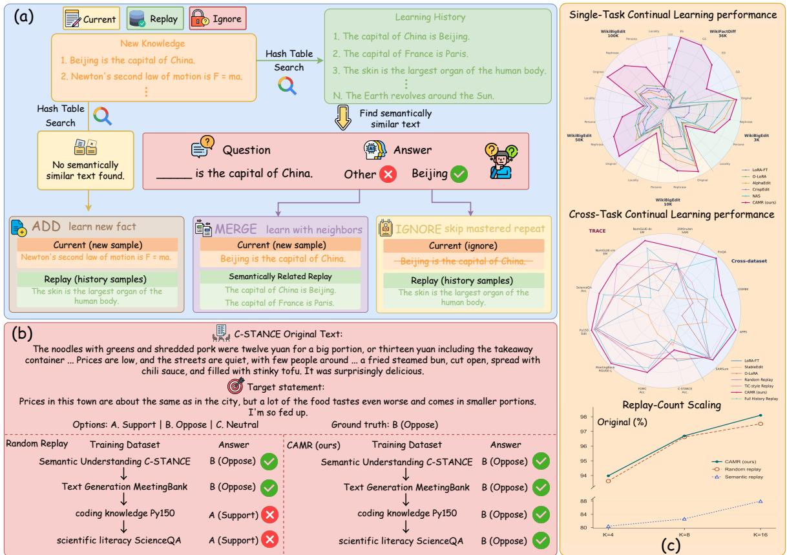
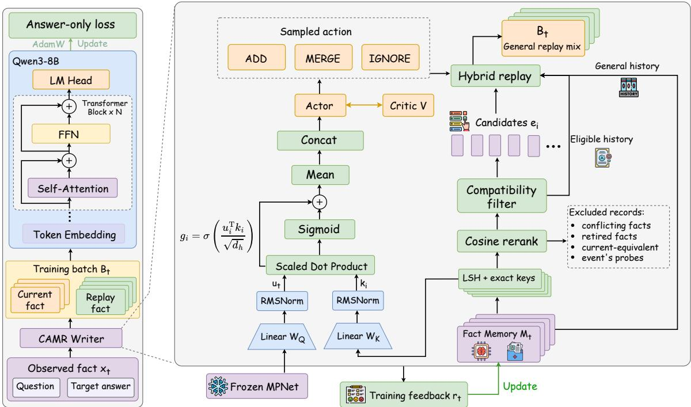
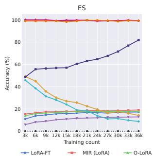
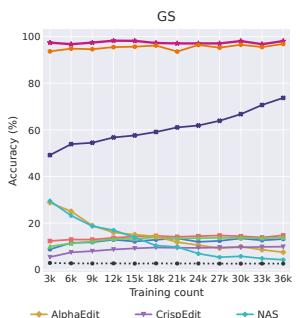
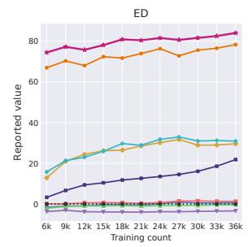
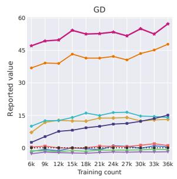
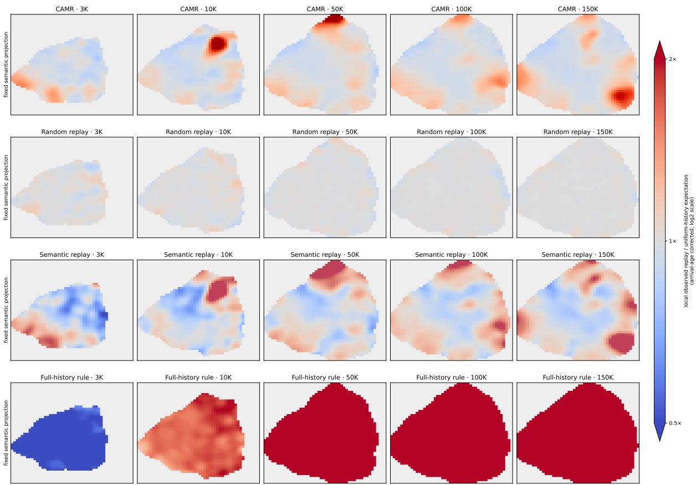
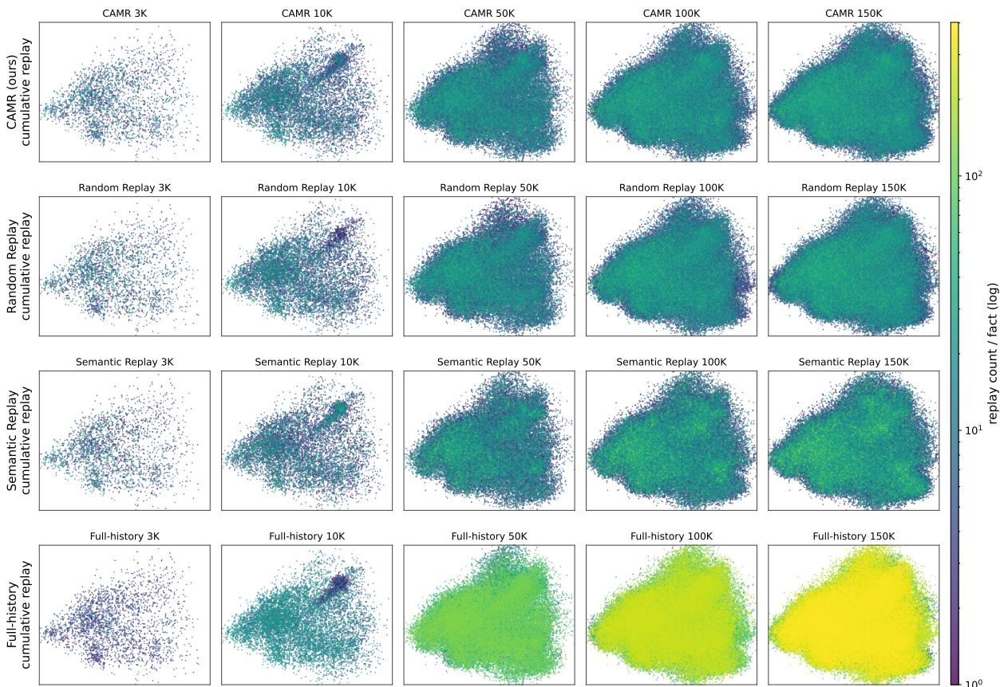

# CAMR: Compatibility-Aware Memory Replay for Continual Learning in Large Language Models

Jingpu Yang1 Tianhao Li2 Fengxian Ji2 Yufeng Wang3 Shuxin Zheng1 Xiaoqing Zhang1,4\*

1Beijing Zhongguancun Academy 2Northeastern University 3Beihang University 4Renmin University of China

## Abstract

Continual learning requires large language models to acquire new knowledge and capabilities while retaining what they have learned. Fine-tuning and replay support acquisition and retention, but deciding whether incoming examples need supervision and which historical examples to revisit remains a challenge. We propose Compatibility-Aware Memory Replay (CAMR), an adaptive framework that jointly controls current-example supervision and historical replay. CAMR combines compatibility checks with a learned memory gate to guide an online policy over three actions: learning incoming examples with general replay, jointly reinforcing compatible related examples, and skipping direct supervision of verified mastered duplicates. The policy learns from acquisition, retention, and training-cost feedback under a bounded per-arrival replay budget. We evaluate CAMR with Qwen3-8B-Base on continual factual updating and cross-task and crossdomain learning. On WikiBigEdit, CAMR consistently leads evaluated methods in Original Match from 3K to 100K facts, reaching 93.66% after just 3K facts and surpassing Fullhistory Replay (LoRA) after 100K facts. It also achieves the highest final scores on all four selected TRACE tasks and maintains or improves earlier-task performance relative to post-acquisition levels in a sequence spanning financial question answering, mathematical reasoning, code generation, and summarization. Github.

## 1 Introduction

Continual learning enables large language models (LLMs) to acquire new knowledge and capabilities while retaining prior knowledge, allowing them to adapt as knowledge and task requirements evolve. However, successive updates can disrupt previously learned knowledge, giving rise to the stability–plasticity problem (McCloskey and Cohen, 1989; De Lange et al., 2022).

One line of work mitigates interference by controlling parameter updates. Parameter-space methods constrain update directions or separate taskspecific subspaces (Wang et al., 2023a), while knowledge-editing methods make targeted changes to factual associations, with subsequent advances improving stability over successive edits (Meng et al., 2022, 2023; Fang et al., 2025; Liu et al., 2026). These approaches improve learning under given supervision, but their update mechanisms do not directly determine which incoming and historical examples should be used for training.

Experience replay complements these approaches by revisiting historical examples to support retention (Rolnick et al., 2019). Full-history replay incurs growing training costs, while random replay does not account for individual learning needs. Adaptive methods select historical examples based on relevance, interference risk, or transfer value, as illustrated by MIR (Aljundi et al., 2019) and TSR (Meng et al., 2026). Yet selecting historical examples addresses only part of supervision allocation. Incoming examples may require further learning, benefit from joint training with compatible related history, or need no further direct supervision when they repeat material the model has already mastered. Meanwhile, unrelated historical examples still need replay coverage to support retention. These considerations motivate coordinating current-example supervision with the composition of historical replay.

We propose Compatibility-Aware Memory Replay (CAMR), which jointly controls currentexample supervision and historical replay under a bounded per-arrival replay budget (Figure 1). Compatibility checks identify eligible history, and a learned memory gate summarizes retrieved candidates. The resulting memory representation and model mastery guide an online policy over three actions: ADD trains on the incoming example with general replay; MERGE additionally prioritizes compatible related history within the replay budget; and IGNORE skips direct supervision of a verified mastered duplicate while allowing historical replay. The policy adapts online through feedback on acquisition, retention, and training cost. The language model undergoes full-parameter supervised fine-tuning, with retrieval and policy decisions confined to training.

  
Figure 1: Overview of CAMR and its empirical evaluation. (a) Schematic illustration of CAMR. It shows how ADD, MERGE, and IGNORE handle incoming data during continual learning. (b) Example comparison of CAMR with Random Replay in the multi-task setting. (c) Results for single-task and cross-task settings, together with Replay-Count Scaling experiments.

We evaluate CAMR with Qwen3-8B-Base on WikiBigEdit, WikiFactDiff, a four-task TRACE sequence, and a cross-domain sequence. On WikiBigEdit, CAMR consistently achieves the highest Original Match among evaluated methods at checkpoints from 3K to 100K facts. It reaches 93.66% after just 3K facts, surpassing Full-history Replay (LoRA) after 100K facts (92.07%). On WikiFact-Diff, it improves final-stage generalization success over Random Replay (Full FT) by 1.25 percentage points. It also achieves the highest final scores on all four selected TRACE tasks and maintains or improves earlier-task performance relative to post-acquisition levels in the FinQA → GSM8K → APPS → SAMSum sequence. Replay-count scaling and ablations examine sensitivity to replay capacity and the contributions of key policy components. Our contributions are threefold:

• We introduce a compatibility-aware framework that jointly determines current-fact supervision and historical replay under a bounded per-arrival replay budget.

• We develop an online policy that combines model mastery and gated historical information to adapt supervision decisions through learning feedback.

• We demonstrate the effectiveness of CAMR in continual factual updating and cross-task and cross-domain continual learning, supported by replay-count scaling and component ablations.

## 2 Related Work

Continual learning and parameter updates. Continual-learning methods mitigate forgetting by constraining parameter updates, through regularization (Kirkpatrick et al., 2017), gradient projection (Wang et al., 2021), or orthogonal low-rank subspaces in LLMs (Wang et al., 2023a). Knowledgeediting methods rewrite specific factual associations (Meng et al., 2022, 2023), and later work improves stability over long edit sequences (Fang et al., 2025). These methods control how parameters change, whereas CAMR decides which examples supervise each update.

Experience replay and adaptive selection. Experience replay mixes stored examples with new data to support retention (Rolnick et al., 2019). Adaptive variants select history by interference risk (Aljundi et al., 2019) or transfer value (Meng et al., 2026). These methods choose which history to revisit, while CAMR also decides how the incoming example itself is supervised.

Memory mechanisms and learned supervision policies. Reinforcement learning has been used to learn which data a model should train on, for example through teacher models that select examples (Fan et al., 2018) and bandit-based curricula driven by learning progress (Graves et al., 2017). Our writer follows this direction with an actor–critic policy (Mnih et al., 2016) rewarded by acquisition, retention, and training cost. Its state includes a gated summary of history, adapted from the conditional memory of Engram (Cheng et al., 2026).

## 3 Problem Setting

We consider a stream of supervised examples ${ \mathcal { S } } =$ $( x _ { 1 } , \ldots , x _ { T } )$ , where $x _ { t } = ( q _ { t } , y _ { t } , m _ { t } )$ contains an input, a target output, and optional identity, task, or version metadata. At arrival t, the learner may use the current and previously observed examples, but has no access to future arrivals or held-out targets. The objective is to acquire new knowledge and capabilities while retaining prior learning that remains valid. For factual updates, supervision is trusted: an authoritative replacement makes the new answer valid and retires the old one.

Let $p _ { \theta _ { t } }$ and $\mathcal { M } _ { t }$ denote the model and external memory before arrival t. The writer jointly controls current-example supervision and historical replay under a per-arrival replay cap $K ,$ which counts historical replay examples and excludes the current example: ADD trains on the current example with general replay; MERGE additionally prioritizes compatible related history within the same budget; and IGNORE skips direct supervision of a verified mastered duplicate while allowing historyonly replay. All replay examples must satisfy the compatibility criteria. Training updates the model to $p _ { \theta _ { t + 1 } }$ . Regardless of the action, the observed example is stored or linked to an equivalent record in $\mathcal { M } _ { t + 1 }$ . Retired or conflicting records are archived but excluded from replay and retention evaluation. Evaluation is closed-book, with retrieval and writer decisions confined to training.

## 4 Method

Figure 2 summarizes CAMR. The writer combines model mastery with a gated representation of compatible history to select ADD, MERGE, or IGNORE, jointly determining current-example supervision and historical replay. The resulting nonempty batches update the language model using answeronly loss. Pre- and post-event measurements provide acquisition, retention, and training-cost feedback for writer updates at rollout boundaries. The language model and writer use separate optimizers, while the sentence encoder remains frozen.

## 4.1 Memory Retrieval and Compatibility

Memory stores observed examples with their embeddings, identity/version metadata, and replay statistics. For each incoming example xt, we distinguish equivalent, conflicting, and retired historical records. With structured metadata, a slot is defined by (subject, relation, scope), and fact identity additionally includes object and target. Records with the same fact identity are equivalent; different values within the same slot are treated as conflicts. Without structured metadata, input–output pairs that match after conservative Unicode and whitespace normalization are equivalent, while different targets for the same normalized input are conflicting. A record is retired only by an explicit replacement reference or an authoritative update to a declared single-valued slot. Conflicting records are excluded from the current event’s replay but are not automatically retired. We define eligible history $\mathcal { H } _ { t }$ by excluding retired, current-equivalent, and conflicting records from memory. Equivalent records remain available to determine whether IG-NORE is permitted.

  
Figure 2: Overview of CAMR. The writer retrieves and filters compatible history, then selects ADD, MERGE, or IGNORE to form the training batch; feedback from the updated language model trains the writer.

Before action selection, we uniformly sample a probe set $\mathcal { P } _ { t }$ from $\mathcal { H } _ { t }$ without replacement, with $| \mathcal { P } _ { t } | = \operatorname* { m i n } ( P , \lfloor | \mathcal { H } _ { t } | / 2 \rfloor )$ . These probes measure historical loss changes across the event and are excluded from its training batch. The remaining records form the replay pool $\mathcal { U } _ { t } = \mathcal { H } _ { t } \setminus \mathcal { P } _ { t }$

As shown in Figure 2, retrieval combines semantic search with exact lookups. A frozen MPNet encoder (Song et al., 2020) maps each input–output pair to a mean-pooled, L2-normalized embedding. Let $e _ { t }$ and $e _ { i }$ denote current and historical embeddings. Random-hyperplane locality-sensitive hashing (Charikar, 2002) retrieves semantically similar records, while exact indices retrieve records by fact identity and slot. The results are reranked by cosine similarity to form a capped shortlist. We then apply the compatibility rules above and exclude probe records. The remaining records with similarity above $\tau _ { s }$ form the candidate set $\mathcal { C } _ { t } \subseteq \mathcal { U } _ { t }$ These candidates feed the writer’s relevance gate, while $\mathcal { U } _ { t }$ supplies general historical replay. After action selection, the action-specific replay rule selects $\mathcal { R } _ { t } \subseteq \mathcal { U } _ { t }$ subject to $| \mathcal { R } _ { t } | \leq K$ After the event, new examples are stored in memory, while equivalent arrivals are linked to existing records.

## 4.2 Writer Policy and Replay

Given the compatible candidates $\mathcal { C } _ { t } ,$ the writer summarizes related history, selects a supervision action, and constructs the training batch (Figure 2).

We adapt the sigmoid query–key gating mechanism of Engram (Cheng et al., 2026) to current and historical example embeddings. The frozen MPNet embeddings are projected into a shared $d _ { h }$ -dimensional space and normalized using RM-SNorm (Zhang and Sennrich, 2019):

$$
u _ { t } = \mathrm { R M S N o r m } ( W _ { Q } e _ { t } ) , \quad k _ { i } = \mathrm { R M S N o r m } ( W _ { K } e _ { i } ) .\tag{1}
$$

The gate assigns each candidate a relevance weight:

$$
g _ { t i } = \sigma \bigg ( \frac { u _ { t } ^ { \top } k _ { i } } { \sqrt { d _ { h } } } \bigg ) .\tag{2}
$$

We aggregate the gated candidate representations and their mean gate value as

$$
v _ { t } = \frac { 1 } { | \mathcal { C } _ { t } | } \sum _ { i \in \mathcal { C } _ { t } } g _ { t i } k _ { i } , \qquad \bar { g } _ { t } = \frac { 1 } { | \mathcal { C } _ { t } | } \sum _ { i \in \mathcal { C } _ { t } } g _ { t i } .\tag{3}
$$

Both are set to zero when $\mathcal { C } _ { t }$ is empty. The gate operates in the writer, outside the language model.

The actor receives the concatenated state $z _ { t }$ = $\left[ f _ { t } ; u _ { t } ; v _ { t } ; { \bar { g } } _ { t } \right]$ . The eight features in $f _ { t }$ encode top similarity, equivalence, current NLL, probe

NLL, ambiguity, candidate count, stream progress, and update frequency. Two actor heads produce masked probabilities $\rho _ { t } ^ { I } = b _ { t } ^ { I } \sigma ( a _ { I } ( z _ { t } ) )$ ) and $\rho _ { t } ^ { M }$ = $b _ { t } ^ { M } \sigma ( a _ { M } ( z _ { t } ) )$ , where $\bar { b } _ { t } ^ { I } , b _ { t } ^ { M } \in \{ 0 , 1 \}$ indicate action eligibility. The action distribution is

$$
\begin{array} { r } { \pi _ { \phi } \big ( \mathrm { I G N O R E ~ } | \ z _ { t } \big ) = \rho _ { t } ^ { I } , \quad \pi _ { \phi } \big ( \mathrm { M E R G E ~ } | \ z _ { t } \big ) = ( 1 - \rho _ { t } ^ { I } ) \rho _ { t } ^ { M } , } \\ { \pi _ { \phi } \big ( \mathrm { A D D ~ } | \ z _ { t } \big ) = ( 1 - \rho _ { t } ^ { I } ) ( 1 - \rho _ { t } ^ { M } ) . \qquad } \end{array}\tag{4}
$$

MERGE is eligible only when $\mathcal { C } _ { t }$ is nonempty. IG-NORE requires an equivalent active record, current $\mathrm { N L L } \le \tau _ { m }$ , no retirement triggered by the current arrival, and a fresh greedy answer matching the full target after conservative Unicode and whitespace normalization. If neither action is eligible, the policy selects ADD. The critic estimates the state value for online learning, as described in Section 4.3.

The sampled action determines current-example supervision and the composition of historical replay. ADD and IGNORE sample uniformly from the replay pool $\mathcal { U } _ { t }$ . MERGE combines general history with related candidates: it reserves part of the replay budget for uniform sampling and allocates the remainder to compatible candidates from $\mathcal { C } _ { t }$ . Unused candidate slots are filled by uniform sampling from the remaining replay pool. All replay sampling is without replacement and selects at most K records. The training batch contains the current example and $\mathcal { R } _ { t }$ under ADD or MERGE, and only $\mathcal { R } _ { t }$ under IGNORE. Each replayed example remains a separate input–output pair.

## 4.3 Learning Objectives and Online Updates

We optimize an answer-prediction objective for the language model and an actor–critic objective for the writer. Let $\ell _ { \theta } ( x )$ denote the average answertoken NLL over a fact’s original question and optional same-answer training view, excluding evaluation reformulations. The loss includes end-ofsequence tokens but excludes prompt tokens. When current-fact supervision is active and replay is nonempty, the language-model objective is

$$
\mathcal { L } _ { t } ^ { \mathrm { L M } } = \alpha \ell _ { \theta } ( x _ { t } ) + \frac { 1 - \alpha } { \vert \mathcal { R } _ { t } \vert } \sum _ { x \in \mathcal { R } _ { t } } \ell _ { \theta } ( x ) ,\tag{5}
$$

where $\alpha$ balances current and historical supervision. Current-only updates assign unit weight to the current loss; history-only updates average replay losses. An empty IGNORE batch triggers no model update. We use AdamW (Loshchilov and Hutter, 2019), retaining optimizer state across events.

The writer receives feedback from NLL measurements before and after each event on the original current question and the same probes $\mathcal { P } _ { t }$ . Let $\Delta _ { t } ^ { \mathrm { c u r } }$ and $\Delta _ { t } ^ { \mathrm { h i s t } }$ denote current and mean historical loss reductions, with zero historical gain for empty probes. The reward balances acquisition, retention, and training cost:

$$
r _ { t } = \Delta _ { t } ^ { \mathrm { c u r } } + \lambda _ { h } \Delta _ { t } ^ { \mathrm { h i s t } } - \lambda _ { c } \frac { C _ { t } } { C _ { \mathrm { r e f } } } ,\tag{6}
$$

where $\lambda _ { h }$ and $\lambda _ { c }$ weight retention and cost. Here $C _ { t }$ counts logical nonpadding training tokens, including views and repeated steps, and $C _ { \mathrm { r e f } }$ is a dataset-specific cost-normalization hyperparameter. Probe and mastery-check forward passes are excluded from $C _ { t }$

Writer parameters remain fixed within each configured rollout B and are updated at its end. The critic predicts $V _ { t } = V _ { \psi } ( \mathrm { s g } ( z _ { t } ) )$ , where $\mathrm { s g }$ stops gradients. Discounted returns and advantages are

$$
G _ { t } = r _ { t } + \gamma G _ { t + 1 } , \qquad \bar { A } _ { t } = G _ { t } - \mathrm { s g } ( V _ { t } ) .\tag{7}
$$

At the rollout boundary, the recursion uses the next observed state’s detached value, or zero at stream termination. All returns are fixed targets.

The actor adjusts action probabilities using advantages, while the critic fits the returns. For choice events ${ \mathcal { D } } \subseteq B$ and policy entropy $H _ { t }$ , we minimize

$$
\begin{array} { l } { \displaystyle \mathcal { L } _ { \pi } = - \frac { 1 } { | \mathcal { D } | } \sum _ { t \in \mathcal { D } } \left[ A _ { t } \log \pi _ { \phi } ( a _ { t } \mid z _ { t } ) + \beta H _ { t } \right] , } \\ { \displaystyle \mathcal { L } _ { V } = \frac { 1 } { | \mathcal { B } | } \sum _ { t \in \mathcal { B } } ( V _ { t } - G _ { t } ) ^ { 2 } , \mathcal { L } _ { W } = \mathcal { L } _ { \pi } + c _ { v } \mathcal { L } _ { V } . } \end{array}\tag{8}
$$

Here $\gamma$ controls discounting, $\beta$ weights entropy regularization, and $c _ { v }$ weights the critic loss. We set $\mathcal { L } _ { \pi } = 0$ when $\mathcal { D }$ is empty. Forced-action events train only the critic; the relevance gate learns only through the actor. The complete set of hyperparameters introduced in the CAMR formulation is reported in Appendix D.

## 5 Experiments and Discussion

## 5.1 Experimental Setup

We evaluate Qwen3-8B-Base in the closed-book setting, with Qwen3-14B-Base as an unmodified WikiBigEdit reference (Yang et al., 2025), on WikiBigEdit (Thede et al., 2025), WikiFactDiff (Ammar Khodja et al., 2024), TRACE (C-STANCE, MeetingBank, Py150, and text-only ScienceQA) (Wang et al., 2023b; Zhao et al., 2023; Hu et al., 2023; Raychev et al., 2016; Lu et al., 2022), and FinQA → GSM8K → APPS introductory → SAMSum (Chen et al., 2021; Cobbe et al., 2021; Hendrycks et al., 2021; Gliwa et al., 2019); ablations use FOMC, NumGLUE-cm/ds, and Py150 (Shah et al., 2023; Mishra et al., 2022). Baselines span unmodified models; fine-tuning and parameter-space methods (Hu et al., 2022; Wang et al., 2023a, 2021); knowledge-editing methods (Yang et al., 2026; Meng et al., 2022, 2023; Gupta et al., 2024; Fang et al., 2025; Wang et al., 2024; Liu et al., 2026; Ikram et al., 2026; Ma et al., 2026; Gu et al., 2026); and replay-based methods (Rolnick et al., 2019; Aljundi et al., 2019; Meng et al., 2026; Li et al., 2025). We report Match/Exact, ES/GS, ED/GD, accuracy, ROUGE-L, edit similarity, and pass@1 as appropriate.

Table 1: Long-stream match accuracy (%) and checkpoint change. All checkpoints belong to the same 100K continual stream. Parentheses at 100K report the change from 3K in percentage points. The light peach shading marks the highest value in each column, these values are also bold. The additional CAMR LoRA run uses $K = 8$ and a learning rate of $2 \times 1 0 ^ { - 4 }$ through 50K updates and $1 0 ^ { - 4 }$ thereafter, continuing the same model and optimizer.
<table><tr><td>Method</td><td colspan="4">3K</td><td colspan="3">10K</td><td colspan="3">50K</td><td colspan="3"></td><td colspan="3">100K (change vs. 3K)</td></tr><tr><td></td><td colspan="10">Original Rephrase Persona Locality Original Rephrase Persona Locality Original Rephrase Persona Locality</td><td></td><td>Original</td><td></td><td>Rephrase</td><td>Persona</td><td>Locality</td></tr><tr><td></td><td colspan="10">Unmodified base models</td><td></td><td></td><td></td><td></td><td></td><td></td><td></td></tr><tr><td>Qwen3-8B-Base</td><td>14.67</td><td>13.71</td><td>11.20</td><td>5.88</td><td>13.16</td><td>12.51</td><td>9.33</td><td>9.62</td><td>12.04</td><td>11.90</td><td>8.76</td><td>10.55</td><td>12.88 (-1.79)</td><td>12.33 (-1.38)</td><td>9.08 (-2.12)</td><td>13.09(+7.21)</td></tr><tr><td>Qwen3-14B-Base</td><td>21.63</td><td>20.20</td><td>11.53</td><td>29.41</td><td>20.42 19.69</td><td>9.99</td><td>21.15</td><td>17.26</td><td>16.55</td><td>8.72</td><td></td><td>17.58</td><td>17.40(-4.23)</td><td>16.76(-3.44)</td><td>8.74 (-2.79)</td><td>18.75 (-10.66)</td></tr><tr><td></td><td colspan="10">Fine-tuning and parameter-space methods</td><td></td><td></td><td></td><td></td><td></td><td></td></tr><tr><td>Fine-Tuning (LoRA)</td><td>51.40</td><td>47.83</td><td>38.57</td><td>21.97</td><td>56.83</td><td>52.34</td><td>44.61</td><td>21.95</td><td>48.27</td><td>43.10</td><td>34.70</td><td></td><td>24.6241.08 (-10.32)</td><td>37.40(-10.43)</td><td>28.23 (-10.34)</td><td>23.21 (+1.24)</td></tr><tr><td>Sequential Fine-Tuning (Full FT)</td><td>60.73</td><td>56.00</td><td>47.63</td><td>18.44</td><td>62.30</td><td>57.64</td><td>51.16</td><td>21.18</td><td>52.79</td><td>48.03</td><td>38.98</td><td>21.42</td><td>45.83 (-14.90)</td><td>41.47 (-14.53)</td><td>34.36(-13.27)</td><td>22.66(+4.22)</td></tr><tr><td>Joint Fine-Tuning (Full FT)</td><td>61.20</td><td>56.10</td><td>48.47</td><td>19.60</td><td>63.12</td><td>58.54</td><td>51.72</td><td>21.59</td><td>58.19</td><td>52.95</td><td>44.09</td><td>23.13</td><td>56.36 (-4.84)</td><td>51.08 (-5.02)</td><td>42.15 (-6.32)</td><td>24.32 (+4.72)</td></tr><tr><td>O-LoRA</td><td>51.63</td><td>47.27 14.72</td><td>38.53 11.80</td><td>22.68 11.76</td><td>57.84</td><td>52.55</td><td>43.86</td><td>23.44</td><td>52.28</td><td>47.12</td><td>37.12</td><td>27.64</td><td>48.31 (-3.32)</td><td>43.45 (-3.82)</td><td>32.33 (-6.20)</td><td>28.35(+5.67)</td></tr><tr><td>Adam-NSCL LoRA-Merge</td><td>15.77 25.98</td><td>24.78</td><td>20.14</td><td></td><td>17.93</td><td>16.49</td><td>11.60</td><td>19.23</td><td>17.43</td><td>16.69</td><td>11.70</td><td>16.41</td><td>18.09(+2.32)</td><td>17.29 (+2.57)</td><td>12.19(+0.39)</td><td>17.58 (+5.82)</td></tr><tr><td></td><td></td><td></td><td></td><td>29.41</td><td>26.09</td><td>26.28</td><td>19.75</td><td>19.23</td><td>31.11</td><td>27.54</td><td>21.14</td><td>27.34</td><td>35.31 (+9.33)</td><td>30.80(+6.02)</td><td>22.44(+2.30)</td><td>29.10 (-0.31)</td></tr><tr><td>Knowledge-editing methods</td><td colspan="10"></td><td colspan="7"></td></tr><tr><td></td><td></td><td>26.30</td><td>21.73</td><td>18.36</td><td>40.49</td><td>36.08</td><td>30.24</td><td>21.68</td><td>41.98</td><td>34.22</td><td>25.89</td><td></td><td>25.98 41.98 (+12.95)</td><td>34.02 (+7.72)</td><td>23.81 (+2.08)</td><td>27.34(+8.98)</td></tr><tr><td>LocFT ROME</td><td>29.03 37.07</td><td>35.47</td><td>27.33</td><td>13.77</td><td>25.72</td><td>24.46</td><td>17.99</td><td>13.55</td><td>17.82</td><td>17.29</td><td>12.72</td><td>14.28</td><td>17.94(-19.13)</td><td>16.98 (-18.49)</td><td>12.37 (-14.96)</td><td>14.41 (+0.64)</td></tr><tr><td>R-ROME</td><td>37.30</td><td>35.17</td><td>28.50</td><td>13.67</td><td>26.63</td><td>25.52</td><td>20.12</td><td>13.88</td><td>19.55</td><td>17.80</td><td>13.22</td><td>14.90</td><td>19.52 (-17.78)</td><td>17.99(-17.18)</td><td>13.35(-15.15)</td><td>15.52(+1.85)</td></tr><tr><td>AlphaEdit</td><td>89.76</td><td>75.42</td><td>61.05</td><td>23.53</td><td>84.82</td><td>67.84</td><td>48.43</td><td>17.31</td><td>58.95</td><td>41.09</td><td>22.18</td><td>11.33</td><td>41.72 (-48.04)</td><td>29.20 (-46.22)</td><td>15.54(-45.51)</td><td>12.70(-10.83)</td></tr><tr><td>NAS</td><td>83.07</td><td>66.10</td><td>59.23</td><td>10.28</td><td>76.96</td><td>55.90</td><td>37.66</td><td>11.97</td><td>44.75</td><td>27.45</td><td>14.94</td><td>9.64</td><td>27.08 (-55.99)</td><td>18.51 (-47.59)</td><td>10.74(-48.49)</td><td>8.95 (-1.33)</td></tr><tr><td>CrispEdit</td><td>26.10</td><td>25.17</td><td>20.77</td><td>11.52</td><td>38.11</td><td>35.36</td><td>28.19</td><td>16.99</td><td>38.89</td><td>35.19</td><td>23.88</td><td>19.34</td><td>38.73 (+12.63)</td><td>34.35 (+9.18)</td><td>23.34 (+2.57)</td><td>18.16(+6.64)</td></tr><tr><td>UltraEdit</td><td>17.14</td><td>15.72</td><td>12.50</td><td>5.88</td><td>15.79</td><td>14.85</td><td>10.85</td><td>9.62</td><td>15.80</td><td>15.20</td><td>11.07</td><td>13.28</td><td>19.11 (+1.97)</td><td>17.51 (+1.79)</td><td>12.66(+0.16)</td><td>17.58 (+11.70)</td></tr><tr><td>StableEdit</td><td>24.13</td><td>22.80</td><td>16.07</td><td>18.00</td><td>27.26</td><td>24.91</td><td>17.63</td><td>20.04</td><td>35.49</td><td>28.89</td><td>16.48</td><td></td><td>25.59 35.43 (+11.30)</td><td>28.84(+6.04)</td><td>17.36(+1.29)</td><td>24.10(+6.10)</td></tr><tr><td>WISE-Retrieve</td><td>23.77</td><td>21.91</td><td>17.31</td><td>17.65</td><td>23.80</td><td>21.39</td><td>15.60</td><td>23.08</td><td>13.76</td><td>12.86</td><td>11.09</td><td>13.67</td><td>11.37 (-12.40)</td><td>10.54(-11.37)</td><td>10.08 (-7.23)</td><td>12.89 (4.76)</td></tr><tr><td>Replay-based continual-learning methods</td><td colspan="10"></td><td></td><td></td><td></td><td></td><td></td><td></td></tr><tr><td></td><td></td><td colspan="10"></td><td></td><td>89.12(+1.16)</td><td>80.89 (+0.66)</td><td></td><td></td><td>24.73 (+1.20)</td></tr><tr><td>Random Replay (Full FT) Random Replay (LoRA)</td><td>87.96 68.66</td><td>80.23 62.07</td><td>67.46 51.98</td><td>23.53 23.53</td><td>91.32 64.34</td><td>84.75 59.53</td><td>68.94 50.28</td><td>23.92 19.23</td><td>90.74 47.73</td><td>81.62 45.06</td><td>60.52 35.24</td><td>25.34 21.88</td><td>41.63 (-27.03)</td><td>38.68 (-23.39)</td><td>61.99 (-5.47)</td><td></td></tr><tr><td>Full-history Replay (LoRA)</td><td>50.92</td><td>46.02</td><td>36.61</td><td>29.41</td><td>87.37</td><td>75.24</td><td>56.47</td><td>28.85</td><td>88.86</td><td>77.10</td><td>53.38</td><td></td><td>26.95 92.07 (+41.15)</td><td>83.53(+37.51)</td><td>29.16(-22.82) 61.55(+24.94)</td><td>21.48 (-2.05) 22.71 (-6.70)</td></tr><tr><td>Semantic Replay (LoRA)</td><td>51.40</td><td>47.83</td><td>38.57</td><td>23.94</td><td>57.51</td><td>53.30</td><td>45.42</td><td>25.86</td><td>51.34</td><td>46.90</td><td>36.74</td><td>25.47</td><td>46.83 (-4.57)</td><td>42.51 (-5.32)</td><td>33.68 (-4.89)</td><td>23.42 (-0.52)</td></tr><tr><td>Relation Oracle Replay (LoRA)</td><td>68.02</td><td>61.71</td><td>50.92</td><td>29.41</td><td>63.65</td><td>58.89</td><td>47.94</td><td>19.23</td><td>47.23</td><td>44.02</td><td>34.55</td><td>28.91</td><td>41.39(-26.63)</td><td>38.32 (-23.39)</td><td>30.72(-20.20)</td></table>

## 5.2 Single-Task Data Scaling

We process 100,000 WikiBigEdit facts (Thede et al., 2025) in their original eight-interval order. CAMR achieves the highest Original Match at 3K, 10K, 50K, and 100K among evaluated methods, with little fluctuation (Table 1). At 150K, it improves and surpasses Full-history Replay (LoRA) on all four Match metrics, while the baseline’s Rephrase, Persona, and Locality scores decline (Appendix A). This suggests better generalization and less interference as the stream grows.

On WikiFactDiff (Ammar Khodja et al., 2024), we process twelve stages of 2,700 new facts and 300 replacements. CAMR maintains current-stage ES near 100% and consistently exceeds Random Replay (Full FT) on GS (Figure 3). At 36K, both reach 99.33% ES, while CAMR achieves 98.08% GS, a 1.25-point improvement. Positive mean ED and GD at every reported replacement checkpoint indicate higher average probability for updated answers than obsolete ones.

## 5.3 Cross-Task and Cross-Domain Performance

On the TRACE sequence C-STANCE → Meeting-Bank → Py150 → text-only ScienceQA, CAMR achieves the highest final scores among evaluated methods on all four tasks: 56.75%, 69.84%, 67.92%, and 95.40%, respectively (Table 2). The three earlier tasks lose only 0.75, 0.55, and 0.42 points relative to their post-acquisition scores, indicating limited forgetting across successive tasks.

On FinQA → GSM8K → APPS introductory → SAMSum, all three earlier tasks retain or improve upon their post-acquisition scores (Table 3). Final scores reach 76.11%, 81.58%, 30.50%, and 45.10%, exceeding Random Replay (Full FT) by

  
Figure 3: WikiFactDiff replacement results over the 36K-update stream, evaluated on the current stage every 3K updates. ES/GS report success rates, while ED/GD report new-minus-obsolete answer-probability gaps.

Table 2: Continual learning performance (%) and final checkpoint change on the four-task TRACE stream. T4 parentheses report changes from the stage when each task was first learned. The light peach shading marks the highest value in each column, these values are also bold.
<table><tr><td rowspan="2">Method</td><td rowspan="2">T1 Acc.</td><td colspan="2">T2</td><td colspan="3">T3</td><td colspan="4">T4 (change from post-acquisition)</td></tr><tr><td>Acc. C-STANCE</td><td>ROUGE-L C-STANCE MeetingBank</td><td>Acc. C-STANCE MeetingBank</td><td>ROUGE-L</td><td>Edit Py150</td><td>Acc.</td><td>ROUGE-L C-STANCE MeetingBank</td><td>Edit Py150</td><td>Acc. ScienceQA</td></tr><tr><td colspan="10">Fine-tuning and parameter-space methods</td></tr><tr><td>Fine-Tuning (LoRA)</td><td>50.55</td><td>50.10</td><td>58.91</td><td>53.70</td><td>56.06</td><td>67.88</td><td>53.85(+3.30)</td><td>56.30 (-2.61)</td><td>67.30(-0.58)</td><td>94.25</td></tr><tr><td>Sequential Fine-Tuning (LoRA)</td><td>56.60</td><td>56.75</td><td>65.30</td><td>56.80</td><td>58.66</td><td>67.69</td><td>55.00 (-1.60)</td><td>53.85 (-11.45)</td><td>66.25 (-1.44)</td><td>91.95</td></tr><tr><td>Sequential Fine-Tuning (Full FT)</td><td>49.30</td><td>46.05</td><td>69.20</td><td>46.75</td><td>68.14</td><td>63.39</td><td>47.70 (-1.60)</td><td>68.97 (-0.23)</td><td>62.76 (-0.63)</td><td>92.60</td></tr><tr><td>Joint Fine-Tuning (Full FT)</td><td>46.25</td><td>51.65</td><td>42.70</td><td>53.60</td><td>44.74</td><td>60.34</td><td>51.50(+5.25)</td><td>68.16(+25.46)</td><td>59.60 (-0.74)</td><td>94.00</td></tr><tr><td>O-LoRA</td><td>54.15</td><td>53.75</td><td>56.97</td><td>54.25</td><td>55.35</td><td>67.82</td><td>54.05 (-0.10)</td><td>56.40 (-0.57)</td><td>67.54 (-0.28)</td><td>93.30</td></tr><tr><td>Adam-NSCL</td><td>50.30</td><td>50.25</td><td>17.01</td><td>50.30</td><td>17.06</td><td>11.48</td><td>50.30 (+0.00)</td><td>17.05 (+0.04)</td><td>11.48(+0.00)</td><td>87.65</td></tr><tr><td>LoRA-Merge</td><td>58.20</td><td>58.75</td><td>32.65</td><td>59.00</td><td>33.53</td><td>20.83</td><td>56.60 (-1.60)</td><td>33.68 (+1.03)</td><td>21.42 (+0.59)</td><td>89.00</td></tr><tr><td colspan="10">Knowledge-editing methods</td></tr><tr><td>LocFT</td><td>55.95</td><td>54.75</td><td>59.92</td><td>54.45</td><td>37.69</td><td>66.99</td><td>55.30 (-0.65)</td><td>31.95 (-27.97)</td><td>66.04 (-0.95)</td><td>88.95</td></tr><tr><td>MEMIT</td><td>51.55</td><td>50.10</td><td>1.39</td><td>47.65</td><td>1.22</td><td>5.58</td><td>46.35 (-5.20)</td><td>1.21 (-0.18)</td><td>5.36 (-0.22)</td><td>88.85</td></tr><tr><td>AlphaEdit</td><td>50.70</td><td>0.30</td><td>2.73</td><td>0.60</td><td>0.14</td><td>1.97</td><td>0.05 (-50.65)</td><td>0.09 (-2.64)</td><td>5.89 (+3.92)</td><td>0.00</td></tr><tr><td>NAS</td><td>50.35</td><td>44.40</td><td>17.03</td><td>40.70</td><td>15.73</td><td>5.11</td><td>33.75 (-16.60)</td><td>10.84 (-6.19)</td><td>5.85 (+0.74)</td><td>0.75</td></tr><tr><td>MEMIT + NAS</td><td>47.00</td><td>35.60</td><td>1.32</td><td>35.40</td><td>1.28</td><td>4.19</td><td>26.55 (-20.45)</td><td>1.18 (-0.14)</td><td>4.02 (-0.17)</td><td>64.10</td></tr><tr><td>CrispEdit</td><td>56.35</td><td>43.90</td><td>33.27</td><td>43.15</td><td>31.60</td><td>62.62</td><td>47.40 (-8.95)</td><td>24.12 (-9.15)</td><td>62.01 (-0.61)</td><td>87.50</td></tr><tr><td>UltraEdit</td><td>52.55</td><td>52.50</td><td>16.99</td><td>51.45</td><td>16.99</td><td>11.59</td><td>51.90 (-0.65)</td><td>17.08 (+0.09)</td><td>11.68 (+0.09)</td><td>87.30</td></tr><tr><td>StableEdit</td><td>56.05</td><td>56.10</td><td>21.04</td><td>56.10</td><td>21.17</td><td>6.33</td><td>56.35 (+0.30)</td><td>21.10(+0.06)</td><td>6.31 (-0.02)</td><td>87.65</td></tr><tr><td>WISE-Retrieve</td><td>45.65</td><td>45.65</td><td>18.38</td><td>45.65</td><td>18.14</td><td>44.75</td><td>45.65(+0.00)</td><td>18.13 (-0.25)</td><td>44.75(+0.00)</td><td>85.30</td></tr><tr><td colspan="10">Replay-based continual-learning methods</td></tr><tr><td>Random Replay (Full FT)</td><td>51.80</td><td>50.50</td><td>66.41</td><td>51.05</td><td>66.89</td><td>68.13</td><td>50.50 (-1.30)</td><td>66.45 (+0.04)</td><td>67.80 (-0.33)</td><td>95.35</td></tr><tr><td>Random Replay (LoRA)</td><td>54.80</td><td>55.60</td><td>63.38</td><td>56.05</td><td>60.93</td><td>67.55</td><td>54.45 (-0.35)</td><td>52.33 (-11.05)</td><td>65.52 (-2.03)</td><td>91.75</td></tr><tr><td>Semantic Replay (LoRA)</td><td>53.45</td><td>55.05</td><td>64.96</td><td>54.60</td><td>53.99</td><td>67.13</td><td>51.90(-1.55)</td><td>52.34 (-12.62)</td><td>66.67 (-0.46)</td><td>92.70</td></tr><tr><td>TiC-style Replay (LoRA)</td><td>55.75</td><td>53.75</td><td>64.54</td><td>52.15</td><td>58.13</td><td>67.43</td><td>55.45 (-0.30)</td><td>51.04 (-13.50)</td><td>67.12 (-0.31)</td><td>91.30</td></tr><tr><td>Maximally Interfered Retrieval (LoRA)</td><td>53.75</td><td>52.90</td><td>63.29</td><td>52.05</td><td>49.21</td><td>68.39</td><td>50.30 (-3.45)</td><td>35.10(-28.19)</td><td>66.32 (-2.07)</td><td>91.05</td></tr><tr><td>Transfer Selective Replay (LoRA)</td><td>56.60</td><td>55.85</td><td>62.83</td><td>55.95</td><td>23.75</td><td>62.22</td><td>55.35 (-1.25)</td><td>41.40 (-21.43)</td><td>58.21 (-4.01)</td><td>92.55</td></tr><tr><td>CAMR (Full FT, ours)</td><td>57.50</td><td>55.65</td><td>70.39</td><td>56.75</td><td>69.22</td><td>68.34</td><td>56.75 (-0.75)</td><td>69.84 (-0.55)</td><td>67.92(-0.42)</td><td>95.40</td></tr><tr><td>CAMR (LoRA, ours)</td><td>54.60</td><td>56.70</td><td>64.30</td><td>54.75</td><td>65.38</td><td>66.49</td><td>55.00 (+0.40)</td><td>63.10 (-1.20)</td><td>64.45 (-2.04)</td><td>92.80</td></tr></table>

2.70, 5.46, 9.10, and 3.43 points, respectively. CAMR leads on FinQA and SAMSum, while O-LoRA and Adam-NSCL achieve the highest GSM8K and APPS scores, respectively.

## 5.4 Sensitivity to Replay Count

Table 4 evaluates different replay counts. CAMR leads Original and Rephrase Match at every tested budget, showing that its advantage is not tied to a single K. Increasing K from 4 to 16 improves these scores from 93.98%/86.56% to 98.10%/90.42%. At K = 8, CAMR achieves its highest Persona and Locality scores (72.62%/19.86%) and leads all four metrics. We use K = 4 as the default to evaluate the method under a limited replay budget.

## 5.5 Writer Component Ablations

Table 5 compares the complete writer with five ablations. Specifically, w/o Action Selection uses ADD-only routing; w/o Online Feedback freezes the initialized writer; w/o Memory Gate weights all candidates equally; w/o IGNORE masks that action; and w/o Replay on IGNORE skips historical replay for that action. The complete writer achieves the best performance on all four tasks, tying w/o

Table 3: Continual learning performance (%) and final checkpoint change on the four-task cross-domain stream. T4 parentheses report changes from the stage when each task was first learned. The light peach shading marks the highest value in each column, these values are also bold.
<table><tr><td rowspan="3">Method</td><td rowspan="2">T1 Acc.</td><td colspan="2">T2</td><td colspan="3">T3</td><td colspan="4">T4 (change from post-acquisition)</td></tr><tr><td>Acc. FinQA</td><td>Acc.</td><td>Acc.</td><td>Acc.</td><td>pass@1</td><td>Acc.</td><td>Acc.</td><td>pass@1</td><td>ROUGE-L</td></tr><tr><td>FinQA</td><td>GSM8K</td><td>FinQA</td><td></td><td>GSM8K</td><td>APPS</td><td>FinQA</td><td>GSM8K</td><td>APPS</td><td>SAMSum</td></tr><tr><td colspan="10">Fine-tuning and parameter-space methods</td></tr><tr><td>Fine-Tuning (LoRA)</td><td>30.51</td><td>22.23</td><td>82.41</td><td>26.94</td><td>80.89</td><td>30.40</td><td>22.23 (-8.28)</td><td>70.05 (-12.36)</td><td>30.60 (+0.20)</td><td>43.79</td></tr><tr><td>Sequential Fine-Tuning (Full FT)</td><td>23.37</td><td>24.24</td><td>75.06</td><td>24.85</td><td>73.62</td><td>20.80</td><td>23.54 (+0.17)</td><td>70.66(-4.40)</td><td>22.80 (+2.00)</td><td>42.25</td></tr><tr><td>O-LoRA</td><td>31.56</td><td>31.39</td><td>82.94</td><td>30.95</td><td>82.64</td><td>28.80</td><td> $3 0 . 4 3 \ : ( - 1 . 1 3 )$ </td><td>83.55 (+0.61)</td><td>29.10 (+0.30)</td><td>44.59</td></tr><tr><td>Adam-NSCL</td><td>7.15</td><td>7.15</td><td>75.66</td><td>7.15</td><td>75.44</td><td>36.10</td><td> $7 . 0 6 ( - 0 . 0 9 )$ </td><td>76.04 (+0.38)</td><td>36.10 (+0.00)</td><td>25.46</td></tr><tr><td>LoRA-Merge</td><td>64.25</td><td>64.17</td><td>82.49</td><td>64.17</td><td>83.70</td><td>33.50</td><td> $6 3 . 3 0 ( - 0 . 9 5 )$ </td><td>83.32 (+0.83)</td><td>32.60 (-0.90)</td><td>41.17</td></tr><tr><td colspan="10">Knowledge-editing methods</td></tr><tr><td>LocFT</td><td>74.02</td><td>67.57</td><td>83.62</td><td>67.57</td><td>79.61</td><td>32.20</td><td>68.09 (-5.93)</td><td>81.27 (-2.35)</td><td>32.80 (+0.60)</td><td>43.82</td></tr><tr><td>MEMIT</td><td>4.80</td><td>6.63</td><td>80.67</td><td>6.71</td><td>80.59</td><td>23.80</td><td> $6 . 1 9 \left( + 1 . 3 9 \right)$ </td><td>80.74 (+0.07)</td><td>24.70 (+0.90)</td><td>32.47</td></tr><tr><td>AlphaEdit NAS</td><td>6.54</td><td>6.89</td><td>67.02</td><td>6.97</td><td>66.94</td><td>32.60</td><td>6.97 (+0.43)</td><td>67.85 (+0.83)</td><td>32.60 (+0.00)</td><td>26.19</td></tr><tr><td>MEMIT + NAS</td><td>7.50</td><td>7.32</td><td>74.37</td><td>7.59</td><td>74.07</td><td>35.20</td><td>7.41 (-0.09)</td><td>75.36(+0.99)</td><td>35.60 (+0.40)</td><td>25.72</td></tr><tr><td>CrispEdit</td><td>7.32</td><td>7.59</td><td>78.85</td><td>7.41</td><td>78.85</td><td>34.80</td><td>7.67 (+0.35)</td><td>78.77 (-0.08)</td><td>35.90 (+1.10)</td><td>25.68</td></tr><tr><td></td><td>50.22</td><td>16.74</td><td>81.88</td><td>20.92</td><td>78.24</td><td>25.60</td><td>21.10(-29.12)</td><td>48.37 (-33.51)</td><td>7.50(-18.10)</td><td>37.96</td></tr><tr><td>UltraEdit</td><td>8.02</td><td>8.20</td><td>80.52</td><td>8.02</td><td>78.62</td><td>34.50</td><td>8.11 (+0.09)</td><td>80.21 (-0.31)</td><td>34.10 (-0.40)</td><td>26.27</td></tr><tr><td>StableEdit WISE-Retrieve</td><td>17.87 2.09</td><td>17.52</td><td>83.55 47.38</td><td>17.87</td><td>82.87</td><td>16.70</td><td> $1 7 . 5 2 \ : ( - 0 . 3 5 )$ </td><td> $8 2 . 5 6 ( - 0 . 9 9 )$ </td><td> $1 4 . 9 0 ( - 1 . 8 0 ) $ </td><td>42.58</td></tr><tr><td></td><td></td><td>2.09</td><td></td><td>2.18</td><td>59.89</td><td>1.70</td><td> $1 . 9 2 \ : ( - 0 . 1 7 )$ </td><td> $5 8 . 9 8 ( + 1 1 . 6 0 )$ </td><td> $2 . 0 0 ( + 0 . 3 0 )$ </td><td>12.96</td></tr><tr><td colspan="10">Replay-based continual-learning methods</td></tr><tr><td>Random Replay (Full FT) Random Replay (LoRA)</td><td>75.15</td><td>74.80</td><td>81.88</td><td>73.67</td><td>78.62</td><td>26.30</td><td> $7 3 . 4 1 ( - 1 . 7 4 )$ </td><td> $7 6 . 1 2 ( - 5 . 7 6 )$ </td><td> $2 1 . 4 0 \left( - 4 . 9 0 \right)$ </td><td>41.67</td></tr><tr><td>Semantic Replay (LoRA)</td><td>32.17</td><td>35.14</td><td>82.34</td><td>35.22</td><td>80.74</td><td>30.70</td><td> $2 6 . 8 5 ( - 5 . 3 2 )$ </td><td>76.65 (-5.69)</td><td>27.60 (-3.10)</td><td>44.86</td></tr><tr><td>Relation Oracle Replay (Full FT)</td><td>28.86</td><td>34.70</td><td>80.06</td><td>34.26</td><td>80.06</td><td>29.60</td><td> $3 0 . 9 5 \ : ( + 2 . 0 9 )$ </td><td>77.94 (-2.12)</td><td>29.20 (-0.40)</td><td>43.75</td></tr><tr><td></td><td>27.72</td><td>33.83</td><td>82.56</td><td>33.83</td><td>82.18</td><td>29.30</td><td> $2 9 . 6 4 \ : ( + 1 . 9 2 ) $ </td><td>78.77 (-3.79)</td><td>27.70 (-1.60)</td><td>43.43</td></tr><tr><td>TiC-style Replay (LoRA)</td><td>36.79</td><td>35.14</td><td>83.02</td><td>34.87</td><td>81.43</td><td>28.90</td><td> $3 4 . 1 8 ( - 2 . 6 1 ) $ </td><td>81.20 (-1.82)</td><td>30.80 (+1.90)</td><td>44.94</td></tr><tr><td>Maximally Interfered Retrieval (LoRA) Transfer Selective Replay (LoRA)</td><td>32.61</td><td>32.61 36.09</td><td>82.26 83.24</td><td>31.12</td><td>81.73</td><td>27.90</td><td> $3 1 . 3 0 ( - 1 . 3 1 ) $ </td><td>82.26(+0.00) 81.43 (-1.81)</td><td>29.70 (+1.80)</td><td>43.61</td></tr><tr><td></td><td>36.97</td><td></td><td></td><td>35.22</td><td>82.03</td><td>30.80</td><td> $3 4 . 5 2 ( - 2 . 4 5 )$ </td><td>81.58 (+0.00)</td><td>29.60 (-1.20)</td><td>44.26</td></tr><tr><td>CAMR (Full FT, ours)</td><td>75.24</td><td>75.85</td><td>81.58</td><td>75.94</td><td>82.18</td><td>30.10</td><td> $7 6 . 1 1 \ ( + 0 . 8 7 )$ </td><td></td><td>30.50 (+0.40)</td><td>45.10</td></tr><tr><td>CAMR (LoRA, ours)</td><td>76.10</td><td>76.36</td><td>83.47</td><td>77.15</td><td>85.75</td><td>32.80</td><td> $7 7 . 2 4 ( + 1 . 1 4 )$ </td><td>84.91 (+1.44)</td><td>31.80 (-1.00)</td><td>43.96</td></tr></table>

Table 4: Replay strategies under different per-arrival replay caps K. All methods use full-parameter finetuning. Best scores within each K group are bold.
<table><tr><td>K</td><td>Method</td><td>Original</td><td>Rephrase</td><td>Persona</td><td>Locality</td></tr><tr><td rowspan="3">4</td><td>CAMR (ours)</td><td>93.98%</td><td>86.56%</td><td>69.98%</td><td>18.34%</td></tr><tr><td>Random Replay</td><td>93.62%</td><td>86.08%</td><td>70.74%</td><td>19.58%</td></tr><tr><td>Semantic Replay</td><td>80.40%</td><td>73.36%</td><td>63.21%</td><td>11.91%</td></tr><tr><td rowspan="3">8</td><td>CAMR (ours)</td><td>96.70%</td><td>89.26%</td><td>72.62%</td><td>19.86%</td></tr><tr><td>Random Replay</td><td>96.62%</td><td>89.08%</td><td>70.92%</td><td>19.30%</td></tr><tr><td>Semantic Replay</td><td>82.62%</td><td>74.73%</td><td>65.70%</td><td>13.67%</td></tr><tr><td rowspan="3"></td><td>CAMR (ours)</td><td>98.10%</td><td>90.42%</td><td>71.72%</td><td>19.16%</td></tr><tr><td>16 Random Replay</td><td>97.52%</td><td>88.16%</td><td>68.74%</td><td>18.98%</td></tr><tr><td>Semantic Replay</td><td>87.96%</td><td>79.42%</td><td>71.78%</td><td>14.06%</td></tr></table>

Online Feedback on NumGLUE-cm. Removing action selection or IGNORE degrades performance across all tasks, supporting the benefit of adapting current-example supervision and historical replay. NumGLUE-ds is particularly sensitive to memory gating and replay under IGNORE, with substantial degradation when either component is removed. Online feedback improves three tasks, with the largest gain on NumGLUE-ds.

Table 5: Writer ablation results under full-parameter fine-tuning. The light peach shading marks the highest score in each column, including ties.
<table><tr><td>Variant</td><td>FOMC</td><td>NumGLUE-cm</td><td>NumGLUE-ds</td><td>Py150</td></tr><tr><td>CAMR (ours)</td><td>72.38</td><td>76.54</td><td>77.54</td><td>67.75</td></tr><tr><td>w/o Action Selection</td><td>71.25</td><td>74.07</td><td>74.57</td><td>66.89</td></tr><tr><td>w/o Online Feedback</td><td>71.25</td><td>76.54</td><td>75.69</td><td>67.58</td></tr><tr><td>w/o Memory Gate</td><td>70.63</td><td>74.07</td><td>72.85</td><td>66.65</td></tr><tr><td>w/o IGNORE</td><td>71.88</td><td>74.07</td><td>76.63</td><td>66.63</td></tr><tr><td>w/o Replay on IGNORE</td><td>71.25</td><td>72.84</td><td>73.54</td><td>66.49</td></tr></table>

## 5.6 Replay Sample Selection Analysis

CAMR balances focused replay with historical coverage under a fixed budget. At 100K, its replay share for the high-frequency core-3K set is 2.42× that of Random Replay (Table 10). Its replay concentrates on regions similar to Semantic Replay but covers more arrived facts: 90.4% versus 83.9% (Appendix E). This pattern is consistent with its hybrid sampling: MERGE prioritizes compatible related history while reserving uniform slots, and ADD samples uniformly. CAMR also outperforms

Semantic Replay on Original and Rephrase Match at every tested K (Table 4).

## 6 Conclusion

We introduced CAMR, which jointly controls current-example supervision and bounded historical replay through compatibility-aware memory and an online writer policy. Experiments on factual updating, cross-task learning, and cross-domain learning demonstrate strong acquisition and retention across replay budgets. Our results highlight the value of jointly adapting current supervision and historical replay in continual learning.

## Limitations

Due to computational constraints, our experiments focus on Qwen3-8B-Base; since CAMR is not tied to a specific architecture or scale, we plan to extend it to larger models and other model families. Some baselines use LoRA rather than full-parameter finetuning to limit cost, and a full-parameter comparison of all baselines is left for future work. IGNORE is not triggered on WikiBigEdit, which contains few repeated facts, but it accounted for 19.14% of decisions under the gate defined in Section 4.2 on the APPS stream with repeated examples (Appendix C). Removing IGNORE lowers performance on all four ablation tasks, showing its benefit on redundant data. We will further evaluate it on streams with naturally occurring repetitions.

## References

Rahaf Aljundi, Eugene Belilovsky, Tinne Tuytelaars, Laurent Charlin, Massimo Caccia, Min Lin, and Lucas Page-Caccia. 2019. Online continual learning with maximal interfered retrieval. In Advances in Neural Information Processing Systems, volume 32. Curran Associates, Inc.

Hichem Ammar Khodja, Frédéric Béchet, Quentin Brabant, Alexis Nasr, and Gwénolé Lecorvé. 2024. WikiFactDiff: A large, realistic, and temporally adaptable dataset for atomic factual knowledge update in causal language models. In Proceedings of the 2024 Joint International Conference on Computational Linguistics, Language Resources and Evaluation (LREC-COLING 2024), pages 17614–17624. ELRA and ICCL.

Moses S. Charikar. 2002. Similarity estimation techniques from rounding algorithms. In Proceedings of the 34th Annual ACM Symposium on Theory of Computing, pages 380–388. ACM.

Zhiyu Chen, Wenhu Chen, Charese Smiley, Sameena Shah, Iana Borova, Dylan Langdon, Reema Moussa, Matt Beane, Ting-Hao Huang, Bryan Routledge, and William Yang Wang. 2021. Finqa: A dataset of numerical reasoning over financial data. In Proceedings ofthe 2021 Conference on Empirical Methods in Natural Language Processing, pages 3697–3711. ACL.

Xin Cheng, Rui Tian, Wangding Zeng, Damai Dai, Qinyu Chen, Bingxuan Wang, Zhenda Xie, Kezhao Huang, Xingkai Yu, Chengqi Deng, Shangyan Zhou, Chenggang Zhao, Zhewen Hao, Yukun Li, Han Zhang, Zhengyan Zhang, Yixuan Wei, M.Y. Xu, Huishuai Zhang, and 2 others. 2026. Conditional memory via scalable lookup: A new axis of sparsity for large language models. arXiv preprint arXiv:2601.07372.

Karl Cobbe, Vineet Kosaraju, Mohammad Bavarian, Mark Chen, Heewoo Jun, Lukasz Kaiser, Matthias Plappert, Jerry Tworek, Jacob Hilton, Reiichiro Nakano, Christopher Hesse, and John Schulman. 2021. Training verifiers to solve math word problems. In arXiv preprint arXiv:2110.14168.

Matthias De Lange, Rahaf Aljundi, Marc Masana, Sarah Parisot, Xu Jia, Ales Leonardis, Gregory Slabaugh, and Tinne Tuytelaars. 2022. A continual learning survey: Defying forgetting in classification tasks. IEEE Transactions on Pattern Analysis and Machine Intelligence, 44(7):3366–3385.

Yang Fan, Fei Tian, Tao Qin, Xiang-Yang Li, and Tie-Yan Liu. 2018. Learning to teach. In International Conference on Learning Representations.

Junfeng Fang, Houcheng Jiang, Kun Wang, Yunshan Ma, Shi Jie, Xiang Wang, Xiangnan He, and Tat-Seng Chua. 2025. AlphaEdit: Null-space constrained knowledge editing for language models. In International Conference on Learning Representations. Oral presentation.

Bogdan Gliwa, Iwona Mochol, Maciej Biesek, and Aleksander Wawer. 2019. SAMSum corpus: A humanannotated dialogue dataset for abstractive summarization. In Proceedings of the 2nd Workshop on New Frontiers in Summarization, pages 70–79. ACL.

Alex Graves, Marc G. Bellemare, Jacob Menick, Rémi Munos, and Koray Kavukcuoglu. 2017. Automated curriculum learning for neural networks. In Proceedings of the 34th International Conference on Machine Learning, volume 70 of Proceedings of Machine Learning Research, pages 1311–1320. PMLR.

Xiaojie Gu, Ziying Huang, Jia-Chen Gu, and Kai Zhang. 2026. Ultraedit: Training-, subject-, and memoryfree lifelong editing in language models. Preprint, arXiv:2505.14679. TMLR 2026; arXiv:2505.14679.

Akshat Gupta, Sidharth Baskaran, and Gopala Anumanchipalli. 2024. Rebuilding ROME: Resolving model collapse during sequential model editing. In Proceedings of the 2024 Conference on Empirical Methods in Natural Language Processing, pages

21738–21744. Association for Computational Linguistics.

Dan Hendrycks, Steven Basart, Saurav Kadavath, Mantas Mazeika, Akul Arora, Ethan Guo, Collin Burns, Samir Puranik, Horace He, Dawn Song, and Jacob Steinhardt. 2021. Measuring coding challenge competence with apps. In arXiv preprint arXiv:2105.09938.

Edward J. Hu, Yelong Shen, Phillip Wallis, Zeyuan Allen-Zhu, Yuanzhi Li, Shean Wang, Lu Wang, and Weizhu Chen. 2022. LoRA: Low-rank adaptation of large language models. In International Conference on Learning Representations.

Yebowen Hu, Timothy Ganter, Hanieh Deilamsalehy, Franck Dernoncourt, Hassan Foroosh, and Fei Liu. 2023. MeetingBank: A benchmark dataset for meeting summarization. In Proceedings of the 61st Annual Meeting ofthe Associationfor Computational Linguistics (Volume 1: Long Papers), pages 16409– 16423. ACL.

Zarif Ikram, Arad Firouzkouhi, Stephen Tu, Mahdi Soltanolkotabi, and Paria Rashidinejad. 2026. Crispedit: Low-curvature projections for scalable non-destructive LLM editing. Preprint, arXiv:2602.15823. ICML 2026; arXiv:2602.15823.

James Kirkpatrick, Razvan Pascanu, Neil Rabinowitz, Joel Veness, Guillaume Desjardins, Andrei A. Rusu, Kieran Milan, John Quan, Tiago Ramalho, Agnieszka Grabska-Barwinska, Demis Hassabis, Claudia Clopath, Dharshan Kumaran, and Raia Hadsell. 2017. Overcoming catastrophic forgetting in neural networks. Proceedings of the National Academy of Sciences, 114(13):3521–3526.

Jeffrey Li, Mohammadreza Armandpour, Seyed Iman Mirzadeh, Sachin Mehta, Vaishaal Shankar, Raviteja Vemulapalli, Samy Bengio, Oncel Tuzel, Mehrdad Farajtabar, Hadi Pouransari, and Fartash Faghri. 2025. TiC-LM: A web-scale benchmark for time-continual LLM pretraining.

Mingda Liu, Zhenghan Zhu, Ze’an Miao, and Katsuki Fujisawa. 2026. Norm anchors make model edits last. Preprint, arXiv:2602.02543. ArXiv:2602.02543.

Ilya Loshchilov and Frank Hutter. 2019. Decoupled weight decay regularization. In International Conference on Learning Representations. ArXiv:1711.05101.

Pan Lu, Swaroop Mishra, Tanglin Xia, Liang Qiu, Kai-Wei Chang, Song-Chun Zhu, Oyvind Tafjord, Peter Clark, and Ashwin Kalyan. 2022. Learn to explain: Multimodal reasoning via thought chains for science question answering. In Advances in Neural Information Processing Systems, volume 35, pages 2507– 2521.

Xin Ma, Wei Chen, Qi Liu, Derong Xu, Zhi Zheng, Tong Xu, and Enhong Chen. 2026. More edits, more stable: Understanding the lifelong normalization in sequential model editing. Preprint, arXiv:2605.11836. ICML 2026; arXiv:2605.11836.

Michael McCloskey and Neal J. Cohen. 1989. Catastrophic interference in connectionist networks: The sequential learning problem. In Psychology ofLearning and Motivation, volume 24, pages 109–165. Academic Press.

Kevin Meng, David Bau, Alex Andonian, and Yonatan Belinkov. 2022. Locating and editing factual associations in GPT. In Advances in Neural Information Processing Systems, volume 35, pages 17359–17372. Curran Associates, Inc.

Kevin Meng, Arnab Sen Sharma, Alex Andonian, Yonatan Belinkov, and David Bau. 2023. Massediting memory in a transformer. In International Conference on Learning Representations.

Yang Meng, Zhenya Liu, Zhuokai Zhao, and Yuxin Chen. 2026. Rethinking transfer in continual learning: A replay-based realisation. Preprint, arXiv:2607.15587. ArXiv:2607.15587.

Swaroop Mishra, Arindam Mitra, Neeraj Varshney, Bhavdeep Sachdeva, Peter Clark, Chitta Baral, and Ashwin Kalyan. 2022. NumGLUE: A suite of fundamental yet challenging mathematical reasoning tasks. In Proceedings of the 60th Annual Meeting of the Association for Computational Linguistics (Volume 1: Long Papers), pages 3505–3523. ACL.

Volodymyr Mnih, Adria Puigdomenech Badia, Mehdi Mirza, Alex Graves, Timothy Lillicrap, Tim Harley, David Silver, and Koray Kavukcuoglu. 2016. Asynchronous methods for deep reinforcement learning. In Proceedings ofThe 33rd International Conference on Machine Learning, volume 48 of Proceedings of Machine Learning Research, pages 1928–1937. PMLR.

Veselin Raychev, Pavol Bielik, and Martin Vechev. 2016. Probabilistic model for code with decision trees. In Proceedings of the 2016 ACM SIGPLAN International Conference on Object-Oriented Programming, Systems, Languages, and Applications, pages 731– 747. ACM.

David Rolnick, Arun Ahuja, Jonathan Schwarz, Timothy Lillicrap, and Greg Wayne. 2019. Experience replay for continual learning. In Advances in Neural Information Processing Systems, volume 32. Curran Associates, Inc.

Agam Shah, Suvan Paturi, and Sudheer Chava. 2023. Trillion dollar words: A new financial dataset, task and market analysis. In Proceedings ofthe 61st Annual Meeting of the Association for Computational Linguistics (Volume 1: Long Papers), pages 6664– 6679. ACL.

Kaitao Song, Xu Tan, Tao Qin, Jianfeng Lu, and Tie-Yan Liu. 2020. MPNet: Masked and permuted pretraining for language understanding. In Advances in Neural Information Processing Systems, volume 33, pages 16857–16867. Curran Associates, Inc.

Lukas Thede, Karsten Roth, Matthias Bethge, Zeynep Akata, and Thomas Hartvigsen. 2025. WikiBigEdit: Understanding the limits of lifelong knowledge editing in LLMs. In Proceedings of the 42nd International Conference on Machine Learning, volume 267 of Proceedings of Machine Learning Research, pages 59326–59354. PMLR.

Peng Wang, Zexi Li, Ningyu Zhang, Ziwen Xu, Yunzhi Yao, Yong Jiang, Pengjun Xie, Fei Huang, and Huajun Chen. 2024. WISE: Rethinking the knowledge memory for lifelong model editing of large language models. In Advances in Neural Information Processing Systems, volume 37, pages 53764–53797. Curran Associates, Inc.

Shipeng Wang, Xiaorong Li, Jian Sun, and Zongben Xu. 2021. Training networks in null space of feature covariance for continual learning. In Proceedings of the IEEE/CVF Conference on Computer Vision and Pattern Recognition, pages 184–193.

Xiao Wang, Tianze Chen, Qiming Ge, Han Xia, Rong Bao, Rui Zheng, Qi Zhang, Tao Gui, and Xuanjing Huang. 2023a. Orthogonal subspace learning for language model continual learning. In Findings ofthe Associationfor Computational Linguistics: EMNLP 2023, pages 10658–10671. ACL.

Xiao Wang, Yuansen Zhang, Tianze Chen, Songyang Gao, Senjie Jin, Xianjun Yang, Zhiheng Xi, Rui Zheng, Yicheng Zou, Tao Gui, Qi Zhang, and Xuanjing Huang. 2023b. TRACE: A comprehensive benchmark for continual learning in large language models. arXiv preprint arXiv:2310.06762.

An Yang, Anfeng Li, Baosong Yang, Beichen Zhang, Binyuan Hui, Bo Zheng, Bowen Yu, Chang Gao, Chengen Huang, Chenxu Lv, Chujie Zheng, Dayiheng Liu, Fan Zhou, Fei Huang, Feng Hu, Hao Ge, Haoran Wei, Huan Lin, Jialong Tang, and 41 others. 2025. Qwen3 technical report. arXiv preprint arXiv:2505.09388.

Wanli Yang, Rui Tang, Hongyu Zang, Du Su, Qi Cao, Jingang Wang, Huawei Shen, Xueqi Cheng, and Fei Sun. 2026. Fine-tuning done right in model editing. Preprint, arXiv:2509.22072. ICLR 2026; arXiv:2509.22072.

Biao Zhang and Rico Sennrich. 2019. Root mean square layer normalization. In Advances in Neural Information Processing Systems, volume 32. Curran Associates, Inc.

Chenye Zhao, Yingjie Li, and Cornelia Caragea. 2023. C-STANCE: A large dataset for Chinese zero-shot stance detection. In Proceedings of the 61st Annual Meeting ofthe Associationfor Computational Linguistics (Volume 1: Long Papers), pages 13369– 13385. ACL.

## A Additional 150K WikiBigEdit Evaluation

We compare CAMR (Full FT) with Full-history Replay (LoRA) at 150K using the same Match definitions as the 100K evaluation. CAMR exceeds Full-history Replay on Original, Rephrase, Persona, and Locality Match by 3.78, 9.06, 22.28, and 7.42 percentage points, respectively (Table 6).

Table 6: WikiBigEdit Match accuracy (%) after 150,000 continual updates. The best result in each column is shown in bold.
<table><tr><td>Method</td><td>Original</td><td>Rephrase</td><td>Persona</td><td>Locality</td></tr><tr><td>Full-history Replay (LoRA)</td><td>93.75</td><td>78.71</td><td>45.31</td><td>22.66</td></tr><tr><td>CAMR (Full FT, ours)</td><td>97.53</td><td>87.77</td><td>67.59</td><td>30.08</td></tr></table>

## B WikiBigEdit Replay Volume

Table 7 reports cumulative fact presentations over 100K WikiBigEdit facts. One fact presentation counts one selected fact once; total fact presentations include the current facts and historical replay. CAMR and Random Replay use full-parameter updates, whereas Full-history Replay uses LoRA. Full-history Replay trains new facts in blocks of up to 375; a block also ends at each native-interval boundary (every 12.5K facts) and at each evaluation checkpoint. At the start of every block, it replays all previously observed facts. Its cumulative historical replay count is $\sum _ { b } { s _ { b } } .$ , where $s _ { b }$ is the number of previously observed facts at the start of block b.

## C Writer Action Utilization

Table 8 reports a controlled action audit using the IGNORE gate defined in Section 4.2 from the original experiments. Under this gate, IGNORE requires an equivalent active record, current NLL $\leq \tau _ { m } .$ no retirement triggered by the arrival, and a fresh greedy answer matching the full target. No arrival in the 100K WikiBigEdit stream satisfied the duplicate/equivalence prerequisite, so IGNORE was never selected.

For each task, we construct a 5K-arrival stream by randomly subsampling larger training sets or supplementing smaller ones with randomly sampled training examples. All methods use the same resulting stream and order.

We used the same gate in a separate diagnostic with repeated APPS examples. Starting from the original single-pass stream of 2,639 examples, we appended 2,361 exact input–output duplicates of previously observed active examples, producing 5,000 arrivals. Over this stream, the writer selected ADD 2,947 times (58.94%), MERGE 1,096 times (21.92%), and IGNORE 957 times (19.14%). This diagnostic shows that, under repeated exposure, the writer selectively skips direct supervision of examples that satisfy the mastery criteria.

  
Figure 4: Age- and eligibility-corrected semantic replay allocation across the WikiBigEdit stream. Rows show CAMR, count-matched Random Replay from CAMR’s logged eligible history pools, count-matched cosine Top-8 Semantic Replay from the same pools, and the theoretical 375-record Full-history Replay at 3K, 10K, 50K, 100K, and 150K. Each panel reports local cumulative replay intensity divided by the exact event-wise Random Replay expectation after identical fixed-grid smoothing. Neutral gray denotes 1× expectation, red denotes over-allocation, and blue denotes under-allocation on the shared log scale. All checkpoints use the same frozen representation and PCA projection.

Table 7: Cumulative WikiBigEdit fact presentations, including current facts and historical replay.
<table><tr><td>Method</td><td>3K</td><td>10K</td><td>50K</td><td>100K</td></tr><tr><td colspan="5">Fact presentations (current + replay)</td></tr><tr><td>CAMR (Full FT)</td><td>14,801</td><td>49,516</td><td>246,364</td><td>494,424</td></tr><tr><td>Random Replay (Full FT)</td><td>14,984</td><td>49,984</td><td>249,984</td><td>499,984</td></tr><tr><td>Full-history Replay (LoRA)</td><td>13,500</td><td>141,625</td><td>3,440,625</td><td>13,682,125</td></tr></table>

Table 8: Cumulative writer-action shares (%) under the IGNORE gate.
<table><tr><td>Stream</td><td>Size</td><td>ADD</td><td>MERGE</td><td>IGNORE</td></tr><tr><td rowspan="4">WikiBigEdit</td><td>3K</td><td>67.83</td><td>32.17</td><td>0.00</td></tr><tr><td>10K</td><td>59.55</td><td>40.45</td><td>0.00</td></tr><tr><td>50K</td><td>71.75</td><td>28.25</td><td>0.00</td></tr><tr><td>100K</td><td>69.73</td><td>30.27</td><td>0.00</td></tr><tr><td>APPS</td><td>5K</td><td>58.94</td><td>21.92</td><td>19.14</td></tr></table>

## D Complete CAMR Hyperparameter Specification

Table 9 reports the complete set of hyperparameters introduced in the CAMR formulation, together with their values in the reference configuration.

These values define the reference CAMR configuration. The choices $P = 4$ and $K = 4$ bound the per-arrival probe and replay loads, while $\tau _ { s } = 0 . 6 5$ and $\tau _ { m } ~ = ~ 0 . 2 5$ impose selective compatibility and mastery criteria. The 32-dimensional projection keeps the writer compact. Setting $\alpha = 0 . 5$ gives equal weight to the current-example term and the aggregate replay term in Equation 5. The reward weights retain the historical-gain term at unit scale and apply a token-cost penalty in Equation $^ { 6 , }$ normalized by the dataset-specific $C _ { \mathrm { r e f } }$ values in Table 9. Specifically, letting $L _ { \mathrm { m a x } }$ denote the maximum sequence length of a dataset, we set $C _ { \mathrm { r e f } } = 1 2 8$ when $L _ { \mathrm { m a x } } < 1 2 8$ and $C _ { \mathrm { r e f } } = 1 0 2 4$ otherwise. Finally, $\gamma ~ = ~ 0 . 9 5$ preserves credit within the four-event rollout, $\beta = 0 . 0 1$ supplies a modest entropy bonus, and $c _ { v } = 0 . 5$ gives the critic loss a moderate coefficient in Equations 7 and 8.

  
Figure 5: Unnormalized cumulative replay counts in the same semantic space. Rows and checkpoints follow Figure 4. Each point is a replayed fact at its actual PCA coordinate, and color gives its cumulative replay count on a shared logarithmic scale. The shared axes, frozen representation, and PCA projection make semantic coverage and per-fact repetition directly comparable across methods and stream prefixes.

## E Semantic Replay Trajectory Analysis

We compare the cumulative replay allocations of CAMR, Random Replay, Semantic Replay, and the theoretical Full-history Replay at 3K, 10K, 50K, 100K, and 150K. All facts are projected from the frozen 768-dimensional memory representation. PCA is fitted once on all 150K facts and shared across checkpoints; the first two components explain 8.61% of the variance. Random Replay and Semantic Replay match CAMR’s per-event replay budget over the same logged safe, non-probe history pools; the former samples uniformly without replacement, whereas the latter selects up to eight nearest facts by cosine similarity. The full-history allocation follows the 375-record block rule described in Appendix B.

Figure 4 removes the cumulative advantage of earlier-arriving facts and the event-wise variation in eligible history. Random Replay remains close to the neutral 1× level across regions and checkpoints. CAMR forms localized regions of elevated and reduced intensity as the stream grows, showing targeted semantic reweighting within a bounded replay budget. Semantic Replay follows nearestneighbor structure and produces stronger hotspots and cold regions. The Full-history Replay is below the matched-budget expectation at 3K and reaches the upper range across the map from 50K onward as repeated full-history sweeps accumulate.

The raw-count view in Figure 5 shows both semantic coverage and repeated selection. Under the matched budget, CAMR maintains broad support while concentrating additional presentations in selected neighborhoods; Random Replay distributes presentations diffusely, whereas Semantic Replay repeats a smaller set of nearest neighbors more often. At 100K, the three strategies have replayed 90.4%, 88.8%, and 83.9% of the arrived facts, respectively. Full-history Replay reaches 99.8% coverage but produces a broadly elevated count field as its cumulative replay volume grows. Together, the normalized and raw-count views show that CAMR combines broad semantic support with selective allocation of a bounded replay budget.

Table 9: Complete set of CAMR hyperparameters governing memory, replay, the writer architecture, and the learning objectives.
<table><tr><td>Hyperparameter Value</td></tr><tr><td>Training and optimization</td></tr><tr><td>Base language model Qwen3-8B-Base Language-model update Full-parameter SFT</td></tr><tr><td>Language-model optimizer AdamW</td></tr><tr><td>Language-model learning rate  $2 \times 1 0 ^ { - 6 }$ </td></tr><tr><td>Writer optimizer Adam</td></tr><tr><td>Writer learning rate  $3 \times 1 0 ^ { - 4 }$ </td></tr><tr><td>Optimizer steps per arrival 1 Logical batch size per arrival  $1 + | \mathcal { R } _ { t } | \le 5$  facts</td></tr></table>

<table><tr><td colspan="2">Memory and replay</td></tr><tr><td>Probe cap P</td><td>4</td></tr><tr><td>Retrieved-candidate cap Candidate similarity threshold  $\tau _ { s }$ </td><td>64 0.65</td></tr><tr><td>Mastery NLL threshold  $\tau _ { m }$  Per-arrival replay cap K</td><td>0.25 4</td></tr><tr><td>MERGE uniform-replay quota</td><td>2 of 4 slots</td></tr><tr><td>MERGE candidate quota</td><td>Up to 2 of 4 slots</td></tr><tr><td>MERGE candidate selection</td><td>Writer-selected from Ct, without replacement</td></tr></table>

<table><tr><td>Writer and learning objectives</td></tr><tr><td>Writer projection dimension  $d _ { h }$  32 Writer rollout length |B| 4 events Current-example loss weight α 0.5</td></tr><tr><td>Retention reward weight  $\lambda _ { h }$  1.0 Cost penalty weight  $\lambda _ { c }$  0.01</td></tr><tr><td>Cost reference  $C _ { \mathrm { r e f } }$  128 tokens if  $L _ { \operatorname* { m a x } } < 1 2 8 ; 1 , 0 2 4$ </td></tr><tr><td>tokens otherwise</td></tr><tr><td>Discount factor γ 0.95</td></tr><tr><td>Entropy coefficient  $\beta$  0.01 Critic-loss coefficient  $c _ { v }$  0.5</td></tr><tr><td></td></tr><tr><td>Training arrivals and train/output token caps</td></tr><tr><td>Dataset Arrivals Train/output caps</td></tr><tr><td>WikiBigEdit 100,000 512 /64</td></tr><tr><td>WikiFactDiff 36,000 256 / 16</td></tr><tr><td>TRACE 5,000/task 9,216 /1,024</td></tr><tr><td>Cross-domain 5,000/task 16,384 / 4,096</td></tr><tr><td>FOMC/NumGLUE 5,000/task 640 / 8-128</td></tr><tr><td>Py150 5,000 4,608 / 512</td></tr></table>

## F Core-knowledge replay under stream growth.

Table 10 reports the share of replay slots assigned to a fixed high-frequency core-3K set at each WikiBigEdit checkpoint.

Table 10: Share (%) of replay slots allocated to the fixed high-frequency core-3K set as the WikiBigEdit history grows.
<table><tr><td>Method</td><td>3K</td><td>10K</td><td>50K</td><td>100K</td></tr><tr><td>CAMR</td><td>25.54</td><td>20.93</td><td>9.74</td><td>7.30</td></tr><tr><td>Random Replay</td><td>19.49</td><td>13.56</td><td>5.94</td><td>3.02</td></tr></table>

Both methods devote a smaller share of replay to the core-3K set as the history expands. Random Replay samples uniformly from the available history, so its core share falls from 19.49% at 3K to 3.02% at 100K. When MERGE is selected, CAMR reserves part of its replay budget for compatible retrieved facts, allowing core facts related to later arrivals to receive targeted rehearsal. Its core share remains higher at every checkpoint, decreasing from 25.54% to 7.30%. At 100K, CAMR assigns 2.42× the replay share of Random Replay to the core-3K set, reducing the dilution of core knowledge as the replay pool grows.