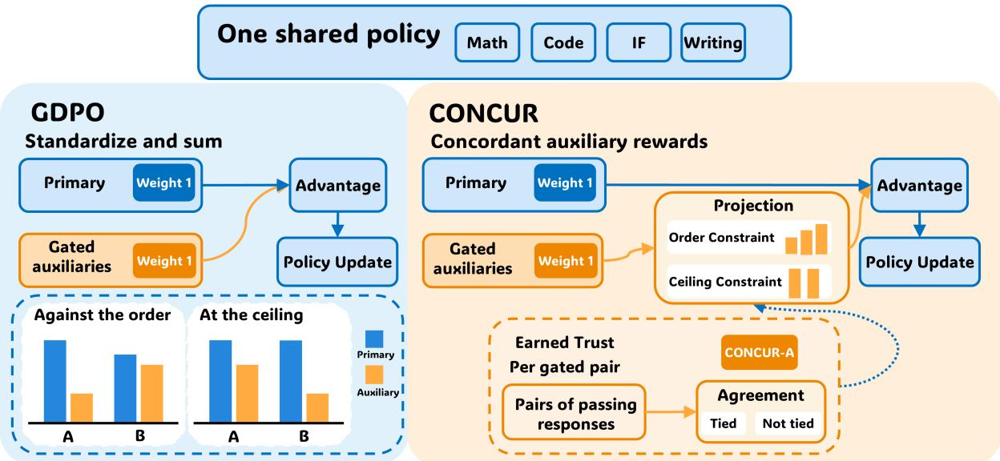
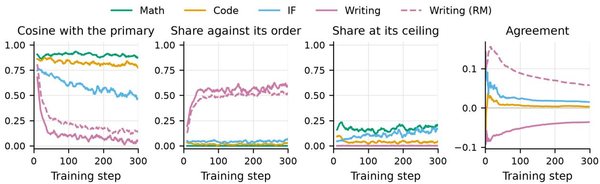
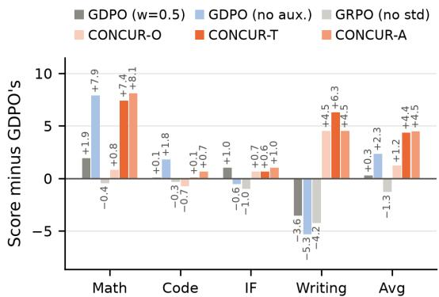
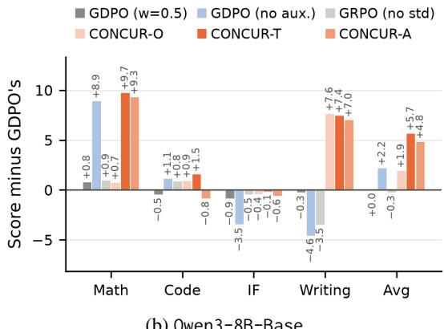
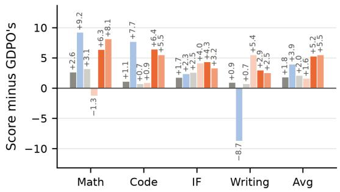
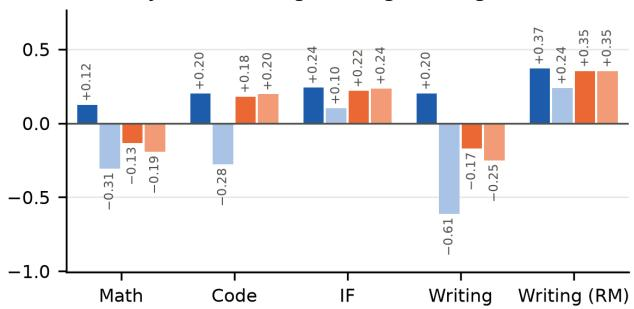
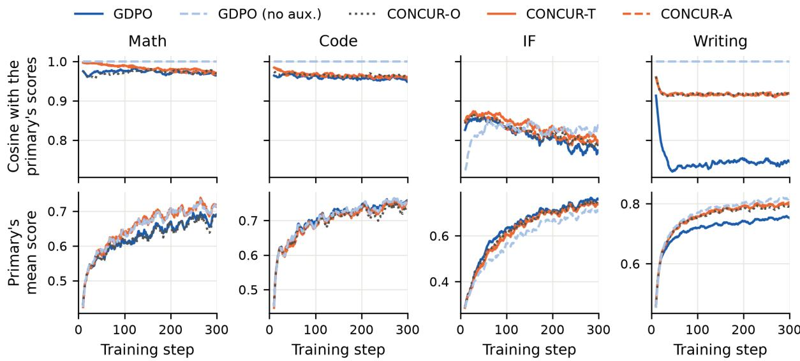
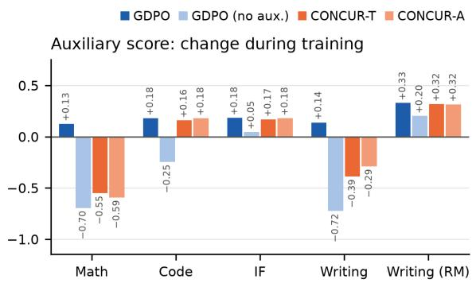
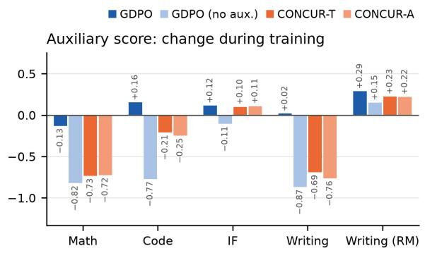
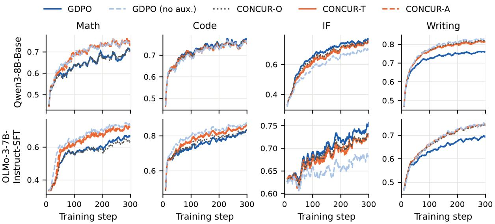

# CONCUR: Concordant Auxiliary Rewards for Multi-Task, Multi-Reward Reinforcement Learning

Jixuan Leng1\* Si Si2 Fei Wang3 Cho-Jui Hsieh4

Jiong Zhang3 Hsiang-Fu Yu3 Inderjit S. Dhillon3

1CMU 2Google DeepMind 3Google 4UCLA

## Abstract

When a Large Language Model (LLM) is trained with Reinforcement Learning (RL) on multiple tasks, a task’s primary reward can gate auxiliary rewards such as a length reward: on a failing response, an auxiliary cannot exceed the primary. However, group-relative advantage estimators treat a gated auxiliary like any other component, so it can reverse the primary’s order, and at the primary’s ceiling only auxiliaries order responses. Keeping gated auxiliaries may hurt some tasks, while dropping them may hurt others. We propose CONCUR, an advantage estimator that replaces the standardized scores of each gated auxiliary with the closest scores that satisfy two conditions: responses with higher primary rewards cannot receive lower scores, and responses at the primary’s ceiling receive equal scores. CONCUR-T applies both conditions throughout training, and CONCUR-A lifts the second for an auxiliary that agrees with the primary’s order more often than it reverses it among passing responses. On three models from two families and across math, code, instruction following, and writing, both variants score higher on average than all baselines and than when all the gated auxiliaries are dropped.

## 1 Introduction

Reinforcement Learning (RL) is now a standard way to improve the capabilities of Large Language Models (LLMs) (Guo et al., 2025; Lambert et al., 2025). One setup trains a single model on several tasks in one run (Pardinas et al., 2026; Ramesh et al., 2026), where each task can score a response with several reward components. We study this multi-task, multi-reward setup, in which one component of each task is the primary that measures the task’s own success, such as the correctness of a math answer. Some of the others are auxiliary components that the primary gates. We follow the reward design of Bai et al. (2026), in which a response passes if its primary is at least one half, and a gated auxiliary keeps its own score on a response that passes and cannot exceed the primary on one that fails. Group-relative advantage estimators treat a gated auxiliary like any other component. For example, GDPO (Liu et al., 2026c) standardizes each component within a group of responses to the same prompt and sums the standardized scores at the declared weights specified by the reward design.

What should an estimator do with a gated auxiliary? We train three LLMs with GDPO on a mixture of math, code, instruction following (IF), and writing, in which every task’s primary gates a length reward and writing’s primary also gates a reward-model score (RM). We call a task together with one of its gated auxiliaries a gated pair, and the mixture has five. Neither keeping nor dropping the gated auxiliaries is satisfactory. As a reference, we run GDPO with every gated auxiliary at weight 0. GDPO at the declared weights scores well below the reference on math and below it on code, but above it on writing. The left of Figure 1 illustrates the two places where a gated auxiliary departs from its primary during training: against the primary’s order, where a response with a lower primary scores higher, and at the ceiling, where the primary equals its maximum and cannot separate responses. We measure each as a share of the sum of an auxiliary’s squared standardized scores. As Figure 2 shows, the share against the order grows to more than half on writing, and the share at the ceiling is largest on math, whose binary primary scores correct responses equally. At the ceiling the auxiliary acts alone. In a group whose responses all reach it, the primary’s standardized scores are zero, while standardization scales the auxiliary’s raw differences, however small, to unit variance.

The gate gives the primary priority over the auxiliaries that it gates, but it constrains only the responses that fail. We propose CONCUR, an advantage estimator that extends this priority to every pair of responses in a group, as the right of Figure 1 illustrates. CONCUR does this with a projection: within each group, it replaces each gated auxiliary’s standardized scores with the closest scores that concur with the primary. Scores concur if they satisfy two constraints. The order constraint requires that no response with a higher primary scores lower, and the ceiling constraint, where it applies, requires that responses at the ceiling score alike. When the ceiling constraint applies to a gated pair, we say that the pair’s ceiling is tied. CONCUR-T ties every gated pair’s ceiling throughout training, has no setting and no state, and is our default. CONCUR-A is the adaptive form, and we call its rule earned trust. It lifts a gated pair’s tie while the auxiliary agrees with the primary’s order more often than it reverses it among the passing responses that the primary separates. CONCUR uses no gradient and keeps every reward component at its declared weight.

  
Figure 1: Left: GDPO standardizes reward components in a group and sums them at the declared weights, and the insets show where an auxiliary departs from its primary. Right: CONCUR projects each gated auxiliary’s scores onto the closest ones that concur with the primary, and in CONCUR-A earned trust decides whether a ceiling is tied.

Our contributions are summarized as follows:

• We analyze how a gated auxiliary enters grouprelative advantages, show that in training it departs from its primary both against the primary’s order and at its ceiling, and find that neither keeping nor dropping gated auxiliaries is satisfactory.

• We propose CONCUR, an advantage estimator that projects each gated auxiliary’s standardized scores onto the closest scores that concur with the primary, in a default and an adaptive variant.

• We prove that the projection never reverses the primary’s order within a group and that, with a binary primary, it keeps only the auxiliary’s difference between correct and wrong responses.

• We show that, on three models from two families and across math, code, instruction-following, and writing benchmarks, both variants achieve higher scores on average than seven existing estimators and than when the gated auxiliaries are dropped.

## 2 Related Work

Multi-reward RL. Group-relative estimators differ in where they normalize: GRPO standardizes the weighted sum within a group, GDPO and MO-GRPO standardize each component before the sum, and RDPO maps each component to quantile scores (Shao et al., 2024; Liu et al., 2026c; Ichihara et al., 2026; Bai et al., 2026). Others account for the correlation between components (Gupta et al., 2026; Hu et al., 2026), change the weights of losses, tasks, or reward components during training (Kendall et al., 2018; Chen et al., 2018; Lu et al., 2026; Ramesh et al., 2026; He et al., 2026), or filter out responses whose per-component advantages disagree in sign (Liu et al., 2026b). Two recent works drop the division by the standard deviation of the rewards in a group (Kassenaar et al., 2026; Wang, 2026), as Dr. GRPO already does (Liu et al., 2025). All these methods treat every reward component alike, whereas CONCUR changes only the gated auxiliaries’ scores in each response group.

Priority among rewards. A common reward design, called conditioning or gating, lets one reward count in full only when another one reaches a threshold (Kimi Team, 2025; Arora and Zanette, 2025; Aggarwal and Welleck, 2025; Song and Zheng, 2025; Liu et al., 2026c; Bai et al., 2026). CONCUR takes such a gate as given and makes its priority hold for any two responses of a group. Other designs let a second reward order the correct responses only (Tan et al., 2026; Peng et al., 2026; Li et al., 2026a; Fang et al., 2026). On a binary primary, they make the opposite choice from CONCUR. They keep the auxiliary’s differences among correct responses, which CONCUR’s ceiling constraint removes, and drop its difference between correct and wrong responses, which CON-CUR keeps. Appendix A discusses other ways to enforce a priority, such as constrained RL, lexicographic RL, and methods that act in gradient space.

Order-preserving projections. Isotonic regression finds the values that respect a given order and are closest to the input values, and the pooladjacent-violators algorithm computes it along a chain (Ayer et al., 1955). The most related work is POISE, which applies this projection to the score labels in the fixed training corpus of a robot reward model, so that they follow the order of pairwise preference labels (Wang et al., 2026). CONCUR projects at every training step onto the order of the primary, which is another reward component of the same responses, and adds the ceiling constraint.

## 3 Preliminaries

## 3.1 Multi-Task RL with Gated Rewards

The policy $\pi _ { \theta }$ samples a group of G responses to each prompt x of task $t \in \tau$ . Each reward component $k \in \mathcal { K } _ { t }$ gives response i a score $r _ { i k } \in [ 0 , 1 ]$ and has a declared weight $w _ { k }$ . One component of each task, indexed by $j ,$ is its primary, which measures the task’s own success. We write $p _ { i } = r _ { i j }$ for the primary score of response $i ,$ and the primary separates two responses i and $i ^ { \prime }$ if $p _ { i } \neq p _ { i ^ { \prime } }$ . A response passes if $\begin{array} { r } { p _ { i } \geq \frac { 1 } { 2 } } \end{array}$ andfails otherwise, and it is at the ceiling if $p _ { i } = 1$ , which is the primary’s maximum. The primary gates a set $\mathcal { A } _ { t } \subset \mathcal { K } _ { t } \setminus \{ j \}$ of gated auxiliaries: $r _ { i k } = \operatorname* { m i n } \{ s _ { i k } , p _ { i } \}$ if $\begin{array} { r } { p _ { i } < \frac { 1 } { 2 } } \end{array}$ and $r _ { i k } = s _ { i k }$ otherwise, where $s _ { i k } \in [ 0 , 1 ]$ is the auxiliary’s own score. The components, their gates, and the declared weights form the reward design.

We mix equal shares of math, code, IF, and writing prompts, with every declared weight 1. The primary is binary correctness for math, the unit-test pass rate for code, and a weighted share of the criteria that a response meets for IF and writing (Li et al., 2026b). A program checks IF’s criteria. Writing’s criteria form a rubric, and a judge model decides which of them a response meets. Every task’s primary gates a length reward, which is full for a response no longer than a per-prompt reference length and falls quadratically to zero at twice that length, and writing’s primary also gates a rewardmodel score (RM) (Liu et al., 2026a), rescaled to [0, 1]. Each gated auxiliary and its task together form a gated pair, of which the mixture has five: Math, Code, IF, and Writing are each a task with its own length reward, and Writing (RM) is writing with its RM. IF also has one component that is not gated, which is the judge’s score on one further criterion. Appendix B.1 shows every component’s role, and Appendix D.1 gives the data and rewards.

Group-relative advantages. GDPO extends GRPO by standardizing each reward component within a group before taking the weighted sum:

$$
z _ { i k } = \frac { r _ { i k } - \bar { r } _ { k } } { d _ { k } } , \qquad u _ { i } = \sum _ { k \in \mathcal { K } _ { t } } w _ { k } z _ { i k } ,
$$

$$
A _ { i } = \mathcal { W } ( u ) _ { i } = ( u _ { i } - \bar { u } ) / \hat { \sigma } _ { u } ,\tag{1}
$$

(2)

where $\bar { r } _ { k }$ and $d _ { k }$ are the group’s mean and sample standard deviation, $z _ { i k } = 0$ if $d _ { k } \ = \ 0$ , and the batch whitening W, which preserves the order of u, computes u¯ and $\hat { \sigma } _ { u }$ over all tasks. We call $z _ { i k }$ a standardized score and $u _ { i }$ a summed score, and we write $z _ { k } = ( z _ { i k } ) _ { i } \in \mathbb { R } ^ { G }$ for the group as a whole.

## 3.2 A Motivating Experiment

We train Qwen3-4B-Base (Yang et al., 2025) with GDPO at the declared weights and, on every training batch, compare each gated auxiliary’s standardized scores z with its primary’s. Figure 2 plots the comparison, and Table 5 in the appendix gives its values. We also train GDPO with every gated auxiliary at weight 0, which is a different reward design. We call this run the reference and label it GDPO (no aux.). An auxiliary’s energy in a group is $\| z \| ^ { 2 }$ . Let $\hat { z } ^ { \le }$ be the scores closest to z in which no response with a higher primary scores lower, and let $\hat { z } ^ { = }$ be the closest scores that are also equal on the responses at the ceiling. The energy of every nonzero z then splits into exactly three nonnegative shares that sum to one (more in Section 5):

against the order $= 1 - \| \hat { z } ^ { \le } \| ^ { 2 } / \| z \| ^ { 2 }$

$$
\mathrm { a t } \mathrm { t h e } \mathrm { c e i l i n g } = \left( \| \hat { z } ^ { \le } \| ^ { 2 } - \| \hat { z } ^ { = } \| ^ { 2 } \right) / \| z \| ^ { 2 } ,
$$

$$
\mathrm { k e p t } = \| \hat { z } ^ { = } \| ^ { 2 } / \| z \| ^ { 2 } .\tag{3}
$$

  
Figure 2: GDPO at the declared weights on Qwen3-4B-Base, one line per gated pair. The panels show the auxiliary’s cosine with its primary, its shares of energy against the order and at the ceiling from Equation 3, as 10-step running means, and the cumulative mean of the agreement of Equation 4, which is not defined for Math’s binary primary.

We also measure whether an auxiliary orders passing responses as its primary does. Take a group and a gated pair of task t with auxiliary k, and let $P = \{ i : p _ { i } \geq \frac { 1 } { 2 } \}$ be the group’s passing responses. If the primary separates at least two of them, the group gives a reading of the pair’s agreement,

$$
a _ { x , k } = \frac { \sum _ { ( i , i ^ { \prime } ) \in P ^ { 2 } } \mathrm { s i g n } ( p _ { i } - p _ { i ^ { \prime } } ) \mathrm { s i g n } ( r _ { i k } - r _ { i ^ { \prime } k } ) } { | \{ ( i , i ^ { \prime } ) \in P ^ { 2 } : p _ { i } \neq p _ { i ^ { \prime } } \} | } .\tag{4}
$$

Among the pairs in P that the primary separates, it is the share that the auxiliary orders as the primary does minus the share that it orders the other way.

(O1) At the start of training, a gated auxiliary mostly repeats its primary on math, code, and IF. In the first panel, the cosine between an auxiliary’s standardized scores and its primary’s is at least 0.75 on Math, Code, and IF over the first 20 training steps. Even a high cosine leaves room for a large effect on training. On math, where this cosine is highest, the reference scores well above GDPO.

(O2) An auxiliary departs from its primary in two places: against its order and at its ceiling. On Math, the share against the order is zero by construction, because the gate sets a wrong response’s auxiliary to 0. It stays small on Code and IF, and on the two writing pairs it grows during training to more than half. The share at the ceiling is largest on Math. Over the last 20 training steps, a share 0.16 of the math groups in the update have every response at the ceiling. There the primary is constant, and the other components alone order the group.

(O3) Dropping the gated auxiliaries raises the score on math and lowers it on writing. On our evaluation benchmarks, the reference scores 7.9 points above GDPO on math, above it on code as well, and 5.3 points below it on writing (more in Section 6.2). Whether an auxiliary agrees with its primary varies by pair. In Figure 2, the agreement ends positive for writing’s RM and negative for writing’s length reward, each by a few hundredths.

These observations motivate the two constraints of CONCUR: its order constraint removes the share against the order, and its ceiling constraint, wherever it applies, removes the share at the ceiling.

## 4 Concordant Auxiliary Rewards

Within each group, CONCUR replaces each gated auxiliary’s standardized scores with the closest scores that concur with the primary. Scores concur if they satisfy the order constraint and, at the steps where the pair’s ceiling is tied, the ceiling constraint as well. The ceiling policy decides when a pair’s ceiling is tied, and the two variants of CON-CUR differ only in this policy. CONCUR-T uses the constant policy that keeps all ceilings tied, and we recommend it as the default variant. The adaptive form CONCUR-A lifts a pair’s tie while the pair’s auxiliary has earned trust. The other components keep their standardized scores, and the sum of all scores at the declared weights is then whitened over the whole batch. CONCUR needs nothing beyond the reward design. It uses the gate as it is declared, without having to know what a given gated auxiliary rewards. Algorithm 1 in the appendix states the full computation for one batch.

## 4.1 The Projection

Take one group, with primaries $p \in [ 0 , 1 ] ^ { G }$ . The vectors of scores $v \in \mathbb { R } ^ { G }$ that satisfy the order constraint form the order cone $C _ { \leq } ( p ) = \{ v \in \mathbb { R } ^ { G }$ $p _ { i } > p _ { i ^ { \prime } } \Rightarrow v _ { i } \geq v _ { i ^ { \prime } } \}$ . The order constraint has no margin: any difference in the primary, however small, outranks the auxiliary. At the ceiling, equal primaries are not an artifact of sampling, since a prompt that the policy solves puts its whole group at the ceiling, where the components other than the primary determine the entire order and each has unit variance. The ceiling therefore gets its own constraint, and $C _ { = } ( p ) = \{ v \in C _ { \leq } ( p ) : p _ { i } =$ $p _ { i ^ { \prime } } = 1 \Rightarrow v _ { i } = v _ { i ^ { \prime } } \}$ is the cone of those vectors that satisfy both the order constraint and this one.

CONCUR moves an auxiliary’s standardized scores as little as the constraints allow: for each gated auxiliary $k \in \mathcal { A } _ { t }$ and for each group, it takes the Euclidean projection of the group’s scores $z _ { k }$

$$
\hat { z } _ { k } = \Pi _ { C } ( z _ { k } ) = \underset { v \in C } { \arg \operatorname* { m i n } } \| v - z _ { k } \| ^ { 2 } ,\tag{5}
$$

where $C = C _ { = } ( p )$ if the pair’s ceiling is tied at that training step and $C = C _ { < } ( p )$ if it is not, and the summed score $u _ { i }$ then uses $\hat { z } _ { k }$ in place of $z _ { k } \mathrm { . }$ :

$$
\begin{array} { r l } & { u _ { i } = \displaystyle \sum _ { k \in \mathcal { K } _ { t } \backslash \mathcal { A } _ { t } } w _ { k } z _ { i k } + \displaystyle \sum _ { k \in \mathcal { A } _ { t } } w _ { k } \hat { z } _ { i k } , } \\ & { A _ { i } = \mathcal { W } ( u ) _ { i } . } \end{array}\tag{6}
$$

The projection exists, is unique, and leaves $z _ { k }$ unchanged exactly when $z _ { k }$ concurs (more in Section 5). Its exact computation has two steps, which Appendix B.2 details. First, if the ceiling is tied, the scores of the responses at the ceiling are replaced by their mean. Then the pool-adjacent-violators algorithm of isotonic regression pools neighboring responses whose scores are out of order along the primary, giving each pool its mean. The projected scores are not standardized again. That would restore unit variance to what the projection leaves.

## 4.2 Earned Trust

Tying a ceiling has a cost. It removes all the credit that the auxiliary assigns among the responses at the ceiling, which can be most of a task’s passing responses. CONCUR-A restores this credit for a gated pair whose auxiliary orders passing responses as the primary does, which it measures in every group where the primary separates two of them.

For a gated pair $( t , k )$ , the pooled agreement $\bar { a } _ { t , k }$ is the mean of all readings $\boldsymbol { a } _ { x , k }$ of its agreement since the start of training, including those of the current batch, and $\mathrm { s e } _ { t , k }$ is its standard error. A pair’s ceiling is tied by default, and it is not tied at a step if $\bar { a } _ { t , k } > 2 \sec _ { t , k }$ . While its ceiling is not tied, we say that the pair’s auxiliary has earned trust. A binary primary scores every passing response alike, so it never gives a reading. Its ceiling stays tied throughout training, and the two variants compute the same summed scores on such a task. With a graded primary, CONCUR-A suits a reward design in which an auxiliary that agrees with the primary should keep ordering the responses at the ceiling, and CONCUR-T suits one in which it should not. Appendix B.3 details the rule and its assumption.

## 5 Analysis

Appendix C provides the derivations and the complete proofs of the two statements in this section.

The ceiling. Take a group whose responses are all at the ceiling. The primary is constant there, so $z _ { i j } = 0$ for every response i, while every component k with $d _ { k } > 0$ has standardized scores of unit sample variance, whatever the size of its raw differences. For example, suppose $G = 8$ and a binary primary gates one auxiliary, both at weight 1. If all eight responses are correct and exactly one of them has a lower auxiliary score than the others, whether by 0.01 or by 0.5, that response has $u _ { i } = - 7 / \sqrt { 8 } \approx - 2 . 4 7$ . If four responses are correct with a full auxiliary score and four are wrong, each wrong response has $u _ { i } = - \sqrt { 7 / 2 } \approx - 1 . 8 7$ A difference of 0.01 in the auxiliary thus costs a correct response more summed score in the first group than a wrong answer costs in the second. Under CONCUR with the ceiling tied, the gated auxiliary contributes nothing to that first group.

Proposition 5.1 (The projection). For primaries p, take any vector $z \in \mathbb { R } ^ { G }$ and $C \in \{ C _ { \leq } ( p ) , C _ { = } ( p ) \}$

(i) Existence. C is a closed convex cone that contains the constant vectors, so the projection $\hat { z } = \Pi _ { C } ( z )$ ofz exists and it is unique.

(ii) Computation. Averaging the scores at a tied ceiling and then pooling the adjacent violators along the primary computes zˆ exactly.

(iii) Mean. $\textstyle \sum _ { i } { \hat { z } } _ { i } = \sum _ { i } z _ { i } .$

(iv) Energy. $\| z \| ^ { 2 } = \| \hat { z } \| ^ { 2 } + \| z - \hat { z } \| ^ { 2 } ,$ , and $\hat { z } = z$ exactly when $z \in C$ . With $\hat { z } ^ { \le } = \Pi _ { C < ( p ) } ( z )$ and $\hat { z } ^ { = } ~ = ~ \Pi _ { C = ( p ) } ( z )$ , we have ${ \| \bar { z } ^ { = } \| } ~ \leq$ $\| \hat { z } ^ { \le } \| \le \| z \|$ , so $f o r \ z \ \ne \ 0$ the shares of Equation 3 are nonnegative and sum to one.

(v) Order. $( p _ { i } - p _ { i ^ { \prime } } ) ( \hat { z } _ { i } - \hat { z } _ { i ^ { \prime } } ) \geq 0$ for every pair of responses, so the group covariance of zˆ with any nondecreasing function of the primary is nonnegative, and in particular $\langle \hat { z } , z _ { j } \rangle \geq 0$ for the primary’s own scores zj.

By (iv), a projected auxiliary has no more energy than under GDPO. By (v), on a task with positive declared weights whose primary gates every other component, CONCUR’s summed score always orders any two responses of a group with different primaries as the primary does, whereas $\mathrm { { G D P O ^ { \circ } s } }$ need not. A component that is not gated, such as $\mathrm { I F } ' \mathrm { s }$ judged criterion, can still reverse this order.

Corollary 5.2 (A binary primary). Let the primary ofa given task be binary and gate its auxiliary k.

(i) A failing response has $r _ { i k } ~ = ~ 0 ,$ so $z _ { k } ~ \in$ $C _ { \leq } ( p )$ : the order constraint changes nothing, and with the ceiling not tied CONCUR’s sum u is GDPO’s on any group of the task.

(ii) With the ceiling tied, in a group with both passes and failures, $\hat { z } _ { k } ~ = ~ c z _ { j }$ with $c =$ $\langle z _ { k } , z _ { j } \rangle / \| z _ { j } \| ^ { 2 } \in [ 0 , 1 ]$ , which is the cosine between $z _ { k }$ and $z _ { j }$ whenever $z _ { k }$ is nonzero.

(iii) With the ceiling tied, in a group of passes only, $\hat { z } _ { k } = 0 ,$ , whatever the scores in $z _ { k }$ are.

On a task such as math, whose only components are a binary primary and one gated auxiliary at weight 1 each, CONCUR’s summed score with the ceiling tied is $\boldsymbol { u } = \left( 1 + c \right) \boldsymbol { z } _ { j }$ in a group with passes and failures and $u = 0$ in a group of passes only. These are the summed scores of GDPO without that auxiliary, multiplied by a per-group factor 1 + $c \in [ 1 , 2 ]$ . The gated auxiliary therefore keeps its difference between passes and failures, which adds to the primary’s, and what the projection removes is only its order among the passes within a group.

## 6 Experiments

In this section, we run experiments with Qwen3-4B-Base, Qwen3-8B-Base (Yang et al., 2025), and OLMo-3-7B-Instruct-SFT (Team Olmo et al., 2025) to address four questions: (1) Does CON-CUR improve on the estimators at the declared weights? (2) Does it improve on dropping the gated auxiliaries? (3) What does each part of CONCUR add? (4) Is CONCUR in effect a change of weight?

Baselines. We compare CONCUR with seven other advantage estimators at the declared weights:

• GRPO (Shao et al., 2024). Standardizes the weighted sum of the components within a group.

• GDPO (Liu et al., 2026c). Standardizes each component within a group before summing them.

$\mathbf { G D ^ { 2 } P O }$ (Liu et al., 2026b). Hard variant: drops responses whose component advantages conflict.

• GEOMA (Gupta et al., 2026). Aggregates preconditioned components by Nash social welfare.

• SAW (He et al., 2026). Rescales each component’s weight by its batch coefficient of variation.

• MT-GRPO (Ramesh et al., 2026). Reweights the tasks toward those that are currently weaker.

• PAPO (Tan et al., 2026). Normalizes each process reward among the passing responses only.

Training. We train on the four-task mixture with $G = 8$ responses to each prompt. Following prior work (Khatri et al., 2026; Rastogi et al., 2025), we exclude from the update the groups whose responses all receive identical component scores. Every run takes 300 steps of 512 prompts, at a constant learning rate of $1 0 ^ { - 6 }$ (more in Appendix D.2).

Evaluation. We evaluate the base policy and each run’s final checkpoint on 15 benchmarks in four task groups: 6 math (Hendrycks et al., 2021; Lightman et al., 2024; Lewkowycz et al., 2022; He et al., 2024), 3 code (Chen et al., 2021; Austin et al., 2021; Liu et al., 2023; Jain et al., 2025), 3 IF (Zhou et al., 2023; Pyatkin et al., 2025; Diao et al., 2025), and 3 writing (Wu et al., 2025; Paech, 2025; Bai et al., 2025). A task group’s score is the mean over its benchmarks, and Avg is the mean over all benchmarks. We score the writing benchmarks with the judge model used in training, which we call the training judge. The same responses are also scored by a second judge, which comes from another model family and is not used in training.

## 6.1 Q1: CONCUR Has the Highest Avg

As shown in Table 1, on all three models CONCUR in either variant has the highest Avg of the runs at the declared weights, more than four points above GDPO, and both variants are also the top two under the second judge. Their largest gain is on math, at least 6.3 points above GDPO and above every estimator. Five of the other estimators change how components are normalized, weighted, or filtered but treat a gated auxiliary like any other component, and none of them moves Avg by more than three points from GDPO on any model. PAPO keeps the auxiliary’s order among correct responses, which CONCUR removes on math, and has the lowest math score of the seven estimators on every model. Under the second judge, both variants score above GDPO on the writing task group on every model and above all seven estimators on the two Qwen models, but below five of them on OLMo-3-7B-Instruct-SFT, as Table 8 in the appendix shows.

## 6.2 Q2: CONCUR Beats Dropping Auxiliaries

Figure 3(a) to (c) compare both variants with GDPO and with the reference GDPO (no aux.). On every model, dropping the gated auxiliaries raises the math score by more than seven points and lowers the writing score by more than four, so neither choice is better on both. The reference scores below GDPO on all three writing benchmarks and under both judges. Both variants keep most of the gain on math and score above GDPO on writing, and on Avg they are above both runs. On OLMo-3-7B-Instruct-SFT, the reference still scores above both variants on math and on code.

<table><tr><td rowspan=1 colspan=20>Math                           Code                  IF                  WritingAIME24 AIME25 MATH OBench Minerva AMC23 MeanHEval+ MBPP+ LCB-v6 MeanIFEval IFBench GBench MeanWBench CW-v3 LBWrite MeanAvg</td></tr><tr><td rowspan=1 colspan=8>Qwen3-4B-Base</td><td rowspan=1 colspan=3></td><td rowspan=1 colspan=4></td><td rowspan=1 colspan=4></td><td rowspan=1 colspan=1></td></tr><tr><td rowspan=1 colspan=1>Base</td><td rowspan=1 colspan=7>7.81  7.0867.2635.62 31.61 43.9132.21</td><td rowspan=1 colspan=3>65.0655.58 13.2044.61</td><td rowspan=1 colspan=1>47.36</td><td rowspan=1 colspan=3>17.00 24.8629.74</td><td rowspan=1 colspan=4>32.4224.7644.4433.87</td><td rowspan=1 colspan=1>34.53</td></tr><tr><td rowspan=1 colspan=1>GRPO</td><td rowspan=1 colspan=2>11.98 12.60</td><td rowspan=1 colspan=5>80.2544.63 45.28 54.6941.57</td><td rowspan=1 colspan=3>82.7471.1624.0059.30</td><td rowspan=1 colspan=1>86.45</td><td rowspan=1 colspan=3>37.67 77.9367.35</td><td rowspan=1 colspan=4>74.2547.3269.2163.59</td><td rowspan=1 colspan=1>54.68</td></tr><tr><td rowspan=1 colspan=3>GDPO     9.06  9.90</td><td rowspan=1 colspan=5>79.2944.6645.48 59.6141.33</td><td rowspan=1 colspan=3>81.8370.87 24.4059.03</td><td rowspan=1 colspan=4>85.7336.33 80.6167.56</td><td rowspan=1 colspan=4>71.9445.9769.0162.31</td><td rowspan=1 colspan=1>54.31</td></tr><tr><td rowspan=1 colspan=1>GD2PO</td><td rowspan=1 colspan=2>11.88  6.77</td><td rowspan=1 colspan=1>77.67</td><td rowspan=1 colspan=4>43.5547.19 57.7340.80</td><td rowspan=1 colspan=3>83.4171.4623.4959.45</td><td rowspan=1 colspan=4>87.6537.67 79.0868.13</td><td rowspan=1 colspan=4>70.1644.6868.9461.26</td><td rowspan=1 colspan=1>54.09</td></tr><tr><td rowspan=1 colspan=1>GEOMA</td><td rowspan=1 colspan=2>11.56 10.63</td><td rowspan=1 colspan=1>78.85</td><td rowspan=1 colspan=1>43.84</td><td rowspan=1 colspan=3>46.9455.3941.20</td><td rowspan=1 colspan=3>80.2470.2125.6658.70</td><td rowspan=1 colspan=1>87.77</td><td rowspan=1 colspan=3>36.00 78.5067.42</td><td rowspan=1 colspan=4>69.5345.8665.8360.41</td><td rowspan=1 colspan=1>53.79</td></tr><tr><td rowspan=1 colspan=1>SAW</td><td rowspan=1 colspan=2>12.50 11.15</td><td rowspan=1 colspan=1>77.84</td><td rowspan=1 colspan=1>43.86</td><td rowspan=1 colspan=1>48.14</td><td rowspan=1 colspan=1>56.64</td><td rowspan=1 colspan=1>41.69</td><td rowspan=1 colspan=1>80.73</td><td rowspan=1 colspan=1>70.11</td><td rowspan=1 colspan=1>22.8057.88</td><td rowspan=1 colspan=1>86.93</td><td rowspan=1 colspan=3>40.33 81.0069.42</td><td rowspan=1 colspan=4>69.8845.0666.2160.38</td><td rowspan=1 colspan=1>54.21</td></tr><tr><td rowspan=1 colspan=1>MT-GRPO</td><td rowspan=1 colspan=2>10.73  6.15</td><td rowspan=1 colspan=1>76.99</td><td rowspan=1 colspan=1>42.51</td><td rowspan=1 colspan=1>45.98</td><td rowspan=1 colspan=1>59.77</td><td rowspan=1 colspan=1>40.35</td><td rowspan=1 colspan=1>79.09</td><td rowspan=1 colspan=1>70.05</td><td rowspan=1 colspan=1>22.6357.26</td><td rowspan=1 colspan=1>86.69</td><td rowspan=1 colspan=3>34.33 79.6566.89</td><td rowspan=1 colspan=4>70.1444.5166.8160.49</td><td rowspan=1 colspan=1>53.07</td></tr><tr><td rowspan=1 colspan=1>PAPO</td><td rowspan=1 colspan=2>9.27  7.50</td><td rowspan=1 colspan=1>76.53</td><td rowspan=1 colspan=1>41.48</td><td rowspan=1 colspan=1>46.53</td><td rowspan=1 colspan=2>53.5239.14</td><td rowspan=1 colspan=1>83.05</td><td rowspan=1 colspan=1>70.71</td><td rowspan=1 colspan=1>23.5459.10</td><td rowspan=1 colspan=4>85.8533.33 80.7166.63</td><td rowspan=1 colspan=4>66.5046.5363.9759.00</td><td rowspan=1 colspan=1>52.60</td></tr><tr><td rowspan=1 colspan=1>CONCUR-T</td><td rowspan=1 colspan=2>19.48 16.35</td><td rowspan=1 colspan=1>85.51</td><td rowspan=1 colspan=1>52.85</td><td rowspan=1 colspan=2>49.1269.22</td><td rowspan=1 colspan=1>48.76</td><td rowspan=1 colspan=1>84.02</td><td rowspan=1 colspan=1>68.60</td><td rowspan=1 colspan=1>24.7459.12</td><td rowspan=1 colspan=1>87.77</td><td rowspan=1 colspan=1>37.67</td><td rowspan=1 colspan=2>79.1768.20</td><td rowspan=1 colspan=4>80.1947.8477.7468.59</td><td rowspan=1 colspan=1>58.69</td></tr><tr><td rowspan=1 colspan=1>CONCUR-A</td><td rowspan=1 colspan=2>20.52 18.75</td><td rowspan=1 colspan=1>85.28</td><td rowspan=1 colspan=1>53.58</td><td rowspan=1 colspan=1>49.22</td><td rowspan=1 colspan=1>69.38</td><td rowspan=1 colspan=1>49.45</td><td rowspan=1 colspan=1>82.44</td><td rowspan=1 colspan=1>71.51</td><td rowspan=1 colspan=1>25.1459.70</td><td rowspan=1 colspan=1>88.13</td><td rowspan=1 colspan=1>40.33</td><td rowspan=1 colspan=2>77.3568.60</td><td rowspan=1 colspan=2>79.4344.71</td><td rowspan=1 colspan=2>76.3166.82</td><td rowspan=1 colspan=1>58.80</td></tr><tr><td rowspan=1 colspan=1>Qwen3-8B-Base</td><td rowspan=1 colspan=2></td><td rowspan=1 colspan=1></td><td rowspan=1 colspan=1></td><td rowspan=1 colspan=1></td><td rowspan=1 colspan=1></td><td rowspan=1 colspan=1></td><td rowspan=1 colspan=1></td><td rowspan=1 colspan=1></td><td rowspan=1 colspan=1></td><td rowspan=1 colspan=1></td><td rowspan=1 colspan=1></td><td rowspan=1 colspan=2></td><td rowspan=1 colspan=2></td><td rowspan=1 colspan=2></td><td rowspan=1 colspan=1></td></tr><tr><td rowspan=1 colspan=1>Base</td><td rowspan=1 colspan=1>11.35</td><td rowspan=1 colspan=1>8.54</td><td rowspan=1 colspan=1>72.46</td><td rowspan=1 colspan=1>39.44</td><td rowspan=1 colspan=1>40.91</td><td rowspan=1 colspan=1>50.23</td><td rowspan=1 colspan=1>37.16</td><td rowspan=1 colspan=1>80.06</td><td rowspan=1 colspan=1>67.28</td><td rowspan=1 colspan=1>20.9156.08</td><td rowspan=1 colspan=1>53.00</td><td rowspan=1 colspan=1>17.33</td><td rowspan=1 colspan=1>45.59</td><td rowspan=1 colspan=1>38.64</td><td rowspan=1 colspan=2>36.7526.72</td><td rowspan=1 colspan=1>51.42</td><td rowspan=1 colspan=1>38.30</td><td rowspan=1 colspan=1>41.47</td></tr><tr><td rowspan=1 colspan=1>GRPO</td><td rowspan=1 colspan=1>15.83</td><td rowspan=1 colspan=1>15.52</td><td rowspan=1 colspan=1>80.64</td><td rowspan=1 colspan=1>47.94</td><td rowspan=1 colspan=1>49.86</td><td rowspan=1 colspan=1>64.38</td><td rowspan=1 colspan=1>45.70</td><td rowspan=1 colspan=1>83.72</td><td rowspan=1 colspan=1>74.66</td><td rowspan=1 colspan=1>26.5161.63</td><td rowspan=1 colspan=1>86.81</td><td rowspan=1 colspan=1>42.00</td><td rowspan=1 colspan=1>81.86</td><td rowspan=1 colspan=1>70.22</td><td rowspan=1 colspan=1>76.48</td><td rowspan=1 colspan=1>52.48</td><td rowspan=1 colspan=1>69.78</td><td rowspan=1 colspan=1>66.25</td><td rowspan=1 colspan=1>57.90</td></tr><tr><td rowspan=1 colspan=1>GDPO</td><td rowspan=1 colspan=1>21.35</td><td rowspan=1 colspan=1>14.38</td><td rowspan=1 colspan=1>82.99</td><td rowspan=1 colspan=1>49.32</td><td rowspan=1 colspan=1>49.61</td><td rowspan=1 colspan=1>62.19</td><td rowspan=1 colspan=1>46.64</td><td rowspan=1 colspan=1>84.09</td><td rowspan=1 colspan=1>74.52</td><td rowspan=1 colspan=1>26.2361.61</td><td rowspan=1 colspan=1>88.13</td><td rowspan=1 colspan=1>39.33</td><td rowspan=1 colspan=1>84.55</td><td rowspan=1 colspan=1>70.67</td><td rowspan=1 colspan=1>76.09</td><td rowspan=1 colspan=1>52.90</td><td rowspan=1 colspan=1>69.57</td><td rowspan=1 colspan=1>66.19</td><td rowspan=1 colspan=1>58.35</td></tr><tr><td rowspan=1 colspan=1>GD2PO</td><td rowspan=1 colspan=1>16.25</td><td rowspan=1 colspan=1>12.19</td><td rowspan=1 colspan=1>81.21</td><td rowspan=1 colspan=1>48.56</td><td rowspan=1 colspan=1>49.92</td><td rowspan=1 colspan=1>59.61</td><td rowspan=1 colspan=1>44.62</td><td rowspan=1 colspan=1>83.96</td><td rowspan=1 colspan=1>75.08</td><td rowspan=1 colspan=1>26.2961.78</td><td rowspan=1 colspan=1>89.33</td><td rowspan=1 colspan=1>43.00</td><td rowspan=1 colspan=1>83.69</td><td rowspan=1 colspan=1>72.00</td><td rowspan=1 colspan=1>73.89</td><td rowspan=1 colspan=1>48.16</td><td rowspan=1 colspan=1>69.88</td><td rowspan=1 colspan=1>63.98</td><td rowspan=1 colspan=1>57.40</td></tr><tr><td rowspan=1 colspan=1>GEOMA</td><td rowspan=1 colspan=1>14.06</td><td rowspan=1 colspan=1>12.50</td><td rowspan=1 colspan=1>79.63</td><td rowspan=1 colspan=1>45.99</td><td rowspan=1 colspan=1>49.77</td><td rowspan=1 colspan=1>63.52</td><td rowspan=1 colspan=1>44.24</td><td rowspan=1 colspan=1>82.74</td><td rowspan=1 colspan=1>75.61</td><td rowspan=1 colspan=1>25.7161.36</td><td rowspan=1 colspan=1>87.29</td><td rowspan=1 colspan=1>34.00</td><td rowspan=1 colspan=1>84.36</td><td rowspan=1 colspan=1>68.55</td><td rowspan=1 colspan=1>75.94</td><td rowspan=1 colspan=1>50.40</td><td rowspan=1 colspan=1>68.97</td><td rowspan=1 colspan=1>65.10</td><td rowspan=1 colspan=1>56.70</td></tr><tr><td rowspan=1 colspan=1>SAW</td><td rowspan=1 colspan=1>15.31</td><td rowspan=1 colspan=1>15.52</td><td rowspan=1 colspan=1>81.91</td><td rowspan=1 colspan=1>48.13</td><td rowspan=1 colspan=1>51.77</td><td rowspan=1 colspan=1>62.27</td><td rowspan=1 colspan=1>45.82</td><td rowspan=1 colspan=1>85.85</td><td rowspan=1 colspan=1>74.34</td><td rowspan=1 colspan=1>26.6962.29</td><td rowspan=1 colspan=1>87.65</td><td rowspan=1 colspan=1>40.00</td><td rowspan=1 colspan=1>84.26</td><td rowspan=1 colspan=1>70.64</td><td rowspan=1 colspan=1>75.40</td><td rowspan=1 colspan=1>49.67</td><td rowspan=1 colspan=1>71.03</td><td rowspan=1 colspan=1>65.37</td><td rowspan=1 colspan=1>57.99</td></tr><tr><td rowspan=1 colspan=1>MT-GRPO</td><td rowspan=1 colspan=1>14.48</td><td rowspan=1 colspan=1>15.73</td><td rowspan=1 colspan=1>80.58</td><td rowspan=1 colspan=1>45.75</td><td rowspan=1 colspan=1>51.05</td><td rowspan=1 colspan=1>65.63</td><td rowspan=1 colspan=1>45.53</td><td rowspan=1 colspan=1>85.06</td><td rowspan=1 colspan=1>75.26</td><td rowspan=1 colspan=1>27.6662.66</td><td rowspan=1 colspan=1>86.93</td><td rowspan=1 colspan=1>37.33</td><td rowspan=1 colspan=1>83.11</td><td rowspan=1 colspan=1>69.12</td><td rowspan=1 colspan=1>71.70</td><td rowspan=1 colspan=1>50.33</td><td rowspan=1 colspan=2>67.4563.16</td><td rowspan=1 colspan=1>57.20</td></tr><tr><td rowspan=1 colspan=1>PAPO</td><td rowspan=1 colspan=1>12.19</td><td rowspan=1 colspan=1>10.10</td><td rowspan=1 colspan=1>78.48</td><td rowspan=1 colspan=1>44.81</td><td rowspan=1 colspan=1>49.33</td><td rowspan=1 colspan=1>62.03</td><td rowspan=1 colspan=1>42.82</td><td rowspan=1 colspan=1>82.50</td><td rowspan=1 colspan=1>73.41</td><td rowspan=1 colspan=1>26.6360.85</td><td rowspan=1 colspan=1>86.33</td><td rowspan=1 colspan=1>37.33</td><td rowspan=1 colspan=1>84.36</td><td rowspan=1 colspan=1>69.34</td><td rowspan=1 colspan=1>73.20</td><td rowspan=1 colspan=1>51.15</td><td rowspan=1 colspan=2>65.5063.28</td><td rowspan=1 colspan=1>55.82</td></tr><tr><td rowspan=1 colspan=1>CONCUR-T</td><td rowspan=1 colspan=1>31.25</td><td rowspan=1 colspan=1>23.96</td><td rowspan=1 colspan=1>89.61</td><td rowspan=1 colspan=1>59.55</td><td rowspan=1 colspan=1>55.40</td><td rowspan=1 colspan=1>78.52</td><td rowspan=1 colspan=1>56.38</td><td rowspan=1 colspan=1>87.38</td><td rowspan=1 colspan=1>74.87</td><td rowspan=1 colspan=1>27.2063.15</td><td rowspan=1 colspan=1>88.85</td><td rowspan=1 colspan=1>39.33</td><td rowspan=1 colspan=1>83.40</td><td rowspan=1 colspan=1>70.53</td><td rowspan=1 colspan=1>87.19</td><td rowspan=1 colspan=1>52.42</td><td rowspan=1 colspan=2>81.2273.61</td><td rowspan=1 colspan=1>64.01</td></tr><tr><td rowspan=1 colspan=1>CONCUR-A</td><td rowspan=1 colspan=1>28.75</td><td rowspan=1 colspan=1>23.13</td><td rowspan=1 colspan=1>90.13</td><td rowspan=1 colspan=1>60.37</td><td rowspan=1 colspan=1>54.19</td><td rowspan=1 colspan=1>78.91</td><td rowspan=1 colspan=1>55.91</td><td rowspan=1 colspan=1>82.74</td><td rowspan=1 colspan=1>73.20</td><td rowspan=1 colspan=1>26.3460.76</td><td rowspan=1 colspan=1>88.13</td><td rowspan=1 colspan=1>38.67</td><td rowspan=1 colspan=1>83.40</td><td rowspan=1 colspan=1>70.06</td><td rowspan=1 colspan=1>88.06</td><td rowspan=1 colspan=1>49.92</td><td rowspan=1 colspan=2>81.6073.19</td><td rowspan=1 colspan=1>63.17</td></tr><tr><td rowspan=1 colspan=1>OLMo-3-7B-Inst</td><td rowspan=1 colspan=1>ruct-SF</td><td rowspan=1 colspan=1>T</td><td rowspan=1 colspan=1></td><td rowspan=1 colspan=1></td><td rowspan=1 colspan=1></td><td rowspan=1 colspan=1></td><td rowspan=1 colspan=1></td><td rowspan=1 colspan=1></td><td rowspan=1 colspan=1></td><td rowspan=1 colspan=1></td><td rowspan=1 colspan=1></td><td rowspan=1 colspan=1></td><td rowspan=1 colspan=1></td><td rowspan=1 colspan=1></td><td rowspan=1 colspan=1></td><td rowspan=1 colspan=1></td><td rowspan=1 colspan=1></td><td rowspan=1 colspan=1></td><td rowspan=1 colspan=1></td></tr><tr><td rowspan=1 colspan=1>Base</td><td rowspan=1 colspan=1>8.54</td><td rowspan=1 colspan=1>7.40</td><td rowspan=1 colspan=1>70.12</td><td rowspan=1 colspan=1>36.27</td><td rowspan=1 colspan=1>35.29</td><td rowspan=1 colspan=1>44.53</td><td rowspan=1 colspan=1>33.69</td><td rowspan=1 colspan=1>69.21</td><td rowspan=1 colspan=1>61.24</td><td rowspan=1 colspan=1>16.8649.10</td><td rowspan=1 colspan=1>84.41</td><td rowspan=1 colspan=1>26.67</td><td rowspan=1 colspan=1>61.42</td><td rowspan=1 colspan=1>57.50</td><td rowspan=1 colspan=1>44.74</td><td rowspan=1 colspan=1>37.91</td><td rowspan=1 colspan=1>57.47</td><td rowspan=1 colspan=1>46.71</td><td rowspan=1 colspan=1>44.14</td></tr><tr><td rowspan=1 colspan=1>GRPO</td><td rowspan=1 colspan=1>29.48</td><td rowspan=1 colspan=1>24.69</td><td rowspan=1 colspan=1>84.95</td><td rowspan=1 colspan=1>55.67</td><td rowspan=1 colspan=1>39.94</td><td rowspan=1 colspan=1>70.86</td><td rowspan=1 colspan=1>50.93</td><td rowspan=1 colspan=1>77.32</td><td rowspan=1 colspan=1>65.79</td><td rowspan=1 colspan=1>22.3455.15</td><td rowspan=1 colspan=1>87.41</td><td rowspan=1 colspan=1>32.00</td><td rowspan=1 colspan=1>56.43</td><td rowspan=1 colspan=1>58.61</td><td rowspan=1 colspan=1>68.47</td><td rowspan=1 colspan=1>49.37</td><td rowspan=1 colspan=1>64.21</td><td rowspan=1 colspan=1>60.68</td><td rowspan=1 colspan=1>55.26</td></tr><tr><td rowspan=1 colspan=1>GDPO</td><td rowspan=1 colspan=1>27.81</td><td rowspan=1 colspan=1>22.60</td><td rowspan=1 colspan=1>85.24</td><td rowspan=1 colspan=1>55.89</td><td rowspan=1 colspan=1>40.36</td><td rowspan=1 colspan=1>69.53</td><td rowspan=1 colspan=1>50.24</td><td rowspan=1 colspan=1>76.34</td><td rowspan=1 colspan=1>64.76</td><td rowspan=1 colspan=1>23.1454.75</td><td rowspan=1 colspan=1>86.45</td><td rowspan=1 colspan=1>29.67</td><td rowspan=1 colspan=1>50.86</td><td rowspan=1 colspan=1>55.66</td><td rowspan=1 colspan=1>65.31</td><td rowspan=1 colspan=1>47.14</td><td rowspan=1 colspan=1>63.27</td><td rowspan=1 colspan=1>58.57</td><td rowspan=1 colspan=1>53.89</td></tr><tr><td rowspan=1 colspan=1>GD2PO</td><td rowspan=1 colspan=1>28.33</td><td rowspan=1 colspan=1>24.27</td><td rowspan=1 colspan=1>85.72</td><td rowspan=1 colspan=1>56.07</td><td rowspan=1 colspan=1>40.12</td><td rowspan=1 colspan=1>72.19</td><td rowspan=1 colspan=1>51.12</td><td rowspan=1 colspan=1>76.77</td><td rowspan=1 colspan=1>64.79</td><td rowspan=1 colspan=1>23.2054.92</td><td rowspan=1 colspan=1>87.65</td><td rowspan=1 colspan=1>32.33</td><td rowspan=1 colspan=1>61.13</td><td rowspan=1 colspan=1>60.37</td><td rowspan=1 colspan=1>65.74</td><td rowspan=1 colspan=1>48.31</td><td rowspan=1 colspan=1>68.21</td><td rowspan=1 colspan=1>60.75</td><td rowspan=1 colspan=1>55.66</td></tr><tr><td rowspan=1 colspan=1>GEOMA</td><td rowspan=1 colspan=1>23.75</td><td rowspan=1 colspan=1>21.98</td><td rowspan=1 colspan=1>83.18</td><td rowspan=1 colspan=1>52.74</td><td rowspan=1 colspan=1>39.97</td><td rowspan=1 colspan=1>63.91</td><td rowspan=1 colspan=1>47.59</td><td rowspan=1 colspan=1>74.63</td><td rowspan=1 colspan=1>64.74</td><td rowspan=1 colspan=1>22.3453.90</td><td rowspan=1 colspan=1>88.01</td><td rowspan=1 colspan=1>30.33</td><td rowspan=1 colspan=1>46.64</td><td rowspan=1 colspan=1>54.99</td><td rowspan=1 colspan=1>66.99</td><td rowspan=1 colspan=1>49.59</td><td rowspan=1 colspan=1>65.32</td><td rowspan=1 colspan=1>60.63</td><td rowspan=1 colspan=1>52.94</td></tr><tr><td rowspan=1 colspan=1>SAW</td><td rowspan=1 colspan=1>26.15</td><td rowspan=1 colspan=1>25.21</td><td rowspan=1 colspan=1>84.49</td><td rowspan=1 colspan=1>53.82</td><td rowspan=1 colspan=1>40.34</td><td rowspan=1 colspan=1>66.88</td><td rowspan=1 colspan=1>49.48</td><td rowspan=1 colspan=1>76.34</td><td rowspan=1 colspan=1>65.42</td><td rowspan=1 colspan=1>21.8954.55</td><td rowspan=1 colspan=1>88.61</td><td rowspan=1 colspan=1>32.67</td><td rowspan=1 colspan=1>54.70</td><td rowspan=1 colspan=1>58.66</td><td rowspan=1 colspan=1>67.36</td><td rowspan=1 colspan=1>47.91</td><td rowspan=1 colspan=1>64.93</td><td rowspan=1 colspan=1>60.07</td><td rowspan=1 colspan=1>54.45</td></tr><tr><td rowspan=1 colspan=1>MT-GRPO</td><td rowspan=1 colspan=1>36.56</td><td rowspan=1 colspan=1>28.13</td><td rowspan=1 colspan=1>86.91</td><td rowspan=1 colspan=1>58.04</td><td rowspan=1 colspan=1>41.96</td><td rowspan=1 colspan=1>77.42</td><td rowspan=1 colspan=1>54.84</td><td rowspan=1 colspan=1>75.73</td><td rowspan=1 colspan=1>64.97</td><td rowspan=1 colspan=1>22.6354.44</td><td rowspan=1 colspan=1>87.05</td><td rowspan=1 colspan=1>32.00</td><td rowspan=1 colspan=1>54.51</td><td rowspan=1 colspan=1>57.85</td><td rowspan=1 colspan=1>67.69</td><td rowspan=1 colspan=1>50.70</td><td rowspan=1 colspan=1>66.37</td><td rowspan=1 colspan=1>61.59</td><td rowspan=1 colspan=1>56.71</td></tr><tr><td rowspan=1 colspan=1>PAPO</td><td rowspan=1 colspan=1>22.19</td><td rowspan=1 colspan=1>20.31</td><td rowspan=1 colspan=1>80.88</td><td rowspan=1 colspan=1>49.74</td><td rowspan=1 colspan=1>38.56</td><td rowspan=1 colspan=1>59.38</td><td rowspan=1 colspan=1>45.17</td><td rowspan=1 colspan=1>74.76</td><td rowspan=1 colspan=1>65.08</td><td rowspan=1 colspan=1>21.8953.91</td><td rowspan=1 colspan=1>87.17</td><td rowspan=1 colspan=1>29.67</td><td rowspan=1 colspan=1>58.64</td><td rowspan=1 colspan=1>58.49</td><td rowspan=1 colspan=2>65.3546.98</td><td rowspan=1 colspan=2>64.7359.02</td><td rowspan=1 colspan=1>52.35</td></tr><tr><td rowspan=1 colspan=1>CONCUR-T</td><td rowspan=1 colspan=1>34.48</td><td rowspan=1 colspan=1>29.90</td><td rowspan=1 colspan=1>89.41</td><td rowspan=1 colspan=1>61.57</td><td rowspan=1 colspan=1>44.05</td><td rowspan=1 colspan=1>79.84</td><td rowspan=1 colspan=1>56.54</td><td rowspan=1 colspan=1>83.29</td><td rowspan=1 colspan=1>71.06</td><td rowspan=1 colspan=1>29.0361.13</td><td rowspan=1 colspan=1>87.65</td><td rowspan=1 colspan=1>33.67</td><td rowspan=1 colspan=1>58.54</td><td rowspan=1 colspan=1>59.95</td><td rowspan=1 colspan=2>66.1449.04</td><td rowspan=1 colspan=2>69.2361.47</td><td rowspan=1 colspan=1>59.13</td></tr><tr><td rowspan=1 colspan=1>CONCUR-A</td><td rowspan=1 colspan=1>36.35</td><td rowspan=1 colspan=1>32.19</td><td rowspan=1 colspan=1>90.53</td><td rowspan=1 colspan=1>62.41</td><td rowspan=1 colspan=1>44.81</td><td rowspan=1 colspan=1>83.52</td><td rowspan=1 colspan=1>58.30</td><td rowspan=1 colspan=1>82.74</td><td rowspan=1 colspan=1>67.54</td><td rowspan=1 colspan=1>30.3460.21</td><td rowspan=1 colspan=1>87.77</td><td rowspan=1 colspan=1>32.00</td><td rowspan=1 colspan=1>56.91</td><td rowspan=1 colspan=1>58.89</td><td rowspan=1 colspan=2>65.4549.21</td><td rowspan=1 colspan=2>68.4961.05</td><td rowspan=1 colspan=1>59.35</td></tr></table>

Table 1: Evaluation scores of the seven estimators and the two variants of CONCUR. Each model’s best score is in bold, its second best is underlined, and the base policy is in gray italics. Eight benchmark names are shortened: MATH is MATH-500, OBench is OlympiadBench, HEval+ is HumanEval+, LCB-v6 is LiveCodeBench v6, GBench is GuideBench, WBench is WritingBench, CW-v3 is Creative Writing v3, and LBWrite denotes LongBench-Write.

What happens to the auxiliaries’ scores? To track what the auxiliaries reward, we look at training on Qwen3-4B-Base. Figure 3(d) shows how each gated auxiliary’s mean score over passing responses changes over training. Under both variants, this score rises on code, on IF, and for writing’s RM about as much as under GDPO, and it falls on math and for writing’s length reward. These two pairs correspond to the two places that the motivating experiment measured: on math, every passing response is at the ceiling, and on writing, more than half of the length reward’s energy is against the primary’s order. Writing’s RM also has more than half of its energy against the order, but unlike the length reward, it agrees with the primary more often than it reverses it among passing responses. In the reference, this score ends lower than under either variant on all five pairs, so both variants give up less of what the auxiliaries reward than dropping them does. The same holds on the other two models, and on OLMo-3-7B-Instruct-SFT, where code’s ceiling is tied at every step, this score also falls on code under both variants. Appendix E.4 shows their panels and every benchmark’s scores.

What happens to the primary? The bottom row of Figure 4 tracks the primary’s mean score over all responses. On math and on writing, it rises more under both variants than under GDPO and nearly as much as under the reference, on all three models (more in Appendix E.4). The reference trains these two tasks on the primary alone, so under GDPO the gated auxiliaries hold the primary back, and under CONCUR they do much less. On writing, the reference reaches about the same primary as both variants but scores below GDPO on the benchmarks, which also measure what the auxiliaries reward, and CONCUR keeps more of it.

## 6.3 Q3: What Each Part of CONCUR Adds

We also run the ablation CONCUR-O, which applies the order constraint alone. Figure 3(a) to (c) show its scores along with those of the other runs.

The order constraint. Compared with GDPO,

  
(a) Qwen3-4B-Base

  
(b) Qwen3-8B-Base  
GDPOGDPO (no aUx.)CONCUR-TCONCUR-A

GDPO (w=0.5)GDPO (no aux.)GRPO (no std) CONCUR-O CONCUR-T CONCUR-A  
  
(c) OLMo-3-7B-Instruct-SFT

Auxiliary score: change during training  
  
(d) Auxiliary scores on Qwen3-4B-Base  
Figure 3: Panels (a) to (c): each task group’s score and Avg minus those of GDPO. Panel (d): each gated auxiliary’s mean score over the passing responses, as the mean over the last 20 training steps minus the base policy’s level.

CONCUR-O raises the writing score on every model, by at least 4.5 points, and writing is the task where the share against the order is large. Under the second judge, CONCUR-O also scores above GDPO on writing on every model. Few of writing’s passing responses are at the ceiling, so in almost every writing group CONCUR-T and CONCUR-A compute what CONCUR-O computes. In training, the three runs reach about the same primary on writing, above that of GDPO. On Qwen3-4B-Base, Figure 4 shows that the cosine between writing’s advantages and its primary’s standardized scores falls under GDPO and stays high under both variants. Over the last 20 steps on all three models, this cosine is at most 0.76 under GDPO and at least 0.92 under both variants. On code and IF, where the share against the order stays small, CONCUR-O scores about as high as GDPO or higher on the benchmarks. By Corollary 5.2, CONCUR-O computes the summed scores of GDPO on every math group, so the order constraint does not act on math.

The ceiling constraint. CONCUR-T adds the ceiling constraint on all pairs at all steps, and its math score is at least 6.6 points above that of CONCUR-O. The gain on math comes from the ceiling constraint. CONCUR-T, CONCUR-A, and the reference are the three runs that give math’s auxiliary no credit among correct responses, and all three score far above GDPO and CONCUR-O on math, with a higher math accuracy in training as well. Yet math takes a smaller part of the update, since the ceiling constraint sets to zero the summed scores of a math group whose responses are all correct, and such a group stays in the batch whitening. Over the last 20 steps, math’s share of the batch’s summed squared advantages is at least 0.24 under GDPO and at most 0.18 under CONCUR-T (more in Appendix E.3). The ceiling constraint changes the other three task groups less, and its largest effect there is on the code score of OLMo-3-7B-Instruct-SFT, which it raises by 5.5 points relative to CONCUR-O. Under GDPO, the share at the ceiling on code is 0.21 on that model and only 0.04 on each of the two Qwen models.

The ceiling policy. The two variants end within one point of each other on Avg. They differ in what they compute, as Table 6 in the appendix details. CONCUR-A keeps the tie for math, whose binary primary gives no reading, and for writing’s length reward, and lifts it at almost every step for IF and for writing’s RM. On code it lifts the tie at most steps on the two Qwen models and keeps it at every step on OLMo-3-7B-Instruct-SFT, where code’s length reward reverses the primary’s order more often than it agrees with it. There CONCUR-A also scores 4.6 points above CONCUR-O on code. Lifting a tie changes scores only where passing responses reach the ceiling. IF and code on the two Qwen models have more than half of their passing responses there, while writing’s RM has almost none. On Qwen3-8B-Base, code’s pooled agreement is barely positive, CONCUR-A lifts the tie at almost every step, and its code score is 2.4 points below that of CONCUR-T. As readings accumulate, the standard error shrinks, so the rule tests only the sign of the pooled agreement. This case is one reason why CONCUR-T is our default variant.

  
Figure 4: Cosine between each task’s advantages and the standardized scores of its primary (top) and the primary’s mean score over all responses (bottom) during training on Qwen3-4B-Base, shown as 10-step running means.

## 6.4 Q4: Is CONCUR a Change of Weight?

A weight scales an auxiliary on every response of every group by one factor, whereas the projection changes an auxiliary’s scores within a group, differently in each group, and not at all where they already concur. On a binary primary that gates one auxiliary, as on math, CONCUR comes close to a change of weight. By Corollary 5.2, its summed scores in a group are GDPO’s without the auxiliary, scaled by the group’s own factor, and the math scores of the two variants are within 2.9 points of the reference’s. At a smaller positive weight, the auxiliary alone still orders a group whose responses are all at the ceiling. GDPO (w = 0.5), which sets every gated auxiliary to weight 0.5, gains far less on math than the reference does and scores below both variants on Avg on all three models. The length reward’s score on math moves under it about as under GDPO but falls under both variants. On a graded primary, the projection is not a single factor on the auxiliary. On writing, GDPO at each of the three weights 1, 0.5, and 0 scores below CONCUR-O and below the two variants on all three models.

Dropping the division. GRPO (no std), which drops GRPO’s division by the group’s standard deviation, scores more than six points below the reference on math, and more than three points below both variants on Avg (more in Appendix E.4). Without this division, math’s auxiliary still gets credit among correct responses, as under GDPO.

## 7 Conclusion

CONCUR extends the gate’s priority to every pair of responses in a group: it projects each gated auxiliary’s standardized scores onto the closest scores that concur with the primary. On Avg over 15 benchmarks, the default CONCUR-T and the adaptive CONCUR-A both score more than four points above GDPO on all three models, and they are also above every other estimator in our comparison and above a reference that drops the gated auxiliaries. The order constraint alone raises the writing score, the ceiling constraint raises the math score, and the two variants end within one point of each other on Avg. In training, both variants raise the primary on math and on writing nearly as much as dropping the gated auxiliaries does, and they give up less of what the auxiliaries reward, as every gated auxiliary’s mean score over the passing responses ends higher than under the reference on every model.

## Limitations

Our evidence comes from one four-task mixture. Its gated auxiliaries are four length rewards and one reward-model score. We test one intermediate weight. We measure what the auxiliaries reward only on training rollouts, since the benchmarks do not score it. The order constraint is a design choice, and it is wrong when the designer would let an auxiliary outrank a small difference in the primary. It constrains how credit is assigned within a group, not the policy’s expected primary after an update. Where the primary is a judge’s score, as on writing, CONCUR makes the gated auxiliaries follow that judge, which may share preferences with writing’s reward model (Singhal et al., 2024; Dubois et al., 2024). The gains over GDPO on the writing task group are smaller under a second judge, as Table 8 reports. Earned trust is also a design choice. It assumes that an auxiliary’s agreement with the primary where the primary separates passing responses carries over to the ceiling, where it separates none, and our mixture does not test this.

## References

Joshua Achiam, David Held, Aviv Tamar, and Pieter Abbeel. 2017. Constrained policy optimization. In Proceedings of the 34th International Conference on Machine Learning (ICML), volume 70 of Proceedings of Machine Learning Research, pages 22–31. PMLR.

Pranjal Aggarwal and Sean Welleck. 2025. L1: Controlling how long a reasoning model thinks with reinforcement learning. In Conference on Language Modeling (COLM).

Daman Arora and Andrea Zanette. 2025. Training language models to reason efficiently. In Advances in Neural Information Processing Systems (NeurIPS), volume 38.

Jacob Austin, Augustus Odena, Maxwell Nye, Maarten Bosma, Henryk Michalewski, David Dohan, Ellen Jiang, Carrie Cai, Michael Terry, Quoc Le, et al. 2021. Program synthesis with large language models. arXiv preprint arXiv:2108.07732.

Miriam Ayer, H. D. Brunk, G. M. Ewing, W. T. Reid, and Edward Silverman. 1955. An empirical distribution function for sampling with incomplete information. The Annals of Mathematical Statistics, 26(4):641–647.

Yang Bai, Kaiyuan Liu, Ziyuan Zhuang, Jiahong Zhou, Rongxiang Weng, Xin Chen, Jingang Wang, and Xunliang Cai. 2026. Multi-objective and mixed-reward reinforcement learning via reward-decorrelated policy optimization. arXiv preprint arXiv:2605.13641.

Yushi Bai, Jiajie Zhang, Xin Lv, Linzhi Zheng, Siqi Zhu, Lei Hou, Yuxiao Dong, Jie Tang, and Juanzi Li. 2025. LongWriter: Unleashing 10,000+ word generation from long context LLMs. In International Conference on Learning Representations, volume 2025, pages 36528–36546.

Mark Chen, Jerry Tworek, Heewoo Jun, Qiming Yuan, Henrique Ponde de Oliveira Pinto, Jared Kaplan, Harri Edwards, Yuri Burda, Nicholas Joseph, Greg Brockman, et al. 2021. Evaluating large language models trained on code. arXiv preprint arXiv:2107.03374.

Zhao Chen, Vijay Badrinarayanan, Chen-Yu Lee, and Andrew Rabinovich. 2018. GradNorm: Gradient normalization for adaptive loss balancing in deep multitask networks. In Proceedings ofthe 35th International Conference on Machine Learning (ICML), volume 80 of Proceedings ofMachine Learning Research, pages 794–803. PMLR.

Ganqu Cui, Lifan Yuan, Zefan Wang, Hanbin Wang, Yuchen Zhang, Jiacheng Chen, Wendi Li, Bingxiang He, Yuchen Fan, Tianyu Yu, et al. 2025. Process reinforcement through implicit rewards. arXiv preprint arXiv:2502.01456.

Juntao Dai, Xuehai Pan, Ruiyang Sun, Jiaming Ji, Xinbo Xu, Mickel Liu, Yizhou Wang, and Yaodong Yang. 2024. Safe RLHF: Safe reinforcement learning from human feedback. In International Conference on Learning Representations, volume 2024, pages 50750–50777.

Lingxiao Diao, Xinyue Xu, Wanxuan Sun, Cheng Yang, and Zhuosheng Zhang. 2025. GuideBench: Benchmarking domain-oriented guideline following for LLM agents. In Proceedings of the 63rd Annual Meeting of the Association for Computational Linguistics (Volume 1: Long Papers), pages 11361– 11399.

Yunshu Du, Wojciech M. Czarnecki, Siddhant M. Jayakumar, Mehrdad Farajtabar, Razvan Pascanu, and Balaji Lakshminarayanan. 2018. Adapting auxiliary losses using gradient similarity. arXiv preprint arXiv:1812.02224.

Yann Dubois, Balázs Galambosi, Percy Liang, and Tatsunori B. Hashimoto. 2024. Length-controlled AlpacaEval: A simple way to debias automatic evaluators. In Conference on Language Modeling (COLM).

Shicheng Fang, Yiwen Zhao, Wenbo Tian, Jiahao Lu, Yining Zheng, Yuxin Wang, and Xipeng Qiu. 2026. ORPG: Reconciling multiple reward objectives through objective-wise policy gradients. arXiv preprint arXiv:2609.34985.

Gemma Team, Sherif El Abd, Vaibhav Aggarwal, Robin Algayres, Alek Andreev, Olivier Bachem, Ian Ballantyne, Cormac Brick, Victor Carbune, Michelle Cas-˘ bon, et al. 2026. Gemma 4 technical report. arXiv preprint arXiv:2607.02770.

Roger Girgis, Rodrigue de Schaetzen, Luke Rowe, Azalée Robitaille, Christopher Pal, and Liam Paull. 2026. Constrained group relative policy optimization. arXiv preprint arXiv:2602.05863.

Daya Guo, Dejian Yang, Haowei Zhang, Junxiao Song, Peiyi Wang, Qihao Zhu, Runxin Xu, Ruoyu Zhang, Shirong Ma, Xiao Bi, et al. 2025. DeepSeek-R1 incentivizes reasoning in LLMs through reinforcement learning. Nature, 645(8081):633–638.

Taneesh Gupta, Rahul Madhavan, Xuchao Zhang, Nagarajan Natarajan, Chetan Bansal, and Saravan Rajmohan. 2024. Multi-preference optimization: Generalizing DPO via set-level contrasts. arXiv preprint arXiv:2412.04628.

Taneesh Gupta, Pragya Srivastava, Rahul Madhavan, Karthikeyan Shanmugam, and Aravindan Raghuveer. 2026. GEOMA: Geometric and econometric objectives for multi-reward alignment. In The 1st Workshop on Scaling Post-trainingfor LLMs.

Chaoqun He, Renjie Luo, Yuzhuo Bai, Shengding Hu, Zhen Thai, Junhao Shen, Jinyi Hu, Xu Han, Yujie Huang, Yuxiang Zhang, Jie Liu, Lei Qi, Zhiyuan Liu, and Maosong Sun. 2024. OlympiadBench: A challenging benchmark for promoting AGI with olympiad-level bilingual multimodal scientific problems. In Proceedings ofthe 62nd Annual Meeting of the Association for Computational Linguistics (Volume 1: Long Papers), pages 3828–3850. Association for Computational Linguistics.

Yuchen He, Baolong Bi, Shenghua Liu, Huaming Liao, Yuyao Ge, Bolin Wan, Siqian Tong, Juan Chen, Jiafeng Guo, and Xueqi Cheng. 2026. SAW: Stageaware dynamic weighting for multi-objective reinforcement learning in large language models. arXiv preprint arXiv:2606.07705.

Dan Hendrycks, Collin Burns, Saurav Kadavath, Akul Arora, Steven Basart, Eric Tang, Dawn Song, and Jacob Steinhardt. 2021. Measuring mathematical problem solving with the MATH dataset. In Advances in Neural Information Processing Systems (NeurIPS) Datasets and Benchmarks Track.

Wenbin Hu, Huihao Jing, Haochen Shi, Yuxuan Liu, Haoran Li, and Yangqiu Song. 2026. CorrGRPO: Correlation-normalized GRPO for multireward learning. arXiv preprint arXiv:2609.36820.

Hugging Face. 2025. Open R1: A fully open reproduction of DeepSeek-R1.

Yuki Ichihara, Yuu Jinnai, Tetsuro Morimura, Mitsuki Sakamoto, Ryota Mitsuhashi, and Eiji Uchibe. 2026. MO-GRPO: Mitigating reward hacking of group relative policy optimization on multi-objective problems. Transactions of the Association for Computational Linguistics, 14:1867–1882.

Naman Jain, King Han, Alex Gu, Wen-Ding Li, Fanjia Yan, Tianjun Zhang, Sida Wang, Armando Solar-Lezama, Koushik Sen, and Ion Stoica. 2025. Live-CodeBench: Holistic and contamination free evaluation of large language models for code. In International Conference on Learning Representations (ICLR).

Sai Srinivas Kancheti, Aditya Kanade, Rohit Sinha, Vineeth N Balasubramanian, and Tanuja Ganu. 2026. Faithful GRPO: Improving visual spatial reasoning in multimodal language models via constrained policy optimization. In Conference on Language Modeling (COLM).

Gijs Kassenaar, Zhao Yang, and Vincent François-Lavet. 2026. Learning when to think: Adaptive reasoning for test-time compute allocation. arXiv preprint arXiv:2608.20256.

Alex Kendall, Yarin Gal, and Roberto Cipolla. 2018. Multi-task learning using uncertainty to weigh losses for scene geometry and semantics. In Proceedings of the IEEE Conference on Computer Vision and Pattern Recognition (CVPR), pages 7482–7491.

Devvrit Khatri, Lovish Madaan, Rishabh Tiwari, Rachit Bansal, Sai Surya Duvvuri, Manzil Zaheer, Inderjit S. Dhillon, David Brandfonbrener, and Rishabh Agarwal. 2026. The art of scaling reinforcement learning compute for LLMs. In International Conference on Learning Representations (ICLR).

Kimi Team. 2025. Kimi k1.5: Scaling reinforcement learning with LLMs. arXiv preprint arXiv:2501.12599.

Nathan Lambert, Jacob Morrison, Valentina Pyatkin, Shengyi Huang, Hamish Ivison, Faeze Brahman, Lester James V. Miranda, Alisa Liu, Nouha Dziri, Shane Lyu, Yuling Gu, Saumya Malik, Victoria Graf, Jena D. Hwang, Jiangjiang Yang, Ronan Le Bras, Oyvind Tafjord, Chris Wilhelm, Luca Soldaini, and 4 others. 2025. Tulu 3: Pushing frontiers in open language model post-training. In Conference on Language Modeling (COLM).

Jixuan Leng, Chengsong Huang, Banghua Zhu, and Jiaxin Huang. 2025. Taming overconfidence in LLMs: Reward calibration in RLHF. In International Conference on Learning Representations (ICLR).

Jixuan Leng, Si Si, Hsiang-Fu Yu, Vinod Raman, and Inderjit S Dhillon. 2026. GroupDPO: Memory-efficient group-wise direct preference optimization. arXiv preprint arXiv:2604.15602.

Aitor Lewkowycz, Anders Andreassen, David Dohan, Ethan Dyer, Henryk Michalewski, Vinay Ramasesh, Ambrose Slone, Cem Anil, Imanol Schlag, Theo Gutman-Solo, Yuhuai Wu, Behnam Neyshabur, Guy Gur-Ari, and Vedant Misra. 2022. Solving quantitative reasoning problems with language models. In Advances in Neural Information Processing Systems (NeurIPS), volume 35.

Gang Li, Yan Chen, Ming Lin, and Tianbao Yang. 2026a. DRPO: Efficient reasoning via decoupled reward policy optimization. In International Conference on Learning Representations (ICLR).

Sunzhu Li, Jiale Zhao, Huimin Ren, Zhenlin Wei, Yang Zhou, Jingwen Yang, Shunyu Liu, Kaike Zhang, and Chen Wei. 2026b. RubricHub: A comprehensive and highly discriminative rubric dataset via automated coarse-to-fine generation. In Proceedings of the 64th Annual Meeting of the Association for Computational Linguistics (Volume 1: Long Papers), pages 31320– 31344.

Hunter Lightman, Vineet Kosaraju, Yuri Burda, Harrison Edwards, Bowen Baker, Teddy Lee, Jan Leike, John Schulman, Ilya Sutskever, and Karl Cobbe. 2024. Let’s verify step by step. In International Conference on Learning Representations (ICLR).

Chris Yuhao Liu, Liang Zeng, Yuzhen Xiao, Jujie He, Jiacai Liu, Chaojie Wang, Rui Yan, Wei Shen, Fuxiang Zhang, Jiacheng Xu, and Yang Liu. 2026a. Skywork-Reward-V2: Scaling preference data curation via human-AI synergy. In International Conference on Learning Representations (ICLR).

Haotian Liu, Yihao Liu, Jingwei Ni, Siyuan Huang, Xinpeng Liu, Pengyu Cheng, Jiajun Song, Ruijin Ding, Junfeng Li, Zhechao Yu, Mengyu Zhou, Hongteng Xu, Xiaoxi Jiang, and Guanjun Jiang. 2026b. GD2PO: Mitigating multi-reward conflicts via group-dynamic reward-decoupled policy optimization. arXiv preprint arXiv:2606.16771.

Jiawei Liu, Chunqiu Steven Xia, Yuyao Wang, and Lingming Zhang. 2023. Is your code generated by Chat-GPT really correct? Rigorous evaluation of large language models for code generation. Advances in Neural Information Processing Systems, 36:21558– 21572.

Shih-Yang Liu, Xin Dong, Ximing Lu, Shizhe Diao, Peter Belcak, Mingjie Liu, Min-Hung Chen, Hongxu Yin, Yu-Chiang Frank Wang, Kwang-Ting Cheng, Yejin Choi, Jan Kautz, and Pavlo Molchanov. 2026c. GDPO: Group reward-decoupled normalization policy optimization for multi-reward RL optimization. In Proceedings ofthe 43rd International Conference on Machine Learning (ICML).

Zichen Liu, Changyu Chen, Wenjun Li, Penghui Qi, Tianyu Pang, Chao Du, Wee Sun Lee, and Min Lin. 2025. Understanding R1-Zero-like training: A critical perspective. In Conference on Language Modeling (COLM).

Yining Lu, Zilong Wang, Shiyang Li, Xin Liu, Changlong Yu, Qingyu Yin, Zhan Shi, Zixuan Zhang, and Meng Jiang. 2026. Learning to optimize multiobjective alignment through dynamic reward weighting. Transactions of the Association for Computational Linguistics, 14:1051–1073.

Michael Luo, Sijun Tan, Justin Wong, Xiaoxiang Shi, William Y. Tang, Manan Roongta, Colin Cai, Jeffrey

Luo, Li Erran Li, Raluca Ada Popa, and Ion Stoica. 2025. DeepScaleR: Surpassing O1-Preview with a 1.5B model by scaling RL. Notion blog.

Humphrey Munn, Brendan Tidd, Peter Böhm, Marcus Gallagher, and David Howard. 2026. Scalable multiobjective robot reinforcement learning through gradient conflict resolution. In Proceedings of the IEEE International Conference on Robotics and Automation (ICRA), pages 9154–9161.

Samuel J. Paech. 2025. EQ-Bench creative writing benchmark v3.

Rafael Pardinas, Ehsan Kamalloo, David Vazquez, and Alexandre Drouin. 2026. Apriel-Reasoner: RL posttraining for general-purpose and efficient reasoning. In Conference on Language Modeling (COLM).

Keqin Peng, Yuanxin Ouyang, Xuebo Liu, Zhiliang Tian, Ruijian Han, Yancheng Yuan, and Liang Ding. 2026. Think dense, not long: Dynamic decoupled conditional advantage for efficient reasoning. arXiv preprint arXiv:2602.02099.

Valentina Pyatkin, Saumya Malik, Victoria Graf, Hamish Ivison, Shengyi Huang, Pradeep Dasigi, Nathan Lambert, and Hannaneh Hajishirzi. 2025. Generalizing verifiable instruction following. In Advances in Neural Information Processing Systems (NeurIPS) Datasets and Benchmarks Track, volume 38.

Ruiyu Qiu, Rui Wang, Guanghui Yang, Xiang Li, and Zhijiang Shao. 2026. LPPG-RL: Lexicographically projected policy gradient reinforcement learning with subproblem exploration. In Proceedings of the AAAI Conference on Artificial Intelligence, volume 40, pages 25009–25017.

Qwen Team. 2026. Qwen3.6-35B-A3B: Agentic coding power, now open to all.

Shyam Sundhar Ramesh, Xiaotong Ji, Matthieu Zimmer, Sangwoong Yoon, Zhiyong Wang, Haitham Bou Ammar, Aurelien Lucchi, and Ilija Bogunovic. 2026. Multi-task GRPO: Reliable LLM reasoning across tasks. In Proceedings ofthe 43rd International Conference on Machine Learning (ICML).

Abhinav Rastogi, Albert Q Jiang, Andy Lo, Gabrielle Berrada, Guillaume Lample, Jason Rute, Joep Barmentlo, Karmesh Yadav, Kartik Khandelwal, Khyathi Raghavi Chandu, et al. 2025. Magistral. arXiv preprint arXiv:2506.10910.

John Schulman, Filip Wolski, Prafulla Dhariwal, Alec Radford, and Oleg Klimov. 2017. Proximal policy optimization algorithms. arXiv preprint arXiv:1707.06347.

Zhihong Shao, Peiyi Wang, Qihao Zhu, Runxin Xu, Junxiao Song, Xiao Bi, Haowei Zhang, Mingchuan Zhang, Y. K. Li, Y. Wu, and Daya Guo. 2024. DeepSeekMath: Pushing the limits of mathematical reasoning in open language models. arXiv preprint arXiv:2402.03300.

Prasann Singhal, Tanya Goyal, Jiacheng Xu, and Greg Durrett. 2024. A long way to go: Investigating length correlations in RLHF. In Conference on Language Modeling (COLM).

Joar Skalse, Lewis Hammond, Charlie Griffin, and Alessandro Abate. 2022. Lexicographic multiobjective reinforcement learning. In Proceedings ofthe Thirty-First International Joint Conference on Artificial Intelligence (IJCAI), pages 3430–3436.

Feifan Song, Bowen Yu, Minghao Li, Haiyang Yu, Fei Huang, Yongbin Li, and Houfeng Wang. 2024. Preference ranking optimization for human alignment. In Proceedings of the AAAI Conference on Artificial Intelligence, volume 38, pages 18990–18998.

Mingyang Song and Mao Zheng. 2025. Walk before you run! Concise LLM reasoning via reinforcement learning. arXiv preprint arXiv:2505.21178.

Zelin Tan, Zhouliang Yu, Bohan Lin, Zijie Geng, Hejia Geng, Yudong Zhang, Mulei Zhang, Yang Chen, Shuyue Hu, Zhenfei Yin, Chen Zhang, and Lei Bai. 2026. PAPO: Stabilizing rubric integration training via decoupled advantage normalization. In Proceedings of the 2026 Conference on Empirical Methods in Natural Language Processing.

Team Olmo, Allyson Ettinger, Amanda Bertsch, Bailey Kuehl, et al. 2025. Olmo 3. arXiv preprint arXiv:2512.13961.

Alperen Tercan and Vinayak S. Prabhu. 2024. Thresholded lexicographic ordered multiobjective reinforcement learning. In Proceedings ofthe 27th European Conference on Artificial Intelligence (ECAI), volume 392 of Frontiers in Artificial Intelligence and Applications, pages 3006–3014.

Chen Tessler, Daniel J Mankowitz, and Shie Mannor. 2019. Reward constrained policy optimization. In International Conference on Learning Representations (ICLR).

Yidong Wang, Yan Zhan, Ziteng Feng, Zhenyu Cui, Ziyi Zhou, Renzhao Liang, Jiaxuan Zhu, Zilei Yang, Yiran Zhao, Zhongkuan Mao, Bo Jia, Hanchu Ni, Chenggang Xie, Biao Liu, Yi Zhang, Yong Dai, Xiaozhu Ju, Wei Ye, and Shikun Zhang. 2026. TrustRoboReward: Preference-ordered isotonic score editing for multi-paradigm robot reward models. arXiv preprint arXiv:2608.08491.

Yu Wang. 2026. The dark room in the reward channel: Dense prediction rewards collapse GRPO-trained LLM agents – and the channel, not the content, decides what works. arXiv preprint arXiv:2607.21273.

Yuning Wu, Jiahao Mei, Ming Yan, Chenliang Li, Shaopeng Lai, Yuran Ren, Zijia Wang, Ji Zhang, Mengyue Wu, Qin Jin, and Fei Huang. 2025. WritingBench: A comprehensive benchmark for generative writing. In Advances in Neural Information Processing Systems (NeurIPS) Datasets and Benchmarks Track, volume 38.

An Yang, Anfeng Li, Baosong Yang, Beichen Zhang, Binyuan Hui, Bo Zheng, Bowen Yu, Chang Gao, Chengen Huang, Chenxu Lv, Chujie Zheng, Dayiheng Liu, Fan Zhou, Fei Huang, Feng Hu, Hao Ge, Haoran Wei, Huan Lin, Jialong Tang, and 41 others. 2025. Qwen3 technical report. arXiv preprint arXiv:2505.09388.

Qiying Yu, Zheng Zhang, Ruofei Zhu, Yufeng Yuan, Xiaochen Zuo, Yu Yue, Weinan Dai, Tiantian Fan, Gaohong Liu, Juncai Liu, et al. 2025. DAPO: An open-source LLM reinforcement learning system at scale. Advances in Neural Information Processing Systems, 38:113222–113244.

Tianhe Yu, Saurabh Kumar, Abhishek Gupta, Sergey Levine, Karol Hausman, and Chelsea Finn. 2020. Gradient surgery for multi-task learning. In Advances in Neural Information Processing Systems (NeurIPS), volume 33, pages 5824–5836.

Jeffrey Zhou, Tianjian Lu, Swaroop Mishra, Siddhartha Brahma, Sujoy Basu, Yi Luan, Denny Zhou, and Le Hou. 2023. Instruction-following evaluation for large language models. arXiv preprint arXiv:2311.07911.

## A Additional Related Work

In this section, we discuss other ways to enforce a priority among rewards and further work on reward models and group-wise objectives. Constrained RL maximizes one reward subject to a constraint on another (Achiam et al., 2017; Tessler et al., 2019; Dai et al., 2024; Girgis et al., 2026; Kancheti et al., 2026), lexicographic RL maximizes its rewards in a fixed order of priority (Skalse et al., 2022; Tercan and Prabhu, 2024), and methods in gradient space weight or project one gradient so that it does not oppose another (Du et al., 2018; Yu et al., 2020; Qiu et al., 2026; Munn et al., 2026). CONCUR applies the priority to every pair of responses in a group, directly on their scores, with no gradient and no multiplier. Reward models and automatic judges can favor longer or more confident responses regardless of quality (Singhal et al., 2024; Dubois et al., 2024; Leng et al., 2025), and in our mixture the RM is an auxiliary that writing’s primary gates. Outside RL, preference optimization goes beyond pairs and contrasts several responses to the same prompt jointly, as a ranked list or as a set (Song et al., 2024; Gupta et al., 2024; Leng et al., 2026).

## B Method Details

In this section, we list the role of every reward component in the mixture, describe how the projection is computed, and specify the rule of earned trust.

## B.1 Gates and Roles

In Table $^ { 2 , }$ math’s primary is binary, and the primaries of code, IF, and writing are graded. In our implementation, a response is at the ceiling if its primary is within $1 0 ^ { - 6 }$ of the maximum value 1.

<table><tr><td>Task</td><td>Primary</td><td>Gated auxiliaries</td><td>Not gated</td></tr><tr><td>Math</td><td>correctness (binary)</td><td>length reward</td><td>1</td></tr><tr><td>Code</td><td>unit-test pass rate</td><td>length reward</td><td></td></tr><tr><td>IF</td><td>rule-checked criteria met</td><td>length reward</td><td>judged criterion</td></tr><tr><td>Writing</td><td>judged criteria met</td><td>length reward, RM</td><td></td></tr></table>

Table 2: Reward components of the mixture: a task’s primary gates each auxiliary in its row, all at weight 1.

## B.2 The Projection

For one group and one gated auxiliary k, the projection of the standardized scores $z _ { k }$ in Equation 5 is computed in two steps, as Algorithm 1 states. Averaging step. If the pair’s ceiling is tied, the scores of the responses at the ceiling are replaced by their mean. Pooling step. The responses are sorted in ascending order by primary, and those with equal primaries by their score after the averaging step. The sorted scores are then scanned in order. Each score starts a block of its own, and while the last block has a lower mean than the one before it, the two merge. At the end, every response receives the mean of the block that holds it. Responses that share a primary below the ceiling are not constrained among themselves. Their equal primaries can be an artifact of sampling, since another response to the same prompt can have a higher primary, and the order constraint then keeps all of their auxiliary scores at or below that response’s.

## B.3 Earned Trust

Let $a _ { 1 } , \ldots , a _ { n }$ be all readings of the gated pair (t, k) since the start of training, including those of the current step’s batch. Their mean and its standard error are given by

$$
\begin{array} { l } { \displaystyle \bar { a } _ { t , k } = \frac { 1 } { n } \sum _ { m = 1 } ^ { n } a _ { m } , } \\ { \displaystyle \sec _ { t , k } = \sqrt { \frac { 1 } { n \left( n - 1 \right) } \sum _ { m = 1 } ^ { n } \left( a _ { m } - \bar { a } _ { t , k } \right) ^ { 2 } } . } \end{array}\tag{7}
$$

At a step, the pair’s ceiling is not tied if $n \geq 6 1$ and $\bar { a } _ { t , k } > 2 \sec _ { t , k }$ , and it is tied otherwise. The rule has three settings: the margin of two standard errors, the minimum number of readings, and pooling over all of training. The minimum of 61 readings comes from Student’s t distribution: with 61 readings and thus 60 degrees of freedom, its two-sided 95% critical value is 2.00 to two decimals. A pair with a graded primary has 61 readings within a few training steps, and the standard error shrinks as readings accumulate, so the rule tests only the sign of the pooled agreement. The readings are not independent draws from one distribution, since the policy changes between steps and every reading has the same weight, so we use the margin as a fixed threshold on the pooled agreement and attach no significance level to it. A ceiling that is not tied at one step can be tied again at a later one. No reading compares two responses at the ceiling: they have the same primary, so every pair of responses that Equation 4 counts has a response below the ceiling. The rule assumes that if an auxiliary agrees with the primary’s order on such pairs more often than it reverses that order, it also tracks what the primary measures among the responses at the ceiling.

Algorithm 1 CONCUR for one batch. Line 2 is   
earned trust, which only CONCUR-A carries out.   
Input (CONCUR-A): for every gated pair $( t , k )$ , the   
number $n ,$ the mean ${ \bar { a } } _ { t , k } ,$ , and the standard error set,k of   
the readings $\boldsymbol { a } _ { x , k }$ of Equation 4 from all groups so far,   
including this batch’s   
For each task t and gated auxiliary $k \in \mathcal A _ { t }$   
1: tied $( t , k ) \gets$ true   
2: CONCUR-A: tied $( t , k ) \gets$ false if $n \geq 6 1$ and $\bar { a } _ { t , k } \ >$   
$2 \sec _ { t , k }$   
For each group (prompt x of task t)   
3: $z _ { i k } \gets r _ { i k }$ standardized within the group, for every $k \in$   
$\textstyle { \mathcal { K } } _ { t }$   
4: for $k \in \mathcal A _ { t }$ do   
5: if tied $\mathbf { \rho } _ { \cdot } ( t , k )$ then replace the $z _ { i k }$ of the responses at   
the ceiling with their mean   
$_ { 6 ; }$ zˆ ← sort in ascending order by (primary, score), then   
pool adjacent violators   
7: end for   
8: $\begin{array} { r } { u _ { i } \gets \sum _ { k \in \mathcal { K } _ { t } \backslash \mathcal { A } _ { t } } w _ { k } z _ { i k } + \sum _ { k \in \mathcal { A } _ { t } } w _ { k } \hat { z } _ { i k } } \end{array}$   
For the batch   
$9 \colon A  { \mathcal { W } } ( u )$

## C Analysis and Proofs

In this section, we show how standardization acts at the ceiling, prove Proposition 5.1 and Corollary 5.2, and add a few remarks on these two statements.

A group has $G \ge 2$ responses with primaries $p \in [ 0 , 1 ] ^ { G }$ , and $H = \{ i : p _ { i } = 1 \}$ is the set of responses at the ceiling. Vectors lie in $\mathbb { R } ^ { G }$ with $\begin{array} { r } { \langle a , b \rangle = \sum _ { i } a _ { i } b _ { i } } \end{array}$ and $\| a \| ^ { 2 } = \langle a , a \rangle$ , and 1 is the vector of ones. The standardized scores $z _ { k }$ of Equation 1 satisfy $\langle z _ { k } , \mathbf { 1 } \rangle = 0 .$ , and since $d _ { k }$ is the sample standard deviation with $d _ { k } ^ { 2 } \ =$ $\begin{array} { r } { \frac { 1 } { G - 1 } \sum _ { i } ( r _ { i k } - \bar { r } _ { k } ) ^ { 2 } } \end{array}$ , they also satisfy $\| z _ { k } \| ^ { 2 } = G - 1$ if $d _ { k } > 0$ . The two facts below are standard. Let $C \subset \mathbb { R } ^ { G }$ be a closed convex cone and $z \in \mathbb { R } ^ { G }$ Fact 1. The function $v \mapsto \| v - z \| ^ { 2 }$ has exactly one minimizer on $C ,$ which we write $\Pi _ { C } ( z )$ . Fact 2. A point $\hat { z } \in C$ equals $\Pi _ { C } ( z )$ if and only if it satisfies

$$
\langle z - { \hat { z } } , { \hat { z } } \rangle = 0 \quad { \mathrm { a n d } }\tag{8}
$$

$$
\langle z - { \hat { z } } , v \rangle \leq 0 \quad { \mathrm { f o r e v e r y } } v \in C .\tag{9}
$$

## C.1 Standardization at the Ceiling

In a group whose responses are all at the ceiling, every response i has $r _ { i j } = 1$ , so $d _ { j } = 0$ , which gives $z _ { i j } = 0$ . A component k with $d _ { k } > 0$ has $\| z _ { k } \| ^ { 2 } \overset { \cdot } { = } G - 1$ whatever the size of its raw differences, so its standardized scores have the sample variance $\begin{array} { r } { \frac { 1 } { G - 1 } \sum _ { i } z _ { i k } ^ { 2 } \ = \ 1 } \end{array}$ . By Equation 1, $\begin{array} { r } { u _ { i } = \sum _ { k \neq j } w _ { k } z _ { i k } } \end{array}$ , so the remaining components alone determine the whole order of such a group.

The example. Let $G = 8$ , and let a binary primary gate one auxiliary, both at weight 1. In the first group, all responses are correct, seven with the auxiliary score s and one with $s - \delta$ , where $\delta > 0$ The deviations from the mean are $\delta / 8$ for the seven and − $- 7 \delta / 8$ for the one, and the sample variance is $\begin{array} { r } { d _ { k } ^ { 2 } = \frac { 1 } { 7 } \big ( 7 \cdot \frac { \delta ^ { 2 } } { 6 4 } + \frac { 4 9 \delta ^ { 2 } } { 6 4 } \big ) = \frac { \delta ^ { 2 } } { 8 } } \end{array}$ . The one response has $\begin{array} { r } { z _ { i k } = - \frac { 7 \delta / 8 } { \delta / \sqrt { 8 } } = - \frac { 7 } { \sqrt { 8 } } \approx - 2 . 4 7 } \end{array}$ , which does not depend on δ, and since $z _ { i j } = 0$ , this is its $u _ { i } .$ . In the second group, four responses are correct with auxiliary score 1 and four are wrong. A wrong response has primary 0, so the gate sets its auxiliary score to min $\{ s _ { i k } , 0 \} = 0$ , and both components score the group $( 1 , 1 , 1 , 1 , 0 , 0 , 0 , 0 )$ , with mean $\frac { 1 } { 2 }$ and sample variance $\begin{array} { r } { { \frac { 1 } { 7 } } \cdot 8 \cdot { \frac { 1 } { 4 } } = { \frac { 2 } { 7 } } } \end{array}$ . Their standardized scores are $\pm { \scriptstyle { \frac { 1 } { 2 } } } / \sqrt { 2 / 7 } = \pm \sqrt { 7 / 8 } ,$ so a wrong response has $u _ { i } = - 2 \sqrt { 7 / 8 } = - \sqrt { 7 / 2 } \approx - 1 . 8 7$

## C.2 Proof of Proposition 5.1

Item (i) (existence). The set $C _ { \leq } ( p )$ is the intersection of the closed half-spaces $\{ v : v _ { i } \geq v _ { i ^ { \prime } } \}$ over the pairs with $p _ { i } > p _ { i ^ { \prime } }$ , or all of $\mathbb { R } ^ { G }$ if there is no such pair. The boundary of each half-space contains the origin, so each is a closed convex cone, and so is their intersection. The vectors that are constant on H form a linear subspace $S ,$ and $C _ { = } ( p ) = C _ { \leq } ( p ) \cap S$ is again a closed convex cone. A constant vector satisfies every inequality and every equality above, so both cones contain the constant vectors, among them 0 and ±1. By Fact 1, $\hat { z } = \Pi _ { C } ( z )$ exists and is unique for every $z \in \mathbb { R } ^ { G }$

Item (ii) (computation). Let $P _ { S }$ be the map that replaces the entries of a vector on H with their mean and leaves its other entries unchanged. Let $y = P _ { S } z$ if the ceiling is tied and $y = z \mathrm { ~ i ~ }$ f it is not, so that y is the result of the averaging step of Appendix $\mathbf { B } . 2 .$ , and let $w = \Pi _ { C < ( p ) } ( y )$ . Step $( a ) \colon w _ { m } \leq w _ { m ^ { \prime } } f o r$ any two responses m and $m ^ { \prime }$ with the same primary and $y _ { m } \ \leq \ y _ { m ^ { \prime } }$ . Let $w ^ { \prime }$ be w with the entries m and m′ exchanged. The two responses have the same primary, so $w ^ { \prime } \in$ $C _ { \leq } ( p )$ . Suppose that $w _ { m } > w _ { m ^ { \prime } } .$ , so that $w ^ { \prime } \ne w$ Expanding the squares gives $\| w ^ { \prime } - y \| ^ { 2 } - \| w -$ $y \| ^ { 2 } = 2 ( w _ { m } - w _ { m ^ { \prime } } ) ( y _ { m } - y _ { m ^ { \prime } } ) \leq 0$ , because $y _ { m } \le y _ { m ^ { \prime } }$ . Then $w ^ { \prime } \in C _ { < } ( p )$ is at least as close to y as w is, which contradicts the uniqueness of $w .$

Step (b): $w = \hat { z } .$ . If the ceiling is not tied, this holds by definition. If it is tied, the vector $z - y$ is zero outside H and sums to zero over H, where every $v \in S$ is constant, so $\langle z - y , v \rangle = 0 { \mathrm { f o r } } v \in S$ For $v \in S$ the vector $v - y$ lies in S, and therefore $\| v - z \| ^ { 2 } = \| v - y \| ^ { 2 } + \| y - z \| ^ { 2 }$ , whose last term does not depend on v. Since $C _ { = } ( p ) \subset S$ , the point of $C _ { = } ( p )$ closest to z is the point of $C _ { = } ( p )$ closest to $y , \ s _ { 0 } \ \hat { z } = \Pi _ { C _ { = } ( p ) } ( y )$ . The vector y is constant on H, whose responses share one primary, so step (a) gives $w _ { m } \le w _ { m ^ { \prime } }$ and $w _ { m ^ { \prime } } \leq w _ { m }$ for all $m , m ^ { \prime } \in H$ , and $w \in C _ { \leq } ( p ) \cap S = C _ { = } ( p )$ The point w is closest to y in $C _ { \leq } ( p )$ and lies in the subset $C _ { = } ( p )$ , and therefore $w = \Pi _ { C = ( p ) } ( y ) = \hat { z }$

Step (c): the pooling step returns w. Number the responses in the order of the pooling step’s sort, so that $p _ { 1 } \leq p _ { 2 } \leq \cdots \leq p _ { G } $ , and $y _ { m } \leq y _ { m + 1 }$ whenever $p _ { m } = p _ { m + 1 }$ . Let $K = \{ v : v _ { 1 } \leq v _ { 2 } \leq$ $\cdots \leq v _ { G } \}$ , which is a closed convex cone. First, $K \subset C \leq ( p )$ : if $p _ { i } > p _ { i ^ { \prime } }$ , then $i > i ^ { \prime }$ in this numbering, and $v _ { i } \geq v _ { i ^ { \prime } }$ for $v \in K$ . Second, w lies in $K \colon { \mathrm { i f ~ } } p _ { m } < p _ { m + 1 }$ , then $w _ { m } \leq w _ { m + 1 }$ because w ∈ $C _ { \leq } ( p )$ , and if $p _ { m } = p _ { m + 1 } .$ , then $w _ { m } \leq w _ { m + 1 }$ by step (a). Third, w is closest to y in $C _ { \leq } ( p )$ and lies in the subset K, so $w = \Pi _ { K } ( y )$ , which is the isotonic regression of the sequence $y _ { 1 } , \ldots , y _ { G }$ . After the sort, the pooling step applies the pool-adjacentviolators algorithm to $y _ { 1 } , \ldots , y _ { G }$ , which computes the isotonic regression of a sequence (Ayer et al., 1955), so that the two steps together return $w = \hat { z }$

Item (iii) (mean). The cone C contains ±1, so Equation 9 with $v = { \bf 1 }$ and with $v = - 1$ gives $\langle z - \hat { z } , \mathbf { 1 } \rangle = 0$ , and it follows that $\textstyle \sum _ { i } { \hat { z } } _ { i } = \sum _ { i } z _ { i } .$ Item (iv) (energy). By Equation $8 , \ \| z \| ^ { 2 } \ =$ $\| \hat { z } + ( z - \hat { z } ) \| ^ { 2 } = \| \hat { z } \| ^ { 2 } + \| z - \hat { z } \| ^ { 2 } , \operatorname { s o } \| \hat { z } \| \leq \| z \|$ ${ \mathrm { I f ~ } } z \in C$ , then z is itself the closest point of $C$ so $\hat { z } ~ = ~ z$ . Conversely, if $\hat { z } \ = \ z .$ , then $z \in C$ because $\hat { z } \in C$ . Let $\hat { z } ^ { \le } = \Pi _ { C < ( p ) } ( z )$ and $\hat { z } ^ { = } =$ $\Pi _ { C _ { = } ( p ) } ( z )$ . Since $C _ { = } ( p ) \subset \bar { C } _ { \leq } ( p )$ , the closest point of the smaller cone is at least as far from $z ,$ so $\| z - \hat { z } ^ { = } \| \geq \| z - \hat { z } ^ { \leq } \|$ . The energy identity for each cone then gives $\| \hat { z } ^ { = } \| ^ { 2 } = \| z \| ^ { 2 } - \| z - \hat { z } ^ { = } \| ^ { 2 } \leq$ $\| z \| ^ { 2 } - \| z - \hat { z } ^ { \le } \| ^ { 2 } = \| \hat { z } ^ { \le } \| ^ { 2 }$ . For $z \neq 0$ , the three shares of Equation 3 are therefore nonnegative, and they sum to one, since $\| \hat { z } ^ { \le } \| ^ { 2 }$ and $\lVert \hat { z } ^ { = } \rVert ^ { \bar { 2 } }$ cancel.

Item (v) (order). Since $\hat { z } \in C \subset C _ { \leq } ( p ) , p _ { i } >$ $p _ { i ^ { \prime } }$ implies $\hat { z } _ { i } \geq \hat { z } _ { i ^ { \prime } }$ , so $( p _ { i } - p _ { i ^ { \prime } } ) ( \hat { z } _ { i } - \hat { z } _ { i ^ { \prime } } ) \geq 0$ for every pair. Let $f$ be a nondecreasing function and $f _ { i } = f ( p _ { i } )$ . Then $( f _ { i } - f _ { i ^ { \prime } } ) ( \hat { z } _ { i } - \hat { z } _ { i ^ { \prime } } ) \geq 0$ for every pair as well: if $p _ { i } > p _ { i ^ { \prime } }$ both factors are nonnegative, and if $p _ { i } = p _ { i ^ { \prime } }$ the first factor is zero. For any two vectors a, b with means ${ \bar { a } } , { \bar { b } } ,$

$$
\sum _ { i , i ^ { \prime } } ( a _ { i } - a _ { i ^ { \prime } } ) ( b _ { i } - b _ { i ^ { \prime } } ) = 2 G \sum _ { i } ( a _ { i } - \bar { a } ) ( b _ { i } - \bar { b } ) .
$$

With $a _ { i } \ = \ f _ { i }$ and $b = \hat { z }$ , the left side is a sum of nonnegative terms, so the group covariance of $\hat { z }$ with $f ( \boldsymbol p )$ is nonnegative. For $f ( p ) = p$ and $d _ { j } > 0 _ { }$ , the right side is $2 G d _ { j } \left. \hat { z } , z _ { j } \right.$ , because $p _ { i } - \bar { p } = d _ { j } z _ { i j }$ and $\textstyle \sum _ { i } z _ { i j } = 0$ , so $\langle \hat { z } , z _ { j } \rangle \geq 0$ . If $d _ { j } = 0$ , then $z _ { j } = 0$ and $\langle \hat { z } , z _ { j } \rangle = 0$ □

## C.3 Proof of Corollary 5.2

A response with $p _ { i } = 1$ passes and is at the ceiling, and a response with $p _ { i } = 0$ fails, so H is the set of passes, and we write F for the set of failures and $n = | H |$ . Under the gate, a failure has $r _ { i k } =$ min $\{ s _ { i k } , 0 \} = 0$ , while a pass has $r _ { i k } = s _ { i k } \ge 0$

Part (i). The only pairs with $p _ { i } > p _ { i ^ { \prime } }$ have $i \in H$ and $i ^ { \prime } \in F$ . If $d _ { k } = 0$ , then $z _ { k } = 0 \in C _ { \leq } ( p )$ , and if $d _ { k } \ > \ 0$ , then $z _ { i k } - z _ { i ^ { \prime } k } = ( r _ { i k } - r _ { i ^ { \prime } k } ) / d _ { k } =$ $s _ { i k } / d _ { k } \ \geq \ 0$ for such a pair. In both cases $z _ { k } ~ \in$ $C _ { \leq } ( p )$ , and $\Pi _ { C _ { < } ( p ) } ( z _ { k } ) = z _ { k }$ by item (iv) of Proposition 5.1. The share against the order in Equation 3 is therefore zero on a binary primary. If none of the task’s gated pairs has a tied ceiling, Equation 6 gives its groups the summed scores of Equation 1.

Part (ii). Both passes and failures are present, so $1 \leq n \leq G - 1$ and $d _ { j } > 0$ . If $d _ { k } = 0 ;$ , then $z _ { k } ~ = ~ 0$ and $\hat { z } _ { k } ~ = ~ 0$ , and the claim holds with $c = 0$ . Let $d _ { k } > 0$ , and let $\begin{array} { r } { \bar { s } _ { H } = \frac { 1 } { n } \sum _ { i \in H } r _ { i k } \ge 0 } \end{array}$ be the mean auxiliary score of the passes. With $S$ and $P _ { S }$ as in the proof of Proposition 5.1, the vector $y = P _ { S } z _ { k }$ has the entries $( \bar { s } _ { H } - \bar { r } _ { k } ) / d _ { k }$ on H and $- \bar { r } _ { k } / d _ { k }$ on $F .$ . It is constant on H, and its entries on H exceed those on F by $\bar { s } _ { H } / d _ { k } \ge 0$ , so $y \in C _ { = } ( p )$ . By step (b) of that proof and item (iv), $\hat { z } _ { k } = \Pi _ { C = ( p ) } ( y ) = y$ . The vector $\hat { z } _ { k }$ is constant on H and constant on $F$ , and it sums to zero by item (iii). The same holds for $z _ { j }$ , whose entries are $( 1 - \textstyle { \frac { n } { G } } ) / d _ { j }$ on H and $- \frac { n } { G } / d _ { j }$ on $F ,$ and $z _ { j } \neq 0$

The vectors that are constant on $H ,$ , constant on $F$ and sum to zero form a line, so $\hat { z } _ { k } = c z _ { j }$ with $c = \langle \hat { z } _ { k } , z _ { j } \rangle / \| z _ { j } \| ^ { 2 }$ . Since $z _ { j } \in S$ and $z _ { k } - P _ { S } z _ { k }$ is orthogonal to $S , \langle \hat { z } _ { k } , z _ { j } \rangle = \langle z _ { k } , z _ { j } \rangle$ , which gives $c = \langle z _ { k } , z _ { j } \rangle / \| z _ { j } \| ^ { 2 }$ . The entries on H exceed those on F by $\bar { s } _ { H } / d _ { k }$ in $\hat { z } _ { k }$ and by $1 / d _ { j }$ in $z _ { j } .$ , so $c =$ s¯H $d _ { j } / d _ { k } \ge 0$ . Since $\| z _ { k } \| ^ { 2 } = \| \dot { z } _ { j } \| ^ { 2 } = G - 1$ $c = \langle z _ { k } , z _ { j } \rangle / ( \| z _ { k } \| \| z _ { j } \| )$ is their cosine, so $c \leq 1$

Part (iii). In a group of passes only, every response is in $H ,$ so $C _ { = } ( \boldsymbol { p } )$ is the set of constant vectors. The constant vector closest to $z _ { k }$ is its mean times 1, which is zero. □

## C.4 Remarks on the Statements

The factor $1 + c$ that follows Corollary 5.2 is 2 exactly when the group’s correct responses share one positive auxiliary score. Take a binary primary, a group with both passes and failures, and an auxiliary with $d _ { k } > 0$ . By the proof of part (ii) of the corollary, the tied ceiling keeps $\hat { z } _ { k } = P _ { S } z _ { k }$ , so the part $z _ { k } - \hat { z } _ { k }$ that it removes is zero on the failures and equals $( r _ { i k } - \bar { s } _ { H } ) / d _ { k }$ on the passes. PAPO’s standardization in Equation 11 divides the same differences $\boldsymbol { r } _ { i k } - \boldsymbol { \bar { s } } _ { H }$ by the standard deviation over the passes and sets the failures to zero. Up to a positive factor, it therefore keeps exactly the part of $z _ { k }$ that the tied ceiling removes, and it drops the part $\hat { z } _ { k } = c z _ { j }$ that the tied ceiling keeps instead.

## D Experimental Details

In this section, we describe the data and rewards, the training runs and baselines, and the evaluation.

## D.1 Data and Rewards

Data. Math prompts come from DeepScaleR (Luo et al., 2025) and DAPO-Math-17k (Yu et al., 2025), code prompts from Eurus-2-RL (Cui et al., 2025), Dolci-RL-Zero-Code (Team Olmo et al., 2025), and Open-R1 (Hugging Face, 2025), and IF and writing prompts from RubricHub (Li et al., 2026b). We deduplicate prompts across tasks, remove exact and embedded copies of evaluation questions, and keep prompts of at most 2,048 tokens. For each base policy, we sample eight base responses to every candidate prompt at temperature 1 and top-p 1, cut them off at the model’s response limit in training, and score them with the primaries and, on writing, with the reward model (RM). On math, code, and writing, we drop the prompts whose eight base responses all end before the limit with a primary of 1, and those on which no base response passes make up a fixed 10% of each task’s training prompts. On IF, we set no quota and keep the prompts whose base responses all have a primary of 1, since the judged criterion can still separate their responses. Each of the four tasks has 9,838 training prompts on Qwen3-4B-Base, 11,705 on Qwen3-8B-Base, and 10,850 on OLMo-3-7B-Instruct-SFT.

<table><tr><td>Task group</td><td>Benchmark</td><td>Problems</td><td>Responses</td><td>Response Len</td><td>Temperature</td><td>Top-p</td><td>Other</td><td>Metric</td><td>Judge</td></tr><tr><td>Math</td><td>AIME24</td><td>30</td><td>32</td><td>32,768</td><td>0.6</td><td>0.95</td><td></td><td>accuracy</td><td></td></tr><tr><td></td><td>AIME25</td><td>30</td><td>32</td><td>32,768</td><td>0.6</td><td>0.95</td><td></td><td>accuracy</td><td></td></tr><tr><td></td><td>MATH-500</td><td>500</td><td>32</td><td>32,768</td><td>0.6</td><td>0.95</td><td></td><td>accuracy</td><td></td></tr><tr><td></td><td>OlympiadBench</td><td>674</td><td>32</td><td>32,768</td><td>0.6</td><td>0.95</td><td></td><td>accuracy</td><td></td></tr><tr><td></td><td>Minerva</td><td>272</td><td>32</td><td>32,768</td><td>0.6</td><td>0.95</td><td></td><td>accuracy</td><td></td></tr><tr><td></td><td>AMC23</td><td>40</td><td>32</td><td>32,768</td><td>0.6</td><td>0.95</td><td></td><td>accuracy</td><td></td></tr><tr><td>Code</td><td>HumanEval+</td><td>164</td><td>10</td><td>32,768</td><td>0.6</td><td>0.95</td><td></td><td>pass@1</td><td></td></tr><tr><td></td><td>MBPP+</td><td>378</td><td>10</td><td>32,768</td><td>0.6</td><td>0.95</td><td></td><td>pass@1</td><td></td></tr><tr><td></td><td>LiveCodeBench v6</td><td>175</td><td>10</td><td>32,768</td><td>0.6</td><td>0.95</td><td></td><td>pass@1</td><td></td></tr><tr><td></td><td>IFEval</td><td>541</td><td>1</td><td>32,768</td><td>0.6</td><td>0.95</td><td></td><td>instruction-level strict accuracy</td><td></td></tr><tr><td></td><td>IFBench</td><td>300</td><td>1</td><td>32,768</td><td>0.6</td><td>0.95</td><td></td><td>prompt-level loose accuracy</td><td></td></tr><tr><td></td><td>GuideBench</td><td>1,042</td><td>1</td><td>32,768</td><td>0</td><td>1.0</td><td></td><td>accuracy</td><td></td></tr><tr><td>Writing</td><td>WritingBench</td><td>1,000</td><td>1</td><td>32,768</td><td>0.7</td><td>0.8</td><td>top-k 20</td><td>overall score</td><td>Gemma-4-26B-A4B-IT</td></tr><tr><td></td><td>Creative Writing v3</td><td>96</td><td>1</td><td>32,768</td><td>0.7</td><td>1.0</td><td>min-p 0.1</td><td>rubric score</td><td>Gemma-4-26B-A4B-IT</td></tr><tr><td></td><td>LongBench-Write</td><td>120</td><td>1</td><td>32,768</td><td>0.5</td><td>1.0</td><td></td><td>overall score</td><td>Gemma-4-26B-A4B-IT</td></tr></table>

Table 3: Settings of the evaluation for each benchmark. Every metric is reported on a scale from 0 to 100.

The length reward. For response i of $| y _ { i } |$ generated tokens to a prompt x with reference length $\ell _ { x } .$ , the length reward’s own score $s _ { i k }$ is given by

$$
s _ { i k } = \operatorname* { m a x } \biggl \{ 0 , \ : 1 - \biggl ( \frac { ( | y _ { i } | - \ell _ { x } ) _ { + } } { \ell _ { x } } \biggr ) ^ { 2 } \biggr \} ,\tag{10}
$$

where $( a ) _ { + } = \operatorname* { m a x } \{ a , 0 \}$ . The reference length $\ell _ { x }$ is the mean number of generated tokens over the prompt’s reference set, which consists of its base responses that end before the limit and have a primary of 1. On code, IF, and writing, a prompt with fewer than two such responses instead uses its base responses that end before the limit and pass. A prompt whose reference set is empty takes a tasklevel reference length. Over the task’s prompts with a reference set, we regress the logarithm of the reference length on the share of base responses outside the set. The task-level length is the fit at a share of 1 if the 95% bootstrap interval of the slope over 2,000 resamples lies above zero, and it is the mean reference length of these prompts otherwise.

Judge and reward model. The training judge is Gemma-4-26B-A4B-IT (Gemma Team et al., 2026), and the RM is Skywork-Reward-V2- Qwen3-8B (Liu et al., 2026a). The RM’s raw score $\rho$ is rescaled to $( \rho - \rho _ { \mathrm { l o } } ) / ( \rho _ { \mathrm { h i } } - \rho _ { \mathrm { l o } } )$ and clipped to [0, 1], where $\rho _ { \mathrm { l o } }$ and $\rho _ { \mathrm { h i } }$ are the 1st and 99th percentiles of its raw scores on all base responses of the training writing prompts, and they stay fixed for all runs of a base policy throughout their training.

<table><tr><td>Hyperparameter</td><td>Value</td></tr><tr><td>Backend</td><td>megatron</td></tr><tr><td>Rollout</td><td>sglang</td></tr><tr><td>Optimizer</td><td>Adam</td></tr><tr><td>Learning Rate</td><td>1e-6</td></tr><tr><td>LR Scheduler</td><td>constant</td></tr><tr><td>Weight Decay</td><td>0.0</td></tr><tr><td>Grad Clip</td><td>1.0</td></tr><tr><td>Batch Size</td><td>512</td></tr><tr><td>Mini Batch Size</td><td>64</td></tr><tr><td>Num Responses</td><td>8</td></tr><tr><td>Temperature</td><td>1.0</td></tr><tr><td>Clip Ratio Low / High</td><td>0.2 / 0.28</td></tr><tr><td>Loss Agg</td><td>token-mean</td></tr><tr><td>Prompt Len</td><td>2048</td></tr><tr><td>Response Len</td><td>4096 (Qwen3-4B-Base), 8192 (others)</td></tr><tr><td>Num Steps</td><td>300</td></tr><tr><td>MT-GRPO LR /  $\lambda _ { \mathrm { b i a s } }$ </td><td>0.025 / 0.3</td></tr></table>

Table 4: Hyperparameters of the runs.

## D.2 Training, Runs, and Baselines

Training. Table 4 lists the training hyperparameters. The estimator’s advantages enter a clipped surrogate objective (Schulman et al., 2017), without a KL or entropy term. Every run except MT-GRPO excludes the groups with identical component scores before applying its estimator. Each run uses 4 nodes of 8 NVIDIA RTX PRO 6000 GPUs, which also serve the training judge and the RM.

Runs and baselines. On each model, we run the seven estimators at the declared weights, the two variants of CONCUR, CONCUR-O, the reference, GDPO $( w = 0 . 5 )$ , and GRPO (no std). All runs on a model, including the reference, share the training prompts, the training recipe, and the rewards with their gates. Each baseline uses the settings of its paper or public code where reported and the shared recipe otherwise. MT-GRPO keeps its own filter and its ratio-preserving rejection sampling with the settings of its released script, so it generates more responses per step than every other run. All runs whiten their summed scores over the batch except the five whose estimators lack this step: GRPO, GRPO (no std), GEOMA, MT-GRPO, and PAPO.

<table><tr><td></td><td colspan="2">Cosine</td><td colspan="2">Against order</td><td colspan="2">At ceiling</td><td colspan="2">Passing at ceiling Agreement</td><td rowspan="2"></td></tr><tr><td>Pair</td><td>Early</td><td>Late</td><td>Early</td><td>Late</td><td>Early</td><td>Late</td><td>Early</td><td>Late</td></tr><tr><td>Math</td><td>0.89</td><td>0.89</td><td>0.00</td><td>0.00</td><td>0.19</td><td>0.19</td><td>1.00</td><td>1.00</td><td></td></tr><tr><td>Code</td><td>0.85</td><td>0.79</td><td>0.03</td><td>0.03</td><td>0.09</td><td>0.04</td><td>0.70</td><td>0.74</td><td>+0.003</td></tr><tr><td>IF</td><td>0.75</td><td>0.48</td><td>0.04</td><td>0.05</td><td>0.05</td><td>0.18</td><td>0.29</td><td>0.57</td><td>+0.015</td></tr><tr><td>Writing</td><td>0.51</td><td>0.04</td><td>0.29</td><td>0.60</td><td>0.00</td><td>0.00</td><td>0.00</td><td>0.00</td><td>-0.036</td></tr><tr><td>Writing (RM)</td><td>0.67</td><td>0.15</td><td>0.22</td><td>0.51</td><td>0.00</td><td>0.00</td><td>0.00</td><td>0.00</td><td>+0.058</td></tr></table>

Table 5: The gated auxiliaries under GDPO at the declared weights on Qwen3-4B-Base, early (steps 1–20) and late (the last 20). Passing at ceiling is the share of passing responses at the ceiling, and Agreement is pooled over the run.

<table><tr><td></td><td>Passing</td><td>Pooled</td><td colspan="3">In standard errors</td><td>Not</td></tr><tr><td>Pair</td><td>at ceiling</td><td>agreement</td><td>-A</td><td>-T</td><td>-0</td><td>tied</td></tr><tr><td>Qwen3-4B-Base</td><td></td><td></td><td></td><td></td><td></td><td></td></tr><tr><td>Math</td><td>1.00</td><td></td><td></td><td></td><td></td><td>0.00</td></tr><tr><td>Code</td><td>0.74</td><td>+0.012</td><td>+4.2</td><td>+1.9</td><td>+1.4</td><td>0.85</td></tr><tr><td>IF</td><td>0.55</td><td>+0.018</td><td>+7.4</td><td>+6.5</td><td>+7.0</td><td>0.95</td></tr><tr><td>Writing</td><td>0.02</td><td>-0.054</td><td>-36.8</td><td>-32.7</td><td>-35.1</td><td>0.00</td></tr><tr><td>Writing (RM)</td><td>0.02</td><td>+0.061</td><td>+37.4</td><td>+35.7</td><td>+36.2</td><td>1.00</td></tr><tr><td>Qwen3-8B-Base</td><td></td><td></td><td></td><td></td><td></td><td></td></tr><tr><td>Math</td><td>1.00</td><td></td><td></td><td></td><td></td><td>0.00</td></tr><tr><td>Code</td><td>0.76</td><td>+0.011</td><td>+3.8</td><td>+1.2</td><td>+2.3</td><td>0.97</td></tr><tr><td>IF</td><td>0.56</td><td>+0.018</td><td>+7.3</td><td>+8.4</td><td>+7.2</td><td>0.95</td></tr><tr><td>Writing</td><td>0.02</td><td>-0.047</td><td>-34.1</td><td>-34.0</td><td>-33.7</td><td>0.00</td></tr><tr><td>Writing (RM)</td><td>0.02</td><td>+0.051</td><td>+31.6</td><td>+30.5</td><td>+29.8</td><td>1.00</td></tr><tr><td colspan="7">OLMo-3-7B-Instruct-SFT</td></tr><tr><td>Math</td><td>1.00</td><td></td><td></td><td>一</td><td>一</td><td>0.00</td></tr><tr><td>Code</td><td>0.88</td><td>-0.011</td><td>-2.5</td><td>-2.2</td><td>-9.8</td><td>0.00</td></tr><tr><td>IF</td><td>0.56</td><td>+0.053</td><td>+16.9</td><td>+18.0</td><td>+17.1</td><td>0.99</td></tr><tr><td>Writing</td><td>0.01</td><td>-0.069</td><td>-41.2</td><td>-38.0</td><td>-39.1</td><td>0.00</td></tr><tr><td>Writing (RM)</td><td>0.01</td><td>+0.093</td><td>+46.2</td><td>+45.9</td><td>+44.8</td><td>0.99</td></tr></table>

Table 6: What earned trust reads and decides for each gated pair: the share of passing responses at the ceiling over the last 20 training steps, the pooled agreement of CONCUR-A at its last training step, each run’s pooled agreement in standard errors, which CONCUR-T and CONCUR-O only log, and the share of all training steps at which CONCUR-A leaves the pair’s ceiling not tied.

PAPO. We apply PAPO’s advantage rule with a task’s primary as its outcome reward, the passing responses $\begin{array} { r } { P = \{ i : p _ { i } \geq \frac { 1 } { 2 } \} } \end{array}$ as its correct set, and each gated auxiliary $k \in \mathcal A _ { t }$ as a process reward:

$$
\begin{array} { r l } & { \tilde { z } _ { i k } = \left\{ \begin{array} { l l } { ( r _ { i k } - \bar { r } _ { k } ^ { P } ) / d _ { k } ^ { P } } & { i \in P , } \\ { 0 } & { i \notin P , } \end{array} \right. } \\ & { A _ { i } = \displaystyle \sum _ { k \in K _ { t } \backslash A _ { t } } w _ { k } z _ { i k } + \displaystyle \sum _ { k \in A _ { t } } w _ { k } \tilde { z } _ { i k } , } \end{array}\tag{11}
$$

where $\bar { r } _ { k } ^ { P }$ and $d _ { k } ^ { P }$ are the mean and the sample standard deviation of the auxiliary over $P _ { \cdot }$ , and $\tilde { z } _ { i k }$ is zero on every response of a group in which fewer than two responses pass or $d _ { k } ^ { \check { P } }$ is numerically zero.

## D.3 Evaluation

Table 3 gives each benchmark’s settings, metric, and judge, which are the same for every run. Creative Writing v3 is scored by its rubric alone, and LongBench-Write’s score is the mean of a quality score from the judge and a length score. The training judge scores each writing benchmark by its own criteria, and the second judge is Qwen3.6-35B-A3B (Qwen Team, 2026) with thinking off. Table 8 gives the scores of every run under this judge.

## E Additional Results

In this section, we report the training statistics behind the motivating experiment, the decisions of earned trust, the shares of energy and of the update during training, and the results of the two variants, the ablation, and the reference on all three models.

## E.1 Gated Auxiliaries under GDPO

Table 5 lists the training statistics behind the three observations of the motivating experiment: the cosine of (O1), the shares of (O2), and the agreement of (O3). The share at the ceiling grows on IF to nearly its value on Math and stays small on Code. A training statistic of one step pools a task’s groups in that step’s batch: in a cosine or a share of Equation 3, each inner product and each squared norm is summed over the groups before the ratio is taken. The share of passing responses at the ceiling is taken over the task’s passing responses in the batch, and early and late values are means over 20 steps. Among a task’s groups that enter the update, the share with all responses at the ceiling is 0.13 early and 0.16 late on math, 0.05 and 0.02 on code, and 0.03 and 0.20 on IF, and it stays 0.00 on writing.

An auxiliary independent of the primary. Let a group’s primaries be distinct, and let the auxiliary’s scores be independent normal draws that do not depend on the primary. For a standard normal vector in $\mathbb { R } ^ { G }$ , the expected squared norm of its projection onto $C _ { \leq } ( p )$ is $\begin{array} { r } { H _ { G } = \sum _ { m = 1 } ^ { G } 1 / m . } \end{array}$ of which the constant vectors account for 1, and the vector’s direction is independent of its norm. The projection therefore keeps an expected share $( H _ { G } - 1 ) / ( G - 1 )$ of the auxiliary’s energy, and the remainder is the expected share against the order, which rounds to 0.75 at the group size of G = 8.

  
Figure 5: Each gated auxiliary’s mean score over the passing responses on Qwen3-8B-Base (left) and OLMo-3-7B-Instruct-SFT (right): the mean over the last 20 training steps minus the base policy’s level of the same model.

  
Figure 6: The primary’s mean score over all responses during training on Qwen3-8B-Base (top) and OLMo-3-7B-Instruct-SFT (bottom) under GDPO, the reference, and CONCUR, shown as 10-step running means.

## E.2 Trust during Training

A decision of earned trust changes a group’s scores only if at least two of its responses are at the ceiling. Over the last 20 training steps of the CONCUR-A run on Qwen3-4B-Base, all responses are at the ceiling in a share 0.21 of the IF groups and 0.03 of the code groups that enter the update. In these groups, the auxiliary keeps GDPO’s standardized scores at the steps where the pair’s tie is lifted.

## E.3 Shares during Training

Over the last 20 training steps of the CONCUR-A run on Qwen3-4B-Base, the share against the order is zero on math by construction, 0.02 on code, 0.04 on IF, 0.67 for writing’s length reward, and 0.58 for its RM. Over the same steps, the share at the ceiling is 0.76 on math, 0.05 on code, 0.18 on IF, and no more than 0.01 for writing’s two gated auxiliaries.

Shares of the update. Over the last 20 training steps, math’s share of the batch’s summed squared advantages is 0.27, 0.28, and 0.24 under GDPO and 0.18, 0.12, and 0.10 under CONCUR-T on Qwen3-4B-Base, Qwen3-8B-Base, and OLMo-3-7B-Instruct-SFT, respectively.

## E.4 Variants, Ablation, and Reference

Table 7 gives every benchmark for GDPO, GDPO $\mathrm { ~ \textit ~ { ~ ( ~ w ~ } ~ } = \mathrm { ~ \textit ~ { ~ 0 . 5 ) ~ } ~ }$ , the reference, GRPO (no std), CONCUR-O, and the two variants of CON-CUR. Figure 5 shows the auxiliaries’ scores on Qwen3-8B-Base and OLMo-3-7B-Instruct-SFT, as Figure 3(d) does on Qwen3-4B-Base. In both figures, the base policy’s level of a gated pair is the auxiliary’s mean score over the task’s passing responses at the first step, averaged over the model’s runs, and a run’s change is its mean score over the last 20 training steps minus this level. Under GDPO (w = 0.5), which both figures leave out, the length reward’s change on math is +0.10, +0.10, and −0.20 on the three models in that order, compared with +0.12, +0.13, and −0.13 under GDPO. As the bottom row of Figure 4 does on Qwen3-4B-Base, Figure 6 shows the primary’s mean score over all responses on Qwen3-8B-Base and OLMo-3-7B-Instruct-SFT for the same runs. On OLMo-3-7B-Instruct-SFT, where code’s share at the ceiling is the largest, code’s pass rate in training also ends higher under both variants than under GDPO and CONCUR-O.

<table><tr><td></td><td colspan="7">Math</td><td colspan="3">Code</td><td colspan="3">IF</td><td colspan="3">Writing</td><td colspan="3"></td></tr><tr><td></td><td>AIME24 AIME25 MATH OBench Minerva AMC23 Mean</td><td></td><td></td><td></td><td></td><td></td><td></td><td>HEval+ MBPP+ LCB-v6 Mean</td><td></td><td></td><td></td><td>IFEval IFBench GBench Mean</td><td></td><td></td><td>WBench CW-v3 LBWrite Mean</td><td></td><td></td><td></td><td>Avg</td></tr><tr><td>Qwen3-4B-Base</td><td></td><td></td><td></td><td></td><td></td><td></td><td></td><td></td><td></td><td></td><td></td><td></td><td></td><td></td><td></td><td></td><td></td><td></td><td></td></tr><tr><td>GDPO</td><td>9.06</td><td>9.90</td><td>79.29</td><td>44.66</td><td>45.48</td><td>59.61</td><td>41.33</td><td>81.83 70.87</td><td>24.40</td><td>59.03</td><td>85.73</td><td>36.33</td><td>80.61</td><td>67.56</td><td>71.94</td><td>45.97</td><td>69.01</td><td>62.31</td><td>54.31</td></tr><tr><td>GDPO (w = 0.5)</td><td>14.58</td><td>10.31</td><td>81.79</td><td>48.46</td><td>46.12</td><td>58.36</td><td>43.27</td><td>82.01 71.19</td><td>24.17</td><td>59.12</td><td>86.81</td><td>39.33</td><td>79.56</td><td>68.57</td><td>70.74</td><td>38.11</td><td>67.41</td><td>58.75</td><td>54.60</td></tr><tr><td>GDPO (no aux.)</td><td>23.44</td><td>18.75</td><td>84.76</td><td>53.16</td><td>49.52</td><td>65.70</td><td>49.22</td><td>85.49</td><td>72.33</td><td>24.74 60.85</td><td>84.77</td><td>40.33</td><td>75.91</td><td>67.01</td><td>67.35</td><td>39.33</td><td>64.36</td><td>57.01</td><td>56.66</td></tr><tr><td>GRPO (no std)</td><td>12.40</td><td>8.33</td><td>79.49</td><td>44.81</td><td>45.80</td><td>54.53</td><td>40.89</td><td>80.49</td><td>71.19</td><td>24.46 58.71</td><td>87.29</td><td>33.67</td><td>78.79</td><td>66.58</td><td>65.63</td><td>42.53</td><td>66.00</td><td>58.06</td><td>53.03</td></tr><tr><td>CONCUR-O</td><td>11.88</td><td>14.58</td><td>80.32</td><td>45.73</td><td>46.25</td><td>54.14</td><td>42.15</td><td>81.10</td><td>69.66</td><td>24.17 58.31</td><td>86.69</td><td>39.00</td><td>78.98</td><td>68.22</td><td>77.31</td><td>45.42</td><td>77.78</td><td>66.84</td><td>55.53</td></tr><tr><td>CONCUR-T</td><td>19.48</td><td>16.35</td><td>85.51</td><td>52.85</td><td>49.12</td><td>69.22</td><td>48.76</td><td>84.02</td><td>68.60</td><td>24.74 59.12</td><td>87.77</td><td>37.67</td><td>79.17</td><td>68.20</td><td>80.19</td><td>47.84</td><td>77.74</td><td>68.59</td><td>58.69</td></tr><tr><td>CONCUR-A</td><td>20.52</td><td>18.75</td><td>85.28</td><td>53.58</td><td>49.22</td><td>69.38</td><td>49.45</td><td>82.44</td><td>71.51</td><td>25.14 59.70</td><td>88.13</td><td>40.33</td><td>77.35</td><td>68.60</td><td>79.43</td><td>44.71</td><td>76.31</td><td>66.82</td><td>58.80</td></tr><tr><td>Qwen3-8B-Base</td><td></td><td></td><td></td><td></td><td></td><td></td><td></td><td></td><td></td><td></td><td></td><td></td><td></td><td></td><td></td><td></td><td></td><td></td><td></td></tr><tr><td>GDPO</td><td>21.35</td><td>14.38</td><td>82.99</td><td>49.32</td><td>49.61</td><td>62.19</td><td>46.64</td><td>84.09</td><td>74.52</td><td>26.23 61.61</td><td>88.13</td><td>39.33</td><td>84.55</td><td>70.67</td><td>76.09</td><td>52.90</td><td>69.57</td><td>66.19</td><td>58.35</td></tr><tr><td>GDPO (w = 0.5)</td><td>19.27</td><td>15.42</td><td>84.06</td><td>51.12</td><td>51.22</td><td>63.44</td><td>47.42</td><td>83.78</td><td>72.83</td><td>26.80 61.14</td><td>87.77</td><td>37.67</td><td>83.97</td><td>69.80</td><td>75.04</td><td>51.56</td><td>71.20</td><td>65.93</td><td>58.34</td></tr><tr><td>GDPO (no aux.)</td><td>27.92</td><td>23.96</td><td>90.24</td><td>59.92</td><td>53.98</td><td>77.11</td><td>55.52</td><td>85.98</td><td>74.87</td><td>27.37 62.74</td><td>86.57</td><td>33.67</td><td>81.38</td><td>67.21</td><td>75.00</td><td>43.89</td><td>65.95</td><td>61.61</td><td>60.52</td></tr><tr><td>GRPO (no std)</td><td>20.63</td><td>14.79</td><td>84.13</td><td>51.50</td><td>50.80</td><td>63.59</td><td>47.57</td><td>86.34</td><td>76.03</td><td>24.97 62.45</td><td>89.45</td><td>36.33</td><td>84.84</td><td>70.21</td><td>70.33</td><td>46.66</td><td>71.06</td><td>62.68</td><td>58.10</td></tr><tr><td>CONCUR-O</td><td>19.69</td><td>16.56</td><td>83.43</td><td>50.04</td><td>49.78</td><td>64.69</td><td>47.37</td><td>85.30</td><td>75.11</td><td>27.09 62.50</td><td>89.21</td><td>38.67</td><td>82.92</td><td>70.26</td><td>86.78</td><td>51.64</td><td>82.97</td><td>73.80</td><td>60.26</td></tr><tr><td>CONCUR-T</td><td>31.25</td><td>23.96</td><td>89.61</td><td>59.55</td><td>55.40</td><td>78.52</td><td>56.38</td><td>87.38</td><td>74.87</td><td>27.20 63.15</td><td>88.85</td><td>39.33</td><td>83.40</td><td>70.53</td><td>87.19</td><td>52.42</td><td>81.22</td><td>73.61</td><td>64.01</td></tr><tr><td>CONCUR-A</td><td>28.75</td><td>23.13</td><td>90.13</td><td>60.37</td><td>54.19</td><td>78.91</td><td>55.91</td><td>82.74 73.20</td><td>26.34</td><td>60.76</td><td>88.13</td><td>38.67</td><td>83.40</td><td>70.06</td><td>88.06</td><td>49.92</td><td>81.60</td><td>73.19</td><td>63.17</td></tr><tr><td colspan="2">OLMo-3-7B-Instruct-SFT</td><td></td><td></td><td></td><td></td><td></td><td></td><td></td><td></td><td></td><td></td><td></td><td></td><td></td><td></td><td></td><td></td><td></td><td></td></tr><tr><td>GDPO</td><td>27.81</td><td>22.60</td><td>85.24</td><td>55.89</td><td>40.36</td><td>69.53</td><td>50.24</td><td>76.34 64.76</td><td></td><td>23.14 54.75</td><td>86.45</td><td>29.67</td><td>50.86</td><td>55.66</td><td>65.31</td><td>47.14</td><td>63.27</td><td>58.57</td><td>53.89</td></tr><tr><td>GDPO (w = 0.5)</td><td>29.58</td><td>27.29</td><td>87.04</td><td>57.51</td><td>41.53</td><td>73.98</td><td>52.82</td><td>77.74 64.92</td><td></td><td>24.80 55.82</td><td>87.53</td><td>32.67</td><td>51.92</td><td>57.37</td><td>66.50</td><td>48.10</td><td>63.73</td><td>59.44</td><td>55.66</td></tr><tr><td>GDPO (no aux.)</td><td>38.33</td><td>33.65</td><td>90.88</td><td>63.74</td><td>46.15</td><td>83.91</td><td>59.44</td><td>85.18 70.50</td><td></td><td>31.54 62.41 55.44</td><td>84.77 87.77</td><td>33.33 31.33</td><td>55.76 55.47</td><td>57.95 58.19</td><td>55.46 63.18</td><td>38.21 46.98</td><td>55.98 67.53</td><td>49.89 59.23</td><td>57.83 55.92</td></tr><tr><td>GRPO (no std) CONCUR-O</td><td>31.77 26.77</td><td>27.60 22.08</td><td>87.51 84.36</td><td>58.44 53.28</td><td>41.81 39.92</td><td>73.05 67.50</td><td>53.36 48.99</td><td>77.38 65.34 76.65</td><td>23.60 64.50 25.66</td></table>

Table 7: Evaluation scores of GDPO, GDPO (w = 0.5), the reference GDPO (no aux.), GRPO (no std), CONCUR-O, and the two variants of CONCUR on every benchmark, with the same benchmark names and formatting as Table 1.
<table><tr><td></td><td colspan="4">Qwen3-4B-Base</td><td colspan="4">Qwen3-8B-Base</td><td colspan="4">OLMo-3-7B-Instruct-SFT</td></tr><tr><td></td><td>WBench CW-v3 LBWrite Mean</td><td></td><td></td><td>Avg</td><td>WBench CW-v3 LBWrite Mean</td><td></td><td></td><td>Avg</td><td>WBench CW-v3 LBWrite Mean</td><td></td><td></td><td>Avg</td></tr><tr><td>Base</td><td>30.48</td><td>20.86</td><td>40.92</td><td>30.75 33.91</td><td>34.00</td><td>26.43</td><td>48.05</td><td>36.1641.04</td><td>37.68</td><td>31.68</td><td>53.17</td><td>40.8442.97</td></tr><tr><td>GRPO</td><td>53.44</td><td>35.10</td><td>60.72</td><td>49.75 51.91</td><td>56.88</td><td>39.26 62.43</td><td></td><td>52.86 55.22</td><td>48.49</td><td>38.63</td><td>57.07</td><td>48.0752.74</td></tr><tr><td>GDPO</td><td>54.02</td><td>34.38</td><td>62.31</td><td>50.23 51.90</td><td>58.35</td><td>41.02 64.17</td><td></td><td>54.51 56.02</td><td>47.05</td><td>37.84</td><td>55.65</td><td>46.85 51.55</td></tr><tr><td>GD2PO</td><td>52.54</td><td>32.89</td><td>60.97</td><td>48.8051.60</td><td>55.21</td><td>36.73 62.17</td><td></td><td>51.37 54.88</td><td>48.36</td><td>37.91</td><td>59.90</td><td>48.72 53.25</td></tr><tr><td>GEOMA</td><td>50.68</td><td>33.12</td><td>57.67</td><td>47.16 51.14</td><td>58.29</td><td>37.53 64.87</td><td></td><td>53.56 54.39</td><td>48.63</td><td>41.79</td><td>58.19</td><td>49.54 50.72</td></tr><tr><td>SAW</td><td>53.38</td><td>35.59</td><td>60.04</td><td>49.67 52.07</td><td>56.91</td><td>36.56 64.81</td><td></td><td>52.76 55.47</td><td>48.42</td><td>41.00</td><td>57.39</td><td>48.94 52.22</td></tr><tr><td>MT-GRPO</td><td>53.26</td><td>34.06</td><td>60.78</td><td>49.37 50.85</td><td>55.49</td><td>41.52</td><td>62.46</td><td>53.16 55.20</td><td>47.52</td><td>39.89</td><td>60.41</td><td>49.2754.25</td></tr><tr><td>PAPO</td><td>52.15</td><td>34.22</td><td>57.54</td><td>47.97 50.40</td><td>56.29</td><td>41.85</td><td>59.54</td><td>52.56 53.68</td><td>47.50</td><td>37.99</td><td>55.61</td><td>47.04 49.96</td></tr><tr><td>GDPO (w = 0.5)</td><td>53.60</td><td>30.06</td><td>60.53</td><td>48.07 52.46</td><td>56.21</td><td>40.35</td><td>63.66</td><td>53.41 55.84</td><td>46.69</td><td>39.44</td><td>56.59</td><td>47.57 53.28</td></tr><tr><td>GDPO (no aux.)</td><td>46.03</td><td>23.35</td><td>50.77</td><td>40.05 53.27</td><td>50.02</td><td>28.86</td><td>54.49</td><td>44.46 57.09</td><td>39.77</td><td>30.96</td><td>46.62</td><td>39.12 55.67</td></tr><tr><td>GRPO (no std)</td><td>49.56</td><td>30.51</td><td>58.61</td><td>46.23 50.66</td><td>53.87</td><td>37.48</td><td>66.55</td><td>52.63 56.09</td><td>46.97</td><td>38.84</td><td>61.11</td><td>48.97 53.87</td></tr><tr><td>CONCUR-O</td><td>54.45</td><td>35.27</td><td>69.35</td><td>53.02 52.77</td><td>60.65</td><td>42.50</td><td>74.10</td><td>59.08 57.32</td><td>48.03</td><td>37.57</td><td>63.90</td><td>49.83 52.62</td></tr><tr><td>CONCUR-T</td><td>55.33</td><td>33.98</td><td>67.97</td><td>52.43 55.45</td><td>63.76</td><td>41.77</td><td>74.78</td><td>60.10 61.31</td><td>45.59</td><td>37.21</td><td>60.50</td><td>47.77 56.39</td></tr><tr><td>CONCUR-A</td><td>56.05</td><td>32.36</td><td>66.64</td><td>51.68 55.78</td><td>63.92</td><td>37.75</td><td>75.49</td><td>59.05 60.34</td><td>44.90</td><td>38.48</td><td>58.35</td><td>47.25 56.59</td></tr></table>

Table 8: Writing benchmarks and Avg under the second judge, with the names and formatting of Table 1.