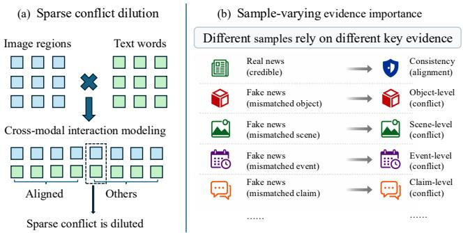
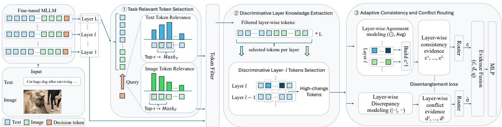
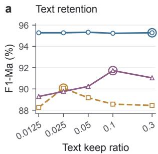
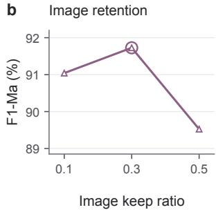
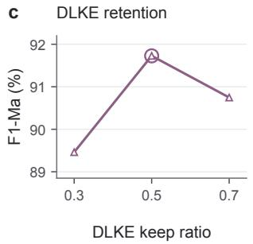
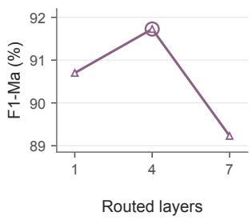

# Decoupling Consistency and Conflict across MLLM Layers for Fake News Detection

Kai Qian∗   
School of Computer Science and   
Technology   
Soochow University   
China Jiaqi Wang   
Computer Science and Engineering   
The Chinese University of Hong Kong China   
Dongjie Xu∗   
Soochow University   
China

Haolun Ma DSA The Hong Kong University of Science and Technology China

Weijie Shi Hong Kong University of Science and Technology China

Jia Zhu   
School of Education   
Zhejiang Normal University   
China   
Jiajie Xu   
School of Computer Science and   
Technology   
Soochow University   
China

## Abstract

The trustworthiness of Web content faces a growing threat from multimodal fake news. Real news usually shows aligned image-text semantics, while fake news often contains a few conflicts at varying levels, such as mismatches in objects, scenes, events, and claims. However, existing methods usually treat consistency and conflict in a coarse and static way, limiting their ability to capture sparse conflicts and adapt to varying conflict levels. Inspired by the distinct knowledge encoded across layers in large language models, we propose Multi-Level Consistency and Conflict Decoupling (MLCCD), which captures conflicts at diferent levels from diferent layers of multimodal large language models (MLLMs). Specifically, we first use the MLLM’s final decision representation to select visual and textual tokens relevant to the task, preventing irrelevant content from diluting sparse conflicts. Then, we preserve tokens whose representations change sharply between adjacent layers, capturing the knowledge each layer adds. Finally, we decouple this knowledge into consistency and conflict evidence and aggregate each across layers with its own router, adapting to varying conflict levels. Experiments on three benchmarks show that MLCCD outperforms existing methods.

## CCS Concepts

• Computing methodologies → Computer vision; Information extraction.

## Keywords

Web Mining, Multimedia Web Content, Misinformation, Multimodal Fake News Detection, Multimodal Large Language Models

## 1 Introduction

The Web has become a major medium for accessing and sharing news. However, the rapid dissemination of fake news through online platforms poses a serious threat to the credibility of Web content[15].†As news on these platforms commonly combines text and images [2], multimodal fake news detection is an important part of addressing this threat.

In multimodal news, misleading information can arise from how images and text are combined, even when each modality appears plausible on its own [2, 28]. Semantic consistency between the two modalities therefore provides useful evidence for verification [26, 38], but broad alignment can coexist with conflicts in specific details. For example, the text may misidentify a person or object shown in the image [27], or describe a setting that difers from the depicted scene [26]. Such mismatches can also concern the reported event, with the image and text referring to diferent events despite sharing the same entities [24]. Beyond the depicted content, an authentic image may be used to support a claim that contradicts its original context [28]. Together, these examples illustrate how broad semantic agreement can coexist with decisive conflicts involving only a few details at diferent semantic levels.

To capture these semantic relations, existing studies have explored a range of modeling strategies for multimodal fake news detection, including contrastive alignment [31], semantic consistency modeling [34], and higher order interaction learning [33]. Nevertheless, those methods still model consistency and conflict at a relatively coarse granularity, without explicitly adapting evidence aggregation across semantic levels to individual samples. These limitations highlight the following two key challenges.

  
Figure 1: Illustration of two challenges in multimodal fake news detection. (a) Sparse conflicts can be diluted when aggregated with other content. (b) The importance of consistency and conflict evidence can vary across samples and semantic levels.

First, sparse conflict clues are easily diluted. As illustrated in Figure 1(a), a conflict may involve only a few interactions between image regions and text, while most other interactions reflect semantic agreement or involve content unrelated to verification. If these interactions are aggregated without suficiently distinguish ing their value for verification, the more abundant signals can dominate the resulting representation and obscure the few conflicting details. Therefore, it is necessary to preserve the details that reveal conflicts while reducing interference from content unrelated to verification.

Second, the importance of consistency and conflict evidence varies across samples. As illustrated in Figure 1(b), consis tency between images and text can provide supporting evidence for real news, while the decisive evidence for fake news may involve conflicts concerning objects, scenes, events, or claims. Assigning fixed importance to diferent forms of evidence may fail to accom modate these variations, giving insuficient emphasis to the clues most informative for a particular sample. Therefore, it is necessary to adapt evidence fusion to each sample so that the most informative consistency and conflict clues receive suficient emphasis.

To address these challenges, we turn to representations from different layers of multimodal large language models (MLLMs). Prior studies of large language models (LLMs) have identified specific layers involved in factual recall [25] and shown that contrasting outputs from diferent layers can help reveal factual knowledge [7]. Motivated by these findings, we propose Multi-Level Consistency and Conflict Decoupling (MLCCD) to extract consistency and conflict evidence from diferent MLLM layers and adapt its aggregation to the needs of individual samples. Specifically, we first use the MLLM’s final decision representation as a query to select visual and textual tokens relevant to the task, aiming to reduce interference from irrelevant content. Among these tokens, we then retain those whose representations change sharply between adjacent layers to capture the information introduced at each layer. Finally, we decouple the retained representations at each layer into consistency and conflict evidence and aggregate each type across layers with its own router to adapt to varying evidence needs across samples.

Our main contributions are summarized as follows:

• We present a perspective for multimodal fake news detection that draws on knowledge from diferent MLLM layers to capture consistency and conflict at multiple levels.

• We propose MLCCD, a Multi-Level Consistency and Conflict Decoupling framework. It extracts information relevant to verification to preserve sparse conflict clues, and decouples and adaptively aggregates consistency and conflict evidence to accommodate varying evidence needs across samples.

• Experiments on three benchmarks show that MLCCD outperforms the compared baselines.

## 2 Related Work

## 2.1 Multimodal Fake News Detection

Multimodal fake news detection aims to verify news credibility by jointly considering textual content, visual information, and their semantic relations [9]. Since mismatches between text and images can provide clues to fake news [38], existing studies have explored approaches such as joint multimodal representation learning [15], cross modal alignment [36], consistency modeling [38], modality interaction modeling [23], and knowledge enhanced verification [8]. Recent methods further employ multimodal large language models to support explanation generation [28] and reasoning with generated evidence [39]. However, these methods rarely exploit the knowledge encoded across MLLM layers and usually model consistency and conflict in a coarse or static way, making it dificult to capture sparse conflicts or adapt to varying conflict levels.

## 2.2 Multimodal Large Language Models

Multimodal large language models (MLLMs) extend large language models (LLMs) to multimodal perception and reasoning by connecting visual encoders with language models through modality alignment modules [1, 11]. With large scale vision language pretraining [3] and multimodal instruction tuning [41], MLLMs support visual question answering [21], image captioning [30], visual grounding [37], instruction following [13], and complex multimodal understanding [40]. Beyond their final outputs, intermediate layers also carry useful information. Recent studies show that diferent layers of the visual encoder contribute diferently to multimodal understanding, and that multilayer visual feature fusion can improve generalization [4, 18, 20]. In LLMs, intermediate representations can provide useful features for downstream tasks [32], specific layers are involved in factual recall [25], and contrasting outputs across layers can help reveal factual knowledge [7]. However, the visual encoder sees only the image, while image and text tokens first interact in the language backbone. We therefore investigate consistency and conflict evidence across layers of the MLLM language backbone.

## 3 Preliminaries

## 3.1 Task Definition

For the �-th multimodal news post, let $X _ { i } ^ { t }$ denote its textual content, $X _ { i } ^ { v }$ denote its visual content, and $y _ { i } ~ \in ~ \{ 0 , 1 \}$ denote its ground truth label, where $y _ { i } = 1$ indicates fake news and $y _ { i } = 0$ indicates real news. Given � training examples, the dataset is denoted as $\mathcal { D } = \{ ( X _ { i } ^ { t } , X _ { i } ^ { v } , y _ { i } ) \} _ { i = 1 } ^ { N }$ . The goal of multimodal fake news detection is to learn a prediction function $f _ { \theta }$ that estimates the fake news probability $\hat { y } _ { i } = f _ { \theta } ( X _ { i } ^ { t } , X _ { i } ^ { v } )$ for each post.

  
Figure 2: Overview of MLCCD. The frozen LoRA tuned MLLM provides layer wise hidden states, and the proposed evidence network selects task relevant tokens, extracts discriminative layer knowledge, and adaptively routes consistency and conflict evidence for fake news prediction.

## 3.2 MLLM Layer Representations

We use a LoRA tuned MLLM as the feature backbone. After tuning, the backbone is frozen, and the proposed evidence network operates on its hidden states. For each input post, the backbone produces layer wise token representations $\mathcal { H } = \{ H ^ { 1 } , H ^ { 2 } , . . . , H ^ { L } \}$ For layer ℓ, the hidden sequence $H ^ { \ell } = \{ h _ { i } ^ { \ell } \} _ { i = 1 } ^ { T }$ consists of� token representations, where � is the number of MLLM layers and $h _ { i } ^ { \ell }$ is the hidden state of the �-th token in the input multimodal sequence at layer ℓ. We use two binary modality masks, $M ^ { t } \in \{ 0 , 1 \bar  \} ^ { T }$ and $M ^ { v } \in \{ 0 , 1 \} ^ { T }$ , to distinguish textual and visual tokens. Specifically, $M _ { i } ^ { t } = 1$ indicates that position � belongs to the text modality, and ${ \dot { M _ { i } ^ { v } } } = 1$ indicates that position � belongs to the image modality. Viewing binary masks as sets of selected positions, the valid token mask is defined as their union, $M = M ^ { t } \vee M ^ { v }$

## 4 Methodology

## 4.1 Overview

MLCCD detects multimodal fake news by transforming the internal layer representations of an MLLM into structured verification evidence. Given a news post with an image and text, the MLLM encodes both modalities into a unified hidden sequence, where textual and visual elements are treated as tokens. Since decisive fake news clues are often sparse and may appear at diferent semantic depths, MLCCD progressively constructs evidence from token selec tion to layer knowledge extraction, and then performs fine-grained consistency and conflict decoupling across MLLM layers.

As shown in Figure 2, MLCCD consists of three modules. Task Relevant Token Selection uses the final decision representation as a query to select visual and textual tokens related to the verification decision. Discriminative Layer Knowledge Extraction retains selected tokens with distinctive representation changes between adjacent layers, capturing layer specific knowledge from the MLLM hierarchy. Adaptive Consistency and Conflict Routing builds separate evidence streams for cross modal agreement and discrepancy, and adaptively aggregates them across layers with independent routers.

## 4.2 Task Relevant Token Selection

This module constructs a compact evidence pool before layer knowledge extraction. Multimodal fake news clues are often localized in a small subset of textual or visual tokens, while many other tokens provide background information that is related to the post but less useful for verification. Directly aggregating all tokens may therefore dilute the decisive clues. To address this issue, we use the MLLM’s decision context to measure token relevance and select informative textual and visual tokens separately.

In our prompt format, the MLLM is instructed to output the verification label as the first generated answer token. For an autoregressive MLLM, this answer is predicted from the hidden state of the final valid prompt token. Let $i ^ { \star }$ denote the position of this token and $q _ { 0 } = h _ { i ^ { \star } } ^ { L }$ denote its hidden state in the last MLLM layer. This hidden state provides a compact decision context for the verification task, and we use it as a task query. To identify tokens that are most related to the pending verification answer, we compare this query with each final layer token in a shared evidence space:

$$
s _ { i } = \frac { \phi _ { h } ( h _ { i } ^ { L } ) ^ { \top } \phi _ { q } ( q _ { 0 } ) } { \sqrt { d } } .\tag{1}
$$

Here, $\phi _ { h }$ and $\phi _ { q }$ are learnable projection functions, each consisting of layer normalization followed by a linear layer, and � is their output dimension. For brevity, we denote the projected query $\phi _ { q } ( q _ { 0 } )$ as � in subsequent modules. A larger $s _ { i }$ indicates that token � is more relevant to the verification decision and should be more likely to enter the evidence pool.

We then perform modality wise selection based on the relevance scores. For visual tokens, the candidate mask is $C ^ { v } = M ^ { v }$ . For textual tokens, the decision token is removed from the candidate set, so $C ^ { t } = M ^ { t } \setminus \{ i ^ { \star } \}$ . For each modality $m \in \{ t , \upsilon \}$ , the selected token mask $\tilde { M } ^ { m }$ is obtained by top ratio selection:

$$
\tilde { M } ^ { m } = \mathrm { T o p R } ( s , C ^ { m } , \rho _ { q } ^ { m } ) , \quad m \in \{ t , v \} ,\tag{2}
$$

where Top $\mathrm { R } ( s , C ^ { m } , \rho _ { q } ^ { m } )$ keeps the highest scored $\rho _ { q } ^ { m }$ proportion of tokens within the candidate mask $C ^ { m }$ . The keep ratio $\rho _ { q } ^ { m }$ is modality dependent because the numbers of textual and visual tokens can difer substantially. This design allows each modality to preserve an appropriate amount of task relevant information and prevents the modality with more tokens from dominating the evidence pool. We also compute the normalized relevance distribution $\pi _ { i } ^ { m }$ over selected tokens:

$$
\pi _ { i } ^ { m } = \operatorname { s o f t m a x } _ { i \in \tilde { M } ^ { m } } ( s _ { i } ) .\tag{3}
$$

The relevance distribution $\pi _ { i } ^ { m }$ is later used as a reliability cue for layer wise evidence extraction.

## 4.3 Discriminative Layer Knowledge Extraction

After task relevant tokens are selected, this module further identifies which selected tokens carry discriminative layer knowledge. Diferent MLLM layers provide diferent representations of the input, and a token whose representation changes strongly between adjacent layers is likely to contain layer specific evidence. Therefore, we use representation changes across layers to preserve tokens that are both task relevant and layer distinctive.

For token � at layer ℓ, the layer change score $e _ { i } ^ { \ell }$ measures how much its representation changes from the previous layer. Since the first layer has no preceding layer, its score is set to zero as a boundary convention:

$$
e _ { i } ^ { \ell } = \left\{ \begin{array} { l l } { 0 , } & { \ell = 1 , } \\ { \| h _ { i } ^ { \ell } - h _ { i } ^ { \ell - 1 } \| _ { 2 } , } & { \ell > 1 . } \end{array} \right.\tag{4}
$$

For each modality � and each layer $\ell ,$ we standardize the layer change scores within the selected candidate tokens $\tilde { M } ^ { m }$ to obtain $e _ { i , \mathrm { s t d } } ^ { m , \ell }$ , which measures the relative distinctiveness of token � within modality � at layer ℓ. The discriminative token mask $\bar { M } ^ { m , \ell }$ keeps the selected tokens with the largest standardized changes:

$$
\bar { M } ^ { m , \ell } = \mathrm { T o p R } ( e _ { \mathrm { s t d } } ^ { m , \ell } , \tilde { M } ^ { m } , \rho _ { e } ) , \quad m \in \{ t , v \} .\tag{5}
$$

Here, $\rho _ { e }$ is the layer evidence keep ratio.

To integrate task relevance and layer distinctiveness, each retained token receives a weight $a _ { i } ^ { m , \ell }$

$$
a _ { i } ^ { m , \ell } = \mathrm { s o f t m a x } _ { i \in \bar { M } ^ { m , \ell } } \big ( s _ { i } + \gamma e _ { i , \mathrm { s t d } } ^ { m , \ell } \big ) ,\tag{6}
$$

The scalar � is a learnable positive scale. The modality representation $u _ { m } ^ { \ell }$ at layer ℓ is obtained by weighted pooling:

$$
u _ { m } ^ { \ell } = \sum _ { i \in \bar { M } ^ { m , \ell } } a _ { i } ^ { m , \ell } h _ { i } ^ { \ell } , \quad m \in \{ t , v \} .\tag{7}
$$

To preserve modality identity and layer order, we project $u _ { m } ^ { \ell }$ with a learnable projection function $\phi _ { f }$ , and combine the result with the layer position embedding $p ^ { \ell }$ and the modality embedding $b _ { m } \colon$

$$
\hat { z } _ { m } ^ { \ell } = \phi _ { f } ( u _ { m } ^ { \ell } ) + p ^ { \ell } + b _ { m } .\tag{8}
$$

Here, $\phi _ { f }$ consists of layer normalization, a linear layer, GELU, and dropout. The resulting $\hat { z } _ { t } ^ { \ell }$ and $\hat { z } _ { v } ^ { \ell }$ are layer aware textual and visual representations that preserve task relevance and discriminative layer knowledge. In addition, the token weights are also used to summarize the reliability of the extracted evidence. Specifically, $\mu _ { m } ^ { \ell }$ measures retained decision relevance, and $\nu _ { m } ^ { \ell }$ measures retained

layer knowledge strength:

$$
\begin{array} { r l r } {  { \mu _ { m } ^ { \ell } = \sum _ { i \in \bar { M } ^ { m , \ell } } a _ { i } ^ { m , \ell } \pi _ { i } ^ { m } , } } \\ & { \nu _ { m } ^ { \ell } = \sum _ { i \in \bar { M } ^ { m , \ell } } a _ { i } ^ { m , \ell } \sigma ( e _ { i , \mathrm { s t d } } ^ { m , \ell } ) . } \end{array}\tag{9}
$$

These reliability scores are passed to the routing module together with the layer wise representations.

## 4.4 Adaptive Consistency and Conflict Routing

Given the extracted layer wise representations, MLCCD first applies a lightweight refinement before constructing consistency and conflict evidence. Specifically, a Transformer encoder $E _ { \mathrm { l a y e r } }$ is applied along the layer dimension to slightly contextualize each layer representation while keeping the layer wise outputs separate:

$$
z _ { m } ^ { 1 : L } = E _ { \mathrm { l a y e r } } ( \hat { z } _ { m } ^ { 1 : L } ) .\tag{10}
$$

Based on the refined representations $z _ { t } ^ { \ell }$ and $z _ { v } ^ { \ell } ,$ MLCCD separates cross modal agreement from cross modal discrepancy at each layer. Consistency evidence reflects whether the visual and textual modalities support compatible semantics, while conflict evidence captures their divergent signals. The two evidence streams are then routed independently according to their layer wise reliability. In this way, decoupling is performed at multiple semantic levels instead of only on a single global multimodal representation.

For each layer ℓ, the consistency stream represents cross modal agreement with element wise interaction and averaged context:

$$
g _ { c } ^ { \ell } = \left[ z _ { t } ^ { \ell } \odot z _ { v } ^ { \ell } ; \frac { z _ { t } ^ { \ell } + z _ { v } ^ { \ell } } { 2 } \right] .\tag{11}
$$

The conflict stream represents cross modal discrepancy with absolute and directional diferences:

$$
g _ { d } ^ { \ell } = \left[ | z _ { t } ^ { \ell } - z _ { v } ^ { \ell } | ; z _ { t } ^ { \ell } - z _ { v } ^ { \ell } \right] .\tag{12}
$$

The branch inputs from all layers are then transformed by feed forward builders $\phi _ { c }$ and $\phi _ { d } ,$ followed by branch encoders $E _ { c }$ and $E _ { d } ,$ producing layer wise consistency evidence $c ^ { 1 : L }$ and conflict evidence $d ^ { 1 : L }$

$$
\begin{array} { r c l } { { } } & { { } } & { { c ^ { 1 : L } = E _ { c } ( \phi _ { c } ( g _ { c } ^ { 1 : L } ) ) , } } \\ { { } } & { { } } & { { d ^ { 1 : L } = E _ { d } ( \phi _ { d } ( g _ { d } ^ { 1 : L } ) ) . } } \end{array}\tag{13}
$$

To provide the routers with evidence quality cues, we estimate the consistency strength $\kappa _ { c } ^ { \ell }$ and conflict strength $\kappa _ { d } ^ { \ell }$ with learnable scorers $\omega _ { c }$ and $\omega _ { d } \mathrm { : }$

$$
\kappa _ { c } ^ { \ell } = \sigma ( \omega _ { c } ( c ^ { \ell } ) ) , \quad \kappa _ { d } ^ { \ell } = \sigma ( \omega _ { d } ( d ^ { \ell } ) ) .\tag{14}
$$

Together with the modality relevance and layer knowledge strength from the previous module, these scores form the reliability vector $r ^ { \ell } { : }$

$$
r ^ { \ell } = [ \mu _ { t } ^ { \ell } ; \mu _ { v } ^ { \ell } ; \nu _ { t } ^ { \ell } ; \nu _ { v } ^ { \ell } ; \kappa _ { c } ^ { \ell } ; \kappa _ { d } ^ { \ell } ] .\tag{15}
$$

For branch � $\in \{ c , d \}$ , an independent router $\psi _ { x }$ computes the layer importance score $\eta _ { x } ^ { \ell }$ from the branch evidence $x ^ { \ell }$ , the decision query �, and the reliability vector $r ^ { \ell } { : }$

$$
\eta _ { x } ^ { \ell } = \psi _ { x } ( [ x ^ { \ell } ; q ; r ^ { \ell } ] ) .\tag{16}
$$

The router keeps the top � layers for each branch:

$$
\mathcal { K } _ { x } = \mathrm { T o p K } ( \{ \eta _ { x } ^ { \ell } \} _ { \ell = 1 } ^ { L } , K ) .\tag{17}
$$

The routing weights are obtained by normalizing the retained layer scores:

$$
\alpha _ { x } ^ { \ell } = \frac { \exp ( \eta _ { x } ^ { \ell } ) \mathbb { I } [ \ell \in \mathcal { K } _ { x } ] } { \sum _ { j \in \mathcal { K } _ { x } } \exp ( \eta _ { x } ^ { j } ) } .\tag{18}
$$

The routed branch evidence �¯ is computed as

$$
\bar { x } = \sum _ { \ell = 1 } ^ { L } \alpha _ { x } ^ { \ell } x ^ { \ell } , \quad x \in \{ c , d \} .\tag{19}
$$

Thus, �¯ and $\bar { d }$ denote the routed consistency evidence and routed conflict evidence, respectively. The routed reliability summary �¯ averages the reliability vectors under the two routing distributions:

$$
\bar { r } = \frac { 1 } { 2 } \left( \sum _ { \ell = 1 } ^ { L } \alpha _ { c } ^ { \ell } r ^ { \ell } + \sum _ { \ell = 1 } ^ { L } \alpha _ { d } ^ { \ell } r ^ { \ell } \right) .\tag{20}
$$

Finally, the classifier input $z _ { \mathrm { c l s } }$ combines routed evidence, evidence interaction, evidence diference, the decision query, and the routed reliability summary:

$$
z _ { \mathrm { c l s } } = \big [ \bar { c } ; \bar { d } ; \bar { c } \odot \bar { d } ; \big | \bar { c } - \bar { d } \big | ; q ; \bar { r } \big ] .\tag{21}
$$

The fake news logit � and prediction probability $\hat { y }$ are produced by

$$
o = \mathrm { M L P } ( z _ { \mathrm { c l s } } ) , \quad \hat { y } = \sigma ( o ) .\tag{22}
$$

## 4.5 Training Objective

We train the evidence network with the standard binary cross entropy loss $\mathcal { L } _ { \mathrm { c l s } } .$ . To encourage the consistency and conflict streams to encode complementary evidence, we further use a disentanglement regularizer $\mathcal { L } _ { \mathrm { d i s } } \mathrm { : }$

$$
\mathcal { L } _ { \mathrm { d i s } } = \frac { 1 } { B } \sum _ { b = 1 } ^ { B } \frac { 1 } { L } \sum _ { \ell = 1 } ^ { L } \cos ( c _ { b } ^ { \ell } , d _ { b } ^ { \ell } ) ^ { 2 } ,\tag{23}
$$

This term discourages the two streams from producing overly similar representations at each layer. With the disentanglement weight �, the final objective is

$$
\begin{array} { r } { \mathcal { L } = \mathcal { L } _ { \mathrm { c l s } } + \lambda \mathcal { L } _ { \mathrm { d i s } } . } \end{array}\tag{24}
$$

During training, the LoRA tuned MLLM remains frozen, and only the three proposed modules and the classifier are optimized

## 5 Experiments

## 5.1 Datasets and Metrics

We evaluate MLCCD on three widely used multimodal fake news detection benchmarks: Weibo [14], Pheme [43], and AMG [12]. These datasets cover diferent languages, event sources, and data scales, enabling evaluation under diverse multimodal news verification scenarios. Table 1 summarizes the dataset statistics used in our experiments. The dash in the Dev column indicates that Weibo is evaluated with its original train/test split and does not provide a separate development set. For all datasets, we report Accuracy, macro F1, real class F1, and fake class F1 as the main evaluation metrics. The detailed preprocessing procedures and split settings are provided in Appendix A.

## 5.2 Baselines

We compare MLCCD with three groups ofbaselines listed in Table 3. Among conventional multimodal fake news detectors, CFFN [17] models consistency and inconsistency between words and image regions. MTS [33] captures multimodal interactions of diferent orders through Taylor series expansion, while MIMoE-FND [23] uses a hierarchical mixture of experts to adapt fusion to diferent modality interactions. DDU [5] addresses epistemic and aleatoric uncertainty through retrieved context and uncertainty aware expert routing. We also include three general multimodal methods adapted to fake news detection: DMD [19] decouples multimodal representations for cross modal knowledge distillation; DecAlign [29] combines representation decoupling with hierarchical cross modal alignment; and MultiLoReFT [35] learns shared and modality specific subspaces through low rank representation fine tuning. For MLLM baselines, FKA-Owl [22] augments large vision language models with forgery specific knowledge. We further construct direct MLLM baselines by LoRA fine tuning Gemma-4-E2B-it and Gemma-4-E4B-it [10], as well as Qwen3-VL-2B-Instruct and Qwen3- VL-8B-Instruct [1], under the same data splits.

## 5.3 Implementation Details

We implement MLCCD with Qwen3-VL-8B-Instruct as the backbone MLLM. The backbone is first adapted with LoRA; during evidence network training, the LoRA tuned backbone is frozen and only the proposed modules and the classifier are optimized. Each sample is formatted as one image and one text prompt. We train the evidence network with AdamW. For token selection, we set $\rho _ { e } ~ = ~ 0 . 5$ , keep at least one token for each non-empty top-ratio candidate set, fix $\rho _ { q } ^ { v } = 0 . 3$ , and set $\rho _ { q } ^ { t }$ to 0.3, 0.025, and 0.1 on Weibo, AMG, and Pheme, respectively. Detailed hyperparameters and input processing settings are provided in Appendix B.

## 5.4 Overall Performance

Table 3 reports the overall results. MLCCD achieves the highest accuracy and macro F1 on all three datasets, outperforming the evaluated conventional detectors, general multimodal methods, and large model based baselines. Qwen3-VL-8B + LoRA is the strongest baseline in both metrics on each dataset. Compared with this baseline, MLCCD improves accuracy by 0.90, 1.56, and 0.26 percentage points on AMG, Pheme, and Weibo, respectively, with corresponding macro F1 gains of 0.87, 2.27, and 0.26 points. These results show additional gains over direct LoRA adaptation of the same backbone. The gains are modest on Weibo, where the baseline already achieves 95.02% in both metrics, and larger on AMG and Pheme.

The advantage also holds when compared with conventional fake news detectors and general multimodal methods adapted to this task. Among conventional detectors, DDU achieves the highest accuracy on AMG and Weibo, while MTS performs best on Pheme. MLCCD exceeds these results by 4.98, 3.64, and 4.35 accuracy points on AMG, Pheme, and Weibo, respectively. Among the general multimodal baselines, DMD achieves higher accuracy and macro F1 than DecAlign and MultiLoReFT on all three datasets, while MLCCD further improves on both metrics across these datasets.

Class wise results further show that the improvements are reflected in both labels, with MLCCD achieving the highest F1-R and F1-F on all three datasets. The largest gain over the strongest baseline in F1-F occurs on Pheme, where MLCCD reaches 88.18%, compared with 84.96% for Gemma-4-E2B-it + LoRA, an improvement of 3.22 percentage points.

Table 1: Dataset statistics.
<table><tr><td>Dataset</td><td>Train</td><td>Dev</td><td>Test</td><td>Lang.</td></tr><tr><td>Weibo</td><td>7461</td><td>一</td><td>1929</td><td>Chinese</td></tr><tr><td>Pheme</td><td>1412</td><td>221</td><td>385</td><td>English</td></tr><tr><td>AMG</td><td>3268</td><td>501</td><td>883</td><td>English</td></tr></table>

Table 2: Ablation results on Pheme. All values are percentages. Best results are in bold. F1-R and F1-F denote real class F1 and fake class F1.
<table><tr><td>Variant</td><td>Acc.</td><td>F1-Ma</td><td>F1-R</td><td>F1-F</td></tr><tr><td>w/o TRTS</td><td>92.21</td><td>90.45</td><td>94.55</td><td>86.36</td></tr><tr><td>w/o DLKE</td><td>92.21</td><td>90.70</td><td>94.44</td><td>86.96</td></tr><tr><td>w/o ACCR</td><td>92.47</td><td>90.70</td><td>94.76</td><td>86.64</td></tr><tr><td>Shared Router</td><td>91.69</td><td>89.46</td><td>94.31</td><td>84.62</td></tr><tr><td>w/o Dis.</td><td>92.73</td><td>91.09</td><td>94.91</td><td>87.27</td></tr><tr><td>MLCCD</td><td>93.25</td><td>91.73</td><td>95.27</td><td>88.18</td></tr></table>

## 5.5 Ablation Study

We conduct ablation studies on Pheme to examine the contribution of each component under the same training protocol. w/o TRTS removes Task Relevant Token Selection and uses all modality tokens as the candidate evidence pool. w/o DLKE removes Discriminative Layer Knowledge Extraction and does not select tokens according to layer transition scores. w/o ACCR removes Adaptive Consistency and Conflict Routing, and directly averages the layer aware textual and visual representations for prediction. Shared Router keeps the consistency and conflict streams but uses one shared router for both branches. w/o Dis. removes the disentanglement regularizer ${ \mathcal { L } } _ { \mathrm { d i s } }$

Table 2 shows that all ablated variants have lower accuracy and macro F1 than the full model. Removing TRTS or DLKE reduces macro F1 by 1.28 and 1.03 percentage points, respectively, suggesting that both task relevant token selection and layer transition based evidence extraction contribute to detection performance on Pheme. Removing ACCR also lowers macro F1 by 1.03 points, suggesting that the combined design of evidence decoupling and adaptive aggregation is more efective than directly averaging the layer representations. The shared router variant obtains the largest macro F1 drop of 2.27 points and reduces fake news F1 by 3.56 points, suggesting that consistency and conflict evidence benefit from separate layer routing in this setting. Removing ${ \mathcal { L } } _ { \mathrm { d i s } }$ leads to a smaller macro F1 drop of 0.64 points, suggesting that the regularizer also contributes to detection performance.

## 5.6 Hyperparameter Sensitivity

We examine the sensitivity of MLCCD to the text keep ratio $\rho _ { q } ^ { t }$ on all three datasets. On Pheme, we also evaluate the image keep ratio $\rho _ { q } ^ { v } ,$ the token keep ratio $\rho _ { e }$ in DLKE, and the number of routed layers. Figure 3 presents the macro F1 results, with outer circles indicating the default settings. Complete results for all four metrics are provided in Appendix C.

d  

  
Figure 3: Hyperparameter sensitivity of MLCCD. (a) Text keep ratio $\rho _ { q } ^ { t }$ on Weibo, AMG, and Pheme, shown on a logarithmic horizontal axis. (b) Image keep ratio $\rho _ { q } ^ { v } ,$ (c) token keep ratio $\rho _ { e }$ in DLKE, and (d) number of routed layers on Pheme. Outer circles indicate the default settings. Panels (b)–(d) share the same vertical scale. Each point represents one reported experimental result, and lines connect the evaluated settings.

As shown in Figure 3(a), the efect of the text keep ratio differs across datasets. On Weibo, macro F1 varies only from 95.23% to 95.33% over the tested ratios. The default ratio of 0.3 achieves 95.28%, slightly below the highest value obtained at 0.05. In contrast, AMG and Pheme show greater variation. Among the tested values, AMG achieves its highest macro F1 of 90.07% at 0.025, while Pheme reaches 91.73% at 0.1. Both larger and smaller ratios yield lower macro F1 on these two datasets. These results show that the sensitivity to text token retention varies across datasets, with Weibo exhibiting relatively little variation over the tested range.

For the remaining parameters on Pheme, Figure 3(b)–(d) shows that the default settings of $\rho _ { q } ^ { v } = 0 . 3 , \rho _ { e } = 0 . 5$ , and four routed layers achieve the highest macro F1 in their respective sweeps. Increasing or decreasing either token keep ratio from its default value lowers macro F1 within the tested ranges. Similarly, using one or seven routed layers yields macro F1 scores of 90.70% and 89.23%, respectively, compared with 91.73% for four layers. These comparisons support the adopted settings on Pheme and show that retaining more tokens or aggregating more layers does not necessarily improve performance.

Table 3: Overall results on AMG, PHEME, and Weibo with seed 42. All values are percentages. Acc. and F1-Ma denote accuracy and macro F1, respectively. F1-R and F1-F denote real class F1 and fake class F1, respectively.
<table><tr><td rowspan="2">Category</td><td rowspan="2">Method</td><td colspan="4">AMG</td><td colspan="4">PHEME</td><td colspan="4">Weibo</td></tr><tr><td>Acc.</td><td>F1-Ma</td><td>F1-R</td><td>F1-F</td><td>Acc.</td><td>F1-Ma</td><td>F1-R</td><td>F1-F</td><td>Acc.</td><td>F1-Ma</td><td>F1-R</td><td>F1-F</td></tr><tr><td rowspan="4">General fake news detection methods</td><td>CFFN [17]</td><td>82.90</td><td>82.39</td><td>85.38</td><td>79.40</td><td>82.86</td><td>79.22</td><td>87.91</td><td>70.54</td><td>89.22</td><td>89.21</td><td>89.52</td><td>88.90</td></tr><tr><td>MTS [33]</td><td>85.05</td><td>84.51</td><td>87.40</td><td>81.62</td><td>89.61</td><td>87.72</td><td>92.54</td><td>82.91</td><td>89.58</td><td>89.54</td><td>90.15</td><td>88.94</td></tr><tr><td>MIMoE-FND [23]</td><td>84.03</td><td>83.64</td><td>86.16</td><td>81.12</td><td>88.57</td><td>86.62</td><td>91.73</td><td>81.51</td><td>89.89</td><td>89.88</td><td>90.19</td><td>89.58</td></tr><tr><td>DDU [5]</td><td>85.39</td><td>84.91</td><td>87.61</td><td>82.21</td><td>86.49</td><td>83.88</td><td>90.37</td><td>77.39</td><td>90.93</td><td>90.93</td><td>91.02</td><td>90.83</td></tr><tr><td rowspan="4">General multimodal methods</td><td>DMD [19]</td><td>84.60</td><td>84.25</td><td>86.59</td><td>81.91</td><td>88.57</td><td>85.24</td><td>92.25</td><td>78.22</td><td>89.42</td><td>89.41</td><td>89.75</td><td>89.08</td></tr><tr><td>DecAlign [29]</td><td>82.33</td><td>82.04</td><td>84.34</td><td>79.74</td><td>86.23</td><td>83.61</td><td>90.17</td><td>77.06</td><td>83.46</td><td>83.46</td><td>83.32</td><td>83.60</td></tr><tr><td>MultiLoReFT [35]</td><td>79.50</td><td>79.21</td><td>81.66</td><td>76.77</td><td>78.70</td><td>77.38</td><td>82.85</td><td>71.92</td><td>84.71</td><td>84.67</td><td>85.43</td><td>83.91</td></tr><tr><td>FKA-Owl [22]</td><td>84.60</td><td>84.31</td><td>86.43</td><td>82.20</td><td>85.97</td><td>83.50</td><td>89.89</td><td>77.12</td><td>90.31</td><td>90.30</td><td>90.55</td><td>90.05</td></tr><tr><td rowspan="6">MLLM methods</td><td>Gemma-4-E2B-it + LoRA [10]</td><td>84.94</td><td>84.62</td><td>86.82</td><td>82.43</td><td>91.17</td><td>89.35</td><td>93.75</td><td>84.96</td><td>91.81</td><td>91.81</td><td>91.96</td><td>91.66</td></tr><tr><td>Gemma-4-E4B-it + LoRA [10]</td><td>85.84</td><td>85.54</td><td>87.64</td><td>83.44</td><td>91.17</td><td>89.24</td><td>93.80</td><td>84.68</td><td>94.04</td><td>94.03</td><td>94.25</td><td>93.81</td></tr><tr><td>Qwen3-VL-2B + LoRA [1]</td><td>89.35</td><td>89.03</td><td>90.91</td><td>87.16</td><td>90.13</td><td>88.34</td><td>92.91</td><td>83.76</td><td>94.19</td><td>94.19</td><td>94.40</td><td>93.97</td></tr><tr><td>Qwen3-VL-8B + LoRA [1]</td><td>89.47</td><td>89.20</td><td>90.89</td><td>87.52</td><td>91.69</td><td>89.46</td><td>94.31</td><td>84.62</td><td>95.02</td><td>95.02</td><td>95.16</td><td>94.88</td></tr><tr><td>Ours (MLCCD)</td><td>90.37</td><td>90.07</td><td>91.80</td><td>88.34</td><td>93.25</td><td>91.73</td><td>95.27</td><td>88.18</td><td>95.28</td><td>95.28</td><td>95.34</td><td>95.22</td></tr><tr><td></td><td></td><td></td><td></td><td></td><td></td><td></td><td></td><td></td><td></td><td></td><td></td><td></td></tr></table>

Table 4: Results on the controlled counterfactual evaluation set. N denotes the number of samples, and Correct denotes the number assigned the intended label. Rates are percentages: counterfactual detection rates in the upper block and correct acceptance rates for real samples in the lower block. Δ denotes the rate of MLCCD minus that of the LoRA baseline in percentage points.
<table><tr><td rowspan="2">Sample type</td><td rowspan="2">N</td><td colspan="2">Qwen3-VL-8B + LoRA</td><td colspan="2">MLCCD</td><td rowspan="2">∆(pp)</td></tr><tr><td>Correct</td><td>Rate (%)</td><td>Correct</td><td>Rate (%)</td></tr><tr><td colspan="7">Counterfactual samples: detection as fake</td></tr><tr><td>Object conflict</td><td>100</td><td>23</td><td>23.00</td><td>50</td><td>50.00</td><td>+27.00</td></tr><tr><td>Scene conflict</td><td>100</td><td>23</td><td>23.00</td><td>52</td><td>52.00</td><td>+29.00</td></tr><tr><td>Event conflict</td><td>100</td><td>14</td><td>14.00</td><td>34</td><td>34.00</td><td>+20.00</td></tr><tr><td>Claim conflict</td><td>100</td><td>14</td><td>14.00</td><td>33</td><td>33.00</td><td>+19.00</td></tr><tr><td>All counterfactuals</td><td>400</td><td>74</td><td>18.50</td><td>169</td><td>42.25</td><td>+23.75</td></tr><tr><td colspan="7">Real samples: correct acceptance as real</td></tr><tr><td>Original news</td><td>100</td><td>97</td><td>97.00</td><td>96</td><td>96.00</td><td>-1.00</td></tr><tr><td>Reference descriptions</td><td>100</td><td>100</td><td>100.00</td><td>100</td><td>100.00</td><td>0.00</td></tr><tr><td>Meaning preserving local edits</td><td>400</td><td>400</td><td>100.00</td><td>400</td><td>100.00</td><td>0.00</td></tr><tr><td>Semantic paraphrases</td><td>100</td><td>100</td><td>100.00</td><td>100</td><td>100.00</td><td>0.00</td></tr></table>

## 5.7 Counterfactual Evaluation

We conduct a controlled counterfactual evaluation to examine whether MLCCD can identify local conflicts within otherwise consistent multimodal content. Using images from 100 real news samples in the Pheme test set, we construct a reference description for each image and create four counterfactual variants involving objects, scenes, events, and claims. Each variant modifies a single contiguous text span while keeping the image and the remaining text unchanged, yielding 400 counterfactual samples. These edits are made to constructed reference descriptions rather than the orig inal news text. For each group, we also retain the original news and include four meaning preserving local edits and one semantic paraphrase of the reference description. We use GPT-6.1 Sol (gpt-6.1-sol) through Codex as a tool to assist in constructing reference descriptions and counterfactual edits. The construction instructions and control generation procedure are provided in Appendix D.

Table 4 compares MLCCD with Qwen3-VL-8B + LoRA. For counterfactual samples, we report the detection rate, defined as the percentage classified as fake. For real samples, we report the correct acceptance rate, defined as the percentage classified as real. MLCCD detects 169 of the 400 counterfactual samples, compared with 74 for the LoRA baseline, increasing the overall detection rate from 18.50% to 42.25%, a gain of 23.75 percentage points. Improvements are observed across all four conflict types. Both methods correctly classify all reference descriptions, meaning preserving local edits, and semantic paraphrases as real. On the 100 original news samples, MLCCD and the LoRA baseline correctly classify 96 and 97 samples, respectively.

Table 5: Counterfactual detection results grouped by edit ratio. N denotes the number of samples. Each method entry reports the number of detected counterfactuals, followed by the detection rate (%) in parentheses. LoRA denotes Qwen3- VL-8B + LoRA.
<table><tr><td>Edit ratio</td><td>N</td><td>LoRA</td><td>MLCCD</td></tr><tr><td> $r _ { \mathrm { e d i t } } \leq 5 \%$ </td><td>151</td><td>23 (15.23)</td><td>54 (35.76)</td></tr><tr><td> $5 \% < r _ { \mathrm { e d i t } } \leq 1 0 \%$ </td><td>153</td><td>29 (18.95)</td><td>65 (42.48)</td></tr><tr><td> $1 0 \% < r _ { \mathrm { e d i t } } \leq 2 0 \%$ </td><td>96</td><td>22 (22.92)</td><td>50 (52.08)</td></tr><tr><td>All samples</td><td>400</td><td>74 (18.50)</td><td>169 (42.25)</td></tr></table>

These results indicate that MLCCD is more sensitive to the introduced local conflicts than direct LoRA fine tuning, while maintaining correct predictions on the constructed reference descriptions and meaning preserving controls. Across the four conflict types, MLCCD achieves higher detection rates for object and scene variants than for event and claim variants, indicating that these variants remain more dificult within this controlled evaluation.

## 5.8 Analysis of Conflict Sparsity

We further analyze the 400 counterfactual samples to examine detection performance across diferent degrees of conflict sparsity. For each sample, we define the edit ratio $r _ { \mathrm { e d i t } }$ as the number of tokens overlapping the changed text span divided by the total number of tokens in the counterfactual text body. The changed span is the smallest contiguous span containing the diferences from the reference description. Token counts are obtained using the backbone tokenizer, excluding prompt, image, and padding tokens. A smaller ratio therefore indicates that the modification occupies a smaller portion of the text. We group the samples into three intervals and compute detection rates using the predictions from the counterfactual evaluation.

As shown in Table 5, MLCCD achieves higher detection rates than the LoRA baseline in all three groups. When the edited span occupies at most 5% ofthe text body, MLCCD detects 54 of151 counterfactual samples, compared with 23 for LoRA. The corresponding detection rates are 35.76% and 15.23%, respectively, giving a difference of 20.53 percentage points. For the other two intervals, MLCCD achieves detection rates of 42.48% and 52.08%, compared with 18.95% and 22.92% for LoRA. Both methods exhibit higher detection rates in groups with larger edit ratios.

## 5.9 Analysis of Image Dependence

To examine whether MLCCD’s responses to local conflicts depend on visual content, we replace the original images while keeping the texts and model parameters unchanged. We consider two replacements: a uniform gray image with the same dimensions as the original image, and a donor image with the same number of visual tokens after preprocessing. We group samples by event using keyword rules applied to the source news text and select donor images from a diferent group. The gray image experiment covers all 100 groups, whereas suitable donor images are available for 64 groups, yielding 400 and 256 counterfactual and control pairs, respectively.

Table 6: Efect of image replacement on MLCCD. N denotes the number of counterfactual and control pairs. Original and Replaced report the mean paired score diference under the respective image conditions, evaluated on the same pairs in each row.
<table><tr><td>Image replacement</td><td></td><td>N Original Replaced</td><td></td></tr><tr><td>Uniform gray</td><td>400</td><td>4.84</td><td>0.96</td></tr><tr><td>Donor image</td><td>256</td><td>4.70</td><td>1.02</td></tr></table>

For each counterfactual text, we use its corresponding meaning preserving control and define the paired score diference as

$$
d ( I ) = s ( I , T _ { \mathrm { c f } } ) - s ( I , T _ { \mathrm { c t r l } } ) ,\tag{25}
$$

where � denotes the fake news logit produced by MLCCD, and $T _ { \mathrm { c f } }$ and $T _ { \mathrm { c t r l } }$ denote the counterfactual text and its control. A larger diference indicates a stronger relative response to the counterfactual text. We compute the mean diference under the original and replacement images using the same pairs within each experiment. This analysis measures changes in model responses, since the original compatibility labels do not necessarily apply after image replacement.

As shown in Table 6, replacing the original images with uniform gray images reduces the mean paired score diference from 4.84 to 0.96. On the subset with matched donor images, the diference decreases from 4.70 to 1.02. The reduction under both replacements indicates that visual content contributes to the separation between counterfactual texts and meaning preserving controls in this evaluation.

## 5.10 Eficiency Analysis

Fake news can spread rapidly through online platforms [15], making timely detection important for practical deployment. As new content continually arrives, deployed detectors must repeatedly perform inference, so its eficiency directly afects how quickly incoming news can be assessed. We therefore compare the training and inference times of MLCCD with Qwen3-VL-8B + LoRA on Pheme using execution logs. Both training stages use four NVIDIA A100 80GB GPUs with a global batch size of 24, while inference for both methods is performed on the same single GPU with a batch size of 24. Total training time covers five epochs of LoRA adaptation and, for MLCCD, five additional epochs of evidence network training, excluding model initialization, validation, and checkpoint saving.

As shown in Table 7, MLCCD requires 1,102 seconds of training, including 845 seconds for LoRA adaptation and 257 seconds for evidence network training. This corresponds to a 30.4% increase over direct LoRA fine tuning. During inference, however, MLCCD processes all 385 test samples in approximately 48 seconds, compared with 45 seconds for the baseline, adding only about 3 seconds across the entire test set. With this small increase in inference time, MLCCD improves accuracy by 1.56 percentage points and macro F1 by 2.27 percentage points on Pheme. These results show that MLCCD ofers a favorable balance between predictive performance and processing eficiency for timely news verification on the Web.

Table 7: Runtime comparison on Pheme. MLCCD training time includes both LoRA adaptation and evidence network training. Inference time covers all 385 test samples. Timings are derived from execution logs and include data handling and logging overhead.
<table><tr><td>Method</td><td>Total training time (s)</td><td>Training overhead</td><td>Inference time (s)</td></tr><tr><td>Qwen3-VL-8B + LoRA</td><td>845</td><td>一</td><td>≈45</td></tr><tr><td>MLCCD</td><td>1102</td><td>+257 s (+30.4%)</td><td>≈48</td></tr></table>

## 6 Conclusion

We proposed MLCCD, a framework that draws on knowledge encoded across diferent MLLM layers for multimodal fake news detection. MLCCD first selects task-relevant visual and textual tokens and then retains representations that change substantially between adjacent layers to capture complementary information. It further separates consistency and conflict evidence and aggregates them through two adaptive routers to address sparse conflicts and varying evidence needs. Experiments on three benchmarks demonstrate improvements over the evaluated baselines. Controlled counterfactual evaluation further shows that MLCCD detects a larger proportion of local conflicts than direct LoRA fine-tuning while maintaining low false-alarm rates on the evaluated controls. Timing results on PHEME indicate limited additional inference cost, supporting the potential of layer-specific evidence modeling for assessing the credibility of multimodal Web content.

## References

[1] Shuai Bai, Yuxuan Cai, Ruizhe Chen, Keqin Chen, Xionghui Chen, Zesen Cheng, Lianghao Deng, Wei Ding, Chang Gao, Chunjiang Ge, et al. 2025. Qwen3-vl technical report. arXiv preprint arXiv:2511.21631 (2025).

[2] Gullal S Cheema, Sherzod Hakimov, Eric Müller-Budack, Christian Otto, John A Bateman, and Ralph Ewerth. 2023. Understanding image-text relations and news values for multimodal news analysis. Frontiers in artificial intelligence 6 (2023), 1125533.

[3] Fei-Long Chen, Du-Zhen Zhang, Ming-Lun Han, Xiu-Yi Chen, Jing Shi, Shuang Xu, and Bo Xu. 2023. Vlp: A survey on vision-language pre-training. Machine Intelligence Research 20, 1 (2023), 38–56

[4] Haoran Chen, Junyan Lin, Xinhao Chen, Yue Fan, Xin Jin, Hui Su, Jianfeng Dong, Jinlan Fu, and Xiaoyu Shen. 2025. Rethinking visual layer selection in multimodal llms. arXiv e-prints (2025), arXiv–2504.

[5] Xuran Chen, Xianglin Wei, and Yang Yang. 2026. DDU: Decoupling Dual-Level Uncertainties for Reliable Multimodal Fake News Detection. In Proceedings ofthe 34th ACM International Conference on Multimedia. doi:10.1145/3767308.3835912

[6] Yixuan Chen, Dongsheng Li, Peng Zhang, Jie Sui, Qin Lv, Lu Tun, and Li Shang. 2022. Cross-modal ambiguity learning for multimodal fake news detection. In Proceedings ofthe ACM web conference 2022. 2897–2905.

[7] Yung-Sung Chuang, Yujia Xie, Hongyin Luo, Yoon Kim, James R Glass, and Pengcheng He. 2024. Dola: Decoding by contrasting layers improves factuality in large language models. In International Conference on Learning Representations, Vol. 2024. 54158–54183.

[8] Xingyu Gao, Xi Wang, Zhenyu Chen, Wei Zhou, and Steven CH Hoi. 2024. Knowledge enhanced vision and language model for multi-modal fake news detection. IEEE Transactions on Multimedia 26 (2024), 8312–8322.

[9] Anastasia Giachanou, Guobiao Zhang, and Paolo Rosso. 2020. Multimodal fake news detection with textual, visual and semantic information. In International Conference on Text, Speech, and Dialogue. Springer, 30–38.

[10] Google. 2026. Gemma 4 Model Card. https://ai.google.dev/gemma/docs/core/ model\_card\_4. Accessed: 2026-05-26.

[11] Aaron Grattafiori, Abhimanyu Dubey, Abhinav Jauhri, Abhinav Pandey, Abhishek Kadian, Ahmad Al-Dahle, Aiesha Letman, Akhil Mathur, Alan Schelten, Alex Vaughan, et al. 2024. The llama 3 herd of models. arXiv preprint arXiv:2407.21783 (2024).

[12] Hao Guo, Zihan Ma, Zhi Zeng, Minnan Luo, Weixin Zeng, Jiuyang Tang, and Xiang Zhao. 2025. Each fake news is fake in its own way: An attribution multigranularity benchmark for multimodal fake news detection. In Proceedings of the AAAI conference on artificial intelligence, Vol. 39. 228–236.

[13] Jiaxing Huang, Jingyi Zhang, Kai Jiang, Han Qiu, Xiaoqin Zhang, Ling Shao, Shijian Lu, and Dacheng Tao. 2025. Visual instruction tuning towards general purpose multimodal large language model: A survey. International Journal of Computer Vision 133, 11 (2025), 8151–8189.

[14] Zhiwei Jin, Juan Cao, Han Guo, Yongdong Zhang, and Jiebo Luo. 2017. Multi modal fusion with recurrent neural networks for rumor detection on microblogs. In Proceedings ofthe 25th ACM international conference on Multimedia. 795–816.

[15] Dhruv Khattar, Jaipal Singh Goud, Manish Gupta, and Vasudeva Varma. 2019. Mvae: Multimodal variational autoencoder for fake news detection. In The world wide web conference. 2915–2921.

[16] An Lao, Qi Zhang, Chongyang Shi, Longbing Cao, Kun Yi, Liang Hu, and Duoqian Miao. 2024. Frequency spectrum is more efective for multimodal representation and fusion: A multimodal spectrum rumor detector. In Proceedings ofthe AAAI conference on artificial intelligence, Vol. 38. 18426–18434.

[17] Jun Li, Yi Bin, Jie Zou, Jiwei Wei, Guoqing Wang, and Yang Yang. 2023. Crossmodal consistency learning with fine-grained fusion network for multimodal fake news detection. In Proceedings ofthe 5th ACM International Conference on Multimedia in Asia. 1–7.

[18] Xu Li, Yi Zheng, Haotian Chen, Xiaolei Chen, Yuxuan Liang, Chenghang Lai, Bin Li, and Xiangyang Xue. 2026. Instruction-guided fusion of multi-layer visual features in large vision-language models. Pattern Recognition 170 (2026), 111932.

[19] Yong Li, Yuanzhi Wang, and Zhen Cui. 2023. Decoupled multimodal distilling for emotion recognition. In 2023 IEEE/CVF Conference on Computer Vision and Pattern Recognition (CVPR). IEEE, 6631–6640.

[20] Junyan Lin, Haoran Chen, Yue Fan, Yingqi Fan, Xin Jin, Hui Su, Jinlan Fu, and Xiaoyu Shen. 2025. Multi-layer visual feature fusion in multimodal llms: Methods, analysis, and best practices. In Proceedings of the Computer Vision and Pattern Recognition Conference. 4156–4166.

[21] Haotian Liu, Chunyuan Li, Yuheng Li, and Yong Jae Lee. 2024. Improved baselines with visual instruction tuning. In 2024 IEEE/CVF Conference on Computer Vision and Pattern Recognition (CVPR). IEEE, 26286–26296.

[22] Xuannan Liu, Peipei Li, Huaibo Huang, Zekun Li, Xing Cui, Jiahao Liang, Lixiong Qin, Weihong Deng, and Zhaofeng He. 2024. Fka-owl: Advancing multimodal fake news detection through knowledge-augmented lvlms. In Proceedings ofthe 32nd ACM International Conference on Multimedia. 10154–10163.

[23] Yifan Liu, Yaokun Liu, Zelin Li, Ruichen Yao, Yang Zhang, and Dong Wang. 2025. Modality interactive mixture-of-experts for fake news detection. In Proceedings ofthe ACM on Web Conference 2025. 5139–5150.

[24] Zihan Ma, Minnan Luo, Hao Guo, Zhi Zeng, Yiran Hao, and Xiang Zhao. 2024. Event-radar: Event-driven multi-view learning for multimodal fake news detection. In Proceedings ofthe 62nd Annual Meeting ofthe Association for Computational Linguistics (Volume 1: Long Papers). 5809–5821.

[25] Kevin Meng, David Bau, Alex Andonian, and Yonatan Belinkov. 2022. Locating and editing factual associations in gpt. Advances in neural information processing systems 35 (2022), 17359–17372.

[26] Eric Müller-Budack, Jonas Theiner, Sebastian Diering, Maximilian Idahl, and Ralph Ewerth. 2020. Multimodal analytics for real-world news using measures of cross-modal entity consistency. In Proceedings ofthe 2020 international conference on multimedia retrieval. 16–25.

[27] Peng Qi, Juan Cao, Xirong Li, Huan Liu, Qiang Sheng, Xiaoyue Mi, Qin He, Yongbiao Lv, Chenyang Guo, and Yingchao Yu. 2021. Improving fake news detection by using an entity-enhanced framework to fuse diverse multimodal clues. In Proceedings ofthe 29th ACM international conference on multimedia. 1212–1220.

[28] Peng Qi, Zehong Yan, Wynne Hsu, and Mong Li Lee. 2024. Snifer: Multimodal large language model for explainable out-of-context misinformation detection. In Proceedings ofthe IEEE/CVF conference on computer vision and pattern recognition. 13052–13062.

[29] Chengxuan Qian, Shuo Xing, Li Li, Yue Zhao, and Zhengzhong Tu. 2026. Decalign: Hierarchical cross-modal alignment for decoupled multimodal representation learning. In International Conference on Learning Representations, Vol. 2026. 152802–152824.

[30] Sara Sarto, Marcella Cornia, and Rita Cucchiara. 2025. Image captioning evaluation in the age of multimodal llms: Challenges and future perspectives. arXiv preprint arXiv:2503.14604 (2025).

[31] Xiaorong Shen, Maowei Huang, Zheng Hu, Shimin Cai, and Tao Zhou. 2024. Multimodal fake news detection with contrastive learning and optimal transport. Frontiers in Computer Science 6 (2024), 1473457.

[32] Oscar Skean, Md Rifat Arefin, Dan Zhao, Niket Patel, Jalal Naghiyev, Yann LeCun, and Ravid Shwartz-Ziv. 2025. Layer by layer: Uncovering hidden representations in language models. arXiv preprint arXiv:2502.02013 (2025).

[33] Jiahao Sun, Chen Chen, Chunyan Hou, Yike Wu, and Xiaojie Yuan. 2025. Multimodal Taylor Series Network for Misinformation Detection. In Proceedings of the ACM on Web Conference 2025. 2540–2548.

[34] Zhulin Tao, Runze Zhao, Xin Shi, Xingyu Gao, Xi Wang, and Xianglin Huang. 2025. Multimodal consistency suppression factor for fake news detection. ACM Transactions on Multimedia Computing, Communications and Applications 21, 11 (2025), 1–19.

[35] Sana Tonekaboni, Viktoria Schuster, and Caroline Uhler. 2026. MultiLoReFT: Decoupling Shared and Modality-Specific Subspaces in Multimodal Learning via Low-Rank Representation Fine-Tuning. arXiv preprint arXiv:2607.16789 (2026).

[36] Longzheng Wang, Chuang Zhang, Hongbo Xu, Yongxiu Xu, Xiaohan Xu, and Siqi Wang. 2023. Cross-modal contrastive learning for multimodal fake news detection. In Proceedings ofthe 31st ACM international conference on multimedia. 5696–5704.

[37] Linhui Xiao, Xiaoshan Yang, Xiangyuan Lan, Yaowei Wang, and Changsheng Xu. 2025. Towards visual grounding: A survey. IEEE Transactions on Pattern Analysis and Machine Intelligence (2025).

[38] Junxiao Xue, Yabo Wang, Yichen Tian, Yafei Li, Lei Shi, and Lin Wei. 2021. Detecting fake news by exploring the consistency of multimodal data. Information Processing & Management 58, 5 (2021), 102610.

[39] Kaiying Yan, Moyang Liu, Yukun Liu, Ruibo Fu, Zhengqi Wen, Jianhua Tao, and Xuefei Liu. 2025. Debunk and infer: Multimodal fake news detection via difusion-generated evidence and llm reasoning. arXiv preprint arXiv:2506.21557 (2025).

[40] Shukang Yin, Chaoyou Fu, Sirui Zhao, Ke Li, Xing Sun, Tong Xu, and Enhong Chen. 2024. A survey on multimodal large language models. National Science Review 11, 12 (2024), nwae403.

[41] Bo Zhao, Boya Wu, Muyang He, and Tiejun Huang. 2023. Svit: Scaling up visual instruction tuning. arXiv preprint arXiv:2307.04087 (2023).

[42] Jiaqi Zheng, Xi Zhang, Sanchuan Guo, Quan Wang, Wenyu Zang, and Yongdong Zhang. 2022. MFAN: Multi-modal feature-enhanced attention networks for rumor detection.. In IJCAI, Vol. 2022. 2413–2419.

[43] Arkaitz Zubiaga, Maria Liakata, and Rob Procter. 2017. Exploiting context for rumour detection in social media. In International conference on social informatics. Springer, 109–123.

## A Dataset Details

We evaluate MLCCD on three multimodal fake news benchmarks: Weibo [14], Pheme [43], and AMG [12]. We follow the standard split and preprocessing protocol of each dataset where available. For Weibo, the original train/test split is kept, and when a post contains multiple images, the image with the highest resolution is used as the visual input. Following common preprocessing practice [6, 16], we remove samples with empty text, including 50 training samples and 66 test samples, as well as one test sample without a valid image. For Pheme, we adopt the same train/validation/test split as [42]. For AMG, we remove samples whose media files are not images, corrupted images, and images with abnormal resolution such as 1 × 1. Since AMG contains substantially longer texts, we truncate each AMG text to the first 1024 words during preprocessing. Table 1 reports the resulting statistics. For evaluation, we report Accuracy, macro F1, real class F1, and fake class F1.

## B Implementation Details

For LoRA adaptation, we use rank 256, LoRA alpha 512, dropout 0.05, and apply LoRA to the query, key, value, output, gate, up, and down projection layers. For Qwen based models, the processor uses left padding and constrains the visual token budget to 4–256 tokens by setting min\_p $\mathrm { i } \mathsf { x e l s } = 4 \times 3 2 ^ { 2 }$ and max $\mathsf { \Pi } _ { - } \mathsf { p i x e l s } = 2 5 6 \times 3 2 ^ { 2 }$ . For Gemma based baselines, we set the maximum visual soft token budget to 280, the supported budget closest to the Qwen limit of 256.

The evidence network follows a compact configuration. We set the hidden dimension to 1024 and the classifier fusion dimension to 512. Each lightweight Transformer encoder contains one block with 8 attention heads and dropout 0.1. For token selection based on changes between adjacent layers, we set $\rho _ { e } ~ = ~ 0 . 5$ . Each top ratio operation keeps at least one token when the candidate set is non-empty. The image keep ratio is fixed as $\rho _ { q } ^ { v } = 0 . 3$ across datasets. We set the text keep ratio $\rho _ { q } ^ { t }$ to 0.3 on Weibo, 0.025 on AMG, and 0.1 on Pheme. During routing, each evidence stream keeps the top 4 layers. We train the evidence network for 5 epochs with AdamW, using learning rate $5 \times 1 0 ^ { - 5 }$ , weight decay 0.01, global batch size 24, gradient clipping 1.0, and DeepSpeed ZeRO stage 2 with bfloat16. We use cosine learning rate decay with a warmup ratio of 0.1. The weight of the disentanglement loss is set to 0.01.

## C Hyperparameter Sensitivity

Tables 8 and 9 provide the complete results for the hyperparameter sweeps in Figure 3. We report accuracy, macro F1, real class F1, and fake class F1 for every evaluated setting.

## D Counterfactual Sample Construction

We use GPT-6.1 Sol (gpt-6.1-sol) through Codex to assist in constructing reference descriptions and counterfactual edits from Pheme images. Construction and visual review are performed through an interactive workflow. The instructions and procedures for constructing the counterfactual samples are summarized below.

You are assisting in constructing a controlled evaluation set for multimodal fake news detection. Given a news image and its source text, produce four reference clauses supported by the visible image and a contradictory text replacement for each clause.

(1) Cover four edit types: object, concerning a visible object or entity; scene, concerning the visible environment; event, concerning a visible action, posture, state, or arrangement; and claim, concerning another directly checkable assertion, such as an attribute or clearly readable text.

(2) Base every reference clause on visible evidence. Use the source news only as context. Do not introduce identities, intentions, dates, locations, or historical outcomes that cannot be verified from the image.

(3) Write each reference clause using the word “shown” to indicate that it describes the supplied image. Make the four clauses compatible with one another, and avoid repeating the same target fact across clauses.

(4) For each clause, identify one short, contiguous text span and propose a replacement that directly contradicts the image. The replacement must preserve grammatical coherence. All other text and the image must remain unchanged.

(5) Avoid edits that create an obvious contradiction between the textual clauses themselves. The intended inconsistency should depend on comparing the edited description with the image.

(6) For each edit, record its type, reference clause, original span, replacement span, and supporting visual evidence. If four unambiguous contrasts cannot be supported, reject the candidate image rather than inventing a conflict.

Return structured records with the fields type, reference\_clause, changed\_from, changed\_to, and image\_evidence.

Across the 100 groups, we balance the order of the four reference clauses. The clause corresponding to each conflict type appears in the first, second, third, and fourth sentence positions in 25 groups each. The source image remains unchanged.

Table 8: Sensitivity to the text keep ratio $\rho _ { q } ^ { t } .$ All performance scores are percentages. The default ratios are 0.3, 0.025, and 0.1 for Weibo, AMG, and Pheme, respectively. F1-R and F1-F denote real class F1 and fake class F1.
<table><tr><td rowspan="2"> $\rho _ { q } ^ { t }$ </td><td colspan="4">Weibo</td><td colspan="4">AMG</td><td colspan="4">Pheme</td></tr><tr><td> $\operatorname { A c c } .$ </td><td>F1-Ma</td><td>F1-R</td><td>F1-F</td><td>Acc.</td><td>F1-Ma</td><td>F1-R</td><td>F1-F</td><td>Acc.</td><td>F1-Ma</td><td>F1-R</td><td>F1-F</td></tr><tr><td>0.0125</td><td>95.28</td><td>95.28</td><td>95.39</td><td>95.17</td><td>88.45</td><td>88.26</td><td>89.74</td><td>86.79</td><td>91.43</td><td>89.29</td><td>94.08</td><td>84.51</td></tr><tr><td>0.025</td><td>95.28</td><td>95.28</td><td>95.36</td><td>95.20</td><td>90.37</td><td>90.07</td><td>91.80</td><td>88.34</td><td>91.69</td><td>89.76</td><td>94.20</td><td>85.32</td></tr><tr><td>0.05</td><td>95.33</td><td>95.33</td><td>95.45</td><td>95.22</td><td>89.47</td><td>89.17</td><td>90.96</td><td>87.38</td><td>92.21</td><td>90.24</td><td>94.62</td><td>85.85</td></tr><tr><td>0.1</td><td>95.23</td><td>95.23</td><td>95.29</td><td>95.17</td><td>88.79</td><td>88.57</td><td>90.15</td><td>86.99</td><td>93.25</td><td>91.73</td><td>95.27</td><td>88.18</td></tr><tr><td>0.3</td><td>95.28</td><td>95.28</td><td>95.34</td><td>95.22</td><td>88.67</td><td>88.45</td><td>90.06</td><td>86.84</td><td>92.73</td><td>91.04</td><td>94.93</td><td>87.16</td></tr></table>

Table 9: Sensitivity to the image keep ratio $\rho _ { q } ^ { v } ,$ , the token keep ratio $\rho _ { e }$ in DLKE, and the number of routed layers on Pheme. All performance scores are percentages. † marks the default setting in each group. F1-R and F1-F denote real class F1 and fake class F1.
<table><tr><td>Parameter</td><td>Value</td><td>Acc.</td><td>F1-Ma</td><td>F1-R</td><td>F1-F</td></tr><tr><td rowspan="3"> $\rho _ { q } ^ { v }$ </td><td>0.1</td><td>92.73</td><td>91.04</td><td>94.93</td><td>87.16</td></tr><tr><td>0.3†</td><td>93.25</td><td>91.73</td><td>95.27</td><td>88.18</td></tr><tr><td>0.5</td><td>91.69</td><td>89.52</td><td>94.29</td><td>84.76</td></tr><tr><td rowspan="3"> $\rho _ { e }$ </td><td>0.3</td><td>91.69</td><td>89.46</td><td>94.31</td><td>84.62</td></tr><tr><td>0.5†</td><td>93.25</td><td>91.73</td><td>95.27</td><td>88.18</td></tr><tr><td>0.7</td><td>92.47</td><td>90.75</td><td>94.74</td><td>86.76</td></tr><tr><td rowspan="3">Routed layers</td><td>1</td><td>92.21</td><td>90.70</td><td>94.44</td><td>86.96</td></tr><tr><td> $4 ^ { \dagger }$ </td><td>93.25</td><td>91.73</td><td>95.27</td><td>88.18</td></tr><tr><td> $^ { 7 }$ </td><td>91.43</td><td>89.23</td><td>94.10</td><td>84.36</td></tr></table>

The meaning preserving controls are generated programmatically. Each local control replaces “shown” with “pictured” in one reference clause. The full description control rewrites all four clauses using the form “In this image, ...”, while retaining their factual content.

## E Detailed Classification Results

Tables 10, 11, and 12 report accuracy and the precision, recall, and F1 score for each class on AMG, Pheme, and Weibo, respectively. All values are percentages. Prec. and Rec. denote precision and recall, respectively.

Table 10: Detailed classification results on AMG.
<table><tr><td rowspan="2">Method</td><td rowspan="2">Acc.</td><td colspan="3">Fake News</td><td colspan="3">Real News</td></tr><tr><td>Prec.</td><td>Rec.</td><td>F1</td><td>Prec.</td><td>Rec.</td><td>F1</td></tr><tr><td>CFFN</td><td>82.90</td><td>74.42</td><td>85.09</td><td>79.40</td><td>89.63</td><td>81.52</td><td>85.38</td></tr><tr><td>MTS</td><td>85.05</td><td>77.93</td><td>85.67</td><td>81.62</td><td>90.34</td><td>84.66</td><td>87.40</td></tr><tr><td>MIMoE-FND</td><td>84.03</td><td>74.81</td><td>88.60</td><td>81.12</td><td>91.84</td><td>81.15</td><td>86.16</td></tr><tr><td>DDU</td><td>85.39</td><td>77.81</td><td>87.13</td><td>82.21</td><td>91.20</td><td>84.29</td><td>87.61</td></tr><tr><td>DMD</td><td>84.60</td><td>75.12</td><td>90.06</td><td>81.91</td><td>92.81</td><td>81.15</td><td>86.59</td></tr><tr><td>DecAlign</td><td>82.33</td><td>71.73</td><td>89.77</td><td>79.74</td><td>92.31</td><td>77.63</td><td>84.34</td></tr><tr><td>MultiLoReFT</td><td>79.50</td><td>68.42</td><td>87.43</td><td>76.77</td><td>90.36</td><td>74.49</td><td>81.66</td></tr><tr><td>FKA-Owl</td><td>84.60</td><td>74.41</td><td>91.81</td><td>82.20</td><td>93.93</td><td>80.04</td><td>86.43</td></tr><tr><td>Gemma-4-E2B-it + LoRA</td><td>84.94</td><td>75.18</td><td>91.23</td><td>82.43</td><td>93.59</td><td>80.96</td><td>86.82</td></tr><tr><td>Gemma-4-E4B-it + LoRA</td><td>85.84</td><td>76.27</td><td>92.11</td><td>83.44</td><td>94.26</td><td>81.89</td><td>87.64</td></tr><tr><td>Qwen3-VL-2B + LoRA</td><td>89.35</td><td>81.79</td><td>93.27</td><td>87.16</td><td>95.33</td><td>86.88</td><td>90.91</td></tr><tr><td>Qwen3-VL-8B + LoRA</td><td>89.47</td><td>80.89</td><td>95.32</td><td>87.52</td><td>96.67</td><td>85.77</td><td>90.89</td></tr><tr><td>MLCCD</td><td>90.37</td><td>83.20</td><td>94.15</td><td>88.34</td><td>95.97</td><td>87.99</td><td>91.80</td></tr></table>

Table 11: Detailed classification results on Pheme.

<table><tr><td rowspan="2">Method</td><td rowspan="2"> $\operatorname { A c c } .$ </td><td colspan="3">Fake News</td><td colspan="3">Real News</td></tr><tr><td>Prec.</td><td>Rec.</td><td>F1</td><td>Prec.</td><td>Rec.</td><td>F1</td></tr><tr><td>CFFN</td><td>82.86</td><td>71.17</td><td>69.91</td><td>70.54</td><td>87.59</td><td>88.24</td><td>87.91</td></tr><tr><td>MTS</td><td>89.61</td><td>80.17</td><td>85.84</td><td>82.91</td><td>93.94</td><td>91.18</td><td>92.54</td></tr><tr><td>MIMoE-FND</td><td>88.57</td><td>77.60</td><td>85.84</td><td>81.51</td><td>93.85</td><td>89.71</td><td>91.73</td></tr><tr><td>DDU</td><td>86.49</td><td>76.07</td><td>78.76</td><td>77.39</td><td>91.04</td><td>89.71</td><td>90.37</td></tr><tr><td>DMD</td><td>88.57</td><td>88.76</td><td>69.91</td><td>78.22</td><td>88.51</td><td>96.32</td><td>92.25</td></tr><tr><td>DecAlign</td><td>86.23</td><td>75.42</td><td>78.76</td><td>77.06</td><td>91.01</td><td>89.34</td><td>90.17</td></tr><tr><td>MultiLoReFT</td><td>78.70</td><td>58.66</td><td>92.92</td><td>71.92</td><td>96.12</td><td>72.79</td><td>82.85</td></tr><tr><td>FKA-Owl</td><td>85.97</td><td>73.98</td><td>80.53</td><td>77.12</td><td>91.60</td><td>88.24</td><td>89.89</td></tr><tr><td>Gemma-4-E2B-it + LoRA</td><td>91.17</td><td>84.96</td><td>84.96</td><td>84.96</td><td>93.75</td><td>93.75</td><td>93.75</td></tr><tr><td>Gemma-4-E4B-it + LoRA</td><td>91.17</td><td>86.24</td><td>83.19</td><td>84.68</td><td>93.12</td><td>94.49</td><td>93.80</td></tr><tr><td>Qwen3-VL-2B + LoRA</td><td>90.13</td><td>80.99</td><td>86.73</td><td>83.76</td><td>94.32</td><td>91.54</td><td>92.91</td></tr><tr><td>Qwen3-VL-8B + LoRA</td><td>91.69</td><td>92.63</td><td>77.88</td><td>84.62</td><td>91.38</td><td>97.43</td><td>94.31</td></tr><tr><td>MLCCD</td><td>93.25</td><td>90.65</td><td>85.84</td><td>88.18</td><td>94.24</td><td>96.32</td><td>95.27</td></tr></table>

Table 12: Detailed classification results on Weibo.
<table><tr><td rowspan="2">Method</td><td rowspan="2">Acc.</td><td colspan="3">Fake News</td><td colspan="3">Real News</td></tr><tr><td>Prec.</td><td>Rec.</td><td>F1</td><td>Prec.</td><td>Rec.</td><td>F1</td></tr><tr><td>CFFN</td><td>89.22</td><td>88.52</td><td>89.28</td><td>88.90</td><td>89.88</td><td>89.16</td><td>89.52</td></tr><tr><td>MTS</td><td>89.58</td><td>91.40</td><td>86.60</td><td>88.94</td><td>88.04</td><td>92.37</td><td>90.15</td></tr><tr><td>MIMoE-FND</td><td>89.89</td><td>89.34</td><td>89.82</td><td>89.58</td><td>90.41</td><td>89.96</td><td>90.19</td></tr><tr><td>DDU</td><td>90.93</td><td>88.83</td><td>92.93</td><td>90.83</td><td>93.07</td><td>89.06</td><td>91.02</td></tr><tr><td>DMD</td><td>89.42</td><td>88.98</td><td>89.17</td><td>89.08</td><td>89.84</td><td>89.66</td><td>89.75</td></tr><tr><td>DecAlign</td><td>83.46</td><td>80.34</td><td>87.14</td><td>83.60</td><td>86.91</td><td>80.02</td><td>83.32</td></tr><tr><td>MultiLoReFT</td><td>84.71</td><td>85.44</td><td>82.42</td><td>83.91</td><td>84.06</td><td>86.85</td><td>85.43</td></tr><tr><td>FKA-Owl</td><td>90.31</td><td>89.43</td><td>90.68</td><td>90.05</td><td>91.15</td><td>89.96</td><td>90.55</td></tr><tr><td>Gemma-4-E2B-it + LoRA</td><td>91.81</td><td>90.32</td><td>93.03</td><td>91.66</td><td>93.29</td><td>90.66</td><td>91.96</td></tr><tr><td>Gemma-4-E4B-it + LoRA</td><td>94.04</td><td>94.26</td><td>93.35</td><td>93.81</td><td>93.83</td><td>94.68</td><td>94.25</td></tr><tr><td>Qwen3-VL-2B + LoRA</td><td>94.19</td><td>94.38</td><td>93.57</td><td>93.97</td><td>94.02</td><td>94.78</td><td>94.40</td></tr><tr><td>Qwen3-VL-8B + LoRA</td><td>95.02</td><td>94.38</td><td>95.39</td><td>94.88</td><td>95.64</td><td>94.68</td><td>95.16</td></tr><tr><td>MLCCD</td><td>95.28</td><td>93.31</td><td>97.21</td><td>95.22</td><td>97.28</td><td>93.47</td><td>95.34</td></tr></table>