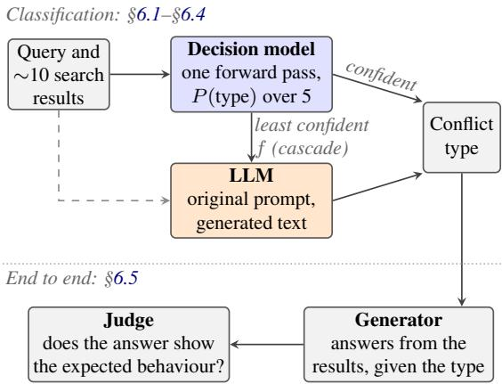
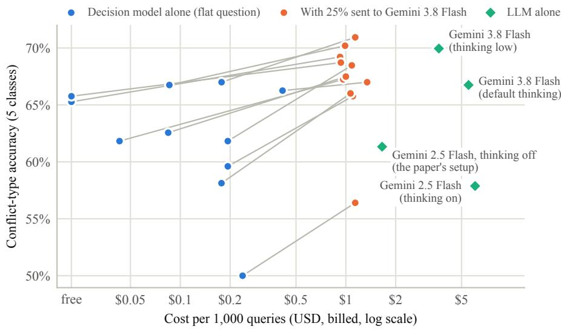

# Do We Need an LLM to Know Why Sources Conflict? Decision Models for Knowledge-Conflict Typing in RAG

Parv Khatri Independent Researcher khatriparv@gmail.com

Mehak Kapoor Independent Researcher mehakkapoor9873@gmail.com

Harshul Jain Independent Researcher harshuljain1393@gmail.com

Tanya Sah Independent Researcher tanyasah20@gmail.com

## Abstract

When the sources retrieved for a query disagree, the right response depends on why they disagree: a question with several valid answers, a contested topic, stale information and a false source each call for different behaviour. Cattan et al. (2025) showed that telling a generator the conflict type improves its responses by about 24 points, but that predicting the type is hard even for frontier LLMs. We study whether typed decision models, which return probabilities over fixed options in a single forward pass instead of generating text, can do this classification fast and cheaply. Using the CON-FLICTS benchmark and the original paper’s prompt verbatim, we evaluate all 11 decision models served by one commercial inference gateway, from 7 providers, against Gemini models on identical inputs. Asked directly, the decision models reach 50.0– 67.0% accuracy; 10 of the 11 match or exceed Gemini 2.5 Flash, the paper’s mode (61.3%), at 4–39× lower billed cost (2 were free) and 2.6–6.0× lower latency. The current Gemini 3.8 Flash (70.0%) is significantly more accurate than 8 of them, but sending each decision model’s least confident quarter of queries to it gives a cascade statistically tied with it for 8 of the 11, at 25–37% of its cost. End to end, answers generated with the types of 10 of the 11 follow the expected behaviour as often as with the LLM’s types. Decomposing the taxonomy into yes/no questions lowers accuracy for every model, and a repair fitted on one model does not transfer. Pre-specified diagnostics show that dates play no measurable role and that sensitivity to source order varies widely between models. Decision models detect a planted false source less reliably than the

LLM as hard labels, but their probabilities still separate planted from clean sources. We release code, prompts and all model outputs at https://github.com/Parv17k/ decision-models-conflict-typing.

## 1 Introduction

Search-augmented language models answer from retrieved web pages, and those pages often disagree. The disagreement can have very different causes. A question may be underspecified and admit several correct answers; it may touch a contested topic on which reasonable sources differ; the answer may have changed over time, so some pages are stale; or a page may simply be wrong. Each case calls for a different response: combine the answers, present the viewpoints neutrally, prefer the most recent information, or ignore the unreliable source. Cattan et al. (2025) formalised this as a five-way taxonomy, released CONFLICTS, a benchmark of 458 search queries annotated by experts with their conflict type, and showed that giving a generator the gold type raises the share of responses with the expected behaviour by about 24 points. Predicting the type is harder: the best LLM they tested, Gemini 2.5 Flash, reached 65.3% accuracy.

Conflict typing is a classification problem. It is made once per query, before the answer is written, and its output is one of five labels. A classifier for it should therefore be fast enough to sit in front of every search-augmented request, cheap enough to run on all of them, and calibrated enough that its uncertainty can be acted on. A recent class of models, typed decision models, is designed for this setting: they take unstructured context and typed questions and return probabilities over the allowed answers in a single forward pass, without generating text (TypeSafe AI, 2026a). Since the first such model, several providers have released their own, and one inference gateway now serves 11 of them behind a common interface. Existing evaluations cover classification, NLI and judging benchmarks, mostly for a single model (Deußer et al., 2026; Li et al., 2026b; Duan et al., 2026), but none covers deciding why retrieved sources conflict, a task that requires reading many documents at once and reasoning about their mutual relation rather than about one text.

  
Figure 1: Overview. A decision model types the conflict among a query’s search results in one forward pass; in a cascade, its least confident fraction f of queries is typed by an LLM instead. End to end, a generator answers given the predicted type, and a judge checks the answer against the expected behaviour of the gold type.

Can decision models, as a class, serve as this decision layer? And if only some can, what sets them apart? Our study (Figure 1) makes five contributions.

(1) A census of decision models on conflict typing. We evaluate every decision model served by one commercial gateway (11 models from 7 providers) on CONFLICTS under the original paper’s protocol: the same input representation, the same category definitions and examples taken verbatim from the paper’s source, and Gemini rerun on identical inputs so that every comparison is paired (§6.1). 10 of the 11 models match or exceed the paper’s LLM at a fraction of its cost and latency; the current Gemini 3.8 Flash is significantly more accurate than 8 of them.

(2) A formulation study. Decomposing the taxonomy into yes/no questions lowers accuracy for all 11 models, and a repair fitted on one model helps none, leaving the direct question as the reliable format (§6.2).

(3) Cost-quality cascades. Decision models’ confidence ranks their own errors, so sending their least certain queries to an LLM is effective: with a quarter of the queries escalated to Gemini 3.8 Flash, 8 of the 11 cascades are statistically tied with the LLM alone at 25–37% of its cost (§6.3).

(4) Pre-specified diagnostics. We test whether decision models depend on publication dates, are sensitive to source order, or miss a single false source among agreeing ones (§6.4). Dates play no measurable role, order sensitivity varies from model to model, and a planted false source shows in the probabilities more than in the top answer.

(5) An end-to-end test. Given to a generator, the types of 10 of the 11 decision models yield answers that follow the expected behaviour as often as with the LLM’s types, under both judges we specified (§6.5).

Every setting and every later addition was fixed in writing before it was run (§5). We release the code, prompts, splits and all model outputs at https://github.com/Parv17k/decisionmodels-conflict-typing.

## 2 Related Work

Knowledge conflicts in retrieval-augmented generation. Xu et al. (2024) survey conflicts between a model’s parametric knowledge and its context, among retrieved contexts, and within the model’s memory. Work on inter-context conflicts has largely studied one cause at a time, such as substituted entities (Longpre et al., 2021), contradictions in Wikipedia (Hou et al., 2024), contested questions (Wan et al., 2024), temporal or geographic context (Zhang and Choi, 2021), freshness (Vu et al., 2024) or conflicting contexts in open-domain QA (Liu et al., 2024). Cattan et al. (2025) unify these causes into a taxonomy with expected behaviours and release CONFLICTS, the first benchmark annotated with the conflict type; we build directly on it. Methods for resolving conflicts include multi-agent debate over documents (Wang et al., 2025), reasoning traces learned by fine-tuning (Mishra et al., 2025), and a two-stage detector that sends an embedding classifier’s uncertain cases to an LLM (Wang et al., 2026). None of these uses a typed decision model.

Typed decision models. A typed decision model answers typed questions (choice, score, yes/no) over a supplied state with probabilities over the allowed answers, trained for calibration rather than generation. The class was introduced with Jev (TypeSafe AI, 2026a), and hosted and open-weight alternatives followed; open reimplementations have been benchmarked against the hosted reference (Weng et al., 2026). Independent evaluations, so far mostly of the first model, find decision models competitive with frontier LLMs on knowledge, classification and NLI benchmarks at a fraction of the cost (Deußer et al., 2026; Li et al., 2026b), calibrated on choice questions but biased towards yes when many yes/no questions share a request (Deußer et al., 2026; Li and Wagle, 2026), not always coherent across logically related questions (Li et al., 2026a), weaker as inputs grow long (Duan et al., 2026), and vulnerable to natural-looking context that flips their decisions (Xu et al., 2026). As judges, they are cheaper than LLMs but share their most confident errors (Rao and Callison-Burch, 2026), and a confidence-gated cascade to an LLM can match the LLM at lower cost (Li et al., 2026c). Closest to our setting, Huang et al. (2026) use a decision model to decide whether one report supports or contradicts another. Duan et al. (2026) compare several decision models on general benchmarks; no prior work compares them on typing the conflict among many retrieved sources.

Cascades and selective prediction. Routing easy inputs to a cheap model and hard ones to an expensive model is an established way to trade cost for quality (Chen et al., 2023); its effectiveness depends on how well the cheap model’s confidence ranks its own errors, the quantity studied in selective classification (Geifman and El-Yaniv, 2017). We measure this directly for every decision model on conflict typing and compare against random escalation.

## 3 Task and Data

Taxonomy. We use the taxonomy of Cattan et al. (2025). Given a query and its retrieved sources, the conflict is one of: No conflict (the sources agree, up to wording or granularity); Complementary information (the answers differ but can all be correct, e.g. because the query is underspecified); Conflicting opinions or research outcomes (a subjective or contested topic with genuinely opposing views); Outdated information (a factual question on which sources disagree because the answer changed over time); and Misinformation (a factual question on which some sources are wrong).

<table><tr><td>Conflict type</td><td>Dev</td><td>Test</td><td>All</td></tr><tr><td>No conflict</td><td>18</td><td>143</td><td>161</td></tr><tr><td>Complementary information</td><td>13</td><td>102</td><td>115</td></tr><tr><td>Conflicting opinions</td><td>13</td><td>102</td><td>115</td></tr><tr><td>Outdated information</td><td>7</td><td>55</td><td>62</td></tr><tr><td>Misinformation</td><td>1</td><td>4</td><td>5</td></tr><tr><td>Total</td><td>52</td><td>406</td><td>458</td></tr></table>

Table 1: CONFLICTS (Cattan et al., 2025) and our frozen split. The development split (stratified, fixed seed) is used only to choose settings; all reported results are on the test split unless stated.

Data. CONFLICTS contains 458 queries drawn from ConflictingQA (Wan et al., 2024), the geographic and temporal subsets of SituatedQA (Zhang and Choi, 2021), FreshQA (Vu et al., 2024) and QACC (Liu et al., 2024), each with the top Google Search results (9.2 on average), the conflict type assigned by expert annotators, and, for the types with a single correct answer, that answer. Each result carries a URL, title, snippet, publication date when available, and the 512- token segment of the page most relevant to the query. The released file has no split. We draw a stratified development split of 52 queries with a fixed seed and use it only to choose settings; the remaining 406 queries form the test split on which we report (Table 1). Misinformation has only five instances in the whole dataset, a limitation we return to in §6.4 by constructing a planted variant.

Metric. Following Cattan et al. (2025), the primary metric is five-class accuracy. We also report macro-F1 (the classes are imbalanced), per-class F1, and, for systems that return probabilities, expected calibration error (ECE; Guo et al., 2017) of the top-class probability.

## 4 Conflict Typing with Decision Models

A typed decision model receives a state, here the query and its numbered search results, and one or more typed questions. For a choice question it returns a probability for each option; for a yes/no question, the probability of yes. Several questions over the same state are answered in one request. We study two ways of asking for the conflict type.

Flat. One choice question whose five options are the five categories. The instruction, the category definitions and their examples are copied word for word from the prompt of Cattan et al. (2025) (Appendix A); a test in our code fails if a single word differs. The predicted type is the most probable option, and its probability is the model’s confidence.

Tree. The taxonomy is hierarchical, which suggests asking simpler yes/no questions in one request: differ (do the results give different answers?), compatible (could all of them be correct?), opinion (is it a contested topic with opposing views?), outdated (do they disagree because the answer changed?), and misinformation (are some results incorrect?). The five probabilities are combined in code into a distribution over the categories. Tree v1 follows the taxonomy’s order: $P ( N o c o n f l i c t ) = 1 - d ,$ P(Complementary) = d c, and the remaining mass $d ( 1 \textrm { -- } c )$ is split over the three causes in proportion to their yesprobabilities, where d and c are the probabilities of differ and compatible. Tree $\mathbf { v } 2 ,$ chosen after inspecting Jev 1.13’s v1 answers on the development split (§6.2), asks opinion before compatible and treats misinformation as the factual conflict not explained by time: $P ( O p i n i o n s ) = d o ,$ P(Complementary) = d(1 − o)c, P(Outdated) = $d ( 1 - o ) ( 1 - c ) i$ t and $P ( M i s i n f o r m a t i o n ) = d ( 1 -$ $o ) ( 1 - c ) ( 1 - t )$ , with o and t the probabilities of opinion and outdated. Both trees use the same five answers, so v2 costs nothing extra. Every decision model receives exactly the same questions and combination rules; nothing is tuned per model.

Cascade. The decision model answers every query. The fraction f of queries with its lowest confidence is sent to an LLM, whose answer replaces the decision model’s. The threshold is a quantile of the decision model’s confidences and uses no labels, so the whole accuracy–cost curve can be computed on the test split without leakage; we fixed $f = 2 5 \%$ and f = 50% as the reported operating points before computing any cascade.

## 5 Experimental Setup

Inputs. Every system sees the same input. As in Cattan et al. (2025), each search result is the concatenation of its URL, title, snippet, publication date (when available) and 512-token segment; results keep the dataset’s order and are numbered.

For the decision models they form the state; for the LLMs they fill the paper’s prompt.

Decision models. We run every model that the Vercel AI Gateway1 listed as a decision model on the day of the census (25 October 2026), with a pinned identifier where one exists: Jev 1.13.0 and 1.14.0 (TypeSafe AI, 2026a), Decider v1.2 and Decider Flash v1.2 (Perplexity AI, 2026b,a), GPT-6 Luna Decisions (OpenAI, 2026), d1 and d1 Ultra (Liquid AI, 2026b,a), Decision-1 (Microsoft, 2026), Elephant-1 and Mammoth-1 (Baseten, 2026), and Classify-1 (ScaleDown, 2026). All receive the questions of §4 unchanged. Classify-1’s API accepts only a single text field, so it receives the same content as one text, the numbered results exactly as the LLMs see them. Two entries were excluded before any run. Laya, the only open decision model served by the gateway, cannot accept the task’s question, whose category definitions exceed its input limit; prior work reports it near chance without task-specific training (Duan et al., 2026; Nandakishore, 2026). typesafe-ai/jev is a floating alias of a pinned version we already run. Open-weight models that the gateway does not serve are out of scope: their cost and latency would depend on local hardware and not be comparable.

LLM baselines. We rerun the paper’s best classifier, Gemini 2.5 Flash (Comanici et al., 2025), with the paper’s prompt verbatim, temperature 0, thinking off (the paper lists Gemini 2.5 Flash and its thinking variant separately) and, as a sensitivity check, thinking on. To compare against a current model we add Gemini 3.8 Flash, the newest Flash model available to us, at its lowest thinking level (it cannot be switched off) and at its default. The prompt asks for JSON with an explanation and a category number; answers stating the category in another format (10527 of 14,470) are parsed leniently rather than counted as errors. All models are reached through this gateway, which reports the billed cost of every request (prices may differ from the providers’ own APIs); latency is the wall-clock time of the successful request.

Protocol. Prompts, questions, inputs and the development/test split were frozen before any testset call, with file hashes recorded. The only setting chosen by inspecting data is tree v2, chosen on the development split and marked † in all tables. Every later addition (Gemini 3.8 Flash, the further decision models, the cascade, the diagnostics and the end-to-end test) was specified in writing before it was run, and every run is reported (Appendix B).

Statistics. Comparisons are paired on identical queries. We report 95% bootstrap intervals over queries (Efron and Tibshirani, 1994) (10,000 resamples) and two-sided exact McNemar tests (Mc-Nemar, 1947) on per-query correctness. With 406 test queries, a 95% interval on accuracy is about ±4.8 points wide, so differences under about five points are generally not significant; we report them as ties. We do not correct for multiple comparisons; with 11 models a few nominal differences at $p \ < \ 0 . 0 5$ are expected by chance, so we draw conclusions from patterns across models rather than from single tests.

## 6 Results

## 6.1 Decision models against the LLMs

Table 2 gives the main comparison, sorted by accuracy. Asked directly, the 11 decision models classify 50.0–67.0% of test queries correctly (median 62.6%). Gemini 2.5 Flash with the paper’s prompt reaches 61.3% on the same queries. Against it, 8 decision models are statistically tied, 2 are significantly more accurate (Liquid d1 Ultra, +5.7 points, $p = 0 . 0 2 7 ;$ Perplexity Decider v1.2, $+ 5 . 4 , p \ : = \ : 0 . 0 4 9 )$ , and 1, ScaleDown Classify-1, is significantly less accurate $( - 1 1 . 3 , p < 0 . 0 0 1 )$ . The decision models cost \$0.04–\$0.41 per thousand queries (2 were free at the time of the runs) against \$1.66, and answer in 0.26–0.72 s against 1.55 s. Among the 10 models that match or exceed the paper’s LLM, those that are billed cost 4–39× less, and all are 2.6–6.0× faster.

The current Gemini 3.8 Flash is stronger: at its lowest thinking level it reaches 70.0%, +8.6 points above Gemini 2.5 Flash $( p < 0 . 0 0 1 )$ , at 2.2× its cost. It is significantly more accurate than 8 of the decision models; the other 3 (Liquid d1 Ultra, Perplexity Decider v1.2 and OpenAI GPT-6 Luna Decisions) trail it by 3.0 to 3.7 points without a significant difference. More thinking does not help either Gemini: Gemini 3.8 Flash at its default level scores 66.7% (−3.2 points against the low level, $p = 0 . 0 1 9 )$ and Gemini 2.5 Flash with thinking 57.9% $( p = 0 . 1 9 )$ .

Reproducing the published number. On all 458 queries, the scope of the published result, our rerun of Gemini 2.5 Flash scores 60.7% against the published 65.3%. The hosted model may have changed since publication, and the paper does not specify how results were joined in the prompt or whether thinking was enabled. We therefore compare every system with our rerun on identical inputs and report the published figure only as context.

Per class and calibration. Per class (Table 3), the models differ most on Outdated information, with F1 from 27.5 to 72.7 (Gemini 3.8 Flash: 66.1). Misinformation, with 4 test instances, defeats every system: no decision model exceeds an F1 of 11.8 (Gemini 3.8 Flash: 25.0). Calibration varies more than accuracy: the expected calibration error of the flat question ranges from 0.031 to 0.188, and 7 of the 11 models are over-confident on average (mean top probability above accuracy).

## 6.2 Flat or tree?

Decomposing the taxonomy into yes/no questions fails for every model. Tree v1 is significantly less accurate than the flat question for 11 of the 11 models (Table 4). We had inspected the cause on the development split with one model, Jev 1.13, before any test run: it answers the compatible question yes for opinion topics almost as readily as for complementary ones (mean probability 0.69 vs. 0.81), sending 12 of 13 development opinion queries to Complementary, while the opinion question separates the two classes well (AU-ROC 0.83). On the test split the same model labels 89 of the 102 Conflicting opinions queries as Complementary (F1 3.8). Its misinformation question also shows the yes-bias reported for batched yes/no questions (Deußer et al., 2026): the mean probability ranged from 0.53 to 0.79 across all five classes.

Tree v2 asks opinion first and treats misinformation as the residual factual conflict. Its order was fitted on that one model’s development answers and is applied unchanged to every model. It is significantly better than the flat question for none of them, tied for 7, and significantly worse for 4. For the model it was fitted on it is tied with flat (63.5% vs. 61.8%, $p = 0 . 5 9 )$ and better calibrated (ECE 0.026 vs. 0.103). A repair fitted to one model’s errors helped no other model, so we use the flat question for all of them.

<table><tr><td>System</td><td>Accuracy [95% CI]</td><td>Macro-F1</td><td>ECE</td><td>$/1k</td><td>Lat. (s)</td><td>∆ Gem. 2.5 (p)</td><td>∆ Gem. 3.8 (p)</td></tr><tr><td colspan="8">Decision models, flat question (one forward pass)</td></tr><tr><td>Liquid d1 Ultra</td><td>67.0 [62.3, 71.4]</td><td>53.5</td><td>0.044</td><td>0.18</td><td>0.46</td><td>+5.7 (0.027)</td><td>-3.0 (0.22)</td></tr><tr><td>Perplexity Decider v1.2</td><td>66.7 [62.1, 71.2]</td><td>56.5</td><td>0.061</td><td>0.09</td><td>0.42</td><td>+5.4 (0.049)</td><td>−3.2 (0.14)</td></tr><tr><td>OpenAI GPT-6 Luna Decisions</td><td>66.3 [61.6, 70.9]</td><td>54.7</td><td>0.059</td><td>0.41</td><td>0.35</td><td>+4.9 (0.090)</td><td>-3.7 (0.13)</td></tr><tr><td>Baseten Mammoth-1</td><td>65.8 [61.1, 70.4]</td><td>52.9</td><td>0.052</td><td>0¶</td><td>0.59</td><td>+4.4 (0.10)</td><td>-4.2 (0.050)</td></tr><tr><td>Baseten Elephant-1</td><td>65.3 [60.8, 69.7]</td><td>51.6</td><td>0.040</td><td>0¶</td><td>0.48</td><td>+3.9 (0.16)</td><td>-4.7 (0.040)</td></tr><tr><td>Liquid d1</td><td>62.6 [57.6, 67.2]</td><td>51.5</td><td>0.075</td><td>0.08</td><td>0.41</td><td>+1.2 (0.71)</td><td>−7.4 (0.002)</td></tr><tr><td>Jev 1.13</td><td>61.8 [56.9, 66.5]</td><td>54.9</td><td>0.103</td><td>0.19</td><td>0.26</td><td>+0.5 (0.92)</td><td>−8.1 (&lt;0.001)</td></tr><tr><td>Perplexity Decider Flash v1.2</td><td>61.8 [57.1, 66.5]</td><td>49.4</td><td>0.031</td><td>0.04</td><td>0.31</td><td>+0.5 (0.93)</td><td>−8.1 (&lt;0.001)</td></tr><tr><td>Jev 1.14</td><td>59.6 [54.7, 64.5]</td><td>53.3</td><td>0.113</td><td>0.19</td><td>0.28</td><td>-1.7 (0.56)</td><td>−10.3 (&lt;0.001)</td></tr><tr><td>Microsoft Decision-1</td><td>58.1 [53.2, 62.8]</td><td>50.2</td><td>0.188</td><td>0.18</td><td>0.45</td><td>−3.2 (0.24)</td><td>−11.8 (&lt;0.001)</td></tr><tr><td>ScaleDown Classify-18</td><td>50.0 [45.1, 54.9]</td><td>37.4</td><td>0.090</td><td>0.24</td><td>0.72</td><td>−11.3 (&lt;0.001)</td><td>−20.0 (&lt;0.001)</td></tr><tr><td colspan="8">Generative LLMs, the paper&#x27;s prompt</td></tr><tr><td>Gemini 2.5 Flash, thinking off</td><td>61.3 [56.7, 66.0]</td><td>53.1</td><td></td><td>1.66</td><td>1.55</td><td></td><td>−8.6 (&lt;0.001)</td></tr><tr><td>Gemini 2.5 Flash, thinking on</td><td>57.9 [53.0, 62.8]</td><td>51.4</td><td></td><td>6.04</td><td>9.57</td><td>-3.4 (0.19)</td><td>-12.1 (&lt;0.001)</td></tr><tr><td>Gemini 3.8 Flash, thinking low</td><td>70.0 [65.5, 74.4]</td><td>61.3</td><td></td><td>3.65</td><td>2.18</td><td>+8.6 (&lt;0.001)</td><td></td></tr><tr><td>Gemini 3.8 Flash, default thinking</td><td>66.7 [62.1, 71.2]</td><td>59.4</td><td></td><td>5.51</td><td>5.01</td><td>+5.4 (0.043)</td><td>-3.2 (0.019)</td></tr><tr><td>Gemini 2.5 Flash, as published‡</td><td>65.3</td><td></td><td></td><td></td><td></td><td></td><td></td></tr></table>

Table 2: Conflict-type classification on the CONFLICTS test split (n = 406), five classes, sorted by accuracy. Every system sees the same inputs; the LLMs receive the paper’s prompt verbatim and the decision models a choice question with the same instructions, definitions and examples. Cost: billed cost per 1,000 queries through one gateway (USD). Latency: mean per query. ECE is undefined for text answers. ∆: accuracy difference in points from Gemini 2.5 Flash (thinking off, the paper’s setup) and from Gemini 3.8 Flash (thinking low), exact McNemar p. §Its API accepts only a single text field, so it receives the same content as one text (the LLMs’ numbered results). ¶Free on the gateway at the time of the runs (billed \$0). ‡Reported by Cattan et al. (2025) on all 458 queries; not comparable query by query.

## 6.3 Confidence-gated cascades

Decision models’ confidence ranks their own errors, with AUROC from 0.64 to 0.76 (Table 5), which makes each of them a natural first stage before an LLM. Escalating the least confident quarter of queries to Gemini 3.8 Flash yields cascades statistically tied with the LLM alone for 8 of the 11 models, at 25–37% of its cost. Escalating by confidence beats escalating the same number of queries at random for 10 of the 11 models, by up to 4.9 points; the exception is GPT-6 Luna Decisions, whose confidence barely ranks its errors (AUROC 0.65) and whose 25% cascade equals random escalation (67.0% vs. 67.2%). Figure 2 shows every model alone and as a cascade against the LLMs. A tie at 25% does not establish equivalence: with 406 queries, the intervals still admit losses of a few points relative to the LLM, and showing equivalence at a tight margin would need more queries than CONFLICTS provides.

## 6.4 Diagnostics

We specified three hypotheses and their tests before running them; Tables 6 and 7 give the results for every decision model’s flat question and for Gemini 3.8 Flash. An identical rerun sets the noise floor: 5 of the 11 decision models return identical answers, and the others change their predicted type on up to 9.4% of queries with nothing changed (Gemini 3.8 Flash: 3.4%).

Dates. One provider documents ordering dates as a known weakness of its model (TypeSafe AI, 2026b), and we expected date handling to explain errors on Outdated. It does not. Removing every date, or adding each result’s recency rank computed in code, changes accuracy significantly in 0 of 22 tests, and recall on Outdated moves little in either direction. The models appear to recognise outdated sources from their content (phrases such as “former” or “as of”, and conflicting values), not from publication dates.

Source order. Shuffling the results changes the predicted type on 5.4–42.1% of queries (pooled over two seeds), above the noise floor for all 11 models; Gemini 3.8 Flash flips on 9.4%. Paired on the same shuffles, 4 decision models flip significantly more often than the LLM, 1 less often, and 6 no differently. The flips rarely change accuracy: 2 of 22 shuffle tests are significant, both for GPT-6 Luna Decisions (−4.7 and −5.7 points). Order sensitivity is therefore a property of individual models rather than of the class, and a deployment should test it.

Figure 2: Accuracy against cost (log scale) on the test split. Each decision model alone with the flat question (blue) is joined to the same model with its least confident 25% of queries sent to Gemini 3.8 Flash (orange). Diamonds: LLMs alone with the paper’s prompt. The two models that were free at the time of the runs are drawn at the “free” tick.
<table><tr><td>F1</td><td>NC Comp.</td><td>Opin.</td><td>Outd. Mis.</td></tr><tr><td>Liquid d1 Ultra Perplexity v1.2</td><td>69.2 57.3 67.5 59.4</td><td>78.2</td><td>62.7 0.0</td></tr><tr><td>GPT-6 Luna Mammoth-1</td><td>70.0 67.2 68.9 54.5</td><td>76.4 63.7</td><td>67.2 11.8 72.7 0.0 62.5</td></tr><tr><td>Elephant-1</td><td>69.6 59.5</td><td>78.5 70.2</td><td>0.0 58.5 0.0</td></tr><tr><td>Liquid d1</td><td>63.0 58.4 62.7</td><td>69.8</td><td>66.2 0.0</td></tr><tr><td>Jev 1.13</td><td>64.0 53.6</td><td>72.5</td><td>65.0 10.2</td></tr><tr><td>Perplexity Flash v1.2</td><td>66.9</td><td>69.1</td><td>57.7 0.0</td></tr><tr><td>Jev 1.14 Microsoft D-1</td><td>59.2 63.3</td><td>73.7</td><td>61.3 9.0</td></tr><tr><td>ScaleDown C-1§</td><td>51.6 58.5 42.3</td><td>77.0</td><td>59.4 4.5</td></tr><tr><td></td><td>60.0</td><td>57.3</td><td>27.5 0.0</td></tr><tr><td>Gemini 2.5 (off) Gemini 3.8 (low)</td><td>60.9 59.7 71.8 68.3</td><td>76.2</td><td>59.0 9.8</td></tr></table>

Table 3: Per-class F1 on the test split (support: No conflict 143, Complementary 102, Opinions 102, Outdated 55, Misinformation 4): decision models with the flat question, then Gemini 2.5 Flash (thinking off) and Gemini 3.8 Flash (thinking low). §Its API accepts only a single text field, so it receives the same content as one text (the LLMs’ numbered results).

Planted false sources. CONFLICTS has too few Misinformation queries to evaluate. We construct them: in 96 No conflict test queries whose gold answer appears in some result, we rewrite one such result so that it states a plausible wrong answer, produced by a third model (GPT-4.1-mini) so that no classifier judges its own text. The expected label becomes Misinformation. As hard labels, the decision models call 7.3–66.7% of planted copies misinformation (Gemini 3.8 Flash: 52.1%). Net of false alarms on the clean copies, their detection (Youden index) ranges from +0.052 to +0.490 against +0.490 for the LLM; paired on the same queries, 8 are significantly worse and 3 are statistically tied. The probabilities tell a different story: the probability of Misinformation separates planted from clean copies with AUROC 0.66– 0.86, at least 0.75 for 10 of the 11. The models notice the planted source but rarely make Misinformation their top answer, so a lower threshold on that probability, chosen on development data, would recover detections.

<table><tr><td>Decision model</td><td>Flat</td><td>Tree v1</td><td>Tree v2†</td><td>v2 − flat (p)</td></tr><tr><td>Liquid d1 Ultra</td><td>67.0</td><td>50.2</td><td>62.8</td><td>−4.2 (0.10)</td></tr><tr><td>Perplexity v1.2</td><td>66.7</td><td>56.9</td><td>69.0</td><td>+2.2 (0.23)</td></tr><tr><td>GPT-6 Luna</td><td>66.3</td><td>42.1</td><td>50.0</td><td>−16.3 (&lt;0.001)</td></tr><tr><td>Mammoth-1</td><td>65.8</td><td>48.3</td><td>59.1</td><td>–6.7 (0.008)</td></tr><tr><td>Elephant-1</td><td>65.3</td><td>47.0</td><td>59.4</td><td>–5.9 (0.009)</td></tr><tr><td>Liquid d1</td><td>62.6</td><td>44.8</td><td>58.4</td><td>−4.2 (0.13)</td></tr><tr><td>Jev 1.13</td><td>61.8</td><td>47.3</td><td>63.5</td><td>+1.7 (0.59)</td></tr><tr><td>Perplexity Flash v1.2</td><td>61.8</td><td>46.6</td><td>59.1</td><td>−2.7 (0.29)</td></tr><tr><td>Jev 1.14</td><td>59.6</td><td>45.1</td><td>62.8</td><td>+3.2 (0.29)</td></tr><tr><td>Microsoft D-1</td><td>58.1</td><td>41.1</td><td>57.4</td><td>–0.7 (0.86)</td></tr><tr><td>ScaleDown C-1⁸</td><td>50.0</td><td>37.2</td><td>39.9</td><td>−10.1 (0.001)</td></tr></table>

Table 4: Accuracy (%) by question format on the test split. The yes/no questions are identical for every model and asked in one request. †Combination order revised on one model’s (Jev 1.13) development answers (§6.2). §Its API accepts only a single text field, so it receives the same content as one text (the LLMs’ numbered results).

<table><tr><td></td><td></td><td colspan="4">25% escalated</td><td colspan="3">50% escalated</td></tr><tr><td>Cheap stage (flat)</td><td>AUROC</td><td>Acc.</td><td>Random</td><td>∆LLM (p)</td><td>Cost</td><td>Acc.</td><td>∆ LLM (p)</td><td>Cost</td></tr><tr><td>Liquid d1 Ultra</td><td>0.73</td><td>70.9</td><td>67.7</td><td>+1.0 (0.63)</td><td>31%</td><td>70.4</td><td>+0.5 (0.77)</td><td>55%</td></tr><tr><td>Perplexity Decider v1.2</td><td>0.73</td><td>70.2</td><td>67.6</td><td>+0.2 (1.00)</td><td>27%</td><td>70.0</td><td>+0.0 (1.00)</td><td>52%</td></tr><tr><td>OpenAI GPT-6 Luna Decisions</td><td>0.65</td><td>67.0</td><td>67.2</td><td>−3.0 (0.10)</td><td>37%</td><td>69.0</td><td>−1.0 (0.48)</td><td>61%</td></tr><tr><td>Baseten Mammoth-1</td><td>0.70</td><td>68.7</td><td>66.8</td><td>–1.2 (0.49)</td><td>26%</td><td>70.2</td><td>+0.2 (1.00)</td><td>50%</td></tr><tr><td>Baseten Elephant-1</td><td>0.72</td><td>69.2</td><td>66.4</td><td>−0.7 (0.77)</td><td>25%</td><td>70.0</td><td>+0.0 (1.00)</td><td>50%</td></tr><tr><td>Liquid d1</td><td>0.72</td><td>67.5</td><td>64.4</td><td>–2.5 (0.14)</td><td>27%</td><td>69.2</td><td>−0.7 (0.55)</td><td>52%</td></tr><tr><td>Jev 1.13</td><td>0.70</td><td>68.5</td><td>63.9</td><td>−1.5 (0.41)</td><td>30%</td><td>69.2</td><td>−0.7 (0.61)</td><td>54%</td></tr><tr><td>Perplexity Decider Flash v1.2</td><td>0.70</td><td>67.2</td><td>63.9</td><td>−2.7 (0.13)</td><td>26%</td><td>68.5</td><td>–1.5 (0.26)</td><td>51%</td></tr><tr><td>Jev 1.14</td><td>0.70</td><td>65.8</td><td>62.2</td><td>-4.2 (0.016)</td><td>30%</td><td>68.7</td><td>−1.2 (0.36)</td><td>54%</td></tr><tr><td>Microsoft Decision-1</td><td>0.76</td><td>66.0</td><td>61.1</td><td>-3.9 (0.048)</td><td>29%</td><td>69.2</td><td>–0.7 (0.65)</td><td>54%</td></tr><tr><td>ScaleDown Classify-1⁸</td><td>0.64</td><td>56.4</td><td>55.0</td><td>-13.5 (&lt;0.001)</td><td>31%</td><td>62.8</td><td>−7.1 (&lt;0.001)</td><td>57%</td></tr></table>

Table 5: Confidence-gated cascade on the test split: the decision model answers every query and the fraction with the lowest top probability goes to Gemini 3.8 Flash (thinking low; 70.0% alone). AUROC: how well the decision model’s confidence separates its correct from its wrong answers. Random: expected accuracy when the same number of queries is escalated at random. ∆ LLM: difference from the LLM alone in points (exact McNemar p). Cost: relative to the LLM alone. Thresholds are label-free quantiles, fixed before computing. §Its API accepts only a single text field, so it receives the same content as one text (the LLMs’ numbered results).

Version stability. One provider serves two pinned versions. Jev 1.14 differs from 1.13 by −2.2 points with the flat question $( p = 0 . 1 2 )$ and −0.7 with tree $\mathrm { v } 2 ~ ( p = 0 . 6 6 )$ , with the same failure of tree v1 (Table 4): the conclusions do not depend on which version is served.

## 6.5 End to end: do cheaper types keep the gain?

With Gemini 2.5 Flash as the generator, Cattan et al. (2025) report that the share of answers following the expected behaviour rises from 65.7% without a type (Vanilla) to 75.1% with types predicted by Gemini 2.5 Flash (Pipeline) and 88.0% with gold types (Oracle). Can a decision model be the Pipeline’s predictor without losing this gain?

Setup. The generator is Gemini 2.5 Flash (thinking off, temperature 0) on the same numbered results. Vanilla uses their answer prompt verbatim; a type adds its definition and expected behaviour from their paper (Appendix A). We generate one answer per test query for Vanilla and for each type (2,436 answers); a predictor receives the answer for the type it predicts, so predictors differ only through their predictions. As in their study, an LLM judge (Zheng et al., 2023) (Gemini 2.5 Flash) decides whether the answer follows the gold type’s expected behaviour, given the query, the type’s description, an adherent and a nonadherent example, but not the sources; a second prompt checks whether it contains the gold answer (202 queries). On 100 answers labelled blind by two annotators, who agree on 92% (Cohen’s $\kappa = 0 . 6 7 \cdot$ ; Cohen, 1960), the judge agrees with their majority on 92% (Cattan et al.: 89%; κ = 0.46, as 90% of answers follow; Appendix B). Our protocol also specified a second judge, Gemini 3.8 Flash (thinking low), which agrees less often (87%); we report both.

Results. With the primary judge the ordering of Cattan et al. (2025) reappears (Table 8): Vanilla 87.9%, Pipeline 91.6% (+3.7 points, $p = 0 . 0 3 2 )$ Oracle 95.3% (+7.4, $p < 0 . 0 0 1 )$ ; our judge rates answers higher than theirs, which compresses the differences. Replacing Gemini 2.5 Flash as the predictor changes little: 10 of the 11 decision models are tied with it (−3.9 to +0.7 points), and only the least accurate classifier, ScaleDown Classify-1, is significantly worse (−3.9, $p =$ 0.011). With a quarter of queries escalated to Gemini 3.8 Flash, 11 of the 11 cascades are tied with it (−1.0 to +0.7). Gains concentrate on Conflicting opinions (Vanilla 82.4%, Oracle 97.1%) and Outdated (72.7% to 87.3%); no condition lowers answer recall (90.6–93.1%). With the second judge, gold types still help (+5.7, $p < 0 . 0 0 1 )$ but predicted types do not (Pipeline 89.7%, Vanilla 91.1%, $p = 0 . 4 7 )$ , and 11 of the 11 decision models remain tied with the Gemini 2.5 Flash Pipeline. The size of the gain from predicted types thus depends on the judge; that a decision model can replace the LLM as the predictor does not.

<table><tr><td rowspan="2">System</td><td rowspan="2">Rerun Flip</td><td colspan="3">Dates</td><td colspan="3">Source order</td></tr><tr><td>No dates</td><td>Recency in code</td><td>Outd. recall</td><td>Flip [95% CI]</td><td>Shuffle 1</td><td>Shuffle 2</td></tr><tr><td>Liquid d1 Ultra</td><td>5.2</td><td>+1.0 (0.45)</td><td>+0.0 (1.00)</td><td>76.4 /78.2</td><td>7.4 [5.7, 9.2]</td><td>+1.7 (0.25)</td><td>+2.2 (0.12)</td></tr><tr><td>Perplexity Decider v1.2</td><td>0.0</td><td>+0.5 (0.69)</td><td>+0.7 (0.51)</td><td>78.2 / 80.0</td><td>7.0 [5.3, 8.9]</td><td>+0.0 (1.00)</td><td>+0.0 (1.00)</td></tr><tr><td>OpenAI GPT-6 Luna Decisions</td><td>0.0</td><td>–0.5 (0.85)</td><td>+0.0 (1.00)</td><td>72.7 / 74.5</td><td>17.9 [15.3, 20.6]</td><td>-4.7 (0.011)</td><td>−5.7 (0.006)</td></tr><tr><td>Baseten Mammoth-1</td><td>0.0</td><td>−0.2 (1.00)</td><td>−0.2 (1.00)</td><td>72.7 / 70.9</td><td>5.4 [3.9, 7.0]</td><td>+1.2 (0.27)</td><td>+2.2 (0.093)</td></tr><tr><td>Baseten Elephant-1</td><td>0.0</td><td>+0.5 (0.80)</td><td>+0.7 (0.55)</td><td>56.4 / 65.5</td><td>7.3 [5.5, 9.1]</td><td>–0.7 (0.68)</td><td>-1.0 (0.48)</td></tr><tr><td>Liquid d1</td><td>9.4</td><td>−0.2 (1.00)</td><td>−0.5 (0.83)</td><td>81.8 / 81.8</td><td>15.5 [13.1, 18.0]</td><td>+0.2 (1.00)</td><td>+2.2 (0.25)</td></tr><tr><td>Jev 1.13</td><td>2.0</td><td>-1.0 (0.34)</td><td>+0.2 (1.00)</td><td>72.7 / 74.5</td><td>11.6 [9.4, 13.8]</td><td>+1.5 (0.38)</td><td>+0.2 (1.00)</td></tr><tr><td>Perplexity Decider Flash v1.2</td><td>0.0</td><td>+0.0 (1.00)</td><td>+0.5 (0.79)</td><td>58.2 / 61.8</td><td>11.7 [9.6, 13.9]</td><td>+1.0 (0.60)</td><td>+0.2 (1.00)</td></tr><tr><td>Jev 1.14</td><td>3.0</td><td>+0.0 (1.00)</td><td>+1.0 (0.39)</td><td>76.4 / 76.4</td><td>10.8 [8.7, 12.9]</td><td>+1.0 (0.60)</td><td>+0.0 (1.00)</td></tr><tr><td>Microsoft Decision-1</td><td>1.5</td><td>–0.7 (0.58)</td><td>−0.2 (1.00)</td><td>69.1 / 67.3</td><td>17.2 [14.7, 20.0]</td><td>+0.2 (1.00)</td><td>+0.7 (0.78)</td></tr><tr><td>ScaleDown Classify-1⁸</td><td>8.4</td><td>−2.5 (0.25)</td><td>−1.5 (0.52)</td><td>20.0 / 25.5</td><td>42.1 [38.8, 45.4]</td><td>−3.0 (0.32)</td><td>+1.0 (0.78)</td></tr><tr><td>Gemini 3.8 Flash (low)</td><td>3.4</td><td>–0.7 (0.51)</td><td>–0.7 (0.65)</td><td>69.1 / 67.3</td><td>9.4 [7.5, 11.5]</td><td>–0.5 (0.85)</td><td>-2.7 (0.090)</td></tr></table>

Table 6: Diagnostics on the test split, flat question. Each perturbed run is compared with the same system’s original run on the same queries. Flip: share of queries whose predicted type changed (%); for source order, pooled over two shuffles. No dates, Recency in code, Shuffle: accuracy change in points (exact McNemar p). Outd. recall: recall (%) on the 55 Outdated queries, original / without dates. The identical rerun is the noise floor. §Its API accepts only a single text field, so it receives the same content as one text (the LLMs’ numbered results).

<table><tr><td>System</td><td>Hit F.A.</td><td>Youden</td><td>Any</td><td>AUROC</td></tr><tr><td>Liquid d1 Ultra</td><td>41.7 2.1</td><td>+0.396</td><td>60.4 / 21.9</td><td>0.85</td></tr><tr><td>Perplexity v1.2</td><td>50.0 3.1</td><td>+0.469</td><td>70.8 / 24.0</td><td>0.86</td></tr><tr><td>GPT-6 Luna</td><td>24.0 1.0</td><td>+0.229</td><td>53.1 / 22.9</td><td>0.81</td></tr><tr><td>Mammoth-1</td><td>39.6 5.2</td><td>+0.344</td><td>61.5 / 18.8</td><td>0.81</td></tr><tr><td>Elephant-1</td><td>11.5 0.0</td><td>+0.115</td><td>40.6 / 16.7</td><td>0.78</td></tr><tr><td>Liquid d1</td><td>30.2 5.2</td><td>+0.250</td><td>64.6 / 35.4</td><td>0.81</td></tr><tr><td>Jev 1.13</td><td>66.7 17.7</td><td>+0.490</td><td>85.4 / 41.7</td><td>0.81</td></tr><tr><td>Perplexity Flash v1.2</td><td>25.0 1.0</td><td>+0.240</td><td>57.3 / 25.0</td><td>0.76</td></tr><tr><td>Jev 1.14</td><td>64.6 21.9</td><td>+0.427</td><td>85.4 /51.0</td><td>0.79</td></tr><tr><td>Microsoft D-1</td><td>46.9 16.7</td><td>+0.302</td><td>85.4 / 58.3</td><td>0.76</td></tr><tr><td>ScaleDown C-1§</td><td>7.3 2.1</td><td>+0.052</td><td>46.9 / 27.1</td><td>0.66</td></tr><tr><td>Gemini 3.8 (low)</td><td>52.1 3.1</td><td>+0.490</td><td>71.9 /25.0</td><td>一</td></tr></table>

Table 7: One planted false source in 96 No conflict test queries (expected label: Misinformation), flat question. Hit: planted copy labelled Misinformation (%). F.A.: clean copy of the same query labelled Misinformation (%). Youden: hit − false alarm. Any: planted / clean copy not labelled No conflict (%). AU-ROC: P(Misinformation) separating planted from clean copies. §Its API accepts only a single text field, so it receives the same content as one text (the LLMs’ numbered results).

## 7 Discussion

What decision models offer as conflict classifiers. Conflict typing sits on the critical path of every search-augmented answer, so its latency and cost add to every request. Most hosted decision models classify a query with about ten retrieved pages in under half a second, for at most \$0.41 per thousand queries, with the accuracy of the LLM used in the original study. When the accuracy of a current LLM is required, a decision model’s confidence is usually good enough to route only its uncertain queries to the LLM, which recovers most of the gap at a quarter to a third of the LLM’s cost. End to end, the cheaper types cost no measurable answer quality (§6.5).

Choosing among decision models. The class is not uniform. Accuracy spans 50.0–67.0%, and the model at the bottom is significantly worse than the paper’s LLM. Two properties that matter in deployment vary independently of accuracy: calibration (ECE 0.031–0.188) and how well confidence ranks errors, which decides whether a cascade helps at all. One of the most accurate models has confidence that is no better than random for escalation. A model for this task should therefore be chosen on all three, measured on the deployment’s own data, not on accuracy alone.

How to ask. The direct choice question was the reliable format for every model. The yes/no decomposition looked natural but failed for all of them; the repaired tree encodes choices fitted to one model on a small development split and did not help any other. For a new decision model we would start from the flat question.

What the diagnostics change. Dates turned out not to matter: outdated sources are recognised from their content. Sensitivity to source order is real but differs so much between models that it has to be measured for each one. A single false source is the subtle case, visible in the probabilities but rarely in the top label. With 4 natural Misinformation test queries, that type is the one a deployment would most need to calibrate on its own data.

<table><tr><td rowspan="2">Type given to the generator</td><td colspan="2">Type predictor</td><td colspan="2">Judge: Gemini 2.5</td><td colspan="2">Judge: Gemini 3.8</td><td colspan="2">25% to Gemini 3.8†</td></tr><tr><td>Acc.</td><td>$/1k</td><td>Adh.</td><td>∆(p)</td><td>Adh.</td><td>∆(p)</td><td>Adh.</td><td>∆(p)</td></tr><tr><td>Vanilla (no type)</td><td></td><td></td><td>87.9</td><td>–3.7 (0.032)</td><td>91.1</td><td>+1.5 (0.47)</td><td></td><td></td></tr><tr><td>Gemini 2.5 Flash, thinking off*</td><td>61.3</td><td>1.66</td><td>91.6</td><td></td><td>89.7</td><td></td><td></td><td></td></tr><tr><td>Gemini 3.8 Flash, thinking low</td><td>70.0</td><td>3.65</td><td>92.1</td><td>+0.5 (0.81)</td><td>90.6</td><td>+1.0 (0.52)</td><td></td><td></td></tr><tr><td>Liquid d1 Ultra</td><td>67.0</td><td>0.18</td><td>91.4</td><td>−0.2 (1.00)</td><td>88.4</td><td>−1.2 (0.42)</td><td>92.1</td><td>+0.5 (0.81)</td></tr><tr><td>Perplexity v1.2</td><td>66.7</td><td>0.09</td><td>91.4</td><td>−0.2 (1.00)</td><td>88.2</td><td>–1.5 (0.34)</td><td>92.4</td><td>+0.7 (0.65)</td></tr><tr><td>GPT-6 Luna</td><td>66.3</td><td>0.41</td><td>88.9</td><td>−2.7 (0.052)</td><td>89.7</td><td>+0.0 (1.00)</td><td>90.6</td><td>–1.0 (0.56)</td></tr><tr><td>Mammoth-1</td><td>65.8</td><td>0</td><td>91.1</td><td>–0.5 (0.84)</td><td>88.9</td><td>–0.7 (0.70)</td><td>91.4</td><td>−0.2 (1.00)</td></tr><tr><td>Elephant-1</td><td>65.3</td><td>0¶</td><td>90.6</td><td>–1.0 (0.54)</td><td>89.9</td><td>+0.2 (1.00)</td><td>91.1</td><td>–0.5 (0.83)</td></tr><tr><td>Liquid d1</td><td>62.6</td><td>0.08</td><td>90.6</td><td>−1.0 (0.54)</td><td>89.9</td><td>+0.2 (1.00)</td><td>91.9</td><td>+0.2 (1.00)</td></tr><tr><td>Jev 1.13</td><td>61.8</td><td>0.19</td><td>91.4</td><td>−0.2 (1.00)</td><td>90.1</td><td>+0.5 (0.84)</td><td>92.4</td><td>+0.7 (0.65)</td></tr><tr><td>Perplexity Flash v1.2</td><td>61.8</td><td>0.04</td><td>90.1</td><td>-1.5 (0.24)</td><td>89.9</td><td>+0.2 (1.00)</td><td>90.6</td><td>−1.0 (0.50)</td></tr><tr><td>Jev 1.14</td><td>59.6</td><td>0.19</td><td>92.4</td><td>+0.7 (0.66)</td><td>90.1</td><td>+0.5 (0.84)</td><td>92.4</td><td>+0.7 (0.63)</td></tr><tr><td>Microsoft D-1</td><td>58.1</td><td>0.18</td><td>91.9</td><td>+0.2 (1.00)</td><td>91.1</td><td>+1.5 (0.29)</td><td>92.4</td><td>+0.7 (0.68)</td></tr><tr><td>ScaleDown C-1§</td><td>50.0</td><td>0.24</td><td>87.7</td><td>−3.9 (0.011)</td><td>87.9</td><td>-1.7 (0.36)</td><td>90.6</td><td>–1.0 (0.56)</td></tr><tr><td>Gold type (Oracle)</td><td>100</td><td>一</td><td>95.3</td><td>+3.7 (0.011)</td><td>96.8</td><td>+7.1 (&lt;0.001)</td><td></td><td></td></tr></table>

Table 8: End to end on the test split (n = 406): Gemini 2.5 Flash answers given the type from the first column (the Pipeline of Cattan et al. (2025)). Acc.: type accuracy (%). \$ / 1k: classification cost per 1,000 queries. Adh.: answers following the gold type’s expected behaviour (%), per LLM judge. ∆: points from the original setup∗ (exact McNemar p). †Cascade of Table 5, primary judge. §Single text field (Table 2). ¶Billed \$0.

Limitations. (i) CONFLICTS is small: with 406 test queries, differences under about five points are not significant, and the cascades can be shown close to, but not formally equivalent to, the LLM. (ii) The label distribution reflects how the queries were selected, not real search traffic, and the dataset has only five natural Misinformation queries; our planted variant tests one kind of misinformation (an entity or value substituted in a single source). (iii) The census covers the decision models one gateway served on one day. Hosted models change without notice: several identifiers are unversioned, two models were free during our runs, and our rerun of Gemini 2.5 Flash scores below the published figure. Providers do not disclose model sizes or training data, so we cannot explain the differences between models. (iv) The end-toend test uses one generator and LLM judges, validated on 100 answers, that do not see the search results; as in the original study, the primary judge is the generator’s own model, which may favour its answers (Panickssery et al., 2024). The size of the gain from predicted types depends on the judge, and we do not measure factual grounding, the third metric of Cattan et al. (2025). (v) Not every system is deterministic: identical requests changed up to 9.4% of a decision model’s predictions, and 3.4% of Gemini 3.8 Flash’s.

## 8 Conclusion

We tested every typed decision model hosted on one gateway as a classifier of knowledge-conflict types, using the benchmark authors’ protocol and the same inputs as the LLMs. Most match the LLM of the original study. They do so at a small fraction of its cost and latency. They trail the current LLM, but for most of them a confidencegated cascade recovers that gap at a quarter to a third of the LLM’s cost, and given to a generator, their types yield answers that follow the expected behaviour as often as the LLM’s. Future work should measure the gain from predicted types with judges that see the sources, and test whether a decision model’s probabilities can steer a generator between expected behaviours when the type is uncertain.

## Ethics and Broader Impact

The planted-misinformation variant rewrites one retrieved page per query to state a wrong answer. It uses public data and factual substitutions on non-sensitive questions, and is released with clear labels. All queries in CONFLICTS are safe by construction (Cattan et al., 2025). Cheap conflict classification could be misused to suppress minority viewpoints; the expected behaviour for Conflicting opinions is to present all of them.

## References

Baseten. 2026. The top ranked decision models in the world: mammoth-1 and elephant-1. https://www.baseten.co/blog/thebest-decision-models-in-the-worldmammoth-1-and-elephant-1/.

Arie Cattan, Alon Jacovi, Ori Ram, Jonathan Herzig, Roee Aharoni, Sasha Goldshtein, Eran Ofek, Idan Szpektor, and Avi Caciularu. 2025. DRAGged into conflicts: Detecting and addressing conflicting sources in search-augmented LLMs. arXiv preprint arXiv:2506.08500.

Lingjiao Chen, Matei Zaharia, and James Zou. 2023. FrugalGPT: How to use large language models while reducing cost and improving performance. arXiv preprint arXiv:2305.05176.

Jacob Cohen. 1960. A coefficient of agreement for nominal scales. Educational and Psychological Measurement, 20(1):37–46.

Gheorghe Comanici et al. 2025. Gemini 2.5: Pushing the frontier with advanced reasoning, multimodality, long context, and next generation agentic capabilities. arXiv preprint arXiv:2507.06261.

Tobias Deußer, Lorenz Sparrenberg, and Rafet Sifa. 2026. Evaluating and benchmarking the System One model Jev. arXiv preprint arXiv:2609.37647.

Feiyu Duan, Jiayu Lin, Jia Wang, Jun Xiang, Jialiang Wu, Xinnong Zhang, Hanqi Yan, Siyuan Wang, and Zhongyu Wei. 2026. General decision models: Benchmarking and insights beyond Jev. arXiv preprint arXiv:2610.03935.

Bradley Efron and Robert J. Tibshirani. 1994. An Introduction to the Bootstrap. Chapman & Hall/CRC.

Yonatan Geifman and Ran El-Yaniv. 2017. Selective classification for deep neural networks. In Advances in Neural Information Processing Systems.

Chuan Guo, Geoff Pleiss, Yu Sun, and Kilian Q. Weinberger. 2017. On calibration of modern neural networks. In Proceedings ofthe 34th International Conference on Machine Learning, pages 1321–1330.

Yufang Hou, Alessandra Pascale, Javier Carnerero-Cano, Tigran Tchrakian, Radu Marinescu, Elizabeth Daly, Inkit Padhi, and Prasanna Sattigeri. 2024. WikiContradict: A benchmark for evaluating LLMs on real-world knowledge conflicts from Wikipedia. In Advances in Neural Information Processing Systems, Datasets and Benchmarks Track.

Jiaju Huang, Hao Yang, Xinyu Ma, Xinglong Liang, Kunyan Cai, Junqiang Ma, Shaobin Chen, Yue Sun, and Tao Tan. 2026. Can Jev judge radiology reports? Evaluating a System One model for clinical factuality. arXiv preprint arXiv:2609.27607.

Keyi Li, Yihao He, and Quanyi Li. 2026a. Beyond calibration: Do a typed-decision model’s probabilities obey the probability axioms? arXiv preprint arXiv:2609.33209.

Xing Li, Qingcheng Chang, Jinzhong Ning, Changfeng Xu, Shenlong Zhang, Yijia Zhang, Ling Luo, and Hongfei Lin. 2026b. Specialized decision models vs. general-purpose LLMs: Benchmarking Jev across knowledge, reasoning, and multilingual tasks. arXiv preprint arXiv:2610.11978.

Yinheng Li and Justin Wagle. 2026. LLM-as-Jev: LLMs are already Jev-style decision models – when and how to fine-tune them. arXiv preprint arXiv:2610.02076.

Yubo Li, Yidi Miao, Ramayya Krishnan, and Rema Padman. 2026c. JEV-as-a-judge: Accept when confident, escalate when unsure. arXiv preprint arXiv:2609.26550.

Liquid AI. 2026a. d1-ultra: Introducing the world’s best decision model. https://www.liquid.ai/blog/d1-ultra.

Liquid AI. 2026b. Introducing d1: The most capable decision model, now with vision. https://www.liquid.ai/blog/d1- decision-model.

Siyi Liu, Qiang Ning, Kishaloy Halder, Wei Xiao, Zheng Qi, Phu Mon Htut, Yi Zhang, Neha Anna John, Bonan Min, Yassine Benajiba, and Dan Roth. 2024. Open domain question answering with conflicting contexts. arXiv preprint arXiv:2410.12311.

Shayne Longpre, Kartik Perisetla, Anthony Chen, Nikhil Ramesh, Chris DuBois, and Sameer Singh. 2021. Entity-based knowledge conflicts in question answering. In Proceedings of the 2021 Conference on Empirical Methods in Natural Language Processing, pages 7052–7063.

Quinn McNemar. 1947. Note on the sampling error of the difference between correlated proportions or percentages. Psychometrika, 12(2):153–157.

Microsoft. 2026. Microsoft-Decision-1. Microsoft Foundry Labs, https://labs.ai.azure.com/ innovations/microsoft-decision-1/.

Shubham Mishra, Samyek Jain, Gorang Mehrishi, Shiv Tiwari, Harsh Sharma, Pratik Narang, and Dhruv Kumar. 2025. From facts to conclusions: Integrating deductive reasoning in retrieval-augmented LLMs. arXiv preprint arXiv:2512.16795.

Gowthamkumar Nandakishore. 2026. Laya as a typed probabilistic assessor: An independent reproduction and a preregistered study of calibration and selective escalation. arXiv preprint arXiv:2609.33843.

OpenAI. 2026. Decisions API guide. https://developers.openai.com/api/ docs/guides/decisions.

Arjun Panickssery, Samuel R. Bowman, and Shi Feng. 2024. LLM evaluators recognize and favor their own generations. In Advances in Neural Information Processing Systems.

Perplexity AI. 2026a. pplx-decider-flash-v1.2 model card. https://huggingface.co/perplexityai/pplx-decider-flash-v1.2.

Perplexity AI. 2026b. pplx-decider-v1.2 model card. https://huggingface.co/ perplexity-ai/pplx-decider-v1.2.

Delip Rao and Chris Callison-Burch. 2026. Decision models vs. LLMs as rubric judges: Cheaper, faster, and wrong in the same places. arXiv preprint arXiv:2609.29769.

ScaleDown. 2026. Classify overview. ScaleDown API reference, https://docs.scaledown. ai/api-reference/classify-overview.

TypeSafe AI. 2026a. Introducing System One models and Jev. https: //typesafe.ai/blog/introducingsystem-one-models-and-jev.

TypeSafe AI. 2026b. Jev 1.13 model jaggedness. https://docs.typesafe.ai/modeljaggedness/jev-1.13.

Tu Vu, Mohit Iyyer, Xuezhi Wang, Noah Constant, Jerry Wei, Jason Wei, Chris Tar, Yun-Hsuan Sung, Denny Zhou, Quoc Le, and Thang Luong. 2024. FreshLLMs: Refreshing large language models with search engine augmentation. In Findings of the Association for Computational Linguistics: ACL 2024, pages 13697–13720.

Alexander Wan, Eric Wallace, and Dan Klein. 2024. What evidence do language models find convincing? In Proceedings of the 62nd Annual Meeting of the Association for Computational Linguistics (Volume 1: Long Papers), pages 7468–7484.

Chenyu Wang, Yueyuan Li, Yingmin Liu, and Yang Shu. 2026. ConflictRAG: Detecting and resolving knowledge conflicts in retrieval augmented generation. arXiv preprint arXiv:2605.17301.

Han Wang, Archiki Prasad, Elias Stengel-Eskin, and Mohit Bansal. 2025. Retrieval-augmented generation with conflicting evidence. In Conference on Language Modeling (COLM).

Yuchuan Weng, Chi Liu, Xin Chen, and Srinivasan Manoharan. 2026. Our own Jev: Typed decisions in one forward pass, from an in-house judge to open LoRA models. arXiv preprint arXiv:2610.29052.

Rongwu Xu, Zehan Qi, Zhijiang Guo, Cunxiang Wang, Hongru Wang, Yue Zhang, and Wei Xu. 2024. Knowledge conflicts for LLMs: A survey. In Proceedings of the 2024 Conference

on Empirical Methods in Natural Language   
Processing, pages 8541–8565.

Zixiang Xu, Zirui Song, Chiyu Zhang, Xiuying   
Chen, Xi Liu, Xiyang Hu, and Yue Zhao. 2026.   
JevOut: Natural context can flip decision   
models. arXiv preprint arXiv:2609.30243.

Michael J.Q. Zhang and Eunsol Choi. 2021.   
SituatedQA: Incorporating extra-linguistic   
contexts into QA. In Proceedings of the 2021   
Conference on Empirical Methods in Natural   
Language Processing, pages 7371–7387.

Lianmin Zheng, Wei-Lin Chiang, Ying Sheng,   
Siyuan Zhuang, Zhanghao Wu, Yonghao   
Zhuang, Zi Lin, Zhuohan Li, Dacheng Li,   
Eric P. Xing, Hao Zhang, Joseph E. Gonzalez,   
and Ion Stoica. 2023. Judging LLM-as-a-judge   
with MT-Bench and Chatbot Arena. In   
Advances in Neural Information Processing   
Systems: Datasets and Benchmarks Track.

## A Prompts and Questions

LLM prompt. The conflict-type prompt of Cattan et al. (2025), copied from the paper’s source with only the LAT X bold markers removed. The asterisks are the prompt’s own Markdown emphasis and were sent as written. {search\_results} is filled with the numbered results.

You are tasked with analyzing the search results   
provided for a given query and classifying   
the type of knowledge conflict present (if   
any).   
Consider the query and the search results   
carefully, then classify the conflict into   
\*one\* of the following categories, using the   
descriptions and examples provided below.   
1. No Conflict: The search results refer to the   
same concept and are in agreement.   
Differences are superficial, such as   
variations in detail or granularity.   
\* \*Example:\*   
\* \*Query:\* What is the meaning of the name   
Apoorva?   
\* \*Search Results:\* Unique, Quite new, Not   
seen before   
2. Complementary Information: The question is   
underspecified or allows for multiple valid   
perspectives or answers that do not   
d h h All d d   
can be considered correct.   
\* \*Example:\*   
\* \*Query:\* Is public transportation faster   
than driving in cities?   
\* \*Search Results:\* Depends on the city   
and situation (e.g., rush hour vs.   
off-peak), specific routes matter,   
availability of parking is relevant.

3. Conflicting Opinions or Research Outcomes: The   
query addresses a subjective or contentious   
topic, leading to genuinely opposing   
viewpoints or contradictory research   
findings.   
\* \*Example:\*   
\* \*Query:\* Is online learning as effective   
as traditional classroom learning?   
\* \*Search Results:\* Some sources argue   
"yes," citing flexibility and   
accessibility. Others argue "no,"   
emphasizing the importance of   
in-person interaction.

4. Conflict Due to Outdated Information: The   
question has a verifiable factual answer,   
but the search results contain conflicting   
information due to changes over time.   
\* \*Example:\*   
\* \*Query:\* Do Tesla and X Corp. have the   
same CEO?   
\* \*Search Results:\* Some articles say yes   
(dated before the change), others say   
no (dated after the change).

5. Conflict Due to Misinformation: The question   
has a verifiable factual answer, but some of   
the search results contain factually   
incorrect or misleading information.   
\* \*Example:\*   
\* \*Query:\* What is the capital of Israel?   
\* \*Search Results:\* One source correctly   
states Jerusalem, while another   
incorrectly states Tel Aviv.

Decision models, flat. One choice question. Its instruction is the first paragraph of the prompt above; its options are the five category definitions with their examples, word for word.

type: choice   
instructions: You are tasked with analyzing the   
search results provided for a given query   
and classifying the type of knowledge   
conflict present (if any).   
Consider the query and the search results   
carefully, then classify the conflict into   
\*one\* of the following categories, using the   
descriptions and examples provided below.   
options: the five category definitions of the   
prompt above, each with its example, keyed   
no\_conflict, complementary,   
conflicting\_opinions, outdated,   
misinformation

Decision models, tree. Five yes/no questions asked in one request over the same state.

differ (yes/no): Beyond superficial differences   
in wording, detail or granularity, do the   
search results give different answers to the   
query?   
compatible (yes/no): Could all the different   
answers in the search results be correct at   
the same time, for example because the query   
is underspecified or allows several valid   
answers?   
opinion (yes/no): Is the query a subjective or   
contentious topic on which the search   
results present opposing viewpoints or   
contradictory research findings?   
outdated (yes/no): Does the query have a   
verifiable factual answer on which the   
search results disagree because the answer   
changed over time, so some results are   
outdated?   
misinformation (yes/no): Does the query have a   
verifiable factual answer on which some of   
the search results are factually incorrect   
or misleading?

Planted wrong answers. Prompt sent to GPT-4.1-mini (temperature 0) to obtain a plausible wrong answer for each No conflict query whose gold answer appears in a result. The answer is then replaced, as whole words and case-insensitively, in the title, snippet and text of one such result chosen with a fixed seed. Queries whose gold answer is yes or no are excluded.

Question: {question}   
Correct answer: {answer}   
Give one plausible but incorrect answer to the   
question, of the same type and format as the   
correct answer (a different name, place,   
number or date). Reply with the incorrect   
answer only.

End to end: generation. Vanilla is the answer prompt of Cattan et al. (2025) (their Figure 3) verbatim. For a type, the line below is inserted before the query; the description is the type’s definition and expected behaviour from their §2, with citations and worked examples removed.

Write a high-quality and concise answer for the   
given question using only the provided   
search results.   
For each sentence, cite the corresponding sources   
using [1][2][3].   
TYPE OF KNOWLEDGE CONFLICT IN THE SEARCH RESULTS:   
{description}   
QUERY: {query}   
SEARCH RESULTS: {search\_results}

End to end: judges. The behaviour judge, shown for Misinformation; for the other types the description and the two examples change. The examples are those of Cattan et al. (2025), Table 3, except for No conflict, which has none there and for which we wrote one pair. The answer-recall judge follows.

You are evaluating whether a response to a search   
query follows the expected behavior for the   
type of knowledge conflict among the query’s   
search results.   
CONFLICT TYPE C fli d i i f i   
The retrieved documents provide answers that   
are not mutually compatible, where at least   
one source contains information that is   
likely false, misleading, or inaccurate. The   
expected behavior for this category is to   
disregard inaccurate sources and to provide   
a response grounded in reliable and verified   
information.   
EXAMPLES:   
Query: When did season 5 of prison break come out?   
Response: Season 5 of Prison Break premiered on   
April 4, 2017, on Fox [3]. The season was   
released on May 30, 2017 [4].   
Verdict: does not follow the expected behavior.   
Reason: The response tries to reconcile the   
sources, although source [4] is incorrect.   
Query: When did season 5 of prison break come out?   
Response: Season 5 of Prison Break premiered on   
April 4, 2017 [2][3]. The first episode   
aired on this date [2].   
Verdict: follows the expected behavior. Reason:   
The response provides a clear and coherent   
answer to the question.   
RESPONSE TO EVALUATE   
Query: {query}   
Response: {response}   
Does the response follow the expected behavior   
for this conflict type? Judge how the   
response handles the sources, as the   
expected behavior describes; do not judge   
its length or writing quality.   
Reply with a JSON object: {"explanation": "<one   
or two sentences>", "adheres": true or false}

You are checking whether a response contains the   
correct answer to a question.   
QUESTION: {query}   
CORRECT ANSWER: {gold answer}   
RESPONSE: {response}   
Does the response state the correct answer? Count   
paraphrases, equivalent formats and answers   
with more detail as correct; the response   
may also mention other information.   
Reply with a JSON object: {"explanation": "<one   
sentence>", "includes\_answer": true or false}

## B Protocol Record

The development/test split, the prompt and question texts and the combination rules were frozen with recorded file hashes before any test-set call. Changes after that point were limited to the following, each logged with its reason before results were computed: (1) Gemini 2.5 Flash with thinking added as a sensitivity check; (2) the answer parser made lenient for category statements outside the requested JSON, applied to stored answers without new calls (no strictly formatted answer changed); (3) Gemini 3.8 Flash added at two thinking levels; (4) the cascade, its operating points and its controls; (5) the diagnostics, with one amendment before any planted run: wholeword matching and the exclusion of yes/no answers, after substring matching was found to alter unrelated numbers; (6) a second Jev version and four further decision models, run with the frozen questions; (7) the remaining five decision models listed by the gateway, completing the census, with the diagnostics extended to every decision model’s flat question, and one amendment before any run: Classify-1 receives the same content as a single text field, which its API requires; (8) the endto-end test, specified before any generation call: generator, prompts, judges, the 100-answer validation sample and its threshold, and a second judge (Gemini 3.8 Flash) to be reported with the first. Prompts were checked on the development split for errors only; none was changed after scoring. All runs are reported.

Judge validation. The 100 answers were drawn with a fixed seed, 20 per gold type and about half from Vanilla, and shown to the annotators with the query, the gold type’s description and expected behaviour, and the answer, without the judge’s verdict or the condition. Annotator 2’s sheet showed another item’s answer for one item; that label is excluded. The primary judge agrees with the annotators’ majority (a tie counting as follows, as fixed before labelling) on 92%, with annotator 1 on 91% and with annotator 2 on 87%; the second judge on 87%, 84% and 82%. Code, splits, prompts, cached responses and per-query outputs are released.