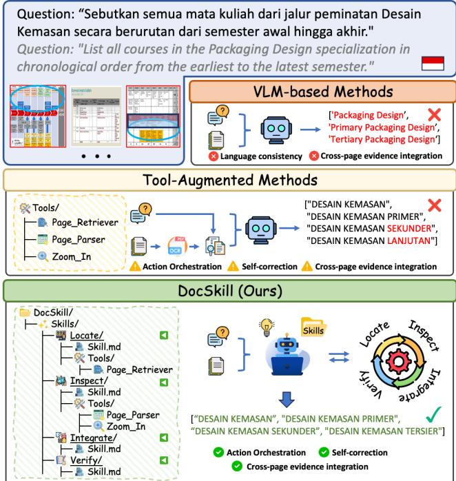
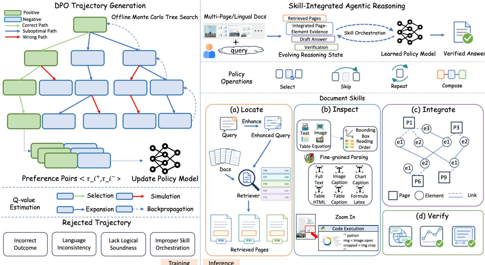
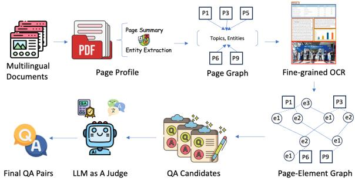
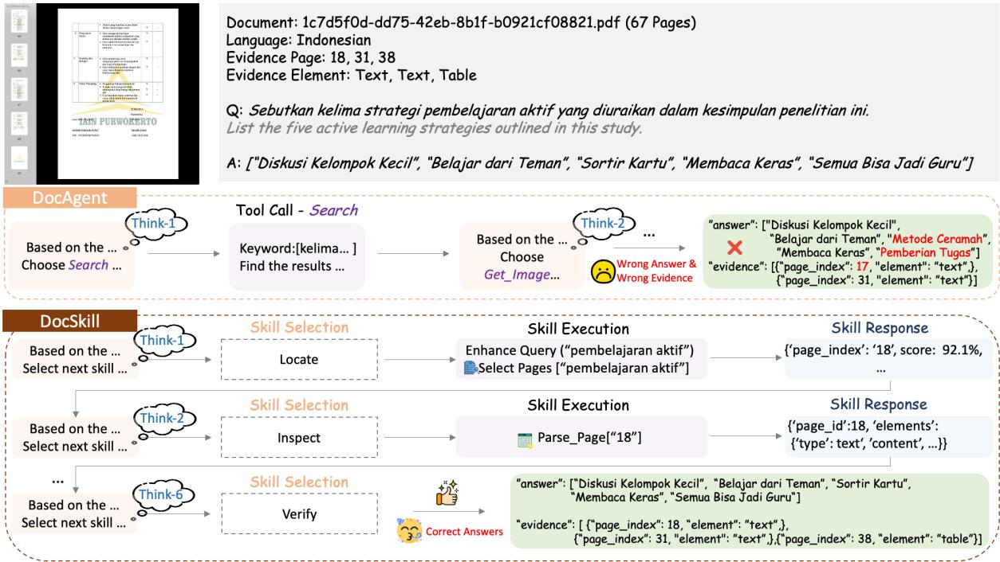
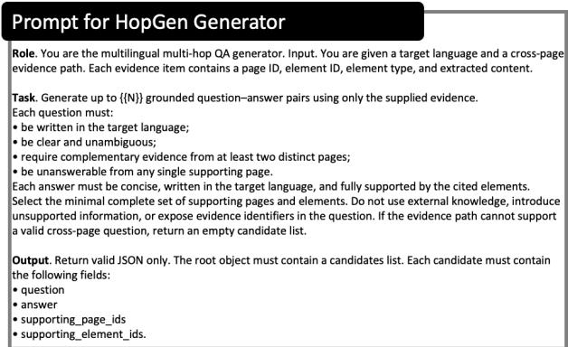
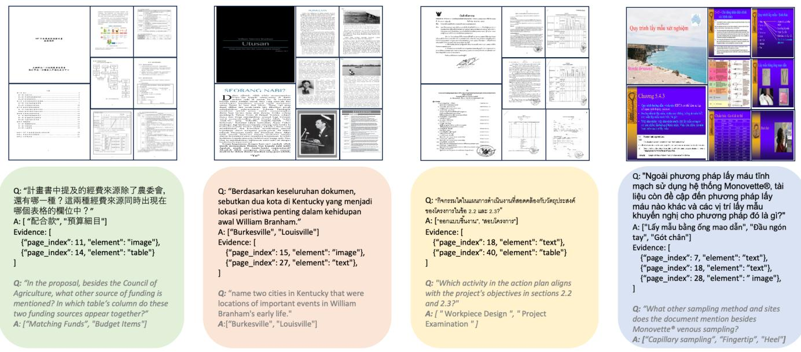
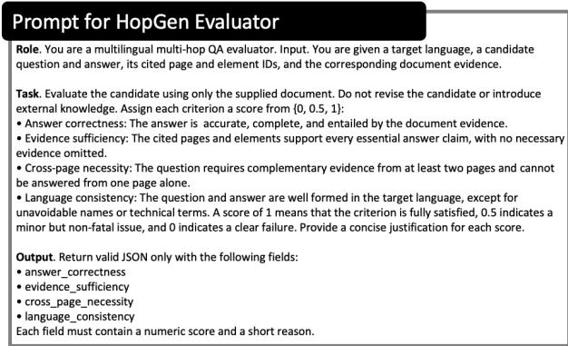
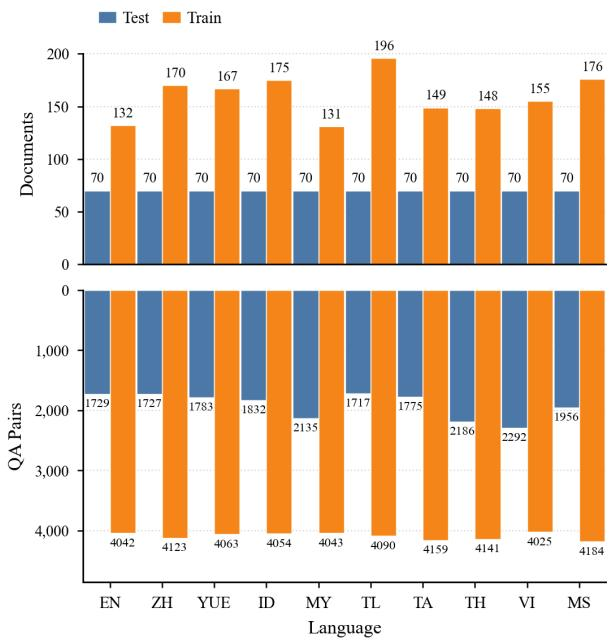

# DocSkill: Skill-Integrated Agentic Reasoning for Multilingual Multi-Hop Document Question Answering

Jing Huang1, Zhiya Tan1,2, Changtao Miao1, Shutao Gong1,

Yang Wang1, Joey Tianyi Zhou3,4, Jianshu Li1, Ying Yan1

1Ant Digital Technologies, Ant Group 2Nanyang Technological University, Singapore

3Singapore Management University, Singapore

4Institute of Advanced Intelligence and Computing (IAIC),

Agency for Science, Technology and Research (A\*STAR), Singapore

## Abstract

Multilingual multi-hop document question answering (MMHop- DocQA) requires locating and integrating evidence across com-plex layouts, document pages, and diverse languages. Existing ap- proaches include single-pass processing and adaptive tool use, but learning to coordinate evidence acquisition, cross-page integration, and answer verification remains challenging. To address this chal- lenge, we present DocSkill, an agentic framework with a learned skill-orchestration policy for adaptive evidence acquisition and reasoning. The policy selects, revisits, or skips skills according to the evolving evidence state. To construct supervision for skill orchestration, bounded Monte Carlo Tree Search (MCTS) explores alternative skill trajectories ofline. These trajectories provide demonstrations for supervised fine-tuning (SFT) and preference pairs for Direct Preference Optimization (DPO). We further introduce MMHop-DocBench, a multilingual multi-hop document QA dataset with training and test splits, containing 60K QA pairs across 10 languages and eight document domains. Its HopGen pipeline builds hierarchical page–element graphs to derive traceable cross-page evidence paths and generate grounded QA pairs with page- and element-level evidence annotations. Experiments show that Doc- Skill with Qwen3-VL-8B achieves 41.0 accuracy and 49.2 F1 on MMHop-DocBench, exceeding the strongest evaluated baseline by 5.5 and 6.3 points, respectively, and achieving competitive performance on MMLongBench-Doc and DocBench.

## CCS Concepts

• Computing methodologies → Artificial intelligence; • Information systems → Information retrieval.

## Keywords

Multilingual Vision-Language Models, Multilingual Multi-hop Document Question Answering, Agentic Reasoning, Skill Orchestration

## 1 Introduction

Multilingual multi-hop document question answering (MMHop- DocQA) is a cornerstone capability for intelligent systems that process multilingual, multi-page documents [16, 22, 24, 35, 37, 49]. The fundamental challenge lies in locating and integrating sparse, spatially distributed evidence across heterogeneous layouts and lan- guages, requiring iterative document navigation, structural grounding, and multi-step reasoning over long contexts.

  
Figure 1: Overview of DocSkill and its comparison with VLMbased and tool-augmented methods. DocSkill adaptively orchestrates four skills, Locate, Inspect, Integrate, and Verify, for cross-page document reasoning and answering.

As illustrated in Figure 1, recent approaches can be broadly grouped into two paradigms with progressively increasing reasoning capabilities, yet each exhibiting inherent limitations. (a) VLMbased Methods directly encode document pages and queries into a Vision-Language Model (VLM) [3, 4, 11, 27]. Although these meth-ods benefit from end-to-end multimodal understanding, single-pass inference over long document contexts can sufer from context over- load, language inconsistency, and incomplete integration of sparse evidence across pages. (b) Tool-Augmented Methods enhance document processing through OCR [9], retrieval-augmented generation [6, 10, 12, 45], or agentic tool use [13, 17, 33, 46]. While these mechanisms improve evidence access and support adaptive tool use, learning to jointly coordinate evidence acquisition, cross-page integration, and answer verification remains challenging. These limitations are further amplified in multilingual settings, which re- quire robust understanding across languages and reliable evidence grounding throughout the reasoning process.

To address these limitations, we introduce DocSkill, an agentic framework for learned skill orchestration in multilingual multi-hop document QA. Its key design shifts agent control from operationlevel tool selection to capability-level skill orchestration. Specifi- cally, we distinguish a skill from a tool: a skill is a reusable capability abstraction that specifies what the agent should accomplish given the current interaction state, whereas a tool is a concrete executable operation that specifies how part of that capability is carried out. Accordingly, a skill may combine model-native reasoning with one or more tool calls, decoupling orchestration decisions from specific tool implementations. As illustrated in Figure 1, DocSkill organizes document interaction into four reusable skills: Locate combines query refinement with page retrieval via Page\_Retriever; Inspect extracts and interprets fine-grained multimodal content, invoking Page\_Parser or Zoom\_In when needed; Integrate connects complementary findings across pages; and Verify checks the grounding and consistency of candidate answers against accumulated evidence. Conditioned on the evolving interaction state, the learned policy adaptively selects, skips, repeats, and composes these skills.

Learning adaptive skill orchestration requires trajectory-level supervision because the efectiveness of each skill decision depends on its downstream contribution to evidence acquisition, reasoning, and answer generation. We adopt an ofline trajectory curation and preference optimization strategy. We use bounded Monte Carlo Tree Search (MCTS) [31, 43] to explore alternative trajectories over the skill space. The resulting trajectories are ranked by answer cor-rectness and overall quality, assessed through language consistency, logical soundness, and skill-orchestration efectiveness, to construct training data for supervised fine-tuning (SFT) and trajectory-level preference pairs. We optimize the orchestration policy through SFT followed by Direct Preference Optimization (DPO) [5, 29, 40], which learns from preferred and dispreferred skill trajectories.

To address the scarcity of multilingual multi-hop document QA data, we introduce MMHop-DocBench with train and test splits to support policy learning and benchmark evaluation. The dataset is constructed using HopGen, an automatic curation pipeline that rep resents long documents as hierarchical Page–Element Graphs [14, 39] and derives traceable cross-page evidence paths for grounded question generation. MMHop-DocBench contains 60K question– answer pairs across 10 languages and 8 document domains, together with explicit page- and element-level evidence annotations.

Experiments show that DocSkill outperforms strong baselines on MMHop-DocBench and achieves competitive performance on both MMLongBench-Doc and DocBench.

Our main contributions are summarized as follows:

• Agentic Skill-Orchestration Framework. We introduce DocSkill, which orchestrates four reusable reasoning and tool-use skills. Bounded MCTS generates trajectories for SFT and preference pairs for DPO.

• Multilingual Multi-Hop QA Dataset. We introduce Hop-Gen to construct MMHop-DocBench, comprising 60K QA pairs across 10 languages and eight domains with page- and element-level evidence annotations.

• Empirical Results and Analysis. Experiments on three benchmarks evaluate DocSkill against strong baselines, with comparisons and ablations analyzing skill orchestra- tion and trajectory supervision.

## 2 Related Work

## 2.1 Document Question Answering

Document Question Answering (DocQA) involves extracting and reasoning over textual and visual evidence in documents. VLMbased approaches process document images directly [4, 11, 27], while OCR-based pipelines [9] extract text and layout information for subsequent reasoning. Retrieval-augmented generation (RAG) [6, 10, 12, 45] selects relevant evidence from searchable document indexes to support answer generation. Document agents extend these approaches through iterative evidence acquisition and tool use [13, 17, 33, 48]. DeepRead [21] supports structure-aware retrieval and section reading, while ORCA [19] coordinates specialized agents through routing and debate. Doc-�∗ [47] combines OCR-free page navigation with working memory, using SFT and GRPO for policy training. Our work focuses on multilingual multihop DocQA, learning state-dependent orchestration over capability-level skills through SFT and DPO on ofline MCTS trajectories.

## 2.2 Skill-integrated Agentic Reasoning

Skill learning for LLM agents focuses on acquiring structured reasoning and action strategies. Prior work, including ReAct [44] and tool-oriented approaches such as Toolformer [30], ToolAlpaca [36], and Gorilla [28], demonstrates the efectiveness of interleaving rea-soning with tool use. These approaches establish reasoning and tool- use interfaces. Some recent works have explored skill-integrated agent frameworks, such as AutoSkill [42] and XSkill [18], where task-level skills and action strategies are explicitly defined and com- posed to solve complex tasks. In this work, we introduce DocSkill, a skill-integrated agentic framework for multilingual multi-hop document question answering that dynamically composes reasoning actions and tool usage based on evolving interaction states for iterative evidence acquisition and structured document reasoning.

## 3 Method

Figure 2 summarizes DocSkill’s ofline training and adaptive inference. Conditioned on the interaction state, the policy selects among Locate, Inspect, Integrate, and Verify, each combining reasoning with optional tool execution. To construct training data, bounded MCTS uses a frozen generator and evaluator to produce scored skill trajectories with explicit reasoning from MMHop-DocBench QA instances. The resulting trajectories provide SFT demonstrations and DPO preference pairs for policy training. At inference, the learned policy orchestrates document skills without tree search.

## 3.1 Skill-Orchestrated Document Agent

Given an input $x = ( \mathcal { D } , q )$ , where $\mathcal { D } = \{ p _ { i } \} _ { i = 1 } ^ { M }$ is an �-page multilingual document and � is a question, the goal is to generate an answer � grounded in cross-page evidence. Following ReAct [44], we formulate DocSkill as a finite-step interaction with the docu- ment environment, in which the agent acquires evidence, updates its reasoning state, and determines its subsequent actions.

  
Figure 2: Overview of the DocSkill framework. During ofline training, bounded MCTS explores alternative skill trajectories to construct training data for SFT and preference pairs for DPO. During inference, the learned policy adaptively orchestrates four skills, Locate, Inspect, Integrate, and Verify, each combining model reasoning with optional tool use.

3.1.1 Skill Abstraction. In DocSkill, a skill is a reusable documentlevel capability that organizes model reasoning and optional tool execution around a specific objective. A tool, in contrast, provides an executable operation, such as page retrieval, document parsing, or region cropping. This distinction concerns the abstraction used for agent control: the policy selects the document capability to invoke and specifies its arguments, while the corresponding skill carries out the reasoning and tool execution needed for that invocation. Each skill is represented as

$$
\sigma _ { k } = \langle d _ { k } , { \mathcal { U } } _ { k } \rangle ,\tag{1}
$$

where $d _ { k }$ describes the capability and $\mathcal { U } _ { k }$ denotes its available tool set, which may be empty for reasoning-only execution. The skill library is

$$
S = \{ { \mathrm { L o c a t e , l n s p e c t , l n t e g r a t e , V e r i f y } } \} .\tag{2}
$$

All four skills are predefined and fixed during policy training.

3.1.2 Interaction State and Policy. At step �, the interaction state is

$$
\boldsymbol { z } _ { t } = \left( \boldsymbol { q } , \boldsymbol { \mathcal { E } } _ { t } , \hat { y } _ { t } , \boldsymbol { v } _ { t } , \mathcal { H } _ { t } \right) ,\tag{3}
$$

where $q$ is the original input question; $\mathcal { E } _ { t }$ contains accumulated page- and element-level evidence and connections across pages; $\hat { y } _ { t }$ denotes the current candidate answer; $v _ { t }$ records verification and reflection feedback; and $\mathcal { H } _ { t }$ is the ordered history of preced- ing actions and their returned observations. The input document D remains accessible through the document environment and is consulted via skill executions and their associated tools.

The policy operates over an action space A containing parameterized skill invocations and terminal answer outputs:

$$
a _ { t } \sim \pi _ { \theta } ( \cdot \mid z _ { t } ) , \qquad a _ { t } \in \mathcal { A } .\tag{4}
$$

A skill invocation takes the form $a _ { t } = ( s _ { t } , \xi _ { t } )$ , where $s _ { t } \in S$ specifies the skill and $\xi _ { t }$ contains its arguments, such as a retrieval query, target pages, or regions of interest. Thus, invoking the same skill with diferent arguments constitutes diferent actions. Alternatively, the policy emits a terminal action, which returns the final answer � and ends the interaction.

## 3.1.3 Document Skills. The four skills perform complementary operations on the interaction state.

Locate uses model reasoning to formulate or refine a query based on the question and interaction state, then invokes Page\_Retriever to identify candidate evidence pages. Returned page references and content are added to the accumulated evidence. The policy can revisit this skill when further evidence is needed.

Inspect invokes Page\_Parser for layout-aware extraction and, when needed, Zoom\_In for region cropping. Model-native reasoning interprets the returned content, and the resulting element-level findings are added to the accumulated evidence.

Integrate uses model-native reasoning to connect facts across pages and synthesize accumulated evidence to construct or refine the candidate answer, without additional retrieval or extraction.

Verify uses model reasoning to assess the candidate answer for completeness, consistency, and evidence support. Its feedback guides further evidence acquisition and answer revision.

3.1.4 Execution and Composition. Executing a skill returns an ob-servation, updates the relevant state components, and records the action and observation in the interaction history. Trajectories retain the agent’s recorded reasoning, skill invocations, and native skill outputs, including candidate answers and verification feedback. Na- tive skill outputs serve as observations that condition subsequent decisions. Tools are invoked within skills rather than exposed as independent top-level actions. Skills compose sequentially through the shared state. At each step, the policy selects a skill invocation or a terminal answer. The updated state allows skills to be revisited or skipped without a prescribed order. These sequences are selected dynamically rather than defined as separate compound skills.

A completed interaction with � skill invocations is denoted as

$$
\tau = ( z _ { 0 } , a _ { 0 } , o _ { 1 } , z _ { 1 } , \dots , a _ { T - 1 } , o _ { T } , z _ { T } , y ) ,\tag{5}
$$

where $a _ { t }$ denotes a skill invocation, $o _ { 1 } , \ldots , o _ { T }$ are the observations, and $y$ is the final answer. Incomplete rollouts retain the recorded interaction prefix without a terminal answer. These trajectories define the space explored during ofline supervision construction.

## 3.2 Ofline MCTS-Based Skill Trajectory Curation

The parameterized interactions defined above induce a large tra- jectory space, where the value of a skill invocation may depend on its downstream efects on evidence acquisition, integration, and verification. Independent rollouts can repeatedly explore similar paths and provide limited coverage of alternative decisions. We therefore apply bounded Monte Carlo Tree Search (MCTS) [31, 43] to allocate a fixed search budget across candidate skill trajectories.

For each training instance $x _ { i } = ( \mathcal { D } _ { i } , q _ { i } )$ , the root node �0 rep- resents the initial state $z _ { 0 } { \mathrm { : } }$ , and each subsequent node represents an interaction state. An edge records a complete action. For a skill invocation $a _ { t } = ( s _ { t } , \xi _ { t } )$ , executing the edge produces an observation $o _ { t + 1 }$ and transitions the agent from $z _ { t }$ to $z _ { t + 1 } . \mathrm { A }$ terminal answer action ends the corresponding branch. Search depth counts policy decisions, with each edge representing one skill invocation or terminal answer. Each edge � maintains an estimated value $Q ( e )$ and a visit count $N ( e )$ , while each node � maintains a visit count $N ( n )$

Selection. Starting from the root, MCTS recursively selects the edge with the highest Upper Confidence Bound for Trees (UCT) score:

$$
\mathrm { U C T } ( e ) = Q ( e ) + \lambda \sqrt { \frac { \ln ( N ( n ) + 1 ) } { N ( e ) + 1 } } ,\tag{6}
$$

where � is the parent node of $e , Q ( e )$ is the mean return of pre- vious rollouts through the edge, and � balances exploration and exploitation. Selection stops at an unexpanded or terminal node.

Expansion. At an expandable leaf, the generator proposes feasible actions conditioned on the current state. Skill invocations with diferent arguments form distinct branches, producing observations and child states through model reasoning and optional tool calls when executed. Answer actions create terminal children.

Simulation. From an expanded child, the generator proposes and executes actions until it emits a terminal answer, reaches the maxi-mum depth, or fails to acquire new page- or element-level evidence after an evidence-acquisition action. This evidence-stagnation crite- rion is used to truncate ofline rollouts and is not an inference-time stopping rule. The evaluator assigns the trajectory quality score:

$$
C ( \tau ) = w _ { \mathrm { l a n g } } c _ { \mathrm { l a n g } } ( \tau ) + w _ { \mathrm { l o g i c } } c _ { \mathrm { l o g i c } } ( \tau ) + w _ { \mathrm { s k i l l } } c _ { \mathrm { s k i l l } } ( \tau ) ,\tag{7}
$$

where the three components measure language consistency, logical soundness, and skill-orchestration efectiveness, respectively. Each component takes a value in {0, 0.5, 1}. The weights are non-negative and sum to one; we assign equal weight to the three components.

The evaluator assigns an outcome score $O ( \tau ) \in \{ 1 , - 1 , 0 \}$ for correct, incorrect, and incomplete trajectories, respectively. The rollout return combines the outcome score with trajectory quality:

$$
\begin{array} { r } { J ( \tau ) = { O } ( \tau ) + { C } ( \tau ) . } \end{array}\tag{8}
$$

Backpropagation. The rollout return $J ( \tau )$ is propagated through the selected path. For each visited node $n _ { j }$ and edge $\boldsymbol { e } _ { j } ,$ we update

$$
N ( n _ { j } )  N ( n _ { j } ) + 1 ,\tag{9}
$$

$$
N ( e _ { j } ) \gets N ( e _ { j } ) + 1 ,\tag{10}
$$

and

$$
Q ( e _ { j } ) \gets Q ( e _ { j } ) + \frac { J ( \tau ) - Q ( e _ { j } ) } { N ( e _ { j } ) } .\tag{11}
$$

Thus, $Q ( e _ { j } )$ maintains the empirical mean return of rollouts passing through the edge.

We use up to $B = 3$ candidate actions per expansion, a maximum search depth of $D = 6 ,$ and $N _ { \mathrm { s i m } } = 8$ simulations per question. Both the generator and evaluator use frozen GPT-5.6-SOL [27] with role-specific prompts and separate inference contexts. The generator proposes actions and performs model-native skill reasoning, while reference answers and evidence annotations are used only for ofline evaluation. For each question, the search returns scored trajectories containing recorded explicit reasoning, skill invocations, and execution outputs. Successful trajectories provide SFT demonstrations, while trajectories with diferent scores for the same question form DPO preference pairs.

## 3.3 Trajectory-Level Preference Learning

The scored trajectories produced by MCTS provide complementary supervision for imitation and preference learning.

Supervised fine-tuning. We supervise successful trajectories, including reasoning, skill invocations, native skill outputs, and termi-nal answers. External tool returns and deterministic state updates serve as context. Let $\mathcal { D } _ { \mathrm { S F T } }$ denote these input–trajectory pairs and $u _ { 1 : L _ { \tau } }$ the serialized tokens of �. We set $m _ { j } = 1$ for model-generated outputs and $m _ { j } = 0$ for context tokens. The SFT objective is

$$
\mathcal { L } _ { \mathrm { S F T } } = - \mathbb { E } _ { ( x , \tau ) \sim \mathcal { D } _ { \mathrm { S F T } } } \left[ \sum _ { j = 1 } ^ { L _ { \tau } } m _ { j } \log p _ { \theta } ( u _ { j } \mid c _ { j } ) \right] ,\tag{12}
$$

where $\scriptstyle { \mathcal { P } } \theta$ is the shared backbone’s token distribution and $c _ { j }$ contains the role-specific prompt, available interaction context, and preceding output tokens for the corresponding generation call.

<table><tr><td>Benchmark</td><td></td><td>#Langs. M-Hop</td><td>#QA</td><td>Avg. Pages Source</td><td></td></tr><tr><td>ChartQA [23]</td><td>1</td><td>x</td><td>32.7K</td><td>1.0</td><td>Charts</td></tr><tr><td>EST-VQA [38]</td><td>2</td><td>x</td><td>28.2K</td><td>1.0</td><td>Scenes</td></tr><tr><td>MTVQA [35]</td><td>9</td><td>x</td><td>28.6K</td><td>1.0</td><td>Multi</td></tr><tr><td>DocVQA [24]</td><td>1</td><td>x</td><td>50.0K</td><td>1.0</td><td>Multi</td></tr><tr><td>MP-DocVQA [37]</td><td>1</td><td>x</td><td>46.2K</td><td>8.2</td><td>Multi</td></tr><tr><td>SlideVQA [34]</td><td>1</td><td>√</td><td>14.5K</td><td>20.0</td><td>Slides</td></tr><tr><td>MMLongBench-Doc [22]</td><td>1</td><td>√</td><td>1.1K</td><td>47.5</td><td>Multi</td></tr><tr><td>DocBench [49]</td><td>1</td><td>x</td><td>1.1K</td><td>66.0</td><td>Multi</td></tr><tr><td>MMHop-DocBench</td><td>10</td><td>√</td><td>60.0K</td><td>68.2</td><td>Multi</td></tr></table>

Table 1: Comparison of document QA datasets by language count, multi-hop support, number of QA pairs, average document length, and source.

Preference construction. For each input $x _ { i } ,$ , two generated trajectories form an ordered preference pair when one receives a higher rollout score than the other:

$$
\mathcal { D } _ { \mathrm { p r e f } } = \left\{ ( x _ { i } , \tau _ { i } ^ { + } , \tau _ { i } ^ { - } ) \ \middle | \ J ( \tau _ { i } ^ { + } ) > J ( \tau _ { i } ^ { - } ) \right\} .\tag{13}
$$

Both trajectories in each pair are generated for the same question, and equal-score pairs are discarded.

Trajectory-level DPO. Using the same supervision mask, we define the conditional log-likelihood of the recorded model-generated content as

$$
\ell _ { \theta } ( x , \tau ) = \sum _ { j = 1 } ^ { L _ { \tau } } m _ { j } \log p _ { \theta } ( u _ { j } \mid c _ { j } ) .\tag{14}
$$

Terminal-answer tokens contribute only when present, so this defi- nition also applies to incomplete trajectory prefixes. We optimize trajectory preferences using

$$
\begin{array} { r } { \mathcal { L } _ { \mathrm { D P O } } = - \mathbb { E } _ { ( x , \tau ^ { + } , \tau ^ { - } ) \sim \mathcal { D } _ { \mathrm { p r e f } } } \Big [ \log \sigma \big ( \beta [ r _ { \theta } ( x , \tau ^ { + } ) - r _ { \theta } ( x , \tau ^ { - } ) ] \big ) \Big ] , } \end{array}\tag{15}
$$

where $r _ { \theta } ( x , \tau ) = \ell _ { \theta } ( x , \tau ) - \ell _ { \mathrm { r e f } } ( x , \tau )$ , � is the logistic sigmoid, and the reference model is the frozen SFT checkpoint. Both models use the same supervision mask and conditioning contexts.

## 4 MMHop-DocBench

We introduce MMHop-DocBench, a large-scale benchmark for mul- tilingual multi-hop document question answering. It contains long documents from diverse domains and provides page- and element- level evidence references for each question–answer pair. The bench- mark is constructed using HopGen, an automatic pipeline that gener-ates grounded questions from traceable cross-page evidence paths.

## 4.1 HopGen: MMHop-DocQA Pair Curation

Figure 3 provides an overview of HopGen. HopGen uses GPT-5.6- SOL [27] for both generation and evaluation, with role-specific prompts and separate inference contexts, while PP-OCR [9] pro-vides layout-aware parsing to extract fine-grained elements from document pages.

For each document, the generator creates a compact profile of every page, including its summary, entities, topics, and layout structures. It then assesses candidate page pairs for explicit semantic dependencies to construct a Page Graph. The parser extracts fine-grained document elements and attaches them to their correspond- ing source pages, forming a hierarchical Page–Element Graph. Con-nected page sequences and their associated elements define candi- date cross-page evidence paths for grounded question generation and subsequent verification. Given an evidence path and parsed elements, the generator produces questions, answers, and supporting page–element references in the document language using only the supplied evidence. The generator is instructed to create questions requiring complementary evidence from at least two distinct pages, with no single page suficient for the complete answer. The evaluator scores candidates for answer correctness, evidence sufi- ciency, cross-page necessity, and language consistency, retaining those meeting a predefined threshold. Normalized question–answer duplicates are resolved by retaining the higher-scoring candidate.

  
Figure 3: Overview of HopGen, which constructs hierarchical page–element graphs to generate and verify multilingual multi-hop QA pairs with explicit evidence references.

## 4.2 Dataset Statistics

MMHop-DocBench contains 60K question–answer pairs spanning ten languages: English (EN), Chinese (ZH), Cantonese (YUE), Indonesian (ID), Burmese (MY), Filipino (TL), Tamil (TA), Thai (TH), Vietnamese (VI), and Malay (MS). The documents cover eight domains: Business and Finance, Government, Academic, Education, Technical, Medical, Legal, and Media. Within the comparison in Table 1, MMHop-DocBench provides the widest language coverage and the highest average page count, at 68.2 pages per document. Each pair includes page- and element-level evidence annotations, enabling evaluation of evidence localization and answer grounding.

## 4.3 Human Audit of Dataset Quality

We conduct a human quality audit of 1,200 retained QA pairs, sam-pling 80 training and 40 test pairs from each of the ten languages, with stratification across document domains. Two target-language annotators independently assess each pair for question validity, reference-answer correctness, evidence suficiency, and cross-page necessity. Disagreements are adjudicated by a third annotator. Of the 1,200 audited pairs, 1,144 (95.3%) satisfy all four criteria, while 56 (4.7%) fail at least one.

## 5 Experiments

Implementation Details. We train Qwen3-VL-4B and Qwen3-VL-8B using LoRA [15] on eight NVIDIA A100 80GB GPUs. SFT runs for three epochs with an efective global batch size of 32 across all GPUs, an image resolution of 768×768, and AdamW with a learning rate of $2 \times 1 0 ^ { - 4 }$ . LoRA uses a rank of $^ { 1 6 , }$ a scaling factor of 32, and a dropout rate of0.05. DPO uses the same LoRA configuration with an efective global batch size of 16 and $\beta = 0 . 1$ , where each preferred– dispreferred trajectory pair counts as one training instance. We use Qwen3-VL-Embedding-8B [20] for top-5 page retrieval and PP-OCR [9] for layout-aware parsing, while region-level zooming is implemented through programmatic cropping.

<table><tr><td>Method</td><td>EN</td><td>ZH</td><td>YUE</td><td>ID</td><td>MS</td><td>TL</td><td>TA</td><td>TH</td><td>VI</td><td>MY</td><td>|Acc. F1</td><td></td></tr><tr><td colspan="9">Vanilla VLM Methods</td><td></td><td></td><td></td><td></td><td></td></tr><tr><td>Naive VLM w/ Qwen3-VL-4B[4]</td><td>18.0/23.2</td><td>15.2/20.3</td><td>8.3/12.0</td><td>16.9/23.6</td><td>14.9/19.6</td><td>9.0/12.9</td><td>2.0/3.3</td><td>5.4/8.0</td><td>10.3/14.0</td><td>2.9/4.2</td><td>10.3</td><td>14.1</td></tr><tr><td>Naive VLM w/ Qwen3-VL-8B[4]</td><td>24.0/28.9</td><td>21.0/25.9</td><td>12.0/15.7</td><td>20.6/28.0</td><td>19.8/23.9</td><td>13.5/16.6</td><td>3.6/5.1</td><td>8.2/10.5</td><td>14.3/18.2</td><td>4.3/5.7</td><td>14.1</td><td>17.9</td></tr><tr><td>Naive VLM w/ Qwen3-VL-32B[4]</td><td>24.2/30.0</td><td>21.2/26.1</td><td>15.2/19.9</td><td>25.5/32.7</td><td>22.5/27.8</td><td>15.8/20.8</td><td>5.2/7.6</td><td>12.6/16.1</td><td>18.2/23.1</td><td>5.6/7.5</td><td>16.6</td><td>21.2</td></tr><tr><td>Naive VLM w/ Gemini-3.1-Pro[11]</td><td>25.0/31.3</td><td>24.3/29.8</td><td>20.8/27.5</td><td>25.4/33.7</td><td>23.8/30.5</td><td>20.4/28.6</td><td>12.9/18.6</td><td>21.8/28.2</td><td>22.0/29.3</td><td>6.1/11.8</td><td>20.3</td><td>26.9</td></tr><tr><td>Naive VLM w/ Claude-Sonnet-5[3] Naive VLM w/ GPT-5.6-SOL[27]</td><td>25.6/32.0 26.2/32.6</td><td>23.8/29.5 24.0/30.1</td><td>22.1/29.2 21.8/28.8</td><td>26.0/34.5 26.5/35.2</td><td>24.8/31.4 24.5/31.2</td><td>22.5/31.8 22.2/31.5</td><td>13.5/19.8 14.6/20.5</td><td>20.8/28.1 21.4/28.4</td><td>22.4/29.8 22.7/30.1</td><td>6.4/12.5 6.7/12.9</td><td>20.8</td><td>27.9</td></tr><tr><td colspan="9"></td><td></td><td>21.1</td><td>28.1</td></tr><tr><td colspan="10">OCR-Based Methods</td><td></td></tr><tr><td>Tesseract[32] w/ GPT-5.6-SOL[27]</td><td>23.2/30.1</td><td>21.5/27.6</td><td>14.8/20.5</td><td colspan="2">22.5/28.8</td><td>19.8/26.9</td><td>11.8/16.5</td><td>17.5/23.4</td><td>18.9/25.6</td><td>7.4/11.6</td><td>18.1</td><td>24.2</td></tr><tr><td>PP-OCR[9] w/ GPT-5.6-SOL[27]</td><td>27.1/33.5 24.8/31.2</td><td>21.5/28.4</td><td colspan="2">23.9/31.2 27.3/36.1</td><td>25.4/32.3</td><td>22.8/32.1</td><td>14.2/20.1</td><td>22.3/29.5</td><td>23.1/30.8</td><td>7.6/13.8</td><td>21.6 28.8</td><td></td></tr><tr><td colspan="10">RAG-Based Methods</td><td></td></tr><tr><td>VisRAG [45] w/ GPT-5.6-SOL[27]</td><td>28.5/35.2</td><td>25.8/32.4</td><td></td><td colspan="2"></td><td></td><td></td><td></td><td></td><td></td><td></td><td></td></tr><tr><td>ColPali [10] w/ GPT-5.6-SOL[27]</td><td>29.2/36.1</td><td>26.4/33.2</td><td>22.1/29.1 23.1/29.8 28.5/37.4</td><td colspan="2">27.8/36.5 25.9/33.1</td><td>23.2/32.6</td><td>14.5/20.3 14.8/20.8</td><td>22.6/29.8 23.1/30.4</td><td>23.5/31.2 24.0/31.8</td><td>7.8/14.1 8.0/14.5</td><td>22.2 22.7</td><td>29.4 30.1</td></tr><tr><td>Qwen3-VL-Emb-8B [20] w/ GPT-5.6-SOL[27]</td><td>30.8/38.5</td><td>28.2/35.6</td><td colspan="2">22.6/32.1 30.1/39.2</td><td>26.5/34.0 28.1/36.2</td><td>23.8/33.2 25.4/35.1</td><td>16.2/22.6</td><td>24.8/32.5</td><td>25.6/33.9</td><td>8.9/15.8</td><td>24.1</td><td>32.2</td></tr><tr><td colspan="10">Agent-Based Methods</td><td></td></tr><tr><td>DocAgent [33] w/ GPT-5.6-SOL[27]</td><td>27.9/34.2</td><td>25.5/31.9</td><td>22.2/29.0</td><td colspan="2"></td><td></td><td></td><td></td><td>23.8/31.4</td><td>8.2/14.4</td><td></td><td></td></tr><tr><td>SimpleDoc [17] w/ GPT-5.6-SOL[27]</td><td>28.6/35.0</td><td>26.2/32.8</td><td>22.8/29.9</td><td colspan="2">28.0/36.7 26.1/32.9 28.7/37.6 26.8/33.8</td><td>23.5/32.7 24.2/33.6</td><td>14.9/20.8 15.5/21.6</td><td>23.0/30.1 23.6/30.9</td><td>24.4/32.2</td><td>8.6/15.0</td><td>22.3 22.9</td><td>29.4 30.2</td></tr><tr><td>DocLens [48] w/ Gemini-3.1-Pro [11]</td><td>38.6/45.5</td><td>36.3/43.2</td><td>33.6/40.9</td><td colspan="2">38.3/45.6 36.9/44.2</td><td>34.7/42.2</td><td>25.9/32.6</td><td>34.3/41.6</td><td>35.2/42.9</td><td>18.6/25.2</td><td>33.2</td><td>40.4</td></tr><tr><td>DocLens [48] ] w/ Claude-Sonnet-5 [3] DocLens [48] w/ GPT-5.6-SOL [27]</td><td>40.3/47.4 41.0/48.3</td><td>37.6/44.7 38.3/45.6</td><td>34.7/42.0</td><td colspan="2">39.6/47.0 38.0/45.5</td><td>36.3/44.1</td><td>27.3/34.3</td><td>35.6/43.1</td><td>36.7/44.6</td><td>20.3/27.0</td><td>34.6</td><td>42.0</td></tr><tr><td>DocSkill (Ours)</td><td></td><td></td><td>34.5/41.7</td><td colspan="2">41.4/49.0 39.1/46.7</td><td>37.3/45.1</td><td>28.1/35.3</td><td>36.3/43.7</td><td>37.6/45.6</td><td>21.1/27.9</td><td>35.5</td><td>42.9</td></tr><tr><td>w/ Gemini-3.1-Pro[11]</td><td></td><td></td><td colspan="2"></td><td></td><td></td><td></td><td></td><td></td><td></td><td></td><td></td></tr><tr><td>w/ Claude-Sonnet-5[3]</td><td>41.2/48.5</td><td>38.5/45.8 39.8/47.2</td><td>35.8/43.2</td><td colspan="2">40.8/48.2 39.1/46.5</td><td>37.2/44.8</td><td>28.5/35.6</td><td>36.8/44.2</td><td>37.5/45.6</td><td>21.2/28.5</td><td>35.7</td><td>43.1</td></tr><tr><td></td><td>42.5/49.8</td><td>41.2/48.6</td><td>36.5/44.1</td><td>42.1/49.5</td><td>40.5/47.8</td><td>38.5/46.2</td><td>29.8/37.2</td><td>37.8/45.5</td><td>38.6/46.8</td><td>22.5/30.1</td><td>36.9</td><td>44.4</td></tr><tr><td>w/ GPT-5.6-SOL[27]</td><td>43.8/51.2 42.5/49.8</td><td>39.5/46.8</td><td>36.2/43.8</td><td>43.5/51.0</td><td>41.8/49.2</td><td>39.8/47.8</td><td>31.2/38.8</td><td>37.5/45.2</td><td>39.8/48.2</td><td>23.8/31.6</td><td>37.9</td><td>45.5</td></tr><tr><td>w/ Qwen3-VL-4B [4] (SFT)</td><td>44.2/51.8</td><td>41.5/49.2</td><td>34.2/41.8</td><td>41.8/49.2</td><td>40.2/47.5</td><td>37.8/45.5</td><td>28.5/35.8</td><td>36.2/43.8</td><td>38.2/46.5</td><td>21.5/29.2</td><td>36.0</td><td>43.6</td></tr><tr><td>w/ Qwen3-VL-4B [4] j (SFT + DPO)</td><td>45.2/52.8</td><td>42.8/50.5</td><td>35.8/43.5 37.5/45.2</td><td colspan="2">43.8/51.5 42.5/50.2</td><td>39.5/47.8</td><td>30.8/38.5</td><td>38.2/46.2</td><td>40.2/48.8</td><td>23.5/31.8</td><td>38.0</td><td>45.9</td></tr><tr><td>w/ Qwen3-VL-8B [4] (SFT) w/ Qwen3-VL-8B [4] (SFT + DPO)</td><td>46.8/54.5</td><td>44.5/52.2</td><td>39.2/47.1</td><td colspan="2">44.8/52.5 43.5/51.2</td><td>40.8/49.2 42.5/51.2</td><td>32.5/40.2</td><td>39.5/47.8</td><td>41.5/50.2</td><td>25.2/33.5</td><td>39.3</td><td>47.3</td></tr><tr><td></td><td></td><td></td><td colspan="2">46.2/54.2</td><td colspan="2">45.2/53.1</td><td>34.2/42.5</td><td>41.2/49.5</td><td>43.2/52.1</td><td>27.1/35.8</td><td>41.0</td><td>49.2</td></tr><tr><td colspan="10"></td><td></td><td></td><td></td><td>61.7 63.9</td></tr><tr><td>Human Experts</td><td></td><td></td><td>Human Baseline</td><td></td><td></td><td></td><td></td><td></td><td></td><td></td><td></td><td></td></tr></table>

Table 2: Performance on MMHop-DocBench across ten languages, reported as per-language and macro-averaged Acc/F . Bold values indicate the best results within each method category, while underlined bold values denote the best model results overall

<table><tr><td>Method</td><td>Acc.  $\mathbf { F _ { 1 } }$ </td><td>MMLongBench-Doc</td><td>LASJ</td><td>DocBench LASJ</td></tr><tr><td>DocAgent [33] w/ GPT-4o [25]</td><td>51.8</td><td>49.1</td><td></td><td>79.9</td></tr><tr><td>DocAgent [33] w/ Claude-3.5-Sonnet [1]</td><td>57.3</td><td>54.1</td><td></td><td></td></tr><tr><td>DocDancer [46] w/ GPT-40 [25]</td><td>52.3</td><td>50.8</td><td>59.2</td><td>73.5</td></tr><tr><td>DocDancer [46] w/ Gemini-2.5-Pro [8]</td><td>56.3</td><td>55.3</td><td>65.9</td><td>79.9</td></tr><tr><td>DocDancer [46] w/ GPT-5.2 [26]</td><td>57.0</td><td>56.8</td><td>67.6</td><td>85.5</td></tr><tr><td>SimpleDoc [17] w/ Claude-4-Sonnet [2]</td><td>58.6</td><td></td><td></td><td></td></tr><tr><td>SimpleDoc [17] w/ GPT-5.2 [26]</td><td>57.4</td><td>53.8</td><td>64.2</td><td>81.8</td></tr><tr><td>DocLens [48] w/ Claude-4-Sonnet [2]</td><td>63.3</td><td></td><td></td><td></td></tr><tr><td>DocLens [48] w/ Gemini-2.5-Pro [8]</td><td>67.6</td><td></td><td></td><td></td></tr><tr><td>DocLens [48] w/ GPT-5.2 [26]</td><td>67.8</td><td>55.0</td><td>68.2</td><td>83.9</td></tr><tr><td>DocSkill (Ours)</td><td></td><td></td><td></td><td></td></tr><tr><td>w/ Gemini-2.5-Pro [8]</td><td>68.0</td><td>66.4</td><td>67.8</td><td>84.5</td></tr><tr><td>w/ GPT-5.2 [26]</td><td>68.5</td><td>66.8</td><td>67.9</td><td>85.9</td></tr><tr><td>w/ GPT-5.6-SOL [27]</td><td>68.8</td><td>67.1</td><td>68.5</td><td>86.6</td></tr><tr><td>w/ Qwen3-VL-4B [4] (SFT + DPO)</td><td>65.8</td><td>64.5</td><td>64.8</td><td>82.6</td></tr><tr><td>w/ Qwen3-VL-8B [4] (SFT + DPO)</td><td>69.2</td><td>67.3</td><td>68.9</td><td>86.8</td></tr></table>

Table 3: Performance comparison on MMLongBench-Doc and DocBench. Underlined bold values indicate the best model results. Unreported results are marked with “–”.

Benchmarks and Baselines. We evaluate DocSkill on the MMHop-DocBench test set and two public long-document QA benchmarks, MMLongBench-Doc [22] and DocBench [49]. On MMHop-DocBench, we compare against direct VLM inference, OCR-based pipelines, multimodal RAG systems, and document agents, using oficial im-plementations and recommended settings when available. Each DocSkill variant uses its listed backbone for both orchestration and skill execution, with the specified SFT/DPO checkpoints for Qwen variants and prompting for commercial variants.

Evaluation Metrics. For MMHop-DocBench, we report accuracy (Acc.) and token-level $\mathrm { F } _ { 1 }$ per-language, with macro averages over all ten languages. Accuracy is computed from normalized predictions and references, while language-aware tokenization is applied for multilingual $\mathrm { F } _ { 1 } .$ For MMLongBench-Doc, we report accuracy, $\mathrm { F } _ { 1 } ,$ and LLM-as-a-Judge (LASJ), while DocBench is evaluated using LASJ. All LASJ scores follow the judge prompts and configurations provided in the respective oficial code repositories.

  
Figure 4: Qualitative comparison of DocAgent and DocSkill on an Indonesian document. In this example, DocAgent returns an incorrect answer with incorrect evidence citations, whereas DocSkill produces the correct answer with supporting evidence through adaptive skill selection. Intermediate skill invocations and the terminal answer action are omitted for brevity.

Human Baseline. We establish a human baseline using 1,300 test questions, with 130 questions sampled from each of the ten languages. Model results are evaluated on the full test set, while human results provide a reference on this subset.

## 5.1 Main Results

Results on MMHop-DocBench. Table 2 reports results on MMHop-DocBench. In same-backbone comparisons across Gemini-3.1-Pro [11], Claude-Sonnet-5 [3], and GPT-5.6-SOL [27], DocSkill improves over the corresponding DocLens [48] variants by 2.3–2.5 Acc. and 2.4– 2.7 F1 points. DocSkill with Qwen3-VL-8B [4], trained through SFT followed by DPO [29], achieves the highest macro-averaged scores among the evaluated model configurations: 41.0 Acc. and 49.2 F1. It exceeds DocLens with GPT-5.6-SOL by 5.5 Acc. and 6.3 F1 points. This comparison evaluates complete configurations with diferent backbones and training conditions. Human experts achieve 61.7 Acc. and 63.9 F1 on the sampled test subset, providing a reference.

Generalization to Public Benchmarks. Table 3 reports results on MMLongBench-Doc and DocBench. DocSkill with Qwen3-VL-8B, trained on MMHop-DocBench through SFT followed by DPO, achieves 69.2 Acc., 67.3 $\mathrm { { F } } _ { 1 } ,$ and 68.9 LASJ on MMLongBench-Doc, and 86.8 LASJ on DocBench. Compared with the strongest competing baseline listed for each metric, these results yield gains of 1.4, 10.5, 0.7, and 1.3 points, respectively. Using GPT-5.2 as the controller, Doc-Skill exceeds the reported results of DocDancer [46] by 11.5 Acc., 10.0 $\mathrm { { F } } _ { 1 } ,$ and 0.3 LASJ on MMLongBench-Doc, and by 0.4 LASJ on DocBench.

## 5.2 Qualitative Analysis

Figure 4 illustrates a case from a 67-page Indonesian document. The question requires combining complementary evidence from text and tables across pages 18, 31, and 38. DocAgent searches and inspects pages sequentially but stops after collecting incomplete evidence from pages 17 and 31. Consequently, it introduces unsup- ported content and cites incorrect evidence. In contrast, DocSkill gathers and integrates evidence across all required pages and verifies the answer, enabling complete, grounded cross-page reasoning.

## 5.3 Ablation Studies

Efect ofSkill Abstraction and Adaptive Orchestration. We com-pare DocSkill with adaptive direct tool selection, a fixed-order skill policy, and four leave-one-out variants. All variants use Qwen3-VL-8B with SFT and DPO. Direct tool selection exposes the underlying tools as actions while retaining reasoning for cross-page integration, answer verification, and reflection, without explicit interfaces for the four document skills. The fixed policy allows repeated cy- cles of Locate→Inspect →Integrate→Verify, while maintaining the prescribed execution order. Each leave-one-out variant removes one skill during search and training. $R _ { \mathrm { p a g e } }$ and $R _ { \mathrm { e l e m } }$ measure the percentages of annotated supporting pages and elements recovered, respectively. Table 4 shows that DocSkill outperforms direct tool selection by 11.2 Acc. and 11.0 F1 points, and the fixed policy by 7.5 Acc. and 7.4 F1 points. Removing Locate causes the largest Acc. drop (17.6 points), reducing page recall from 82.4 to 41.5; removing Inspect lowers element recall to 43.5. This pattern suggests that relevant-page retrieval alone is insuficient without fine-grained ev- idence inspection. Removing Integrate or Verify reduces Acc. by 9.2 and 4.5 points, respectively. These results support the efectiveness of the full DocSkill configuration under the evaluated settings.

<table><tr><td>Variant</td><td>Acc.</td><td> $F _ { 1 }$ </td><td> $R _ { \mathrm { p a g e } }$ </td><td> $R _ { \mathrm { e l e m } }$ </td></tr><tr><td>Full DocSkill</td><td>41.0</td><td>49.2</td><td>82.4</td><td>68.5</td></tr><tr><td>Direct Tool Selection</td><td>29.8</td><td>38.2</td><td>68.5</td><td>49.3</td></tr><tr><td>Fixed Skill Order</td><td>33.5</td><td>41.8</td><td>70.4</td><td>56.5</td></tr><tr><td>DocSkill w/o Locate</td><td>23.4</td><td>30.2</td><td>41.5</td><td>33.2</td></tr><tr><td>DocSkill w/o Inspect</td><td>28.2</td><td>36.1</td><td>72.8</td><td>43.5</td></tr><tr><td>DocSkill w/o Integrate</td><td>31.8</td><td>39.5</td><td>76.2</td><td>59.8</td></tr><tr><td>DocSkill w/o Verify</td><td>36.5</td><td>44.8</td><td>79.6</td><td>65.2</td></tr></table>

Table 4: Ablation of DocSkill on MMHop-DocBench using Qwen3-VL-8B (SFT + DPO). Scores are percentages. $R _ { \mathrm { p a g e } }$ and $R _ { \mathrm { e l e m } }$ denote supporting-page and supporting-element recall.

Efect ofTrajectory Preference Supervision. We examine whether suboptimal trajectories provide useful supervision by comparing SFT with SFT followed by DPO. Since MCTS naturally produces ranked trajectory pairs, DPO can directly optimize this ofline su-pervision without additional on-policy rollouts or reward-model evaluations. As shown in Table 2, DPO improves Qwen3-VL-4B from 36.0 to 38.0 Acc. and from 43.6 to 45.9 F1. For Qwen3-VL-8B, it improves Acc. from 39.3 to 41.0 and $\mathrm { F } _ { 1 }$ from 47.3 to 49.2. These gains show that preferences between successful and suboptimal trajectories provide complementary supervision beyond imitating successful trajectories alone.

<table><tr><td>Strategy</td><td>|Succ. (%) Seq. Div. Pairs/Q</td><td></td><td></td><td> $\mathbf { A c c } .$ </td><td> $\mathbf { F } _ { 1 }$ </td></tr><tr><td>Best-of-N</td><td> $3 4 . 5 \pm 2 . 4$ </td><td> $0 . 4 2 \pm 0 . 0 3$ </td><td> $1 . 2 \pm 0 . 1$ </td><td></td><td>37.8 46.5</td></tr><tr><td>Beam Search</td><td> $4 7 . 2 \pm 1 . 5$ </td><td> $0 . 1 5 \pm 0 . 0 2$ </td><td> $0 . 6 \pm 0 . 1$ </td><td></td><td>38.647.1</td></tr><tr><td>MCTS (Ours)</td><td> ${ 6 5 . 8 \pm 1 . 8 }$ </td><td> $\mathbf { 0 . 7 \pm 0 . 0 2 }$ </td><td> ${ 3 . 0 \pm 0 . 2 }$ </td><td></td><td>41.0 49.2</td></tr></table>

Table 5: Equal-budget trajectory construction comparison. Succ. means the questions with a correct trajectory (%). Search metrics are mean ± SD over three runs; Acc./F1 are MMHop-DocBench scores for DocSkill w/ Qwen3-VL-8B (SFT + DPO).

Efect ofMCTS-Based Trajectory Construction. Under matched rollout and evaluation budgets, we compare MCTS with Best-of-� sampling [7] and evaluator-guided beam search [41], using the same frozen GPT-5.6-SOL generator and evaluator. Seq. Div. is the mean per-question fraction of distinct skill sequences among valid trajectories, while Pairs/Q is the average number of preference pairs per question. Table 5 shows that MCTS leads in success rate (65.8%), diversity, and Pairs/Q. Its Qwen3-VL-8B policy trained through SFT and DPO reaches 41.0 Acc. and $4 9 . 2 \mathrm { F } _ { 1 } ,$ outperforming Best-of-� and beam search by 3.2/2.7 and 2.4/2.1 Acc./F1 points, respectively. These gains also reflect higher supervision yield from MCTS.

## 6 Conclusion

We presented DocSkill, a document agent that learns to orches- trate four reusable capability-level skills for multilingual multi- hop reasoning. Bounded MCTS constructs skill trajectories for SFT and DPO. We also introduced MMHop-DocBench, containing 60K grounded QA pairs across 10 languages and eight document domains, with page- and element-level evidence annotations. Experiments on MMHop-DocBench, MMLongBench-Doc, and DocBench demonstrate consistent improvements over strong baselines, while ablations support skill abstraction, adaptive orchestration, and tra- jectory supervision. Future work will expand language and do-main coverage and explore automatic discovery and refinement of reusable document skills for more complex document scenarios.

## References

[1] Anthropic. 2024. Claude 3.5 Sonnet Model Card. https://www.anthropic.com/ s stem-cards.

[2] Anthropic. 2025. Claude 4 System Model Card. https://www.anthropic.com/ system-cards.

[3] Anthropic. 2026. Claude Sonnet 5 System Card. https://www.anthropic.com/ s stem-cards.

[4] Shuai Bai, Yuxuan Cai, Ruizhe Chen, Keqin Chen, Xionghui Chen, Zesen Cheng, Lianghao Deng, Wei Ding, Chang Gao, Chunjiang Ge, Wenbin Ge, Zhifang Guo, Qidong Huang, Jie Huang, Fei Huang, Binyuan Hui, Shutong Jiang, Zhaohai Li, Mingsheng Li, Mei Li, Kaixin Li, Zicheng Lin, Junyang Lin, Xuejing Liu, Jiawei Liu, Chenglong Liu, Yang Liu, Dayiheng Liu, Shixuan Liu, Dunjie Lu, Ruilin Luo, Chenxu Lv, Rui Men, Lingchen Meng, Xuancheng Ren, Xingzhang Ren, Sibo Song, Yuchong Sun, Jun Tang, Jianhong Tu, Jianqiang Wan, Peng Wang, Pengfei Wang, Qiuyue Wang, Yuxuan Wang, Tianbao Xie, Yiheng Xu, Haiyang Xu, Jin Xu, Zhibo Yang, Mingkun Yang, Jianxin Yang, An Yang, Bowen Yu, Fei Zhang, Hang Zhang, Xi Zhang, Bo Zheng, Humen Zhong, Jingren Zhou, Fan Zhou, Jing Zhou, Yuanzhi Zhu, and Ke Zhu. 2025. Qwen3-VL Technical Report. arXiv:2511.21631 [cs.CV] https://arxiv.org/abs/2511.21631

[5] Guoxin Chen, Minpeng Liao, Chengxi Li, and Kai Fan. 2024. Step-level Value Preference Optimization for Mathematical Reasoning. arXiv:2406.10858 [cs.CL] https://arxiv.org/abs/2406.10858

[6] Jaemin Cho, Debanjan Mahata, Ozan Irsoy, Yujie He, and Mohit Bansal. 2024. M3DocRAG: Multi-modal Retrieval is What You Need for Multi-page Multidocument Understanding. arXiv:2411.04952 [cs.CV] https://arxiv.org/abs/2411. 04952

[7] Karl Cobbe, Vineet Kosaraju, Mohammad Bavarian, Mark Chen, Heewoo Jun, Lukasz Kaiser, Matthias Plappert, Jerry Tworek, Jacob Hilton, Reiichiro Nakano, Christopher Hesse, and John Schulman. 2021. Training Verifiers to Solve Math Word Problems. arXiv:2110.14168 [cs.LG] https://arxiv.org/abs/2110.14168

[8] Gheorghe Comanici et al. 2025. Gemini 2.5: Pushing the Frontier with Ad-vanced Reasoning, Multimodality, Long Context, and Next Generation Agentic Capabilities. arXiv:2507.06261 [cs.CL] https://arxiv.org/abs/2507.06261

[9] Cheng Cui, Ting Sun, Manhui Lin, Tingquan Gao, Yubo Zhang, Jiaxuan Liu, Xueqing Wang, Zelun Zhang, Changda Zhou, Hongen Liu, Yue Zhang, Wenyu Lv, Kui Huang, Yichao Zhang, Jing Zhang, Jun Zhang, Yi Liu, Dianhai Yu, and Yanjun Ma. 2025. PaddleOCR 3.0 Technical Report. arXiv:2507.05595 [cs.CV] https://arxiv.org/abs/2507.05595

[10] Manuel Faysse, Hugues Sibille, Tony Wu, Bilel Omrani, Gautier Viaud, Céline Hudelot, and Pierre Colombo. 2025. ColPali: Eficient Document Retrieval with Vision Language Models. arXiv:2407.01449 [cs.IR] https://arxiv.org/abs/2407. 01449

[11] Google. 2026. Gemini 3.1 Pro Model Card. https://storage.googleapis.com/ deepmind-media/Model-Cards/Gemini-3-1-Pro-Model-Card.pdf. Published February 2026.

[12] Zirui Guo, Xubin Ren, Lingrui Xu, Jiahao Zhang, and Chao Huang. 2025. RAG-Anything: All-in-One RAG Framework. arXiv:2510.12323 [cs.AI] https://arxiv. org/abs/2510.12323

[13] Siwei Han, Peng Xia, Ruiyi Zhang, Tong Sun, Yun Li, Hongtu Zhu, and Huaxiu Yao. 2025. MDocAgent: A Multi-Modal Multi-Agent Framework for Document Understanding. arXiv:2503.13964 [cs.LG] https://arxiv.org/abs/2503.13964

[14] Xanh Ho, Anh-Khoa Duong Nguyen, Saku Sugawara, and Akiko Aizawa. 2020. Constructing A Multi-hop QA Dataset for Comprehensive Evaluation of Reasoning Steps. arXiv:2011.01060 [cs.CL] https://arxiv.org/abs/2011.01060

[15] Edward J. Hu, Yelong Shen, Phillip Wallis, Zeyuan Allen-Zhu, Yuanzhi Li, Shean Wang, Lu Wang, and Weizhu Chen. 2021. LoRA: Low-Rank Adaptation of Large Language Models. arXiv:2106.09685 [cs.CL] https://arxiv.org/abs/2106.09685

[16] Jing Huang, Zhiya Tan, Shutao Gong, Fanwei Zeng, Joey Tianyi Zhou, Changtao Miao, Huazhe Tan, Weibin Yao, and Jianshu Li. 2025. LaV-CoT: Lan ua e-Aware Visual CoT with Multi-Aspect Reward Optimization for Real-World Multilingual VQA. arXiv:2509.10026 [cs.CV] https://arxiv.org/abs/2509.10026

[17] Chelsi Jain, Yiran Wu, Yifan Zeng, Jiale Liu, S hengyu Dai, Zhenwen Shao, Qingyun Wu, and Huazheng Wang. 2025. SimpleDoc: Multi-Modal Document Understanding with Dual-Cue Page Retrieval and Iterative Refinement. arXiv:2506.14035 [cs.CV] https://arxiv.org/abs/2506.14035

[18] Guanyu Jiang, Zhaochen Su, Xiaoye Qu, and Yi R. Fung. 2026. XSkill: Continual Learning from Experience and Skills in Multimodal Agents. arXiv:2603.12056 [cs.AI] https://arxiv.org/abs/2603.12056

[19] Aymen Lassoued, Mohamed Ali Souibgui, and Yousri Kessentini. 2026. ORCA: Orchestrated Reasoning with Collaborative Agents for Document Visual Question Answering. arXiv:2603.02438 [cs.CV] https://arxiv.org/abs/2603.02438

[20] Mingxin Li, Yanzhao Zhang, Dingkun Long, Keqin Chen, Sibo Song, Shuai Bai, Zhibo Yang, Pengjun Xie, An Yang, Dayiheng Liu, Jingren Zhou, and Junyang Lin. 2026. Qwen3-VL-Embedding and Qwen3-VL-Reranker: A Unified Framework for State-of-the-Art Multimodal Retrieval and Ranking. arXiv:2601.04720 [cs.CL] https://arxiv.org/abs/2601.04720

[21] Zhanli Li, Huiwen Tian, Lvzhou Luo, Yixuan Cao, and Ping Luo. 2026. Deep- Read: Document Structure-Aware Reasoning to Enhance Agentic Search. arXiv:2602.05014 [cs.AI] https://arxiv.org/abs/2602.05014

[22] Yubo Ma, Yuhang Zang, Liangyu Chen, Meiqi Chen, Yizhu Jiao, Xinze Li, Xinyuan Lu, Ziyu Liu, Yan Ma, Xiaoyi Dong, Pan Zhang, Liangming Pan, Yu- Gang Jiang, Jiaqi Wang, Yixin Cao, and Aixin Sun. 2024. MMLongBench Doc: Benchmarking Long-context Document Understanding with Visualizations. arXiv:2407.01523 [cs.CV] https://arxiv.org/abs/2407.01523

[23] Ahmed Masry, Do Xuan Long, Jia Qing Tan, Shafiq Joty, and Enamul Hoque. 2022. ChartQA: A Benchmark for Question Answerin about Charts with Visual and Logical Reasoning. arXiv:2203.10244 [cs.CL] https://arxiv.org/abs/2203.10244

[24] Minesh Mathew, Dimosthenis Karatzas, and C. V. Jawahar. 2021. DocVQA: A Dataset for VQA on Document Images. arXiv:2007.00398 [cs.CV] https: //arxiv.org/abs/2007.00398

[25] OpenAI. 2024. GPT-4o System Card. https://openai.com/index/gpt-4o-systemcard/.

[26] OpenAI. 2025. Update to GPT-5 System Card: GPT-5.2. https://openai.com/ index/gpt-5-system-card-update-gpt-5-2

[27] OpenAI. 2026. GPT-5.6 System Card. https://deploymentsafety.openai.com/gpt-5-6. Published July 2026.

[28] Shishir G. Patil, Tianjun Zhang, Xin Wang, and Joseph E. Gonzalez. 2023. Gorilla: Large Language Model Connected with Massive APIs. arXiv:2305.15334 [cs.CL] https://arxiv.org/abs/2305.15334

[29] Rafael Rafailov, Archit Sharma, Eric Mitchell, Stefano Ermon, Christopher D. Manning, and Chelsea Finn. 2024. Direct Preference Optimization: Your Language Model is Secretly a Reward Model. arXiv:2305.18290 [cs.LG] https://arxiv.org/ abs/2305.18290

[30] Timo Schick, Jane Dwivedi-Yu, Roberto Dessì, Roberta Raileanu, Maria Lomeli, Luke Zettlemoyer, Nicola Cancedda, and Thomas Scialom. 2023. Toolformer: Language Models Can Teach Themselves to Use Tools. arXiv:2302.04761 [cs.CL] https://arxiv.org/abs/2302.04761

[31] David Silver, Thomas Hubert, Julian Schrittwieser, Ioannis Antonoglou, Matthew Lai, Arthur Guez, Marc Lanctot, Laurent Sifre, Dharshan Kumaran, Thore Grae pel, Timothy Lillicrap, Karen Simonyan, and Demis Hassabis. 2017. Mastering Chess and Shogi by Self-Play with a General Reinforcement Learning Algorithm. arXiv:1712.01815 [cs.AI] https://arxiv.org/abs/1712.01815

[32] Ray Smith. 2007. An overview of the Tesseract OCR engine. 629–633 pages.

[33] Li Sun, Liu He, Shuyue Jia, Yangfan He, and Chenyu You. 2025. DocAgent: An Agentic Framework for Multi-Modal Long-Context Document Understanding. 17701–17716 pages. doi:10.18653/v1/2025.emnlp-main.893

[34] Ryota Tanaka, Kyosuke Nishida, Kosuke Nishida, Taku Hasegawa, Itsumi Saito, and Kuniko Saito. 2023. SlideVQA: A Dataset for Document Visual Question Answering on Multiple Images. arXiv:2301.04883 [cs.CL] https://arxiv.org/abs 2301.04883

[35] Jingqun Tang, Qi Liu, Yongjie Ye, Jinghui Lu, Shu Wei, Chunhui Lin, Wan-qing Li, Mohamad Fitri Faiz Bin Mahmood, Hao Feng, Zhen Zhao, Yangfan He, Kuan Lu, Yanjie Wang, Yuliang Liu, Hao Liu, Xiang Bai, and Can Huang. 2025. MTVQA: Benchmarking Multilingual Text-Centric Visual Question Answering. arXiv:2405.11985 [cs.CV] htt s://arxiv.or /abs/2405.11985

[36] Qiaoyu Tang, Ziliang Deng, Hongyu Lin, Xianpei Han, Qiao Liang, Boxi Cao, and Le Sun. 2023. ToolAlpaca: Generalized Tool Learning for Language Models with 3000 Simulated Cases. arXiv:2306.05301 [cs.CL] https://arxiv.org/abs/2306.05301

[37] Rubèn Tito, Dimosthenis Karatzas, and Ernest Valveny. 2023. Hierarchical multimodal transformers for Multi-Page DocVQA. arXiv:2212.05935 [cs.CV] https://arxiv.org/abs/2212.05935

[38] Xinyu Wang, Yuliang Liu, Chunhua Shen, Chun Chet Ng, Canjie Luo, Lianwen Jin, Chee Seng Chan, Anton van den Hengel, and Liangwei Wang. 2020. On the General Value of Evidence, and Bilingual Scene-Text Visual Question Answering. arXiv:2002.10215 [cs.CV] https://arxiv.org/abs/2002.10215

[39] Yunxuan Xiao, Yanru Qu, Lin Qiu, Hao Zhou, Lei Li, Weinan Zhang, and Yong Yu. 2019. Dynamically Fused Graph Network for Multi-hop Reasoning. arXiv:1905.06933 [cs.CL] htt s://arxiv.org/abs/1905.06933

[40] Yuxi Xie, Anirudh Goyal, Wenyue Zheng, Min-Yen Kan, Timothy P. Lillicrap, Kenji Kawaguchi, and Michael Shieh. 2024. Monte Carlo Tree Search Boosts Reasoning via Iterative Preference Learning. arXiv:2405.00451 [cs.AI] https: //arxiv.org/abs/2405.00451

[41] Yuxi Xie, Kenji Kawaguchi, Yiran Zhao, Xu Zhao, Min-Yen Kan, Junxian He, and Qizhe Xie. 2023. Self-Evaluation Guided Beam Search for Reasoning. arXiv:2305.00633 [cs.CL] https://arxiv.org/abs/2305.00633

[42] Yutao Yang, Junsong Li, Qianjun Pan, Bihao Zhan, Yuxuan Cai, Lin Du, Jie Zhou, Kai Chen, Qin Chen, Xin Li, Bo Zhang, and Liang He. 2026. AutoSkill: Experience-Driven Lifelong Learning via Skill Self-Evolution. arXiv:2603.01145 [cs.AI] https://arxiv.org/abs/2603.01145

[43] Shunyu Yao, Dian Yu, Jefrey Zhao, Izhak Shafran, Thomas L. Grifiths, Yuan Cao, and Karthik Narasimhan. 2023. Tree of Thoughts: Deliberate Problem Solving with Large Language Models. arXiv:2305.10601 [cs.CL] https://arxiv.org/abs/ 2305.10601

[44] Shunyu Yao, Jefrey Zhao, Dian Yu, Nan Du, Izhak Shafran, Karthik Narasimhan, and Yuan Cao. 2023. ReAct: Synergizing Reasoning and Acting in Language Models. arXiv:2210.03629 [cs.CL] https://arxiv.org/abs/2210.03629

[45] Shi Yu, Chaoyue Tang, Bokai Xu, Junbo Cui, Junhao Ran, Yukun Yan, Zheng- hao Liu, Shuo Wang, Xu Han, Zhiyuan Liu, and Maosong Sun. 2025. VisRAG: Vision-based Retrieval-au mented Generation on Multi-modalit Documents. arXiv:2410.10594 [cs.IR] htt s://arxiv.or /abs/2410.10594

[46] Qintong Zhang, Xinjie Lv, Jialong Wu, Baixuan Li, Zhengwei Tao, Guochen Yan, Huanyao Zhang, Bin Wang, Jiahao Xu, Haitao Mi, and Wentao Zhang. 2026. DocDancer: Towards Agentic Document-Grounded Information Seeking. arXiv:2601.05163 [cs.CL] htt s://arxiv.or /abs/2601.05163

[47] Yuanlei Zheng, Pei Fu, Hang Li, Ziyang Wang, Yuyi Zhang, Wenyu Ruan, Xiaojin Zhang, Zhongyu Wei, Zhenbo Luo, Jian Luan, Wei Chen, and Xiang Bai. 2026. Doc-V\*:Coarse-to-Fine Interactive Visual Reasoning for Multi-Page Document VQA. arXiv:2604.13731 [cs.CL] https://arxiv.org/abs/2604.13731

[48] Dawei Zhu, Rui Meng, Jiefeng Chen, Sujian Li, Tomas Pfister, and Jinsung Yoon. 2025. DocLens : A Tool-Augmented Multi-Agent Framework for Long Visual Document Understanding. arXiv:2511.11552 [cs.CV] https://arxiv.org/abs/2511. 11552

[49] Anni Zou, Wenhao Yu, Hongming Zhang, Kaixin Ma, Deng Cai, Zhuosheng Zhang, Hai Zhao, and Dong Yu. 2024. DOCBENCH: A Benchmark for Evaluating LLM-based Document Reading Systems. arXiv:2407.10701 [cs.CL] https://arxiv. org/abs/2407.10701

## A More Details of MCTS Trajectory Generation A.1 Prompt for MCTS Rollout Generation

  
Figure 5: Instructions for generating MCTS rollouts.

Prompt for MCTS Rollout Evaluator   
Role. You are an independent evaluator of multilingual document-agent trajectories.   
Input. You receive the target language, question, reference answer, gold evidence, and a trajectory with skill   
calls, tool observations, cited evidence, and a final answer if present.   
Task. Evaluate the recorded trajectory against the supplied references. Do not revise the answer, supplement   
missing evidence, or use external knowledge   
Assign a terminal outcome:   
1: The final answer is correct and complete.   
0: The trajectory is incomplete or contains no final answer.   
-1: The final answer is incorrect or contradicts the document.   
Score each criterion on {0, 0.5. 1}, corresponding to unsatisfied, partially satisfied, and fully satisfied   
Language consistency: Agent-generated reasoning and the final answer follow the target language, except for   
necessary names or technical terms.   
Logical soundness: Intermediate conclusions and the final answer are grounded in the collected evidence.   
Skill-use effectiveness: Skill calls are relevant, non-redundant, and contribute to evidence acquisition,   
integration, or verification.   
Do not reward a trajectory merely for its length. Provide a brief justification for each score.   
Output. Return valid JSON only, with four fields: terminal outcome, language consistency, logical soundness,   
and skill use effectiveness. Each field must contain a numeric score and a brief reason  
Figure 6: Instructions for evaluating MCTS rollouts.

## B More Details of HopGen

## B.1 HopGen Construction Pipeline

HopGen automatically constructs grounded multilingual multi-hop QA pairs from long documents. Algorithm 1 formalizes the automatic curation procedure, comprising hierarchical graph construction, cross-page evidence-path extraction, candidate generation, and quality-based filtering.

The Page Graph captures semantic dependencies between page profiles, while the Page–Element Graph grounds them in localized text, tables, figures, captions, and equations. Each evidence path spans two to four pages, with edges retained only when supported by explicit semantic and grounded element-level relations. HopGen generates at most three QA candidates per path. The evaluator scores answer correctness, evidence suficiency, cross-page necessity, and language consistency, retaining candidates with threshold � = 0.875. After question and answer normalization, duplicates are merged by retaining the highest-scoring candidate. Each final QA pair preserves its supporting page and element annotations.

Algorithm 1 HopGen: MMHop-DocQA Curation   
Require: Multilingual document �, target language ℓ, OCR mod   
ule �ocr, generator � en, evaluator �eval, quality threshold �   
Ensure: Verified QA set $Q = \{ \langle q , a , E ^ { p } , E ^ { e } \rangle \}$   
1: Q ← ∅   
2: P ← SplitPages(�)   
3: for each page $p _ { i } \in \mathcal { P }$ do   
4: ℎ� ← CreatePageProfile(��, $\ell ; f _ { \mathrm { g e n } } )$   
5: end for   
6: $\mathcal { H }  \{ h _ { i } \} _ { i = 1 } ^ { | \mathcal { P } | }$   
7: $G _ { p } \gets 1$ BuildPageGraph(P, H; � en)   
8: for each page $p _ { i } \in \mathcal { P }$ do   
9: $\mathcal { E } _ { i }  f _ { \mathrm { o c r } } ( p _ { i } )$   
10: end for   
11: $\mathcal { E } \gets \bigcup _ { i = 1 } ^ { | \mathcal { r } | } \mathcal { E } _ { i }$   
12: G ← BuildPageElementGraph $( \mathcal { G } _ { p } , \mathcal { E } ; f _ { \mathrm { g e n } } )$   
13: Π ← ExtractCrossPagePaths $\left( \mathcal { G } _ { p e } \right)$   
14: for each evidence path $\pi \in \Pi$ do   
15: C ← GenerateCandidates $( D , \pi , \ell ; f _ { \mathrm { g e n } } )$   
16: for each candidate $c = \langle q , a , E ^ { p } , E ^ { e } \rangle \in \bar { C } _ { \pi }$ do   
17: � ← EvaluateCandidate $( D , c , \ell ; f _ { \mathrm { e v a l } } )$   
18: if Quality(�) ≥ � then   
19: $Q  Q \cup \{ c \}$   
20: end if   
21: end for   
22: end for   
23: return Q

## B.2 Prompt for HopGen Pipeline

  
Figure 7: Instructions for HopGen QA generation.

## C More Details of MMHop-DocBench

## C.1 Dataset Size and Splits

Figure 10 summarizes the document and QA-pair counts across ten languages. MMHop-DocBench contains 2,299 documents and 60K QA pairs. The training split contains 1,599 documents and 40,924 QA pairs, while the test split contains 700 documents and 19,132 QA pairs. We split the dataset at the source-document level, assigning all QA pairs derived from each document to the same split. Training QA counts are approximately balanced across languages, although the number of retained questions per document varies after filtering.

  
Figure 8: Representative multilingual samples from MMHop-DocBench. Each example shows selected document pages, a target-language QA pair, its English translation, and supporting page- and element-level annotations. The examples illustrate cross-page evidence composition over text, tables, and images.

  
Figure 9: Instructions for HopGen QA evaluation.

## C.2 Dataset Samples

Figure 8 shows representative Chinese, Indonesian, Thai, and Viet-namese examples combining cross-page textual, tabular, and visual evidence. Each includes a target-language QA pair, its English translation, and explicit page- and element-level evidence annotations.

## Train and Test Split Statistics Across Languages

  
Figure 10: Document and QA-pair counts by language in the training and test splits of MMHop-DocBench.