# DocXEval: A Systematic Evaluation of Explainability in Multimodal Document Understanding

Saifullah Saifullah1,2\*, David Dembinsky1,2, Stefan Agne1,3, Andreas Dengel1,2, Sheraz Ahmed1,3

1\*Smart Data and Knowledge Services (SDS), German Research Center for Artificial Intelligence (DFKI), Trippstadter Str. 122, Kaiserslautern, 67663, Germany. 2Department of Computer Science, University of Kaiserslautern-Landau (RPTU), Erwin-Schr¨odinger-Str. 52, Kaiserslautern, 67663, Germany. 3DeepReader GmbH, Kaiserslautern, 67663, Germany.

\*Corresponding author(s). E-mail(s): firstname.lastname@dfki.de;

## Abstract

Multimodal transformer models have driven unprecedented performance breakthroughs in modern document understanding. However, the inherent black-box nature of these models remains a major obstacle to their safe deployment in high-stakes sectors. Despite significant progress in explainability for vision and language tasks, explainable AI (XAI) research tailored to multimodal document understanding has received little attention. To address this gap, we present DocXEval, the first comprehensive explainability framework that adapts existing XAI methods and evaluation metrics to the multimodal (text, layout, and image) document understanding context, while introducing eficient multi-target adaptations of both methods and metrics for domain-specific tasks such as semantic entity recognition. Using DocXEval, we systematically evaluate 13 XAI methods across 3 document understanding tasks, 8 datasets, 4 models, and 17 evaluation metrics, and find that only a few methods perform consistently across all evaluation criteria, with Occlusion emerging as the most faithful and interpretable method overall. Through a dedicated meta-evaluation, we observe moderate to strong agreement among several faithfulness and complexity metrics while identifying certain ones that produce unreliable results. Finally, through multiple dataset-wide diagnostic analyses, we uncover key insights into model behavior, including the contribution of individual modalities across tasks and labels, spatial attribution patterns around target entities, and potential dataset biases. Overall, this work serves as both a benchmark and a practical guide for future XAI research in multimodal document understanding. To support reproducibility, we publicly release our code at https://github.com/saifullah3396/docxeval/, along with the torchxai library implementing all multimodal and multi-target method and metric adaptations at https://atriaml.github.io/torchxai/.

## 1 Introduction

Deep learning has driven state-of-the-art performance in document understanding across a wide range of tasks, including document classification [1, 2], information extraction [3, 4], document visual question answering [5], and more [6, 7]. As multimodal document understanding models become increasingly integrated into automated decision-making pipelines [2, 8–11], ensuring the transparency of their decisions has become critical, especially for deployment in high-stakes sectors where inadvertent errors can lead to devastating legal, financial, or societal consequences [12, 13]. However, despite a vast array of explainable AI (XAI) methods [14, 15] and an equally diverse set of XAI evaluation metrics [16–18] proposed for vision and language models [19–22], there is little guidance on extending these methods and metrics to the multimodal document understanding context, where models typically combine multiple heterogeneous input modalities, such as text, layout, and visual/image features, in an end-to-end fashion [2, 4, 10, 23].

Existing XAI methods and evaluation metrics are typically sensitive to numerous configurable parameters, including the choice of baselines, feature grouping strategies, and attribution aggregation schemes [14–16]. In multimodal document understanding, where features originate from multiple modalities, these design choices become even more complex, as decisions must be made separately for each modality. For example, a meaningful baseline (i.e., one representing the absence of information) for text tokens differs fundamentally from one for continuous layout coordinates or visual patches. Analogous decisions arise for feature grouping and aggregation. For instance, should text attributions be aggregated at the token, word, or line level, and should visual attributions be aggregated at the pixel or patch level? Each such decision critically afects both the resulting explanations and the evaluation metrics used to assess them [17, 18], yet no principled guidelines exist for these choices in the existing XAI literature on document understanding.

A separate challenge arises from the nature of the tasks themselves. Many core document understanding tasks, such as semantic entity recognition and question answering, involve multiple predictions per input sequence. For example, in semantic entity recognition, each token is independently classified, resulting in numerous explanation targets per sample. In contrast, existing XAI methods [15, 16, 24] and evaluation metrics [18, 25] are typically designed around single-target scenarios such as image classification. This makes them either computationally infeasible or conceptually ill-suited for direct application to multi-target document tasks.

In the absence of a principled framework for reasoning about these design choices in the multimodal document understanding context, several fundamental research questions (RQs) remain unanswered. RQ1: How should existing XAI methods and evaluation metrics be adapted to handle multiple heterogeneous input modalities and multi-target prediction tasks in document understanding? RQ2: Which XAI methods yield the most faithful and interpretable explanations in multimodal document understanding? RQ3: Given the widespread metric disagreement documented in prior work [25, 26], what agreement and disagreement patterns emerge among evaluation metrics in this domain? RQ4: How can the resulting explanations be systematically analyzed to gain insights into model behavior across modalities? To address these RQs, we make the following contributions:

1. We introduce DocXEval, the first comprehensive explainability framework for multimodal document understanding that adapts 13 XAI methods and 17 evaluation metrics to generate and evaluate multimodal explanations, and additionally introduces eficient adaptations of both methods and metrics for multitarget tasks such as semantic entity recognition.

2. Using DocXEval, we systematically benchmark these methods across 3 tasks, 8 datasets, and 4 models, and find that only a few methods perform consistently across all evaluation criteria, with Occlusion (OCC) [27] emerging as the most faithful and interpretable overall.

3. We conduct a dedicated meta-evaluation of metrics and find moderate to strong agreement among several faithfulness and complexity metrics, while identifying Monotonicity (mon) [28] and Infidelity (infid) [18]1 as unreliable.

4. Through multiple dataset-wide diagnostic analyses, we uncover key insights into model behavior, such as variable modality reliance across tasks and labels, potential reliance on taskirrelevant features, and spatial attribution patterns around target entities.

## 2 Related Work

Multimodal Document Understanding. While the broader document understanding landscape is increasingly shifting towards generative approaches [6, 29, 30], discriminative multimodal document foundation models (predominantly transformer-based [31]) remain a prominent choice for structured document understanding tasks [2, 7, 8, 11]. This is primarily due to their ease of adaptation (such as fine-tuning on downstream tasks), reduced data privacy risks (since most models are small enough to be deployed in-house), and lower computational costs. Multimodal document understanding models typically employ early or late fusion techniques to integrate multiple document modalities. For example, the LayoutLM family [2–4] fuses text, position, and layout modalities directly through the early addition of token-level embeddings, and fuses the image modality through self-attention between image and text tokens. LiLT [10], on the other hand, omits the image modality entirely and takes text and layout as separate input tokens, which are fused through bi-directional crossattention. In contrast, DocFormer [23] proposes a unique multimodal attention layer to fuse the image, text, and layout features, and additionally uses residual connections to inject visual and layout information into each attention block. Several similar approaches have been proposed in the literature, difering in their modality fusion and training strategies [8, 9, 32]; however, few, if any, of these works explicitly consider model explainability.

Explainable AI. The field of XAI has produced a rich body of literature over the years [20], with numerous methods [15, 24, 27, 33–35] proposed to explain the decisions of black-box AI models. These methods can be largely categorized into two families: (1) post-hoc methods, which generate explanations post-training via an external explainer, and (2) intrinsic methods, which build interpretability directly into the model architecture. Among post-hoc methods, featureattribution (FA) methods are the most prominent. These methods assign importance to input features or feature groups by estimating their relevance to the model’s decision, typically resulting in importance maps that highlight both positively and negatively influencing features [24, 33, 35, 36]. FA methods can be further divided into two main categories: backpropagation-based methods [33, 35] and perturbation-based methods [15, 24, 27].

Backpropagation-based methods typically depend on propagating feature relevance backward through the model from the output to the input, utilizing either gradients [33, 35], modified gradient rules [27, 34], or activation differences [36]. Popular examples include Saliency (SAL) [33], Input×Gradient (IxG) [36], Integrated Gradients (IG) [35], DeepLIFT (DL) [36], and DeepSHAP (DS) [24], among others.

Perturbation-based methods generate importance maps by perturbing the input features and evaluating the impact of the perturbation on the model’s output [20]. These methods are especially valued for their model-agnostic nature, making them applicable to any model without requiring access to its internal architecture. However, this advantage is generally accompanied by increased computational overhead. Prominent perturbationbased methods include Feature Ablation (FA) [27], Occlusion (OCC) [27], LIME [15], and KernelSHAP (KS) [24].

Recent work has also adapted feature attribution methods to document understanding tasks [37–41]. Saifullah et al. [42] adapted existing feature-attribution methods to explain document image classification models and later proposed DocXplain [43], a perturbation-based explainability framework for document image classification. Brini et al. [40] adapted gradient-based methods to explain document layout analysis models. Pouliquen et al. [39] used gradient-based feature-attribution for hologram verification in documents. In a diferent direction, Saifullah et al. [38] explored intrinsic explainability for document image classification by augmenting existing models with an attention-based explainability head. Despite these advances, existing work remains focused on unimodal explanations and single-target scenarios.

Multimodal Explainable AI. Explainable AI for multimodal models has also gained significant attention in recent years. However, the field has primarily focused on vision-language tasks such as visual question answering [44–46] and image captioning [47]. For instance, VL-InterpreT [46] visualizes attention patterns via heatmaps for visionlanguage transformers. M2Lens [48] provides an interactive analytics system integrating featureattribution methods [15, 24, 35] for multimodal sentiment analysis. Other works [45, 49] decompose multimodal predictions into unimodal and cross-modal components for vision-language tasks to quantify interaction efects. In the document domain, Souibgui et al. [41] proposed DocVXQA for explaining generative DocVQA models; however, it operates on visual inputs only and is not applicable to discriminative multimodal models. While these works have advanced multimodal explainability considerably, they remain scoped to vision-language settings. Furthermore, most rely primarily on qualitative visual analysis [45, 46, 48], and those that do employ quantitative evaluation typically use only a small subset of metrics [41]. To the best of our knowledge, no existing work systematically adapts and evaluates XAI methods and metrics for multimodal document understanding, the central research gap that we aim to address in this work.

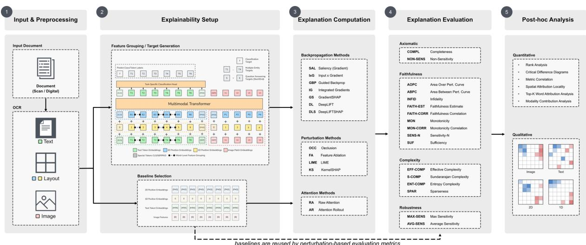  
Fig. 1: Overview of the DocXEval framework. Given a dataset and a trained model, the framework (1) extracts modality-specific inputs from each document, (2) defines feature segmentation masks, reference baselines per modality, and targets, (3) computes modality-wise attribution scores via XAI methods, (4) evaluates explanation quality across four XAI evaluation criteria, and (5) conducts a systematic qualitative and quantitative analysis of results across datasets, models, and tasks.

## 3 DocXEval: Our Framework

Problem Formulation. We consider a general document understanding setup, where a model $f _ { \theta }$ is trained on a dataset $\boldsymbol { \mathcal { D } } ~ = ~ \{ ( x _ { i } , y _ { i } ) \} _ { i = 1 } ^ { N }$ of document-label pairs for a downstream task T. Each document $x \in \mathcal { D }$ is represented by up to four modalities2: textual content T, 1D sequence positions S, 2D layout information L, and visual features V, which the model jointly processes to produce task-level predictions. We assume a preprocessing function ϕ : x 7→ (T, S, L, V) that extracts these modalities from each document, e.g., via standard optical character recognition (OCR) pipelines commonly used in multimodal document understanding [4, 8, 10]. Given this setting, we seek to (i) explain model predictions through modality-wise feature attributions $\mathbf { A } _ { \mathcal { M } } ,$ and (ii) systematically evaluate them in terms of axiomatic soundness, faithfulness, complexity, and robustness. Here, $\mathbf { A } _ { \mathcal { M } }$ denotes the attribution scores assigned to modality $\mathcal { M } \in \{ \mathcal { T } , S , \mathcal { L } , \mathcal { V } \}$ for a given prediction target.

Framework Overview. As illustrated in Fig. 1, DocXEval operates in five steps: (1) modalityspecific inputs are extracted from each document and projected to input embeddings; (2) feature segmentation masks and reference baselines are defined per modality, and task-specific attribution targets are generated; (3) adapted XAI methods are applied to produce modality-wise explanations with respect to each target; (4) the resulting explanations are evaluated through standardized metrics to generate evaluation scores for each sample-target pair; and (5) evaluation scores are aggregated per dataset and systematically analyzed across datasets, models, and tasks. We describe the main components of the framework in the following sections.

## 3.1 Input and Preprocessing

The first stage of the framework prepares a uniform attribution space across models and modalities. Multimodal document understanding models [3, 8, 23] generally difer in how they represent inputs. For example, text may be tokenized using diferent vocabularies, spatial positioning may be encoded as a bounding-box or polygon coordinates, and visual features may be derived from CNN-based embeddings [3, 23] or patch-based projections [2]. Irrespective of these diferences, however, the models typically map their discrete token-level inputs to continuous embedding representations via modality-specific embedding functions. We denote these as $\pi _ { \mathcal { M } } : \mathcal { M } \to $ $\mathbb { R } ^ { d } , \quad \mathcal { M } \ \in \ \{ \mathcal { T } , \mathcal { S } , \mathcal { L } \}$ . For token-level inputs, our framework operates at this embedding level, meaning the attribution scores are computed over the full embedding space of each token. This provides three main advantages: (1) a consistent attributable unit across models regardless of tokenization scheme or input representation; (2) a common dimensionality across all token-level modalities, ensuring each modality has the same number of attributable features per token; and (3) a uniform input representation across both gradient-based and perturbation-based methods3. For visual inputs $\nu ,$ our framework operates directly on raw image pixels rather than modelspecific visual embeddings (e.g., patch projections), as raw images are inherently continuous and can be directly segmented into a set of attributable features.

## 3.2 Feature Segmentation and Aggregation

In the second stage, we define a feature segmentation mask for each modality to group features into a smaller set of semantically meaningful units. This is necessary for three reasons:

1. Since our framework operates on token-level embeddings (each of dimension Rd) and raw image space (typically of dimensions $\mathbb { R } ^ { C \times H \times W } )$ , the resulting attributable feature space becomes very large. For instance, an input sequence of length $L \ = \ 5 1 2$ with each token of dimension $\mathbb { R } ^ { d }$ , combined with visual features of dimension R224×224×3, yields hundreds of thousands of features across modalities, making explanations expensive to compute and evaluate.

2. Perturbation-based methods inherently operate over segmented features, producing coarser explanations with lower complexity scores, whereas gradient-based methods produce finegrained per-feature attributions. Therefore, aggregating explanations over the same set of features is necessary for a fair cross-method evaluation.

3. Aggregating explanations into humanunderstandable units improves interpretability; for instance, word-level attributions are more meaningful than subword-level scores, and image patch attributions are more interpretable than pixel-level maps.

Segmentation Strategy. Formally, we define feature segmentation through a mask that assigns each input feature to a semantically coherent group. For discrete modalities $\mathcal { M } \in \{ \mathcal { T } , S , \mathcal { L } \}$ with L tokens and embedding dimension d, we define a feature-level mask $m _ { \mathcal { M } } \in \mathbb { N } ^ { L \times d }$ where all d features of token j share the same group assignment k. The feature set for group k in modality M is then:

$$
\mathcal { F } _ { \mathcal { M } , k } = \{ \pi _ { \mathcal { M } } ( t _ { j } , l ) \ | \ m _ { \mathcal { M } } ( j , l ) = k \}\tag{1}
$$

where $\pi _ { \mathcal { M } } ( t _ { j } , l )$ denotes the l-th element of the embedding of token $j$ . Similarly, for visual modality $\nu ,$ we define a feature-level mask $m _ { \nu } ~ \in$ $\mathbb { N } ^ { H \times W \times C }$ where all C channels of pixel $( x , y )$ share the same group assignment $p .$ The feature set for visual group $p$ is:

$$
\mathcal { F } _ { \mathcal { V } , p } = \{ \mathcal { V } ( x , y , c ) ~ | ~ m _ { \mathcal { V } } ( x , y , c ) = p \}\tag{2}
$$

In this work, we employ word-level grouping for discrete modalities, where each group k in Eq. (1) corresponds to a complete word, and patch-level grouping for visual features, where each group p in Eq. (2) corresponds to a spatial image region.

Feature Aggregation. Given fine-grained attribution scores computed at the embedding element or pixel level, we aggregate them to group-level scores for downstream evaluation and analysis. For a modality M with scalar attribution scores $a _ { \mathcal { M } , i } \in \mathbb { R }$ assigned to each individual feature i, we first sum all attribution scores within a group and then normalize by a scaling factor $w _ { \mathcal { M } , k } \colon$

$$
\begin{array} { r l } & { { \boldsymbol { a } } _ { \mathcal { M } , k } = { \boldsymbol { w } } _ { \mathcal { M } , k } \displaystyle \sum _ { i \in \mathcal { G } _ { \mathcal { M } , k } } { \boldsymbol { a } } _ { \mathcal { M } , i } , } \\ & { { \boldsymbol { w } } _ { \mathcal { M } , k } = \displaystyle \frac { \operatorname* { m i n } _ { \mathcal { M } ^ { \prime } , k ^ { \prime } } \left| \mathcal { G } _ { \mathcal { M } ^ { \prime } , k ^ { \prime } } \right| } { \left| \mathcal { G } _ { \mathcal { M } , k } \right| } } \end{array}\tag{3}
$$

where $\mathcal { G } _ { \mathcal { M } , k } = \{ i \mid m _ { \mathcal { M } , i } = k \}$ denotes the set of scalar feature indices in group k. The scaling factor $w _ { \mathbf { \lambda } \mathcal { M } , k }$ is defined as the ratio of the smallest group size across all modalities to the size of the current group. This ensures that attribution scores for the smallest feature group remain unscaled, while those for larger groups are scaled down proportionally to prevent their larger feature counts from inflating their importance. For instance, in our setting, a single-token word with embedding dimension $d = 7 6 8$ and an image patch of dimension $1 6 \times 1 6 \times 3 = 7 6 8$ both receive a weight of 1.0, retaining their original scores, whereas a word spanning n tokens has its attributions downscaled by a factor of $n .$

## 3.3 Baseline Selection

Many feature attribution methods [15, 24, 35] and evaluation metrics [25] require a reference baseline in their computation. For example, perturbationbased XAI methods and evaluation metrics assess the impact of input features on model output by replacing their values with the baseline. However, selecting a suitable baseline is not straightforward as it is possible that replacing a feature with a baseline produces an out-of-distribution input (unseen during training), and therefore the resulting impact on the model output may not reflect actual information removal but rather a distribution shift [52]. In a multimodal setup, this becomes further complicated, as each modality requires its own baseline, and the optimal combination of modality-specific baselines for minimizing the out-of-distribution efect is not obvious.

To address this, we propose a perturbationbased baseline selection strategy which extends the Replace strategy proposed by Hase [52] to the multimodal context. In particular, for each modality M, we define a set of baseline candidates $\bar { B _ { \mathcal { M } } } = \{ b _ { 1 } ^ { \mathcal { M } } , \ldots , b _ { n } ^ { \mathcal { M } } \}$ representing diferent mechanisms for removing information from that modality, and construct the Cartesian product $\begin{array} { r } { \mathcal { C } = \prod _ { \mathcal { M } } B _ { \mathcal { M } } } \end{array}$ over all modality baselines. Then, for each combination $\mathbf { c } \in { \mathcal { C } }$ and varying perturbation levels $\alpha \in \{ 0 . 1 , 0 . 2 5 , 0 . 4 , 0 . 8 \}$ , we compute the performance of the pretrained model on the perturbed test set, where for each sample we randomly replace a fraction α of feature groups (as defined in Section 3.2) with their corresponding baseline values. We repeat this process over $R \ = \ 3$ random seeds, and compute the mean performance:

$$
\bar { f } ( \mathbf { c } , \alpha ) = \frac { 1 } { R } \sum _ { r = 1 } ^ { R } f ( \mathbf { c } , \alpha , r )\tag{4}
$$

where $f ( \mathbf { c } , \alpha , r )$ refers to a task-specific metric such as accuracy or F1-score that determines the model performance. To isolate the efect of a specific baseline $b _ { i } ^ { \mathcal { M } }$ for modality M on model performance, we take the average over all combinations containing that baseline, efectively marginalizing out the influence of other modalities’ baselines:

$$
\bar { f } ( b _ { i } ^ { \mathcal { M } } , \alpha ) = \frac { 1 } { \vert \mathcal { C } _ { i } ^ { \mathcal { M } } \vert } \sum _ { \mathbf { c } \in \mathcal { C } _ { i } ^ { \mathcal { M } } } \bar { f } ( \mathbf { c } , \alpha )\tag{5}
$$

where $\mathcal { C } _ { i } ^ { \mathcal { M } } = \{ \mathbf { c } \in \mathcal { C } : \mathbf { c } _ { \mathcal { M } } = b _ { i } ^ { \mathcal { M } } \}$ . Finally, we compute the model sensitivity to baseline $b _ { i } ^ { \mathcal { M } }$ as $\bar { f } ( b _ { i } ^ { \bar { M } } , \alpha ) - \bar { f } _ { 0 }$ , where $\bar { f } _ { 0 }$ denotes the unperturbed model performance.

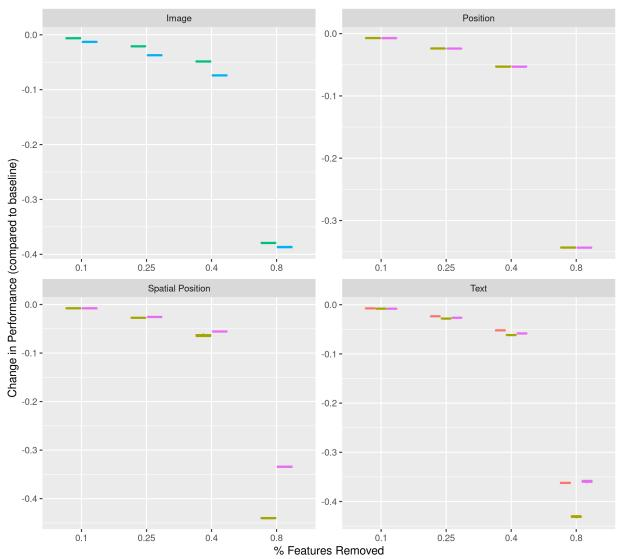  
(a) RVL-CDIP [50] (classification)

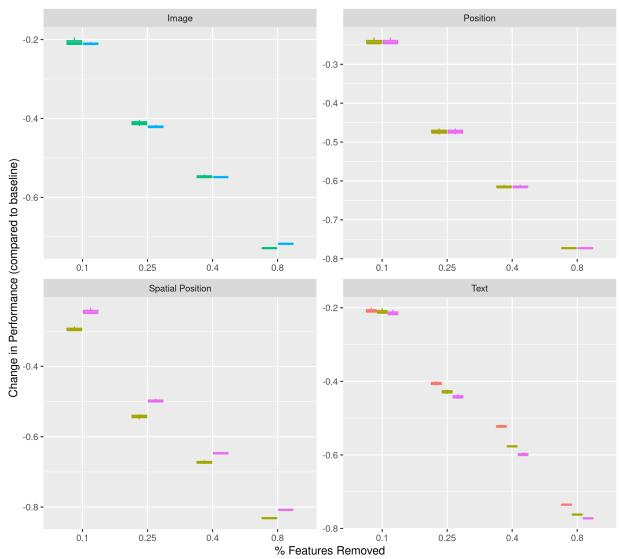  
(b) FUNSD [51] (SER)  
Fig. 2: Modality-wise model sensitivity to diferent baselines, shown for LayoutLMv3 [2] on RVL-CDIP [50] and FUNSD [51]. The model is generally less sensitive to the Mean baseline for the image modality on both datasets, whereas for spatial position, it is less sensitive to the Zero Embedding base line compared to the [PAD] baseline. For the text modality, the model is less sensitive to the [MASK] token compared to other baselines.

Fig. 2 shows the resulting modality-wise sensitivity of LayoutLMv3 [2] to diferent baseline candidates: [PAD], [MASK], Zero Embedding, Mean image, and Random image. As shown, sensitivity varies across modalities and strategies, with diferences becoming more pronounced at higher perturbation levels. To select the baselines for downstream explainability evaluation, for each modality, we compute the average sensitivity of each strategy across perturbation levels and choose the strategy that results in the lowest overall model sensitivity. Intuitively, since all baselines inherently remove information, greater model sensitivity is more likely attributable to out-ofdistribution inputs than to genuine information removal.

## 3.4 Attribution Targets

Our framework is designed to work across three types of document understanding tasks: (1) classification (CLS), where the model outputs a distribution $p ( y \mid x )$ over C document labels; (2) semantic entity recognition (SER), where the model outputs distributions $p ( y _ { i } \mid x )$ over C entity types for each token; and (3) question answering (QA), where given a question $q ,$ the model independently outputs distributions $p ( s \mid x , q )$ and $p ( e \mid x , q )$ over start and end answer span positions. For each task, we define an attribution target with respect to which the explanations are computed. For document classification, the target is defined as the probability of the predicted class arg max p(y | x). For SER, a target is defined for each word as the probability of the predicted entity label arg max $p ( y _ { i } \mid x )$ of its first subword token. This results in K attribution targets per sample, where K is the total number of words in the sample. For QA, the targets are defined as the probabilities of the predicted start and end span positions arg max p(s | x, q) and arg max p(e | $x , q )$ , respectively.

## 3.5 XAI Method Adaptations

This section describes how we adapt the existing XAI methods in our framework to work with multimodal document inputs and multi-target tasks.

Algorithm 1 Batched Multi-Target Backprop   
Require: Forward function $f ,$ input x, targets   
$\{ c _ { 1 } , \ldots , c _ { K } \}$ , batch size b   
Ensure: Gradients $\{ \nabla _ { x } f _ { c _ { k } } ( x ) \} _ { k = 1 } ^ { K }$   
1: $\mathbf { y } \gets f ( x )$ ▷ Single forward pass   
2: E ← eye(K) ▷ Unit vectors for each target   
3: G ← zeros(K, |x|) ▷ Initialize gradient   
storage   
4: for $j = 0$ to $K - 1$ step b do   
5: $\mathbf { V }  \mathbf { E } [ j : j + b ] \quad \vartriangle { \vartriangle } \triangleright$ Batch of unit vectors   
6: $\mathbf { G } [ j : j + b ] $ autograd.grad $( \mathbf { y } , x , \mathbf { V } )$ ▷   
Accumulate gradients with graph retention   
7: end for   
8: return G

Backpropagation-based methods. In singletarget setups such as classification, applying backpropagation-based methods is straightforward. Simple backpropagation-based methods such as Saliency (SAL) [33], Guided Backpropagation (GBP) [34], and Input×Gradient (IxG) [36] compute the backward pass with respect to each input modality, while methods that require reference baselines, such as Integrated Gradients (IG) [35] and DeepLIFT (DL) [36], use the predetermined modality-wise baselines to compute attribution scores.

In multi-target tasks such as SER, each document contains K attribution targets (e.g., corresponding to K predicted word entities), requiring $K$ attributions $\{ \mathbf { A } _ { \mathcal { M } } ^ { ( c _ { 1 } ) } , . . . , \mathbf { A } _ { \mathcal { M } } ^ { ( c _ { K } ) } \}$ to be computed independently for each target. A naive approach would require $K$ separate forwardbackward passes per sample. To avoid this, after a single forward pass, we compute the Jacobian $\mathbf { J } _ { \mathcal { M } }$ over all K targets simultaneously. For instance, Saliency (SAL) [33] scores over K targets of a single sample can be computed as follows:

$$
\mathbf { J } _ { \mathcal { M } } = \left[ \begin{array} { c } { \nabla _ { \mathcal { M } } f _ { c _ { 1 } } ( x ) ^ { T } } \\ { \vdots } \\ { \nabla _ { \mathcal { M } } f _ { c _ { K } } ( x ) ^ { T } } \end{array} \right] \in \mathbb { R } ^ { K \times | \mathcal { M } | }\tag{6}
$$

where each row k contains the attribution for target $c _ { k }$ with respect to modality M. In practice, we compute the above Jacobian with $K / b$ batched backward passes using PyTorch autograd (see Algorithm 1), where b is the batch size for the gradient computation. We integrate all backpropagation-based methods with this modified backward pass to accommodate multiple targets in each computation run.

Perturbation-based methods. For singletarget scenarios, applying perturbation-based methods is also straightforward with predetermined modality-wise feature segmentation masks and reference baselines. For instance, Feature Ablation (FA) [27] directly perturbs grouped features by replacing them with their corresponding reference baselines. Occlusion (OCC) [27] works similarly, but instead of using a perturbation mask, uses a sliding window and strides over each modality to perturb the data. LIME [15] and KernelSHAP (KS) [24] generate perturbed neighborhood samples around the input using the modality-wise feature masks and reference baselines, and then fit local surrogate models to approximate feature contributions.

For multi-target tasks, since each perturbed forward pass already produces predictions for all K targets, we extend these methods to simultaneously accumulate the attribution scores over all K targets at each perturbation step, resulting in K attribution maps in a single computation run. For surrogate-based methods, such as LIME [15] and KernelSHAP (KS) [24], we create the neighborhood dataset once for all targets and then train K surrogate models independently.

Attention-based methods. Attention-based methods cannot directly produce attribution maps over the embedding space of all modalities, as the accessible modalities depend on the model architecture; for instance, LayoutLMv3 [2] produces attention scores over text and visual tokens, whereas LiLT [10] produces attention scores over both text and layout tokens. We therefore restrict attention-based attributions to the modalities that are explicitly represented as separate tokens in each model. Moreover, since attention methods only provide token-level attribution scores, we distribute each score uniformly across the embedding dimension d so that the resulting output lies in the same space as the outputs of other XAI methods. This ensures a consistent downstream evaluation across all methods.

For all single-target scenarios, we use the method implementations available in captum4 and extend them with multi-target support in the torchxai5 library.

## 3.6 XAI Metric Adaptations

This section describes how we adapt the existing XAI evaluation metrics to multimodal and multitarget settings.

Multimodal adaptation. Since each XAI method produces separate attribution maps per modality $\mathbf { A } _ { \mathcal { M } } , \mathcal { M } \in \{ T , S , \mathcal { L } , \mathcal { V } \}$ , we first perform modality-wise feature aggregation as described in Section 3.2, so that each feature group carries a single score. All metrics are then computed over these aggregated scores, treating each feature group independently of its originating modality. For perturbation-based metrics, the perturbation order is determined by ranking all feature groups jointly across modalities, and the corresponding features are then perturbed using their modalityspecific segmentation masks and reference baselines defined in previous sections. There are two exceptions to this general pipeline: Completeness (compl) [35] is computed on the raw attribution scores rather than group-aggregated scores, as the axiom requires the exact sum over all individual attributions, and Infidelity (infid) [18] adds noise directly to each modality input independently, rather than operating on the aggregated features, to keep the implementation close to the original formulation.

Multi-target adaptation. As with the explanation methods, adapting the metrics for multitarget settings is necessary to reduce computational costs. Metrics that use unordered or random perturbations (such as non-sens, moncorr, sens-n, infid, and faith-corr) can be eficiently adapted, as the efect of each perturbation can be accumulated over all K targets in a single forward pass. We implement multi-target support for all of these metrics. However, metrics that require ordered perturbations (such as aopc, suf, mon, faith-est, and eff-comp) cannot be adapted for multi-target computation, since the perturbation order depends on each target’s unique attribution scores. Metrics that require recomputing explanations (such as max-sens and avg-sens) are adapted by using the underlying multi-target explanation mode. Metrics that do not require model forward passes (ent-comp, scomp, and spar) are computed independently for each target’s attribution map.

All metrics are implemented in PyTorch with GPU support, batched computation, and compatibility with captum. We reuse the implementations of Max Sensitivity (max-sens) [18] and Infidelity (infid) [18] from captum and extend them for the multi-target case. The remaining metrics, along with their multi-target adaptations, are implemented in the torchxai library. Table 1 summarizes the supported metrics; details on individual metrics and their adaptations are provided in Appendix A.

## 4 Experimental Setup

Datasets. We evaluate our framework on 8 benchmark datasets across three tasks: CLS, SER, and QA. For classification, we use the RVL-CDIP [50], Tobacco3482 [60], and DocLayNet [61] datasets. For SER, we use the FUNSD [51], CORD [62], SROIE [63], and WildReceipts [64] datasets. For QA, we use the DocVQA [65] dataset. Table 2 presents an overview of the datasets.

Models. We select four models representing different modality fusion strategies: BERT [66] and RoBERTa [67] as text-only baselines (T, S), LiLT [10] as a multimodal model processing text, positional, and layout modalities (T, S, L), and LayoutLMv3 [2] as a fully multimodal model processing all four modalities $( \mathcal { T } , \mathcal { S } , \mathcal { L } , \mathcal { V } )$ . This selection enables analysis of how explainability methods behave across models with varying numbers of modalities and fusion strategies.

Training details. We initialize all models from publicly available pretrained checkpoints on Hugging Face6 and fine-tune them using the Adam or Adam-W optimizers. We use 40 training epochs for the classification task, 50 for the DocVQA task, and 100 for the SER task, with early stopping based on validation performance (patience of

Table 1: Overview of the 17 evaluation metrics adapted in this work. Perturbation Type indicates whether the metric requires ordered (features removed in attribution-ranked order), unordered (random subset removal), or no perturbation of the input. FS refers to whether a metric supports computation over modality-wise segmented features. MT indicates whether the metric supports eficient multi-target computation. Chunking indicates whether a metric supports perturbation over feature chunks to improve computational eficiency.
<table><tr><td>Type</td><td></td><td>Metric Perturbation Type</td><td>Requires Model</td><td>Requires Baseline</td><td>FS support</td><td>MT Support</td><td>Chunking</td></tr><tr><td>Axiomatic</td><td>Completeness (CoMPL)</td><td>[35] (↓)</td><td>N/A</td><td>√ √</td><td>N/A</td><td>√</td><td>×</td></tr><tr><td rowspan="9"></td><td>Non-Sensitivity (NON-SENS)</td><td>[53] (↓)</td><td>Unordered</td><td>V</td><td>1</td><td>√</td><td>√</td><td>√</td></tr><tr><td>Area Over Perturbation Curve (AoPC)</td><td>[54] (↑)</td><td>Ordered</td><td>V</td><td>V</td><td>V</td><td>×</td><td>V</td></tr><tr><td>Area Between Perturbation Curves (ABPC)</td><td>[54] (↑)</td><td>Ordered</td><td></td><td></td><td></td><td>X</td><td></td></tr><tr><td>Sufficiency (sUF)</td><td>[55] (↓)</td><td>Ordered</td><td>V</td><td>V</td><td>7</td><td>×</td><td>√</td></tr><tr><td>Sensitivity-N (SENS-N)</td><td>[56] (↓)</td><td>Unordered</td><td></td><td>↓</td><td>V</td><td>√</td><td>V</td></tr><tr><td>Infidelity (INFID)</td><td>[18] (↓)</td><td>Unordered</td><td>√</td><td>×</td><td>N/A</td><td>√</td><td>N/A</td></tr><tr><td>Faithfulness Estimation (FAITH-EST)</td><td>[57] (↑)</td><td>Ordered</td><td>√</td><td>√</td><td>√</td><td>X</td><td></td></tr><tr><td>Faithfulness Correlation (FAITH-CORR)</td><td>[58] (↑)</td><td>Unordered</td><td>√</td><td>√</td><td>√</td><td>√</td><td>√</td></tr><tr><td>Monotonicity (MON) Monotonicity Correlation (MON-CORR)</td><td>[28] (↑) [53] (↑)</td><td>Ordered Unordered</td><td>√</td><td>√</td><td>√</td><td>X</td><td>√</td></tr><tr><td rowspan="4">Complexity</td><td></td><td></td><td></td><td>√</td><td>√</td><td>√</td><td>√</td><td>7</td></tr><tr><td>Effective Complexity (EFF-COMP)</td><td>[53] (↓)</td><td>Ordered</td><td>√</td><td>√</td><td>√</td><td>X</td><td>√</td></tr><tr><td>Entropy-based Complexity (ENT-CoMP)</td><td>[58] (↓) [35] 1(↓)</td><td>N/A</td><td>×</td><td>×</td><td>√</td><td>N/A</td><td>N/A</td></tr><tr><td>Sundararajan Complexity (s-CoMP) Sparseness (sPAR)</td><td>[59] (↑)</td><td>N/A N/A</td><td>×</td><td>×</td><td>√</td><td>N/A</td><td>N/A</td></tr><tr><td rowspan="2">Robustness</td><td></td><td></td><td></td><td>×</td><td>×</td><td>√</td><td>N/A</td><td>N/A</td></tr><tr><td>Max Sensitivity (MAX-SENS) Avg Sensitivity (AVG-SENS)</td><td>[18] (↓) [18] (↓)</td><td>Unordered Unordered</td><td>√ √</td><td>X X</td><td>N/A N/A</td><td>√ √</td><td>N/A N/A</td></tr></table>

Table 2: Overview of the eight datasets used in this work. For each dataset, we provide the number of classes or entity types, dataset splits, the size of the subset used for XAI evaluation, and the task-specific performance metric.
<table><tr><td>Task</td><td>Dataset</td><td>Classes</td><td>Train</td><td>Validation</td><td>Test</td><td>XAI Eval. Set</td><td>Metric</td></tr><tr><td rowspan="3">CLS</td><td>Tobacco3482 [60]</td><td>10</td><td>2504</td><td>278</td><td>700</td><td>700</td><td>Accuracy</td></tr><tr><td>RVL-CDIP [50]</td><td>16</td><td>320000</td><td>40000</td><td>40000</td><td>1000</td><td>Accuracy</td></tr><tr><td>DocLayNet [61]</td><td>11</td><td>69103</td><td>6480</td><td>4999</td><td>1000</td><td>Accuracy</td></tr><tr><td rowspan="4">SER</td><td>FUNSD [51]</td><td>4</td><td>149</td><td></td><td>50</td><td>50</td><td>F1</td></tr><tr><td>CORD [62]</td><td>30</td><td>800</td><td>100</td><td>100</td><td>100</td><td>F1</td></tr><tr><td>SROIE [63]</td><td>5</td><td>626</td><td></td><td>347</td><td>100</td><td>F1</td></tr><tr><td>WildReceipts [64]</td><td>13</td><td>1267</td><td></td><td>472</td><td>100</td><td>F1</td></tr><tr><td>QA</td><td>DocVQA [65]</td><td></td><td>10194</td><td>1286</td><td>1287</td><td>1000</td><td>ANLS</td></tr></table>

Table 3: Model performance on individual datasets. Best results are highlighted in bold. Training hyperparameters are reported in Appendix B1.
<table><tr><td>Task</td><td colspan="2">Dataset</td><td>Metric</td><td>BERT [66]</td><td>RoBERTa [67]</td><td>LiLT [10]</td><td>LayoutLMv3 [2]</td></tr><tr><td rowspan="3">Classification</td><td>Tobacco3482</td><td>[60]</td><td>Acc. (↑)</td><td>86.38</td><td>87.81</td><td>88.53</td><td>94.27</td></tr><tr><td>RVL-CDIP</td><td>[50]</td><td>Acc. (↑)</td><td>89.70</td><td>90.05</td><td>91.20</td><td>94.12</td></tr><tr><td>DocLayNet [61]</td><td></td><td>Acc. (↑)</td><td>97.50</td><td>97.90</td><td>97.78</td><td>98.97</td></tr><tr><td rowspan="4">SER</td><td>FUNSD</td><td>[51]</td><td>F1 (↑)</td><td>64.69</td><td>67.47</td><td>76.19</td><td>88.09</td></tr><tr><td>CORD</td><td>[62]</td><td>F1 (↑)</td><td>95.10</td><td>96.28</td><td>96.85</td><td>97.01</td></tr><tr><td>SROIE</td><td>[63]</td><td>F1 (↑)</td><td>89.63</td><td>93.33</td><td>94.12</td><td>95.28</td></tr><tr><td>WildReceipts</td><td>[64]</td><td>F1 (↑)</td><td>89.70</td><td>91.32</td><td>92.80</td><td>93.38</td></tr><tr><td>QA</td><td>DocVQA [65]</td><td></td><td>ANLS (↑)</td><td>59.95</td><td>63.26</td><td>70.11</td><td>73.37</td></tr></table>

10). Table 3 reports the performance achieved by each model on the individual datasets. Additional training hyperparameter details are provided in Appendix B.

XAI Methods. We adapt and investigate 13 XAI methods in this work, spanning three families: seven backpropagation-based methods, namely Saliency (SAL) [33], Input×Gradient (IxG) [36], Guided Backpropagation (GBP) [34], Integrated Gradients (IG) [35], GradientSHAP (GS) [24], DeepLIFT (DL) [36], and DeepSHAP (DS) [24]; four perturbation-based methods, namely Feature Ablation (FA) [27], Occlusion (OCC) [27], LIME [15], and KernelSHAP (KS) [24]; and two attention-based methods, namely Raw Attention (RA) [66] and Attention Rollout (AR) [68]. Within attention-based methods, we also considered Attention Flow (AF) [68] but excluded it due to its high computational cost when applied to large sequences.

We configure each explainability method to achieve a suitable trade-of between quality and computational eficiency. For methods that require sampling or interpolation steps, such as Integrated Gradients (IG) [35], GradientSHAP (GS) [24], LIME [15], and KernelSHAP (KS) [24], we use 200 samples or steps. For DeepSHAP (DS) [24], a reference baseline distribution of $N = 1 0 0$ samples is precomputed from the training set of each dataset. For Occlusion (OCC) [27], we define modalityspecific sliding windows and strides: a window of 8 tokens with a stride of 4 for text, position, and layout modalities, and a window of $3 \times 1 6 \times 1 6$ with a stride of $3 \times 8 \times 8$ for the image modality.

XAI Evaluation Details. We evaluate the explanations using the 17 metrics listed in Table 1, spanning four criteria: axiomatic soundness, faithfulness, complexity, and robustness. For Sensitivity-N (sens-n) [56] and Faithfulness Correlation (faith-corr) [58], we evaluate at perturbation levels of 20%, 40%, and 60%. For perturbation-based metrics, we use a chunk size of 1% where applicable, meaning 1% of feature groups are removed at each perturbation step. Moreover, all metrics use the same modalitywise feature segmentation masks and baselines as those used for computing the XAI attributions. All experiments are conducted on subsets of the test sets as listed in Table 2 (XAI Eval. Set), using NVIDIA H200 and RTX A6000 GPUs. Full hyperparameter configurations for explainability methods and evaluation metrics are provided in Appendix B.

## 5 Experimental Results

## 5.1 Rank Analysis of XAI Methods

To determine which XAI methods perform best under each evaluation criterion, we conduct a rank-based analysis. For each metric, we first summarize the results per dataset via mean aggregation over the sample-level scores; for multi-target scenarios, each sample-target pair is treated as an individual data point in this computation. We then rank all XAI methods per dataset-model setting and average the ranks across all settings. We adopt a rank-based approach because metric values can vary in scale across diferent setups, and therefore, direct aggregation may disproportionately favor certain setups. However, while ranking solves the scaling issue, the rank difer ence between two methods may not be statistically significant. To address this, we first apply the Friedman test over aggregated metric values to check the null hypothesis that all methods perform equally. If the null hypothesis is rejected, the Holm-adjusted pairwise Wilcoxon signed-rank test is then applied (as suggested in [69]) to determine pairwise indistinguishable groups. For all statistical analyses, we assume an α of 0.05. Both the mean ranks and statistical significance results are jointly visualized using critical diference (CD) diagrams [70], where methods with statistically insignificant diferences are connected by a horizontal bar. Besides metric-level ranking, we also perform mean aggregation across metrics within each category to obtain a global method ranking per criterion. Fig. 3 shows the critical diference diagram for the XAI method rankings across all tasks, and Fig. 4 shows the mean ranks per evaluation criterion. Per-task results are additionally provided in Appendix C.1. For the aopc ranking, we use the diference between $_ \mathrm { A O P C } _ { \mathrm { M o R F } }$ and $\mathrm { A O P C } _ { \mathrm { R A N D } }$ at 100% features removed as a single summary score. For completeness, aopc curves over multiple feature removal steps are additionally provided in Appendix C.3.

Method Rankings and Statistical Significance. From Fig. 3, we observe that although methods vary considerably in their raw rankings across the metrics, many of these diferences are not statistically significant (as highlighted by the horizontal bar). For instance, on compl, KS is ranked higher than IG, but both are statistically indistinguishable. Likewise, on Non-Sensitivity (non-sens) [53] and Sparseness (spar) [59], the vast majority of methods show no statistically significant diferences despite a wide separation in their raw ranks. This efect is most extreme on Monotonicity (mon) [28] and Infidelity (infid) [18], where all or nearly all methods form a single indistinguishable group. Upon investigation, we found that Monotonicity (mon) [28], being a binary metric (0 or 1), yielded a value of 0 the majority of the time, as even minor noise in an otherwise monotonic perturbation curve is suficient to trigger non-monotonicity. Similarly, Infidelity (infid) [18] produced near-identical raw scores across all methods, with the exception of RA and AR, for which the scores diverged from the rest but remained comparable to each other. Based on these observations, we consider both metrics unsuitable for evaluation in this setting. Overall, we observe similar patterns in task-level method rankings, with slightly more pronounced statistical indistinguishability on some metrics, as detailed in Appendix C.1.

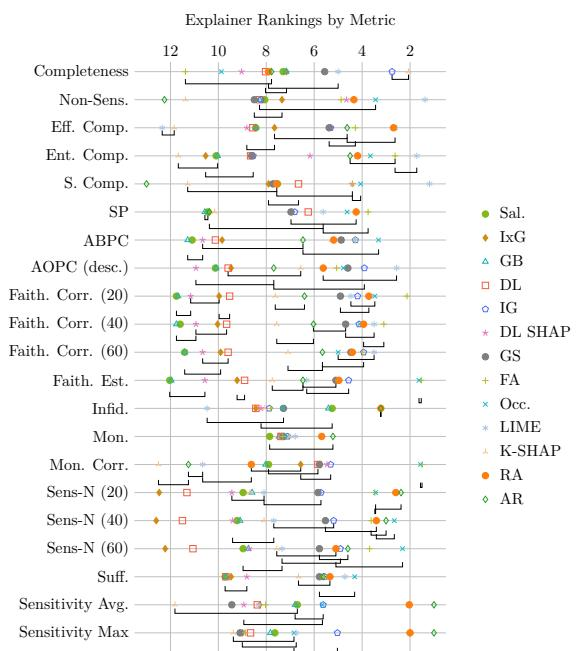  
Fig. 3: Critical diference diagram showing permetric XAI method rankings across all tasks. Methods connected by a horizontal bar are statistically indistinguishable. Lower ranks indicate better performance. Task-level critical diference diagrams are additionally provided in Appendix C.1.

Ranking Patterns Across Metrics. When examining rankings across individual metrics, some important observations arise. On both faith-corr and sens-n, methods achieve very similar rankings across the 20%, 40%, and 60% perturbation levels, indicating that a single configuration may sufice for these metrics. We also observe comparable orderings across some groups of faithfulness metrics; for instance, on aopc, abpc, faith-est, faith-corr, and suf, methods produce similar ranking patterns. This observation also holds for the robustness metrics maxsens and avg-sens.

Best-Performing Methods per Criterion. Despite the widespread statistical indistinguishability, certain method groups consistently rank higher or lower across metrics. Basic backpropagation-based methods, including SAL, GBP, IxG, and DL, occupy the lowest ranks across the majority of metrics. On compl, IG and KS perform the best, whereas LIME and OCC lead on non-sens. These observations are also reflected in the mean ranking across axiomatic properties (Fig. 4), where LIME, IG, RA, and OCC lead overall. On individual complexity metrics, KS and AR perform the worst, whereas LIME, RA, OCC, and FA consistently rank higher than other methods. The average ranking on the complexity criterion (see Fig. 4) confirms these findings, with LIME, RA, OCC, and FA ranking the highest, while KS ranks considerably lower than all other methods. On faithfulness metrics, OCC, FA, and RA show the best rankings overall. For instance, on faith-est and mon-corr, OCC and FA considerably outperform other methods. Attention-based methods, RA and AR, show variable results on faithfulness; however, RA generally ranks as one of the best alongside OCC. The average ranking on faithfulness supports these findings (see Fig. 4), with OCC, RA, FA, and IG being the top-4 methods. On robustness, attention-based methods considerably outperform all other method families; the average ranking on robustness confirms this, with AR ranking first, followed by RA, IG, and OCC. Taken together, the methods that most consistently stand out as best-performing across all evaluation criteria are OCC, RA, and IG.

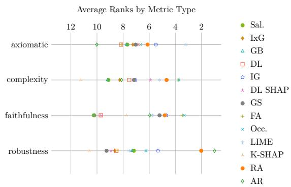  
Fig. 4: Aggregated mean ranks of XAI methods per evaluation criterion across all tasks, datasets, and models. Lower ranks indicate better performance. Per-task breakdowns are provided in Appendix C.1.

## 5.2 Metric Agreement Analysis

The metric disagreement problem has been wellnoted in prior work [25, 26], and therefore, it is important to investigate whether multiple evaluation metrics agree or disagree on the relative ranking of explanation methods. We assess metric agreement for the faithfulness and complexity categories by computing the Spearman correlation between metric rankings across all datasets, models, and explainer settings. Such analysis can not only improve our confidence in the evaluation, but also help determine whether some metrics are redundant, e.g., when two metrics are highly correlated. Fig. 5 and Fig. 6 present the correlation heatmaps for faithfulness and complexity metrics, respectively; per-task results are additionally provided in Appendix C.2.

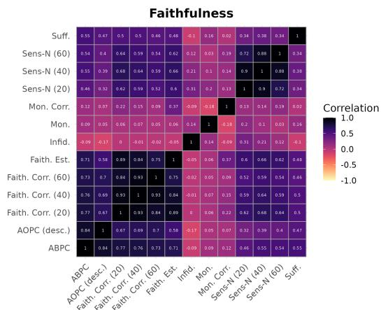  
Fig. 5: Pairwise Spearman correlation between faithfulness metric rankings across all datasets, models, and explainer settings. Per-task correlation matrices are provided in Appendix C.2.

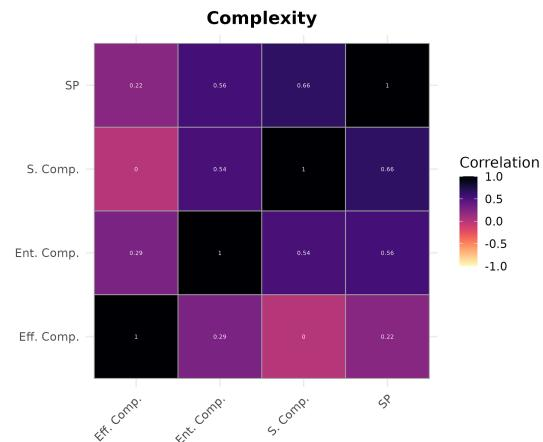  
Fig. 6: Pairwise Spearman correlation between complexity metric rankings across all datasets, models, and explainer settings. Per-task correlation matrices are provided in Appendix C.2.

Faithfulness Metrics. On the faithfulness criterion, both faith-corr and sens-n show strong correlation across their respective perturbation levels (20%, 40%, 60%), aligning with the observations made via the critical diference diagrams. Strong correlation is observed between aopc, faith-est, abpc, faith-corr, and suf. sensn also shows a moderate correlation with other faithfulness metrics (around 0.5–0.65), whereas mon-corr is only weakly correlated with faithest. Notably, neither infid nor mon show any correlation with other faithfulness metrics. This lack of correlation coincides with the statistical indistinguishability and unreliability observed for these metrics in the critical diference diagrams.

Complexity Metrics. On the complexity criterion, s-comp, spar, and ent-comp show a moderate correlation with each other (around 0.54–0.66). eff-comp, however, shows only a very weak correlation with ent-comp and spar, and no correlation with s-comp.

For both criteria, the observations remained largely consistent across individual task-level results (see Appendix C.2).

## 5.3 Computational Eficiency of Multi-Target Adaptations

In this section, we examine the computational eficiency of our multi-target adaptations for both XAI methods and evaluation metrics.

XAI Methods. Fig. 7 compares the execution time of iterative versus multi-target attribution computation for five XAI methods (OCC, LIME, SAL, DL, and IG). We report the average execution time over a fixed number of samples on the CORD and FUNSD datasets across two GPUs (H200 and RTX A6000), along with the speedup factor for each method. Note that for the iterative scenario, we use batched computation to keep a fair comparison. Perturbation-based methods such as OCC achieve speedups roughly proportional to the number of targets per sample, reaching approximately 25× on CORD (26 targets/sample) and up to 189× on FUNSD (179 targets/sample), with minor variations between GPUs. For surrogate-based methods such as LIME, speedups are lower and more GPU-dependent, ranging from 7× to 17× depending on the dataset and hardware. Backpropagation-based methods show comparatively modest but still notable gains, consistently achieving 1.5×–1.7× speedups regardless of the number of targets.

Evaluation Metrics. Fig. 8 compares the persample-target execution time of all evaluation metrics across CLS (single-target) and SER (multi-target) settings. All results are computed on H100/H200 GPUs, with execution times averaged over all datasets and XAI methods. Within the axiomatic metrics, compl benefits significantly from the multi-target support, with execution times reaching below 1ms. Complexity metrics s-comp, spar, and ent-comp show similar computational times on both tasks even without multi-target adaptations. For robustness metrics, although a direct comparison is not possible as the two tasks are computed on diferent datasets, computation on the SER task is roughly 3.8× faster than on the CLS task, which can be attributed to the underlying use of multi-target adaptations of the explainers when computing these metrics. The advantage of multi-target adaptations becomes most apparent when comparing metrics that use ordered perturbations (e.g., aopc, abpc, suf) against those that use unordered perturbations.

On the single-target CLS task, unordered metrics take approximately 193–521ms while ordered metrics take approximately 3,069ms, making the former roughly 6–16× faster. On the SER task, multi-target adaptations widen this gap significantly: execution times for unordered metrics drop to approximately 10–13ms per sample-target, while those for ordered metrics remain at approximately 2,287ms as they cannot be adapted, yielding speedups of 176–229×.

## 5.4 Qualitative Analysis

To complement the quantitative evaluation, we qualitatively analyze modality-wise explanations produced by the three best-performing methods: IG, OCC, and RA. Fig. 9, Fig. 10, and Fig. 11 show randomly selected samples across all three tasks: CLS (RVL-CDIP [50] and DocLayNet [61]), SER (CORD [62] and FUNSD [51]), and QA, respectively. For each sample, we visualize the text, position, layout, aggregated text, and image attribution maps. Note that for RA, only aggregated text and image attributions are visualized, as it does not generate position-level and layout-level explanations. Additional samples are provided in Appendix C.5.

Classification. Fig. 9 presents modality-wise explanations for LayoutLMv3 [2] on two classification samples from RVL-CDIP [50] and DocLayNet [61]. On the RVL-CDIP [50] sample (budget class), IG suggests the model relies on both text and image modalities for its classification decision. One notable observation is that it assigns strong positive importance to the text modality of certain tokens (e.g., the document identity number or document header), but this is accompanied by negative importance from the layout modality of the same tokens. Interestingly, from the aggregated text-level attributions (Agg. Text.), it can be observed that for some tokens, these counteracting attributions cancel each other out, resulting in negligible aggregated attribution, but many words still emerge as more prominent in the aggregated view. For instance, the document identity number emerges with a strongly negative influence in the aggregated view. OCC, in contrast to IG, suggests the model relies heavily on the visual layout of the image as well as the spatial positioning of text, including table headers. RA similarly indicates strong reliance on the image modality, while for the text modality, it suggests a strong focus on table header values. Notably, all three methods assign noticeable importance to the word ESTIMATE, which intuitively makes sense for the budget class. On the DocLayNet [61] sample (scientific article), all three methods indicate that the model relies predominantly on the image modality for its classification decision, with no significant focus on textual modalities. Here, the focus appears to be mainly on the visual formatting of the document, particularly paragraph indentation and white space around the main text.

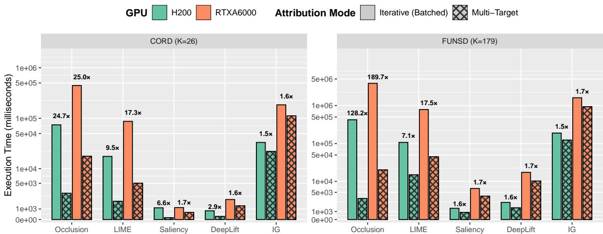  
Fig. 7: Execution time comparison between iterative (batched) and multi-target attribution computation on CORD (K = 26) and FUNSD (K = 179) datasets across two GPUs. Numbers above bars indicate the speedup factor of multi-target over iterative computation. Note the log scale on the y-axis.

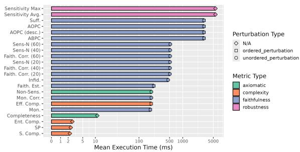  
(a) Classification (single-target)

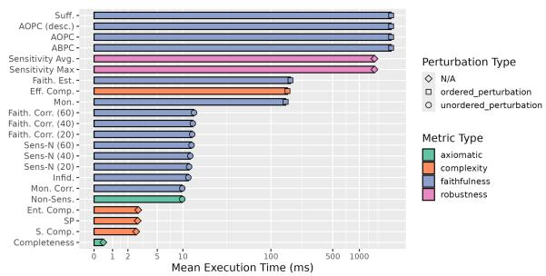  
(b) Semantic Entity Recognition (multi-target)  
Fig. 8: Mean per-sample-target computation time of each evaluation metric on CLS (single-target) and SER (multi-target) tasks. All results are computed on H100/H200 GPUs. Unordered perturbation metrics benefit significantly from multi-target adaptations, while ordered metrics remain expensive as they cannot be adapted for multi-target computation.

Semantic Entity Recognition. Fig. 10 presents the modality-wise explanations for the predictions of the LayoutLMv3 [2] model on two randomly selected SER samples from CORD [62] and FUNSD [51]. For each sample, the target entity is highlighted in a green bounding box. On the CORD [62] sample, where the target entity is I-MENU.NM, IG and OCC show no focus on the image modality, while RA only very weakly focuses on some image regions far from the actual target. All three methods show strong focus on text in close vicinity to the target entity. OCC in particular shows that the model strongly focuses on the 1D position modality of tokens preceding the target entity, with slight focus on the 2D positions of the same tokens. RA shows a similar pattern but also highlights some text that is not in the immediate vicinity of the target. In contrast to RA and OCC, IG assigns particularly high importance to tokens far from the target token, a pattern that is dificult to interpret. Additionally, it again shows counteracting positive and negative attributions for some tokens that zero out in the aggregated text attributions. Similar patterns are observed on the FUNSD sample (target entity I-QUESTION), where OCC and RA provide concise explanations focused on text tokens in the local neighborhood of the target token. IG, on the other hand, spreads importance across the entire document, significantly increasing the explanation complexity.

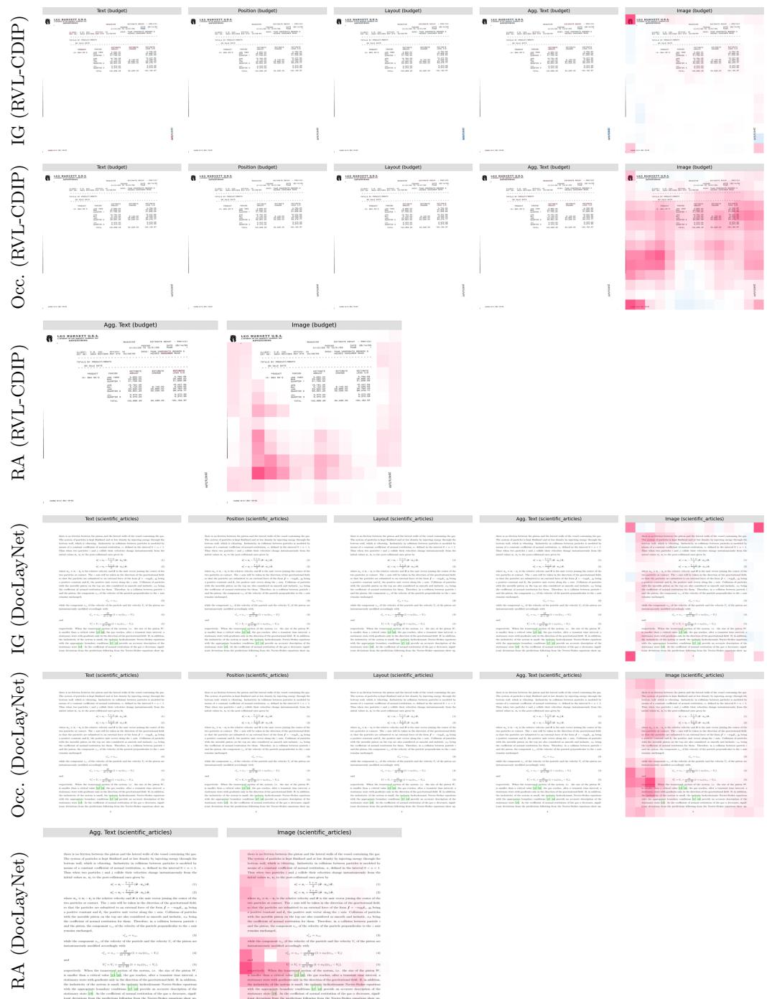  
Fig. 9: Modality-wise explanations of the LayoutLMv3 [2] model predictions for two randomly selected samples from RVL-CDIP [50] and DocLayNet [61] (CLS task). Results are shown for three methods: IG, OCC, and RA.

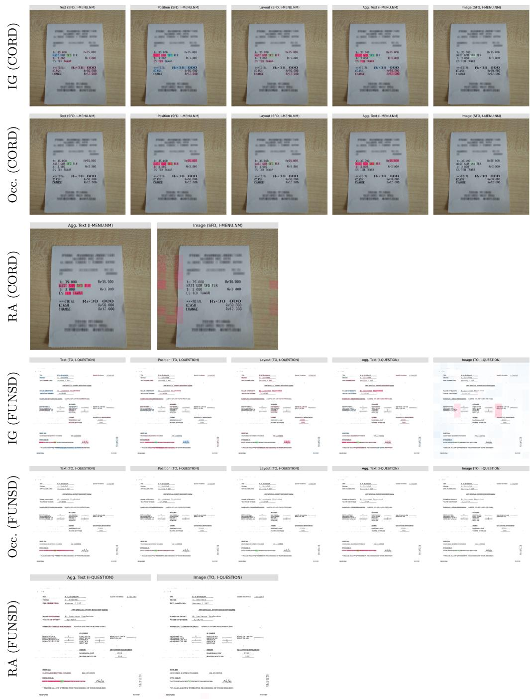  
Fig. 10: Modality-wise explanations of the LayoutLMv3 [2] model predictions for two randomly selected samples from CORD [62] and FUNSD [51] (SER task). Results are shown for three methods: IG, OCC, and RA, and for each sample, the target entity to be labeled is highlighted in a green bounding box.

  
Fig. 11: Modality-wise explanations of the LayoutLMv3 [2] model predictions for two randomly selected samples from DocVQA [65] (QA task). Results are shown for three methods: IG, OCC, and RA.

Document Visual Question Answering. Fig. 11 presents the modality-wise explanations for the predictions of the LayoutLMv3 [2] model on two randomly selected DocVQA [65] samples. In each case, the explanation is computed with respect to the predicted start or end answer token. On the first sample, IG indicates a strong focus on the question tokens along with some focus on the tokens relevant to the answer token. OCC indicates strong focus on the text and position modalities of the answer token \$23.7 and the tokens in its close vicinity. RA only assigns high importance to the answer token itself and the word Investment, which is relevant to the prediction. Interestingly, it also indicates some focus on the top region of the image. Similar patterns are observed on the second sample, where again RA assigns high importance to the answer token and top image patches. OCC assigns high importance to the tokens in the close vicinity of the answer token, and especially to its layout and position modalities. IG assigns high importance to the question text and to tokens vertically and horizontally aligned with the answer token.

## 5.5 Global Attribution Analysis

While qualitative analysis of individual samples provides useful insights into local model behavior, inspecting explanations one sample at a time is neither scalable nor suficient for drawing broader conclusions. To obtain global insights, we conduct three dataset-wide analyses: a modality contribution analysis that examines which modalities the model relies on (Section 5.5.1), a spatial attribution locality analysis that measures how concentrated attributions are around target entities (Section 5.5.2), and a top-k word frequency analysis that identifies which words are most frequently attributed across classes (Section 5.5.3).

## 5.5.1 Modality Contribution Analysis

To quantify the contribution of each modality across the dataset, we select the top-k most important features in each sample’s explanation and compute the fraction of features belonging to each modality. The results are then aggregated over the dataset or per class. In practice, we compute modality contribution on the top 10% of features. As a representative example, Fig. 12 presents these fractions for the LayoutLMv3 [2] model on five datasets (RVL-CDIP [50], DocLayNet [61], CORD [62], FUNSD [51], and DocVQA [65]), reported both as a dataset-wide mean and per label for four randomly selected labels per dataset. For DocVQA [65], fractions are reported separately for the start and end tokens of the predicted answer. Additional results are provided in Appendix C.6.

Focusing on RVL-CDIP [50], RA indicates that the model relies heavily on the image modality (up to 80%), with considerably lower importance on text. Occlusion (OCC) [27] suggests a similar pattern but with moderate reliance on text and layout modalities as well. IG, in contrast, suggests the opposite pattern, with high importance on the text modality and moderate importance on layout. This is consistent with our observations in the qualitative analysis, where IG often distributed positive and negative contributions across text modalities. Overall, we observe that the class-wise importance scores align well with the dataset-wide mean scores.

On DocLayNet [61], similar patterns are observed. Compared to the RVL-CDIP [50] results, IG indicates relatively larger importance on layout and image modalities. RA suggests the model relies almost exclusively on the image modality. OCC indicates reliance on both image and text, with variation among classes; for instance, for government tenders, it suggests a relatively higher focus on the text modality compared to financial reports where the image modality dominates.

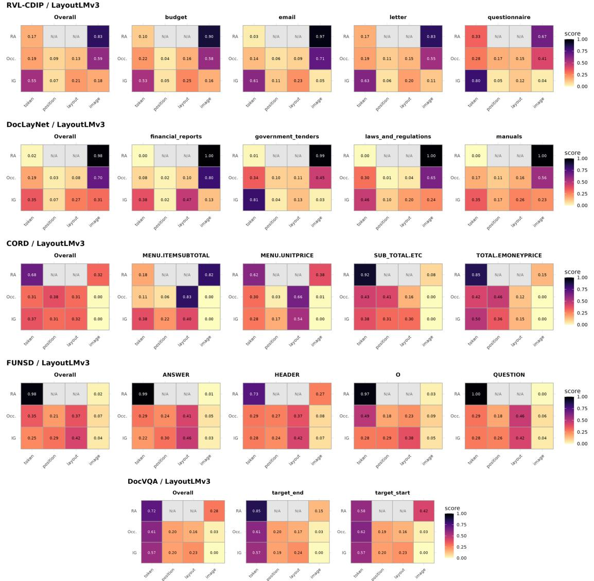  
Fig. 12: Modality contributions computed over explanations generated by IG, OCC, and RA for the LayoutLMv3 [2] model. Results are reported as a dataset-wide mean (left) and as a per-label mean for four randomly selected labels (right). For DocVQA [65], contributions are reported separately for the start and end tokens of the predicted answer.

On the CORD [62] and FUNSD [51] datasets, OCC and IG demonstrate a similar pattern, both indicating negligible importance on the image modality and comparable importance on the text, position, and layout modalities. On CORD [62], RA also indicates a moderate reliance on the image modality, with notably high importance assigned to the image modality for the MENU.ITEMSUBTOTAL and MENU.UNITPRICE entity types. On DocVQA [65], OCC and IG show a similar importance distribution for both start and end tokens of the predicted answer. In contrast, RA indicates a particularly high reliance on the image modality for the start token.

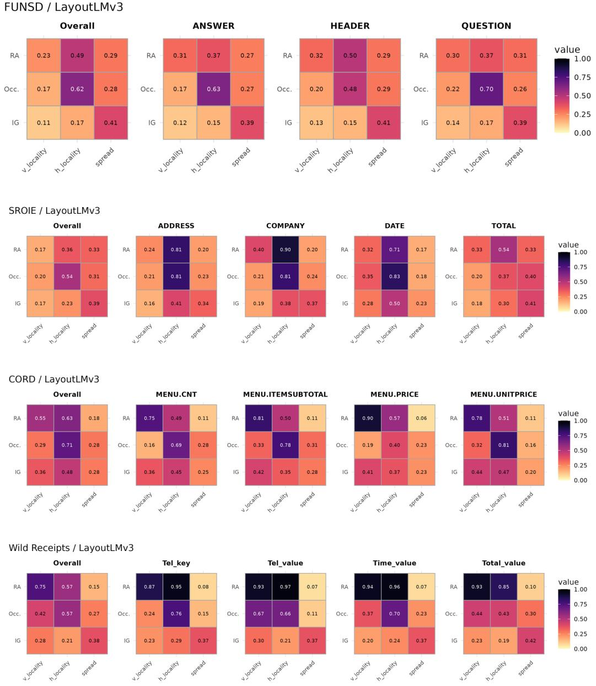  
Fig. 13: Spatial attribution locality scores computed over explanations generated by IG, OCC, and RA for the LayoutLMv3 [2] model. For each dataset, vertical locality, horizontal locality, and total spread are reported as a dataset-wide mean (left) and as a per-entity-type mean for four randomly selected entity types (right).

## 5.5.2 Spatial Attribution Locality Analysis

In the SER task, the large number of target entities per sample makes it impractical to analyze each individual sample-target pair qualitatively.

Here, spatial attribution locality analysis provides a broader view of how the model distributes importance around each target entity type; for instance, whether the model focuses entirely on the entities themselves, their vertical or horizontal surrounding tokens, or whether its focus is spread out to irrelevant entities across the document. In particular, we analyze the spatial locality of attributions by computing three quantities. Vertical locality, the total attribution assigned to tokens in the same column as the target (i.e., vertically aligned):

$$
L _ { v } = \sum _ { i : | x _ { i } - x _ { t } | \leq \tau _ { x } } a _ { i }\tag{7}
$$

Horizontal locality, the total attribution assigned to tokens on the same row as the target (i.e., horizontally aligned):

$$
L _ { h } = \sum _ { i : | y _ { i } - y _ { t } | \leq \tau _ { y } } a _ { i }\tag{8}
$$

Total spread, the attribution-weighted root mean squared distance of all tokens from the target:

$$
S = \sqrt { \sum _ { i } a _ { i } \left( ( x _ { i } - x _ { t } ) ^ { 2 } + ( y _ { i } - y _ { t } ) ^ { 2 } \right) }\tag{9}
$$

For all three quantities, attributions are first aggregated to the text level, clamped to nonnegative values, and normalized to sum to one. Higher vertical and horizontal locality values indicate that the method focuses on tokens along the respective axes, while lower spread values indicate that attributions are spatially compact overall. Both thresholds $\tau _ { x }$ and $\tau _ { y }$ are set to a fixed ratio of 0.025 relative to the total image width and height, respectively.

Fig. 13 presents the spatial attribution locality scores for the LayoutLMv3 [2] model, computed over explanations generated by OCC, IG, and RA. For each of the four SER datasets, we report vertical locality, horizontal locality, and total spread as a dataset-wide mean across all samples, as well as per-entity-type means for four randomly selected entity types.

A number of interesting observations can be made from these results. On both SROIE [63] and CORD [62], OCC and RA show a similar pattern, with notably larger horizontal locality than vertical locality. This suggests that, when predicting entity types on these datasets, the model pays relatively greater attention to the target entity itself and to other words in its horizontal neighborhood. In contrast, IG shows a considerably higher spread on all datasets, with no particular preference for horizontal or vertical locality.

The label-wise results further reveal how the attribution locality distribution varies across entity types. For instance, on SROIE [63], OCC shows high horizontal locality scores for the ADDRESS, COMPANY, and DATE entity types, meaning that importance is primarily assigned to tokens in the same row as the target token. On the other hand, on WildReceipts [64], RA shows both high vertical and horizontal locality with negligible overall spread for all listed entity types. This indicates that the RA attributions for these entity types focus almost exclusively on the target words themselves, with only minimal attention to their surrounding neighborhood.

## 5.5.3 Top-k Word Frequency Analysis

To analyze whether the model relies on specific textual patterns for its predictions, we analyze the most frequently attributed words across each dataset. For each sample, we aggregate the attribution scores across all modalities at the word level and select the top 1% of word tokens by attribution magnitude. We then compute the frequency of each word appearing in this top 1% across all samples in the dataset and report the most frequent words per class. For CLS, frequencies are reported per document class; for SER, per entity type; and for QA, separately for the start and end tokens of the predicted answer. Fig. 14 presents the results for the LayoutLMv3 [2] model on five datasets, showing the most frequently attributed words for up to six randomly selected labels per dataset.

It is noticeable that across all datasets and tasks, stop words (labeled as STOP) dominate the attributions. While in some cases stop words may carry genuine structural or contextual cues relevant to the prediction (e.g., to serve as contextual separators between entities), their widespread and uniform dominance across all classes and entity types suggests that this may largely be driven by their high frequency in the data. Interestingly, some task-relevant words do emerge across the datasets. For instance, on RVL-CDIP [50], words such as Mr., Dear, and Dr. appear frequently for the letter class, while University, Department, and Vol. are among the most attributed words for scientific publications. Notably, words such as Tobacco, Cigarette, and Healthy appear consistently across multiple classes, despite having no apparent relevance to the class labels themselves. While their prevalence in the dataset is unsurprising given its tobacco industry origins, their high attribution across unrelated classes suggests the model may be relying on dataset-specific artifacts rather than task-relevant features.

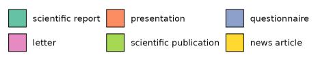

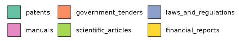

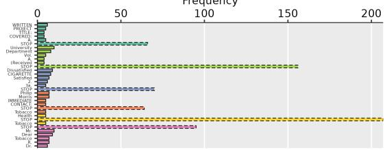  
(a) RVL-CDIP [50]

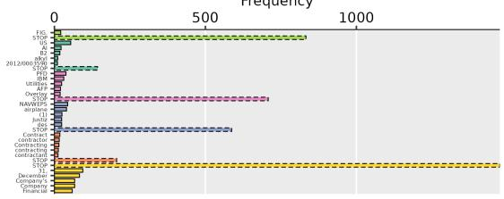  
(b) DocLayNet [61]

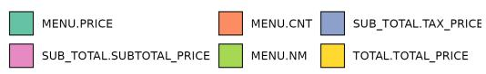

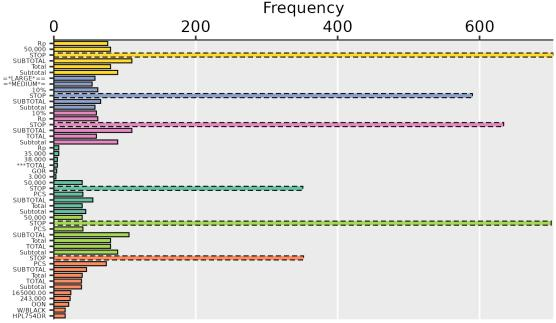  
(c) CORD [62]

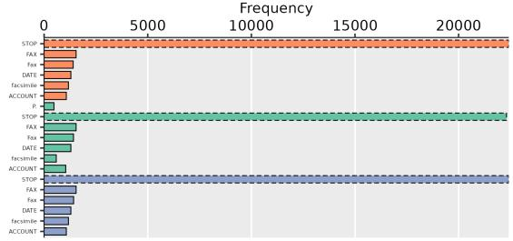  
(d) FUNSD [51]

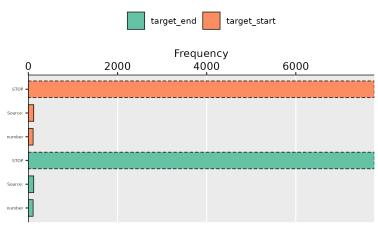  
(e) DocVQA [65]  
Fig. 14: Top-k word frequency analysis for the LayoutLMv3 [2] model across five datasets. For each dataset, the most frequently attributed words (top 1% by attribution magnitude) are shown for up to six randomly selected labels. (a–b) CLS task, (c–d) SER task, (e) QA task.

On DocLayNet [61], various forms of the word Contract appear consistently for the government tenders class, which aligns well with the class semantics. For financial reports, the words December and 31. appear with high frequency despite having no direct relevance to the class, alongside more plausible words such as Company and Financial. For the manuals class, specific abbreviations such as PDF, IVM, and AFP emerge as high-frequency top-k words, though whether these reflect genuine class-relevant patterns or spurious artifacts requires closer inspection of the dataset.

On FUNSD [51], words such as FAX, DATE, Account, and Facsimile appear consistently across all entity types. On CORD [62], words such as PCS, TOTAL, and SUBTOTAL dominate the topk attributions, all of which appear relevant to the receipt domain. However, specific numbers and percentages such as 50,000 or 10% also appear with high frequency for some entity types, which may reflect a bias in the model’s decision-making driven by their prevalence in the training data. On DocVQA [65], the attributions for both start and end answer tokens are largely dominated by stop words. However, the words source and number also appear frequently among the top-k attributed words.

## 6 Discussion

Explainable AI has received considerable attention in deep learning over the past decade; however, its extension to the multimodal document understanding domain has remained largely unexplored. By providing a systematic evaluation framework and a rigorous benchmark across multiple models, methods, datasets, and evaluation metrics, this study takes a significant step forward in improving the explainability of multimodal document understanding models and highlighting the challenges associated with existing methods. In the following, we discuss the key findings of this work, its limitations, broader impact, and future directions.

## 6.1 Key Findings

Top-performing XAI methods. Our results showed that the majority of XAI methods, particularly basic backpropagation methods, consistently underperformed across all tasks and evaluation criteria. Among the 13 methods evaluated, only three from diferent families emerged as the strongest: OCC (perturbation-based), RA (attention-based), and IG (gradient-based). However, when considering both quantitative and qualitative evaluation jointly, only OCC stood out as the most reliable overall. Unlike IG, which tended to spread importance across the entire document and produce high complexity attribution maps, OCC produced concise and interpretable modality-wise contributions. Furthermore, RA can only attribute importance to the modalities explicitly represented as separate tokens in the model, a limitation that does not apply to OCC due to its model-agnostic nature.

Computational trade-ofs of methods. Despite its strengths, OCC remains one of the most expensive methods to compute, since it requires perturbations over sliding windows, and therefore its computational cost scales proportionally to the size of the input. In multi-target scenarios, however, this overhead can be efectively reduced due to shared perturbations over targets. IG, on the other hand, is expensive in both single- and multi-target scenarios, as even with our multi-target adaptation, it only gained modest speedups of up to 1.5–1.7×. In this aspect, RA can be considered a particularly strong choice, as, despite its limitations, it requires no additional computation other than a forward pass for both single- and multi-target scenarios.

Completeness of methods. Another important consideration is the Completeness Axiom, as it allows us to evaluate the exact contribution of each feature towards the output. However, neither OCC nor RA satisfy completeness. IG does satisfy the Completeness Axiom, but as we observed in our experiments, its high complexity made the results dificult to interpret. Another method that satisfies Completeness is KS; however, it showed considerably poorer performance on all other evaluation criteria in our experiments. This is expected, since KS approximates Shapley values by fitting a surrogate model over a sampled subset of feature coalitions from a space of 2n possible coalitions. In our setting, n can easily grow large (up to hundreds or thousands of features) when accounting for separate text, position, layout, and image features, making reliable estimation of the Shapley values infeasible with a limited number of perturbation samples. Increasing the number of perturbations may help, but it incurs impractical computational costs. Note that these limitations apply equally to LIME.

Metric reliability and agreement. Our analysis of the evaluation metrics revealed two important findings. First, for many XAI evaluation metrics, diferent methods showed statistically indistinguishable results when observed across datasets, models, and tasks. Therefore, practitioners should exercise caution when ranking one method over another, and we recommend evaluating methods across multiple datasets and models before drawing conclusions about their suitability. Second, we observed moderate to strong agreement between several faithfulness metrics, including aopc, faith-est, abpc, faith-corr, suf, and sens-n. While each of these metrics measures a diferent aspect, their mutual agreement can help reinforce confidence in their results. Conversely, neither Monotonicity (mon) [28] nor Infidelity (infid) [18] showed a positive correlation with any other metric, and upon deeper inspection, we found the results of both of these metrics to be unreliable for evaluating the methods. The complexity metrics also showed moderate mutual correlation among ent-comp, spar, and s-comp, while eff-comp showed only negligible correlation with the other three. This is expected, since eff-comp is computed over perturbed inputs, unlike the other complexity metrics which are computed directly on the generated explanations.

Modality reliance across tasks and labels. Our modality contribution analysis of the LayoutLMv3 [2] model revealed variable reliance on individual modalities across tasks, datasets, and individual labels. For instance, on classification tasks, OCC indicated a stronger reliance on the image modality, whereas on SER tasks, it indicated that text and layout were the primary contributors. Within datasets, label-level variation was also observed (for example, higher contribution of text modality for government tenders vs. image for financial reports). Such insights can help optimize, debug, and validate model behavior. For example, our results indicate that the image modality contributes negligibly to the SER task. Therefore, the image modality could potentially be removed as an additional input for this task to optimize inference costs. On the other hand, if strong reliance on the image modality were expected for a particular task, modality contribution analysis could serve as a means of verifying whether the model is indeed utilizing it.

Spatial attribution locality patterns. Our spatial locality analysis of the LayoutLMv3 [2] model also revealed several insights into which spatial regions the model attends to for diferent entity types. For example, on the SROIE [63] dataset, OCC indicated greater focus on the horizontal neighborhood of target entities, especially for entity types ADDRESS, DATE, and COMPANY. This aligns with our expectation, as these entities are typically horizontally spread out in a document, and therefore, the model’s focus on horizontally aligned tokens seems reasonable. On the other hand, for many entity types, RA indicated focus only on the target token itself. Such entity-level insights can be particularly useful for detecting unexpected model behavior. For instance, if a model were found to focus on spatially distant and irrelevant tokens for a given entity type, this could signal a potential spurious correlation that warrants further investigation.

Word frequency and dataset biases. Our top-k word frequency analysis revealed that stop words dominated the attributions across all tasks and datasets. While in the SER and QA tasks, this is plausible as stop words frequently appear in the neighborhood of target entities and may carry contextual relevance, the dominance of stop words in the CLS task may reflect a frequency bias instead, as stop words should hold no class-specific relevance. Besides stop words, we also noted a mix of class-relevant and potentially spurious words emerging across the datasets (e.g., tobacco-related terms across multiple classes in RVL-CDIP [50], or specific dates for financial reports in DocLayNet [61]), suggesting potential dataset biases that warrant deeper inspection. Note that the word frequency analysis can be further strengthened when combined with the modality contribution analysis. For instance, if the model relies heavily on text modality for a given class, the word frequency analysis can pinpoint which specific words drive the predictions. Conversely, if the text modality receives negligible importance, the presence of spurious words among the top attributions is less concerning, as the model’s predictions are not primarily driven by text.

Limited consensus across methods. Despite the utility of the above analyses, it is important to note that the three top-ranking methods showed limited consensus in their attributions, leading to diferent interpretations depending on the method used. Therefore, to draw reliable insights from these analyses, one should ideally rely on a method with established faithfulness. In our evaluation, OCC consistently ranked among the top methods on this criterion and can therefore serve as a reasonable choice, though this also highlights the need for developing more faithful domainspecific XAI methods for multimodal document understanding.

## 6.2 Limitations

While our study presents a comprehensive evaluation of existing XAI methods in the context of multimodal document understanding, there are some limitations that warrant discussion. First, we evaluate all methods and metrics only on four models: BERT [66], RoBERTa [67], LiLT [10], and LayoutLMv3 [2], of which only two are documentspecific multimodal models and only one processes all four modalities. This limitation arises primarily from the lack of open-source model architectures and pretrained weights. Several existing works that employ significantly diferent fusion strategies, such as DocFormer and TiLT, do not release their model weights, and reproducing them is non-trivial, as each requires complex pretraining routines that are also closed source. Secondly, all evaluated models are Transformer-based, and our findings may not generalize to other model families. That said, our framework is directly extensible to such architectures, as it treats the model as a black box, independent of the specific modalities over which attributions are computed and how they are aggregated for evaluation.

## 6.3 Broader Impact

Despite the limitations, our work makes several contributions that extend beyond the immediate scope of this study. As part of this work, we release code for all XAI method and evaluation metric adaptations presented in this study, along with a unified evaluation pipeline that ensures consistent metric computation across criteria. We believe this will lower the barrier for researchers and practitioners to apply and evaluate explainability methods at scale in both single- and multi-target settings. Furthermore, while this work focuses on multimodal document understanding, the multimodal and multi-target adaptations and evaluation suite are task-agnostic and can be directly applied to other domains. Overall, as multimodal models are increasingly deployed in high-stakes sectors such as finance, legal, and healthcare, where transparency is often legally required, our framework can serve as both a benchmark for future research and a practical guide for evaluating the explainability of such models.

## 6.4 Future Work

While our results provide a first comprehensive picture, several directions remain open for future work. First, while Occlusion emerged as the most faithful and interpretable method in our analysis, it does not satisfy completeness. KernelSHAP, which does satisfy completeness, could serve as an alternative; however, it performed considerably worse in our setting due to the large multimodal feature space. To address this, one direction worth exploring is hierarchical decomposition of Shapley values over nested coalition structures [71]. Rather than computing Shapley values over the full set of individual features, such an approach would decompose the attribution process into multiple stages (e.g., attributing importance to blocks, then lines, and finally individual words and word modalities), reducing n to a tractable number at each stage. This could preserve completeness guarantees while simultaneously producing interpretable explanations at each level of the hierarchy. Second, while our framework considers modality-wise attributions, capturing cross-modal interactions, as investigated in DIME [45], remains an open problem in the document domain. Third, while we explored several attribution methods in this work, a fundamental limitation remains in that they reveal which features the model relies on but not why. In this regard, exploring (generative) counterfactual explanations [72] for multimodal document understanding may be a promising direction for uncovering the underlying causal factors. Finally, while we proposed multiple dataset-wide analyses to obtain global insights, developing additional domain-specific diagnostic approaches and dedicated visualization interfaces, especially for multi-target tasks, would further extend the framework’s utility.

## 7 Conclusion

In this work, we presented DocXEval, the first comprehensive framework for generating and evaluating explanations in multimodal document understanding. Using our framework, we systematically evaluated 13 XAI methods across 3 tasks,

8 datasets, 4 models, and 17 evaluation metrics, and found that only a few methods perform consistently across all criteria, with Occlusion (OCC) [27] emerging as the most faithful and interpretable overall. Our meta-evaluation of metrics showed moderate to strong agreement among several faithfulness and complexity metrics, while identifying Monotonicity and Infidelity as unreliable. Furthermore, through multiple dataset-wide analyses, we uncovered several insights into model behavior, including variable modality reliance across tasks and labels, spatial attribution patterns around target entities, and potential dataset biases. Overall, we believe our findings, together with the publicly released framework, will serve as a valuable reference for future research on XAI evaluation, especially in the multimodal document understanding context.

Acknowledgements. We thank Adriano Lucieri for helpful discussions and feedback on this work.

## References

[1] Ferrando, J. et al. Krzhizhanovskaya, V. V. et al. (eds) Improving Accuracy and Speeding Up Document Image Classification Through Parallel Systems. (eds Krzhizhanovskaya, V. V. et al.) Computational Science – ICCS 2020, 387–400 (Springer International Publishing, Cham, 2020).

[2] Huang, Y., Lv, T., Cui, L., Lu, Y. & Wei, F. LayoutLMv3: Pre-Training for Document AI with Unified Text and Image Masking, MM ’22, 4083–4091 (Association for Computing Machinery, New York, NY, USA, 2022). URL https://doi.org/10.1145/ 3503161.3548112. Event-place: Lisboa, Portugal.

[3] Xu, Y. et al. Gupta, R., Liu, Y., Tang, J. & Prakash, B. A. (eds) LayoutLM: pretraining of text and layout for document image understanding. (eds Gupta, R., Liu, Y., Tang, J. & Prakash, B. A.) Proc. 26th ACM SIGKDD Conference on Knowledge Discovery and Data Mining, 1192–1200 (virtual, 2020).

[4] Xu, Y. et al. LayoutLMv2: Multi-modal Pretraining for Visually-rich Document Understanding, 2579–2591 (Association for Computational Linguistics (ACL), 2021). eprint: 2012.14740.

[5] Borchmann, L. et al. Vanschoren, J. & Yeung, S.-K. (eds) DUE: end-to-end document understanding benchmark. (eds Vanschoren, J. & Yeung, S.-K.) NeurIPS Datasets and Benchmarks, Vol. 1 (virtual, 2021).

[6] Wang, W. et al. Document intelligence in the era of large language models: A survey (2025). URL https://arxiv.org/abs/2510. 13366. arXiv:2510.13366.

[7] Shen, Z. et al. Llad´os, J., Lopresti, D. & Uchida, S. (eds) LayoutParser: A Unified Toolkit for Deep Learning Based Document Image Analysis. (eds Llad´os, J., Lopresti, D. & Uchida, S.) Document Analysis and Recognition – ICDAR 2021, 131–146 (Springer International Publishing, Cham, 2021).

[8] Powalski, R. et al. Llad´os, J., Lopresti, D. & Uchida, S. (eds) Going Full-TILT Boogie on Document Understanding with Text-Image-Layout Transformer. (eds Llad´os, J., Lopresti, D. & Uchida, S.) Document Analysis and Recognition – ICDAR 2021, 732–747 (Springer International Publishing, Cham, 2021).

[9] Garncarek, L. et al. in LAMBERT: layoutaware language modeling for information extraction (eds Llad´os, J., Lopresti, D. & Uchida, S.) Document analysis and recognition - ICDAR 2021, Vol. 12821 of LNCS 532–547 (Springer, Cham, 2021).

[10] Wang, J., Jin, L. & Ding, K. Muresan, S., Nakov, P. & Villavicencio, A. (eds) LiLT: a simple yet efective language-independent layout transformer for structured document understanding. (eds Muresan, S., Nakov, P. & Villavicencio, A.) ACL, 7747–7757 (Dublin, Ireland, 2022).

[11] Lamott, M., Shakir, M. A., Ulges, A., Weweler, Y.-N. & Shafait, F. SlimDoc:

lightweight distillation of document transformer models. Ijdar 28, 457–473 (2025).

[12] Bibal, A., Lognoul, M., De Streel, A. & Fr´enay, B. Legal requirements on explainability in machine learning. Artificial Intelligence and Law 29, 149–169 (2021). URL https://www.scopus.com/ pages/publications/85088816026.

[13] Perc, M., Ozer, M. & Hojnik, J. Social and juristic challenges of artificial intelligence. Palgrave Communications 5, 61 (2019). URL https://www.nature.com/ articles/s41599-019-0278-x. Publisher: Palgrave.

[14] Lundberg, S. M., Erion, G. G. & Lee, S.-I. Consistent Individualized Feature Attribution for Tree Ensembles (2019). eprint: 1802.03888.

[15] Ribeiro, M., Singh, S. & Guestrin, C. DeNero, J., Finlayson, M. & Reddy, S. (eds) “Why Should I Trust You?”: Explaining the Predictions of Any Classifier. (eds DeNero, J., Finlayson, M. & Reddy, S.) Proceedings of the 2016 Conference of the North American Chapter of the Association for Computational Linguistics: Demonstrations, 97–101 (Association for Computational Linguistics, San Diego, California, 2016). URL https://aclanthology.org/ N16-3020. ArXiv:1602.04938 [cs].

[16] Samek, W., Wiegand, T. & M¨uller, K.- R. Explainable Artificial Intelligence: Understanding, Visualizing and Interpreting Deep Learning Models (2017). URL http://arxiv. org/abs/1708.08296. ArXiv:1708.08296 [cs].

[17] Adebayo, J. et al. Bengio, S. et al. (eds) Sanity Checks for Saliency Maps. (eds Bengio, S. et al.) Advances in Neural Information Processing Systems, Vol. 31 (Curran Associates, Inc., 2018). URL https://proceedings. neurips.cc/paper files/paper/2018/file/ 294a8ed24b1ad22ec2e7efea049b8737-Paper. pdf.

[18] Yeh, C.-K., Hsieh, C.-Y., Suggala, A., Inouye, D. I. & Ravikumar, P. K. Wallach, H. et al. (eds) On the (In)fidelity and Sensitivity of Explanations. (eds Wallach, H. et al.) Advances in Neural Information Processing Systems, Vol. 32 (Curran Associates, Inc., 2019). URL https://proceedings. neurips.cc/paper files/paper/2019/file/ a7471fdc77b3435276507cc8f2dc2569-Paper. pdf.

[19] Vilone, G. & Longo, L. Explainable artificial intelligence: a systematic review. arXiv preprint arXiv:2006.00093 (2020). URL http://arxiv.org/abs/2006.00093. ArXiv:2006.00093 [cs].

[20] Ras, G., Xie, N., van Gerven, M. & Doran, D. Explainable Deep Learning: A Field Guide for the Uninitiated. J. Artif. Int. Res. 73, 329–397 (2022). URL https://doi.org/10. 1613/jair.1.13200. Place: El Segundo, CA, USA Publisher: AI Access Foundation.

[21] Danilevsky, M. et al. A survey of the state of explainable ai for natural language processing, 447–459 (Association for Computational Linguistics, 2020). URL http:// dx.doi.org/10.18653/v1/2020.aacl-main.46. ArXiv:2010.00711 [cs].

[22] Dembinsky, D. et al. Unifying vxai: a systematic review and framework for the evaluation of explainable ai. arXiv preprint arXiv:2506.15408 (2025).

[23] Appalaraju, S., Jasani, B., Kota, B. U., Xie, Y. & Manmatha, R. DocFormer: end-toend transformer for document understanding, 993–1003 (virtual, 2021).

[24] Lundberg, S. M. & Lee, S.-I. A Unified Approach to Interpreting Model Predictions, NIPS’17, 4768–4777 (Curran Associates Inc., Red Hook, NY, USA, 2017). Event-place: Long Beach, California, USA.

[25] Klein, L. et al. Navigating the Maze of Explainable AI: A Systematic Approach to Evaluating Methods and Metrics, Vol. 37 (Curran Associates, Inc., 2024).

[26] Tomsett, R., Harborne, D., Chakraborty, S., Gurram, P. & Preece, A. Sanity Checks for Saliency Metrics. Proceedings of the AAAI Conference on Artificial Intelligence 34, 6021–6029 (2020).

[27] Zeiler, M. D. & Fergus, R. Fleet, D., Pajdla, T., Schiele, B. & Tuytelaars, T. (eds) Visualizing and Understanding Convolutional Networks. (eds Fleet, D., Pajdla, T., Schiele, B. & Tuytelaars, T.) Computer Vision ECCV 2014, 818–833 (Springer International Publishing, Cham, 2014).

[28] Arya, V. et al. One explanation does not fit all: A toolkit and taxonomy of ai explainability techniques (2019). URL https://arxiv. org/abs/1909.03012. arXiv:1909.03012.

[29] Wang, D. et al. Ku, L.-W., Martins, A. & Srikumar, V. (eds) DocLLM: A layout-aware generative language model for multimodal document understanding. (eds Ku, L.-W., Martins, A. & Srikumar, V.) Proceedings of the 62nd Annual Meeting of the Association for Computational Linguistics (Volume 1: Long Papers), 8529–8548 (Association for Computational Linguistics, Bangkok, Thailand, 2024). URL https://aclanthology.org/ 2024.acl-long.463/.

[30] Fujitake, M. Calzolari, N. et al. (eds) LayoutLLM: Large language model instruction tuning for visually rich document understanding. (eds Calzolari, N. et al.) Proceedings of the 2024 Joint International Conference on Computational Linguistics, Language Resources and Evaluation (LREC-COLING 2024), 10219–10224 (ELRA and ICCL, Torino, Italia, 2024). URL https:// aclanthology.org/2024.lrec-main.892/.

[31] Vaswani, A. et al. Guyon, I. et al. (eds) Attention is All you Need. (eds Guyon, I. et al.) Advances in Neural Information Processing Systems, Vol. 30 (Curran Associates, Inc., 2017). URL https://proceedings. neurips.cc/paper files/paper/2017/file/ 3f5ee243547dee91fbd053c1c4a845aa-Paper. pdf.

[32] Luo, C., Cheng, C., Zheng, Q. & Yao, C. Geolayoutlm: Geometric pre-training for visual information extraction (2023). URL https:// arxiv.org/abs/2304.10759. arXiv:2304.10759.

[33] Simonyan, K., Vedaldi, A. & Zisserman, A. Deep Inside Convolutional Networks: Visualising Image Classification Models and Saliency Maps. CoRR abs/1312.6034 (2013). URL https://api.semanticscholar. org/CorpusID:1450294.

[34] Springenberg, J. T., Dosovitskiy, A., Brox, T. & Riedmiller, M. Striving for Simplicity: The All Convolutional Net (2015). URL http://lmb.informatik.uni-freiburg.de/ Publications/2015/DB15a.

[35] Sundararajan, M., Taly, A. & Yan, Q. Axiomatic attribution for deep networks, 3319–3328 (PMLR, 2017).

[36] Shrikumar, A., Greenside, P. & Kundaje, A. Learning Important Features through Propagating Activation Diferences, ICML’17, 3145–3153 (JMLR.org, Sydney, NSW, Australia, 2017).

[37] Saifullah, S., Agne, S., Dengel, A. & Ahmed, S. DocVCE: difusion-based visual counterfactual explanations for document image classification (2025). URL http://arxiv.org/ abs/2508.04233. ArXiv:2508.04233 [cs].

[38] Saifullah, S., Agne, S., Dengel, A. & Ahmed, S. DocXclassifier: towards a robust and interpretable deep neural network for document image classification. International Journal on Document Analysis and Recognition (IJDAR) 27, 447–473 (2024). URL https://link.springer.com/10. 1007/s10032-024-00483-w.

[39] Pouliquen, G., Chiron, G., Chazalon, J., G´eraud, T. & Awal, A. M. Weakly supervised training for hologram verification in identity documents (2024). URL https://arxiv.org/ abs/2404.17253. arXiv:2404.17253.

[40] Brini, I., Mehri, M., Ingold, R. & Essoukri Ben Amara, N. Nguyen, N. T., Manolopoulos, Y., Chbeir, R., Kozierkiewicz, A.

& Trawi´nski, B. (eds) An End-to-End Framework for Evaluating Explainable D<b></b>eep Models: Application to Historical Document Image Segmentation. (eds Nguyen, N. T., Manolopoulos, Y., Chbeir, R., Kozierkiewicz, A. & Trawi´nski, B.) Computational Collective Intelligence, 106–119 (Springer International Publishing, Cham, 2022).

[41] Souibgui, M. A. et al. DocVXQA: contextaware visual explanations for document question answering (2025). URL https:// openreview.net/forum?id=wex0vL4c2Y.

[42] Saifullah, Agne, S., Dengel, A. & Ahmed, S. The reality of high performing deep learning models: a case study on document image classification. IEEE Access 12, 103537– 103564 (2024). URL https://ieeexplore.ieee. org/abstract/document/10591981.

[43] Saifullah, S., Agne, S., Dengel, A. & Ahmed, S. Barney Smith, E. H., Liwicki, M. & Peng, L. (eds) DocXplain: a novel model-agnostic explainability method for document image classification. (eds Barney Smith, E. H., Liwicki, M. & Peng, L.) Document Analysis and Recognition - ICDAR 2024, 103–123 (Springer Nature Switzerland, Cham, 2024).

[44] Goyal, Y., Mohapatra, A., Parikh, D. & Batra, D. Towards Transparent AI Systems: Interpreting Visual Question Answering Models (2016). URL http://arxiv.org/ abs/1608.08974. ArXiv:1608.08974 [cs].

[45] Lyu, Y., Liang, P. P., Deng, Z., Salakhutdinov, R. & Morency, L.-P. DIME: fine-grained interpretations of multimodal models via disentangled local explanations (2022). URL http://arxiv.org/abs/2203. 02013. ArXiv:2203.02013 [cs].

[46] Aflalo, E. et al. VL-InterpreT: An Interactive Visualization Tool for Interpreting Vision-Language Transformers (2022). URL http:// arxiv.org/abs/2203.17247. ArXiv:2203.17247 [cs].

[47] Parcalabescu, L. & Frank, A. MM-SHAP: A Performance-agnostic Metric for Measuring Multimodal Contributions in Vision and Language Models & Tasks, 4032–4059 (2023). URL http://arxiv.org/abs/2212. 08158. ArXiv:2212.08158 [cs].

[48] Wang, X. et al. M2Lens: Visualizing and Explaining Multimodal Models for Sentiment Analysis. IEEE Transactions on Visualization and Computer Graphics 28, 802– 812 (2022). URL http://arxiv.org/abs/2107. 08264. ArXiv:2107.08264 [cs].

[49] Hessel, J. & Lee, L. Webber, B., Cohn, T., He, Y. & Liu, Y. (eds) Does my multimodal model learn cross-modal interactions? It’s harder to tell than you might think! (eds Webber, B., Cohn, T., He, Y. & Liu, Y.) Proceedings of the 2020 Conference on Empirical Methods in Natural Language Processing (EMNLP), 861–877 (Association for Computational Linguistics, Online, 2020). URL https:// aclanthology.org/2020.emnlp-main.62/.

[50] Harley, A. W., Ufkes, A. & Derpanis, K. G. Evaluation of deep convolutional nets for document image classification and retrieval, 991–995 (2015).

[51] Jaume, G., Kemal Ekenel, H. & Thiran, J.-P. Funsd: A dataset for form understanding in noisy scanned documents, Vol. 2, 1–6 (2019).

[52] Hase, P., Xie, H. & Bansal, M. The Outof-Distribution Problem in Explainability and Search Methods for Feature Importance Explanations, Vol. 34, 3650–3666 (Curran Associates, Inc., 2021). URL https://papers. neurips.cc/paper files/paper/2021/hash/ 1def1713ebf17722cbe300cfc1c88558-Abstract. html.

[53] phi Nguyen, A. & Mart´ınez, M. R. On quantitative aspects of model interpretability (2020). URL https://arxiv.org/abs/2007. 07584. arXiv:2007.07584.

[54] Samek, W., Binder, A., Montavon, G., Lapuschkin, S. & M¨uller, K.-R. Evaluating the Visualization of What a Deep Neural Network Has Learned. IEEE Transactions on

Neural Networks and Learning Systems 28, 2660–2673 (2017).

[55] DeYoung, J. et al. Jurafsky, D., Chai, J., Schluter, N. & Tetreault, J. (eds) ERASER: A benchmark to evaluate rationalized NLP models. (eds Jurafsky, D., Chai, J., Schluter, N. & Tetreault, J.) Proceedings of the 58th Annual Meeting of the Association for Computational Linguistics, 4443–4458 (Association for Computational Linguistics, Online, 2020). URL https://aclanthology.org/2020. acl-main.408/.

[56] Ancona, M., Ceolini, E., Oztireli, C. &¨ Gross, M. Towards better understanding of gradient-based attribution methods for deep neural networks (2018). URL https://arxiv. org/abs/1711.06104. arXiv:1711.06104.

[57] Alvarez Melis, D. & Jaakkola, T. Towards Robust Interpretability with Self-Explaining Neural Networks, Vol. 31 (Curran Associates, Inc., 2018). URL https://proceedings. neurips.cc/paper files/paper/2018/hash 3e9f0fc9b2f89e043bc6233994dfcf76-Abstract. html.

[58] Bhatt, U., Weller, A. & Moura, J. M. F. Evaluating and aggregating feature-based model explanations (2020). URL https://arxiv.org/ abs/2005.00631. arXiv:2005.00631.

[59] Chalasani, P., Chen, J., Chowdhury, A. R., Jha, S. & Wu, X. Concise explanations of neural networks using adversarial training (2020). URL https://arxiv.org/abs/1810. 06583. arXiv:1810.06583.

[60] Afzal, M. Z. et al. Deepdocclassifier: Document classification with deep Convolutional Neural Network, 1111–1115 (2015).

[61] Pfitzmann, B., Auer, C., Dolfi, M., Nassar, A. S. & Staar, P. DocLayNet: A Large Human-Annotated Dataset for Document-Layout Segmentation, KDD ’22 (ACM, 2022). URL http://dx.doi.org/10.1145/ 3534678.3539043.

[62] Park, S. et al. CORD: a consolidated receipt dataset for post-OCR parsing (Vancouver,

Canada, 2019).

[63] Huang, Z. et al. ICDAR2019 competition on scanned receipt OCR and information extraction, 1516–1520 (Sydney, Australia, 2019).

[64] Sun, H., Kuang, Z., Yue, X., Lin, C. & Zhang, W. Spatial dual-modality graph reasoning for key information extraction. ArXiv abs/2103.14470 (2021).

[65] Mathew, M., Karatzas, D. & Jawahar, C. V. DocVQA: a dataset for VQA on document images (Waikoloa, HI, 2021).

[66] Devlin, J., Chang, M.-W., Lee, K. & Toutanova, K. Burstein, J., Doran, C. & Solorio, T. (eds) BERT: Pre-training of Deep Bidirectional Transformers for Language Understanding. (eds Burstein, J., Doran, C. & Solorio, T.) Proceedings of the 2019 Conference of the North American Chapter of the Association for Computational Linguistics: Human Language Technologies, Volume 1 (Long and Short Papers), 4171–4186 (Association for Computational Linguistics, Minneapolis, Minnesota, 2019). URL https://aclanthology.org/N19-1423.

[67] Liu, Y. et al. Roberta: a robustly optimized bert pretraining approach. arXiv Preprint arXiv:1907.11692 (2019).

[68] Abnar, S. & Zuidema, W. Jurafsky, D., Chai, J., Schluter, N. & Tetreault, J. (eds) Quantifying Attention Flow in Transformers. (eds Jurafsky, D., Chai, J., Schluter, N. & Tetreault, J.) Proceedings of the 58th Annual Meeting ofthe Association for Computational Linguistics, 4190–4197 (Association for Computational Linguistics, Online, 2020). URL https://aclanthology.org/2020.acl-main.385.

[69] Benavoli, A., Corani, G. & Mangili, F. Should we really use post-hoc tests based on mean-ranks? Journal of Machine Learning Research 17, 1–10 (2016). URL http: //jmlr.org/papers/v17/benavoli16a.html.

[70] Demˇsar, J. Statistical comparisons of classifiers over multiple data sets. Journal of Machine Learning Research 7, 1–30 (2006).

URL http://jmlr.org/papers/v7/demsar06a. html.

[71] Owen, G. Values of Games with a Priori Unions, 76–88 (Springer Berlin Heidelberg, 1977). URL http://dx.doi.org/10.1007/ 978-3-642-45494-3 7.

[72] Verma, S., Dickerson, J. P. & Hines, K. E. Counterfactual Explanations for Machine Learning: A Review. ArXiv abs/2010.10596 (2020). URL https://api. semanticscholar.org/CorpusID:224818450.

## Appendix A Metric Descriptions and Adaptations

In this section, we provide detailed descriptions of the evaluation metrics used in this work. Unless otherwise stated, all metrics are computed over group-aggregated attribution scores, treating each feature group independently of its originating modality. For perturbation-based metrics, the perturbation order is determined by ranking all feature groups jointly across modalities, and the corresponding features are then perturbed using their modality-specific segmentation masks and reference baselines. Note that for all perturbation-based metrics, feature groups associated with special tokens such as [CLS], [PAD], or [SEP] are excluded from perturbation.

## A.1 Axiomatic Metrics

Completeness. Completeness (compl) [35] is an axiomatic property of an explanation method that measures whether the attributions add up to the diference between the model output at the input and at the baseline:

$$
\mathrm { C O M P L } ( { \boldsymbol { x } } ) = \left| \sum _ { \mathcal { M } } \sum _ { i } \mathbf { a } _ { i } ^ { \mathcal { M } } - ( f ( { \boldsymbol { x } } ) - f ( { \boldsymbol { x } } ^ { \prime } ) ) \right|\tag{A1}
$$

where $\mathbf { a } _ { i } ^ { \mathcal { M } }$ are the raw attribution scores for feature i in modality M, $f ( x )$ is the model output at the input, and $f ( x ^ { \prime } )$ is the model output at the baseline. A score of zero indicates perfect completeness, and some methods, like Integrated Gradients (IG) [35], satisfy completeness by construction. Unlike other metrics, Completeness (compl) [35] is computed on the raw attribution scores instead of groupaggregated scores, as the axiom requires the exact sum over all individual attributions. For multi-target tasks, we adapt the metric to eficiently compute the diference between the model output at the input and at the baseline over all T targets in a single step.

Non-Sensitivity. Non-Sensitivity (non-sens) [53] is another axiomatic property that determines whether features with zero attribution have a negligible influence on the model output. Formally, let $A _ { 0 } \subset \{ 1 , \ldots , N \}$ denote the subset of feature indices with zero attribution, i.e., $a _ { i } = 0$ . Further, let $X _ { 0 } = \{ i \in \{ 1 , . . . , N \} \mid \mathbb { E } ( \ell ( y ^ { * } , f _ { i } ) ) = 0 \}$ denote the subset of features that the model $f$ is not functionally dependent on. The non-sensitivity score is then defined as $| A _ { 0 } \triangle X _ { 0 } |$ , where | · | is the cardinality of a set and $\triangle$ denotes the symmetric diference. In our adaptation, we compute non-sens over the unified feature space using group-aggregated attribution scores $\{ a _ { k } \} _ { k = 1 } ^ { K }$ and instantiate the otherwise abstract loss function ℓ as the relative variance of the model output under perturbation of each feature group k:

$$
v _ { k } = { \frac { { \frac { 1 } { N } } \sum _ { n = 1 } ^ { N } \left( f ( x _ { k } ^ { \prime ( n ) } ) - f ( x ) \right) ^ { 2 } } { f ( x ) ^ { 2 } } }\tag{A2}
$$

where $f ( x _ { k } ^ { \prime ( n ) } )$ is the model output with the k-th feature group perturbed and $f ( x )$ is the model output on the unperturbed input. N denotes the number of perturbations per feature group. When using a random baseline function, $N > 1$ is necessary to obtain a stable variance estimate; however, with a fixed reference baseline, as in our case, each perturbation is deterministic, and therefore we use $N = 1$ . We can then compute $A _ { 0 } = \{ k : | a _ { k } | < \epsilon _ { a } \}$ and $X _ { 0 } = \{ k : v _ { k } < \epsilon _ { v } \}$ , where $\epsilon _ { a }$ and $\epsilon _ { v }$ are thresholds that define nearzero values. Furthermore, as the number of features can vary drastically across multimodal sequential inputs, we normalize the non-sensitivity score by the number of features to ensure comparability across setups:

$$
\mathrm { N O N - S E N S } ( x ) = \frac { | A _ { 0 } \triangle X _ { 0 } | } { K }\tag{A3}
$$

where K is the total number of feature groups. Lower non-sens values indicate better alignment between zero-attribution features and features that do not afect the model output. Note that non-sens is computed jointly with mon-corr (described in Section A.3), as both metrics share the same per-feature perturbation results. Furthermore, to reduce computational cost, we apply chunking, where rather than perturbing each feature individually, a fixed percentage of feature groups is perturbed together in each step. For multi-target tasks, we adapt the metric to eficiently compute the relative variances $v _ { k }$ over all $T$ targets of a single sample simultaneously.

## A.2 Complexity Metrics

Complexity metrics assess how easily a user can interpret the explanations, with simpler explanations that concentrate importance on fewer features being generally preferred. We adapt all complexity metrics to be computed over the group-aggregated attribution scores. For complexity metrics that do not require a model forward pass, multi-target adaptations are not necessary; instead, these metrics are computed independently for each sample-target pair.

Efective Complexity. Efective Complexity (eff-comp) [53] measures the minimum number of topattributed features suficient to influence the model output. Formally, let $a ^ { ( i ) }$ be the attributions ordered increasingly by their absolute value, and $x ^ { ( i ) }$ the corresponding features. Let $M _ { k } = \{ x ^ { ( N - k ) } , \dots , x ^ { ( N ) } \}$ be the set of top k features. The efective complexity is defined as:

$$
k ^ { * } = \operatorname * { a r g m i n } _ { k \in \{ 1 , \dots , N \} } | M _ { k } | \quad \mathrm { s . t . } \quad { \mathbb { E } } ( \ell ( y ^ { * } , f _ { - M _ { k } } ) | { \mathbf { x } } _ { M _ { k } } ^ { * } ) < \epsilon
$$

where $f _ { - M _ { k } }$ is the restriction of the model f to the non-important features, given fixed values for the important features in $M _ { k }$ . In our adaptation, eff-comp follows a similar perturbation strategy to nonsens and instantiates loss as the relative variance of the model output under perturbation of each feature group k (see Eq. A2). To find $M _ { k }$ , we remove feature groups cumulatively in ascending order of their absolute attribution scores $\{ a _ { k } \} _ { k = 1 } ^ { K }$ and find the index $k ^ { * }$ at which the relative variance exceeds a threshold $\epsilon _ { v }$ . The normalized efective complexity is the ratio of top-k features to the total number of features:

$$
\operatorname { E F F - C O M P } ( x ) = { \frac { K - k ^ { * } } { K } }\tag{A4}
$$

Lower eff-comp values indicate that the explanation concentrates importance on fewer important features. To reduce the computational costs, we also apply chunking to compute eff-comp, where a fixed percentage of feature groups are perturbed together in each step. Furthermore, since eff-comp requires ordered perturbation, multi-target adaptation is not possible; the metric is therefore computed independently for each sample-target pair.

Entropy-based Complexity. Entropy-based Complexity (ent-comp) [58] measures the total entropy of the attribution distribution over feature groups. In our adaptation, we first compute the normalized absolute group-aggregated attribution scores:

$$
p _ { k } = { \frac { \left| a _ { k } \right| } { \sum _ { k } \left| a _ { k } \right| } }
$$

We then compute normalized entropy over feature groups to keep the entropy scores comparable across samples of varying feature sets:

$$
\mathrm { E N T - C O M P } ( x ) = \frac { - \sum _ { k } p _ { k } \log p _ { k } } { \log K }
$$

where K is the total number of feature groups. A value near 0 indicates that the attribution mass is concentrated on very few feature groups, while a value near 1 indicates a near-uniform spread.

Sundararajan Complexity. Sundararajan Complexity (s-comp) [35] measures the fraction of features with non-negligible attribution. In our adaptation, we first compute the normalized absolute groupaggregated attribution scores:

$$
{ \hat { a } } _ { k } = { \frac { \left| a _ { k } \right| } { \sum _ { k ^ { \prime } } \left| a _ { k ^ { \prime } } \right| } }\tag{A5}
$$

The complexity score is then defined as the fraction of feature groups whose normalized attribution exceeds a threshold ϵ:

$$
\operatorname { S - C O M P } ( x ) = \frac { | \{ k : \hat { a } _ { k } > \epsilon \} | } { K }\tag{A6}
$$

where K is the total number of feature groups. Lower values indicate sparser, more concise explanations. Sparseness. Sparseness (spar) [59] measures the concentration of attribution scores using the Gini index. In our adaptation, we compute the Gini index over the absolute group-aggregated attribution scores:

$$
\mathrm { S P A R } ( x ) = G ( \{ | a _ { 1 } | , \dotsc , | a _ { K } | \} )\tag{A7}
$$

where K is the total number of feature groups. Higher values indicate sparser attributions, meaning the explanation concentrates importance on fewer features.

## A.3 Faithfulness Metrics

Faithfulness metrics assess whether the attributions accurately reflect the model’s decision-making process.

Area Over the Perturbation Curve. Area Over Perturbation Curve (aopc) [54] measures the average change in model output as features are progressively removed in order of their attributed importance. Given an input x and an ordered sequence of feature removals, the MoRF (Most Relevant First) perturbation curve is defined recursively as $x ^ { ( 0 ) } = x$ and $x ^ { ( k ) } = g ( x ^ { ( k - 1 ) } , r _ { k } ) , \forall \ 1 \leq k \leq L .$ , where $g$ indicates removal of the feature at location $r _ { k }$ . The $\mathrm { A O P C }$ metric is then computed as:

$$
{ \mathrm { A O P C } } = { \frac { 1 } { L + 1 } } \left. \sum _ { k = 0 } ^ { L } f ( x ^ { ( 0 ) } ) - f ( x ^ { ( k ) } ) \right. _ { p ( x ) }\tag{A8}
$$

where $L$ is the total number of removal steps and $\langle \cdot \rangle _ { p ( x ) }$ denotes the mean over the dataset. A higher $_ { \mathrm { A O P C } _ { \mathrm { M o R F } } }$ indicates that the most important features, as ranked by the attribution, have a larger impact on the model output, suggesting more faithful explanations. In our adaptation, feature groups are removed cumulatively based on the perturbation order determined in the aggregated feature space, and the removal is performed by replacing the corresponding features with the modality-wise reference baselines. Furthermore, to ensure comparability across samples with varying numbers of feature groups, we remove features in fixed-size chunks, where each chunk contains an equal percentage of features, resulting in the same number of removal steps L regardless of the feature count. In practice, the aopc curve is computed in three orderings: descending (MoRF), ascending (LeRF), and random (averaged over n random permuta tions). Since aopc requires ordered cumulative perturbation and the perturbation order difers for each target, eficient multi-target computation is not possible.

Area Between the Perturbation Curves. Area Between Perturbation Curves (abpc) [54] measures the area between the descending (MoRF) and ascending (LeRF) perturbation curves:

$$
\mathrm { A B P C } = \frac { 1 } { L + 1 } \left. \sum _ { k = 0 } ^ { L } f ( x _ { \mathrm { L e R F } } ^ { ( k ) } ) - f ( x _ { \mathrm { M o R F } } ^ { ( k ) } ) \right. _ { p ( x ) }\tag{A9}
$$

A higher abpc indicates that removing high-importance features degrades model performance quickly, while removing low-importance features has comparatively little efect. In our implementation, we derive the abpc score directly from the aopc computation and report scores at full feature removal L.

Suficiency. Suficiency (suf) [55] measures whether the top-attributed features alone are suficient to retain the model’s prediction. In the original formulation [55], suficiency is computed by retaining only the top-ranked features and measuring the change in model output. In our adaptation, we compute suficiency similarly to aopc but with an inverse perturbation direction: starting from the reference baseline, features are progressively added back in descending order of their attribution scores, and the area under the resulting perturbation curve is computed. Lower suf scores indicate better faithfulness.

Infidelity. Infidelity (infid) [18] measures the discrepancy between the importance assigned to features and their observed impact on the model output under perturbation. Given an explanation functional $\Phi _ { \mathrm { i } }$ a model $f ,$ and a random perturbation variable $\mathbf { I } \in \mathbb { R } ^ { d }$ , infidelity is defined as:

$$
\begin{array} { r } { \mathrm { I N F D } ( \Phi , f , x ) = \mathbb { E } _ { \mathbf { I } \sim \mu _ { I } } \left[ \left( \mathbf { I } ^ { \top } \Phi ( f , x ) - \left( f ( x ) - f ( x - \mathbf { I } ) \right) \right) ^ { 2 } \right] } \end{array}\tag{A10}
$$

where I represents meaningful perturbations of interest and can be instantiated in various ways. In our implementation, we use the noisy baseline variant where $\mathbf { I } = x - z _ { 0 }$ with $z _ { 0 } = x _ { 0 } + \epsilon$ and $\epsilon \sim \mathcal { N } ( 0 , \sigma ^ { 2 } )$ Unlike other faithfulness metrics, infid applies random Gaussian noise directly to each modality input, rather than operating on the aggregated feature space, to keep the implementation close to the original formulation. Lower infid values indicate that the attribution scores more faithfully reflect the impact of features on the model output. For multi-target tasks, we adapt the infid metric such that for each input perturbation, the diferences between the model outputs on the unperturbed and perturbed inputs are computed for all targets T simultaneously.

Sensitivity-N. Sensitivity-N (sens-n) [56] is a specific instantiation of infidelity where the perturbation corresponds to the subset-of-diference-to-baseline variant [18]. An attribution method satisfies Sensitivity-N when, for any random subset of features $S _ { k } ~ \subseteq ~ [ d ]$ of cardinality $N$ , the sum of the attributions equals the change in model output caused by removing those features:

$$
\mathrm { S E N S - N } ( \Phi , f , x ) = \mathbb { E } _ { S _ { k } } [ ( \sum _ { i \in S _ { k } } \Phi ( f , x ) _ { i } - ( f ( x ) - f ( x _ { [ x _ { S _ { k } } = x _ { 0 } ] } ) ) ) ^ { 2 } ]\tag{A11}
$$

where the expectation is estimated over $P$ randomly sampled subsets $S _ { k }$ of N feature groups, and $x _ { [ x _ { S _ { k } } = x _ { 0 } ] }$ denotes the input with features in $S _ { k }$ replaced by the reference baseline. Unlike infid, we compute sensn over the segmented feature space with group-aggregated attribution scores. The parameter N can be specified either as an absolute count or as a percentage of the total number of feature groups. We evaluate sens-n at perturbation levels of $N = \{ 2 0 \% , 4 0 \% , 6 0 \% \}$ . For multi-target tasks, we apply the same adaptation as for infid, that is, the diferences between the model outputs on the unperturbed and perturbed inputs are computed for all targets T simultaneously.

Monotonicity Correlation. Monotonicity Correlation (mon-corr) [53] measures whether features with higher attribution scores have a proportionally larger efect on the model output when perturbed. In our adaptation of mon-corr, for each feature group k, the relative variance $v _ { k }$ of the output under perturbation is computed as described for non-sens (see Eq. A2). The monotonicity correlation is then defined as the Spearman rank correlation between the absolute group-aggregated attribution scores and the corresponding output variances:

$$
\begin{array} { r } { \mathrm { M O N - C O R R } ( x ) = \rho _ { s } \left( \{ | a _ { k } | \} _ { k = 1 } ^ { K } , \{ v _ { k } \} _ { k = 1 } ^ { K } \right) } \end{array}\tag{A12}
$$

A value close to 1 indicates that the attribution ranking is well-aligned with the actual feature importance as measured by the model’s sensitivity to perturbations. As noted in Section A.1, mon-corr is computed jointly with non-sens, sharing the same per-feature perturbation results. For multi-target tasks, perturbations are applied once and the output changes are accumulated over all $T$ targets simultaneously.

Monotonicity. Monotonicity (mon) [28] evaluates whether the model output increases monotonically as features are progressively added to the input from least important to most important. We compute mon by starting from a reference baseline input and introducing feature groups in ascending order of their attribution scores, recording the model output at each step. If the output increases monotonically across all steps, the score is 1; otherwise, it is 0. Since this metric uses ordered perturbations, multi-target adaptation is not possible and the metric is computed independently for each sample-target pair.

Faithfulness Estimation. Faithfulness Estimation (faith-est) [57] assesses faithfulness by measuring the correlation between the individual feature attributions and the observed efect of removing a feature on the model output. In our adaptation, each feature group k is independently removed by replacing it with the corresponding modality-wise reference baseline, and the resulting change in model output is recorded. The faithfulness estimation score is the Pearson correlation between the attribution scores and the corresponding output changes:

$$
\mathrm { F A I T H - E S T } ( \boldsymbol { x } ) = r \left( \{ a _ { k } \} _ { k = 1 } ^ { K } , \{ f ( \boldsymbol { x } ) - f ( \boldsymbol { x } _ { \setminus k } ) \} _ { k = 1 } ^ { K } \right)\tag{A13}
$$

where $a _ { k }$ is the group-aggregated attribution score for feature group k and $x _ { \backslash k }$ denotes the input with feature group k replaced by the reference baseline. A value close to 1 indicates that the attribution scores faithfully predict the impact of removing individual features. This metric uses ordered perturbations, and therefore multi-target adaptation is not possible and the metric is computed independently for each sample-target pair.

Faithfulness Correlation. Faithfulness Correlation (faith-corr) [58] works in a similar fashion to sens-n, but instead of computing the mean squared error, it measures the Pearson correlation between the sum of attributions over a randomly selected subset of features and the corresponding change in model output. In our adaptation, for each sample, we generate R randomly sampled subsets $S _ { r }$ containing N feature groups:

$$
\mathrm { F A I T H - C O R R } ( x ) = r \left( \left\{ \sum _ { i \in S _ { r } } a _ { i } \right\} _ { r = 1 } ^ { R } , \left\{ f ( x ) - f ( x _ { [ x _ { s _ { r } } = x _ { 0 } ] } ) \right\} _ { r = 1 } ^ { R } \right)\tag{A14}
$$

where $a _ { i }$ is the group-aggregated attribution score for feature group $i , x _ { [ x _ { S _ { r } } = x _ { 0 } ] }$ denotes the input with features in $S _ { r }$ replaced by the reference baseline, and R is the number of random perturbation samples. A value close to 1 indicates that the attribution scores faithfully predict the efect of removing feature subsets. We evaluate faith-corr at perturbation levels of $N = \{ 2 0 \% , 4 0 \% , 6 0 \% \}$ of the total number of feature groups. For multi-target tasks, perturbations are applied once and the output changes are accumulated over all T targets simultaneously.

## A.4 Robustness Metrics

Robustness metrics measure the stability of explanations under small input perturbations.

Max Sensitivity. Max Sensitivity (max-sens) [18] measures the maximum change in the explanation within a local neighborhood of the input. Given an explanation functional $\Phi ,$ a model $f ,$ and an input neighborhood radius r, max sensitivity is defined as:

$$
\operatorname { M A X - S E N S } ( \Phi , f , x , r ) = \operatorname* { m a x } _ { \| y - x \| \leq r } \| \Phi ( f , y ) - \Phi ( f , x ) \|\tag{A15}
$$

In practice, we approximate this by sampling N random perturbations, applied independently to each input modality by adding uniform random noise in [−r, r]. Lower Max Sensitivity (max-sens) [18] values indicate more robust explanations. Since this metric requires recomputing explanations for each perturbation, the underlying multi-target explanation mode is used for multi-target tasks.

Avg. Sensitivity. Avg Sensitivity (avg-sens) [18] is defined identically to Max Sensitivity (maxsens) [18] but replaces the maximum with the mean over the sampled perturbations. Lower values indicate more robust explanations. The same multi-target adaptation as max-sens applies.

## Appendix B Training and Evaluation Hyperparameters

## B.1 Training Hyperparameters

Table B1 lists the training hyperparameters for all model-task combinations used in this work. We use Adam or Adam-W with linear warmup for optimization and apply early stopping based on validation performance on task-specific metrics with a patience of 10. All models are trained with a dropout rate of 0.1. For LayoutLMv3 [2], input images are resized to 224 × 224 following the original work.

Table B1: Training hyperparameters for all model-task combinations used in this work. Modality columns indicate which input modalities each model processes: T (text), S (position), L (layout), V (image).
<table><tr><td>Task</td><td></td><td>Model</td><td></td><td>ate Ieanng</td><td>Sze aBatchs</td><td>Epochs</td><td>Oopttzer</td><td>Decay Wghht</td><td>Ratio Warrmuup</td><td>Drodpoout</td><td>Sttodng Early</td><td>Iae Sze</td></tr><tr><td rowspan="4">CLS</td><td>BERT [66]</td><td></td><td>Modality</td><td></td><td>32/64</td><td></td><td></td><td></td><td></td><td></td><td></td><td></td></tr><tr><td>RoBERTa [67]</td><td></td><td>T; S T; S</td><td>1.00e-5 1.00e-5</td><td>32/64</td><td>40 40</td><td>ADAM ADAM</td><td>0 0</td><td>1000 1000</td><td>0.1 0.1</td><td>√ √</td><td></td></tr><tr><td></td><td>LiLT [10]</td><td>T; S; L</td><td>1.00e-5</td><td>32/64</td><td>40</td><td>ADAM</td><td>0</td><td>1000</td><td>0.1</td><td>√</td><td></td></tr><tr><td>LayoutLMv3 [2]</td><td></td><td>T; S; L; V</td><td>1.00e-5</td><td>32/64</td><td>40</td><td>ADAM</td><td>0</td><td>1000</td><td>0.1</td><td>√</td><td>224×224</td></tr><tr><td rowspan="4">SER</td><td>BERT [66]</td><td></td><td>T; S</td><td>2.00e-5</td><td>16</td><td>100</td><td>ADAM-W</td><td>0.01</td><td>100</td><td>0.1</td><td>√</td><td></td></tr><tr><td>RoBERTa [67]</td><td></td><td>T; S</td><td>2.00e-5</td><td>16</td><td>100</td><td>ADAM-W</td><td>0.01</td><td>100</td><td>0.1</td><td>√</td><td></td></tr><tr><td></td><td>LiLT [10]</td><td>T; S; L</td><td>2.00e-5</td><td>16</td><td>100</td><td>ADAM-W</td><td>0.01</td><td>100</td><td>0.1</td><td>√</td><td></td></tr><tr><td>LayoutLMv3 [2]</td><td></td><td>T; S; L; V</td><td>2.00e-5</td><td>16</td><td>100</td><td>ADAM-W</td><td>0.01</td><td>100</td><td>0.1</td><td>√</td><td>224×224</td></tr><tr><td rowspan="4">QA</td><td>BERT [66]</td><td></td><td>T; S</td><td>5.00e-5</td><td>32</td><td>50 50</td><td>ADAM-W ADAM-W</td><td>0.01 0.01</td><td>1000 1000</td><td>0.1 0.1</td><td>√</td><td></td></tr><tr><td>RoBERTa [67]</td><td></td><td>T; S</td><td>5.00e-5</td><td>32 32</td><td>50</td><td>ADAM-W</td><td>0.01</td><td>1000</td><td>0.1</td><td>√ √</td><td></td></tr><tr><td>LiLT [10]</td><td></td><td>T; S; L T; S; L; V</td><td>5.00e-5 5.00e-5</td><td>32</td><td>50</td><td>ADAM-W</td><td>0.01</td><td>1000</td><td>0.1</td><td>√</td><td>224×224</td></tr><tr><td>LayoutLMv3 [2]</td><td></td><td></td><td></td><td></td><td></td><td></td><td></td><td></td><td></td><td></td><td></td></tr></table>

## B.2 Explainer Hyperparameters

Table B2 lists the hyperparameters used for the XAI methods. We use the same set of hyperparameters across all tasks. For methods that require sampling or interpolation steps, such as Integrated Gradients (IG) [35], GradientSHAP (GS) [24], LIME [15], and KernelSHAP (KS) [24], we use 200 samples or steps. For DeepSHAP (DS) [24], a reference baseline distribution of 100 samples is precomputed from the training set of each dataset. Note that increasing the number of samples in the baseline may improve requires N backward passes for each input sample (or input sample-target pair when using the naive multi-target implementation), where N is the size of the baseline distribution. For Occlusion (OCC) [27], we define modality-specific sliding windows and strides. The alpha parameter in LIME [15] denotes the $L _ { 1 }$ penalty coeficient of the LASSO regression used to fit the surrogate model. Note that for methods that require interpolation or sampling, an additional parameter internal batch size is used that determines the internal computation batch size. Similarly, for backpropagation-based methods in multi-target scenarios, an additional parameter grad batch size is used that determines the batch of targets for which backpropagation is performed simultaneously. Both parameters are configured based on the available GPU memory. For all single-target scenarios, we use the method implementations available in captum7, with the exception of DeepSHAP (DS) [24] and GradientSHAP (GS) [24], both of which we extend for batched computation. For multi-target scenarios, we extend all captum implementations to support the multi-target setup. These extended implementations are made publicly available in the torchxai8 library.

Table B2: Hyperparameters for the evaluation of XAI methods used in this work. Methods that are not listed have no configurable parameters.
<table><tr><td rowspan=1 colspan=1>Method                                  Hyperparameter     Value</td></tr><tr><td rowspan=1 colspan=1>Integrated Gradients (IG) [35]                   n_steps       200</td></tr><tr><td rowspan=1 colspan=1>GradientSHAP (GS) [24]                       n_samples       200</td></tr><tr><td rowspan=1 colspan=1>DeepSHAP (DS) [24]                      num_baselines       100</td></tr><tr><td rowspan=1 colspan=1>Occlusion (OCC) [27]           sliding_window (token)       8×d</td></tr><tr><td rowspan=1 colspan=1>Occlusion (OCC)[27]                    stride (token)       4×d</td></tr><tr><td rowspan=1 colspan=1>Occlusion (OCC) [27]           sliding-window (image)  16×16×3</td></tr><tr><td rowspan=1 colspan=1>Occlusion (OCC) [27]                    stride (image)    8×8×3</td></tr><tr><td rowspan=1 colspan=1>LIME [15]                                     n_samples       200</td></tr><tr><td rowspan=1 colspan=1>LIME [15]                                          alpha      0.01</td></tr><tr><td rowspan=1 colspan=1>KernelSHAP (KS) [24]                         n_samples       200</td></tr></table>

the performance of DeepSHAP (DS) [24], but this comes at extreme computational cost, as the method

## B.3 Metric Hyperparameters

Table B3 lists the hyperparameters for all XAI metrics used in the evaluation. Perturbation-based metrics that support chunking use a chunk size of 1%. The parameter max features per batch determines the batch size for metrics that require a model forward pass. For feature grouping and removal, all metrics use the same modality-wise feature segmentation masks and baselines as those used in the computation of the XAI attributions. We use the implementations of Max Sensitivity (max-sens) [18] and Infidelity (infid) [18] from captum, and extend them for multi-target scenarios. All remaining metric implementations, along with the multi-target adaptations, are made publicly available in the torchxai library.

## Appendix C Additional Results

## C.1 Per-Task XAI Method Rankings

Fig. C1 presents the critical diference diagrams for each task individually. For the QA task (Fig. C1c), only rankings are reported, as we were unable to perform pairwise significance testing due to the limited number of observations. The overall patterns largely mirror the aggregated results over all tasks reported in Fig. 3; however, the statistical indistinguishability among methods for some metrics was more pronounced on individual tasks. For instance, on the SER task, both mon and infid show large statistical indistinguishability across all methods, which suggests that these metrics do not provide any meaningful results for evaluation. Similar results can be seen on the CLS task for mon and spar metrics.

Fig. C2 shows the aggregated mean ranks per evaluation criterion for each task. The per-task patterns are broadly consistent with the overall aggregated ranking (Fig. 4) with minor task-specific variations.

Table B3: Hyperparameters for all XAI metrics used in the evaluation. Metrics that are not listed (e.g., compl, ent-comp, spar) have no configurable parameters. non-sens and mon-corr share the same hyperparameters as they are computed jointly. Similarly, abpc and suf share hyperparameters with aopc.
<table><tr><td>Type</td><td>Metric</td><td>Hyperparameter</td><td>Value</td></tr><tr><td rowspan="5">Axioatic</td><td rowspan="5">Non-Sensitivity (Ns) (↓)</td><td>n_perturbations_per_feature</td><td>1 1%</td></tr><tr><td>chunk_size</td><td></td></tr><tr><td>€a</td><td>1.00e-3</td></tr><tr><td></td><td>Ev 1.00e-1</td></tr><tr><td>max_features_per_batch</td><td>100</td></tr><tr><td rowspan="20">anes</td><td rowspan="2">AOPC (AOPC) (↑)</td><td>total_feature_bins</td><td>200</td></tr><tr><td>n_random_perms</td><td>3</td></tr><tr><td></td><td>max_features_per_batch total_feature_bins</td><td>100 200</td></tr><tr><td rowspan="2">ABPC (ABPC)(↑)</td><td>n_random_perms max_features_per_batch</td><td>3 100</td></tr><tr><td>total_feature_bins</td><td>200</td></tr><tr><td rowspan="2">Sufficiency (sUF) (↓)</td><td>n_random_perms max_features_per_batch</td><td>3 100</td></tr><tr><td>n_perturb_samples</td><td>200</td></tr><tr><td>Sensitivity-N (sN)(↓)</td><td>max_examples_per_batch n-perturb_samples</td><td>100</td></tr><tr><td rowspan="2">Infidelity (INF) (↓)</td><td>noise_scale</td><td>200 0.1</td></tr><tr><td>max_examples_per_batch</td><td>100</td></tr><tr><td rowspan="2">Faithfulness Estimation (FE)(↑)</td><td>chunk_size</td><td>1</td></tr><tr><td>max_features_per_batch</td><td>100</td></tr><tr><td>Faithfulness Correlation (FC) (↑)</td><td>n_perturb_samples max_examples_per_batch</td><td>200 100</td></tr><tr><td>Monotonicity (m) (↑)</td><td>chunk_size</td><td>1%</td></tr><tr><td rowspan="2"></td><td>max_features_per_batch</td><td>100</td></tr><tr><td>n_perturbations_per_feature chunk_size</td><td>1</td></tr><tr><td rowspan="4">Monotonicity Correlation (MC) (↑)</td><td></td><td>1% 1.00e-3</td></tr><tr><td>€a</td><td></td></tr><tr><td>Ev</td><td>1.00e-1</td></tr><tr><td>max_features_per_batch</td><td>100</td></tr><tr><td rowspan="4">Comity</td><td rowspan="2">Effective Complexity (EC) (↓)</td><td>n_perturbations_per_feature</td><td>1 1%</td></tr><tr><td>chunk_size</td><td></td></tr><tr><td>max_features_per_batch</td><td>Ev</td><td>1.00e-1 100</td></tr><tr><td rowspan="2">Sundararajan Complexity (sc) (↓)</td><td>€</td><td>1.00e-3</td></tr><tr><td></td><td></td></tr><tr><td rowspan="5">Rotess</td><td rowspan="2">Max Sensitivity (Ms) (↓)</td><td>perturb_radius</td><td>0.02</td></tr><tr><td>n_perturb_samples</td><td>10 Frobenius</td></tr><tr><td rowspan="2"></td><td>norm max_examples_per_batch</td><td>1</td></tr><tr><td>perturb_radius</td><td>0.02</td></tr><tr><td rowspan="2">Avg Sensitivity (As) (↓) max_examples-per_batch</td><td>n_perturb_samples</td><td>10</td></tr><tr><td>norm</td><td>Frobenius</td></tr></table>

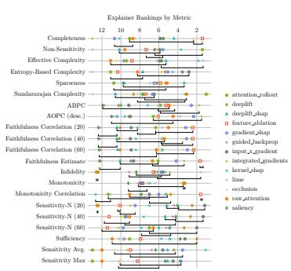  
(a) Classification

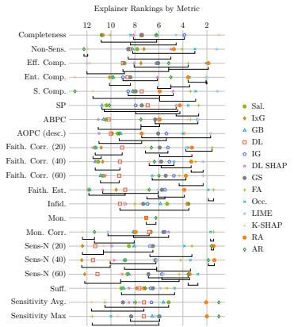  
(b) Semantic Entity Recognition

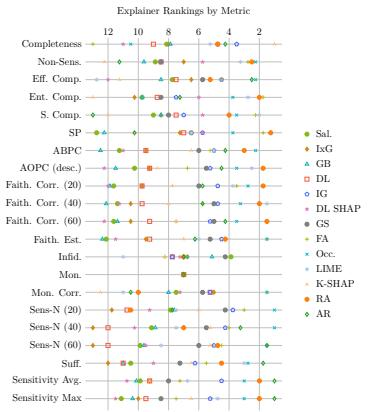  
(c) Document VQA  
Fig. C1: Per-metric critical diference diagrams for each task. Methods connected by a horizontal ba are not statistically significantly diferent (Wilcoxon signed-rank test with Holm correction, $\alpha = 0 . 0 5 )$ Lower ranks indicate better performance.

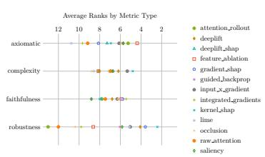  
(a) Classification

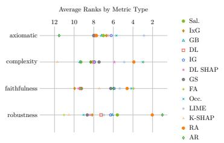  
(b) Semantic Entity Recognition

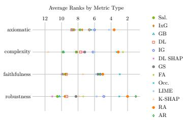  
(c) Document VQA  
Fig. C2: Aggregated mean ranks of XAI methods per evaluation criterion for each task. Lower ranks indicate better performance.

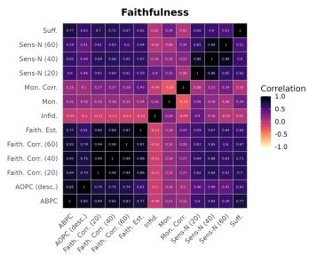  
(a) CLS

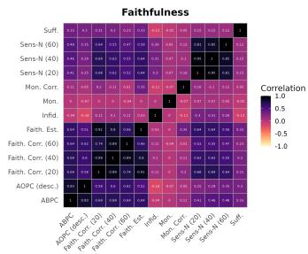  
(b) SER

  
(c) QA  
Fig. C3: Per-task pairwise Spearman correlation between faithfulness metric rankings across respective datasets, models, and explainer settings. On the QA task, Monotonicity (mon) [28] produced undefined values and is therefore excluded.

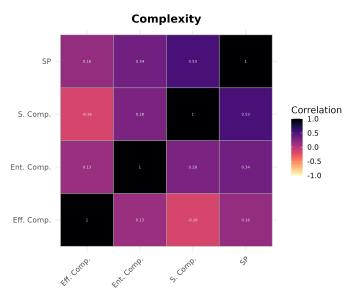  
(a) CLS

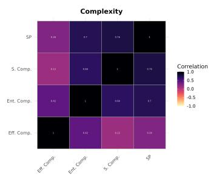  
(b) SER

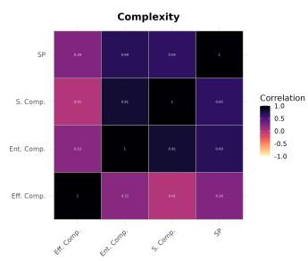  
(c) QA  
Fig. C4: Per-task pairwise Spearman correlation between complexity metric rankings across respective datasets, models, and explainer settings.

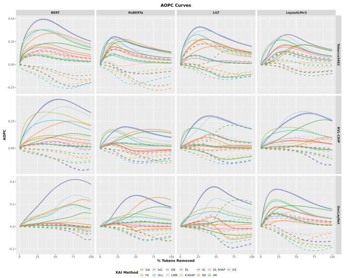  
Fig. C5: aopc curves for all XAI methods across all dataset-model combinations on the CLS task. MoRF (solid) and LeRF (dotted) curves are shown relative to the random baseline.

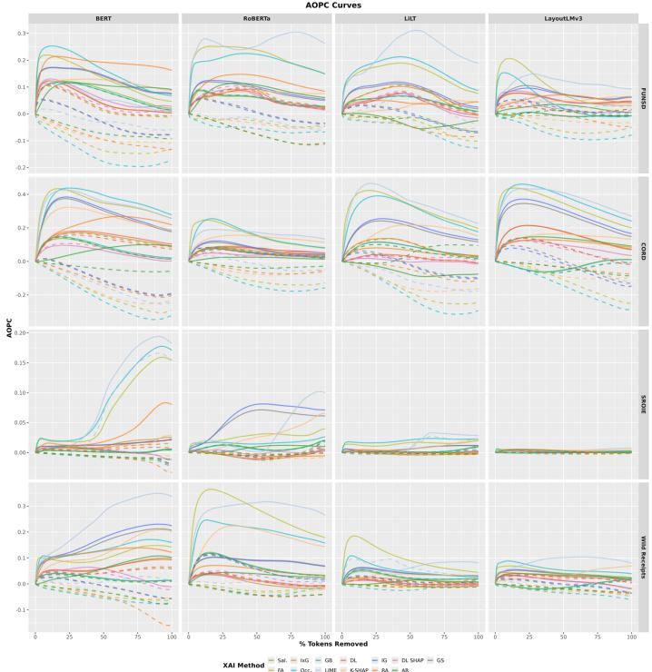  
Fig. C6: aopc curves for all XAI methods across all dataset-model combinations on the SER task. MoRF (solid) and LeRF (dotted) curves are shown relative to the random baseline.

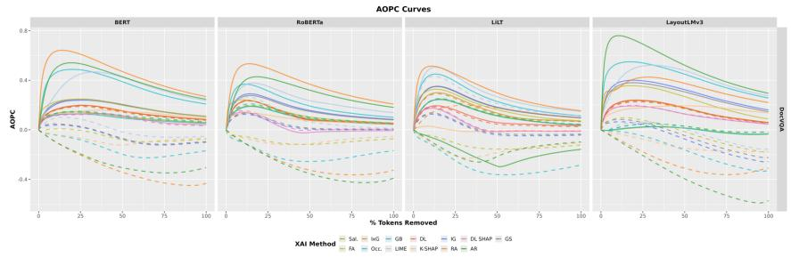  
Fig. C7: aopc curves for all XAI methods across all dataset-model combinations on the QA task. MoRF (solid) and LeRF (dotted) curves are shown relative to the random baseline.

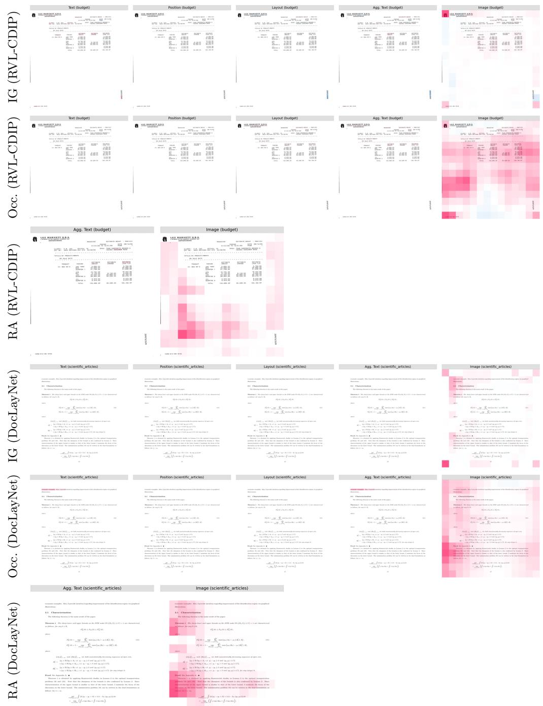  
Fig. C8: Modality-wise explanations of the LayoutLMv3 [2] model predictions for two randomly selected samples from RVL-CDIP [50] and DocLayNet [61] (CLS task). Results are shown for three methods: IG, OCC, and RA.

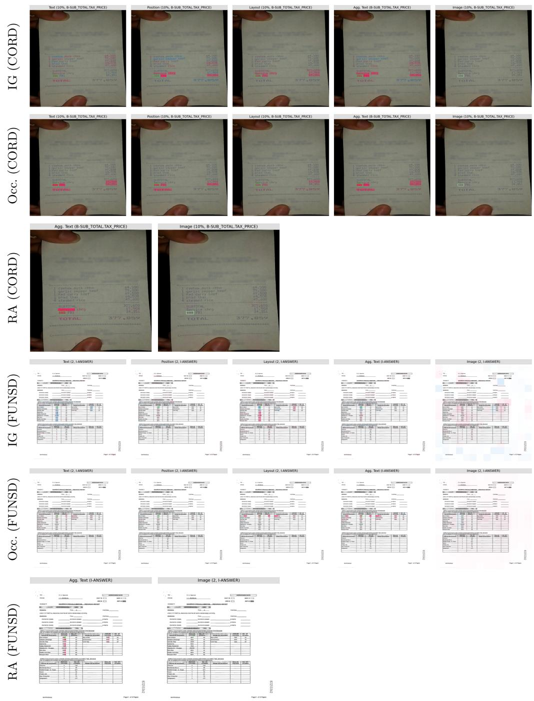  
Fig. C9: Modality-wise explanations of the LayoutLMv3 [2] model predictions for two randomly selected samples from CORD [62] and FUNSD [51] (SER task). Results are shown for three methods: IG, OCC, and RA.

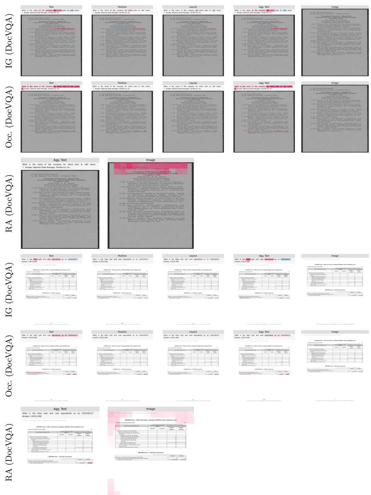  
Fig. C10: Modality-wise explanations of the LayoutLMv3 [2] model predictions for two randomly selected samples from DocVQA [65] (QA task). Results are shown for three methods: IG, OCC, and RA.

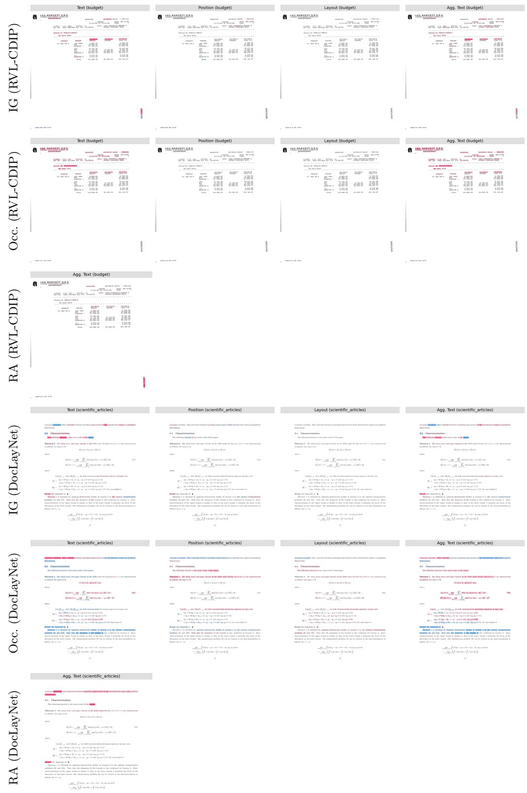  
Fig. C11: Modality-wise explanations of the LiLT [10] model predictions for two randomly selected samples from RVL-CDIP [50] and DocLayNet [61] (CLS task). Results are shown for three methods: IG, OCC, and RA.

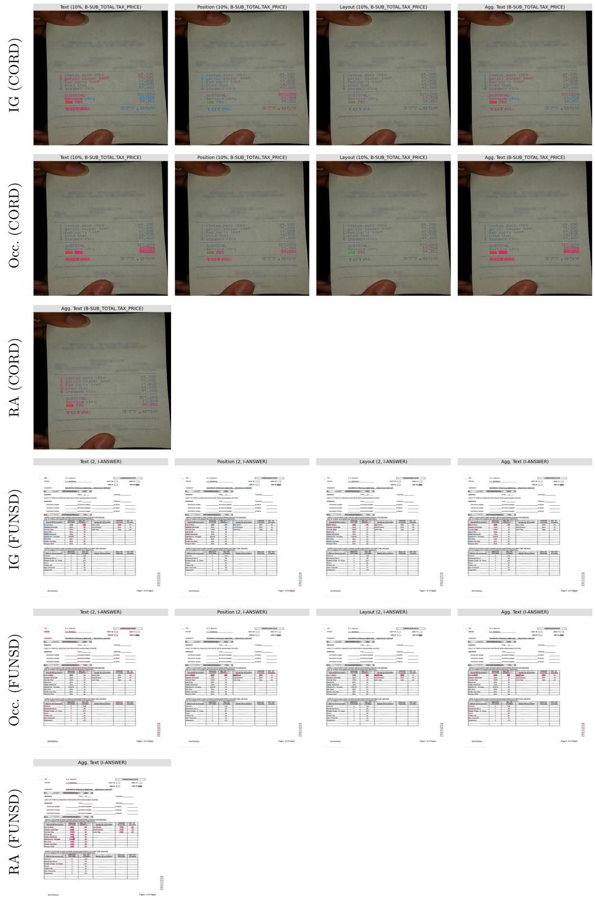  
Fig. C12: Modality-wise explanations of the LiLT [10] model predictions for two randomly selected samples from CORD [62] and FUNSD [51] (SER task). Results are shown for three methods: IG, OCC, and RA.

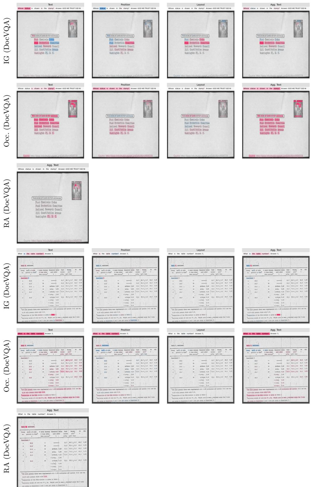  
Fig. C13: Modality-wise explanations of the LiLT [10] model predictions for two randomly selected samples from DocVQA [65] (QA task). Results are shown for three methods: IG, OCC, and RA.

Table C4: Modality contribution fractions computed for each model across all CLS datasets.
<table><tr><td>Dataset</td><td>Model</td><td>Explainer</td><td>Token</td><td>Position</td><td>Layout</td><td>Image</td></tr><tr><td>Tobacco3482</td><td>BERT</td><td>IG</td><td>0.91</td><td>0.09</td><td>N/A</td><td>N/A</td></tr><tr><td></td><td></td><td>Occ.</td><td>0.88</td><td>0.12</td><td>N/A</td><td>N/A</td></tr><tr><td></td><td></td><td>RA</td><td>1.00</td><td>N/A</td><td>N/A</td><td>N/A</td></tr><tr><td></td><td>RoBERTa</td><td>IG</td><td>0.80</td><td>0.20</td><td>N/A</td><td>N/A</td></tr><tr><td></td><td></td><td>Occ.</td><td>0.65</td><td>0.35</td><td>N/A</td><td>N/A</td></tr><tr><td></td><td></td><td>RA</td><td>1.00</td><td>N/A</td><td>N/A</td><td>N/A</td></tr><tr><td></td><td>LiLT</td><td>IG</td><td>0.71</td><td>0.29</td><td>0.00</td><td>N/A</td></tr><tr><td></td><td></td><td>Occ.</td><td>0.64</td><td>0.26</td><td>0.10</td><td>N/A</td></tr><tr><td></td><td></td><td>RA</td><td>0.55</td><td>N/A</td><td>0.45</td><td>N/A</td></tr><tr><td></td><td>LayoutLMv3</td><td>IG</td><td>0.12</td><td>0.02</td><td>0.13</td><td>0.74</td></tr><tr><td></td><td></td><td>Occ.</td><td>0.23</td><td>0.08</td><td>0.16</td><td>0.53</td></tr><tr><td></td><td></td><td>RA</td><td>0.00</td><td>N/A</td><td>N/A</td><td>1.00</td></tr><tr><td>RVL-CDIP</td><td>BERT</td><td>IG</td><td>0.92</td><td>0.08</td><td>N/A</td><td>N/A</td></tr><tr><td></td><td></td><td>Occ.</td><td>0.67</td><td>0.33</td><td>N/A</td><td>N/A</td></tr><tr><td></td><td></td><td>RA</td><td>1.00</td><td>N/A</td><td>N/A</td><td>N/A</td></tr><tr><td></td><td>RoBERTa</td><td>IG</td><td>0.76</td><td>0.24</td><td>N/A</td><td>N/A</td></tr><tr><td></td><td></td><td>Occ.</td><td>0.65</td><td>0.35</td><td>N/A</td><td>N/A</td></tr><tr><td></td><td></td><td>RA</td><td>1.00</td><td>N/A</td><td>N/A</td><td>N/A</td></tr><tr><td></td><td>LiLT</td><td>IG</td><td>0.71</td><td>0.26</td><td>0.03</td><td>N/A</td></tr><tr><td></td><td></td><td>Occ.</td><td>0.57</td><td>0.27</td><td>0.17</td><td>N/A</td></tr><tr><td></td><td></td><td>RA</td><td>0.47</td><td>N/A</td><td>0.53</td><td>N/A</td></tr><tr><td></td><td>LayoutLMv3</td><td>IG</td><td>0.55</td><td>0.07</td><td>0.21</td><td>0.18</td></tr><tr><td></td><td></td><td>Occ.</td><td>0.19</td><td>0.09</td><td>0.13</td><td>0.59</td></tr><tr><td></td><td></td><td>RA</td><td>0.17</td><td>N/A</td><td>N/A</td><td>0.83</td></tr><tr><td>DocLayNet</td><td>BERT</td><td>IG</td><td>0.95</td><td>0.05</td><td>N/A</td><td>N/A</td></tr><tr><td></td><td></td><td>Occ.</td><td>0.90</td><td>0.10</td><td>N/A</td><td>N/A</td></tr><tr><td></td><td></td><td>RA</td><td>1.00</td><td>N/A</td><td>N/A</td><td>N/A</td></tr><tr><td></td><td>RoBERTa</td><td>IG</td><td>0.74</td><td>0.26</td><td>N/A</td><td>N/A</td></tr><tr><td></td><td></td><td>Occ.</td><td>0.80</td><td>0.20</td><td>N/A</td><td>N/A</td></tr><tr><td></td><td></td><td>RA</td><td>1.00</td><td>N/A</td><td>N/A</td><td>N/A</td></tr><tr><td></td><td>LiLT</td><td>IG</td><td>0.69</td><td>0.31</td><td>0.00</td><td>N/A</td></tr><tr><td></td><td></td><td>Occ.</td><td>0.70</td><td>0.22</td><td>0.09</td><td>N/A</td></tr><tr><td></td><td></td><td>RA</td><td>0.52</td><td>N/A</td><td>0.48</td><td>N/A</td></tr><tr><td></td><td>LayoutLMv3</td><td>IG</td><td>0.35</td><td>0.07</td><td>0.27</td><td>0.31</td></tr><tr><td></td><td></td><td>Occ.</td><td>0.19</td><td>0.03</td><td>0.08</td><td>0.70</td></tr><tr><td></td><td></td><td>RA</td><td>0.02</td><td>N/A</td><td>N/A</td><td>0.98</td></tr></table>

## C.2 Per-Task Metric Agreement

Fig. C3 and Fig. C4 present the task-wise pairwise Spearman correlations for the faithfulness and complexity metrics. Overall, the task-wise faithfulness and complexity correlation patterns were largely consistent with the aggregated results reported in Fig. 5.

## C.3 AOPC Curves

Figs. C5, C6, and C7 present the aopc curves for all XAI methods across all dataset-model combinations for the CLS, SER, and QA tasks, respectively. We visualize both MoRF (solid) and LeRF (dotted) curves relative to the random baseline. Higher MoRF and lower LeRF curves indicate better faithfulness.

## C.4 Full Metric Results

The complete evaluation results across all 17 metrics, 13 XAI methods, 8 datasets, and 4 models are provided at https://docs.google.com/spreadsheets/d/12oEqjm-a1fHae8TKfcVGBTjq0mFAMtpsEI-CFQJeeU/edit?gid=0#gid=0. These results include the per-dataset mean scores for each metric-methodmodel combination, which were used to compute the rankings and correlation analyses presented in Section 5.1 and Section 5.2.

Table C5: Modality contribution fractions computed for each model across all SER datasets.
<table><tr><td>Dataset</td><td>Model</td><td>Explainer</td><td>Token</td><td>Position</td><td>Layout</td><td>Image</td></tr><tr><td rowspan="7">FUNSD</td><td>BERT</td><td>IG Occ. RA</td><td>0.88 0.76 1.00</td><td>0.12 0.24 N/A</td><td>N/A N/A N/A</td><td>N/A N/A N/A</td></tr><tr><td>RoBERTa</td><td>IG Occ. RA</td><td>0.46 0.53 1.00</td><td>0.54 0.47 N/A</td><td>N/A N/A N/A</td><td>N/A N/A N/A</td></tr><tr><td>LiLT</td><td>IG Occ. RA</td><td>0.58 0.53 0.72</td><td>0.32 0.34 N/A</td><td>0.11 0.13 0.28</td><td>N/A N/A N/A</td></tr><tr><td>LayoutLMv3</td><td>IG Occ. RA</td><td>0.25 0.35 0.98</td><td>0.29 0.21 N/A</td><td>0.42 0.37 N/A</td><td>0.04 0.07 0.02</td></tr><tr><td rowspan="2">CORD</td><td></td><td></td><td>0.94 0.79 1.00</td><td>0.06 0.21 N/A</td><td>N/A N/A N/A N/A N/A N/A</td></tr><tr><td></td><td>0.45 1.00</td><td>0.55 N/A</td><td>N/A N/A</td><td>N/A N/A</td></tr><tr><td></td><td>IG Occ. RA</td><td>0.64 0.44 0.76 0.37</td><td>0.32 0.52 N/A 0.31</td><td>0.04 0.04 0.24</td><td>N/A N/A N/A</td></tr><tr><td></td><td>LayoutLMv3 IG Occ. RA</td><td></td><td>0.31 0.68</td><td>0.38 N/A</td><td>0.32 0.31 N/A</td><td>0.00 0.00 0.32</td></tr><tr><td rowspan="2">SROIE</td><td></td><td>IG Occ. RA</td><td>0.85 0.95 1.00</td><td>0.15 0.05 N/A</td><td>N/A N/A N/A</td><td>N/A N/A N/A</td></tr><tr><td></td><td>IG Occ. RA</td><td>0.52 0.63 1.00</td><td>0.48 0.37 N/A</td><td>N/A N/A N/A</td><td>N/A N/A N/A</td></tr><tr><td rowspan="2"></td><td></td><td>IG Occ. RA</td><td>0.50 0.57 0.75</td><td>0.47 0.20 N/A</td><td>0.04 0.23 0.25</td><td>N/A N/A N/A</td></tr><tr><td>LayoutLMv3</td><td>IG Occ. RA</td><td>0.39 0.60 0.95</td><td>0.47 0.17 N/A</td><td>0.14 0.18 N/A</td><td>0.00 0.06 0.05</td></tr><tr><td rowspan="2"></td><td></td><td>Occ. RA IG</td><td>0.97 0.81 1.00 0.69</td><td>0.03 0.19 N/A</td><td>N/A N/A N/A</td><td>N/A N/A N/A</td></tr><tr><td></td><td>Occ. RA</td><td>0.70 1.00 0.49</td><td>0.31 0.30 N/A 0.29</td><td>N/A N/A N/A</td><td>N/A N/A N/A N/A</td></tr><tr><td rowspan="2"></td><td></td><td>Occ. RA</td><td>0.50 0.67</td><td>0.34 N/A</td><td>0.16 0.33</td><td>N/A N/A</td></tr><tr><td>LayoutLMv3</td><td>IG Occ.</td><td>0.67 0.40</td><td>0.23 0.30</td><td>0.10 0.28</td><td>0.00 0.01</td></tr></table>

Table C6: Modality contribution fractions computed for each model on the DocVQA [65] dataset.
<table><tr><td>Dataset</td><td>Model</td><td>Explainer</td><td>Token</td><td>Position</td><td>Layout</td><td>Image</td></tr><tr><td>DocVQA</td><td>BERT</td><td>IG</td><td>0.83</td><td>0.17</td><td>N/A</td><td>N/A</td></tr><tr><td></td><td></td><td>Occ.</td><td>0.66</td><td>0.34</td><td>N/A</td><td>N/A</td></tr><tr><td></td><td></td><td>RA</td><td>1.00</td><td>N/A</td><td>N/A</td><td>N/A</td></tr><tr><td></td><td>RoBERTa</td><td>IG</td><td>0.65</td><td>0.35</td><td>N/A</td><td>N/A</td></tr><tr><td></td><td></td><td>Occ.</td><td>0.59</td><td>0.41</td><td>N/A</td><td>N/A</td></tr><tr><td></td><td></td><td>RA</td><td>1.00</td><td>N/A</td><td>N/A</td><td>N/A</td></tr><tr><td></td><td>LiLT</td><td>IG</td><td>0.55</td><td>0.29</td><td>0.17</td><td>N/A</td></tr><tr><td></td><td></td><td>Occ.</td><td>0.58</td><td>0.31</td><td>0.12</td><td>N/A</td></tr><tr><td></td><td></td><td>RA</td><td>0.61</td><td>N/A</td><td>0.39</td><td>N/A</td></tr><tr><td></td><td>LayoutLMv3</td><td>IG</td><td>0.57</td><td>0.20</td><td>0.23</td><td>0.00</td></tr><tr><td></td><td></td><td>Occ.</td><td>0.61</td><td>0.20</td><td>0.16</td><td>0.03</td></tr><tr><td></td><td></td><td>RA</td><td>0.72</td><td>N/A</td><td>N/A</td><td>0.28</td></tr></table>

## C.5 Additional Qualitative Results

Figs. C8, C9, and C10 present additional qualitative results for the LayoutLMv3 [2] model, and Figs. C11, C12, and C13 for the LiLT [10] model. All explanations are generated using OCC, IG, and RA.

## C.6 Dataset-wise Modality Contributions

Table C4, Table C5, and Table C6 respectively present the overall modality contribution for LayoutLMv3 [2] and LiLT [10] across the CLS, SER, and QA tasks, computed using Occlusion (OCC) [27], Integrated Gradients (IG) [35], and Raw Attention (RA) [66].