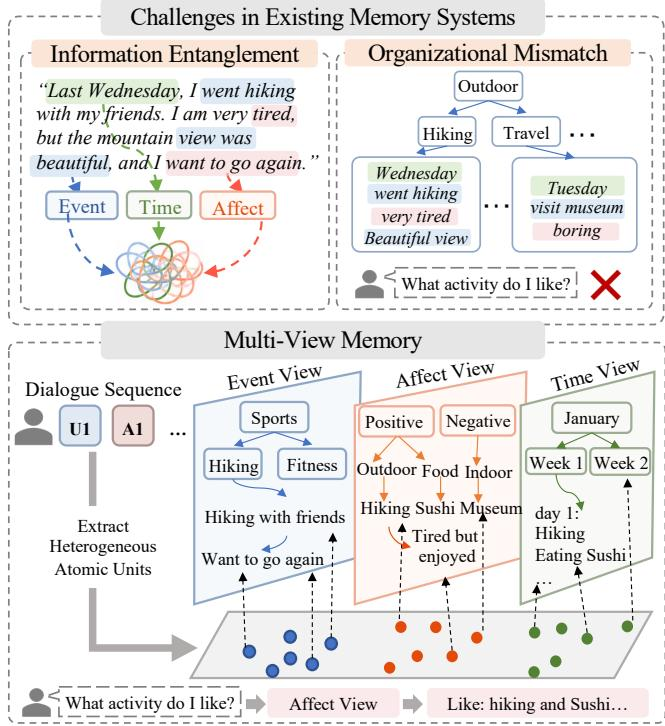
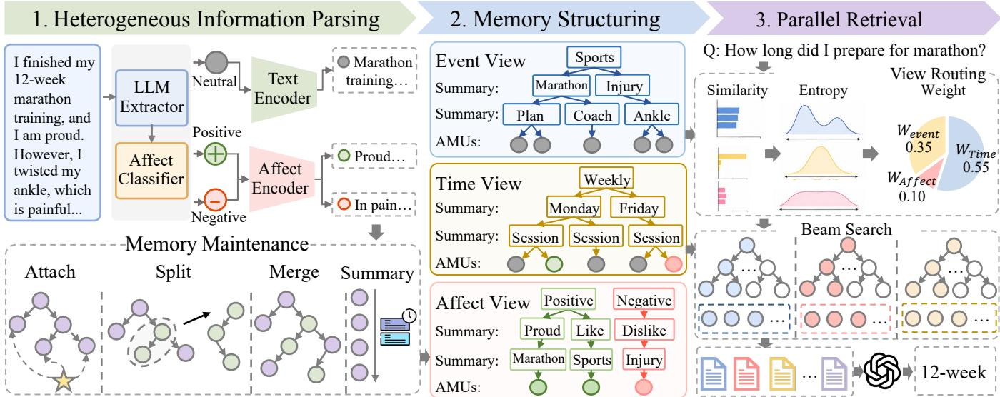
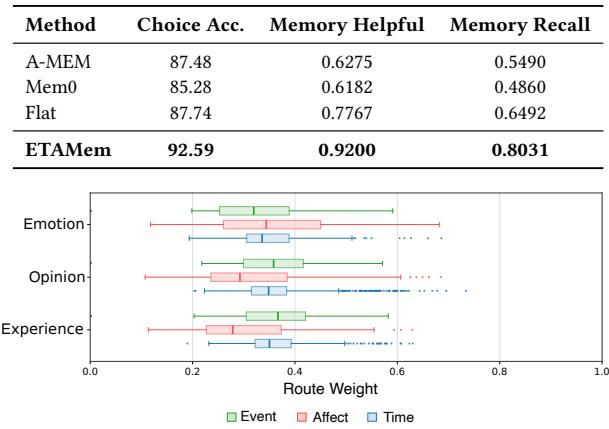
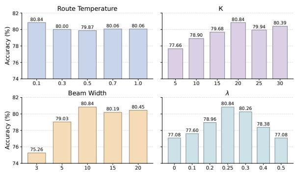
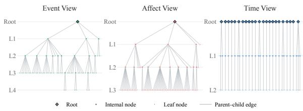
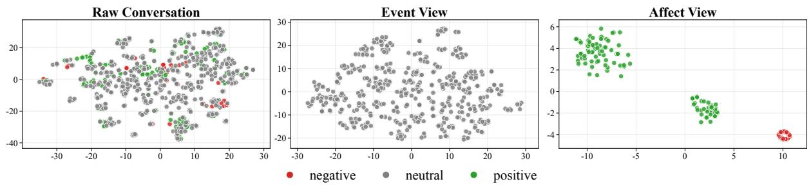

# ETAMem: Decoupling and Aligning Heterogeneous Memory for Long-Term Conversational Agents

Xinying Qian qianxinying@dbis.nankai.edu.cn Nankai University Tianjin, China

Xubo Liu   
liuxubo@dbis.nankai.edu.cn   
Nankai University   
Tianjin, China   
Ying Zhang   
yingzhang@nankai.edu.cn   
Nankai University   
Tianjin, China

Baohang Zhou zhoubaohang@dbis.nankai.edu.cn Tiangong University Tianjin, China

Yu Zhao   
zhaoyu@dbis.nankai.edu.cn   
Nankai University   
Tianjin, China   
Jef Z. Pan   
j.z.pan@ed.ac.uk   
The University of Edinburgh   
Edinburgh, United Kingdom

## Abstract

Long-term memory enables Large Language Models (LLMs) to maintain coherent and personalized interactions across extended conversations. However, existing memory systems face two key challenges: (1) Information Entanglement, where heterogeneous information is mixed within coarse-grained memory units; and (2) Organizational Mismatch, where memory structures based primarily on semantic similarity may overlook other associations. To address these challenges, we propose ETAMem, a multi-view mem-ory framework that decouples heterogeneous conversational infor- mation and aligns memory representations and organization with its distinct characteristics. Specifically, heterogeneous information parsing extracts atomic memory units and identifies afective information. View-specific memory structuring then organizes these units into three complementary hierarchical views: Event, Afect, and Time. ETAMem incrementally maintains memory structures with adaptively calibrated thresholds. For retrieval, entropy-based retrieval allocates query-specific budgets across views and performs hierarchical search within each view. Experiments on LoCoMo and LongMemEval-S demonstrate that ETAMem outperforms state- of-the-art baselines, achieving relative accuracy improvements of 12.46% and 7.96%, respectively, while maintaining competitive token eficiency. Further analyses demonstrate the complementary benefits of diferent memory views.

## CCS Concepts

• Computing methodologies → Discourse, dialogue and pragmatics; • Information systems → Personalization; Question answering.

## Keywords

Long-Term Memory, Large Language Models, Conversational Agents

## 1 Introduction

Personalized conversational agents are increasingly deployed in Web-based services [4], where maintaining user context across interactions is essential for coherent and personalized experiences [20]. To support long-term user modeling, memory systems enable Large

  
Figure 1: Illustration of challenges in existing memory systems and our proposed multi-view memory framework.

Language Models (LLMs) to retain and retrieve information from conversations, capturing users’ experiences and preferences [5].

Existing memory architectures for LLMs can be broadly categorized into flat and structured approaches. Flat approaches [2, 34] store extracted conversational information as separate textual mem- ory entries, typically retrieved through embedding-based similarity search. In contrast, structured approaches [14, 22, 31, 32] organize memories through hierarchies or graphs to capture dependencies among memory units. However, the heterogeneous nature of con-versational information poses two key challenges for memory or- ganization and retrieval.

(1) Information Entanglement. Existing memory systems [2, 34] often treat conversational memory entries as the basic units of memory representation and organization. Although some ap- proaches [6, 31] extract keywords or summaries, they do not explicitly distinguish heterogeneous information types. As illustrated in Figure 1, a single dialogue turn may contain factual events, personal preferences, and temporal contexts. Without decomposition, these aspects remain entangled, making it dificult to isolate relevant evidence and introducing retrieval noise.

(2) Organizational Mismatch. Existing memory systems [14, 22] organize memories through temporal or relational structures. Recent approaches [12, 32] further combine multiple structures. However, these structures do not necessarily align memory rep- resentations and organization criteria with diferent information types. As shown in Figure 1, organizing memories by semantic topics may scatter related preferences across diferent branches, making afective evidence dificult to retrieve collectively.

These limitations motivate a fundamental question: how can conversational information be identified, represented, and organized for long-term memory retrieval? Diferent information types require distinct representations and organizational principles. For example, answering “what activity do I like?” requires connecting afective information across diferent contexts, whereas “what did I do this week?” requires aggregating experiences according to their temporal relations. This distinction aligns with findings from cognitive neuroscience, which suggest that episodic memory and emotional processing involve functionally specialized yet interacting neural systems [17, 21]. This motivates decoupling heterogeneous conversational information and aligning memory representations and organization with its distinct characteristics.

In this paper, we propose ETAMem, an Event-Time-Afect Memory framework for long-term conversational agents. ETAMem first performs heterogeneous information parsing by decomposing dialogue turns into semantically complete atomic memory units (AMUs) and identifying their afective characteristics. Through view-specific memory structuring, these AMUs are then organized into three hierarchical views. Specifically, the Event view organizes factual experiences through semantic similarity, the Afect view organizes emotions, attitudes, and preferences through afect-aware represen tations, and the Time view indexes all memories through temporal hierarchies. To support continual interaction, ETAMem incrementally maintains the Event and Afect hierarchies through attach- ment, splitting, merging, and lazy summary updates, while adap- tively calibrating maintenance thresholds. Given a query, entropy- based retrieval allocates budgets across views through adaptive routing and performs hierarchical beam search to retrieve relevant memories. Experiments on two long-term dialogue memory benchmarks demonstrate that ETAMem consistently improves memory performance, particularly on multi-hop and temporally grounded queries. Overall, our work makes the following contributions:

• We propose ETAMem, a multi-view memory framework that organizes heterogeneous conversational information into complementary Event, Afect, and Time hierarchies with view-specific representations.

• We develop a dynamic memory maintenance mechanism with adaptive threshold calibration. We further employ entropy- based routing to allocate query-specific retrieval budgets across complementary memory views.

• Extensive experiments on LoCoMo and LongMemEval-S demonstrate that ETAMem outperforms strong baselines, particularly on multi-hop and temporal reasoning questions, while maintaining competitive token costs.

## 2 Related Work

## 2.1 Memory Systems for LLM Agents

Flat memory. Early memory systems store extracted facts or interaction summaries as independent units, typically retrieved through semantic similarity [2, 34]. For long-term access, MemGPT [19] separates in-context and external memory through paging, MemoryOS [13] organizes histories into short-, mid-, and long-term layers, and LightMem [6] uses staged ofline consolidation. These designs emphasize where and when memories are stored or consolidated, while retrieval often relies on general semantic matching.

Structured memory. Structured systems organize memories into hierarchies or graphs. Tree-based approaches support memory abstraction at diferent levels of granularity. TiMem [14] builds a five-level temporal memory tree to consolidate experiences over time, while xMemory [10] decomposes interaction histories into se-mantic components and organizes them hierarchically. Graph-based approaches emphasize explicit memory associations. A-MEM [31] dynamically updates semantic links between memory notes, whereas Zep [22] maintains a temporal knowledge graph of evolving facts and relationships. HingeMem [35] uses boundary-based hyper-graphs to connect memories by person, time, location, and topic. However, these methods primarily emphasize temporal, semantic, or relational organization without explicitly aligning memory hierarchies with diferent types of conversational information.

Multi-structure memory. Recent work organizes memory through multiple complementary structures or information types. MemWeaver [33] develops complementary behavioral and cognitive memory hierarchies to capture user interactions and long-term preferences. H-Mem [32] combines a temporal-semantic tree with an entity knowledge graph. MAGMA [12] links memory events through separate semantic, temporal, causal, and entity graphs. MemGAS [30] associates multi-granularity memory units through clustering and selects retrieval granularity via entropy-based routing. MemoType [28] distinguishes diferent memory types without hierarchical organization. These methods either combine multiple memory structures without explicitly decoupling heterogeneous information or distinguish information types without organizing them into specialized hierarchies.

## 2.2 Afect-Aware Memory and Retrieval

Recent studies have explored afective information to improve memory retrieval and personalized interactions. Emotional RAG [11] combines emotional and semantic relevance to retrieve memories for role-playing agents. REG [27] retrieves emotionally similar examples to support empathetic response generation. PAMU [25] dynamically updates memories to reflect evolving user preferences, while Sentipolis [7] models emotion dynamics and emotion-memory coupling to maintain afective continuity. Recent benchmarks further emphasize the importance of afective and personalized mem- ory. CloneMem [9] evaluates the retention and retrieval of personal experiences, preferences, and opinions, while ENPMR-Bench [8] focuses on memory retrieval for emotional support. Despite these advances, existing approaches primarily leverage afective information to guide retrieval, memory updates, or generation, with limited attention to organizing memories through afective associations.

## 3 Method

We present ETAMem, a multi-view memory framework for decou pling and aligning heterogeneous conversational information. First, heterogeneous information parsing extracts atomic memory units (AMUs) and identifies their afective characteristics. These units are then organized through view-specific memory structuring into three complementary views: Event, Afect, and Time. To support evolving conversations, dynamic memory maintenance updates the hierarchies, while adaptive calibration adjusts maintenance thresholds. Finally, entropy-based retrieval allocates query-specific budgets across views and performs hierarchical beam search to retrieve relevant AMUs, as shown in Figure 2.

## 3.1 Problem Formulation

The long-term memory requires LLMs to continuously organize past interactions and retrieve relevant information for reasoning. Let $\mathcal { D } _ { T } = \{ ( d _ { t } , \tau _ { t } ) \} _ { t = 1 } ^ { T }$ denote a dialogue history processed sequentially, where $d _ { t }$ and $\tau _ { t }$ represent the dialogue content and timestamp at turn �, respectively. At each turn $t ,$ a memory state ${ \mathbf { } } _ { } { \mathbf { } } _ { } { \mathbf { } } _ { } { \mathbf { } } _ { } { \mathbf { } } _ { } { \mathbf { } } _ { } { \mathbf { } } _ { } { \mathbf { } } _ { } { \mathbf { } } _ { } { \mathbf { } } _ { } { \mathbf { } } _ { } { \mathbf { } } _ { } { \mathbf { } } _ { } { \mathbf { } } _ { } { \mathbf { } } _ { } { \mathbf { } } _ { } { } \mathbf { } _ { } { } _ { } { \mathbf { } } _ { } { } \mathbf { } _ { } { } _ { } { } \mathbf { } _ { } { } _ { } { } \mathbf { } _ { } { } _ { } { } \mathbf { } _ { } { } _ { } { } \mathbf { } _ { } { } _ { } { } \mathbf { } _ { } { } _ { } { } \mathbf { } _ { } { } _ { } { } \mathbf { } _ { } { } _ { } { } \mathbf { } _ { } { } _ { } { } \mathbf { } _ { } { } _ { } { } \mathbf { } _ { } { } _ { } { } \mathbf { } _ { }  _ { }$ is in-crementally updated from the previous state $\boldsymbol { \mathcal { M } } _ { t - 1 }$ and the new dialogue input $\left( d _ { t } , \tau _ { t } \right)$ , where $\boldsymbol { \mathcal { M } } _ { t }$ denotes the organized memory after processing � turns. Given a query �, the objective is to retrieve an evidence set $\mathcal { E } _ { q }$ from $\boldsymbol { \mathcal { M } } _ { T }$ that supports accurate inference.

## 3.2 Heterogeneous Information Parsing

AMU Extraction. ETAMem decomposes each dialogue turn into atomic memory units (AMUs), such that each AMU captures one independent memory item and the resulting set preserves the orig- inal information. It then assigns a polarity label to each AMU to distinguish factual content from afective content for subsequent memory organization.

Given a dialogue turn $\boldsymbol { x } _ { t } = ( d _ { t } , \tau _ { t } )$ , ETAMem uses an LLM to extract a set of AMU contents:

$$
\mathcal { A } _ { t } = f _ { \mathrm { L L M } } ( x _ { t } ) = \{ a _ { t , 1 } , \ldots , a _ { t , n _ { t } } \} .\tag{1}
$$

Here, $n _ { t }$ is the number of AMUs extracted from turn �.

To guide view-specific memory organization, ETAMem assigns each AMU a polarity label. We define the polarity label space as P = {negative, neutral, positive}. Given the class scores produced by an of-the-shelf sentiment classifier $f _ { \mathrm { s e n t } }$ , the highest-scoring class is selected as

$$
\boldsymbol { \mathscr { p } } _ { t , i } = \arg \operatorname* { m a x } _ { \boldsymbol { \ell } \in \mathcal { P } } \left[ f _ { \mathrm { s e n t } } ( \boldsymbol { a } _ { t , i } ) \right] \boldsymbol { \mathbf { \ell } } _ { \boldsymbol { \ell } } .\tag{2}
$$

## 3.3 View-Specific Memory Structuring

AMU Representation. We use two encoders to capture semantic and afective information, where $\phi _ { \mathrm { t e x t } } ( \cdot )$ denotes the textual encoder and $\phi _ { \mathrm { a f f e c t } } ( \cdot )$ denotes the afective encoder. Each AMU is encoded according to its polarity label:

$$
\begin{array} { r } { \mathbf { r } _ { t , i } = \left\{ \begin{array} { l l } { \phi _ { \mathrm { t e x t } } ( a _ { t , i } ) , \ } & { p _ { t , i } = \mathrm { n e u t r a l } , } \\ { \phi _ { \mathrm { a f f e c t } } ( a _ { t , i } ) , } & { p _ { t , i } \in \{ \mathrm { n e g a t i v e } , \mathrm { p o s i t i v e } \} . } \end{array} \right. } \end{array}\tag{3}
$$

Memory Organization. To support structured organization and coarse-to-fine retrieval over heterogeneous AMUs, ETAMem organizes the current memory as three hierarchical views:

$$
{ \mathcal { M } } = \left\{ \mathcal { V } _ { \mathrm { e v e n t } } , \mathcal { V } _ { \mathrm { a f f e c t } } , \mathcal { V } _ { \mathrm { t i m e } } \right\} .\tag{4}
$$

The Event View $\boldsymbol { \mathcal { N } } _ { \mathrm { e v e n t } }$ organizes neutral AMUs according to textual semantics. AMUs with similar semantic representations are hierarchically grouped into event-related nodes, capturing recurring events, entities, and interactions.

The Afect View $\mathcal { N } _ { \mathrm { a f f e c t } }$ organizes positive and negative AMUs according to afective semantics. AMUs with similar afective rep- resentations are hierarchically grouped into nodes, capturing per-sistent preferences and attitudes.

The Time View $\mathcal { N } _ { \mathrm { t i m e } }$ organizes AMUs through a temporal hierarchy: Session → Day → Week → Month. AMUs are stored at the Session level, while higher-level nodes provide summaries. Unlike Event and Afect views, the Time view follows predefined temporal granularity rather than semantic grouping.

Tree Structure. Each memory view adopts a hierarchical structure. Leaf nodes store AMUs, while internal nodes maintain textual summaries of their subtrees. For an internal node whose children are leaves, its summary is generated from the AMUs stored in those leaves. For higher-level internal nodes, the summary is generated from the summaries of their child nodes.

## 3.4 Dynamic Memory Maintenance

3.4.1 Memory Maintenance. ETAMem maintains its memory trees through online insertion and incremental structural refinement. For each incoming dialogue turn, the extracted AMUs are inserted into their corresponding views. At the end ofeach session, the Event and Afect views undergo structural maintenance, with Split and Merge operations triggered only when their respective conditions are met. In contrast, the Time view follows a predefined temporal hierarchy and requires only deterministic insertion without maintenance.

Attachment. The attachment operation determines how a new AMU is incorporated into each memory view. For the Time view, an AMU is assigned to the temporal node corresponding to its timestamp. For the Event and Afect views, ETAMem identifies the most suitable insertion osition throu h hierarchical search.

We first represent each node by the centroid of the AMU repre- sentations in its subtree:

$$
\pmb { \mu } _ { n } = \frac { 1 } { | S _ { n } | } \sum _ { a _ { t , i } \in S _ { n } } \mathbf { r } _ { t , i } ,\tag{5}
$$

where $S _ { n }$ denotes the set ofAMUs contained in the subtree rooted at �. The similarity between an AMU and a candidate node is measured as $g ( a _ { t , i } , n ) = \cos ( \mathbf { r } _ { t , i } , \pmb { \mu } _ { n } )$

Using this similarity score, ETAMem performs beam search over corresponding trees. Starting from the root nodes, it recursively expands child nodes and retains the top-� candidate paths at each layer until reaching the leaf level, forming a candidate set $\mathcal { L } _ { B } .$ The insertion candidate is selected as $n ^ { \star } = \arg \operatorname* { m a x } _ { n \in \mathcal { L } _ { B } } g ( a _ { t , i } , n )$ , with score $\rho ^ { \star } = g ( a _ { t , i } , n ^ { \star } )$

Based on the matching score, ETAMem selects one of three insertion operations for the AMU: Attach to the most relevant existing leaf, NewLeaf under the parent of $n ^ { \star }$ , or NewRoot.

  
Figure 2: Overview of ETAMem. Given dialogue histories, the framework extracts AMUs and organizes them into three memory views: Event, Afect, and Time. During retrieval, entropy-based routing and beam search are used for response generation.

$$
\Gamma ( a _ { t , i } , n ^ { \star } ) = \left\{ \begin{array} { l l } { \mathrm { A t t a c h } ( a _ { t , i } , n ^ { \star } ) , } & { \rho ^ { \star } \geq \theta _ { \mathrm { a t t a c h } } , } \\ { \mathrm { N e w L e a f } ( a _ { t , i } , n ^ { \star } ) , } & { \theta _ { \mathrm { n e w } } \leq \rho ^ { \star } < \theta _ { \mathrm { a t t a c h } } , } \\ { \mathrm { N e w R o o t } ( a _ { t , i } ) , } & { \rho ^ { \star } < \theta _ { \mathrm { n e w } } . } \end{array} \right.\tag{6}
$$

Split. To prevent leaf nodes from becoming overly large or semantically incoherent, ETAMem splits a leaf when its size exceeds $M _ { \mathrm { m a x } }$ or its cohesion falls below $\theta _ { \mathrm { c o h } }$ . For a leaf containing � AMUs, ETAMem partitions the AMUs using cosine K-means, with the number of clusters determined as $\begin{array} { r } { k = \operatorname* { m a x } \left( 2 , \left\lceil \frac { m } { M _ { \mathrm { m a x } } } \right\rceil \right) } \end{array}$ . Each clus- ter forms a new leaf under the same parent. The cohesion of a leaf node � is computed as

$$
\kappa ( n ) = \frac { 2 } { m ( m - 1 ) } \sum _ { j < \ell } \cos \left( \mathbf { r } _ { t _ { j } , i _ { j } } , \mathbf { r } _ { t _ { \ell } , i _ { \ell } } \right) .\tag{7}
$$

Merge. To reduce redundant small nodes and improve retrieval eficiency, ETAMem checks the Event and Afect views for merg- ing at the end of each dialogue session. For each candidate pair of nodes $n _ { i }$ and $n _ { j } ,$ their similarity is computed from the node centroids as $s _ { \mathrm { m e r g e } } ( n _ { i } , n _ { j } ) = \cos \left( \mu _ { n _ { i } } , \mu _ { n _ { j } } \right)$ . The pair is merged when $s _ { \mathrm { m e r g e } } ( n _ { i } , n _ { j } ) \geq \theta _ { \mathrm { m e r g e } } .$ . For leaf nodes, the merged AMU set must additionally satisfy $| \bar { S } _ { n _ { i } } \cup S _ { n _ { j } } | \le M _ { \mathrm { m a x } }$ . When the two nodes belong to diferent branches, the merged node is placed under their nearest common ancestor to preserve the existing hierarchy.

Summary Update. As memory trees evolve, frequent updates to internal node summaries would introduce additional LLM over- head. To reduce recomputation, ETAMem lazily updates internal summaries using a pending-change counter $u _ { n } .$ . Each structural up date increments the counters of afected nodes and their ancestors; when $u _ { n } \geq \delta ,$ , where � is the update interval controlling how many pending updates trigger summary regeneration, the summary $z _ { n }$ is regenerated and $u _ { n }$ is reset. Leaf summaries are directly updated from their stored AMU texts.

3.4.2 Adaptive Calibration. To prevent excessive tree growth and node overcrowding as memory expands, ETAMem adaptively calibrates structural parameters and maintenance thresholds. Both are initialized with predefined values and subsequently adjusted using observed memory statistics, without reconstructing existing trees.

Structural Parameters. For each view �, ETAMem calibrates the maximum AMUs per leaf $M _ { \mathrm { m a x } } ^ { ( v ) }$ , maximum children per internal node $b _ { \mathrm { m a x } } ^ { ( \upsilon ) }$ , and maximum tree depth $H ^ { ( v ) }$ . When preset capacity limits are reached, these parameters are recalibrated to accommo- date further memory growth. Let $\widetilde { n } _ { v }$ and $n _ { \mathrm { m a x } } ^ { ( \upsilon ) }$ denote the median and maximum AMU counts across observed dialogue histories in view �. The parameters are computed as

$$
\begin{array} { r l } & { M _ { \mathrm { m a x } } ^ { ( v ) } = \operatorname* { m a x } \bigl ( 2 , \mathrm { r o u n d } ( \sqrt { \widetilde { n _ { v } } } ) \bigr ) , } \\ & { ~ b _ { \mathrm { m a x } } ^ { ( v ) } = \operatorname* { m a x } \bigl ( 2 , \lceil \sqrt { \widetilde { n _ { v } } / M _ { \mathrm { m a x } } ^ { ( v ) } } \rceil \bigr ) , } \\ & { ~ H ^ { ( v ) } = \operatorname* { m a x } \bigl ( 2 , 1 + \lceil \log _ { b _ { \mathrm { m a x } } ^ { ( v ) } } \widehat { L } _ { v } \rceil \bigr ) , } \end{array}\tag{8}
$$

where $\widehat { L } _ { v } \ = \ \operatorname* { m a x } ( 1 , \lceil n _ { \operatorname* { m a x } } ^ { ( v ) } / M _ { \operatorname* { m a x } } ^ { ( v ) } \rceil )$ estimates the required leaves. This allows the tree structure to adapt to increasing memory size.

Maintenance Thresholds. ETAMem calibrates view-specific thresholds based on observed similarity distributions. During mem- ory insertion, cosine similarities between incoming AMUs and visited candidate nodes are collected across dialogue histories. We employ Otsu’s method [18] to partition these similarities into lowand high-similarity subsets. Specifically, $\theta _ { \mathrm { n e w } }$ is estimated as the 75th percentile of the low-similarity subset, while $\theta _ { \mathrm { a t t a c h } } , \theta _ { \mathrm { c o h } } .$ , and $\theta _ { \mathrm { { m e r g e } } }$ are estimated as the 25th, 65th, and 85th percentiles of the high-similarity subset.

To reduce fluctuations across calibration rounds, ETAMem up- dates each threshold using an exponential moving average (EMA) [23]:

$$
\theta _ { c } ^ { ( v , s ) } = \eta \theta _ { c } ^ { ( v , s - 1 ) } + ( 1 - \eta ) \widehat \theta _ { c } ^ { ( v , s ) } ,\tag{9}
$$

where � indexes calibration rounds, � ∈ {new, atach, coh, merge} denotes the threshold type, ${ \widehat \theta } _ { c } ^ { ( v , s ) }$ is its current estimate for view �, and � controls the contribution of the previous threshold.

## 3.5 Entropy-based Retrieval

Entropy-based View Routing. Diferent queries may depend on diferent memory views and thus require diferent types of evidence. To address this, ETAMem computes the confidence of each view and adaptively allocates the retrieval budget across the three views.

Let V = {Event, Afect, Time} denote the set of memory views. For each view $v \in \mathcal { V } ,$ , let $\mathcal { L } _ { v }$ denote its leaf set, $N _ { v } = | \mathcal { L } _ { v } |$ the number of leaves, and $z _ { v , j }$ the summary of its �-th leaf. We first compute the similarity between the query � and each leaf summary:

$$
s _ { v , j } = \cos \left( \phi _ { \mathrm { t e x t } } ( q ) , \phi _ { \mathrm { t e x t } } ( z _ { v , j } ) \right) , \quad j = 1 , \ldots , N _ { v } .\tag{10}
$$

The similarity scores are converted into a probability distribution over the leaves within each view. $\beta$ controls the temperature.

$$
\alpha _ { v , j } = \frac { \exp ( s _ { v , j } / \beta ) } { \sum _ { \ell = 1 } ^ { N _ { v } } \exp ( s _ { v , \ell } / \beta ) } ,\tag{11}
$$

We then use normalized entropy to measure how concentrated the probability distribution is:

$$
\bar { H } _ { v } = - \frac { 1 } { \log \operatorname* { m a x } \{ 2 , | \mathcal { L } _ { v } | \} } \sum _ { j = 1 } ^ { N _ { v } } \alpha _ { v , j } \log \alpha _ { v , j } .\tag{12}
$$

A lower $\bar { H _ { v } }$ indicates that the query is concentrated on fewer leaves, suggesting a clearer retrieval signal for view �. We use $1 - \bar { H } _ { v }$ as the routing score, where larger values indicate more concentrated retrieval distributions, and normalize it across views to obtain the routing weight $w _ { v } \colon$

$$
w _ { v } = \frac { 1 - \bar { H } _ { v } } { \sum _ { u \in \mathcal { V } } \left( 1 - \bar { H } _ { u } \right) } .\tag{13}
$$

Given a total leaf retrieval budget $K ,$ ETAMem initializes the per-view budget as $K _ { v } = \operatorname* { m a x } ( 1$ , round( $K w _ { v } ) )$ . Thus, views with more concentrated leaf-level similarity distributions receive larger shares of the retrieval budget.

Beam Search. For each memory view, ETAMem retrieves rele-vant nodes through layer-wise beam search by combining semantic similarity and lexical relevance, where semantic similarity captures contextual relevance while lexical relevance preserves exact term matching. The summary of candidate node � is denoted as $z _ { n } .$ , and its semantic relevance with query � is computed as

$$
s _ { \mathrm { s e m } } ( q , n ) = \cos \left( \phi _ { \mathrm { t e x t } } ( q ) , \phi _ { \mathrm { t e x t } } ( z _ { n } ) \right) .\tag{14}
$$

The lexical relevance is measured by BM25 $[ 2 4 ]$ . The normalized semantic and lexical scores are combined as

$$
\begin{array} { r } { \mathrm { s c o r e } ( q , n ) = ( 1 - \lambda ) \widetilde { s } _ { \mathrm { s e m } } ( q , n ) + \lambda \widetilde { s } _ { \mathrm { l e x } } ( q , n ) , } \end{array}\tag{15}
$$

where $\widetilde s$ denotes the normalized score and � controls the contribu tion of lexical matching.

Starting from the root nodes, ETAMem retains the top-� nodes according to score(�, �) at each internal layer and recursively ex-pands them. After expanding the final internal-layer beam, it selects the top- $K _ { v }$ leaf nodes for view �. The retrieved AMUs across views are merged and deduplicated to form the evidence set $\varepsilon _ { q } .$ . Ifthe LLM returns “no information” due to insuficient evidence, ETAMem falls back to the corresponding original dialogue turns $\mathcal { D } _ { q }$ . The response is generated as

Table 1: Final parameter configurations of ETAMem.
<table><tr><td rowspan="2">Dataset</td><td rowspan="2">View</td><td colspan="3">Structural Parameters</td><td colspan="4">Maintenance Thresholds</td></tr><tr><td> $M _ { \mathrm { m a x } } ^ { ( v ) }$ </td><td> $b _ { \mathrm { m a x } } ^ { ( \upsilon ) }$ </td><td> $H ^ { ( v ) }$ </td><td> $\theta _ { \mathrm { n e w } }$ </td><td> $\theta _ { \mathrm { a t t a c h } }$ </td><td> $\theta _ { \mathrm { c o h } }$ </td><td> $\theta _ { \mathrm { m e r g e } }$ </td></tr><tr><td rowspan="2">LoCoMo</td><td>Event</td><td>29</td><td>6</td><td>4</td><td>0.402</td><td>0.460</td><td>0.515</td><td>0.572</td></tr><tr><td>Affect</td><td>33</td><td>6</td><td>4</td><td>0.446</td><td>0.504</td><td>0.562</td><td>0.619</td></tr><tr><td rowspan="2">LongMemEval</td><td>Event</td><td>22</td><td>5</td><td>4</td><td>0.426</td><td>0.481</td><td>0.534</td><td>0.582</td></tr><tr><td>Affect</td><td>11</td><td>4</td><td>4</td><td>0.435</td><td>0.486</td><td>0.537</td><td>0.582</td></tr></table>

$$
\hat { \boldsymbol { y } } = \left\{ \begin{array} { l l } { f _ { \mathrm { L L M } } ( \boldsymbol { q } , \mathcal { E } _ { \boldsymbol { q } } ) , } & { \mathrm { i f ~ s u f f i c i e n t } , } \\ { f _ { \mathrm { L L M } } ( \boldsymbol { q } , \mathcal { D } _ { \boldsymbol { q } } ) , } & { \mathrm { o t h e r w i s e } . } \end{array} \right.\tag{16}
$$

## 4 Experiments

## 4.1 Experimental Setup

Datasets. We conduct experiments on two long-term memory benchmarks. LoCoMo [16] contains multi-session interactions from 10 user groups, while LongMemEval-S [29] comprises 500 questions designed to assess memory over extended contexts. Further details of the datasets are provided in Appendix B.

Baselines. We compare ETAMem with representative memory baselines: MemoryBank [34], A-MEM [31], Mem0 [2], MemoryOS [13], MemOS [15], MAGMA [12], TiMem [14], LightMem [6].

Implementation Details. For fair comparison, we follow the same evaluation settings as TiMem. Specifically, all methods use gpt-4o-mini as the LLM backbone and Qwen3-Embedding-0.6B as the textual embedding model. We additionally evaluate ETAMem with Qwen3-30B-A3B-Instruct-2507, denoted as w/Qwen3-30B. The retrieval budget is set to $K = 2 0$ for all methods. For ETAMem, we set $\lambda = 0 . 2 5$ , beam width $B = 1 0 , \delta = 2 0$ , and routing temperature $\beta = 0 . 1$ . The remaining parameters are described in the calibration settings. For the Afect view, we employ two RoBERTa-based afec- tive models: Twitter-RoBERTa-Sentiment [1] as the classifier and RoBERTa-GoEmotions [3] as the encoder. ETAMem is evaluated over three runs, with results reported as mean accuracy ± sample standard deviation in Tables 2 and 3. We evaluate all methods using LLM-as-a-judge accuracy. Following [6], memory construction cost is measured as the average number of total tokens consumed by LLM calls during memory construction per session, while inference cost is measured as the average number of input tokens consumed per query. All prompts are provided in Appendix D.

Calibration Settings. ETAMem adopts shared initial settings across datasets for the Event and Afect views. The leaf capacity $M _ { \mathrm { m a x } } ^ { ( v ) }$ , branching factor $b _ { \mathrm { m a x } } ^ { ( v ) }$ , and maximum tree depth $H ^ { ( v ) }$ are initialized to 25, 5, and 4, respectively. The thresholds $\theta _ { \mathrm { n e w } }$ and $\theta _ { \mathrm { a t t a c h } }$ are initialized to 0.4 and 0.5, while $\theta _ { \mathrm { c o h } }$ and $\theta _ { \mathrm { { m e r g e } } }$ are initialized to 0.6 and 0.7. The calibration percentiles are set to $7 5 , 2 5 , 6 5 ,$ , and 85, respectively, with EMA coeficient $\eta = 0 . 5$ . Structural parameters are recalibrated at capacity limits, while maintenance thresholds are updated after each session, with changes applied to the next session. Table 1 reports the final calibrated parameter values.

Table 2: Performance and token costs on LoCoMo. Build and Inference denote token costs for memory construction and inference, averaged per session (k) and per question, respectively.
<table><tr><td>Method</td><td>Single-Hop</td><td>Temporal</td><td>Open-Domain</td><td>Multi-Hop</td><td>Overall</td><td colspan="2">Token Cost</td></tr><tr><td></td><td>↑(841Q)</td><td>↑(321Q)</td><td>↑(96Q)</td><td>↑(282Q)</td><td>↑(1540Q)</td><td>Build (k)</td><td>Inference</td></tr><tr><td>MemoryBank</td><td> $4 6 . 1 8 \pm 0 . 3 2$ </td><td> $2 9 . 3 4 \pm 0 . 4 5$ </td><td> $3 6 . 6 7 \pm 0 . 4 7$ </td><td> $3 3 . 3 6 \pm 0 . 5 4$ </td><td> $3 9 . 7 7 \pm 0 . 2 7$ </td><td></td><td>8063.77</td></tr><tr><td>A-MEM</td><td> $5 2 . 8 2 \pm 0 . 2 8$ </td><td> $6 0 . 8 7 \pm 0 . 3 7$ </td><td> $4 3 . 7 5 \pm 0 . 0 0$ </td><td> $3 8 . 3 7 \pm 0 . 2 7$ </td><td> $5 1 . 2 9 \pm 0 . 0 6$ </td><td>1149.43</td><td>2431.40</td></tr><tr><td>Mem0</td><td> $6 2 . 0 9 \pm 0 . 4 2$ </td><td> $5 9 . 2 5 \pm 0 . 4 1$ </td><td> $3 7 . 7 0 \pm 0 . 4 7$ </td><td> $5 0 . 1 4 \pm 0 . 3 2$ </td><td> $5 7 . 7 9 \pm 0 . 3 4$ </td><td>1693.39</td><td>1070.10</td></tr><tr><td>MemoryOS</td><td> $6 8 . 3 7 \pm 0 . 4 6$ </td><td> $5 2 . 4 6 \pm 0 . 4 9$ </td><td> $4 6 . 6 7 \pm 1 . 7 9$ </td><td> $5 2 . 7 6 \pm 0 . 4 9$ </td><td> $6 0 . 7 9 \pm 0 . 4 8$ </td><td>287.00</td><td>4659.09</td></tr><tr><td>MemOS</td><td> $7 6 . 0 7 \pm 0 . 1 0$ </td><td> $6 9 . 4 7 \pm 0 . 2 5$ </td><td> $4 5 . 1 4 \pm 0 . 4 9$ </td><td> $5 6 . 8 5 \pm 0 . 6 9$ </td><td> $6 9 . 2 4 \pm 0 . 1 1$ </td><td></td><td>1371.42</td></tr><tr><td>MAGMA</td><td> $8 1 . 3 3 \pm 0 . 7 8$ </td><td> $5 9 . 8 1 \pm 0 . 5 4$ </td><td> ${ \underline { { 5 8 . 3 3 } } } \pm 1 . 0 4$ </td><td> $\underline { { 6 9 . 5 0 \pm 0 . 7 1 } }$ </td><td> $7 3 . 2 5 \pm 0 . 6 2$ </td><td>434.93</td><td>2055.39</td></tr><tr><td>TiMem</td><td> $\underline { { 8 1 . 4 3 \pm 0 . 0 5 } }$ </td><td> ${ \underline { { 7 7 . 6 3 \pm 0 . 3 4 } } }$ </td><td> $5 2 . 0 8 \pm 0 . 7 4$ </td><td> $6 2 . 2 0 \pm 0 . 8 2$ </td><td> ${ \underline { { 7 5 . 3 0 \pm 0 . 1 6 } } }$ </td><td>411.66</td><td>7627.67</td></tr><tr><td>LightMem</td><td> $7 4 . 2 0 \pm 0 . 4 3$ </td><td> $7 0 . 0 9 \pm 0 . 6 2$ </td><td> $5 1 . 0 4 \pm 0 . 0 0$ </td><td> $5 7 . 8 0 \pm 0 . 3 5$ </td><td> $6 8 . 9 0 \pm 0 . 3 4$ </td><td>80.48</td><td>1206.32</td></tr><tr><td>ETAMem</td><td> $\mathbf { 8 8 . 4 7 \pm 0 . 5 9 }$ </td><td> ${ \bf 8 0 . 0 6 \pm 0 . 8 2 }$ </td><td> ${ \bf 8 0 . 2 1 \pm 1 . 8 0 }$ </td><td> $8 0 . 1 4 \pm 0 . 6 1$ </td><td> $8 4 . 6 8 \pm 0 . 5 3 $ </td><td>132.06</td><td>1331.60</td></tr><tr><td>w/ Qwen3-30B</td><td> $8 8 . 5 9 \pm 1 . 6 1$ </td><td> $6 3 . 8 6 \pm 0 . 9 3$ </td><td> $6 8 . 7 5 \pm 2 . 0 8$ </td><td> $8 1 . 2 1 \pm 0 . 6 1$ </td><td> $8 0 . 8 4 \pm 1 . 1 0$ </td><td>139.76</td><td>1368.63</td></tr></table>

Table 3: Performance and token costs on LongMemEval-S. KU: Knowledge Update; MS: Multi-Session; SSA/P/U: Single-Session Assistant/Preference/User; TR: Temporal Reasoning. Build and Inference denote token costs for memory construction and inference, averaged per session (k) and per question, respectively.
<table><tr><td rowspan="2">Method</td><td>KU</td><td>MS</td><td>SSA</td><td>SSP</td><td>SSU</td><td>TR</td><td>Overall</td><td colspan="2">Token Cost</td></tr><tr><td>↑(78Q)</td><td>↑(133Q)</td><td>↑(56Q)</td><td>↑(30Q)</td><td>↑(70Q)</td><td>↑(133Q)</td><td>↑(500Q)</td><td>Build (k)</td><td>Inference</td></tr><tr><td>MemoryBank</td><td> $2 1 . 7 9 \pm 0 . 0 0$ </td><td> $9 . 7 7 \pm 0 . 0 0$ </td><td> $5 0 . 0 0 \pm 0 . 0 0$ </td><td> $1 2 . 0 0 \pm 1 . 8 3 $ </td><td> $2 9 . 7 1 \pm 0 . 6 4$ </td><td> $1 7 . 1 4 \pm 0 . 3 4$ </td><td> $2 1 . 0 4 \pm 0 . 0 9$ </td><td>-</td><td>13906.81</td></tr><tr><td>A-MEM</td><td> $7 2 . 8 2 \pm 0 . 5 1$ </td><td> $4 0 . 3 0 \pm 0 . 3 7$ </td><td> $8 7 . 5 0 \pm 0 . 0 0$ </td><td> $3 9 . 3 3 \pm 2 . 4 9$ </td><td> $8 2 . 8 6 \pm 0 . 0 0$ </td><td> $3 6 . 0 9 \pm 0 . 4 8$ </td><td> $5 5 . 4 4 \pm 0 . 1 5$ </td><td>1605.81</td><td>3971.60</td></tr><tr><td>Mem0</td><td> $7 8 . 7 2 \pm 0 . 7 0$ </td><td> $6 6 . 1 7 \pm 0 . 9 2$ </td><td> $5 1 . 7 9 \pm 0 . 0 0$ </td><td> $5 0 . 0 0 \pm 2 . 3 6$ </td><td> $9 4 . 2 9 \pm 0 . 0 0$ </td><td> $4 9 . 1 7 \pm 0 . 6 7$ </td><td> $6 4 . 9 6 \pm 0 . 4 1$ </td><td>1152.62</td><td>1647.56</td></tr><tr><td>MemoryOS</td><td> $5 6 . 1 5 \pm 0 . 5 7$ </td><td> $4 4 . 8 1 \pm 0 . 4 1$ </td><td> $7 8 . 1 8 \pm 0 . 0 0$ </td><td> $5 1 . 3 3 \pm 1 . 8 3$ </td><td> $8 1 . 1 4 \pm 0 . 6 4$ </td><td> $5 3 . 3 8 \pm 0 . 0 0$ </td><td> $5 8 . 0 4 \pm 0 . 1 8$ </td><td>2938.41</td><td>7574.30</td></tr><tr><td>MemOS</td><td> $7 6 . 6 7 \pm 0 . 5 1$ </td><td> $5 8 . 8 0 \pm 0 . 3 0$ </td><td> $6 7 . 8 6 \pm 0 . 0 0$ </td><td> $5 0 . 6 7 \pm 1 . 3 3 $ </td><td> $9 3 . 7 1 \pm 0 . 7 0$ </td><td> $6 5 . 1 1 \pm 0 . 3 7$ </td><td> $6 8 . 6 8 \pm 0 . 1 6$ </td><td></td><td>1091.51</td></tr><tr><td>MAGMA</td><td> $6 5 . 3 8 \pm 2 . 2 2$ </td><td> $3 4 . 5 9 \pm 1 . 3 0$ </td><td> $9 8 . 2 1 \pm 0 . 0 0$ </td><td> $9 0 . 0 0 \pm 0 . 0 0$ </td><td> $8 8 . 5 7 \pm 1 . 4 3 $ </td><td> $2 5 . 5 6 \pm 1 . 3 0$ </td><td> $5 5 . 0 0 \pm 0 . 6 0$ </td><td>196.34</td><td>5372.82</td></tr><tr><td>TiMem</td><td> $\underline { { 8 6 . 1 6 \pm 1 . 0 7 } }$ </td><td> $7 0 . 8 3 \pm 0 . 9 8$ </td><td> $8 2 . 1 4 \pm 0 . 0 0$ </td><td> $6 3 . 3 3 \pm 0 . 0 0$ </td><td> $9 5 . 7 1 \pm 0 . 0 0$ </td><td> $6 8 . 4 2 \pm 0 . 0 0$ </td><td> $7 6 . 8 8 \pm 0 . 3 0 $ </td><td>563.40</td><td>7164.91</td></tr><tr><td>LightMem</td><td> $8 5 . 9 0 \pm 1 . 2 8$ </td><td> ${ \underline { { 7 7 . 4 4 } } } \pm 0 . 7 5$ </td><td> $3 3 . 9 3 \pm 0 . 0 0$ </td><td> $7 3 . 3 3 \pm 0 . 0 0$ </td><td> $9 4 . 2 9 \pm 1 . 4 3 $ </td><td> $\underline { { 7 1 . 4 3 \pm 0 . 7 5 } }$ </td><td> $7 4 . 4 0 \pm 0 . 5 3$ </td><td>28.25</td><td>749.95</td></tr><tr><td>ETAMem</td><td> $8 7 . 1 8 \pm 1 . 2 8 $ </td><td> $7 8 . 9 5 \pm 0 . 7 5$ </td><td> $9 2 . 8 6 \pm 0 . 0 0$ </td><td> $7 6 . 6 7 \pm 0 . 0 0$ </td><td> $9 5 . 7 1 \pm 0 . 0 0$ </td><td> ${ 7 5 . 1 9 \pm 0 . 7 5 }$ </td><td> ${ 8 3 . 0 0 \pm 0 . 2 0 }$ </td><td>63.41</td><td>2343.64</td></tr><tr><td>w/ Qwen3-30B</td><td> $8 7 . 1 8 \pm 1 . 2 8 $ </td><td> $7 0 . 6 8 \pm 0 . 7 5$ </td><td> $9 1 . 0 7 \pm 0 . 0 0$ </td><td> $9 3 . 3 3 \pm 0 . 0 0$ </td><td> $9 5 . 7 1 \pm 0 . 0 0$ </td><td> $7 0 . 6 8 \pm 1 . 5 0 $ </td><td> $\underline { { 8 0 . 4 0 \pm 0 . 2 0 } }$ </td><td>56.10</td><td>2582.10</td></tr></table>

Table 4: Ablation study of key components.

## 4.2 Main Results

Table 2 presents the results on LoCoMo. ETAMem achieves the highest overall accuracy of84.68%, outperforming the strongest memory baseline, TiMem, by 12.46%. Compared with TiMem’s temporal hier-archy and MAGMA’s multi-graph architecture, ETAMem improves overall accuracy by 9.38 and 11.43 percentage points, respectively. These improvements suggest the benefits of organizing heterogeneous memories through complementary, view-specific structures. Notably, ETAMem achieves relative improvements of 15.31% and 37.51% on multi-hop and open-domain questions over the strongest baselines, respectively. In terms of eficiency, ETAMem reduces memory construction tokens by 67.92% and 88.51% compared with TiMem and A-MEM, respectively.

<table><tr><td>Method</td><td>LoCoMo</td><td>LongMemEval-S</td></tr><tr><td>ETAMem</td><td>84.68</td><td>83.00</td></tr><tr><td>w/o AMU</td><td>82.14</td><td>80.60</td></tr><tr><td>w/o Memory Tree</td><td>82.86</td><td>80.60</td></tr><tr><td>w/o Fallback</td><td>84.48</td><td>74.20</td></tr></table>

requiring only 63.41k tokens per session, 88.75% and 67.70% fewer than TiMem and MAGMA, respectively.

## 4.3 Ablation Studies

Table 3 reports the results on LongMemEval-S. ETAMem achieves the highest overall accuracy of 83.00%, surpassing TiMem by 7.96% and MAGMA by 28.00 percentage points. It achieves the best performance on multi-session and temporal reasoning questions, out-performing TiMem by 8.12 and 6.77 percentage points, respectively. These gains further support the efectiveness of combining specialized memory organization with temporal indexing for complex retrieval. ETAMem also demonstrates high construction eficiency,

4.3.1 Key Components. Table 4 presents the ablation results of key components. Specifically, w/o AMU replaces atomic memory units with dialogue turns, w/o Memory Tree removes hierarchical memory organization, and w/o Fallback disables fallback when retrieved evidence is insuficient. Removing AMU extraction reduces accuracy from 84.68% to 82.14% on LoCoMo and from 83.00% to 80.60% on LongMemEval-S, demonstrating the benefit of fine-grained mem- ory representation. Removing hierarchical organization decreases accuracy to 82.86% and 80.60%, respectively, confirming the value of structured memory. Disabling fallback causes a larger perfor- mance drop on LongMemEval-S than on LoCoMo. This is mainly because its lengthy dialogues contain detailed narratives that may be compressed during AMU extraction. Fallback allows the model to recover missing details from the original conversations when retrieved memories are insuficient.

Table 5: Efect of view-specific memory organization on LoCoMo and LongMemEval-S.
<table><tr><td rowspan="2">Method</td><td colspan="5">LoCoMo</td><td colspan="7">LongMemEval-S</td></tr><tr><td>Overall</td><td>Single</td><td>Temp.</td><td>Open</td><td>Multi</td><td>Overall</td><td>KU</td><td>MS</td><td>SSA</td><td>SSP</td><td>SSU</td><td>TR</td></tr><tr><td>ETAMem</td><td>84.68</td><td>88.47</td><td>80.06</td><td>80.21</td><td>80.14</td><td>83.00</td><td>87.18</td><td>78.95</td><td>92.86</td><td>76.67</td><td>95.71</td><td>75.19</td></tr><tr><td>Unified Semantic</td><td>83.31</td><td>87.75</td><td>76.64</td><td>77.08</td><td>79.79</td><td>80.49</td><td>84.61</td><td>76.69</td><td>85.71</td><td>73.33</td><td>95.71</td><td>73.28</td></tr><tr><td>Unified Affective</td><td>77.20</td><td>80.85</td><td>71.34</td><td>66.67</td><td>76.60</td><td>80.60</td><td>83.33</td><td>74.44</td><td>92.86</td><td>76.67</td><td>92.86</td><td>74.44</td></tr><tr><td>Unified Temporal</td><td>82.92</td><td>86.92</td><td>77.88</td><td>75.00</td><td>79.43</td><td>79.20</td><td>80.76</td><td>73.68</td><td>82.14</td><td>76.67</td><td>94.29</td><td>75.19</td></tr></table>

Table 6: Efect of view-specific memory representations on LongMemEval-S using Qwen3-30B.
<table><tr><td>Method</td><td>Overall</td><td>KU</td><td>MS</td><td>SSA</td><td>SSP</td><td>SSU</td><td>TR</td></tr><tr><td>Shared Text</td><td>72.80</td><td>78.21</td><td>69.92</td><td>89.29</td><td>73.33</td><td>92.85</td><td>54.89</td></tr><tr><td>Shared Affect</td><td>74.40</td><td>76.92</td><td>69.92</td><td>89.29</td><td>76.67</td><td>94.28</td><td>60.15</td></tr><tr><td>ETAMem</td><td>80.40</td><td>87.18</td><td>70.68</td><td>91.07</td><td>93.33</td><td>95.71</td><td>70.68</td></tr></table>

Table 7: Comparison of memory view configurations and retrieval routing strategies using Qwen3-30B.

<table><tr><td>Configuration</td><td>LoCoMo</td><td>LongMemEval-S</td></tr><tr><td>ETAMem</td><td>80.84</td><td>80.40</td></tr><tr><td>Route Configuration</td><td></td><td></td></tr><tr><td>Event-only</td><td>73.44</td><td>74.00</td></tr><tr><td>Time-only</td><td>77.73</td><td>74.40</td></tr><tr><td>Affect-only</td><td>56.23</td><td>37.40</td></tr><tr><td>Event + Time</td><td>77.92</td><td>74.80</td></tr><tr><td>Event + Affect</td><td>76.62</td><td>74.20</td></tr><tr><td>Time + Affect</td><td>79.35</td><td>74.40</td></tr><tr><td>Routing Strategy</td><td></td><td></td></tr><tr><td>Max</td><td>72.86</td><td>64.20</td></tr><tr><td>Mean</td><td>79.22</td><td>75.00</td></tr><tr><td>LLM-based</td><td>73.57</td><td>74.80</td></tr></table>

4.3.2 Efect ofView-Specific Memory Organization. To investigate whether heterogeneous dialogue information benefits from spe- cialized organization, we compare ETAMem with three unified strategies that organize all AMUs into a single hierarchy without distinguishing information types. Unified Semantic and Unified Affective organize memories using textual and afective embeddings, respectively, while Unified Temporal employs a unified temporal hierarchy. As shown in Table 5, all unified strategies underper- form ETAMem in overall accuracy. Unified Semantic performs best among the unified strategies on LoCoMo, while Unified Afective achieves the highest overall accuracy on LongMemEval-S. Notably, Unified Afective matches ETAMem on preference-related ques- tions (SSP), while Unified Temporal matches ETAMem on temporal reasoning (TR). These results suggest that diferent organizational principles can benefit specific information types, but no single unified structure efectively accommodates their heterogeneous char- acteristics. By integrating complementary type-specific memory views, ETAMem achieves superior overall performance.

4.3.3 Efect of View-Specific Memory Representations. We further investigate whether separating information types is suficient, or whether diferent memory views also benefit from specialized rep- resentations. To this end, we compare ETAMem with two variants that retain the Event and Afect views but use shared representa- tions. Shared Text uses textual embeddings for both views, whereas Shared Afect uses afective embeddings for both views. The Time view remains unchanged. As shown in Table 6, both variants un- derperform ETAMem, with overall accuracy decreasing by 7.60 and 6.00 percentage points, respectively. These results indicate that distinguishing information types alone does not fully capture their heterogeneous characteristics. View-specific representations further enhance the efectiveness of specialized memory organization.

4.3.4 EfectofMemoryViewConfigurations. To investigate whether combining complementary memory views improves retrieval performance, we evaluate diferent view configurations using Qwen3- 30B. As shown in Table 7, Time-only achieves the strongest performance among single-view configurations on both benchmarks. This may be attributed to its complete memory coverage, whereas the Event and Afect views each contain only a subset of AMUs. Combining views generally improves performance, with Time + Afect achieving 79.35% on LoCoMo and Event + Time reaching 74.80% on LongMemEval-S. ETAMem further achieves 80.84% and 80.40% on the two benchmarks, respectively, suggesting the benefits of jointly retrieving from complementary memory views.

4.3.5 Efect ofRetrieval Routing Strategies. To evaluate the efectiveness of query-adaptive budget allocation, we compare ETAMem with three alternative routing strategies using Qwen3-30B. Max Routing selects the highest-weighted view, Mean Routing assigns equal retrieval budgets across views, and LLM Routing uses an LLM to select the most appropriate view. As shown in Table 7, Mean Routing achieves the strongest performance among the alternatives, with accuracies of 79.22% and 75.00% on LoCoMo and LongMemEval-S, respectively. ETAMem further improves accu- racy to 80.84% and 80.40%, outperforming Mean Routing by 1.62 and 5.40 percentage points, respectively. These results support the efectiveness of adaptively allocating retrieval budgets across com- plementary memory views.

Table 8: Performance comparison on CloneMem. Choice accuracy is reported on a 0–100 scale, while memory helpful score and memory recall are reported on a 0–1 scale.  
  
Figure 3: Distribution of routing weights across Experience, Emotion, and Opinion questions in CloneMem.

## 4.4 Further Analysis

We further investigate ETAMem through afect analysis, hyperparameter sensitivity, and a case study. Additional analyses in Appendix C include human evaluation of afect classification, memory visualizations, routing weight distributions, and error analysis.

4.4.1 Afect Analysis. Since LoCoMo and LongMemEval-S do not provide explicit annotations for afect-related question categories, we further evaluate ETAMem on CloneMem [9], which includes three categories of personal memory questions: Experience, Emotion, and Opinion. Detailed settings are provided in Appendix B.

As shown in Table 8, ETAMem outperforms all baselines across three metrics, achieving 92.59% choice accuracy, 0.9200 memory helpfulness, and 0.8031 recall, with improvements of 4.85 percent- age points, 18.45%, and 23.71%, respectively. These results demonstrate its efectiveness in retrieving relevant and useful memories.

To examine the contributions of diferent memory views, we analyze routing weights across three question categories. As shown in Figure 3, the Afect view receives a slightly higher median weight for Emotion questions, indicating its relevance to emotional information. Experience questions favor the Event view, reflecting their reliance on episodic memories. For Opinion questions, Event and Time receive higher weights, highlighting the importance of factual and temporal context. These results demonstrate the complemen- tary roles of diferent memory views.

4.4.2 Hyperparameter Sensitivity. We analyze the sensitivity of ETAMem to four hyperparameters: routing temperature $\beta ,$ retrieval budget �, beam width �, and lexical coeficient �. All experiments in this section are conducted with Qwen3-30B as the backbone.

As shown in Figure 4, the best performance is achieved with $\beta = 0 . 1 , K = 2 0$ , and $B = 1 0 _ { \vdots }$ , indicating that a concentrated routing distribution, suficient retrieval coverage, and moderate hierarchical exploration are beneficial. For �, incorporating lexical matching consistently improves performance.

  
Figure 4: Hyperparameter sensitivity on LoCoMo.

Table 9: A case study of a knowledge-updating question in LongMemEval-S.
<table><tr><td>Question</td><td>What brand of BBQ sauce am I currently obsessed with?</td></tr><tr><td>View Routing</td><td>Event: weight 0.284; Affect: weight 0.452; Time: weight 0.264</td></tr><tr><td>Event Tree</td><td>BBQ cooking activities → brisket, ribs, pulled pork, and sauce recommendations → general BBQ sauce alternatives, including Sweet Baby Ray&#x27;s BBQ sauce</td></tr><tr><td>Affect Tree</td><td>food preferences and enthusiasm → favorite and currently preferred BBQ sauces → the user is currently obsessed with Kansas City Masterpiece BBQ sauce</td></tr><tr><td>Time Tree</td><td>WEEK_2023-26 → DAY_2023-06-30 → BBQ cooking and sauce-preference session</td></tr><tr><td>Answer</td><td>The user is obsessed with Kansas City Masterpiece BBQ sauce.</td></tr></table>

4.4.3 Case Study. To analyze how diferent memory views contribute to retrieval, we present a representative knowledge-update case from LongMemEval in Table 9. For this query, ETAMem as- signs the highest routing weight to the Afect view, as the answer depends on the user’s preference rather than merely factual events. The Event view retrieves related BBQ cooking experiences and sauce-related information, while the Afect view captures the user’s current preference for a specific BBQ sauce. The Time view further helps locate the relevant memory update over time. By integrating complementary evidence from diferent views, ETAMem accurately identifies the user’s current preference.

## 5 Conclusion

In this paper, we proposed ETAMem, a multi-view memory frame-work that decouples heterogeneous conversational information and aligns memory representations and organization with its distinct characteristics. ETAMem integrates heterogeneous information parsing, view-specific memory structuring, and entropy-guided retrieval, supported by dynamic maintenance and adaptive calibration. Experiments on two long-term memory benchmarks demon-strate relative improvements of 12.46% and 7.96% over the strongest baselines, respectively, with strong multi-hop performance and competitive token eficiency. Further analysis highlights the com-plementary benefits ofdiferent memory views and the efectiveness of adaptive routing. Despite these improvements, our afective rep- resentations rely on sentiment polarity, which may fail to identify neutral expressions of preferences or attitudes as afective infor- mation. Future work will incorporate explicit afective relevance classification to address this limitation.

## References

[1] Francesco Barbieri, Jose Camacho-Collados, Luis Espinosa Anke, and Leonardo Neves. 2020. TweetEval: Unified Benchmark and Comparative Evaluation for Tweet Classification. In Findings ofthe Association for Computational Linguistics: EMNLP 2020, Trevor Cohn, Yulan He, and Yang Liu (Eds.). Association for Compu tational Linguistics, Online, 1644–1650. doi:10.18653/v1/2020.findings-emnlp.148

[2] Prateek Chhikara, Dev Khant, Saket Aryan, Taranjeet Singh, and Deshraj Yadav. 2025. Mem0: Building Production-Ready AI Agents with Scalable Long-Term Memory. arXiv:2504.19413 [cs.CL] https://arxiv.org/abs/2504.19413

[3] Dorottya Demszky, Dana Movshovitz-Attias, Jeongwoo Ko, Alan Cowen, Gaurav Nemade, and Sujith Ravi. 2020. GoEmotions: A Dataset of Fine-Grained Emotions. In Proceedings ofthe 58th Annual Meeting ofthe Association for Computational Linguistics, Dan Jurafsk , Jo ce Chai, Natalie Schluter, and Joel Tetreault (Eds.). Association for Com utational Lin uistics, Online, 4040–4054. doi:10.18653/v1 2020.acl-main.372

[4] Yang Deng, Lizi Liao, Wenqiang Lei, Grace Hui Yang, Wai Lam, and Tat-Seng Chua. 2025. Proactive Conversational AI: A Comprehensive Survey of Advancements and Opportunities. ACM Trans. Inf. Syst. 43, 3, Article 67 (March 2025), 45 pages. doi:10.1145/3715097

[5] Yiming Du, Wenyu Huang, Danna Zheng, Zhaowei Wang, Sebastien Montella, Mirella Lapata, Kam-Fai Wong, and Jef Z. Pan. 2025. Rethinking Mem-ory in LLM based Agents: Representations, Operations, and Emerging Topics. arXiv:2505.00675 [cs.CL] https://arxiv.org/abs/2505.00675

[6] Jizhan Fang, Xinle Deng, Haoming Xu, Ziyan Jiang, Yuqi Tang, Ziwen Xu, Shumin Deng, Yunzhi Yao, Mengru Wang, Shuofei Qiao, Huajun Chen, and Ningyu Zhang. 2026. LightMem: Lightweight and Eficient Memory-Augmented Generation. arXiv:2510.18866 [cs.CL] https://arxiv.org/abs/2510.18866

[7] Chiyuan Fu, Lyuhao Chen, Yunze Xiao, Weihao Xuan, Carlos Busso, and Mona T. Diab. 2026. Sentipolis: Emotion-Aware Agents for Social Simulations. In Findings of the Association for Computational Linguistics: ACL 2026, Maria Liakata, Viviane P. Moreira, Jiajun Zhang, and David Jurgens (Eds.). Association for Computational Linguistics, San Diego, California, United States, 7465–7494. doi:10.18653/v1/2026.findings-acl.368

[8] Xing Fu, Yulin Hu, Mengtong Ji, Haozhen Li, Yixin Sun, Weixiang Zhao, Yanyan Zhao, and Bing Qin. 2026. ENPMR-Bench: Benchmarking Proactive Memory Retrieval for Emotional Support Agents. In Findings of the Association for Computational Linguistics: ACL 2026, Maria Liakata, Viviane P. Moreira, Jiajun Zhang, and David Jurgens (Eds.). Association for Computational Linguistics, San Diego, California, United States, 41910–41933. doi:10.18653/v1/2026.findin s-acl.2080

[9] Sen Hu, Zhiyu Zhang, Yuxiang Wei, Xueran Han, Zhenheng Tang, Ronghao Chen, and Huacan Wang. 2026. CloneMem: Benchmarking Long-Term Memory for AI Clones. In Proceedings ofthe 64th Annual Meeting ofthe Association for Computational Linguistics (Volume 1: Long Papers), Maria Liakata, Viviane P. Moreira, Jiajun Zhang, and David Jurgens (Eds.). Association for Computational Linguistics, San Diego, California, United States, 33571–33602. doi:10.18653/v1/ 2026.acl-long.1549

[10] Zhanghao Hu, Qinglin Zhu, Runcong Zhao, Di Liang, Hanqi Yan, Yulan He, and Lin Gui. 2026. Be ond RAG for A ent Memor : Retrieval b Decou lin and A re ation. arXiv:2602.02007 [cs.CL] htt s://arxiv.or /abs/2602.02007

[11] Le Huang, Hengzhi Lan, Zijun Sun, Chuan Shi, and Ting Bai. 2024. Emo tional RAG: Enhancing Role-Playing Agents through Emotional Retrieval. arXiv:2410.23041 [cs.AI] https://arxiv.org/abs/2410.23041

[12] Don min Jian , Yi Li, Guan en Li, and Bin zhe Li. 2026. MAGMA: A Multi-Gra h based A entic Memor Architecture for AI A ents. In Proceedings ofthe 64th Annual Meeting ofthe Association for Computational Linguistics (Volume 1: Long Papers), Maria Liakata, Viviane P. Moreira, Jiajun Zhang, and David Jurgens (Eds.). Association for Computational Linguistics, San Diego, California, United States, 36848–36865. doi:10.18653/v1/2026.acl-long.1709

[13] Jiazheng Kang, Mingming Ji, Zhe Zhao, and Ting Bai. 2025. Memory OS of AI Agent. arXiv:2506.06326 [cs.AI] https://arxiv.org/abs/2506.06326

[14] Kai Li, Xuanqing Yu, Ziyi Ni, Yi Zeng, Yao Xu, Zheqing Zhang, Xin Li, Jitao Sang, Xiaogang Duan, Xuelei Wang, Chengbao Liu, andJie Tan. 2026. TiMem: Temporal Hierarchical Memory Consolidation for Long-Horizon Conversational Agents. In Findings ofthe Association for Computational Linguistics: ACL 2026, Maria Liakata, Viviane P. Moreira, Jiajun Zhang, and David Jurgens (Eds.). Association for Computational Linguistics, San Diego, California, United States, 21700–21720. doi:10.18653/v1/2026.findings-acl.1091

[15] Zhiyu Li, Shichao Song, Hanyu Wang, Simin Niu, Ding Chen, Jiawei Yang, Chenyang Xi, Huayi Lai, Jihao Zhao, Yezhaohui Wang, Junpeng Ren, Zehao Lin, Jiahao Huo, Tianyi Chen, Kai Chen, Kehang Li, Zhiqiang Yin, Qingchen Yu, Bo Tang, Hongkang Yang, Zhi-Qin John Xu, and Feiyu Xiong. 2025. MemOS: An Operating System for Memory-Augmented Generation (MAG) in Large Language Models. arXiv:2505.22101 [cs.CL] https://arxiv.org/abs/2505.22101

[16] Adyasha Maharana, Dong-Ho Lee, Sergey Tulyakov, Mohit Bansal, Francesco Barbieri, and Yuwei Fang. 2024. Evaluating Very Long-Term Conversational Memory of LLM Agents. arXiv:2402.17753 [cs.CL] https://arxiv.org/abs/2402. 17753

[17] James Mcgaugh. 2004. THE AMYGDALA MODULATES THE CONSOLIDATION OF MEMORIES OF EMOTIONALLY AROUSING EXPERIENCES. Annual Review ofNeuroscience 27 (07 2004), 1–28. doi:10.1146/annurev.neuro.27.070203.144157

[18] Nobuyuki Otsu. 1979. A threshold selection method from gray-level histograms. IEEE transactions on systems, man, and cybernetics 9, 1 (1979), 62–66.

[19] Charles Packer, Sarah Wooders, Kevin Lin, Vivian Fang, Shishir G. Patil, Ion Stoica, and Joseph E. Gonzalez. 2024. MemGPT: Towards LLMs as Operating Systems. arXiv:2310.08560 [cs.AI] https://arxiv.org/abs/2310.08560

[20] Zhuoshi Pan, Qianhui Wu, Huiqiang Jiang, Xufang Luo, Hao Cheng, Dongsheng Li, Yuqing Yang, Chin-Yew Lin, H. Vicky Zhao, Lili Qiu, and Jianfeng Gao. 2025. On Memory Construction and Retrieval for Personalized Conversational Agents. arXiv:2502.05589 [cs.CL] https://arxiv.org/abs/2502.05589

[21] Elizabeth A Phelps. 2004. Human emotion and memory: interactions of the amygdala and hippocampal complex. Current Opinion in Neurobiology 14, 2 (2004), 198–202. doi:10.1016/j.conb.2004.03.015

[22] Preston Rasmussen, Pavlo Paliychuk, Travis Beauvais, Jack Ryan, and Daniel Chalef. 2025. Zep: A Temporal Knowledge Graph Architecture for Agent Memory. arXiv:2501.13956 [cs.CL] https://arxiv.org/abs/2501.13956

[23] S. W. Roberts. 1959. Control Chart Tests Based on Geometric Moving Averages. Technometrics 1, 3 (1959), 239–250. doi:10.1080/00401706.1959.10489860

[24] Stephen Robertson and Hugo Zaragoza. 2009. The Probabilistic Relevance Framework: BM25 and Beyond. Found. Trends Inf. Retr. 3, 4 (April 2009), 333–389. doi:10.1561/1500000019

[25] Haoran Sun, Zekun Zhang, and Shaoning Zeng. 2026. Preference-Aware Memory Update for Long-Term LLM Agents. In Findings ofthe Association for Computational Linguistics: ACL 2026, Maria Liakata, Viviane P. Moreira, Jiajun Zhang, and David Jurgens (Eds.). Association for Computational Linguistics, San Diego, California, United States, 783–793. doi:10.18653/v1/2026.findin s-acl.38

[26] Laurens van der Maaten and Geofrey Hinton. 2008. Visualizing Data using t-SNE. Journal ofMachine Learning Research 9, 86 (2008), 2579–2605.

[27] Xu Wang, Bo Wang, Yang Xiang, Yihong Tang, Dongming Zhao, Yuzifei, and Yuexian Hou. 2026. REG: Retrieval via Emotion Similarity for Guiding Empathetic Dialogue Generation. In Proceedings of the 64th Annual Meeting of the Association for Computational Linguistics (Volume 1: Long Papers), Maria Liakata, Viviane P. Moreira, Jiajun Zhang, and David Jurgens (Eds.). Association for Computational Linguistics, San Diego, California, United States, 18872–18883. doi:10.18653/v1/ 2026.acl-long.860

[28] Yi Wen, Derong Xu, Pengyue Jia, Yichao Wang, Yingyi Zhang, Maolin Wang, Junyi Li, Wenlin Zhang, Xiaopeng Li, Yong Liu, and Xiangyu Zhao. 2026. Memory Type Varies: Empowering LLM Agents for Long-Term Memory with Diverse Strategies. arXiv:2610.11573 [cs.AI] https://arxiv.org/abs/2610.11573

[29] Di Wu, Hongwei Wang, Wenhao Yu, Yuwei Zhang, Kai-Wei Chang, and Dong Yu. 2025. LongMemEval: Benchmarking Chat Assistants on Long-Term Interactive Memory. arXiv:2410.10813 [cs.CL] https://arxiv.org/abs/2410.10813

[30] Derong Xu, Yi Wen, Pengyue Jia, Yingyi Zhang, Wenlin Zhang, Yichao Wang, Huifeng Guo, Ruiming Tang, Xiangyu Zhao, Enhong Chen, and Tong Xu. 2026. From Single to Multi-Granularity: Toward Long-Term Memory Association and Selection of Conversational Agents. In The Fourteenth International Conference on Learning Representations. https://openreview.net/forum?id=i2yIvZARnG

[31] Wujiang Xu, Zujie Liang, Kai Mei, Hang Gao, Juntao Tan, and Yongfeng Zhang. 2025. A-MEM: Agentic Memory for LLM Agents. arXiv:2502.12110 [cs.CL] https://arxiv.org/abs/2502.12110

[32] Jiawei Yu, Yixiang Fang, Xilin Liu, and Yuchi Ma. 2026. H-Mem: A Novel Memory Mechanism for Evolving and Retrieving Agent Memory via a Hybrid Structure. arXiv:2605.15701 [cs.CL] https://arxiv.org/abs/2605.15701

[33] Shuo Yu, Mingyue Cheng, Daoyu Wang, Qi Liu, Zirui Liu, Ze Guo, and Xiaoyu Tao. 2026. MemWeaver: A Hierarchical Memor from Textual Interactive Behaviors for Personalized Generation. In Proceedings ofthe ACM Web Conference 2026 (Dubai, United Arab Emirates) (WWW ’26). Association for Computing Machinery, New York, NY, USA, 6920–6931. doi:10.1145/3774904.3792732

[34] Wanjun Zhong, Lianghong Guo, Qiqi Gao, He Ye, and Yanlin Wang. 2023. MemoryBank: Enhancing Large Language Models with Long-Term Memory. arXiv:2305.10250 [cs.CL] https://arxiv.org/abs/2305.10250

[35] Yijie Zhon , Yunfan Gao, and Haofen Wan . 2026. Hin eMem: Boundar Guided Long-Term Memory with Query Adaptive Retrieval for Scalable Dialogues. In Proceedings of the ACM Web Conference 2026 (Dubai, United Arab Emirates) (WWW ’26). Association for Computing Machinery, New York, NY, USA, 3576–3587. doi:10.1145/3774904.3792089

## A Complexity Analysis

Let $\begin{array} { r } { A = \sum _ { t = 1 } ^ { T } n _ { t } } \end{array}$ denote the number of AMUs, � the maximum tree depth, $L = L _ { \mathrm { e v e n t } } + L _ { \mathrm { a f f e c t } } + L _ { \mathrm { t i m e } }$ the number of leaf nodes, $b _ { \mathrm { m a x } }$ the maximum number of children of any internal node, � the number of root nodes per view, � the number of nodes (leaf and internal)

in the Event and Afect views, and � the embedding dimension. We count LLM calls and dominant similarity and clustering operations, assuming cached centroids and summary embeddings.

LLM Calls. AMU extraction requires one LLM call per turn, whereas leaf summaries are built directly from AMU texts without LLM calls. Each insertion, split, or merge increments the pending- change counters of the afected nodes and at most � ancestors, and a summary is regenerated once its counter reaches �. Let � count initial internal-node summary generations and � the total number of counter increments, where insertions contribute �(��). Thus, memory construction requires $O ( T + J + U / \delta )$ LLM calls.

Memory Management. For the Event and Afect views, beam-search insertion costs $O \big ( D b _ { \operatorname* { m a x } } ( R { + } B H ) \big )$ per $\mathrm { A M U , i . e . , } O \big ( A D b _ { \mathrm { m a x } } ( R +$ ��) in total. Time-view insertion follows temporal indexing with $O ( A )$ total cost. At the end of each session, ETAMem checks for potential Split and Merge operations in the Event and Afect views. For a leaf with � AMUs, the cohesion check costs $O ( m ^ { 2 } D )$ , and $\mathrm { i f a }$ split is triggered, cosine �-means adds �(����) for � clusters and � iterations; here � is the leaf size before splitting and may exceed $M _ { \mathrm { m a x } }$ . For Merge, computing pairwise centroid similarities among the � nodes costs $O ( N ^ { 2 } D )$ per maintenance step in the worst case.

Retrieval. View routing computes similarities over all leaf summaries with �(��) cost. Beam search costs $O \big ( D b _ { \operatorname* { m a x } } ( R + B H ) \big )$ per view. Since the number of views is a constant (three), this factor is omitted, and the retrieval complexity is $O \big ( D [ L + b _ { \mathrm { m a x } } ( R + B H ) ] \big )$ excluding BM25 scoring, encoder inference, and LLM computation.

## B Experimental Setup

## B.1 Dataset Details

LoCoMo. LoCoMo [16] evaluates long-term conversational memory through multi-session dialogues with temporal information. We use the full benchmark containing 10 conversation groups and 1,540 questions, covering single-hop retrieval, multi-hop reasoning, open-domain queries, and temporal reasoning.

LongMemEval-S. LongMemEval-S [29] evaluates memory systems under long-term interactions. It contains 500 conversations and 500 questions, covering knowledge updates, multi-session reasoning, single-session interactions, temporal reasoning, and selec tive response generation.

CloneMem. CloneMem [9] is a long-term personal memory benchmark constructed from non-conversational digital traces, in cluding diaries, social media posts, and emails spanning one to three years. CloneMem evaluates memory capabilities across three dimensions: Experience, Emotion, and Opinion.

## B.2 Evaluation Protocol

Implementation Details. Following TiMem [14], we adopt the same experimental settings for fair comparison. Baseline results in Tables 2 and 3 are taken from TiMem [14], except for LightMem and MAGMA, which we evaluate under the same settings. Following the CloneMemBench evaluation protocol, we set the retrieval budget to $K = 5$ and use GPT-4o-mini as the backbone LLM and text- embedding-3-small as the embedding model. We compare ETAMem against A-MEM [31], Mem0 [2], and Flat Retrieval, with results taken from CloneMem [9].

  
Figure 5: Visualization of the memory structure on LoCoMo.

Evaluation Metrics. We adopt three evaluation metrics from CloneMem: Choice Accuracy, Memory Helpfulness, and Memory Recall. Choice Accuracy measures the percentage of correctly answered multiple-choice questions. Memory Helpfulness evaluates the usefulness of retrieved evidence for answering questions, while Memory Recall measures the semantic coverage of ground-truth memory information. The latter two metrics are reported on a normalized scale from 0 to 1.

## C Additional Analysis

## C.1 Human Evaluation of Afect Classification

To assess afect identification reliability, we sampled 400 Atomic Memory Units (AMUs) from LoCoMo and LongMemEval-S. Two university annotators voluntarily and anonymously labeled each AMU as afective or non-afective, independently following shared guidelines. Cohen’s kappa was 0.651, and disagreements were re-solved through discussion to obtain gold-standard labels. The guide- lines are provided in Table 11.

LLM-based Afect Classification. For comparison, we employ GPT-4o-mini to identify afective information using the prompt shown in Table 12. The model produces a binary response (yes or no), corresponding to afective and non-afective labels, respectively.

Classification Performance. Table 13 compares RoBERTa-Sentiment with GPT-4o-mini on the human-annotated benchmark. RoBERTa-Sentiment achieves an F1 score of 80.53%, surpassing GPT-4o-mini at 79.39%. It also achieves higher precision of 80.79%, compared with 73.60% for GPT-4o-mini, although its recall is lower at 80.26% versus 86.18%. These results demonstrate that a light- weight classifier provides competitive afect identification without additional LLM inference during memory construction.

## C.2 Memory Visualization

C.2.1 Memory Structure Visualization. To illustrate the structural diferences among the three memory views, we visualize Event, Affect, and Time views from LoCoMo. As shown in Figure 5, the three views organize the conversational memory with distinct hierarchi-cal structures. The Event and Afect views form tree-structured semantic organizations with diferent branching patterns, while the Time view exhibits a shallow forest structure with multiple roots.

C.2.2 Representation Visualization. We visualize representative memory representations from LongMemEval using t-SNE [26]. We exclude the temporal view, as it is organized by temporal hierar-chies rather than representation similarity. As shown in Figure 6, the afect view exhibits clear clustering patterns corresponding to diferent afective polarities, while the event view shows more concentrated distributions among event-related memories. These

Table 10: Representative partial and complete retrieval failures.
<table><tr><td>Failure Mode</td><td>Question and Outcome</td><td>View Routing</td><td>Retrieved Path and Evidence Coverage</td></tr><tr><td>Partial Retrieval Failure</td><td>Dataset: LongMemEva Question: How many different types of citrus fruits have I used in my cocktail recipes? Gold: 3</td><td>Event: 0.333 Affect: 0.147 Time: 0.519</td><td>Event view: culinary experiences → cocktail recipes Time view: WEEK_2023-W21 → DAY_2023-05-21 → orange-bitters session Coverage: the orange- and lemon-related evidence is retained, but the May</td></tr><tr><td>Retrieval Miss</td><td>Prediction: 2 (orange and lemon) Dataset: LoCoMo Question: What book did Caroline recommend to Melanie? Gold: Becoming Nicole Prediction: The specific book is not mentioned</td><td>Event: 0.613 Affect: 0.147 Time: 0.239</td><td>25 Daiquiri memory containing fresh lime juice is omitted; recall = 0.75. Event view: personal growth and art → pottery and creative activities Affect view: support and encouragement → self-acceptance Time view: July 2023 sessions Coverage: the recommendation turn containing Becoming Nicole is absent</td></tr></table>

  
Figure 6: T-SNE visualization of LongMemEval memory representations under raw conversation, event, and afect view.  
Table 11: Annotation guidelines for afect classification.

Given a memory unit, determine whether it contains afective information based solely on its explicitly expressed meaning. Afective (1): The memory unit expresses emotions, psychological feelings, personal preferences, likes or dislikes, or sentiment-bearing subjective eval- uations and attitudes. Non-Afective (0): The memory unit describes neutral events, factual information, objective attributes, general plans, task-oriented intentions, or information requests without explicit afective content. Guidelines: Judge only the information expressed in the memory unit. Do not infer emotions from surrounding dialogue or the potential implications of an event. Distinguish emotional expectations from general plans, and subjective evaluations from objective descriptions. Output: Assign exactly one binary label (0 or 1) to each memory unit.

Table 12: Prompt for GPT-4o-mini-based afect classification.  
Table 13: Afect classification performance.
<table><tr><td>Method</td><td>Precision</td><td>Recall</td><td>F1</td></tr><tr><td>GPT-4o-mini</td><td>73.60</td><td>86.18</td><td>79.39</td></tr><tr><td>RoBERTa-Sentiment</td><td>80.79</td><td>80.26</td><td>80.53</td></tr></table>

patterns suggest that ETAMem decouples heterogeneous memory signals that are originally mixed in dialogue representations, leading to more coherent clustering within each memory view.

## C.3 Error Analysis

Table 14: Error distribution (%) by evidence retrieval status.
<table><tr><td rowspan="2">Dataset</td><td rowspan="2">Question Type</td><td colspan="2">Retrieved</td><td colspan="2">Unretrieved</td><td colspan="2">Partially Retrieved</td></tr><tr><td>Correct</td><td>Incorrect</td><td>Correct</td><td>Incorrect</td><td>Correct</td><td>Incorrect</td></tr><tr><td rowspan="7">LongMemEval</td><td>KU</td><td>87.2</td><td>12.8</td><td>0.0</td><td>0.0</td><td>0.0</td><td>0.0</td></tr><tr><td>MS</td><td>78.9</td><td>17.3</td><td>0.0</td><td>0.0</td><td>0.0</td><td>3.8</td></tr><tr><td>SSA</td><td>91.1</td><td>7.1</td><td>1.8</td><td>0.0</td><td>0.0</td><td>0.0</td></tr><tr><td>SSP</td><td>76.7</td><td>20.0</td><td>0.0</td><td>3.3</td><td>0.0</td><td>0.0</td></tr><tr><td>SSU</td><td>95.7</td><td>4.3</td><td>0.0</td><td>0.0</td><td>0.0</td><td>0.0</td></tr><tr><td>TR</td><td>69.2</td><td>21.1</td><td>0.0</td><td>0.0</td><td>6.0</td><td>3.8</td></tr><tr><td>Overall</td><td>81.2</td><td>14.8</td><td>0.2</td><td>0.2</td><td>1.6</td><td>2.0</td></tr><tr><td rowspan="5">LoCoMo</td><td>Single Hop</td><td>79.17</td><td>4.83</td><td>7.8</td><td>6.3</td><td>1.5</td><td>0.4</td></tr><tr><td>Temporal</td><td>73.26</td><td>10.24</td><td>3.1</td><td>7.5</td><td>3.7</td><td>2.2</td></tr><tr><td>Open Domain</td><td>34.41</td><td>7.29</td><td>28.1</td><td>9.4</td><td>17.7</td><td>3.1</td></tr><tr><td>Multi Hop</td><td>29.04</td><td>4.66</td><td>4.6</td><td>7.8</td><td>46.5</td><td>7.4</td></tr><tr><td>Overall</td><td>65.97</td><td>6.08</td><td>7.50</td><td>7.02</td><td>11.21</td><td>2.23</td></tr></table>

C.3.1 Representative Error Cases. Table 10 illustrates two representative retrieval failures. Partial Retrieval. In this case, ETAMem retrieves most relevant evidence but misses the May 25 dialogue containing the third fruit, leading to an incorrect count. Retrieval Miss. In this case, the retrieved memories contain related discussions but omit the target recommendation, Becoming Nicole. Fallback retrieval also fails to recover the missing evidence.

C.3.2 Error Distribution. We further categorize predictions by evidence retrieval status, as shown in Table 14. On LongMemEval-S, 14.8% of all questions involve incorrect answers despite successful evidence retrieval, suggesting limitations in evidence aggregation and reasoning. In contrast, 60.4% of LoCoMo errors involve missing or incomplete evidence, indicating that retrieval coverage remains a major challenge.

## D Prompt Templates

## Prompt: AMU Extraction (LoCoMo)

Extract atomic facts from the utterance. The speaker is <speaker>.

\- One fact per line, separated by \n.

\- Attribute opinions and general statements to the speaker (e.g. "believes", "thinks").

\- Every fact MUST begin with a subject.

- Third person only; replace all pronouns with actual names.

- Include the cause or context of states when inferable.

- Ignore chit-chat and filler.

Input: <utterance>

Output:

## Prompt: AMU Extraction (LongMemEval-S)

If the utterance is primarily a task, puzzle, riddle, or Q&A about a hypothetical problem (including its solution), output ONE summary line: "<speaker> discussed [topic]."

Otherwise extract personal atomic facts about <speaker>:

\- One fact per line.

- Third person; replace all pronouns with actual names.

\- Every fact must begin with a subject.

\- Attribute opinions/beliefs to the speaker (e.g. "<speaker> thinks/believes ...").

- Include cause or context when inferable.

- Skip chit-chat and filler.

Input: <utterance>

Output:

## Prompt: Memory Summarization

Summarize the following contents. Requirements: no more than 256 words, directly provide the summary.

1. <content\_1>

2. <content\_2>

N. <content\_N>

Summary:

## Prompt: Answer Generation (LoCoMo)

You are an intelligent memory assistant tasked with retrieving accurate information from conversation memories.

## # CONTEXT

You have access to retrieved atomic facts from the conversation. These facts may be relevant to answering the question.

## # INSTRUCTIONS

1. Carefully analyze all provided atomic facts.

2. Pay special attention to the timestamps to determine the answer.

3. If the question asks about a specific event or fact, look for direct evidence in the atomic facts.

4. If the atomic facts contain contradictory information, prioritize the most recent one.

5. If the question involves relative time references, such as ’last year’, ’two months ago’, or ’next month’, calculate the actual date based on the memory timestamp. For example, if a memory from 4 May 2022 mentions ’went to India last year’, then the trip occurred in 2021.

6. Always convert relative time references to specific dates, months, or years. For example, convert ’last year’ to ’2022’ or ’two months ago’ to ’March 2023’ based on the memory timestamp. Do not answer temporal questions with timestamp formats such as ’2023-05-08’. Answer naturally, such as ’7 May 2023’ or ’the week before 6 July 2023’.

7. Focus only on the content of the memories from both speakers. Do not confuse character names mentioned in memories with the actual users who created those memories.

8. The answer should be less than 5-8 words.

\# Relevant Atomic Facts: <retrieved atomic facts>

Question: <question>

Answer:

## Prompt: Answer Generation (LongMemEval-S)

Please answer the question based on the relevant information.

Relevant Atomic Facts: <retrieved atomic facts>

If the answer cannot be inferred from the provided context, output: no informa- tion.

Current Date: <question date>

Question: <question> Answer:

## Prompt: Answer Evaluation

Your task is to label an answer to a question as ’CORRECT’ or ’WRONG’.

You will be given:

1. A question

2. A gold answer

3. A generated answer

If the generated answer expresses the same meaning/topic, mark CORRECT.

Question: <question>

Gold answer: <gold answer>

Generated answer: <generated answer>

Return JSON only:

{"label": "CORRECT"}

{"label": "WRONG"}

## Received 20 February 2007; revised 12 March 2009; accepted 5 June 2009