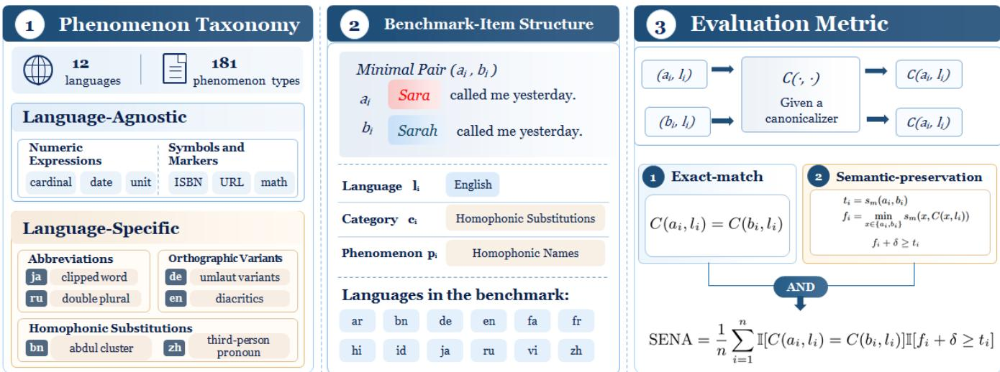

# ETC-BENCH: A MULTILINGUAL BENCHMARK FOR EVALUATION-SIDE TRANSCRIPT CANONICALIZATION

Zhiheng Qian1∗, Junhao Du1∗, Jing Peng1, Hanqi Li1, Kunyang Peng2, Feng Xue2, Kai Yu1†

1X-LANCE Lab, School of Computer Science, Shanghai Jiao Tong University, Shanghai, China 1MoE Key Lab of Artificial Intelligence, 1Jiangsu Key Lab of Language Computing 2AISpeech Ltd, Suzhou, China

## ABSTRACT

Written transcripts of the same speech can differ in ways that are not uniquely determined by the speech signal. We formulate evaluationside transcript canonicalization (ETC), which maps multiple surface forms to a single canonical form when their differences are not determined by speech. To our knowledge, ETC-Bench is the first and most comprehensive multilingual benchmark for evaluationside transcript canonicalization, covering 181 phenomenon types across 12 languages. Each instance is a minimal pair that shares a sentence context and differs only in a target span exhibiting one phenomenon. To evaluate both canonicalization success and semantic preservation, we propose Semantic-preserving Exact-match Normalization Accuracy (SENA), which combines exact agreement between independently canonicalized pair members with a pairrelative BERTScore constraint against information loss. We further introduce the Taxonomy-guided Agent Canonicalization Skill (TACS), which provides LLM agents with phenomenon descriptions and explicit canonicalization contracts. Experiments with five baseline configurations and three TACS-based agents show that the agents outperform the baseline systems on shared languages. ETC-Bench provides a systematic testbed for evaluation-side transcript canonicalization across languages.

Index Terms— evaluation-side transcript canonicalization, speech-to-text evaluation, multilingual benchmark, text normalization, speech processing

## 1. INTRODUCTION

Speech-to-text (STT) systems [1, 2] produce text from speech and are commonly evaluated by comparing hypotheses with references [3].However, speech does not always determine a unique written form. Transcript ambiguity arises when a spoken utterance does not encode the graphemic or symbolic information needed to choose among alternative written forms with the same spoken realization. For example, a number may be transcribed as “2” or “two”, and a common Chinese name pronounced “/sw@n £ liĎ£/” may have several commonly used character forms, such as “孙丽” and “孙立”. Furthermore, in some languages the same word may have multiple spellings [4]. Word error rate (WER) counts such differences as errors, conflating model performance with transcript conventions and potentially biasing cross-lingual comparisons [5].

Text normalization (TN) and inverse text normalization (ITN) are two major normalization paradigms in speech processing. They aim at the conversion between written and spoken forms [6–8].

TN maps written expressions to spoken forms, typically for textto-speech (TTS) [9], whereas ITN maps spoken-form text to conventional written text. NeMo provides weighted finite-state grammars [10] for TN and ITN classes such as numbers, dates, and measurements [11]. PolyNorm extends multilingual TN with an LLM-based pipeline and a written-to-spoken taxonomy [12]. Although TN and ITN were developed for different application needs, both can serve as canonicalization subroutines, depending on the chosen target representation. In either case, applying the same mapping independently to each transcript can remove the surface distinction. However, existing TN and ITN systems cover only a limited subset of the ambiguities considered here. Many languagespecific orthographic and homophonic variations fall outside the semiotic classes they normalize.

In practice, the evaluation of automatic speech recognition (ASR) already accommodates transcript variation in several ways to reduce the effect of this ambiguity to better measure model performance. Multi-reference evaluation accounts for acceptable spelling variation in Egyptian Arabic, but requires additional transcripts [13]. Sclite also accommodates transcript variation in its evaluation procedure [14]. Whisper provides post-ASR text normalizers to reduce penalties for transcript variation [15], but its well-established normalization tool is limited to English. Furthermore, its inappropriate behavior can damage semantic information, as shown for Indic scripts [16]. Despite these practices, multilingual evaluation-oriented normalization remains limited in scope. Recent speech-evaluation efforts, including SURE and Open-Bench, likewise emphasize reproducible pipelines and fair comparisons through standardized normalization and scoring [17, 18]. Motivated by this principle, we define evaluation-side transcript canonicalization (ETC) to map STT transcript variants to a consistent canonical form when their differences cannot be resolved from speech, supporting more trustworthy ASR evaluation and offering a framework relevant to speech-translation text outputs. Given a transcript x and its language l, a canonicalizer produces C(x, l), without access to another transcript of the same utterance. Let a ≡l b indicate that a and b are valid written representations of the same spoken utterance and differ only in distinctions that cannot be recovered from that utterance. An ETC system should then satisfy:

$$
a \equiv _ { l } b \Rightarrow C ( a , l ) = C ( b , l ) ,\tag{1}
$$

while preserving the semantics encoded in the speech. Unlike conventional TN and ITN, which are designed for specific TTS/ASR pre/post-processing, ETC aims to map transcript variants into a consistent canonical representation for fair WER comparison, where either TN or ITN-style transformations can be adopted. Extending this principle to speech and text translation requires task-specific definitions of admissible variation and semantic-preservation constraints, which we leave to future work.

  
Fig. 1. Overview of ETC-Bench: taxonomy, benchmark-item structure, and evaluation metric.

In this work, our contributions are threefold: (1) we define evaluation-side transcript canonicalization as a standalone task; (2) we construct ETC-Bench, comprising 1,098 native-speakerreviewed minimal pairs covering 181 phenomenon types across 12 languages, organized by an extensible taxonomy, and propose Semantic-preserving Exact-match Normalization Accuracy (SENA); and (3) we release the Taxonomy-guided Agent Canonicalization Skill (TACS) and assess conventional and agent-based canonicalization across languages and phenomenon categories. Agents using TACS achieve higher SENA than the evaluated conventional baselines on shared languages.

## 2. ETC-BENCH

We construct ETC-Bench, a multilingual benchmark for evaluating ETC. The benchmark comprises 1,098 minimal pairs covering 181 distinct canonicalization phenomena across 12 languages: Arabic (ar), Bengali (bn), German (de), English (en), Persian (fa), French (fr), Hindi (hi), Indonesian (id), Japanese (ja), Russian (ru), Vietnamese (vi), and Mandarin Chinese (zh).

## 2.1. Phenomenon Taxonomy

We develop a taxonomy of transcript ambiguities by analyzing the outputs of a multilingual ASR model [19]. The taxonomy organizes variation into five categories (Fig. 1). A category is a coarse-grained class defined by the source of transcript variation, which groups related variation, while a phenomenon specifies a pattern of transcript ambiguity through a natural-language description and serves as the unit for benchmark construction and analysis.

We group the five categories according to whether their phenomena are language-agnostic or language-specific. Numeric Expressions and Symbols and Markers contain language-agnostic phenomena: their definitions are shared across languages, although their applicability and realizations may differ. This inventory adapts and extends PolyNorm [12]. In contrast, Abbreviations, Orthographic Variants, and Homophonic Substitutions contain language-specific phenomena whose definitions depend on a language’s lexicon, orthography, or writing system. Homophonic Substitutions specifically covers identically pronounced expressions whose written distinctions cannot be resolved from speech; these forms need not have identical written meanings. The hierarchy supports extension to additional languages and phenomena.

Table 1. Representative ETC-Bench pairs. Blue highlights distinctions not recoverable from speech.
<table><tr><td>Category</td><td>Phenomenon</td><td>Example Pair</td></tr><tr><td>Numeric</td><td>Cardinal</td><td>The recipe calls for 2 eggs. The recipe calls for two eggs.</td></tr><tr><td>Homophonic</td><td>Homophonic Names</td><td>Sara called me yesterday. Sarah called me yesterday.</td></tr><tr><td>Abbreviation</td><td>Context-dependent</td><td>CT. 5  ...</td></tr><tr><td rowspan="2">Orthographic</td><td>Abbreviation</td><td> 5  ..</td></tr><tr><td>Umlaut Variants</td><td>Wir kaufen Öl.</td></tr><tr><td rowspan="2">Homophonic</td><td></td><td>Wir kaufen Oel.</td></tr><tr><td>Third-person Pronoun</td><td>他负责那部分任务。 她负责那部分任务。</td></tr></table>

## 2.2. Benchmark Construction

Each benchmark item i consists of a minimal pair of sentences ai and $b _ { i } ,$ annotated with a language $l _ { i } ,$ a category ci, and a phenomenon $p _ { i }$ . The full sentences $a _ { i }$ and $b _ { i }$ share a context and differ only in a target span instantiating the phenomenon. Languageagnostic pairs use shared templates localized with language-appropriate contexts and values; language-specific pairs instantiate phenomenon descriptions with suitable lexical items and contexts.

We use GPT-5.6-Sol to generate 20 candidate pairs per phenomenon for each applicable language and to filter malformed pairs, followed by manual cleaning. The candidate pool retains an average of 16.2 pairs per language-indexed phenomenon. We then sample 100 pairs per language, allocating at least one pair to every retained phenomenon to prioritize representative coverage. Twelve native speakers from Beijing Language and Culture University review both the validity of the phenomenon definitions and the correctness of the sampled pairs. Experts refine the inventories and clean the samples, yielding the final release of 1,098 pairs. The released counts reflect this final curation rather than the initial 100-pair sampling quota.

## 2.3. Evaluation Metric

We propose SENA as the evaluation metric of our benchmark. It measures the proportion of pairs satisfying both an exact-match condition and a semantic-preservation condition.

Let $C ( x , l )$ denote a canonicalization system that produces a canonical text using only input x and its language l. The two transcripts within a benchmark pair are processed independently. Let $s _ { m }$ denote BERTScore $F _ { 1 }$ under semantic encoder m [20,21]. Each benchmark pair is reviewed to isolate a distinction for which a STT model lacks distinguishing evidence in speech, not necessarily to assert identical written semantics (e.g., homophonic gender-marked pronouns). Its source-side similarity therefore supplies a sampleadaptive reference that allows the targeted written distinction to be removed:

$$
t _ { i } = s _ { m } ( a _ { i } , b _ { i } )\tag{2}
$$

$$
f _ { i } = \operatorname* { m i n } _ { x \in \{ a _ { i } , b _ { i } \} } s _ { m } ( x , C ( x , l _ { i } ) )\tag{3}
$$

Here, $t _ { i }$ is the similarity between the two original texts, and $f _ { i }$ is the lower of the two similarities between an input and its canonicalized output. Both conditions must hold:

$$
\mathrm { S E N A } = \frac { 1 } { n } \sum _ { i = 1 } ^ { n } \mathbb { I } [ C ( a _ { i } , l _ { i } ) = C ( b _ { i } , l _ { i } ) ] \mathbb { I } [ f _ { i } + \delta \geq t _ { i } ] ,\tag{4}
$$

where n is the number of evaluated pairs, I is an indicator function, and $\delta = 0 . 1$ is a tolerance on the BERTScore difference $t _ { i } \mathrm { ~ - ~ } f _ { i } .$ fixed before the experiments. All SENA results are reported as percentages. The exact-match condition requires identical canonicalized texts. The semantic-preservation condition requires $f _ { i } + \delta \geq t _ { i } ,$ using the source pair as a reference for limiting additional semantic loss.

## 3. TACS: TAXONOMY-GUIDED AGENT CANONICALIZATION SKILL

Rule-based normalizers work well for enumerable patterns such as numbers and dates, but ETC-Bench also covers context-dependent abbreviations, orthographic conventions, and homophonic substitutions. Covering these phenomena with handcrafted rules across languages would require extensive language-specific implementations. LLMs can draw on contextual and multilingual knowledge, but this ability alone does not ensure that independently processed variants receive the same output.

We therefore introduce TACS, a taxonomy-guided skill for LLM agents. An agent can load relevant guidance as needed to canonicalize each input independently. The taxonomy describes which distinctions to recognize. Canonicalization contracts define consistent output forms by language, category, and phenomenon. Because the contracts specify targets by phenomenon, TACS can express both TN-style written-to-spoken rewrites and ITN-style spoken-to-written rewrites, as well as canonicalizations beyond their conventional semiotic classes. The skill also instructs the agent to make local changes while preserving unrelated text. Table 2 illustrates canonical forms for the five phenomena in Table 1.

The skill guides the agent to use these resources in two steps. First, it identifies phenomenon instances using the descriptions and the current utterance, resolving overlapping or competing interpretations. Second, it generates local replacements according to the corresponding contracts. The instructions require non-overlapping replacements, exact preservation of text outside the selected spans, and retention of spans with unresolved ambiguity or no applicable contract. These steps organize the agent’s reasoning without prescribing separate model calls or intermediate outputs.

Table 2. TACS canonical forms for the phenomena illustrated in Table 1.
<table><tr><td>LID</td><td>Category</td><td>Phenomenon</td><td>Canonical Form</td></tr><tr><td>en</td><td>Numeric Expressions</td><td>Cardinal</td><td>Quantity in ASCII digits.</td></tr><tr><td>en</td><td>Homophonic Substitutions</td><td>Homophonic Names</td><td>Context-appropriate name in broad American English IPA.</td></tr><tr><td>ru</td><td>Abbreviations</td><td>Context-dependent Abbreviation</td><td>Context-appropriate full Russian form.</td></tr><tr><td>de</td><td>Orthographic Variants</td><td>Umlaut Variants</td><td>Use ä, ö, ü instead of ae, oe, ue.</td></tr><tr><td>zh</td><td>Homophonic Substitutions</td><td>Third-person Pronoun</td><td>Broad Mandarin IPA with tone.</td></tr></table>

Loading TACS starts with SKILL.md, which specifies batch I/O and global constraints. The agent is instructed to solve each record independently and write results to the designated output file, without comparing records or using them as evidence for one another. The skill contains no benchmark pairs or per-item targets.

## 4. EXPERIMENTS

## 4.1. Experimental Setup

We evaluate five baseline configurations on ETC-Bench: NeMo-ITN and NeMo-TN [11], FunASR-ITN and FunASR-TN [22], and Whisper’s normalization module [15], alongside three TACS-based systems. We include conventional TN and ITN baseline because ETC is direction-agnostic and both TN and ITN can be regard as an implementation of ETC. Some commercial STT services, such as Azure Speech, also include post-processing that can resolve some transcript ambiguities. We did not evaluate these services because their postprocessing is not available as a standalone text-to-text normalizer. Performance is measured using SENA as defined in Section 2.3, with BERTScore computed using the xlm-roberta-large encoder [23]. Whisper uses EnglishTextNormalizer for English and BasicTextNormalizer for the other 11 languages. We instantiate the TACS-based agent systems with GPT-5.6-Terra, DeepSeek-V4-Flash [24], and Qwen3.8-Flash [25], and refer to them as TACS-GPT, TACS-DeepSeek, and TACS-Qwen, respectively. GPT-5.6-Terra is accessed through a third-party API provider, whereas DeepSeek and Qwen use their official endpoints. For each TACS-based system, we conduct three runs on the benchmark and report their mean.

We use DeepSeek-Harness [26], with shell execution, file editing and search, skill loading, subagent delegation, and web access enabled. An initial prompt defines the task and instructs the agent to load the skill, after which execution proceeds automatically without human intervention. The two sides of each benchmark item are canonicalized in separate fresh agent sessions with independent workspaces to avoid pairwise context sharing.

## 4.2. Results

Table 3 reports language-wise performance. The rule-based systems score 3.7–9.4 on average over their supported languages. FunASR-TN’s 9.4 is averaged over four languages. TACS-GPT, TACS-DeepSeek, and TACS-Qwen achieve macro-average scores of 43.3, 43.8, and 68.8, respectively, across all 12 languages. Their language-wise scores exceed those of the evaluated conventional systems wherever both have results.

Table 3. Performance comparison across languages in terms of SENA (%). – indicates unsupported languages. Avg. denotes the macroaverage across supported languages.
<table><tr><td>System</td><td>ar</td><td>bn</td><td>de</td><td>en</td><td>fa</td><td>fr</td><td>hi</td><td>id</td><td>ja</td><td>ru</td><td>vi</td><td>zh</td><td> $\operatorname { A v g } .$ </td></tr><tr><td>NeMo-ITN</td><td>1.2</td><td>一</td><td>2.2</td><td>5.7</td><td>一</td><td>5.6</td><td>0.0</td><td>一</td><td>5.3</td><td>5.0</td><td>1.0</td><td>14.1</td><td>4.4</td></tr><tr><td>NeMo-TN</td><td>0.0</td><td>1</td><td>2.1</td><td>18.2</td><td>一</td><td>3.4</td><td>2.0</td><td>一</td><td>2.6</td><td>4.0</td><td>6.1</td><td>5.4</td><td>4.9</td></tr><tr><td>FunASR-ITN</td><td>一</td><td>一</td><td>2.2</td><td>5.7</td><td>一</td><td>5.6</td><td>一</td><td>3.1</td><td>5.3</td><td>5.0</td><td>1.0</td><td>2.2</td><td>3.7</td></tr><tr><td>FunASR-TN</td><td>1</td><td>一</td><td>2.1</td><td>19.3</td><td>一</td><td>一</td><td>=</td><td>一</td><td></td><td>4.0</td><td>一</td><td>12.0</td><td>9.4</td></tr><tr><td>Whisper Normalizer</td><td>0.0</td><td>0.0</td><td>0.0</td><td>40.9</td><td>5.0</td><td>5.6</td><td>0.0</td><td>8.2</td><td>3.9</td><td>4.0</td><td>7.1</td><td>0.0</td><td>6.2</td></tr><tr><td>No-Skill-GPT</td><td>0.0</td><td>24.0</td><td>0.0</td><td>0.0</td><td>0.0</td><td>0.0</td><td>18.0</td><td>0.0</td><td>0.0</td><td>0.0</td><td>0.0</td><td>0.0</td><td>3.5</td></tr><tr><td>No-Skill-DeepSeek</td><td>29.1</td><td>2.0</td><td>8.6</td><td>0.0</td><td>8.8</td><td>1.1</td><td>0.0</td><td>0.0</td><td>0.0</td><td>6.0</td><td>0.0</td><td>0.0</td><td>4.6</td></tr><tr><td>No-Skill-Qwen</td><td>15.1</td><td>20.8</td><td>12.9</td><td>17.4</td><td>9.2</td><td>10.1</td><td>13.3</td><td>24.1</td><td>10.5</td><td>14.7</td><td>6.5</td><td>11.6</td><td>13.9</td></tr><tr><td>TACS-GPT</td><td>51.9</td><td>26.5</td><td>42.7</td><td>44.7</td><td>62.1</td><td>39.7</td><td>40.0</td><td>44.2</td><td>38.6</td><td>40.3</td><td>46.6</td><td>41.7</td><td>43.3</td></tr><tr><td>TACS-DeepSeek</td><td>42.6</td><td>23.1</td><td>49.8</td><td>53.0</td><td>47.9</td><td>48.3</td><td>31.0</td><td>41.8</td><td>42.5</td><td>48.3</td><td>55.8</td><td>40.9</td><td>43.8</td></tr><tr><td>TACS-Qwen</td><td>69.0</td><td>67.7</td><td>61.3</td><td>65.5</td><td>72.9</td><td>73.0</td><td>61.3</td><td>75.2</td><td>64.5</td><td>75.3</td><td>78.2</td><td>62.0</td><td>68.8</td></tr></table>

Table 4. Performance comparison across benchmark categories in terms of SENA (%).
<table><tr><td>System</td><td>Num.</td><td> $\operatorname { S y m } .$ </td><td>Abbr.</td><td>Orth.</td><td>Homo.</td></tr><tr><td>NeMo-ITN</td><td>16.0</td><td>0.6</td><td>6.8</td><td>2.8</td><td>0.0</td></tr><tr><td>NeMo-TN</td><td>23.7</td><td>3.2</td><td>6.8</td><td>0.0</td><td>0.0</td></tr><tr><td>FunASR-ITN</td><td>13.3</td><td>1.4</td><td>5.1</td><td>1.7</td><td>0.0</td></tr><tr><td>FunASR-TN</td><td>32.9</td><td>5.7</td><td>8.2</td><td>0.0</td><td>0.0</td></tr><tr><td>Whisper Normalizer</td><td>6.7</td><td>1.0</td><td>3.8</td><td>8.1</td><td>7.0</td></tr><tr><td>No-Skill-GPT</td><td>0.3</td><td>0.5</td><td>0.0</td><td>7.7</td><td>1.9</td></tr><tr><td>No-Skill-DeepSeek</td><td>0.0</td><td>0.0</td><td>0.0</td><td>8.3</td><td>5.3</td></tr><tr><td>No-Skill-Qwen</td><td>3.0</td><td>7.3</td><td>25.6</td><td>19.1</td><td>13.0</td></tr><tr><td>TACS-GPT</td><td>44.1</td><td>29.1</td><td>53.4</td><td>55.7</td><td>20.0</td></tr><tr><td>TACS-DeepSeek</td><td>50.4</td><td>27.1</td><td>56.0</td><td>58.5</td><td>12.1</td></tr><tr><td>TACS-Qwen</td><td>74.4</td><td>44.3</td><td>85.9</td><td>82.3</td><td>49.0</td></tr></table>

Category-wise results in Table 4 reveal a narrow success profile for the four TN/ITN systems. Their successful cases are concentrated in numeric expressions and related forms. Successful orthographic cases also include number-related variants, such as French hyphenated numbers and Chinese financial numerals. The four systems score only 0.0–2.8 on orthographic variants and zero on homophonic substitutions. This pattern is consistent with their focus on written–spoken conversion within implemented grammar classes, rather than the broader transcript variation in ETC-Bench. Whisper shows a different profile. Its English-specific normalizer reaches 40.9 on English, with successful cases including spelling and hyphenation variants. The basic normalizer obtains modest scores in several other languages through surface transformations: hyphen removal in French and Vietnamese, width normalization in Japanese, lowercasing in Indonesian and Russian, and optional diacritic removal in Persian. However, producing identical outputs does not always yield SENA credit. In Bengali and Hindi, destructive removal of informative script marks also makes some pairs identical, but none of these pairs passes the semantic-preservation condition.

Across the TACS-based systems, abbreviations and orthographic variants score highest, while symbols and homophonic substitutions remain more difficult. TACS-Qwen leads all five categories, but its scores on symbols and homophonic substitutions still leave substantial room for improvement. The lower scores on Symbols and Markers and Homophonic Substitutions mainly reflect failures of exact agreement rather than rejection by the semantic-preservation condition. Across three TACS-Qwen runs, the semantic-preservation condition rejected none of the 262 symbol/marker pair evaluations with identical outputs, and only 8 of the 283 homophonic evaluations with identical outputs.

Table 5. TACS-DeepSeek unifies transcript variants left distinct by Whisper normalization in two real examples in ASR evaluation.
<table><tr><td>LID</td><td>Whisper (Hyp. / Ref.)</td><td>TACS-DeepSeek</td></tr><tr><td>de</td><td>und sehr gewiß daß und sehr gewiss dass</td><td>und sehr gewiss dass</td></tr><tr><td>en</td><td>thinking of you mabel and thinking of you mable and</td><td>thinking of you /&#x27;meıbəl/ and</td></tr></table>

To assess the contribution of TACS, we evaluate the same GPT, DeepSeek, and Qwen agent configurations without loading it. They score 3.5, 4.6, and 13.9, respectively, compared with 43.3 for TACS-GPT, 43.8 for TACS-DeepSeek, and 68.8 for TACS-Qwen. three agents. The observed rule-based failures illustrate the roles of the two metric conditions. Target variants that remain different fail the exact-match condition. Destructive cleanup can instead produce identical outputs while failing the semantic-preservation condition, as observed in Bengali and Hindi. In contrast, transformations such as cent-trois/cent trois and Agung/agung unify the target variants without substantial additional changes and receive credit. Thus, a simple transformation can be effective, but identical outputs alone do not establish successful canonicalization. At the pre-fixed $\delta = 0 . 1 0$ , the semantic-preservation condition rejects all 81 observed Whisper merges that remove informative script marks in Bengali and Hindi. At δ = 0.15, 30.9% of these merges receive credit. In one agent run, 99.8% of merged pairs pass the condition throughout $\delta \in [ 0 . 0 8 , 0 . 1 2 ]$ . Table 5 illustrates how TACS resolves transcript variants left distinct by Whisper normalization on real ASR transcripts [19] in evaluation.

## 5. CONCLUSION

We define evaluation-side transcript canonicalization as an independent task based on an existing evaluation practice. We introduce ETC-Bench, comprising 1,098 minimal pairs covering 181 phenomenon types across 12 languages, together with an extensible taxonomy and construction framework. Experiments reveal limited coverage in conventional normalizers. TACS shows how the taxonomy and canonicalization contracts can guide LLM agents toward broader coverage, although homophonic substitutions remain challenging. We release the benchmark and skill and invite community contributions to extend language coverage, phenomenon inventories, and sample diversity.

## 6. COMPLIANCE WITH ETHICAL STANDARDS

This is a computational study which releases a new dataset. Nativespeaker reviewers provided linguistic quality control but were not subjects of the research. No human or animal subjects were studied, and ethical approval was not required.

## 7. REFERENCES

[1] Jing Peng et al., “A survey on speech large language models for understanding,” IEEE Journal ofSelected Topics in Signal Processing, 2025.

[2] Yangui Fang et al., “Low-resource domain adaptation for speech llms via text-only fine-tuning,” in 2025 IEEE Automatic Speech Recognition and Understanding Workshop (ASRU). IEEE, 2025, pp. 1–7.

[3] Suyoun Kim et al., “Semantic distance: A new metric for ASR performance analysis towards spoken language understanding,” in Proceedings of Interspeech, 2021, pp. 1977– 1981.

[4] Iuliia Nigmatulina, Tannon Kew, and Tanja Samardzic, “ASR for non-standardised languages with dialectal variation: the case of Swiss German,” in Proceedings ofthe 7th Workshop on NLP for Similar Languages, Varieties and Dialects. 2020, pp. 15–24, International Committee on Computational Linguistics.

[5] Vaibhav Srivastav et al., “Open ASR leaderboard: Towards reproducible and transparent multilingual and long-form speech recognition evaluation,” arXiv preprint arXiv:2510.06961, 2025.

[6] Richard Sproat, Alan W. Black, Stanley Chen, Shankar Kumar, Mari Ostendorf, and Christina D. Richards, “Normalization of non-standard words,” Computer Speech & Language, vol. 15, no. 3, pp. 287–333, 2001.

[7] Emma Flint, Elliot Ford, Olivia Thomas, Andrew Caines, and Paula Buttery, “A text normalisation system for non-standard English words,” in Proceedings of the 3rd Workshop on Noisy User-generated Text. 2017, pp. 107–115, Association for Computational Linguistics.

[8] Athiya Deviyani and Alan W. Black, “Text normalization for speech systems for all languages,” in Proceedings of the 1st Workshop on Speech for Social Good (S4SG), 2022, pp. 20– 25.

[9] Richard Sproat and Navdeep Jaitly, “An RNN model of text normalization,” in Proceedings ofInterspeech, 2017, pp. 754– 758.

[10] Kyle Gorman, “Pynini: A Python library for weighted finitestate grammar compilation,” in Proceedings of the SIGFSM Workshop on Statistical NLP and Weighted Automata. 2016, pp. 75–80, Association for Computational Linguistics.

[11] Yang Zhang, Evelina Bakhturina, Kyle Gorman, and Boris Ginsburg, “NeMo inverse text normalization: From development to production,” in Proceedings of Interspeech, 2021, pp. 4468–4472.

[12] Michel Wong, Ali Alshehri, Sophia Kao, and Haotian He, “PolyNorm: Few-shot LLM-based text normalization for textto-speech,” in Proceedings of the 2025 Conference on Empirical Methods in Natural Language Processing: Industry Track, 2025, pp. 77–85.

[13] Ahmed Ali, Walid Magdy, and Steve Renals, “Multi-reference evaluation for dialectal speech recognition system: A study for egyptian ASR,” in Proceedings of the Second Workshop on Arabic Natural Language Processing, 2015, pp. 118–126.

[14] Jonathan G. Fiscus, Jerome Ajot, Nicolas Radde, and Christophe Laprun, “Multiple dimension levenshtein edit distance calculations for evaluating automatic speech recognition systems during simultaneous speech,” in Proceedings of the Fifth International Conference on Language Resources and Evaluation (LREC), Genoa, Italy, 2006, European Language Resources Association.

[15] Alec Radford, Jong Wook Kim, Tao Xu, Greg Brockman, Christine Mcleavey, and Ilya Sutskever, “Robust speech recognition via large-scale weak supervision,” in Proceedings of the 40th International Conference on Machine Learning, Andreas Krause, Emma Brunskill, Kyunghyun Cho, Barbara Engelhardt, Sivan Sabato, and Jonathan Scarlett, Eds. 23–29 Jul 2023, vol. 202 of Proceedings ofMachine Learning Research, pp. 28492–28518, PMLR.

[16] Kavya Manohar and Leena G Pillai, “What is lost in normalization? exploring pitfalls in multilingual ASR model evaluations,” in Proceedings of the 2024 Conference on Empirical Methods in Natural Language Processing, 2024, pp. 10864– 10869.

[17] Jing Peng et al., “A unified and reproducible experimentation framework for speech understanding,” arXiv preprint arXiv:2605.30899, 2026.

[18] Open-Bench, “Open-Bench: Open Bench, Open Innovation,” https://www.open-bench.net/, n.d.

[19] Junjie Li, Jing Peng, Yangui Fang, Shuai Wang, and Kai Yu, “MOSA: Mixtures of simple adapters outperform monolithic approaches in LLM-based multilingual ASR,” in ICASSP 2026-2026 IEEE International Conference on Acoustics, Speech and Signal Processing (ICASSP). IEEE, 2026, pp. 18822–18826.

[20] Tianyi Zhang, Varsha Kishore, Felix Wu, Kilian Q. Weinberger, and Yoav Artzi, “BERTScore: Evaluating text generation with BERT,” in Proceedings of the International Conference on Learning Representations, 2020.

[21] Jimmy Tobin, Qisheng Li, Subhashini Venugopalan, Katie Seaver, Richard Cave, and Katrin Tomanek, “Assessing ASR model quality on disordered speech using BERTScore,” in Proceedings of the 1st Workshop on Speech for Social Good (S4SG), 2022, pp. 26–30.

[22] Zhifu Gao et al., “FunASR: A fundamental end-to-end speech recognition toolkit,” in Proceedings of Interspeech, 2023, pp. 1593–1597.

[23] Alexis Conneau et al., “Unsupervised cross-lingual representation learning at scale,” in Proceedings ofthe 58th Annual Meeting of the Association for Computational Linguistics, 2020, pp. 8440–8451.

[24] DeepSeek-AI, “DeepSeek-V4: Towards highly efficient million-token context intelligence,” arXiv preprint arXiv:2606.19348, 2026.

[25] Qwen Team, “Qwen3.8-max: A new bar for coding and cowork,” August 2026.

[26] DeepSeek-AI, “DeepSeek Harness: Everything is a plugin,” https://github.com/deepseek-ai/ deepseek-harness.