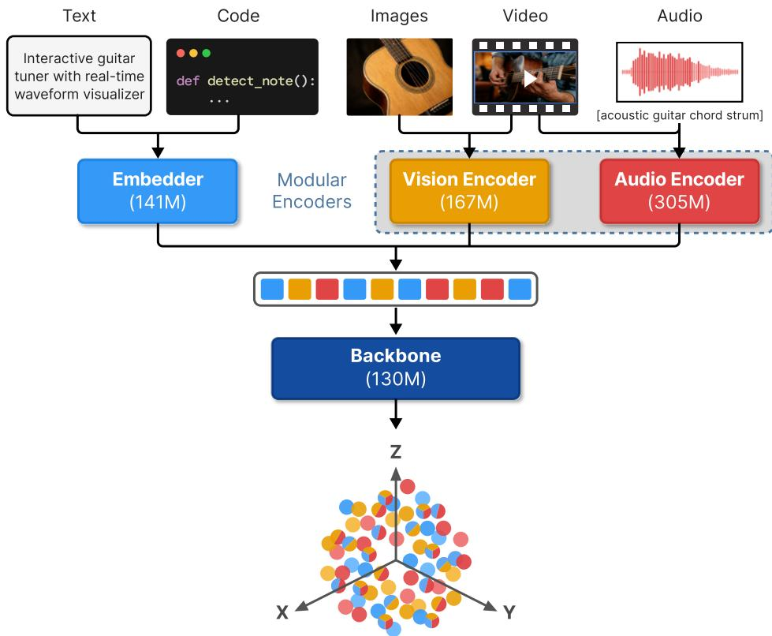
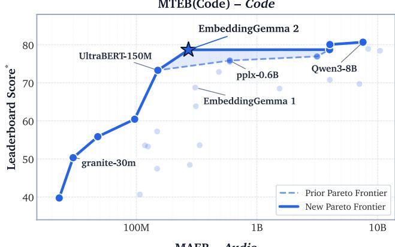
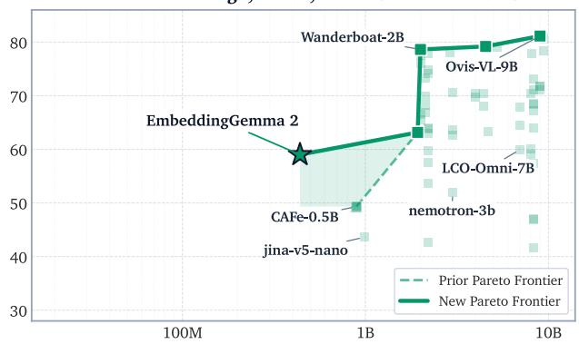
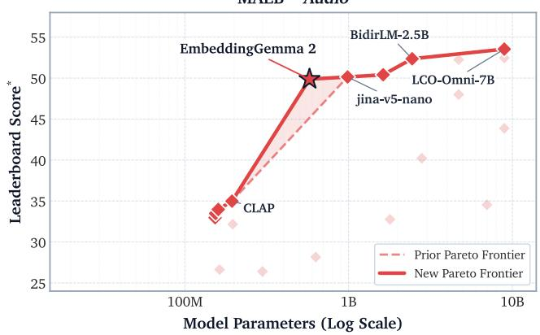
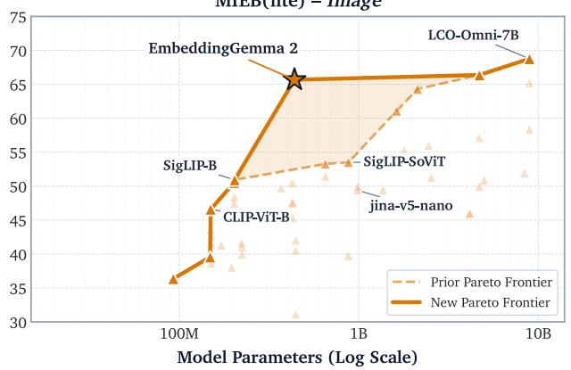
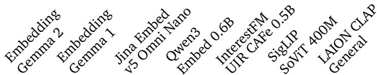

# EmbeddingGemma 2: Unified and Eficient Multimodal Representations

Henrique Schechter Vera\*, Sahil Dua\*, Jovan Andonov, Sara Smoot, Sebastian Russo, Ivan Llanos, Max Matveev, Jae Hyeon Yoo, Kat Black, Shih-Cheng Huang, Josiah Aklilu, Maarten Grootendorst, Omar Sanseviero, Chandramouli Amarnath, Ian Ballantyne, Zhe Li, Daniel Salz, Ibrahim Alabdulmohsin, Ilya Philippov, Kristen Quan, Glenn Cameron, Edouard Yvinec, Luciano Martins, Doug Reid, Sindhu Raghuram Panyam, Weiyi Wang, Hengxuan Ying, Madhuri Shanbhogue, Tanmaya Dabral, Shanfeng Zhang, Juyeong Ji, Renjie Wu, Joe Zou, Xu Chen, Yunan Zhang, Yu-Hui Chen, Matthew Soulanille, Vinod Mamillapalli, Yi-Chun Kuo, Wai Hon Law, Matt Kreileder, Alice Zheng, Suril Shah, Mogan Shieh, Pooja Consul, Alberto Montes, Andreas Hess, Andres Sevilla, Babak Samari, Brendan McCloskey, Brian Potetz, Daniel Cer, Georgios Kathareios, Gustavo Hernández Ábrego, Hesen Zhang, Ji Ma, Jiaxing Wu, Keegan Mosley, Paul Suganthan, Rui Meng, Shen Gao, Shengcao Cao, Yi-Ting Chen, Yichang Chen, Zhongli Ding, Kendra Byrne, Cormac Brick, Olivier Lacombe, Qin Yin, Tris Warkentin, Armand Joulin, Tom Duerig and Mojtaba Seyedhosseini EmbeddingGemma Team, Google1

We present EmbeddingGemma 2, an open multimodal embedding model which natively represents text, images, audio, video, and combinations thereof in a unified space. Our approach introduces improvements such as simplified per-layer embeddings and a multi-stage curriculum with modality and objective progression which ensure strong quality across unimodal, cross-modal, and mixed-modal evaluations. Notably, in comprehensive embedding benchmarks across all modalities, EmbeddingGemma 2 establishes a new Pareto frontier, outperforming both specialist models and models two to twelve times larger. Furthermore, our design ofers flexibility for resource-constrained environments, supporting selective modality encoder loading, adjustable vision token budgets, truncatable embedding dimensions, and quantized weights. We present ablations analyzing key decisions and release EmbeddingGemma 2 to promote further research.

## 1. Introduction

Embedding models map data to fixed-length vector representations, placing semantically similar data near each other in the embedding space. Text embedding models have become a popular choice for tasks like information retrieval, semantic similarity, clustering, and retrieval-augmented generation. However, to work with audio and visual data, these require additional tools like automatic speech recognition (ASR) and image captioners which both add computational cost and fail to capture signals like fine-grained visual details and non-verbal or environmental sounds.

Multimodal embedding models like CLIP [1], ALIGN [2], and SigLIP [3] add a modality tower for vision, and so achieve strong cross-modal quality, but they are unable to natively process mixed-modal input to capture interactions between input modalities. Recent eforts have adapted Multimodal Large Language Models (MLLMs) into embedding models that allow interleaved mixed-modal input and support more complex tasks such as visual question answering and visual grounding [4, 5, 6, 7]; subsequent work has built on more capable MLLMs to incorporate video and audio modalities [8, 9, 10, 11, 12]. However, as MLLMs have grown in size, so have embedding models adapted from them. These models typically contain several billion parameters, making them prohibitively expensive for applications that are latency-sensitive, high-throughput, or require on-device deployment for privacy or ofline access.

  
Figure 1 | EmbeddingGemma 2 natively maps text, images, video, audio, and combinations thereof into a unified, semantically-aligned vector space.

In this paper, we introduce EmbeddingGemma $2 , ^ { 2 }$ a 744M-parameter general-purpose multimodal embedding model that maps text, images, video, and audio—as well as arbitrary interleaved combinations thereof—into a single unified embedding space (Figure 1). EmbeddingGemma 2 combines a 271M-parameter bidirectional transformer backbone (embedder included) with a 167M-parameter vision encoder and a 305M-parameter audio encoder. The modality encoders independently convert media into sequences of soft token embeddings that enter the shared transformer backbone, which means these parameters are modular: EmbeddingGemma 2 can alternatively be run with 271M parameters as a text-only model, with 439M as a vision-language model, or with 577M as an audio-language model.

The model builds on the architecture and weights from the capable Gemma 4 model family [13] and learns from the powerful Gemini Embedding 2 model [8]. Our training regime consists of three stages spanning various tasks, modalities, and domains, which results in a broadly capable model, excelling at problems like code search, visual question answering, video moment retrieval, audio classification, and much more. We separate text-only and multimodal training as a form of curriculum learning, and separate distillation from contrastive and regularization objectives in order to efectively learn an embedding space tailored to the model. For extreme resource-constrained settings, the model ofers high-quality truncated embeddings and separate checkpoints adapted with quantization-aware training.

We present ablation studies explaining our architectural and training choices. We find that simplifying per-layer embeddings to omit the dedicated lookup table not only reduces cost but improves performance; we present the efects of using diferent vision token budgets during training

MMEB-v2 – Image, Video, and Visual Documents

  
Figure 2 | EmbeddingGemma 2 establishes a new Pareto frontier across benchmarks covering code, image, video, visual documents, and audio. Methods and detailed results in Section 4. ∗Mean(Task) for MTEB(Code), MAEB, and MMEB-v2; Mean(Type) for MIEB(lite).

and inference, observing it only significantly afects tasks like document retrieval which require fine-grained visual understanding; we demonstrate the importance of co-training the vision encoder; we show the impact of finetuning with contrastive learning rather than distillation; and we confirm the value of native audio understanding over ASR.

Finally, we evaluate the model on seven major, comprehensive benchmark suites spanning text, code, image, video, document, speech, and sound inputs. EmbeddingGemma 2 establishes a new Pareto frontier across benchmarks spanning all modalities (Figure 2). Despite using fewer parameters for text than its predecessor and handling more modalities, it improves on both multilingual text and code benchmarks. On multimodal evals, EmbeddingGemma 2 often matches or exceeds the quality of specialized and multi-billion-parameter models.

## 2. EmbeddingGemma 2

## 2.1. Architecture

Backbone The backbone follows a transformer architecture [14] with bidirectional attention. Given a tokenized input sequence T of length �, we map discrete text tokens via an embedder E into input token embeddings $\mathbf { T } _ { \mathrm { i n } } = \mathcal { E } ( \mathbf { T } ) \in \mathbb { R } ^ { L \times d _ { M } }$ , where $d _ { M }$ is the model dimension used for the transformer’s inner representations (note multimodal inputs are incorporated into ${ \bf T } _ { \mathrm { i n } }$ as well, described in detail in Section 2.2). We then apply $M _ { n } ,$ an �-layer transformer with bidirectional attention, to produce a sequence of output token embeddings $\mathbf { T } _ { \mathrm { o u t } } = \mathcal { M } _ { n } ( \mathbf { T } _ { \mathrm { i n } } ) \in \mathbb { R } ^ { L \times d _ { M } }$ . Next, we employ mean pooling $\mathcal { P }$ to average the output token embeddings along the sequence axis to generate a single embedding representing all the information in the input, producing $\mathbf { P } _ { \mathrm { e m b e d } } = \mathcal { P } ( \mathbf { T } _ { \mathrm { o u t } } ) \in \mathbb { R } ^ { d _ { M } }$ . Finally, we apply a randomly initialized linear projection $f$ to scale the embedding to the target dimension $d ,$ followed by $\ell _ { 2 }$ -normalization to produce the final unit-norm embedding, $\begin{array} { r } { \mathbf { E } = \frac { f ( \widetilde { \mathbf { P } } _ { \mathrm { e m b e d } } ) } { \| f ( \mathbf { P } _ { \mathrm { e m b e d } } ) \| _ { 2 } } \in \mathbb { R } ^ { d } } \end{array}$ . In EmbeddingGemma 2, we use $n = 2 4 , d _ { M } = 5 1 2 , d = 7 6 8$

Notably, the transformer $M _ { n }$ harnesses per-layer embeddings (PLE), as introduced in Gemma 3n [15]. These act as residual inputs which give each layer a path to receive tailored information directly from the input token embeddings. However, instead of additionally utilizing a large, separate token lookup table specifically for PLE, EmbeddingGemma 2 simply adapts the input embeddings ${ \bf T } _ { \mathrm { i n } }$ produced by the main embedding table and modality encoders (comparison in Section 3.1). For each layer $l \in [ n ]$ , we project the input token embeddings into a layer-specific representation P� = RMSNorm $( p _ { l } ( \mathbf { T } _ { \mathrm { i n } } ) ) \in \mathbb { R } ^ { L \times d _ { P } }$ via linear projection $p _ { l }$ . We use the layer’s output $\mathbf { H } _ { I } ^ { \prime } \in \mathbb { R } ^ { L \times d _ { M } }$ to compute gate $\mathbf { G } _ { l } = \sigma ( g _ { l } ( \mathbf { H } _ { \eta } ^ { \prime } ) ) \in \mathbb { R } ^ { L \times d _ { P } }$ , where $g _ { l }$ is a linear projection and $\sigma$ is a GELU activation [16]. We then modulate the per-layer input and project it back to the model dimension via linear projection ��, producing update $\mathbf { U } _ { l } = \mathrm { R M S N o r m } ( u _ { l } ( \mathbf { G } _ { l } \odot \mathbf { P } _ { l } ) ) \in \mathbb { R } ^ { L \times d _ { M } }$ , to finally yield $\mathbf { H } _ { l } = \mathbf { H } _ { l } ^ { \prime } + \mathbf { U } _ { l }$ to be processed by the next layer. In EmbeddingGemma 2, we use $d _ { P } = d _ { M } = 5 1 2$

Modality Encoders As in Gemma 4, the vision encoder is a vision transformer [ViT, 17] with a patch size of 16 and the audio encoder consists of two downsampling convolution layers followed by twelve conformer layers [18], based on the Universal Speech Model (USM) architecture [19]. The vision and audio encoders produce soft tokens with dimensionalities $d _ { V } = 7 6 8$ and $d _ { A } = 1 5 3 6$ respectively. Using learned linear projections $\phi _ { \mathrm { v i s } }$ and $\phi _ { \mathrm { a u d } }$ , we map these to the model dimension $d _ { M }$ These soft tokens are interleaved with the token embeddings at their corresponding positions to form a combined input token embedding sequence $\mathbf { T } _ { \mathrm { i n } } \in \mathbb { R } ^ { L \times d _ { M } }$ , which is processed as described above. See Section 2.2 below for more details on how multimodal inputs are handled.

## 2.2. Input

In general, an input � consists of an ordered sequence of $M \geq 1$ modality segments $x = ( s _ { 1 } , s _ { 2 } , \ldots , s _ { M } )$ where each segment $s _ { m }$ belongs to one of four modalities:

1. Text is tokenized into $N _ { \mathrm { t x t } }$ tokens which are mapped via the embedding table to a sequence of token embeddings: $\mathbf { T } _ { \mathrm { t x t } } = \mathcal { E } ( s _ { m } ) \in \mathbb { R } ^ { N _ { \mathrm { t x t } } \times d _ { M } }$

2. Images are each processed by the vision encoder V and spatially pooled to below a fixed budget of $N _ { \mathrm { v i s } }$ soft tokens, $\mathbf { T } _ { \mathrm { v i s } } ^ { \prime } = \mathcal { V } ( s _ { m } ) \in \mathbb { R } ^ { N _ { \mathrm { v i s } } \times d _ { V } }$ $N _ { \mathrm { { v i s } } }$ defaults to 280 for images and 140 for video during training, but is configurable to 70, 140, 280, 560, or 1120 at inference time—see how this impacts quality in Section 3.4. These soft tokens are then projected by the vision adapter and wrapped with delimiter tokens: $\mathbf { T } _ { \mathrm { v i s } } = < | \mathrm { S O I } | > \oplus \phi _ { \mathrm { v i s } } ( \mathbf { T } _ { \mathrm { v i s } } ^ { \prime } ) \oplus < | \mathrm { E O I } | > \in \mathbb { R } ^ { ( N _ { \mathrm { v i s } } + 2 ) \times d _ { M } }$

3. Audio is processed in 40ms chunks with Mel filterbank inputs, producing 25 soft tokens per second of audio: $\mathbf { T } _ { \mathrm { a u d } } ^ { \prime } = \mathcal { A } ( s _ { m } ) \in \mathbb { R } ^ { N _ { \mathrm { a u d } } \times d _ { A } }$ . These are projected by the audio adapter and wrapped with diferent delimiter tokens to produce: $\mathbf { T } _ { \mathrm { a u d } } = < | \mathbf { S } \mathbf { \boldsymbol { \Omega } } \mathbf { A } | > \oplus \phi _ { \mathrm { a u d } } ( \mathbf { T } _ { \mathrm { a u d } } ^ { \prime } ) \oplus < | \mathbf { E } \mathbf { \boldsymbol { \Omega } } \mathbf { A } | > \in \mathbb { R } ^ { ( N _ { \mathrm { a u d } } + 2 ) \times d _ { M } }$

4. Video clips are typically sampled at 1 frame per second to begin. Then, for longer videos, frames are further sampled to fit a per-video frame budget $N _ { \mathrm { f r m } }$ —this is sometimes via truncation, by selecting the first $N _ { \mathrm { f r m } }$ frames, and sometimes via uniform sampling, by selecting $N _ { \mathrm { f r m } }$ evenly spaced frames over the entire video. During our training and evaluations we use $N _ { \mathrm { f r m } } = 3 2$ . Since each frame is processed by the vision encoder as an image, this results in up to $N _ { \mathrm { f r m } }$ segments, each with at most $N _ { \mathrm { v i s } }$ soft tokens and two image delimiter tokens.

Optionally, frames can be interleaved with audio tokens from the video’s soundtrack, with each frame coming first and then the audio that follows it divided into 1-second segments. Usually, this corresponds to a single 1-second audio segment per frame, but if frames are truncated we might have multiple trailing audio segments, and if frames are uniformly sampled, we might have multiple audio segments between frames. In interleaved video-audio, we include text timestamps in MM:SS format both before each frame and before each audio segment, to indicate when the frame is taken and when the audio chunk begins. Thus, video is represented as a combination of the former modalities, yielding an embedding sequence ${ \bf T } _ { \mathrm { v i d } }$ composed of interleaved sequences of $\mathbf { T } _ { \mathrm { t x t } } , \mathbf { T } _ { \mathrm { v i s } }$ , and $\mathbf { T } _ { \mathrm { a u d } }$

Then, denoting as ${ \bf T } _ { m } \in \{ { \bf T } _ { \mathrm { t x t } } , { \bf T } _ { \mathrm { v i s } } , { \bf T } _ { \mathrm { a u d } } , { \bf T } _ { \mathrm { v i d } } \}$ the embedding sequence of segment $s _ { m } ,$ the final concatenated sequence is $\mathcal { T } ( x ) = < | \mathrm { B } \mathbb { O } \mathbb { S } | > \oplus \mathbf { T } _ { 1 } \oplus \mathbf { T } _ { 2 } \oplus \cdots \oplus \mathbf { T } _ { M } \oplus < | \mathrm { E } \mathbb { O } \mathbb { S } | > \in \mathbb { R } ^ { L \times d _ { M } }$ , with a total sequence length � of up to 8192 during training. This is consumed by the model as ${ \bf T } _ { \mathrm { i n } }$ in Section 2.1.

Each training example includes multiple inputs: a query $q _ { i } ,$ a positive target (or passage) $p _ { i } ^ { + }$ , and (optionally) hard negative targets $\left\{ p _ { i } ^ { - } \right\}$ . An example may also include prescribed task prefixes $t _ { q }$ and $t _ { p }$ for queries and targets respectively, describing the nature of the task (see Appendix A). For instance, for retrieval we use “task: search result | query: {text}” and “title: {title | ‘none’} | text: {text}”. The query and targets are embedded as vectors in $\mathbb { R } ^ { d }$ :

$$
\mathbf { q } _ { i } = f ( \mathcal { P } ( \mathcal { M } _ { n } ( \mathcal { T } ( t _ { q } \oplus q _ { i } ) ) ) ) , \quad \mathbf { p } _ { i } ^ { \pm } = f ( \mathcal { P } ( \mathcal { M } _ { n } ( \mathcal { T } ( t _ { p } \oplus p _ { i } ^ { \pm } ) ) ) ) .\tag{1}
$$

## 2.3. Objective

EmbeddingGemma 2 was trained using multiple losses. Here we introduce the loss functions themselves, and in Section 2.4 we explain how they are introduced during training.

Contrastive loss The first is a noise-contrastive estimation (NCE) loss with in-batch, hard, and same-tower negatives. Given a batch of size �, we define the contrastive loss as:

$$
\begin{array} { l } { \displaystyle \mathcal { L } _ { c } = - \frac { 1 } { B } \sum _ { i = 1 } ^ { B } \log \frac { Z _ { i } ^ { \top } } { Z _ { i } ^ { B } } + Z _ { i } ^ { \top \mathbb { N } } + Z _ { i } ^ { \top \mathbb { N } } + Z _ { i } ^ { \top \mathbb { N } } } \\ { \displaystyle Z _ { i } ^ { \top } = e ^ { \sum _ { i = 1 } ^ { \infty } ( \mathbf { q } _ { 1 } , \mathbf { p } _ { i } ^ { \top } ) / \tau } } \\ { \displaystyle Z _ { i } ^ { \mathrm { H N } } = \sum _ { p _ { i } ^ { \top } } e ^ { \sum _ { i = 1 } ^ { \infty } ( \mathbf { q } _ { 1 } , \mathbf { p } _ { i } ^ { \top } ) / \tau } } \\ { \displaystyle Z _ { i } ^ { \mathrm { H B } } = \sum _ { j = 1 } ^ { B } \mathbf { 1 } _ { \mathrm { T R } } ( i , j ) e ^ { \sum _ { i = 1 } ^ { \infty } ( \mathbf { q } _ { 1 } , \mathbf { p } _ { j } ^ { \top } ) / \tau } } \\ { \displaystyle Z _ { i } ^ { \mathrm { S I } } = \sum _ { j = 1 } ^ { B } \mathbf { 1 } _ { \mathrm { T R } } ( i , j ) \left( e ^ { \sum _ { i = 1 } ^ { \infty } ( \mathbf { q } _ { 1 } , \mathbf { q } _ { 1 } ) / \tau } + e ^ { \sum _ { i = 1 } ^ { \infty } ( \mathbf { p } _ { 1 } ^ { \top } , \mathbf { p } _ { j } ^ { \top } ) / \tau } \right) } \end{array}\tag{2}
$$

where sim $( \mathbf { x } , \mathbf { y } ) \ = \ \mathbf { x } ^ { \top } \mathbf { y } / \lVert \mathbf { x } \rVert \lVert \mathbf { y } \rVert$ is cosine similarity. Above, $Z _ { i } ^ { \mathrm { P } }$ corresponds to the positive, $Z _ { i } ^ { \mathrm { H N } }$ corresponds to the hard negatives, $Z _ { i } ^ { \mathrm { I B } }$ corresponds to in-batch negatives, and $Z _ { i } ^ { \mathrm { S T N } }$ corresponds to same-tower negatives [20]. �TN masks out false negatives from duplicates:

$$
\mathbb { 1 } _ { \mathrm { T N } } ( i , j ) = \left\{ \begin{array} { l l } { 0 } & { \mathrm { i f } \ \mathbf { q } _ { i } = \mathbf { q } _ { j } \ \mathrm { o r } \ \mathbf { p } _ { i } ^ { + } = \mathbf { p } _ { j } ^ { + } , } \\ { 1 } & { \mathrm { o t h e r w i s e } , } \end{array} \right.\tag{3}
$$

We forego the hardness weighting mechanism from our previous model as it amplifies noisy or weakly associated positive pairs, especially during early training, and compounds gradient scale imbalances between tasks of diferent modalities. We add same-tower negatives to prevent queries and targets from clustering into disjoint subspaces.

For listwise ranking data with � ordered positives $( \mathbf { p } _ { i , 1 } ^ { + } \succ \cdots \succ \mathbf { p } _ { i , P } ^ { + } )$ per query, we train both on extracted triplets using $\mathcal { L } _ { C }$ and on the full ranked lists using a listwise loss that extends $\mathcal { L } _ { C }$ based on the Plackett–Luce model, as in Xia et al. [21]:

$$
\begin{array} { l } { { \mathcal { L } _ { C } ^ { \mathrm { l i s t } } = - \displaystyle \frac { 1 } { B P } \sum _ { i = 1 } ^ { B } \sum _ { r = 1 } ^ { P } \log \frac { Z _ { i , r } ^ { \mathrm { p } } } { \sum _ { k = r } ^ { P } Z _ { i , k } ^ { \mathrm { p } } + Z _ { i } ^ { \mathrm { H N } } + Z _ { i } ^ { \mathrm { I B } } } } } \\ { { Z _ { i , r } ^ { \mathrm { p } } = e ^ { \mathrm { s i m } ( \mathbf { q } _ { i } , \mathbf { p } _ { i , r } ^ { + } ) / \tau } , \qquad Z _ { i } ^ { \mathrm { I B } } = \displaystyle \sum _ { j = 1 } ^ { B } \mathbb { 1 } _ { \mathrm { T N } } ( i , j ) \biggl ( \displaystyle \sum _ { k = 1 } ^ { P } e ^ { \mathrm { s i m } ( \mathbf { q } _ { i } , \mathbf { p } _ { j , k } ^ { + } ) / \tau } + \sum _ { \mathbf { p } _ { j } ^ { - } } e ^ { \mathrm { s i m } ( \mathbf { q } _ { i } , \mathbf { p } _ { j } ^ { - } ) / \tau } \biggr ) } } \end{array}\tag{4}
$$

Here, we contrast each rank-� positive against all lower-ranked positives $\left( k > r \right)$ in addition to hard and in-batch negatives, with $\mathbb { 1 } _ { \mathrm { T N } } ( i , j )$ adapted to mask out in-batch negatives that duplicate $\mathfrak { p } _ { i , r } ^ { + }$ . We also add small squared-hinge penalties on positive and hard-negative similarities to calibrate the absolute score distribution for threshold-based tasks.

Spread-out regularizer The second loss is based on the global orthogonal regularizer (GOR) introduced in Zhang et al. [22]. The idea is to make the embeddings of a random pair of inputs have similar statistical properties (mean and second moment) as two points independently and uniformly sampled from the unit sphere. Following EmbeddingGemma 1 [23], we use only the “second moment” term of the regularizer’s original definition, as we find this also suficiently pushes the “mean” term towards its target value:

$$
\mathcal { L } _ { S } = \frac { 1 } { B \left( B - 1 \right) } \sum _ { \substack { 1 \le i \neq j \le B } } ( { \bf q } _ { i } ^ { \top } { \bf q } _ { j } ) ^ { 2 } + \frac { 1 } { B \left( B - 1 \right) } \sum _ { \substack { 1 \le i \neq j \le B } } ( { \bf p } _ { i } ^ { + \top } { \bf p } _ { j } ^ { + } ) ^ { 2 } .\tag{5}
$$

This loss encourages the model to produce embeddings that are spread out over the embedding space, to fully utilize its expressive power. Embedding spaces have been observed to form narrow cones [24, 25, 26, 27], but there are theoretical and empirical benefits to isotropy [28, 29], including performance in downstream tasks. Note that pushing random pairs toward orthogonality complements the squared-hinge penalties above to make scores more calibrated and interpretable. Enforcing isotropy also aims to ensure that a) the model is robust to weight and embedding quantization, and b) the embeddings can be retrieved eficiently in vector databases using approximate nearest neighbor (ANN) algorithms.

Distillation loss The final is an embedding matching loss based on Kim et al. [30]. In contrast to previous distillation research which has relied only on the teacher’s query-document relevance scores as a signal [31, 32], this loss directly aligns EmbeddingGemma 2’s embedding space with that of a teacher model, allowing it to more efectively learn from the larger, more powerful Gemini Embedding 2 model. Unlike Kim et al. [30], which applies a projection layer to distill from a model with diferent dimensionality, we instead make use of Gemini Embedding 2’s support for lower dimensions and simply truncate the teacher embeddings. As in Schechter Vera et al. [23], we apply embedding matching not only to queries and targets but also to hard negative targets, which intuitively serves to transfer the teacher’s ability to discriminate between queries and their hard negatives, and empirically does improve performance. We weigh these individual losses uniformly, letting

$$
\mathcal { L } _ { D } = \mathcal { L } _ { D } ^ { \ P } + \mathcal { L } _ { D } ^ { \ P ^ { + } } + \mathcal { L } _ { D } ^ { \ P ^ { - } } , \quad \mathrm { w h e r e } \quad \mathcal { L } _ { D } ^ { \subseteq } = \frac { 1 } { B } \sum _ { i = 1 } ^ { B } \bigl \| \mathbf { u } _ { i } - \tilde { \mathbf { u } } _ { i } \bigr \| _ { 2 } ^ { 2 } \quad \mathrm { f o r ~ } \mathbf { u } \in \{ \mathbf { q } , \mathbf { p } ^ { + } , \mathbf { p } ^ { - } \} ,\tag{6}
$$

and $\tilde { \mathbf { u } } _ { i }$ denotes the truncated, $\ell _ { 2 }$ -normalized teacher embedding for input $\mathbf { u } _ { i }$ (with $\mathcal { L } _ { D } ^ { \tilde { \mathbf { p } } ^ { - } }$ averaged over hard negatives when multiple $\mathfrak { p } _ { i } ^ { - }$ are present).

Matryoshka Representation Learning We adapt the contrastive, spread-out, and distillation losses with Matryoshka Representation Learning (MRL) [33], splitting each loss into � separate losses applied to � overlapping sub-dimensions of the embedding. EmbeddingGemma 2 provides 768-dimensional embeddings, additionally supporting 512-, 256-, and 128-dimensional embeddings via MRL.

## 2.4. Recipe

Initialization EmbeddingGemma 2 builds directly on Gemma 4’s extensive world knowledge and capabilities. The backbone is adapted from a pretrained Gemma 4 decoder-only model, switching the causal attention mask to bidirectional attention to enable fully contextual token representations [34, 35, 36, 8]. We omit explicit adaptation stages for bidirectional attention [23, 37], which can be costly and have been shown to be unnecessary for learning expressive representations [23, 38]. We also remove the PLE-specific token lookup table (detailed in Section 3.1), and add mean pooling [39, 23], a linear projection, and $\ell _ { 2 } { \mathrm { - n o r m a l i z a t i o n } }$ after the transformer. The vision encoder is initialized with the smaller Gemma 4 vision encoder and further trained in the two multimodal stages, which we show in Section 3 to be critical for quality. The audio encoder is bit-identical to that in the Gemma 4 E2B and E4B models [13] and kept frozen during training.

We then train EmbeddingGemma 2 on a mixture of embedding tasks spanning various modalities and task types. In total, the model sees approximately 2.9T tokens, of which ∼300B are seen during text pre-finetuning, ∼2T during multimodal pre-finetuning, and ∼600B during multimodal finetuning.

Text Pre-finetuning We begin with a pre-finetuning stage like the one in Schechter Vera et al. [23]. This entails a large-scale unsupervised data mixture of query-target pairs from question answering, sentence similarity, code retrieval, and web search tasks using various languages. As before, we opt for a larger batch size both to stabilize the gradient and to provide more (in-batch) negatives for each input example. In this stage we almost exclusively employ distillation loss, with only an additional contrastive loss using a small weight. Here, as with subsequent stages, tasks are sampled at pre-determined, empirically defined rates. We found the inclusion of a text-only stage important for the model’s final text quality. This stage can be seen as a form of curriculum learning, or as an implicit warm-up for the bidirectional attention, similar to BehnamGhader et al. [37]; it has also been shown to enhance the discriminability of both text and non-text embeddings [10].

Multimodal Pre-finetuning We then continue with pre-finetuning, but with a new mixture which also includes inputs with images, audio, video, and documents across unimodal, cross-modal, and mixed-modal tasks, most with additional hard negatives. The text tasks in this stage and the next include those described in the finetuning stage of Schechter Vera et al. [23], which aim to cover task diversity, language diversity, and coding capability. In this stage, we exclusively employ distillation loss, to inherit the teacher’s ability to map diverse and mixed modalities into a shared semantic space. We continue training with larger batch sizes and larger learning rates, but train for twice as many steps as in text pre-finetuning to cover the expanded multimodal training set.

<table><tr><td rowspan="2">Model</td><td rowspan="2">Precision</td><td colspan="2">MTEB(Multilingual, v2)</td><td colspan="2">MTEB(English, v2)</td><td>MTEB(Code)</td><td colspan="2">MIEB(lite)</td><td colspan="3">MSEB(Retrieval)</td></tr><tr><td>Mean(Task)</td><td>Mean(Type)</td><td>Mean(Task)</td><td>Mean(Type)</td><td>Mean(Task)</td><td>Mean(Task)</td><td>Mean(Type)</td><td>Overall</td><td>In-Lang</td><td>Cross-Lang</td></tr><tr><td rowspan="3">EG 2</td><td>bfloat16</td><td>61.36</td><td>53.82</td><td>68.46</td><td>63.86</td><td>78.68</td><td>60.17</td><td>65.67</td><td>69.54</td><td>71.63</td><td>67.68</td></tr><tr><td>int4 (Q4_0)*</td><td>60.96</td><td>53.47</td><td>68.48</td><td>63.91</td><td>76.85</td><td>56.59</td><td>61.95</td><td>64.99</td><td>68.56</td><td>61.80</td></tr><tr><td>int4 (Q4_C)†</td><td>60.84</td><td>53.36</td><td>68.49</td><td>63.93</td><td>76.70</td><td>56.71</td><td>62.26</td><td>63.92</td><td>67.93</td><td>60.33</td></tr><tr><td rowspan="2">EG 1</td><td>bfloat16</td><td>61.15</td><td>54.31</td><td>69.67</td><td>65.11</td><td>68.76</td><td></td><td></td><td></td><td></td><td></td></tr><tr><td>int4 (Q4_0)*</td><td>60.62</td><td>53.61</td><td>69.31</td><td>64.65</td><td>67.99</td><td></td><td></td><td></td><td></td><td></td></tr></table>

Table 1 | Comparison of raw and quantized EmbeddingGemma 2 and EmbeddingGemma 1 checkpoints across benchmarks covering text, vision, and audio: MTEB, MIEB(lite), and MSEB(Retrieval). ∗Per-block int4. †Per-channel int4. ‡Diferent eval harnesses between float and quantized runs.

Multimodal Finetuning In the finetuning stage, we completely replace distillation with contrastive loss. This allows the model to learn a tailored embedding space independent of its teacher, as the teacher’s embedding space is not optimized for the student’s architecture, size, and MRL subdimensions. We also add other losses which aim to shape the final embedding space to have desirable properties: spread-out regularizer and MRL losses. As in Schechter Vera et al. [23], we transition to smaller learning rates and batch sizes, and shift towards higher-quality, task-specific datasets, such as tool retrieval, audio captioning, video ranking, medical imaging, visual product search, cropped-object retrieval, and academic question-answering.

Model Merging Finally, we combine checkpoints from our finetuning run by averaging their weights, to improve our final model’s quality and robustness. Rather than running multiple finetuning jobs, either with diferent data mixture rates [23] or with diferent hyperparameters [40], we merge checkpoints along a single finetuning trajectory [41]. Specifically, we compute an unweighted average between the final checkpoint from the finetuning run and a significantly earlier checkpoint from the same run. Like Wortsman et al. [42], which similarly merges pretrained and finetuned checkpoints, we found that this helps mitigate degradation on tasks that overfit during finetuning, while also further improving performance on tasks that already benefited from finetuning.

Quantization-Aware Training We additionally provide quantized versions of EmbeddingGemma 2 in diferent quantization configurations. We provide checkpoints with two types of weight representations for the backbone: int4 per-block (Q4\_0) and int4 per-channel (Q4\_C). For the modality encoders, we follow the quantization schemes used in Gemma 4: the vision encoder uses 8-bit precision for both weights and activations (W8A8), and the audio encoder uses 8-bit activation precision and {2, 4, 8}-bit weight precision varying by layer cluster.

We apply quantization-aware training [QAT, 43] to both the backbone and vision encoder to minimize quality degradation (the audio encoder is taken directly from Gemma 4). However, instead of applying QAT directly in the finetuning stage as in Schechter Vera et al. [23], we introduce a separate post-merging tail-patch stage in which we distill (and initialize) our QAT checkpoint from the frozen float checkpoint [44]. This allows for a more resource-eficient QAT stage and narrows the gap in quality between the float and quantized checkpoints for some evaluations, notably MTEB(English, v2). Table 1 shows the quality is comparable between our quantized checkpoints and our raw checkpoint (evaluated at half-precision bfloat16 weights). With Q4\_C quantization, the peak on-device memory footprint during inference (including runtime compilation overhead) on a Google Pixel 11 Pro is reduced to 191 MB for text-only, 447 MB for text and vision, and 567 MB for the full multimodal model.

<table><tr><td>PLE Strategy</td><td>MMEB-v2 Overall</td><td>Image (Hit@1)</td><td>Video (Hit@1)</td><td>VisDoc (NDCG@5)</td></tr><tr><td>Projection-only</td><td>55.46</td><td>54.67</td><td>47.82</td><td>62.37</td></tr><tr><td>With lookup</td><td>55.07</td><td>54.57</td><td>47.13</td><td>61.76</td></tr></table>

Table 2 | Results with and without a dedicated Per-Layer Embeddings (PLE) lookup table.
<table><tr><td>Training Stage</td><td>MMEB-v2 Overall</td><td>Image (Hit@1)</td><td>Video (Hit@1)</td><td>VisDoc (NDCG@5)</td></tr><tr><td>Multimodal Pre-finetuning</td><td>52.27</td><td>50.10</td><td>43.26</td><td>62.26</td></tr><tr><td>+ Extra Pre-finetuning + Finetuning Stage</td><td>52.28 55.46</td><td>49.74 54.67</td><td>43.86 47.82</td><td>62.40 62.37</td></tr></table>

Table 3 | Results of continued distillation versus adding a finetuning stage with contrastive learning.

## 3. Ablation Studies

We analyze some key design choices to better understand how they contributed to EmbeddingGemma 2’s ability to produce high-quality embeddings across modalities, domains, and task types. Baseline and ablation models use an intermediate recipe and so numbers are not representative of the final model. Unless otherwise stated, the experiments run finetuning on a pre-finetuned model. We evaluate the models on MMEB-v2 as it covers various tasks involving combinations of text, images, documents, and video, excluding only audio.

## 3.1. Per-Layer Embeddings Table

Gemma 3n and Gemma 4 incorporate Per-Layer Embeddings (PLE) to inject token-level information into intermediate transformer layers. Specifically, they combine a learned projection of the main token embedding with an additional dedicated PLE lookup table. However, a dedicated PLE lookup table provides no direct signals for non-text modalities and consumes additional memory.

We utilize only the projection, as described in detail in Section 2.1; this way, we continue providing per-layer inputs but can omit the lookup table. We compare our approach to PLE with a lookup table in Table 2. Removing the dedicated PLE table not only reduces parameter overhead, but also strengthens performance across all three categories (notably +0.69 on Video and +0.61 on VisDoc), confirming that deriving per-layer inputs solely from the shared ��-dimensional embedding space improves multimodal representation quality. We also found similar improvements in text-only evaluations, where one might expect the lookup table to help the most.

## 3.2. Finetuning Stage

We investigate whether the gains from our finetuning stage are truly driven by a diference in recipe or merely by extending training. Starting from the multimodal pre-finetuning checkpoint, we compare running the multimodal finetuning stage against continuing distillation for an approximately computeequivalent duration (the same number of steps, but with larger batch sizes on distillation). Table 3 shows that while distillation plateaus, transitioning to the finetuning recipe with contrastive and spread-out objectives boosts performance significantly for image and video tasks while yielding similar results for visual documents. This demonstrates that the finetuning stage enables the model to move beyond imitating its teacher and learn a better-optimized representation space.

<table><tr><td>Vision Encoder</td><td>MMEB-v2 Overall</td><td>Image (Hit@1)</td><td>Video (Hit@1)</td><td>VisDoc (NDCG@5)</td></tr><tr><td>Trainable</td><td>52.27</td><td>50.10</td><td>43.26</td><td>62.26</td></tr><tr><td>Frozen</td><td>48.18</td><td>44.35</td><td>39.24</td><td>60.59</td></tr></table>

Table 4 | Results with trainable and frozen vision encoder.
<table><tr><td rowspan="2">Experiment</td><td>Vision Token Budget</td><td rowspan="2">MMEB-v2 Overall</td><td rowspan="2">Image (Hit@1)</td><td rowspan="2">Video (Hit@1)</td><td rowspan="2">VisDoc (NDCG@5)</td></tr><tr><td>Eval Train (Img / Vid)</td></tr><tr><td rowspan="4">Inference-Time Scaling</td><td>280 /140 70</td><td>50.07</td><td>50.90</td><td>46.33</td><td>51.61</td></tr><tr><td>280 / 140 140</td><td>55.37</td><td>53.58</td><td>47.99</td><td>63.60</td></tr><tr><td>280 / 140 280</td><td>56.15</td><td>55.15</td><td>48.51</td><td>63.38</td></tr><tr><td>280 /140 560</td><td>57.02</td><td>55.21</td><td>46.52</td><td>67.62</td></tr><tr><td rowspan="4">Train-Time Scaling</td><td>280 /70 70</td><td>49.62</td><td>50.56</td><td>46.60</td><td>50.49</td></tr><tr><td>280 / 140 70</td><td>49.76</td><td>50.76</td><td>45.79</td><td>51.25</td></tr><tr><td>280 / 70 140</td><td>54.66</td><td>53.29</td><td>47.16</td><td>62.33</td></tr><tr><td>280 /140 140</td><td>55.46</td><td>54.67</td><td>47.82</td><td>62.37</td></tr></table>

Table 5 | Results with diferent vision token budgets (max soft tokens per image or video frame) at train and inference time. Evaluation uses a single budget for all tasks. Top: Inference-time scaling of a model trained with 280 tokens per image and 140 per video frame. Bottom: Train-time scaling with 70 vs. 140 tokens per video frame. The two experiments use diferent intermediate recipes.

## 3.3. Vision Encoder Training

MLLMs often keep modality encoders frozen throughout training [45, 46, 47, 13]. This strategy is also popular in recent multimodal embedding models [48, 9, 49, 4]. For MLLMs, ablations investigating whether freezing or unfreezing the vision encoder is better are mixed [50, 45, 51]. However, we show in Table 4 that, though the Gemma 4 vision encoder is quite strong by itself, training the vision encoder greatly improves performance of the resulting embeddings on multimodal tasks. Analogous gains are likely possible by further training the audio encoder. Note that both runs here start with a text pre-finetuning checkpoint and run multimodal pre-finetuning, to ensure the vision encoder has not already been updated prior to either experiment.

Some MLLMs manage to additionally keep the backbone frozen [52]. Hönicke et al. [49] similarly joins a backbone text embedding model with modality encoders, keeping each of them frozen. This prevents users from having to backfill embedding databases created with the text embedding model; however, it is possible to translate embeddings from one model’s space to another [53], even without access to paired data or to the original models [54]. Moreover, freezing a text-only backbone empirically seems to limit its ability to understand multimodal inputs, and indeed many of the strongest multimodal embedding models finetune the backbone alongside the modality encoders [12, 10].

## 3.4. Vision Token Budgets

We train EmbeddingGemma 2 with a budget of 280 vision tokens for images and 140 tokens per frame for videos, but the underlying Gemma 4 vision encoder supports budgets from 70 to 1120 tokens. In Table 5 (top), we show the efect of using diferent vision token budgets at inference time using an intermediate checkpoint trained with 280 tokens per image and 140 per frame. Overall performance scales monotonically, with some distinct modality-specific behaviors. Visual document tasks are highly sensitive to fine-grained details and continue to improve greatly past the training budget; image quality in aggregate begins to saturate at the 280-token budget (despite continued gains on several individual tasks); and video performance actually degrades between 280 tokens and 560, likely because the excessive sequence lengths dilute attention and mean-pooled representations.

Additionally, we compare models trained with 70 vs. 140 per-frame video tokens (Table 5, bottom) to see whether training with a smaller vision budget could improve quality when using smaller vision budgets at inference time, for resource-constrained deployment. When evaluated with 70 tokens, training with 70 video tokens improves performance on video tasks, as the model is directly exposed to 70-token frames during training. But this advantage does not hold for image or visual document tasks, which drop in quality. This is likely because a) single-image tasks, which continue to be trained with 280 tokens, are treated as a separate modality and do not benefit from seeing 70-token video frames; and b) coarser video representations discard spatial details that otherwise transfer to stronger general visual representations. The latter is further supported when evaluating with 140 tokens, where training with 70 video tokens degrades performance even more, and across modalities—this makes the 140-token video budget preferable across both evaluation regimes. More gains are likely possible by increasing train-time budgets, but with seemingly diminishing returns and at a significant computational cost.

## 4. Evaluation

We evaluate EmbeddingGemma 2 on a comprehensive set of benchmarks across diverse modalities, task types, domains, and languages. Specifically, we report numbers from the Massive Text Embedding Benchmark [MTEB, 55, 56] for natural language and code; the Massive Multimodal Embedding Benchmark v2 [MMEB-v2, 57] and Massive Image Embedding Benchmark [MIEB-lite, 58] for image, video, and visual documents; and the Massive Sound Embedding Benchmark and Massive Audio Embedding Benchmark for speech, music, and environmental sounds [MSEB and MAEB, 59, 60]. We provide a summary of our results in Table 6 and dive into each benchmark in more detail below.

## 4.1. Methods

We select as baselines the top-ranked models on each benchmark, including both modality specialists and general-purpose embedding models which support all evaluated modalities. For MTEB, MAEB, and MIEB(lite), we compare against models under 1B parameters; for MMEB-v2, we include models under 2B parameters, as small models are scarce. Because it is one of the most directly comparable models, we evaluate jina-embeddings-v5-omni-nano on MMEB-v2 using its oficial implementation and verify that, on the subset reported in Hönicke et al. [49], our reproduced score is slightly higher. All other baseline scores are sourced from public leaderboards. We restrict our analysis to single-vector models, given the disparity in storage and latency costs with multi-vector models, and omit models trained on >25% of the evaluation data, as data contamination undermines the evaluation’s validity.

We evaluate EmbeddingGemma 2 using half-precision weights (bfloat16) and the seven types of task instructions detailed in Appendix A. We use diferent sequence lengths depending on the modality and task type. For visual inputs, we use up to $N _ { \mathrm { f r m } } = 3 2$ frames per video at 140 vision tokens per frame and 280 vision tokens per image to reflect realistic model use, though we note that higher vision token budgets could yield further gains, particularly for visual documents (Section 3.4). Because most baseline models support limited modalities, we count only the parameters EmbeddingGemma 2 utilized for each benchmark; other models’ parameter counts are as reported on respective leaderboards.

<table><tr><td colspan="8">y 心 Gen Gen Em UIK</td></tr><tr><td colspan="2">Total Parameters</td><td>744M</td><td>308M</td><td>986M</td><td>596M</td><td>894M</td><td>SoV 878M</td><td>Gen 194M</td></tr><tr><td colspan="2">Embedding Dimension</td><td>768</td><td>768</td><td>768</td><td>1024</td><td>896</td><td>1152</td><td>512</td></tr><tr><td rowspan="2">MTEB(Multi, v2) [55]</td><td>Mean (Task)</td><td>61.36</td><td>61.15</td><td>65.52</td><td>64.34</td><td>一</td><td>一</td><td>一</td></tr><tr><td>Mean (Type)</td><td>53.82</td><td>54.31</td><td>57.66</td><td>56.01</td><td>一</td><td>一</td><td>一</td></tr><tr><td rowspan="2">MTEB(Eng, v2) [55]</td><td>Mean (Task)</td><td>68.46</td><td>69.67</td><td>71.11</td><td>70.47</td><td>一</td><td>一</td><td>一</td></tr><tr><td>Mean (Type)</td><td>63.86</td><td>65.11</td><td>65.22</td><td>64.72</td><td>一</td><td>一</td><td>一</td></tr><tr><td>MTEB(Code) [55]</td><td>Mean (Task)</td><td>78.68</td><td>68.76</td><td>一</td><td>75.42</td><td>一</td><td>一</td><td>一</td></tr><tr><td rowspan="4">MMEB-v2 [57]</td><td>Mean (Task)</td><td>59.01</td><td>*</td><td>43.61</td><td>*</td><td>49.33</td><td>一</td><td>*</td></tr><tr><td>- Image</td><td>57.28</td><td>*</td><td>31.56</td><td>*</td><td>55.43</td><td>一</td><td>*</td></tr><tr><td>- Video</td><td>50.67</td><td>*</td><td>30.73</td><td>*</td><td>35.87</td><td>一</td><td>*</td></tr><tr><td>- VisDoc</td><td>67.84</td><td>*</td><td>71.34</td><td>*</td><td>50.26</td><td>一</td><td>*</td></tr><tr><td rowspan="2">MIEB(lite) [58]</td><td>Mean (Task)</td><td>60.17</td><td>*</td><td>44.24</td><td>*</td><td>一</td><td>52.28</td><td>*</td></tr><tr><td>Mean (Type)</td><td>65.67</td><td>*</td><td>49.38</td><td>*</td><td>一</td><td>53.50</td><td>*</td></tr><tr><td rowspan="2">MAEB [60]</td><td>Mean (Task)</td><td>49.87</td><td>*</td><td>50.14</td><td>*</td><td>*</td><td>*</td><td>34.98</td></tr><tr><td>Mean (Type)</td><td>48.65</td><td>*</td><td>55.31</td><td>*</td><td>*</td><td>*</td><td>41.08</td></tr><tr><td>MSEB(Retrieval) [59]</td><td>Mean (Task)</td><td>69.54</td><td>50.95†</td><td>一</td><td>*</td><td>*</td><td>*</td><td>一</td></tr></table>

Table 6 | Comparison on benchmarks against a slightly larger multimodal peer and modality specialists. ∗ Modality not supported. – Score unavailable. †Computed by transcribing audio with ASR.

## 4.2. Text

The MTEB suite consists of a massive collection of individual, quality-controlled evaluation tasks. Together, the 162 tasks cover 250+ natural languages and 14+ programming languages, 20 domains (e.g. legal, medical, news, programming, web), and 10 task types: bitext mining, classification, clustering, instruction retrieval, multilabel classification, pair classification, reranking, retrieval, semantic text similarity (STS), and summarization.

Despite having fewer text parameters and sharing its representation space with vision and audio, EmbeddingGemma 2 improves over its predecessor on multilingual text (driven by gains in bitext mining and classification). On English, the model sees a modest regression. Only two smaller models surpass it on multilingual text, and one on English, but they are all trained as specialist text models (Appendix B). The model presents competitive text scores which outperform much larger models.

On code (Table 7), EmbeddingGemma 2’s performance is stellar, establishing a new Pareto frontier. It outperforms every sub-4B model on the leaderboard and even comes within 2 points of the 28× larger frontrunner. In all three benchmarks, the model’s truncated representations degrade minimally, especially down to 256 dimensions.

<table><tr><td>Model Name</td><td>Params</td><td>Dim.</td><td>Mean (Task)</td><td>AppsR.</td><td>COIR</td><td>CESR</td><td>CFMT</td><td>CSMT</td><td>CSNCCR</td><td>CSNR</td><td>CTOC</td><td>CTODL</td><td>CQA</td><td>SOQA</td><td>ST2SQL</td></tr><tr><td>EmbeddingGemma 2</td><td>271M</td><td>768</td><td>78.7</td><td>89.2</td><td>86.9</td><td>80.5</td><td>85.6</td><td>82.2</td><td>93.8</td><td>90.9</td><td>84.6</td><td>35.6</td><td>53.3</td><td>89.1</td><td>72.5</td></tr><tr><td></td><td></td><td>512</td><td>77.2</td><td>89.2</td><td>86.6</td><td>79.9</td><td>85.3</td><td>82.0</td><td>93.7</td><td>90.7</td><td>82.9</td><td>35.7</td><td>52.7</td><td>87.0</td><td>61.1</td></tr><tr><td></td><td></td><td>256</td><td>76.2</td><td>88.3</td><td>85.5</td><td>77.9</td><td>84.1</td><td>80.5</td><td>92.9</td><td>90.2</td><td>82.8</td><td>35.8</td><td>50.5</td><td>84.9</td><td>60.9</td></tr><tr><td></td><td></td><td>128</td><td>71.4</td><td>82.5</td><td>80.8</td><td>70.0</td><td>78.5</td><td>74.8</td><td>89.5</td><td>88.1</td><td>77.4</td><td>34.6</td><td>44.1</td><td>77.0</td><td>59.7</td></tr><tr><td>pplx-embed-v1-0.6b</td><td>596M</td><td>1024</td><td>75.8</td><td>78.7</td><td>82.4</td><td>76.4</td><td>83.0</td><td>84.7</td><td>88.1</td><td>89.9</td><td>85.0</td><td>35.2</td><td>43.3</td><td>90.7</td><td>73.0</td></tr><tr><td>UltraBERT-Embed-150M</td><td>151M</td><td>768</td><td>73.3</td><td>68.5</td><td>82.2</td><td>62.2</td><td>84.4</td><td>86.4</td><td>93.7</td><td>90.0</td><td>88.1</td><td>37.2</td><td>36.3</td><td>92.4</td><td>58.0</td></tr><tr><td>Giga-Embeddings-instruct</td><td>484M</td><td>1024</td><td>72.9</td><td>81.6</td><td>71.8</td><td>61.8</td><td>91.2</td><td>89.6</td><td>73.9</td><td>87.3</td><td>86.5</td><td>37.6</td><td>37.9</td><td>92.3</td><td>62.9</td></tr><tr><td>Qwen3-Embedding-0.6B</td><td>596M</td><td>1024</td><td>75.4</td><td>75.3</td><td>84.7</td><td>64.4</td><td>90.8</td><td>86.4</td><td>91.7</td><td>91.0</td><td>86.0</td><td>31.4</td><td>36.5</td><td>90.0</td><td>76.7</td></tr><tr><td>embeddinggemma-300m</td><td>308M</td><td>768</td><td>68.8</td><td>84.4</td><td>75.5</td><td>62.1</td><td>51.4</td><td>80.3</td><td>73.7</td><td>90.1</td><td>85.5</td><td>33.5</td><td>43.6</td><td>86.5</td><td>58.4</td></tr><tr><td>granite-embed-311m-multi</td><td>312M</td><td>768</td><td>63.8</td><td>60.6</td><td>77.6</td><td>56.2</td><td>57.0</td><td>77.3</td><td>55.5</td><td>86.9</td><td>83.2</td><td>34.4</td><td>35.4</td><td>86.3</td><td>55.7</td></tr><tr><td>granite-embed-english-r2</td><td>149M</td><td>768</td><td>57.2</td><td>14.0</td><td>64.7</td><td>59.3</td><td>52.5</td><td>77.2</td><td>47.7</td><td>80.8</td><td>77.1</td><td>35.0</td><td>37.0</td><td>91.8</td><td>49.6</td></tr><tr><td>granite-embed-97m-multi</td><td>97M</td><td>384</td><td>60.4</td><td>50.2</td><td>75.4</td><td>53.3</td><td>55.2</td><td>75.2</td><td>51.9</td><td>85.3</td><td>76.5</td><td>34.0</td><td>34.0</td><td>82.0</td><td>52.3</td></tr><tr><td>granite-embed-small-eng</td><td>48M</td><td>384</td><td>55.8</td><td>13.5</td><td>60.5</td><td>57.2</td><td>52.2</td><td>76.9</td><td>48.4</td><td>78.3</td><td>77.6</td><td>33.6</td><td>35.6</td><td>90.0</td><td>46.3</td></tr><tr><td>granite-embed-125m-eng</td><td>125M</td><td>768</td><td>53.3</td><td>11.8</td><td>55.1</td><td>58.8</td><td>42.1</td><td>75.3</td><td>47.6</td><td>76.9</td><td>66.7</td><td>29.6</td><td>36.6</td><td>89.8</td><td>48.7</td></tr><tr><td>b1ade-embed</td><td>335M</td><td>1024</td><td>53.6</td><td>6.7</td><td>79.8</td><td>55.8</td><td>37.8</td><td>72.5</td><td>51.8</td><td>86.7</td><td>57.0</td><td>22.3</td><td>35.3</td><td>83.5</td><td>54.0</td></tr></table>

Table 7 | Performance of top-ranking models under 1B parameters on MTEB(Code).
<table><tr><td></td><td></td><td></td><td>Mean</td><td colspan="4">Image</td><td></td><td colspan="4">Video</td><td colspan="4">VisDoc</td></tr><tr><td>Model Name</td><td>Params</td><td>Dim.</td><td>(Task)</td><td>CLS</td><td>QA</td><td>RET</td><td>GD</td><td>All</td><td>CLS</td><td>QA</td><td>RET</td><td>MRET</td><td>All</td><td>VDRv1 VDRv2</td><td>VR</td><td>OOD</td><td>All</td></tr><tr><td>EmbeddingGemma 2</td><td>439M</td><td>768</td><td>59.0</td><td>54.4</td><td>41.9</td><td>65.8 77.4</td><td>57.3</td><td>56.2</td><td>48.6</td><td>47.2</td><td>50.6</td><td>50.7</td><td>70.6</td><td>58.3</td><td>72.7</td><td>63.3</td><td>67.8</td></tr><tr><td></td><td></td><td>512</td><td>58.4</td><td>54.2</td><td>41.4</td><td>65.4</td><td>77.1</td><td>56.9</td><td>56.0</td><td>48.5</td><td>46.5 50.3</td><td>50.3</td><td></td><td>69.2 56.3</td><td>72.0</td><td>62.2</td><td>66.6</td></tr><tr><td></td><td></td><td>256</td><td>56.2</td><td>53.2</td><td>39.5</td><td>63.6</td><td>76.5</td><td>55.5</td><td>54.6 48.4</td><td>44.9</td><td>49.2</td><td>49.3</td><td>64.9</td><td>53.2</td><td>67.2</td><td>59.5</td><td>62.6</td></tr><tr><td></td><td></td><td>128</td><td>45.6</td><td>39.9</td><td>29.6</td><td>54.7</td><td>72.8</td><td>45.6 40.8</td><td>44.4</td><td>34.9</td><td>43.6</td><td>40.6</td><td>51.9</td><td>39.2</td><td>52.6</td><td>48.8</td><td>49.5</td></tr><tr><td>Eddy-vl_embed_1.9B_v1</td><td>1.93B</td><td>2048</td><td>63.2</td><td>54.9</td><td>61.7</td><td>64.8</td><td>84.7</td><td>63.4 51.5</td><td>57.9</td><td>41.9</td><td>48.0</td><td>50.0</td><td>78.8</td><td>55.7</td><td>79.1</td><td>64.9</td><td>72.7</td></tr><tr><td>interestFM-UIR-CAFe</td><td>894M</td><td>896</td><td>49.3</td><td>56.4</td><td>45.3</td><td>57.5</td><td>72.0</td><td>55.4 33.9</td><td>41.7</td><td>29.7</td><td>39.7</td><td>35.9</td><td>56.9</td><td>32.6</td><td>68.6</td><td>23.8</td><td>50.3</td></tr><tr><td>jina-embed-v5-omni-nano</td><td>986M</td><td>768</td><td>43.6</td><td>34.6</td><td>16.0</td><td>37.4</td><td>45.5</td><td>31.6 28.1</td><td>41.5</td><td>18.0</td><td>38.3</td><td>30.7</td><td>77.6</td><td>53.9</td><td>78.6</td><td>62.2</td><td>71.3</td></tr></table>

Table 8 | Performance of top-ranking models under 2B parameters on MMEB-v2.

## 4.3. Vision

MMEB-v2 spans 78 tasks across image, video, and visual document modalities, the latter of which includes PDFs, slides, and charts. These include retrieval, classification, question answering, visual grounding, and moment retrieval. MIEB(lite) complements this with linear-probe classification, clustering, multiple choice, compositionality, and visual semantic text similarity. They both implicitly evaluate countless visual skills like object detection, counting, optical character recognition, and temporal reasoning. They also cover various permutations of cross-modal and mixed-modal situations.

EmbeddingGemma 2 is the smallest model on the MMEB-v2 leaderboard (Table 8). It excels especially at classification and retrieval, but provides strong scores across the board—its overall score is exceeded only by models around 2B parameters. It also outperforms various recent models including vision-language specialists with more than 8B parameters. On MIEB(lite), only two models beat EmbeddingGemma 2, and they have well over 4B parameters. Compared to top models under 1B parameters (Table 9), EmbeddingGemma 2 sets the state of the art on both aggregate metrics by a wide margin (+7.9 Task, +12.2 Type). It also ofers remarkable improvements in nearly all task types, notably multilingual visual STS (+22.8) and multilingual retrieval (+12.5). Even at 128 dimensions, the model outperforms every other sub-1B model at full dimensionality.

## 4.4. Audio

MAEB includes 30 tasks encompassing five acoustic domains: speech, music, environmental, bioacoustics, and emotion. These are spread across unimodal and cross-modal tasks within retrieval, reranking, clustering, and multiple types of classification. MSEB(Retrieval) contributes a focus on multilingual speech understanding. It evaluates the model’s ability to retrieve a text passage from a spoken query, both in the same language and across languages, with a total of 26 languages and regional locales.

<table><tr><td>Model Name</td><td>Params</td><td>Dim.</td><td>Mean (Task)</td><td>Mean (Type)</td><td>Multi. Retr.</td><td>A2A Retr.</td><td>Comp.</td><td>Doc. Und.</td><td>Image Class.</td><td>Image Clus.</td><td>Vision QA</td><td>VSTS (eng)</td><td>VSTS (multi)</td><td>0-shot Class.</td></tr><tr><td>EmbeddingGemma 2</td><td>439M</td><td>768</td><td>60.2</td><td>65.7</td><td>65.4</td><td>38.3</td><td>45.7</td><td>67.3</td><td>74.3</td><td>81.3</td><td>59.1</td><td>81.5</td><td>76.8</td><td>67.0</td></tr><tr><td></td><td></td><td>512</td><td>59.9</td><td>65.3</td><td>64.8</td><td>38.1</td><td>45.7</td><td>66.5</td><td>74.2</td><td>80.0</td><td>58.8</td><td>81.6</td><td>76.8</td><td>66.9</td></tr><tr><td></td><td></td><td>256</td><td>58.6</td><td>64.2</td><td>62.9</td><td>37.1</td><td>44.5</td><td>64.0</td><td>73.7</td><td>78.9</td><td>56.4</td><td>81.8</td><td>76.8</td><td>65.5</td></tr><tr><td></td><td></td><td>128</td><td>54.2</td><td>60.0</td><td>50.7</td><td>33.0</td><td>40.1</td><td>56.6</td><td>71.5</td><td>79.3</td><td>56.7</td><td>80.8</td><td>74.8</td><td>56.4</td></tr><tr><td>siglip-so400m-patch14-384</td><td>878M</td><td>1152</td><td>52.3</td><td>53.5</td><td>35.4</td><td>32.4</td><td>32.8</td><td>46.9</td><td>78.8</td><td>75.9</td><td>48.0</td><td>69.6</td><td>41.4</td><td>73.8</td></tr><tr><td>siglip-large-patch16-384</td><td>652M</td><td>1024</td><td>51.4</td><td>53.3</td><td>43.5</td><td>31.9</td><td>32.1</td><td>44.9</td><td>77.7</td><td>75.2</td><td>46.8</td><td>69.6</td><td>39.8</td><td>71.3</td></tr><tr><td>siglip-base-patch16-512</td><td>204M</td><td>768</td><td>49.6</td><td>50.9</td><td>34.8</td><td>30.8</td><td>29.7</td><td>42.6</td><td>74.6</td><td>69.7</td><td>55.5</td><td>67.1</td><td>38.1</td><td>66.3</td></tr><tr><td>CLIP-ViT-L-14-DataComp.XL</td><td>428M</td><td>768</td><td>49.0</td><td>50.4</td><td>22.6</td><td>31.0</td><td>31.7</td><td>30.8</td><td>75.3</td><td>80.4</td><td>54.9</td><td>72.5</td><td>35.8</td><td>69.4</td></tr><tr><td>CLIP-ViT-H-14-laion2B</td><td>986M</td><td>1024</td><td>49.3</td><td>50.0</td><td>23.9</td><td>32.8</td><td>34.8</td><td>33.7</td><td>76.8</td><td>79.3</td><td>46.8</td><td>68.3</td><td>33.9</td><td>69.4</td></tr><tr><td>siglip-base-patch16-256-multi</td><td>371M</td><td>768</td><td>46.6</td><td>49.7</td><td>52.9</td><td>28.2</td><td>30.7</td><td>22.9</td><td>73.4</td><td>68.2</td><td>53.3</td><td>63.7</td><td>40.3</td><td>63.2</td></tr><tr><td>jina-embed-v5-omni-nano</td><td>986M</td><td>768</td><td>44.2</td><td>49.4</td><td>38.7</td><td>23.6</td><td>29.6</td><td>74.2</td><td>63.7</td><td>60.5</td><td>50.0</td><td>77.9</td><td>54.0</td><td>21.8</td></tr><tr><td>CLIP-ViT-L-14-laion2B</td><td>428M</td><td>768</td><td>47.4</td><td>47.6</td><td>21.4</td><td>31.1</td><td>33.6</td><td>28.7</td><td>75.9</td><td>76.4</td><td>46.9</td><td>68.7</td><td>26.0</td><td>67.8</td></tr><tr><td>clip-vit-large-patch14</td><td>428M</td><td>768</td><td>46.4</td><td>47.4</td><td>19.8</td><td>26.7</td><td>39.4</td><td>29.4</td><td>74.5</td><td>71.3</td><td>44.8</td><td>69.4</td><td>35.1</td><td>63.8</td></tr><tr><td>siglip-base-patch16-224</td><td>203M</td><td>768</td><td>46.1</td><td>47.4</td><td>33.6</td><td>29.3</td><td>32.5</td><td>20.9</td><td>73.5</td><td>68.4</td><td>53.0</td><td>64.2</td><td>33.5</td><td>65.0</td></tr><tr><td>CLIP-ViT-B-16-DataComp.XL</td><td>150M</td><td>512</td><td>45.5</td><td>46.6</td><td>19.9</td><td>28.3</td><td>31.4</td><td>22.7</td><td>73.2</td><td>73.6</td><td>56.9</td><td>69.6</td><td>28.5</td><td>61.9</td></tr></table>

Table 9 | Performance of top-ranking models under 1B parameters on MIEB(lite).

<table><tr><td colspan="3"></td><td rowspan="2">Mean (Task)</td><td rowspan="2">Mean (Type)</td><td rowspan="2">A2A Retr.</td><td rowspan="2">Audio Class.</td><td rowspan="2">Audio Clus.</td><td rowspan="2">Multi. Class.</td><td rowspan="2">Pair Class.</td><td rowspan="2">Audio Rerank.</td><td rowspan="2">0-shot Class.</td></tr><tr><td>Model Name</td><td>Params</td><td>Dim.</td></tr><tr><td rowspan="3">EmbeddingGemma 2</td><td>577M</td><td>768</td><td>49.9</td><td>48.7</td><td>53.6</td><td>52.9</td><td>4.1</td><td>38.7</td><td>67.4</td><td>68.5</td><td>55.4</td></tr><tr><td></td><td>512</td><td>49.8</td><td>48.6</td><td>53.4</td><td>52.7</td><td>4.3</td><td>38.8</td><td>67.4</td><td>68.8</td><td>55.0</td></tr><tr><td></td><td>256</td><td>49.1</td><td>48.2</td><td>52.1</td><td>52.2</td><td>4.2</td><td>38.4</td><td>67.2</td><td>68.7</td><td>54.8</td></tr><tr><td></td><td></td><td>128</td><td>47.3</td><td>46.3</td><td>49.0</td><td>50.4</td><td>4.5</td><td>30.8</td><td>66.9</td><td>67.1</td><td>55.1</td></tr><tr><td>larger_clap_general</td><td>194M</td><td>512</td><td>35.0</td><td>41.1</td><td>18.9</td><td>47.9</td><td>6.6</td><td>80.6</td><td>51.9</td><td>66.8</td><td>14.9</td></tr><tr><td>jina-embed-v5-omni-nano</td><td>986M</td><td>768</td><td>50.1</td><td>55.3</td><td>50.0</td><td>51.3</td><td>6.0</td><td>70.8</td><td>65.6</td><td>83.2</td><td>60.3</td></tr><tr><td>larger_clap_music_and_speech</td><td>194M</td><td>512</td><td>34.7</td><td>40.7</td><td>18.6</td><td>47.4</td><td>7.7</td><td>80.6</td><td>52.1</td><td>65.6</td><td>13.2</td></tr><tr><td>clap-htsat-unfused</td><td>153M</td><td>512</td><td>33.0</td><td>40.5</td><td>18.1</td><td>41.9</td><td>12.5</td><td>80.8</td><td>52.6</td><td>66.5</td><td>11.3</td></tr><tr><td>msclap-2023</td><td>160M</td><td>1024</td><td>34.0</td><td>42.5</td><td>18.7</td><td>42.2</td><td>15.2</td><td>79.7</td><td>53.6</td><td>75.4</td><td>12.6</td></tr><tr><td>clap-htsat-fused</td><td>154M</td><td>512</td><td>33.5</td><td>41.3</td><td>17.6</td><td>41.2</td><td>22.7</td><td>81.1</td><td>52.0</td><td>61.3</td><td>13.2</td></tr><tr><td>MuQ-MuLan-large</td><td>630M</td><td>512</td><td>28.2</td><td>34.0</td><td>11.7</td><td>38.8</td><td>4.3</td><td>33.1</td><td>51.9</td><td>85.4</td><td>12.6</td></tr><tr><td>wav2clip</td><td>163M</td><td>512</td><td>26.6</td><td>31.1</td><td>9.5</td><td>37.4</td><td>6.0</td><td>31.8</td><td>53.6</td><td>68.9</td><td>10.8</td></tr><tr><td>msclap-2022</td><td>196M 298M</td><td>1024</td><td>32.2 26.4</td><td>39.3 30.0</td><td>21.7 7.9</td><td>36.1 38.5</td><td>19.9 1.1</td><td>70.9 32.5</td><td>51.7 57.9</td><td>62.9 56.5</td><td>12.1</td></tr><tr><td>speecht5_multimodal</td><td></td><td>768</td><td>20.7</td><td>22.8</td><td>9.1</td><td>26.7</td><td>5.3</td><td>8.1</td><td>50.3</td><td>48.6</td><td>15.9</td></tr><tr><td>larger_clap_music</td><td>194M</td><td>512</td><td></td><td></td><td></td><td></td><td></td><td></td><td></td><td></td><td>11.5</td></tr></table>

Table 10 | Performance of top-ranking models under 1B parameters on MAEB.

On MAEB, EmbeddingGemma 2 again sets a new frontier for eficiency. Notably, among sub-1B models, it achieves state-of-the-art scores on any-to-any retrieval and audio classification (Table 10), as well as on about a third of all individual tasks. It is also state-of-the-art among models of all sizes for classification of audio pairs and a sixth of all individual tasks. Its mean task score is only about 0.2 points away from the best model under 1B parameters, and about 3.5 points away from the highest-scoring model overall. Even its 128-dimensional embeddings beat every other sub-1B model.

On average, the model surpasses various audio-text specialists, but there is an interesting specialization divide between them. While EmbeddingGemma 2 does beat specialists like CLAP at non-speech tasks like clustering vehicle sounds (VehicleSoundClustering), these models still outperform in tasks like audio captioning (ClothoT2ARetrieval). In speech tasks, EmbeddingGemma 2 sets the state of the art even in tasks with multiple languages (FleursT2ARetrieval) and singing (JamAltLyricA2TRetrieval). But it sometimes struggles at zero-shot tasks with a paralinguistic focus, despite understanding the acoustics deep down. For example, it struggles tremendously at clustering speakers by gender (VoxPopuliGenderClustering: 0.40), but recovers quickly when doing the same task with a linear probe (IEMOCAPGender: 66.40). This indicates the model’s speech representations are dominated by semantics, desirably avoiding biases such as speaker demographic while retaining paralinguistic and acoustic attributes for extraction when needed.

<table><tr><td>Model Name</td><td>Audio Mode</td><td>Parameters</td><td>Dim.</td><td>Overall</td><td>In-Lang</td><td>Cross-Lang</td></tr><tr><td rowspan="4">EmbeddingGemma 2</td><td>Native Audio</td><td>577M</td><td>768</td><td>69.54</td><td>71.63</td><td>67.68</td></tr><tr><td></td><td></td><td>512</td><td>69.18</td><td>71.20</td><td>67.38</td></tr><tr><td></td><td></td><td>256</td><td>66.76</td><td>68.86</td><td>64.89</td></tr><tr><td></td><td></td><td>128</td><td>56.71</td><td>60.30</td><td>53.49</td></tr><tr><td>EmbeddingGemma 2</td><td>ASR</td><td>271M</td><td>768</td><td>57.59</td><td>62.14</td><td>53.52</td></tr><tr><td>EmbeddingGemma 1</td><td>ASR</td><td>308M</td><td>768</td><td>50.95</td><td>61.10</td><td>41.87</td></tr><tr><td>Gemini Embedding 2</td><td>Native Audio</td><td>一</td><td>3072</td><td>73.99</td><td>75.58</td><td>72.56</td></tr><tr><td>Gemini Embedding 2</td><td>ASR</td><td>一</td><td>3072</td><td>70.40</td><td>73.58</td><td>67.55</td></tr></table>

Table 11 | Results with ASR and native audio on MSEB(Retrieval) (MRR@10).

The model’s excellence on spoken language is further underscored on MSEB. Even when using ASR and text embeddings, EmbeddingGemma 2 greatly outperforms EmbeddingGemma 1, indicating the strength persists throughout modalities (Table 11). Encoding audio natively yields another even larger improvement. Instead of sufering from transcription errors from accents, homophones, or artifacts, native audio inputs preserve these signals and let the model take them into account. As a result, even the 256-dimensional embeddings greatly outperform the full-dimension ASR embeddings.

## 5. Future Work

Our work points to several concrete directions for future research. EmbeddingGemma 2 supports long sequences and variable vision token budgets, but further extending context length, for example via content-aware methods, could enable direct indexing of full-length media, improve performance on long-horizon tasks, and support novel agentic memory systems. Innovations such as encoder-free architectures could enable both quality improvements and further reductions in memory footprint and latency. Changes in training paradigms like the introduction of end-to-end RAG training present another opportunity to further optimize embedding models for downstream use. As interleaved all-to-all multimodal search becomes more prevalent, evaluation frameworks that represent novel use cases will become more important.

At the same time, EmbeddingGemma 2’s utility extends far beyond single-vector retrieval, serving as a general-purpose multimodal encoder. Operating on its final embeddings or unpooled token representations, the model can be adapted into (or may even excel zero-shot as) a general decision model [61, 62, 63, 64], model router [65], reward model [66], reranker [67], speech-to-text model [68, 69], late interaction retriever [70, 71, 72], and much more.

## 6. Conclusion

EmbeddingGemma 2 builds on its predecessor with a smaller, stronger backbone and native multimodal capabilities. Our approach introduces improvements like simplified per-layer embeddings and a multistage curriculum with both modality and objective progression. This enables EmbeddingGemma 2 to set a new Pareto frontier across text, vision, and audio benchmarks, often surpassing specialist and general-purpose models several times larger. With native support for weight quantization, embedding truncation, and modular encoder loading, EmbeddingGemma 2 makes high-quality multimodal embeddings practical in resource-constrained and on-device settings. We release EmbeddingGemma 2 checkpoints to the community to accelerate research and development, for both of-the-shelf use and as a foundational multimodal encoder.

## References

[1] Alec Radford, Jong Wook Kim, Chris Hallacy, Aditya Ramesh, Gabriel Goh, Sandhini Agarwal, Girish Sastry, Amanda Askell, Pamela Mishkin, Jack Clark, Gretchen Krueger, and Ilya Sutskever. Learning transferable visual models from natural language supervision. CoRR, abs/2103.00020, 2021. doi: 10.48550/ARXIV.2103.00020. URL https://doi.org/10.48550/arXiv.2103. 00020.

[2] Chao Jia, Yinfei Yang, Ye Xia, Yi-Ting Chen, Zarana Parekh, Hieu Pham, Quoc V. Le, Yun-Hsuan Sung, Zhen Li, and Tom Duerig. Scaling up visual and vision-language representation learning with noisy text supervision. CoRR, abs/2102.05918, 2021. doi: 10.48550/ARXIV.2102.05918. URL https://doi.org/10.48550/arXiv.2102.05918.

[3] Michael Tschannen, Alexey Gritsenko, Xiao Wang, Muhammad Ferjad Naeem, Ibrahim Alabdulmohsin, Nikhil Parthasarathy, Talfan Evans, Lucas Beyer, Ye Xia, Basil Mustafa, Olivier Hénaf, Jeremiah Harmsen, Andreas Steiner, and Xiaohua Zhai. SigLIP 2: Multilingual vision-language encoders with improved semantic understanding, localization, and dense features, 2025. URL https://arxiv.org/abs/2502.14786.

[4] Ting Jiang, Minghui Song, Zihan Zhang, Haizhen Huang, Weiwei Deng, Feng Sun, Qi Zhang, Deqing Wang, and Fuzhen Zhuang. E5-V: Universal embeddings with multimodal large language models, 2024. URL https://arxiv.org/abs/2407.12580.

[5] Ziyan Jiang, Rui Meng, Xinyi Yang, Semih Yavuz, Yingbo Zhou, and Wenhu Chen. VLM2Vec: Training vision-language models for massive multimodal embedding tasks, 2025. URL https: //arxiv.org/abs/2410.05160.

[6] Sheng-Chieh Lin, Chankyu Lee, Mohammad Shoeybi, Jimmy Lin, Bryan Catanzaro, and Wei Ping. MM-Embed: universal multimodal retrieval with multimodal LLMs, 2025. URL https: //arxiv.org/abs/2411.02571.

[7] Xin Zhang, Yanzhao Zhang, Wen Xie, Mingxin Li, Ziqi Dai, Dingkun Long, Pengjun Xie, Meishan Zhang, Wenjie Li, and Min Zhang. GME: Improving universal multimodal retrieval by multimodal LLMs, 2025. URL https://arxiv.org/abs/2412.16855.

[8] Madhuri Shanbhogue, Zhe Li, Shanfeng Zhang, Gustavo Hernández Ábrego, Shih-Cheng Huang, Aashi Jain, Daniel Salz, Sonam Goenka, Chaitra Hegde, Ji Ma, Feiyang Chen, Jiaxing Wu, Tanmaya Dabral, Babak Samari, Kevin Poulet, Daniel Cer, Kaifeng Chen, Paul Suganthan, Hui Hui, Jovan Andonov, Philippe Schlattner, Jay Han, Iftekhar Naim, Wing Lowe, Vladimir Pchelin, Albert Yang, Yi-Ting Chen, Zhongli Ding, Grace Zhang, Georg Heigold, Yichang Chen, Antoine Reveillon, Brendan McCloskey, Wenlei Zhou, Dahun Kim, Rui Meng, Emma Wang, Jack Zheng, Halley Fede, Zhen Yang, Keegan Mosley, Brian Potetz, Sahil Dua, Henrique Schechter Vera, Shen Gao, Hesen Zhang, Andreas Hess, Hengxuan Ying, Alberto Montes, Karan Gill, Min Choi, Sebastian Russo, Anja Hauth, Jinhyuk Lee, Michael Boratko, Megan Barnes, Vikram Rao, Claudiu Musat, Cyril Allauzen, Ehsan Variani, Shankar Kumar, Tom Bagby, Junyi Jiao, Yang Gu, Tengxin Li, Ayush Agrawal, Roberto Santana, Dev Nath, Stephen Karukas, Shuoxuan Han, Lucia Loher, Alice Twu, Nidhi Vyas, Siddharth Bhai, Frank Palma Gomez, Wangyuan Zhang, Chaoren Liu, Jizheng Yang, Steve Qiu, Shijie Zhang, Sujay Kulkarni, Sascha Rothe, Sean Nakamoto, Raphael Hofmann, Zach Gleicher, Yunhsuan Sung, Qin Yin, Tom Duerig, and Mojtaba Seyedhosseini. Gemini Embedding 2: A native multimodal embedding model from Gemini, 2026. URL https://arxiv.org/abs/2605.27295.

[9] Mengyao Xu, Wenfei Zhou, Yauhen Babakhin, Gabriel Moreira, Ronay Ak, Radek Osmulski, Bo Liu, Even Oldridge, and Benedikt Schiferer. Omni-Embed-Nemotron: A unified multimodal retrieval model for text, image, audio, and video, 2025. URL https://arxiv.org/abs/ 2510.03458.

[10] Chenghao Xiao, Hou Pong Chan, Hao Zhang, Weiwen Xu, Mahani Aljunied, and Yu Rong. Scaling language-centric omnimodal representation learning, 2025. URL https://arxiv. org/abs/2510.11693.

[11] Haonan Chen, Sicheng Gao, Radu Timofte, Tetsuya Sakai, and Zhicheng Dou. e5-omni: Explicit cross-modal alignment for omni-modal embeddings, 2026. URL https://arxiv.org/abs/ 2601.03666.

[12] Embedding Team. Ovis-Embedding: Pushing the frontiers of universal omni-modal embeddings, 2026. URL https://arxiv.org/abs/2609.25165.

[13] Gemma Team. Gemma 4 technical report, 2026. URL https://arxiv.org/abs/2607. 02770.

[14] Ashish Vaswani, Noam Shazeer, Niki Parmar, Jakob Uszkoreit, Llion Jones, Aidan N. Gomez, Lukasz Kaiser, and Illia Polosukhin. Attention is all you need. CoRR, abs/1706.03762, 2017. doi: 10.48550/ARXIV.1706.03762. URL https://doi.org/10.48550/arXiv.1706.03762.

[15] Gemma Team. Gemma 3n. https://deepmind.google/models/gemma/gemma-3n/, 2025.

[16] Dan Hendrycks and Kevin Gimpel. Bridging nonlinearities and stochastic regularizers with Gaussian Error Linear Units. CoRR, abs/1606.08415, 2016. doi: 10.48550/ARXIV.1606.08415. URL https://doi.org/10.48550/arXiv.1606.08415.

[17] Alexey Dosovitskiy, Lucas Beyer, Alexander Kolesnikov, Dirk Weissenborn, Xiaohua Zhai, Thomas Unterthiner, Mostafa Dehghani, Matthias Minderer, Georg Heigold, Sylvain Gelly, Jakob Uszkoreit, and Neil Houlsby. An image is worth 16x16 words: Transformers for image recognition at scale, 2021. URL https://arxiv.org/abs/2010.11929.

[18] Anmol Gulati, James Qin, Chung-Cheng Chiu, Niki Parmar, Yu Zhang, Jiahui Yu, Wei Han, Shibo Wang, Zhengdong Zhang, Yonghui Wu, and Ruoming Pang. Conformer: Convolution-augmented transformer for speech recognition, 2020. URL https://arxiv.org/abs/2005.08100.

[19] Yu Zhang, Wei Han, James Qin, Yongqiang Wang, Ankur Bapna, Zhehuai Chen, Nanxin Chen, Bo Li, Vera Axelrod, Gary Wang, Zhong Meng, Ke Hu, Andrew Rosenberg, Rohit Prabhavalkar, Daniel S. Park, Parisa Haghani, Jason Riesa, Ginger Perng, Hagen Soltau, Trevor Strohman, Bhuvana Ramabhadran, Tara Sainath, Pedro Moreno, Chung-Cheng Chiu, Johan Schalkwyk, Françoise Beaufays, and Yonghui Wu. Google USM: Scaling automatic speech recognition beyond 100 languages, 2023. URL https://arxiv.org/abs/2303.01037.

[20] Fedor Moiseev, Gustavo Hernandez Abrego, Peter Dornbach, Imed Zitouni, Enrique Alfonseca, and Zhe Dong. SamToNe: Improving contrastive loss for dual encoder retrieval models with same tower negatives, 2023. URL https://arxiv.org/abs/2306.02516.

[21] Fen Xia, Tie-Yan Liu, Jue Wang, Wensheng Zhang, and Hang Li. Listwise approach to learning to rank: theory and algorithm. In International Conference on Machine Learning, 2008. doi: 10.1145/1390156.1390306. URL https://api.semanticscholar.org/CorpusID: 207168334.

[22] Xu Zhang, Felix X. Yu, Sanjiv Kumar, and Shih-Fu Chang. Learning spread-out local feature descriptors. CoRR, abs/1708.06320, 2017. URL http://arxiv.org/abs/1708.06320.

[23] Henrique Schechter Vera, Sahil Dua, Biao Zhang, Daniel Salz, Ryan Mullins, Sindhu Raghuram Panyam, Sara Smoot, Iftekhar Naim, Joe Zou, Feiyang Chen, Daniel Cer, Alice Lisak, Min Choi, Lucas Gonzalez, Omar Sanseviero, Glenn Cameron, Ian Ballantyne, Kat Black, Kaifeng Chen, Weiyi Wang, Zhe Li, Gus Martins, Jinhyuk Lee, Mark Sherwood, Juyeong Ji, Renjie Wu, Jingxiao Zheng, Jyotinder Singh, Abheesht Sharma, Divyashree Sreepathihalli, Aashi Jain, Adham Elarabawy, AJ Co, Andreas Doumanoglou, Babak Samari, Ben Hora, Brian Potetz, Dahun Kim, Enrique Alfonseca, Fedor Moiseev, Feng Han, Frank Palma Gomez, Gustavo Hernández Ábrego, Hesen Zhang, Hui Hui, Jay Han, Karan Gill, Ke Chen, Koert Chen, Madhuri Shanbhogue, Michael Boratko, Paul Suganthan, Sai Meher Karthik Duddu, Sandeep Mariserla, Setareh Ariafar, Shanfeng Zhang, Shijie Zhang, Simon Baumgartner, Sonam Goenka, Steve Qiu, Tanmaya Dabral, Trevor Walker, Vikram Rao, Waleed Khawaja, Wenlei Zhou, Xiaoqi Ren, Ye Xia, Yichang Chen, Yi-Ting Chen, Zhe Dong, Zhongli Ding, Francesco Visin, Gaël Liu, Jiageng Zhang, Kathleen Kenealy, Michelle Casbon, Ravin Kumar, Thomas Mesnard, Zach Gleicher, Cormac Brick, Olivier Lacombe, Adam Roberts, Qin Yin, Yunhsuan Sung, Raphael Hofmann, Tris Warkentin, Armand Joulin, Tom Duerig, and Mojtaba Seyedhosseini. EmbeddingGemma: Powerful and Lightweight Text Representations, 2025. URL https://arxiv.org/abs/2509.20354.

[24] Weixin Liang, Yuhui Zhang, Yongchan Kwon, Serena Yeung, and James Zou. Mind the gap: Understanding the modality gap in multi-modal contrastive representation learning, 2022. URL https://arxiv.org/abs/2203.02053.

[25] Bohan Li, Hao Zhou, Junxian He, Mingxuan Wang, Yiming Yang, and Lei Li. On the sentence embeddings from pre-trained language models, 2020. URL https://arxiv.org/abs/2011. 05864.

[26] Jun Gao, Di He, Xu Tan, Tao Qin, Liwei Wang, and Tie-Yan Liu. Representation degeneration problem in training natural language generation models, 2019. URL https://arxiv.org/ abs/1907.12009.

[27] Kawin Ethayarajh. How contextual are contextualized word representations? Comparing the geometry of BERT, ELMo, and GPT-2 embeddings. CoRR, abs/1909.00512, 2019. doi: 10.48550/ARXIV.1909.00512. URL https://doi.org/10.48550/arXiv.1909.00512.

[28] Tongzhou Wang and Phillip Isola. Understanding contrastive representation learning through alignment and uniformity on the hypersphere. CoRR, abs/2005.10242, 2020. doi: 10.48550/ ARXIV.2005.10242. URL https://doi.org/10.48550/arXiv.2005.10242.

[29] Jiaqi Mu, Suma Bhat, and Pramod Viswanath. All-but-the-top: Simple and efective postprocessing for word representations, 2018. URL https://arxiv.org/abs/1702.01417.

[30] Seungyeon Kim, Ankit Singh Rawat, Manzil Zaheer, Sadeep Jayasumana, Veeranjaneyulu Sadhanala, Wittawat Jitkrittum, Aditya Krishna Menon, Rob Fergus, and Sanjiv Kumar. EmbedDistill: A geometric knowledge distillation for information retrieval, 2023. URL https: //arxiv.org/abs/2301.12005.

[31] Gabriel de Souza P. Moreira, Radek Osmulski, Mengyao Xu, Ronay Ak, Benedikt Schiferer, and Even Oldridge. NV-Retriever: Improving text embedding models with efective hard-negative mining, 2025. URL https://arxiv.org/abs/2407.15831.

[32] Keshav Santhanam, Omar Khattab, Jon Saad-Falcon, Christopher Potts, and Matei Zaharia. ColBERTv2: efective and eficient retrieval via lightweight late interaction, 2022. URL https: //arxiv.org/abs/2112.01488.

[33] Aditya Kusupati, Gantavya Bhatt, Aniket Rege, Matthew Wallingford, Aditya Sinha, Vivek Ramanujan, William Howard-Snyder, Kaifeng Chen, Sham Kakade, Prateek Jain, and Ali Farhadi. Matryoshka representation learning. In S. Koyejo, S. Mohamed, A. Agarwal, D. Belgrave, K. Cho, and A. Oh, editors, Advances in Neural Information Processing Systems, volume 35, pages 30233–30249. Curran Associates, Inc., 2022. URL https://proceedings.neurips.cc/paper\_files/paper/2022/file/ c32319f4868da7613d78af9993100e42-Paper-Conference.pdf.

[34] Liang Wang, Nan Yang, Xiaolong Huang, Binxing Jiao, Linjun Yang, Daxin Jiang, Rangan Majumder, and Furu Wei. Text embeddings by weakly-supervised contrastive pre-training, 2024. URL https://arxiv.org/abs/2212.03533.

[35] Zehan Li, Xin Zhang, Yanzhao Zhang, Dingkun Long, Pengjun Xie, and Meishan Zhang. Towards general text embeddings with multi-stage contrastive learning, 2023. URL https://arxiv. org/abs/2308.03281.

[36] Jinhyuk Lee, Feiyang Chen, Sahil Dua, Daniel Cer, Madhuri Shanbhogue, Iftekhar Naim, Gustavo Hernández Ábrego, Zhe Li, Kaifeng Chen, Henrique Schechter Vera, Xiaoqi Ren, Shanfeng Zhang, Daniel Salz, Michael Boratko, Jay Han, Blair Chen, Shuo Huang, Vikram Rao, Paul Suganthan, Feng Han, Andreas Doumanoglou, Nithi Gupta, Fedor Moiseev, Cathy Yip, Aashi Jain, Simon Baumgartner, Shahrokh Shahi, Frank Palma Gomez, Sandeep Mariserla, Min Choi, Parashar Shah, Sonam Goenka, Ke Chen, Ye Xia, Koert Chen, Sai Meher Karthik Duddu, Yichang Chen, Trevor Walker, Wenlei Zhou, Rakesh Ghiya, Zach Gleicher, Karan Gill, Zhe Dong, Mojtaba Seyedhosseini, Yunhsuan Sung, Raphael Hofmann, and Tom Duerig. Gemini Embedding: Generalizable embeddings from Gemini, 2025. URL https://arxiv.org/abs/2503.07891.

[37] Parishad BehnamGhader, Vaibhav Adlakha, Marius Mosbach, Dzmitry Bahdanau, Nicolas Chapados, and Siva Reddy. LLM2Vec: Large language models are secretly powerful text encoders, 2024. URL https://arxiv.org/abs/2404.05961.

[38] Chankyu Lee, Rajarshi Roy, Mengyao Xu, Jonathan Raiman, Mohammad Shoeybi, Bryan Catanzaro, and Wei Ping. NV-Embed: improved techniques for training LLMs as generalist embedding models, 2025. URL https://arxiv.org/abs/2405.17428.

[39] Niklas Muennighof, Hongjin Su, Liang Wang, Nan Yang, Furu Wei, Tao Yu, Amanpreet Singh, and Douwe Kiela. Generative representational instruction tuning, 2025. URL https://arxiv. org/abs/2402.09906.

[40] Mitchell Wortsman, Gabriel Ilharco, Samir Yitzhak Gadre, Rebecca Roelofs, Raphael Gontijo-Lopes, Ari S. Morcos, Hongseok Namkoong, Ali Farhadi, Yair Carmon, Simon Kornblith, and Ludwig Schmidt. Model soups: averaging weights of multiple fine-tuned models improves accuracy without increasing inference time, 2022. URL https://arxiv.org/abs/2203. 05482.

[41] Pavel Izmailov, Dmitrii Podoprikhin, Timur Garipov, Dmitry P. Vetrov, and Andrew Gordon Wilson. Averaging weights leads to wider optima and better generalization. CoRR, abs/1803.05407, 2018. URL http://arxiv.org/abs/1803.05407.

[42] Mitchell Wortsman, Gabriel Ilharco, Jong Wook Kim, Mike Li, Simon Kornblith, Rebecca Roelofs, Raphael Gontijo-Lopes, Hannaneh Hajishirzi, Ali Farhadi, Hongseok Namkoong, and Ludwig Schmidt. Robust fine-tuning of zero-shot models, 2022. URL https://arxiv.org/abs/ 2109.01903.

[43] Benoit Jacob, Skirmantas Kligys, Bo Chen, Menglong Zhu, Matthew Tang, Andrew Howard, Hartwig Adam, and Dmitry Kalenichenko. Quantization and training of neural networks for eficient integer-arithmetic-only inference. In 2018 IEEE/CVF Conference on Computer Vision and Pattern Recognition, pages 2704–2713, 2018. doi: 10.1109/CVPR.2018.00286.

[44] Asit Mishra and Debbie Marr. Apprentice: Using knowledge distillation techniques to improve low-precision network accuracy, 2017. URL https://arxiv.org/abs/1711.05852.

[45] Siddharth Karamcheti, Suraj Nair, Ashwin Balakrishna, Percy Liang, Thomas Kollar, and Dorsa Sadigh. Prismatic VLMs: Investigating the design space of visually-conditioned language models, 2024. URL https://arxiv.org/abs/2402.07865.

[46] Haotian Liu, Chunyuan Li, Qingyang Wu, and Yong Jae Lee. Visual instruction tuning, 2023. URL https://arxiv.org/abs/2304.08485.

[47] Danny Driess, Fei Xia, Mehdi S. M. Sajjadi, Corey Lynch, Aakanksha Chowdhery, Brian Ichter, Ayzaan Wahid, Jonathan Tompson, Quan Vuong, Tianhe Yu, Wenlong Huang, Yevgen Chebotar, Pierre Sermanet, Daniel Duckworth, Sergey Levine, Vincent Vanhoucke, Karol Hausman, Marc Toussaint, Klaus Gref, Andy Zeng, Igor Mordatch, and Pete Florence. PaLM-E: An embodied multimodal language model, 2023. URL https://arxiv.org/abs/2303.03378.

[48] Tingyu Song, Mingxin Li, Yanzhao Zhang, Dingkun Long, Pengjun Xie, Zhijie Nie, Yilun Zhao, and Shu Wu. UEmbed: Unified sparse and dense multimodal embeddings, 2026. URL https: //arxiv.org/abs/2608.02583.

[49] Florian Hönicke, Michael Günther, Andreas Koukounas, Mohammad Kalim Akram, Saba Sturua, and Han Xiao. jina-embeddings-v5-omni: Geometry-preserving embeddings via locked aligned towers, 2026. URL https://arxiv.org/abs/2605.08384.

[50] Shengbang Tong, Ellis Brown, Penghao Wu, Sanghyun Woo, Manoj Middepogu, Sai Charitha Akula, Jihan Yang, Shusheng Yang, Adithya Iyer, Xichen Pan, Ziteng Wang, Rob Fergus, Yann LeCun, and Saining Xie. Cambrian-1: A fully open, vision-centric exploration of multimodal LLMs, 2024. URL https://arxiv.org/abs/2406.16860.

[51] Brandon McKinzie, Zhe Gan, Jean-Philippe Fauconnier, Sam Dodge, Bowen Zhang, Philipp Dufter, Dhruti Shah, Xianzhi Du, Futang Peng, Floris Weers, Anton Belyi, Haotian Zhang, Karanjeet Singh, Doug Kang, Ankur Jain, Hongyu Hè, Max Schwarzer, Tom Gunter, Xiang Kong, Aonan Zhang, Jianyu Wang, Chong Wang, Nan Du, Tao Lei, Sam Wiseman, Guoli Yin, Mark Lee, Zirui Wang, Ruoming Pang, Peter Grasch, Alexander Toshev, and Yinfei Yang. MM1: Methods, analysis & insights from multimodal LLM pre-training, 2024. URL https: //arxiv.org/abs/2403.09611.

[52] Junnan Li, Dongxu Li, Silvio Savarese, and Steven Hoi. BLIP-2: Bootstrapping languageimage pre-training with frozen image encoders and large language models, 2023. URL https: //arxiv.org/abs/2301.12597.

[53] Jaeseok Byun, Gukyeong Kwon, Han-Kai Hsu, Meher Gitika Karumuri, Zhikang Zhang, Hao Yang, and Davide Modolo. Multi-modal knowledge preserving adapter for embedding backward compatibility, 2026. URL https://arxiv.org/abs/2609.16875.

[54] Rishi Jha, Collin Zhang, Vitaly Shmatikov, and John X. Morris. Harnessing the universal geometry of embeddings, 2026. URL https://arxiv.org/abs/2505.12540.

[55] Kenneth Enevoldsen, Isaac Chung, Imene Kerboua, Márton Kardos, Ashwin Mathur, David Stap, Jay Gala, Wissam Siblini, Dominik Krzemiński, Genta Indra Winata, et al. MMTEB: massive multilingual text embedding benchmark. arXiv preprint arXiv:2502.13595, 2025. doi: 10.48550/arXiv.2502.13595. URL https://arxiv.org/abs/2502.13595.

[56] Niklas Muennighof, Nouamane Tazi, Loïc Magne, and Nils Reimers. MTEB: massive text embedding benchmark. arXiv preprint arXiv:2210.07316, 2022. doi: 10.48550/ARXIV.2210. 07316. URL https://arxiv.org/abs/2210.07316.

[57] Rui Meng, Ziyan Jiang, Ye Liu, Mingyi Su, Xinyi Yang, Yuepeng Fu, Can Qin, Zeyuan Chen, Ran Xu, Caiming Xiong, Yingbo Zhou, Wenhu Chen, and Semih Yavuz. VLM2Vec-V2: Advancing multimodal embedding for videos, images, and visual documents, 2025. URL https://arxiv. org/abs/2507.04590.

[58] Chenghao Xiao, Isaac Chung, Imene Kerboua, Jamie Stirling, Xin Zhang, Márton Kardos, Roman Solomatin, Noura Al Moubayed, Kenneth Enevoldsen, and Niklas Muennighof. MIEB: Massive image embedding benchmark, 2025. URL https://arxiv.org/abs/2504.10471.

[59] Georg Heigold, Ehsan Variani, Tom Bagby, Cyril Allauzen, Ji Ma, Shankar Kumar, and Michael Riley. Massive sound embedding benchmark (MSEB), 2026. URL https://arxiv.org/abs/ 2602.07143.

[60] Adnan El Assadi, Isaac Chung, Chenghao Xiao, Roman Solomatin, Animesh Jha, Rahul Chand, Silky Singh, Kaitlyn Wang, Ali Sartaz Khan, Marc Moussa Nasser, Sufen Fong, Pengfei He, Alan Xiao, Ayush Sunil Munot, Aditya Shrivastava, Artem Gazizov, Niklas Muennighof, and Kenneth Enevoldsen. MAEB: Massive audio embedding benchmark, 2026. URL https://arxiv.org/ abs/2602.16008.

[61] Ying Fang, Zhifu Gao, Qing Gu, Jiajun He, Kangqi Jing, Xiangang Li, Yu Pu, and Wupeng Wang. Qwen-Audio-Jev: A unified interface for audio decisions, 2026. URL https://arxiv.org/ abs/2610.21614.

[62] Yinheng Li and Justin Wagle. LLM-as-Jev: LLMs are already Jev-style decision models – when and how to fine-tune them, 2026. URL https://arxiv.org/abs/2610.02076.

[63] Jonathan Geuter, Andrew Cheng, and David Alvarez-Melis. Releasing the inner Jev: A simple recipe for open decision models, 2026. URL https://arxiv.org/abs/2610.17205.

[64] Diogo Almeida. Introducing system one models and jev. https://typesafe.ai/blog/ introducing-system-one-models-and-jev, 2026.

[65] Isaac Ong, Amjad Almahairi, Vincent Wu, Wei-Lin Chiang, Tianhao Wu, Joseph E. Gonzalez, M Waleed Kadous, and Ion Stoica. RouteLLM: Learning to route LLMs with preference data, 2025. URL https://arxiv.org/abs/2406.18665.

[66] Nathan Lambert, Valentina Pyatkin, Jacob Morrison, LJ Miranda, Bill Yuchen Lin, Khyathi Chandu, Nouha Dziri, Sachin Kumar, Tom Zick, Yejin Choi, Noah A. Smith, and Hannaneh Hajishirzi. RewardBench: Evaluating reward models for language modeling, 2024. URL https://arxiv.org/abs/2403.13787.

[67] Xin Zhang, Yanzhao Zhang, Dingkun Long, Wen Xie, Ziqi Dai, Jialong Tang, Huan Lin, Baosong Yang, Pengjun Xie, Fei Huang, Meishan Zhang, Wenjie Li, and Min Zhang. mGTE: Generalized long-context text representation and reranking models for multilingual text retrieval, 2024. URL https://arxiv.org/abs/2407.19669.

[68] Alexei Baevski, Henry Zhou, Abdelrahman Mohamed, and Michael Auli. wav2vec 2.0: A framework for self-supervised learning of speech representations, 2020. URL https://arxiv. org/abs/2006.11477.

[69] Yu-An Chung, Yu Zhang, Wei Han, Chung-Cheng Chiu, James Qin, Ruoming Pang, and Yonghui Wu. W2v-BERT: Combining contrastive learning and masked language modeling for selfsupervised speech pre-training, 2021. URL https://arxiv.org/abs/2108.06209.

[70] Jianrui Zhang, Hyun Jung Lee, Sukanta Ganguly, Tae-Eui Kam, Donghyun Kim, and Yong Jae Lee. Your embedding model is SMARTer than you think, 2026. URL https://arxiv.org/ abs/2605.24938.

[71] Omar Khattab and Matei Zaharia. ColBERT: Eficient and efective passage search via contextualized late interaction over BERT, 2020. URL https://arxiv.org/abs/2004.12832.

[72] Manuel Faysse, Hugues Sibille, Tony Wu, Bilel Omrani, Gautier Viaud, Céline Hudelot, and Pierre Colombo. ColPali: Eficient document retrieval with vision language models, 2025. URL https://arxiv.org/abs/2407.01449.

## A. Task Instructions

<table><tr><td>Use Case</td><td>Query Task Instruction</td><td></td><td></td><td>Target Task Instruction</td><td></td></tr><tr><td>Web / Document Search</td><td></td><td>task: search result | query: {text}</td><td></td><td>title: {title} | text: {text}</td><td></td></tr><tr><td>Question Answering</td><td></td><td>task: question answering | query: {text}</td><td></td><td>title: {title} | text: {text}</td><td></td></tr><tr><td>Fact Checking</td><td></td><td>task: fact checking | query: {text}</td><td></td><td>title: {title} | text: {text}</td><td></td></tr><tr><td>Code Search</td><td></td><td>task: code retrieval I query: {text}</td><td></td><td>title: {title} | text: {text}</td><td></td></tr><tr><td>Classification</td><td></td><td>task: classification | query: {text}</td><td></td><td></td><td></td></tr><tr><td>Clustering</td><td></td><td>task: clustering I query: {text}</td><td></td><td>Same as query</td><td></td></tr><tr><td>Semantic Similarity</td><td></td><td></td><td>task: sentence similarity | query: {text}</td><td>Same as query Same as query</td><td></td></tr></table>

Table 12 | Task instruction prefixes used for EmbeddingGemma 2. Asymmetric tasks (top) format queries and targets diferently, using title: none when no document title is available. Symmetric tasks (bottom) apply the same prefix to all inputs.

## B. Multilingual and English Leaderboards

<table><tr><td>Model Name</td><td>Parameters</td><td>Dim.</td><td>Mean (Task)</td><td>Mean (Type)</td><td>Bitext Mining</td><td>Class.</td><td>Clus.</td><td>Inst. Retrieval</td><td>Multi. Class.</td><td>Pair Class.</td><td>Rerank.</td><td>Retrieval</td><td>STS</td></tr><tr><td>EmbeddingGemma 2</td><td>271M</td><td>768</td><td>61.4</td><td>53.8</td><td>65.7</td><td>63.0</td><td>50.4</td><td>2.9</td><td>25.2</td><td>78.8</td><td>62.9</td><td>60.8</td><td>74.7</td></tr><tr><td></td><td></td><td>512</td><td>61.2</td><td>53.7</td><td>65.4</td><td>62.7</td><td>51.0</td><td>2.5</td><td>25.1</td><td>78.8</td><td>62.8</td><td>60.2</td><td>74.4</td></tr><tr><td></td><td></td><td>256 128</td><td>60.4</td><td>53.0</td><td>63.6</td><td>61.9</td><td>51.1</td><td>2.0</td><td>24.7</td><td>78.7</td><td>62.0</td><td>58.7</td><td>74.1</td></tr><tr><td></td><td></td><td></td><td>57.9</td><td>50.7</td><td>59.4</td><td>59.7</td><td>49.0</td><td>0.8</td><td>23.3</td><td>78.5</td><td>59.9</td><td>52.3</td><td>73.6</td></tr><tr><td>harrier-oss-v1-0.6b</td><td>596M</td><td>1024</td><td>69.0</td><td>59.0</td><td>82.8</td><td>73.9</td><td>54.0</td><td>0.8</td><td>26.4</td><td>82.1</td><td>63.2</td><td>70.8</td><td>77.1</td></tr><tr><td>harrier-oss-v1-270m</td><td>268M</td><td>640</td><td>66.5</td><td>56.9</td><td>81.5</td><td>70.8</td><td>52.5</td><td>-0.5</td><td>24.0</td><td>80.1</td><td>61.9</td><td>66.4</td><td>75.4</td></tr><tr><td>Qwen3-Embedding-0.6B</td><td>596M</td><td>1024</td><td>64.3</td><td>56.0</td><td>72.2</td><td>66.8</td><td>52.3</td><td>5.1</td><td>24.6</td><td>80.8</td><td>61.4</td><td>64.6</td><td>76.2</td></tr><tr><td>jina-embed-v5-text-nano</td><td>212M</td><td>768</td><td>65.5</td><td>57.7</td><td>67.7</td><td>69.2</td><td>52.7</td><td>0.0</td><td>41.3</td><td>81.9</td><td>64.6</td><td>63.3</td><td>78.2</td></tr><tr><td>multilingual-e5-large-instruct</td><td>560M</td><td>1024</td><td>63.2</td><td>55.1</td><td>80.1</td><td>64.9</td><td>50.7</td><td>-0.4</td><td>23.0</td><td>80.8</td><td>62.6</td><td>57.1</td><td>76.8</td></tr><tr><td>F2LLM-v2-0.6B</td><td>596M</td><td>1024</td><td>62.7</td><td>55.0</td><td>70.3</td><td>64.1</td><td>56.6</td><td>1.4</td><td>25.2</td><td>79.0</td><td>65.1</td><td>59.3</td><td>74.2</td></tr><tr><td>embeddinggemma-300m</td><td>308M</td><td>768</td><td>61.1</td><td>54.3</td><td>64.4</td><td>60.9</td><td>51.2</td><td>5.6</td><td>24.7</td><td>81.4</td><td>63.2</td><td>62.5</td><td>74.7</td></tr><tr><td>BidirLM-0.6B-Embedding</td><td>596M</td><td>1024</td><td>60.4</td><td>52.9</td><td>67.6</td><td>62.5</td><td>49.5</td><td>1.2</td><td>24.1</td><td>78.4</td><td>62.7</td><td>59.1</td><td>70.7</td></tr><tr><td>F2LLM-v2-330M</td><td>334M</td><td>896</td><td>60.8</td><td>53.3</td><td>69.8</td><td>61.7</td><td>54.7</td><td>-1.7</td><td>24.6</td><td>77.8</td><td>63.3</td><td>56.5</td><td>72.7</td></tr><tr><td>jina-embeddings-v3</td><td>572M</td><td>1024</td><td>58.4</td><td>50.7</td><td>65.3</td><td>58.8</td><td>45.6</td><td>-1.3</td><td>18.4</td><td>79.3</td><td>57.1</td><td>55.8</td><td>77.1</td></tr><tr><td>nomic-embed-text-v2-moe</td><td>475M</td><td>768</td><td>57.6</td><td>49.6</td><td>60.7</td><td>60.4</td><td>44.5</td><td>-3.9</td><td>19.6</td><td>76.3</td><td>60.3</td><td>57.2</td><td>71.0</td></tr></table>

Table 13 | Performance of top-ranking models under 1B parameters on MTEB(Multilingual, v2).

<table><tr><td colspan="3"></td><td rowspan="2">Mean</td><td rowspan="2">Mean</td><td colspan="7">Pair</td></tr><tr><td>Model Name</td><td>Parameters</td><td>Dim. (Task)</td><td>(Type)|</td><td>Class.</td><td>Clus.</td><td>Class.</td><td>Rerank.</td><td>Retrieval</td><td>STS Summ.</td></tr><tr><td>EmbeddingGemma 2</td><td>271M</td><td>768</td><td>68.5</td><td>63.9</td><td>88.8</td><td>55.4</td><td>86.4</td><td>46.3</td><td>51.7</td><td>83.2</td><td>35.1</td></tr><tr><td rowspan="4"></td><td></td><td>512</td><td>68.4 67.8</td><td>63.9 63.3</td><td>88.7 88.5</td><td>55.3</td><td>86.4</td><td>46.3</td><td>51.6</td><td>83.3</td><td>35.6</td></tr><tr><td></td><td>256</td><td></td><td></td><td></td><td>55.5</td><td>86.1</td><td>45.9</td><td>49.4</td><td>83.1</td><td>34.8</td></tr><tr><td></td><td>128</td><td>65.7</td><td>61.5</td><td>87.6</td><td>54.3</td><td>85.3</td><td>45.7</td><td>43.7</td><td>82.5</td><td>31.4</td></tr><tr><td>jina-embed-v5-text-nano 212M</td><td>768</td><td>71.1</td><td>65.2</td><td>90.1</td><td>53.5</td><td>84.7</td><td>49.2</td><td>58.8</td><td>88.3</td><td>31.9</td></tr><tr><td>Qwen3-Embedding-0.6B</td><td>596M</td><td>1024</td><td>70.5</td><td>64.7</td><td>84.6</td><td>54.1</td><td>84.4</td><td>48.2</td><td>61.8</td><td>86.6</td><td>33.4</td></tr><tr><td>Yuan-embedding-2.0-en</td><td>596M</td><td>1024</td><td>71.7</td><td>65.2</td><td>84.4</td><td>51.7</td><td>82.0</td><td>53.3</td><td>70.7</td><td>84.9</td><td>29.7</td></tr><tr><td>embeddinggemma-300m</td><td>308M</td><td>768</td><td>69.7</td><td>65.1</td><td>87.6</td><td>56.6</td><td>87.3</td><td>47.4</td><td>55.7</td><td>83.6</td><td>37.6</td></tr><tr><td>Nano-Em1-0.6B-v2.1</td><td>596M</td><td>1024</td><td>67.9</td><td>64.1</td><td>87.6</td><td>55.4</td><td>89.9</td><td>49.5</td><td>46.6</td><td>85.4</td><td>34.2</td></tr><tr><td>Tarka-Embedding-350M-V1</td><td>354M</td><td>1024</td><td>69.3</td><td>63.3</td><td>88.4</td><td>55.7</td><td>84.0</td><td>47.8</td><td>55.1</td><td>84.6</td><td>27.4</td></tr><tr><td>Giga-Embeddings-instruct</td><td>484M</td><td>1024</td><td>69.5</td><td>64.4</td><td>90.0</td><td>55.2</td><td>84.8</td><td>47.9</td><td>56.3</td><td>82.3</td><td>34.1</td></tr><tr><td>GIST-large-Embedding-v0</td><td>335M</td><td>1024</td><td>66.3</td><td>62.0</td><td>78.9</td><td>48.8</td><td>86.7</td><td>48.8</td><td>54.5</td><td>84.4</td><td>31.5</td></tr><tr><td>UltraBERT-Embed-150M</td><td>151M</td><td>768</td><td>67.2</td><td>62.8</td><td>81.7</td><td>49.7</td><td>85.3</td><td>47.5</td><td>57.2</td><td>83.0</td><td>34.9</td></tr><tr><td>mxbai-embed-large-v1</td><td>335M</td><td>1024</td><td>66.3</td><td>62.0</td><td>79.1</td><td>47.5</td><td>87.2</td><td>48.1</td><td>55.4</td><td>84.4</td><td>32.6</td></tr><tr><td>UAE-Large-V1</td><td>335M</td><td>1024</td><td>66.4</td><td>61.8</td><td>79.1</td><td>47.9</td><td>87.2</td><td>48.4</td><td>55.9</td><td>84.4</td><td>30.1</td></tr></table>

Table 14 | Performance of top-ranking models under 1B parameters on MTEB(English, v2).

## C. Full Results

<table><tr><td>Task Name</td><td>Performance</td><td>Task Name</td><td>Performance</td></tr><tr><td>AILAStatutes</td><td>32.44</td><td>NollySentiBitextMining</td><td>37.21</td></tr><tr><td>AfriSentiClassification</td><td>45.67</td><td>NordicLangClassification</td><td>65.88</td></tr><tr><td>AlloProfClusteringS2S.v2</td><td>52.31</td><td>NorwegianCourtsBitextMining</td><td>92.98</td></tr><tr><td>AlloprofReranking</td><td>76.92</td><td>NusaParagraphEmotionClassification</td><td>45.05</td></tr><tr><td>AmazonCounterfactualClassification</td><td>85.83</td><td>NusaTranslationBitextMining</td><td>71.37</td></tr><tr><td>ArXivHierarchicalClusteringP2P</td><td>63.42</td><td>NusaX-senti</td><td>68.86</td></tr><tr><td>ArXivHierarchicalClusteringS2S</td><td>60.59</td><td>NusaXBitextMining</td><td>67.19</td></tr><tr><td>ArguAna</td><td>59.88</td><td>OdiaNewsClassification</td><td>72.81</td></tr><tr><td>ArmenianParaphrasePC</td><td>93.36</td><td>OpusparcusPC</td><td>92.38</td></tr><tr><td>BUCC.v2</td><td>98.50</td><td>PAC</td><td>67.16</td></tr><tr><td>BelebeleRetrieval</td><td>71.91</td><td>PawsXPairClassification</td><td>56.38</td></tr><tr><td>BibleNLPBitextMining</td><td>12.27</td><td>PlscClusteringP2P.v2</td><td>72.46</td></tr><tr><td>BigPatentClustering.v2</td><td>33.31</td><td>PoemSentimentClassification</td><td>57.04</td></tr><tr><td>BiorxivClusteringP2P.v2</td><td>48.83</td><td>PolEmo2.0-OUT</td><td>58.10</td></tr><tr><td>BornholmBitextMining</td><td>49.41</td><td>PpcPC</td><td>88.46</td></tr><tr><td>BrazilianToxicTweetsClassification</td><td>28.35</td><td>PunjabiNewsClassification</td><td>82.87</td></tr><tr><td>BulgarianStoreReviewSentimentClassfication</td><td>68.68</td><td>RTE3</td><td>86.63</td></tr><tr><td>CEDRClassification</td><td>50.38</td><td>Robust04InstructionRetrieval</td><td>-0.75</td></tr><tr><td>CLSClusteringP2P.y2</td><td>39.91</td><td>RomaniBibleClustering</td><td>40.46</td></tr><tr><td>CSFDSKMovieReviewSentimentClassification</td><td>35.08</td><td>RuBQReranking</td><td>71.05</td></tr><tr><td>CTKFactsNLI</td><td>78.55</td><td>SCIDOCS</td><td>18.14</td></tr><tr><td>CataloniaTweetClassification</td><td>51.66</td><td>SIB200ClusteringS2S</td><td>26.40</td></tr><tr><td>Core17InstructionRetrieval</td><td>4.34</td><td>SICK-R</td><td>82.19</td></tr><tr><td>CovidRetrieval</td><td>77.22</td><td>STS12</td><td>77.82</td></tr><tr><td>CyrillicTurkicLangClassification</td><td>68.49</td><td>STS13</td><td>86.48</td></tr><tr><td>CzechProductReviewSentimentClassification</td><td>58.35</td><td>STS14</td><td>82.75</td></tr><tr><td>DBpediaClassification</td><td>91.83</td><td>STS15</td><td>88.45</td></tr><tr><td>DalajClassification</td><td>50.30</td><td>STS17</td><td>85.79</td></tr><tr><td>DiaBlaBitextMining</td><td>81.71</td><td>STS22.v2</td><td>69.91</td></tr><tr><td>EstonianValenceClassification</td><td>38.59</td><td>STSB</td><td>81.34</td></tr><tr><td>FaroeseSTS</td><td>71.58</td><td>STSBenchmark</td><td>87.48</td></tr><tr><td>FilipinoShopeeReviewsClassification FinParaSTS</td><td>37.17</td><td>STSES</td><td>81.24</td></tr><tr><td>FinancialPhrasebankClassification</td><td>24.57</td><td>ScalaClassification</td><td>50.12</td></tr><tr><td>FloresBitextMining</td><td>83.89</td><td>SemRel24STS</td><td>65.43</td></tr><tr><td>GermanSTSBenchmark</td><td>54.89</td><td>SentimentAnalysisHindi</td><td>68.23</td></tr><tr><td>GreekLegalCodeClassification</td><td>83.14</td><td>SinhalaNewsClassification</td><td>69.54</td></tr><tr><td>GujaratiNewsClassification</td><td>35.42</td><td>SiswatiNewsClassification</td><td>55.88</td></tr><tr><td>HALClusteringS2S.v2</td><td>87.44</td><td>SlovakMovieReviewSentimentClassification</td><td>78.44</td></tr><tr><td></td><td>28.35</td><td>SpartQA</td><td>14.56</td></tr><tr><td>HagridRetrieval</td><td>99.10</td><td>SprintDuplicateQuestions</td><td>96.50</td></tr><tr><td>IN22GenBitextMining</td><td>73.59</td><td>StackExchangeClustering.v2</td><td>91.55</td></tr><tr><td>IndicCrosslingualSTS</td><td>42.92</td><td>StackOverflowQA</td><td>89.08</td></tr><tr><td>IndicGenBenchFloresBitextMining</td><td>86.74</td><td>StatcanDialogueDatasetRetrieval</td><td>45.01</td></tr><tr><td>IndicLangClassification</td><td>85.49</td><td>SwahiliNewsClassification</td><td>61.29</td></tr><tr><td>IndonesianIdClickbaitClassification</td><td>64.53</td><td>SwednClusteringP2P</td><td>42.72</td></tr><tr><td>IsiZuluNewsClassification</td><td>24.76</td><td>SwissJudgementClassification</td><td>57.68</td></tr><tr><td>ItaCaseholdClassification</td><td>69.09</td><td>T2Reranking</td><td>66.64</td></tr><tr><td>JSICK</td><td>84.23</td><td>TERRa</td><td>57.02</td></tr><tr><td>KorHateSpeechMLClassification</td><td>11.58</td><td>TRECCOVID</td><td>79.33</td></tr><tr><td>KorSarcasmClassification</td><td>59.80</td><td>Tatoeba</td><td>54.18</td></tr><tr><td>KurdishSentimentClassification</td><td>64.04</td><td>TempReasonL1</td><td>1.32</td></tr><tr><td>LEMBPasskeyRetrieval</td><td>54.25</td><td>ToxicConversationsClassification</td><td>91.03</td></tr><tr><td>LegalBenchCorporateLobbying</td><td>93.02</td><td>TswanaNewsClassification</td><td>32.61</td></tr><tr><td>MIRACLRetrievalHardNegatives</td><td>66.11</td><td>TweetTopicSingleClassification</td><td>73.01</td></tr><tr><td>MLQARetrieval</td><td>76.82</td><td>TwitterHjerneRetrieval</td><td>68.69</td></tr><tr><td>MacedonianTweetSentimentClassification</td><td>57.97</td><td>TwitterURLCorpus</td><td>86.83</td></tr><tr><td>MalteseNewsClassification</td><td>30.94</td><td>VoyageMMarcoReranking</td><td>61.78</td></tr><tr><td>MasakhaNEWSClassification</td><td>75.70</td><td>WebLINXCandidatesReranking</td><td>12.79</td></tr><tr><td>MasakhaNEWSClusteringS2S</td><td>46.02</td><td>WikiCitiesClustering</td><td>89.59</td></tr><tr><td>MassiveIntentClassification</td><td>61.52</td><td>WikiClusteringP2P.v2</td><td>27.05</td></tr><tr><td>MedrxivClusteringP2P.v2</td><td>43.13</td><td>WikipediaRerankingMultilingual</td><td>88.38</td></tr><tr><td>MultiEURLEXMultilabelClassification</td><td>4.78</td><td>WikipediaRetrievalMultilingual</td><td>89.47</td></tr><tr><td>MultiHateClassification</td><td>57.64</td><td>WinoGrande</td><td>57.93</td></tr><tr><td>NTREXBitextMining</td><td>73.97</td><td>XNLI</td><td>75.95</td></tr><tr><td>NepaliNewsClassification News21InstructionRetrieval</td><td>95.46 5.10</td><td>indonli</td><td>54.59</td></tr></table>

Table 15 | Results of EmbeddingGemma 2 on MTEB(Multilingual, v2).

<table><tr><td>Task Name</td><td>Performance</td></tr><tr><td>AmazonCounterfactualClassification</td><td>91.10</td></tr><tr><td>ArXivHierarchicalClusteringP2P</td><td>63.66</td></tr><tr><td>ArXivHierarchicalClusteringS2S</td><td>60.59</td></tr><tr><td>ArguAna</td><td>59.95</td></tr><tr><td>AskUbuntuDupQuestions</td><td>60.61</td></tr><tr><td>BIOSSES</td><td>85.33</td></tr><tr><td>Banking77Classification</td><td>92.27</td></tr><tr><td>BiorxivClusteringP2P.v2</td><td>48.85</td></tr><tr><td>CQADupstackGamingRetrieval</td><td>56.90</td></tr><tr><td>CQADupstackUnixRetrieval</td><td>42.16</td></tr><tr><td>ClimateFEVERHardNegatives</td><td>23.08</td></tr><tr><td>FEVERHardNegatives</td><td>81.65</td></tr><tr><td>FiQA2018</td><td>32.47</td></tr><tr><td>HotpotQAHardNegatives</td><td>78.25</td></tr><tr><td>ImdbClassification</td><td>91.03</td></tr><tr><td>MTOPDomainClassification</td><td>98.74</td></tr><tr><td>MassiveIntentClassification</td><td>88.41</td></tr><tr><td>MassiveScenarioClassification</td><td>91.66</td></tr><tr><td>MedrxivClusteringP2P.v2</td><td>42.86</td></tr><tr><td>MedrxivClusteringS2S.v2</td><td>39.54</td></tr><tr><td>MindSmallReranking</td><td>32.05</td></tr><tr><td>SCIDOCS</td><td>18.16</td></tr><tr><td>SICK-R</td><td>82.20</td></tr><tr><td>STS12</td><td>77.82</td></tr><tr><td>STS13</td><td>86.48</td></tr><tr><td>STS14</td><td>82.75</td></tr><tr><td>STS15</td><td>88.46</td></tr><tr><td>STS17</td><td>91.08</td></tr><tr><td>STS22.v2</td><td>67.42</td></tr><tr><td>STSBenchmark</td><td>87.48</td></tr><tr><td>SprintDuplicateQuestions</td><td>96.50</td></tr><tr><td>StackExchangeClustering.v2</td><td>91.79</td></tr><tr><td>StackExchangeClusteringP2P.v2</td><td>48.23</td></tr><tr><td>SummEvalSummarization.v2</td><td>35.11</td></tr><tr><td>TRECCOVID</td><td>79.33</td></tr><tr><td>Touche2020Retrieval.v3</td><td>44.70</td></tr><tr><td>ToxicConversationsClassification</td><td>91.03</td></tr><tr><td>TweetSentimentExtractionClassification</td><td>66.44</td></tr><tr><td>TwentyNewsgroupsClustering.v2</td><td>48.05</td></tr><tr><td>TwitterSemEval2015</td><td>75.83</td></tr><tr><td>TwitterURLCorpus</td><td>86.83</td></tr></table>

<table><tr><td>Task Name</td><td>Performance</td></tr><tr><td>AppsRetrieval</td><td>89.19</td></tr><tr><td>COIRCodeSearchNetRetrieval</td><td>86.89</td></tr><tr><td>CodeEditSearchRetrieval</td><td>80.52</td></tr><tr><td>CodeFeedbackMT</td><td>85.60</td></tr><tr><td>CodeFeedbackST</td><td>82.16</td></tr><tr><td>CodeSearchNetCCRetrieval</td><td>93.84</td></tr><tr><td>CodeSearchNetRetrieval</td><td>90.85</td></tr><tr><td>CodeTransOceanContest</td><td>84.55</td></tr><tr><td>CodeTransOceanDL</td><td>35.60</td></tr><tr><td>CosQA</td><td>53.34</td></tr><tr><td>StackOverflowQA</td><td>89.08</td></tr><tr><td>SyntheticText2SQL</td><td>72.47</td></tr></table>

Table 16 | Results of EmbeddingGemma 2 on MTEB(English, v2) (left) and MTEB(Code) (right).
<table><tr><td>Task Name</td><td>Performance</td></tr><tr><td>BeijingOpera</td><td>81.37</td></tr><tr><td>BirdCLEF</td><td>16.00</td></tr><tr><td>CREMADPairClassification</td><td>52.50</td></tr><tr><td>CREMA_D</td><td>19.67</td></tr><tr><td>CREMA_DClustering</td><td>0.57</td></tr><tr><td>ClothoT2ARetrieval</td><td>10.71</td></tr><tr><td>CommonLanguageAgeDetection</td><td>17.59</td></tr><tr><td>CommonVoiceMini21T2ARetrieval</td><td>93.26</td></tr><tr><td>FSD2019Kaggle</td><td>38.72</td></tr><tr><td>FleursT2ARetrieval</td><td>97.32</td></tr><tr><td>GTZANAudioReranking</td><td>68.48</td></tr><tr><td>GTZANGenre</td><td>58.00</td></tr><tr><td>GigaSpeechT2ARetrieval</td><td>82.03</td></tr><tr><td>IEMOCAPGender</td><td>66.40</td></tr><tr><td>JamAltArtistA2ARetrieval</td><td>55.55</td></tr><tr><td>JamAltLyricA2TRetrieval</td><td>64.01</td></tr><tr><td>MACST2ARetrieval</td><td>6.36</td></tr><tr><td>MInDS14</td><td>90.30</td></tr><tr><td>MridinghamTonic</td><td>32.89</td></tr><tr><td>NMSQAPairClassification</td><td>98.12</td></tr><tr><td>RavdessZeroshot</td><td>13.96</td></tr><tr><td>SIBFLEURS</td><td>54.53</td></tr><tr><td>SpeechCommandsZeroshotv0.02</td><td>96.86</td></tr><tr><td>SpokenSQuADT2ARetrieval</td><td>72.33</td></tr><tr><td>UrbanSound8KT2ARetrieval</td><td>0.47</td></tr><tr><td>VehicleSoundClustering</td><td>11.31</td></tr><tr><td>VoxCelebSA</td><td>45.17</td></tr><tr><td>VoxPopuliAccentPairClassification</td><td>51.71</td></tr><tr><td>VoxPopuliGenderClustering</td><td>0.40</td></tr><tr><td>VoxPopuliLanguageID</td><td>99.60</td></tr></table>

<table><tr><td colspan="2"></td><td colspan="2">Performance (MRR@10)</td></tr><tr><td colspan="2">Language</td><td>In-Lang</td><td>Cross-Lang</td></tr><tr><td>Arabic (Egypt)</td><td>(ar-EG)</td><td>75.51</td><td>75.45</td></tr><tr><td>Arabic (Gulf)</td><td>(ar-x-gulf)</td><td>77.02</td><td>77.61</td></tr><tr><td>Arabic (Levant)</td><td>(ar-x-levant)</td><td>78.60</td><td>78.47</td></tr><tr><td>Arabic (Maghreb)</td><td>(ar-x-maghrebi)</td><td>73.31</td><td>72.54</td></tr><tr><td>Bengali (Bangladesh)</td><td>(bn-BD)</td><td>79.19</td><td>79.06</td></tr><tr><td>Bengali (India)</td><td>(bn-IN)</td><td>80.01</td><td>80.17</td></tr><tr><td>English (Australia)</td><td>(en-AU)</td><td>74.26</td><td></td></tr><tr><td>English (UK)</td><td>(en-GB)</td><td>68.29</td><td></td></tr><tr><td>English (India)</td><td>(en-IN)</td><td>72.78</td><td></td></tr><tr><td>English (Philippines)</td><td>(en-PH)</td><td>68.94</td><td></td></tr><tr><td>English (US)</td><td>(en-US)</td><td>72.30</td><td></td></tr><tr><td>Finnish (Finland)</td><td>(fi-FI)</td><td>48.55</td><td>48.40</td></tr><tr><td>Gujarati (India)</td><td>(gu-IN)</td><td></td><td>62.58</td></tr><tr><td>Hindi (India)</td><td>(hi-IN)</td><td></td><td>65.27</td></tr><tr><td>Indonesian (Indonesia)</td><td>(id-ID)</td><td>75.24</td><td></td></tr><tr><td>Japanese (Japan)</td><td>(ja-JP)</td><td></td><td>67.09</td></tr><tr><td>Kannada (India)</td><td>(kn-IN)</td><td></td><td>61.26</td></tr><tr><td>Korean (South Korea)</td><td>(ko-KR)</td><td>62.45</td><td>73.09</td></tr><tr><td>Malayalam (India)</td><td>(ml-IN)</td><td></td><td>61.63</td></tr><tr><td>Marathi (India)</td><td>(mr-IN)</td><td></td><td>62.42</td></tr><tr><td>Russian (Russia)</td><td>(ru-RU)</td><td>65.24</td><td>80.79</td></tr><tr><td>Swahili</td><td>(sw)</td><td>65.35</td><td></td></tr><tr><td>Tamil (India)</td><td>(ta-IN)</td><td></td><td>54.11</td></tr><tr><td>Telugu (India)</td><td>(te-IN)</td><td>80.74</td><td>69.85</td></tr><tr><td>Urdu (India)</td><td>(ur-IN)</td><td></td><td>59.24</td></tr><tr><td>Urdu (Pakistan)</td><td>(ur-PK)</td><td></td><td>56.81</td></tr></table>

Table 17 | Results of EmbeddingGemma 2 on MAEB (left) and MSEB(Retrieval) (right).

<table><tr><td>Task Name</td><td>Performance</td></tr><tr><td>AROCocoOrder</td><td>57.00</td></tr><tr><td>AROFlickrOrder</td><td>56.12</td></tr><tr><td>AROVisualAttribution</td><td>77.97</td></tr><tr><td>AROVisualRelation</td><td>56.93</td></tr><tr><td>BLINKIT2IMultiChoice</td><td>75.87</td></tr><tr><td>CIFAR100ZeroShot</td><td>75.61</td></tr><tr><td>CIRRIT2IRetrieval</td><td>22.12</td></tr><tr><td>CUB200I2IRetrieval</td><td>78.84</td></tr><tr><td>CVBenchCount</td><td>59.77</td></tr><tr><td>CVBenchDepth</td><td>52.67</td></tr><tr><td>CVBenchDistance</td><td>53.67</td></tr><tr><td>CVBenchRelation</td><td>53.39</td></tr><tr><td>Country211</td><td>20.83</td></tr><tr><td>Country211ZeroShot</td><td>22.73</td></tr><tr><td>DTD</td><td>77.50</td></tr><tr><td>EuroSAT</td><td>85.90</td></tr><tr><td>FER2013ZeroShot</td><td>61.80</td></tr><tr><td>FGVCAircraftZeroShot</td><td>45.21</td></tr><tr><td>Fashion200kI2TRetrieval</td><td>15.32</td></tr><tr><td>Food101ZeroShot</td><td>81.58</td></tr><tr><td>GTSRB</td><td>82.86</td></tr><tr><td>HatefulMemesI2TRetrieval</td><td>78.21</td></tr><tr><td>ImageCoDe</td><td>14.16</td></tr><tr><td>ImageNetDog15Clustering</td><td>91.39</td></tr><tr><td>InfoSeekIT2TRetrieval</td><td>13.87</td></tr><tr><td>NIGHTSI2IRetrieval</td><td>26.16</td></tr></table>

<table><tr><td>Task Name</td><td>Performance</td></tr><tr><td>OVENIT2TRetrieval</td><td>16.00</td></tr><tr><td>OxfordPets</td><td>93.32</td></tr><tr><td>OxfordPetsZeroShot</td><td>90.81</td></tr><tr><td>PatchCamelyon</td><td>69.34</td></tr><tr><td>RESISC45</td><td>89.76</td></tr><tr><td>RP2kI2IRetrieval</td><td>73.74</td></tr><tr><td>STS13VisualSTS</td><td>77.31</td></tr><tr><td>STS15VisualSTS</td><td>85.67</td></tr><tr><td>SUN397</td><td>75.13</td></tr><tr><td>StanfordCarsZeroShot</td><td>91.17</td></tr><tr><td>TinyImageNetClustering</td><td>71.26</td></tr><tr><td>VQA2IT2TRetrieval</td><td>16.60</td></tr><tr><td>VidoreDocVQARetrieval</td><td>39.81</td></tr><tr><td>VidoreInfoVQARetrieval</td><td>77.34</td></tr><tr><td>VidoreShiftProjectRetrieval</td><td>65.31</td></tr><tr><td>VidoreSyntheticDocQAAIRetrieval</td><td>87.76</td></tr><tr><td>VidoreTabfquadRetrieval</td><td>91.33</td></tr><tr><td>VidoreTatdqaRetrieval</td><td>42.26</td></tr><tr><td>VisualNewsI2TRetrieval</td><td>16.94</td></tr><tr><td>VisualSTS-b-Multilingual</td><td>75.59</td></tr><tr><td>VisualSTS17Multilingual</td><td>77.95</td></tr><tr><td>WITT2IRetrieval</td><td>65.31</td></tr><tr><td>WebQAT2ITRetrieval</td><td>64.00</td></tr><tr><td>Winoground</td><td>12.00</td></tr><tr><td>XM3600T2IRetrieval</td><td>65.45</td></tr></table>

Table 18 | Results of EmbeddingGemma 2 on MIEB(lite).
<table><tr><td>Task Name</td><td>Performance</td><td>Task Name</td><td>Performance</td></tr><tr><td>A-OKVQA</td><td>35.20</td><td>SUN397</td><td>67.50</td></tr><tr><td>ActivityNetQA</td><td>52.10</td><td>ScienceQA</td><td>26.90</td></tr><tr><td>Breakfast</td><td>35.57</td><td>SmthSmthV2</td><td>59.80</td></tr><tr><td>CIRR</td><td>40.10</td><td>TextVQA</td><td>74.10</td></tr><tr><td>Charades-STA</td><td>25.58</td><td>UCF101</td><td>75.90</td></tr><tr><td>ChartQA</td><td>18.90</td><td>VATEX</td><td>48.06</td></tr><tr><td>Country211</td><td>18.50</td><td>VOC2007</td><td>75.20</td></tr><tr><td>DiDeMo</td><td>52.49</td><td>ViDoRe_arxivqa</td><td>70.56</td></tr><tr><td>DocVQA</td><td>51.50</td><td>ViDoRe biomedical lectures_v2_multilingual</td><td>46.99</td></tr><tr><td>EDIS</td><td>80.70</td><td>ViDoRe_docvqa</td><td>36.60</td></tr><tr><td>EgoSchema</td><td>56.60</td><td>ViDoRe_economics_reports_v2_multilingual</td><td>53.81</td></tr><tr><td>FashionIQ</td><td>27.90</td><td>ViDoRe_esg_reports_human_labeled_v2</td><td>78.22</td></tr><tr><td>GQA</td><td>61.40</td><td>ViDoRe_esg_reports_v2_multilingual</td><td>54.25</td></tr><tr><td>HMDB51</td><td>55.30</td><td>ViDoRe_infovqa</td><td>78.79</td></tr><tr><td>HatefulMemes</td><td>51.40</td><td>ViDoRe_shiftproject</td><td>63.54</td></tr><tr><td>ImageNet-1K</td><td>65.00</td><td>ViDoRe_syntheticDocQA_artificial_intelligence</td><td>81.78</td></tr><tr><td>ImageNet-A</td><td>39.80</td><td>ViDoRe_syntheticDocQA_energy</td><td>78.67</td></tr><tr><td>ImageNet-R</td><td>87.40</td><td>ViDoRe_syntheticDocQA_government_reports</td><td>81.87</td></tr><tr><td>InfographicsVQA</td><td>22.70</td><td>ViDoRe_syntheticDocQA_healthcare_industry</td><td>87.60</td></tr><tr><td>K700</td><td>54.70</td><td>ViDoRe_tabfquad</td><td>91.62</td></tr><tr><td>MMLongBench-doc</td><td>45.08</td><td>ViDoRe_tatdqa</td><td>34.75</td></tr><tr><td>MMLongBench-page-fixed</td><td>46.34</td><td>ViDoSeek-doc</td><td>79.50</td></tr><tr><td>MSCOCO</td><td>63.20</td><td>ViDoSeek-page-fixed</td><td>82.29</td></tr><tr><td>MSCOCO_i2t</td><td>72.80</td><td>Video-MME</td><td>37.89</td></tr><tr><td>MSCOCO_t2i</td><td>77.70</td><td>VisDial</td><td>76.50</td></tr><tr><td>MSR-VTT</td><td>50.90</td><td>VisRAG ArxivQA</td><td>68.14</td></tr><tr><td>MSVD</td><td>67.46</td><td>VisRAG_ChartQA</td><td>72.33</td></tr><tr><td>MVBench</td><td>43.80</td><td>VisRAG_InfoVQA</td><td>83.26</td></tr><tr><td>MomentSeeker</td><td>47.88</td><td>VisRAG_MP-DocVQA</td><td>67.67</td></tr><tr><td>N24News</td><td>38.10</td><td>VisRAG_PlotQA</td><td>55.52</td></tr><tr><td>NExTQA</td><td>52.74</td><td>VisRAG_SlideVQA</td><td>89.08</td></tr><tr><td>NIGHTS</td><td>66.70</td><td>Visual7W</td><td>38.50</td></tr><tr><td>OK-VQA</td><td>43.40</td><td>Visual7W-Pointing</td><td>91.00</td></tr><tr><td>OVEN</td><td>68.00</td><td>VisualNews_i2t</td><td>60.00</td></tr><tr><td>ObjectNet</td><td>65.50</td><td>VisualNews_t2i</td><td>58.50</td></tr><tr><td>Place365</td><td>35.30</td><td>VizWiz</td><td>46.40</td></tr><tr><td>QVHighlight</td><td>78.21</td><td>WebQA</td><td>89.70</td></tr><tr><td>RefCOCO</td><td>82.90</td><td>Wiki-SS-NQ</td><td>71.40</td></tr><tr><td>RefCOCO-Matching</td><td>72.40</td><td>YouCook2</td><td>17.08</td></tr></table>

Table 19 | Results of EmbeddingGemma 2 on MMEB-v2.

## Contributions and Acknowledgements

Core Contributors (∗: equal contributions)   
Henrique Schechter Vera∗   
Sahil Dua∗   
Jovan Andonov   
Sara Smoot   
Sebastian Russo   
Ivan Llanos   
Max Matveev   
Jae Hyeon Yoo   
Kat Black   
Contributors   
Shih-Cheng Huang   
Josiah Aklilu   
Maarten Grootendorst   
Omar Sanseviero   
Chandramouli Amarnath   
Ian Ballantyne   
Zhe Li   
Daniel Salz   
Ibrahim Alabdulmohsin   
Ilya Philippov   
Kristen Quan   
Glenn Cameron   
Edouard Yvinec   
Luciano Martins   
Doug Reid   
Sindhu Raghuram Panyam   
Weiyi Wang   
Hengxuan Ying   
Madhuri Shanbhogue   
Tanmaya Dabral   
Shanfeng Zhang   
Juyeong Ji   
Renjie Wu   
Joe Zou   
Xu Chen   
Yunan Zhang   
Yu-Hui Chen   
Matthew Soulanille   
Vinod Mamillapalli   
Yi-Chun Kuo   
Wai Hon Law   
Matt Kreileder   
Alice Zheng   
Suril Shah   
Mogan Shieh   
Pooja Consul   
Gemini Embedding (alphabetical order)   
Alberto Montes   
Andreas Hess   
Andres Sevilla   
Babak Samari   
Brendan McCloskey   
Brian Potetz   
Daniel Cer   
Georgios Kathareios   
Gustavo Hernández Ábrego   
Hesen Zhang   
Ji Ma   
Jiaxing Wu   
Keegan Mosley   
Paul Suganthan   
Rui Meng   
Shen Gao   
Shengcao Cao   
Yi-Ting Chen   
Yichang Chen   
Zhongli Ding   
Leadership   
Kendra Byrne   
Cormac Brick   
Olivier Lacombe   
Qin Yin   
Tris Warkentin   
Armand Joulin   
Mojtaba Seyedhosseini   
Tom Duerig

## Acknowledgements

Anand Rao, Raushan Turganbay, Anton Vlasjuk, Tom Aarsen, Srinivasan (Cheenu) Venkatachary, Tomáš Ižo, Raia Hadsell, Zoubin Ghahramani