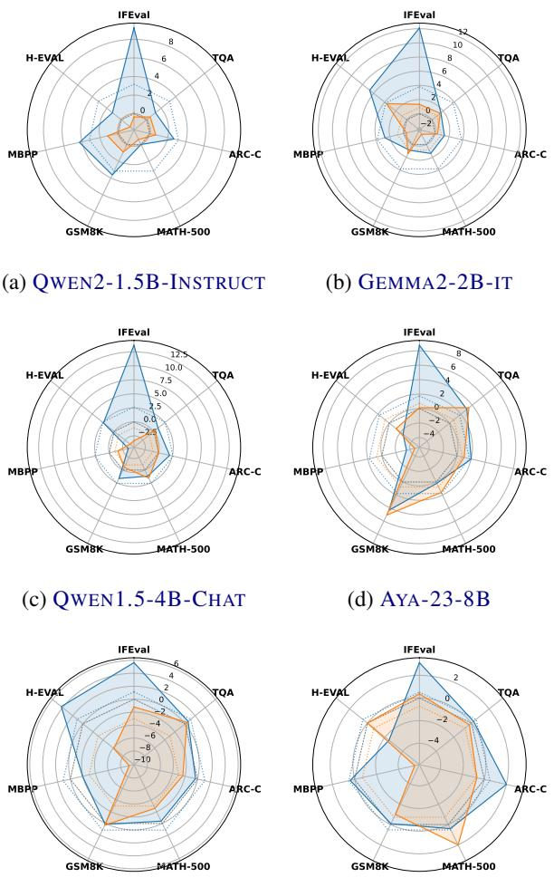
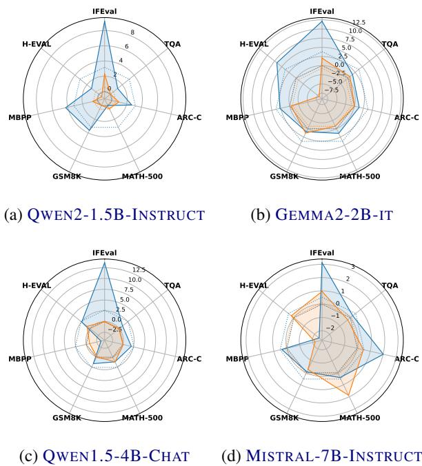
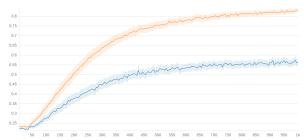
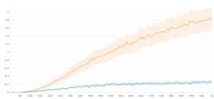
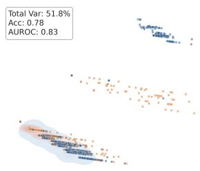
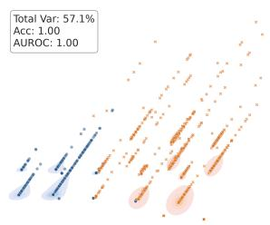
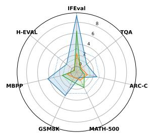
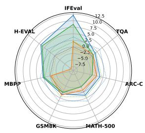
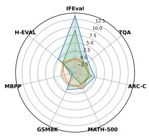
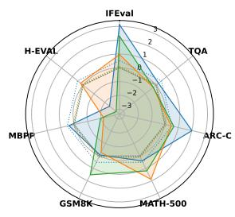

# Exploring the Limits of the Delta Learning Hypothesis: Single-Pair Generator Biases in Direct Preference Optimization

Giuseppe Curci1 Stefano Simonazzi2 Andrea Molinari3 Andrea Zugarini2

1Okkam, Italy 2Villanova.ai, Italy 3University of Trento, Italy

curci@okkam.it, andrea.molinari@unitn.it, {ssimonazzi, azugarini}@villanova.ai

## Abstract

Direct Preference Optimization (DPO) typically relies on preference pairs generated from diverse model pools and ranked by an external LLM judge. The recently proposed deltalearning hypothesis suggests that comparable supervision can instead be obtained from a single pair of models by treating the larger model’s response as preferred. We investigate the limits of this approach across model families and scales. We show, both theoretically and empirically, that fixed model pairs introduce systematic, generator-dependent biases that are predictive of the preference label independent of response quality. Consequently, DPO trained on single-pair data consistently underperforms multi-model preference data, despite the larger generator producing higher-quality responses, and we trace this gap to training dynamics consistent with reward hacking on these biases. We further show that simply increasing the number of generators, even without an external judge, is enough to partially mitigate this effect. Our results highlight generator diversity as a critical factor in preference-data construction.

## 1 Introduction

Direct Preference Optimization (DPO) (Rafailov et al., 2024) is a widely adopted post-training technique for improving large language models (LLMs) across various tasks (Liu et al., 2024; Zhang et al., 2025a). It remains highly relevant because it is computationally cheaper than on-policy learning, highly effective in non-verifiable domains, and provides a stronger foundational model than Supervised Fine-Tuning (SFT) alone for subsequent Reinforcement Learning with Verifiable Rewards (RLVR) (OLMo et al., 2026).

DPO requires a dataset of prompts, each paired with two completions of differing quality designated as “chosen” and “rejected”. The training process then optimizes the model to assign a higher probability to the chosen completion. Often, these completions are generated by other LLMs, and their relative quality is evaluated using an LLM-asa-judge (OLMo et al., 2025; Cui et al., 2024). However, this evaluation method is imperfect; judge preferences are often swayed by superficial factors like length (Hu et al., 2025), formatting (Zhang et al., 2025b), or judge-generator distributional similarity (Li et al., 2025), introducing significant ranking instability (Zhao et al., 2026). Given the critical need for high-quality data, extensive research has focused on mitigating these biases (Park et al., 2024), developing data-aware training algorithms (Wu et al., 2024), refining data cleaning techniques (Yeh and Li, 2025; Gao et al., 2025), and evaluating the alignment between data pairs and trained models (Zhang et al., 2026).

As an alternative, Geng et al. (2025) proposed the “Delta Learning hypothesis,” suggesting that ranking can be determined using just two models without external supervision. Thus, preference pairs are generated directly from a single model pair within the same family and lineage: a larger model for the chosen and a smaller one for the rejected. Contrary to Pan et al. (2025), they show how the chosen model doesn’t need to be stronger than the trained model, provided there is a sufficient quality delta between the completions and minimal noise. This method often aligns with judge preferences and drives comparable improvements. The Olmo3 developers also utilized this approach, demonstrating that LLM-asa-judge data and the delta heuristic provide complementary signals rather than one being strictly superior (OLMo et al., 2026). Furthermore, Lee et al. (2026) expanded on this by investigating the single-pair method’s impact on reasoning models and Chain-of-Thought (CoT) improvements. Despite these findings, little is known about how this hypothesis generalizes across different model families and scales. A critical open question remains: is the noise that can overwhelm the delta learning signal merely occasional correctness errors, as originally assumed, or can it take a more systematic, generator-dependent form that persists regardless of scale or dataset size?

In this work, we present a comprehensive theoretical and empirical study comparing the two approaches. We theoretically prove that relying on a single model pair increases reward hacking by exploiting generator-dependent spurious features, and empirically confirm this mechanism through both the reward-accuracy gap in training dynamics and the classification accuracy achieved by a classifier observing only style features of chosen and rejected. Consistent with this analysis, we further demonstrate that single-pair DPO systematically underperforms relative to using multiple pairs. Finally, we show that increasing generator diversity alone, without an external judge, partially mitigates this effect for most models tested, providing a better judge-free baseline for constructing preference pairs from a model pool.

## 2 Methodology

## 2.1 Direct Preference Optimization

Let x denote a prompt, and let $y _ { c }$ and $y _ { r }$ represent the chosen and rejected completions, respectively, sampled from a preference dataset D. Given a policy model $\pi _ { \boldsymbol { \theta } } ( y | \boldsymbol { x } )$ and a reference model $\pi _ { \mathrm { r e f } } ( y | x )$ the length-normalized DPO loss is defined as:

$$
\log \sigma \left( \frac { \beta } { | y _ { c } | } \log \frac { \pi _ { \theta } ( y _ { c } | x ) } { \pi _ { \mathrm { r e f } } ( y _ { c } | x ) } - \frac { \beta } { | y _ { r } | } \log \frac { \pi _ { \theta } ( y _ { r } | x ) } { \pi _ { \mathrm { r e f } } ( y _ { r } | x ) } \right)\tag{1}
$$

where $| y |$ represents the token length of completion $y , \beta$ is a scaling hyperparameter, and $\sigma ( \cdot )$ is the logistic sigmoid function.

## 2.2 Delta Learning Hypothesis Limits

Delta learning hypothesis. The delta learning hypothesis holds that training succeeds when a stronger teacher $\theta _ { c }$ is better aligned with the optimal parameters $\theta ^ { * }$ than a weaker teacher $\theta _ { r } ,$ provided the correctness signal is not overwhelmed by spurious noise. We extend this notion of noise beyond correctness errors: relying on only two generators risks injecting systemic, dataset-wide biases into the preference data, degrading training stability and downstream performance even when $\theta _ { c } \succ \theta _ { r }$ holds exactly.

Features. Let $\mathcal { V }$ be the space of completions, and let afeature be a function $f : \mathcal { V } \to \{ 0 , 1 \}$ indicating the presence of some property in a completion (e.g., use of bullet points, correctness). We partition the features relevant to DPO into two disjoint sets: $\mathcal { F } _ { l } .$ , features we want the policy to learn to prefer (correctness, safety, helpfulness), and $\mathcal { F } _ { s }$ , spurious features we want the policy to remain indifferent to (formatting, length, style markers).

Desideratum. For a preference dataset D to isolate signal in $\mathcal { F } _ { l } .$ , no spurious feature should be a useful predictor of the preference label. We formalize this via the accuracy achievable by a classifier that only observes $f \colon$

$$
\begin{array} { r } { \mathrm { A c c } _ { f } : = \mathbb { P } \big ( f ( y _ { c } ) > f ( y _ { r } ) \big ) + \frac { 1 } { 2 } \mathbb { P } \big ( f ( y _ { c } ) = f ( y _ { r } ) \big ) , } \end{array}\tag{2}
$$

the probability that thresholding on $f$ alone recovers the true chosen/rejected ordering (ties broken at chance). Our desideratum is that every spurious feature be statistically uninformative:

$$
\begin{array} { r } { \operatorname { A c c } _ { f } = \frac { 1 } { 2 } \qquad \mathrm { f o r } \mathrm { a l l } f \in \mathscr { F } _ { s } . } \end{array}\tag{3}
$$

Equation 3 does not require that f be absent from either completion, but only that its presence carry no systematic information about which completion was preferred. Note that $\operatorname { A c c } _ { f }$ is defined with respect to the fixed orientation $" \bar { f } ( y _ { c } ) > f ( y _ { r } ) " ;$ since every feature $f$ has a complementary feature (e.g. "use of $\# "$ vs "no use of $\# " ) 1 - f$ with Acc1 $\mathbf { \nabla } _ { \cdot } f = 1 - \operatorname { A c c } _ { f }$ , we adopt the convention of reporting $\operatorname { A c c } _ { f }$ for whichever orientation satisfies $\operatorname { A c c } _ { f } \geq { \textstyle { \frac { 1 } { 2 } } }$ , so that $\operatorname { A c c } _ { f }$ coincides with the accuracy of the best fixed-direction classifier using $f .$

Assumption 1 (Independent generation). Given a prompt x and a pair of generators $( \theta _ { c } , \theta _ { r } )$ , completions are sampled independently, $y _ { c } \sim \pi _ { \theta _ { c } } ( \cdot \ | \ x )$ and $y _ { r } \sim \pi _ { \theta _ { r } } ( \cdot \ | \ x )$ , with no significant shared randomness. For a generator $\theta$ and feature $f ,$ define its propensity $p _ { f } ( \theta ) : = \mathbb { E } _ { x , y \sim \pi _ { \theta } ( \cdot | x ) } [ f ( y ) ]$ , i.e., the base rate at which $\theta ^ { \prime } \mathbf { s }$ completions exhibit $f .$

Proposition 1 (Fixed-pair sampling induces systematic bias). Let D be constructed from a single fixed pair $\left( \theta _ { c } , \theta _ { r } \right)$ for every prompt. Thenfor any $f \in \mathcal { F } _ { s }$

$$
\begin{array} { r } { \operatorname { A c c } _ { f } = \frac { 1 } { 2 } + \frac { 1 } { 2 } \big | p _ { f } ( \theta _ { c } ) - p _ { f } ( \theta _ { r } ) \big | . } \end{array}\tag{4}
$$

Proof. Write $p _ { c } = p _ { f } ( \theta _ { c } ) , p _ { r } = p _ { f } ( \theta _ { r } )$ . By Assumption $1 , f ( y _ { c } )$ and $f ( y _ { r } )$ are independent

Bernoulli variables with means $p _ { c }$ and $p _ { r }$ . Then

$$
\begin{array} { r l } & { \mathrm { A c c } _ { f } = \mathbb { P } ( f ( y _ { c } ) = 1 , f ( y _ { r } ) = 0 ) } \\ & { \qquad + \frac { 1 } { 2 } \Big [ \mathbb { P } ( f ( y _ { c } ) = 1 , f ( y _ { r } ) = 1 ) } \\ & { \qquad + \mathbb { P } ( f ( y _ { c } ) = 0 , f ( y _ { r } ) = 0 ) \Big ] } \\ & { \qquad = p _ { c } ( 1 - p _ { r } ) + \frac { 1 } { 2 } \big [ p _ { c } p _ { r } + ( 1 - p _ { c } ) ( 1 - p _ { r } ) \big ] } \\ & { \qquad = \frac { 1 } { 2 } + \frac { 1 } { 2 } ( p _ { c } - p _ { r } ) } \end{array}\tag{5}
$$

Equation 4 already shows a direct, monotonic relationship between the two generators’ propensity gap and classifier accuracy, with $\operatorname { A c c } _ { f }  1$ as $p _ { c }  1 , p _ { r }  0$ . As stated in Assumption 1, however, $p _ { f } ( \theta )$ marginalizes over the entire prompt distribution. The corollary below shows the bias is in fact stronger than this dataset-wide average suggests when we account for the prompt distribution.

Corollary 1 (Domain-conditional bias). Let $D \subseteq { \mathcal { X } }$ be any well-defined subset of prompts (a “domain $\because e . g .$ ., math problems or coding tasks). Define the domain-conditional propensity $p _ { f } ( \theta \mid$ $D ) : = \mathbb { E } _ { x \in D , y \sim \pi _ { \theta } ( \cdot | x ) } [ f ( y ) ]$ and propensity gap $\Delta _ { f } ( \theta _ { c } , \theta _ { r } \mid D ) : = p _ { f } ( \theta _ { c } \mid D ) - p _ { f } ( \theta _ { r } \mid D )$ . Under Assumption 1 restricted to $x \in D$

$$
\begin{array} { r } { \operatorname { A c c } _ { f } \mid D = \frac { 1 } { 2 } + \frac { 1 } { 2 } \mid \Delta _ { f } ( \theta _ { c } , \theta _ { r } \mid D ) \mid . } \end{array}\tag{6}
$$

Proof. By Assumption $1 , f ( y _ { c } ) \perp f ( y _ { r } )$ given any x, with means $p _ { c } ( x ) : = \mathbb { E } _ { y \sim \pi _ { \theta _ { c } } ( \cdot | x ) } [ f ( y ) ]$ and $p _ { r } ( x )$ analogously. Conditioning on $\boldsymbol { x } \in D$ and applying the law of total probability to each joint term in Equation 2 gives, e.g., $\mathbb { P } ( f ( y _ { c } ) = 1 , f ( y _ { r } ) = 0 \ |$ $D ) \ = \ \mathbb { E } _ { x \in D } [ p _ { c } ( x ) ( 1 - p _ { r } ( x ) ) ]$ ; combining all terms as in the proof of Proposition 1 and using linearity of expectation yields Equation 6.

For a fixed pair, the propensity gap is constant not just on dataset-wide average but within every domain: it does not depend on x beyond which domain x falls in, and does not average out as $| \mathcal { D } | \to \infty$ . This matters because intuitively spurious features are often domain-specific $- \mathrm { { e . g . } }$ 9 \boxed{} or # markers in math — so a small marginal gap $\Delta _ { f } ( \theta _ { c } , \theta _ { r } )$ can mask large, oppositesigned, domain-conditional gaps that cancel only in aggregate. Since prompt domain is itself an observable covariate rather than a spurious feature the policy needs to ignore, this marginal cancellation offers no protection: a model can condition on domain implicitly and still exploit the domain-local shortcut in each region of the prompt distribution. This directly explains why, empirically, chosen and rejected completions from a single pair can become trivially separable using only surface-level features; we confirm this in Section 3.3.3, where fixed model pairs differing sharply in a domain-specific stylistic propensity yield a very strong classifier. The same conditioning argument extends to the following Proposition 2: pooling attenuates the bias only insofar as generator identity varies within each domain, not merely across the dataset as a whole.

Assumption 2 (Pool sampling with F -driven selection). Now let $( \Theta _ { c } ^ { ( i ) } , \Theta _ { r } ^ { ( i ) } )$ be drawn perexample from a pool of generators M, with the chosen/rejected role at example i assigned by a (possibly stochastic) selection criterion c that depends on a completion only through the features in $\mathcal { F } _ { l }$ (e.g., an external judge scoring safety).

Proposition 2 (Pooling attenuates the bias). Under Assumption 2, the dataset-level accuracy of a classifier using $f \in \mathcal { F } _ { s }$ is

$$
\begin{array} { r } { \overline { { \mathrm { A c c } _ { f } } } = \frac { 1 } { 2 } + \frac { 1 } { 2 } \left| \mathbb { E } _ { i } \big [ \Delta _ { f } \big ( \Theta _ { c } ^ { ( i ) } , \Theta _ { r } ^ { ( i ) } \big ) \big ] \right| } \end{array}\tag{7}
$$

obtained by averaging Equation 4 over the perexample draw of $( \Theta _ { c } ^ { ( i ) } , \Theta _ { r } ^ { ( i ) } )$ , where $\Delta _ { f } ( \theta _ { c } , \theta _ { r } ) : =$ $p _ { f } ( \theta _ { c } ) - p _ { f } ( \theta _ { r } )$ is the propensity gap. If, in addition, $f$ is uncorrelated with $\mathcal { F } _ { l }$ at the population level — so that c’s dependence on $\mathcal { F } _ { l }$ induces no dependence on $f ,$ and $\mathbb { E } _ { i } [ p _ { f } ( \Theta _ { c } ^ { ( i ) } ) ] = \mathbb { E } _ { i } [ p _ { f } ( \Theta _ { r } ^ { ( i ) } ) ]$ — the aggregate propensity gap vanishes and we have that $\begin{array} { r } { \overline { { \mathrm { A c c } _ { f } } } = { \frac { 1 } { 2 } } } \end{array}$

The key contrast with Proposition 1 is not only in expectation but in variance: for a fixed pair, $\Delta _ { f } ( \theta _ { c } , \theta _ { r } )$ is a constant, so every example reinforces the same shortcut. Under pool sampling it is a random variable across examples — the model exhibiting $f$ more often is not always the one used to produce the ’chosen’ — so no single feature threshold tracks the label consistently across $\mathcal { D } _ { : }$ , even if it correlates locally for some pairs. This is consistent with the substantially higher reward margins and pairwise accuracy observed for fixed model pairs regardless of the model trained, as shown in Section 3.3.1.

We note that the aggregate propensity gap $\mathbb { E } _ { i } [ \Delta _ { f } ( \boldsymbol { \Theta } _ { c } ^ { ( i ) } , \boldsymbol { \Theta } _ { r } ^ { ( i ) } ) ]$ need not vanish in general: if a feature in $\mathcal { F } _ { l }$ correlates with a spurious feature at the population level $( \mathrm { e . g } ,$ ., stronger models happen to write longer answers on average), pooling will not drive ${ \overline { { \operatorname { A c c } _ { f } } } } ~ \operatorname { t o } ~ { \textstyle \frac { 1 } { 2 } }$ . This residual case is qualitatively different from Proposition 1’s bias, however: it reflects a property of the model population rather than an artifact of the sampling procedure, and, unlike the deterministic gap in the proposition, which is fixed by the choice of exactly two generators, it does not obviously worsen as the pool shrinks to a pair, nor improve as it grows. We leave a full characterization of this population-level confound to future work.

## 2.3 Experimental Setup

## 2.3.1 Training

Data. To study the limitations of generating preference pairs from only two models, we adapt the DPO dataset used for OLMO2-1B-SFT (OLMo et al., 2025) olmo2-1b-prefmix , which originally relied on completions from multiple models ranked by an LLM-as-a-judge. To enable a direct 1-to-1 comparison, we re-generate all completions using models spanning various parameter sizes and model families. Following the heuristic in Geng et al. (2025), we assign the chosen $( y _ { c } )$ and rejected $( y _ { r } )$ completions based strictly on the parameter size of the generating models.

DPO. We run one thousand training steps with a batch size of 128, sweeping learning rates and $\beta$ hyperparameters. We select the final (β, learning rate) configurations based on average downstream benchmark performance of a separate unseen evaluation set. We use the length-normalized loss defined in Equation 1, which has been shown to outperform the original formulation and alleviate length bias (Lambert et al., 2025). More details are provided in Appendix E.

## 2.3.2 Models and Evaluation

We select the training models and evaluation benchmarks according to three criteria. First, we aim to study models for which the preference signal is informative: the trained models should be strong enough to learn from the generated preference pairs, but not so strong that performance on the downstream benchmarks is already saturated. Second, we seek diversity in the models used to construct preference pairs, in order to test whether the conclusions depend on a particular model family or parameter scale. Third, we want the evaluation suite to reflect the capabilities relevant to the original dataset while also covering a broader range of skills and not saturated.

Training Model Selection. We therefore select models along two dimensions: capability and diversity. In terms of capability, we focus on models with performance broadly comparable to OLMO2- 1B-SFT , the model for which the dataset’s prompt distribution was originally designed. In terms of diversity, we include models from different families and parameter scales. Thus, we consider the following Hugging Face checkpoints: QWEN2-1.5B-INSTRUCT (Yang et al., 2024), GEMMA2-2B-IT (Team et al., 2024), AYA-23-8B (Aryabumi et al., 2024), and MISTRAL-7B-INSTRUCT-V0.2 (Jiang et al., 2023), QWEN1.5-4B-CHAT and QWEN1.5- 7B-CHAT (Team, 2024).

Generator Model Selection. We use a staged approach to selecting generator models. First, we conduct preliminary experiments with QWEN3-4B and QWEN3-0.6B , which provide a cost-effective setting while maintaining a meaningful parameter gap, following the 2-3B parameter differences used in Geng et al. (2025). We then test the robustness of our findings across model families and parameter scales, using model size as the heuristic for constructing preference pairs always within the same family where larger parameter count reliably predicts benchmark performance within that lineage as done in the reference work. Finally, we expand the generator pool beyond two models to investigate whether sampling completions from multiple models can improve performance under the same size-based preference heuristic. The specific models used in each experiment are described in the corresponding results sections, with the complete list provided in Appendix D.2.

Benchmark selection. We evaluate models on TruthfulQA (Lin et al., 2022), ARC-Challenge (Clark et al., 2018), IFEval (Zhou et al., 2023), Math-500 (Lightman et al., 2023), GSM8K (Cobbe et al., 2021), Human-Eval (Chen et al., 2021), and MBPP (Austin et al., 2021). To select the best hyperparameters we use the training set of GSM8K, the validation set of ARC-Challenge and IFBench (Pyatkin et al., 2025) since IFEval lacks separate split. Detailed evaluation settings are provided in Appendix Table 4; Appendix Table 5 confirms that performance does not saturate on these benchmarks across the model scales considered.

## 3 Results

In the following sections, we show comprehensively how using just a pair of models to generate DPO data leads to a significantly lower downstream

  
(e) QWEN1.5-7B-CHAT  
(f) MISTRAL-7B-INSTRUCT  
Figure 1: Delta learning underperforms multiplemodels. Relative score changes across benchmarks and models using olmo2-1b-prefmix as base dataset. Performance is compared between data generated using multiple models (blue) versus a single pair (orange) (QWEN3-4B vs QWEN3-0.6B ), with dotted lines indicating average performance.

performance and training instability.

## 3.1 Delta Learning doesn’t match LLM-as-a-judge

First, we aim to investigate whether the performance of models of different families and sizes change when training on a fixed prompt distribution while using different generators. Figure 1 shows how regardless of the family and size, all models on average and on most benchmarks improve the performance, while when using QWEN3-4B and QWEN3-0.6B for half the performance degrades and for the other half it remains unaltered or lags behind the original dataset by a large margin.

To verify that the low performance is not merely an artifact of the specific pair chosen, we run additional experiments using a subset of the previous trained models, while using the following models as pairs: (QWEN3-32B , QWEN3- 0.6B ), (OLMO2-32B-INSTRUCT , OLMO2- 7B-INSTRUCT ), (OLMO2-7B-INSTRUCT OLMO2-1B-INSTRUCT ) and (GEMMA2-27B-IT , GEMMA2-9B-IT ). Figure 2 shows how, while we can observe a small improvement due to the variance between the pairs used, on average the score remains much lower compared to when using the original dataset thus proving that there’s an intrinsic problem in the completions. Tables 5 and 6 in the appendix show the exact evaluation numbers.

  
Figure 2: Lower performance doesn’t depend on the generators. Relative score changes across benchmarks. Performance is compared between data generated using multiple models versus a single pair, with dotted lines indicating average performance. Thick orange line represents the average per-benchmark across pairs used.

## 3.2 Does data-model alignment matter?

Before addressing the problem behind the inferior improvement, we seek to remove an additional spurious variable that might distort the analysis. Specifically, we aim to verify that the nature of the results doesn’t simply stem from the fact that the prompt distribution wasn’t originally designed for the models tested, which might make training harder especially when training with an off-policy algorithm such as DPO (Xu et al., 2024; Pan et al., 2025). Thus, we run DPO with OLMO2-1B-SFT on both the original dataset and on the version with completions generated with all the models used in the previous section and evaluate on the subset of benchmarks used in the original paper (OLMo et al., 2025). Table 1 shows how the data distribution doesn’t appear to be an important variable, as training on the original dataset yields strong improvements on all benchmarks, while it’s clearly very unstable when using only a pair of models and average degrades. Results for each pair of models generator are shown in the appendix in Table 7.

Table 1: Delta pair doesn’t underperform because of model-dataset alignment. Benchmark deltas using the original olmo2-1b-prefmix dataset and different model pairs to generate the completions.
<table><tr><td>Model / Dataset</td><td>IFEval</td><td>TQA</td><td>MATH-500</td><td>GSM8K</td><td>Avg</td></tr><tr><td>OLMo2-1B-SFT</td><td>61.63%</td><td>26.93%</td><td>14.60%</td><td>51.86%</td><td>38.75%</td></tr><tr><td>olmo2-1b-prefmix +7.79% +4.53%</td><td></td><td></td><td>+0.60%</td><td>+6.29%</td><td>+4.80%</td></tr><tr><td>AVERAGE PAIRS</td><td>-0.31% +0.34%</td><td></td><td>-1.12%</td><td>+0.50%</td><td>-0.14%</td></tr></table>

## 3.3 Spurious Features Analysis

Since neither the data distribution nor the choice of model generators appears to be entirely responsible for the low performance of DPO, we next conduct an analysis of the generated data and the training dynamics. In Section 2.2, we theoretically showed that spurious features are more likely to emerge when data are generated from a small number of model pairs rather than from a larger and more diverse pool of generators. In this section, we empirically investigate this phenomenon and show that, for some tasks, such biases can become particularly pronounced.

## 3.3.1 Training Dynamics

Based on Geng et al. (2025) for a fixed prompt distribution, data generated from a single pair of models should provide a preference signal comparable to that obtained from a pool of models and an external judge. In particular, if the chosen response is truly preferred because of its underlying task quality, then both procedures should expose the model to essentially the same signal. To formalize this, let the reward with a fixed prompt be

$$
r _ { \theta } ( y ) = \frac { \beta } { | y | } \log \frac { \pi _ { \theta } ( y \mid x ) } { \pi _ { \mathrm { r e f } } ( y \mid x ) }\tag{8}
$$

The reward margin is then $r _ { \theta } ( y _ { w } ) - r _ { \theta } ( y _ { l } )$ , while reward accuracy is $\textstyle { \frac { 1 } { N } } \sum _ { i = 1 } ^ { N } \mathbb { 1 } [ r _ { \theta } ( y _ { w } ^ { i } ) > r _ { \theta } ( y _ { l } ^ { i } ) ]$ We use reward hacking to describe the policy increasing its reward margin and accuracy during training without a corresponding improvement in downstream benchmark performance. Since the prompt distribution and the underlying quality difference between chosen and rejected responses are held fixed across the two settings, differences in reward metrics can reveal whether the policy is learning the intended preference or exploiting noncausal, generator-dependent signals.

  
(a) Rewards accuracy  
(b) Rewards margins  
Figure 3: Training statistics. Mean reward accuracy and margin ± standard error across models and hyperparameters for olmo2-1b-prefmix and one pair.

If the signal learned from the single-pair data is primarily attributable to the intended preference between $y _ { w }$ and $y _ { l }$ , we would therefore expect its training dynamics to be comparable to those obtained from the model pool and judge. Figure 3 shows the opposite: it reports averages across the models, generator pairs, and learning rates considered in Section 3.1, with reward accuracy differing by approximately 27% between the two settings. This substantial gap suggests that the single-pair construction exposes additional systematic signals beyond the intended preference, causing reward hacking and hindering training improvement.

## 3.3.2 Length Bias

Length difference is the most prominent and easily quantifiable completion bias. As shown in Table $2 .$ length disparity provides a trivial shortcut for preference learning in the Qwen and Gemma model pairs. However, this pattern does not hold for the Olmo2 pairs, necessitating the study of more nuanced biases.

Table 2: Length Bias. Length completion characters difference between pairs used in Section 3.1.
<table><tr><td>Chosen/Dataset</td><td>Rejected</td><td>Pct Longer% Median ∆</td><td></td></tr><tr><td>olmo2-1b-prefmix</td><td>-</td><td>55.25%</td><td>64</td></tr><tr><td>QWEN3-4B</td><td>QWEN3-0.6B</td><td>81.66%</td><td>510</td></tr><tr><td>QWEN3-32B</td><td>QWEN3-0.6B</td><td>81.49%</td><td>524</td></tr><tr><td>GEMMA2-27B-IT</td><td>GEMMA2-9B-IT</td><td>86.96%</td><td>723</td></tr><tr><td>OLM02-7B-INSTRUCT</td><td>OLMo2-1B-INSTRUCT</td><td>47.72%</td><td>0.0</td></tr><tr><td>OLM02-32B-INSTRUCT OLM02-1B-INSTRUCT</td><td></td><td>43.84%</td><td>-8.0</td></tr></table>

## 3.3.3 Stylistic Bias

We focus on data from one of the Olmo2 pair with minimal length bias that still produces sub-par downstream performance, and another pair used to highlight how extreme and problematic this bias can become.

  
(a) Olmo2 7B-Olmo2 1B

  
(b) Gemma2 27B-Olmo2 1B  
Figure 4: Style Bias. PCA of model pairs showing trivial separability with Logistic Regression scores and Explained Variance in the top-left.

We evaluate format bias on GSM8K by extracting stylistic features, such as bolding and hash delimiters, while excluding length, which was analysed previously and controlled via a lengthnormalized loss that alleviates this issue. One might worry that some markers belong to the expected answer format rather than being spurious. This does not undermine the analysis: if a marker is genuinely required by the task (e.g. "Write the answer after ###"), a well-calibrated signal should push the policy to always produce it, so it would appear in both chosen and rejected completions and carry no discriminative power. Its strong separability here instead indicates inconsistent use across completions which is a tracker for generator identity rather than task compliance.

To test if stylistic shortcuts drive reward hacking, we map completions to normalized style vectors and project them into 2D via PCA. As shown in Figure 4, the features exhibit clear separability, with the first two principal components explaining 51.8% and 57.1% of the total variance in the first and second datasets, respectively. Moreover, a logistic regression classifier on these features achieves 5-fold CV AUROC of 83% and 100%. This indicates that stylistic features account for most of the structural variance between model outputs in this setting, consistent with their acting as a shortcut that drives the downstream instability and performance degradation observed in DPO. See Appendix A for the full list of style features considered and additional details.

Directly intervening on these features during training would establish a causal link with downstream performance, but doing so is impractical on a large, diverse dataset like olmo2-1b-prefmix , where the relevant spurious features vary across domains and cannot be enumerated or controlled in advance. We therefore test the mechanism indirectly: if these shortcuts stem from generatordependent biases, increasing generator diversity without an external judge should weaken them and improve performance.

## 3.4 Increasing Generators Diversity

Having shown that a single generator pair is suboptimal, we now ask the complementary question: is increasing generator diversity alone, without an external judge, enough to mitigate the problem? Proposition 2 predicts that drawing chosen and rejected completions from a larger pool of generators should weaken the shortcut of Proposition 1. We therefore primarily compare against the single-pair baseline rather than against the original olmo2-1b-prefmix , which also differs in its ranking criterion. Our goal is not to close the gap with judge-supervised data, but to test whether diversity by itself yields a consistent improvement over single pairs. Note however that this approach is incremental: multi-model generation is a prerequisite for judge-based ranking, allowing practitioners to incorporate an external judge if needed.

Dataset Generation with Multiple Models. Moving beyond a single model family breaks the size-based heuristic, since parameter count no longer reliably predicts completion quality across families (e.g., GEMMA2-2B-IT outperforms QWEN1.5-4B-CHAT despite having half the parameters; Table 5). Using a judge would confound generators diversity with ranking criterion, potentially altering the choice even within a family. Therefore we assume access to benchmarks that proxy models’ relative performance on the training domains. This holds for olmo2-1b-prefmix , which is mainly composed of Instruction Following, Math and Coding data, so we rank models by their performance on IFEval, GSM8K and MBPP. We divide them into three tiers (high, mid, low) and, for each example, sample one of the pairings (high, mid), (high, low) or (mid, low), then draw one model uniformly from each tier. The result is a dataset whose completions come from nine different models. We note that it is the diversity of generators, not the benchmark-guided ranking, that Proposition 2 predicts will attenuate the bias; the ranking only replaces the size heuristic as a source of chosen/rejected ordering.

Since the ranking benchmarks also belong to our evaluation suite, we clarify that this is not data leakage, which would require test-set information to reach the training data through sample overlap or sample-level statistics. Neither occurs: the prompts in olmo2-1b-prefmix contain no sample from these benchmarks, and the benchmarks are used only to rank the generators by aggregate domainlevel performance, a property of the models rather than of any test sample. The coarse ranking decides which model writes each completion, but carries no information about the benchmark samples themselves.

Results. Figure 5 shows that, relative to the average single pair, increasing generator diversity improves the average score for three of the four trained models. The effect is largest for QWEN2-1.5B-INSTRUCT and GEMMA2-2B-IT , where average gains grow from +0.55% to +1.45% and from +0.82% to +2.00%, with IFEval gains of up to +6.36% and +8.63% respectively. For QWEN1.5-4B-CHAT the average gain is smaller (+0.15% to +0.54%), but IFEval improves from −0.05% to +9.11%. For MISTRAL-7B-INSTRUCT-V0.2 , the average does not improve (+0.14% vs. +0.06%), although IFEval gains persist. The benefit is therefore not uniform across models, and the improvement remains well below that of the judge-supervised dataset. Still, the consistent gain on instruction following, together with the average gains for most models, is what Proposition 2 predicts for a pipeline that only changes generator diversity. See Table 8 for additional details.

## 4 Conclusion

In this work, we have conducted a thorough analysis of the impact of the data generation process on training with Direct Preference Optimization (DPO). We focus on two approaches: the standard and computationally expensive strategy of generating completions from multiple models and ranking them using an LLM-as-a-judge, and the recently proposed alternative of using two models from the same family and deterministically defining preferences based on their relative size.

Through an extensive theoretical and empirical analysis, we show that the two-model approach consistently underperforms, regardless of the model family or size used for either the generator models or the model being trained. We further show that this degradation is consistent with systematic, generator-dependent biases introduced by the limited and homogeneous set of generators, which can dominate the preference signal and hinder useful learning; chosen and rejected completions from a single pair can, in some settings, be separated almost perfectly using stylistic features alone.

  
(a) QWEN2-1.5B-INSTRUCT

  
(b) GEMMA2-2B-IT

  
(c) QWEN1.5-4B-CHAT

  
(d) MISTRAL-7B-INSTRUCT  
Figure 5: Using more models improves performance. Relative score changes across benchmarks. Performance is compared between data generated using multiple models with judge, average of single pairs and multiple models with delta heuristic, with dotted lines indicating average performance.

Finally, we directly test whether simply increasing generator diversity, without an external judge, can mitigate this effect. Since parameter size no longer predicts completion quality once generators span multiple families, we instead use coarse, benchmark-derived tiers to construct diverse pairs. This approach improves performance over the single-pair baseline for most models tested supporting the previous theoretical and empirical analysis. Taken together, our results indicate that generator diversity, is a critical factor behind the effectiveness of multi-model preference data.

## Limitations

Although our experiments cover a wide range of models for both data generation and training, a potential limitation is that the largest models considered for training have 8 billion parameters, consistent with the scale explored in the paper introducing the delta learning hypothesis (Geng et al.,

2025). Our theoretical results are agnostic to model scale, so we expect the underlying mechanism to hold at larger scales as well. A possible direction for future work is therefore to validate whether our findings continue to hold at larger scales.

## Acknowledgments

This work is part of the Villanova project, financed by IPICEI-CIS, Prog. n. SA. 102519 – CUP B29J24000850005.

## References

Reza Yazdani Aminabadi, Samyam Rajbhandari, Minjia Zhang, Ammar Ahmad Awan, Cheng Li, Du Li, Elton Zheng, Jeff Rasley, Shaden Smith, Olatunji Ruwase, and Yuxiong He. 2022. Deepspeed inference: Enabling efficient inference of transformer models at unprecedented scale. Preprint, arXiv:2207.00032.

Viraat Aryabumi, John Dang, Dwarak Talupuru, Saurabh Dash, David Cairuz, Hangyu Lin, Bharat Venkitesh, Madeline Smith, Jon Ander Campos, Yi Chern Tan, Kelly Marchisio, Max Bartolo, Sebastian Ruder, Acyr Locatelli, Julia Kreutzer, Nick Frosst, Aidan Gomez, Phil Blunsom, Marzieh Fadaee, and 2 others. 2024. Aya 23: Open weight releases to further multilingual progress. Preprint, arXiv:2405.15032.

Jacob Austin, Augustus Odena, Maxwell Nye, Maarten Bosma, Henryk Michalewski, David Dohan, Ellen Jiang, Carrie Cai, Michael Terry, Quoc Le, and Charles Sutton. 2021. Program synthesis with large language models. Preprint, arXiv:2108.07732.

Mark Chen, Jerry Tworek, Heewoo Jun, Qiming Yuan, Henrique Ponde de Oliveira Pinto, Jared Kaplan, Harri Edwards, Yuri Burda, Nicholas Joseph, Greg Brockman, Alex Ray, Raul Puri, Gretchen Krueger, Michael Petrov, Heidy Khlaaf, Girish Sastry, Pamela Mishkin, Brooke Chan, Scott Gray, and 39 others. 2021. Evaluating large language models trained on code. Preprint, arXiv:2107.03374.

Peter Clark, Isaac Cowhey, Oren Etzioni, Tushar Khot, Ashish Sabharwal, Carissa Schoenick, and Oyvind Tafjord. 2018. Think you have solved question answering? try arc, the ai2 reasoning challenge. Preprint, arXiv:1803.05457.

Karl Cobbe, Vineet Kosaraju, Mohammad Bavarian, Mark Chen, Heewoo Jun, Lukasz Kaiser, Matthias Plappert, Jerry Tworek, Jacob Hilton, Reiichiro Nakano, Christopher Hesse, and John Schulman. 2021. Training verifiers to solve math word problems. Preprint, arXiv:2110.14168.

Ganqu Cui, Lifan Yuan, Ning Ding, Guanming Yao, Bingxiang He, Wei Zhu, Yuan Ni, Guotong Xie, Ruobing Xie, Yankai Lin, Zhiyuan Liu, and

Maosong Sun. 2024. Ultrafeedback: Boosting language models with scaled ai feedback. Preprint, arXiv:2310.01377.

Chengqian Gao, Haonan Li, Liu Liu, Zeke Xie, Peilin Zhao, and Zhiqiang Xu. 2025. Principled data selection for alignment: The hidden risks of difficult examples. Preprint, arXiv:2502.09650.

Leo Gao, Jonathan Tow, Baber Abbasi, Stella Biderman, Sid Black, Anthony DiPofi, Charles Foster, Laurence Golding, Jeffrey Hsu, Alain Le Noac’h, Haonan Li, Kyle McDonell, Niklas Muennighoff, Chris Ociepa, Jason Phang, Laria Reynolds, Hailey Schoelkopf, Aviya Skowron, Lintang Sutawika, and 5 others. 2024. The language model evaluation harness.

Scott Geng, Hamish Ivison, Chun-Liang Li, Maarten Sap, Jerry Li, Ranjay Krishna, and Pang Wei Koh. 2025. The delta learning hypothesis: Preference tuning on weak data can yield strong gains. Preprint, arXiv:2507.06187.

Zhengyu Hu, Linxin Song, Jieyu Zhang, Zheyuan Xiao, Tianfu Wang, Zhengyu Chen, Nicholas Jing Yuan, Jianxun Lian, Kaize Ding, and Hui Xiong. 2025. Explaining length bias in llm-based preference evaluations. Preprint, arXiv:2407.01085.

Albert Q. Jiang, Alexandre Sablayrolles, Arthur Mensch, Chris Bamford, Devendra Singh Chaplot, Diego de las Casas, Florian Bressand, Gianna Lengyel, Guillaume Lample, Lucile Saulnier, Lélio Renard Lavaud, Marie-Anne Lachaux, Pierre Stock, Teven Le Scao, Thibaut Lavril, Thomas Wang, Timothée Lacroix, and William El Sayed. 2023. Mistral 7b. Preprint, arXiv:2310.06825.

Woosuk Kwon, Zhuohan Li, Siyuan Zhuang, Ying Sheng, Lianmin Zheng, Cody Hao Yu, Joseph E. Gonzalez, Hao Zhang, and Ion Stoica. 2023. Efficient memory management for large language model serving with pagedattention. In Proceedings of the ACM SIGOPS 29th Symposium on Operating Systems Principles.

Nathan Lambert, Jacob Morrison, Valentina Pyatkin, Shengyi Huang, Hamish Ivison, Faeze Brahman, Lester James V. Miranda, Alisa Liu, Nouha Dziri, Shane Lyu, Yuling Gu, Saumya Malik, Victoria Graf, Jena D. Hwang, Jiangjiang Yang, Ronan Le Bras, Oyvind Tafjord, Chris Wilhelm, Luca Soldaini, and 4 others. 2025. Tulu 3: Pushing frontiers in open language model post-training. Preprint, arXiv:2411.15124.

Chia-Hsuan Lee, Mingyang Zhou, Renkun Ni, Zelei Cheng, Sihui Dai, Supriyo Chakraborty, Shixiong Zhang, Sambit Sahu, and William Campbell. 2026. Decomposing the delta: What do models actually learn from preference pairs? Preprint, arXiv:2604.08723.

Dawei Li, Renliang Sun, Yue Huang, Ming Zhong, Bohan Jiang, Jiawei Han, Xiangliang Zhang, Wei Wang,

and Huan Liu. 2025. Preference leakage: A contamination problem in llm-as-a-judge.

Hunter Lightman, Vineet Kosaraju, Yura Burda, Harri Edwards, Bowen Baker, Teddy Lee, Jan Leike, John Schulman, Ilya Sutskever, and Karl Cobbe. 2023. Let’s verify step by step. Preprint, arXiv:2305.20050.

Stephanie Lin, Jacob Hilton, and Owain Evans. 2022. Truthfulqa: Measuring how models mimic human falsehoods. Preprint, arXiv:2109.07958.

Zixuan Liu, Xiaolin Sun, and Zizhan Zheng. 2024. Enhancing llm safety via constrained direct preference optimization. Preprint, arXiv:2403.02475.

Ilya Loshchilov and Frank Hutter. 2019. Decoupled weight decay regularization. Preprint, arXiv:1711.05101.

Team OLMo, Allyson Ettinger, Amanda Bertsch, Bailey Kuehl, David Graham, David Heineman, Dirk Groeneveld, Faeze Brahman, Finbarr Timbers, Hamish Ivison, Jacob Morrison, Jake Poznanski, Kyle Lo, Luca Soldaini, Matt Jordan, Mayee Chen, Michael Noukhovitch, Nathan Lambert, Pete Walsh, and 49 others. 2026. Olmo 3. Preprint, arXiv:2512.13961.

Team OLMo, Pete Walsh, Luca Soldaini, Dirk Groeneveld, Kyle Lo, Shane Arora, Akshita Bhagia, Yuling Gu, Shengyi Huang, Matt Jordan, Nathan Lambert, Dustin Schwenk, Oyvind Tafjord, Taira Anderson, David Atkinson, Faeze Brahman, Christopher Clark, Pradeep Dasigi, Nouha Dziri, and 24 others. 2025. 2 olmo 2 furious. Preprint, arXiv:2501.00656.

Yu Pan, Zhongze Cai, Guanting Chen, Huaiyang Zhong, and Chonghuan Wang. 2025. What matters in data for dpo? Preprint, arXiv:2508.18312.

Ryan Park, Rafael Rafailov, Stefano Ermon, and Chelsea Finn. 2024. Disentangling length from quality in direct preference optimization. Preprint, arXiv:2403.19159.

Valentina Pyatkin, Saumya Malik, Victoria Graf, Hamish Ivison, Shengyi Huang, Pradeep Dasigi, Nathan Lambert, and Hannaneh Hajishirzi. 2025. Generalizing verifiable instruction following. Preprint, arXiv:2507.02833.

Rafael Rafailov, Archit Sharma, Eric Mitchell, Stefano Ermon, Christopher D. Manning, and Chelsea Finn. 2024. Direct preference optimization: Your language model is secretly a reward model. Preprint, arXiv:2305.18290.

Samyam Rajbhandari, Jeff Rasley, Olatunji Ruwase, and Yuxiong He. 2020. Zero: Memory optimizations toward training trillion parameter models. Preprint, arXiv:1910.02054.

Gemma Team, Morgane Riviere, Shreya Pathak, Pier Giuseppe Sessa, Cassidy Hardin, Surya Bhupatiraju, Léonard Hussenot, Thomas Mesnard, Bobak

Shahriari, Alexandre Ramé, Johan Ferret, Peter Liu, Pouya Tafti, Abe Friesen, Michelle Casbon, Sabela Ramos, Ravin Kumar, Charline Le Lan, Sammy Jerome, and 179 others. 2024. Gemma 2: Improving open language models at a practical size. Preprint, arXiv:2408.00118.

Qwen Team. 2024. Introducing qwen1.5.

Jason Wei, Xuezhi Wang, Dale Schuurmans, Maarten Bosma, Brian Ichter, Fei Xia, Ed Chi, Quoc Le, and Denny Zhou. 2023. Chain-of-thought prompting elicits reasoning in large language models. Preprint, arXiv:2201.11903.

Junkang Wu, Yuexiang Xie, Zhengyi Yang, Jiancan Wu, Jinyang Gao, Bolin Ding, Xiang Wang, and Xiangnan He. 2024. β-dpo: Direct preference optimization with dynamic β. Preprint, arXiv:2407.08639.

Shusheng Xu, Wei Fu, Jiaxuan Gao, Wenjie Ye, Weilin Liu, Zhiyu Mei, Guangju Wang, Chao Yu, and Yi Wu. 2024. Is dpo superior to ppo for llm alignment? a comprehensive study. Preprint, arXiv:2404.10719.

An Yang, Baosong Yang, Binyuan Hui, Bo Zheng, Bowen Yu, Chang Zhou, Chengpeng Li, Chengyuan Li, Dayiheng Liu, Fei Huang, Guanting Dong, Haoran Wei, Huan Lin, Jialong Tang, Jialin Wang, Jian Yang, Jianhong Tu, Jianwei Zhang, Jianxin Ma, and 43 others. 2024. Qwen2 technical report. Preprint, arXiv:2407.10671.

Samuel Yeh and Sharon Li. 2025. Clean first, align later: Benchmarking preference data cleaning for reliable llm alignment. Preprint, arXiv:2509.23564.

Kechi Zhang, Ge Li, Yihong Dong, Jingjing Xu, Jun Zhang, Jing Su, Yongfei Liu, and Zhi Jin. 2025a. CodeDPO: Aligning code models with self generated and verified source code. In Proceedings ofthe 63rd Annual Meeting of the Association for Computational Linguistics (Volume 1: Long Papers), pages 15854–15871, Vienna, Austria. Association for Computational Linguistics.

Xuanchang Zhang, Wei Xiong, Lichang Chen, Tianyi Zhou, Heng Huang, and Tong Zhang. 2025b. From lists to emojis: How format bias affects model alignment. Preprint, arXiv:2409.11704.

Zizhuo Zhang, Qizhou Wang, Shanshan Ye, Jianing Zhu, Jiangchao Yao, Bo Han, and Masashi Sugiyama. 2026. Towards understanding valuable preference data for large language model alignment. Preprint, arXiv:2510.13212.

Justin Zhao, Himaghna Bhattacharjee, Hannah Korevaar, Bhaktipriya Radharapu, and Khalid El-Arini. 2026. Jagged judges: Epistemic stability under silence, pressure, and persistence. Preprint, arXiv:2608.12645.

Jeffrey Zhou, Tianjian Lu, Swaroop Mishra, Siddhartha Brahma, Sujoy Basu, Yi Luan, Denny Zhou, and Le Hou. 2023. Instruction-following evaluation for large language models. Preprint, arXiv:2311.07911.

## A Empirical Analysis of Style Bias

To quantify style bias, we extract binary and countbased formatting features from each completion x. The feature extractor maps text completions to an 11-dimensional style representation vector $f ( x ) \in \mathbb { R } ^ { 1 1 }$ , summarized in Table 3.

Classification Protocol. We train a Logistic Regression classifier on the extracted feature vectors to evaluate how linearly separable chosen and rejected completions are based purely on formatting. Models are evaluated using 5-fold cross-validation across all data splits grouping by prompt to avoid data leakage.

## B Evaluation Details

We use our own evaluation code, which for the benchmarks considered here is equivalent to lm-evaluation-harness (Gao et al., 2024). Table 4 reports the exact evaluation settings used for each benchmark to facilitate reproducibility.

## C Additional Results

This section provides the exact evaluation results for all experiments discussed in the main paper. Table 5 reports the preliminary results obtained with QWEN3-4B and QWEN3-0.6B . Table 6 extends these findings by ablating the pairs used to generate the completions. Table 7 then reports the results of experiments with OLMO2-1B-SFT , which rule out the possibility of a data–model alignment issue. Finally, Table 8 provides a detailed comparison between the original dataset, the average obtained across individual pairs using the size heuristic, and the use of multiple models pairs determined through benchmarks. The latter setting is further divided into FEW PAIRS , which uses only the models considered in the previous experiments for data generation, and MORE PAIRS , which additionally includes other models and correspond to the results discussed in Section 3.4. The definitions of these two groups are provided in Appendix D.2.

## D Data Generation

This section provides a complete overview of data generation and explains how the datasets are constructed.

## D.1 Settings

We generate all data using vLLM (Kwon et al., 2023) with the following parameters:

top\_p=0.9, temperature=0.2, thinking disabled, and max\_new\_tokens=2048. We discard truncated completions to avoid introducing truncation bias. The same generation parameters are used across all models. All other generation parameters are set to their default values.

## D.2 Models Generator

For the initial experiments in Section 3.1, we use the models already introduced therein. Instead here we focus on the construction of preference pairs for the experiments in Section 3.4 (fully reported in Table 8).

For FEW PAIRS , chosen and rejected completions are sampled using the original model set. Specifically, following the parameter-size heuristic, chosen completions are sampled from {QWEN3- 32B , OLMO2-32B-INSTRUCT , GEMMA2-27B-IT } and rejected completions from {QWEN3- 0.6B , OLMO2-1B-INSTRUCT , GEMMA2-9B-IT , OLMO2-7B-INSTRUCT }.

Then given the observed improvement, we enlarge the pool of models. However this is nontrivial, since as we add more models from different families the delta size heuristic fails to actually correlate with the quality of the completions. For example, as shown in Table 5, GEMMA2-2B-IT significantly outperforms QWEN1.5-4B-CHAT despite having half the parameter count. For this reason, we use roughly the same models used when constructing the original olmo2-1b-prefmix which differ greatly by their abilities and allow establishing deltas more easily. We evaluate models across Math, Instruction-Following, and Coding benchmarks as proxies for expected completion quality on olmo2-1b-prefmix given its composition (see Table 9 for benchmark scores).

Based on these capability tiers, we partition models into candidate groups $G _ { k } = ( C _ { k } , R _ { k } )$ , where $C _ { k }$ and $R _ { k }$ denote the set of chosen and rejected generators, respectively:

1. Tier 1 vs. Tier 3 (Max Delta): Chosen C1: {GEMMA2-27B-IT , QWEN2.5- 7B-INSTRUCT , GEMMA2-9B-IT }; Rejected R : {TULU-2-7B , QWEN2-0.5B-INSTRUCT , YI-6B-CHAT }

2. Tier 1 vs. Tier 2 (High Quality, Subtle Delta): Chosen C2: {GEMMA2-27B-IT , QWEN2.5- 7B-INSTRUCT };

Table 3: GSM8K Style Features. Description and detection criteria used to extract the 11-dimensional style representation vector.
<table><tr><td>Feature Name</td><td>Type</td><td>Detection Criterion / Pattern</td></tr><tr><td>has_boxed_latex</td><td>Binary</td><td>Contains \boxed or $\boxed</td></tr><tr><td>has_hash_delimiter</td><td>Binary</td><td>Contains #### (GSM8K answer marker)</td></tr><tr><td>has_calc_annotations</td><td>Binary</td><td>Matches calculator annotations  $\ll . . . \gg$ </td></tr><tr><td>has_display_math_dollars</td><td>Binary</td><td>Contains display math delimiters $$</td></tr><tr><td>has_display_math_brackets</td><td>Binary</td><td>Contains display math delimiters \[ and \]</td></tr><tr><td>has_bold_answer</td><td>Binary</td><td>Matches **answer: ** prefix (case-insensitive)</td></tr><tr><td>has_plain_answer_prefix</td><td>Binary</td><td>Matches unformatted answer: line prefix</td></tr><tr><td>has_bullet_points</td><td>Binary</td><td>Matches bulleted list items (* or -)</td></tr><tr><td>has_numbered_list</td><td>Binary</td><td>Matches numbered list items (e.g., 1.)</td></tr><tr><td>has_bold_text</td><td>Binary</td><td>Contains Markdown bold syntax (**)</td></tr><tr><td>latex_symbol_count</td><td>Count</td><td>Total frequency of \ and $ characters</td></tr></table>

Table 4: Overview of evaluation benchmarks. All benchmarks are evaluated using a multi-turn chat format with Chain-of-Thought (CoT) (Wei et al., 2023) and few-shot examples injected as conversation turns where specified. The acronyms are used in the figures.
<table><tr><td>Benchmark</td><td>CoT</td><td>Shots</td><td>Metric</td><td>Acronym</td></tr><tr><td>TruthfulQA</td><td>X</td><td>6</td><td>MC1</td><td>TQA</td></tr><tr><td>Arc-Challenge</td><td>X</td><td>0</td><td>Unconditional Accuracy</td><td>ARC-C</td></tr><tr><td>IFEval</td><td>X</td><td>0</td><td>pass@1 (instance;loose)</td><td>1</td></tr><tr><td>IFBench</td><td>X</td><td>0</td><td>pass@ 1 (instance;loose)</td><td>-</td></tr><tr><td>Math-500</td><td>√</td><td>4</td><td>Flex EM</td><td>一</td></tr><tr><td>GSM8K</td><td>√</td><td>8</td><td>EM</td><td></td></tr><tr><td>HumanEval</td><td>x</td><td>0</td><td>pass@1</td><td>H-EVAL</td></tr><tr><td>MBPP</td><td>X</td><td>0</td><td>pass@1</td><td>一</td></tr></table>

Rejected $R _ { 2 } { : }$ {OLMO2-1B-INSTRUCT , MISTRAL-7B-INSTRUCT-V0.2 , SMOLLM2- 1.7B-INSTRUCT }

3. Tier 2 vs. Tier 3 (Moderate Delta):   
Chosen $C _ { 3 } { \mathrm { : } }$ {OLMO2-1B-INSTRUCT   
MISTRAL-7B-INSTRUCT-V0.2 , SMOLLM2-   
1.7B-INSTRUCT };   
Rejected $R _ { 3 } { \mathrm { : } }$ {TULU-2-7B , QWEN2-0.5B-  
INSTRUCT , YI-6B-CHAT }

To generate a preference pair $( y _ { c } , y _ { r } )$ for a given prompt, we first uniformly sample a group $G _ { k } \sim \{ G _ { 1 } , G _ { 2 } , G _ { 3 } \}$ , and then uniformly sample individual generators $m _ { c } \sim C _ { k }$ and $m _ { r } \sim R _ { k }$ This process yields a dataset with a diversified set of generators which makes relying entirely on spurious features to learn the preference harder.

## E More Training Details

We implement our training pipeline using the Hugging Face ecosystem, primarily relying on the Transformers Reinforcement Learning (TRL) library. We use DeepSpeed (Aminabadi et al., 2022)

and its implementation of ZeRO (Rajbhandari et al., 2020), selecting the ZeRO stage according to model size. All experiments are conducted on a single node equipped with 8 H100 GPUs. We use olmo2-1b-prefmix as the baseline for all experiments and we replace the original completions while keeping the underlying prompt distribution fixed. Our setup closely matches the training configuration of OLMO2-1B-SFT , for which the baseline dataset was originally designed.

Across all experiments, we train for 1,000 optimization steps with an effective batch size of 128 and a maximum sequence length of 2,048 tokens. We use a linear learning-rate scheduler with a warmup ratio of 0.1. For optimization, we use AdamW (Loshchilov and Hutter, 2019) with $\beta _ { 1 } = 0 . 9 , \beta _ { 2 } = 0 . 9 9 9$ , and $\epsilon = 1 0 ^ { - 8 }$ . This fixed training budget and shared configuration provide a consistent basis for comparing performance across experimental settings.

We sweep the regularization parameter $\beta \in$ {5, 10} and adjust the learning-rate grid according to the dataset used. For the original olmo2-1b-prefmix , we sweep learning rates in $\{ 1 \times 1 0 ^ { - 6 } , 5 \times 1 0 ^ { - 7 } , 1 \times 1 0 ^ { - 7 } \}$ . In the initial experiments reported in Table 5 and some of the ablations in Table 6, we used the same grid for generated completions. However, we observed that a learning rate of $1 \times 1 0 ^ { - 6 }$ often caused substantial performance degradation, while the best results were frequently obtained with $1 \times 1 0 ^ { - 7 }$ . We therefore expanded the search toward lower learning rates to enable a fairer comparison across data sources and avoid systematically disadvantaging generated completions. Specifically, for our generated completions, we use $\{ 5 \times 1 0 ^ { - 7 } , 1 \times 1 0 ^ { - 7 } , 5 \times$ $1 0 ^ { - 8 } , 1 \times 1 0 ^ { - 8 } \}$ , as higher learning rates on pairs constructed using the delta-size heuristic consistently led to severe performance degradation, in some cases causing performance to fall below the SFT baseline. This sensitivity further supports the claim that training on a single model pair substantially alters the training dynamics, as discussed in Section 3.3.1.

Table 5: Delta pair generation underperforms. Benchmark deltas using the original olmo2-1b-prefmix dataset and QWEN3-4B and QWEN3-0.6B to generate completions.
<table><tr><td>Model / Dataset</td><td>IFEval</td><td>TQA</td><td>ARC-C</td><td>MATH-500</td><td>GSM8K</td><td>MBPP</td><td>H-EVAL</td><td>Avg</td></tr><tr><td>QWEN2-1.5B-INSTRUCT</td><td>40.17%</td><td>28.40%</td><td>45.48%</td><td>22.80%</td><td>53.37%</td><td>44.75%</td><td>46.34%</td><td>40.19%</td></tr><tr><td>olmo2-1b-prefmix</td><td>+9.23%</td><td>+1.22%</td><td>+2.68%</td><td>0.00%</td><td>+3.64%</td><td>+4.28%</td><td>+1.22%</td><td>+3.18%</td></tr><tr><td>olmo2-1b-prefmix-delta</td><td>-0.36%</td><td>+0.49%</td><td>+0.67%</td><td>-0.60%</td><td>+0.91%</td><td>+1.17%</td><td>-1.22%</td><td>+0.15%</td></tr><tr><td>GEMMA2-2B-IT</td><td>67.87%</td><td>41.62%</td><td>48.49%</td><td>15.00%</td><td>54.51%</td><td>50.19%</td><td>40.24%</td><td>45.42%</td></tr><tr><td>olmo2-1b-prefmix</td><td>+12.11%</td><td>+1.59%</td><td>+1.34%</td><td>+1.40%</td><td>+0.91%</td><td>+2.72%</td><td>+6.71%</td><td>+3.83%</td></tr><tr><td>olmo2-1b-prefmix-delta</td><td>+4.32%</td><td>+1.22%</td><td>+2.34%</td><td>-1.40%</td><td>+2.27%</td><td>-1.56%</td><td>+4.27%</td><td>+1.64%</td></tr><tr><td>QWEN1.5-4B-CHAT</td><td>40.53%</td><td>30.97%</td><td>44.48%</td><td>11.00%</td><td>48.52%</td><td>42.80%</td><td>33.54%</td><td>35.98%</td></tr><tr><td>olmo2-1b-prefmix</td><td>+13.67%</td><td>+0.98%</td><td>+2.01%</td><td>+1.20%</td><td>+1.67%</td><td>-3.50%</td><td>+2.44%</td><td>+2.64%</td></tr><tr><td>olmo2-1b-prefmix-delta</td><td>-3.36%</td><td>+0.37%</td><td>0.00%</td><td>+1.60%</td><td>-0.53%</td><td>-1.56%</td><td>-3.66%</td><td>-1.02%</td></tr><tr><td>QWEN1.5-7B-CHAT</td><td>52.88%</td><td>43.45%</td><td>41.47%</td><td>15.40%</td><td>60.50%</td><td>52.53%</td><td>45.12%</td><td>44.48%</td></tr><tr><td>olmo2-1b-prefmix</td><td>+5.64%</td><td>+0.61%</td><td>-0.33%</td><td>-0.40%</td><td>+0.15%</td><td>-1.95%</td><td>+4.27%</td><td>+1.14%</td></tr><tr><td>olmo2-1b-prefmix-delta</td><td>-1.20%</td><td>+0.37%</td><td>-2.34%</td><td>-2.60%</td><td>+0.30%</td><td>-9.34%</td><td>-6.10%</td><td>-2.99%</td></tr><tr><td>MISTRAL-7B-INSTRUCT-V0.2</td><td>64.75%</td><td>55.69%</td><td>52.51%</td><td>10.60%</td><td>45.03%</td><td>39.30%</td><td>39.63%</td><td>43.93%</td></tr><tr><td>olmo2-1b-prefmix</td><td>+3.12%</td><td>+0.24%</td><td>+2.01%</td><td>+0.40%</td><td>-0.08%</td><td>+0.39%</td><td>-2.44%</td><td>+0.52%</td></tr><tr><td>olmo2-1b-prefmix-delta</td><td>+0.36%</td><td>-0.24%</td><td>-0.67%</td><td>+2.00%</td><td>-0.99%</td><td>-5.45%</td><td>0.00%</td><td>-0.71%</td></tr><tr><td>AYA-23-8B</td><td>56.47%</td><td>31.70%</td><td>48.16%</td><td>6.60%</td><td>45.87%</td><td>42.02%</td><td>31.71%</td><td>37.50%</td></tr><tr><td>olmo2-1b-prefmix</td><td>+8.76%</td><td>+3.06%</td><td>+2.01%</td><td>+0.20%</td><td>+4.32%</td><td>-3.50%</td><td>-2.44%</td><td>+1.77%</td></tr><tr><td>olmo2-1b-prefmix-delta</td><td>+0.12%</td><td>+3.43%</td><td>+1.00%</td><td>+1.60%</td><td>+5.08%</td><td>-4.67%</td><td>-1.22%</td><td>+0.76%</td></tr></table>

Table 6: Ablation pair generators show consistent low performance. Benchmark deltas using the original olmo2-1b-prefmix dataset and different model pairs to generate the completions.
<table><tr><td>Model / Dataset</td><td>IFEval</td><td>TQA</td><td>ARC-C</td><td>MATH-500</td><td>GSM8K</td><td>MBPP</td><td>H-EVAL</td><td>Avg</td></tr><tr><td>QWEN2-1.5B-INSTRUCT</td><td>40.17%</td><td>28.40%</td><td>45.48%</td><td>22.80%</td><td>53.37%</td><td>44.75%</td><td>46.34%</td><td>40.19%</td></tr><tr><td>olmo2-1b-prefmix</td><td>+9.23%</td><td>+1.22%</td><td>+2.68%</td><td>0.00%</td><td>+3.64%</td><td>+4.28%</td><td>+1.22%</td><td>+3.18%</td></tr><tr><td>QWEN3/4-0.6B</td><td>-0.36%</td><td>0.49%</td><td>0.67%</td><td>-0.60%</td><td>0.91%</td><td>1.17%</td><td>-1.22%</td><td>0.15%</td></tr><tr><td>QWEN3/32-0.6B</td><td>0.36%</td><td>-0.12%</td><td>0.00%</td><td>0.00%</td><td>0.76%</td><td>-0.39%</td><td>0.61%</td><td>0.17%</td></tr><tr><td>OLMO2-IT/32-1B</td><td>5.76%</td><td>0.12%</td><td>1.00%</td><td>1.60%</td><td>-0.83%</td><td>1.56%</td><td>0.00%</td><td>1.32%</td></tr><tr><td>OLMO2-IT/7-1B</td><td>4.32%</td><td>-0.24%</td><td>2.34%</td><td>1.00%</td><td>-0.76%</td><td>0.00%</td><td>-1.22%</td><td>0.78%</td></tr><tr><td>GEMMA2-IT/27-9B</td><td>1.44%</td><td>-0.12%</td><td>0.67%</td><td>0.40%</td><td>-0.23%</td><td>0.78%</td><td>-0.61%</td><td>0.33%</td></tr><tr><td>AVERAGE PAIRS</td><td>+2.30%</td><td>+0.02%</td><td>+0.94%</td><td>+0.48%</td><td>-0.03%</td><td>+0.62%</td><td>-0.49%</td><td>+0.55%</td></tr><tr><td>GEMMA2-2B-IT</td><td>67.87%</td><td>41.62%</td><td>48.49%</td><td>15.00%</td><td>54.51%</td><td>50.19%</td><td>40.24%</td><td>45.42%</td></tr><tr><td>olmo2-1b-prefmix</td><td>+12.11%</td><td>+1.59%</td><td>+1.34%</td><td>+1.40%</td><td>+0.91%</td><td>+2.72%</td><td>+6.71%</td><td>+3.83%</td></tr><tr><td>QWEN3/4-0.6B</td><td>4.32%</td><td>1.22%</td><td>2.34%</td><td>-1.40%</td><td>2.27%</td><td>-1.56%</td><td>4.27%</td><td>1.64%</td></tr><tr><td>QWEN3/32-0.6B</td><td>-0.84%</td><td>0.37%</td><td>0.00%</td><td>-0.60%</td><td>1.36%</td><td>1.95%</td><td>0.00%</td><td>0.32%</td></tr><tr><td>OLMO2-IT/32-1B</td><td>5.52%</td><td>0.12%</td><td>0.33%</td><td>-0.60%</td><td>1.36%</td><td>-2.33%</td><td>2.44%</td><td>0.98%</td></tr><tr><td>OLMO2-IT/7-1B</td><td>0.84%</td><td>1.10%</td><td>0.33%</td><td>-1.80%</td><td>1.67%</td><td>-1.17%</td><td>3.05%</td><td>0.57%</td></tr><tr><td>GEMMA2-IT/27-9B</td><td>3.48%</td><td>0.24%</td><td>-0.67%</td><td>0.80%</td><td>0.76%</td><td>0.00%</td><td>-0.61%</td><td>0.57%</td></tr><tr><td>AVERAGE PAIRS</td><td>+2.66%</td><td>+0.61%</td><td>+0.47%</td><td>-0.72%</td><td>+1.49%</td><td>-0.62%</td><td>+1.83%</td><td>+0.82%</td></tr><tr><td>QWEN1.5-4B-CHAT</td><td>40.53%</td><td>30.97%</td><td>44.48%</td><td>11.00%</td><td>48.52%</td><td>42.80%</td><td>33.54%</td><td>35.98%</td></tr><tr><td>olmo2-1b-prefmix</td><td>+13.67%</td><td>+0.98%</td><td>+2.01%</td><td>+1.20%</td><td>+1.67%</td><td>-3.50%</td><td>+2.44%</td><td>+2.64%</td></tr><tr><td>QWEN3/4-0.6B</td><td>-3.36%</td><td>0.37%</td><td>0.00%</td><td>1.60%</td><td>-0.53%</td><td>-1.56%</td><td>-3.66%</td><td>-1.02%</td></tr><tr><td>QWEN3/32-0.6B</td><td>-0.60%</td><td>-0.24%</td><td>-0.33%</td><td>1.20%</td><td>0.38%</td><td>-0.39%</td><td>1.22%</td><td>0.18%</td></tr><tr><td>OLMO2-IT/32-1B</td><td>5.16%</td><td>-0.49%</td><td>1.00%</td><td>1.20%</td><td>-0.08%</td><td>-1.17%</td><td>1.22%</td><td>0.98%</td></tr><tr><td>OLMO2-IT/7-1B</td><td>0.12%</td><td>-0.24%</td><td>-0.33%</td><td>-0.40%</td><td>0.15%</td><td>0.00%</td><td>2.44%</td><td>0.25%</td></tr><tr><td>GEMMA2-IT/27-9B</td><td>-1.56%</td><td>0.00%</td><td>0.00%</td><td>2.60%</td><td>-0.76%</td><td>-0.78%</td><td>3.05%</td><td>0.36%</td></tr><tr><td>AVERAGE PAIRS</td><td>-0.05%</td><td>-0.12%</td><td>+0.07%</td><td>+1.24%</td><td>-0.17%</td><td>-0.78%</td><td>+0.85%</td><td>+0.15%</td></tr><tr><td>MISTRAL-7B-INSTRUCT-V0.2</td><td>64.75%</td><td>55.69%</td><td>52.51%</td><td>10.60%</td><td>45.03%</td><td>39.30%</td><td>39.63%</td><td>43.93%</td></tr><tr><td>olmo2-1b-prefmix</td><td>+3.12%</td><td>+0.24%</td><td>+2.01%</td><td>+0.40%</td><td>-0.08%</td><td>+0.39%</td><td>-2.44%</td><td>+0.52%</td></tr><tr><td>QWEN3/4-0.6B</td><td>0.36%</td><td>-0.24%</td><td>-0.67%</td><td>2.00%</td><td>-0.99%</td><td>-5.45%</td><td>0.00%</td><td>-0.71%</td></tr><tr><td>QWEN3/32-0.6B</td><td>-0.12%</td><td>0.00%</td><td>0.00%</td><td>3.00%</td><td>0.00%</td><td>-3.89%</td><td>0.00%</td><td>-0.14%</td></tr><tr><td>OLMO2-IT/32-1B</td><td>2.28%</td><td>-0.61%</td><td>1.34%</td><td>1.40%</td><td>0.45%</td><td>-1.17%</td><td>0.00%</td><td>0.53%</td></tr><tr><td>OLM02-IT/7-1B</td><td>1.80%</td><td>-0.37%</td><td>0.33%</td><td>1.80%</td><td>-0.23%</td><td>-1.17%</td><td>-0.61%</td><td>0.22%</td></tr><tr><td>GEMMA2-IT/27-9B</td><td>0.48%</td><td>0.00%</td><td>1.34%</td><td>1.20%</td><td>-0.61%</td><td>0.78%</td><td>2.44%</td><td>0.80%</td></tr><tr><td>AVERAGE PAIRS</td><td>+0.96%</td><td>-0.24%</td><td>+0.47%</td><td>+1.88%</td><td>-0.27%</td><td>-2.18%</td><td>+0.37%</td><td>+0.14%</td></tr></table>

Table 7: Delta pair doesn’t underperform because of model-dataset alignment. Benchmark deltas using the original olmo2-1b-prefmix dataset and different model pairs to generate the completions training OLMO2-1B-SFT , the model for which the dataset was designed.
<table><tr><td>Model / Dataset</td><td>IFEval</td><td>TQA</td><td>MATH-500</td><td>GSM8K</td><td>Avg</td></tr><tr><td>OLM02-1B-SFT</td><td>61.63%</td><td>26.93%</td><td>14.60%</td><td>51.86%</td><td>38.75%</td></tr><tr><td>olmo2-1b-prefmix</td><td>+7.79%</td><td>+4.53%</td><td>+0.60%</td><td>+6.29%</td><td>+4.80%</td></tr><tr><td>QWEN3/4-0.6B</td><td>0.24%</td><td>1.10%</td><td>-0.80%</td><td>1.29%</td><td>0.46%</td></tr><tr><td>QWEN3/32-0.6B</td><td>1.08%</td><td>1.59%</td><td>-1.20%</td><td>1.21%</td><td>0.67%</td></tr><tr><td>OLMO2-IT/32-1B</td><td>-0.48%</td><td>-0.24%</td><td>-0.60%</td><td>-0.45%</td><td>-0.44%</td></tr><tr><td>OLM02-IT/7-1B</td><td>-1.32%</td><td>-0.37%</td><td>-1.40%</td><td>-0.45%</td><td>-0.88%</td></tr><tr><td>GEMMA2-IT/27-9B</td><td>-1.08%</td><td>-0.37%</td><td>-1.60%</td><td>0.91%</td><td>-0.53%</td></tr><tr><td>AVERAGE PAIRS</td><td>-0.31%</td><td>+0.34%</td><td>-1.12%</td><td>+0.50%</td><td>-0.14%</td></tr></table>

Table 8: Using Multiple Pairs. Benchmark deltas using the original olmo2-1b-prefmix dataset and multiple pairs to generate the completions. FEW PAIRS and MORE PAIRS correspond respectively to completions generated by only the models used in previous experiments and the ones listed in Appendix D.2
<table><tr><td>Model / Dataset</td><td>IFEval</td><td>TQA</td><td>ARC-C</td><td>MATH-500</td><td>GSM8K</td><td>MBPP</td><td>H-EVAL</td><td>Avg</td></tr><tr><td>QWEN2-1.5B-INSTRUCT</td><td>40.17%</td><td>28.40%</td><td>45.48%</td><td>22.80%</td><td>53.37%</td><td>44.75%</td><td>46.34%</td><td>40.19%</td></tr><tr><td>olmo2-1b-prefmix</td><td>+9.23%</td><td>+1.22%</td><td>+2.68%</td><td>0.00%</td><td>+3.64%</td><td>+4.28%</td><td>+1.22%</td><td>+3.18%</td></tr><tr><td>AVERAGE PAIRS</td><td>+2.30%</td><td>+0.02%</td><td>+0.94%</td><td>+0.48%</td><td>-0.03%</td><td>+0.62%</td><td>-0.49%</td><td>+0.55%</td></tr><tr><td>FEW PAIRS</td><td>+2.04%</td><td>-0.37%</td><td>+0.33%</td><td>+1.80%</td><td>-1.44%</td><td>+1.95%</td><td>+1.22%</td><td>+0.79%</td></tr><tr><td>MORE PAIRS</td><td>+6.36%</td><td>-0.24%</td><td>+0.33%</td><td>+2.00%</td><td>+0.76%</td><td>+1.56%</td><td>-0.61%</td><td>+1.45%</td></tr><tr><td>GEMMA2-2B-IT</td><td>67.87%</td><td>41.62%</td><td>48.49%</td><td>15.00%</td><td>54.51%</td><td>50.19%</td><td>40.24%</td><td>45.42%</td></tr><tr><td>olmo2-1b-prefmix</td><td>+12.11%</td><td>+1.59%</td><td>+1.34%</td><td>+1.40%</td><td>+0.91%</td><td>+2.72%</td><td>+6.71%</td><td>+3.83%</td></tr><tr><td>AVERAGE PAIRS</td><td>+2.66%</td><td>+0.61%</td><td>+0.47%</td><td>-0.72%</td><td>+1.49%</td><td>-0.62%</td><td>+1.83%</td><td>+0.82%</td></tr><tr><td>FEW PAIRS</td><td>+8.03%</td><td>+0.37%</td><td>+1.34%</td><td>-2.80%</td><td>-1.36%</td><td>-0.78%</td><td>+3.66%</td><td>+1.21%</td></tr><tr><td>MORE PAIRS</td><td>+8.63%</td><td>+0.61%</td><td>-1.67%</td><td>-2.20%</td><td>+0.23%</td><td>+2.33%</td><td>+6.10%</td><td>+2.00%</td></tr><tr><td>QWEN1.5-4B-CHAT</td><td>40.53%</td><td>30.97%</td><td>44.48%</td><td>11.00%</td><td>48.52%</td><td>42.80%</td><td>33.54%</td><td>35.98%</td></tr><tr><td>olmo2-1b-prefmix</td><td>+13.67%</td><td>+0.98%</td><td>+2.01%</td><td>+1.20%</td><td>+1.67%</td><td>-3.50%</td><td>+2.44%</td><td>+2.64%</td></tr><tr><td>AVERAGE PAIRS</td><td>-0.05%</td><td>-0.12%</td><td>+0.07%</td><td>+1.24%</td><td>-0.17%</td><td>-0.78%</td><td>+0.85%</td><td>+0.15%</td></tr><tr><td>FEW PAIRS</td><td>+0.12%</td><td>-0.24%</td><td>0.00%</td><td>+1.60%</td><td>-0.08%</td><td>0.00%</td><td>-0.61%</td><td>+0.11%</td></tr><tr><td>MORE PAIRS</td><td>+9.11%</td><td>-0.73%</td><td>+1.00%</td><td>-0.40%</td><td>-3.11%</td><td>-2.72%</td><td>+0.61%</td><td>+0.54%</td></tr><tr><td>MISTRAL-7B-INSTRUCT-V0.2</td><td>64.75%</td><td>55.69%</td><td>52.51%</td><td>10.60%</td><td>45.03%</td><td>39.30%</td><td>39.63%</td><td>43.93%</td></tr><tr><td>olmo2-1b-prefmix</td><td>+3.12%</td><td>+0.24%</td><td>+2.01%</td><td>+0.40%</td><td>-0.08%</td><td>+0.39%</td><td>-2.44%</td><td>+0.52%</td></tr><tr><td>AVERAGE PAIRS</td><td>+0.96%</td><td>-0.24%</td><td>+0.47%</td><td>+1.88%</td><td>-0.27%</td><td>-2.18%</td><td>+0.37%</td><td>+0.14%</td></tr><tr><td>FEW PAIRS</td><td>+0.60%</td><td>-0.49%</td><td>0.00%</td><td>+3.80%</td><td>0.00%</td><td>-2.33%</td><td>+1.83%</td><td>+0.49%</td></tr><tr><td>MORE PAIRS</td><td>+2.28%</td><td>-0.24%</td><td>+0.67%</td><td>+1.20%</td><td>+1.52%</td><td>-1.95%</td><td>-3.05%</td><td>+0.06%</td></tr></table>

Table 9: Models generator evaluation. Performance across Math, Instruction-Following, and Code benchmarks to determine pairs group for DPO. For IFEval we report prompt-level strict accuracy, as a stricter metric widens the performance gap across models.
<table><tr><td>Model</td><td>GSM8K</td><td>IFEval</td><td>MBPP</td><td>Avg</td></tr><tr><td>GEMMA2-27B-IT</td><td>80.67%</td><td>77.45%</td><td>78.60%</td><td>78.91%</td></tr><tr><td>QWEN2.5-7B-INSTRUCT</td><td>83.70%</td><td>71.35%</td><td>73.93%</td><td>76.33%</td></tr><tr><td>GEMMA2-9B-IT</td><td>79.53%</td><td>73.01%</td><td>65.76%</td><td>72.77%</td></tr><tr><td>OLMO2-1B-INSTRUCT</td><td>67.48%</td><td>63.96%</td><td>22.57%</td><td>51.33%</td></tr><tr><td>SMOLLM2-1.7B-INSTRUCT</td><td>46.25%</td><td>46.95%</td><td>49.81%</td><td>47.67%</td></tr><tr><td>MISTRAL-7B-INSTRUCT-V0.2</td><td>45.03%</td><td>48.98%</td><td>39.30%</td><td>44.44%</td></tr><tr><td>TULU-2-7B</td><td>31.92%</td><td>46.65%</td><td>40.86%</td><td>37.14%</td></tr><tr><td>YI-6B-CHAT</td><td>40.94%</td><td>26.06%</td><td>25.29%</td><td>30.76%</td></tr><tr><td>QWEN2-0.5B-INSTRUCT</td><td>31.08%</td><td>16.27%</td><td>29.57%</td><td>25.64%</td></tr></table>