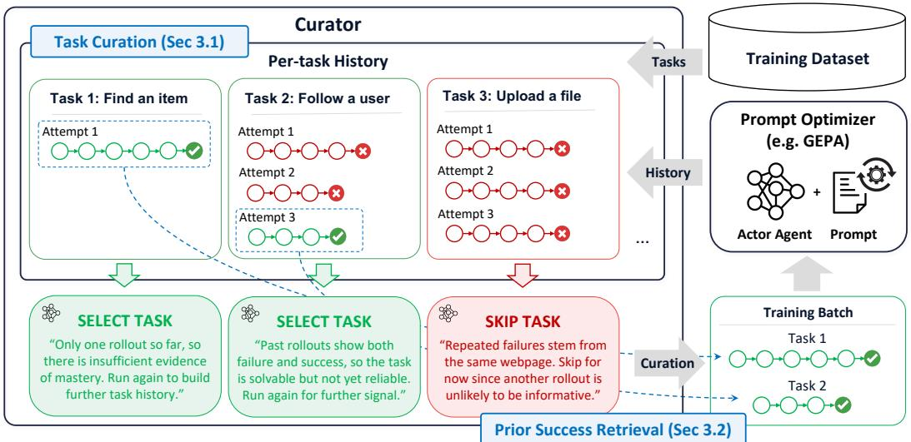
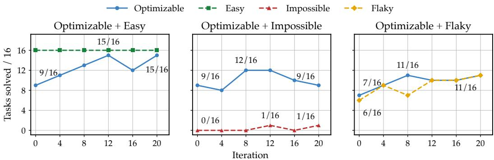
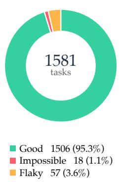
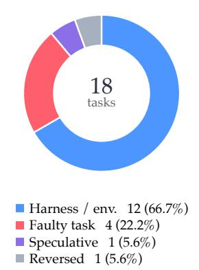
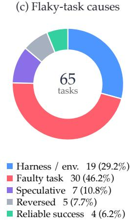

# GEPA-CURATOR: CURATED LEARNING FOR SELF IMPROVING AGENTS

Zack Yu1\*, Nicholas Lee1\*, Minjae Lee4, Lakshya Agarwal1, Luca Manolache1 Wonjun Kang4, Matei Zaharia1, Michael W. Mahoney1,2,3, Kurt Keutzer1 Sehoon Kim5†, Amir Gholami1,2†

1UC Berkeley 2ICSI 3LBNL 4Furiosa AI 5KAIST

## ABSTRACT

Large Language Models (LLMs) are increasingly used in multi-turn agentic workloads that require sustained interaction with complex environments. Existing reflective prompt optimizers such as GEPA learn from failed rollouts, but agentic failures can also come from prompt weaknesses, harness limitations, stochastic execution, or noisy judges. We argue that such failures may not provide useful learning signal, and may even be harmful; and thus it is essential to curate which tasks are provided to the prompt optimizer for better performance. We introduce GEPA-Curator, a framework that augments the prompt optimizer to select which agent experiences should shape prompt optimization. In particular, GEPA-Curator consists of two components: task curation, which filters out tasks that are likely to provide noisy or unreliable learning signals, and prior success retrieval, which selectively retrieves past successful trajectories for a task and provides them as additional context to the prompt optimizer. We evaluate GEPA-Curator on GoBrowse, ALFWorld, AppWorld, and τ-bench, using both Gemini 3.1 Pro and Claude Opus 5 as optimizer models. GEPA-Curator matches or exceeds the mean performance of both baselines, with gains of up to 20.7% over GEPA and 21.2% over ACE.

## 1 INTRODUCTION

As interest in recursive self-improvement (RSI) grows, a central question is how agents can reliably learn from their own experience to improve future behavior (Favaro & Clark, 2026). Reflective prompt optimization, where an agent acts with tools in an environment and a Reflector uses the resulting trajectory or end state to identify lessons and revise the agent’s prompt, offers one practical mechanism for this form of self-improvement (Agrawal et al., 2026; Zhang et al., 2026). The revised prompt is then used on subsequent tasks, creating a feedback loop in which experience can progressively improve agent behavior. In agentic settings, this approach rests on the assumption that experience from previously attempted tasks contains signal and information that generalize to future tasks.

However, it is often difficult for the Reflector to correctly attribute the cause of a failure to the prompt. In agentic tasks, execution is mediated by a harness interacting with an external environment, and success is often assessed by LLM-as-a-judge (Zheng et al., 2023). A failed rollout may therefore reveal a genuine prompt weakness, but it may also arise from external factors such as unavailability of needed tools, harness limitations, or even noise from execution or evaluation environments. Thi problem is further exacerbated in real-world settings, where tasks themselves may be ambiguous or infeasible, introducing additional noisy signals to the Reflector. When revising the prompt, the Reflector may nevertheless treat these potentially noisy observations as valid learning signals for prompt optimization (Kirichenko et al., 2025), causing it to misattribute the associated failures to prompt deficiencies, thereby producing unnecessary or harmful updates.

As an example, consider an agent asked to purchase an item from a shopping website. If the agent fails because it overlooks a required option before adding the item to the cart, the Reflector can usefully revise the prompt to encourage checking required fields before proceeding. In contrast, if the same task fails because it runs in a broken environment where the purchase button in the webpage is temporarily malfunctioning, treating this failure as evidence about the prompt may lead the Reflector to introduce unnecessary or even harmful changes. For example, it may conclude that the agent needs to seek alternative ways to complete the purchase, while the button can become functional for future tasks.

To mitigate such issues, recent work (Agrawal et al., 2026; Yang et al., 2026) uses a held-out validation set in order to guard against these changes. If the prompt does poorly on the validation set after mutation, the change can be rejected. GEPA (Agrawal et al., 2026) goes a step further and evaluates the mutated prompt on the minibatch again to make sure that the model performance does not degrade after such a mutation. However, such validation-based gating mechanisms alone may not be sufficient to prevent noisy signals, for two reasons. First, bad mutations may be accepted and good ones rejected, e.g., because the gating decision relies on aggregated evaluation scores, which can be noisy due to stochasticity in execution or evaluation. Second, such validation-based gating acts only after a mutation has been generated, and therefore cannot fundamentally improve the quality of the reflection or mutation itself. This motivates us to maintain and provide additional contextual information in order to improve the capabilities of the Reflector.

Based on these insights, we present GEPA-Curator, an agentic data Curator which runs as a harness on top of existing prompt optimizers. GEPA-Curator has two roles. The first is task curation, where instead of randomly selecting tasks for the minibatch, the agent will curate a minibatch which is likely to provide clean signal and discard tasks which seem to be noisy or faulty. The second is a prior success retrieval, where the Curator can selectively retrieve past successful trajectories for a task and provide them as context to the prompt optimizer to improve the quality of the mutation. Providing the Reflector agent with successful exemplars is essential to give the model the proper context to see why the prompt is failing now, and when it succeeded in the past.

Overall, our contributions are as follows:

• We introduce GEPA-Curator, an agentic harness for prompt optimization that improves mutation quality through adaptive task curation (Section 3.1) and selective retrieval (Section 3.2) of prior successful trajectories.

• We evaluate GEPA-Curator on four WebArena websites (Zhou et al., 2024), ALFWorld, AppWorld, and τ-bench. GEPA-Curator matches or exceeds the mean performance of the evaluated baselines, with gains of up to 20.7% over GEPA (Agrawal et al., 2026) and 21.2% over ACE (Zhang et al., 2026). These results suggest that the benefits of curation extend across optimizer models.

## 2 RELATED WORK

LLM Agents. As LLMs become ubiquitous, LLM-powered agents have been equipped with tools and harnesses in order to interact and execute in external environments. React (Yao et al., 2023) interwove reasoning with tool execution to improve performance. Later work (Patil et al., 2024; Erdogan et al., 2024; Schick et al., 2023; Shen et al., 2023; Xu et al., 2023; Kim et al., 2024) used tool calling, where the model generates a structured output which is parsed and used to execute functions to affect the environment. This has led to LLM agents being used to control and interact with different environments; and this has led to a variety of different benchmarks (Trivedi et al., 2024; Shridhar et al., 2021; Yao et al., 2024; Patil et al., 2024; 2025) to evaluate LLMs at tool calling.

One example is using LLMs as webagents in order to explore and act in web environments (Qi et al., 2025; Erdogan et al., 2025; Gur et al., 2023; Kim et al., 2023; Yang et al., 2025). This has led to the¨ development of various browser and computer use benchmarks and environments in this area (Zhou et al., 2024; Gandhi & Neubig, 2026; He et al., 2024; Xue et al., 2025; Xie et al., 2024; Yuan et al., 2026; Rawles et al., 2023). Webarena (Zhou et al., 2024) was one of the first web environments and benchmarks to cover realistic websites such as GitLab, Reddit, Shopping portals, etc.

Prompt Optimization. Reflective optimizers use natural language feedback in place of numerical gradients to revise textual components of an AI system (Yuksekgonul et al., 2024; Agrawal et al., 2026; Yang et al., 2026; Zhang et al., 2026; Zhou et al., 2023b; Yang et al., 2024; Pryzant et al., 2023; Opsahl-Ong et al., 2024). In particular, GEPA (Agrawal et al., 2026) applies reflection to system-level trajectories, using evaluator feedback to diagnose failures and propose prompt mutations within an evolutionary search. ACE (Zhang et al., 2026) introduced a framework for agentic context adaptation to create structured playbooks to organize and accumulate strategies at runtime. SkillOpt (Yang et al., 2026) similarly treats an agent’s skill document as trainable external state; a separate optimizer analyzes scored rollouts and proposes bounded add, delete, or replace edits. Meta-Harness (Lee et al., 2026) extended this idea further by having an outer optimization loop on the harness code which runs the agent instead of just the prompt. These methods demonstrate that execution traces can provide substantially richer optimization signals than scalar rewards alone. GEPA-Curator addresses a complementary question: which agentic trajectories provide a valid signalfor reflection, and what historical evidence should accompany them?

Curriculum Learning. Curriculum Learning (Bengio et al., 2009; Fan et al., 2018) studies how the selection and ordering of training data can improve optimization and model training. Recent work (Zhou et al., 2023a; Chen et al., 2024; Wang et al., 2024; Lee et al., 2024; Diao et al., 2024) has looked into how this can affect LLM training and alignment. LIMA (Zhou et al., 2023a) established how having poorer quality data can negatively affect LLM alignment, and showed that a small amount of high-quality data can be as effective as a large scale training set.

## 3 GEPA-CURATOR METHODOLOGY

In this section, we describe how GEPA-Curator integrates with existing prompt optimizers. To do so, we first formulate a prompt optimizer by its input-output interface. At each step, a prompt optimizer receives a prompt, a minibatch of tasks, and optionally some input metadata. It executes the tasks using an actor agent conditioned on the prompt and returns an updated prompt, task-level agent trajectories, and evaluation results (See Figure 1). Ordinary prompt optimizers randomly permute and iterate through the tasks in the training dataset at each step. We identify a few points in existing prompt optimizers where noisy optimization signals can arise. When selecting tasks to execute, some tasks may yield noisy or unhelpful trajectories. Furthermore, when reflecting on execution results, some failures may be difficult to attribute correctly from the failed trajectory alone. In Section 5.1, we present motivating experiments showing how such noisy signals can propagate through the optimization process and ultimately degrade training.

GEPA-Curator runs as a harness on top of the optimizer, maintaining a per-task history, including agent trajectories and evaluation outcomes from previous optimization steps. The Curator uses this history to address these sources of noise through two corresponding roles: (i) task curation (Section 3.1), which selects tasks likely to provide useful signal for prompt optimization to construct the next minibatch; and (ii) prior success retrieval (Section 3.2), which retrieves relevant past successful trajectories for tasks in the current minibatch to provide the Reflector with concrete contextual references for failure diagnosis. Note that these trajectories are provided to the prompt optimizer only as additional input metadata, leaving the optimizer itself unchanged. The full workflow is depicted in Figure 1. We have found that both of these methods are critical for performance (Section 4.3).

## 3.1 TASK CURATION

The Curator examines the training tasks and selects which tasks to run at each optimization step. Underexplored tasks are initially prioritized to build sufficient per-task history. As this history accumulates, the Curator may skip a task when there is strong evidence that further rollouts are unlikely to yield useful reflection signal for prompt optimization. Such cases include repeated stable success, repeated failures caused by factors outside the prompt (e.g., harness or environment limitations), and inconsistent evaluations of similar outcomes, which can be judged based on the accumulated per-task history.

Importantly, skipping is a temporary decision rather than a permanent decision, and thus skipped tasks are reconsidered by the Curator at each training epoch. This is necessary because tasks that were previously solved may regress as the prompt is updated for other tasks, e.g., through prompt compression or the addition of potentially conflicting rules. Conversely, tasks that were initially too difficult, and therefore skipped after repeated failures, may become solvable as the prompt improves and can be reintroduced into training.

  
Figure 1: GEPA-Curator system diagram. The prompt optimizer takes in a minibatch of tasks at each iteration and invokes the actor agent to execute them and performs reflective prompt optimization based on the resulting trajectories. The Curator augments the prompt optimizer by acting as an outer-loop process which traverses through the training dataset and constructs each minibatch to pass into the prompt optimizer. The Curator reads past execution trajectories for each task sampled from the training dataset and decides to run the task if doing so is likely to provide useful optimization signal (Section 3.1). The Curator can also pass prior successful trajectories for failed tasks as context to the prompt optimizer as a trusted reference example (Section 3.2). Once the curated training batch of selected tasks and successful context is constructed, it is passed to the prompt optimizer for execution and optimization. The resulting trajectories and evaluation outcomes are then written back to the task history for use in subsequent curation rounds.

## 3.2 PRIOR SUCCESS RETRIEVAL

Normally, prompt optimizers reflect on failure examples in the current minibatch and mutate the prompt based only on the failed trajectories and their evaluations. Therefore, pairing a current failed execution with prior successful executions of the same task allows the Reflector to perform contrastive learning of the failed behavior against a known and trusted reference. This provides the Reflector with a concrete basis for correcting the behavior, rather than forcing it to diagnose the failure by guessing.

The Curator is instructed to reason over the task history to select one successful trajectory that provides the most reliable reference for the current task. In particular, it favors successes supported by consistent evaluation evidence and avoids using outcomes whose apparent success is ambiguous or inconsistent with other observations in the history. When no appropriate success is available, the Curator abstains and does not provide this metadata to the Reflector. This approach prevents noisy success trajectories from providing misleading positive examples, in the same way that removing noisy failure trajectories prevents misleading optimization signals. The prompt for task curation and prior success retrieval is provided at Appendix B.2. Note that because task curation and priorsuccess retrieval are performed jointly in a single Curator call, the latter requires no additional LLM invocation.

In summary, these two components of GEPA-Curator (task curation and prior success retrieval) work in unison to ensure that the prompt optimizer gets cleaner and curated data to train on. By curating the tasks in each minibatch, we maximize the amount of signal provided at each step of the optimization loop through removing noisy or redundant tasks. By providing reliable past successful trajectories to the Reflector, we enable the Reflector to create better mutations with grounded understanding instead of guessing the fix.

## 4 EMPIRICAL EVALUATION

## 4.1 EXPERIMENTAL SETUP

We compare GEPA-Curator against GEPA (Agrawal et al., 2026) and ACE (Zhang et al., 2026). GEPA-Curator builds on a simplified, greedy variant of GEPA that removes Pareto-based candidate selection. Rather than evolving a candidate pool and sampling from the Pareto frontier on validation set, GEPA-Curator maintains a single lineage in which each mutation becomes the next checkpoint. We evaluate the prompt every 16 iterations unless specified on a held-out validation set and select the final model based on the best validation score at the end. Because our ablation showed little difference between GEPA with and without Pareto selection, we adopt this greedy variant for simplicity.

The prompt-optimization experiments use gpt-oss-120b (Agarwal et al., 2025) as the actor agent. We evaluate two optimizer models, Gemini 3.1 Pro Preview (DeepMind, 2026) and Claude Opus 5 (Anthropic, 2026), using the selected model for all optimizer-side agents, including the Reflector and Curator, within each run. The minibatch size is 16. The actor’s maximum context length is set to gpt-oss-120B’s native maximum context length (131072) so we constrain the optimized prompt to fit within this limit. All seed prompts used for optimization are manually written. The evaluation numbers are averaged over 5 repeated runs.

For evaluation of optimization on noisy data, we experimented with tasks from GoBrowse (Gandhi & Neubig, 2026): GitLab (720 tasks), Shopping (585 tasks), Shopping Admin (750 tasks), and Reddit (585 tasks) in the WebArena environment (Zhou et al., 2024). Each website is independently split 3:1:1 into train, validation, and held-out test sets. All methods use the same seed prompt, evaluator, action limits, and environment configuration. Each website/method uses 5,000 rollouts, which has been chosen to ensure that all the methods can reach their saturated success rate.

We additionally evaluated on more agentic datasets, namely ALFWorld (Shridhar et al., 2021), AppWorld (Trivedi et al., 2024), and τ-bench (Yao et al., 2024). For ALFWorld, we sample 150 training tasks and 50 validation tasks from official train and valid seen splits to train with 2000 rollouts, and evaluate on all 134 valid unseen tasks. For AppWorld, we use the official dataset splits with 1500 rollouts in training, and report score based on Task Goal Completion. For τ-bench, we remove user interaction as done in (Sayana et al., 2026) by flattening all 115 interactive scenarios from the retail test set into single requests, and partition them into 48 training tasks, 32 validation, and 35 held-out test tasks with 800 rollouts. The rollout budget per benchmark was chosen to ensure that all methods can reach their saturated success rate. τ-bench specifically validates every 4 iterations due to its small training data.

## 4.2 MAIN RESULTS

WebArena Experiments. With Gemini 3.1 Pro as the optimizer model, as shown in Table 1, GEPA improves over the seed prompt by 6.3%, whereas GEPA-Curator improves by 9.7%. GEPA-Curator improves mean held-out test success over GEPA on all four websites, with gains ranging from 1.6-7.4%. The aggregate difference between the two optimized prompts is 3.4%. Based on the displayed aggregate scores, GEPA-Curator achieves 1.54× GEPA’s optimization gain over the seed. This suggests that curation materially increases how much performance can be improved from the same initial prompt.

With Claude Opus 5 as the optimizer model, as shown in Table 1, GEPA improves over the seed prompt by 6.4%, whereas GEPA-Curator improves by 11.4%. GEPA-Curator improves mean held-out test success over GEPA on all four websites, with gains ranging from 0.6%-7.4%. The aggregate difference between the two optimized prompts is 5.0%. Based on the displayed aggregate scores, GEPA-Curator achieves 1.78× GEPA’s optimization gain over the seed.

Taken together, across both optimizer models and all WebArena domains, GEPA-Curator consistently outperforms GEPA, with aggregate improvements of 3.4% and 5.0% (and up to 7.4% for both) for Gemini 3.1 Pro and Claude Opus 5, respectively. This consistency across tasks and optimizer model choices suggests that the benefits of curation are robust rather than specific to a particular run, domain or optimizer.

<table><tr><td>Optimizer Model</td><td>Method</td><td>GitLab</td><td>Shopping</td><td>Shopping Admin</td><td>Reddit</td><td>Overall</td></tr><tr><td rowspan="3">Gemini 3.1 Pro</td><td>Seed</td><td> $7 8 . 2 \pm 2 . 5$ </td><td> $7 3 . 5 \pm 1 1 . 8$ </td><td> $6 5 . 2 \pm 6 . 2$ </td><td> $7 2 . 6 \pm 2 . 2$ </td><td> $7 2 . 4 \pm 2 . 4$ </td></tr><tr><td>GEPA</td><td> $8 2 . 1 \pm 2 . 7$ </td><td> $8 3 . 8 \pm 2 . 5$ </td><td> $7 1 . 5 \pm 2 . 0$ </td><td> $7 7 . 6 \pm 2 . 3$ </td><td> $7 8 . 7 \pm 0 . 6$ </td></tr><tr><td>GEPA-Curator</td><td> ${ \bf 8 4 . 6 \pm 1 . 5 }$ </td><td> ${ \bf 8 5 . 8 \pm 3 . 5 }$ </td><td> ${ \bf 7 3 . 1 \pm 1 . 9 }$ </td><td> ${ \bf 8 5 . 0 \pm 1 . 8 }$ </td><td> ${ \bf 8 2 . 1 \pm 1 . 7 }$ </td></tr><tr><td rowspan="3">Claude Opus 5</td><td>Seed</td><td> $7 9 . 6 \pm 2 . 3$ </td><td> $7 3 . 9 \pm 2 . 5$ </td><td> $6 7 . 7 \pm 2 . 9$ </td><td> $7 1 . 3 \pm 1 . 0$ </td><td> $7 3 . 1 \pm 1 . 8$ </td></tr><tr><td>GEPA</td><td> $8 2 . 5 \pm 1 . 8$ </td><td> $8 0 . 5 \pm 3 . 2$ </td><td> $7 2 . 9 \pm 2 . 4$ </td><td> $8 1 . 9 \pm 1 . 5$ </td><td> $7 9 . 5 \pm 1 . 2$ </td></tr><tr><td>GEPA-Curator</td><td> ${ \bf 8 3 . 1 \pm 3 . 9 }$ </td><td> ${ \bf 8 6 . 5 \pm 3 . 9 }$ </td><td> ${ \bf 8 0 . 3 \pm 2 . 9 }$ </td><td> ${ \bf 8 8 . 2 \pm 1 . 6 }$ </td><td> ${ \bf 8 4 . 5 \pm 1 . 0 }$ </td></tr></table>

Table 1: Comparison of the success rate (% with std) on 4 different domains (GitLab, Shopping, Shopping Admin, and Reddit) of the GoBrowse benchmark on the WebArena environment. We evaluate using seed prompt, as well as the prompt optimized by GEPA, and GEPA-Curator over held-out test set. GEPA-Curator exceeds the success rate of all baseline methods across the evaluated settings.
<table><tr><td>Optimizer Model</td><td>Method</td><td></td><td>ALFWorld AppWorld Test-N</td><td>AppWorld Test-C</td><td>τ-bench</td></tr><tr><td>一</td><td>Seed</td><td> $6 6 . 9 \pm 2 . 4$ </td><td> $8 . 9 \pm 2 . 8$ </td><td> $5 . 6 \pm 0 . 5$ </td><td> $5 2 . 0 \pm 4 . 2$ </td></tr><tr><td rowspan="3">Gemini 3.1 Pro</td><td>GEPA</td><td> $8 2 . 4 \pm 2 . 9$ </td><td> $3 8 . 0 \pm 2 . 3$ </td><td> $2 7 . 8 \pm 2 . 1$ </td><td> $7 5 . 4 \pm 5 . 2$ </td></tr><tr><td>ACE</td><td> $9 0 . 1 \pm 1 . 3$ </td><td> $5 5 . 7 \pm 1 . 8$ </td><td> $3 4 . 5 \pm 1 . 4$ </td><td> $8 0 . 6 \pm 6 . 6$ </td></tr><tr><td>GEPA-Curator</td><td> ${ \bf 9 1 . 8 \pm 1 . 4 }$ </td><td> ${ \bf 5 8 . 7 \pm 1 . 9 }$ </td><td> ${ \bf 4 6 . 2 \pm 2 . 1 }$ </td><td> ${ \bf 8 4 . 0 \pm 4 . 8 }$ </td></tr><tr><td rowspan="3">Claude Opus 5</td><td>GEPA</td><td> $9 5 . 8 \pm 1 . 4$ </td><td> $5 2 . 9 \pm 5 . 7$ </td><td> $3 2 . 5 \pm 2 . 7$ </td><td> ${ \bf 8 2 . 9 \pm 2 . 0 }$ </td></tr><tr><td>ACE</td><td> $8 9 . 7 \pm 2 . 7$ </td><td> $6 1 . 2 \pm 1 . 7$ </td><td> $3 3 . 4 \pm 0 . 8$ </td><td> $6 1 . 7 \pm 5 . 9$ </td></tr><tr><td>GEPA-Curator</td><td> ${ \bf 9 8 . 4 \pm 0 . 6 }$ </td><td> ${ \bf 6 8 . 8 \pm 1 . 9 }$ </td><td> ${ \bf 4 6 . 4 \pm 1 . 1 }$ </td><td> ${ \bf 8 2 . 9 \pm 2 . 9 }$ </td></tr></table>

Table 2: Comparison of the success rate (% with std) on additional agentic benchmarks: ALFWorld, AppWorld, and τ-bench. We evaluate using seed prompt, as well as the prompt optimized by GEPA, ACE, and GEPA-Curator over held-out test set. GEPA-Curator exceeds the success rate of all baseline methods across the evaluated settings with only one tie.

Additional Agentic Benchmarks. The results of the additional agentic benchmarks are shown in Table 2. With Gemini 3.1 Pro as the optimizer model, GEPA-Curator improves over both baselines across all four test sets, with average gains of 14.3% over GEPA and 5.0% over ACE. These results suggest that task curation and prior success retrieval are general methods that can benefit optimization beyond noisy datasets like GoBrowse.

With Claude Opus 5 as the optimizer model, GEPA-Curator improves over GEPA by 2.6% on ALFWorld, 15.9% on AppWorld Test-N, and 13.9% on AppWorld Test-C, while matching its mean success on τ-bench. Averaged across the four test sets, GEPA-Curator gains 8.1% over GEPA and 12.6% over ACE. Together, the Gemini and Opus results suggest that the benefits of curation extend across optimizer models, with magnitude depending on the benchmark and optimizer model. Additional evaluation on QA-type benchmarks from (Agrawal et al., 2026) can be found in Appendix E.

## 4.3 ABLATIONS

Setting. We conduct an ablation study over the Git-Lab subset of our WebArena experiments. We randomly split the tasks into 520 for training, 200 for validation, and we evaluate the optimized prompt on the validation set over 5-repeats. The seed prompt, LLMs, number of rollouts, and minibatch size are identical to our WebArena experiment setup.

<table><tr><td>Method</td><td>Success (%)</td></tr><tr><td>Seed</td><td> $7 8 . 2 \pm 2 . 5$ </td></tr><tr><td>GEPA</td><td> $8 2 . 8 \pm 1 . 6$ </td></tr><tr><td>w/o Pareto selection</td><td> $8 2 . 5 \pm 1 . 9$ </td></tr><tr><td>GEPA-Curator (full)</td><td> ${ \bf 8 8 . 6 \pm 2 . 0 }$ </td></tr><tr><td>Task curation only</td><td> $8 4 . 2 \pm 2 . 9$ </td></tr><tr><td>Prior success retrieval only</td><td> $8 4 . 7 \pm 3 . 1$ </td></tr></table>

Table 3: Ablation results (% with std) on 200 GitLab tasks.

Results. The results of this ablation are shown in Table 3. Both task selection and success selection on their own beat the GEPA baseline, with task selection winning by +1.4% and success selection winning by +1.9%. Combining task selection with success selection yields the strongest performance (88.6%), substantially exceeding either mechanism in isolation. This suggests that the two mechanisms are complementary: task selection improves which failures are used for optimization, while success selection improves the context used to reflect on those failures.

  
Figure 2: GEPA validation curves when Optimizable tasks are mixed with Easy, Impossible, or Flaky tasks. Curves are evaluated on the training set every four iterations and report tasks solved within each 16-task group; labels mark initial, peak, and final performance.

## 5 DISCUSSION

## 5.1 MOTIVATING EXPERIMENTS

Dataset Compositions. To understand how noisy learning signals from flaky or impossible tasks can negatively impact agent learning by contaminating the prompt, we categorize GoBrowse GitLab tasks into four groups: Easy, Optimizable, Impossible, and Flaky. Easy tasks achieve constant success before optimization. Optimizable tasks initially perform suboptimally but can be improved through prompt optimization. Flaky tasks and Impossible tasks are the ones that cannot be improved, with Impossible tasks showing constant failure and Flaky tasks having mixed success due to ambiguous task intent or judge flakiness.

We study how GEPA learns from Optimizable tasks under three different compositional scenarios: Optimizable + Easy, Optimizable + Impossible, and Optimizable + Flaky. Figure 2 shows the resulting learning curves. When Optimizable tasks are combined with Easy tasks, GEPA achieves near-perfect accuracy. In contrast, the accuracy only peaks at 12/16 when Optimizable tasks are mixed with Impossible or Flaky tasks. These results suggest that learning signals from Impossible and Flaky tasks can contaminate the prompt and hinder opti mization. More details on how these tasks are classified and a qualitative analysis of the failure cases can be found in Appendices A.1 and A.2.

Numerical Curriculum Learning vs. GEPA-Curator. To test whether task selection can rely solely on binary success-failure histories, we construct a dataset containing 48 Easy, 54 Optimizable, 45 Impossible, and 21 Flaky tasks. We compare against a numerical curriculum learning method that adjusts task selection using only historical success and failure outcomes (detailed algorithm in Appendix A.3).

As shown in Table 4, the numerical curriculum underperforms GEPA in this setting, achieving 62.5% success compared with 66.2%. In contrast, our task curation method alone achieves 67.4%, outperforming the numerical curriculum by 4.9% and GEPA by 1.2%. The full GEPA-

<table><tr><td>Method</td><td>Success (%)</td></tr><tr><td>GEPA</td><td>66.2</td></tr><tr><td>Numerical curriculum</td><td>62.5</td></tr><tr><td>Task curation only</td><td>67.4</td></tr><tr><td>GEPA-Curator</td><td>70.2</td></tr></table>

Table 4: Success rate (%) on the dataset composition with Flaky tasks, averaged over five evaluations of each optimized prompt. Task curation only omits prior success retrieval, whereas GEPA-Curator uses both components.

(a) All training tasks

  
(b) Impossible-task causes

  
Figure 3: Diagnoses made by the Curator across the 1,581 GoBrowse training tasks and the primary causes assigned to impossible and evaluator-flaky tasks. Eight tasks received both impossible and flaky diagnoses because their diagnoses changed across iterations. The overview counts these overlaps as impossible, leaving 57 unique flaky-only tasks, while panel (c) includes 65 flaky diagnoses.

Curator method further improves success to 70.2%, an additional gain of 2.8% over task curation alone and 4.0% over GEPA.

These results support our hypothesis that binary outcomes alone are insufficient for curating data in the presence of flaky tasks: both flaky and prompt-sensitive tasks may exhibit mixed success and failure, while their execution traces provide evidence that helps distinguish evaluator or environment noise from actionable prompt failures.

## 5.2 ANALYSIS OF TASK SELECTION

We quantitatively analyze the task-selection decisions made by the Curator across the four GoBrowse runs. The decisions are shown in Figure 3. During optimization, the Curator diagnosed 75 of the 1,581 training tasks (4.7%) as impossible or flaky at least once.

Most impossible-task diagnoses are attributed to harness or environment limitations, such as a required tool being unavailable. These limitations also account for a substantial share of flakytask diagnoses, since an actor’s claim that a task is impossible may lead a lenient judge to accept the outcome. However, ambiguous or faulty task descriptions remain the most common cause of flaky-task diagnoses. Further details are provided in Appendix C.

## 5.3 META-HARNESS-CURATOR

Recently, Meta-Harness (Lee et al., 2026) introduced an optimization loop which acts on the harness code of agents in a similar manner to how GEPA optimizes prompts. In this section, we extend the curation approach of GEPA-Curator to Meta-Harness, which we call Meta-Harness-Curator, to explore whether curation offers additional benefits when the optimizer itself has greater autonomy.

Although the coding agent used in the default Meta-Harness can inspect the full execution history, it must decide which failures to investigate while also reasoning about and modifying the harness. Curation may help by directing this investigation toward a focused set of tasks and relevant prior successes, providing concrete evidence to guide code changes. We hypothesize that this division of work becomes more useful as the pool of training tasks and execution histories grows.

Implementation. We augment Meta-Harness with a Curator that inspects candidate code, training histories, and aggregate development scores to select a parent harness and a subset of training tasks, together with a rationale. The parent is freshly executed on these tasks, and the optimizer revises it using the resulting feedback and the Curator’s rationale. Each child is evaluated on the same tasks as its parent and on the full development set, regardless of whether its training score improves. Both agents can inspect prior training histories, including earlier modifications and their outcomes. The

<table><tr><td>Metric</td><td>Baseline</td><td>MH-Curator</td></tr><tr><td>Overall accuracy</td><td>45.33</td><td>46.33</td></tr><tr><td>Overall reward</td><td>45.69</td><td>47.26</td></tr><tr><td>AnswerBench acc.</td><td>59.33</td><td>60.33</td></tr><tr><td>ProofBench acc.</td><td>35.56</td><td>33.89</td></tr><tr><td>ProofBench reward</td><td>36.75</td><td>36.98</td></tr><tr><td>ArXivMath Dec. acc.</td><td>23.53</td><td>23.53</td></tr><tr><td>ArXivMath Jan. acc.</td><td>26.09</td><td>34.78</td></tr></table>

<table><tr><td>Accuracy</td><td>Baseline</td><td>MH-Curator</td></tr><tr><td>Overall</td><td>48.06</td><td>51.04</td></tr><tr><td>S2D</td><td>84.58</td><td>88.13</td></tr><tr><td>Law</td><td>39.17</td><td>45.00</td></tr><tr><td>USPTO</td><td>20.42</td><td>20.00</td></tr></table>

Table 5: Math-RAG test scores (%), averaged over three samples per task. The baseline is Meta-Harness. Reward includes partial credit for proofs. AnswerBench and ProofBench denote the IMO benchmarks. Bold marks the best score, including ties. Accuracy only accounts for whether questions are answered fully correctly, whereas reward additionally accounts for partial credit.  
Table 6: Text classification test accuracy (%), averaged over three samples per task. The baseline is Meta-Harness. Overall averages the three datasets equally. S2D: Symptom2Disease; Law: LawBench; USPTO: USPTO-50k. Bold marks the best score.

Curator may also select historical successful executions of the chosen tasks as references, which are passed to the optimizer only when the corresponding fresh parent executions fail. These references link to the original trajectories and the harnesses that produced them. Training and development executions count toward the search budget, and the candidate with the highest development score is selected for final test evaluation.

Experimental setup. We evaluate on the Math-RAG and online text classification settings studied by Meta-Harness, with separate development sets for candidate selection. Math-RAG uses 150 training, 100 development, and 200 test tasks, with a budget of 15,000 training and development solver calls. The test set comprises IMO-AnswerBench and IMO-ProofBench (Luong et al., 2025), and the December 2025 and January 2026 releases of ArXivMath (Dekoninck et al., 2026). Text classification covers USPTO-50k (USPTO) (Schneider et al., 2016), Symptom2Disease (S2D) (Gretel AI, 2023), and LawBench (Law) (Fei et al., 2024), using 130 training, 92 development, and 320 test tasks in total and a budget of 10,000 training and development actor calls. The labeled examples used to construct classification memories are separate from these optimization tasks; memory construction is excluded from the budget. Both methods share the same splits and initial harnesses. We use gpt-oss-20B as the Math-RAG solver and judge, gpt-oss-120B as the classification actor, and Codex with GPT-6-Astra (OpenAI, 2026) for the optimizer and Curator. Actors and coding agents use medium reasoning effort, while the math judge uses high reasoning effort. We run one optimization experiment per method and setting, then evaluate each development-selected harness with three samples per test task.

Results. Table 5 shows that adding the Curator improves Math-RAG overall test accuracy from 45.33% to 46.33% and mean reward from 45.69% to 47.26%, where reward includes partial credit for proof tasks. On text classification (Table 6), overall test accuracy, averaged equally across the three datasets, increases from 48.06% to 51.04%. The gains are concentrated in LawBench and Symptom2Disease, while USPTO accuracy is slightly lower. These results show modest improvements in held-out performance when curation is applied to harness-code optimization.

## 5.4 EFFICIENCY OPTIMIZATION AND COST ANALYSIS

While GEPA-Curator is designed with active agent involvement to demonstrate the potential of agent-designed curriculum as a promising direction for self-improvement, we also develope a more efficient variant and conduct a cost analysis to evaluate its practicality for cost-efficient deployment.

Implementation. We introduce three modifications to improve the cost efficiency of GEPA-Curator while preserving its effectiveness: (1) Skip interval decision. Instead of making a skip decision at every epoch, the Curator specifies the number of epochs to skip, eliminating repeated Curator calls during the skip interval. (2) Compact task history. Each Curator call receives full trajectories from a configurable number of recent executions, while older executions are represented by compact summaries containing their epoch numbers, outcomes, and previous Curator assessments.

<table><tr><td>Method</td><td>GitLab</td><td>Shopping</td><td>Shopping Admin</td><td>Reddit</td></tr><tr><td>GEPA-Curator</td><td> ${ \bf 8 4 . 6 \pm 1 . 5 }$ </td><td> ${ \bf 8 5 . 8 \pm 3 . 5 }$ </td><td> $7 3 . 1 \pm 1 . 9$ </td><td> $8 5 . 0 \pm 1 . 8$ </td></tr><tr><td>Efficient GEPA-Curator</td><td> $8 3 . 8 \pm 2 . 4$ </td><td> $8 5 . 1 \pm 1 . 4$ </td><td> ${ \bf 7 3 . 3 \pm 1 . 6 }$ </td><td> ${ \bf 8 6 . 8 \pm 2 . 8 }$ </td></tr><tr><td>Method</td><td>ALFWorld</td><td>AppWorld Test-N</td><td>N AppWorld Test-C</td><td>τ-bench</td></tr><tr><td>GEPA-Curator</td><td> ${ \bf 9 1 . 8 \pm 1 . 4 }$ </td><td> $5 8 . 7 \pm 1 . 9$ </td><td> $4 6 . 2 \pm 2 . 1$ </td><td> ${ \bf 8 4 . 0 \pm 4 . 8 }$ </td></tr><tr><td>Efficient GEPA-Curator</td><td> $9 0 . 0 \pm 1 . 0$ </td><td> ${ \bf 6 7 . 1 \pm 3 . 9 }$ </td><td> ${ \bf 5 6 . 3 \pm 1 . 5 }$ </td><td> ${ \bf 8 4 . 0 \pm } 3 . 3 $ </td></tr></table>

Table 7: Comparison between GEPA-Curator and Efficient GEPA-Curator of the success rate (% with std) on 4 different domains (GitLab, Shopping, Shopping Admin, and Reddit) of the GoBrowse benchmark on the WebArena environment and ALFWorld, AppWorld Test-N, AppWorld Test-C, and τ-bench.
<table><tr><td>Method</td><td>GitLab</td><td>Shopping</td><td>Shopping Admin</td><td>Reddit</td><td>Overall</td><td>Overall Acc.</td></tr><tr><td>GEPA</td><td>144.01</td><td>156.10</td><td>152.05</td><td>141.89</td><td>594.05</td><td>78.7</td></tr><tr><td>GEPA-Curator</td><td>210.64</td><td>186.46</td><td>201.27</td><td>178.51</td><td>776.88</td><td>82.3</td></tr><tr><td>Method</td><td>ALFWorld</td><td>AppWorld</td><td>τ-bench</td><td></td><td>Overall</td><td>Overall Acc.</td></tr><tr><td>GEPA</td><td>55.66</td><td colspan="2">61.78</td><td>15.21</td><td>132.65</td><td>55.9</td></tr><tr><td>ACE</td><td>149.52</td><td colspan="2">544.21</td><td>74.95</td><td>768.69</td><td>65.2</td></tr><tr><td>GEPA-Curator</td><td>58.75</td><td colspan="2">76.77</td><td>38.46</td><td>173.98</td><td>74.4</td></tr></table>

Table 8: Estimated total optimization costs in USD. GEPA-Curator uses the efficiency-optimized version. AppWorld Test-N and Test-C share one optimization run. Overall Acc. (%) averages the four WebArena websites or the four non-WebArena evaluation settings, counting AppWorld Test-N and Test-C separately. The component breakdown is in Appendix D.

This reduces the growth of the Curator’s input context as optimization progresses. (3) Successful trajectory retention. Since complete task history is no longer available, we retain an optional full successful trajectory, which is always provided to the Reflector upon each failure when available. During task curation, the Curator can replace this reference with a better successful trajectory from recent executions.

Experimental setup. We evaluate Efficient GEPA-Curator on the four Webarena websites, ALF-World, AppWorld, and τ-bench. The Efficient Curator retains full histories for the latest four execution units per task on WebArena and the latest one on the non-WebArena benchmarks. We use a shorter history for non-WebArena benchmarks to reduce curation costs, as their cleaner task environments require less complex considerations during curation. All other setups are the same as Section 4.1.

Results. Table 7 reports the efficient variant’s held-out test performance. Despite the cost optimizations, the efficient variant maintains performance comparable to GEPA-Curator across all benchmarks, demonstrating that the computational overhead can be reduced without sacrificing task success rates.

Cost analysis. We estimate the optimization cost of GEPA and Efficient GEPA-Curator on the four WebArena websites, ALFWorld, AppWorld, and τ-bench, and also include ACE on the three non-WebArena benchmarks. Costs include training and validation for one run per method and benchmark, excluding final test evaluations and WebArena hosting. AppWorld Test-N and Test-C share one optimization run so cost are counted once.

Actor rollout costs use Together AI’s rates of \$0.15 per million input tokens and \$0.60 per million output tokens.1 Reflector and Curator costs use Gemini 3.1 Pro Standard rates of \$2 and \$12 per million input and output tokens, respectively, increasing to \$4 and \$18 for requests exceeding 200,000

input tokens.2 WebArena judge costs use the same Gemini rates and are included in rollout costs.   
Thinking tokens are included in output usage.

Table 8 shows that Efficient GEPA-Curator achieves substantially higher accuracy than GEPA (+3.6% on WebArena and +18.5% on non-WebArena benchmarks) with only a 1.31× increase in total optimization cost. On the non-WebArena benchmarks, Efficient GEPA-Curator costs only \$173.98, which is 4.42× less than ACE (\$768.69), while achieving higher average accuracy (+9.2%). Note that our experiments use a relatively cheap actor model. When optimizing a larger model, the cost ratio between GEPA-Curator and GEPA would reduce significantly. See Table 15 for a detailed breakdown of rollout, reflection, and curation costs.

## 6 CONCLUSION

In conclusion, we introduce GEPA-Curator, a framework which augments prompt optimization to select which agentic tasks should shape prompt optimization. A Curator is used to agentically select and filter out tasks based on whether they can provide noisy or reliable training signals. Furthermore, the Curator can retrieve and provide prior successful trajectories for failed tasks and gives them to the prompt optimizer to act as an anchoring context for reflections. We show that this technique achieves consistent performance improvements over GEPA and ACE by up to 21.2% on Webarena, ALFWorld, AppWorld, and τ-bench. We further extend our method to Meta-Harness and show that this agentic curation idea can even improve harness code as well.

## AI USE STATEMENT

LLMs are a core component of our paper. Our method uses LLMs to curate data, retrieve robust successful trajectories, and propose improvements to prompts used by an LLM agent. These LLMgenerated artifacts are part of the system being studied and developed in the paper. Furthermore, standard LLM tools were used for simple writing assistance such as grammar and formatting.

## ETHICS STATEMENT

This work presents a generic method for improving prompts for LLM agents, rather than a system designed for a specific domain. Potential positive impacts include making agentic systems more reliable, adaptable, and accessible to researchers and practitioners. Potential negative impacts are indirect: stronger LLM agents could be misused in harmful ways, or could cause harm if deployed in high-risk environments without proper human supervision. We emphasize that optimized agents should be evaluated in the intended environment and used with appropriate human oversight, monitoring, and controls.

## REPRODUCIBILITY STATEMENT

The models, datasets, hyperparameters, and prompts that are used in the paper have been detailed and documented in Appendix B and Section 4.1.

## ACKNOWLEDGEMENTS

We acknowledge gracious support from the FuriosaAI, Apple, NVIDIA, Macronix, Citadel, Meta, and Panasonic. Furthermore, we appreciate support from Google Cloud, the Google TRC team, and specifically Jonathan Caton, Divvy Thakkar, and Prof. David Patterson. Prof. Keutzer’s lab is also sponsored by funding through BDD, BAIR, and Humanoid robotics. We also acknowledge support by the Director, Office of Science, Office of Advanced Scientific Computing Research, of the U.S. Department of Energy under Contract No. DE-AC02-05CH11231. Amir Gholaminejad acknowledges DOE SciGPT grant and UCOP. Michael W. Mahoney acknowledges DARPA, NSF, the DOE Competitive Portfolios grant, and the DOE SciGPT grant. Our conclusions do not necessarily reflect the position or the policy of our sponsors, and no official endorsement should be inferred.

## REFERENCES

Sandhini Agarwal, Lama Ahmad, Jason Ai, Sam Altman, Andy Applebaum, Edwin Arbus, Rahul K Arora, Yu Bai, Bowen Baker, Haiming Bao, et al. gpt-oss-120b & gpt-oss-20b model card. arXiv preprint arXiv:2508.10925, 2025.

Lakshya A Agrawal, Shangyin Tan, Dilara Soylu, Noah Ziems, Rishi Khare, Krista Opsahl-Ong, Arnav Singhvi, Herumb Shandilya, Michael J Ryan, Meng Jiang, et al. Gepa: Reflective prompt evolution can outperform reinforcement learning. In International Conference on Learning Representations, volume 2026, pp. 8479–8565, 2026.

Anthropic. System card: Claude opus 5. Technical report, Anthropic, July 2026. URL https:// www-cdn.anthropic.com/b514064af1408018e64b1ad24e7d5e75850b4ffd/ Claude%20Opus%205%20System%20Card.pdf.

Mislav Balunovic, Jasper Dekoninck, Ivo Petrov, Nikola Jovanovic, and Martin Vechev. Matharena:´ Evaluating llms on uncontaminated math competitions. Advances in Neural Information Processing Systems, 38, 2025.

Yoshua Bengio, Jer´ ome Louradour, Ronan Collobert, and Jason Weston. Curriculum learning. Inˆ Proceedings of the 26th Annual International Conference on Machine Learning, ICML ’09, pp. 41–48, New York, NY, USA, 2009. Association for Computing Machinery. ISBN 9781605585161. doi: 10.1145/1553374.1553380. URL https://doi.org/10.1145/1553374.1553380.

Lichang Chen, Shiyang Li, Jun Yan, Hai Wang, Kalpa Gunaratna, Vikas Yadav, Zheng Tang, Vijay Srinivasan, Tianyi Zhou, Heng Huang, et al. Alpagasus: Training a better alpaca with fewer data. In International Conference on Learning Representations, volume 2024, pp. 34767–34797, 2024.

Google DeepMind. Gemini 3.1 pro: Model card. Technical report, February 2026. URL https: //deepmind.google/models/model-cards/gemini-3-1-pro/.

Jasper Dekoninck, Tim Gehrunger, and Martin Vechev. ArXivMath: Evaluating LLMs on mathematical research problems from recent ArXiv papers. MathArena, February 2026. URL https://matharena.ai/arxivmath/.

Shizhe Diao, Pengcheng Wang, Yong Lin, Rui Pan, Xiang Liu, and Tong Zhang. Active prompting with chain-of-thought for large language models. In Proceedings of the 62nd Annual Meeting of the Associationfor Computational Linguistics (Volume 1: Long Papers), pp. 1330–1350, 2024.

Lutfi Eren Erdogan, Nicholas Lee, Siddharth Jha, Sehoon Kim, Ryan Tabrizi, Suhong Moon, Coleman Richard Charles Hooper, Gopala Anumanchipalli, Kurt Keutzer, and Amir Gholami. Tinyagent: Function calling at the edge. In Proceedings of the 2024 Conference on Empirical Methods in Natural Language Processing: System Demonstrations, pp. 80–88, 2024.

Lutfi Eren Erdogan, Nicholas Lee, Sehoon Kim, Suhong Moon, Hiroki Furuta, Gopala Anumanchipalli, Kurt Keutzer, and Amir Gholami. Plan-and-act: Improving planning of agents for long-horizon tasks. In Forty-second International Conference on Machine Learning, 2025. URL https://openreview.net/forum?id=ybA4EcMmUZ.

Yang Fan, Fei Tian, Tao Qin, Xiang-Yang Li, and Tie-Yan Liu. Learning to teach. In International Conference on Learning Representations, 2018. URL https://openreview.net/forum? id=HJewuJWCZ.

Marina Favaro and Jack Clark. When ai builds itself. Anthropic Institute blog post, 2026. URL https://www.anthropic.com/institute/recursive-self-improvement.

Zhiwei Fei, Xiaoyu Shen, Dawei Zhu, Fengzhe Zhou, Zhuo Han, Alan Huang, Songyang Zhang, Kai Chen, Zhixin Yin, Zongwen Shen, et al. Lawbench: Benchmarking legal knowledge of large language models. In Proceedings ofthe 2024 conference on empirical methods in natural language processing, pp. 7933–7962, 2024.

Apurva Gandhi and Graham Neubig. Go-browse: Training web agents with structured exploration. In International Conference on Learning Representations, volume 2026, pp. 138973–138992, 2026.

Gretel AI. Symptom to diagnosis dataset. Hugging Face, 2023. URL https://huggingface. co/datasets/gretelai/symptom\_to\_diagnosis.

Izzeddin Gur, Ofir Nachum, Yingjie Miao, Mustafa Safdari, Austin Huang, Aakanksha Chowdhery,¨ Sharan Narang, Noah Fiedel, and Aleksandra Faust. Understanding html with large language models. In Findings ofthe Associationfor Computational Linguistics: EMNLP 2023, pp. 2803– 2821, 2023.

Hongliang He, Wenlin Yao, Kaixin Ma, Wenhao Yu, Yong Dai, Hongming Zhang, Zhenzhong Lan, and Dong Yu. Webvoyager: Building an end-to-end web agent with large multimodal models. In Proceedings of the 62nd Annual Meeting of the Association for Computational Linguistics (Volume 1: Long Papers), pp. 6864–6890, 2024.

Yichen Jiang, Shikha Bordia, Zheng Zhong, Charles Dognin, Maneesh Singh, and Mohit Bansal. Hover: A dataset for many-hop fact extraction and claim verification. In Findings of the Association for Computational Linguistics: EMNLP 2020, pp. 3441–3460, 2020.

Geunwoo Kim, Pierre Baldi, and Stephen McAleer. Language models can solve computer tasks. Advances in Neural Information Processing Systems, 36:39648–39677, 2023.

Sehoon Kim, Suhong Moon, Ryan Tabrizi, Nicholas Lee, Michael W. Mahoney, Kurt Keutzer, and Amir Gholami. An LLM compiler for parallel function calling. In Forty-first International Conference on Machine Learning, 2024. URL https://openreview.net/forum?id= uQ2FUoFjnF.

Polina Kirichenko, Mark Ibrahim, Kamalika Chaudhuri, and Samuel J. Bell. Abstentionbench: Reasoning llms fail on unanswerable questions. In Advances in Neural Information Processing Systems, 2025.

Woosuk Kwon, Zhuohan Li, Siyuan Zhuang, Ying Sheng, Lianmin Zheng, Cody Hao Yu, Joseph Gonzalez, Hao Zhang, and Ion Stoica. Efficient memory management for large language model serving with pagedattention. In Proceedings of the 29th symposium on operating systems principles, pp. 611–626, 2023.

Nicholas Lee, Thanakul Wattanawong, Sehoon Kim, Karttikeya Mangalam, Sheng Shen, Gopala Anumanchipalli, Michael Mahoney, Kurt Keutzer, and Amir Gholami. Llm2llm: Boosting llms with novel iterative data enhancement. In Findings ofthe Associationfor Computational Linguistics: ACL 2024, pp. 6498–6526, 2024.

Yoonho Lee, Roshen Sanjay Nair, Qizheng Zhang, Kangwook Lee, Omar Khattab, and Chelsea Finn. Meta-harness: End-to-end optimization of model harnesses. In Third Conference on Language Modeling, 2026. URL https://openreview.net/forum?id=tmbOUyFx3R.

Minh-Thang Luong, Dawsen Hwang, Hoang H Nguyen, Golnaz Ghiasi, Yuri Chervonyi, Insuk Seo, Junsu Kim, Garrett Bingham, Jonathan Lee, Swaroop Mishra, et al. Towards robust mathematical reasoning. In Proceedings of the 2025 Conference on Empirical Methods in Natural Language Processing, pp. 35418–35442, 2025.

OpenAI. GPT-6 Astra: A New Generation of Intelligence. https://openai.com/index/ gpt-6-astra/, 2026. Accessed: 2026-09-25.

Krista Opsahl-Ong, Michael J Ryan, Josh Purtell, David Broman, Christopher Potts, Matei Zaharia, and Omar Khattab. Optimizing instructions and demonstrations for multi-stage language model programs. In Proceedings of the 2024 Conference on Empirical Methods in Natural Language Processing, pp. 9340–9366, 2024.

Shishir G Patil, Tianjun Zhang, Xin Wang, and Joseph E Gonzalez. Gorilla: Large language model connected with massive apis. Advances in Neural Information Processing Systems, 37: 126544–126565, 2024.

Shishir G. Patil, Huanzhi Mao, Charlie Cheng-Jie Ji, Fanjia Yan, Vishnu Suresh, Ion Stoica, and Joseph E. Gonzalez. The berkeley function calling leaderboard (bfcl): From tool use to agentic evaluation of large language models. In Forty-second International Conference on Machine Learning, 2025.

Reid Pryzant, Dan Iter, Jerry Li, Yin Lee, Chenguang Zhu, and Michael Zeng. Automatic prompt optimization with “gradient descent” and beam search. In Proceedings ofthe 2023 conference on empirical methods in natural language processing, pp. 7957–7968, 2023.

Valentina Pyatkin, Saumya Malik, Victoria Graf, Hamish Ivison, Shengyi Huang, Pradeep Dasigi, Nathan Lambert, and Hanna Hajishirzi. Generalizing verifiable instruction following. Advances in Neural Information Processing Systems, 38, 2025.

Zehan Qi, Xiao Liu, Iat Long Iong, Hanyu Lai, Xueqiao Sun, Jiadai Sun, Xinyue Yang, Yu Yang, Shuntian Yao, Wei Xu, et al. Webrl: Training llm web agents via self-evolving online curriculum reinforcement learning. In International Conference on Learning Representations, volume 2025, pp. 79791–79821, 2025.

Christopher Rawles, Alice Li, Daniel Rodriguez, Oriana Riva, and Timothy Lillicrap. Androidinthewild: A large-scale dataset for android device control. Advances in Neural Information Processing Systems, 36:59708–59728, 2023.

Krishna Sayana, Ketan Todi, and Ambarish Jash. Prompting policies for multi-step reasoning and tooluse in black-box llms with iterative distillation of experience. arXiv preprint arXiv:2605.14443, 2026.

Timo Schick, Jane Dwivedi-Yu, Roberto Dess\`ı, Roberta Raileanu, Maria Lomeli, Eric Hambro, Luke Zettlemoyer, Nicola Cancedda, and Thomas Scialom. Toolformer: Language models can teach themselves to use tools. Advances in neural information processing systems, 36:68539–68551, 2023.

Nadine Schneider, Nikolaus Stiefl, and Gregory A Landrum. What’s what: The (nearly) definitive guide to reaction role assignment. Journal of chemical information and modeling, 56(12):2336– 2346, 2016.

Yongliang Shen, Kaitao Song, Xu Tan, Dongsheng Li, Weiming Lu, and Yueting Zhuang. Hugginggpt: Solving ai tasks with chatgpt and its friends in hugging face. Advances in Neural Information Processing Systems, 36:38154–38180, 2023.

Mohit Shridhar, Xingdi Yuan, Marc-Alexandre Cote, Yonatan Bisk, Adam Trischler, and Matthew Hausknecht. Alfworld: Aligning text and embodied environments for interactive learning. In International Conference on Learning Representations, 2021. URL https://openreview. net/forum?id=0IOX0YcCdTn.

Qwen Team. Qwen3 technical report, 2025. URL https://arxiv.org/abs/2505.09388.

Harsh Trivedi, Tushar Khot, Mareike Hartmann, Ruskin Manku, Vinty Dong, Edward Li, Shashank Gupta, Ashish Sabharwal, and Niranjan Balasubramanian. Appworld: A controllable world of apps and people for benchmarking interactive coding agents. In Proceedings ofthe 62nd Annual Meeting of the Association for Computational Linguistics (Volume 1: Long Papers), pp. 16022–16076, 2024.

Fei Wang, Ninareh Mehrabi, Palash Goyal, Rahul Gupta, Kai-Wei Chang, and Aram Galstyan. Data advisor: Dynamic data curation for safety alignment of large language models. In Proceedings of the 2024 Conference on Empirical Methods in Natural Language Processing, pp. 8089–8100, 2024.

Tianbao Xie, Danyang Zhang, Jixuan Chen, Xiaochuan Li, Siheng Zhao, Ruisheng Cao, Toh J Hua, Zhoujun Cheng, Dongchan Shin, Fangyu Lei, et al. Osworld: Benchmarking multimodal agents for open-ended tasks in real computer environments. Advances in Neural Information Processing Systems, 37:52040–52094, 2024.

Binfeng Xu, Zhiyuan Peng, Bowen Lei, Subhabrata Mukherjee, Yuchen Liu, and Dongkuan Xu. Rewoo: Decoupling reasoning from observations for efficient augmented language models. arXiv preprint arXiv:2305.18323, 2023.

Tianci Xue, Weijian Qi, Tianneng Shi, Chan Hee Song, Boyu Gou, Dawn Song, Huan Sun, and Yu Su. An illusion of progress? assessing the current state of web agents. In Second Conference on Language Modeling, 2025. URL https://openreview.net/forum?id=6jZi4HSs6o.

Chengrun Yang, Xuezhi Wang, Yifeng Lu, Hanxiao Liu, Quoc V Le, Denny Zhou, and Xinyun Chen. Large language models as optimizers. In International Conference on Learning Representations, volume 2024, pp. 12028–12068, 2024.

Ke Yang, Yao Liu, Sapana Chaudhary, Rasool Fakoor, Pratik A Chaudhari, George Karypis, and Huzefa Rangwala. Agentoccam: A simple yet strong baseline for llm-based web agents. In International Conference on Learning Representations, volume 2025, pp. 97533–97565, 2025.

Yifan Yang, Ziyang Gong, Weiquan Huang, Qihao Yang, Ziwei Zhou, Zisu Huang, Yan Li, Xuemei Gao, Qi Dai, Bei Liu, et al. Skillopt: Executive strategy for self-evolving agent skills. arXiv preprint arXiv:2605.23904, 2026.

Zhilin Yang, Peng Qi, Saizheng Zhang, Yoshua Bengio, William Cohen, Ruslan Salakhutdinov, and Christopher D Manning. Hotpotqa: A dataset for diverse, explainable multi-hop question answering. In Proceedings of the 2018 conference on empirical methods in natural language processing, pp. 2369–2380, 2018.

Shunyu Yao, Jeffrey Zhao, Dian Yu, Nan Du, Izhak Shafran, Karthik R Narasimhan, and Yuan Cao. React: Synergizing reasoning and acting in language models. In The Eleventh International Conference on Learning Representations, 2023. URL https://openreview.net/forum? id=WE\_vluYUL-X.

Shunyu Yao, Noah Shinn, Pedram Razavi, and Karthik Narasimhan. τ-bench: A benchmark for tool-agent-user interaction in real-world domains. arXiv preprint arXiv:2406.12045, 2024.

Mengqi Yuan, Zilong Zhou, Xinzhuang Xiong, Weiming Wu, Jiayang Sun, Jiamin Song, Kaiqian Cui, Bowen Wang, Haoyuan Wu, Yitong Li, et al. Osworld 2.0: Benchmarking computer use agents on long-horizon real-world tasks. arXiv preprint arXiv:2606.29537, 2026.

Mert Yuksekgonul, Federico Bianchi, Joseph Boen, Sheng Liu, Zhi Huang, Carlos Guestrin, and James Zou. Textgrad: Automatic ”differentiation” via text. arXiv preprint arXiv:2406.07496, 2024.

Qizheng Zhang, Changran Hu, Shubhangi Upasani, Boyuan Ma, Fenglu Hong, Vamsidhar Kamanuru, Jay Rainton, Chen Wu, Mengmeng Ji, Hanchen Li, et al. Agentic context engineering: Evolving contexts for self-improving language models. In International Conference on Learning Representations, volume 2026, pp. 86069–86100, 2026.

Lianmin Zheng, Wei-Lin Chiang, Ying Sheng, Siyuan Zhuang, Zhanghao Wu, Yonghao Zhuang, Zi Lin, Zhuohan Li, Dacheng Li, Eric Xing, et al. Judging llm-as-a-judge with mt-bench and chatbot arena. Advances in neural information processing systems, 36:46595–46623, 2023.

Chunting Zhou, Pengfei Liu, Puxin Xu, Srinivasan Iyer, Jiao Sun, Yuning Mao, Xuezhe Ma, Avia Efrat, Ping Yu, Lili Yu, et al. Lima: Less is more for alignment. Advances in Neural Information Processing Systems, 36:55006–55021, 2023a.

Shuyan Zhou, Frank F Xu, Hao Zhu, Xuhui Zhou, Robert Lo, Abishek Sridhar, Xianyi Cheng, Tianyue Ou, Yonatan Bisk, Daniel Fried, et al. Webarena: A realistic web environment for building autonomous agents. In International Conference on Learning Representations, volume 2024, pp. 15585–15606, 2024.

Yongchao Zhou, Andrei Ioan Muresanu, Ziwen Han, Keiran Paster, Silviu Pitis, Harris Chan, and Jimmy Ba. Large language models are human-level prompt engineers. In The Eleventh International Conference on Learning Representations, 2023b. URL https://openreview. net/forum?id=92gvk82DE-.

## A DETAILS ABOUT MOTIVATING EXPERIMENTS

## A.1 SELECTION OF DATASET COMPOSITION

Before constructing the experimental datasets for the motivating examples, we use logs from several preliminary GitLab experiments to identify tasks corresponding to different labels. For Easy tasks, we select tasks that already achieve consistently high success rates with the seed prompt. For Optimizable tasks, we first identify tasks that achieve consistent success with the optimized prompt from at least one preliminary GEPA run, and then select, from this subset, those with the lowest success rates under the seed prompt. For Impossible tasks, we select tasks with the lowest success rates across all rollouts. For Flaky tasks, we first identify tasks that achieve roughly 50% success with both the seed prompt and the optimized prompts returned by the preliminary GEPA runs. We then manually inspect these tasks and prioritize cases where the LLM-as-a-judge produces inconsistent success and failure judgments despite similar or identical end states, particularly when even the best attainable end state does not yield consistently successful judgments.

## A.2 A CONCRETE EXAMPLE OF NEGATIVE TRANSFER

We trace an accepted prompt mutation from iteration 7 of the Optimizable + Impossible condition. Two tasks from the Impossible partition had failed under the parent prompt. For “View the split silence.py example for audio processing,” global search returned no useful result, and the evaluator suggested manually browsing projects and groups. For “Expand a subgroup in the hierarchy list to view nested subgroups,” the actor searched public groups containing no expandable subgroup, and the evaluator suggested checking the actor’s own groups instead. Both tasks are considered Impossible because their underspecified intents identify neither a target repository nor a group, leaving the actor to explore without direction, frequently exhausting its step budget before succeeding and making the tasks difficult to optimize through prompting. Reflection converted this feedback into a stronger exhaustive-search instruction:

Exhaustive Exploration: Global code search is often limited or disabled. If a search yields no results, manually navigate through groups, projects, and repository file trees. Always check “Your groups”, “Your projects”, and your personal dashboard before defaulting to public “Explore” tabs, as task resources are usually associated with your account.

Its exhaustive-search instruction caused a regression on the Optimizable task “Check the guide to WCAG documents and standards.” Immediately before the mutation, the actor recognized The A11Y Project on its starting page, opened the repository, used Find file to search for WCAG, and reached src/posts/wcag2-documents.md in five actions. With the mutated prompt, instead of opening the visible A11Y Project directly, the actor first filtered its personal projects, then traversed Explore, Topics, Help, global search, and group pages. After eventually returning to the A11Y Project, it inspected the README and Wiki and manually traversed the repository tree. It exhausted all 30 actions in the src directory without reaching the guide.

The exhaustive-search instruction caused the regression by replacing the short repository-level search path with broad exploration across site sections and the repository tree. Nevertheless, the aggregate minibatch score increased from 8 to 9, so the mutation was accepted as candidate 5. This example provides a concrete mechanism for the trend in Figure 2: feedback from difficult tasks can elicit an overgeneralized search strategy whose aggregate gain masks a regression on a solvable task.

## A.3 IMPLEMENTATION OF NUMERICAL CURRICULUM

Algorithm 1 Numerical curriculum   
1: Input: task set $\mathcal { D } , b , k$   
2: Initialize: $s _ { t } \gets 0$ for all $t \in \mathcal { D }$   
3: for each outcome $( t , r )$ do   
4: if r is failure then   
5: $s _ { t } \gets s _ { t } + 1$   
6: else   
7: $s _ { t } \gets \operatorname* { m a x } ( 0 , s _ { t } - k )$   
8: if $s _ { t } > b$ then   
9: $\mathcal { D }  \mathcal { D } \setminus \{ t \}$

The numerical curriculum modifies GEPA’s dataset sampling procedure to progressively remove tasks that repeatedly fail during optimization. The intuition is that persistently unsuccessful tasks may contribute unhelpful feedback and cause the optimized prompt to grow unnecessarily without yielding corresponding performance gains. To identify such tasks, we maintain a running score $s _ { t }$ for each task t. Whenever a task fails, its score is incremented by one; when it succeeds, the score is decreased by k, lower bounded at zero. This allows occasional failures to be tolerated while assigning larger scores to tasks that fail consistently over time. Once $s _ { t }$ exceeds a threshold $b ,$ the task is removed from the sampling pool for subsequent optimization iterations.

## B IMPLEMENTATION DETAILS

## B.1 MODEL DEPLOYMENT

We served both openai/gpt-oss-120b and Qwen/Qwen3-8B using vLLM (Kwon et al., 2023) on a single Nvidia 8×H100-96GB machine for Gemini 3.1 Pro experiments and on a Nvidia 4×H200-141GB machine for Claude Opus 5 experiments. In both deployments, each model replica used tensor parallelism of 1, with data parallelism spanning all available GPUs (DP=8 and DP=4, respectively). Since WebArena experiments are time-sensitive, runs on the H200 node may have a slight advantage due to faster actor execution from its higher memory bandwidth. This is reflected in the seed evaluation, where the Claude Opus 5 experiment achieves a 0.7% higher overall score.

We used temperature 1.0 for generation. The maximum sequence length was set by the model configuration: 131,072 tokens for gpt-oss-120b and 40,960 tokens for Qwen3-8B. All other vLLM settings were left at their defaults.

For experiments using Gemini 3.1 Pro as the optimizer model, we used the hosted Gemini API on GCP. Gemini calls used temperature 1.0 and high thinking level. The context length, serving parallelism, and all other inference settings were left at the provider defaults.

For experiments using Claude Opus 5 as the optimizer model, we used the anthropic API. Opus 5 calls used temperature 1.0, and xhigh reasoning strength.

‘‘anchor reason’’:‘‘...’’,’’anchor success state id’’:null|‘‘...’’,

## B.2 CURATOR PROMPTS

The Curator agent in the full method makes task-selection and success-selection decisions jointly in one LLM call. For readability, we separate the shared task-selection prefix from the success-selection instructions appended when success evidence is enabled.

## Task-Selection Instructions

You are a task curator allocating evaluation budget during text optimization. Judge this task independently: no other task is visible. Decide whether another rollout is currently useful for learning a better prompt or obtaining information about the task.

## Use these definitions:

Mastered: Multiple stable, clean successes across separate rollouts. The agent must complete the task correctly, not merely benefit from evaluator luck, leaked state, or an accidentally correct final page. There must be no recent regression. One success is not sufficient evidence of mastery.

Prompt-sensitive: Before/after evaluation pairs show that prompt changes can improve the behavior, including partial behavioral correction even when the binary score does not change. Run these tasks.

Operationally impossible: The available tools or UI genuinely lack the required capability, supported by the action schema, trajectory-derived diagnostics, reference evaluation, or evaluator evidence. A single unsupported actor claim is insufficient; repeated independent attempts consistently identifying the same missing essential capability are meaningful evidence.

No current optimization signal: The same failure mode persists across multiple materially relevant prompt mutations, with no behavioral progress or new diagnostic information. Do not infer this merely because several mutations failed when they did not address the observed failure.

Flaky or uninformative: Materially similar behavior and ending states repeatedly receive inconsistent outcomes without a credible relationship to prompt changes. Do not infer flakiness from one disagreement. Evaluator-broken: There is explicit evidence of an incorrect label, stale or contradictory target, or an evaluator expectation inconsistent with the user request. A brittle, unusually strict, or difficult evaluator is not necessarily broken.

Infrastructure failure: Timeout, reset, network errors, or local-state/file collisions caused by missing resets provide no evidence about prompt quality. Do not interpret them as agent failures.

Uncertain: Run rather than skip. A rollout has information value: use it to test uncertain mastery, suspected flakiness, possible regressions, or ambiguous failure mechanisms.

Run unseen or underexplored tasks and tasks with credible prompt-sensitive failures. Skip only when the history provides strong evidence that another rollout currently has little optimization or diagnostic value. A mutation comparison records paired before/after evaluations even when the proposed mutation was rejected. Use an improved after result as evidence that the task may be prompt-sensitive, but when mutation accepted is false, do not assume that behavior belongs to the current prompt or that the task is now mastered. A skip is revisited in a later epoch; it is not a permanent retirement. In the reason, cite the specific historical evidence supporting the decision.

## Success-Selection Instructions (Appended in the Full GEPA-Curator Method)

You may also select one trusted historical success to show the reflector if this task is run and fails now. Select an anchor only when its behavior is genuinely correct and represents a reproducible success mode, rather than an outcome caused by evaluator variance, evaluator leniency, or infrastructure variance. At least one other independent clean success must support that judgment. Use only IDs listed below and only for this task. If no success is trustworthy, use null and an empty list. A skip decision must not select an anchor.

Always provide a separate, non-empty anchor reason. When selecting an anchor, anchor reason must explain why the selected behavior is genuinely correct and reproducible, and how the listed supporting successes corroborate it. When not selecting an anchor, anchor reason must explain why the available successes are insufficient or unsuitable. First reason about each decision, then commit to it: emit reason before decision and anchor reason before anchor success state id in the exact field order shown.

## Return only JSON with this exact shape:

{‘‘reason’’:‘‘...’’,’’decision’’:‘‘run|skip’’,

‘‘supporting success ids’’:[]}.

Runtime fields appended: Task ID; task; this task’s history; and available clean success states, whose details appear in history rows with matching IDs.

## B.3 SEED PROMPTS

<table><tr><td>GoBrowse Seed System Prompt</td></tr><tr><td>You are a web-execution agent that completes browser tasks by emitting function calls in each step. How each step works</td></tr><tr><td>• Inputs you&#x27;ll see each step</td></tr><tr><td>– User task (the overall goal). – Prior reasoning and function calls: your previous analyses (reasoning) and function calls</td></tr><tr><td>are preserved in the transcript so you can read and build on them.</td></tr><tr><td>– Latest HTML snapshot of the current page state.</td></tr><tr><td>• What you must produce each step</td></tr><tr><td>– First, write analysis (your detailed reasoning about the current state and next action).</td></tr><tr><td>– Then, emit exactly one function call that performs the next immediate action. – Repeat step-by-step until done; when finished, call the exit function with the final answer.</td></tr></table>

## GoBrowse Seed Developer Prompt

## App contract

• Think, then act: write your full analysis, then emit exactly one function call.

• Do not output free-text replies. Terminate only by calling the exit function.

## Reasoning instructions

• DOM inspection: identify the exact integer id you plan to act on and confirm it exists in the latest HTML. Cite key distinguishing attributes and where it sits in the page structure.

• Predicted state change: describe exactly how the page should change after your action (navigation, modal open, list expansion, etc.) and how you will verify it on the next step.

• World model & contingencies: anticipate likely responses (pagination, lazy-loaded results, error toasts). Describe fallbacks if the action is a no-op.

## ALFWorld Seed System Prompt

You are an ALFWorld text-game agent. Solve household tasks by choosing valid text actions. You must use the provided admissible commands and return exactly one action.

## ALFWorld Seed Action Prompt

Choose the admissible command that makes the most direct progress toward the household goal. Prefer inspecting relevant receptacles, taking required objects, applying required transformations, and placing objects at the target location.

## AppWorld Seed System Prompt

You are an AppWorld coding agent. You solve tasks by writing concise Python code that calls the available AppWorld APIs through the apis object.

## AppWorld Seed Planning Prompt

First identify the relevant app or apps, retrieve IDs or records only when needed, and keep state across turns. Prefer direct API calls over broad searches, and verify the change before marking the task complete.

## AppWorld Seed Code Prompt

Generate executable Python for the AppWorld shell. The apis object exists only inside that shell: do not emit Harmony recipient or tool-call syntax such as to=apis.... Return exactly one fenced Python code block in the assistant final channel, and call apis only from that code. Print useful intermediate results when exploring. After completing the task, always call the apis.supervisor.complete task API. If the task asks for information or an answer, pass only the concise requested value as answer=<answer>. If the task requests an action and no answer is needed, call apis.supervisor.complete task() without an answer. Never use a status report or explanation as the answer.

## τ -bench Seed Agent Guidance

Follow the environment policy and solve the user’s request accurately. Use the supplied native tools to inspect state before acting, do not invent tool results or identifiers, and make only changes the user requested. Track progress across turns, verify consequential changes when possible, and give the user a concise final response only after the task is complete.

## B.4 JUDGE PROMPTS

## GoBrowse Judge: System Prompt

You are an expert in evaluating the performance of a web navigation agent. The agent is designed to help a human user navigate a website to complete a task. Given the user’s intent, the agent’s action history, the final state of the webpage, and the agent’s response to the user, your goal is to decide whether the agent’s execution is successful or not.

1. Information seeking: The user wants to obtain certain information from the webpage, such as the information of a product, reviews, map info, comparison of map routes, etc. The bot’s response must contain the information the user wants, or explicitly state that the information is not available. Otherwise, e.g. the bot encounters an exception and respond with the error content, the task is considered a failure. Besides, be careful about the sufficiency of the agent’s actions. For example, when asked to list the top-searched items in a shop, the agent should order the items by the number of searches, and then return the top items. If the ordering action is missing, the task is likely to fail.

2. Site navigation: The user wants to navigate to a specific page. Carefully examine the bot’s action history and the final state of the webpage to determine whether the bot successfully completes the task. No need to consider the bot’s response.

3. Content modification: The user wants to modify the content of a webpage or configuration. Carefully examine the bot’s action history and the final state of the webpage to determine whether the bot successfully completes the task. No need to consider the bot’s response.   
\*IN

Format your response into two lines as shown below:

<table><tr><td>GoBrowse Judge: User Prompt</td></tr><tr><td>User Intent: {intent}</td></tr><tr><td>Action History:</td></tr><tr><td>{action_history}</td></tr><tr><td>The final state of the webpage provided as an accessibility tree or HTML:</td></tr><tr><td>{final_state_text}</td></tr><tr><td>The last snapshot of the web page is shown in the image.</td></tr></table>

<table><tr><td>Website</td><td>Training tasks</td><td>Impossible</td><td>Flaky</td></tr><tr><td>GitLab</td><td>432</td><td>6 (1.4%)</td><td>14 (3.2%)</td></tr><tr><td>Shopping</td><td>351</td><td>5 (1.4%)</td><td>16 (4.6%)</td></tr><tr><td>Shopping Admin</td><td>449</td><td>4 (0.9%)</td><td>17 (3.8%)</td></tr><tr><td>Reddit</td><td>349</td><td>3 (0.9%)</td><td>18 (5.2%)</td></tr><tr><td>Overall</td><td>1,581</td><td>18 (1.1%)</td><td>65 (4.1%)</td></tr></table>

Table 9: Tasks that the Curator deemed impossible or flaky at any point during optimization. Counts in the two diagnosis columns are not mutually exclusive.
<table><tr><td>Primary cause</td><td>Tasks</td><td>Share</td></tr><tr><td>Harness/environment limitation</td><td>12</td><td>66.7%</td></tr><tr><td>Faulty or underspecified task</td><td>4</td><td>22.2%</td></tr><tr><td>Speculative diagnosis</td><td>1</td><td>5.6%</td></tr><tr><td>Reversed after revisit</td><td>1</td><td>5.6%</td></tr><tr><td>Total</td><td>18</td><td>100%</td></tr></table>

Table 10: Primary causes of tasks that the Curator deemed impossible during optimization. Diagnoses are counted if they occurred at any point in the task history.
<table><tr><td>Primary cause</td><td>Tasks</td><td>Share</td></tr><tr><td>Harness/environment limitation</td><td>19</td><td>29.2%</td></tr><tr><td>Faulty or underspecified task</td><td>30</td><td>46.2%</td></tr><tr><td>Speculative diagnosis</td><td>7</td><td>10.8%</td></tr><tr><td>Reversed after revisit</td><td>5</td><td>7.7%</td></tr><tr><td>Reliable success with occasional false negatives</td><td>4</td><td>6.2%</td></tr><tr><td>Total</td><td>65</td><td>100%</td></tr></table>

Table 11: Primary causes of tasks that the Curator deemed to have a flaky or broken evaluator. False negatives denote cases where reliable success behavior was sometimes rejected under harsher or shifting evaluation criteria.

## C DETAILS OF CURATOR DECISIONS

## C.1 ANALYSIS OF TASK SELECTION

We analyze the task-selection decisions made by the Curator across the four GoBrowse runs with Gemini 3.1 pro as optimizer. Table 9 reports tasks that the Curator explicitly described as impossible or flaky (and thus were not selected for the corresponding training batch) at any point during optimization. The two diagnosis categories overlap for 8 tasks: 18 impossible and 65 flaky diagnoses cover 75 unique tasks in total.

We further manually classify each impossible diagnosis according to its primary cause. As shown in Table 10, most impossible diagnoses arise from limitations of the execution harness or deployed environment, such as a missing feature, unavailable state, or unsupported action. Faulty tasks instead omit necessary information, impose an infeasible scope, or otherwise fail to specify a satisfiable objective. We separately retain speculative diagnoses and diagnoses later overturned by additional evidence.

We apply the same cause analysis to the 65 tasks that the Curator described as having flaky evaluation. Table 11 shows that faulty or underspecified tasks constitute the largest group, followed by harness or environment limitations, which can lead judges to accept an actor’s claim that it cannot complete the task. We also identify four tasks with a reliable, reproducible success behavior for which the evaluator occasionally produced false negatives by applying harsher or shifting criteria.

<table><tr><td>Curator diagnosis</td><td>Early</td><td>Middle</td><td>Late</td></tr><tr><td>Mastered</td><td>3.13</td><td>5.18</td><td>5.81</td></tr><tr><td>Impossible</td><td>5.50</td><td>7.67</td><td>8.75</td></tr><tr><td>Flaky</td><td>1.33</td><td>5.00</td><td>3.92</td></tr></table>

Table 12: Mean length of the completed skip streak immediately preceding a task rerun, grouped by rerun phase. Open streaks and reruns in partial final epochs are excluded.

Taken together, these analyses suggest that GEPA-Curator can identify tasks whose outcomes are unlikely to provide reliable optimization signals. Many of the tasks diagnosed as impossible or flaky are affected by inherent limitations of the execution harness or environment, or by faulty or underspecified task descriptions. By withholding these tasks from the corresponding training batches, GEPA-Curator prevents their potentially misleading outcomes from influencing those optimization steps.

Importantly, an impossible or flaky diagnosis does not permanently retire a task. The diagnosis may be uncertain, and subsequent prompt updates or further actor exploration may reveal that a task previously considered impossible is solvable. The Curator therefore reconsiders skipped tasks in subsequent epochs.

To analyze this behavior, we divide the complete training epochs into three phases and measure the consecutive skipped epochs preceding each rerun. As shown in Table 12, impossible tasks are deferred the longest, with their mean skip streak increasing from 5.50 to 8.75 epochs. Mastered tasks are also deferred longer over time because repeated stable successes reduce the expected value of additional rollouts, although they are periodically revisited to detect regressions. Flaky tasks are revisited more frequently to resolve uncertainty. Thus, curation adjusts task frequency rather than permanently excluding tasks. Furthermore, skip streaks generally increase as task histories accumulate, making the Curator more confident that rerunning a task at the current stage is unlikely to provide new information for prompt optimization.

While the Curator diagnosed 75 of the 1,581 training tasks (4.7%) as impossible or flaky at least once during optimization, its effect on optimization is non-trivial. Under uniform minibatch sampling, as in GEPA, a minibatch of 16 tasks contains at least one such task with probability $1 - ( 1 - 0 . 0 \dot { 4 } 7 ) ^ { 1 6 }$ ≈ 54%. Moreover, reflection is driven by failures, and these tasks fail far more often than the rest of the training set, assuming impossible tasks fail consistently and flaky tasks roughly half the time. As Appendix A.2 illustrates, even one or two such failures can elicit an overgeneralized mutation that passes minibatch gating while regressing a solvable task.

## C.2 ANALYSIS OF SUCCESS SELECTION

As optimization progresses, successful trajectories accumulate and become available as reflection anchors (see Table 13). The proportion of failed reflection instances paired with a retrieved successful trajectory increases from 6.9% in the early phase to approximately 50% in the middle and late phases. Early failures are predominantly unpaired because no historical success exists (75.5%), whereas among late failures, 31.1% still have no historical success and 18.6% have an available success pool but receive no anchor because the Curator abstains.

We analyze success-state selection over the 554 unique tasks for which a failed rollout entered reflection while at least one historical success state was already available (see Table 14). A selection is considered relevant when, at the time of selection, the history contains both a reliable success state and at least one noisy success state (e.g. evaluator leniency, contaminated environment state) and the Curator selects the reliable state. We identify 17 such tasks (3.1%).

We separately count meaningful abstention: cases in which the historical success pool is non-empty, but the Curator selects no anchor because it explicitly identifies the available score-positive states as untrustworthy, contradictory, state-contaminated, evaluator-lenient, or unsupported by a consistent reproducible success mode. We exclude abstentions caused only by a Curator-output validation failure, as well as generic cases where a single success merely lacked a second corroborating rollout. Under this conservative definition, meaningful abstention occurs for 50 tasks (9.0%).

<table><tr><td></td><td colspan="3">Early</td><td colspan="3">Middle</td><td colspan="3">Late</td></tr><tr><td>Website</td><td>Paired</td><td>No hist.</td><td>Abst.</td><td>Paired</td><td>No hist.</td><td>Abst.</td><td>Paired</td><td>No hist.</td><td>Abst.</td></tr><tr><td>GitLab</td><td>5/144</td><td>111/144</td><td>28/144</td><td>174/296</td><td>51/296</td><td>71/296</td><td>88/132</td><td>18/132</td><td>26/132</td></tr><tr><td>Shopping</td><td>22/169</td><td>109/169</td><td>38/169</td><td>206/273</td><td>55/273</td><td>12/273</td><td>58/94</td><td>31/94</td><td>5/94</td></tr><tr><td>Shopping Admin</td><td>5/235</td><td>211/235</td><td>19/235</td><td>32/387</td><td>249/387</td><td>106/387</td><td>86/375</td><td>192/375</td><td>97/375</td></tr><tr><td>Reddit</td><td>18/180</td><td>119/180</td><td>43/180</td><td>194/267</td><td>29/267</td><td>44/267</td><td>167/193</td><td>6/193</td><td>20/193</td></tr><tr><td>Overall</td><td>6.9%</td><td>75.5%</td><td>17.6%</td><td>49.6%</td><td>31.4%</td><td>19.1%</td><td>50.3%</td><td>31.1%</td><td>18.6%</td></tr></table>

Table 13: Historical-success pairing among failed reflection instances. Paired indicates that a historical success was selected and supplied to reflection; No hist. (No history) indicates that the task had no prior successful trajectory; and Abst. (Abstention) indicates that a non-empty success pool existed but the Curator selected no anchor. Training iterations are divided into approximately equal thirds separately for each website.
<table><tr><td>Website</td><td>Eligible</td><td>Relevant selection</td><td>Meaningful abstention</td><td>Either</td></tr><tr><td>GitLab</td><td>155</td><td>3 (1.9%)</td><td>10 (6.5%)</td><td>12 (7.7%)</td></tr><tr><td>Shopping</td><td>144</td><td>5 (3.5%)</td><td>9 (6.3%)</td><td>13 (9.0%)</td></tr><tr><td>Shopping Admin</td><td>102</td><td>4 (3.9%)</td><td>24 (23.5%)</td><td>27 (26.5%)</td></tr><tr><td>Reddit</td><td>153</td><td>5 (3.3%)</td><td>7 (4.6%)</td><td>12 (7.8%)</td></tr><tr><td>Overall</td><td>554</td><td>17 (3.1%)</td><td>50 (9.0%)</td><td>64 (11.6%)</td></tr></table>

Table 14: Task-level analysis of the Curator’s use of historical success states. Eligible tasks are those for which a failed rollout entered reflection while the task had a non-empty historical success pool. Either is the deduplicated union of relevant selection and meaningful abstention.

The two categories overlap for three tasks. This is not contradictory: the Curator made the two judgments at different optimization iterations as additional evidence accumulated. Initially, it could abstain because the available successes did not establish a trustworthy mode; later, after obtaining cleaner or corroborating evidence, it could select a reliable anchor. Taking the deduplicated union, the Curator made a semantically meaningful decision about the success pool for 64 of 554 eligible tasks (11.6%).

## D DETAILS OF COST ANALYSIS

<table><tr><td>Benchmark</td><td>Method</td><td>Rollout</td><td>Reflector</td><td>Curator</td><td>Total</td></tr><tr><td rowspan="2">GoBrowse GitLab</td><td>GEPA</td><td>133.20</td><td>10.81</td><td></td><td>144.01</td></tr><tr><td>GEPA-Curator</td><td>161.38</td><td>24.47</td><td>24.80</td><td>210.64</td></tr><tr><td rowspan="2">GoBrowse Shopping</td><td>GEPA</td><td>147.41</td><td>8.69</td><td></td><td>156.10</td></tr><tr><td>GEPA-Curator</td><td>138.30</td><td>22.78</td><td>25.38</td><td>186.46</td></tr><tr><td rowspan="2">GoBrowse Shopping Admin</td><td>GEPA</td><td>140.69</td><td>11.36</td><td></td><td>152.05</td></tr><tr><td>GEPA-Curator</td><td>150.58</td><td>26.10</td><td>24.60</td><td>201.27</td></tr><tr><td rowspan="2">GoBrowse Reddit</td><td>GEPA</td><td>131.47</td><td>10.42</td><td></td><td>141.89</td></tr><tr><td>GEPA-Curator</td><td>128.21</td><td>25.52</td><td>24.77</td><td>178.51</td></tr><tr><td rowspan="2">WebArena overall</td><td>GEPA</td><td>552.77</td><td>41.27</td><td></td><td>594.05</td></tr><tr><td>GEPA-Curator</td><td>578.47</td><td>98.87</td><td>99.54</td><td>776.88</td></tr><tr><td rowspan="3">ALFWorld</td><td>GEPA</td><td>51.33</td><td>4.33</td><td></td><td>55.66</td></tr><tr><td>ACE</td><td>60.58</td><td>88.94</td><td></td><td>149.52</td></tr><tr><td>GEPA-Curator</td><td>37.00</td><td>6.66</td><td>15.08</td><td>58.75</td></tr><tr><td rowspan="3">AppWorld</td><td>GEPA</td><td>57.17</td><td>4.60</td><td></td><td>61.78</td></tr><tr><td>ACE</td><td>99.35</td><td>444.86</td><td></td><td>544.21</td></tr><tr><td>GEPA-Curator</td><td>52.79</td><td>8.83</td><td>15.15</td><td>76.77</td></tr><tr><td rowspan="3">τ-bench</td><td>GEPA</td><td>7.39</td><td>7.82</td><td></td><td>15.21</td></tr><tr><td>ACE</td><td>15.50</td><td>59.45</td><td></td><td>74.95</td></tr><tr><td>GEPA-Curator</td><td>8.02</td><td>16.06</td><td>14.38</td><td>38.46</td></tr><tr><td rowspan="3">Non-WebArena overall</td><td>GEPA</td><td>115.90</td><td>16.75</td><td></td><td>132.65</td></tr><tr><td>ACE</td><td>175.43</td><td>593.25</td><td></td><td>768.69</td></tr><tr><td>GEPA-Curator</td><td>97.81</td><td>31.55</td><td>44.62</td><td>173.98</td></tr></table>

Table 15: Estimated optimization costs in USD, separated into rollouts, reflection, and curation. Rollout costs include WebArena judge calls. Overall rows sum the costs within each benchmark group. Totals are computed before rounding. For ACE, the Reflector column combines reflection and playbook curation. GEPA-Curator refers to the version optimized for efficiency. The Curator column covers task scheduling and success anchor updates.

## E QA-TYPE BENCHMARKS FROM THE GEPA PAPER

Setting. We additionally evaluate AIME 2025 (Balunovic et al., 2025), IFBench (Pyatkin et al., 2025), HoVer (Jiang et al., 2020), and HotpotQA (Yang et al., 2018) using the benchmark programs, evaluators, data splits, and per-benchmark metric-call budgets released with the GEPA artifact (Agrawal et al., 2026). All optimized methods use the same Qwen3-8B (Team, 2025) actor and Gemini 3.1 Pro Preview (DeepMind, 2026) Reflector under matched settings. AIME (Balunovic et al., 2025) uses 45 training and 45 validation problems, followed by five evaluations of its 30-problem test set; IFBench (Pyatkin et al., 2025) uses 300 training, 300 validation, and 294 test instances; and HoVer (Jiang et al., 2020) and HotpotQA (Yang et al., 2018) each use 150 training, 300 validation, and 300 test instances. Because these QA tasks provide simple reference answers, we apply task curation without selected-success evidence. To avoid bloating the Curator’s context, we only track the ten most recent history entries per task. The Seed row reports the Qwen3-8B baseline published by GEPA, while the GEPA and GEPA-Curator rows report our matched runs.

Observations. GEPA-Curator matches or outperforms GEPA on three of four benchmarks, with modest gains on AIME and IFBench and a larger +4.3% gain on HoVer, while underperforming by 1.3% on HotpotQA. The displayed benchmark scores average to 35.5 for the seed, 56.8 for GEPA, and 57.9 for GEPA-Curator. Thus, GEPA improves over the seed by 21.3% and GEPA-Curator by 22.4%, yielding a +1.1% advantage for GEPA-Curator. This corresponds to approximately 1.05× GEPA’s optimization gain. The smaller improvement than on WebArena suggests that curation is less beneficial for structured QA, where evaluation already provides a relatively clean optimization signal.

<table><tr><td></td><td>AIME 2025</td><td>IFBench</td><td>HoVer</td><td>HotpotQA</td></tr><tr><td>Seed</td><td>27.3</td><td>36.9</td><td>35.3</td><td>42.3</td></tr><tr><td>GEPA</td><td>64.7</td><td>45.2</td><td>51.0</td><td>66.3</td></tr><tr><td>GEPA-Curator</td><td>65.3</td><td>45.9</td><td>55.3</td><td>65.0</td></tr></table>

Table 16: Test performance (%) on QA benchmarks from the GEPA evaluation suite.

## F LICENSES

• Code.

– GEPA (Agrawal et al., 2026): source: gepa-ai/gepa; license: MIT License.

– Meta-Harness (Lee et al., 2026): source: stanford-iris-lab/ meta-harness; license: MIT License.

– ACE (Zhang et al., 2026): source: ace-agent/ace; license: Apache-2.0 license.

## • Models.

– gpt-oss-120b (Agarwal et al., 2025): source: openai/gpt-oss-120b; license: Apache License 2.0.

– Qwen3-8B (Team, 2025): source: Qwen/Qwen3-8B; license: Apache License 2.0.

– Gemini 3.1 Pro (DeepMind, 2026): source: Google DeepMind model card; use governed by the Gemini API Additional Terms of Service.

## • Datasets and benchmarks.

– WebArena (Zhou et al., 2024): source: web-arena-x/webarena; license: Apache License 2.0.

– GoBrowse / Go-Browse-WA (Gandhi & Neubig, 2026): source: apurvaga/go-browse-wa and ApGa/Go-Browse; license: MIT License.

– AppWorld (Trivedi et al., 2024): source: StonyBrookNLP/appworld; license: Apache License 2.0, with additional redistribution requirements for protected bundled portions.

– ALFWorld (Shridhar et al., 2021): source: alfworld/alfworld; license: MIT License for ALFWorld/TextWorld components and GPL v3.0 for Fast Downward.

– AIME 2025 (Balunovic et al., 2025): source: MathArena/aime 2025; license: CC BY-NC-SA 4.0.

– IFBench (Pyatkin et al., 2025): source: allenai/IFBench; data license: ODC-BY-1.0; code license: Apache License 2.0.

– HoVer (Jiang et al., 2020): source: HoVer dataset homepage; license: CC BY-SA 4.0.

– HotpotQA (Yang et al., 2018): source: hotpotqa/hotpot qa and HotpotQA homepage; license: CC BY-SA 4.0.

– τ-bench(Yao et al., 2024): source: sierra-research/tau-bench; license: MIT License.