# Guided-RLVR: Guided Exploration in Reinforcement Learning with Verifiable Rewards

Bo Yang1,2∗, Zishuai Zhang1,2∗, Weihua Li1,2, Qinnan Zhang1,2, Sijia Wen1,2, Hainan Zhang1,2†

1Beijing Advanced Innovation Center for Future Blockchain and Privacy Computing, Beihang University 2School of Artificial Intelligence, Beihang University

## Abstract

Reinforcement learning with verifiable rewards (RLVR) has shown strong empirical gains in improving the reasoning ability of large language models (LLMs) on tasks such as mathematics and programming. However, recent studies have shown that RLVR rollouts often collapse onto a narrow set of reasoning trajectories, limiting the explored reasoning space. Motivated by findings that thinking tokens at critical steps serve as critical structural elements in LLM reasoning pathways, we propose Guided-RLVR, a novel approach that augments RLVR with a lightweight controller. The controller strategically injects semantically meaningful steering tokens into the sampling distribution, encouraging the model to approach problems from multiple reasoning perspectives and thereby expanding the exploration space. Experiments on mathemat ical reasoning and code generation benchmarks show that Guided-RLVR consistently outperforms existing RLVR methods while producing more diverse reasoning trajectories.

## 1 Introduction

Large language models (LLMs) have demonstrated remarkable capabilities on reasoning-intensive tasks (Achiam et al. 2023; Team et al. 2024), from mathematical problem solving (Lightman et al. 2023) and code generation (Wei et al. 2023) to multi-step logical inference (Yao et al. 2023). While supervised fine-tuning establishes a strong foundation, reinforcement learning with verifiable rewards (RLVR) has emerged as a powerful paradigm for pushing reasoning accuracy further, particularly in domains where correctness verification is available (Shao et al. 2024; Yu et al. 2026).

Despite these successes, recent work has revealed a fundamental limitation: RLVR predominantly reinforces reasoning paths that already exist in the base model’s prior distribution (Tomihari and Sato 2026; Yue et al. 2025; Wu et al. 2025). While this reweighting improves pass@1 accuracy by increasing the probability of correct trajectories, it often fails to expand the set of problems the model can solve under repeated sampling. Instead, RLVR-trained models can exhibit distributional collapse, in which their rollouts concentrate on a narrow set of high-probability solution patterns and leave large regions of the reasoning space unexplored. This limits the value of inference-time sampling: even with a generous sampling budget, the model may repeatedly generate variations of the same approach rather than discover alternative strategies.

t-SNE of Hidden States  
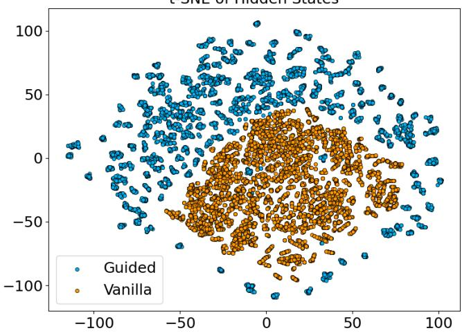  
Figure 1: t-SNE (van der Maaten and Hinton 2008) visualization of final-layer rollout representations from vanilla RLVR and guided steering, with 32 rollouts per problem. Total variance is computed in the standardized high-dimensional representation space before projection.

We examine this phenomenon by sampling 32 responses per problem on 200 MATH instances (Hendrycks et al. 2021) under vanilla RLVR and guided steering. Total variance is computed before dimensionality reduction as the trace of the covariance matrix of the standardized final-layer representations, equivalently the sum of variance across hidden dimensions; t-SNE (van der Maaten and Hinton 2008) is used only for visualization. As shown in Figure 1, vanilla RLVR produces a compact cluster, whereas guided steering spreads the rollout representations over a substantially broader region and increases total variance by nearly fourfold. This contrast indicates that steering-token interventions reduce the representational concentration observed under vanilla sampling. We observe the same trend with both GRPO (Shao et al. 2024) and DAPO (Yu et al. 2026) across mathematical reasoning benchmarks.

These observations motivate a more direct approach to expanding the exploration space. In reasoning tasks, certain thinking tokens, such as discourse connectives (“Therefore”, “However”) and reflective markers (“Wait”, “Since”), carry disproportionately high mutual information with respect to the final answer (Qian et al. 2026). These tokens appear at structural turning points in reasoning chains, where the model shifts between inductive generalization and deductive inference (Sloman and Sloman 2009; Cai et al. 2025). Rather than relying solely on stochastic temperature sampling, exploration can therefore be guided by promoting such tokens at selected points during generation.

Building on this insight, we introduce Guided-RLVR, which augments RLVR with a lightweight learned Logic Controller. During rollout generation, the controller is activated at high-entropy sentence boundaries and conditions on the policy’s hidden state to select a semantically meaningful steering token. It then boosts the selected token’s logit before sampling from the perturbed next-token distribution. The controller and policy are optimized jointly using the same group-relative advantages, reinforcing interventions associated with higher-reward rollouts. Consequently, the guided rollout distribution increases the likelihood of sampling lowprior, high-reward reasoning trajectories that vanilla RLVR rarely explores.

We evaluate Guided-RLVR on mathematical reasoning (MATH (Hendrycks et al. 2021), AIME2024, AIME2025, and AMC2023) and code generation (Code-R1) using two backbones (Qwen2.5-7B-Instruct and Qwen3-4B) and two RLVR algorithms (GRPO and DAPO). Across all four combinations of backbone and RLVR algorithm, Guided-RLVR achieves the highest average performance, outperforming both vanilla RLVR and the exploration-enhanced methods ENT (Cheng et al. 2026) and REP (Tuyls et al. 2026). The improvements are particularly consistent at larger sampling budgets. Complementary analyses of trajectory diversity and pass@k scaling show that these gains are accompanied by more diverse reasoning trajectories and broader problem coverage under repeated sampling, supporting the intended role of Guided-RLVR in guided exploration.

Our main contributions are:

• We show why standard RLVR rarely reaches low-prior trajectories under a finite rollout budget. A union-bound analysis links their vanishing learning signals to their sampling probabilities.

• We introduce Guided-RLVR with a state-conditioned Logic Controller. At high-entropy sentence boundaries, it selects steering tokens to perturb the rollout distribution. The controller and policy are jointly optimized with an auxiliary log-perplexity exploration reward. This design increases the likelihood of sampling low-prior, highreward reasoning trajectories.

• Experiments show that Guided-RLVR achieves stronger pass@k scaling and greater trajectory diversity without increasing generation length, suggesting broader exploration of the reasoning space.

## 2 Related Work

## 2.1 Exploration in RLVR

RLVR methods such as GRPO (Shao et al. 2024) and DAPO (Yu et al. 2026) improve reasoning through verifiable feedback, yet gains in single-sample accuracy can coexist with reduced solution coverage under repeated sampling (Yue et al. 2025; Wu et al. 2025). To encourage exploration, ENT (Cheng et al. 2026) augments advantages with a clipped, gradient-detached entropy term, while REP (Tuyls et al. 2026) and DIVER (Hu et al. 2026) introduce representation-based and sequence-level diversity incentives, respectively. CDE (Dai et al. 2025) uses response perplexity and critic uncertainty, and likelihood-based rewards provide feedback from reference-answer probabilities (Kwiatkowski et al. 2026). These methods shape exploration through optimization signals; our focus is a complementary intervention in the rollout sampling process.

Exploration has also been studied at finer granularity. Wang et al. (2025) identify high-entropy forking tokens and concentrate policy-gradient updates on them, alongside decoding experiments at these positions. SIREN (Jiang et al. 2025) restricts entropy regularization to selected positions and vocabulary candidates, while Lp-Reg (Huang et al. 2026a) protects potentially useful low-probability candidates from suppression. These results motivate targeted exploration rather than indiscriminate entropy maximization. Guided-RLVR builds on this perspective by learning which semantic steering token to promote at high-entropy sentence boundaries, directly biasing the next-token distribution during rollout generation.

## 2.2 Guided Rollouts and Reasoning-Time Steering

G2RPO-A (Guo et al. 2026) and ICPO (Huang et al. 2026b) guide RL rollouts through reference reasoning steps and incontext expert demonstrations, respectively. Our controller selects semantic steering tokens from the current hidden state to guide continuations at eligible sentence boundaries.

At inference time, Soft Reasoning (Zhu et al. 2025) guides generation through first-token embedding search, while ESamp (Zeng et al. 2026) steers decoding using latent novelty estimates. Qian et al. (2026) use thinking-token interventions to guide reasoning. Guided-RLVR incorporates semantic-token steering into RL rollout generation, jointly optimizing the controller and reasoning policy.

## 3 Methodology

## 3.1 Problem Formulation

Let $\pi _ { \theta }$ denote the unperturbed LLM policy and $b _ { \mathrm { o l d } }$ the rollout distribution obtained from its old snapshot using the configured temperature and top-k/top-p decoding. Given a prompt x, standard RLVR (Shao et al. 2024) samples $G$ responses $\{ y ^ { ( i ) } \} _ { i = 1 } ^ { G } \sim b _ { \mathrm { o l d } } ( \cdot \textit { \textbf { \vert } } x )$ , computes rewards $R _ { i } \ = \ R ( x , y ^ { ( i ) } )$ , and forms group-relative advantages $\hat { A } ^ { ( i ) } = ( R _ { i } - \mu _ { R } ) / ( \sigma _ { R } + \epsilon _ { a d v } )$ , where $\mu _ { R }$ and $\sigma _ { R }$ are the group mean and standard deviation, and $\epsilon _ { a d v }$ is a small constant for numerical stability. The policy θ is updated by minimizing

$$
\begin{array} { r l r } & { } & { \mathcal { L } _ { \mathrm { G R P O } } ( \theta ) = - \mathbb { E } _ { b _ { \mathrm { o l d } } } \Bigg [ \frac { 1 } { G } \sum _ { i = 1 } ^ { G } \frac { 1 } { T _ { i } } \sum _ { t = 1 } ^ { T _ { i } } } \\ & { } & { \operatorname* { m i n } \Big ( r _ { i , t } \hat { A } _ { i } , \mathrm { c l i p } ( r _ { i , t } , 1 - \epsilon , 1 + \epsilon ) \hat { A } _ { i } \Big ) \Bigg ] , } \end{array}\tag{1}
$$

where $T _ { i } \ = \ | y ^ { ( i ) } | , \ r _ { i , t } \ = \ \pi _ { \theta } ( y _ { t } ^ { ( i ) } \ | \ x , y _ { < t } ^ { ( i ) } ) / \pi _ { \theta _ { \mathrm { o l d } } } ( y _ { t } ^ { ( i ) } \ |$ $x , y _ { < t } ^ { ( i ) } )$ is the per-token policy ratio, ϵ controls clipping, and no KL penalty is applied. The expectation includes prompts drawn from the training data and rollout groups drawn from $b _ { \mathrm { o l d } }$ . Here $\theta _ { \mathrm { o l d } }$ denotes the policy snapshot used to collect the rollout group, not the initial pretrained model.

This formulation reweights high-reward trajectories once sampled, but exploration stays tied to the rollout distribution $b _ { \mathrm { o l d } } . \mathrm { L e t } \mathcal { A } _ { x }$ denote valid but low-prior trajectories for x, such as an uncommon decomposition or a corrective reflection step. Each rollout independently lands in $\mathcal { A } _ { x }$ with probability $b _ { \mathrm { o l d } } ( \mathcal { A } _ { x } \mid x )$ . Let $P _ { \mathrm { h i t } } ( \bar { \mathcal { A } } _ { x } )$ denote the probability that at least one of the G sampled rollouts belongs to $\mathcal { A } _ { x }$ . By Boole’s inequality (the union bound),

$$
\begin{array} { r l } & { P _ { \mathrm { h i t } } ( \mathcal { A } _ { x } ) = P \Big ( \displaystyle \bigcup _ { i = 1 } ^ { G } \{ y ^ { ( i ) } \in \mathcal { A } _ { x } \} \Big ) } \\ & { \qquad \le \displaystyle \sum _ { i = 1 } ^ { G } P \big ( y ^ { ( i ) } \in \mathcal { A } _ { x } \big ) = G b _ { \mathrm { o l d } } ( \mathcal { A } _ { x } \mid x ) . } \end{array}
$$

When $b _ { \mathrm { o l d } } ( A _ { x } \ | \ x ) \ \ll \ 1 / G .$ , or when it is exactly zero under top-p truncation, such trajectories are rarely or never observed under a finite rollout budget. The same bound propagates to the learning signal: since the gradient of the GRPO objective above is an expectation over $b _ { \mathrm { o l d } } .$ , the contribution of $\mathcal { A } _ { x }$ is scaled by $b _ { \mathrm { o l d } } \mathbf { \hat { ( } } A _ { x } \mathbf { \textbf { | } } x )$ and vanishes in the same edge case (derivation in Appendix F.1). Low-prior trajectories thus yield a vanishing learning signal, and unsampled ones none at all: standard RLVR mainly reweights trajectories the current policy already favors, rather than expanding the explored reasoning space.

This motivates our goal: rather than rely solely on selfsampling from $b _ { \mathrm { o l d } }$ , we construct a guided rollout distribution $\pi _ { \theta _ { \mathrm { o l d } } , \phi _ { \mathrm { o l d } } } ^ { \mathrm { p e r t } } ( \cdot \mid x )$ with the aim of increasing the probability of low-prior, high-reward regions $\mathcal { A } _ { x }$

$$
\pi _ { \theta _ { \mathrm { o l d } } , \phi _ { \mathrm { o l d } } } ^ { \mathrm { p e r t } } ( A _ { x } \mid x ) > b _ { \mathrm { o l d } } ( A _ { x } \mid x ) ,
$$

while retaining verifiable task feedback. Guided-RLVR achieves this with a lightweight controller that perturbs sampling through steering tokens, guiding exploration beyond the base model’s dominant modes.

## 3.2 Guided-RLVR

Human reasoning combines inductive steps, which infer patterns from instances, and deductive steps, which apply them under constraints (Sloman and Sloman 2009). This interplay also matters for language-model reasoning: dynamically integrating induction and deduction improves LLM adaptability (Cai et al. 2025), and reflective or transitional tokens (e.g., $^ { * * } \mathrm { S o ^ { 3 } , ^ { * * } S i n c e ^ { 3 } , ^ { * * } I f ^ { 3 } } )$ coincide with mutual-information peaks that correlate with lower prediction error (Qian et al. 2026).

Motivated by these observations, we propose Guided-RLVR (Figure 2), a guided RLVR framework with a lightweight controller that perturbs the next-token distribution toward semantically meaningful steering tokens during rollout. This structured intervention exposes the policy to a broader range of candidate reasoning trajectories.

Logic Controller Formally, the Logic Controller $\mu _ { \phi }$ is a small MLP that selects which steering token to promote during rollout generation. Its vocabulary and hidden-state aggregation are detailed in Appendix B.

The controller is queried only when two conditions hold: (i) the previous token ends with one of punctuation marks $( \ . \ ? \ ! )$ , defining a sentence boundary; and (ii) the model exhibits high entropy, indicating uncertainty over the next continuation:

$$
H ( \pi _ { \theta } ( \cdot \mid x , y _ { < t } ) ) > \tau _ { t } ,
$$

where $H ( \cdot )$ is the entropy and $\tau _ { t }$ is a dynamic threshold (full schedule in Appendix B.2).

At a triggered step t, the controller conditions on the model’s hidden state and outputs a discrete action

$$
a _ { t } \in \mathcal { A } = \{ 1 , 2 , \ldots , K \} ,
$$

each corresponding to a steering token $v _ { k }$ from a predefined set $\mathcal { T } = \{ v _ { 1 } , \ldots , v _ { K } \}$ . The selected token’s logit is adjusted by δ to reach the target probability $p _ { \mathrm { t a r g e t } }$ (derivation in $\mathsf { A p - }$ pendix A). Temperature scaling and top-k/top-p filtering then yield the perturbed distribution $\pi _ { \theta , \phi } ^ { \mathrm { p e r t } } ( \bar { y } _ { t } \mid x , \bar { y } _ { < t } )$

Exploration via a Log-Perplexity Reward The sparse correctness reward cannot determine whether an intervention contributed to a correct rollout or was merely incidental (Dai et al. 2025), so we add a log-perplexity exploration bonus. Following likelihood-based rewards that use the model’s logprobability of a reference answer (Kwiatkowski et al. 2026), we use the reduction in uncertainty over the answer tokens y as an auxiliary signal for guided reasoning. Let $\ell _ { \mathrm { b a s e } }$ denote the log-perplexity of the answer sequence y conditioned only on the prompt x, and let $\ell _ { \mathrm { c o t } }$ denote the log-perplexity of the same answer conditioned additionally on the controllerguided reasoning chain ${ \hat { x } } _ { \mathrm { t h i n k } } \mathbf { : }$

$$
\begin{array} { l } { { \ell _ { \mathrm { b a s e } } = - \displaystyle \frac { 1 } { | y | } \sum _ { i = 1 } ^ { | y | } \log p ( y _ { i } \mid x , y _ { < i } ) , } } \\ { { \ell _ { \mathrm { c o t } } = - \displaystyle \frac { 1 } { | y | } \sum _ { i = 1 } ^ { | y | } \log p ( y _ { i } \mid x , \hat { x } _ { \mathrm { t h i n k } } , y _ { < i } ) . } } \end{array}
$$

A positive gap $\Delta \ell = \ell _ { \mathrm { b a s e } } - \ell _ { \mathrm { c o t } } > 0$ means the reasoning chain reduces the model’s uncertainty over the answer. The total reward combines the correctness reward with a scaled version of this exploration bonus:

$$
r _ { \mathrm { t o t a l } } = r _ { \mathrm { o r i g } } + \alpha \cdot f ( \Delta \ell ) ,
$$

where $f ( \cdot )$ normalizes and clips $\Delta \ell$ (Appendix C.4).

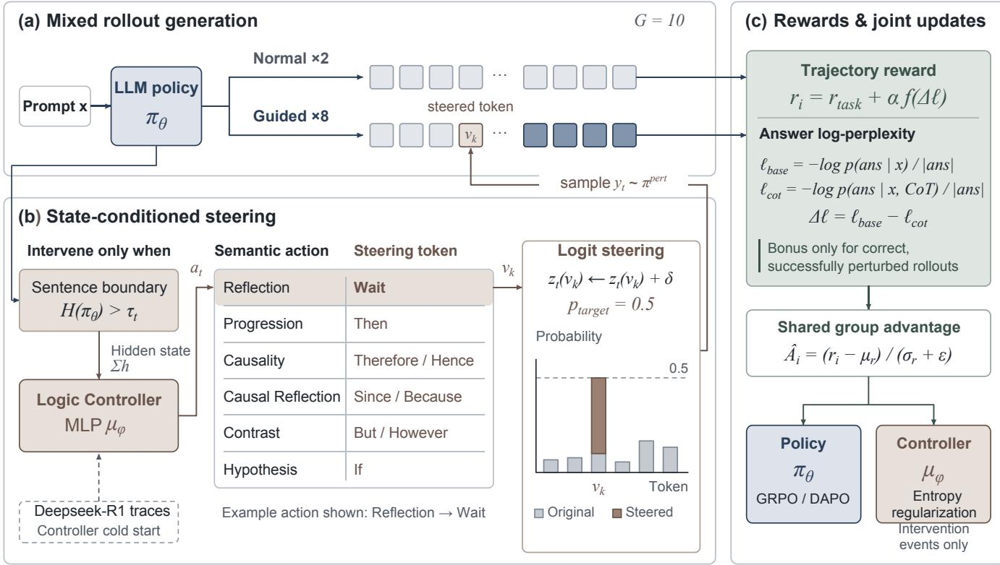  
Figure 2: Overview of Guided-RLVR. (a) For each prompt $x ,$ policy $\pi _ { \theta }$ generates $G = 1 0$ rollouts: two unperturbed (greedy and stochastic) and eight guided. (b) At sentence boundaries where next-token entropy $H ( \pi _ { \theta } )$ exceeds the dynamic threshold $\tau _ { t } ,$ , the Logic Controller $\mu _ { \phi }$ maps aggregated hidden states $\sum h$ to a semantic action $a _ { t }$ and steering token $v _ { k } . \mathbf { A }$ bias δ boosts its logit $z _ { t } ( v _ { k } )$ toward probability $p _ { \mathrm { t a r g e t } } = 0 . 5$ before sampling the next token $y _ { t }$ from the perturbed distribution $\pi ^ { \mathrm { p e r t } }$ . (c) Reward $r _ { i }$ combines task correctness $r _ { \mathrm { t a s k } }$ with a bonus $\alpha f ( \Delta \ell )$ , granted only to correct math rollouts where a promoted token was sampled. Here $\Delta \ell = \ell _ { \mathrm { b a s e } } - \ell _ { \mathrm { c o t } }$ measures the same answer’s log-perplexity reduction when conditioned on the reasoning chain; $f$ normalizes and clips this diference, and α scales the bonus. Group mean $\mu _ { r }$ , standard deviation $\sigma _ { r }$ , and stabilizer ϵ normalize rewards into advantages ${ \hat { A } } _ { i }$ shared by policy and controller updates.

Joint Optimization of Policy and Controller Each rollout group mixes guided completions from $\pi _ { \theta _ { \mathrm { o l d } } , \phi _ { \mathrm { o l d } } } ^ { \mathrm { p e r t } }$ with unperturbed baselines (Section 4.1). Denote this collection procedure by $\mathcal { Q } _ { \mathrm { o l d } }$ and the group-relative advantage from composite rewards by ${ \hat { A } } _ { i }$

Logit boosting is used only for rollout sampling. For policy optimization, we keep the sampled completion, including steering tokens, but evaluate both current and old probabilities on the same prefixes using unboosted logits at the configured loss temperature:

$$
r _ { i , t } ( \theta ) = \frac { \pi _ { \theta } ( y _ { t } ^ { ( i ) } \mid x , y _ { < t } ^ { ( i ) } ) } { \pi _ { \theta _ { \mathrm { o l d } } } ( y _ { t } ^ { ( i ) } \mid x , y _ { < t } ^ { ( i ) } ) } .\tag{2}
$$

For GRPO, we minimize

$$
\begin{array} { r l } { \mathcal { L } _ { \mathrm { L L M } } ( \boldsymbol { \theta } ) = } & { - \mathbb { E } _ { \boldsymbol { \mathcal { Q } } _ { \mathrm { o l d } } } \left[ \cfrac { 1 } { G } \displaystyle \sum _ { i = 1 } ^ { G } \cfrac { 1 } { T _ { i } } \sum _ { t = 1 } ^ { T _ { i } } \right. } \\ & { \left. \operatorname* { m i n } \Bigl ( r _ { i , t } \hat { A } _ { i } , \ : \exp ( r _ { i , t } ) \hat { A } _ { i } \Bigr ) \right] , } \end{array}\tag{3}
$$

where $T _ { i } = | y ^ { ( i ) } |$ and clipping uses $[ 1 - \epsilon _ { \mathrm { l o w } } , 1 + \epsilon _ { \mathrm { h i g h } } ]$ DAPO divides the summed clipped terms by the generation batch’s completion-token count. Both objectives use guided data without additional importance correction (Appendix C.2).

The controller shares ${ \hat { A } } _ { i }$ , averaging valid successful interventions within each completion and weighting eligible completions equally:

$$
\begin{array} { r } { \mathcal { L } _ { \mathrm { c t r l } } ( \phi ) = - \mathbb { E } _ { i , e } \Big [ \hat { A } _ { i } \log \mu _ { \phi } ( a _ { e } \mid h _ { e } ) } \\ { + \lambda _ { H } \mathcal { H } \big ( \mu _ { \phi } ( \cdot \mid h _ { e } ) \big ) \Big ] . } \end{array}\tag{4}
$$

Here $\lambda _ { H }$ weights entropy regularization. The policy and controller use separate optimizers on the same rollout batch.

## 4 Experiments

## 4.1 Experimental Setup

Backbone Models We conduct our main experiments on two backbone models: Qwen2.5-7B-Instruct (Qwen et al. 2025) and Qwen3-4B (Yang et al. 2025). These models differ in parameter scale and post-training recipe, allowing us to assess whether the benefits of our method persist across distinct model configurations.

Datasets. For MATH (Hendrycks et al. 2021), we sample 2,000 training instances and 500 test instances from the original dataset. For Code-R1 (Liu and Zhang 2025), we sample 2,000 training instances and 500 test instances from the original dataset. For the competition benchmarks, we train on 2,000 instances sampled from DAPO-Math-17k-Processed (Yu et al. 2026) and evaluate on AIME2024, AIME2025, and AMC2023.

Evaluation metric. We report pass@K (Chen et al. 2021). Following (Cheng et al. 2026), we use $K \ : = \ : 1 2 8$ for the smaller and more challenging competition AIME2024/2025, and AMC2023, and $K = 1 \bar { 6 }$ for MATH and Code-R1. The estimator and sampling budgets are detailed in Appendix D.

Baselines We compare against vanilla GRPO (Shao et al. 2024) and DAPO (Yu et al. 2026), as well as two exploration baselines: ENT (Cheng et al. 2026) and REP (Tuyls et al. 2026). Our method augments GRPO/DAPO with the Logic Controller. We hold the RL training data, training schedule, decoding configuration, and evaluation procedure fixed across variants; method coeficients follow the corresponding implementations.

Controller cold start. Before RL training, we cold-start the controller on OpenThoughts-114k-math (Guha et al. 2025) using DeepSeek-R1 (Guo et al. 2025) traces, training it to predict six steering categories (Reflection, Progression, Causality, Causal Reflection, Contrast, Hypothesis) (Qian et al. 2026; Cai et al. 2025) at sentence boundaries (Appendix C.1). This provides additional controller supervision that none of the baselines receives. To separate the contribution of supervised initialization from guided RL training, we also evaluate a controller trained from random initialization without this cold start (Section 4.4).

Each group contains $G = 1 0$ completions: two unperturbed baselines (one greedy and one stochastic) and eight controller-guided completions. We set $p _ { \mathrm { t a r g e t } } = 0 . 5$ and apply the log-perplexity bonus only to successfully perturbed, correct rollouts. All methods are trained for 5,000 steps on MATH and Code-R1, and 1,000 steps on AIME2024, AIME2025, and AMC2023. Data processing, reward design, and training hyperparameters are detailed in Appendix C.

## 4.2 Main Results

Table 1 presents results across two backbones and five benchmarks. We compare Guided-RLVR with vanilla GRPO and DAPO, as well as variants augmented with ENT or REP. Guided-RLVR achieves the highest average score for every pairing of backbone and RLVR algorithm. Its margin over the strongest baseline ranges from 1.1 to 2.8 points.

The benefits of Guided-RLVR are most evident under repeated sampling. On AIME2024, AIME2025, and AMC2023, it achieves the best or tied-best pass@128 for every pairing of backbone and RLVR algorithm. With the same budget of 128 samples per problem, a higher pass@128 means that a larger fraction of problems are solved at least once. These results therefore indicate that guided exploration broadens problem coverage.

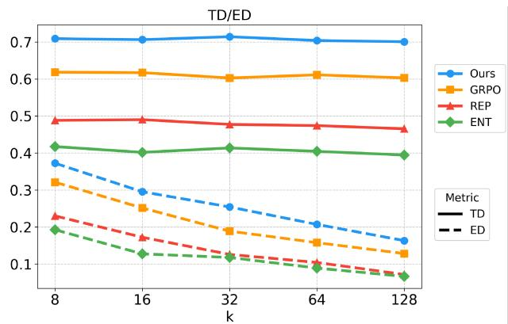  
Figure 3: Trajectory diversity across sampling budgets on MATH using Qwen2.5-7B-Instruct with GRPO. Solid lines denote TD and dashed lines denote ED; higher values indicate greater diversity.

## 4.3 Exploration Analysis

To determine whether the performance gains are accompanied by broader exploration, we analyze trajectory diversity, pass@k scaling, and generation length.

Trajectory diversity. We measure diversity on the 500- problem MATH test split using Qwen2.5-7B-Instruct with GRPO. Following (Hu et al. 2026), we report Textual Diversity (TD) and Equational Diversity (ED). TD is computed as the average pairwise dissimilarity between responses at the sentence level. ED is defined as the proportion of equations in a given response that do not appear in any other response sampled for the same problem. Higher values of TD and ED indicate greater textual variation and greater derivational diversity, respectively.

Figure 3 reports both metrics for sampling budgets from k=8 to k=128. Guided-RLVR achieves the highest TD and ED at every budget. At k=128, it obtains TD= 0.70 and $\mathrm { E D = 0 . 1 6 , }$ , compared with $\mathrm { T D } { = } ~ 0 . 6 0$ and ED= 0.13 for vanilla GRPO. ENT and REP remain below vanilla GRPO on both metrics across all budgets, showing that explorationoriented objectives do not necessarily yield diverse rollouts. By directly perturbing the sampling distribution through state-conditioned steering token selection, Guided-RLVR produces greater textual variation and a broader range of equation sets under the same sampling budget.

Pass@k scaling. Table 1 reports performance at selected sampling budgets. To examine performance across the full range of budgets, Figure 4 presents pass@k curves for all five benchmarks using Qwen3-4B with GRPO. Guided-RLVR maintains a clear advantage throughout the sampling range on AIME2024 and AIME2025, and remains best or competitive across budgets on AMC2023, MATH, and Code-R1. The consistent ranking across values of k shows that the gains are not specific to the endpoint budgets reported in Table 1. At any fixed k, a higher pass@k means that more problems are solved by at least one sampled response; the curves therefore demonstrate more efective use of the available sampling budget.

<table><tr><td rowspan="2">Method</td><td colspan="2">MATH</td><td colspan="2">AIME2024</td><td colspan="2">AIME2025</td><td colspan="2">AMC2023</td><td colspan="2">Code-R1</td><td rowspan="2">AVG</td></tr><tr><td>pass@1</td><td>pass@16</td><td>pass@1</td><td>pass@128</td><td>pass@1</td><td>pass@128</td><td>pass@1</td><td>pass@128</td><td>pass@1</td><td>pass@16</td></tr><tr><td colspan="2">Qwen2.5-7B-Instruct</td><td></td><td></td><td></td><td></td><td></td><td></td><td></td><td></td><td></td><td></td></tr><tr><td>GRPO</td><td>62.1</td><td>79.4</td><td>11.20</td><td>46.67</td><td>5.99</td><td>50.00</td><td>43.23</td><td>90.36</td><td>82.0</td><td>94.8</td><td>56.58</td></tr><tr><td>GRPO + ENT</td><td>64.5</td><td>78.8</td><td>7.97</td><td>46.67</td><td>7.06</td><td>46.67</td><td>39.31</td><td>91.57</td><td>80.4</td><td>93.2</td><td>55.62</td></tr><tr><td>GRPO + REP</td><td>64.9</td><td>78.0</td><td>10.89</td><td>50.00</td><td>6.48</td><td>50.00</td><td>43.22</td><td>91.57</td><td>82.6</td><td>95.6</td><td>57.33</td></tr><tr><td>GRPO + Ours</td><td>65.6</td><td>80.6</td><td>12.11</td><td>53.33</td><td>5.03</td><td>53.33</td><td>42.77</td><td>92.77</td><td>82.6</td><td>96.0</td><td>58.41</td></tr><tr><td>DAPO</td><td>65.2</td><td>81.2</td><td>10.57</td><td>43.33</td><td>5.68</td><td>46.67</td><td>43.05</td><td>87.95</td><td>80.2</td><td>96.0</td><td>55.98</td></tr><tr><td>DAPO + ENT</td><td>64.1</td><td>78.8</td><td>10.65</td><td>50.00</td><td>4.66</td><td>46.67</td><td>42.92</td><td>90.36</td><td>81.4</td><td>94.4</td><td>56.40</td></tr><tr><td>DAPO + REP</td><td>65.1</td><td>79.6</td><td>10.33</td><td>43.33</td><td>4.92</td><td>46.67</td><td>43.60</td><td>89.16</td><td>81.2</td><td>96.8</td><td>56.07</td></tr><tr><td>DAPO + Ours</td><td>65.5</td><td>81.4</td><td>11.56</td><td>50.00</td><td>5.08</td><td>50.00</td><td>42.25</td><td>91.57</td><td>81.6</td><td>96.6</td><td>57.56</td></tr><tr><td>Qwen3-4B</td><td></td><td></td><td></td><td></td><td></td><td></td><td></td><td></td><td></td><td></td><td></td></tr><tr><td>GRPO</td><td>65.0</td><td>78.2</td><td>15.94</td><td>63.33</td><td>12.06</td><td>53.33</td><td>43.45</td><td>93.98</td><td>85.5</td><td>95.4</td><td>60.62</td></tr><tr><td>GRPO + ENT</td><td>63.8</td><td>77.4</td><td>25.96</td><td>73.33</td><td>20.65</td><td>70.00</td><td>56.50</td><td>93.98</td><td>85.8</td><td>95.4</td><td>66.28</td></tr><tr><td>GRPO + REP</td><td>61.0</td><td>74.6</td><td>37.32</td><td>80.00</td><td>28.26</td><td>73.33</td><td>66.52</td><td>96.39</td><td>85.4</td><td>95.4</td><td>69.82</td></tr><tr><td>GRPO + Ours</td><td>66.3</td><td>78.6</td><td>41.17</td><td>83.33</td><td>32.94</td><td>76.67</td><td>67.72</td><td>97.59</td><td>85.9</td><td>96.2</td><td>72.64</td></tr><tr><td>DAPO</td><td>66.0</td><td>76.8</td><td>14.13</td><td>73.33</td><td>13.20</td><td>70.00</td><td>45.52</td><td>92.77</td><td>85.6</td><td>94.8</td><td>63.21</td></tr><tr><td>DAPO + ENT</td><td>64.4</td><td>75.8</td><td>20.29</td><td>76.67</td><td>19.09</td><td>70.00</td><td>56.04</td><td>95.18</td><td>85.6</td><td>96.0</td><td>65.91</td></tr><tr><td>DAPO + REP</td><td>62.5</td><td>74.4</td><td>38.20</td><td>83.33</td><td>29.19</td><td>73.33</td><td>64.05</td><td>97.59</td><td>85.2</td><td>96.2</td><td>70.40</td></tr><tr><td>DAPO + Ours</td><td>66.5</td><td>77.4</td><td>38.98</td><td>83.33</td><td>29.84</td><td>76.67</td><td>63.38</td><td>98.80</td><td>85.8</td><td>96.0</td><td>71.67</td></tr></table>

Table 1: Main results across two backbones (Qwen2.5-7B-Instruct and Qwen3-4B) and two RLVR algorithms (GRPO and DAPO). All values are percentages. Ours denotes Guided-RLVR. AVG is the unweighted mean of the ten reported metrics. Within each backbone and RLVR algorithm block, the best value in each column is shown in bold; ties are also shown in bold.

<table><tr><td>Method</td><td>MATH</td><td>AIME2024</td><td>AIME2025</td><td>AMC2023</td></tr><tr><td>GRPO</td><td>326.36</td><td>1224.94</td><td>935.95</td><td>818.50</td></tr><tr><td>GRPO + ENT</td><td>413.90</td><td>1224.84</td><td>910.15</td><td>724.80</td></tr><tr><td>GRPO + REP</td><td>407.15</td><td>1207.24</td><td>964.91</td><td>794.88</td></tr><tr><td>GRPO + Ours</td><td>338.04</td><td>1087.85</td><td>748.06</td><td>693.89</td></tr></table>

Table 2: Average generation length in tokens for the GRPO variants on four mathematical benchmarks using Qwen2.5- 7B-Instruct, averaged over all completions. Lower values indicate shorter generations.

Generation length. To examine whether broader exploration simply reflects longer generations, we compare the average generation length of the GRPO variants on four mathematical benchmarks using Qwen2.5-7B-Instruct (Table 2). Guided-RLVR remains close to vanilla GRPO on MATH and produces shorter responses on all three competition benchmarks. It also uses fewer tokens than ENT and REP on every benchmark. These results indicate that the improvements in trajectory diversity and pass@k are not primarily explained by longer reasoning chains (Wu et al. 2025). Stateconditioned steering redirects the rollout distribution without mechanically extending the generated sequences.

Overall, Guided-RLVR enhances exploration in two complementary respects: higher pass@k reflects broader problem coverage under a fixed sampling budget, while higher TD and ED indicate greater textual and equational diversity among sampled trajectories. These benefits are obtained without longer generations, indicating that increased token consumption is not their primary explanation. Appendix E.1 further examines the controller’s action distribution and token-specific outcomes.

## 4.4 Ablation and Sensitivity

Setup. We conduct a controlled ablation on the 500- problem MATH test split using Qwen2.5-7B-Instruct trained with GRPO. Starting from the complete Guided-RLVR configuration, we modify one component at a time: (a) replace the learned, state-conditioned controller with random steering token selection; (b) always select the fixed steering token “Wait”; (c) remove the entropy threshold while retaining the sentence-boundary trigger; (d) remove the log-perplexity exploration reward; (e) grant the exploration bonus to all rollouts, in contrast to restricting it to those that are both successfully perturbed and correct; (f) omit supervised controller cold-start training while retaining online joint optimization; or (g) exclude steering-attempt positions from the policy loss while retaining guided generation and controller updates. All variants share the RL training configuration and are evaluated at their respective best checkpoints. We report pass@1 and pass@16 using 16 independent samples per problem. Pass@1 estimates the success probability of a single sampled response, whereas pass@16 reflects the ability to produce at least one correct solution across multiple attempts.

Steering-token selection. Replacing the learned controller with random steering-token selection lowers pass@1 from 65.6 to 63.4 and pass@16 from 80.6 to 77.2. The decline in both metrics suggests that state-conditioned token selection improves individual rollouts and helps generate useful complementary reasoning trajectories under repeated sampling.

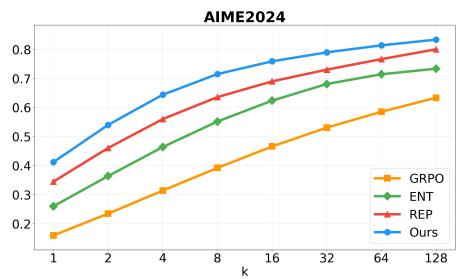

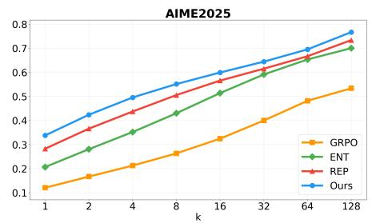

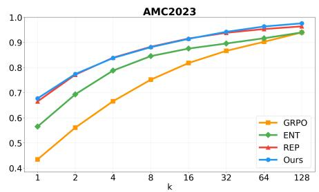

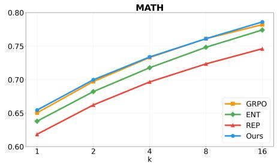

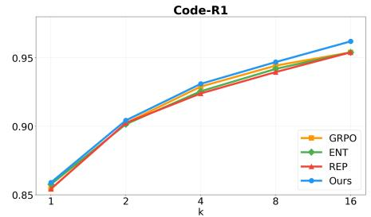  
Figure 4: Pass@k scaling across all five benchmarks using Qwen3-4B with GRPO. The maximum sampling budget is k=128 for AIME2024, AIME2025, and AMC2023, and k=16 for MATH and Code-R1.

<table><tr><td>Variant</td><td>pass@1</td><td>pass@16</td></tr><tr><td>Vanilla GRPO</td><td>62.1</td><td>79.4</td></tr><tr><td>Guided-RLVR</td><td>65.6</td><td>80.6</td></tr><tr><td>(a) Random steering token selection</td><td>63.4</td><td>77.2</td></tr><tr><td>(b) Fixed steering token (“Wait’)</td><td>63.9</td><td>78.2</td></tr><tr><td>(c) No entropy threshold</td><td>62.1</td><td>79.2</td></tr><tr><td>(d) No log-perplexity reward</td><td>62.0</td><td>79.6</td></tr><tr><td>(e) Unconditional bonus</td><td>64.6</td><td>79.4</td></tr><tr><td>(f) No controller cold start</td><td>64.0</td><td>79.6</td></tr><tr><td>(g) Mask steering-attempt positions</td><td>63.8</td><td>80.0</td></tr></table>

Table 3: Component ablation on MATH using Qwen2.5- 7B-Instruct with GRPO. All values are percentages. Both pass@1 and pass@16 are estimated from 16 independent samples per problem at the selected checkpoint.

Fixed token selection. Always selecting “Wait” lowers pass@1 from 65.6 to 63.9 and pass@16 from 80.6 to 78.2. This gap suggests that a single connective is insuficient to cover the diferent reasoning transitions needed across problems and rollouts. “Wait” promotes reflection but cannot provide other semantic directions such as progression, causality, contrast, or hypothesis. State-conditioned selection among multiple categories therefore provides broader steering and improves problem coverage under repeated sampling.

Entropy threshold. Removing the entropy threshold decreases pass@1 by 3.5 points and pass@16 by 1.4 points. Restricting interventions to high-entropy sentence boundaries therefore benefits both metrics. During training without the threshold, policy entropy rises instead of converging while evaluation accuracy declines (Appendix E.2). This pattern supports the role of the entropy threshold in controlling perturbations and maintaining stable guided exploration.

Log-perplexity reward. Removing the log-perplexity exploration reward decreases pass@1 from 65.6 to 62.0 and pass@16 from 80.6 to 79.6. Without this auxiliary signal, the model receives no direct feedback on whether a guided reasoning chain makes the correct answer more predictable. The decline in both metrics suggests that the log-perplexity reward helps reinforce useful perturbations beyond the sparse correctness reward alone.

Conditional exploration bonus. Granting the exploration bonus unconditionally decreases pass@1 from 65.6 to 64.6 and pass@16 from 80.6 to 79.4. The log-perplexity bonus measures whether the reasoning chain makes the generated answer more predictable, not whether that answer is correct. An incorrect answer can therefore receive a positive bonus when it is granted unconditionally. Restricting the bonus to successfully perturbed, correct rollouts keeps this auxiliary signal aligned with task correctness.

Controller cold start. Without supervised controller initialization, Guided-RLVR achieves pass@1 of 64.0 and pass@16 of 79.60. These scores exceed vanilla GRPO by 1.94 and 0.20 percentage points, respectively. Its pass@16 also exceeds ENT (78.8) and REP (78.0), although its pass@1 remains below both exploration baselines. Cold start adds 1.56 points in pass@1 and 1.00 point in pass@16 over this variant.

Intervention-position loss masking. To test whether intervention positions should contribute to policy learning, variant (g) retains guided generation and controller updates but excludes the policy-loss term at every position where steering is attempted, even if the promoted token is not sampled. Generated tokens remain in the context, and GRPO averages over the remaining valid positions. This masking lowers pass@1/pass@16 from 65.6/80.6 to 63.8/80.0, favoring retention of intervention positions in the policy loss (Appendix E.3).

Hyperparameter Sensitivity We investigate the impact of the log-perplexity exploration bonus coeficient α. Figure 5 compares $\alpha \in \{ 0 . 0 1 , 0 . 1 , 1 . 0 \}$ on MATH using Qwen2.5- 7B-Instruct. The $\alpha = 0 . 0 1$ setting achieves the highest peak accuracy and outperforms the larger coeficients at most checkpoints, whereas $\alpha = 0 . 1$ and $\alpha = 1 . 0$ generally produce lower and less stable accuracy. Because the bonus rewards reductions in answer uncertainty, excessive weighting can favor perturbations that make the answer more predictable without improving its correctness. The bonus should therefore remain auxiliary to the verifiable reward, keeping guided exploration aligned with task correctness; we use $\alpha = 0 . 0 1$ throughout.

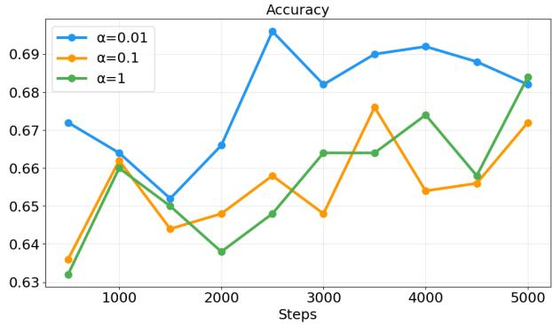  
Figure 5: Efect of the log-perplexity reward coeficient α on MATH evaluation accuracy during training using Qwen2.5- 7B-Instruct.

The ablations establish that efective guided exploration depends on more than injecting steering tokens. The controller must adapt the semantic direction to the current reasoning state, while entropy-based triggering confines interventions to points where redirection is most useful. The logperplexity bonus complements sparse task feedback, but must remain properly weighted and conditioned on correctness to avoid rewarding unhelpful reasoning. These components play complementary roles in making exploration both diverse and task-aligned.

## 4.5 Computational Cost

We measure RL-stage compute cost in a separate timing benchmark using Qwen2.5-7B-Instruct with LoRA on MATH. Each run uses one RTX PRO 6000 Blackwell GPU, $G = 1 0$ generations per prompt, a maximum of 1,024 new tokens, and 5,000 training steps, with evaluation every 500 steps. The recorded Guided-RLVR run uses the controller without supervised cold start.

As shown in Table 4, Guided-RLVR requires 17.92 GPUhours, compared with 15.92 for vanilla GRPO, adding 2.00 GPU-hours (12.6% overhead).

<table><tr><td rowspan=1 colspan=1>Method      GPU-hs/step</td></tr><tr><td rowspan=1 colspan=1>GRPO          15.92 11.46</td></tr><tr><td rowspan=1 colspan=1> $\mathrm { G R P O } + \mathrm { E N T }$   14.22 10.24</td></tr><tr><td rowspan=1 colspan=1> $\mathrm { G R P O } + \mathrm { R E P }$   16.55 11.92</td></tr><tr><td rowspan=1 colspan=1> $\mathrm { G R P O } + \mathrm { O u r s }$   17.92 12.90</td></tr></table>

Table 4: RL-stage compute cost under the shared timing configuration. Ours denotes Guided-RLVR without supervised controller cold start.

## 5 Conclusion

Standard RLVR reinforces successful trajectories once sampled, yet rarely reaches valid low-prior reasoning paths under a finite rollout budget. We introduced Guided-RLVR to enable guided exploration in RLVR. Its state-conditioned controller selects semantically meaningful steering tokens at uncertain reasoning points. By jointly optimizing the controller and policy, Guided-RLVR learns where and how to redirect generation toward underexplored reasoning trajectories.

Across five benchmarks, Guided-RLVR achieves the highest average performance for every pairing of backbone and RLVR algorithm, with particularly consistent gains at larger sampling budgets. Its higher trajectory diversity and broader problem coverage, achieved without longer generations, support the efectiveness of state-conditioned steering in broadening the sampled reasoning trajectories. Ablations further validate the complementary roles of adaptive token selection, entropy-based intervention, and task-aligned exploration feedback. These findings establish targeted perturbation as an efective approach to exploration in RLVR and motivate future work on learned intervention timing and richer steering spaces.

## Acknowledgments

This work was funded by the National Natural Science Foundation of China (NSFC) under Grants No. 62388101, No. 62406013, and No. U25B2070, the Beijing Advanced Innovation Center Funds for Future Blockchain and Privacy Computing, and the Fundamental Research Funds for the Central Universities.

## References

Achiam, J.; Adler, S.; Agarwal, S.; Ahmad, L.; Akkaya, I.; Aleman, F. L.; Almeida, D.; Altenschmidt, J.; Altman, S.; Anadkat, S.; et al. 2023. Gpt-4 technical report. arXiv preprint arXiv:2303.08774.

Cai, C.; Zhao, X.; Liu, H.; Jiang, Z.; Zhang, T.; Wu, Z.; Hwang, J.-N.; and Li, L. 2025. The Role of Deductive and Inductive Reasoning in Large Language Models. In Che, W.; Nabende, J.; Shutova, E.; and Pilehvar, M. T., eds., Proceedings of the 63rd Annual Meeting of the Association for Computational Linguistics (Volume 1: Long Papers), 16780– 16790. Vienna, Austria: Association for Computational Linguistics. ISBN 979-8-89176-251-0.

Chen, M.; Tworek, J.; Jun, H.; Yuan, Q.; Pinto, H. P. D. O.; Kaplan, J.; Edwards, H.; Burda, Y.; Joseph, N.; Brockman,

G.; et al. 2021. Evaluating large language models trained on code. arXiv preprint arXiv:2107.03374.

Cheng, D.; Huang, S.; Zhu, X.; Dai, B.; Zhao, X.; Zhang, Z.; and Wei, F. 2026. Reasoning with exploration: An entropy perspective. In Proceedings of the AAAI Conference on Artificial Intelligence, volume 40, 30377–30385.

Dai, R.; Song, L.; Liu, H.; Liang, Z.; Yu, D.; Mi, H.; Tu, Z.; Liu, R.; Zheng, T.; Zhu, H.; and Yu, D. 2025. CDE: Curiosity-Driven Exploration for Eficient Reinforcement Learning in Large Language Models. arXiv:2509.09675.

Guha, E. K.; Marten, R.; Keh, S.; Raoof, N.; Smyrnis, G.; Bansal, H.; Nezhurina, M.; Mercat, J.; Vu, T.; Sprague, Z. R.; et al. 2025. Openthoughts: Data recipes for reasoning models. In First Workshop on Foundations of Reasoning in Language Models.

Guo, D.; Yang, D.; Zhang, H.; Song, J.; Wang, P.; Zhu, Q.; Xu, R.; Zhang, R.; Ma, S.; Bi, X.; et al. 2025. DeepSeek-R1 incentivizes reasoning in LLMs through reinforcement learning. Nature, 645(8081): 633–638.

Guo, Y.; Deng, W.; Cheng, Z.; and Tang, X. 2026. G2RPO-A: Guided Group Relative Policy Optimization with Adaptive Guidance. In Liakata, M.; Moreira, V. P.; Zhang, J.; and Jurgens, D., eds., Proceedings of the 64th Annual Meeting of the Association for Computational Linguistics (Volume 1: Long Papers), 4525–4539. San Diego, California, United States: Association for Computational Linguistics. ISBN 979-8-89176-390-6.

Hendrycks, D.; Burns, C.; Kadavath, S.; Arora, A.; Basart, S.; Tang, E.; Song, D.; and Steinhardt, J. 2021. Measuring mathematical problem solving with the math dataset. arXiv preprint arXiv:2103.03874.

Hu, Z.; Zhang, S.; Li, Y.; Yan, J.; Hu, X.; Cui, L.; Qu, X.; Chen, C.; Cheng, Y.; and Wang, Z. 2026. Diversity-Incentivized Exploration for Versatile Reasoning. In The Fourteenth International Conference on Learning Representations.

Huang, G.; Xu, T.; Wang, M.; Yi, Q.; Gong, X.; Li, S.; Xiong, R.; Li, K.; Jiang, Y.; and Zhou, B. 2026a. Low-probability Tokens Sustain Exploration in Reinforcement Learning with Verifiable Reward. In Liakata, M.; Moreira, V. P.; Zhang, J.; and Jurgens, D., eds., Findings of the Association for Computational Linguistics: ACL 2026, 24158–24188. San Diego, California, United States: Association for Computational Linguistics. ISBN 979-8-89176-395-1.

Huang, H.-Y.; Tang, C.; Liu, W.; Bai, C.; Yang, S.; and Wu, Y. 2026b. Think Outside the Policy: In-Context Steered Policy Optimization. In Liakata, M.; Moreira, V. P.; Zhang, J.; and Jurgens, D., eds., Findings of the Association for Computational Linguistics: ACL 2026, 2758–2776. San Diego, California, United States: Association for Computational Linguistics. ISBN 979-8-89176-395-1.

Jiang, Y.; Li, Y.; Chen, G.; Liu, D.; Cheng, Y.; and Shao, J. 2025. Rethinking Entropy Regularization in Large Reasoning Models. arXiv:2509.25133.

Kwiatkowski, A.; Butt, N.; Labiad, I.; Kempe, J.; and Ollivier, Y. 2026. Likelihood-Based Reward Designs for General LLM Reasoning. arXiv preprint arXiv:2602.03979.

Lightman, H.; Kosaraju, V.; Burda, Y.; Edwards, H.; Baker, B.; Lee, T.; Leike, J.; Schulman, J.; Sutskever, I.; and Cobbe, K. 2023. Let’s verify step by step. In The Twelfth International Conference on Learning Representations.

Liu, J.; and Zhang, L. 2025. Code-R1: Reproducing R1 for Code with Reliable Rewards.

Qian, C.; Liu, D.; Wen, H.; Bai, Z.; Liu, Y.; and Shao, J. 2026. Demystifying reasoning dynamics with mutual information: Thinking tokens are information peaks in llm reasoning. Advances in Neural Information Processing Systems, 38: 12533–12572.

Qwen; :; Yang, A.; Yang, B.; Zhang, B.; Hui, B.; Zheng, B.; Yu, B.; Li, C.; Liu, D.; Huang, F.; Wei, H.; Lin, H.; Yang, J.; Tu, J.; Zhang, J.; Yang, J.; Yang, J.; Zhou, J.; Lin, J.; Dang, K.; Lu, K.; Bao, K.; Yang, K.; Yu, L.; Li, M.; Xue, M.; Zhang, P.; Zhu, Q.; Men, R.; Lin, R.; Li, T.; Tang, T.; Xia, T.; Ren, X.; Ren, X.; Fan, Y.; Su, Y.; Zhang, Y.; Wan, Y.; Liu, Y.; Cui, Z.; Zhang, Z.; and Qiu, Z. 2025. Qwen2.5 Technical Report. arXiv:2412.15115.

Shao, Z.; Wang, P.; Zhu, Q.; Xu, R.; Song, J.; Bi, X.; Zhang, H.; Zhang, M.; Li, Y.; Wu, Y.; et al. 2024. Deepseekmath: Pushing the limits of mathematical reasoning in open language models. arXiv preprint arXiv:2402.03300.

Sloman, S.; and Sloman, S. A. 2009. Causal models: How people think about the world and its alternatives. Oxford University Press.

Team, G.; Georgiev, P.; Lei, V. I.; Burnell, R.; Bai, L.; Gulati, A.; Tanzer, G.; Vincent, D.; Pan, Z.; Wang, S.; et al. 2024. Gemini 1.5: Unlocking multimodal understanding across millions of tokens of context. arXiv preprint arXiv:2403.05530.

Tomihari, A.; and Sato, I. 2026. Power Distribution Bridges Sampling, Self-Reward RL, and Self-Distillation. arXiv preprint arXiv:2605.04542.

Tuyls, J.; Foster, D. J.; Krishnamurthy, A.; and Ash, J. T. 2026. Representation-Based Exploration for Language Models: From Test-Time to Post-Training. In The Fourteenth International Conference on Learning Representations.

van der Maaten, L.; and Hinton, G. 2008. Visualizing Data using t-SNE. Journal of Machine Learning Research, 9(86): 2579–2605.

Wang, S.; Yu, L.; Gao, C.; Zheng, C.; Liu, S.; Lu, R.; Dang, K.; Chen, X.-H.; Yang, J.; Zhang, Z.; Liu, Y.; Yang, A.; Zhao, A.; Yue, Y.; Song, S.; Yu, B.; Huang, G.; and Lin, J. 2025. Beyond the 80/20 Rule: High-Entropy Minority Tokens Drive Efective Reinforcement Learning for LLM Reasoning. In Belgrave, D.; Zhang, C.; Lin, H.; Pascanu, R.; Koniusz, P.; Ghassemi, M.; and Chen, N., eds., Advances in Neural Information Processing Systems, volume 38, Main Conference, 115452–115486. Curran Associates, Inc.

Wei, Y.; Wang, Z.; Liu, J.; Ding, Y.; and Zhang, L. 2023. Magicoder: Source code is all you need. arXiv preprint arXiv:2312.02120, 3.

Wu, F.; Xuan, W.; Lu, X.; Liu, M.; Dong, Y.; Harchaoui, Z.; and Choi, Y. 2025. The invisible leash: Why rlvr may or may not escape its origin. arXiv preprint arXiv:2507.14843.

Yang, A.; Li, A.; Yang, B.; Zhang, B.; Hui, B.; Zheng, B.; Yu, B.; Gao, C.; Huang, C.; Lv, C.; et al. 2025. Qwen3 technical report. arXiv preprint arXiv:2505.09388.

Yao, S.; Yu, D.; Zhao, J.; Shafran, I.; Grifiths, T.; Cao, Y.; and Narasimhan, K. 2023. Tree of thoughts: Deliberate problem solving with large language models. Advances in neural information processing systems, 36: 11809–11822.

Yu, Q.; Zhang, Z.; Zhu, R.; Yuan, Y.; Zuo, X.; Yue, Y.; Dai, W.; Fan, T.; Liu, G.; Liu, L.; et al. 2026. Dapo: An opensource llm reinforcement learning system at scale. Advances in Neural Information Processing Systems, 38: 113222– 113244.

Yue, Y.; Chen, Z.; Lu, R.; Zhao, A.; Wang, Z.; Song, S.; and Huang, G. 2025. Does reinforcement learning really incentivize reasoning capacity in llms beyond the base model? arXiv preprint arXiv:2504.13837.

Zeng, Y.; Lu, A.; Li, L.; Zhang, Z.; Li, Y.; and Ren, K. 2026. Large Language Models Explore by Latent Distilling. arXiv preprint arXiv:2604.24927.

Zhu, Q.; Zhao, R.; Yan, H.; He, Y.; Chen, Y.; and Gui, L. 2025. Soft Reasoning: Navigating Solution Spaces in Large Language Models through Controlled Embedding Exploration. arXiv preprint arXiv:2505.24688.

## A Closed-Form Derivation of Perturbation Injection

Problem Setup Assume that at generation step t, the base language model produces raw logits

$$
z = ( z _ { 1 } , z _ { 2 } , \ldots , z _ { | \mathcal { V } | } ) \in \mathbb { R } ^ { | \mathcal { V } | } ,
$$

where $| \nu |$ is the vocabulary size. The corresponding probability distribution is

$$
p _ { i } = { \frac { e ^ { z _ { i } } } { \sum _ { j = 1 } ^ { | \mathcal { V } | } e ^ { z _ { j } } } } = { \frac { e ^ { z _ { i } } } { S } } , \qquad S = \sum _ { j = 1 } ^ { | \mathcal { V } | } e ^ { z _ { j } } .
$$

Now suppose we wish to raise the probability of a specific target token $v _ { k }$ (whose vocabulary index is $k )$ to a userspecified target value $p _ { \mathrm { t a r g e t } } \in ( 0 , 1 )$ . We do so by adding a nonnegative bias $\delta \geq 0$ to the corresponding logit:

$$
z _ { k } ^ { \prime } = z _ { k } + \delta , \qquad z _ { i } ^ { \prime } = z _ { i } \quad ( \forall i \ne k ) .
$$

The perturbed probability distribution is then given by

$$
p _ { i } ^ { \prime } = \frac { e ^ { z _ { i } ^ { \prime } } } { S ^ { \prime } } , \qquad S ^ { \prime } = \sum _ { j = 1 } ^ { | \mathcal { V } | } e ^ { z _ { j } ^ { \prime } } ,
$$

and our goal is to enforce

$$
p _ { k } ^ { \prime } = p _ { \mathrm { t a r g e t } } .
$$

Derivation of the Closed-Form Solution We first express the perturbed normalization constant $S ^ { \prime }$ in terms of the original quantities. Observe that

$$
\begin{array} { l } { S ^ { \prime } = \displaystyle \sum _ { j \neq k } e ^ { z _ { j } } + e ^ { z _ { k } + \delta } } \\ { \quad = ( S - e ^ { z _ { k } } ) + e ^ { z _ { k } } e ^ { \delta } } \\ { \quad = S + e ^ { z _ { k } } ( e ^ { \delta } - 1 ) . } \end{array}
$$

The target constraint becomes

$$
\frac { e ^ { z _ { k } } e ^ { \delta } } { S + e ^ { z _ { k } } ( e ^ { \delta } - 1 ) } = p _ { \mathrm { t a r g e t } } .
$$

Let $x = e ^ { \delta } \ge 1$ . Then

$$
{ \frac { x e ^ { z _ { k } } } { S - e ^ { z _ { k } } + x e ^ { z _ { k } } } } = p _ { \mathrm { t a r g e t } } .
$$

Multiplying both sides by the denominator yields

$$
x e ^ { z _ { k } } = p _ { \mathrm { t a r g e t } } \big ( S - e ^ { z _ { k } } + x e ^ { z _ { k } } \big ) .
$$

Expanding and collecting all terms containing x on the lefthand side gives

$$
x e ^ { z _ { k } } - p _ { \mathrm { t a r g e t } } x e ^ { z _ { k } } = p _ { \mathrm { t a r g e t } } ( S - e ^ { z _ { k } } ) .
$$

Hence,

$$
x e ^ { z _ { k } } ( 1 - p _ { \mathrm { t a r g e t } } ) = p _ { \mathrm { t a r g e t } } ( S - e ^ { z _ { k } } ) ,
$$

which implies

$$
x = { \frac { p _ { \mathrm { t a r g e t } } } { 1 - p _ { \mathrm { t a r g e t } } } } \cdot { \frac { S - e ^ { z _ { k } } } { e ^ { z _ { k } } } } .
$$

Therefore,

$$
\delta = \log x = \log \left( \frac { p _ { \mathrm { t a r g e t } } } { 1 - p _ { \mathrm { t a r g e t } } } \right) + \log \left( \frac { S } { e ^ { z _ { k } } } - 1 \right) .
$$

Simplified Form Note that

$$
{ \frac { S } { e ^ { z _ { k } } } } = e ^ { \log S - z _ { k } } = e ^ { \log \operatorname { s u m e x p } ( z ) - z _ { k } } ,
$$

where

$$
\mathrm { l o g s u m e x p } ( z ) = \log \left( \sum _ { j = 1 } ^ { | \mathcal { V } | } e ^ { z _ { j } } \right) .
$$

Substituting this into the previous expression, we obtain the exact solution

$$
\delta = \log \left( \frac { p _ { \mathrm { t a r g e t } } } { 1 - p _ { \mathrm { t a r g e t } } } \right) + \log \left( e ^ { \log \operatorname { s u m e x p } ( z ) - z _ { k } } - 1 \right) .\tag{5}
$$

Approximate Form In practice, when the target token initially has small probability, we typically have $S \gg e ^ { z _ { k } }$ equivalently $\mathrm { W h e n } \ e ^ { \mathrm { l o g s u m e x p } ( z ) - z _ { k } } \gg 1$

$$
\log \ ( e ^ { \log \operatorname { s u m e x p } ( z ) - z _ { k } } - 1 ) \approx \log \operatorname { s u m e x p } ( z ) - z _ { k } .
$$

This yields the approximation

$$
\delta \approx \log \left( \frac { p _ { \mathrm { t a r g e t } } } { 1 - p _ { \mathrm { t a r g e t } } } \right) + \log \mathrm { s u m e x p } ( z ) - z _ { k } .\tag{6}
$$

Nonnegative Clipping To ensure that we only increase the target token’s probability and never reduce it, we apply the clipping rule

$$
\delta = \operatorname* { m a x } ( 0 , \delta _ { \mathrm { a p p r o x } } ) ,
$$

where $\delta _ { \mathrm { a p p r o x } }$ is given by Equation (6). When the target token’s original probability already exceeds $p _ { \mathrm { t a r g e t } }$ , the computed $\delta$ is nonpositive, and clipping sets it to zero, corresponding to no intervention.

Final Perturbation Formula Combining the above derivation, the perturbed logits can be written as

$$
\tilde { z } _ { i } = \left\{ \begin{array} { l l } { z _ { i } + \delta , } & { i = k , } \\ { z _ { i } , } & { i \neq k , } \end{array} \right.
$$

with

$$
\delta = \operatorname* { m a x } \left( 0 , \log \left( \frac { p _ { \mathrm { t a r g e t } } } { 1 - p _ { \mathrm { t a r g e t } } } \right) + \log \mathrm { s u m e x p } ( z ) - z _ { k } \right) .
$$

Writing $\Delta _ { t } = \mathrm { l o g s u m e x p } ( z _ { t } ) - [ z _ { t } ] _ { i _ { k } }$ for the bias applied at generation step t to the target token $v _ { k }$ (vocabulary index $i _ { k } )$ , the perturbed logits are $\tilde { z } _ { t } = z _ { t } + \delta \cdot e _ { i _ { k } }$ , where $e _ { i _ { k } }$ is the one-hot vector for $v _ { k }$ . The outer maximum ensures we never decrease the target token’s logit, only boosting it when necessary. Applying the standard decoding pipeline, the perturbed rollout policy is

$$
\pi _ { \theta , \phi } ^ { \mathrm { p e r t } } ( y _ { t } \mid x , y _ { < t } ) = \mathrm { s o f t m a x } \left( \frac { \tilde { z } _ { t } } { T } \right) ,
$$

followed by top-k and top-p truncation.

## B Logic Controller Details

## B.1 Steering Token Vocabulary

The controller selects a steering token category $v _ { k }$ from a predefined set $\mathcal { T } = \left\{ v _ { 1 } , \dotsc , { \dot { v } } _ { K } \right\} ( K = 6 )$ , organized by semantic function. Each category corresponds to one discrete action $a _ { t } ^ { c } = k$ in the controller’s action space A. When a category maps to multiple surface tokens, the specific token to inject is sampled in proportion to that token’s frequency among the DeepSeek-R1 traces used to cold-start the controller, so that more common connectives are injected more often while rarer variants remain reachable.

<table><tr><td>Category</td><td>Tokens</td><td>Semantic function</td></tr><tr><td>Reflection</td><td>Wait</td><td>Revisit or reconsider a step</td></tr><tr><td>Progression</td><td>Then</td><td>Advance to the next step</td></tr><tr><td>Causality</td><td>Therefore, Hence</td><td>Draw a consequence</td></tr><tr><td>Causal Reflection</td><td>Since, Because</td><td>Justify by a prior cause</td></tr><tr><td>Contrast</td><td>But, However</td><td>Introduce an opposing turn</td></tr><tr><td>Hypothesis</td><td>If</td><td>Pose a conditional assumption</td></tr></table>

Table 5: Steering token vocabulary $\tau .$ , grouped by the six semantic categories the controller predicts. Within a category, the injected token is drawn in proportion to its frequency in the cold-start DeepSeek-R1 traces.

## B.2 Trigger Conditions and Entropy-Threshold Schedule

The controller is queried only when three conditions hold: (i) the previous token is a punctuation mark, corresponding to a sentence boundary; (ii) at least $M _ { \mathrm { m i n } }$ tokens have been generated since the last real injection; and (iii) the entropy of the base model’s next-token distribution exceeds a dynamic, persequence threshold $\theta _ { \mathrm { e n t } }$ derived from recent entropy statistics and growing progressively stricter with training progress. For each sequence we maintain a sliding window $\mathcal { H } _ { i }$ of the last $W$ entropy values observed at punctuation positions $( W = 3$ in our experiments). At global training step $g _ { s }$ , the threshold for the i-th sequence is

$$
\theta _ { \mathrm { e n t } } ^ { ( i ) } = \operatorname* { m a x } ( \mathcal { H } _ { i } ) + \sigma \cdot \Big ( \mathrm { s t d } ( \mathcal { H } _ { i } ) + \frac { g _ { s } } { G _ { \mathrm { m a x } } } \cdot \overline { { \mathrm { s t d } ( \mathcal { H } ) } } \Big ) ,
$$

where $\sigma$ is a fixed scale factor, $G _ { \mathrm { m a x } }$ is the total number of training steps, and std(H) is the batch-wise average of the window standard deviations. A warm-up phase suppresses interventions until each sequence has accumulated at least W punctuation events, so the threshold is well-calibrated before any perturbation. These conditions confine interventions to natural restart points under genuine uncertainty, while the progressively increasing threshold reduces unnecessary perturbations as training stabilizes.

## B.3 Hidden-State Aggregation

Let $h _ { t } ^ { ( l ) }$ be the hidden state of the l-th layer at generation step t for the last generated token position. The controller aggregates the last L layers by summation:

$$
s _ { t } ^ { c } = \sum _ { l = N - L + 1 } ^ { N } h _ { t } ^ { ( l ) } \in \mathcal { S } ^ { c } ,
$$

where $N$ is the total number of layers and $L$ is a hyperparameter.

## C Training Details

## C.1 Cold-Start Training

The controller does not classify every token during cold-start training. We segment each DeepSeek-R1 trace at sentencefinal punctuation (. ? !), and at each boundary take the hidden state of the boundary token, $\begin{array} { r } { s _ { c } = \sum _ { l = N - L + 1 } ^ { N } h ^ { ( l ) } } \end{array}$ , as input to the MLP. The MLP then predicts which of the six steering categories should follow at that break: Reflection, Progression, Causality, Causal Reflection, Contrast, or Hypothesis.

Supervision is obtained by rule-based labeling: the category of the steering token that actually appears after each boundary in the R1 trace provides the target. For example, Wait → Reflection, Therefore/Hence → Causality. We build a class-balanced training set of 100,000 boundary samples per category (600K in total) and train the MLP with a crossentropy loss for 10 epochs at a learning rate of $5 \times 1 0 ^ { - 5 }$ The no-cold-start ablation omits this pretraining while retaining the same steering vocabulary and within-category token sampler.

During the main RL training stage, the controller is not frozen but continues to be updated online with the policy via the group-relative advantage and the log-perplexity exploration bonus. Its update retains valid events where the promoted token was actually sampled, averages their contributions within each completion, and then averages across completions with at least one such event. Hidden states and advantages are detached for this update. The classification MLP $\mu _ { \phi }$ is optimized with its own optimizer, decoupled from the policy update.

## C.2 Policy Loss Evaluation

The sampled completion, including any steering tokens, is kept unchanged when computing the policy loss. Both probabilities in Equation (2) are evaluated on the generated prefixes using temperature-scaled LLM logits, without the controller’s boost or top-k/top-p truncation. The ratio compares the current and old unboosted policies; it does not correct for the guided sampling distribution.

GRPO averages the clipped terms in Equation (3) over valid tokens within each completion and then over completions. DAPO instead normalizes their sum by the generation batch’s completion-token count, recorded before validity masking. No KL penalty is applied.

## C.3 Controller Learning Rates and Intervention Details

Because the controller’s stability requirements difer across tasks, we use a controller learning rate of 5e-7 on MATH and Code-R1, and 5e-6 on AIME2024/2025 and AMC2023. The entropy coeficient $\lambda _ { H }$ is held at $\lambda _ { H } ^ { \mathrm { s t a r t } }$ for the first half of training, then annealed linearly to zero. The controller update is skipped when no valid successful intervention is available.

When the controller intervenes, the selected steering token’s logit is boosted so that its probability reaches a fixed target $p _ { \mathrm { t a r g e t } } = 0 . 5$ . The closed-form derivation of the logit adjustment δ is provided in Appendix A. After applying δ, the perturbed distribution is re-normalized with the training temperature and top-k/top-p truncation.

For the exploration baselines, we adopt the entropy coefficient of ENT and the representation-bonus scale of REP as specified by their oficial implementations.

## C.4 Log-Perplexity Reward Parameters

The transformation f(·) in the main text is defined as

$$
f ( \Delta \ell ) = \mathrm { c l i p } ( \mathrm { s i g m o i d } ( \Delta \ell ^ { \prime } ) - k , \ r _ { \mathrm { m i n } } , r _ { \mathrm { m a x } } ) ,
$$

where $\Delta \ell ^ { \prime }$ is obtained by standardizing ∆ℓ within each generation group. We set $\dot { k } = 0 . 5$ so that a neutral perturbation $( \Delta \bar { \ell } ^ { \prime } = 0 )$ receives no extra reward. The shifted term sigmoid $\left( \Delta \ell ^ { \prime } \right) - k$ is clipped to $[ r _ { \mathrm { m i n } } , r _ { \mathrm { m a x } } ] = [ 0 , 0 . 2 ]$ to prevent extreme values, and the resulting bonus is scaled by $\alpha = 0 . 0 1$ before being added to the task reward. This bonus is applied only to the math tasks; for code generation we optimize the correctness reward alone.

Both $\ell _ { \mathrm { b a s e } }$ and $\ell _ { \mathrm { c o t } }$ are computed on the same answer sequence y: $\ell _ { \mathrm { c o t } }$ is evaluated in the context actually used during generation (with the controller-guided reasoning chain xˆthink preceding the answer), whereas $\ell _ { \mathrm { b a s e } }$ is a counterfactual reevaluation of that same answer with xˆ removed from the context. This requires a single additional forward pass rather than a separately sampled rollout. The gap $\Delta \ell = \mathsf { \bar { \ell } _ { b a s e } } - \ell _ { \mathrm { c o t } }$ therefore isolates the contribution of the reasoning chain to the model’s certainty over the answer.

## C.5 Data Processing and Reward Design

For each dataset example, we construct an instruction-style prompt that enforces a strict output format. Given a problem x, we produce a prompt:

You are an expert in math. Please   
adhere to the following format:   
1. Reason through the problem inside   
<think> </think> tags.   
2. Provide the final numerical answer   
inside <answer> </answer> tags.   
3. All fractions, formulas must be in   
LaTeX format.   
4. End your response with <eos>.   
Here is an example: ’<think> ...   
</think><answer> ... </answer><eos>’   
Problem: {problem}   
<think>

We store the prompt in a prompt field and the ground-truth answer in an answer field.

During training and evaluation, prompts are tokenized with padding and truncation. We set left-padding to align variable-length prompts in a batch. To compute the correctness reward, we parse the substring inside <answer>...</answer> using a regular expression. We treat answers as correct if they match the target string case-insensitively, and additionally attempt numeric matching by casting to floating point and accepting a small tolerance when applicable.

Reward Design We use an automatic verification reward composed of: (i) a format reward that checks whether the completion matches the required <think> and <answer> structure with an additional penalty if there is extra trailing text after the tags, and (ii) a correctness reward that checks whether the extracted final answer matches the ground truth. The final reward is a weighted sum of the two components, and we optionally include a soft overlength punishment that discourages excessively long outputs for DAPO.

## C.6 Training Hyperparameters

Table 7 provides the complete training configuration for each backbone model and dataset combination. These modelspecific and dataset-specific hyperparameters were tuned to balance training stability, memory eficiency, and generation quality. All other hyperparameters (sampling temperature, $\beta ,$ clipping range, number of rollouts, learning rate) are held fixed across all configurations and summarized in Table 6.

<table><tr><td>Hyperparameter</td><td>Value</td></tr><tr><td>Sampling temperature (training)</td><td>1.0</td></tr><tr><td>Sampling temperature (evaluation)</td><td>0.7</td></tr><tr><td>KL penalty coefficient (β)</td><td>0</td></tr><tr><td>Decoupled clipping (high)</td><td>0.28</td></tr><tr><td>Decoupled clipping (low)</td><td>0.2</td></tr><tr><td>Rollouts per prompt (G)</td><td>10</td></tr><tr><td>Learning rate (policy)</td><td>5e-6</td></tr></table>

Table 6: Training hyperparameters shared across all methods and datasets.

<table><tr><td colspan="4">Dataset Token Lengtn BatenSize Tram Baten</td></tr><tr><td colspan="4">Qwen2.5-7B-Instruct</td></tr><tr><td>MATH</td><td>1024</td><td>40</td><td>4</td></tr><tr><td>AIME2024/2025</td><td>8192</td><td>100</td><td>20</td></tr><tr><td>AMC2023</td><td>8192</td><td>100</td><td>20</td></tr><tr><td>Code-R1</td><td>8192</td><td>40</td><td>4</td></tr><tr><td colspan="4">Qwen3-4B</td></tr><tr><td>MATH</td><td>1024</td><td>40</td><td>4</td></tr><tr><td>AIME2024/2025</td><td>8192</td><td>100</td><td>20</td></tr><tr><td>AMC2023</td><td>8192</td><td>100</td><td>20</td></tr><tr><td>Code-R1</td><td>8192</td><td>40</td><td>4</td></tr></table>

Table 7: Detailed training configuration for each backbone model and dataset.

## D Evaluation Protocol

## D.1 Pass@k Estimator

All pass@k results are computed with the unbiased estimator of Chen et al. (2021),

$$
\mathrm { p a s s } @ k = \mathbb { E } _ { x } \left[ 1 - \frac { { \binom { n - c ( x ) } { k } } } { { \binom { n } { k } } } \right] ,
$$

where $c ( x )$ is the number of correct samples among the n generated for problem x, with n = 128 for AIME2024/2025 and AMC2023 and $n = 1 6$ for MATH and Code-R1.

## D.2 Sampling Budget K

Table 8 summarizes, for each benchmark, the number of test problems, the qualitative dificulty, the sampling budget K used for pass@K evaluation, and the rationale behind that choice. Benchmarks with few, extremely hard problems

<table><tr><td>Benchmark</td><td># Problems</td><td>Difficulty</td><td>K</td></tr><tr><td>AIME2024 / 2025</td><td>30</td><td>Extremely hard</td><td>128</td></tr><tr><td>AMC2023</td><td>83</td><td>Hard</td><td>128</td></tr><tr><td>MATH</td><td>500</td><td>Moderate</td><td>16</td></tr><tr><td>Code-R1</td><td>500</td><td>Moderate</td><td>16</td></tr></table>

Table 8: Sampling budget K used for pass@K evaluation on each benchmark.

(AIME, AMC) require a larger K to reveal how much of the solution space a method can actually reach, whereas benchmarks with many, moderately dificult problems (MATH, Code-R1) are already well-estimated at K = 16.

## E Additional Results

## E.1 Controller Behavior

We examine the behavior of the learned Logic Controller in Figure 6. After an initial adjustment period, the action distribution stabilizes without collapsing to a single token. All nine tokens remain active, with “Because” accounting for approximately one third of the selections. Post-intervention accuracy also varies across tokens, indicating that steering actions are associated with diferent outcomes. Together with the random-selection ablation, these observations show that the gains do not arise from token injection alone and that the controller maintains a non-degenerate action set throughout training.

## E.2 Entropy-Threshold Training Dynamics

We examine how the entropy threshold afects training dynamics on MATH using Qwen2.5-7B-Instruct with GRPO. We compare the full Guided-RLVR configuration with ablation (c) in Table 3, which removes the entropy threshold while retaining the sentence-boundary trigger and the other training components. In the full configuration, intervention eligibility follows the dynamic threshold described in Appendix B.2.

Figure 7 shows that entropy initially decreases in both runs, but their subsequent behavior difers substantially. Without the threshold, entropy rises overall after the early decrease, with a temporary reversal in the middle of training, and ends well above its initial level. With the threshold, entropy remains lower and fluctuates within a comparatively narrow range during later training. This contrast accompanies the performance gap in Table 3: removing the threshold lowers pass@1 from 65.6% to 62.1% and pass@16 from 80.6% to 79.2% at the respective selected checkpoints.

The higher training entropy of the ablated variant therefore does not translate into better solution coverage under the evaluated sampling budgets. By restricting steering to sentence boundaries with unusually high next-token uncertainty, the threshold makes interventions more selective. The observed entropy dynamics and pass@k results are consistent with this selectivity helping to control perturbations while preserving useful exploration. The entropy curves alone, however, do not establish how the diversity or correctness of reasoning trajectories changes during training.

## E.3 Intervention-Position Loss Masking

The full Guided-RLVR retains the policy loss at all valid completion positions (Full loss), while the ablation excludes steering-attempt positions (Masked loss). Let $d _ { i , t }$ record every steering attempt on a non-baseline completion, regardless of whether the promoted token is sampled, and let $v _ { i , t }$ be the completion-validity mask. The loss masks are

$$
\begin{array} { r } { k _ { i , t } ^ { \mathrm { f u l l } } = v _ { i , t } , } \\ { k _ { i , t } ^ { \mathrm { m a s k e d } } = v _ { i , t } ( 1 - d _ { i , t } ) . } \end{array}\tag{7}
$$

This trigger mask difers from the successful-hit filter used in the controller update.

The ablation excludes intervention positions from the policy loss. GRPO averages over the remaining valid tokens, changing both term inclusion and weighting, whereas DAPO retains its generation-token normalizer (Appendix C.2). Both variants use the unboosted policy ratio in Equation (2); neither substitutes guided sampling probabilities into the denominator.

On MATH using Qwen2.5-7B-Instruct with GRPO, Masked loss achieves pass@1 of 63.8 and pass@16 of 80.0, compared with 65.6 and 80.6 for Full loss. The decreases are 1.8 and 0.6 percentage points, respectively. Guided generation and the controller update are retained; later token losses still condition on the generated prefixes. The comparison supports the full method’s loss inclusion and weighting together, without isolating the contribution of successfully emitted steering tokens alone or correcting the guided behavior-distribution mismatch. It also does not establish the frequency of steering-token use during controller-free inference.

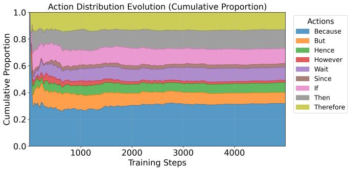  
(a) Action distribution over training.

<table><tr><td>Token</td><td>n</td><td>Acc.</td></tr><tr><td>Because</td><td>488</td><td>70.29</td></tr><tr><td>But</td><td>127</td><td>58.27</td></tr><tr><td>Hence</td><td>116</td><td>69.83</td></tr><tr><td>However</td><td>25</td><td>72.00</td></tr><tr><td>Wait</td><td>146</td><td>71.92</td></tr><tr><td>Since</td><td>42</td><td>73.81</td></tr><tr><td>If</td><td>172</td><td>67.44</td></tr><tr><td>Then</td><td>209</td><td>66.03</td></tr><tr><td>Therefore</td><td>198</td><td>72.22</td></tr></table>

(b) Post-intervention accuracy (%).

Figure 6: Controller behavior on MATH using Qwen2.5-7B-Instruct with GRPO. Panel (a) shows the cumulative proportion of each steering-token action over training steps. Panel (b) reports the number of interventions and the subsequent rollout accuracy for each token. The accuracy values are descriptive rather than causal because tokens are selected in diferent reasoning states and have unequal sample counts.  
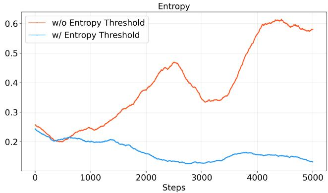  
Figure 7: Training entropy on MATH using Qwen2.5-7B-Instruct with GRPO. Removing the entropy threshold (orange) leads to an overall increase after the initial decrease; the full Guided-RLVR configuration (blue) maintains lower entropy during later training.

## F Theoretical Analysis

## F.1 Gradient Bound for Low-Prior Trajectories

Because the gradient of Equation (1) is an expectation over the unperturbed rollout distribution $b _ { \mathrm { o l d } }$ , we can split it into contributions from outside and inside $\mathcal { A } _ { x }$ :

$$
\begin{array} { r l } & { \nabla _ { \boldsymbol { \theta } } \mathcal { I } ( \boldsymbol { \theta } ) = \mathbb { E } _ { \boldsymbol { y } \not \in \mathcal { A } _ { x } } \left[ \nabla _ { \boldsymbol { \theta } } \ell ( \boldsymbol { \theta } ; \boldsymbol { x } , \boldsymbol { y } ) \right] \big ( 1 - b _ { \mathrm { o l d } } ( \mathcal { A } _ { x } \mid \boldsymbol { x } ) \big ) } \\ & { \qquad + \mathbb { E } _ { \boldsymbol { y } \in \mathcal { A } _ { x } } \left[ \nabla _ { \boldsymbol { \theta } } \ell ( \boldsymbol { \theta } ; \boldsymbol { x } , \boldsymbol { y } ) \right] b _ { \mathrm { o l d } } ( \mathcal { A } _ { x } \mid \boldsymbol { x } ) , } \end{array}
$$

where $\ell ( \theta ; x , y )$ is the per-trajectory surrogate term in Equation (1). Under standard regularity assumptions, rewards, the clipped importance ratio, and $\nabla _ { \theta }$ log πθ are all bounded, so the per-trajectory gradient norm is bounded by some constant $C < \infty$ independent of $y ;$ by the triangle inequality, the second term is then bounded by $C \cdot b _ { \mathrm { o l d } } ( \breve { A } _ { x } \mid x )$ . Hence whenever $b _ { \mathrm { o l d } } ( \mathcal { A } _ { x } \mid x ) \ll 1 / G$ or is zero under top-p truncation, the learning signal from $\mathcal { A } _ { x }$ vanishes, mirroring the sampling bound discussed earlier.