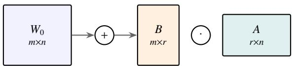
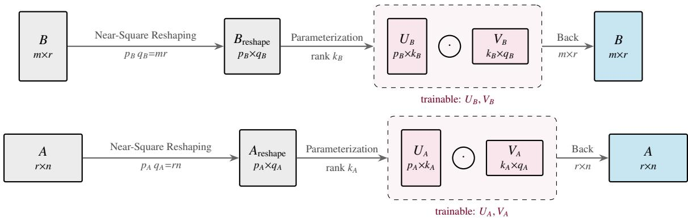
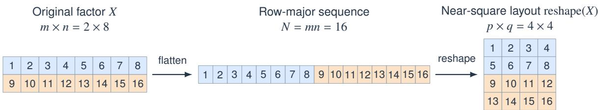
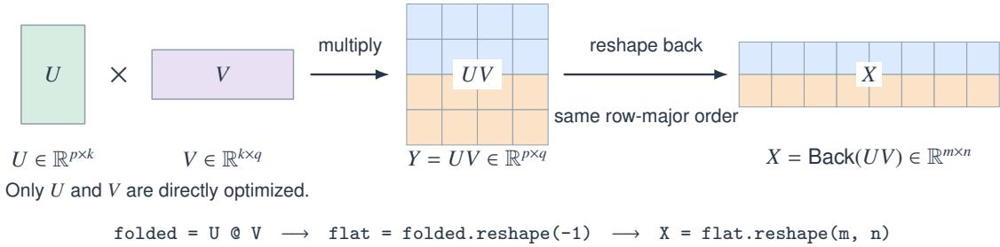

# Hierarchical Low-Rank Reparameterization for Parameter-Efficient Fine-Tuning

A preprint

Rong Huang†, Yi Xiong†, Yuan-Yuan Cheng\*, and Xiao-Ming Fu

University of Science and Technology of China Hefei, Anhui 230026, China

sa25001099@mail.ustc.edu.cn, 1440017889@qq.com chyy@mail.ustc.edu.cn, fuxm@ustc.edu.cn

†Rong Huang and Yi Xiong contributed equally to this work and share first authorship. \*Corresponding authors: Yuan-Yuan Cheng and Xiao-Ming Fu.

## Abstract

Parameter-eficient fine-tuning (PEFT) methods adapt large models by introducing a small number of trainable parameters. However, we find that these parameters still contain redundancy and can be further compressed while maintaining strong task performance. To this end, we propose a novel hierarchical low-rank reparameterization method. Its core idea is to reorganize the trainable parameters of PEFT methods into an approximately square matrix and then express it via a lowrank decomposition, which can be applied recursively. This forms a multi-level structure with factors compressed level by level, drastically reducing the number of trainable parameters. In our experiments, we combine this reparameterization with LoRA, DoRA, MoSA, and RaSA. We evaluate commonsense reasoning on LLaMA-3.1-8B and Qwen2.5-7B, with additional GSM8K math reasoning experiments on LLaMA-3.1-8B. Under comparable trainable-parameter budgets, our method combined with LoRA or DoRA achieves better performance. Furthermore, when the parameter count of the original methods is compressed by approximately an order of magnitude, our method can still maintain competitive task performance and even surpass the corresponding baselines in average accuracy across the eight commonsense reasoning benchmarks.

Keywords Hierarchical reparameterization · large language models · low-rank adaptation · parameter compression · parameter-eficient fine-tuning

## 1 Introduction

Large-scale pretrained models have demonstrated remarkable capabilities across a wide range of tasks, but adapting these models to downstream applications remains challenging due to their enormous parameter scale [1]. Parameter-eficient fine-tuning (PEFT) addresses this challenge by freezing the pretrained backbone and introducing a small number of trainable parameters [2–5]. Existing PEFT methods have substantially reduced the cost of model adaptation [6, 7], but the introduced trainable parameters may still contain internal redundancy that has not been fully explored.

Low-Rank Adaptation (LoRA) has become one of the most widely adopted PEFT methods due to its simplicity and efectiveness [5]. LoRA represents weight updates using a low-rank parameterization, in which only additional trainable parameters are optimized while the pretrained weights remain frozen. Many LoRA variants have been proposed to improve parameter eficiency, optimization, initialization, and adaptation capacity [8–12]. For example, AdaLoRA [8] improves rank allocation, PiSSA [10] and EVA [13] construct more informative initializations, while DoRA [11] and MoRA [12] explore alternative update formulations. These methods mainly optimize the design of specific PEFT mechanisms rather than reducing redundancy within the generated trainable parameters themselves.

Another line of research investigates compact and structured parameterizations for PEFT. Methods such as VeRA [14], NOLA [15], LoRA-XS [16], SVFit [17], and NoRA [18] reduce trainable parameters through fixed bases, structured subspaces, compact cores, or nested representations. Tensorized and sharing-based methods further explore alternative parameter structures through decomposition or parameter sharing [19–24]. These existing approaches focus on introducing method-specific structures.

In this work, we propose a novel general framework for compressing PEFT parameters via hierarchical low-rank reparameterization, called HiLoRR. The core idea is to reorganize the trainable parameters of existing PEFT methods into approximately square matrices and represent them using low-rank decomposition. This reorganizationdecomposition operation can be applied recursively to the resulting factors, forming a hierarchical structure where parameters are compressed level by level. Unlike methods designed for a specific PEFT formulation, HiLoRR provides a general reparameterization framework that can be integrated with various adaptation methods, such as LoRA [5], DoRA [11], MoSA [23], and RaSA [24].

We evaluate PEFT methods enhanced with HiLoRR on LLaMA-3.1-8B [25] and Qwen2.5-7B [26] on commonsense reasoning benchmarks, with additional GSM8K mathematical reasoning experiments on LLaMA-3.1-8B. Furthermore, the compressed variants reduce trainable parameters by approximately an order of magnitude while achieving higher average accuracy across the eight commonsense reasoning benchmarks than the corresponding high-parameter baselines (Table 1). Experiments with MoSA and RaSA further demonstrate that HiLoRR can substantially reduce trainable parameters while maintain ing performance close to the original methods (Table 3).

The contributions of this work are summarized as follows:

• We introduce HiLoRR, a general hierarchical low-rank reparameterization framework for com pressing trainable parameters generated by existing PEFT methods and supporting recursive application.

• We demonstrate that HiLoRR can be applied to multiple PEFT formulations, including LoRA, DoRA, MoSA, and RaSA, without requiring method-specific redesign. Experiments show improved overall performance under comparable trainable-parameter budgets, as well as substantial parameter reductions with competitive performance across the evaluated PEFT methods.

## 2 Related Work

Parameter-Eficient Fine-Tuning and LoRA. PEFT has become an efective paradigm for adapting large pretrained models by updating only a small subset of parameters while keeping the backbone frozen. Early PEFT approaches mainly introduced additional trainable modules or optimized input representations, including adapter modules, prompt tuning, and prefix tuning [2–4]. Among these approaches, Low-Rank Adaptation (LoRA) [5] has become one of the most widely adopted methods due to its simplicity and strong empirical performance. LoRA represents the weight update as a low-rank decomposition, which is optimized while freezing the pretrained weights. This formulation substantially reduces trainable parameters while maintaining competitive performance. Under the LoRA formulation, the adaptation rank simultaneously determines the trainable parameter budget and the rank upper bound of the update matrix. Therefore, reducing the parameter budget by decreasing the rank also restricts the adaptation space.

LoRA Variants. Following the success of LoRA, numerous variants have been proposed to improve its parameter eficiency, optimization behavior, and adaptation capacity. Rank-adaptive methods, such as AdaLoRA [8] and DyLoRA [27], dynamically adjust efective ranks or parameter budgets to better utilize limited trainable parameters. Optimization-oriented approaches, including LoRA+ [9] and rsLoRA [28], improve the training dynamics of LoRA factors through asymmetric learning rates and improved scaling strategies. Other methods focus on initialization and update capacity. PiSSA [10], EVA [13], and LoRA-GA [29] exploit pretrained weights, activation statistics, or gradient information to construct more informative initializations. DoRA [11] decomposes weights into magnitude and direction components and uses LoRA for directional updates. ReLoRA [30] periodically merges and reinitializes low-rank updates, whereas MoRA [12] uses a square trainable matrix with non-parametric operators to construct higher-rank updates. These methods mainly improve how LoRA ranks are allocated, how its factors are optimized or initialized, or how the resulting updates are constructed. Diferent from them, we focus on recursively using the low-rank parameterization to reorganize their trainable parameters.

Compact and Structured Parameterizations. A complementary line of research focuses on reducing taskspecific parameters through compact representations and structured reparameterization. VeRA [14] shares frozen random matrices across layers and learns only scaling vectors, while Tied-LoRA [31] exploits parameter sharing and LoRA-FA [32] freezes one LoRA factor to reduce redundancy or memory consumption. NOLA [15] represents LoRA factors using combinations of fixed random matrices, whereas LoRA-XS [16] uses SVD-derived bases from pretrained weights and learns only a compact core. SVFit [17] further exploits the singular structure of pretrained weights by freezing singular-vector subspaces and optimizing only the most significant singular values. Nested Low-Rank Adaptation (NoRA) [18] introduces a nested structure by freezing an outer low-rank representation and optimizing an inner low-rank adapter. Beyond factor-level compression, tensorized approaches such as LoRETTA [19], TT-LoRA [20], LoTR [21], and LoRTA [22] utilize higher-order decompositions to construct compact adaptation representations. Kroneckerbased methods and folding-based approaches further explore structured update representations [33, 34]. Sharingbased methods, such as MoSA [23] and RaSA [24], reduce adaptation overhead through fine-grained parameter sharing or cross-layer rank sharing. Unlike these methods that introduce specific structures for individual PEFT formulations, our work proposes a general hierarchical low-rank reparameterization framework that recursively reorganizes the trainable PEFT parameters into compact structures and applies low-rank decomposition level by level. The proposed framework is compatible with various PEFT methods, such as LoRA, DoRA, MoSA, and RaSA.

## 3 Method

## 3.1 Overview of HiLoRR

HiLoRR is a hierarchical low-rank reparameterization framework for PEFT by reorganizing trainable PEFT parameters into approximately square matrices that are represented via low-rank decompositions, and recursively running the reorganization and decomposition.

Unlike existing approaches to designing method-specific parameter structures, HiLoRR operates directly on the trainable parameters of existing PEFT formulations. Given a PEFT method with a trainable parameter set $\Theta = \{ \theta _ { 1 } , \theta _ { 2 } , \dots , \theta _ { N } \}$ , HiLoRR aims to reduce the redundancy inside Θ through hierarchical low-rank reparameterization.

For each trainable parameter tensor $\theta _ { i } ,$ we first reshape it into an approximately square matrix:

$$
M _ { i } = { \mathrm { r e s h a p e } } ( \theta _ { i } ) \in \mathbb { R } ^ { p _ { i } \times q _ { i } } ,\tag{1}
$$

where the reshaping operation preserves the number of elements |θ |, i.e., satisfying $p _ { i } q _ { i } = | \theta _ { i } |$ with $p _ { i } \approx q _ { i }$

The reshaped matrix is then represented by a low-rank decomposition:

$$
M _ { i } = U _ { i } ^ { ( 1 ) } V _ { i } ^ { ( 1 ) } ,\tag{2}
$$

where $U _ { i } ^ { ( 1 ) } \in \mathbb { R } ^ { p _ { i } \times k _ { i } }$ and $V _ { i } ^ { ( 1 ) } \in \mathbb { R } ^ { k _ { i } \times q _ { i } }$ are two low-rank matrices $( \mathrm { i . e . , } 0 < k _ { i } \ll p _ { i }$ and $0 < k _ { i } \ll q _ { i } )$ that together contain $k _ { i } ( p _ { i } + q _ { i } )$ trainable parameters.

Theoretically, HiLoRR can recursively apply the reshapedecomposition procedure to $U _ { i } ^ { ( 1 ) }$ and $V _ { i } ^ { ( 1 ) }$ , thereby further reducing the number of trainable parameters. Finally, this recursive process forms a hierarchical structure. During training, only the low-rank matrices at the deepest level are optimized, and the original PEFT parameter tensor is reconstructed via the inverse process of the reparameterization.

## 3.2 Applying HiLoRR to LoRA

We first discuss LoRA as an example PEFT instantiation.   
Fig. 1 illustrates how HiLoRR is applied to LoRA.

Preliminaries of LoRA Given a frozen linear weight $W _ { 0 } \in \mathbb { R } ^ { m \times n }$ , LoRA adds a low-rank update and keeps $W _ { 0 }$ fixed:

$$
W = W _ { 0 } + \Delta W , \qquad \Delta W = { \frac { \alpha } { r } } B A ,\tag{3}
$$

where $B \in \mathbb { R } ^ { m \times r } , A \in \mathbb { R } ^ { r \times n } , r \ll \operatorname* { m i n } ( m , n )$ . Here, r denotes the outer rank, which determines the maximum rank of the final weight update ∆W. Since $\mathrm { r a n k } ( \Delta W ) \leq$ $r ,$ the outer rank r controls the width of the adaptation pathway. The pretrained weight $W _ { 0 }$ remains frozen, and only A and B are optimized.

Single-level Low-Rank Reparameterization For a factor M with d elements $( \mathbf { e . g . } , M = B$ and $d = m \cdot r )$ , we reshape M into a matrix $\bar { M } _ { \mathrm { r e s h a p e } } \in \mathbb { R } ^ { p \times q }$ with $p q = d ,$ and parameterize the reshaped matrix as a rank-k product:

$$
M _ { \mathrm { r e s h a p e } } = U V , \ U \in \mathbb { R } ^ { p \times k } , \ V \in \mathbb { R } ^ { k \times q } .\tag{4}
$$

Here, k is called the hierarchical rank, which controls the compression ratio of the reparameterization. Diferent from the outer rank $r , k$ only determines the internal representation capacity of the reparameterized factors and does not directly change the rank constraint of the final update $\Delta W$

By defining an operation Back(·) that converts the reshaped matrix $M _ { \mathrm { r e s h a p e } }$ back to the original matrix M (i.e., $M \stackrel { \cdot } { = } \mathrm { B a c k } ( M _ { \mathrm { r e s h a p e } } ) \stackrel { \cdot } { = } \mathrm { B a c k } ( U V ) )$ ), we have:

$$
\begin{array} { c } { \Delta W = \displaystyle \frac \alpha r B A , } \\ { B = \mathrm { B a c k } ( B _ { \mathrm { r e s h a p e } } ) = \mathrm { B a c k } ( U _ { B } V _ { B } ) , } \\ { A = \mathrm { B a c k } ( A _ { \mathrm { r e s h a p e } } ) = \mathrm { B a c k } ( U _ { A } V _ { A } ) , } \end{array}\tag{5}
$$

where $U _ { B } , V _ { B } \left( \mathrm { o r } U _ { A } , V _ { A } \right)$ form the low-rank decomposition of the reshaped matrix $B _ { \mathrm { r e s h a p e } } \ ( \mathrm { o r } \ A _ { \mathrm { r e s h a p e } } )$ . In practice, the trainable parameters are now U and V instead of the original parameter tensor M, and the number of trainable parameters changes from d to $( p + q ) \times k .$ If we find k satisfying $k < d / ( p + q ) = p q / ( p + q )$ , the trainable parameters are compressed. The reshape and Back(·) operations are pure index rearrangements without arithmetic transformation.

Near-Square Reshaping The shape $( p , q )$ is a design choice. HiLoRA (HiLoRR applied to LoRA) uses Near-Square reshaping to determine the matrix dimensions $( p , q )$ This choice is motivated by SuperLoRA [34], which applied square-like reshaping to grouped weight updates and reported better performance than its corresponding unreshaped form in low-parameter vision-transfer settings. While SuperLoRA reshapes grouped weight updates, HiLoRA reshapes each trainable LoRA factor separately.

Specifically, among all positive integer pairs satisfying $p q = d ,$ , we pick the divisor pair closest to square,

$$
( p ^ { * } , q ^ { * } ) = \arg \operatorname* { m i n } _ { \stackrel { p q = d } { p , q \in \mathbb { N } } } ( p + q ) , \qquad p ^ { * } \leq q ^ { * } .\tag{6}
$$

In practice, we start from $\lfloor { \sqrt { d } } \rfloor$ and search downward for the largest divisor $p ^ { * }$ of $d ,$ after which $q ^ { * } = d / p ^ { * }$ (so $p ^ { * } \leq q ^ { * } )$ . How close $p ^ { * } , q ^ { * }$ get to √d depends on the divisors of d: when d admits a divisor near ${ \sqrt { d } } ,$ the reshaping is nearly square $( p ^ { * } \approx q ^ { * } \approx \sqrt { d } )$ , whereas a d with only unbalanced divisors yields an elongated reshaping with $p ^ { * } + q ^ { * } \gg 2 \sqrt { d }$ . Transformer factor sizes are typically highly composite, so the Near-Square case is common.

Hierarchical Reparameterization This low-rank decomposition can be applied recursively to obtain a hierarchical reparameterization. For example, U in Eq. (4) can

## (a) Standard LoRA

(b) HiLoRA: Hierarchical Low-Rank Reparameterization of LoRA  
  
Figure 1: Overview of HiLoRA (our method HiLoRR applied to LoRA). (a) Standard LoRA adds a rank-r update $\begin{array} { r } { \Delta W = \frac { \alpha } { r } B A } \end{array}$ to the frozen weight $W _ { 0 } . \ ( \mathfrak { b } )$ HiLoRA reshapes each LoRA factor into a Near-Square matrix $( B _ { \mathrm { r e s h a p e } } / A _ { \mathrm { r e s h a p e } } )$ and represents it by a second low-rank product $U _ { B } V _ { B }$ (resp. $U _ { A } V _ { A } )$ . The factor is then reshaped back into the reconstructed B/A (blue boxes), so the maximum rank of the matrix product BA remains bounded by r. HiLoRA directly parameterizes and trains only $U _ { B } , V _ { B } , U _ { A } , V _ { A }$ from which the factors (B/A (blue boxes)) are reconstructed on the fly.

be further reshaped and then decomposed as a product of two low-rank matrices. Using the hierarchical reparameterization, the learnable parameters are the matrices at the deepest level.

## 3.3 Applying HiLoRR to Diferent PEFT Methods

HiLoRR is a general reparameterization framework that can be integrated into various PEFT methods.

HiLoRR for LoRA-based Methods. For PEFT methods derived from LoRA, HiLoRR is applied to the trainable components of the original formulation while preserving their specific design principles.

For DoRA, which decomposes the pretrained weight into magnitude and direction components, HiLoRR is applied to the trainable directional parameters. Specifically, the directional component is replaced by its hierarchical lowrank representation, while the magnitude component is kept in its original form. The resulting method, referred to as HiDoRA, inherits the magnitude-direction decomposition of DoRA while further reducing the number of trainable parameters through hierarchical reparameterization.

Similarly, RaSA introduces rank sharing across diferent layers to improve parameter eficiency. HiLoRR can be incorporated into RaSA by applying hierarchical reparameterization to the trainable rank-sharing parameters while preserving the original cross-layer sharing mechanism.

The resulting method, denoted as HiRaSA, combines the sharing capability of RaSA with the additional compression capability of HiLoRR.

HiLoRR for General PEFT Parameterizations. For PEFT methods whose trainable parameters do not follow the LoRA-style factorized formulation, HiLoRR directly operates on the generated trainable parameters.

For example, MoSA represents its trainable parameters as shared parameter vectors. HiLoRR first reorganizes each trainable parameter vector into an approximately square matrix, then applies a low-rank decomposition. The same hierarchical decomposition process can be recursively applied to the resulting factors. The resulting method, referred to as HiMoSA, maintains the original parameter sharing mechanism of MoSA while further compressing its trainable parameters through hierarchical low-rank reparameterization.

## 3.4 Optimization Characteristics ofHierarchical Reparameterization

The hierarchical factorization changes not only the number of trainable parameters, but also the optimization behavior.

Here, we take the single-level low-rank reparameterization for LoRA as an example for discussion. In the original LoRA formulation, let $c = \alpha / r$ and $G = \partial \mathcal { L } / \partial \Delta W$ denote the gradient with respect to the induced weight update. The gradients of the two LoRA factors are

$$
\nabla _ { B } \mathcal { L } = c G A ^ { \top } , \qquad \nabla _ { A } \mathcal { L } = c B ^ { \top } G .\tag{7}
$$

Thus, the gradient of each trainable factor is modulated by only the other LoRA factor.

For HiLoRA, since the operation Back(·) is a permutation of entries, its backward operator $\mathcal { R } ^ { * }$ simply restores the gradient to the corresponding reshaped shape. The gradients of the four trainable factors are

$$
\nabla _ { U _ { B } } \mathcal { L } = \mathcal { R } _ { B } ^ { * } \left( c G A ^ { \top } \right) V _ { B } ^ { \top } , \quad \nabla _ { V _ { B } } \mathcal { L } = U _ { B } ^ { \top } \mathcal { R } _ { B } ^ { * } \left( c G A ^ { \top } \right) ,\tag{8}
$$

$$
\nabla _ { U _ { A } } \mathcal { L } = \mathcal { R } _ { A } ^ { * } \left( c B ^ { \top } G \right) V _ { A } ^ { \top } , \quad \nabla _ { V _ { A } } \mathcal { L } = U _ { A } ^ { \top } \mathcal { R } _ { A } ^ { * } \left( c B ^ { \top } G \right) .\tag{9}
$$

The companion factors A and B are themselves reconstructed from two trainable matrices. Therefore, the gradient of each internal parameter is modulated by three trainable factors, up to the norm-preserving reshape operations. For example,

$$
\left\| \nabla _ { U _ { B } } \mathcal { L } \right\| _ { F } \leq c \left\| G \right\| _ { F } \| U _ { A } \| _ { F } \| V _ { A } \| _ { 2 } \| V _ { B } \| _ { 2 } ,\tag{10}
$$

with analogous bounds for the other internal factors. In contrast, the corresponding standard-LoRA gradient in Eq. (7) depends on only one trainable companion factor. Consequently, the efective gradient scale in HiLoRA is more sensitive to the initialization and norms of its internal factors. When these factors are initialized at small or moderate scales, the deeper multiplicative path can attenuate the early optimization information.

This efect is further amplified by the LoRA-compatible zero initialization used in HiLoRA. For example, when $U _ { B } = 0$ at initialization while $V _ { B } , U _ { A }$ , and $V _ { A }$ are nonzero, we have B = 0 and

$$
\nabla _ { V _ { B } } \mathcal { L } = \nabla _ { U _ { A } } \mathcal { L } = \nabla _ { V _ { A } } \mathcal { L } = 0 ,\tag{11}
$$

whereas $\nabla _ { U _ { B } } \mathcal { L }$ is generally nonzero. Hence, only one of the four internal factors is updated at the first optimization step; the remaining factors receive nonzero gradients only after $U _ { B }$ moves away from zero. This progressive activation preserves the initial condition $\Delta W = \bar { 0 , }$ , but can make the early-stage optimization of HiLoRA slower than that of the original PEFT formulation.

These observations motivate a larger learning rate for the reshaped matrices to compensate for their reduced and delayed efective update scale. We therefore treat the learning rate of HiLoRA as a method-specific hyperparameter rather than directly inheriting the default value used by LoRA. Importantly, the analysis does not imply a universal analytical multiplier: the required compensation depends on the reshaped rank, factor initialization, scaling coeficient, and optimizer. Our ablation experiments empirically verify that HiLoRA generally achieves its best performance at a higher learning rate than the original PEFT formulation.

## 4 Experiments

We evaluate HiLoRR as a general hierarchical low-rank reparameterization framework on two model families and two reasoning tasks. Our experiments are organized around three questions: (i) can HiLoRA/HiDoRA reduce trainable parameters while preserving the performance of LoRA/DoRA on reasoning tasks? (ii) can the proposed reparameterization be extended to diferent PEFT formulations? and (iii) how do diferent hierarchical configurations afect the compression-performance trade-of?

## 4.1 Experimental Setup

Models We use two open base (non-instruct) models, i.e., LLaMA-3.1-8B [25] and Qwen2.5-7B [26]. Base models are chosen so that the reported gains reflect what the PEFT method itself learns, rather than instructiontuning already baked into the backbone. The two models difer in architecture (grouped-query attention configuration, intermediate width), allowing us to test crossarchitecture generalization.

Tasks and Datasets For commonsense reasoning, we fine-tune the models on the Commonsense-15K instruction dataset [35]. After fine-tuning, the models are evaluated on eight widely used commonsense reasoning benchmarks, including BoolQ [36], PIQA [37], SIQA [38], HellaSwag [39], WinoGrande [40], ARC-c, ARC-e [41], and OBQA [42] in Table 1. We evaluate each benchmark separately and report the accuracy (%) on each task. In addition, we report two overall performance metrics across the eight tasks: the unweighted macro average (Avg.) and the weighted average (W-Avg.), with weights proportional to the number of test examples in each task.

For mathematical reasoning, we fine-tune LLaMA-3.1- 8B on the MetaMathQA-40K [43] instruction dataset and evaluate it on the GSM8K benchmark [44]. We report the exact-match accuracy of the generated final answers on the oficial GSM8K test set in Table 2.

In both tables, fine-tuned methods are grouped into lowparameter (≤ 6M) and high-parameter (≥ 26M) settings. We also report peak GPU memory (Mem) for both commonsense reasoning and mathematical reasoning to show training-resource demands alongside accuracy and trainable-parameter count. Here, Mem denotes the peak PyTorch CUDA allocated memory during training.

Baselines and Targeted Modules We compare HiLoRA and HiDoRA with representative PEFT methods, including LoRA, DoRA, MoRA, NoRA, and SVFit. All methods are applied to the same target modules, including the self-attention projection matrices $W _ { Q } .$ $W _ { K }$ and $W _ { V } ,$ , as well as the FFN projection matrices $\bar { W } _ { \mathsf { u p } }$ and $W _ { \mathrm { d o w n } }$ in each Transformer block. All remaining parameters of the pretrained backbone are kept frozen during training.

Table 1: Accuracy (%) on eight commonsense reasoning benchmarks using LLaMA-3.1-8B and Qwen2.5-7B. Within each model, methods are grouped by trainable-parameter budget. Mem is training-phase peak PyTorch CUDA allocated memory in GiB. Rows shaded in gray indicate our methods.
<table><tr><td>Method</td><td>Params(M) Mem(GiB) BoolQ</td><td></td><td></td><td>PIQA</td><td>SIQA</td><td>ARC-c ARC-e OBQA</td><td></td><td></td><td>HS</td><td>WG</td><td>Avg.</td><td>W- Avg.</td></tr><tr><td colspan="13">LLaMA-3.1-8B</td></tr><tr><td colspan="13">Low-parameter (≤ 6M)</td></tr><tr><td>LoRA-r2</td><td>3.54</td><td>11.149</td><td>62.17</td><td>86.40</td><td>75.59</td><td>80.46</td><td>91.67</td><td>82.80</td><td>90.26</td><td>74.11</td><td>80.43</td><td>83.13</td></tr><tr><td>DoRA-r2</td><td>4.33</td><td>11.160</td><td>62.17</td><td>86.45</td><td>75.38</td><td>81.40</td><td>91.54</td><td>84.00</td><td>90.40</td><td>74.27</td><td>80.70</td><td>83.25</td></tr><tr><td>SVFit</td><td>0.39</td><td>27.346</td><td>67.86</td><td>84.11</td><td>68.37</td><td>77.30</td><td>90.87</td><td>75.40</td><td>82.32</td><td>60.54</td><td>75.85</td><td>78.40</td></tr><tr><td>NoRA</td><td>5.24</td><td>24.675</td><td>62.17</td><td>86.51</td><td>75.59</td><td>82.00</td><td>92.68</td><td>82.40</td><td>91.20</td><td>76.80</td><td>81.17</td><td>83.88</td></tr><tr><td>HiLoRA</td><td>2.82</td><td></td><td></td><td>87.11</td><td></td><td>81.31</td><td></td><td></td><td></td><td></td><td></td><td></td></tr><tr><td>HiDoRA</td><td>3.60</td><td>11.138</td><td>71.04</td><td></td><td>78.20</td><td></td><td>91.62</td><td>84.40</td><td>91.74</td><td>80.82</td><td>83.28</td><td>85.82</td></tr><tr><td></td><td></td><td>11.150</td><td>62.17</td><td>86.72</td><td>77.64</td><td>81.31</td><td>92.42</td><td>86.00</td><td>91.69</td><td>80.51</td><td>82.31</td><td>84.53</td></tr><tr><td>High-parameter (≥ 26M)</td><td></td><td></td><td></td><td></td><td></td><td></td><td></td><td></td><td></td><td></td><td></td><td></td></tr><tr><td>LoRA-r16</td><td>28.31</td><td>11.518</td><td>62.17</td><td>86.94</td><td>76.25</td><td>81.40</td><td>92.55</td><td>85.00</td><td>92.03</td><td>77.35</td><td>81.71</td><td>84.39</td></tr><tr><td>DoRA-r16</td><td>29.10</td><td>11.529</td><td>62.17</td><td>86.24</td><td>76.92</td><td>83.19</td><td>92.97</td><td>83.40</td><td>91.89</td><td>78.14</td><td>81.86</td><td>84.48</td></tr><tr><td>MoRA</td><td>28.23</td><td>11.545</td><td>62.17</td><td>84.87</td><td>78.25</td><td>80.12</td><td>91.58</td><td>84.20</td><td>91.83</td><td>81.29</td><td>81.79</td><td>84.35</td></tr><tr><td>HiLoRA</td><td>28.18</td><td>11.517</td><td>69.76</td><td>87.76</td><td>78.30</td><td>82.76</td><td>92.17</td><td>85.60</td><td>92.47</td><td>80.98</td><td>83.73</td><td>86.19</td></tr><tr><td>HiDoRA</td><td>28.44</td><td>11.527</td><td>71.35</td><td>87.32</td><td>79.27</td><td>82.51</td><td>91.75</td><td>85.40</td><td>92.95</td><td>81.37</td><td>83.99</td><td>86.65</td></tr><tr><td colspan="9">Qwen2.5-7B</td><td></td><td></td><td></td></tr><tr><td></td><td>Low-parameter (≤ 6M)</td><td></td><td></td><td></td><td></td><td></td><td></td><td></td><td></td><td></td><td></td><td></td></tr><tr><td>LoRA-r2</td><td>3.38</td><td>11.336</td><td>65.26</td><td>88.25</td><td>79.27</td><td>89.51</td><td>95.96</td><td>89.40</td><td>92.35</td><td>76.95</td><td>84.62</td><td>86.22</td></tr><tr><td>DoRA-r2</td><td>4.14</td><td>11.689</td><td>66.15</td><td>88.36</td><td>79.63</td><td>88.99</td><td>95.88</td><td>89.80</td><td>92.61</td><td>76.95</td><td>84.80</td><td>86.48</td></tr><tr><td>SVFit</td><td>0.29</td><td>25.699</td><td>69.05</td><td>85.85</td><td>74.62</td><td>86.26</td><td>95.62</td><td>86.00</td><td>83.56</td><td>68.51</td><td>81.18</td><td>81.48</td></tr><tr><td>NoRA</td><td>4.59</td><td>22.950</td><td>65.96</td><td>89.06</td><td>79.38</td><td>88.65</td><td>95.54</td><td>91.00</td><td>93.17</td><td>78.61</td><td>85.17</td><td>86.81</td></tr><tr><td>HiLoRA</td><td>2.79</td><td>11.326</td><td>70.24</td><td>89.12</td><td>80.25</td><td>88.99</td><td>95.83</td><td>90.40</td><td>93.30</td><td>79.40</td><td>85.94</td><td>87.65</td></tr><tr><td>HiDoRA</td><td>3.55</td><td>11.338</td><td>69.91</td><td>89.39</td><td>79.73</td><td>88.74</td><td>95.79</td><td>91.40</td><td>93.06</td><td>79.64</td><td>85.96</td><td>87.49</td></tr><tr><td colspan="2">High-parameter (≥ 26M)</td><td></td><td></td><td></td><td></td><td></td><td></td><td></td><td></td><td></td><td></td><td></td></tr><tr><td>LoRA-r16</td><td>27.07</td><td>11.702</td><td>70.55</td><td>89.28</td><td>79.12</td><td>88.91</td><td>95.75</td><td>90.40</td><td>92.95</td><td>79.56</td><td>85.81</td><td>87.45</td></tr><tr><td>DoRA-r16</td><td>27.83</td><td>12.061</td><td>70.15</td><td>89.39</td><td>79.38</td><td>88.99</td><td>95.96</td><td>90.20</td><td>92.81</td><td>79.72</td><td>85.82</td><td>87.39</td></tr><tr><td>MoRA</td><td>27.03</td><td>11.707</td><td>62.17</td><td>88.41</td><td>79.22</td><td>88.31</td><td>95.33</td><td>90.40</td><td>92.93</td><td>81.06</td><td>84.73</td><td>86.16</td></tr><tr><td>HiLoRA</td><td>26.64</td><td>11.682</td><td>72.26</td><td>89.34</td><td>80.09</td><td>88.74</td><td>95.66</td><td>91.20</td><td>93.18</td><td>80.66</td><td>86.39</td><td>87.95</td></tr><tr><td>HiDoRA</td><td>27.73</td><td>11.698</td><td>72.05</td><td>89.50</td><td>80.30</td><td>89.51</td><td>95.71</td><td>91.40</td><td>92.99</td><td>80.51</td><td>86.49</td><td>87.91</td></tr></table>

Parameter-Budget Settings For fair comparisons, we control the trainable parameter budget. The number of trainable parameters introduced by LoRA with rank r = 16 serves as the reference parameter budget. For compressed settings, HiLoRA is configured to use approximately 10% of the trainable parameters of the original LoRA baseline while maintaining the same target modules. For matched-parameter settings, we jointly increase the outer rank r and hierarchical rank k of HiLoRA until the total number of trainable parameters is approximately equal to that of the original LoRA baseline. The parameter counts reported in the tables correspond to the number of trainable parameters introduced by each PEFT method. The detailed discussion of parameter compression is provided in Appendix B.

Optimization and Schedules We optimize all methods using AdamW [45] with a cosine learning-rate schedule and a warm-up ratio of 0.1. The candidate learning rates are selected from ranges commonly used in PEFT experiments. We observe that HiLoRA generally benefits from a larger peak learning rate (Table 4). For HiLoRA and HiDoRA, following our optimization analysis, we adopt a larger learning rate of $\bar { 2 } \times 1 0 ^ { - 3 }$ due to the additional hierarchical factorization structure.

## 4.2 Results: Commonsense Reasoning

We evaluate HiLoRA and HiDoRA on the commonsense reasoning tasks. Table 1 presents results on LLaMA-3.1-8B and Qwen2.5-7B under low- and high-parameter settings. In each setting, the highest Avg. and W-Avg. scores are obtained by either HiLoRA or HiDoRA. In the low-parameter setting, both methods achieve higher Avg. and W-Avg. scores than all baselines reported in Table 1 on both backbones, while using approximately 10–13% of the trainable parameters of the corresponding LoRA-r16 baseline. These results show that substantial parameter compression can maintain strong average accuracy across the eight benchmarks, while directly reducing the LoRA rank to decrease the number of trainable parameters can lead to degraded task performance. In the high-parameter setting, HiLoRA and HiDoRA outperform LoRA and DoRA on both aggregate metrics with comparable numbers of trainable parameters. This indicates that hierarchical reparameterization can also improve performance at a similar parameter budget. In terms oftraining memory, HiLoRA and HiDoRA have peak allocated GPU memory comparable to LoRA and DoRA and substantially lower than the reported NoRA and SVFit configurations.

Table 2: Accuracy (%) on GSM8K after MetaMathQA-40K fine-tuning using LLaMA-3.1-8B. Our methods are shaded in gray.
<table><tr><td>Method</td><td>Params Mem (M)</td><td>(GiB)</td><td>Correct (/1,319)</td><td>GSM8K EM(%)</td></tr><tr><td>Base (no SFT)</td><td>0.00</td><td></td><td>390</td><td>29.57</td></tr><tr><td>Low-parameter (≤ 6M)</td><td></td><td></td><td></td><td></td></tr><tr><td>LoRA-r2</td><td>3.54</td><td>15.836</td><td>917</td><td>69.52</td></tr><tr><td>DoRA-r2</td><td>4.33</td><td>15.844</td><td>890</td><td>67.48</td></tr><tr><td>SVFit</td><td>0.39</td><td>31.447</td><td>711</td><td>53.90</td></tr><tr><td>NoRA</td><td>5.24</td><td>29.356</td><td>889</td><td>67.40</td></tr><tr><td>HiLoRA</td><td>2.82</td><td>15.828</td><td>926</td><td>70.20</td></tr><tr><td>HiDoRA</td><td>3.60</td><td>15.836</td><td>924</td><td>70.05</td></tr><tr><td colspan="5">High-parameter (≥ 26M)</td></tr><tr><td>LoRA-r16</td><td>28.31 16.113</td><td></td><td>952</td><td>72.18</td></tr><tr><td>DoRA-r16</td><td>29.10</td><td>16.121</td><td>957</td><td>72.55</td></tr><tr><td>MoRA</td><td>28.23</td><td>16.131</td><td>951</td><td>72.10</td></tr><tr><td>HiLoRA</td><td>28.18</td><td>16.112</td><td>965</td><td>73.16</td></tr><tr><td>HiDoRA</td><td>28.44</td><td>16.114</td><td>966</td><td>73.24</td></tr></table>

## 4.3 Results: Mathematical Reasoning

We evaluate HiLoRA and HiDoRA on the GSM8K mathematical reasoning benchmark. Table 2 reports the results on LLaMA-3.1-8B under low- and high-parameter settings. For reference, we also report the performance of the backbone without task-specific supervised fine-tuning, denoted as Base (no SFT). In the low-parameter setting, HiLoRA and HiDoRA achieve the two highest EM scores in this group, at 70.20% and 70.05%, respectively, although both remain below the high-parameter LoRA-r16 baseline. In the high-parameter setting, HiLoRA and HiDoRA achieve EM scores of 73.16% and 73.24%, respectively, outperforming all compared baselines with comparable numbers of trainable parameters. In terms of training memory, both methods show the same pattern as in commonsense reasoning. These results show that hierarchical low-rank reparameterization achieves competitive GSM8K performance with substantially fewer trainable parameters and improves EM scores at a comparable parameter budget.

## 4.4 Results: Generalization Across PEFT Methods

To evaluate the applicability of HiLoRR across PEFT methods, we apply it to two additional methods, MoSA and RaSA, obtaining HiMoSA and HiRaSA, respectively, while preserving their original adaptation mechanisms. Table 3 reports their results on the eight commonsense reasoning benchmarks using LLaMA-3.1-8B. HiMoSA and HiRaSA reduce trainable parameters by 92.6% and 86.9%, respectively, while maintaining average accuracy close to their original counterparts. These results support the applicability of HiLoRR beyond LoRA and DoRA.

## 4.5 Ablation Studies

We conduct ablation studies to investigate the influence of diferent HiLoRA design choices, including learning rate, reparameterization scope, reshaping strategy, and rank configuration.

Learning Rate We investigate the sensitivity of HiLoRA to the learning rate on LLaMA-3.1-8B by sweeping a range of values for HiLoRA. As shown in Table 4, HiLoRA generally achieves its best performance at a higher learning rate. We therefore adopt a peak learning rate of $2 \times 1 0 ^ { - 3 }$ for our method, as it achieves the highest Avg. score among the evaluated learning rates. This observation is consistent with the aforementioned optimization analysis: the additional multiplicative factorization changes the efective gradient scale, making HiLoRA benefit from a larger method-specific learning rate.

Reparameterization Scope and Depth We study the scope and depth of reparameterization in HiLoRA. As shown in Table 5, the reported A+B variant outperforms the A-only and B-only variants at similar trainableparameter budgets, achieving 83.28 Avg. and 85.82 W-Avg. We further examine the efect of reparameterization depth in Table 6. In single-level HiLoRA, each reshaped LoRA matrix, A or B, is parameterized as a rank $- k _ { 1 }$ product UV. The double-level variant recursively applies the same Near-Square reshaping and low-rank parameterization to both U and V, using rank $k _ { 2 } ,$ so that only the resulting second-level factors are directly optimized. We fix the outer LoRA rank at r = 16 and adjust the internal ranks to compare single- and double-level variants at similar low, medium, and high parameter budgets. The double-level variants use fewer trainable parameters in each pair, with higher accuracy at the low budget but lower accuracy at the medium and high budgets. These results suggest that the benefits of deeper reparameterization depend on the parameter budget. Under tight budgets, the hierarchical parameterization may enable more efective use of limited trainable parameters, thereby improving accuracy. At larger budgets, however, further factorization may impose unnecessary structural constraints and make optimization more dificult, limiting the model’s ability to exploit the available parameters and consequently reducing accuracy.

Reshaping Strategy We study diferent reshaping strategies in HiLoRA. Specifically, we evaluate our current Near-Square strategy: a row/column transfer strategy, which moves complete rows or columns, depending on which dimension is longer, to the shorter dimension. We also evaluate the Random mean strategy, which randomly permutes all parameters and reshapes them into an approximately square matrix, with the results averaged over three independent runs. The Elongated 1:4 strategy follows a procedure similar to Near-Square reshaping, except that the parameters are reshaped into a matrix with an aspect ratio close to 1:4. The Elongated 1:16 strategy follows the same procedure as the Elongated 1:4 strategy, but adopts a more elongated matrix shape with a larger aspect ratio.

Table 3: Accuracy (%) on eight commonsense reasoning benchmarks when applying hierarchical low-rank reparameterization to other adapter families. All results use LLaMA-3.1-8B.
<table><tr><td>Method</td><td>Params (M)</td><td>BoolQ</td><td>PIQA</td><td>SIQA</td><td>ARC-c</td><td>ARC-e</td><td>OBQA</td><td>HellaSwag</td><td>WinoGrande</td><td> $\operatorname { A v g } .$ </td><td> $\mathrm { { W } \mathrm { - A v g . } }$ </td></tr><tr><td>LoRA</td><td>28.31</td><td>62.17</td><td>86.94</td><td>76.25</td><td>81.40</td><td>92.55</td><td>85.00</td><td>92.03</td><td>77.35</td><td>81.71</td><td>84.39</td></tr><tr><td>MoSA</td><td>28.31</td><td>70.64</td><td>85.47</td><td>77.79</td><td>82.51</td><td>90.87</td><td>84.40</td><td>90.92</td><td>81.85</td><td>83.06</td><td>85.27</td></tr><tr><td>HiMoSA</td><td>2.10</td><td>69.54</td><td>86.40</td><td>78.25</td><td>81.48</td><td>91.96</td><td>83.60</td><td>91.20</td><td>81.29</td><td>82.97</td><td>85.36</td></tr><tr><td>RaSA</td><td>28.32</td><td>69.60</td><td>86.18</td><td>79.73</td><td>81.06</td><td>92.55</td><td>84.20</td><td>92.72</td><td>81.14</td><td>83.40</td><td>86.21</td></tr><tr><td>HiRaSA</td><td>3.71</td><td>69.88</td><td>86.72</td><td>78.30</td><td>82.17</td><td>92.09</td><td>84.60</td><td>92.17</td><td>80.82</td><td>83.34</td><td>85.92</td></tr></table>

Table 4: Learning-rate ablation of low-parameter HiLoRA on LLaMA-3.1-8B across eight commonsense reasoning tasks. Best observed values are bold.
<table><tr><td></td><td colspan="10">Learning rate  $( \times 1 0 ^ { - 4 } )$ </td></tr><tr><td>Metric</td><td>1</td><td>3</td><td>5</td><td>8</td><td>10</td><td>12</td><td>16</td><td>20</td><td>24</td><td>32</td></tr><tr><td>Avg. (%)</td><td>74.66</td><td>80.09</td><td>80.88</td><td>81.65</td><td>82.42</td><td>82.21</td><td>83.16</td><td>83.28</td><td>81.76</td><td>79.52</td></tr><tr><td>W-Avg. (%)</td><td>77.11</td><td>82.36</td><td>83.51</td><td>84.10</td><td>85.18</td><td>84.24</td><td>85.86</td><td>85.82</td><td>84.57</td><td>82.24</td></tr></table>

Table 5: Ablation study of HiLoRA variants on LLaMA-3.1-8B commonsense reasoning.
<table><tr><td>Variant</td><td>Params (M)</td><td> $\operatorname { A v g } .$ </td><td> $\mathrm { W - A v g . }$ </td><td> $\Delta \mathrm { W } \mathrm { - A v } \mathrm { g } .$ </td></tr><tr><td>HiLoRA A+B</td><td>2.82</td><td>83.28</td><td>85.82</td><td>0.00</td></tr><tr><td>HiLoRA A-only</td><td>2.83</td><td>82.22</td><td>84.79</td><td>-1.03</td></tr><tr><td>HiLoRA B-only</td><td>2.82</td><td>81.92</td><td>84.55</td><td>-1.27</td></tr></table>

Table 6: HiLoRA depth–budget ablation on LLaMA-3.1-8B (Commonsense-15K).
<table><tr><td>Depth</td><td>Configuration</td><td>Params (M)</td><td> $\operatorname { A v g } .$ </td><td> $\mathrm { { W } \mathrm { - A v g . } }$ </td></tr><tr><td colspan="5">Low budget</td></tr><tr><td>Single</td><td> $r = 1 6 , k _ { 1 } = 8$ </td><td>1.409</td><td>80.45</td><td>83.17</td></tr><tr><td>Double</td><td> $r = 1 6 , k _ { 1 } = 1 6 , k _ { 2 } = 1 6$ </td><td>1.360</td><td>81.39</td><td>84.05</td></tr><tr><td colspan="5">Medium budget</td></tr><tr><td>Single</td><td> $r { = } 1 6 , k _ { 1 } { = } 1 2$ </td><td>2.114</td><td>82.07</td><td>84.84</td></tr><tr><td>Double</td><td> $r = 1 6 , k _ { 1 } = 1 6 , k _ { 2 } = 2 4$ </td><td>2.040</td><td>81.70</td><td>84.03</td></tr><tr><td colspan="5">High budget</td></tr><tr><td>Single</td><td> $r { = } 1 6 , k _ { 1 } { = } 1 6$ </td><td>2.818</td><td>83.28</td><td>85.82</td></tr><tr><td>Double</td><td> $r { = } 1 6 , k _ { 1 } { = } 1 6 , k _ { 2 } { = } 3 2$ </td><td>2.720</td><td>81.75</td><td>84.42</td></tr></table>

As shown in Table 7, the Near-Square reshaping strategy achieves better performance than the other reshaping strategies. This verifies that reshaping trainable parameters into approximately square matrices provides a more efective low-rank parameterization. Further details are provided in Appendix A.1.

Outer Rank r and Hierarchical Rank k We investigate the efect of the outer rank r and hierarchical rank k in HiLoRA. The outer rank controls the adaptation capacity, while the hierarchical rank determines the compression level. As shown in Table 8, diferent combinations of r and k provide diferent trade-ofs between parameter eficiency and adaptation performance.

Table 7: Reshaping ablation on LLaMA-3.1-8B commonsense reasoning.
<table><tr><td>Reshaping strategy</td><td>Params(M)</td><td> $\operatorname { A v g } .$ </td><td> $\mathrm { { W } { \mathrm { - } } A v g . }$ </td><td> $\Delta \mathrm { W } { \mathrm { - } } \mathrm { A v } \mathrm { g } .$ </td></tr><tr><td>Near-Square</td><td>2.82</td><td>83.28</td><td>85.82</td><td>0.00</td></tr><tr><td>Random mean</td><td>2.82</td><td>80.95</td><td>83.65</td><td>-2.17</td></tr><tr><td>Elongated 1:4</td><td>2.82</td><td>81.02</td><td>83.40</td><td>-2.42</td></tr><tr><td>Elongated 1:16</td><td>2.93</td><td>81.04</td><td>83.55</td><td>-2.27</td></tr></table>

Table 8: Ablation study of the outer rank r and hierarchical ranks $k _ { A } , k _ { B }$ for HiLoRA on LLaMA-3.1-8B commonsense reasoning.
<table><tr><td>Configuration</td><td>Params (M)</td><td>Avg.</td><td> $\mathrm { { W } { \mathrm { - } } A v g . }$ </td><td>∆ W-Avg.</td></tr><tr><td> $r = 8 , k _ { A } = 2 4 , k _ { B } = 2 0$ </td><td>2.86</td><td>82.01</td><td>84.30</td><td>-1.52</td></tr><tr><td> $r = 1 6 , k _ { A } = 1 6 , k _ { B } = 1 6$ </td><td>2.82</td><td>83.28</td><td>85.82</td><td>0.00</td></tr><tr><td> $r = 2 4 , k _ { A } = 1 4 , k _ { B } = 1 2$ </td><td>2.83</td><td>81.79</td><td>84.39</td><td>-1.43</td></tr><tr><td> $r = 3 2 , k _ { A } = 1 2 , k _ { B } = 1 0$ </td><td>2.86</td><td>81.94</td><td>84.33</td><td>-1.49</td></tr><tr><td> $r { = } 6 4 , k _ { A } { = } 8 , k _ { B } { = } 8$ </td><td>2.82</td><td>82.52</td><td>85.04</td><td>-0.78</td></tr></table>

## 5 Conclusion and Discussion

In this work, we introduced HiLoRR, a hierarchical lowrank reparameterization framework for further compressing the trainable parameters introduced by parametereficient fine-tuning methods. HiLoRR reorganizes the parameters generated by an existing PEFT method into approximately square matrices and represents them using additional low-rank factorizations. This operation can be applied recursively, forming a hierarchical parameterization.

Our main finding is that the trainable parameters introduced by existing PEFT methods contain substantial internal redundancy. When applied to LoRA, HiLoRA retains the original outer adaptation rank while using only about one tenth of the trainable parameters of the fullsize LoRA adapter. Despite this substantial reduction, the compressed models maintain performance close to, and in some settings comparable with, the original methods across diferent model architectures and reasoning tasks. These results demonstrate that efective downstream adaptation can be achieved with a considerably more compact parameterization, making HiLoRR particularly suitable when adapter storage, optimizer states, or task-specific parameter budgets are constrained.

Moreover, applying the same reparameterization principle to LoRA, DoRA, MoSA, and RaSA suggests that our method provides a general compression framework rather than a method-specific modification.

The additional multiplicative structure changes the optimization behavior and makes performance more sensitive to the learning rate, factor initialization, hierarchical rank, and reshaping strategy. Future work may explore adaptive rank allocation, architecture-aware reshaping, and more eficient optimization strategies, as well as extending HiLoRR to broader model families, modalities, and downstream tasks.

## References

[1] Z. Hu, L. Wang, Y. Lan, W. Xu, E.-P. Lim, L. Bing, X. Xu, S. Poria, and R. Lee, “LLMadapters: An adapter family for parametereficient fine-tuning of large language models,” in Proceedings of the 2023 Conference on Empirical Methods in Natural Language Processing, H. Bouamor, J. Pino, and K. Bali, Eds. Singapore: Association for Computational Linguistics, Dec. 2023, pp. 5254–5276. [Online]. Available: https: //aclanthology.org/2023.emnlp-main.319/

[2] N. Houlsby, A. Giurgiu, S. Jastrzebski, B. Morrone, Q. De Laroussilhe, A. Gesmundo, M. Attariyan, and S. Gelly, “Parameter-eficient transfer learning for NLP,” in Proceedings of the 36th International Conference on Machine Learning, ser. Proceedings of Machine Learning Research, K. Chaudhuri and R. Salakhutdinov, Eds., vol. 97. PMLR, 09–15 Jun 2019, pp. 2790–2799. [Online]. Available: https://proceedings.mlr.press/v97/houlsby19a.html

[3] B. Lester, R. Al-Rfou, and N. Constant, “The power of scale for parameter-eficient prompt tuning,” in Proceedings of the 2021 Conference on Empirical Methods in Natural Language Processing, M.-F. Moens, X. Huang, L. Specia, and S. W.-t. Yih, Eds. Online and Punta Cana, Dominican Republic: Association for Computational Linguistics, Nov. 2021, pp. 3045–3059. [Online]. Available: https: //aclanthology.org/2021.emnlp-main.243/

[4] X. L. Li and P. Liang, “Prefix-tuning: Optimizing continuous prompts for generation,” in

Proceedings of the 59th Annual Meeting of the Associationfor Computational Linguistics and the 11th International Joint Conference on Natural Language Processing (Volume 1: Long Papers), C. Zong, F. Xia, W. Li, and R. Navigli, Eds. Online: Association for Computational Linguistics, Aug. 2021, pp. 4582–4597. [Online]. Available: https://aclanthology.org/2021.acl-long.353/

[5] E. J. Hu, yelong shen, P. Wallis, Z. Allen-Zhu, Y. Li, S. Wang, L. Wang, and W. Chen, “LoRA: Low-rank adaptation of large language models,” in International Conference on Learning Representations, 2022. [Online]. Available: https: //openreview.net/forum?id=nZeVKeeFYf9

[6] Z. Gao, Q. Wang, A. Chen, Z. Liu, B. Wu, L. Chen, and J. Li, “Parameter-eficient fine-tuning with discrete fourier transform,” in Forty-first International Conference on Machine Learning, 2024. [Online]. Available: https://openreview.net/f orum?id=XUOHKSsurt

[7] Z. Han, C. Gao, J. Liu, J. Zhang, and S. Q. Zhang, “Parameter-eficient fine-tuning for large models: A comprehensive survey,” 2024. [Online]. Available: https://arxiv.org/abs/2403.14608

[8] Q. Zhang, M. Chen, A. Bukharin, P. He, Y. Cheng, W. Chen, and T. Zhao, “Adaptive budget allocation for parameter-eficient fine-tuning,” in The Eleventh International Conference on Learning Representations, 2023. [Online]. Available: https: //openreview.net/forum?id=lq62uWRJjiY

[9] S. Hayou, N. Ghosh, and B. Yu, “Lora+: Eficient low rank adaptation of large models,” 2024. [Online]. Available: https://arxiv.org/abs/2402.12354

[10] F. Meng, Z. Wang, and M. Zhang, “PiSSA: Principal singular values and singular vectors adaptation of large language models,” in Advances in Neural Information Processing Systems, A. Globerson, L. Mackey, D. Belgrave, A. Fan, U. Paquet, J. Tomczak, and C. Zhang, Eds., vol. 37. Curran Associates, Inc., 2024, pp. 121 038–121 072. [Online]. Available: https://proceedings.neurips.cc /paper\_files/paper/2024/file/db36f4d603cc9e3a2a 5e10b93e6428f2-Paper-Conference.pdf

[11] S.-Y. Liu, C.-Y. Wang, H. Yin, P. Molchanov, Y.-C. F. Wang, K.-T. Cheng, and M.-H. Chen, “DoRA: Weight-decomposed low-rank adaptation,” in Forty-first International Conference on Machine Learning, 2024. [Online]. Available: https: //openreview.net/forum?id=3d5CIRG1n2

[12] T. Jiang, S. Huang, S. Luo, Z. Zhang, H. Huang, F. Wei, W. Deng, F. Sun, Q. Zhang, D. Wang, and F. Zhuang, “MoRA: High-rank updating for parameter-eficient fine-tuning,” 2024. [Online]. Available: https://arxiv.org/abs/2405.12130

[13] F. Paischer, L. Hauzenberger, T. Schmied, B. Alkin, M. Deisenroth, and S. Hochreiter, “Parameter eficient fine-tuning via explained variance adaptation,”

in Advances in Neural Information Processing Systems, D. Belgrave, C. Zhang, H. Lin, R. Pascanu, P. Koniusz, M. Ghassemi, and N. Chen, Eds., vol. 38. Curran Associates, Inc., 2025, pp. 46 215– 46 267. [Online]. Available: https://proceedings.ne urips.cc/paper\_files/paper/2025/file/41d33bd41fd4 4bd9dba0e092047cf213-Paper-Conference.pdf

[14] D. Kopiczko, T. Blankevoort, and Y. Asano, “Vera: Vector-based random matrix adaptation,” in International Conference on Learning Representations, B. Kim, Y. Yue, S. Chaudhuri, K. Fragkiadaki, M. Khan, and Y. Sun, Eds., vol. 2024, 2024, pp. 6815–6835. [Online]. Available: https://proceeding s.iclr.cc/paper\_files/paper/2024/file/1b53ad08de38 3a049e9668a9d0b6a053-Paper-Conference.pdf

[15] S. Abbasi Koohpayegani, K. L. Navaneet, P. Nooralinejad, S. Kolouri, and H. Pirsiavash, “Nola: Compressing lora using linear combination of random basis,” in International Conference on Learning Representations, B. Kim, Y. Yue, S. Chaudhuri, K. Fragkiadaki, M. Khan, and Y. Sun, Eds., vol. 2024, 2024, pp. 23 610–23 626. [Online]. Available: https://proceedings.iclr.cc/paper\_files/p aper/2024/file/66b99dbf9ed172abac5cb5ccfc82d1 e2-Paper-Conference.pdf

[16] K. Bałazy, M. Banaei, K. Aberer, and J. Tabor, “Lora-xs: Low-rank adaptation with extremely small number of parameters,” 2025. [Online]. Available: https://arxiv.org/abs/2405.17604

[17] C. Sun, J. Wei, Y. Wu, Y. Shi, S. He, Z. Ma, N. Xie, and Y. Yang, “SVFit: Parametereficient fine-tuning of large pre-trained models using singular values,” 2024. [Online]. Available: https://arxiv.org/abs/2409.05926

[18] C. Lin, L. Li, D. Li, J. Zou, W. Xue, and Y. Guo, “NoRA: Nested low-rank adaptation for eficient fine-tuning large models,” 2024. [Online]. Available: https://arxiv.org/abs/2408.10280

[19] Y. Yang, J. Zhou, N. Wong, and Z. Zhang, “LoRETTA: Low-rank economic tensor-train adaptation for ultra-low-parameter fine-tuning of large language models,” in Proceedings of the 2024 Conference of the North American Chapter of the Associationfor Computational Linguistics: Human Language Technologies (Volume 1: Long Papers), K. Duh, H. Gomez, and S. Bethard, Eds. Mexico City, Mexico: Association for Computational Linguistics, Jun. 2024, pp. 3161–3176. [Online]. Available: https://aclanthology.org/2024.naacl-long.174/

[20] A. Anjum, M. E. Eren, I. Boureima, B. Alexandrov, and M. Bhattarai, “Tensor train low-rank approximation (tt-lora): Democratizing ai with accelerated llms,” in 2024 International Conference on Machine Learning and Applications (ICMLA), 2024, pp. 583– 590.

[21] D. Bershatsky, D. Cherniuk, T. Daulbaev, A. Mikhalev, and I. Oseledets, “Lotr: Low

tensor rank weight adaptation,” 2024. [Online]. Available: https://arxiv.org/abs/2402.01376

[22] I. Hounie, C. Kanatsoulis, A. Tandon, and A. Ribeiro, “Lorta: Low rank tensor adaptation of large language models,” 2025. [Online]. Available: https://arxiv.org/abs/2410.04060

[23] X. Wang, Z. Zhuang, S. Luo, and Y. Zhang, “MoSA: Mosaic shared adaptation of large language models,” in The Fourteenth International Conference on Learning Representations, 2026. [Online]. Available: https://openreview.net/forum?id=jg8JIKBAlb

[24] Z. He, Z. Tu, X. Wang, X. Chen, Z. Wang, J. Xu, T. Liang, W. Jiao, Z. Zhang, and R. Wang, “RaSA: Rank-sharing low-rank adaptation,” in The Thirteenth International Conference on Learning Representations, 2025. [Online]. Available: https: //openreview.net/forum?id=GdXI5zCoAt

[25] A. Grattafiori, A. Dubey, A. Jauhri et al., “The llama 3 herd of models,” 2024. [Online]. Available: https://arxiv.org/abs/2407.21783

[26] B. Hui, J. Yang, Z. Cui, J. Yang, D. Liu, L. Zhang, T. Liu, J. Zhang, B. Yu, K. Lu, K. Dang, Y. Fan, Y. Zhang, A. Yang, R. Men, F. Huang, B. Zheng, Y. Miao, S. Quan, Y. Feng, X. Ren, X. Ren, J. Zhou, and J. Lin, “Qwen2.5- coder technical report,” 2024. [Online]. Available: https://arxiv.org/abs/2409.12186

[27] M. Valipour, M. Rezagholizadeh, I. Kobyzev, and A. Ghodsi, “DyLoRA: Parameter-eficient tuning of pre-trained models using dynamic searchfree low-rank adaptation,” in Proceedings of the 17th Conference of the European Chapter of the Association for Computational Linguistics, A. Vlachos and I. Augenstein, Eds. Dubrovnik, Croatia: Association for Computational Linguistics, May 2023, pp. 3274–3287. [Online]. Available: https://aclanthology.org/2023.eacl-main.239/

[28] D. Kalajdzievski, “A rank stabilization scaling factor for fine-tuning with lora,” 2023. [Online]. Available: https://arxiv.org/abs/2312.03732

[29] S. Wang, L. Yu, and J. Li, “Lora-ga: Lowrank adaptation with gradient approximation,” in Advances in Neural Information Processing Systems, A. Globerson, L. Mackey, D. Belgrave, A. Fan, U. Paquet, J. Tomczak, and C. Zhang, Eds., vol. 37. Curran Associates, Inc., 2024, pp. 54 905–54 931. [Online]. Available: https://proceedings.neurips.cc /paper\_files/paper/2024/file/62c4718cc334f6a0a6 2fb81c4a2095a1-Paper-Conference.pdf

[30] V. Lialin, S. Muckatira, N. Shivagunde, and A. Rumshisky, “Stack more layers diferently: High-rank training through low-rank updates,” 2023. [Online]. Available: https://openreview.net/forum?i d=biaOpY5gAo

[31] A. Renduchintala, T. Konuk, and O. Kuchaiev, “Tied-LoRA: Enhancing parameter eficiency of

LoRA with weight tying,” in Proceedings of the 2024 Conference of the North American Chapter of the Association for Computational Linguistics: Human Language Technologies (Volume 1: Long Papers), K. Duh, H. Gomez, and S. Bethard, Eds. Mexico City, Mexico: Association for Computational Linguistics, Jun. 2024, pp. 8694– 8705. [Online]. Available: https://aclanthology.org /2024.naacl-long.481/

[32] L. Zhang, L. Zhang, S. Shi, X. Chu, and B. Li, “Lora-fa: Eficient and efective low rank representation fine-tuning,” 2026. [Online]. Available: https://arxiv.org/abs/2308.03303

[33] A. Edalati, M. Tahaei, I. Kobyzev, V. P. Nia, J. J. Clark, and M. Rezagholizadeh, KronA: Parameter-Eficient Tuning with Kronecker Adapter. Cham: Springer Nature Switzerland, 2025, pp. 49–65. [Online]. Available: https://doi.org/10.1007/978-3 -031-85747-8\_4

[34] X. Chen, J. Liu, Y. Wang, P. P. Wang, M. Brand, G. Wang, and T. Koike-Akino, “SuperLoRA: Parameter-eficient unified adaptation of multi-layer attention modules,” 2024. [Online]. Available: https://arxiv.org/abs/2403.11887

[35] V. Lingam, A. Tejaswi, A. Vavre, A. Shetty, G. K. Gudur, J. Ghosh, A. Dimakis, E. Choi, A. Bojchevski, and S. Sanghavi, “Svft: Parametereficient fine-tuning with singular vectors,” in Advances in Neural Information Processing Systems, A. Globerson, L. Mackey, D. Belgrave, A. Fan, U. Paquet, J. Tomczak, and C. Zhang, Eds., vol. 37. Curran Associates, Inc., 2024, pp. 41 425–41 446. [Online]. Available: https://proceedings.neurips.cc /paper\_files/paper/2024/file/48c368f105e8145b94 5227b73255635a-Paper-Conference.pdf

[36] C. Clark, K. Lee, M.-W. Chang, T. Kwiatkowski, M. Collins, and K. Toutanova, “BoolQ: Exploring the surprising dificulty of natural yes/no questions,” in Proceedings of the 2019 Conference of the North American Chapter ofthe Associationfor Computational Linguistics: Human Language Technologies, Volume 1 (Long and Short Papers), J. Burstein, C. Doran, and T. Solorio, Eds. Minneapolis, Minnesota: Association for Computational Linguistics, Jun. 2019, pp. 2924–2936. [Online]. Available: https://aclanthology.org/N19-1300/

[37] Y. Bisk, R. Zellers, R. Le Bras, J. Gao, and Y. Choi, “PIQA: Reasoning about physical commonsense in natural language,” in Proceedings of the AAAI Conference on Artificial Intelligence, vol. 34, no. 05. AAAI Press, 2020, pp. 7432–7439. [Online]. Available: https://doi.org/10.1609/aaai.v34i05.6239

[38] M. Sap, H. Rashkin, D. Chen, R. Le Bras, and Y. Choi, “Social IQa: Commonsense reasoning about social interactions,” in Proceedings of the 2019 Conference on Empirical Methods in Natural Language Processing and the 9th International

Joint Conference on Natural Language Processing (EMNLP-IJCNLP), K. Inui, J. Jiang, V. Ng, and X. Wan, Eds. Hong Kong, China: Association for Computational Linguistics, Nov. 2019, pp. 4463–4473. [Online]. Available: https://aclantholo gy.org/D19-1454/

[39] R. Zellers, A. Holtzman, Y. Bisk, A. Farhadi, and Y. Choi, “HellaSwag: Can a machine really finish your sentence?” in Proceedings of the 57th Annual Meeting of the Association for Computational Linguistics, A. Korhonen, D. Traum, and L. Màrquez, Eds. Florence, Italy: Association for Computational Linguistics, Jul. 2019, pp. 4791–4800. [Online]. Available: https://aclanthology.org/P19-1472/

[40] K. Sakaguchi, R. L. Bras, C. Bhagavatula, and Y. Choi, “Winogrande: an adversarial winograd schema challenge at scale,” Commun. ACM, vol. 64, no. 9, p. 99–106, Aug. 2021. [Online]. Available: https://doi.org/10.1145/3474381

[41] P. Clark, I. Cowhey, O. Etzioni, T. Khot, A. Sabharwal, C. Schoenick, and O. Tafjord, “Think you have solved question answering? try arc, the ai2 reasoning challenge,” 2018. [Online]. Available: https://arxiv.org/abs/1803.05457

[42] T. Mihaylov, P. Clark, T. Khot, and A. Sabharwal, “Can a suit of armor conduct electricity? a new dataset for open book question answering,” in Proceedings of the 2018 Conference on Empirical Methods in Natural Language Processing, E. Rilof, D. Chiang, J. Hockenmaier, and J. Tsujii, Eds. Brussels, Belgium: Association for Computational Linguistics, Oct.-Nov. 2018, pp. 2381–2391. [Online]. Available: https: //aclanthology.org/D18-1260/

[43] L. Yu, W. JIANG, H. Shi, J. YU, Z. Liu, Y. Zhang, J. Kwok, Z. Li, A. Weller, and W. Liu, “Metamath: Bootstrap your own mathematical questions for large language models,” in International Conference on Learning Representations, B. Kim, Y. Yue, S. Chaudhuri, K. Fragkiadaki, M. Khan, and Y. Sun, Eds., vol. 2024, 2024, pp. 45 040–45 061. [Online]. Available: https://proceedings.iclr.cc/paper\_files /paper/2024/file/c400474e8a36d0812fdee5273928 8b12-Paper-Conference.pdf

[44] K. Cobbe, V. Kosaraju, M. Bavarian, M. Chen, H. Jun, L. Kaiser, M. Plappert, J. Tworek, J. Hilton, R. Nakano, C. Hesse, and J. Schulman, “Training verifiers to solve math word problems,” 2021. [Online]. Available: https://arxiv.org/abs/2110.141 68

[45] I. Loshchilov and F. Hutter, “Decoupled weight decay regularization,” in International Conference on Learning Representations, 2019. [Online]. Available: https://openreview.net/forum?id=Bkg6 RiCqY7

## A Additional Details of HiLoRR

## A.1 Reshaping Strategy

Fig. S1(a) illustrates the near-square reshaping operation. For a LoRA factor $\boldsymbol { X } \in \mathbb { R } ^ { m \times n }$ , let $N = m n$ . We select the largest divisor $p$ of N not exceeding $\lfloor \sqrt { N } \rfloor$ and set $q = N / p ,$ obtaining the exact divisor pair closest to square. The factor is flattened in row-major order and reshaped into ${ \mathrm { ~ 1 ~ } } p \times q$ matrix via reshape(·), preserving the element order while changing the row boundaries. For example, the illustrated $2 \times 8$ factor becomes a $4 \times 4$ matrix. This operation involves no transposition, permutation, padding, or truncation; the numbers in the figure indicate element positions rather than weight values.

Fig. S1(b) shows the corresponding forward computation. Rather than optimizing X independently, we directly learn $U \in \mathbb { R } ^ { p \times k }$ and $V \in \mathbb { R } ^ { k \times q }$ and reconstruct the factor as

$$
X = \operatorname { B a c k } ( U V ) ,
$$

where Back(·) restores the original dimensions using the same row-major element order. Thus, reshaping itself is an invertible layout transformation; parameter savings arise from learning the $k ( p + q )$ entries of U and V instead of the mn entries of $X ,$ provided that $k ( p + q ) < m n$

## A.2 HiLoRR Configurations

HiLoRR can be configured with diferent reparameterization strategies according to the target PEFT parameters. We consider three variants: Single-side HiLoRR, Dualside HiLoRR, and Multi-level HiLoRR.

Single-side HiLoRR. Single-side HiLoRR applies hierarchical low-rank reparameterization to only one trainable component while keeping the remaining parameters unchanged. For LoRA-based methods, it only compresses one factor (e.g., B) and preserves the original update formulation.

Dual-side HiLoRR. Dual-side HiLoRR extends Singleside HiLoRR by simultaneously reparameterizing both trainable factors. For LoRA-based methods, both A and B are compressed through HiLoRR, providing stronger parameter reduction while maintaining the original adaptation mechanism.

Multi-level HiLoRR. Multi-level HiLoRR recursively applies low-rank reparameterization to the resulting factors. By increasing the hierarchy depth, HiLoRR achieves additional parameter compression and provides a flexible trade-of between compression ratio and adaptation capacity.

## B Parameter Compression Analysis

Compression and Adaptation Capacity Because HiLoRR acts on the internal parameterization of trainable PEFT parameters, the reconstructed parameters retain the

original interface of the underlying PEFT method. For the LoRA instantiation, the reconstructed B and A retain their shapes $m \times r$ and $r \times n ,$ so the update satisfies

$$
\operatorname { r a n k } ( \Delta W ) \leq r .\tag{B.1}
$$

HiLoRR reduces the internal degrees of freedom of trainable PEFT parameters while maintaining the efective adaptation capability of the original PEFT formulation. This difers from directly reducing $r ,$ which lowers the maximum rank of the resulting update.

For a rank $k < \operatorname* { m i n } ( p , q )$ , the factor matrices representable by Eq. (4) form a structured subset of those allowed by the original PEFT formulation at the same outer rank r. When $k \geq \operatorname* { m i n } ( p , q )$ , any $p \times q$ matrix can be represented as UV, and the parameterization recovers the full representational capacity of the original PEFT formulation factor.

Compression ratio Consider a linear layer with $B \in$ Rm×r and $A \ \in \ \mathbb { R } ^ { r \times n }$ . Standard LoRA optimizes both factors directly and therefore introduces

$$
P _ { \mathrm { L o R A } } = r ( m + n )\tag{B.2}
$$

trainable parameters. Reparameterizing B and A as matrices of shapes $p _ { B } \times q _ { B }$ and $p _ { A } \times q _ { A }$ (with $p _ { B } q _ { B } = m r$ and $p _ { A } q _ { A } = r n )$ and using hierarchical ranks $k _ { B }$ and $k _ { A }$ , the three structural variants require

$$
P _ { B \mathrm { - o n l y } } = k _ { B } ( p _ { B } + q _ { B } ) + r n ,\tag{B.3}
$$

$$
P _ { A \mathrm { - o n l y } } = m r + k _ { A } ( p _ { A } + q _ { A } ) ,\tag{B.4}
$$

$$
P _ { A + B } = k _ { B } ( p _ { B } + q _ { B } ) + k _ { A } ( p _ { A } + q _ { A } ) .\tag{B.5}
$$

The double-sided variant compresses both factors, whereas each single-sided variant leaves one factor’s rn or mr parameters intact, which then bounds the layer’s overall compression. Accordingly, we define the parameter retention ratio

$$
\rho = \frac { P _ { A + B } } { P _ { \mathrm { L o R A } } } ,\tag{B.6}
$$

Per factor, the reshaped count is $k ( p + q )$ instead of the $d$ entries of the original factor, corresponding to a compression factor $d / [ k ( p + q ) ]$ . When the factor is reshaped into a nearly square matrix $( p \approx q \approx { \sqrt { d } } )$ , this is about $\begin{array} { r } { \frac { d } { k ( p + q ) } \approx \frac { \sqrt { d } } { 2 k } } \end{array}$ The compression factor grows with the layer size and shrinks with the hierarchical rank k: larger layers yield greater compression, whereas larger hierarchical ranks yield less compression.

Whole-model compression The per-factor compression factor above scales roughly with the layer size, so it varies across the heterogeneous layers of a Transformer, and the model-level saving is not simply the single-layer ratio. Summing over all adapted layers $\ell ,$ the original PEFT formulation and $\mathbf { A } { + } \mathbf { B }$ HiLoRA use:

$$
P _ { \mathrm { L o R A } } ^ { \mathrm { m o d e l } } = \sum _ { \ell } r ( m _ { \ell } + n _ { \ell } ) ,\tag{B.7}
$$

$$
P _ { \mathrm { H i L o R A } } ^ { \mathrm { m o d e l } } = \sum _ { \ell } \left[ k _ { B } ( p _ { B } ^ { \ell } + q _ { B } ^ { \ell } ) + k _ { A } ( p _ { A } ^ { \ell } + q _ { A } ^ { \ell } ) \right]\tag{B.8}
$$

(b) Actual forward computation: learn U V, then reconstruct the factor  
(a) Near-square reshaping: preserve element order, change row boundaries  

$$
\begin{array} { r l } & { \mathrm { S h a p e ~ s e l e c t i o n : ~ } p = \operatorname* { m a x } \{ d \in \mathbb { N } : \ d \mid N , \ d \leq \lfloor \sqrt { N } \rfloor \} , q = N / p ; \mathsf { h e r e ~ } p = q = 4 . } \\ & { \qquad \mathrm { [ r e s h a p e ( } X ) \rfloor _ { i , j } = X \lfloor _ { \lfloor ( i q + j ) / n \rfloor , ( i q + j ) \bmod n } \quad \mathrm { ( z e r o - b a s e d ~ i n d i c e s ) } } \\ & { \qquad \mathrm { N u m b e r s ~ d e n o t e ~ e l e m e n t ~ p o s i t i o n s . ~ N o ~ t r a n s p o s i t i o n , ~ p e r m u t a t i o n , ~ p a d d i n g , ~ o r ~ t r u n c a t i o n . } } \end{array}
$$

  
Figure S1: Near-square reshaping and factor reconstruction in HiLoRA. (a) Element order is preserved while row boundaries change; numbers indicate element positions rather than weight values. (b) The factor is reconstructed as X = Back(UV), with only U and V directly optimized.

trainable parameters, respectively, and the model-level parameter retention ratio is their quotient

$$
\rho ^ { \mathrm { m o d e l } } = \frac { P _ { \mathrm { H i L o R A } } ^ { \mathrm { m o d e l } } } { P _ { \mathrm { L o R A } } ^ { \mathrm { m o d e l } } } .\tag{B.9}
$$

Table S2 instantiates this for LLaMA-3.1-8B, whose 32 identical Transformer blocks share the same reshaping, so the per-block figures scale directly to the whole model. Within one block, A+B HiLoRA compresses the adapted factors from 884 736 to 88 064 trainable parameters: in the same-rank regime (r16/k16), HiLoRA uses about one tenth of the original PEFT parameters.

## C Additional Experimental Details

## C.1 Training Setup

All experiments are conducted on a single NVIDIA H800 GPU. Models are trained for 3 epochs on the commonsense reasoning task and 2 epochs on the mathematical reasoning task. We use an efective batch size of 64 for both the commonsense and mathematical reasoning experiments.

Table S1: Common training hyperparameters. Target modules (q,k,v,up,down\_proj) are shared across all methods.
<table><tr><td>Hyperparameter</td><td>Commonsense</td><td>Math</td></tr><tr><td>Effective batch size</td><td>64</td><td>64</td></tr><tr><td>Micro-batch × accum.</td><td>4× 16</td><td>4× 16</td></tr><tr><td>Epochs</td><td>3</td><td>2</td></tr><tr><td>Max length</td><td>512</td><td>1024</td></tr><tr><td>Optimizer</td><td>AdamW</td><td>AdamW</td></tr><tr><td>HiLoRR α</td><td>32</td><td>128</td></tr><tr><td>Dropout</td><td>0.05</td><td>0.05</td></tr></table>

## C.2 Training Hyperparameters

We provide the detailed training configurations used in our experiments. Table S1 summarizes the optimization settings for diferent PEFT methods and tasks.

Unless otherwise specified, all methods use the same training configuration to ensure a fair comparison. Taskdependent settings are summarized in Table S1.

## C.3 Parameter Compression Analysis

We further provide detailed parameter compression analysis for HiLoRA. Table S2 reports the number of trainable parameters before and after applying hierarchical lowrank reparameterization.

Table S2: HiLoRA reshaping configurations on LLaMA-3.1-8B (r=16, k=16, recursive double-sided variant). Per Transformer block, summed over {q, k, v, up, down}\_proj. d: factor element count; std: the original PEFT formulation parameters; FF: reshaped parameters k(p+q).
<table><tr><td>Module</td><td>Factor</td><td>Shape</td><td>d</td><td>Reshape (p×q)</td><td>k</td><td>std</td><td>FF</td><td>Ratio</td></tr><tr><td>q_proj</td><td>B (out)</td><td>4096×16</td><td>65,536</td><td>256×256</td><td>16</td><td>65,536</td><td>8,192</td><td>8.0×</td></tr><tr><td>q_proj</td><td>A (in)</td><td>16×4096</td><td>65,536</td><td>256×256</td><td>16</td><td>65,536</td><td>8,192</td><td>8.0×</td></tr><tr><td>k_proj</td><td>B (out)</td><td>1024×16</td><td>16,384</td><td>128×128</td><td>16</td><td>16,384</td><td>4,096</td><td>4.0×</td></tr><tr><td>k_proj</td><td>A (in)</td><td>16×4096</td><td>65,536</td><td>256×256</td><td>16</td><td>65,536</td><td>8,192</td><td>8.0×</td></tr><tr><td>v_proj</td><td>B (out)</td><td>1024×16</td><td>16,384</td><td>128×128</td><td>16</td><td>16,384</td><td>4,096</td><td>4.0×</td></tr><tr><td>v_proj</td><td>A (in)</td><td>16×4096</td><td>65,536</td><td>256×256</td><td>16</td><td>65,536</td><td>8,192</td><td>8.0×</td></tr><tr><td>up_proj</td><td>B (out)</td><td>14336×16</td><td>229,376</td><td>448×512</td><td>16</td><td>229,376</td><td>15,360</td><td>14.9×</td></tr><tr><td>up_proj</td><td>A (in)</td><td>16×4096</td><td>65,536</td><td>256×256</td><td>16</td><td>65,536</td><td>8,192</td><td>8.0×</td></tr><tr><td>down_proj</td><td>B (out)</td><td>4096×16</td><td>65,536</td><td>256×256</td><td>16</td><td>65,536</td><td>8,192</td><td>8.0×</td></tr><tr><td>down_proj</td><td>A (in)</td><td>16×14336</td><td>229,376</td><td>448×512</td><td>16</td><td>229,376</td><td>15,360</td><td>14.9×</td></tr><tr><td>Total</td><td></td><td></td><td></td><td></td><td></td><td>884,736</td><td>88,064</td><td>10.0×</td></tr></table>

The results show that HiLoRA substantially reduces the number of trainable parameters while preserving the original adaptation structure. Additional hierarchical reparameterization can yield further parameter savings when the internal ranks are chosen to satisfy the compression condition.