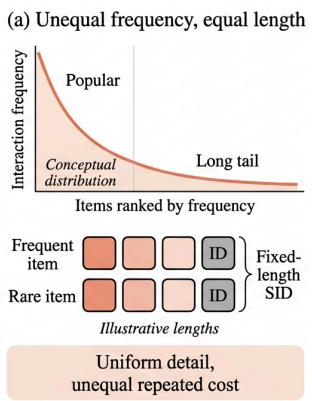
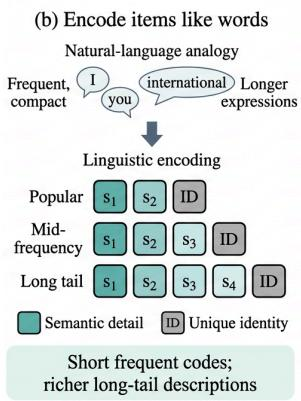
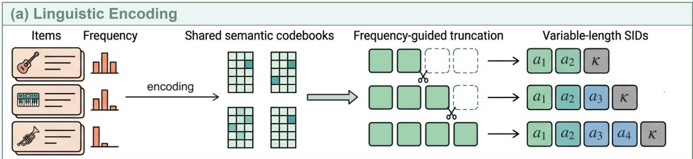
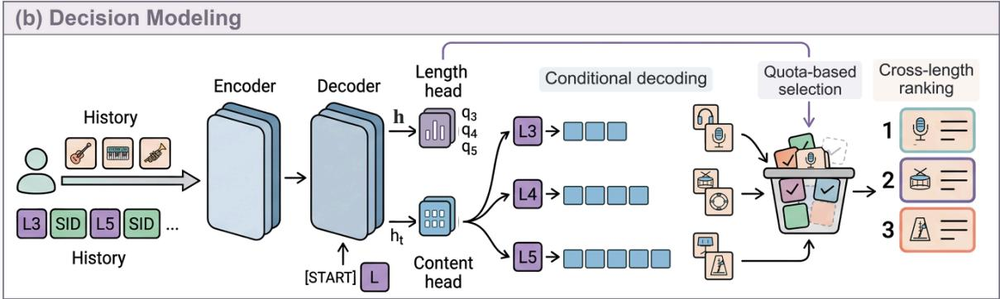
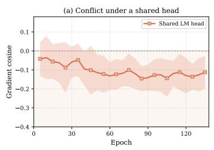
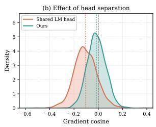
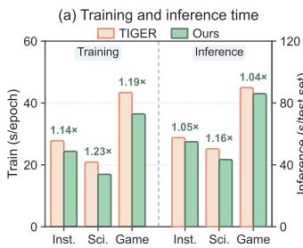
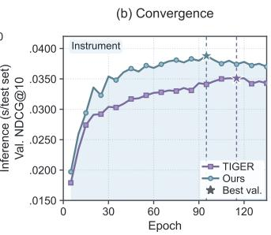
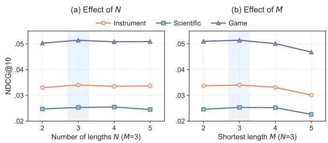

# JevRec: Linguistic Encoding with Jev-like Decision Modeling for LLM-based Generative Recommendation

Qiyong Zhong Zhejiang University, Hangzhou, China youngzhong365@gmail.com

Ming Yang Zhejiang University, Hangzhou, China yummyyummy183@gmail.com

Jiajie Su Zhejiang University, Hangzhou, China sujiajie@zju.edu.cn

Li Zhang Zhejiang University, Hangzhou, China zhanglizl80@gmail.com

## ABSTRACT

Generative recommendation (GR) represents items as semantic identifiers (SIDs) and autoregressively generates the next item’s SID from interaction history. However, most methods assign the same SID length to all items despite highly unequal interaction frequencies. This uniform design repeatedly incurs the cost of finegrained codes for popular items, while shortening codes to reduce this cost also compresses the semantic representations of long-tail items. Inspired by the compact forms of frequent expressions in natural language, we propose JevRec to encode items as variablelength words and generate the next item from interaction context. Linguistic encoding retains frequency-dependent semantic prefixes from shared codebooks, producing shorter SIDs for popular items and richer descriptions for long-tail items. Yet predicting a sequencelevel length and generating token-level content impose diferent optimization requirements that may conflict under a shared output head. Our Jev-like decision modeling component therefore predicts a length distribution with a dedicated head and generates content conditioned on length through a separate head while sharing the interaction-history representation. Experiments on three public datasets show that JevRec outperforms all compared baselines across the evaluated recommendation metrics. Further analyses show lower training and inference time than TIGER and reduced gradient conflict between length and content prediction.

## CCS CONCEPTS

• Information systems → Recommender systems; Multimedia and multimodal retrieval.

## KEYWORDS

Sequential Recommender, Large Language Model, Multimodality

## 1 INTRODUCTION

Generative recommendation (GR) [1, 33] represents each item as a sequence of discrete semantic ID (SID) tokens and autoregressively generates the next item’s SID from the user’s interaction history, following the next-token generation paradigm of large language models (LLMs) [59, 61–64]. Unlike conventional recommendation methods [9, 16] that maintain a separate ID embedding for every item, GR composes item representations from a compact, shared token vocabulary, reducing the storage burden of item embedding tables as the catalog grows and ofering advantages in memory eficiency [12] and scalability [13, 55]. Residual quantization [20] maps item content to SIDs whose shared prefixes allow semantically similar items to share knowledge [33], enabling recommendation directly in the code space. GR has attracted increasing research attention, with recent eforts improving item tokenization [24, 47] or assigning diferent SIDs to the same item in diferent user contexts [60]. However, most methods assign SIDs of the same length to all items [33, 47], such as three semantic codes followed by a collision-resolution code.

  
Figure 1: Motivation for frequency-aware SID lengths. (a) Fixed-length codes impose equal representation lengths despite unequal interaction frequencies. (b) The naturallanguage analogy motivates shorter codes for popular items and richer descriptions for long-tail items. The distribution and code examples are illustrative.

Fixed-length SIDs tie the semantic representation requirements of the entire item catalog to the encoding cost incurred under the actual interaction distribution through a single length. Recommendation data typically follow a long-tailed distribution in which many low-frequency items expand the catalog while a small set of popular items accounts for a large share of interactions. Consequently, adding one semantic code incurs diferent cumulative costs for items with diferent interaction frequencies. A uniform code length cannot exploit this diference: the additional cost of retaining fine-grained semantics is repeatedly paid on frequent interactions, whereas reducing that cost requires compressing all items together. As illustrated in Figure 1, variable-length SIDs ofer a way to move beyond this uniform constraint and balance semantic detail against encoding cost according to item frequency.

Natural language accommodates words of diferent lengths and often favors simpler forms for frequent expressions, such as shorter words or fewer written strokes. For example, the English words I and you require only a few letters, whereas international and communication have longer forms. The useful principle is not to shorten every word, but to reduce the cost of frequent expressions while preserving a rich vocabulary. Length variation also provides an additional cue for distinguishing word forms, suggesting that a uniform-length vocabulary could be harder to learn without this cue. In this work, we explore modeling item SIDs as word-like units, viewing the generation of the next SID from interaction his tory as analogous to how humans formulate language in context. We introduce linguistic encoding to give item representations frequency-dependent lengths: shorter SIDs for popular items and longer semantic descriptions for long-tail items. This analogy motivates both lower training cost and faster convergence in GR by shortening frequent representations and providing length-based cues for learning the item vocabulary.

Specifically, we group items by interaction frequency and retain diferent code lengths within a shared set of semantic codebooks: popular items discard trailing fine-grained codes, while long-tail items retain their full semantic descriptions. We append collision-resolution codes within each group to preserve unique item identities after truncation. Under this encoding, length is a global property of the entire SID rather than an ordinary content symbol. Length decision-making focuses on sequence-level classifi cation, whereas content generation models fine-grained semantic dependencies conditioned on the generated prefix, so their requirements for discriminative features and parameter updates need not align. A shared generation head couples these capabilities through a common output mapping and may introduce optimization competition: updates that improve local token prediction do not necessarily improve global length classification. Moreover, each SID provides only one length label but multiple content-token labels, which may bias joint optimization toward content generation. We therefore introduce Jev-like decision modeling [2, 22, 23] with task-specific prediction heads for length classification and content generation to alleviate their coupling and competition at the output layer. The length head estimates the probabilities of candidate lengths, while the content head generates item codes conditioned on length, separating their roles while sharing the interaction-history representation.

We conduct extensive experiments on three public datasets, with results showing that JevRec outperforms all compared baselines on every evaluated recommendation metric. Our eficiency analysis also shows shorter training time and faster convergence, supporting the computational and learning benefits of the language-inspired design.

Our main contributions are summarized as follows:

• Linguistic encoding. Inspired by compact frequent expressions in natural language, we give popular items shorter codes and long-tail items longer semantic descriptions, allowing SID length and semantic granularity to vary with item frequency. The codes preserve shared semantics and unique item identities while reducing repeated encoding costs for frequent interactions.

• Jev-like decision modeling. We introduce task-specific heads for length classification and content generation to alleviate competition in a shared output layer. The heads share history representations and interact through length-conditioned generation, with length probabilities guiding candidate selection across decoding branches to form a length-aware recommendation list.

## 2 RELATED WORK

Generative Recommendation. Sequential recommendation has progressed from models of item transitions to attention-based history encoders [16, 34, 41], with further developments incorporating multiple behavior types and multimodal signals [38–40]. SID-based generative recommendation follows a diferent retrieval formulation: a model predicts a discrete identifier sequence instead of scoring a separate embedding for every item [33, 43]. A shared token vocabulary supports compact item representations and knowledge reuse [27, 33], while semantic identifiers also connect recommendation with language models [15, 57]. Large-scale sequence models and industrial deployments further demonstrate the practical relevance of generative approaches [1, 7, 8, 52, 55]. Item tokenization is a central design choice in this paradigm. Existing constructions include learned quantization [12, 33, 47, 67], cluster-derived indices [14, 43, 48], identifiers produced with language models [15, 24], and quantizers that integrate multiple modalities [51]. Joint optimization of the tokenizer and recommender seeks to adapt the code space to recommendation objectives [21, 24]. Other studies examine how hierarchical identifiers constrain prediction probabilities [10], how compression afects semantic information [12, 50], and whether token prediction encourages memorization rather than generalization [3]. Beyond code construction, recent work investigates difusion-based generation [28, 36], multi-level alignment [53], multimodal recommendation [25, 68], next-place prediction [45], and retrieval-assisted generation for unseen items [4]. ActionPiece [13] also incorporates action context into tokenization. Pctx [60] personalizes item tokenization using user interaction history. Our work aims to allocate SID lengths according to interaction frequency and coordinate sequence-level length decisions with token-level content generation.

Tokenization. A tokenizer defines the discrete units through which a model observes and generates data. Its granularity determines both the number of symbols needed to represent an input and the size of the vocabulary from which those symbols are selected. In language processing, BPE and WordPiece construct reusable subword vocabularies [35, 49], whereas unigram tokenization uses a probabilistic segmentation model [18]; SentencePiece provides a language-independent framework for subword processing [19]. Visual tokenizers instead learn discrete latent codes from encoded image representations [6, 44, 54]. These approaches illustrate how token design mediates between representational detail and sequence length. Semantic item tokenizers transfer discrete representation learning to recommendation [1, 33], but the frequency of an item determines how often its encoding cost is incurred. Recent studies also explore variable-length item representations [17, 26, 30, 46]. These approaches emphasize adaptive encoding, history compression, or decoding-tree structure, whereas we coordinate frequency-aware encoding with explicit target-length decisions during generation.

Motivated by compact frequent expressions in language, JevRec varies the length of complete item codes rather than imposing a uniform semantic budget. Linguistic encoding retains shorter prefixes for popular items and finer-grained descriptions for long-tail items, while Jev-like decision modeling makes length an explicit prediction task that conditions subsequent content generation.

## 3 METHOD

## 3.1 Overview

As illustrated in Figure 2, JevRec combines frequency-aware item encoding with explicit length decision-making. Linguistic encoding assigns each item a unique SID whose length reflects its interaction frequency: popular items retain short semantic prefixes, whereas long-tail items retain finer-grained descriptions. The recommendation model then separates length classification from content generation while sharing the representation of user history. A candidateconditioned decision head estimates a distribution over SID lengths, and a content head generates item codes under a specified length prefix. We train both heads jointly and use the length distribution to allocate candidate slots across decoding branches before ranking the selected items. The following sections define the task and detail the encoding, decision, training, and inference procedures.

## 3.2 Problem Formulation

Let V denote the item catalog and $S = [ v _ { 1 } , \ldots , v _ { n } ]$ a user’s chronological interaction history, where $v _ { i } \in \mathcal { V }$ . Sequential recommendation predicts the next item $v ^ { \star } \in \mathcal { V }$ given �. Each item has a text description and frequency $f ( v )$ computed from training interactions only. We represent an item by a discrete SID $\mathbf { c } ( v ) \mathbf { \Psi } = \mathbf { \tilde { \mathbf { \Gamma } } }$ $( c _ { 1 } ( v ) , \ldots , c _ { \ell _ { v } } ( v ) )$ , where $\ell _ { v }$ may vary across items. The contextinvariant mapping $v \mapsto \mathbf { c } ( v )$ uniquely identifies each item.

For a configured length set A, let $L _ { \ell }$ be the special token denoting length $\ell \in { \mathcal { A } } .$ . We serialize the history as

$$
X = \operatorname { c o n c a t } _ { i = 1 } ^ { n } [ L _ { \ell _ { v _ { i } } } , \mathbf { c } ( v _ { i } ) ] .\tag{1}
$$

No additional separator is inserted between consecutive items. A length prefix specifies how many subsequent tokens belong to that item’s SID. Throughout the paper, SID length counts the semantic codes and the collision-resolution code, but excludes the length token, decoder start token, and end-of-sequence token. Given �, the model predicts the target length $\ell _ { v ^ { \star } }$ and generates $\mathbf { c } ( \boldsymbol { v } ^ { \star } )$ followed by EOS. Recommendation returns an ordered list of � distinct items recovered from generated SIDs.

## 3.3 Linguistic Encoding

Frequency-dependent lengths. We order items by their training frequencies � (�) and divide the catalog into � frequency groups, with group 1 containing the highest-frequency items. Let $g ( v ) \in$ $\{ 1 , . . . , N \}$ be the group of item � and $M \ge 2$ the minimum SID length. We assign

$$
\begin{array} { l } { { \ell _ { v } = M + g ( v ) - 1 , } } \\ { { \mathcal { R } = \{ M , M + 1 , \ldots , M + N - 1 \} . } } \end{array}\tag{2}
$$

This assigns fewer tokens to frequently occurring items while allowing less frequent items to retain more semantic detail. The group sizes follow the relative popularity of items rather than their absolute interaction counts, so that every group remains suficiently populated under long-tailed distributions. The partition is computed once from training frequencies and does not depend on the current user; we detail the allocation procedure in Appendix B.

Shared semantic quantization. We encode each item’s textual description with a pretrained text encoder and apply principal component analysis with whitening to obtain $\mathbf { x } _ { o } ~ \in ~ \mathbb { R } ^ { d _ { e } }$ . A single residual quantizer is fitted to these item representations using $Q = M + N - 2$ codebooks, each containing � code vectors. Let $\mu _ { j , b }$ be entry � of codebook $j .$ Starting from $\mathbf { r } _ { 0 } ( v ) = \mathbf { x } _ { v } ,$ , residual quantization assigns

$$
\begin{array} { r l } & { a _ { j } ( v ) = \underset { b \in \{ 1 , \ldots , B \} } { \arg \operatorname* { m i n } } \ \| \mathbf { r } _ { j - 1 } ( v ) - \pmb { \mu } _ { j , b } \| _ { 2 } ^ { 2 } , } \\ & { \mathbf { r } _ { j } ( v ) = \mathbf { r } _ { j - 1 } ( v ) - \pmb { \mu } _ { j , a _ { j } ( v ) } , \quad j = 1 , \ldots , Q . } \end{array}\tag{3}
$$

All frequency groups share these codebooks. The resulting ordered codes describe an item’s content through successive residual refinements, so truncation changes the amount of retained detail without learning a separate semantic space for each group.

Truncation and unique identification. An item in group � retains the first $d _ { g } = M + g - 2 = \ell _ { v } - 1$ semantic codes and discards the remaining $N - g$ codes. We then append a collision-resolution token $\kappa ( \boldsymbol { v } )$ to obtain

$$
\mathbf { c } ( \boldsymbol { v } ) = \big ( a _ { 1 } ( \boldsymbol { v } ) , \dots , a _ { d _ { g ( v ) } } ( \boldsymbol { v } ) , \kappa ( \boldsymbol { v } ) \big ) .\tag{4}
$$

Here each semantic index is represented by a token that preserves its codebook identity, and collision tokens belong to a vocabulary distinct from the semantic tokens. Within each group, items sharing the same retained semantic prefix receive diferent collision tokens. Collision indices can be reused across diferent prefixes because identification depends on the full SID. We allocate suficient collision-token capacity to distinguish every item in each prefix bucket, which yields one unique SID per item without requiring cross-group collision handling.

With the default $\displaystyle M = N = 3 ,$ the shared quantizer has four levels. The high-, medium-, and low-frequency groups retain two, three, and four semantic codes, respectively, producing SID lengths of three, four, and five after adding the collision token. Thus lengths vary through semantic truncation without losing item identity.

## 3.4 Jev-like Decision Modeling

Length prediction is a sequence-level decision over a small candidate set, whereas content generation predicts successive tokens from an evolving prefix. Coupling them in one vocabulary output head can create competition between these diferent prediction requirements. We instead give length classification a dedicated readout and condition content generation on its chosen length, while preserving a shared representation of user history.

History and length representations. A shared encoder–decoder processes the serialized history �. We use the decoder’s final-layer state at its initial position as the history-conditioned decision state:

$$
\begin{array} { r l } & { H = \operatorname { E n c o d e r } _ { \theta } ( X ) , } \\ & { \mathbf { h } = \operatorname { D e c o d e r } _ { \theta } ( [ \mathsf { S } \mathsf { T A R T } ] , H ) _ { 0 } . } \end{array}\tag{5}
$$

The state h has already attended to the encoded history and is not the raw start-token embedding. For each $\ell \in \mathcal { A }$ , we obtain a candidate representation ${ \bf e } _ { \ell } ~ = ~ E [ L _ { \ell } ]$ from the model’s token

  
Figure 2: Overview of JevRec. (a) Linguistic encoding constructs frequency-dependent SIDs with shared codebooks. (b) Jev-like decision modeling separates length and content prediction, followed by conditional decoding, quota-based selection, and cross-length ranking. The blue blocks in (b) represent complete SIDs; item examples are illustrative.

embedding table �. The same embedding is used when $L _ { \ell }$ serves as a prefix for content generation, tying the decision candidate to its downstream conditioning signal.

Candidate-conditioned scoring. We score every legal length with one shared nonlinear function:

$$
\begin{array} { c } { { z _ { \ell } = f _ { \phi } ( [ { \bf h } ; { \bf e } _ { \ell } ] ) , } } \\ { { q ( \ell \ell | X ) = \displaystyle \frac { \exp ( z _ { \ell } ) } { \sum _ { t \in \mathcal { A } } \exp ( z _ { t } ) } . } } \end{array}\tag{6}
$$

The scorer $f _ { \phi }$ is a shared three-layer MLP applied to the concatenated history and length representations, with architecture details in Appendix C.1. Nonlinear interaction lets each candidate’s score depend on the user history rather than merely adding a history-independent length bias. The head normalizes only over legal lengths instead of the full content vocabulary. Reusing h across scores requires one history encoding and one decoder start position rather than a separate model pass per candidate.

Length-conditioned content generation. For a candidate length ℓ, the content head starts from $[ \mathsf { S T A R T } , L _ { \ell } ]$ and autoregressively generates the SID followed by EOS. Let $\mathbf { y } ( v ) = [ \mathbf { c } ( v )$ , EOS]. For an item whose assigned length is ℓ, its conditional code probability is

$$
r _ { \ell } ( v \mid X ) = \prod _ { j = 1 } ^ { \ell + 1 } { p \big ( y _ { j } ( v ) \mid X , \ell , \mathbf { y } _ { < j } ( v ) \big ) } .\tag{7}
$$

The length and content heads together assign the joint probability

$$
p ( \ell _ { v } , \mathbf { y } ( v ) \mid X ) = q ( \ell _ { v } \mid X ) r _ { \ell _ { v } } ( v \mid X ) .\tag{8}
$$

The length decision supplies the branch probability, while the content head distinguishes items under that length. This separation provides task-specific output mechanisms without removing shared

learning through the history representation or the length embeddings. At inference we retain multiple length branches instead of only the most probable one, as detailed in Section 3.6.

## 3.5 Joint Training

For a training pair $( S , v ^ { \star } )$ , let $\ell ^ { \star } = \ell _ { v ^ { \star } }$ and $\mathbf { y } ^ { \star } = [ \mathbf { c } ( \boldsymbol { v } ^ { \star } ) , \mathsf { E 0 } \mathsf { S } ]$ . We supervise the length head with $\ell ^ { \star }$ and train the content head under the corresponding ground-truth prefix $L _ { \ell ^ { \star } }$ . The true length aligns the conditioning prefix with the target code, giving the content head a well-defined conditional generation task. Each example contributes a content loss only in its true-length branch.

With teacher forcing, a single decoder pass receives the start token followed by the true length prefix and all tokens of $\mathbf { c } ( \boldsymbol { v } ^ { \star } )$ in order. The start-position state supplies the length decision, the length-prefix state predicts the first SID token, and the final SID position predicts EOS. Causal attention prevents the start position from accessing the true length prefix or subsequent target tokens. The content head is not trained to predict the length token itself.

For a minibatch B, the joint objective is

$$
\mathcal { L } = - \frac { 1 } { | \mathcal { B } | } \sum _ { ( X , \mathbf { y } ^ { \star } ) \in \mathcal { B } } \log p ( \boldsymbol { \ell } ^ { \star } , \mathbf { y } ^ { \star } \mid X ) .\tag{9}
$$

We jointly optimize the length and content losses with unit weights in one stage. Content-token losses exclude padding and are summed per example before averaging over the batch. This objective is the negative log-likelihood of the target length and its EOS-terminated code under the decomposition in Eq. (8). Both objectives update the shared backbone to learn history representations for length selection and fine-grained item discrimination.

## 3.6 Length-Aware Inference

Candidate allocation. Rather than committing to one predicted length, we retain the full decision distribution �(ℓ | �) and generate candidates for each legal length. For a recommendation budget �, the largest-remainder rule converts length probabilities into integer quotas. We first compute

$$
\begin{array} { r l } & { b _ { \ell } = \lfloor K q ( \ell \mid X ) \rfloor , } \\ & { \rho _ { \ell } = K q ( \ell \mid X ) - b _ { \ell } , } \\ & { \quad R = K - \displaystyle \sum _ { \ell \in \mathcal { A } } b _ { \ell } . } \end{array}\tag{10}
$$

Starting from $n _ { \ell } = b _ { \ell } $ we give one additional slot to each of the � lengths with the largest $\rho _ { \ell } ,$ so that $\begin{array} { r } { \sum _ { \ell } n _ { \ell } = K } \end{array}$ . Ties favor larger length probabilities, with any remaining ties broken using a fixed random seed. Quotas determine the composition of the candidate list rather than the final ordering of its items.

Conditional decoding. Each branch performs beam search with width � from $[ \mathsf { S T A R T } , L _ { \ell } ]$ while reusing the encoded history. We retain completed codes only when they map to catalog items of the corresponding SID length and select up to $n _ { \ell }$ distinct items with the highest conditional probabilities $r _ { \ell } ( \boldsymbol { \upsilon } \mid \boldsymbol { X } )$ from Eq. (7). Invalid codes do not consume recommendation slots. Decoding does not use a catalog-prefix trie: candidate probabilities use the model’s original token probabilities, including EOS, without length normalization or renormalization over valid catalog prefixes.

Cross-length ranking. The selected candidates are merged and sorted by the joint score

$$
\begin{array} { r l } & {  { s ( v \mid X ) } = q ( \ell _ { v } \mid X ) r _ { \ell _ { v } } ( v \mid X ) , } \\ & { \log s ( v \mid X ) = \log q ( \ell _ { v } \mid X ) + \log r _ { \ell _ { v } } ( v \mid X ) . } \end{array}\tag{11}
$$

The length factor supplies the probability of entering a branch, while the conditional factor distinguishes items within that branch. This score uses the same decomposition as training and permits candidates from diferent lengths to interleave in the final ranking. If a branch has fewer valid candidates than its quota, the vacant slots are filled by the highest-scoring unselected candidates from other branches. This fills the budget whenever the pooled candidate set contains at least � valid items. Quota-based selection is retained before sorting; the procedure is not an unconstrained global top-� search over all joint scores.

When reporting multiple cutofs, we set the beam width and allocation budget to the largest cutof $K _ { \mathrm { m a x } }$ and construct one ranked list. Results at a smaller cutof � use the first � entries of that list without reallocating quotas or repeating generation.

## 4 EXPERIMENTS

To evaluate JevRec, we conduct experiments to answer the following research questions (RQs):

• RQ1: How does JevRec perform against sequential and generative recommendation baselines?

• RQ2: How do linguistic encoding, Jev-like decision modeling, and length-aware inference contribute to performance?

• RQ3: Does separating the prediction heads alleviate gradient conflict between length and content prediction?

• RQ4: How eficient is JevRec in training and inference?

Table 1: Adopted Amazon Reviews benchmark statistics. AvgLen is the average interaction sequence length.
<table><tr><td></td><td>Instrument</td><td>Scientific</td><td>Game</td></tr><tr><td>Users</td><td>57,439</td><td>50,985</td><td>94,762</td></tr><tr><td>Items</td><td>24,587</td><td>25,848</td><td>25,612</td></tr><tr><td>Interactions</td><td>511,836</td><td>412,947</td><td>814,586</td></tr><tr><td>Sparsity</td><td>99.964%</td><td>99.969%</td><td>99.966%</td></tr><tr><td>AvgLen</td><td>8.91</td><td>8.10</td><td>8.60</td></tr></table>

• RQ5: How sensitive is JevRec to the number of available lengths � and the shortest SID length �?

• RQ6: How does frequency-aware encoding assign SID lengths to individual items in concrete examples?

## 4.1 Experimental Setup

Datasets & Benchmarks. Following prior work [24, 58], we use three categories from Amazon Reviews 2023 [11]: Musical Instruments (Instrument), Industrial & Scientific (Scientific), and Video Games (Game). The review records cover May 1996 through September 2023. Following the preprocessing protocol in prior work [33, 65], we exclude users and items with fewer than five interactions and sort the remaining interactions chronologically for each user. The maximum history length is 20 items rather than 20 tokens. For JevRec, each retained item is serialized as its length prefix followed by its SID, as defined in $\operatorname { E q } .$ (1). Item frequencies used for length assignment are computed only from the training split. Statistics of the adopted benchmarks are listed in Table 1.

Evaluation Settings. Following previous work [16, 33, 65], we adopt leave-one-out splitting: each user’s latest interaction is used for testing, the penultimate interaction for validation, and all earlier interactions for training. We evaluate against the full item catalog without negative sampling and report Recall@5, Recall@10, NDCG@5, and NDCG@10. Generative baselines use a beam width of 50. For JevRec, we follow Section 3.6 with a beam width of $K _ { \operatorname* { m a x } { } } = 1 0$ in each length branch and construct one ranked list whose prefixes are used for both cutofs.

Compared Models. We compare against 13 baselines in two categories. Among conventional sequential recommenders, Caser [42] uses convolutional filters to model spatial and positional patterns in interaction sequences. HGN [29] models user preferences through feature-level and instance-level hierarchical gating. GRU4Rec [9] uses gated recurrent units to capture sequential dependencies in user behavior. BERT4Rec [41] learns bidirectional sequential representations through masked item prediction. SASRec [16] uses unidirectional self-attention to model dependencies in interaction histories. FMLP-Rec [66] combines an MLP-based architecture with learnable filters for sequence denoising. HSTU [55] uses hierarchical sequential transducers to model user actions and their timestamps at scale. DuoRec [32] addresses representation degeneration through contrastive regularization with dropout-based augmentation and supervised positive sampling. FDSA [56] uses separate self-attention streams to model feature-level and item-level dependencies. S3-Rec [65] learns from correlations among items and their attributes through self-supervised objectives.

For generative recommendation, TIGER [33] uses RQ-VAE to convert item representations into semantic IDs and predicts the next item’s ID autoregressively. LETTER [47] extends learnable item tokenization with collaborative information and diversityoriented constraints. ActionPiece [13] tokenizes action sequences by merging co-occurring features in context and uses set permutation regularization to model feature sets.

Table 2: Comparison of JevRec with existing methods on three datasets. Best results are bold and second-best results are underlined. R@K and N@K denote Recall@K and NDCG@K, respectively. Improvements are relative to the best baseline in each column. “∗” denotes statistically significant improvements (� < 0.05) over the best baseline according to a paired t-test.
<table><tr><td rowspan="2">Methods</td><td colspan="4">Instrument</td><td colspan="4">Scientific</td><td colspan="4">Game</td></tr><tr><td>R@5</td><td>R@10</td><td>N@5</td><td>N@10</td><td>R@5</td><td>R@10</td><td>N@5</td><td>N@10</td><td>R@5</td><td>R@10</td><td>N@5</td><td>N@10</td></tr><tr><td>Caser</td><td>0.0241</td><td>0.0386</td><td>0.0151</td><td>0.0197</td><td>0.0159</td><td>0.0257</td><td>0.0101</td><td>0.0132</td><td>0.0330</td><td>0.0553</td><td>0.0209</td><td>0.0281</td></tr><tr><td>HGN</td><td>0.0321</td><td>0.0517</td><td>0.0202</td><td>0.0265</td><td>0.0212</td><td>0.0351</td><td>0.0131</td><td>0.0176</td><td>0.0424</td><td>0.0687</td><td>0.0281</td><td>0.0356</td></tr><tr><td>GRU4Rec</td><td>0.0324</td><td>0.0501</td><td>0.0209</td><td>0.0266</td><td>0.0202</td><td>0.0338</td><td>0.0129</td><td>0.0173</td><td>0.0499</td><td>0.0799</td><td>0.0320</td><td>0.0416</td></tr><tr><td>BERT4Rec</td><td>0.0307</td><td>0.0485</td><td>0.0195</td><td>0.0252</td><td>0.0186</td><td>0.0296</td><td>0.0119</td><td>0.0155</td><td>0.0460</td><td>0.0735</td><td>0.0298</td><td>0.0386</td></tr><tr><td>SASRec</td><td>0.0333</td><td>0.0523</td><td>0.0213</td><td>0.0274</td><td>0.0259</td><td>0.0412</td><td>0.0150</td><td>0.0199</td><td>0.0535</td><td>0.0847</td><td>0.0331</td><td>0.0438</td></tr><tr><td>FMLP-Rec</td><td>0.0339</td><td>0.0536</td><td>0.0218</td><td>0.0282</td><td>0.0269</td><td>0.0422</td><td>0.0155</td><td>0.0204</td><td>0.0528</td><td>0.0857</td><td>0.0338</td><td>0.0444</td></tr><tr><td>HSTU</td><td>0.0343</td><td>0.0577</td><td>0.0191</td><td>0.0271</td><td>0.0271</td><td>0.0429</td><td>0.0147</td><td>0.0198</td><td>0.0578</td><td>0.0903</td><td>0.0334</td><td>0.0442</td></tr><tr><td>DuoRec</td><td>0.0347</td><td>0.0547</td><td>0.0227</td><td>0.0291</td><td>0.0234</td><td>0.0389</td><td>0.0146</td><td>0.0196</td><td>0.0524</td><td>0.0827</td><td>0.0336</td><td>0.0433</td></tr><tr><td>FDSA</td><td>0.0347</td><td>0.0545</td><td>0.0230</td><td>0.0293</td><td>0.0262</td><td>0.0421</td><td>0.0169</td><td>0.0213</td><td>0.0544</td><td>0.0852</td><td>0.0361</td><td>0.0448</td></tr><tr><td>S3-Rec</td><td>0.0317</td><td>0.0496</td><td>0.0199</td><td>0.0257</td><td>0.0263</td><td>0.0418</td><td>0.0171</td><td>0.0219</td><td>0.0485</td><td>0.0769</td><td>0.0315</td><td>0.0406</td></tr><tr><td>TIGER</td><td>0.0370</td><td>0.0564</td><td>0.0244</td><td>0.0306</td><td>0.0264</td><td>0.0422</td><td>0.0175</td><td>0.0226</td><td>0.0559</td><td>0.0868</td><td>0.0366</td><td>0.0467</td></tr><tr><td>LETTER</td><td>0.0372</td><td>0.0580</td><td>0.0246</td><td>0.0313</td><td>0.0279</td><td>0.0435</td><td>0.0182</td><td>0.0232</td><td>0.0563</td><td>0.0877</td><td>0.0372</td><td>0.0473</td></tr><tr><td>ActionPiece</td><td>0.0383</td><td>0.0615</td><td>0.0243</td><td>0.0318</td><td>0.0284</td><td>0.0452</td><td>0.0182</td><td>0.0236</td><td>0.0591</td><td>0.0927</td><td>0.0382</td><td>0.0490</td></tr><tr><td>JevRec</td><td>0.0407*</td><td>0.0643*</td><td>0.0263*</td><td>0.0340*</td><td>0.0312*</td><td>0.0486*</td><td>0.0198*</td><td>0.0253*</td><td>0.0621*</td><td>0.0966*</td><td>0.0405*</td><td>0.0514*</td></tr><tr><td>Improvements</td><td>+6.27%</td><td>+4.55%</td><td>+6.91%</td><td>+6.92%</td><td>+9.86%</td><td>+7.52%</td><td>+8.79%</td><td>+7.20%</td><td>+5.08%</td><td>+4.21%</td><td>+6.02%</td><td>+4.90%</td></tr></table>

Implementation Details. We use a T5-style encoder–decoder with four layers in each stack and a hidden size of 128. We use two H20 GPUs with a per-GPU batch size of 256 and train for 200 epochs on each dataset. Optimization uses AdamW with a cosine learning-rate schedule. The learning rate is selected from {0.01, 0.003} and weight decay from {0.1, 0.05, 0.035}. The length and content objectives have unit weights and are optimized in one joint stage, following Section 3.5. Further details of the item tokenizer, architecture, and decoding are provided in Appendix C.1.

## 4.2 Overall Performance (RQ1)

We compare JevRec with conventional sequential and generative recommendation methods on the three datasets. The results in Table 2 lead to the following observations.

• Obs 1: JevRec consistently outperforms both families of baselines. Our method achieves the best result in all twelve dataset–metric combinations, with a mean relative improvement of 6.52% over the strongest baseline in each column. The advantage holds across all three item domains and both Recall and NDCG, showing that the overall quality gain is not confined to a particular dataset or evaluation criterion.

• Obs 2: The gains extend beyond the standard semantic-ID pipeline. Compared with TIGER’s fixed-length SIDs, JevRec improves every metric with a mean relative gain of 12.04% across the reported settings. The advantage also holds over LETTER and ActionPiece, showing that it persists with stronger tokenization baselines. These results support frequency-aware SID encoding with explicit length decisions.

• Obs 3: The gains persist at the top of the recommendation list. The relative Recall@5 improvement over the best baseline exceeds its Recall@10 counterpart on every dataset. NDCG also improves at both cutofs, so the gains are not limited to retrieving relevant items when more output slots are available. This is particularly relevant to short recommendation lists, where the quality of the highest-ranked predictions matters most.

## 4.3 Ablation Study (RQ2)

We ablate the three stages of JevRec and retrain each variant, except that the two inference variants reuse the trained model of JevRec and its candidate pool. For linguistic encoding, Fixed-length reuses the TIGER results, Random lengths draws each item’s SID length at random from the admissible range independently of its frequency, and Reversed frequency assigns long SIDs to popular items and short SIDs to long-tail items. For Jev-like decision modeling, Shared LM head predicts the length token and the SID with a single autoregressive output head, w/o Length tokens removes the length tokens from both the history and the target, and Historyonly length head replaces the candidate-conditioned scorer with a classifier on the start-position state. For length-aware inference, w/o Length quotas ranks all valid candidates by the joint score without per-length quotas, and w/o Length-aware ranking keeps the items selected by JevRec but orders them by the conditional generation probability alone. The results in Table 3 lead to the following observations.

• Obs 4: The encoding gain comes from tying SID length to interaction frequency. All three encoding variants fall below JevRec on every metric. Random lengths retains variable-length SIDs and the complete decision pipeline but still trails JevRec by 8.70% on average, so most of the encoding gain stems from assigning lengths by frequency rather than from variable length itself. Reversing the relation is even more harmful: Reversed frequency is worse than Random lengths on every metric and falls below Fixed-length on all NDCG metrics, which supports giving popular items short codes and long-tail items longer descriptions as natural language does.

Table 3: Ablation study of JevRec on three datasets. R@K and N@K denote Recall@K and NDCG@K.
<table><tr><td rowspan="2">Variant</td><td colspan="4">Instrument</td><td colspan="4">Scientific</td><td colspan="4">Game</td></tr><tr><td>R@5</td><td>R@10</td><td>N@5</td><td>N@10</td><td>R@5</td><td>R@10</td><td>N@5</td><td>N@10</td><td>R@5</td><td>R@10</td><td>N@5</td><td>N@10</td></tr><tr><td></td><td colspan="10">Linguistic Encoding</td></tr><tr><td>(1.1) Fixed-length</td><td>0.0370</td><td></td><td></td><td>0.0564 0.0244 0.0306</td><td>0.0264 0.0422 0.0175 0.0226</td><td></td><td></td><td></td><td>0.0559</td><td>0.0868</td><td>0.0366</td><td>0.0467</td></tr><tr><td>(1.2) Random lengths</td><td>0.0374</td><td>0.0591</td><td>0.0239</td><td>0.0311</td><td>0.0278 0.0445</td><td></td><td>0.0178</td><td>0.0230</td><td>0.0567</td><td>0.0898</td><td>0.0369</td><td>0.0476</td></tr><tr><td>(1.3) Reversed frequency</td><td>0.0358</td><td>0.0579</td><td>0.0229</td><td>0.0300</td><td>0.0270 0.0437</td><td></td><td>0.0171 0.0225</td><td></td><td>0.0552</td><td>0.0885</td><td>0.0356</td><td>0.0462</td></tr><tr><td></td><td colspan="10">Jev-like Decision Modeling</td></tr><tr><td>(2.1) Shared LM head</td><td>0.0377</td><td>0.0598</td><td>0.0245</td><td>0.0315</td><td>0.0282 0.0443 0.0184 0.0234 0.0574</td><td></td><td></td><td></td><td></td><td>0.0910</td><td>0.0370</td><td>0.0481</td></tr><tr><td>(2.2) w/o Length tokens</td><td>0.0320</td><td>0.0501</td><td>0.0205</td><td>0.0260</td><td>0.0224 0.0358 0.0132 0.0178</td><td></td><td></td><td></td><td>0.0508</td><td>0.0809</td><td>0.0321</td><td>0.0419</td></tr><tr><td>(2.3) History-only length head</td><td>0.0405 0.0640</td><td></td><td>0.0261</td><td>0.0338</td><td>0.0310 0.0489 0.0197 0.0255</td><td></td><td></td><td></td><td>0.0623</td><td>0.0963</td><td>0.0407</td><td>0.0512</td></tr><tr><td colspan="10">Length-aware Inference</td></tr><tr><td>(3.1) w/o Length quotas</td><td>0.0397</td><td>0.0631</td><td>0.0255 0.0331</td><td></td><td>0.0302 0.0475 0.0191 0.0246 0.0612</td><td></td><td></td><td></td><td></td><td>0.0953</td><td>0.0397</td><td>0.0506</td></tr><tr><td>(3.2) w/o Length-aware ranking</td><td>0.0385</td><td>0.0643</td><td>0.0244</td><td>0.0323</td><td>0.0288</td><td>0.0486</td><td>0.0180</td><td>0.0236</td><td>0.0595</td><td>0.0966</td><td>0.0382</td><td>0.0494</td></tr><tr><td>JevRec</td><td>0.0407</td><td>0.0643</td><td>0.0263</td><td>0.0340</td><td>0.0312</td><td>0.0486</td><td>0.0198</td><td>0.0253</td><td>0.0621</td><td>0.0966</td><td>0.0405</td><td>0.0514</td></tr></table>

• Obs 5: The benefit of Jev-like decision modeling comes from an explicit length decision rather than a particular classifier. Shared LM head lowers every metric by 7.50% on average, showing that predicting the length through the same output head as the content tokens weakens recommendation even when the encoding is unchanged. Removing the length tokens from both the history and the target causes the largest average degradation in this group, since the model must then infer item boundaries and the target length from the SID stream alone. In contrast, replacing the candidate-conditioned scorer with a history-only classifier keeps every metric within 1% of JevRec, so the gain stems from separating the length decision from content generation and linking the two through length tokens rather than from a specific scorer design.

• Obs 6: Length probabilities contribute to both candidate allocation and cross-length ranking. Although both inference variants use the same trained model as JevRec, removing length quotas lowers all twelve metrics. Removing length-aware ranking leaves Recall@10 unchanged because the selected items are identical by construction, but it lowers Recall@5 and every NDCG metric, with larger NDCG drops than removing quotas on every dataset. Quotas therefore keep the list composition consistent with the predicted length distribution, while length-aware ranking ranks items of more probable lengths higher.

## 4.4 Optimization Conflict Analysis (RQ3)

We compare the Shared LM head variant with JevRec using the batch-wise cosine similarity between the gradients of the length and content losses on a common set of shared decoder parameters. Negative cosine indicates conflicting directions. We use 48 batch measurements at each of 27 checkpoints from epoch 5 to 135. We track the shared-head mean over epochs and pool the measurements from this window for the distribution comparison in Figure 3.

  
Figure 3: Length and content gradient alignment. (a) Sharedhead batch mean with standard deviation. (b) Pooled cosine densities; dotted lines mark means.

• Obs 7: Length and content objectives exhibit persistent gradient conflict under a shared head. The mean gradient cosine is negative at every recorded checkpoint. It becomes more negative over the earlier part of training and then fluctuates at a negative level rather than returning to alignment. This shows that the two objectives continue to compete in their updates to the measured shared parameters instead of resolving their directional mismatch through training alone.

• Obs 8: Separating the prediction heads alleviates gradient conflict. The cosine distribution of JevRec shifts toward zero, with its pooled mean increasing from the shared-head value of −0.105 to −0.015. Negative samples become less prevalent, indicating weaker directional interference rather than complete independence. These results support task-specific output modeling as a way to reduce conflict between length decisions and content generation while retaining a shared backbone.

## 4.5 Cost Eficiency Analysis (RQ4)

We compare the eficiency of JevRec and TIGER in Figure 4. We measure average training time per epoch and total inference time over the complete test set of each dataset, and track validation NDCG@10 across training epochs on Instrument.

• Obs 9: JevRec reduces both training and inference time. Training is faster on all three datasets, with a mean relative reduction of 15.75% in time per epoch. Total test-set inference time also decreases on every dataset. These savings are consistent with assigning compact codes to frequently occurring items and reusing the history representation for length decisions and content generation. Together with the recommendation gains in Table 2, the results show that JevRec improves accuracy while lowering runtime under the evaluated settings.

  
Figure 4: Runtime and validation progress. (a) Training and inference time with baseline-to-ours ratios. (b) Instrument validation NDCG@10; stars mark the best checkpoints.

• Obs 10: JevRec reaches a higher validation peak in fewer epochs. On Instrument,JevRec achieves higher validation NDCG@10 at every recorded checkpoint and reaches its best score 20 epochs earlier than TIGER. The advantage therefore extends beyond faster execution within an epoch to stronger learning progress across epochs. This complements the per-epoch savings: JevRec requires less computation time per epoch and fewer epochs to reach its observed validation optimum.

## 4.6 Hyperparameter Analysis (RQ5)

We study the sensitivity of JevRec to the number of available SID lengths � and the shortest SID length �. We vary each parameter over {2, 3, 4, 5} while fixing the other at its default value of 3. The NDCG@10 results on all three datasets are shown in Figure 5.

• Obs 11: JevRec is robust to moderate changes in the length configuration. Performance remains close to the default across the full � sweep and for � ∈ {2, 3, 4}. In these settings, NDCG@10 difers from the default by less than 3.2% on every dataset. This consistent behavior suggests that JevRec does not depend on precise tuning near the default configuration.

• Obs 12: Moderate length settings work best, while increasing the minimum length too far hurts performance. A value of 3 gives the best result in most dataset–parameter combinations. Increasing � beyond 3 produces small, non-monotonic changes rather than consistent improvements. In contrast, increasing � beyond 3 lowers NDCG@10 on all three datasets, with a sharper decline from 4 to 5. Raising � lengthens the codes of every frequency group, including popular items that would otherwise receive compact identifiers. The results therefore favor moderate minimum lengths rather than uniformly adding semantic tokens to all items.

## 4.7 Case Study (RQ6)

To illustrate how JevRec adapts item representations to interaction frequency, we examine tokenization for three Game items at the default � = � = 3, as shown in Figure 6.

  
Figure 5: SID length sensitivity. (a) Vary � at � = 3. (b) Vary � at � = 3. Shading marks the default value.

The three games difer substantially in interaction frequency and consequently receive SIDs of diferent lengths. Specifically, Grand Theft Auto V has 2,142 interactions and is encoded as [36, 352,1028]. Warcraft III: The Frozen Throne has 25 interactions and receives the longer SID [77,412,558,1026]. With only seven interactions, Sekiro: Shadows Die Twice receives the five-token SID [23, 463,514,789,1026]. Since each SID includes one final collisionresolution token, the additional positions retain more semantic codes from the shared residual quantizer. This case study illustrates the linguistic encoding principle: frequently encountered items use compact identifiers, whereas less frequent items retain richer semantic descriptions to complement their sparse interaction signals.

  
Figure 6: Frequency-aware SID lengths for three game items. Each card shows the item’s interaction count and complete SID, including its final collision token.

## 5 CONCLUSION

We presented JevRec, a generative recommendation framework inspired by compact frequent expressions and contextual generation in natural language. Linguistic encoding assigns shorter SIDs to popular items and richer semantic descriptions to long-tail items while preserving shared semantics and unique item identities through shared codebooks and collision-resolution tokens. This frequencyaware allocation reduces the encoding cost repeatedly incurred by frequent interactions without requiring all items to use equally short representations. Jev-like decision modeling uses separate length and content heads that share a representation of user history and interact through length-conditioned generation. Length-aware inference uses the predicted length probabilities to guide candidate allocation and cross-length ranking, integrating decisions across decoding branches rather than committing to a single predicted length. Experiments on three public datasets show consistent gains over the compared baselines and lower training and inference time than

TIGER. Ablations support the component contributions, and gradi ent analysis shows that separate heads alleviate conflict between the two objectives. These findings support treating SID length as both a representation choice and an explicit prediction decision for accurate and eficient generative recommendation.

## REFERENCES

[1] Jiaxin Deng, Shiyao Wang, Kuo Cai, Lejian Ren, Qigen Hu, Weifeng Ding, Qiang Luo, and Guorui Zhou. 2025. Onerec: Unifying retrieve and rank with generative recommender and iterative preference alignment. arXiv preprint arXiv:2502.18965 (2025).

[2] Tobias Deußer, Lorenz Sparrenberg, and Rafet Sifa. 2026. Evaluating and bench marking the System One model Jev. arXiv preprint arXiv:2609.37647 (2026).

[3] Yijie Ding, Zitian Guo, Jiacheng Li, Letian Peng, Shuai Shao, Wei Shao, Xiaoqiang Luo, Luke Simon, Jingbo Shang, Julian McAuley, et al. 2026. How Well Does Generative Recommendation Generalize? arXiv preprint arXiv:2603.19809 (2026).

[4] Yijie Ding, Jiacheng Li, Julian McAuley, and Yupeng Hou. 2026. Inductive generative recommendation via retrieval-based speculation. In Proceedings ofthe AAAI Conference on Artificial Intelligence, Vol. 40. 14675–14683

[5] Matthijs Douze, Alexandr Guzhva, Chengqi Deng, Jef Johnson, Gergely Szilvasy, Pierre-Emmanuel Mazaré, Maria Lomeli, Lucas Hosseini, and Hervé Jégou. 2024. The faiss library. arXiv preprint arXiv:2401.08281 (2024).

[6] Patrick Esser, Robin Rombach, and Bjorn Ommer. 2021. Taming transformers for high-resolution image synthesis. In CVPR. 12873–12883.

[7] Ruidong Han, Bin Yin, Shangyu Chen, He Jiang, Fei Jiang, Xiang Li, Chi Ma, Mincong Huang, Xiaoguang Li, Chunzhen Jing, et al. 2025. Mtgr: Industrial scale generative recommendation framework in meituan. In Proceedings of the 34th ACM International Conference on Information and Knowledge Management. 5731–5738.

[8] Ruining He, Lukasz Heldt, Lichan Hong, Raghunandan Keshavan, Shifan Mao, Nikhil Mehta, Zhengyang Su, Alicia Tsai, Yueqi Wang, Shao-Chuan Wang, et al. 2026. Plum: Adapting pre-trained language models for industrial-scale generative recommendations. In Proceedings ofthe ACM Web Conference 2026. 8093–8104.

[9] Balázs Hidasi, Alexandros Karatzoglou, Linas Baltrunas, and Domonkos Tikk. 2016. Session-based Recommendations with Recurrent Neural Networks. In ICLR.

[10] Yupeng Hou, Haven Kim, Clark Mingxuan Ju, Eduardo Escoto, Neil Shah, and Julian McAuley. 2026. Expressiveness Limits of Autoregressive Semantic ID Generation in Generative Recommendation. arXiv preprint arXiv:2605.06331 (2026).

[11] Yupeng Hou, Jiacheng Li, Zhankui He, An Yan, Xiusi Chen, and Julian McAuley. 2024. Bridging language and items for retrieval and recommendation. arXiv preprint arXiv:2403.03952 (2024).

[12] Yupeng Hou, Jiacheng Li, Ashley Shin, Jinsung Jeon, Abhishek Santhanam, Wei Shao, Kaveh Hassani, Ning Yao, and Julian McAuley. 2025. Generating Long Semantic IDs in Parallel for Recommendation. In KDD.

[13] Yupeng Hou, Jianmo Ni, Zhankui He, Noveen Sachdeva, Wang-Cheng Kang, Ed H Chi, Julian McAuley, and Derek Zhiyuan Cheng. 2025. ActionPiece: Contextually Tokenizing Action Sequences for Generative Recommendation. In ICML.

[14] Wenyue Hua, Shuyuan Xu, Yingqiang Ge, and Yongfeng Zhang. 2023. How to index item ids for recommendation foundation models. In SIGIR. 195–204

[15] Bowen Jin, Hansi Zeng, Guoyin Wang, Xiusi Chen, Tianxin Wei, Ruirui Li, Zhengyang Wang, Zheng Li, Yang Li, Hanqing Lu, et al. 2024. Language Models as Semantic Indexers. Proceedings of Machine Learning Research 235 (2024), 22244–22259.

[16] Wang-Cheng Kang and Julian McAuley. 2018. Self-attentive sequential recom mendation. In ICDM. IEEE, 197–206.

[17] Kirill Khrylchenko. 2026. Variable-Length Semantic IDs for Recommender Sys tems. CoRR abs/2602.16375 (2026).

[18] Taku Kudo. 2018. Subword Regularization: Improving Neural Network Transla tion Models with Multiple Subword Candidates. In ACL. 66–75.

[19] Taku Kudo and John Richardson. 2018. SentencePiece: A simple and language independent subword tokenizer and detokenizer for Neural Text Processing. In EMNLP. 66–71.

[20] Doyup Lee, Chiheon Kim, Saehoon Kim, Minsu Cho, and Wook-Shin Han. 2022. Autoregressive image generation using residual quantization. In Proceedings of the IEEE/CVF conference on computer vision and pattern recognition. 11523–11532.

[21] Jialei Li, Yang Zhang, Yimeng Bai, Shuai Zhu, Ziqi Xue, Xiaoyan Zhao, Dingx ian Wang, Frank Yang, Andrew Rabinovich, and Xiangnan He. 2026. UniGRec: Unified Generative Recommendation with Soft Identifiers for End-to-End Opti mization. arXiv preprint arXiv:2601.17438 (2026).

[22] Yubo Li, Yidi Miao, Ramayya Krishnan, and Rema Padman. 2026. JEV-as-a-judge: Accept when confident, escalate when unsure. arXiv preprint arXiv:2609.26550 (2026).

[23] Guoming Ling, Muen Xue, and Zijian Ye. 2026. Jev in the Wild: A Data-Driven Analysis of the Jev Model’s Functionality, Applications and Ecosystem. arXiv preprint arXiv:2609.30216 (2026).

[24] Enze Liu, Bowen Zheng, Cheng Ling, Lantao Hu, Han Li, and Wayne Xin Zhao. 2025. Generative recommender with end-to-end learnable item tokenization. In SIGIR. 729–739.

[25] Han Liu, Yinwei Wei, Xuemeng Song, Weili Guan, Yuan-Fang Li, and Liqiang Nie. 2024. Mmgrec: Multimodal generative recommendation with transformer model. arXiv preprint arXiv:2404.16555 (2024).

[26] Jingzhe Liu, Hanbing Wang, Jiliang Tang, Liam Collins, Tong Zhao, Neil Shah, and Mingxuan Ju. 2026. Beyond Fixed Depths and Widths: Optimizing Textual Decoding Tries in LLM-based Generative Recommendation. CoRR abs/2607.16633 (2026).

[27] Zihan Liu, Yupeng Hou, and Julian McAuley. 2024. Multi-behavior generative recommendation. In CIKM. 1575–1585.

[28] Zhao Liu, Yichen Zhu, Yiqing Yang, Xiao Lv, Guoping Tang, Rui Huang, Qiang Luo, Ruiming Tang, and Guorui Zhou. 2026. Difgrm: Difusion-based generative recommendation model. In Proceedings ofthe ACM Web Conference 2026. 5853– 5864.

[29] Chen Ma, Peng Kang, and Xue Liu. 2019. Hierarchical gating networks for sequential recommendation. In KDD. 825–833.

[30] Xinrui Miao, Mingjia Yin, Jiaqing Zhang, Wei Guo, Yong Liu, Yuyang Ye, Hao Wang, and Enhong Chen. 2026. Rethinking Item Tokenization in Generative Recommenders: From Fixed Atoms to Semantic Subwords. CoRR abs/2608.22734 (2026).

[31] Jianmo Ni, Gustavo Hernandez Abrego, Noah Constant, Ji Ma, Keith Hall, Daniel Cer, and Yinfei Yang. 2022. Sentence-T5: Scalable Sentence Encoders from Pre trained Text-to-Text Models. In Findings ofthe ACL. 1864–1874.

[32] Ruihong Qiu, Zi Huang, Hongzhi Yin, and Zijian Wang. 2022. Contrastive learning for representation degeneration problem in sequential recommendation. In WSDM. 813–823.

[33] Shashank Rajput, Nikhil Mehta, Anima Singh, Raghunandan Hulikal Keshavan, Trung Vu, Lukasz Heldt, Lichan Hong, Yi Tay, Vinh Tran, Jonah Samost, et al. 2023. Recommender systems with generative retrieval. NeurIPS 36 (2023), 10299– 10315.

[34] Stefen Rendle, Christoph Freudenthaler, and Lars Schmidt-Thieme. 2010. Factorizing personalized Markov chains for next-basket recommendation. In WWW.

[35] Rico Sennrich, Barry Haddow, and Alexandra Birch. 2016. Neural Machine Translation of Rare Words with Subword Units. In ACL. 1715–1725.

[36] Teng Shi, Chenglei Shen, Weijie Yu, Shen Nie, Chongxuan Li, Xiao Zhang, Ming He, Yan Han, and Jun Xu. 2025. LLaDA-Rec: Discrete Difusion for Parallel Semantic ID Generation in Generative Recommendation. arXiv preprint arXiv:2511.06254 (2025).

[37] Jianlin Su, Jiarun Cao, Weijie Liu, and Yangyiwen Ou. 2021. Whitening sentence representations for better semantics and faster retrieval. arXiv preprint arXiv:2103.15316 (2021).

[38] Jiajie Su, Chaochao Chen, Zibin Lin, Xi Li, Weiming Liu, and Xiaolin Zheng. 2023. Personalized behavior-aware transformer for multi-behavior sequential recommendation. In Proceedings of the 31st ACM international conference on multimedia. 6321–6331.

[39] Jiajie Su, Chaochao Chen, Weiming Liu, Yuhang Wang, Yihao Wang, Zheqi Lv, Xiaolin Zheng, and Jianwei Yin. 2025. Modality-aware difusion augmentation with consistent subspace disentanglement for session-based recommendation. In Proceedings ofthe 31st ACM SIGKDD Conference on Knowledge Discovery and Data Mining V. 2. 2668–2679.

[40] Jiajie Su, Qiyong Zhong, Yunshan Ma, Weiming Liu, Chaochao Chen, Xiaolin Zheng, Jianwei Yin, and Tat-Seng Chua. 2025. Distilling transitional pattern to large language models for multimodal session-based recommendation. arXiv preprint arXiv:2504.10538 (2025).

[41] Fei Sun, Jun Liu, Jian Wu, Changhua Pei, Xiao Lin, Wenwu Ou, and Peng Jiang. 2019. BERT4Rec: Sequential recommendation with bidirectional encoder representations from transformer. In CIKM. 1441–1450.

[42] Jiaxi Tang and Ke Wang. 2018. Personalized top-n sequential recommendation via convolutional sequence embedding. In WSDM. 565–573.

[43] Yi Tay, Vinh Tran, Mostafa Dehghani, Jianmo Ni, Dara Bahri, Harsh Mehta, Zhen Qin, Kai Hui, Zhe Zhao, Jai Prakash Gupta, Tal Schuster, William W. Cohen, and Donald Metzler. 2022. Transformer memory as a diferentiable search index. In NeurIPS.

[44] Aaron Van Den Oord, Oriol Vinyals, et al. 2017. Neural discrete representation learning. NeurIPS 30 (2017).

[45] Dongsheng Wang, Yuxi Huang, Shen Gao, Yifan Wang, Chengrui Huang, and Shuo Shang. 2025. Generative Next POI Recommendation with Semantic ID. In Proceedings of the 31st ACM SIGKDD Conference on Knowledge Discovery and Data Mining V. 2. 2904–2914.

[46] Huimu Wang, Xingzhi Yao, Yiming Qiu, Qinghong Zhang, Haotian Wang, Yufan Cui, Songlin Wang, Sulong Xu, and Mingming Li. 2026. Towards Eficient and Generalizable Retrieval: Adaptive Semantic Quantization and Residual Knowl edge Transfer. In Proceedings ofthe 49th International ACM SIGIR Conference on Research and Development in Information Retrieval, SIGIR 2026, MelbourneVICAustralia, July 20-24, 2026. ACM, 4987–4992.

[47] Wenjie Wang, Honghui Bao, Xinyu Lin, Jizhi Zhang, Yongqi Li, Fuli Feng, See-Kiong Ng, and Tat-Seng Chua. 2024. Learnable item tokenization for generative recommendation. In CIKM. 2400–2409.

[48] Ye Wang, Jiahao Xun, Minjie Hong, Jieming Zhu, Tao Jin, Wang Lin, Haoyuan Li, Linjun Li, Yan Xia, Zhou Zhao, et al. 2024. Eager: Two-stream generative recommender with behavior-semantic collaboration. In KDD. 3245–3254.

[49] Yonghui Wu, Mike Schuster, Zhifeng Chen, Quoc V. Le, Mohammad Norouzi, Wolfgang Macherey, Maxim Krikun, Yuan Cao, Qin Gao, Klaus Macherey, Jef Klingner, Apurva Shah, Melvin Johnson, Xiaobing Liu, Łukasz Kaiser, Stephan Gouws, Yoshikiyo Kato, Taku Kudo, Hideto Kazawa, Keith Stevens, George Kurian, Nishant Patil, Wei Wang, Clif Young, Jason Smith, Jason Riesa, Alex Rudnick, Oriol Vinyals, Greg Corrado, Macduf Hughes, and Jefrey Dean. 2016. Google’s Neural Machine Translation System: Bridging the Gap between Human and Machine Translation. arXiv preprint arXiv:1609.08144 (2016).

[50] Ming Xia, Zhiqin Zhou, Guoxin Ma, and Dongmin Huang. 2026. Unleash the Potential of Long Semantic IDs for Generative Recommendation. arXiv preprint arXiv:2602.13573 (2026).

[51] Yi Xu, Moyu Zhang, Chenxuan Li, Zhihao Liao, Haibo Xing, Hao Deng, Jinxin Hu, Yu Zhang, Xiaoyi Zeng, and Jing Zhang. 2026. Mmq: Multimodal mixture of-quantization tokenization for semantic id generation and user behavioral adaptation. In Proceedings ofthe Nineteenth ACM International Conference on Web Search and Data Mining. 788–797.

[52] Bencheng Yan, Shilei Liu, Zhiyuan Zeng, Zihao Wang, Yizhen Zhang, Yujin Yuan, Langming Liu, Jiaqi Liu, Di Wang, Wenbo Su, et al. 2026. Unlocking scaling law in industrial recommendation systems with a three-step paradigm based large user model. In Proceedings ofthe Nineteenth ACM International Conference on Web Search and Data Mining. 798–807.

[53] Wencai Ye, Mingjie Sun, Shuhang Chen, Wenjin Wu, and Peng Jiang. 2026. Align3GR: Unified Multi-Level Alignment for LLM-based Generative Recommendation. In Proceedings ofthe AAAI Conference on Artificial Intelligence, Vol. 40. 16154–16162.

[54] Qihang Yu, Mark Weber, Xueqing Deng, Xiaohui Shen, Daniel Cremers, and Liang-Chieh Chen. 2024. An image is worth 32 tokens for reconstruction and generation. NeurIPS 37 (2024), 128940–128966.

[55] Jiaqi Zhai, Lucy Liao, Xing Liu, Yueming Wang, Rui Li, Xuan Cao, Leon Gao, Zhaojie Gong, Fangda Gu, Jiayuan He, et al. 2024. Actions speak louder than words: trillion-parameter sequential transducers for generative recommenda tions. In ICML. 58484–58509.

[56] Tingting Zhang, Pengpeng Zhao, Yanchi Liu, Victor S Sheng, Jiajie Xu, Deqing Wang, Guanfeng Liu, Xiaofang Zhou, et al. 2019. Feature-level deeper self attention network for sequential recommendation.. In IJCAI. 4320–4326.

[57] Bowen Zheng, Yupeng Hou, Hongyu Lu, Yu Chen, Wayne Xin Zhao, Ming Chen, and Ji-Rong Wen. 2024. Adapting large language models by integrating

collaborative semantics for recommendation. In ICDE. IEEE, 1435–1448.

[58] Bowen Zheng, Enze Liu, Zhongfu Chen, Zhongrui Ma, Yue Wang, Wayne Xin Zhao, and Ji-Rong Wen. 2025. Pre-training Generative Recommender with Multi-Identifier Item Tokenization. arXiv preprint arXiv:2504.04400 (2025).

[59] Xiaolin Zheng, Qiyong Zhong, Jiajie Su, and Xiang Chen. 2026. Learning Robust Personalized Prompts for LLM-Driven Sequential Recommendation. arXiv preprint arXiv:2610.03923 (2026).

[60] Qiyong Zhong, Jiajie Su, Yunshan Ma, Julian McAuley, and Yupeng Hou. 2025. Pctx: Tokenizing Personalized Context for Generative Recommendation. arXiv preprint arXiv:2510.21276 (2025).

[61] Qiyong Zhong, Jiajie Su, Ming Yang, Yunshan Ma, Xiaolin Zheng, and Chaochao Chen. 2025. An item is worth one token in Multimodal Large Language Modelsbased Sequential Recommendation. arXiv preprint arXiv:2511.05885 (2025).

[62] Qiyong Zhong, Mao Zheng, Mingyang Song, Huwei Ji, Houcheng Jiang, Jiajie Su, Li Zhang, Gengsheng Li, and Junfeng Fang. 2026. USA: Update-aware SAM for Cross-domain On-Policy Disitllation of Language Agents. arXiv preprint arXiv:2609.34225 (2026).

[63] Qiyong Zhong, Mao Zheng, Mingyang Song, Houcheng Jiang, Jiajie Su, Huwei Ji, Li Zhang, and Junfeng Fang. 2026. MAS-OPD: On-Policy Distillation for Multi-agent Systems. arXiv preprint arXiv:2609.34234 (2026).

[64] Qiyong Zhong, Mao Zheng, Mingyang Song, Xin Lin, Jie Sun, Houcheng Jiang, Xiang Wang, and Junfeng Fang. 2026. Sod: Step-wise on-policy distillation for small language model agents. arXiv preprint arXiv:2605.07725 (2026).

[65] Kun Zhou, Hui Wang, Wayne Xin Zhao, Yutao Zhu, Sirui Wang, Fuzheng Zhang, Zhongyuan Wang, and Ji-Rong Wen. 2020. S3-rec: Self-supervised learning for sequential recommendation with mutual information maximization. In CIKM. 1893–1902.

[66] Kun Zhou, Hui Yu, Wayne Xin Zhao, and Ji-Rong Wen. 2022. Filter-enhanced MLP is all you need for sequential recommendation. In WWW. 2388–2399.

[67] Jieming Zhu, Mengqun Jin, Qijiong Liu, Zexuan Qiu, Zhenhua Dong, and Xiu Li. 2024. CoST: Contrastive Quantization based Semantic Tokenization for Generative Recommendation. In RecSys.

[68] Jing Zhu, Mingxuan Ju, Yozen Liu, Danai Koutra, Neil Shah, and Tong Zhao. 2025. Beyond unimodal boundaries: Generative recommendation with multimodal semantics. arXiv preprint arXiv:2503.23333 (2025).

## A ALGORITHM DETAILS

## B FREQUENCY GROUP ALLOCATION

This section explains how we partition items into frequency groups, which determines the SID length of each item. Our goal is to give short codes to frequently interacted items and longer codes to long-tail items while keeping every group suficiently populated. A direct strategy that derives each item’s length from fixed thresholds on its interaction count depends on the absolute scale of each dataset, and under a long-tailed distribution it can place most of the catalog in the longest-code group while leaving the short-code groups nearly empty. To avoid this, we control the size of each group through a smooth prior over group proportions, so that the allocation reflects the relative popularity of items rather than their absolute interaction counts. The allocation is computed once from training interactions, is shared by all users, and uses no validation or test interactions.

Frequency-aware grouping. We count each item’s interactions in the training split and sort the catalog in descending order of frequency. The target proportion of items in each of the � groups is determined by sampling � discrete support points from a normal ized Gamma distribution Gamma $( K _ { \gamma } , \theta { = } 1 )$ over the integer interval [1, �], where the shape parameter $K _ { \gamma }$ is distinct from the recommendation budget �. We then partition the sorted list sequentially into contiguous groups of these target sizes, so that items in the same group have similar interaction volumes. The proportions therefore apply to the number of items rather than to cumulative interactions or distinct frequency values. A single shape parameter adjusts the skewness of the allocation: a smaller $K _ { \gamma }$ assigns more items to the leading short-code groups, whereas a larger $K _ { \gamma }$ shifts items toward the later long-code groups.

Group-based length assignment. Each group is assigned a fixed SID length that grows by one token from one group to the next, so group � receives $\ell _ { q } = M + g - 1$ and all items in the group share this length. The first group thus contains the most frequent items and uses the shortest codes. Because adjacent groups difer by a single token, items with similar interaction levels receive codes of similar length, and the descriptive capacity increases smoothly from popular to long-tail items. Each item retains the first $\ell _ { g } - 1$ semantic codes from the shared residual quantizer and appends one collision-resolution token, so these lengths include the collision token but exclude the length prefix, START, and EOS.

Default configuration. We use the same configuration on all three datasets, namely $\quad M = 3 , N = 3$ , and $K _ { \gamma } = 2 . 1$ . The four-level shared quantizer then yields SID lengths of 3, 4, and 5 for the high-, middle-, and low-frequency groups, to which this allocation assigns approximately 44.6%, 35.2%, and 20.2% ofthe items, respectively. The largest share of the catalog therefore receives the shortest codes, while the complete four-code semantic description is reserved for roughly the least frequent fifth of the items. Although the three datasets difer considerably in their numbers of users and interactions, as shown in Table 1, we apply this single setting to all of them, and we keep the allocation rule fixed when varying � and � in Section 4.6.

## C EXPERIMENTAL DETAILS

We follow the same experimental settings as prior work [60] and directly adopt its reported results for most baselines.

## C.1 Implementation Details.

• Item Tokenizer. Following TIGER [33], we encode item textual attributes with sentence-t5-base [31]. We apply PCA with whitening [37] before fitting a residual quantizer with FAISS [5]. Each semantic codebook contains 256 entries. The quantizer uses $M + N - 2$ levels, and each item retains a frequency-dependent prefix followed by a collision-resolution token, as specified in Section 3.3. The semantic codebook size does not prescribe the capacity of the separate collision-token vocabulary.

• Recommendation Backbone. The encoder and decoder each contain four layers. The hidden size is 128, the feedforward inner dimension is 512, and each attention module has four heads with a per-head dimension of 64. We use ReLU activations. The length head and content head share this backbone according to Section 3.4.

• Prediction Heads. We retain the native T5 content head: a single bias-free linear projection from 128 dimensions to the token vocabulary, with weights tied to the token embeddings. The added length head concatenates the 128- dimensional START state and the 128-dimensional candidate length embedding, then scores each candidate with a shared $2 5 6 \to 2 5 6 \to 1 2 8 \to 1 \mathrm { M L P }$ using GELU after the first two linear layers.

• Decoding Configuration. We use a beam width of 50 for generative baselines. For JevRec, the evaluation cutofs give $K _ { \operatorname* { m a x } { } } ~ = ~ 1 0$ , which is both the beam width in each length branch and the total recommendation-list budget. We allocate slots and merge candidates once at this cutof; Recall@5 and NDCG@5 are computed from the first five entries of the same list. The probabilities include EOS and are not length-normalized.

• Method-Specific Hyperparameters. On all datasets we set $M = N = 3$ and the Gamma shape $K _ { \gamma } = 2 . 1$ , giving SID lengths of 3, 4, and 5 with a four-level shared residual quantizer. Frequency-group allocation is described in Appendix B.