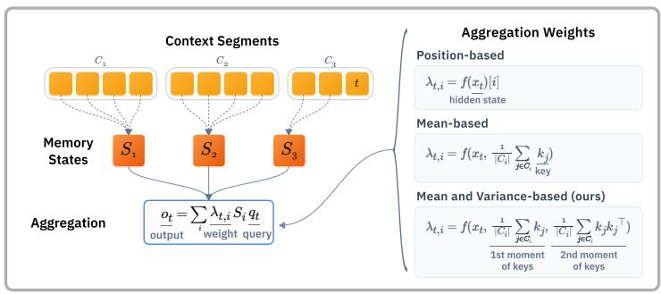
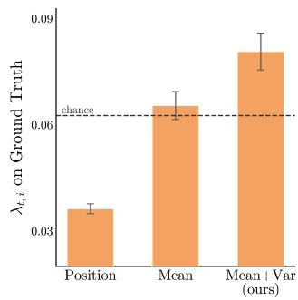
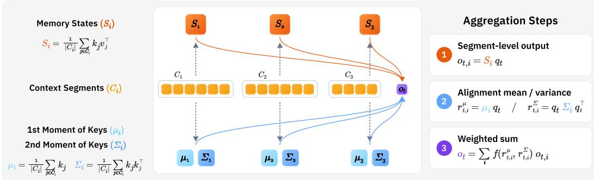
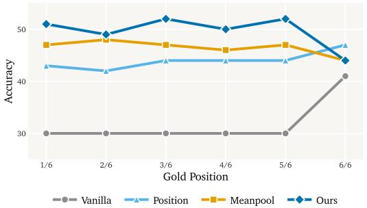
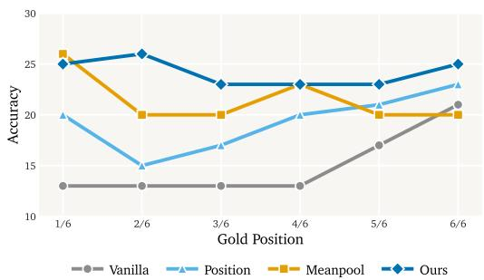
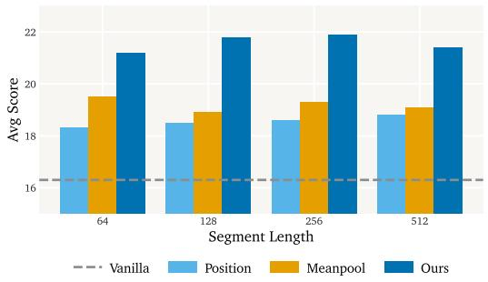
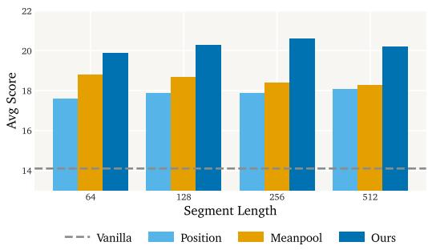
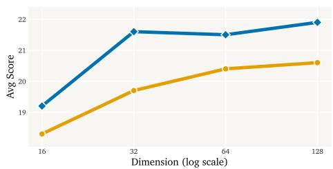

# MULTI-STATE LINEAR ATTENTION WITH GENERALIZED SECOND-ORDER ROUTING

Hee Seung Hwang<sup>1</sup> Sanghyuk Chun<sup>1</sup> Xindi Wu<sup>1</sup> Olga Russakovsky<sup>1</sup> Zhiwei Deng<sup>2</sup>

<sup>1</sup>Princeton University <sup>2</sup>Google DeepMind

## ABSTRACT

Self-attention plays a key role in long-sequence modeling, but its quadratic time complexity fundamentally limits the scaling of Large Language Models. Recently, Multi-State Linear Attention (MSLA) mechanisms have been proposed to make sequence modeling more efficient by splitting the context into segments and compressing each in its own memory state. MSLA aggregates the information extracted from each memory state using only the mean alignment between a query and each segment’s keys, ignoring how the alignment is distributed within the segment. In order to model the relevance of a segment to a query more comprehensively and incorporate the variance of the alignment in the aggregation, we propose MERLIN (MomEnt Routing for multi-state LINear attention), a method that tracks the first and second moments of each segment’s keys. Using the moments of keys, a query can recover both the mean and the variance of its alignment with each segment to perform a more content-aware aggregation of per-state readouts. Experiments on multi-state variants of Gated DeltaNet-1.3B and Mamba-2-780M show that MERLIN consistently outperforms existing aggregation methods on various long-context tasks. In particular, MERLIN outperforms baselines on RULER needle-in-a-haystack and long-context QA (+8.3% for Gated DeltaNet-1.3B and +7.0% for Mamba-2-780M) and diverse subtasks in LongBench (+13.5% and +12.0%). It even outperforms baselines that consume 4x more memory. MER-LIN provides a simple and general routing mechanism for improving long-context capabilities of MSLA models.

## 1 INTRODUCTION

The self-attention mechanism is a core operation in long-sequence modeling (Vaswani et al., 2017). However, its quadratic computational complexity and linearly growing key-value (KV) cache have become a key bottleneck in scaling compute and data (Keles et al., 2023). Linear attention (Katharopoulos et al., 2020; Sun et al., 2023; Peng et al., 2023) addresses these limitations by reformulating attention to operate in sub-quadratic complexity. For example, DeltaNet (Yang et al., 2024) and Gated DeltaNet (Yang et al., 2025) remove the softmax in standard attention and replace the KV cache with a single fixed-size memory state. However, a single fixed-size memory state is inherently limited in memory capacity and may lead to information loss when compressing longer contexts (Arora et al., 2024b; Jelassi et al., 2024; Kuratov et al., 2024). As a result, models based on single-state linear attention still underperform standard attention in practice.

Recently, Multi-State Linear Attention (MSLA) mechanisms (Behrouz et al., 2026; Guo et al., 2026; Wang et al., 2026) have been introduced to improve the long-context capabilities of single-state linear attention. MSLA partitions the context into segments and compresses each segment into its own memory state. Each token extracts segment-level outputs from preceding memory states and then aggregates them to produce its final output representation (Fig. 1a). Operating in the multistate regime therefore introduces two novel challenges: how to divide the context into segments (separation), and how to combine the segment-level outputs (aggregation).

We study aggregation, which is relatively underexplored compared to separation. Existing methods aggregate segment-level outputs via a weighted sum (Behrouz et al., 2026; Guo et al., 2026; Wang et al., 2026), where the weights represent each segment’s relevance to the query: closely aligned seg ments contribute more to the final output than others. However, prior works derive the weights either from position (Guo et al., 2026; Wang et al., 2026), assuming recency as the source of relevance, or from the mean (first-order) alignment between each segment’s keys and the query (Behrouz et al., 2026). They overlook the variance (second-order) of the alignment, which captures sharply aligned keys that the mean alone cannot distinguish from a segment of uniformly weak ones.

  
(a) Multi-State Linear Attention (MSLA)

  
(b) Aggregation Weight on GT  
Figure 1: (a) A multi-state linear attention (MSLA) model aggregates segment-level outputs via a weighted sum. Prior methods compute the weights $\lambda _ { t , i }$ from position or from the mean of each segment’s keys. MERLIN instead reads both the first and second moments of the keys. (b) On retrieval-augmented generation samples in HELMET (Yen et al., 2025), we measure the aggregation weight each method places on the ground truth (GT) segment at the query token. Position-based aggregation largely misses the GT and mean-based aggregation recovers more, while MERLIN places the most weight on it.

To analyze why the variance matters, we examine how an MSLA model assigns aggregation weights on a long-sequence reasoning task. Fig. 1b shows that the segment containing the ground truth, which is the segment most relevant to the response, receives the highest aggregation weight when the weights are derived from both the mean and variance of the alignment, compared to the mean or position alone. This motivates an aggregation method that incorporates the variance of the alignment in deriving the weights.

We propose MERLIN (MomEnt Routing for multi-state LINear attention), a method that leverages the mean and variance of key-query alignment to improve aggregation in multi-state linear attention. MERLIN stores the first and second moments of each segment’s keys. Using the moments, a query recovers both the mean (first-order) and variance (second-order) of its alignment with each segment’s keys to derive the weights for the weighted sum of segment-level outputs. Our experiments show that MERLIN improves the long-context capabilities of multi-state linear attention models.

## Our contributions are:

1. We identify segment-level output aggregation as a key bottleneck in multi-state linear attention: existing methods weight each segment’s output using only the mean alignment between the query and the segment’s keys (§2).

2. We propose MERLIN, a method that keeps the first and second moments of each segment’s keys. A query uses these moments to recover the mean and variance of its alignment with the segment (§3.1) and to derive the aggregation weights (§3.2).

3. We evaluate multi-state variants of Gated DeltaNet-1.3B and Mamba-2-780M (§4.1). On LongBench (Bai et al., 2024), MERLIN improves the average score over the strongest baseline by 13.5% on Gated DeltaNet and 12.0% on Mamba-2 (§4.2).

## 2 BACKGROUND

Given an input sequence of $T$ tokens, the query, key, and value matrices Q, K, $V \in \mathbb { R } ^ { T \times d }$ are projected from the tokens’ hidden states $\pmb { x } _ { 1 } , \ldots , \pmb { x } _ { T }$ . Standard full attention computes:

$$
\mathrm { A t t e n t i o n ( V a s w a n i e t a l . } , 2 0 1 7 ) \colon { \cal O } = \mathrm { s o f t m a x } ( { \cal Q } K ^ { \top } + M ) V ,
$$

where $M \in \{ - \infty , 0 \} ^ { T \times T }$ is a causal masking matrix. Softmax attention costs quadratic time, and requires a KV cache that grows linearly with the context. This motivates more efficient sub-quadratic attention formulations.

Table 1: Computational and Memory Complexity. Memory is the size of the state(s) retained to decode each token. $d _ { r }$ is the dimension of the moments of keys $( \ S 3 . 1 )$ . Memory Caching (Behrouz et al., 2026) and MERLIN assume uniform segmentation $( L = T / m )$ where m is the number of tokens per segment.
<table><tr><td>Mechanism</td><td>Compute (Prefill)</td><td>Memory</td></tr><tr><td>Full Attention (Vaswani et al., 2017)</td><td> $O ( T ^ { 2 } d )$ </td><td> $O ( T d )$ </td></tr><tr><td>Linear Attention (Katharopoulos et al., 2020) Multi-State Linear Attention</td><td> $O ( T d ^ { 2 } )$ </td><td> ${ \dot { O ( d ^ { 2 } ) } }$ </td></tr><tr><td>Log-Linear Attention (Guo et al., 2026)</td><td> $O ( T d ^ { 2 } \log T )$ </td><td> $O ( d ^ { 2 } \log T )$ </td></tr><tr><td>Memory Caching (Behrouz et al., 2026)</td><td> $\dot { O } ( T L d ^ { \bar { 2 } } )$ </td><td> $\dot { O } ( L d ^ { 2 } )$ </td></tr><tr><td>MERLIN (ours)</td><td> $O ( T L \dot { ( d ^ { 2 } + d _ { r } ^ { 2 } ) } )$ </td><td> $O ( L ( \stackrel { . } { d } ^ { 2 } + \stackrel { . } { d } _ { r } ^ { 2 } ) )$ </td></tr></table>

Linear Attention. Linear attention removes the softmax normalization and instead computes:

Linear Attention: ${ \cal O } = ( { \cal Q } K ^ { \top } \odot { \cal M } ) V , ~ { \cal M } _ { i , j } = 1 \mathrm { i f } i \geq j ,$ and 0 otherwise.

This formulation can be reorganized into a recurrence over a memory state $S _ { t } \in \mathbb { R } ^ { d \times d }$

Katharopoulos et al. (2020):

$$
\pmb { S } _ { t } = \pmb { S } _ { t - 1 } + \pmb { v } _ { t } \pmb { k } _ { t } ^ { \top } = \sum _ { t ^ { \prime } } \pmb { v } _ { t ^ { \prime } } \pmb { k } _ { t ^ { \prime } } ^ { \top } , \quad \pmb { o } _ { t } = \pmb { S } _ { t } \pmb { q } _ { t } ,\tag{1}
$$

where $k _ { t } , v _ { t } , q _ { t }$ are the key, value, and query vectors of a token at position t. The memory state $S _ { t }$ accumulates key-value outer products, acting as an associative memory that binds each key to its value. A query reads from the memory state via a matrix-vector product to get the output representation $\mathbf { } o _ { t } .$ The recurrence now runs in linear time and constant memory. Recent works add gating and delta-rule correction to improve the memory capacity of the fixed-size state. For example, Gated DeltaNet (Yang et al., 2025) (GDN) uses the recurrence as follows:

Gated DeltaNet (Yang et al., 2025):

$$
\pmb { S } _ { t } = \pmb { S } _ { t - 1 } \big ( \alpha _ { t } ( \pmb { I } - \beta _ { t } \pmb { k } _ { t } \pmb { k } _ { t } ^ { \top } ) \big ) + \beta _ { t } \pmb { v } _ { t } \pmb { k } _ { t } ^ { \top } ,\tag{2}
$$

where $\alpha _ { t } \in ( 0 , 1 )$ decays the state and $\beta _ { t }$ sets the strength of the update.

Multi-State Linear Attention. Linear attention can be limiting when $T$ grows because it needs to compress the entire context into a single fixed-size state. Multi-state linear attention relaxes this bottleneck by partitioning the sequence into $L$ contiguous segments $C _ { 1 } , \ldots , C _ { L }$ and compressing each segment in its own state:

Multi-State Linear Attention (Separation):

$$
S _ { C _ { i } } = \sum _ { j \in C _ { i } } v _ { j } \pmb { k } _ { j } ^ { \top } .\tag{3}
$$

Intuitively, Eq. (3) can be viewed as splitting the first equation of Eq. (1) into L parts, which we call separation. At step t, a query reads segment-level outputs from the last $\ell \leq L$ memory states visible at step t. The intermediate outputs are then aggregated via a weighted sum to derive the final output representation:

Multi-State Linear Attention (Aggregation):

$$
\pmb { o } _ { t , i } = \pmb { S } _ { C _ { i } } \pmb { q } _ { t } , \quad \pmb { o } _ { t } = \sum _ { i = 1 } ^ { \ell } \lambda _ { t , i } \pmb { o } _ { t , i } ,\tag{4}
$$

where $\lambda _ { t , i }$ is the aggregation weight that determines how much the output from segment i contributes to the final output at position t. Eq. (4) can be viewed as the second equation of Eq. (1) applied to ℓ partitioned states, which we refer to as aggregation.

Unlike single-state linear attention, in multi-state linear attention, the number of memory states increases as the content length increases. Multi-state linear attention therefore interpolates between single-state linear attention (constant memory, linear time) and full attention (linear memory, quadratic time) (Behrouz et al., 2026). Tab. 1 summarizes the time and memory complexities of attention variants.

Aggregation in Multi-State Linear Attention. The aggregation of segment-level outputs in $\mathrm { E q . ( 4 ) }$ requires weights $\lambda _ { t , i } .$ . These weights function as routers that increase the contribution of outputs from query-relevant segments and decrease the contribution of outputs from others. The simplest methods learn a position-based weight vector $\lambda _ { t }$ (with entries $\lambda _ { t , i } )$ directly from the target token, projected from its query or hidden state (Guo et al., 2026; Wang et al., 2026):

$$
\mathrm { G u o ~ e t ~ a l . ~ ( 2 0 2 6 ) } { : } ~ { \lambda _ { t } } = W _ { \lambda } x _ { t } ~ \mathrm { o r } ~ \mathrm { W a n g ~ e t ~ a l . ~ ( 2 0 2 6 ) } { : } ~ { \lambda _ { t } } = W _ { \lambda } q _ { t } .\tag{5}
$$

  
Figure 2: MERLIN Overview. The context is split into segments $C _ { i }$ (middle row). Each segment stores a memory state (top row) and the first and second moments of its keys (bottom row). At position t, the query $\pmb q _ { t }$ reads segment-level outputs from memory states (step 1). The query computes the mean and variance of the key-query alignment from the moments (step 2). The final output is a weighted sum of segment-level outputs, where the weights are derived from a gated mix of the alignment mean and variance (step 3).

These weights do not consider what each segment stores and therefore cannot function as a contentaware router. Behrouz et al. (2026) introduces content-awareness in aggregation weights as follows:

$$
\mathrm { B e h r o u z \ e t \ a l . \ ( 2 0 2 6 ) } \colon \ \lambda _ { t , i } = \langle \bar { k } _ { i } , u _ { t } \rangle , \qquad u _ { t } = W _ { u } x _ { t } , \qquad \bar { k } _ { i } = \frac { 1 } { | C _ { i } | } \sum _ { j \in C _ { i } } k _ { j } ,\tag{6}
$$

where $\mathbf { \pmb { u } } _ { t }$ is a learned vector projected from hidden state $\mathbf { \Delta } _ { \mathbf { \mathcal { X } } _ { t } }$ and $\bar { \pmb { k } } _ { i }$ is the first moment of keys in segment i (i.e., the mean). However, this only captures the mean alignment between the query and a segment’s keys and does not capture the variance.

We revisit the analysis in Fig. 1b and demonstrate that the variance of the alignment is necessary for more content-aware aggregation of segment-level readouts. We train multi-state models with different aggregation methods and evaluate on 30 randomly selected TriviaQA samples in HELMET (Yen et al., 2025) at 4K context length. This is a retrieval-augmented generation task where each sample consists of multiple passages and a prompt that requires retrieving information from one of them. Thus, the model should locate the relevant passage and extract the correct answer to the prompt.

We find that different aggregation methods assign varying amounts of aggregation weight to the segment containing the ground truth. Ideally, the weights assigned to the ground truth segment should be higher than others in order to increase the contribution of the information extracted from the segment in the final response. Fig. 1b shows that mean- and variance-based aggregation assigns the highest weight to the ground truth segment compared to position-only and mean-only aggregation. This motivates our proposed method MERLIN, which leverages both orders of alignment to compute the weights for segment-level output aggregation.

## 3 MERLIN

Our goal is to capture the variance of the alignment between a query and each segment’s keys to derive more informative aggregation weights. We first introduce how the first and second moments of the keys are constructed (§3.1). Then, we discuss how the mean and variance of the alignment can be derived from the moments (§3.2). Finally, we elaborate on the relationship between multi-state linear attention equipped with MERLIN and softmax attention (§3.3).

## 3.1 FIRST AND SECOND MOMENTS OF KEYS

For each token, we project new keys and queries $\pmb { k } _ { t } ^ { \prime } , \pmb { q } _ { t } ^ { \prime } \in \mathbb { R } ^ { d _ { r } }$ from the hidden states. We use $k _ { t } ^ { \prime } , q _ { t } ^ { \prime }$ instead of $\mathbf { } k _ { t } , \mathbf { } q _ { t }$ to construct and read from the first and second moments of keys, primarily to keep moments compact by choosing $d _ { r }$ that is smaller than d.

The first moment of keys is the mean-pooled vector of all keys $( k _ { j } ^ { \prime } )$ in the segment. The second moment is the average of the outer products $k _ { j } ^ { \prime } k _ { j } ^ { \prime \intercal }$ over the segment. The first and second moments of keys can thus be formulated as:

$$
\mu _ { i } = \frac { 1 } { | C _ { i } | } \sum _ { j \in C _ { i } } { k _ { j } ^ { \prime } } , \quad \Sigma _ { i } = \frac { 1 } { | C _ { i } | } \sum _ { j \in C _ { i } } { k _ { j } ^ { \prime } k _ { j } ^ { \prime \top } } .\tag{7}
$$

The first and second moments are fixed-size, and their dimensions depend only on $d _ { r }$ . Together, they summarize segment i, where $\mu _ { i }$ captures the average direction of the keys and $\Sigma _ { i }$ captures how the keys are spread within the segment.

## 3.2 AGGREGATION WEIGHT DERIVATION

Given a token at position $t ,$ we compute the following scalar scores for each visible segment $C _ { i }$ (the segments leading up to the current one):

$$
\boldsymbol { r } _ { t , i } ^ { \mu } = \mu _ { i } ^ { \top } \boldsymbol { q } _ { t } ^ { \prime } , \quad \boldsymbol { r } _ { t , i } ^ { \Sigma } = \boldsymbol { q } _ { t } ^ { \prime \top } \Sigma _ { i } \boldsymbol { q } _ { t } ^ { \prime } - ( \boldsymbol { r } _ { t , i } ^ { \mu } ) ^ { 2 } .\tag{8}
$$

Here, $r _ { t , i } ^ { \mu }$ captures the mean key-query alignment, measuring how well the segment’s keys broadly align with the query. Meanwhile, $r _ { t , i } ^ { \Sigma }$ captures the variance, measuring the spread of the per-token alignment between the query and the keys in the segment. We mix the softmax-normalized $r _ { t , i } ^ { \mu }$ and $r _ { t , i } ^ { \Sigma }$ with a learned gate to get the final weight $\lambda _ { t , i } \colon$

MERLIN (ours):

$$
\lambda _ { t , i } = \gamma _ { t } \mathrm { s o f t m a x } _ { i } ( \tau _ { \mu } r _ { t , i } ^ { \mu } ) + ( 1 - \gamma _ { t } ) \mathrm { s o f t m a x } _ { i } ( \tau _ { \Sigma } r _ { t , i } ^ { \Sigma } ) ,\tag{9}
$$

where softma $\mathrm { x } _ { i }$ denotes the softmax operation over the segment index $i , \gamma _ { t }$ is a scalar gate, and $\tau _ { \mu }$ and $\tau _ { \Sigma }$ are learnable temperatures that scale the two scores before normalization. The gate $\gamma _ { t }$ is computed from the token’s hidden state $\mathbf { \Delta } _ { \mathbf { \mathcal { X } } _ { t } }$ through a learned projection. The temperatures $\tau _ { \mu } , \tau _ { \Sigma }$ calibrate the sharpness of each term. This shows how the first and second moments are used to derive the weights for Eq. (4).

## 3.3 CONNECTION TO SOFTMAX ATTENTION

Suppose we ran token-level softmax attention over the keys and then grouped its mass by segment. For a target token at position t and a segment $C _ { i }$ , the key-query similarity can be expressed as:

$$
s _ { t , i , j } = { \pmb q } _ { t } ^ { \prime } ^ { \top } { \pmb k } _ { j } ^ { \prime } , \qquad j \in C _ { i } .
$$

We can define the length-normalized evidence of the segment as:

$$
Z _ { t , i } ( \delta ) = \frac { 1 } { | C _ { i } | } \sum _ { j \in C _ { i } } e ^ { \delta s _ { t , i , j } } ,
$$

where $\delta$ is a temperature hyperparameter. Grouping the token-level softmax by segment, the total attention mass a full softmax layer would place on segment i can be expressed as:

$$
A _ { t , i } = \frac { \sum _ { j \in C _ { i } } \exp ( \delta s _ { t , i , j } ) } { \sum _ { \ell } \sum _ { j \in C _ { \ell } } \exp ( \delta s _ { t , \ell , j } ) } = \mathrm { s o f t m a x } _ { i } \left( \log \left| C _ { i } \right| + \log Z _ { t , i } ( \delta ) \right) .\tag{10}
$$

Because our segments are equal-sized, log $| C _ { i } |$ is the same for every segment and cancels inside the softmax. Expanding the remaining log-evidence in cumulants around $\delta = 0$ , we obtain:

$$
\log Z _ { t , i } ( \delta ) = \delta \eta _ { t , i } + \frac { \delta ^ { 2 } } { 2 } \sigma _ { t , i } ^ { 2 } + O ( \delta ^ { 3 } ) , \quad \eta _ { t , i } = \frac { 1 } { m } \sum _ { j \in C _ { i } } s _ { t , i , j } , \quad \sigma _ { t , i } ^ { 2 } = \frac { 1 } { m } \sum _ { j \in C _ { i } } s _ { t , i , j } ^ { 2 } - \eta _ { t , i } ^ { 2 } = \delta \eta _ { t , i } ,\tag{11}
$$

Therefore, the relevance of a segment is governed by the first two terms: the mean $\eta _ { t , i }$ and the variance $\sigma _ { t , i } ^ { 2 }$ . These are precisely the scores $r _ { t , i } ^ { \mu }$ and $r _ { t , i } ^ { \Sigma } ,$ which are computed from the first and second moments via matrix-vector products:

$$
\eta _ { t , i } = \pmb { \mu } _ { i } ^ { \top } \pmb { q } _ { t } ^ { \prime } = r _ { t , i } ^ { \mu } , \qquad \sigma _ { t , i } ^ { 2 } = \pmb { q } _ { t } ^ { \prime \top } \pmb { \Sigma } _ { i } \pmb { q } _ { t } ^ { \prime } - \left( \pmb { \mu } _ { i } ^ { \top } \pmb { q } _ { t } ^ { \prime } \right) ^ { 2 } = r _ { t , i } ^ { \Sigma } .\tag{12}
$$

Rather than the fixed additive coefficients of $\operatorname { E q . } \left( 1 1 \right) ( \delta$ on the mean, $\frac { \delta ^ { 2 } } { 2 }$ on the variance) inside a single softmax, MERLIN combines the two scores with a learned gated mixture of separatelynormalized softmax terms (Eq. (9)), with learnable temperatures $\tau _ { \mu } , \tau _ { \Sigma }$ and gate $\gamma _ { t }$ . The gated mixture is also flexible to implement, since the two terms are normalized and scaled independently.

Table 2: Performance on Long-Context Retrieval Tasks. We evaluate mid-trained (MidTr) models with different aggregation methods on the NIAH and QA tasks in RULER at 16K context length, – is the base model without mid-training. Highest scores in each column are in bold and secondhighest are underlined.
<table><tr><td></td><td>MidTr</td><td>S-NIAH-1</td><td>S-NIAH-2</td><td>S-NIAH-3</td><td>MK-NIAH-1</td><td>MQ-NIAH</td><td>MV-NIAH</td><td>HotpotQA</td><td>SQuADQA</td><td>Avg</td></tr><tr><td rowspan="5">Gated DeltaNet 1.3B</td><td></td><td>18.6</td><td>25.2</td><td>4.2</td><td>16.8</td><td>5.1</td><td>15.8</td><td>10.0</td><td>8.3</td><td>13.0</td></tr><tr><td>Vanilla</td><td>89.0</td><td>99.2</td><td>10.8</td><td>23.4</td><td>80.8</td><td>70.2</td><td>15.0</td><td>8.3</td><td>49.6</td></tr><tr><td>Position</td><td>97.2</td><td>96.8</td><td>16.0</td><td>42.2</td><td>82.5</td><td>78.4</td><td>16.0</td><td>7.3</td><td>54.6</td></tr><tr><td>Meanpool</td><td>99.6</td><td>99.4</td><td>21.2</td><td>48.4</td><td>86.6</td><td>85.0</td><td>12.0</td><td>10.7</td><td>57.9</td></tr><tr><td>MERLIN</td><td>99.2</td><td>100.0</td><td>47.0</td><td>45.0</td><td>91.0</td><td>88.8</td><td>17.0</td><td>13.7</td><td>62.7</td></tr><tr><td rowspan="5">Mamba-2 780M</td><td></td><td>0.0</td><td>0.0</td><td>0.0</td><td>0.0</td><td>0.0</td><td>0.0</td><td>2.0</td><td>0.0</td><td>0.3</td></tr><tr><td>Vanilla</td><td>100</td><td>100</td><td>8.4</td><td>24.6</td><td>92.2</td><td>86.4</td><td>16</td><td>4.7</td><td>54.0</td></tr><tr><td>Position</td><td>100.0</td><td>100.0</td><td>54.2</td><td>91.0</td><td>94.5</td><td>89.2</td><td>20.0</td><td>8.0</td><td>69.6</td></tr><tr><td>Meanpool</td><td>100.0</td><td>100.0</td><td>66.2</td><td>89.4</td><td>93.7</td><td>91.8</td><td>20.0</td><td>8.1</td><td>71.2</td></tr><tr><td>MERLIN</td><td>99.8</td><td>99.8</td><td>96.0</td><td>94.8</td><td>95.9</td><td>92.2</td><td>22.0</td><td>9.4</td><td>76.2</td></tr></table>

## 4 EXPERIMENTS

We conduct experiments to quantify the effect of MERLIN on the long-context capabilities of multistate linear attention models. We first explain the models, datasets, and baselines used for training and evaluation (§4.1). Then, we show the main evaluation results on the core benchmarks (§4.2). Third, we conduct analysis on positional biases and impact of segment length (§4.3). Finally, we conduct ablations on the core design choices in MERLIN (§4.4).

## 4.1 SETUP

Models. We use the Gated DeltaNet (Yang et al., 2025) and Mamba-2 (Dao & Gu, 2024) architectures for the following experiments. Gated DeltaNet is a linear attention model that updates the memory state following the recurrence in Eq. (2). Mamba-2 is a state-space model that uses recurrence of structured semiseparable matrices. We show that MERLIN improves upon the multi-state variants of both architectures with distinct features to demonstrate its robustness and effectiveness. A more detailed pseudocode for each model can be found in Section C.5.

Training. We first pre-train the Gated DeltaNet-1.3B (Yang et al., 2025) model on 50B tokens in FineWeb-edu (Penedo et al., 2024) following the official training configurations. For Mamba-2- 780M, we use the officially released checkpoint<sup>1</sup> pre-trained on 300B tokens from Pile (Gao et al., 2020). These pre-trained models are still single-state: they require mid-training (or continued pretraining) to function as multi-state variants, i.e., training the pre-trained model with the same objec tive function as pre-training on the mid-training dataset.

In order to convert single-state models to multi-state variants, we introduce separation (Eq. (3)) and aggregation (Eq. (4)) mechanisms during mid-training. We fix the separation mechanism to uniform segmentation, where each segment has the same length of 256 tokens. At training context length of 16K tokens, the model learns to aggregate as many as 64 (16K / 256) segment-level outputs. We specify the full list of training hyperparameters and model configurations in Section C.1.

We mid-train the pre-trained models in two stages. Each stage is defined by the type of training data that was used. Stage 1 uses 2B tokens from Long-Data-Collections (LDC) (TogetherAI, 2024), with 10% of the training samples (0.2B tokens) augmented with RULER (Hsieh et al., 2024) needlein-a-haystack (NIAH)-like tasks. The augmented data contains artificial keys and values scattered throughout regular LDC sequences. The task query and ground truth answer are attached at the end of the context. This dataset is designed to train basic language modeling capability as a multi-state variant by activating its aggregation mechanism.

In stage 2, we train on a smaller dataset of 60M tokens. It consists of 50% regular LDC sequences, and 50% synthetically generated samples from RULER HotpotQA and SQuADQA. This dataset is designed to further strengthen the model’s aggregation mechanism under reasoning contexts. After stage 1 and stage 2, the pre-trained single-state models now function as multi-state models with long-context capabilities. The detailed mid-training hyperparameters can be found in Section C.2.

Table 3: Performance on Long-Context Tasks in LongBench. We evaluate on eleven LongBench tasks, filtered for samples with at most 16K tokens.
<table><tr><td rowspan="2"></td><td rowspan="2">MidTr</td><td colspan="3">Single-doc QA</td><td colspan="2">Multi-doc QA</td><td colspan="3">Summarization</td><td colspan="3">Few-shot Learning</td><td rowspan="2">Avg</td></tr><tr><td>NQ</td><td>QR</td><td>MF</td><td>HP</td><td>2W</td><td>GR</td><td>QM</td><td>MN</td><td>SS TC</td><td>TQ</td><td></td></tr><tr><td rowspan="5">Gated DeltaNet 1.3B</td><td></td><td>2.4</td><td>5.0</td><td>13.9</td><td>4.5</td><td>7.9</td><td>9.1</td><td>16.1</td><td>9.2</td><td>33.0</td><td>22.3</td><td>19.5</td><td>13.0</td></tr><tr><td>Vanilla</td><td>6.0</td><td>6.1</td><td>12.2</td><td>6.8</td><td>8.5</td><td>9.9</td><td>16.5</td><td>9.4</td><td>40.5</td><td>42.5</td><td>21.4</td><td>16.3</td></tr><tr><td>Position</td><td>11.5</td><td>9.6</td><td>14.9</td><td>14.3</td><td>11.1</td><td>6.1</td><td>14.0</td><td>12.3</td><td>39.0</td><td>48.5</td><td>23.1</td><td>18.6</td></tr><tr><td>Meanpool</td><td>8.8</td><td>15.2</td><td>18.0</td><td>14.6</td><td>9.8</td><td>8.7</td><td>15.3</td><td>10.1</td><td>34.5</td><td>54.8</td><td>22.4</td><td>19.3</td></tr><tr><td>MERLIN</td><td>13.9</td><td>19.4</td><td>20.3</td><td>16.3</td><td>14.4</td><td>7.8</td><td>15.9</td><td>12.8</td><td>40.0</td><td>60.4</td><td>20.1</td><td>21.9</td></tr><tr><td rowspan="5">Mamba-2 780M</td><td></td><td>0.9</td><td>1.6</td><td>3.6</td><td>0.9</td><td>2.2</td><td>3.2</td><td>8.7</td><td>12.6</td><td>8.0</td><td>8.1</td><td>1.4</td><td>4.7</td></tr><tr><td>Vanilla</td><td>1.0</td><td>3.2</td><td>7.6</td><td>4.2</td><td>5.2</td><td>10.2</td><td>12.3</td><td>14.7</td><td>36.5</td><td>54.5</td><td>5.7</td><td>14.1</td></tr><tr><td>Position</td><td>1.2</td><td>5.1</td><td>10.5</td><td>5.7</td><td>6.8</td><td>15.5</td><td>15.0</td><td>17.4</td><td>42.0</td><td>65.1</td><td>12.5</td><td>17.9</td></tr><tr><td>Meanpool</td><td>1.7</td><td>4.2</td><td>11.5</td><td>6.0</td><td>5.6</td><td>16.0</td><td>17.7</td><td>18.5</td><td>44.5</td><td>61.1</td><td>15.1</td><td>18.4</td></tr><tr><td>MERLIN</td><td>1.9</td><td>6.7</td><td>12.6</td><td>7.8</td><td>9.1</td><td>20.4</td><td>16.1</td><td>19.2</td><td>46.0</td><td>72.7</td><td>14.2</td><td>20.6</td></tr></table>

Benchmarks. We evaluate the models on various long-context benchmarks. First, we evaluate on the NIAH and QA tasks in RULER (Hsieh et al., 2024) at 16K context length. The single needle variants (S-NIAH-1/2/3) evaluate the model’s ability to retrieve a single key-value pair in different types of natural and synthetic text haystacks. The multi-needle variants (MK-NIAH-1/MQ-NIAH/MV-NIAH) evaluate the model’s ability to retrieve from multiple key-value pairs in different formats. The HotpotQA and SQuADQA tasks in RULER evaluate multi-hop and single-hop reasoning skills.

We also evaluate on the following subtasks in LongBench (Bai et al., 2024): NarrativeQA (NQ), Qasper (QR), MultiFieldQA-en (MF), HotpotQA (HP), 2WikiMultihopQA (2W), GovReport (GR), QMSum (QM), MultiNews (MN), SAMSum (SS), TREC (TC), TriviaQA (TQ). We filter for samples under 16K context length. These tasks largely evaluate single-document QA, multi-document QA, summarization, and few-shot learning capabilities.

Finally, we evaluate on the TriviaQA retrieval-augmented-generation task in HELMET (Yen et al., 2025) at 16K context length. We use this benchmark to analyze how the position of the ground truth in the sequence impacts the model’s performance. Section C.4 provides a detailed explanation of the evaluation protocol used in our experiments.

Baselines. We compare MERLIN with three other baselines: Vanilla, Position, and Meanpool. Vanilla is the unmodified single-state backbone, with neither segmentation nor aggregation mechanisms. The other two are alternative aggregation methods for multi-state variants. Position (Eq. (5)) derives aggregation weights from the hidden states alone, scaling segment-level outputs by a learned recency scalar (Guo et al., 2026). Meanpool (Eq. (6)) derives aggregation weights from first-order alignment between a query and each segment’s keys (Behrouz et al., 2026).

## 4.2 MAIN RESULTS

We report results on RULER (Hsieh et al., 2024) NIAH and QA tasks. Tab. 2 shows that MERLIN outperforms baselines in most tasks for both GDN and Mamba-2 architectures. MERLIN applied to GDN leads to an average score of 62.7, while Meanpool has an average score of 57.9, followed by Position’s 54.6. In the case of Mamba-2, MERLIN shows a 7.0% relative improvement over Meanpool (76.2 vs. 71.2), and a 9.5% relative improvement over Position (vs. 69.6). This suggests that mid-training with MERLIN improves long-context retrieval.

We also report results on LongBench (Bai et al., 2024) tasks filtered to 16K. Overall, MERLIN demonstrates strongest average performance, followed by Meanpool, Position, and finally Vanilla. Tab. 3 shows that MERLIN leads to robust gains particularly on single-doc and multi-doc QA. For GDN, MERLIN leads to a 13.5% improvement in average score compared to Meanpool (21.9 vs 19.3). For Mamba-2, MERLIN leads to a 12.0% (20.6 vs 18.4) improvement compared to Meanpool. This suggests that MERLIN strengthens general long-context capabilities.

## 4.3 ANALYSIS

Positional Bias Analysis. We evaluate models on the TriviaQA task in HELMET (Yen et al., 2025), at 16K context length. This is a retrieval-augmented generation task, where the context consists of multiple passages and only one of them, which we refer to as the gold passage, is related to the final query of the prompt. The location of the gold passage is shuffled randomly within the context for each sample. Therefore, we can track the accuracy of the model’s responses depending on the location of the gold passage, and detect any positional biases that might exist. Fig. 3 shows that the Vanilla baseline demonstrates a strong recency bias: it struggles unless the gold passage is located towards the end of the context. The Position baseline also demonstrates a weak recency bias, where the accuracy gradually increases as the gold passage moves closer to the end. Both the Meanpool baseline and MERLIN perform more evenly across gold passage positions, while MERLIN is better overall. This suggests that MERLIN enhances the model’s ability to extract information from important segments in the context by improving aggregation of segment-level readouts.

  
(a) Gated DeltaNet-1.3B

  
(b) Mamba-2-780M

Figure 3: Position-Controlled Retrieval. Retrieval accuracy as the gold passage sweeps from the start $( 1 / 6 )$ to the end $( 6 / 6 )$ of the context. Vanilla is recency-biased: it recovers the gold only when placed near the end and is otherwise flat, while Position and mean-based aggregation are flatter but weaker. MERLIN stays high and roughly uniform across positions.  
  
(a) Gated DeltaNet-1.3B

  
(b) Mamba-2-780M  
Figure 4: MERLIN Outperforms Baselines Across Segment Length. Average score as the segment size that defines each state varies over {64, 128, 256, 512}. MERLIN leads at every segment length, and its margin over mean-based aggregation persists as segments grow. Vanilla (dashed) is segment-independent.

Segment Length Analysis. We examine whether MERLIN is robust to different segment lengths. Segment length, or the number of tokens per segment, determines the number of segments per context given that the entire length of the sequence is fixed $( L = T / m )$ . The shorter the segment length, the more states per sequence, and therefore the higher the memory consumption of the model. We experiment with $\bar { m ^ { } } \in \{ 6 \bar { 4 } , 1 2 8 , 2 5 6 , 5 1 2 \}$ for each aggregation method. At $m = 6 4$ , the model consumes approximately 8 times more memory compared to $m = 5 1 2$ . Fig. 4 shows that for both GDN and Mamba-2, MERLIN outperforms baselines on LongBench (Bai et al., 2024) tasks across m. In particular, MERLIN at $m \ : = \ : 2 5 6$ (default) outperforms Meanpool and Position baselines at $m = 6 4$ , which consume 4 times more memory. This suggests that MERLIN is more memory efficient compared to its baselines.

Memory Cost and Parameter Overhead. In Section D, we compare the memory cost of different multi-state linear attention strategies with MERLIN. We observe that the extra cost of our additional second moment features is limited to at most 12.6% for Gated DeltaNet and 4.2% for Mamba-2 at $d _ { r } = 1 2 8$ , while the memory cost decreases quadratically with $d _ { r }$ . We also compare the number of parameters that MERLIN adds to each backbone compared to baselines. We find that the MERLIN’s parameter overhead is on par with the Meanpool baseline at 4.6% for GDN and 2.2% for Mamba-2.

Qualitative Examples. In Appendix §D, we provide examples of aggregation weight $( \lambda _ { t , i } )$ assignment on four HELMET (Yen et al., 2025) retrieval-augmented generation samples using MERLIN and baseline methods. As observed in the quantitative evaluations, MERLIN assigns a higher weight to the gold segment, and this supports that the variance of the alignment is critical for aggregation.

## 4.4 ABLATIONS

Ablations on Dimension of Moments of Keys. We report on the impact of $d _ { r }$ , the dimension of the first and second moments of keys (§3.2), on the performance of MERLIN. We vary $d _ { r } \in$ {16, 32, 64, 128} during training and evaluate on LongBench (Bai et al., 2024). Fig. 5 shows that the average score on LongBench tasks gradually increases as $d _ { r }$ increases. This suggests that the width of the moments of keys is critical in deriving informative aggregation weights. However, there is a trade-off in deciding $d _ { r } .$ . The moments of keys can be more expressive when $d _ { r }$ is larger. However, MERLIN consumes less memory compared to the Meanpool and Position baselines as $d _ { r }$ gets smaller. More details on the memory consumption can be found in Tab. 9 of Section D.

Ablations on Parameter Sharing. For each token, we project new keys and queries $( k _ { t } ^ { \prime } , q _ { t } ^ { \prime } )$ to construct the first and second moments, separate from the original keys and queries for the memory state $( k _ { t } , q _ { t } )$ We isolate the impact of decoupling the keys and queries by experimenting with a variant of MERLIN where $k _ { t } ^ { \prime } = \bar { k } _ { t }$ and $q _ { t } ^ { \prime } \ = \ q _ { t }$ (shared-KQ rows in Tab. 4). We further experiment with a variant of MERLIN where we control the decay and update strength of the first and second moments of keys per token, similar to the decay and write-strength features of the memory state explained in Eq. (2) (writeforget rows in Tab. 4). We find that both ablations substantially degrade the performance of MERLIN

  
Gated DeltaNet-1.3B Mamba-2-780M  
Figure 5: Dimension of Moments. Average LongBench scores as $d _ { r }$ varies over $\{ 1 6 , 3 2 , 6 4 , 1 2 8 \}$ (log axis). Performance saturates around $d _ { r } = 3 2$ for GDN and $d _ { r } = 6 4$ for Mamba-2.

<table><tr><td></td><td>Single</td><td>Multi</td><td>Summ</td><td>Few-shot</td><td>Overall</td></tr><tr><td>GDN + MERLIN</td><td>17.9</td><td>15.4</td><td>12.2</td><td>40.2</td><td>21.9</td></tr><tr><td>+ write-forget</td><td>14.9</td><td>9.2</td><td>11.6</td><td>35.3</td><td>18.5</td></tr><tr><td>+ shared-KQ</td><td>10.7</td><td>9.2</td><td>10.9</td><td>29.8</td><td>15.7</td></tr><tr><td>Mamba + MERLIN</td><td>7.1</td><td>8.5</td><td>18.6</td><td>44.3</td><td>20.6</td></tr><tr><td>+ write-forget</td><td>6.7</td><td>6.9</td><td>16.6</td><td>43.8</td><td>19.6</td></tr><tr><td>+ shared-KQ</td><td>5.1</td><td>6.1</td><td>15.1</td><td>38.3</td><td>17.1</td></tr></table>

Table 4: Parameter Sharing. We train two MERLIN variants: sharing the keys and queries between the memory state and moments of keys (+shared KQ) and using write-forget gates on moments of keys (+write-forget). We evaluate on LongBench and report per-category average scores. The categories are identical to Tab. 3.

on LongBench (Bai et al., 2024). This suggests that using a dedicated set of keys and queries from moments of keys is particularly important in deriving informative aggregation weights.

## 5 CONCLUSION

We investigate the aggregation problem in multi-state linear attention, where segment-level outputs are combined via a weighted sum to produce the final output representation of each token. We propose MERLIN, an aggregation method that assigns weights to each segment based on the mean and variance of the alignment between a query and the keys of each segment. In order to compute the mean and variance of the alignment, MERLIN keeps compact first and second moments of the segment’s keys. We find that MERLIN is superior to existing aggregation methods in terms of performance and memory efficiency. MERLIN presents a generalizable and effective routing mechanism for the aggregation problem in multi-state linear attention models.

## ACKNOWLEDGMENTS

All experiments, data collection, and processing activities were conducted at Princeton University, and no Google DeepMind computing resources were used for this work. Sanghyuk Chun is supported by the Francis Robbins Upton Fellowship at Princeton University. Xindi Wu is supported by the Apple Fellowship.

## AI USE STATEMENT

In this work, we used generative AI tools to polish the writing, generate synthetic training datasets (§4.1), and write triton kernels for method implementation. We also used AI tools to plot figures and create a name for our method. We have not used generative AI tools to formulate and develop the conceptual framework of the method, or to identify relevant literature. We have reviewed all AI-assisted work. We take responsibility for the final content of this work, including text, claims or artifacts produced with the aid of generative AI.

## ETHICS STATEMENT

Our work presents a method that improves general long-context capabilities of multi-state linear attention models. Although we do not see a clear ethical concern, we advise readers to be cautious with the datasets and tools they may use to extend our work beyond the scope of this paper.

## REPRODUCIBILITY STATEMENT

We use publicly available model architectures and datasets for training and evaluation. We discuss the method details in Section 3, and specifics of the training procedure in Section 4.1. We also provide a full summary of model configurations and training hyperparameters in Appendix Section C. The evaluation details can be found in Section C.4.

## REFERENCES

Simran Arora, Sabri Eyuboglu, Aman Timalsina, Isys Johnson, Michael Poli, James Y Zou, Atri Rudra, and Christopher Re. Zoology: Measuring and improving recall in efficient language mod- ´ els. In International conference on learning representations, volume 2024, pp. 15664–15730, 2024a.

Simran Arora, Sabri Eyuboglu, Michael Zhang, Aman Timalsina, Silas Alberti, Dylan Zinsley, James Zou, Atri Rudra, and Christopher Re. Simple linear attention language models balance ´ the recall-throughput tradeoff. arXiv preprint arXiv:2402.18668, 2024b.

Yushi Bai, Xin Lv, Jiajie Zhang, Hongchang Lyu, Jiankai Tang, Zhidian Huang, Zhengxiao Du, Xiao Liu, Aohan Zeng, Lei Hou, et al. Longbench: A bilingual, multitask benchmark for long context understanding. In Proceedings of the 62nd annual meeting of the association for computational linguistics (volume 1: Long papers), pp. 3119–3137, 2024.

Ali Behrouz, Zeman Li, Yuan Deng, Peilin Zhong, Meisam Razaviyayn, and Vahab Mirrokni. Memory caching: Rnns with growing memory. arXiv preprint arXiv:2602.24281, 2026.

Aydar Bulatov, Yury Kuratov, and Mikhail Burtsev. Recurrent memory transformer. Advances in neural information processing systems, 35:11079–11091, 2022.

Zihang Dai, Zhilin Yang, Yiming Yang, Jaime G Carbonell, Quoc Le, and Ruslan Salakhutdinov. Transformer-xl: Attentive language models beyond a fixed-length context. In Proceedings of the 57th annual meeting of the association for computational linguistics, pp. 2978–2988, 2019.

Tri Dao and Albert Gu. Transformers are ssms: Generalized models and efficient algorithms through structured state space duality. arXiv preprint arXiv:2405.21060, 2024.

Jusen Du, Weigao Sun, Disen Lan, Jiaxi Hu, Zhang Tao, and Yu Cheng. Mom: Linear sequence modeling with mixture-of-memories. In International Conference on Learning Representations, volume 2026, pp. 106613–106631, 2026.

William Fedus, Barret Zoph, and Noam Shazeer. Switch transformers: Scaling to trillion parameter models with simple and efficient sparsity. arxiv 2021. arXiv preprint arXiv:2101.03961, 2021.

Leo Gao, Stella Biderman, Sid Black, Laurence Golding, Travis Hoppe, Charles Foster, Jason Phang, Horace He, Anish Thite, Noa Nabeshima, et al. The pile: An 800gb dataset of diverse text for language modeling. arXiv preprint arXiv:2101.00027, 2020.

Leo Gao, Jonathan Tow, Baber Abbasi, Stella Biderman, Sid Black, Anthony DiPofi, Charles Foster, Laurence Golding, Jeffrey Hsu, Alain Le Noac’h, Haonan Li, Kyle McDonell, Niklas Muennighoff, Chris Ociepa, Jason Phang, Laria Reynolds, Hailey Schoelkopf, Aviya Skowron, Lintang Sutawika, Eric Tang, Anish Thite, Ben Wang, Kevin Wang, and Andy Zou. The language model evaluation harness, 07 2024.

Alex Graves, Greg Wayne, and Ivo Danihelka. Neural turing machines. arXiv preprint arXiv:1410.5401, 2014.

Albert Gu and Tri Dao. Mamba: Linear-time sequence modeling with selective state spaces. arXiv preprint arXiv:2312.00752, 2023.

Guo Guo, Songlin Yang, Tarushii Goel, Eric P Xing, Tri Dao, and Yoon Kim. Log-linear attention. In International Conference on Learning Representations, volume 2026, pp. 91296–91317, 2026.

Cheng-Ping Hsieh, Simeng Sun, Samuel Kriman, Shantanu Acharya, Dima Rekesh, Fei Jia, Yang Zhang, and Boris Ginsburg. Ruler: What’s the real context size of your long-context language models? arXiv preprint arXiv:2404.06654, 2024.

Hee Seung Hwang, Xindi Wu, Sanghyuk Chun, and Olga Russakovsky. Reinforced fast weights with next-sequence prediction. arXiv preprint arXiv:2602.16704, 2026.

Samy Jelassi, David Brandfonbrener, Sham M Kakade, and Eran Malach. Repeat after me: Transformers are better than state space models at copying. arXiv preprint arXiv:2402.01032, 2024.

Angelos Katharopoulos, Apoorv Vyas, Nikolaos Pappas, and Franc¸ois Fleuret. Transformers are rnns: Fast autoregressive transformers with linear attention. In International conference on machine learning, pp. 5156–5165. PMLR, 2020.

Feyza Duman Keles, Pruthuvi Mahesakya Wijewardena, and Chinmay Hegde. On the computational complexity of self-attention. In International conference on algorithmic learning theory, pp. 597– 619. PMLR, 2023.

Yuri Kuratov, Aydar Bulatov, Petr Anokhin, Ivan Rodkin, Dmitry Sorokin, Artyom Sorokin, and Mikhail Burtsev. Babilong: Testing the limits of llms with long context reasoning-in-a-haystack. Advances in Neural Information Processing Systems, 37:106519–106554, 2024.

Eshaan Nichani, Jason Lee, and Alberto Bietti. Understanding factual recall in transformers via associative memories. In International Conference on Learning Representations, volume 2025, pp. 4166–4207, 2025.

Yuqi Pan, Yongqi An, Zheng Li, Yuhong Chou, Ruijie Zhu, Xiaohui Wang, Mingxuan Wang, Jinqiao Wang, and Guoqi Li. Scaling linear attention with sparse state expansion. arXiv preprint arXiv:2507.16577, 2025.

Guilherme Penedo, Hynek Kydl´ıcek, Anton Lozhkov, Margaret Mitchell, Colin Raffel, Leandroˇ Von Werra, Thomas Wolf, et al. The fineweb datasets: Decanting the web for the finest text data at scale. Advances in Neural Information Processing Systems, 37:30811–30849, 2024.

Bo Peng, Eric Alcaide, Quentin Anthony, Alon Albalak, Samuel Arcadinho, Stella Biderman, Huanqi Cao, Xin Cheng, Michael Chung, Leon Derczynski, et al. Rwkv: Reinventing rnns for the transformer era. In Findings of the association for computational linguistics: EMNLP 2023, pp. 14048–14077, 2023.

Jack W Rae, Anna Potapenko, Siddhant M Jayakumar, and Timothy P Lillicrap. Compressive transformers for long-range sequence modelling. arXiv preprint arXiv:1911.05507, 2019.

Imanol Schlag, Kazuki Irie, and Jurgen Schmidhuber. Linear transformers are secretly fast weight¨ programmers. In International conference on machine learning, pp. 9355–9366. PMLR, 2021.

Noam Shazeer, Azalia Mirhoseini, Krzysztof Maziarz, Andy Davis, Quoc Le, Geoffrey Hinton, and Jeff Dean. Outrageously large neural networks: The sparsely-gated mixture-of-experts layer. arXiv preprint arXiv:1701.06538, 2017.

Sainbayar Sukhbaatar, Jason Weston, Rob Fergus, et al. End-to-end memory networks. Advances in neural information processing systems, 28, 2015.

Yutao Sun, Li Dong, Shaohan Huang, Shuming Ma, Yuqing Xia, Jilong Xue, Jianyong Wang, and Furu Wei. Retentive network: A successor to transformer for large language models. arXiv preprint arXiv:2307.08621, 2023.

TogetherAI. Long data collections database. https://huggingface.co/datasets togethercomputer/Long-Data-Collections, 2024.

Ashish Vaswani, Noam Shazeer, Niki Parmar, Jakob Uszkoreit, Llion Jones, Aidan N Gomez, Łukasz Kaiser, and Illia Polosukhin. Attention is all you need. Advances in neural information processing systems, 30, 2017.

Xin Wang, Hui Shen, Boyuan Zheng, Xueshen Liu, Minkyoung Cho, Zhongwei Wan, Zesen Zhao, Zhuoqing Mao, Shen Yan, and Mi Zhang. Dynamic linear attention. arXiv preprint arXiv:2606.10650, 2026.

Xindi Wu, Sven Elflein, James Lucas, Olga Russakovsky, Laura Leal-Taixe, Despoina Paschalidou,´ Jonathan Lorraine, and Aljosa O ˇ sep. Addressable memory for video world models. ˇ arXiv preprint arXiv:2608.07408, 2026.

Yuhuai Wu, Markus N Rabe, DeLesley Hutchins, and Christian Szegedy. Memorizing transformers. arXiv preprint arXiv:2203.08913, 2022.

Songlin Yang, Bailin Wang, Yikang Shen, Rameswar Panda, and Yoon Kim. Gated linear attention transformers with hardware-efficient training. arXiv preprint arXiv:2312.06635, 2023.

Songlin Yang, Bailin Wang, Yu Zhang, Yikang Shen, and Yoon Kim. Parallelizing linear transformers with the delta rule over sequence length. Advances in neural information processing systems, 37:115491–115522, 2024.

Songlin Yang, Jan Kautz, and Ali Hatamizadeh. Gated delta networks: Improving mamba2 with delta rule. In International Conference on Learning Representations, volume 2025, pp. 29687– 29707, 2025.

Howard Yen, Tianyu Gao, Minmin Hou, Ke Ding, Daniel Fleischer, Peter Izsak, Moshe Wasserblat, and Danqi Chen. Helmet: How to evaluate long-context models effectively and thoroughly. In International Conference on Learning Representations, volume 2025, pp. 98914–98965, 2025.

Yu Zhang, Songlin Yang, Ruijie Zhu, Yue Zhang, Leyang Cui, Yiqiao Wang, Bolun Wang, Freda Shi, Bailin Wang, Wei Bi, et al. Gated slot attention for efficient linear-time sequence modeling. Advances in Neural Information Processing Systems, 37:116870–116898, 2024.

## Appendices

A Notation 13   
B Related Work 15   
C Experiment Details 16   
C.1 Model Configurations 16   
C.2 Mid-Training Hyperparameters 16   
C.3 Datasets and Benchmarks 17   
C.4 Evaluation Protocol. 17   
C.5 Pseudocode . 17   
D Additional Analysis 18   
E Limitations 19

## A NOTATION

Table 5: Glossary and Notation.
<table><tr><td>Symbol</td><td>Description</td></tr><tr><td colspan="2">Sequences and softmax attention</td></tr><tr><td> $T$ </td><td>Sequence / context length (number of tokens)</td></tr><tr><td> $t$ </td><td>Position of the target token</td></tr><tr><td> $\mathbf { \Delta } _ { \mathbf { \mathcal { X } } _ { t } }$ </td><td>Hidden state of token t</td></tr><tr><td> $d$ </td><td>Key/value dimension of one head&#x27;s memory state (written d for both, whereas the backbones use  $d _ { k } \times d _ { v } ,$  see Tab. 9)</td></tr><tr><td> $Q , K , V \in \mathbb { R } ^ { T \times d }$ </td><td>Query, key, and value matrices</td></tr><tr><td> $\mathbf { } q _ { t } , k _ { t } , v _ { t }$ </td><td>Query, key, and value of token t</td></tr><tr><td> $W _ { q } , W _ { k } , W _ { v }$ </td><td>Backbone projections producing  $\mathbf { } q _ { t } , k _ { t } , v _ { t }$  from  $\mathbf { \Delta } _ { \mathbf { \mathcal { X } } _ { t } }$ </td></tr><tr><td> $M$ </td><td>Causal attention mask. In softmax attention it is additive with entries in  $\{ - \infty , 0 \}$  . In linear attention it is binary, with  $M _ { i j } = 1 { \mathrm { i f } } i \geq j$  and 0 otherwise</td></tr><tr><td> $O , o _ { t }$ </td><td>Attention output, as a matrix and for token t</td></tr><tr><td>softmax</td><td>Row-wise softmax normalization</td></tr><tr><td> $\odot$ </td><td>Elementwise (Hadamard) product</td></tr><tr><td>I</td><td>Identity matrix</td></tr><tr><td colspan="2">Linear attention</td></tr><tr><td> $S _ { t } \in \mathbb { R } ^ { d \times d }$ </td><td>Recurrent memory state at step t</td></tr><tr><td> $\alpha _ { t } \in ( 0 , 1 )$ </td><td>State decay gate in Gated DeltaNet  $\left( \operatorname { E q . } \left( 2 \right) \right)$ </td></tr></table>

continued on next page

Table 5 (continued)
<table><tr><td>Symbol</td><td>Description</td></tr><tr><td> $\beta _ { t }$ </td><td>Write strength of the delta term  $\left( \operatorname { E q . } \left( 2 \right) \right)$ </td></tr><tr><td colspan="2">Multi-state recurrent memory</td></tr><tr><td> $L$ </td><td>Number of segments (memory states)</td></tr><tr><td> $C _ { i }$ </td><td>The i-th context segment</td></tr><tr><td> $i , \ \ell$ </td><td>Segment indices  $( 1 \leq i , \ell \leq L )$ </td></tr><tr><td> $j$ </td><td>Index of a token within a segment  $( j \in C _ { i } )$ </td></tr><tr><td> $m = | C _ { i } |$ </td><td>Number of tokens per segment</td></tr><tr><td> $S _ { C _ { i } } \in \mathbb { R } ^ { d \times d }$ </td><td>Memory state of segment i. For the plain linear recurrence,  $\begin{array} { r l } { S _ { C _ { i } } } & { { } = } \end{array}$   $\textstyle \sum _ { j \in C _ { i } } { \bf { \dot { v } } } _ { j } { \pmb { k } } _ { j } ^ { \top }$ </td></tr><tr><td> $\mathbf { \phi } _ { o _ { t , i } }$ </td><td>Segment-level output at position t: readout of segment i’s state,  $o _ { t , i } = S _ { C _ { i } } \mathbf { q } _ { t }$ </td></tr><tr><td> $\lambda _ { t , i }$ </td><td>Aggregation weight of segment i at position t</td></tr><tr><td> $\lambda _ { t } , ~ W _ { \lambda }$ </td><td>Position-based weight vector (entries  $\lambda _ { t , i } )$  and its projection</td></tr><tr><td> $W _ { u } , \mathbf { \delta } u _ { t }$ </td><td>Target-token projection and vector used by mean-key routing</td></tr><tr><td> $\bar { k } _ { i }$ </td><td>Meanpooled key of segment i</td></tr><tr><td colspan="2">MERLIN: key moments and aggregation weights</td></tr><tr><td> $d _ { r }$ </td><td>Moment dimension (hyperparameter)</td></tr><tr><td> $\pmb q _ { t } ^ { \prime } , \pmb k _ { t } ^ { \prime } \in \mathbb { R } ^ { d _ { r } }$ </td><td>New query and key of token t, projected from its hidden state</td></tr><tr><td> $W _ { q ^ { \prime } } , \ W _ { k ^ { \prime } }$ </td><td>Projections producing  $\pmb q _ { t } ^ { \prime }$  and  $ { \boldsymbol { k } } _ { t } ^ { \prime }$  from  $\mathbf { \Delta } _ { \mathbf { \mathcal { X } } _ { t } }$ </td></tr><tr><td> $\mu _ { i } \in \mathbb { R } ^ { d _ { r } }$ </td><td>First moment of segment i’s keys (mean of  $\pmb { k } _ { t } ^ { \prime }$  over  $C _ { i } )$ </td></tr><tr><td> $\pmb { \Sigma } _ { i } \in \mathbb { R } ^ { d _ { r } \times d _ { r } }$ </td><td> $i \ ' s$   $k _ { t } ^ { \prime } { k _ { t } ^ { \prime } } ^ { \top }$  Uncentered second moment of segment keys (mean of over  $C _ { i } )$ </td></tr><tr><td> $r _ { t , i } ^ { \mu }$ </td><td>Mean key-query alignment for segment i,  $r _ { t , i } ^ { \mu } = \mu _ { i } ^ { \top } q _ { t } ^ { \prime }$ </td></tr><tr><td> $r _ { t , i } ^ { \Sigma }$ </td><td>Variance of the key-query alignment over segment  $\begin{array} { r } { i , r _ { t , i } ^ { \Sigma } = { \bf q } _ { t } ^ { \prime \top } \Sigma _ { i } { \bf q } _ { t } ^ { \prime } - ( r _ { t , i } ^ { \mu } ) ^ { 2 } } \end{array}$ </td></tr><tr><td> $\gamma _ { t }$ </td><td>Learned gate mixing the softmax-normalized mean and variance terms</td></tr><tr><td> $\tau _ { \mu } .$  T∑</td><td>(Eq. (9)), distinct from the decay gate above Learnable temperatures for the mean term  $( \tau _ { \mu } )$  and the variance term  $( \tau _ { \Sigma } )$ </td></tr><tr><td colspan="2">Connection to softmax attention</td></tr><tr><td> $s _ { t , i , j }$ </td><td>Query-key similarity,  $s _ { t , i , j } = { q _ { t } ^ { \prime } } ^ { \top } k _ { j } ^ { \prime }$  for  $j \in C _ { i }$ </td></tr><tr><td> $\delta$ </td><td>Temperature in the grouped-softmax analysis (§3.3)</td></tr><tr><td> $Z _ { t , i } ( \delta )$ </td><td>Length-normalized softmax evidence of segment i</td></tr><tr><td> $A _ { t , i }$ </td><td>Grouped softmax attention: total softmax mass on segment</td></tr><tr><td> $\eta _ { t , i }$ </td><td>Mean of  $s _ { t , i , j }$  over  $C _ { i }$  (first cumulant)</td></tr><tr><td> $\sigma _ { t , i } ^ { 2 }$ </td><td>Variance of  $s _ { t , i , j }$  over  $C _ { i }$  (second cumulant)</td></tr><tr><td colspan="2">Mamba-2 backbone (pseudocode)</td></tr><tr><td> $P , \ N$ </td><td>Head dimension and SSM state size, with  $A _ { C _ { i } } \in \mathbb { R } ^ { P \times N }$ </td></tr><tr><td> $\Delta _ { t } , \ A$ </td><td>Step size at position t and per-head scalar decay rate, so the state decays by  $\mathrm { e x p } ( \Delta _ { t } A )$ </td></tr><tr><td> $B _ { t } , \ D _ { t }$ </td><td>Input matrix (the write key) and output matrix (the read query, written C in Mamba-2)</td></tr><tr><td> $W _ { B } , W _ { D } , W _ { \Delta }$ </td><td>Projections producing  $B _ { t } , D _ { t } ,$  and  $\Delta _ { t }$  from  $\mathbf { \Delta } _ { \mathbf { \mathcal { X } } _ { t } }$ </td></tr></table>

## B RELATED WORK

Linear Attention and Recurrent Memory Models. Linear attention replaces the softmax normalization in standard attention with a feature map, turning attention into a recurrence with a fixedsize memory state (Katharopoulos et al., 2020). This state can be viewed as a fast-weight associative memory written by outer products (Schlag et al., 2021; Hwang et al., 2026). Recent works improve this recurrence with data-dependent gating (Yang et al., 2023), delta-rule updates that overwrite rather than accumulate (Yang et al., 2024), and their combination (Yang et al., 2025). Selective state-space models (Gu & Dao, 2023; Dao & Gu, 2024), and recurrent memory models such as RWKV (Peng et al., 2023) and RetNet (Sun et al., 2023) that are closely related to linear attention share the same fixed-size state form. These models compress the context into a single state, which may be limited in memory capacity due to information loss at longer contexts. Our work builds on these backbones to train more capable multi-state linear attention and recurrent memory models.

Multi-State and Hierarchical Memory. To improve the long-context capabilities of single-state linear attention and recurrent memory models, several methods partition the context into segments and compress each segment in its own memory state. As a result, these models maintain a bank of states over the context. Memory Caching (Behrouz et al., 2026) segments the context uniformly at fixed token length per segment. Log-linear attention organizes the recurrent states hierarchically by growing a logarithmic number of states along a Fenwick-tree partition (Guo et al., 2026) of the sequence. Dynamic linear attention determines state boundaries based on token-level information variation while bounding the cache by merging low-information states (Wang et al., 2026). Segmentrecurrent and compressive Transformers cache or compress past activations across chunks (Dai et al., 2019; Rae et al., 2019; Bulatov et al., 2022; Wu et al., 2026). These works primarily focus on how states are formed via content segmentation (i.e. separation). However, we identify how the information extracted from each state is merged (i.e. aggregation) as a key bottleneck in multi-state linear attention and propose a method that improves that derivation of aggregation weights.

Routing over Memories via Aggregation. Multi-state linear attention and recurrent memory models extract information from each state and aggregate them to generate the final output representation of a token. Routing occurs during aggregation by adjusting the contribution of each segment to the final output. Mixture-of-Memories routes each token to one of several linear-attention states (Du et al., 2026). Sparse State Expansion routes tokens into state partitions with top-k hard selection (Pan et al., 2025). Gated Slot Attention reads a bounded set of slots through a softmax (Zhang et al., 2024). Gated Residual Memory scores cached memory modules with a context-aware gate, with a sparse variant that selects the most relevant ones (Behrouz et al., 2026). Such routers descend from mixture-of-experts gating (Shazeer et al., 2017; Fedus et al., 2021) and from content-based addressing of an external memory (Graves et al., 2014; Sukhbaatar et al., 2015; Wu et al., 2022). These aggregation methods assign weights based on position, the magnitude of its readout, or a sin gle pooled key. However, MERLIN keeps first and second moments of each segment’s keys to derive more informative aggregation weights.

Associative Recall and Long-Context Retrieval. Retrieving specific information from a long sequence is a core capability of models that handle long-context. In particular, such tasks evaluate the memory capacity of linear attention and recurrent memory models that compress the entire context into a single memory state. Multi-query associative recall and the Zoology analysis attribute much of the quality gap between recurrent memory models and standard transformers to recall (Arora et al., 2024a), and the recall-throughput tradeoff frames recall as bounded by recurrent state size (Arora et al., 2024b). Copying and factual-recall analyses make the capacity limit of the memory state more precise (Jelassi et al., 2024; Nichani et al., 2025). Furthermore, studies show that long-context models demonstrate positional biases where they prefer information located in certain depth within the context, usually close to the end (Hsieh et al., 2024; Yen et al., 2025). We use these benchmarks to demonstrate that MERLIN mitigates such biases by improving aggregation of segment-level outputs.

## C EXPERIMENT DETAILS

We describe our experimental setup in detail. Section C.1 describes the model and method configurations, Section C.2 the mid-training hyperparameters, Section C.3 the datasets and benchmarks, and Section C.4 the evaluation protocol. In Section C.5 we provide the pseudocode for MERLIN.

## C.1 MODEL CONFIGURATIONS

Tab. 6 lists the two backbones and the MERLIN hyperparameters. Gated DeltaNet-1.3B (21 layers, hidden size 2048) was pre-trained on 50B tokens of FineWeb-edu, and Mamba-2-780M (48 layers, hidden size 1536) on 300B tokens of the Pile. For both, MERLIN uses a segment size of $m { = } 2 5 6$ and a moment dimension of $d _ { r } { = } 1 2 8$

Table 6: Model Configurations.
<table><tr><td></td><td>Gated DeltaNet-1.3B</td><td>Mamba-2-780M</td></tr><tr><td>Parameters</td><td>≈1.3B</td><td>≈780M</td></tr><tr><td>Pretraining corpus</td><td>FineWeb-edu</td><td>Pile</td></tr><tr><td>Pretraining tokens</td><td>50B</td><td>300B</td></tr><tr><td>Hidden size</td><td>2048</td><td>1536</td></tr><tr><td>Layers</td><td>21</td><td>48</td></tr><tr><td>Heads</td><td>6</td><td>48</td></tr><tr><td>Head dimension</td><td>256</td><td>64</td></tr><tr><td>SSM state size</td><td>一</td><td>128</td></tr><tr><td>Expansion factor</td><td>2</td><td>2</td></tr><tr><td>Short-conv kernel</td><td>4</td><td>4</td></tr><tr><td>MERLIN</td><td></td><td></td></tr><tr><td>Segment size m</td><td>256</td><td>256</td></tr><tr><td>Moment dimension  $d _ { r }$ </td><td>128</td><td>128</td></tr><tr><td>Key/query normalization</td><td> $\ell _ { 2 } \cdot$  -normalized</td><td></td></tr><tr><td>Temperatures  $\tau _ { \mu } , \tau _ { \Sigma } , \mathrm { g a t e } \gamma _ { t }$ </td><td>learned</td><td></td></tr></table>

## C.2 MID-TRAINING HYPERPARAMETERS

Tab. 7 shows the mid-training recipe, which is shared by both backbones and by all m. We use AdamW with a weight decay of 0.1 and a peak learning rate of $1 \times 1 0 ^ { - 4 }$ , which follows a cosine schedule after 305 warmup steps. Each run uses 16,384-token sequences and a global batch of 131,072 tokens for 15,259 steps, which amounts to 2.0B tokens in bfloat16 mixed precision.

Table 7: Mid-Training Hyperparameters.
<table><tr><td>Hyperparameter</td><td>Value</td></tr><tr><td>Optimizer</td><td>AdamW  $( \epsilon = 1 0 ^ { - 1 5 } )$ </td></tr><tr><td>Weight decay</td><td>0.1</td></tr><tr><td>Peak learning rate</td><td> $1 \times 1 0 ^ { - 4 }$ </td></tr><tr><td>Learning-rate schedule</td><td>cosine (min ratio 0.1)</td></tr><tr><td>Warmup steps</td><td>305</td></tr><tr><td>Gradient clipping (max norm)</td><td>1.0</td></tr><tr><td>Sequence length</td><td>16,384</td></tr><tr><td>Global batch size</td><td>131,072 tokens</td></tr><tr><td>Training steps</td><td>15,259</td></tr><tr><td>Total tokens</td><td>2.0B</td></tr><tr><td>Precision</td><td>bfloat16 (mixed)</td></tr><tr><td>Random seed</td><td>42</td></tr><tr><td>Data</td><td>Long-Data-Collections, augmented with RULER NIAH/QA</td></tr></table>

## C.3 DATASETS AND BENCHMARKS

Tab. 8 summarizes the mid-training data and the evaluation benchmarks, together with the metric, context length, and number of samples for each. We evaluate long-context retrieval on RULER (Hsieh et al., 2024) and long-context understanding on LongBench (Bai et al., 2024), both at up to a 16K context.

Table 8: Summary of Datasets and Evaluation Benchmarks. We mid-train on Long-Data-Collections augmented with RULER-style NIAH/QA, and evaluate retrieval on RULER and longcontext understanding on LongBench (filtered to ≤16K tokens). Counts vary slightly by backbone tokenizer.
<table><tr><td>Phase</td><td>Dataset / Task</td><td>Metric</td><td>Context</td><td>Size</td></tr><tr><td>Mid-training</td><td>Long-Data-Collections (+ RULER NIAH/QA)</td><td></td><td>16K</td><td>2.0B tokens</td></tr><tr><td rowspan="6">RULER (retrieval)</td><td>S-NIAH-1/2/3</td><td>recall</td><td>16K</td><td>500 each</td></tr><tr><td>MK-NIAH-1</td><td>recall</td><td>16K</td><td>500</td></tr><tr><td>MQ-NIAH</td><td>recall</td><td>16K</td><td>500</td></tr><tr><td>MV-NIAH</td><td>recall</td><td>16K</td><td>500</td></tr><tr><td>HotpotQA SQuADQA</td><td>recall</td><td>16K</td><td>500</td></tr><tr><td></td><td>recall</td><td>16K</td><td>500</td></tr><tr><td rowspan="10">LongBench</td><td>NarrativeQA (NQ)</td><td>F1</td><td>≤16K</td><td>61</td></tr><tr><td>Qasper (QR)</td><td>F1</td><td>≤16K</td><td>197</td></tr><tr><td>MultiFieldQA (MF)</td><td>F1</td><td>≤16K</td><td>150</td></tr><tr><td>HotpotQA (HP)</td><td>F1</td><td>≤16K</td><td>161</td></tr><tr><td>2WikiMQA (2W)</td><td>F1</td><td>≤16K</td><td>198</td></tr><tr><td>GovReport (GR)</td><td>ROUGE</td><td>≤16K</td><td>174</td></tr><tr><td>QMSum (QM)</td><td>ROUGE</td><td>≤16K</td><td>116</td></tr><tr><td>MultiNews (MN)</td><td>ROUGE</td><td>≤16K</td><td>200</td></tr><tr><td>SAMSum (SS)</td><td>ROUGE</td><td>≤16K</td><td>172</td></tr><tr><td>TREC (TC)</td><td>accuracy</td><td>≤16K</td><td>200</td></tr><tr><td>TriviaQA (TQ)</td><td></td><td>F1</td><td>≤16K</td><td>142</td></tr></table>

## C.4 EVALUATION PROTOCOL

All evaluations use a 16K context length. We evaluate on RULER (Hsieh et al., 2024) and Long-Bench (Bai et al., 2024) following the official metrics and configurations from Language Model Evaluation Harness (Gao et al., 2024). For RULER, we run the eight NIAH and QA tasks listed in Tab. 8 and report the score on each task together with the average across tasks. For LongBench, we run the eleven subtasks in Tab. 8, keeping only the samples of at most 16K tokens, and score each task with its standard metric (F1, ROUGE, or accuracy).

For HELMET (Yen et al., 2025), we use the TriviaQA retrieval-augmented generation task and follow the official evaluation setup. Each prompt contains several passages, and only one of them, the gold passage, contains the answer to the question. We randomly shuffle the position of the gold passage within the context and report accuracy as a function of that position, from the first sixth (1/6) to the last sixth (6/6) of the context.

## C.5 PSEUDOCODE

Algorithm 1 shows MERLIN on a Gated DeltaNet backbone, assuming equal-size segments of m tokens each. The outer loop iterates over the L segments, and the inner loop iterates over the m tokens within each segment. For each token, the algorithm first updates the memory state of its segment together with the first and second moments of the segment’s keys, so both accumulate token by token. It then reads out from every visible segment, meaning all closed segments plus the current, partially built one. Finally, it aggregates these readouts using the moment-derived weights from Eq. (9).

Algorithm 2 shows MERLIN on a Mamba-2 backbone. The structure is identical to Algorithm 1, but differs only on the memory state recurrence. Each token’s hidden state is projected to the SSM value ${ \mathbf { } } v _ { t } .$ , input matrix $\mathbf { } _ { \mathbf { } \mathbf { } \mathbf { } B _ { t } }$ (the write key), output matrix $\scriptstyle { D _ { t } }$ (the read query), and step size $\Delta _ { t }$ . The segment state $\pmb { S } _ { C _ { i } } \in \mathbb { R } ^ { \breve { P } \times \breve { N } } \ ( P$ the head dimension, N the SSM state size) follows the Mamba-2 SSD recurrence with per-head scalar decay exp( $\textstyle \left( \Delta _ { t } A \right)$ . In Mamba-2, the cached moments are shared per group. The aggregation step is identical to Eq. (9).

```latex
Algorithm 1 MERLIN (Gated DeltaNet backbone) with equal-size segments $C _ { 1 } , \ldots , C _ { L }$ of m to
kens, learnable temperatures $\tau _ { \mu } , \tau _ { \Sigma } ,$ , and a learnable gate $\gamma _ { t } .$
1: for $i = 1 , \ldots , L$ do
2: $S _ { C _ { i } } , \mu _ { i } , \Sigma _ { i }  \mathbf { 0 } , \mathbf { 0 } , \mathbf { 0 }$
3: for $t \in C _ { i }$ do
4: $q _ { t } , k _ { t } , v _ { t } \gets W _ { q } x _ { t } , W _ { k } x _ { t } , W _ { v } x _ { t }$
5: $\pmb { q } _ { t } ^ { \prime } , \pmb { k } _ { t } ^ { \prime }  \pmb { W } _ { q ^ { \prime } } \pmb { x } _ { t } ^ { \prime } , \ \pmb { W } _ { k ^ { \prime } } \pmb { x } _ { t }$
6: $\dot { S _ { C _ { i } } } \gets S _ { C _ { i } } \left( \alpha _ { t } ( I - \beta _ { t } \pmb { k } _ { t } \pmb { k } _ { t } ^ { \top } ) \right) + \beta _ { t } \pmb { v } _ { t } \pmb { k } _ { t } ^ { \top }$ ▷ GDN memory state, Eq. (2)
7: $\begin{array} { r } { \mu _ { i }  \mu _ { i } + \frac { 1 } { m } k _ { t } ^ { \prime } , \Sigma _ { i }  \Sigma _ { i } + \frac { 1 } { m } k _ { t } ^ { \prime } { k _ { t } ^ { \prime } } ^ { \top } } \end{array}$ ▷ moments of keys
8: for $\ell = 1 , \ldots , i$ do
9: $\begin{array} { r } { o _ { t , \ell }  S _ { C _ { \ell } } q _ { t } , \quad r _ { t , \ell } ^ { \mu }  \mu _ { \ell } ^ { \top } q _ { t } ^ { \prime } , \quad r _ { t , \ell } ^ { \Sigma }  q _ { t } ^ { \prime \top } \Sigma _ { \ell } q _ { t } ^ { \prime } - ( r _ { t , \ell } ^ { \mu } ) ^ { 2 } } \end{array}$
10: end for
11: $\lambda _ { t , \ell } \gets \gamma _ { t } \mathrm { s o f t m a x } _ { \ell } ( \tau _ { \mu } r _ { t , \ell } ^ { \mu } ) + ( 1 - \gamma _ { t } )$ softmax $( \tau _ { \Sigma } r _ { t , \ell } ^ { \Sigma } )$ ▷ Eq. (9)
12: $\begin{array} { r } { \pmb { O } _ { t }  \sum _ { \ell \leq i } \lambda _ { t , \ell } \pmb { O } _ { t , \ell } } \end{array}$ ▷ aggregate readouts, Eq. (4)
13: end for
14: end for
15: return $o _ { 1 } , \ldots , o _ { T }$
```

Algorithm 2 MERLIN (Mamba-2 backbone) with equal-size segments $\overline { { C _ { 1 } , \ldots , C _ { L } } }$ of m tokens,   
learnable temperatures $\tau _ { \mu } , \tau _ { \Sigma } ,$ and a learnable gate $\gamma _ { t }$ . The state ${ \pmb S } _ { C _ { i } } \in \mathbb { R } ^ { P \times N }$ , and the cached   
moments are shared per group.   
1: for $i = 1 , \ldots , L$ do   
2: $S _ { C _ { i } } , \mu _ { i } , \Sigma _ { i }  \mathbf { 0 } , \mathbf { 0 } , \mathbf { 0 }$   
3: for $t \in C _ { i }$ do   
4: $v _ { t } , B _ { t } , D _ { t } , \Delta _ { t } \gets W _ { v } x _ { t } , W _ { B } x _ { t } , W _ { D } x _ { t } , \mathrm { s o f t p l u s } ( W _ { \Delta } x _ { t } )$   
5: $\pmb { q } _ { t } ^ { \prime } , \pmb { k } _ { t } ^ { \prime }  \pmb { W } _ { q ^ { \prime } } \pmb { x } _ { t } , \ \pmb { W } _ { k ^ { \prime } } \pmb { x } _ { t }$   
6: $\begin{array} { r } { { \cal S } _ { C _ { i } } \gets \exp ( \dot { \Delta } _ { t } A ) { \cal S } _ { C _ { i } } + \Delta _ { t } v _ { t } B _ { t } ^ { \top } } \end{array}$ ▷ Mamba-2 SSD state   
7: $\begin{array} { r } { \mu _ { i }  \mu _ { i } + \frac { 1 } { m } k _ { t } ^ { \prime } , \Sigma _ { i }  \Sigma _ { i } + \frac { 1 } { m } k _ { t } ^ { \prime } { k _ { t } ^ { \prime } } ^ { \top } } \end{array}$ ▷ moments of keys   
8: for $\ell = 1 , \ldots , i$ do   
9: $\begin{array} { r } { o _ { t , \ell }  S _ { C _ { \ell } } D _ { t } , \quad r _ { t , \ell } ^ { \mu }  \mu _ { \ell } ^ { \top } q _ { t } ^ { \prime } , \quad r _ { t , \ell } ^ { \Sigma }  q _ { t } ^ { \prime \top } \Sigma _ { \ell } q _ { t } ^ { \prime } - ( r _ { t , \ell } ^ { \mu } ) ^ { 2 } } \end{array}$   
10: end for   
11: $\lambda _ { t , \ell } \gets \gamma _ { t }$ softmax<sub>ℓ</sub> $( \tau _ { \mu } r _ { t , \ell } ^ { \mu } ) + ( 1 - \gamma _ { t } )$ softmax<sub>ℓ</sub> $( \tau _ { \Sigma } r _ { t , \ell } ^ { \Sigma } )$ ▷ Eq. (9)   
12: $\begin{array} { r } { \pmb { O } _ { t }  \sum _ { \ell \leq i } \lambda _ { t , \ell } \pmb { O } _ { t , \ell } } \end{array}$ ▷ aggregate readouts, Eq. (4)   
13: end for   
14: end for   
15: return $o _ { 1 } , \ldots , o _ { T }$

## D ADDITIONAL ANALYSIS

Memory Cost. Tab. 9 reports the recurrent memory retained to decode each token, relative to the single fixed-state (Vanilla) cache. All multi-state methods cache the $L = T / m$ segment states, which dominate the cost. Position adds no cached moments, and Meanpool adds a negligible first moment $( \leq 0 . 1 \% )$ , while MERLIN additionally caches a $d _ { r } \times d _ { r }$ second moment. This extra cost is controlled by $d _ { r }$ and is at most 12.6% for Gated DeltaNet and 4.2% for Mamba-2 (whose moments are shared per group) at $d _ { r } = 1 2 8 .$ , shrinking quadratically as $d _ { r }$ decreases.

Parameter Overhead. We show the number of parameters that each aggregation method adds to the backbone under default model configurations $( m = 2 5 6 , d _ { r } = 1 2 8 )$ . The parameter overhead of MERLIN roughly equals the Meanpool baseline (4.5% for Gated DeltaNet-1.3B and 2.2% for

Table 9: Relative Decode Memory Cache (× the single fixed-state Vanilla cache) at a 16K context, by segment size m (number of states $\scriptstyle { L = T / m } )$ and moment dimension $d _ { r }$ . All multi-state methods cache the L segment states. Position caches no moments, Meanpool caches a first moment $( \leq 0 . 1 \% )$ and MERLIN caches a $d _ { r } \times d _ { r }$ second moment. MERLIN’s overhead is larger for Gated DeltaNet (per-head router) than Mamba-2 (per-group router).  
(a) Gated DeltaNet-1.3B $( d _ { k } \times d _ { v } { = } 2 5 6 { \times } 5 1 2 )$
<table><tr><td rowspan="2">Method</td><td colspan="4">m (states L)</td></tr><tr><td>512 (32)</td><td>256 (64)</td><td>128 (128)</td><td>64 (256)</td></tr><tr><td>Vanilla</td><td>1×</td><td>1×</td><td>1×</td><td>1×</td></tr><tr><td>Position</td><td>32.0×</td><td>64.0×</td><td>128.0×</td><td>256.0×</td></tr><tr><td>Meanpool</td><td>32.0×</td><td>64.0×</td><td>128.0×</td><td>256.0×</td></tr><tr><td>MERLIN (dr=16)</td><td>32.1×</td><td>64.1×</td><td>128.3×</td><td>256.5×</td></tr><tr><td>MERLIN (dr=32)</td><td>32.3×</td><td>64.5×</td><td>129.0×</td><td>258.1×</td></tr><tr><td>MERLIN (dr=64)</td><td>33.0×</td><td>66.0×</td><td>132.1×</td><td>264.1×</td></tr><tr><td>MERLIN  $( d _ { r } { = } 1 2 8 )$ </td><td>36.0×</td><td>72.1×</td><td>144.1×</td><td>288.3×</td></tr></table>

(b) Mamba-2-780M $( P { \times } N { = } 6 4 { \times } 1 2 8 )$
<table><tr><td rowspan="2">Method</td><td colspan="4">m (states L)</td></tr><tr><td>512 (32)</td><td>256 (64)</td><td>128 (128)</td><td>64 (256)</td></tr><tr><td>Vanilla</td><td>1×</td><td>1×</td><td>1×</td><td>1×</td></tr><tr><td>Position</td><td>32.0×</td><td>64.0×</td><td>128.0×</td><td>256.0×</td></tr><tr><td>Meanpool</td><td>32.0×</td><td>64.0×</td><td>128.0×</td><td>256.0×</td></tr><tr><td>MERLIN (dr=16)</td><td>32.0×</td><td>64.0×</td><td>128.1×</td><td>256.2×</td></tr><tr><td>MERLIN (dr=32)</td><td>32.1×</td><td>64.2×</td><td>128.3×</td><td>256.7×</td></tr><tr><td>MERLIN (dr=64)</td><td>32.3×</td><td>64.7×</td><td>129.4×</td><td>258.7×</td></tr><tr><td>MERLIN  $( d _ { r } { = } 1 2 8 )$ </td><td>33.3×</td><td>66.7×</td><td>133.4×</td><td>266.7×</td></tr></table>

Mamba-2-780M). The Position baseline is relatively lightweight, with only 1.2% and 0.6% overhead for Gated DeltaNet-1.3B and Mamba-2-780M respectively.

Table 10: Parameter Overhead of the Aggregation Mechanisms. Parameters added in the aggregation pathway on top of each shared backbone. We assume default model configurations where $m = 2 5 6 , d _ { r } { = } 1 2 8$
<table><tr><td>Backbone</td><td>Aggregation</td><td>Added</td><td>%</td></tr><tr><td rowspan="3">GatedDeltaNet-1.3B</td><td>Vanilla</td><td>0</td><td>0.0%</td></tr><tr><td>POSITION</td><td>16.8M</td><td>1.2%</td></tr><tr><td>MEANPOOL MERLIN</td><td>66.1M 66.3M</td><td>4.5% 4.6%</td></tr><tr><td rowspan="4">Mamba-2-780M</td><td>Vanilla</td><td>0</td><td>0.0%</td></tr><tr><td>POSITION</td><td>4.8M</td><td>0.6%</td></tr><tr><td>MEANPOOL</td><td>18.9M</td><td>2.2%</td></tr><tr><td>MERLIN</td><td>18.9M</td><td>2.2%</td></tr></table>

Qualitative Examples. Tab. 11 illustrates the aggregation weight assignment on individual segments given retrieval-augmented generation samples in HELMET Yen et al. (2025) (two Natural Questions, two TriviaQA, all at 16K context). For each query we show the gold segment that contains the ground truth as well as four randomly sampled distractor (irrelevant) segments, and the aggregation weight $\lambda _ { t , i }$ each receives in the last layer. MERLIN assigns highest weights on the gold segment, well above the recency-driven POSITION router and above MEANPOOL.

## E LIMITATIONS

Due to compute constraints, our experiments cover two backbones (Gated DeltaNet-1.3B and Mamba-2-780M) at a 16K context length, and we mid-train multi-state models from single-state checkpoints. We compare MERLIN against Vanilla, Position, and Meanpool aggregation with uniform segmentation. Studying larger models, longer contexts, and a broader set of aggregation base lines is beyond our current compute budget, and we leave it to future work.

Table 11: Qualitative Examples. We evaluate the GDN-based models on 4 random RAG samples (2 from Natural Questions and 2 from TriviaQA) in HELMET (Yen et al., 2025) 16K. We show the last layer’s aggregation weights assigned to the ground truth and distractor segments for each aggregation method. MERLIN assigns highest weights to the ground truth segment compared to the Meanpool and Position baselines.
<table><tr><td>Index</td><td>Type</td><td>Candidate segment</td><td>POSITION</td><td>MEANPOOL</td><td>MERLIN</td></tr><tr><td colspan="6">Question: “what is another name for the water cycle?&quot; Answer: hydrological cycle</td></tr><tr><td>9</td><td>Distractor</td><td>...of the world&#x27;s water supply, about</td><td>0.006</td><td>0.018</td><td>0.017</td></tr><tr><td>22</td><td>Distractor</td><td>321,000,000 cubic miles of it. .. .. . water vapour or aqueous vapor is the</td><td>0.005</td><td>0.019</td><td>0.016</td></tr><tr><td>33</td><td>Ground Truth</td><td>gaseous phase of water. . ...also known as the hydrologic cycle</td><td>0.005</td><td>0.030</td><td>0.055</td></tr><tr><td>35</td><td>Distractor</td><td>or the hydrological cycle, the continu- ous movement of water. . ...cultural eutrophication of lakes is</td><td>0.005</td><td>0.008</td><td>0.005</td></tr><tr><td>54</td><td>Distractor</td><td>primarily due to phosphorus. . . . . . loch or fen; each has a special mean-</td><td>0.005</td><td>0.010</td><td>0.007</td></tr><tr><td></td><td></td><td>ing, though modern usage... Question: “where are the Washington Redskins based out of?&quot;</td><td></td><td></td><td></td></tr><tr><td colspan="6">Answer: the Washington metropolitan area</td></tr><tr><td>8</td><td>Distractor</td><td>... Franchise history: the Daniel Snyder</td><td>0.004</td><td>0.010</td><td>0.012</td></tr><tr><td>28</td><td>Distractor</td><td>ownership era (1999–present). . . ...Daniel Snyder ...W. Smith, the</td><td>0.004</td><td>0.016</td><td>0.013</td></tr><tr><td>37</td><td>Ground Truth</td><td>founder of Federal Express. ...a professional football team based in the Washington metropolitan area;</td><td>0.004</td><td>0.034</td><td>0.050</td></tr><tr><td>39</td><td>Distractor</td><td>they compete in the NFL. ...History. The Redskins relocated</td><td>0.004</td><td>0.018</td><td>0.031</td></tr><tr><td>50</td><td>Distractor</td><td>from Boston, Massachusetts. .. ...a home for that team; its highest- ranking teams as of 2015...</td><td>0.004</td><td>0.030</td><td>0.027</td></tr><tr><td colspan="6">Question: “in which Charles Dickens novel does the character Mr M Choakumchild appear?&quot;</td></tr><tr><td>Answer: Hard Times 16</td><td>Distractor</td><td>...the illiterate poor chipped in ha&#x27;pennies to have each new monthly</td><td>0.004</td><td>0.010</td><td>0.024</td></tr><tr><td>26</td><td>Ground Truth</td><td>episode. ...where he wrote “Bleak House&#x27; (1852–53) and “Hard Times&quot;</td><td>0.004</td><td>0.021</td><td>0.060</td></tr><tr><td>42</td><td>Distractor</td><td>(1854)... .. . Mrs Nickleby is based on his mother, though she did not recognize herself. ..</td><td>0.004</td><td>0.012</td><td>0.010</td></tr><tr><td>45</td><td>Distractor</td><td>.. . the novel &quot;Nicholas Nickleby&quot;, and Mrs Micawber in “David Čopper-</td><td>0.004</td><td>0.023</td><td>0.010</td></tr><tr><td>53</td><td>Distractor</td><td>field&quot;. ...Dickens in films and TV: Lennox Pawle (1935)...</td><td>0.004</td><td>0.019</td><td>0.007</td></tr><tr><td colspan="6">Question: &quot;which chain of European retailers began near a crossroads in Annecy, France in 1958?&quot; Answer: Carrefour</td></tr><tr><td>6</td><td>Distractor</td><td>.. . the family also holds a stake in 3 Su- isses, Norauto and others.</td><td>0.007</td><td>0.021</td><td>0.016</td></tr><tr><td>25</td><td>Ground Truth</td><td>...Carrefour S.A. is a French multina- tional retailer...</td><td>0.007</td><td>0.019</td><td>0.049</td></tr><tr><td>31</td><td>Distractor</td><td>... within its metropolitan boundaries; the Cagliari–Sarroch port system. . .</td><td>0.007</td><td>0.013</td><td>0.016</td></tr><tr><td>37</td><td>Distractor</td><td>... 17 Šeptember 2012 ...Jacqueline de Jong; an internment camp...</td><td>0.007</td><td>0.008</td><td>0.006</td></tr><tr><td>42</td><td>Distractor</td><td>... some trades are also present along the avenue de Verdun. . .</td><td>0.007</td><td>0.011</td><td>0.007</td></tr></table>