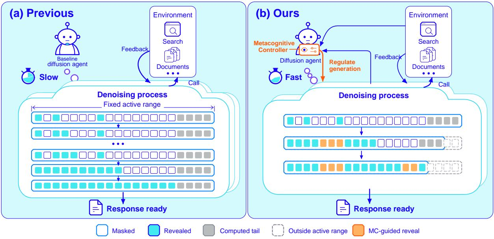
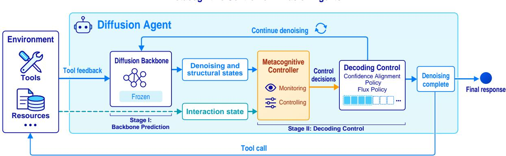
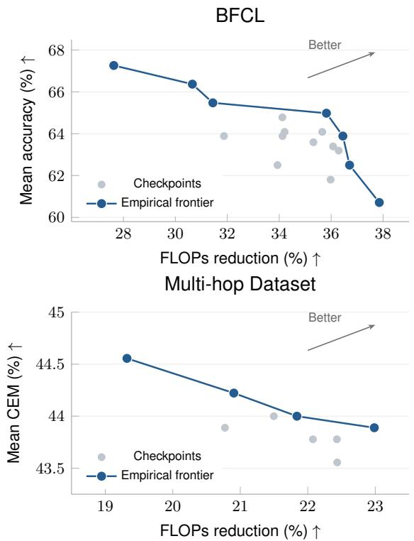
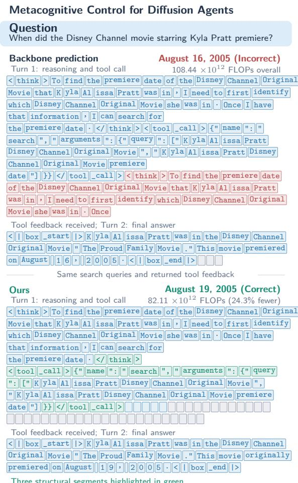

# Metacognitive Decoding: Efficient Inference for Diffusion Language Agents

Mingyu Zhao1\* Shuhang Lin1\* Ligong Han1 Xiaojing Yu3

Zhenting Wang1 Yifei Pang2 Yang Zhou1 Dimitris N. Metaxas1

1{zhao.mingyu,shuhang.lin,zhenting.wang,eta.yang}@rutgers.edu

1{ligong.han,dnm}@rutgers.edu

2yifeip@cs.unc.edu 3yyxjing@amazon.com

## Abstract

Diffusion language models offer a promising path to efficient agents through parallel token generation. However, efficient interaction requires adapting both where computation is spent and how much text is generated. We introduce a metacognitive controller that guides diffusion generation according to the needs of the current response and the agent’s interaction with the environment. It learns when to finalize tokens and how far generation should extend, reducing overall computation within responses. Our controller, a lightweight plug-in for the diffusion backbone, is trained on agent trajectories to balance correctness and generation cost. This approach connects the agent’s generation process to the interaction the agent serves. Experiments across five benchmarks demonstrate that our approach reduces inference FLOPs by 20.6% on average compared with the most efficient baseline, while maintaining competitive task accuracy. Ablation studies further validate the effectiveness of our approach.

## 1 Introduction

Diffusion language models offer a promising foundation for efficient language agents. Their ability to generate multiple tokens in parallel creates opportunities to accelerate generation (Nie et al., 2025; Wu et al., 2026). In an agent, however, each response is part of an ongoing interaction: the model reasons about a task, calls a tool, observes the result, and continues. What the agent needs to generate changes throughout this process. Making effective use of diffusion therefore introduces a new challenge: adapting diffusion generation to the dynamic needs of agentic reasoning and interaction.

The primary bottleneck lies in the mismatch between conventional rigid decoding mechanisms and the highly structured nature of agent trajectories, which leads to severe computational redundancy. This inefficiency manifests in two main ways. First, agent outputs contain a mix of highly predictable formatting (e.g., API templates) and complex reasoning. Conventional decoding treats all tokens uniformly; it either wastes compute by over-processing easy tokens or introduces errors by finalizing complex tokens too early. Second, agent interactions have strict execution boundaries. Once a tool call is generated, the agent must pause for environment feedback. However, because diffusion models process tokens in fixed-size blocks, they often wastefully compute trailing tokens beyond this boundary that are ultimately discarded. Therefore, to achieve high efficiency, a diffusion agent must dynamically adjust its decoding strategy based on both prediction confidence and interaction states.

To address these inefficiencies, we introduce a metacognitive controller that enables environment-aware generation (Figure 1).1 Instead of generating tokens blindly, the controller monitors the agent’s interaction states and the model’s prediction confidence to dynamically coordinate two decisions: which tokens to finalize and how many positions to compute. At each step, after the diffusion backbone predicts tokens, the controller applies a cascaded policy to optimize decoding: First, flux decoding optimizes the active computation range. It dynamically shrinks the generation window to exclude unnecessary downstream positions from computation, expanding it back only when the current response actually requires more space to complete. Second, confidence alignment decoding manages token acceptance. It identifies highly predictable structures (e.g., standard toolcall formats) and finalizes them simultaneously, while adaptively adjusting the acceptance thresholds for individual tokens. Together, these mechanisms ensure that computation is spent only where needed, allowing generation to halt efficiently the moment a tool call is triggered.

  
Figure 1: Metacognitive control of environment-aware diffusion decoding. Left: fixed-range decoding computes positions beyond the response consumed by the environment. Right: our controller guides content commitment and adjusts the active computation range during interaction. Orange denotes controller-guided revelation, gray denotes computed tail positions, and dashed cells lie outside the active range.

## Our contributions are threefold:

• We identify a diffusion agent efficiency bottleneck: diffusion agents can have low token efficiency with common patterns.

• We propose a metacognitive controller for efficient agent generation. Our controller monitors both model prediction signals and agent interactions. It controls agent decoding with a cascaded decoding policy: confidence alignment decoding controls structural segments and token acceptance, while flux decoding adjusts the computation range through recoverable empty tokens.

• Across five benchmarks, our approach outperforms existing baselines by reducing inference FLOPs while maintaining competitive task accuracy. Ablation studies further demonstrate the effectiveness of our metacognitive controller.

## 2 Related Work

Diffusion language models. Diffusion language models generate text through iterative denoising, allowing multiple token positions to be predicted in parallel rather than following a fixed left-to-right order. Early work explored diffusion in continuous embedding spaces (Li et al., 2022) and discrete token spaces (Austin et al., 2021). Subsequent work introduced score entropy for discrete diffusion (Lou et al., 2024) and simplified masked diffusion training to a weighted masked language modeling objective (Sahoo et al., 2024). Building on these advances, recent work has scaled diffusion language models through pre-training from scratch, as in LLaDA (Nie et al., 2025), and adaptation from pretrained autoregressive models (Gong et al., 2025). In particular, LLaDA demonstrates instruction-following, in-context learning, and reasoning capabilities at the 8B scale (Nie et al., 2025). Beyond model scaling, block diffusion extends diffusion generation to variable-length sequences by combining autoregressive generation across blocks with parallel denoising within each block (Arriola et al., 2025; Bie et al., 2025).

Language agents and tool use. Beyond standalone text generation, language agents use external tools and environmental feedback to solve tasks. ReAct interleaves reasoning with actions, allowing observations to inform subsequent decisions (Yao et al., 2023), while Toolformer learns when and how to invoke APIs and incorporate their results into generation (Schick et al., 2023). Reflexion uses feedback to form verbal reflections that guide subsequent attempts (Shinn et al., 2023). Diffusion models have also been explored for interaction and planning. DiffTOD formulates targetoriented dialogue planning as conditional trajectory generation, using diffusion to construct plans non-sequentially (Du et al., 2025). More directly, DLLM-Searcher adapts diffusion language models to search agents through supervised fine-tuning and reinforcement learning (Zhao et al., 2026). Its P-ReAct decoding pre-fills tool-call boundaries and biases confidence scores within the tool region to prioritize tool-call completion, allowing tool execution to overlap with reasoning generation.

Adaptive decoding for diffusion language models. Decoding policies determine how diffusion language models translate parallel token predictions into efficient generation. Revealing multiple tokens per step reduces the number of model evaluations but can compromise generation quality. Confidence-ranked decoding selects a prescribed number of predictions at each step (Nie et al., 2025), whereas confidence-thresholding reveals tokens whose confidence exceeds a specified threshold (Wu et al., 2026). Further approaches employ entropy constraints to determine how many tokens to reveal (Ben-Hamu et al., 2025), or use token predictions from previous denoising steps to determine which tokens to reveal (Wei et al., 2026; Wang et al., 2026). Existing studies have also explored learning which positions to denoise (Liu et al., 2025) and revising previously generated tokens by masking them again (Wang et al., 2025). Another line of work focuses on reducing the computational cost of each denoising step through adaptive caching (Ma et al., 2025; Liu et al., 2026; Nguyen-Tri et al., 2026) and sparse attention (Song et al., 2026; Long et al., 2026).

## 3 Methodology

In this section, we present a metacognitive controller for accelerating diffusion agents. It selects which tokens to finalize and how much of the current block to keep active. We train the controller to balance answer correctness and inference cost. We first describe block diffusion (§3.1), then introduce the controller (§3.2) and cascaded decoding (§3.3), and finally present controller training (§3.4).

## 3.1 Backbone: Block Diffusion

Diffusion models such as LLaDA2.0 (Bie et al., 2025) generate responses block by block. For example, given the query and current interaction history $\mathbf { c } ,$ the probability of a response x comprising

K blocks factorizes as

$$
p ( \mathbf { x } \mid \mathbf { c } ) = \prod _ { k = 1 } ^ { K } p ( \mathbf { x } ^ { ( k ) } \mid \mathbf { c } , \mathbf { x } ^ { ( < k ) } { \Big ) } ,\tag{1}
$$

where $\mathbf { x } ^ { ( k ) }$ denotes the k-th block, and $\mathbf { x } ^ { ( < k ) }$ the preceding blocks. Each block is generated by iterative denoising from masked tokens, conditioned on completed blocks.

## 3.2 Metacognitive Controller

In this section, we introduce a metacognitive controller, a lightweight plug-in that assists diffusion agent generation. In general, the controller has two functions: monitoring signals from both the model and the external environment, and controlling diffusion agent generation. Figure 2 illustrates the workflow of the metacognitive controller.

Monitoring. The controller monitors both internal model signals and external interaction signals. Internal model signals comprise the denoising state and structural state. The denoising state captures prediction uncertainty, token revelation status, and progress within the current block. The structural state captures recurring format patterns in tool calls, thinking, and final answers, as well as their compatibility with the partially generated response. External interaction signals are represented by the interaction state, which tracks the current interaction turn and whether thinking segments, tool calls, and final answers have been completed. These monitored signals are organized into position, structuralcandidate, and global inputs. The controller jointly encodes these inputs to obtain the corresponding representations for decoding control.

Controlling. Our metacognitive controller facilitates generation by diffusion agents. We implement the control mechanism through a two-stage decoding policy. In the first stage, the diffusion backbone produces token predictions. In the second stage, the metacognitive controller refines the decoding process through two policies: the confidence alignment policy and the flux policy. For flux decoding, it determines which positions remain active and which are excluded from computation until recovery. For confidence alignment decoding, it scores structural candidates derived from the recurring format patterns and predicts acceptance thresholds for both structural candidates and individual tokens. We describe these policies in detail in Section 3.3.

  
Figure 2: Overview of our approach. The metacognitive controller monitors the generation state and interaction progress, then guides backbone predictions through the confidence alignment policy and flux policy. Tool calls provide environmental feedback for subsequent generation.

## 3.3 Cascaded Decoding Policy

Our decoding design follows two principles. First, we keep the diffusion backbone frozen to avoid costly backbone post-training, while leveraging the monitored signals to guide generation. Second, we seek to minimize interference with the backbone’s original generation. To apply these principles, we propose a cascaded decoding policy. It contains two layers: the diffusion backbone first produces token predictions as usual; the controller then uses these predictions and the monitored signals to guide decoding through the confidence alignment policy and flux policy.

## Stage I: Backbone Prediction

At each denoising step, the diffusion backbone follows its standard prediction procedure, producing a token distribution at each masked position in the current block, conditioned on the interaction history, completed blocks, and the current block state.

Let $p _ { i } ( v )$ denote the predicted probability of token $v \in \mathcal V$ at position i, where V is the backbone vocabulary. The predicted token and its confidence are

$$
\hat { x } _ { i } = \arg \operatorname* { m a x } _ { v \in \mathcal { V } } p _ { i } ( v ) , \qquad c _ { i } = p _ { i } ( \hat { x } _ { i } ) .\tag{2}
$$

These predictions are passed to the second-stage controller to determine which tokens are accepted and which positions remain active.

## Stage II: Decoding Control

Confidence Alignment Policy. During agent decoding, redundant patterns recur in generated responses. For example, tool-use agents repeatedly generate structured tool-call formats, while question-answering agents reuse formats for thinking and final answers. Therefore, to exploit this redundancy, we introduce the confidence alignment policy. Specifically, we extract recurring structural segments from sampled trajectories of the agent task to construct structural candidates. During decoding, each candidate pairs a segment with a compatible location in the current block. We retain only structural candidates that match the already generated tokens at their proposed locations.

Specifically, let J denote the index set of these candidates. For each candidate $j \in J ,$ the controller uses its representation $\mathbf { h } _ { j } ^ { \mathrm { c a n d } }$ to compute a score $u _ { j }$ , indicating its preference for accepting that segment:

$$
u _ { j } = \mathbf { w } _ { c } ^ { \top } \mathbf { h } _ { j } ^ { \mathrm { c a n d } } + b _ { c } , \qquad j ^ { * } = \arg \operatorname* { m a x } _ { j \in J } u _ { j } .\tag{3}
$$

Here, $\mathbf { w } _ { c }$ and $b _ { c }$ are learned parameters, and $j ^ { * }$ indexes the highest-scoring candidate.

The controller predicts a relative acceptance threshold $\rho$ from the global representation. If $u _ { j ^ { * } } > \rho ,$ the selected candidate is accepted, jointly filling its masked positions with the segment tokens. For each remaining masked position $i ,$ the controller predicts a threshold offset $\delta _ { i }$ from the position representation and reveals features. The backbone’s predicted token ${ \hat { x } } _ { i }$ is accepted when its confidence $c _ { i }$ satisfies $c _ { i } \geq \tau _ { 0 } - \delta _ { i }$ , where $\tau _ { 0 }$ is the base threshold. These acceptance criteria adapt structural and token-level revelation to the current decoding state.

Flux Policy. We introduce a dynamic empty token ε to mark a recoverable endpoint of the active computation range. At each denoising step, we update its position by selecting the highest-probability position predicted by the metacognitive controller. Positions beyond this endpoint do not participate in subsequent denoising.

For a block of original size B, the controller uses the position representations $\mathbf { h } _ { i } ^ { \mathrm { p o s } }$ to score the possible lengths of the active computation range:

$$
\begin{array} { r } { \boldsymbol { s } _ { i } = \mathbf { w } _ { r } ^ { \top } \mathbf { h } _ { i } ^ { \mathrm { p o s } } + b _ { r } , \quad i = 1 , \ldots , B , } \\ { \mathbf { p } ^ { \mathrm { r a n g e } } = \mathrm { s o f t m a x } ( s _ { 1 } , \ldots , s _ { B } ) . } \end{array}\tag{4}
$$

where $\mathbf { p } ^ { \mathrm { r a n g e } }$ assigns probabilities to different lengths of the active computation range. At inference, the decoder selects the highest-probability length that preserves all committed non-padding tokens. Selecting an active computation range of length ℓ assigns the empty token ε to position ℓ. Positions beyond ℓ do not participate in subsequent denoising. If the active computation range is fully decoded but the turn remains incomplete, the controller uses the updated decoding state to select a longer range $\ell ^ { \prime } > \ell ,$ moves the empty token to position $\ell ^ { \prime } ,$ , and restores the additional positions as masks. Once recovery begins, the active computation range can expand but cannot shrink within the current block.

## 3.4 Controller Training

In this section, we present the training procedure for the metacognitive controller, which learns a cascaded decoding policy to balance task correctness and inference cost over complete interaction trajectories.

Trajectory-level reward. We reward correct trajectories according to their inference cost. For a complete trajectory τ generated for question q, the reward is

$$
R ( \tau ) = \left\{ \begin{array} { l l } { \left[ \mathrm { m a x } \left( 0 , 1 - \displaystyle \frac { e ( \tau ) } { \eta } \right) \right] ^ { \alpha } , } & { \mathrm { i f } \mathrm { c o r r e c t } , } \\ { 0 , } & { \mathrm { o t h e r w i s e } . } \end{array} \right.\tag{5}
$$

We define the relative inference cost as $e ( \tau ) =$ $F ( \tau ) / F _ { \mathrm { r e f } } ( q )$ , where $F ( \tau )$ is the backbone and controller inference cost, and $F _ { \mathrm { r e f } } ( q )$ is the inference cost of the same frozen backbone without the controller on question $q .$ Reference costs are precomputed and held fixed throughout training. The parameter η sets the cost scale, and α controls the reward’s sensitivity to efficiency. Correctness is evaluated using the task-specific metric. The reward becomes zero when $e ( \tau ) \geq \eta$

Controller optimization. At each denoising step during rollout, we sample a length for the active computation range according to $\mathbf { p } ^ { \mathrm { r a n g e } }$ . When the selected length leaves the range unchanged, we sample a structural candidate and whether to accept it according to the controller’s output probabilities. For each remaining masked position i in the active computation range, we independently sample whether to accept the backbone-predicted token. Its acceptance probability increases with the difference between its confidence $c _ { i }$ and the adjusted threshold $\tau _ { 0 } - \delta _ { i }$

We train the controller on-policy following GRPO (Shao et al., 2024). In each round, we sample a group of complete interaction trajectories for each question through the current controller and compute their rewards. We standardize rewards within each group to obtain trajectory-level advantages.

## 4 Experiments

Our experiments evaluate whether environmentaware decoding reduces inference cost while maintaining task accuracy. We compare our method with existing diffusion-based agents and language models on tool-calling and multi-hop questionanswering tasks. We further examine the contributions of individual control components through ablations and evaluate the method across diffusion backbones.

## 4.1 Experiment Setup

Datasets and interaction environments. We evaluate our metacognitive controller in diffusionagent settings. We sample BFCL v3 (Patil et al., 2025) to evaluate tool-calling capabilities, splitting its non-live and live subsets into training and test sets at a 1:1 ratio within each subset, following Lu et al. (2025). We sample 1,000 questions from each of HotpotQA (Yang et al., 2018), 2WikiMulti-HopQA (Ho et al., 2020), and MuSiQue (Trivedi et al., 2022) to evaluate multi-hop reasoning and tool use, following Zhao et al. (2026).

Baselines. We compare our approach with general diffusion models, task-adapted diffusion models, and diffusion decoding acceleration methods. LLaDA2.0-mini (Bie et al., 2025) is an open-source mixture-of-experts diffusion language model with block diffusion decoding, included as a general diffusion baseline. LLaDA-8B-Tools (Proximile LLC, 2025) is a version of LLaDA-8B-Instruct fine-tuned for tool calling, providing a comparison with a task-adapted diffusion model. DLLM-Searcher (Zhao et al., 2026) adapts diffusion language models into search agents through agentic post-training and introduces P-ReAct to overlap tool execution with reasoning. We include it as a diffusion-agent baseline. Fast-dLLM (Wu et al., 2026) is a training-free acceleration method that enables KV caching and confidence-aware parallel decoding. We include it to compare controller-based decoding with an existing diffusion acceleration method. We evaluate it with the same diffusion backbone weights, tool interfaces, and generation budgets as our method, differing only in the decoding and caching mechanisms. LLaDA-8B (SFT) is based on our LLaDA-8B-Instruct backbone fine-tuned on tool-use trajectories, with only the metacognitive controller removed. This comparison isolates the contribution of metacognitive control to accuracy and inference cost.

<table><tr><td rowspan="2">Method</td><td colspan="2">BFCL Live</td><td colspan="2">BFCL Non-live</td><td colspan="2">HotpotQA</td><td colspan="2">2Wiki</td><td colspan="2">MuSiQue</td></tr><tr><td>Acc.↑</td><td>FLOPs↓</td><td>Acc.↑</td><td>FLOPs↓</td><td>Acc.↑</td><td>FLOPs↓</td><td>Acc. ↑</td><td>FLOPs↓</td><td>Acc.↑</td><td>FLOPs↓</td></tr><tr><td>Fast-dLLM</td><td>57.46</td><td>57.58</td><td>52.66</td><td>54.98</td><td>43.20</td><td>324.16</td><td>67.70</td><td>340.49</td><td>21.20</td><td>342.32</td></tr><tr><td>LLaDA-8B-Tools</td><td>50.00</td><td>2889.56</td><td>37.27</td><td>1375.23</td><td>16.50</td><td>4310.92</td><td>22.80</td><td>4185.11</td><td>2.20</td><td>2644.99</td></tr><tr><td>DLLM-Searcher</td><td>40.85</td><td>547.10</td><td>16.09</td><td>433.45</td><td>37.10</td><td>1277.25</td><td>50.40</td><td>1261.22</td><td>17.80</td><td>1237.25</td></tr><tr><td>LLaDA-8B (SFT)</td><td>66.52</td><td>32.49</td><td>63.60</td><td>19.28</td><td>45.70</td><td>175.00</td><td>67.10</td><td>204.51</td><td>20.70</td><td>197.38</td></tr><tr><td>LLaDA2.0-mini</td><td>69.72</td><td>43.79</td><td>79.42</td><td>14.12</td><td>36.30</td><td>142.09</td><td>41.00</td><td>199.93</td><td>10.80</td><td>168.37</td></tr><tr><td>Ours</td><td>70.96</td><td>18.48</td><td>65.47</td><td>12.51</td><td>46.60</td><td>131.91</td><td>67.90</td><td>147.68</td><td>20.30</td><td>142.83</td></tr></table>

Table 1: Task accuracy and inference cost of our method and baseline methods. FLOPs accumulate model computation over the complete interaction trajectory, including controller computation.

Implementation and evaluation metrics. To support a fair comparison with task-adapted baselines, we first adapt LLaDA-8B-Instruct (Nie et al., 2025) to the target tasks through supervised finetuning (SFT). For the controller, we simply use a two-layer Transformer encoder. We train the controller on eight NVIDIA A100 GPUs for 40 rounds per stage.

Task accuracy. For BFCL v3, we use the official evaluator to measure tool-call correctness. For HotpotQA, 2WikiMultiHopQA, and MuSiQue, we report cover exact match (CEM), following prior evaluations of agents (Zhao et al., 2026; Song et al., 2025). CEM assesses whether the ground-truth answer is included in the predicted answer. CEM scores are rounded to the nearest 0.1 percentage point.

Computational cost. Floating-point operations (FLOPs) measure the amount of arithmetic computation required for inference. We count the major matrix operations of the backbone and controller over each complete trajectory and report average FLOPs in units of 1012 operations.

## 4.2 Main Results

Table 1 summarizes the main results across five benchmarks. Our method delivers competitive task accuracy at the lowest computational cost compared with existing baselines. Notably, on BFCL Live, HotpotQA, and 2Wiki, it outperforms all baselines in both accuracy and inference FLOPs.

Comparison with general diffusion models. Our method builds on LLaDA-8B-Instruct. Compared with the larger-scale LLaDA2.0-mini (16B MoE), it achieves higher accuracy on four benchmarks while reducing inference FLOPs across all five benchmarks. Although LLaDA2.0-mini achieves higher accuracy on BFCL Non-live, our method still reduces inference FLOPs by 11.4% on this benchmark.

Comparison with task-specialized models. Our method consistently outperforms LLaDA-8B-Tools and DLLM-Searcher in both task accuracy and computational efficiency across all five benchmarks. On BFCL Non-live and Live, it surpasses LLaDA-8B-Tools by 28.20 and 20.96 percentage points in accuracy, respectively. The advantage over DLLM-Searcher extends across all three multihop QA benchmarks, with accuracy gains of 9.50, 17.50, and 2.50 percentage points on HotpotQA, 2Wiki, and MuSiQue, respectively. These improvements are accompanied by an 88.3–89.7% reduction in inference FLOPs across these three benchmarks.

<table><tr><td rowspan="2">Setting</td><td colspan="2">BFCL Live</td><td colspan="2">BFCL Non-live</td><td colspan="2">HotpotQA</td><td colspan="2">2Wiki</td><td colspan="2">MuSiQue</td></tr><tr><td>Acc.↑</td><td>FLOPs↓</td><td>Acc.↑</td><td>FLOPs↓</td><td>Acc.↑</td><td>FLOPs↓</td><td>Acc.↑</td><td>FLOPs↓</td><td>Acc.↑</td><td>FLOPs↓</td></tr><tr><td>w/o flux policy</td><td>70.07</td><td>26.95</td><td>64.46</td><td>17.39</td><td>47.60</td><td>149.71</td><td>66.70</td><td>162.46</td><td>19.60</td><td>162.93</td></tr><tr><td>w/o conf. align.</td><td>69.63</td><td>23.11</td><td>64.46</td><td>14.55</td><td>48.90</td><td>145.49</td><td>68.90</td><td>166.48</td><td>19.10</td><td>167.32</td></tr><tr><td>Controller (Ours)</td><td>70.96</td><td>18.48</td><td>65.47</td><td>12.51</td><td>46.60</td><td>131.91</td><td>67.90</td><td>147.68</td><td>20.30</td><td>142.83</td></tr></table>

Table 2: Component ablations of the metacognitive controller. Each ablation disables one component of the full controller. Conf. align. denotes the confidence alignment policy. Accuracy (%) and FLOPs $( 1 0 ^ { 1 \dot { 2 } } )$ follow Table 1.

Comparison with decoding acceleration baselines. Compared with Fast-dLLM, our method reduces inference FLOPs by 56.6–77.2% across all five benchmarks while maintaining competitive task accuracy. On BFCL Non-live and Live, it also achieves accuracy gains of 12.81 and 13.50 percentage points, respectively, demonstrating improvements in both accuracy and computational efficiency.

Effectiveness of metacognitive control. Compared with LLaDA-8B (SFT), our method reduces inference FLOPs by 24.6–43.1% across all five benchmarks with identical backbone weights and inference settings, differing only in the use of the metacognitive controller. Task accuracy improves on four benchmarks and remains comparable on MuSiQue, demonstrating the computational benefits of metacognitive control.

## 4.3 Ablation Study

We examine the contributions of the two decoding components in Table 2. We disable the flux decoding policy and the confidence alignment policy individually. All configurations follow our method’s inference setup, including prefix caching and confidence-threshold decoding.

Contributions of individual components. As shown in Table 2, removing either policy increases inference FLOPs across all five benchmarks, with only modest changes in task accuracy. Specifically, disabling the flux decoding policy and the confidence alignment policy individually increases FLOPs by an average of 24.5% and 16.3%, respectively, relative to the full controller. These results demonstrate that both policies contribute to the controller’s efficiency gains while preserving comparable task accuracy.

  
Figure 3: Accuracy versus FLOPs reduction on BFCL and multi-hop tasks. Gray points denote evaluated checkpoints; blue points and lines highlight their empirical Pareto frontier. The upper-right direction is better.

Accuracy–efficiency trade-off. Figure 3 plots task accuracy against FLOPs reduction on BFCL and multi-hop tasks for several controller checkpoints. For each checkpoint on the highlighted Pareto frontier, none of the other checkpoints improves either metric without worsening the other.

## 4.4 Results on Different Backbones

We further evaluate our method on two different diffusion language model backbones: LLaDA-8B-Instruct (Nie et al., 2025) and Dream-7B (Ye et al., 2025). We train the metacognitive controller for each backbone separately. Table 3 shows substantial reductions in inference FLOPs on both backbones while retaining competitive success rates, demonstrating the effectiveness of our method across different diffusion backbones.

<table><tr><td rowspan="2">Dataset</td><td colspan="2">LLaDA</td><td colspan="2">Dream</td></tr><tr><td>∆Acc.</td><td>FLOPs↓</td><td>∆Acc.</td><td>FLOPs↓</td></tr><tr><td>BFCL Live</td><td>+4.44</td><td>43.1%</td><td>+0.00</td><td>17.2%</td></tr><tr><td>BFCL Non-live</td><td>+1.87</td><td>35.1%</td><td>+1.72</td><td>29.0%</td></tr><tr><td>HotpotQA</td><td>+0.90</td><td>24.6%</td><td>+1.10</td><td>52.9%</td></tr><tr><td>2Wiki</td><td>+0.80</td><td>27.8%</td><td>-0.60</td><td>58.0%</td></tr><tr><td>MuSiQue</td><td>-0.40</td><td>27.6%</td><td>-2.20</td><td>67.5%</td></tr></table>

Table 3: Effect of the metacognitive controller on LLaDA and Dream. ∆Acc. reports the change in accuracy (percentage points), and FLOPs↓ reports the reduction in inference FLOPs (%), relative to the same backbone without the controller. LLaDA results compare Ours with LLaDA-8B (SFT) in Table 1.

  
Tool-call block: 48  13 active positions ( 72.9%)  
Figure 4: An interaction comparison using the same backbone and search queries. Green highlights the tokens in three structural segments; Red marks post-call generation; gray denotes padding. Blank blue cells have no saved token text. Flux decoding reduces the active range (gray). With the metacognitive controller, the agent uses 24.3% fewer FLOPs over the complete interaction and answers correctly in this example.

## 4.5 Case Study

Figure 4 compares two complete interactions using the same diffusion backbone and search queries. Both agents issue a tool call in the first turn and generate a final answer in the second. With backbone prediction alone, generation continues beyond the tool-call boundary and repeats the preceding reasoning. These 40 positions are discarded by the environment: they neither change the search queries nor contribute to the next turn’s interaction context. The decoder therefore spends computation on this redundant content.

The metacognitive controller coordinates structural and token acceptance through the confidence alignment policy and adjusts the active computation range through flux decoding. The figure highlights three structural segments in green: the thinking close tag, the search-call prefix, and the toolcall closing sequence. In the final tool-call block, flux decoding retains 13 of 48 positions, reducing the active range within this block by 72.9%. After receiving the same tool feedback, the agent with our controller gives the correct premiere date, August 19, 2005, whereas the agent relying on backbone prediction alone answers August 16, 2005. The complete interaction uses 82.11×1012 FLOPs, compared with 108. $4 4 \times 1 0 ^ { 1 2 }$ with backbone prediction alone, a reduction of 24.3%.

## 5 Conclusion

We presented a metacognitive controller designed to accelerate diffusion language agents through environment-aware generation. Rather than processing tokens uniformly in fixed blocks, our controller dynamically regulates decoding via a cascaded policy: confidence alignment decoding finalizes predictable structural tokens efficiently, while flux decoding shrinks the active computation range to eliminate redundant processing. Empirical results across diverse tool-calling and multi-hop reasoning benchmarks show that our method substantially reduces inference FLOPs without compromising task accuracy. This approach demonstrates that adaptively aligning computation with agent interaction states is a highly effective strategy for scaling diffusion agents.

## Limitations

Adapting the controller to evolving diffusion models remains an important direction for future work.

## References

Marianne Arriola, Aaron Gokaslan, Justin Chiu, Zhihan Yang, Zhixuan Qi, Jiaqi Han, Subham Sahoo, and Volodymyr Kuleshov. 2025. Block Diffusion: Interpolating Between Autoregressive and Diffusion Language Models. In International Conference on Learning Representations, pages 50726–50753.

Jacob Austin, Daniel D. Johnson, Jonathan Ho, Daniel Tarlow, and Rianne van den Berg. 2021. Structured Denoising Diffusion Models in Discrete State-Spaces. In Advances in Neural Information Processing Systems, volume 34, pages 17981–17993.

Heli Ben-Hamu, Itai Gat, Daniel Severo, Niklas Nolte, and Brian Karrer. 2025. Accelerated Sampling from Masked Diffusion Models via Entropy Bounded Unmasking. In Advances in Neural Information Processing Systems.

Tiwei Bie, Maosong Cao, Kun Chen, Lun Du, Mingliang Gong, Zhuochen Gong, Yanmei Gu, Jiaqi Hu, Zenan Huang, Zhenzhong Lan, et al. 2025. LLaDA2.0: Scaling up diffusion language models to 100B. arXiv preprint arXiv:2512.15745.

Hanwen Du, Bo Peng, and Xia Ning. 2025. Planning with diffusion models for target-oriented dialogue systems. In Proceedings of the 63rd Annual Meeting of the Association for Computational Linguistics (Volume 1: Long Papers), pages 20307–20329.

Shansan Gong, Shivam Agarwal, Yizhe Zhang, Jiacheng Ye, Lin Zheng, Mukai Li, Chenxin An, Peilin Zhao, Wei BI, Jiawei Han, Hao Peng, and Lingpeng Kong. 2025. Scaling Diffusion Language Models via Adaptation from Autoregressive Models. In International Conference on Learning Representations, pages 5046–5073.

Xanh Ho, Anh-Khoa Duong Nguyen, Saku Sugawara, and Akiko Aizawa. 2020. Constructing a multihop QA dataset for comprehensive evaluation of reasoning steps. In Proceedings of the 28th International Conference on Computational Linguistics, pages 6609–6625. International Committee on Computational Linguistics.

Xiang Li, John Thickstun, Ishaan Gulrajani, Percy S. Liang, and Tatsunori B. Hashimoto. 2022. Diffusion-LM Improves Controllable Text Generation. In Advances in Neural Information Processing Systems, volume 35, pages 4328–4343.

Sulin Liu, Juno Nam, Andrew Campbell, Hannes Stärk, Yilun Xu, Tommi Jaakkola, and Rafael Gómez-Bombarelli. 2025. Think While You Generate: Discrete Diffusion with Planned Denoising. In International Conference on Learning Representations.

Zhiyuan Liu, Yicun Yang, Yaojie Zhang, Junjie Chen, Chang Zou, Qingyan Wei, Shaobo Wang, Yichen Zhu, and Linfeng Zhang. 2026. dLLM-Cache: Accelerating Diffusion Large Language Models with Adaptive Caching. In Proceedings ofthe 43rd International Conference on Machine Learning.

Lingkun Long, Yushi Huang, Shihao Bai, Ruihao Gong, Jun Zhang, Ao Zhou, and Jianlei Yang. 2026. FocusdLLM: Accelerating long-context diffusion LLM inference via confidence-guided context focusing. In Proceedings of the 64th Annual Meeting of the Associationfor Computational Linguistics (Volume 1: Long Papers), pages 12146–12160, San Diego, California, United States. Association for Computational Linguistics.

Aaron Lou, Chenlin Meng, and Stefano Ermon. 2024. Discrete Diffusion Modeling by Estimating the Ratios of the Data Distribution. In International Conference on Machine Learning, pages 32819–32848.

Siyuan Lu, Zechuan Wang, Hongxuan Zhang, Qintong Wu, Leilei Gan, Chenyi Zhuang, Jinjie Gu, and Tao Lin. 2025. Don’t just fine-tune the agent, tune the environment. arXiv preprint arXiv:2510.10197.

Xinyin Ma, Runpeng Yu, Gongfan Fang, and Xinchao Wang. 2025. dKV-Cache: The Cache for Diffusion Language Models. arXiv preprint arXiv:2505.15781.

Quan Nguyen-Tri, Mukul Ranjan, and Zhiqiang Shen. 2026. Attention Is All You Need for KV Cache in Diffusion LLMs. In International Conference on Learning Representations.

Shen Nie, Fengqi Zhu, Zebin You, Xiaolu Zhang, Jingyang Ou, Jun Hu, Jun Zhou, Yankai Lin, Ji-Rong Wen, and Chongxuan Li. 2025. Large Language Diffusion Models. In Advances in Neural Information Processing Systems, volume 38, pages 50608–50646.

Shishir G Patil, Huanzhi Mao, Fanjia Yan, Charlie Cheng-Jie Ji, Vishnu Suresh, Ion Stoica, and Joseph E. Gonzalez. 2025. The berkeley function calling leaderboard (BFCL): From tool use to agentic evaluation of large language models. In Proceedings of the 42nd International Conference on Machine Learning, volume 267 of Proceedings of Machine Learning Research, pages 48371–48392. PMLR.

Proximile LLC. 2025. LLaDA-8B-Tools. Hugging Face model repository.

Subham S. Sahoo, Marianne Arriola, Yair Schiff, Aaron Gokaslan, Edgar Marroquin, Justin T. Chiu, Alexander Rush, and Volodymyr Kuleshov. 2024. Simple and Effective Masked Diffusion Language Models. In Advances in Neural Information Processing Systems, volume 37, pages 130136–130184.

Timo Schick, Jane Dwivedi-Yu, Roberto Dessi, Roberta Raileanu, Maria Lomeli, Eric Hambro, Luke Zettlemoyer, Nicola Cancedda, and Thomas Scialom. 2023. Toolformer: Language Models Can Teach Themselves to Use Tools. In Advances in Neural Information Processing Systems.

Zhihong Shao, Peiyi Wang, Qihao Zhu, Runxin Xu, Junxiao Song, Xiao Bi, Haowei Zhang, Mingchuan Zhang, YK Li, Yang Wu, et al. 2024. Deepseekmath: Pushing the limits of mathematical reasoning in open language models. arXiv preprint arXiv:2402.03300.

Noah Shinn, Federico Cassano, Ashwin Gopinath, Karthik Narasimhan, and Shunyu Yao. 2023. Reflexion: language agents with verbal reinforcement learning. In Advances in Neural Information Processing Systems.

Huatong Song, Jinhao Jiang, Yingqian Min, Jie Chen, Zhipeng Chen, Wayne Xin Zhao, Lei Fang, and Ji-Rong Wen. 2025. R1-Searcher: Incentivizing the search capability in LLMs via reinforcement learning. arXiv preprint arXiv:2503.05592.

Yuerong Song, Xiaoran Liu, Ruixiao Li, Zhigeng Liu, Zengfeng Huang, Qipeng Guo, Ziwei He, and Xipeng Qiu. 2026. Sparse-dLLM: Accelerating Diffusion LLMs with Dynamic Cache Eviction. In Proceedings of the AAAI Conference on Artificial Intelligence.

Harsh Trivedi, Niranjan Balasubramanian, Tushar Khot, and Ashish Sabharwal. 2022. MuSiQue: Multihop questions via single-hop question composition. Transactions of the Association for Computational Linguistics, 10:539–554.

Guanghan Wang, Yair Schiff, Subham Sekhar Sahoo, and Volodymyr Kuleshov. 2025. Remasking Discrete Diffusion Models with Inference-Time Scaling. In Advances in Neural Information Processing Systems.

Kangyu Wang, Zhiyun Jiang, Haibo Feng, Weijia Zhao, Lin Liu, Jianguo Li, Zhenzhong Lan, and Weiyao Lin. 2026. CreditDecoding: Accelerating Parallel Decoding in Diffusion Large Language Models with Trace Credit. In Proceedings ofthe 64th Annual Meeting of the Association for Computational Linguistics (Volume 1: Long Papers).

Qingyan Wei, Yaojie Zhang, Zhiyuan Liu, Puyu Zeng, Yuxuan Wang, Biqing Qi, Dongrui Liu, and Linfeng Zhang. 2026. Accelerating Diffusion Large Language Models with SlowFast Sampling: The Three Golden Principles. In International Conference on Learning Representations.

Chengyue Wu, Hao Zhang, Shuchen Xue, Zhijian Liu, Shizhe Diao, Ligeng Zhu, Ping Luo, Song Han, and Enze Xie. 2026. Fast-dLLM: Training-free Acceleration of Diffusion LLM by Enabling KV Cache and Parallel Decoding. In International Conference on Learning Representations.

Zhilin Yang, Peng Qi, Saizheng Zhang, Yoshua Bengio, William Cohen, Ruslan Salakhutdinov, and Christopher D. Manning. 2018. HotpotQA: A dataset for diverse, explainable multi-hop question answering. In Proceedings of the 2018 Conference on Empirical Methods in Natural Language Processing, pages 2369–2380. Association for Computational Linguistics.

Shunyu Yao, Jeffrey Zhao, Dian Yu, Nan Du, Izhak Shafran, Karthik Narasimhan, and Yuan Cao. 2023. ReAct: Synergizing Reasoning and Acting in Language Models. In International Conference on Learning Representations.

Jiacheng Ye, Zhihui Xie, Lin Zheng, Jiahui Gao, Zirui Wu, Xin Jiang, Zhenguo Li, and Lingpeng Kong. 2025. Dream 7B: Diffusion large language models. arXiv preprint arXiv:2508.15487.

Jiahao Zhao, Shaoxuan Xu, Zhongxiang Sun, Fengqi Zhu, Jingyang Ou, Yuling Shi, Chongxuan Li, Xiao Zhang, and Jun Xu. 2026. Dllm-searcher: Adapting diffusion large language model for search agents. arXiv preprint arXiv:2602.07035.