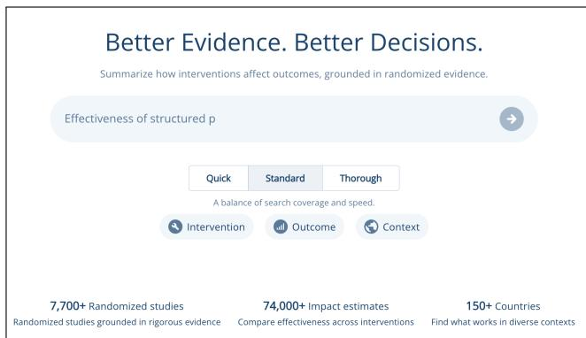
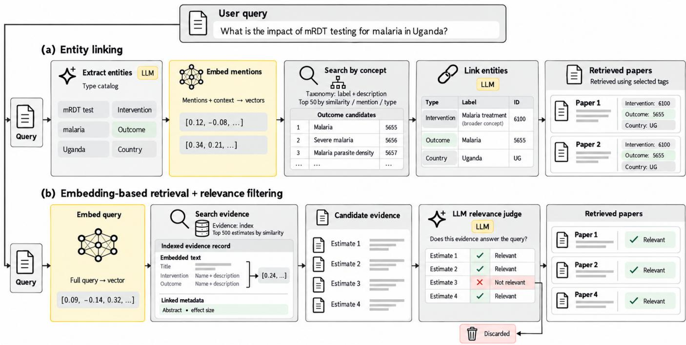
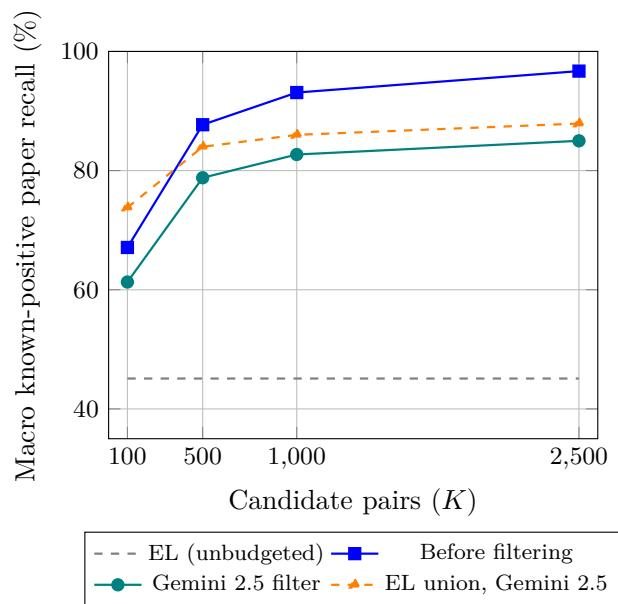

# Nothing Left Behind: Finding Evidence from a Large Randomized Evaluation Corpus

Technical Report, October 2026.

Giuliano Martinelli, Abelardo Carlos Martinez Lorenzo, Satvik Garg, Linxi Wang, Riccardo Orlando,

Piriyakorn Piriyatamwong, Samuel Paul Fraiberger

Development Impact AI Lab, World Bank Group

Abstract—Many AI systems need to find every relevant items in a large collection and then organize what they found. The standard way to do this is to tag each item with labels from a curated vocabulary and search on those labels. Those labels are useful for organizing results, but searching on them misses items that do not fit a label and returns too much when labels are broad. We compare this approach with an embeddingbased approach: find candidates by meaning using text embeddings, then have a language model keep only the relevant ones. In a corpus of 7,354 randomized trials, label search found 45% of the evidence a systematic review would include, while the new approach found 92%, at a cost per query that rises with search depth. These results support a two-stage architecture that combines broad candidate retrieval with query-specific evidence filtering.

## I. Introduction

An AI assistant can often answer a question from a few useful passages. Retrieval-augmented generation (RAG) connects document retrieval to language generation in this way [1]. But some applications need the retrieved set itself to be complete enough for further work. A synthesis of whether school meals improve attendance, for example, should consider all eligible trials available to the analyst, not simply several convincing examples. Missing studies can change a pooled estimate or the interpretation of the evidence. A fluent answer does not establish that the underlying search was complete.

This report concerns that second kind of task. The goal is to find relevant evidence within an existing collection and then organize it for comparison, screening, or aggregation. Recall—the share of relevant items recovered— is therefore a primary objective, alongside precision—the share of returned items that are relevant. High recall does not make irrelevant results harmless: someone or something must still screen them. The engineering problem is to recover a suficiently complete set at an acceptable screening and computational cost.

Systematic reviews provide a practical example of this requirement. Review guidance recommends sensitive searches combining controlled vocabulary and free text, followed by eligibility assessment [2]. Related completeness requirements arise in document review, prior-art search, and audit.

  
Fig. 1. The ImpactAI evidence search interface.

ImpactAI1 supports the discovery and synthesis of evidence from randomized controlled trials (RCTs) in development economics. Its original retrieval architecture translated a user’s question into labels from a curated taxonomy, then returned evidence associated with those labels. This provides explicit concepts and useful organization, but makes discovery depend on the taxonomy’s coverage, granularity, and linking decisions. A question finer than a label may retrieve too much; a concept absent from the catalog may be missed or mapped to an imperfect substitute.

The alternative retrieves intervention–outcome pairs directly by the semantic similarity of their textual descrip tions to the question. A language model then judges each candidate for relevance. This separates broad candidate generation from query-specific screening, in the spirit of multistage neural retrieval [3]. The second stage selects the evidence set used in subsequent analysis. Labels can subsequently organize that set without determining the initial candidate pool. Embeddings remove dependence on an explicit label match, but, on the other hand, introduce their own limits through representation quality and candidate budget.

We use ImpactAI as a case study to compare the architectures, evaluate retrieval and filtering, and examine their operational trade-ofs. The collection and its extracted records are taken as given; corpus construction is described in the accompanying extraction post. Our focus is which evidence is found before downstream synthesis.

## II. Two Retrieval Designs: The ImpactAI Case

ImpactAI retrieves evidence from a heterogeneous corpus of RCTs (Figure 1). We describe the evidence records and the two architectures used to search them.

## A. Evidence Structure

ImpactAI contains an expert-curated corpus of 7,354 randomized controlled trials (RCTs) spanning multiple sectors, including health, education, agriculture, public finance, and social protection .2 Because individual trials can evaluate multiple interventions and outcomes, the corpus contains 74,826 intervention–outcome pairs. Each pair is associated with a set of attributes describing the underlying evidence, including the study population, context, design and setting, time horizon, implementation characteristics, measurement details, and sample size.

As illustrated in Table I, the intervention–outcome pair is the fundamental retrieval unit in our system. Each pair includes an intervention description $I _ { i }$ and an outcome description $O _ { i } ,$ together with metadata and information about the corresponding study and efect estimate. Given a user query $q ,$ the task is to retrieve pairs whose associated evidence addresses the user’s information need. Each pair remains linked to its source study, allowing retrieved evidence to be traced back to the original RCT.

Retrieving at the intervention–outcome level provides finer granularity than paper-level retrieval. A single RCT may examine several interventions or outcomes, and only a subset of these may be relevant to a particular query.

## B. Taxonomy-based Retrieval

Architecture (A) in Figure 2 uses a taxonomy for both discovery and organization. Evidence is tagged ofline with catalog entities. At query time, an LLM identifies spans and assigns entity types from the developmenteconomics catalog, including intervention, outcome, population group, and geography. For each span, the system retrieves candidate entities within the assigned type by combining semantic similarity and BM25 keyword matching, with up to 50 candidates per span. An LLM selects the entity that best fits the span in the context of the complete question. The selected IDs are then used to retrieve associated evidence.

This design normalizes synonymous expressions and exposes inspectable query constraints. Results can be grouped by shared categories, and a user can inspect or correct the linked concepts. A category lookup can also return all evidence associated with a selected label without a semantic top-K cutof, subject to implementation limits and tagging completeness.

The same representation constrains discovery. A question about one particular form of computer-assisted learning may be mapped to the broader computer-assistedlearning category, losing distinctions needed by the user.

<table><tr><td>Data Field</td><td>Example</td></tr><tr><td>Paper id</td><td>7077</td></tr><tr><td>Paper Title</td><td>The impact of mRDT malaria tests in Uganda</td></tr><tr><td colspan="2">Intervention-Outcome pairs</td></tr><tr><td>1. Pair id</td><td>76717</td></tr><tr><td>1. Intervention Name</td><td>mRDT malaria tests</td></tr><tr><td>1. Intervention Description</td><td>The intervention involves the introduction of malaria rapid diagnostic tests (mRDTs) in public health centers, where healthcare person- nel diagnose malaria using mRDTs instead of relying solely on clinical judgment. ACT is only administered when the mRDT result is positive.</td></tr><tr><td>1. Outcome Name</td><td>Societal Cost</td></tr><tr><td>1. Outcome Description</td><td>Aggregate societal cost (health sector + house- hold) per 1000 fever episodes over 2 years.</td></tr><tr><td>2. Pair id</td><td>76718</td></tr><tr><td>2. Intervention Name</td><td>mRDT malaria tests</td></tr><tr><td>2. Intervention Description</td><td>The intervention involves the introduction of malaria rapid diagnostic tests (mRDTs) in public health centers, where healthcare person- nel diagnose malaria using mRDTs instead of relying solely on clinical judgment. ACT is only administered when the mRDT result is positive.</td></tr><tr><td>2. Outcome Name</td><td>Children impacted</td></tr><tr><td>2. Outcome Description</td><td>Percentage of children with malaria receiving appropriate treatment.</td></tr></table>

An RCT and two intervention–outcome pairs in ImpactAI.  
TABLE I

A concept absent from the catalog has no exact entity to link to. Compound questions may span several categories, while errors in span detection, entity typing, selection, or evidence tagging can remove relevant evidence. Finer labels can reduce some ambiguities but increase mapping and maintenance work.

For a fixed catalog and linking decision, increasing a semantic candidate budget does not change the taxonomy result. This explains the flat baseline in the recall comparison.

## C. Semantic Retrieval and Relevance Filtering

Architecture (B) combines neural retrieval with a queryspecific evidence-filtering stage. Instead of using query spans and retrieving taxonomy entities, the neural retriever compares the query directly with textual descriptions of intervention–outcome pairs using embeddingbased similarity. This allows retrieval to draw on the semantic information expressed in the evidence descriptions without relying on an explicit taxonomy match.

Semantic similarity alone, however, does not guarantee relevance to the user’s specific information need. The retriever may return candidates that discuss a similar topic but difer in the intervention, outcome, population, or context of interest. We therefore apply an LLM-based filter to the retrieved candidates. Given the query and a candidate pair, the filter assesses relevance and removes candidates that do not satisfy the query’s requirements.

  
Fig. 2. Taxonomy-based entity linking and semantic retrieval with relevance filtering.

The two stages serve complementary purposes: neural retrieval generates a broad candidate set to preserve recall, while relevance filtering aims to improve precision by removing irrelevant candidates. This separation allows candidate generation and relevance assessment to be evaluated independently.

Each evidence record is indexed using intervention and outcome names and descriptions together with study context. The query is embedded into the same space, and the closest K pairs form the candidate set. The filter retains candidates judged relevant to the full query. For the October latency configuration, candidates are grouped by source paper, with at most 15 pairs per prompt, while retaining a separate relevance decision for each pair.

The output remains a set of evidence pairs linked to their source papers. Grouping, category browsing, and meta-analysis can follow; a positive relevance decision alone does not establish comparability for pooling. Increasing K makes more candidates available to the filter, but the filter cannot recover a pair that candidate generation omitted. A relevant set larger than the budget cannot be completely recovered in one top-K retrieval.

## III. Experimental Setup

## A. Questions

We evaluate the retrieval system through four experimental questions:

1) Filtering agreement: To what extent do Gemini 2.5 Flash relevance judgments agree with human annotations?

2) Retrieval quality: Which retrieval system produces the strongest candidate set for downstream relevance filtering?

3) End-to-end evidence coverage: How much of the evidence identified through systematic reviews does the selected pipeline recover?

4) Operational trade-ofs: How does search depth afect module latency?

## B. Models and Configuration

We compare Gemini embeddings [4], Voyage, E5-largev2 [5], and Granite. The taxonomy quality baseline uses Gemini 2.5 Flash for entity linking. Our semantic pipeline uses Gemini embeddings for candidate generation and Gemini 2.5 Flash [6] for relevance filtering.

## C. Datasets

We use several datasets to evaluate the filtering and retrieval components separately and to assess the resulting pipeline. Table II summarizes the datasets and their role in the evaluation.

The filtering experiments use 100 human-generated queries, 100 synthetic queries, and a smaller set of 10 double-annotated queries. Each query has 30 candidates retrieved with Gemini embeddings. Binary evaluation treats Relevant as positive and merges Potentially Relevant with Negative. The descriptive counts in Table II include both relevant and partially relevant passages, averaging 24.02 and 23.82 per query in the Beta Tester and Synthetic sets. The double-annotated set has no single adjudicated relevance count. The ten-query human–human comparison uses the 276 passages with both annotations;

<table><tr><td>Dataset</td><td>N. Queries</td><td>Query annotation</td><td>N. Relevant (avg)</td><td>Candidates</td><td>Relevant Annotation</td></tr><tr><td>Filtering Agreement</td><td></td><td></td><td></td><td></td><td></td></tr><tr><td>Beta Testers</td><td>100</td><td>Manual</td><td>24.02</td><td>gemini-embeddings top 30</td><td>Human</td></tr><tr><td>Synthetic</td><td>100</td><td>Synthetic</td><td>23.82</td><td>gemini-embeddings top 30</td><td>Human</td></tr><tr><td>Double</td><td>10</td><td>Manual</td><td></td><td>gemini-embeddings top 30</td><td>2 Humans</td></tr><tr><td>Retrieval Quality</td><td></td><td></td><td></td><td></td><td></td></tr><tr><td>Beta Testers Queries</td><td>374</td><td>Manual</td><td>150</td><td>gemini-embeddings top 1000 + Voyage top 1000 + Taxonomy-based retrieval</td><td>LLM validated</td></tr><tr><td>Synthetic Queries</td><td>1000</td><td>Synthetic</td><td>141</td><td>gemini-embeddings top 1000 + Voyage top 1000 + Taxonomy-based Retrieval</td><td>LLM validated</td></tr><tr><td>Human-annotated evaluation</td><td></td><td></td><td></td><td></td><td></td></tr><tr><td>Review-derived formulations</td><td>348</td><td>29 sources / 116 families</td><td>4.07 papers</td><td>Review lists intersected with corpus</td><td>Known-positive sets</td></tr><tr><td>Precision annotation</td><td>45</td><td>Manual</td><td>17</td><td>Neural Retrieval</td><td>Human</td></tr></table>

TABLE II  
Datasets used to evaluate retrieval and relevance filtering.

24 passages lack one annotation. Reviewer positions are assigned within each query, not to fixed individuals across the dataset.

Candidate retrieval is evaluated on two larger benchmarks: 374 Beta Tester queries selected from questions submitted by World Bank researchers and policymakers, and 1,000 Synthetic queries generated from specific RCTs. For each query, an LLM judges a pool containing the top 1,000 results from Gemini embeddings, the top 1,000 from Voyage, and all taxonomy retrieval results. The resulting labels provide the reference set for pooled retrieval precision and recall.

Finally, the review-derived benchmark contains 348 formulations in 116 query families from 29 review sources. Expected paper sets come from review inclusion lists intersected with the ImpactAI corpus, with LLM-assisted assignments for narrower questions. The benchmark contains 1,416 paper–query memberships, averaging 4.07 per formulation.

Separately, users assessed returned passages through upvote/downvote feedback in a web interface, yielding 45 queries with an average of 17 relevant assessed passages.

## D. Evaluation Units and Metrics

The retrieval unit is an intervention–outcome pair, and K counts candidate pairs. Filtering agreement and pooled retrieval metrics operate on passages. For the review benchmark, returned pairs are mapped to distinct source papers, and recall is averaged equally across query formulations. Reference sets contain known positives: papers outside them are unjudged, not confirmed false positives.

Lower-K recall is calculated from ranked prefixes of saved top-2,500 outputs. Entity linking has no semantic candidate cutof. The larger Beta Tester and Synthetic benchmarks use LLM judgments over pooled retrieval results, so their scores are relative to that pool.

TABLE III  
Binary relevance agreement with human labels.
<table><tr><td>Model</td><td>Reference</td><td>Cohen&#x27;s κ</td><td>Pearson</td><td>Micro-F1</td><td>Neg. F1</td><td>Pos. F1</td></tr><tr><td colspan="7">100 Beta Tester queries</td></tr><tr><td>Gemini 2.5</td><td>Human</td><td>0.5026</td><td>0.5037</td><td>0.7513</td><td>0.7428</td><td>0.7594</td></tr><tr><td colspan="7">100 Synthetic queries</td></tr><tr><td>Gemini 2.5</td><td>Human</td><td>0.5045</td><td>0.5097</td><td>0.7510</td><td>0.7534</td><td>0.7486</td></tr><tr><td colspan="7">10 double-annotated queries: 276 paired labels</td></tr><tr><td>Reviewer A</td><td>Reviewer B</td><td>0.4340</td><td>0.4726</td><td>0.7101</td><td>0.7436</td><td>0.6667</td></tr></table>

## IV. Results

## A. Filtering Module

Table III compares Gemini 2.5 Flash judgments with human labels and reports human–human agreement on the double-annotated set. Micro-F1 measures overall agreement; class-specific F1 combines precision and recall for each class.

Gemini 2.5 Flash reaches Cohen’s $\kappa = 0 . 5 0 2 6$ on Beta Tester queries and 0.5045 on Synthetic queries, indicating moderate agreement. The corresponding micro-F1 scores are 0.7513 and 0.7510. Human–human agreement on the separate ten-query sample is $\kappa = 0 . 4 3 4 0$ . These results indicate disagreement in relevance assessment and support clearer annotation criteria.

## B. Retrieval Module

The second experiment evaluates the candidate-retrieval component. We compare the existing ImpactAI system with Gemini embeddings, Voyage, E5-large-v2, and Granite on the Beta Tester and Synthetic Query benchmarks. For each query, we retrieve the top-k intervention–outcome pairs, with $k \in \{ 1 0 , 1 0 0 , 1 5 0 , 3 0 0 , 5 0 0 , 1 0 0 0 \}$ }. We report recall, precision, and F1 at each depth.

Table IV reports results on the Beta Tester Queries. Gemini embeddings achieve the highest recall and F1 among the evaluated embedding models across retrieval depths. At $k = 1 0 0$ , Gemini reaches 0.47 recall and 0.49 F1, compared with F1 scores of 0.27 for Voyage, 0.20 for E5-large-v2, and 0.26 for Granite. At $k = 1 0 0 0$ , Gemini reaches 0.93 recall and 0.24 F1, compared with 0.67 recall and 0.15 F1 for Voyage, 0.50 and 0.11 for E5-large-v2, and 0.62 and 0.14 for Granite.

TABLE IV  
Retrieval performance on the Beta Tester Queries. Recall (R), precision (P), and F1 at different retrieval depths.
<table><tr><td rowspan="2">Model</td><td rowspan="2">R</td><td colspan="2">@10</td><td colspan="2">@100</td><td colspan="2"></td><td colspan="2">@150</td><td colspan="2">@300</td><td colspan="2">@500</td><td colspan="2"></td><td colspan="2">@1000 P</td></tr><tr><td>P</td><td>F1</td><td>R</td><td>P</td><td>F1</td><td>R</td><td>P</td><td>F1</td><td>R</td><td>P</td><td>F1</td><td>R</td><td>P</td><td>F1</td><td>R</td><td>F1</td></tr><tr><td>Taxonomy-based Retrieval</td><td>.15</td><td>.36 .21</td><td></td><td>.15</td><td>.36</td><td>.21 .15</td><td>.36</td><td>.21</td><td>.15</td><td>.36</td><td>.21</td><td>.15</td><td>.36</td><td>.21</td><td>.15</td><td>.36</td><td>.21</td></tr><tr><td>Gemini embeddings</td><td>.09</td><td>.65 .16</td><td></td><td>.47</td><td>.52</td><td>.49</td><td>.62 .43</td><td>.51</td><td>.84</td><td>.33</td><td>.47</td><td>.90</td><td>.27</td><td>.41</td><td>.93</td><td>.13</td><td>.24</td></tr><tr><td>Voyage</td><td>.05</td><td>.36</td><td>.09</td><td>.27</td><td>.26</td><td>.27</td><td>.33</td><td>.23 .27</td><td>.46</td><td>.17</td><td>.25</td><td>.55</td><td>.13</td><td>.21</td><td>.67</td><td>.09</td><td>.15</td></tr><tr><td>e5-large-v2</td><td>.05</td><td>.33</td><td>.08</td><td>.19</td><td>.20</td><td>.20</td><td>.23 .17</td><td>.20</td><td>.32</td><td>.13</td><td>.18</td><td>.39</td><td>.09</td><td>.15</td><td>.50</td><td>.06</td><td>.11</td></tr><tr><td>granite</td><td>.05</td><td>.40</td><td>.09</td><td>.26</td><td>.26</td><td>.26</td><td>.32</td><td>.23</td><td>.26 .42</td><td>.17</td><td>.24</td><td>.50</td><td>.12</td><td>.20</td><td>.62</td><td>.08</td><td>.14</td></tr></table>

TABLE V  
Retrieval performance on the Synthetic Queries benchmark. R: recall; P: precision.
<table><tr><td rowspan="2">Model</td><td rowspan="2">R</td><td colspan="2">@10</td><td colspan="2">R</td><td colspan="2"></td><td colspan="2">@150</td><td colspan="2"></td><td colspan="2"></td><td colspan="2">@500 P</td><td colspan="2">@1000 P</td></tr><tr><td>P</td><td>F1</td><td></td><td>@100 P</td><td>F1</td><td>R</td><td>P</td><td>F1</td><td>R</td><td>P</td><td>F1</td><td>R</td><td>F1</td><td>R</td><td></td><td>F1</td></tr><tr><td>Taxonomy-Based Retrieval</td><td>.24</td><td>.61</td><td>.35</td><td>.24</td><td>.61</td><td>.35</td><td>.24</td><td>.61 .35</td><td>.24</td><td>.61</td><td>.35</td><td>.24</td><td>.61</td><td>.35</td><td>.24</td><td>.61</td><td>.35</td></tr><tr><td>Gemini embeddings</td><td>.14</td><td>.81</td><td>.24</td><td>.53</td><td>.54</td><td>.53</td><td>.65</td><td>.48 .55</td><td>.84</td><td>.35</td><td>.49</td><td>.92</td><td>.24</td><td>.38</td><td>.96</td><td>.13</td><td>.23</td></tr><tr><td>Voyage</td><td>.09</td><td>.46</td><td>.15</td><td>.34</td><td>.29</td><td>.31</td><td>.41</td><td>.25 .31</td><td>.53</td><td>.19</td><td>.28</td><td>.63</td><td>.14</td><td>.24</td><td>.76</td><td>.09</td><td>.17</td></tr><tr><td>e5-large-v2</td><td>.09</td><td>.41</td><td>.15</td><td>.35</td><td>.30</td><td>.33</td><td>.33</td><td>.19 .24</td><td>.42</td><td>.11</td><td>.18</td><td>.49</td><td>.11</td><td>.17</td><td>.60</td><td>.07</td><td>.13</td></tr><tr><td>granite</td><td>.09</td><td>.44</td><td>.14</td><td>.30</td><td>.25</td><td>.28</td><td>.36</td><td>.22 .27</td><td>.46</td><td>.16</td><td>.24</td><td>.55</td><td>.12</td><td>.20</td><td>.67</td><td>.08</td><td>.14</td></tr></table>

TABLE VI  
Macro paper recall (%) on the review-derived benchmark.
<table><tr><td>System</td><td>K = 100</td><td>500</td><td>1,000</td><td>2,500</td></tr><tr><td>EL (unbudgeted)</td><td>45.1</td><td>45.1</td><td>45.1</td><td>45.1</td></tr><tr><td>Retrieval before filtering</td><td>67.1</td><td>87.7</td><td>93.1</td><td>96.7</td></tr><tr><td>Retrieval + Gemini</td><td>61.3</td><td>78.8</td><td>82.7</td><td>85.0</td></tr><tr><td>EL U retrieval + Gemini</td><td>73.8</td><td>84.0</td><td>86.0</td><td>87.9</td></tr></table>

We observe the same pattern on the Synthetic Queries benchmark, shown in Table V. Gemini embeddings again achieve the highest recall at every depth. At $k ~ = ~ 1 0 0$ Gemini achieves 0.53 recall and 0.53 F1, compared with F1 scores of 0.31 for Voyage and 0.28 for Granite.

At k = 1000, Gemini reaches 0.96 recall and 0.23 F1. The corresponding F1 scores are 0.17 for Voyage, 0.13 for E5-large-v2, and 0.14 for Granite.

The higher candidate recall across both benchmarks motivates using Gemini embeddings in the remaining experiments. The relevance filter then screens its candidates against the full query.

## C. Downstream Evidence Retrieval

The separate feedback evaluation reports a relevance rate of 94.7% for 348 assessed passages across 45 queries. We evaluate paper recall against review-derived reference sets below.

Table VI separates candidate coverage, filtering, and the union with entity linking (EL). At K = 2,500, candidate retrieval recovers 96.7% of expected papers on the macro measure, compared with 45.1% for EL. Gemini 2.5 Flash filtering retains 85.0%, a loss of 11.7 percentage points relative to the candidate set.

The union with EL adds 12.6 percentage points over filtered semantic retrieval at $K = 1 0 0$ , falling to 2.9 points at $K = 2 { , } 5 0 0$ (computed before rounding). The two routes therefore recover complementary evidence, especially at smaller semantic budgets. The union retains the EL results without applying the semantic filter to that branch.

  
Fig. 3. Recall by candidate depth.

## V. What It Costs: Module Latency and Search Depth

Semantic retrieval moves screening work to query time. We evaluated module latency on 30 review-derived queries run serially, with Gemini 2.5 Flash filtering candidates in paper batches of up to 15. The median time at K = 2,500 is 1.48 seconds for retrieval alone and 77.22 seconds with filtering, compared with 6.00 seconds for the entity-linking module (Table VII). Grouping, data analysis, and final answer generation are excluded. The filter accounts for most of the query time because it reads every candidate. Batching reduces the number of prompts, but the work load still grows with depth and depends on how candidates are distributed across papers. Depth is therefore a product choice: a user seeking comprehensive evidence may accept a longer wait, while an exploratory search may favor a smaller candidate set.

TABLE VII  
Module latency in seconds.
<table><tr><td>Method</td><td>K</td><td>Mean</td><td>Median</td><td>P95</td></tr><tr><td>Entity linking</td><td></td><td>6.87</td><td>6.00</td><td>10.05</td></tr><tr><td>Retrieval only</td><td>100</td><td>1.11</td><td>1.11</td><td>1.12</td></tr><tr><td></td><td>500</td><td>1.18</td><td>1.17</td><td>1.22</td></tr><tr><td></td><td>1,000</td><td>1.26</td><td>1.25</td><td>1.35</td></tr><tr><td>Retrieval + Gemini 2.5</td><td>2,500</td><td>1.52</td><td>1.48</td><td>1.73</td></tr><tr><td>filter</td><td>100</td><td>7.01</td><td>6.94</td><td>7.53</td></tr><tr><td></td><td>500</td><td>18.98</td><td>18.66</td><td>21.59</td></tr><tr><td></td><td>1,000</td><td>33.95</td><td>33.30</td><td>39.17</td></tr><tr><td></td><td>2,500</td><td>78.86</td><td>77.22</td><td>91.91</td></tr></table>

EL and K = 2,500 timings were measured on 30 queries;

## VI. Discussion

## A. Use Meaning to Find and Labels to Organize

The main finding is a substantial gain in evidence coverage: filtered semantic retrieval reaches 85.0% macro paper recall at K = 2,500, compared with 45.1% for entity linking. Directly searching evidence descriptions allows the system to handle questions whose concepts or combinations are poorly represented in the taxonomy.

Labels remain useful. They normalize terminology, provide inspectable concepts, and organize evidence for browsing and comparison. They are particularly efective when the user wants everything under a specified category. Semantic retrieval is more flexible about wording, but its output still needs organization and comparability checks before pooling. Separating discovery from organization lets each representation serve the task it handles best.

## B. Recall, Precision, and Cost

Increasing depth improves candidate coverage while bringing more irrelevant material into the pool. On Beta Tester queries, Gemini recall rises from 0.47 at $K = 1 0 0$ to 0.93 at K = 1,000, while precision falls from 0.52 to 0.13. Relevance filtering screens this wider pool, but also loses some known-positive evidence: recall falls from 96.7% before filtering to 85.0% afterwards at $K = 2 { , } 5 0 0$

The appropriate operating point depends on the cost of missing evidence relative to screening extra candidates and waiting for a result. The hybrid union with entity linking helps most at small budgets, suggesting that existing taxonomy infrastructure can complement semantic search. Its additional screening and execution costs also need to be considered.

## C. Maintenance and Scale

Taxonomy search requires maintaining the vocabulary and evidence tags as the collection evolves. Semantic search avoids mapping each new concept to a catalog, but still requires embedding, index maintenance, and moni toring the relevance model. It also replaces explicit linked labels with scores and judgments that can be harder to inspect as a whole.

A fixed candidate budget can truncate broad queries, particularly as the relevant evidence set grows. Larger budgets may preserve coverage at the expense of filtering work. Taxonomy-based retrieval can remain useful for exhaustive enumeration within a known label. These scaling considerations motivate further measurement rather than implying that either design has constant cost as the corpus grows.

## VII. Limitations and Next Steps

The results come from one corpus of developmentrelated RCTs. Both labels and evidence descriptions depend on extraction quality. The review benchmark measures known-positive paper recall within that corpus, not coverage of the entire literature or every eligible efect. Some narrower query assignments and the larger retrieval benchmarks use LLM judgments; the human feedback and double-annotation samples are limited. Exact Voyage and Granite checkpoints were not recorded consistently in the source report.

The latency comparison covers serial modules with diferent service configurations. The timed entity-linking service used Gemini 3 Flash Preview, whereas its quality baseline used Gemini 2.5 Flash; the October batched filter also difers from the earlier quality run. Controlled throughput, monetary cost, and efects on downstream meta-analysis remain to be evaluated.

Next steps are to expand human annotation, test smaller relevance models, choose depth per query, and measure performance under concurrent load. End-to-end synthesis experiments should establish whether more com plete evidence sets change pooled estimates or conclusions.

## VIII. Conclusion

For tasks where completeness matters, such as automatic meta-analysis, finding a few convincing passages is insuficient. In this report, we show that semantic retrieval with Gemini 2.5 Flash filtering raises macro known-positive paper recall from 45.1% to 85.0% at 2,500 candidates, yielding a passage set with high-perceived precision (94.7%). This improvement comes with a substantial increase in query-time cost, making search depth and filtering policy central design choices. This case study supports using semantic retrieval to find evidence and labels to organize it, while potentially retaining taxonomy search for category browsing and complementary coverage.

## IX. Acknowledgements

All the manual Annotations were produced by the Development ImpactAI Lab Data Team, specifically: Nihaa Sajid, Cl´emence Gall, Rida Ali Khan, Saqib Hussain, Aarushi Aggarwal, Ejigayehu Diriba. We also thank the Google.org Foundation for the financial support.

## References

[1] P. Lewis et al., “Retrieval-Augmented Generation for Knowledge-Intensive NLP Tasks,” 2020. https://arxiv.org/abs/2005.11401.

[2] C. Lefebvre et al., “Chapter 4: Searching for and selecting studies,” in Cochrane Handbook for Systematic Reviews of Interventions, version 6.5.1, updated March 2025. https://www.cochrane.org/authors/handbooks-and-manuals/ handbook/current/chapter-04.

[3] R. Nogueira and K. Cho, “Passage Re-ranking with BERT,” 2019. https://arxiv.org/abs/1901.04085.

[4] J. Lee et al., “Gemini Embedding: Generalizable Embeddings from Gemini,” 2025. https://arxiv.org/abs/2503.07891.

[5] L. Wang et al., “Text Embeddings by Weakly-Supervised Contrastive Pre-training,” 2022, revised 2024. https://arxiv.org/abs/ 2212.03533.

[6] G. Comanici et al., “Gemini 2.5: Pushing the Frontier with Advanced Reasoning, Multimodality, Long Context, and Next Generation Agentic Capabilities,” 2025. https://arxiv.org/abs/ 2507.06261.