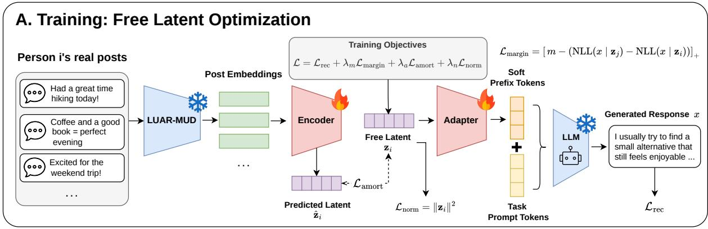
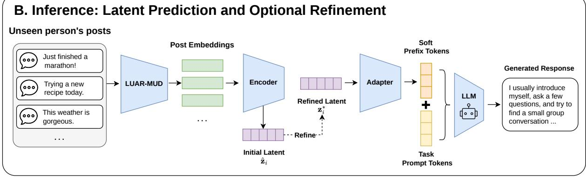
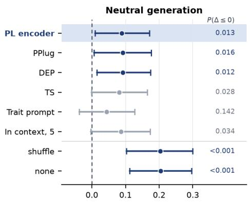
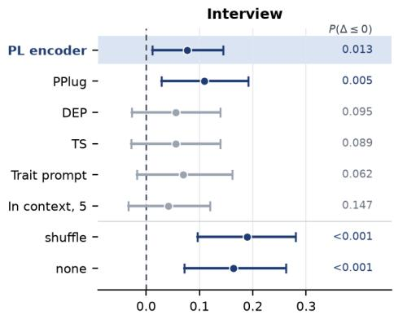
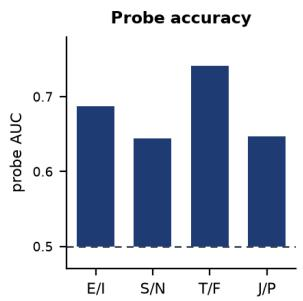
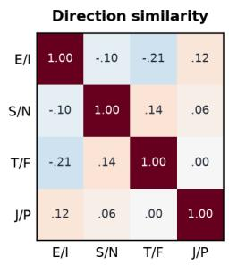
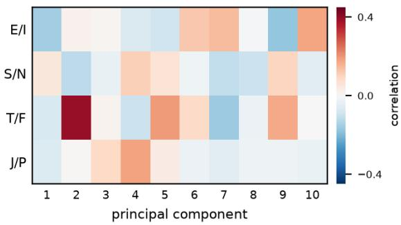

# Personality Latents: Conditioning Frozen Language Models on Individuals from Their Own Writing

Gunhee Cho1, Yun-Gyung Cheong \*1 1 Dept. of AI, Sungkyunkwan University 1 {skate4333, aimecca}@skku.edu

## Abstract

Controlling the personality of a language model usually relies on written profiles or named trait categories, so it can only express what an au thor writes down or what a taxonomy names. We instead propose Personality Latents (PL), which learn a latent for each person from their own writing, with no personality labels and no authored profile, and inject it into a frozen language model as a soft prefix. Following generative latent optimization, each training person receives a free latent that is optimized through the frozen model itself, while an encoder learns to predict these latents so that a new person needs only one forward pass, with optional refinement at test time. We evaluate on 360 held-out people by having the conditioned model answer neutral and interview questions and reading personality from its answers with scorers trained on real human writing. On the MBTI axes PL reaches an AUC of 0.782, ahead of persona embedding and prompt-based baselines under identical settings, and the ranking holds when the answers are scored in three different embedding spaces. A latent learned with Qwen2.5-3B-Instruct also transfers personality to Llama-3.1-8B-Instruct through a new adapter alone.

## 1 Introduction

Controlling the personality of a language model has become a practical requirement. Role playing agents must stay in character, assistants are expected to adapt to the individual they serve, and simulated respondents are used to pilot studies before human data is collected. Each of these needs a stable disposition, and personality is the natural way to specify it because psychology has made it measurable.

Two representative approaches give a model personality. Profile based methods describe a character in text and prompt or fine tune the model on that description (Shao et al., 2023; Wang et al., 2024), so what can be conveyed is limited to what an author wrote and every new character needs its own training run. Trait based methods condition on categories, through dialogue generated under Big Five levels (Li et al., 2025), one model per MBTI type (Cui et al., 2023), or steering along a trait direction (Bhandari et al., 2026). Their resolution is that of the taxonomy, so two people high on extraversion are treated identically and anything the taxonomy does not name cannot be requested.

Persona embedding methods escape both limits by learning a vector from a person’s own behavior and injecting it into a frozen model (Ning et al., 2025; Liu et al., 2025; Qiu et al., 2025), or by moving this conditioning into per user adapters (Tan et al., 2024, 2026). Three properties still stand between them and personality. The person vector is constrained to be the output of an encoder, so the search for a representation is confined to what that encoder can express. The vector is learned together with one target model, which makes it a coordinate in that model’s input space rather than a portable description of the person. And these methods are built for preference prediction and task accuracy on benchmarks such as LaMP, with their authors noting that the embedding captures behavior rather than the way a person writes (Liu et al., 2025) and that evaluation has so far been confined to a single setting (Qiu et al., 2025), so whether such a vector carries personality remains open.

We propose Personality Latents (PL), which learn a personality latent from a person’s own writing, with no labels and no authored profile, and inject it into a frozen backbone LLM. Following generative latent optimization (Bojanowski et al., 2018), each training person receives a free latent optimized jointly with the adapter through the backbone LLM, so the representation is not confined to what an encoder can produce. An encoder trained alongside predicts these latents for unseen people in one forward pass, and the same objective can refine a latent at test time. Because the objective does not tie the latent to one backbone LLM, a single vector can drive several models through their own small adapters. We evaluate by having the conditioned model write and then reading personality from that writing with scorers fitted on real human posts, comparing against the documented personality of people never seen in training.

Our contributions are the following.

• Individual level personality conditioning without labels or profiles. A latent estimated from a person’s writing conditions a frozen backbone LLM on that person rather than a category, with an amortizing encoder for unseen people and optional test time refinement.

• A latent that is not tied to one backbone LLM. The same frozen vector transfers personality through a model never involved in learning it.

• Evaluation against documented personality. We read personality from what the conditioned model writes using scorers fitted on real human posts, compare against documented MBTI and Big Five labels for held out people, and benchmark persona embedding and prompt based methods under identical settings.

## 2 Related Work

## 2.1 Giving a persona to a language model

Profile based methods write the persona down. Character-LLM converts a character’s profile into experiences and trains an agent on them (Shao et al., 2023), and RoleLLM builds role profiles for a hundred characters and tunes models to speak in their style (Wang et al., 2024). Because the description is authored, only what the author thought to record can be conveyed, and the tuned variants need a separate training run for each character.

Trait based methods condition on categories drawn from a psychological taxonomy. Big5-Chat generates dialogue under Big Five trait levels and trains on it (Li et al., 2025), while Machine Mindset fine tunes one model per MBTI type through supervised tuning followed by preference optimization (Cui et al., 2023). A related line edits the model’s internal state instead of its weights, building a direction in activation space from contrastive prompts and adding it during decoding to raise or lower a named trait (Bhandari et al., 2026). All of these take a label as the unit of control, so the conditioning is as fine grained as the taxonomy and no finer. Our target is a particular individual rather than a category, and no trait is named at any point.

## 2.2 Persona embeddings

Persona embedding methods represent the person as a vector learned from their own behavior and inject it into a frozen model. USER-LLM pretrains a user encoder on interaction histories and contextualizes the model through cross attention (Ning et al., 2025). Persona-Plug aggregates a user’s history with weights that depend on the current input, so the user vector changes from query to query (Liu et al., 2025). DEP codes a user relative to peers who engaged with similar content and compresses the result with a sparse autoencoder before injection (Qiu et al., 2025). Others move the conditioning into parameters, training an adapter per user (Tan et al., 2024) or generating adapter weights from a profile with a hypernetwork (Tan et al., 2026). Unlike these methods, our latent is a free parameter optimized through the LLM rather than an encoder output, is shared across LLMs through separate adapters, and is evaluated on personality rather than on preference prediction.

## 3 Method

We want a single low-dimensional vector that carries a person’s personality and, when injected into afrozen language model, makes that model answer as that person would. Let P denote a set of people, and let $X _ { i } = \{ x _ { i 1 } , \dots , x _ { i K _ { i } } \}$ be the posts written by person i. We seek a latent $\mathbf { z } _ { i } \in \mathbb { R } ^ { d }$ and a light conditioning module such that the frozen LLM, conditioned on $\mathbf { z } _ { i } .$ , reproduces person i’s personality. We call $\mathbf { z } _ { i }$ the personality latent of person i, and refer to the resulting method as Personality Latents (PL). No personality labels are used at any point during training; the only supervision is the person’s own text.

## 3.1 Conditioning a Frozen LLM

The latent is injected as a soft prefix. An adapter $g _ { \theta } : \mathbb { R } ^ { d }  \mathbb { R } ^ { \bar { P } \times d _ { \mathrm { m o d e l } } }$ maps z to $P$ vectors in the LLM’s input-embedding space,

$$
g _ { \theta } ( \mathbf { z } ) = \mathrm { r e s h a p e } \big ( W _ { 2 } \sigma ( \mathrm { L N } ( W _ { 1 } \mathbf { z } ) ) \big ) ,\tag{1}
$$

  
Figure 1: Overview of the proposed framework. During training, a free person-specific latent is optimized through a frozen LLM, while an amortizing encoder learns to predict it from the person’s posts. The latent is converted into soft prefix tokens by an adapter. For an unseen person, the encoder prediction is used directly or optionally refined at test time before generation.

with $\sigma \mathrm { ~ a ~ }$ GELU nonlinearity and LN layer normalization. These P vectors are concatenated in front of the token embeddings of the prompt, and the LLM runs on the concatenated sequence:

$$
\mathbf { H } = { \big [ } g _ { \theta } ( \mathbf { z } ) \ ; \ E ( \mathbf { t } ) { \big ] } , \qquad p ( y \mid \mathbf { t } , \mathbf { z } ) = \mathrm { L M } ( \mathbf { H } ) ,\tag{2}
$$

where E is the LLM’s frozen embedding table and t the prompt tokens under the model’s chat template. The LLM’s parameters are never updated. The only trainable parts are the adapter, the encoder of §3.3, and the latents themselves.

## 3.2 Latents as free parameters

The usual choice is an autoencoder, in which a parametric encoder produces $\mathbf { z } _ { i } = f _ { \phi } ( X _ { i } )$ and the LLM reconstructs the person’s text.

This setup mixes two possible failure modes. If the resulting conditioning is weak, it is unclear whether the latent space itself cannot represent the person or whether the encoder fails to find the right point in that space.

In preliminary experiments this distinction mattered. A learned encoder did not outperform a PCA projection of the same inputs at matched dimensionality. Changing the encoder architecture did not remove this gap.

We therefore use Generative Latent Optimization (Bojanowski et al., 2018). Each training person is assigned a latent vector that is treated as a free parameter, initialized from $\mathcal { N } ( 0 , \sigma _ { 0 } ^ { 2 } I )$ , where $\sigma _ { 0 }$ controls the initialization scale and I is the d $\times d$ identity matrix, and then updated by gradient descent like any other model parameter. Training jointly optimizes $\{ \mathbf { z } _ { i } \} _ { i \in \mathcal { P } }$ and θ.

Because the latent of a training person is optimized directly rather than produced by a network, it is not restricted by the encoder. For these people the model can reach any solution available to the encoder and potentially others as well, so the encoder no longer confounds the question of whether the latent space can represent a person. For people unseen in training no free latent exists, and we return to the encoder, whose prediction can then be refined at test time (§3.4).

Reconstruction. The primary signal is the likelihood of the person’s own posts under the conditioned LLM, written in the same chat format used at inference, so that training and inference see the

same prefix position:

$$
\begin{array} { r } { \mathcal { L } _ { \mathrm { r e c } } = \mathbb { E } _ { x \sim X _ { i } } \big [ - \log p ( x \mid \mathbf { t } , \mathbf { z } _ { i } ) \big ] . } \end{array}\tag{3}
$$

Margin. Reconstruction alone admits a degenerate solution in which the adapter learns one generic prefix and ignores z. We require that a person’s own latent explain their text better than another person’s latent by a margin m:

$$
\begin{array} { r } { \mathcal { L } _ { \mathrm { m a r g i n } } = \left[ m - \mathrm { N L L } ( \boldsymbol { x } \mid \mathbf { z } _ { j } ) \right. \phantom { x x x x x x x x x x x x x x x x x x x x x x x x x x x x } } \\ { \left. + \mathrm { N L L } ( \boldsymbol { x } \mid \mathbf { z } _ { i } ) \right] _ { + } , \quad j \neq i . } \end{array}\tag{4}
$$

where $[ \cdot ] _ { + }$ is the hinge and $j$ is drawn from the same batch.

Norm control. Free latents are otherwise unconstrained and drift away from the region of the space on which the adapter was trained, which lowers likelihood while degrading generation. We therefore add $\mathcal { L } _ { \mathrm { n o r m } } = \| \mathbf { z } _ { i } \| ^ { 2 }$

## 3.3 Amortization: retaining an encoder

Free latents exist only for people seen in training. To generalize we train, in the same loop, a permutation-invariant set encoder $f _ { \phi }$ that predicts the free latent from the person’s posts. Each post is embedded by a frozen authorship encoder (Rivera-Soto et al., 2021), and the resulting set is pooled with learned queries:

$$
\begin{array} { r l } & { f _ { \phi } ( X _ { i } ) = W _ { o } \mathrm { P o o l } _ { \phi } \big ( \{ \mathrm { E n c } ( x _ { i k } ) \} _ { k = 1 } ^ { K } \big ) , } \\ & { \mathcal { L } _ { \mathrm { a m o r t } } = \big \| f _ { \phi } ( X _ { i } ) - \mathrm { s g } [ \mathbf { z } _ { i } ] \big \| ^ { 2 } . } \end{array}\tag{5}
$$

where $\mathrm { s g } [ \cdot ]$ is a stop-gradient, so amortization chases the latents without distorting them. Pooling is order-invariant, so the encoder is unaffected by the order in which a person’s posts arrive.

The full training objective is

$$
\begin{array} { r } { \mathcal { L } = \mathcal { L } _ { \mathrm { r e c } } + \lambda _ { m } \mathcal { L } _ { \mathrm { m a r g i n } } + \lambda _ { a } \mathcal { L } _ { \mathrm { a m o r t } } + \lambda _ { n } \mathcal { L } _ { \mathrm { n o r m } } , } \end{array}\tag{6}
$$

minimized over $\left\{ \mathbf { z } _ { i } \right\}$ , θ and ϕ. Two optimizers are used: one for θ, ϕ and one, with a larger step size, for the free latents.

## 3.4 Inference by optimization

For an unseen person the encoder gives a prediction, but nothing forces that prediction to be the best point in the space. Since the adapter and the LLM are fixed at test time, we can continue the same objective and optimize only the d coordinates of the latent:

$$
\begin{array} { r l } & { \mathbf { z } _ { i } ^ { \star } = \underset { \mathbf { z } } { \arg \operatorname* { m i n } } - \mathbb { E } _ { \boldsymbol { x } \sim X _ { i } } [ \log p ( \boldsymbol { x } \mid \mathbf { t } , \mathbf { z } ) ] + \lambda _ { n } \| \mathbf { z } \| ^ { 2 } , } \\ & { \mathbf { z } ^ { ( 0 ) } = f _ { \phi } ( X _ { i } ) . } \end{array}\tag{7}
$$

This is a one-time cost per person: d parameters for a few dozen gradient steps, after which the latent is stored and reused for every subsequent generation. The encoder prediction remains available when no such cost is acceptable, so the method offers two operating points without retraining, and the gap between $f _ { \phi } ( X _ { i } )$ and $\mathbf { z } _ { i } ^ { \star }$ measures what amortization gives up.

## 3.5 LLM-independent latents

Nothing in the objective ties z to one LLM. When several LLMs are available we keep a single latent per person and give each LLM its own adapter $g _ { \theta ^ { ( m ) } }$ , selecting one LLM per step:

$$
\begin{array} { r } { \mathcal { L } _ { \mathrm { r e c } } ^ { ( m ) } = \mathbb { E } _ { x \sim X _ { i } } \big [ - \log p ^ { ( m ) } ( x \mid \mathbf { t } , \mathbf { z } _ { i } ) \big ] , } \end{array}\tag{8}
$$

where m is drawn uniformly from $\{ 1 , \ldots , M \}$ at each step. The latent is then a shared coordinate that each adapter translates into its own model’s input space, which lets the same personality vector drive LLMs of different families and sizes.

## 4 Experimental Setup

## 4.1 Data

We train on corpora of person level writing and evaluate against personality that was documented independently of us. Kaggle MBTI provides 8,608 people with four MBTI axes taken from self reported forum flair, Essays (Pennebaker and King, 1999) provides 2,081 people with binary Big Five labels from a questionnaire, and PANDORA (Gjurkovic´ et al., 2021) provides 1,178 people with continuous Big Five scores from posted test results. People are split 80/10/10 by a hash of the person identifier, which for PANDORA is the trait tuple described below, so no individual appears in more than one split, and labels are never used during training. Each person keeps between 8 and 64 posts of at least 80 characters, and the single long document of each Essays author is segmented at sentence boundaries into units of at most 320 characters.

MBTI labels in the Kaggle corpus are encoded as a four bit integer. Decoding each bit to its axis reproduces the known type distribution of that corpus, with 1,819 INFP, 1,462 INFJ and 1,297 INTP. Training uses PANDORA through a public mirror that keeps the text and the trait scores but drops all author identifiers, so we group posts by their trait tuple, which is unique for every person in that corpus, and use this tuple as the person identifier both for grouping and for the split.

## 4.2 Model and training

Each post is first turned into a 512 dimensional vector by a frozen LUAR-MUD encoder (Rivera-Soto et al., 2021). The set encoder then summarizes up to 32 of these post vectors into a single prediction of the person’s latent. It does so with attention, using four learned queries that each attend over all posts, followed by a hidden layer of size 512. Each latent has d = 128 dimensions. Text is generated by a Qwen2.5-3B-Instruct LLM, which stays frozen throughout. To condition it on a person, the adapter maps the latent to P = 24 soft prefix vectors that are placed in front of the prompt, where they act like a system prompt written in vectors rather than words.

Training runs for 30,000 steps. Each step samples 16 people and 2 of their texts per person as reconstruction targets, truncated to 160 tokens. The adapter and encoder are updated with AdamW at a learning rate of $3 \times 1 0 ^ { - 4 }$ under a one cycle schedule. The free latents are updated separately with Adam at a larger learning rate of 10−2, since each latent receives a gradient only when its person is sampled. The loss weights are $\lambda _ { m } = \lambda _ { a } = 1$ and $\lambda _ { n } = 1 0 ^ { - 2 }$ , and the margin is $m = 0 . 1 5$

Training takes about 17 hours on a single 48 GB GPU. Because every step draws new people and new prompts, the training loss fluctuates and does not clearly show convergence. We therefore also track the loss on a fixed held out batch.

Test time refinement, described in §3.4, starts from the encoder’s prediction for a new person and improves it by gradient descent on that person’s own posts. We run 60 Adam steps at a learning rate of $5 \times 1 0 ^ { - 2 }$ , using four of the person’s posts per step and the same norm penalty as in training. This takes about 30 seconds per person on one GPU and is done once, after which the refined latent is stored and reused.

## 4.3 Evaluation protocols

All evaluations use the same LLM and the same held out people, 120 from each corpus and 360 in total. None of these people appear in training.

Behavioral protocols. These protocols ask whether a person’s personality shows up in what the conditioned model writes. They proceed in three steps.

First, we build a scorer that reads personality from text. It takes the average embedding of a person’s posts and predicts their label, using scikitlearn logistic regression for binary labels and ridge regression for continuous ones with default settings. The scorer is trained only on real posts written by people in the training split, so it learns what personality looks like in human writing and never sees text produced by any model.

Second, we inject a held out person’s latent and ask the model questions. We use two question sets. The eight neutral prompts describe an everyday situation without mentioning personality, such as a plan the person was looking forward to being cancelled at the last minute. The twelve interview questions are designed to reveal a specific trait through a concrete situation without naming it, such as what the person does in the first ten minutes at a party where they know only one person. Each answer is limited to 120 new tokens and sampled with temperature 0.9 and nucleus sampling at $p = 0 . 9 5$

Third, we average the embeddings of the model’s answers, apply the scorer, and check across people whether the predicted personality matches the person’s documented one. We repeat all three steps in two further embedding spaces, RoBERTa-large and all-MiniLM-L6-v2, fitting a new scorer in each.

Latent space analysis. This analysis looks at the latents directly, without generating any text. For held out people, we train a linear probe to predict each trait label from the latent, using five fold cross validation. The weight vector of each probe gives the direction in latent space that corresponds to that trait. We also compute the first ten principal components of the latents and test whether any of them correlates with a trait label, controlling the false discovery rate (Benjamini and Hochberg, 1995) at 0.05 across all component and label pairs. These probes are used only for this analysis and not for any protocol above.

## 4.4 Baselines

All baselines use the same frozen LLM, the same people, the same prompts and the same scoring. The only thing that changes is how the person is represented to the model. We compare against three kinds of methods.

Persona embeddings. These methods, like ours, turn a person into a vector and inject it as a soft prefix. PPlug (Liu et al., 2025) combines the person’s posts with weights that depend on the current question, so the vector changes from question to question. DEP (Qiu et al., 2025) represents the person by how they differ from similar people and compresses this difference with a sparse autoencoder that keeps only the k strongest features. To make the comparison fair, both use the same LUAR post embeddings as our method and the same training budget of 30,000 steps, latent size d = 128, 24 prefix tokens, and the same reconstruction and margin losses. Any difference in results therefore comes from how the person vector is built. Because the original papers use different tasks and models, we reimplemented both methods in our setting rather than reproducing their reported numbers.

Text prompts. These methods describe the person to the model in words. TS (Ning et al., 2025) asks the LLM to summarize ten of the person’s posts into a short description, which is then used as the system prompt. Trait prompting follows Big5-Chat and Machine Mindset (Li et al., 2025; Cui et al., 2023) and states the person’s traits in the prompt, using the traits predicted by the same scorers we use for evaluation. In context places five of the person’s own posts directly in the prompt.

Controls. Two controls show what happens without real information about the person. SHUFFLE injects the latent of a different, randomly chosen person. The model is still conditioned, but on the wrong person, so any score above this level must come from matching the right person. NONE uses no conditioning at all. A method that gives the same answer for everyone scores exactly 0.5 on balanced accuracy and AUC.

## 4.5 Metrics and statistics

For binary labels such as MBTI axes we report ROC AUC and balanced accuracy, which averages the accuracy on each class. We avoid plain accuracy because the labels are unbalanced. In the MBTI corpus, for example, most people are introverts, so a method that predicts introvert for everyone would already look accurate. For continuous Big Five scores we report the Pearson correlation r between predicted and documented scores.

All comparisons are paired, meaning every method is evaluated on the same people with the same prompts and scorers. To measure uncertainty we use a bootstrap over people. We draw 2,000 resampled sets of people, using the same resampled sets for every method, and recompute each score on every set. From these we report 95% confidence intervals and $P ( \Delta \leq 0 )$ , the fraction of resamples in which our method does not outperform the baseline. A small value means our advantage is unlikely to be a result of which people happened to be sampled.

<table><tr><td>Type</td><td>Method</td><td>MBTI AUC</td><td>Essays AUĆ</td><td>PANDORA r</td></tr><tr><td colspan="5">Neutral generation</td></tr><tr><td>PL(Ours)</td><td>Refined z Encoder z</td><td>0.754 0.649</td><td>0.563 0.579</td><td>0.135 0.204</td></tr><tr><td>Embedding</td><td>PPlug DEP</td><td>0.661 0.634</td><td>0.561 0.564</td><td>0.203 0.179</td></tr><tr><td>Prompt</td><td>Trait prompt TS In context</td><td>0.651 0.620 0.592</td><td>0.601 0.545 0.560</td><td>0.054 0.077 0.084</td></tr><tr><td>Control</td><td>SHUFFLE NONE</td><td>0.499 0.528</td><td>0.473 0.534</td><td>0.032 0.040</td></tr><tr><td>Interview</td><td></td><td></td><td></td><td></td></tr><tr><td>PL(Ours)</td><td>Refined z Encoder z</td><td>0.782 0.729</td><td>0.588 0.573</td><td>0.164 0.143</td></tr><tr><td>Embedding</td><td>PPlug DEP</td><td>0.632 0.643</td><td>0.589 0.595</td><td>0.208 0.156</td></tr><tr><td>Prompt</td><td>Trait prompt TS In context</td><td>0.655 0.578 0.656</td><td>0.526 0.532 0.567</td><td>0.079 0.118 0.104</td></tr><tr><td>Control</td><td>SHUFFLE NONE</td><td>0.468 0.556</td><td>0.513 0.487</td><td>0.034 -0.006</td></tr></table>

Table 1: Personality read from generated text by scorers trained on real human posts in the LUAR feature space, for 360 held out people. Best is in bold and second best is underlined. Embedding baselines are PPlug (Liu et al., 2025) and DEP (Qiu et al., 2025). Prompt baselines are trait prompting in the manner of Big5-Chat (Li et al., 2025), TS (Ning et al., 2025) and five of the person’s posts in context.

## 5 Results

We test whether personality appears in what the conditioned model writes (§5.1), whether a latent learned with one LLM can be read by another (§5.2), and where personality resides in the latent space (§5.3).

## 5.1 Personality expressed in behavior

Table 1 shows how well each method transfers personality into what the model writes. On the MBTI axes our refined latents score highest under both kinds of questions, reaching an AUC of 0.754 on neutral prompts and 0.782 on interviews. On Essays and PANDORA the differences between methods are small and no method leads consistently. Our latents nonetheless remain competitive: one of our two variants ranks among the top three in every column, and on PANDORA the embedding-based methods, ours included, reach higher correlations than every prompt-based method under both question sets. The signal is weak overall, however, with Essays AUCs below 0.61 and PANDORA correlations below 0.21.

The ranking does not depend on the scoring encoder. Our latents are built from LUAR, an encoder that captures writing style. If we also score the answers with LUAR, a method could look good simply by copying the person’s style. To check this, we score the same answers with two encoders that have nothing to do with authorship, RoBERTalarge and MiniLM, training a new scorer in each, as shown in Table 2. The numbers change, and LUAR does make our scores look somewhat higher, but our method stays first in every space. Figure 2 checks whether these gaps could be due to chance, using the scores from RoBERTa-large, where our margin is smallest. Our advantage over PPlug is significant on both question sets, and our advantage over DEP is significant on neutral prompts.

Test time refinement adds most of the gain. Our method has two modes. The encoder predicts a latent in one step, and test time refinement then improves it on the person’s own posts. With the encoder alone, our MBTI AUC is 0.649 on neutral prompts, close to the best baselines, and 0.729 on interviews. Refining each latent for sixty steps raises these to 0.754 and 0.782. Under RoBERTalarge scoring this improvement is significant on both question sets, at +0.075 with $P = 0 . 0 1 3$ . Refinement also changes the latent noticeably, leaving a cosine similarity of only 0.635 to the encoder’s prediction. This shows that the encoder does not reach the best latent for each person, and that the remaining gap can be closed cheaply at test time.

## 5.2 One latent, Several LLMs

Our objective does not tie a latent to the LLM it was trained with. To test this, we keep the latents and the encoder trained with Qwen2.5-3B-Instruct fixed and train only a new adapter for Llama-3.1- 8B-Instruct, for 12,000 steps with 12 people per step under the reconstruction and margin losses.

<table><tr><td>Type</td><td>Method</td><td>LUAR</td><td>RoBERTa</td><td>MiniLM</td></tr><tr><td colspan="5">Neutral generation</td></tr><tr><td>PL(Ours)</td><td>Refined z Encoder z</td><td>0.754 0.649</td><td>0.686 0.597</td><td>0.792 0.638</td></tr><tr><td>Embedding</td><td>PPlug DEP</td><td>0.661 0.634</td><td>0.594 0.595</td><td>0.656</td></tr><tr><td></td><td>Trait prompt</td><td>0.651</td><td>0.642</td><td>0.587 0.630</td></tr><tr><td>Prompt</td><td>TS In context</td><td>0.620 0.592</td><td>0.607 0.601</td><td>0.620 0.623</td></tr><tr><td>Control</td><td>NONE</td><td>0.528</td><td>0.483</td><td>0.464</td></tr><tr><td colspan="5">Interview</td></tr><tr><td>PL(Ours)</td><td>Refined z Encoder z</td><td>0.782 0.729</td><td>0.686 0.611</td><td>0.790 0.724</td></tr><tr><td>Embedding</td><td>PPlug DEP</td><td>0.632</td><td>0.577 0.632</td><td>0.682</td></tr><tr><td></td><td>Trait prompt</td><td>0.643 0.655</td><td>0.617</td><td>0.650 0.651</td></tr><tr><td>Prompt</td><td>TS In context</td><td>0.578 0.656</td><td>0.632</td><td>0.622</td></tr><tr><td></td><td></td><td></td><td>0.645</td><td>0.655</td></tr><tr><td>Control</td><td>NONE</td><td>0.556</td><td>0.523</td><td>0.474</td></tr></table>

Table 2: MBTI AUC for the same generations scored by three independent encoders, LUAR, RoBERTa-large and all-MiniLM-L6-v2. Scorers are refitted on real human posts within the space of each encoder. Best is in bold and second best is underlined.
<table><tr><td>MBTI AUC</td><td>PL(Ours)</td><td>SHUFFLE</td><td>NONE</td></tr><tr><td>E/I</td><td>0.529</td><td>0.580</td><td>0.444</td></tr><tr><td>S/N</td><td>0.632</td><td>0.452</td><td>0.415</td></tr><tr><td>T/F</td><td>0.642</td><td>0.509</td><td>0.412</td></tr><tr><td>J/P</td><td>0.565</td><td>0.429</td><td>0.532</td></tr><tr><td>Mean</td><td>0.592</td><td>0.492</td><td>0.451</td></tr></table>

Table 3: Llama-3.1-8B-Instruct reading latents it never helped to shape, on 120 held out MBTI people. The latents and the encoder are those trained with Qwen2.5- 3B-Instruct, and only the adapter is new.

No gradient reaches the latents, so Llama takes no part in shaping them.

Personality still transfers. On held out MBTI people, Llama conditioned on the right person’s latent reaches an AUC of 0.592. With another person’s latent it reaches 0.492, and with no conditioning 0.451. Both gaps are significant. The gain over SHUFFLE is +0.100, with a 95% interval of [+0.002, +0.198] and P = 0.022, and the gain over NONE is +0.141, with an interval of $\left[ + 0 . 0 4 8 , + 0 . 2 3 3 \right]$ and $P = 0 . 0 0 4$

The gain is smaller than with Qwen, which is expected because the latents were shaped only by Qwen. Still, a model of a different family and size can read the same latent through nothing more than a small new adapter.

  
∆ MBTI AUC, PL refined minus method

Figure 2: Paired bootstrap over people with 2,000 resamples, on MBTI AUC under RoBERTa-large scoring.  

  
Figure 3: Linear probes on the latents of held out people. Left: probe AUC for each MBTI axis, with chance at 0.5. Right: cosine similarity between the four trait directions, each taken as the weight vector of its probe.

## 5.3 What the latent space looks like

Since no labels were used in training, we can ask afterwards where personality ended up in the latent space. We first train a simple linear probe to predict each MBTI axis from the latents of held out people. As the left panel of Figure 3 shows, all four axes can be recovered well above chance, with an AUC of 0.741 for thinking versus feeling, 0.687 for extraversion versus introversion, 0.647 for judging versus perceiving and 0.644 for sensing versus intuition. Each probe also gives a direction in the space for its trait. The right panel shows that these four directions are nearly perpendicular to each other, with an average absolute cosine similarity of 0.105 and no pair above 0.21 in magnitude. The traits are therefore stored largely independently of one another.

Personality is, however, not the main thing that separates people in the space. None of the ten leading principal components of the latents correlates significantly with any MBTI axis after Benjamini

Hochberg correction at a false discovery rate of 0.05 (Appendix A), so a trait is a direction that labels can find but not one of the largest differences between people that the latent encodes.

## 6 Conclusion

We presented Personality Latents (PL), a way to condition a frozen language model on a specific individual using only that person’s own writing. Each person is represented by a latent that is optimized directly through the model rather than produced by an encoder, and an encoder trained alongside makes the method usable for people never seen in training.

Three findings stand out. First, personality written in a person’s own text can be carried into what a model writes. PL transfers MBTI axes better than persona embedding and prompt-based baselines, and this holds across three scoring spaces. Second, refining the latent at test time accounts for most of this advantage, which shows that an encoder alone does not find the best representation of a person. Third, the latent is not tied to the model it was trained with, since a different model can read it through a small new adapter.

The latent space itself suggests where to go next. Each MBTI axis corresponds to a direction that a linear probe can find, but these directions are not the main source of variation between people. Making these traits more prominent in the latent, and training one latent jointly with several models, are natural next steps.

## Limitations

Our scorers detect signals in generated text that they associate with a trait, which is not the same as the model holding the person’s personality, and they may partly respond to topic or vocabulary. Repeating the scoring in three embedding spaces reduces but does not remove this concern. Our clearest gains are on MBTI, whose labels come from self reported forum flair and which has weaker psychometric support than the Big Five, while the signal on the Big Five corpora is weak for every method we tested. All main results use one frozen model with three billion parameters, and the cross model experiment covers only one additional model with the latents kept fixed. Test time refinement also requires the person’s own posts and a short optimization run per person.

The method builds a representation of a specific individual and keeps part of their style, so it could be misused to impersonate or profile someone without consent. We do not release latents of real individuals, and any deployment should require the consent of the person being represented.

## References

Yoav Benjamini and Yosef Hochberg. 1995. Controlling the false discovery rate: A practical and powerful approach to multiple testing. Journal of the Royal Statistical Society: Series B (Methodological), 57(1):289–300.

Pranav Bhandari, Nicolas Fay, Sanjeevan Selvaganapathy, Amitava Datta, Usman Naseem, and Mehwish Nasim. 2026. Activation-space personality steering: Hybrid layer selection for stable trait control in LLMs. In Proceedings of the 19th Conference of the European Chapter ofthe Associationfor Computational Linguistics (Volume 1: Long Papers), pages 6388– 6403, Rabat, Morocco. Association for Computational Linguistics.

Piotr Bojanowski, Armand Joulin, David Lopez-Pas, and Arthur Szlam. 2018. Optimizing the latent space of generative networks. In Proceedings of the 35th International Conference on Machine Learning, volume 80 of Proceedings of Machine Learning Research, pages 600–609. PMLR.

Jiaxi Cui, Liuzhenghao Lv, Jing Wen, Rongsheng Wang, Jing Tang, YongHong Tian, and Li Yuan. 2023. Machine mindset: An mbti exploration of large language models. arXiv preprint arXiv:2312.12999.

Matej Gjurkovic, Vanja Mladen Karan, Iva Vukojevi ´ c,´ Mihaela Bošnjak, and Jan Snajder. 2021. PANDORA talks: Personality and demographics on Reddit. In Proceedings of the Ninth International Workshop

on Natural Language Processingfor Social Media, pages 138–152, Online. Association for Computational Linguistics.

Wenkai Li, Jiarui Liu, Andy Liu, Xuhui Zhou, Mona T. Diab, and Maarten Sap. 2025. BIG5-CHAT: Shaping LLM personalities through training on humangrounded data. In Proceedings of the 63rd Annual Meeting of the Association for Computational Linguistics (Volume 1: Long Papers), pages 20434– 20471, Vienna, Austria. Association for Computational Linguistics.

Jiongnan Liu, Yutao Zhu, Shuting Wang, Xiaochi Wei, Erxue Min, Yu Lu, Shuaiqiang Wang, Dawei Yin, and Zhicheng Dou. 2025. LLMs + persona-plug = personalized LLMs. In Proceedings of the 63rd Annual Meeting of the Association for Computational Linguistics (Volume 1: Long Papers), pages 9373–9385, Vienna, Austria. Association for Computational Linguistics.

Lin Ning, Luyang Liu, Jiaxing Wu, Neo Wu, Devora Berlowitz, Sushant Prakash, Bradley Green, Shawn O’Banion, and Jun Xie. 2025. User-llm: Efficient llm contextualization with user embeddings. In Companion Proceedings of the ACM on Web Conference 2025, WWW ’25, page 1219–1223, New York, NY, USA. Association for Computing Machinery.

James W. Pennebaker and Laura A. King. 1999. Linguistic styles: language use as an individual difference. Journal of personality and social psychology, 77 6:1296–312.

Yilun Qiu, Tianhao Shi, Xiaoyan Zhao, Fengbin Zhu, Yang Zhang, and Fuli Feng. 2025. Latent interuser difference modeling for LLM personalization. In Proceedings of the 2025 Conference on Empirical Methods in Natural Language Processing, pages 10599–10617, Suzhou, China. Association for Computational Linguistics.

Rafael A. Rivera-Soto, Olivia Elizabeth Miano, Juanita Ordonez, Barry Y. Chen, Aleem Khan, Marcus Bishop, and Nicholas Andrews. 2021. Learning universal authorship representations. In Proceedings of the 2021 Conference on Empirical Methods in Natural Language Processing, pages 913–919, Online and Punta Cana, Dominican Republic. Association for Computational Linguistics.

Yunfan Shao, Linyang Li, Junqi Dai, and Xipeng Qiu. 2023. Character-LLM: A trainable agent for roleplaying. In Proceedings of the 2023 Conference on Empirical Methods in Natural Language Processing, pages 13153–13187, Singapore. Association for Computational Linguistics.

Zhaoxuan Tan, Qingkai Zeng, Yijun Tian, Zheyuan Liu, Bing Yin, and Meng Jiang. 2024. Democratizing large language models via personalized parameterefficient fine-tuning. In Proceedings of the 2024 Conference on Empirical Methods in Natural Language Processing, pages 6476–6491, Miami, Florida, USA. Association for Computational Linguistics.

Zhaoxuan Tan, Zixuan Zhang, Haoyang Wen, Zheng Li, Rongzhi Zhang, Pei Chen, Fengran Mo, Zheyuan Liu, Qingkai Zeng, Qingyu Yin, and Meng Jiang. 2026. Instant personalized large language model adaptation via hypernetwork. In Proceedings ofthe 64th Annual Meeting of the Association for Computational Linguistics (Volume 1: Long Papers), pages 23557–23580, San Diego, California, United States. Association for Computational Linguistics.

Noah Wang, Z.Y. Peng, Haoran Que, Jiaheng Liu, Wangchunshu Zhou, Yuhan Wu, Hongcheng Guo, Ruitong Gan, Zehao Ni, Jian Yang, Man Zhang, Zhaoxiang Zhang, Wanli Ouyang, Ke Xu, Wenhao Huang, Jie Fu, and Junran Peng. 2024. RoleLLM: Benchmarking, eliciting, and enhancing role-playing abilities of large language models. In Findings of the Associationfor Computational Linguistics: ACL 2024, pages 14743–14777, Bangkok, Thailand. Association for Computational Linguistics.

## A Principal Components of the Latent Space

  
Figure 4: Correlation between the ten leading principal components of the latents and each MBTI axis. No pair survives correction at a false discovery rate of 0.05, and the three leading components carry only 22.6% of the variance.

We computed the ten directions along which the latents of held out people vary most and correlated each with the four MBTI axes. Figure 4 shows these forty correlations. None is significant after Benjamini Hochberg correction at a false discovery rate of 0.05, and the strongest, between the second component and the thinking versus feeling axis, is 0.393. The variance is also spread out, with the top three components explaining only 22.6% of it.