# Prospector: learning a compact graph traversal policy for scientific reasoning

Haiqian Yang, Markus J. Buehler \*

Department of Civil and Environmental Engineering Department of Mechanical Engineering Schwarzman College of Computing Massachusetts Institute of Technology Cambridge, MA, USA

\* Corresponding author: mbuehler@mit.edu

## ABSTRACT

Scientific reasoning in specialized engineering fields depends on knowledge scattered across the literature, often proprietary and absent from frontier LLM training data. In such domains, frontier models tend to give generic answers. Knowledge graphs (KGs) can ground LLM reasoning. Because a graph is too large to provide in full, typical LLM+KG systems preselect a portion, deciding relevance before reasoning begins. Here we train a compact model, Prospector, to reason over a domain knowledge graph by traversing it step by step, seeking evidence in light of what it has already found. Prospector calls a small set of tools one at a time to progressively build its context, and answers with a chain of evidence that can be checked edge by edge against what its tools retrieved from the graph. On a knowledge graph built from the semiconductor-manufacturing literature, Prospector approaches the strongest of-the-shelf models given the same graph and tools, and it far exceeds of-the-shelf models answering closed-book or from a pre-selected portion of the graph. Although trained only on the semiconductor graph, Prospector transfers to unseen knowledge graphs from three other distinct fields: bio-inspired materials, per- and polyfluoroalkyl substances (PFAS) and materials properties. Served on a single GPU, Prospector answers faster and at a fraction of the cost of a hosted service, while keeping proprietary data on the owner’s hardware. We find that the policy’s latent state is indicative of its next move on both seen and unseen graphs, and modulating the latent state can steer the policy from one behavior mode to another. These results suggest a practical LLM + KG paradigm for scientific and engineering reasoning over private data, in which a compact model trained on a graph from published literature transfers its traversal to unseen graphs that stay with their owners.

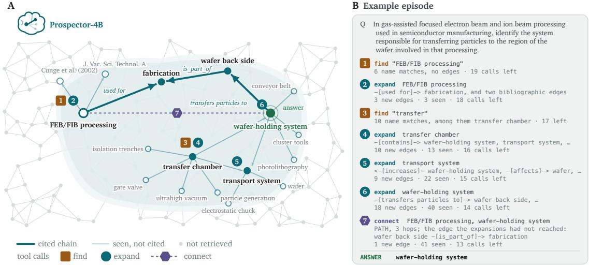  
Figure 1. One episode of Prospector on the semiconductor graph. A, the region of the graph the policy retrieved, one tool call at a time, with the chain of edges its answer cites. Gray nodes and edges stand schematically for the part of the graph the episode never retrieved. B, the same episode as tool calls and the observations they returned. A sampled episode of Prospector-4B on a held-out question, reproduced in full in Appendix B.

## 1 Introduction

Automating scientific reasoning has become a concrete engineering goal, and several groups have reported systems that read and synthesize the literature, propose hypotheses, and run experiments and report the results [1–6]. These systems rest on large language models that internalize knowledge together with reasoning, and ever larger models are trained to serve as both reasoner and encyclopedia [7, 8]. This approach is efective while the knowledge is public. On facts that rarely entered the public domain, an of-the-shelf model often answers from general priors instead [9, 10], so its answer is fluent and plausible but lacks grounding. In semiconductor manufacturing, for example, the process data that would make a model useful stays private to the company that owns it, so it is largely absent from the data of-the-shelf models are trained on [11].

Augmenting a language model in context is an efective way to ground its reasoning, and one popular method is LLM + knowledge graphs, where the graph supplies the detailed evidence the model lacks [12, 13]. An answer to an engineering question rests on a chain of relations among materials, mechanisms and process conditions, and these relations are usually scattered across various sources of proprietary documents. A graph stores each relation as an edge with its source, so the chain an answer rests on can be written down and checked against the graph. Because a chain can join edges extracted from diferent documents, reasoning through the graph can combine evidence spread across sources (Section 3).

A knowledge graph is typically too large for a model to read at once, so a graph reasoning system must choose which part to read. The usual approach selects the evidence before reasoning begins: a fixed procedure links the entities the question names, retrieves what lies around them in the graph as edges, passages or community summaries, and places the result in the prompt [14–17]. The selection is therefore a commitment made before the question has been reasoned about, when least is known about which evidence will matter. When the answer lies several relations away, the entities in between are not necessarily named in the question, which could be easily missed by a selection keyed on the question’s entities. The selection is commonly treated as a fix for the context-length problem [18, 19], but a longer context window enlarges the selection without removing the commitment, and models use long contexts unreliably [20]. In contrast, avoiding the commitment means retrieving evidence from the graph a step at a time, each step conditioned on what the previous steps returned, and existing systems do so by prompting a frozen model at each step [21, 22]. Nevertheless, the choice of what to read next at each step can instead be trained into a model that is presumably much smaller1 and easier to serve in proprietary situations, and training this choice has been demonstrated on curated benchmark graphs such as Freebase and Wikidata [23–29]. While these methods supply components that a working system can build on, such a system has yet to be demonstrated on real scientific and engineering questions, where it needs to reason over graphs extracted from the literature of diferent fields and answer with evidence that can be checked. Moreover, where the data are proprietary, it is also preferable for the system to run on the owner’s hardware, so that neither the questions nor the graph are sent to a third party.

In this work, we report Prospector, a compact language model post-trained into a traversal policy for scientific knowledge graphs extracted from literature (Section 6.5). Traversal is the capability of autonomously choosing what to examine next in light of what the policy has already read. The policy answers by traversing the graph through three tools and asserting a chain of cited edges (Figure 1). We find that

1. Selecting a subgraph before reasoning is costly (Section 3.1). Of-the-shelf models answer most questions incorrectly without the graph. They answer better when handed a pre-selected subgraph built around the entity the question is about, but still lose many correct and supported answers they reach with the traversal tools.

2. The graph-traversal capability is compact (Section 3.1). Our post-trained 4B model comes close to the strongest frontier model, matches the second and exceeds the other six of-the-shelf models we evaluate, given our graph traversal tools.

3. The graph-traversal capability transfers zero-shot to unseen domains (Section 3.4). Our 4B policy trained on the semiconductor graph also approaches the frontier models on three graphs from other fields: bio-inspired materials, per- and polyfluoroalkyl substances (PFAS) and materials properties.

4. Prospector is cheap to serve and can run privately (Section 3.5). Prospector-4B answers faster and at a much lower cost per question than any of the of-the-shelf models driving the same tools. The same model runs on a laptop without a network connection, so questions and graph data can stay entirely on the owner’s machine.

5. The latent state predicts the next move, transfers with the policy and can be steered (Section 3.6). The state from which the policy chooses its next move separates three behaviors: following, backtracking and answering, both on the training graph and on unseen graphs. Modulating the latent state can steer the policy from one behavior mode to another.

## 2 Related work

## 2.1 Large language models with knowledge graphs

Retrieval-augmented generation conditions a language model on evidence retrieved for the query [12, 30]. A graph variant retrieves summaries of entity communities in place of passages [16]. Systems built on scientific graphs often retrieve before generation begins, so the evidence is selected when least is known about which facts the reasoning will need. SAGE-QA retrieves relation paths from the entities a question names and shares them among prompted agents [11], and SciAgents places a path sampled between two concepts in the prompt of a multi-agent pipeline [1]. A second line interleaves retrieval with reasoning, letting a prompted model steer a search over the graph: beam search over relation paths, later extended to documents and to multi-agent retrieval [21, 31, 32], iterative reading of the graph through dedicated interfaces [33], planning with reflection [34], and decoding constrained to well-formed paths [35]. In scientific domains, DeepEvidence and GraphAgents run breadth- and depth-first searches over biomedical and materials graphs [3, 36]. Graph-CoT is the closest of these to our setting: a prompted model reads a graph one function call at a time, each call conditioned on what the previous calls returned [22]. In all of these systems the language model is frozen, and what to read next is set by a fixed search procedure or by a prompt. In contrast, our work trains that choice into the weights of a compact language model (Section 6.5).

## 2.2 Training large language models on knowledge graphs

Language models learn to use tools through supervised fine-tuning [37, 38] and reinforcement learning [39– 41]. Both have been applied to knowledge graphs [23–26, 42]. Rewards add terms for a reference path or for exploration [29, 43], and earlier work without language models also rewarded plausible answers missing from the graph [44]. Graph-PRefLexOR trains a model by preference optimization to write a graph and a symbolic abstraction inside its own reasoning [45]. In general-knowledge question answering, models have been trained to query fixed-schema graphs such as Freebase and Wikidata step by step [25–28]. In this work, the graphs are extracted from scientific literature by a language model [2], with free-text relations and no schema, and Section 3.4 evaluates the trained policy zero-shot on three graphs it was not trained on.

## 2.3 Verifying answers against evidence

Whether a generated claim is supported by its sources is usually judged by human raters [46] or by language models [47–49], and model judges carry biases of their own, such as favoring longer answers [50]. On knowledge graphs, KGARevion has a fine-tuned model review each generated triple against the graph [51], and SAGE-QA, built on the semiconductor graph used here, was scored by LLM judges [11]. Graph structure has also been used to guide which hypotheses are assembled [52]. In this work, support is a set-membership check: every cited edge must have been returned by the tools, and the answer must appear in the cited edges (Figure 3B, Section 6.3.3). The same check is used in the training reward.

## 3 Results

We study question answering over a knowledge graph that a language model extracted from semiconductormanufacturing literature. Prospector answers a question by traversing the graph one tool call at a time, so that each step is conditioned on what the previous calls returned. One of the held-out questions, for example, asks: when center gas flow is adjusted to correct within-die pattern dimension variations, those adjustments can produce process by-products that influence the dimensions; which processing stage is therefore directly implicated as containing those by-products? The question names center gas flow, and answering it requires three edges:

center gas flow --[tuned for]--> CD uniformities

etch by-products --[affects]--> CD uniformities

HAR processing --[contains]--> etch by-products

where each edge of the graph is a directed triple of two entity names and a free-text relation.2 Read as a chain, the edges state that center gas flow is tuned for critical-dimension (CD) uniformity, that etch by-products afect that uniformity, and that high-aspect-ratio processing (HAR) contains those by-products. The answer is therefore HAR processing. The three edges were extracted from three diferent documents, a textbook on atomic layer processing [53], a textbook on dry etching [54] and a review of plasma etching [55]. Asked the same question without the graph, all eight of-the-shelf models we evaluate named a generic etching stage.

## 3.1 A compact policy approaches the strongest frontier models

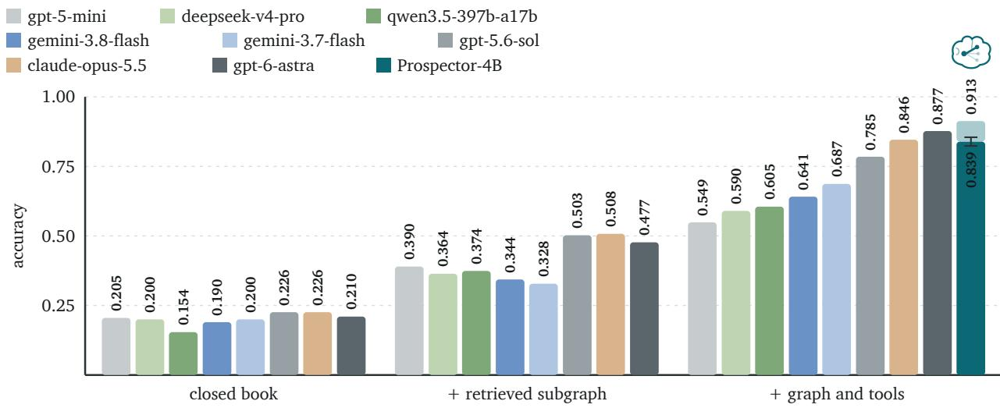  
Figure 2. Tool-driven traversal versus fixed retrieval. Success on 195 held-out items. Each of-theshelf model appears three times: answering closed book, handed a retrieved subgraph fixed before generation around the entity regarding the question, and driving the tools itself. Every model that drives tools uses the same three tools (find, expand, connect). Models are ordered by their accuracy with the tools. The lighter segment on top of Prospector-4B’s bar is its accuracy with the trained verifier (Section 3.3).

We compare Prospector-4B with eight of-the-shelf models: gpt-6-astra, gpt-5.6-sol, gemini-3.7- flash, gemini-3.8-flash, claude-opus-5.5, deepseek-v4-pro, qwen3.5-397b-a17b and the smaller gpt-5-mini, on the same 195 held-out items (Figure 2). Each of-the-shelf model is evaluated under three conditions: closed book, with a subgraph retrieved and given to the model in the prompt before generation, and driving the same three tools as the Prospector policy (Sections 6.4 and 3.2).

Prospector-4B, trained with the recipe of Section 6.5, reaches an accuracy of $0 . 8 3 9 \pm 0 . 0 1 5$ in a single greedy pass, against 0.877 for gpt-6-astra, the strongest frontier model, 0.846 for claude-opus-5.5, and 0.549 to 0.785 for the other six of-the-shelf models. In Section 3.3 we show that sampling and verifier selection raise the accuracy further, to 0.913.

Without the graph, the eight of-the-shelf models score alike: their answer accuracy ranges from 0.154 to 0.226. The diferences in general capability that usually separate these models do not appear on a highly focused domain corpus. A subgraph retrieved before generation helps far less than driving the tools, even when the retrieval is handed the entity the question is about (Section 6.4.2). Retrieval raises gpt-5.6-sol to 0.503 against 0.785 with the tools, and gpt-6-astra to 0.477 against 0.877. Across the eight of-theshelf models the tools add between 0.16 and 0.40 over retrieval, a diference indicating the cost of selecting evidence before the question has been reasoned about.

## 3.2 How the trained policy traverses the graph call by call

The Prospector policy reaches the graph only through three tools, and the graph itself is never fully placed in its context (Figure 3A,B). find locates nodes by name and returns no edges, expand returns the edges of a located node in both directions, and connect returns up to three shortest paths between two located nodes. On each turn the policy writes a short reasoning block and then either calls one tool or gives the final answer, and the result of a call arrives as the next message and is appended in the model’s context. A seen set is formed by all the edges returned by a full episode’s tool calls3. Sections 6.3.1 and 6.3.2 specify the tools and the episode loop, and Appendix B reproduces a complete episode.

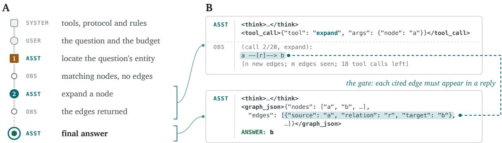

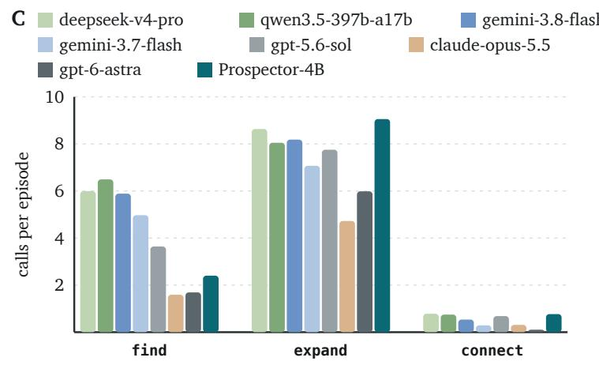  
D

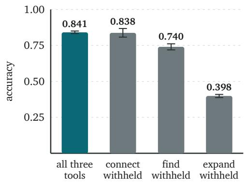  
Figure 3. The messages of an episode, tool calls per episode and the efect of withholding each tool. A, one episode from the system prompt to the final answer, in which a call and its reply repeat up to the budget of 20 calls. B, the two bracketed groups of A enlarged. a, r and b stand for node and relation names, and the dashed line joins a cited edge to the reply that returned it. The system prompt is reproduced in Appendix A. C, calls per episode to each of the three tools. D, accuracy of Prospector-4B when one tool is withheld at evaluation. A withheld tool is removed from the tool list the policy is shown and a call to the withheld tool is refused by the harness. Whiskers are one standard deviation over three runs.

When we analyze the frequency of each type of tool, we find that the trained policy uses the expand tool more often than any other model (Figure 3C). On average, Prospector-4B expands 9.1 times per episode, against 4.7 to 8.6 for the of-the-shelf models, and calls find 2.4 times, within their range of 1.6 to 6.5. It calls connect 0.8 times per episode.

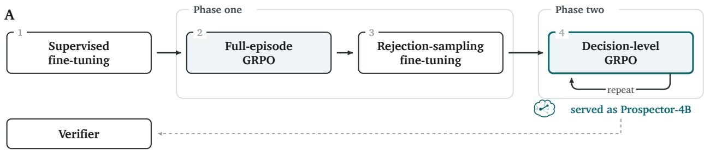

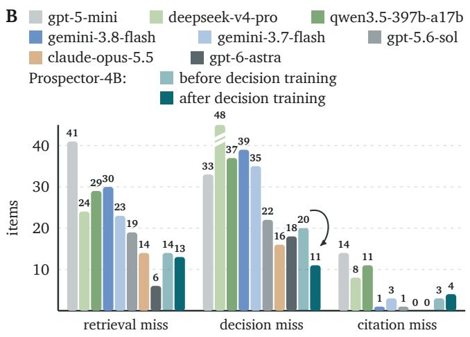  
C

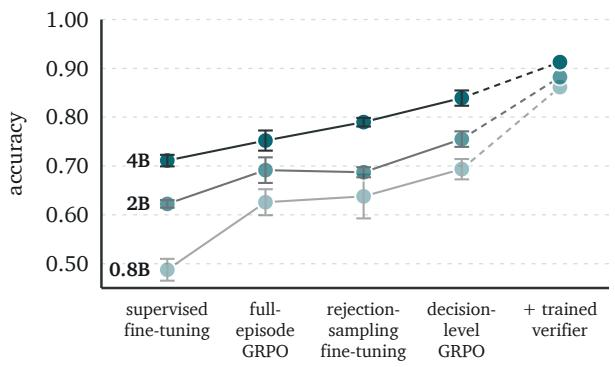  
Figure 4. The training recipe, misses by cause and their recovery by training and by selection. A, the stages of the training recipe in order (Section 6.5). B, the misses of the eight of-the-shelf models of Figure 2, and of the Prospector-4B policy before and after the decision-level rounds, split by cause. C, accuracy of a greedy pass after each stage of A, for the same recipe at three model sizes. The vertical axis starts at 0.45; whiskers are one standard deviation.

Withholding each tool in turn, against a separate set of three runs with all tools available, shows that the policy depends on expand and hardly on connect (Figure 3D). Withholding connect leaves the accuracy almost unchanged, 0.838 against 0.841, and in fact, the policy stops calling connect entirely. Removing find costs 0.101: the policy still attempts to call find in 0.37 of episodes, while those calls are refused by the harness, which sends a prompt back with the list of the remaining tools, and often the policy then substitutes find with expand, which rises from 8.9 to 11.1 calls per episode, retrieving the answer in 0.83 of episodes instead of 0.92. Removing expand reduces gated success to 0.398, which is intuitive since expand is the only tool that enumerates a node’s neighborhood: find returns no edges, and connect requires two nodes that the policy needs to locate before calling it. When expand is removed from the allowed tool list, the policy substitutes as well, calling find 7.8 and connect 6.1 times per episode against 2.5 and 0.7 with all three available, and retrieves the answer in 0.39 of episodes against 0.92.

## 3.3 Choosing the answer among retrieved candidates

In the final answer turn of an episode, choosing among all the candidates in its context is a bottleneck shared by every model evaluated. As an episode ends with an answer turn, the policy asserts one entity and cites the chain of edges as supporting evidence (Figure 3B), while the candidates are all the entities the episode has seen by then. When the final answer is wrong, we classify each failure by the stage that failed (Figure 4B). A retrieval miss never retrieved a correct answer: no episode tool call returned any edge that ever touches the correct answer. A decision miss retrieved the correct answer as a candidate but asserted a diferent entity in the final answer turn. A citation miss hallucinated evidence that does not support the answer, either an edge the episode never saw or a chain that does not contain the entity asserted.4

Table 1. Zero-shot transfer to three unseen graphs. Accuracy on the bio-inspired-materials, PFAS and materials-properties graphs, at the 20-call budget;  spans three runs.
<table><tr><td rowspan="3"></td><td colspan="3">Bio-inspired materials</td><td colspan="3">PFAS</td><td colspan="3">Materials properties</td></tr><tr><td>Tools</td><td>Retrieval</td><td>Closed book</td><td>Tools</td><td>Retrieval</td><td>Closed book</td><td>Tools</td><td>Retrieval</td><td>Closed book</td></tr><tr><td>Prospector-4B</td><td> $0 . 8 0 3 \pm 0 . 0 1 7$ </td><td></td><td></td><td> $0 . 7 6 6 \pm 0 . 0 2 2$ </td><td></td><td></td><td>0.809 ± 0.011</td><td></td><td></td></tr><tr><td>gpt-6-astra</td><td>0.857</td><td>0.681</td><td>0.176</td><td>0.846</td><td>0.294</td><td>0.206</td><td>0.865</td><td>0.435</td><td>0.148</td></tr><tr><td>gemini-3.7-flash</td><td>0.762</td><td>0.519</td><td>0.176</td><td>0.719</td><td>0.254</td><td>0.197</td><td>0.771</td><td>0.336</td><td>0.143</td></tr><tr><td>gemini-3.8-flash</td><td>0.681</td><td>0.543</td><td>0.152</td><td>0.662</td><td>0.254</td><td>0.197</td><td>0.700</td><td>0.372</td><td>0.161</td></tr><tr><td> $\mathtt { g p t - 5 . 6 - s o l }$ </td><td>0.757</td><td>0.700</td><td>0.181</td><td>0.759</td><td>0.329</td><td>0.189</td><td>0.776</td><td>0.475</td><td>0.148</td></tr></table>

Decision misses are the largest class for the 4B policy before the decision-level rounds, 20 of its 37, and the largest for seven of the eight of-the-shelf models; $\mathtt { g p t - 5 - m i n i }$ misses more often in retrieval, 41 items against 33. Across the of-the-shelf models, retrieval misses fall from 41 of gpt-5-mini’s 88 to 6 of gpt-6-astra’s 24, while decision misses stay between 16 and 48. To address the decision failures, we employ a second reinforcement-learning phase that trains the policy from the states where an episode’s outcome is decided (Section 6.5.2), as shown in the second phase of the recipe in Figure 4A. Here the prompts are the policy’s own episodes, cut at the turn where the answer is decided: from each cut state sixteen continuations are sampled and run to the end and only the continuation carries the loss. Because the states are episodes the policy wrote, training on them leaves them stale, and the round is repeated on states rebuilt from the policy it has just produced. The decision-level rounds reduced decision misses from 20 to 11 items (Figure 4B), and raised the single greedy pass accuracy from $0 . 7 9 0 \pm 0 . 0 0 9$ after the first phase (stage 3) to $0 . 8 3 9 \pm 0 . 0 1 5$ after the decision-level rounds, against $0 . 7 1 1 \pm 0 . 0 1 2$ after supervised fine-tuning on the demonstrations (Figure 4C) and $0 . 0 3 9 \pm 0 . 0 0 8$ for the base model driving the same tools.

Nevertheless, when we sample a pool of 32 episodes per item, within the pool the system holds a correct and grounded answer for 192 of the 195 items, which is much better than a single greedy sampling. Therefore, we further train a verifier (Section 6.5.3) to choose the correct candidate from the pool, raising the accuracy further to 0.913, against 0.839 for the single pass and 0.856 for a simple majority vote over the same pool (Figure 4C).

The same recipe applied to post-training Qwen3.5-0.8B and Qwen3.5-2B raises them from 0.487 and 0.622 after supervised fine-tuning to 0.694 and 0.755 after the decision-level rounds, and each size’s own verifier raises them further, to 0.862 and 0.882 (Figure 4C).

## 3.4 The graph-traversal capability transfers zero-shot to unseen domains

To test whether the policy trained on one scientific knowledge graph can generalize to graphs in other domains that it was not trained on, we apply this policy to three separate graphs covering bio-inspired materials, PFAS and materials properties, which were extracted from other literature. With its weights frozen, Prospector-4B zero-shot reaches an accuracy of $0 . 8 0 3 \pm 0 . 0 1 7$ $0 . 7 6 6 \pm 0 . 0 2 2$ and $0 . 8 0 9 \pm 0 . 0 1 1$ on the three graphs (Table 1), second on each to gpt-6-astra at 0.857, 0.846 and 0.865, and ahead of or level with the other three of-the-shelf models: gemini-3.7-flash at 0.762, 0.719 and 0.771, gpt-5.6-sol at 0.757, 0.759 and 0.776, and gemini-3.8-flash at 0.681, 0.662 and 0.700. On these additional graphs the of-the-shelf models score closed-book between 0.143 and 0.206, and a subgraph selected in advance around the question’s entity costs them 0.06 to 0.24 in accuracy on the bio-inspired-materials graph against driving the tools, and 0.30 to 0.55 on the PFAS and materials-properties graphs.

A  
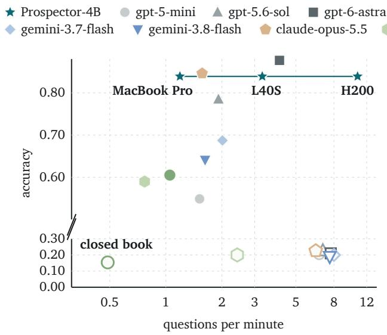

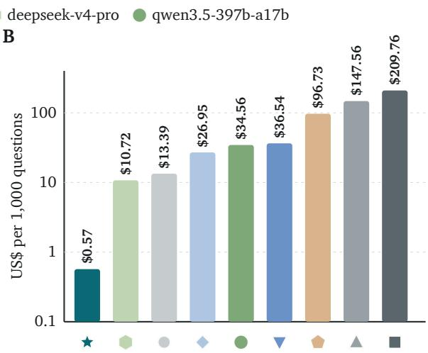  
Figure 5. Cost of one question in time (A) and in money (B). A, accuracy against questions answered per minute with one episode at a time, on a log scale. The vertical axis is broken between 0.30 and 0.50. Hollow markers indicate the closed-book performance. The line joins Prospector-4B served on three machines. B, US dollars per thousand questions for one pass on a log scale, the bars rising from \$0.10, priced from a rented GH200 at \$2.29 per hour for Prospector-4B with the benchmark’s episodes run concurrently. For the of-the-shelf models, prices per million input and output tokens are the providers’ posted rates.

## 3.5 Prospector is cheap to serve and can run privately

Prospector-4B is faster and less expensive to serve than any of the eight of-the-shelf models driving the same tools (Figure 5). We benchmark the speed with one episode at a time with no parallelization. On an H200, the policy answers 10.7 questions per minute, against 4.1 for gpt-6-astra and 0.8 to 2.0 for the other seven; Prospector-4B reaches 3.3 on an L40S, and 1.2 on a MacBook M4 Pro, which runs without a network connection and at a negligible cost per question. Priced on a rented GH200, one pass costs \$0.57 per thousand questions with episodes run concurrently, against \$10.72 for deepseek-v4-pro, \$13.39 for gpt-5-mini, \$26.95 for gemini-3.7-flash, \$34.56 for qwen3.5-397b-a17b, \$36.54 for gemini-3.8-flash, \$96.73 for claude-opus-5.5, \$147.56 for gpt-5.6-sol and \$209.76 for gpt-6-astra through their APIs.

## 3.6 Reading and steering the next move from the policy’s latent state

Next, we ask whether the model has formed a generalizable internal representation of graph traversal across the trained and the unseen graphs. To do so, we analyze the latent state of Prospector-4B at the end of an observation, right before the model outputs the first token of the next turn (Section 6.6). Notably, the internal representation segregates into three distinct clusters: follow, which expands a node on the observation of the last turn, backtrack, which expands a node from an earlier turn or from the question, and answer, which give the final answer (Figure 6A). The three moves separate with network depth: at layer 1 the classes overlap, by layer 8 answering has moved apart, and by layer 20 following and backtracking have separated as well, on the unseen graph as on the training graph. A linear reading of each decision, fitted on the semiconductor graph, predicts the model’s next move on the bio-inspired-materials graph without refitting: at layer 20 it separates answering from continuing with an AUC of 0.99 on both graphs, and following from backtracking with 0.91 on the semiconductor graph and 0.94 on the bio-inspired-materials graph (Figure 6B). These results indicate that the model’s intention for the next move can be read out before the move is made.

Given such a distinct internal representation, we ask whether we can intentionally bias the policy from one behavior mode to the other by modulating its latent state. For example, the trained model follows its chain of evidence at a rate of around 0.55 and backtracks often, and we ask whether it can be made to follow its chain of evidence more confidently and backtrack less. This is achieved by adding to the latent state a vector pointing from the backtrack center to the follow center, which also lowers the mean number of tool calls per episode without a loss of accuracy at a moderate dose. This applies both to the semiconductor graph the policy was trained on and to the unseen bio-inspired-materials graph (Figure 6C); the same trend can also be seen on the PFAS and materials-properties graphs. Furthermore, the same operation along the direction of the answer cluster advances or delays the final answer (Figure 6C). Both operations work on the training graph and on entirely unseen graphs, which indicates that the policy’s internal representation of evidence seeking is general, and that it can be modulated to change its traversal behavior.

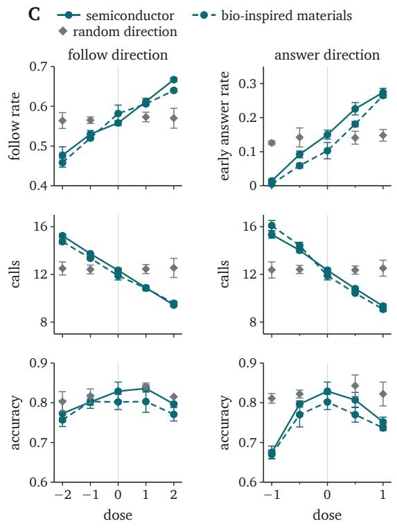

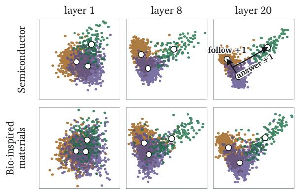

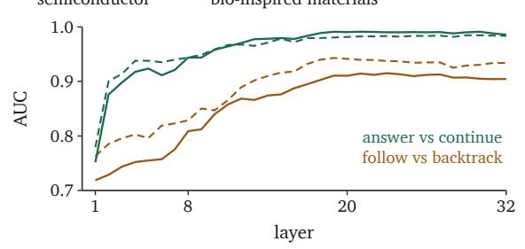  
Figure 6. The next move can be predicted and steered from Prospector-4B’s latent state. A, latent states at the start of a turn, by the move taken next, in the plane that separates the three moves on the semiconductor graph, at three layers; the states of the bio-inspired-materials graph are projected onto the same plane. Arrows mark one dose unit of each direction. B, AUC by layer of a linear reading of each decision fitted on the semiconductor graph, held out on that graph (solid) and applied to the bioinspired-materials graph (dashed). C, the share of the next moves that follow the observation of the last turn, or the share of episodes answered prematurely, tool calls per episode and accuracy against the dose added along the follow direction (left) and the answer direction (right), on the semiconductor (solid) and bio-inspired-materials (dashed) graphs. Gray diamonds indicate a baseline where the policy is steered in a random direction of the same norm (n = 3). Points are means over three runs; whiskers are one standard deviation.

## 4 Discussion

Separation of knowledge from reasoning. Scientific work draws on two capabilities: holding a literature, and knowing how to move through it. Expertise rests mostly on the second. Being a scientist is not about the memorization of textbooks but a practiced way of working, which is why a researcher can enter an unfamiliar field and contribute to it; few experts can recite a paper, and all of them know where to look. A language model keeps both capabilities in one set of weights, and buys the second by scaling the first. The results here suggest the two can be held apart. Closed book, models of very diferent size answer these questions alike and poorly, and it is only once they must search the graph that they separate (Figure 2); our fine-tuned graph-traversal policy is small enough to serve on a laptop, and it carries its search to graphs it has never read (Section 3.4). The latent state is indicative of the policy’s next move, both on the training graph and on a graph it has never read, and modulating the latent state adjusts the traversal behavior mode (Section 3.6). Holding the knowledge and the reasoning apart also means the external knowledge graph can be corrected or extended without retraining the model.

Serving on private data. The transfer results demonstrate that this system can be useful especially when a technical corpus cannot be shared. The policy runs frozen on graphs it was never trained on and reaches reasonable accuracy (Section 3.4), so a private graph can be served by a model that has never read it. Serving then also stays local: Prospector-4B can answer on a laptop without a network connection (Section 3.5), so no question, edge or answer leaves the owner’s machine.

Extension to hypothesis generation. The questions studied here carry an answer set computed from the graph, whereas an open-ended question does not carry such an answer set. Groundedness remains available, since the gate verifies only that the cited edges were retrieved and that verification requires no answer key. An extension to hypothesis generation needs a second criterion: whether a claim deserves an experiment. A language model scoring against a set of explicit rubrics is one possible future direction, on criteria such as mechanistic plausibility, novelty against the literature and experimental cost.

## 5 Conclusion

The knowledge that is critical in a specialized domain is often proprietary and remains with its owner, whether a scientist, a research group or a company. In such domains, the of-the-shelf LLMs tend to provide generic answers that are not useful for technical experts; the useful knowledge lives instead in a large number of technical documents that the owners prefer not to share publicly. In this work, we build Prospector, an LLM policy post-trained to answer scientific questions grounded in the technical corpora. Prospector is a compact policy that traverses through tool calling, on free-text knowledge graphs extracted from scientific literature, prospecting new evidence turn by turn, given what it already found; it approaches the best of frontier models, and much faster and cheaper, at a size that runs on a laptop.

To train the Prospector model, we develop a training method consisting of diferent phases, tackling diferent failure modes of graph traversal, such as a decision-level reinforcement-learning phase that improves the model’s ability to pick the correct, grounded final answer given the full evidence it retrieved in its context. Trained only on a semiconductor manufacturing graph, with frozen weights the system also approaches frontier performance zero-shot on graphs from entirely unseen fields, such as bio-inspired materials, PFAS, and materials properties, showing a general, transferable graph-traversal capability learned through our post-training.

This transferable graph-traversal capability can be further visualized by probing the policy’s latent state, which segregates into distinct clusters indicating the diferent traversal modes, from which its next move could be predicted before the move even takes place; this internal representation of graph traversal carries over to unseen graphs, and can be used to steer the policy from one behavior mode to another. The Prospector system sheds light on a new paradigm of machine intelligence in autonomous, proprietary scientific reasoning.

## 6 Materials and methods

## 6.1 Graph datasets

Four graphs are used in this study. The semiconductor graph, used for all training and for the main evaluation, was built for SAGE-QA [11] by a generative extraction pipeline [2, 56]. bio-graph-1K is extracted from roughly a thousand bio-inspired-materials papers by the same generative extraction pipeline [2] and released with SciAgents [1]. The PFAS and materials-properties graphs were released with GraphAgents [3] and built by the same pipeline.

## 6.2 Benchmarks

To generate the question set, a gold path is first sampled as a self-avoiding walk over domain nodes, excluding hubs and bibliographic nodes. A teacher model then phrases a question that names the start entity and no intermediate node, in the form of a domain exam question, and questions naming any intermediate node are filtered out. The answer set is the set of endpoints reached by the gold relation sequence over the full graph. Items naming the gold answer in the question are filtered out. The procedure yields 195 held-out items on the semiconductor graph, 210 on bio-graph-1K, 228 on the PFAS graph and 223 on the materials-properties graph. Separately, 3,971 training items are generated, and no training item shares a gold path with any evaluation item.

## 6.3 Agent harness

## 6.3.1 Tools

The policy interacts with the graph only through tool calls, and the full graph itself is never placed in the context window. Three tools are provided, and a tool withheld for an ablation is removed from the list the policy is shown and refused on the harness side if it is ever called by the policy. find receives a name and returns the matching node names, each with its type label and degree. expand receives the name of a node the policy has already located and returns the edges linked to that node. connect receives two located nodes and returns up to three shortest paths of at most three hops between them.

## 6.3.2 Episode

At the beginning of each episode, the policy locates the entity named in the question with find and expands outward one tool calling turn at a time. An episode interleaves reasoning and action in the manner of ReAct [57]. On each turn the policy may write a short reasoning block in <think> tags, and then either call exactly one tool, in <tool\_call> tags, or give its final answer. A tool call is always answered by an observation from the harness (the results returned by the tool), which arrives as the next message and begins the following turn. The final answer is a single message carrying the reasoning block, the cited chain in <graph\_json> tags, which is a chain of relations from the start entity to the answer node, and the asserted answer on a line beginning ANSWER:. Figure 3A,B shows the messages of an episode and the blocks of its turns.

## 6.3.3 Gate

The accuracy in this paper is measured as a gated success rate, where the gate scores an answer by set membership: an answer passes the gate only if every edge it cites lies in the episode’s seen set and the answer lies within the cited edges. An answer is correct when it contains a member of the item’s answer set.

## 6.4 Baselines

## 6.4.1 Closed book

The closed-book baseline receives the question alone, with no additional information from the graph or tool calling. This condition measures how much of a graph’s content the model already holds.

## 6.4.2 Retrieved subgraph

The retrieved-subgraph baseline receives a subgraph in the prompt and answers in a single pass. Two selection rules are used, and each graph is given the one whose retrieved edges contain the gold chain more often. Both rules are directly seeded with the entity the question is about, while Prospector would need to first locate that entity itself through find. k-hop orders edges by hop distance from that entity; Personalized PageRank runs a walk that follows an edge with probability 0.85 and otherwise returns to that entity, then scores each edge by the mass on its two endpoints.

## 6.5 Training recipe

Throughout, low-rank adapters are employed to fine-tune the models [58]: the base model’s weights are held fixed and a rank-16 update is trained for each of its attention and feed-forward projections. The policy is trained in the stages of Figure 4A. First, supervised fine-tuning on a frontier model’s demonstrations gives the policy the format and the tool grammar, and then two phases of reinforcement learning follow, the first phase trains the full episode and the second phase trains the decision. In the first phase the round is followed by rejection-sampling fine-tuning, a supervised stage that trains a fresh adapter from the base model on the successful episodes the round produced, so the round’s contribution reaches the second phase as data rather than as weights. Because the second phase’s prompts are episode prefixes the policy itself produced and a changed policy produces diferent ones, it is useful to re-roll the episodes and repeat this phase. The served model is the first phase’s supervised adapter with one adapter for each decision-level round applied, and a final stage trains the verifier that selects among sampled episodes. Sections 6.5.1 to 6.5.3 describe the stages, and Section 6.7 lists the evaluation settings.

## 6.5.1 Supervised fine-tuning

Demonstration episodes are generated by gemini-3.7-flash, driving the same tools through the same harness on training questions. Each training question contributes at most one demonstration: the teacher attempts every question once, and a second attempt is drawn for the questions its first attempt failed. The initial supervised fine-tuning trains the policy on demonstration episodes with a next-token loss. Each turn consists of the reasoning text and the tool call that follows the reasoning, and the tool replies are masked out of the loss. In between the reinforcement learning phases, a rejection-sampling round is applied [59], which trains from a base checkpoint on the episodes sampled from the policy [39, 60–62]. At most two episode per training question are kept, the shortest first, and they are blended with the teacher demonstrations.

## 6.5.2 Reinforcement learning

In the reinforcement-learning stage the policy generates its own episodes and is updated with group-relative policy optimization (GRPO) [39, 63]. Two phases are employed here. They difer in where the group is formed and in which turns carry the loss, and share the rest of the setup. Sixteen rollouts are sampled per group from the current policy and run to the end of the episode, under the same loop, tools and budget as evaluation. Each is scored by the gate: a gated success receives a reward of one, and any other rollou receives a quarter of its gold-path recall, the fraction of the gold path’s edges that its calls returned. A divergence penalty is used to keep the policy near the checkpoint the round starts from. Before each round, the policy is first sampled over the round’s candidates, and only those it solves sometimes but not always are kept for training. The full-episode training starts from the question and every turn carries the loss, whereas the second phase trains only the decision: the group is formed at a decision state and only the continuation carries the loss, as in earlier work that restarts from intermediate states [64–67]. To build the data for the decision phase, four passes are rolled over the training questions, their outcomes are labeled by the classes of Section 3.3, and each episode is cut at the turn where its outcome was decided, in one of two ways. An answer state is cut before the final turn of an episode that had already retrieved a correct answer; an expansion state is cut in an episode that never retrieved the answer, before the turn that followed its first sight of a node one hop from it.

## 6.5.3 Verifier

Sampling a pool of episodes for one question yields a correct and grounded answer far more often than a single pass (Section 3.3), so a final stage trains a model to choose among them [68]. The verifier is a separate yes/no classifier fine-tuned from the policy’s base model. Each candidate is reduced to the question, the answer the episode asserted and the edges it cited. The verifier is asked whether the answer is correct and supported by the cited edges as a connected chain from the question’s subject to the answer, and its score is the margin log $P ( \mathrm { y e s } ) - \log P ( \mathrm { n o } )$ on the reply token, read with two log-probability calls.

## 6.6 Reading and steering the latent state

We record the latent state after each decoder layer at the token that opens a turn, before the policy writes anything of the next turn. We keep the turns that follow an expand reply and label each by the move it makes: a follow expands a node named on that page, a backtrack expands a node named on an earlier page or in the question, and an answer ends the episode. The semiconductor graph contributes 705, 668 and 104 turns of the three classes, and the bio-inspired-materials graph 696, 741 and 135.

Panel A of Figure 6 is the plane of the two Fisher discriminant axes of the three classes, fitted on the semiconductor states; the bio-inspired-materials states are zero-shot projected onto the same plane. Panel B scores two one-dimensional readings fitted the same way at every layer, follow against backtrack and answer against continue (either follow or backtrack), by the area under the ROC curve: held out on the semiconductor graph, and zero-shot on the bio-inspired-materials graph.

The two directions of panel C of Figure 6 are unit vectors in the raw latent space at layer 20 of the semiconductor states: the follow direction points from the backtrack mean to the follow mean, and the answer direction from the mean of the other two moves to the answer mean. A dose adds the unit vector to the output of layer 20, starting from the header token and at every generated token afterwards. The random baseline is a unit vector drawn from a standard normal distribution, added at each direction’s dose unit.

## 6.7 Configuration

Every evaluation uses a budget of 20 tool calls, a cap of 400 seen edges, a repeat cap of three on identical calls, 40 edges per page and a hub threshold of 150. Prospector is served with a 16,384-token context window, the length it was trained at, except on the PFAS graph, where hub summaries are long enough that a 32,768-token window is used (Table 1). Each turn of Prospector is generated with at most 1,024 new tokens, decoded greedily. Prospector-4B is stage 4 of Figure 4A: the rank-16 adapter of stage 3 on Qwen3.5-4B, with the adapters of the two decision-level rounds applied. The of-the-shelf models run at their providers default reasoning efort.

## Use of Generative AI

The authors used Claude Code (Anthropic; Claude Opus 5, Opus 5.5, Fable 5 and Fable 5.1) as a coding assistant in developing the software for this study, including the evaluation harness, the training pipeline and the scripts that draw the figures, and to draft and edit parts of the manuscript text. Every figure is drawn by a script from the study’s recorded data; no figure was made with an image-generation model. The authors designed the study, reviewed the code and text, checked the reported results against the run records, and take full responsibility for the work. The language models evaluated as baselines and teachers are described in Methods.

## Code and Data availability

The Prospector code is available at https://github.com/lamm-mit/Prospector. The semiconductor graph was constructed for SAGE-QA [11], whose code is available at https://github.com/lamm-mit/SAGE-QA. The biomaterial graph data is available at https://huggingface.co/lamm-mit/bio-graph-1K/blob/ main/large\_graph\_simple\_giant.graphml. The PFAS and materials-properties graphs were originally released with GraphAgents [3] at https://github.com/lamm-mit/GraphAgents.

## Competing Interests

The authors declare that they have no competing interests.

## Funding Acknowledgment

This work is supported by Taiwan Semiconductor Manufacturing Company (TSMC). Additional support is provided by MIT’s Generative AI Impact Consortium (MGAIC). We also acknowledge partial compute

support from MIT Ofice of Research Computing and Data (ORCD) and a Thinking Machines Lab research grant. We thank Yu-Chuan Hsu for helpful discussions.

## References

[1] Alireza Ghafarollahi and Markus J. Buehler. SciAgents: Automating scientific discovery through bioinspired multi-agent intelligent graph reasoning. Advanced Materials, 37(22), 2024. doi: 10.1002/adma. 202413523.

[2] Markus J. Buehler. Accelerating scientific discovery with generative knowledge extraction, graph-based representation, and multimodal intelligent graph reasoning. Machine Learning: Science and Technology, 5(3):035083, 2024. doi: 10.1088/2632-2153/ad7228.

[3] Isabella A. Stewart, Tarjei Paule Hage, Yu-Chuan Hsu, and Markus J. Buehler. GraphAgents: Knowledge graph-guided agentic AI for cross-domain materials design, 2026. URL https://arxiv.org/abs/ 2602.07491.

[4] Michael D. Skarlinski, Sam Cox, Jon M. Laurent, James D. Braza, Michaela Hinks, Michael J. Hammerling, Manvitha Ponnapati, Samuel G. Rodriques, and Andrew D. White. Language agents achieve superhuman synthesis of scientific knowledge, 2024. URL https://arxiv.org/abs/2409.13740.

[5] Juraj Gottweis, Wei-Hung Weng, Alexander Daryin, Tao Tu, Petar Sirkovic, Artiom Myaskovsky, Grzegorz Glowaty, Felix Weissenberger, Alessio Orlandi, Dan Popovici, Anil Palepu, Keran Rong, Ryutaro Tanno, Khaled Saab, Fan Zhang, Jacob Blum, Andrew Carroll, Kavita Kulkarni, Nenad Tomašev, Dina Zverinski, Ivor Rendulic, Elahe Vedadi, Florian Hasler, Luka Rimanic, Marina Boia, Ivan Budiselic, Ben Feinstein, Mathias Bellaiche, Tom Shefer, Jan Freyberg, Jeremy Ratclif, Ottavia Bertolli, Katherine Chou, Avinatan Hassidim, Burak Gokturk, Amin Vahdat, Yuan Guan, Vikram Dhillon, Eeshit Dhaval Vaishnav, Byron Lee, Tiago R. D. Costa, José R. Penadés, Gary Peltz, Yossi Matias, James Manyika, Demis Hassabis, Yunhan Xu, Pushmeet Kohli, Annalisa Pawlosky, Alan Karthikesalingam, and Vivek Natarajan. Accelerating scientific discovery with Co-Scientist. Nature, 655(8122): 487–496, 2026. doi: 10.1038/s41586-026-10644-y.

[6] Chris Lu, Cong Lu, Robert Tjarko Lange, Jakob Foerster, Jef Clune, and David Ha. The AI Scientist: Towards fully automated open-ended scientific discovery, 2024. URL https://arxiv.org/abs/2408. 06292.

[7] Fabio Petroni, Tim Rocktäschel, Sebastian Riedel, Patrick Lewis, Anton Bakhtin, Yuxiang Wu, and Alexander Miller. Language models as knowledge bases? In Proceedings of the 2019 Conference on Empirical Methods in Natural Language Processing and the 9th International Joint Conference on Natural Language Processing (EMNLP-IJCNLP), pages 2463–2473, 2019. doi: 10.18653/v1/D19-1250.

[8] Adam Roberts, Colin Rafel, and Noam Shazeer. How much knowledge can you pack into the parameters of a language model? In Proceedings of the 2020 Conference on Empirical Methods in Natural Language Processing (EMNLP), pages 5418–5426, 2020. doi: 10.18653/v1/2020.emnlp-main.437.

[9] Nikhil Kandpal, Haikang Deng, Adam Roberts, Eric Wallace, and Colin Rafel. Large language models struggle to learn long-tail knowledge. In Proceedings of the 40th International Conference on Machine Learning, volume 202 of Proceedings of Machine Learning Research, pages 15696–15707, 2023. URL https://proceedings.mlr.press/v202/kandpal23a.html.

[10] Alex Mallen, Akari Asai, Victor Zhong, Rajarshi Das, Daniel Khashabi, and Hannaneh Hajishirzi. When not to trust language models: Investigating efectiveness of parametric and non-parametric memories. In Proceedings of the 61st Annual Meeting of the Association for Computational Linguistics (Volume 1: Long Papers), pages 9802–9822, 2023. doi: 10.18653/v1/2023.acl-long.546.

[11] Yu-Chuan Hsu and Markus J. Buehler. SAGE-QA: Shared-context agentic graph-enhanced question answering for scientific reasoning. MRS Communications, 2026. doi: 10.1557/s43579-026-01036-4.

[12] Patrick Lewis, Ethan Perez, Aleksandra Piktus, Fabio Petroni, Vladimir Karpukhin, Naman Goyal, Heinrich Küttler, Mike Lewis, Wen-tau Yih, Tim Rocktäschel, Sebastian Riedel, and Douwe Kiela. Retrieval-augmented generation for knowledge-intensive NLP tasks. In Advances in Neural Information Processing Systems, volume 33, pages 9459–9474, 2020. URL https://proceedings.neurips.cc/ paper\_files/paper/2020/file/6b493230205f780e1bc26945df7481e5-Paper.pdf.

[13] Shirui Pan, Linhao Luo, Yufei Wang, Chen Chen, Jiapu Wang, and Xindong Wu. Unifying large language models and knowledge graphs: A roadmap. IEEE Transactions on Knowledge and Data Engineering, 36(7):3580–3599, 2024. doi: 10.1109/tkde.2024.3352100.

[14] Jinheon Baek, Alham Fikri Aji, and Amir Safari. Knowledge-augmented language model prompting for zero-shot knowledge graph question answering. In Proceedings of the 1st Workshop on Natural Language Reasoning and Structured Explanations (NLRSE), pages 78–106, 2023. doi: 10.18653/v1/ 2023.nlrse-1.7.

[15] Xiaoxin He, Yijun Tian, Yifei Sun, Nitesh V. Chawla, Thomas Laurent, Yann LeCun, Xavier Bresson, and Bryan Hooi. G-Retriever: Retrieval-augmented generation for textual graph understanding and question answering. In Advances in Neural Information Processing Systems, volume 37, pages 132876– 132907, 2024. doi: 10.52202/079017-4224.

[16] Darren Edge, Ha Trinh, Newman Cheng, Joshua Bradley, Alex Chao, Apurva Mody, Steven Truitt, Dasha Metropolitansky, Robert Osazuwa Ness, and Jonathan Larson. From local to global: A Graph RAG approach to query-focused summarization, 2025. URL https://arxiv.org/abs/2404.16130.

[17] Bernal Jiménez Gutiérrez, Yiheng Shu, Yu Gu, Michihiro Yasunaga, and Yu Su. HippoRAG: Neurobiologically inspired long-term memory for large language models. In Advances in Neural Information Processing Systems, volume 37, pages 59532–59569, 2024. doi: 10.52202/079017-1902.

[18] Peng Xu, Wei Ping, Xianchao Wu, Lawrence McAfee, Chen Zhu, Zihan Liu, Sandeep Subramanian, Evelina Bakhturina, Mohammad Shoeybi, and Bryan Catanzaro. Retrieval meets long context large language models. In International Conference on Learning Representations, pages 49569–49584, 2024. URL https://proceedings.iclr.cc/paper\_files/paper/2024/file/ d75f29006df67df084e6586f1cb8458c-Paper-Conference.pdf.

[19] Zhuowan Li, Cheng Li, Mingyang Zhang, Qiaozhu Mei, and Michael Bendersky. Retrieval augmented generation or long-context LLMs? A comprehensive study and hybrid approach. In Proceedings of the 2024 Conference on Empirical Methods in Natural Language Processing: Industry Track, pages 881–893, 2024. doi: 10.18653/v1/2024.emnlp-industry.66.

[20] Nelson F. Liu, Kevin Lin, John Hewitt, Ashwin Paranjape, Michele Bevilacqua, Fabio Petroni, and Percy Liang. Lost in the middle: How language models use long contexts. Transactions of the Association for Computational Linguistics, 12:157–173, 2024. doi: 10.1162/tacl\_a\_00638.

[21] Jiashuo Sun, Chengjin Xu, Lumingyuan Tang, Saizhuo Wang, Chen Lin, Yeyun Gong, Lionel Ni, Heung-Yeung Shum, and Jian Guo. Think-on-Graph: Deep and responsible reasoning of large language model on knowledge graph. In International Conference on Learning Representations, pages 3868–3898, 2024. URL https://proceedings.iclr.cc/paper\_files/paper/2024/file/ 10a6bdcabbd5a3d36b760daa295f63c1-Paper-Conference.pdf.

[22] Bowen Jin, Chulin Xie, Jiawei Zhang, Kashob Kumar Roy, Yu Zhang, Zheng Li, Ruirui Li, Xianfeng Tang, Suhang Wang, Yu Meng, and Jiawei Han. Graph Chain-of-Thought: Augmenting large language models by reasoning on graphs. In Findings of the Association for Computational Linguistics: ACL 2024, pages 163–184, 2024. doi: 10.18653/v1/2024.findings-acl.11.

[23] Jinhao Jiang, Kun Zhou, Wayne Xin Zhao, Yang Song, Chen Zhu, Hengshu Zhu, and Ji-Rong Wen. KG-Agent: An eficient autonomous agent framework for complex reasoning over knowledge graph. In Proceedings of the 63rd Annual Meeting of the Association for Computational Linguistics (Volume 1: Long Papers), pages 9505–9523, 2025. doi: 10.18653/v1/2025.acl-long.468.

[24] Joaquin Polonuer, Lucas Vittor, Iñaki Arango, Ayush Noori, David A. Clifton, Luciano Del Corro, and Marinka Zitnik. Autonomous knowledge graph exploration with adaptive breadth-depth retrieval. In Proceedings of the 64th Annual Meeting of the Association for Computational Linguistics (Volume 1: Long Papers), pages 15694–15709, 2026. doi: 10.18653/v1/2026.acl-long.714.

[25] Jia Ao Sun, Hao Yu, Fengran Mo, Zhan Su, Yuchen Hui, Bang Liu, and Jian-Yun Nie. Search-on-Graph-R1: Training large language models to search knowledge graphs with reinforcement learning, 2026. URL https://arxiv.org/abs/2607.18481.

[26] Yanlin Song, Ben Liu, Víctor Gutiérrez-Basulto, Zhiwei Hu, Qianqian Xie, Min Peng, Sophia Ananiadou, and Jef Z. Pan. Plan then retrieve: Reinforcement learning-guided complex reasoning over knowledge graphs. In Proceedings of the ACM Web Conference 2026, pages 3666–3676, 2026. doi: 10.1145/ 3774904.3792191.

[27] Shuai Wang and Yinan Yu. KG-Hopper: Empowering compact open LLMs with knowledge graph reasoning via reinforcement learning, 2026. URL https://arxiv.org/abs/2603.21440.

[28] Shuai Wang and Yinan Yu. KG-Reasoner: A reinforced model for end-to-end multi-hop knowledge graph reasoning, 2026. URL https://arxiv.org/abs/2604.12487.

[29] Shiqi Yan, Yubo Chen, Ruiqi Zhou, Zhengxi Yao, Shuai Chen, Tianyi Zhang, Shijie Zhang, Wei-Qiang Zhang, Yongfeng Huang, Haixin Duan, and Yunqi Zhang. Explore-on-Graph: Incentivizing autonomous exploration of large language models on knowledge graphs with path-refined reward modeling. In International Conference on Learning Representations, pages 56761–56789, 2026. URL https://proceedings.iclr.cc/paper\_files/paper/2026/file/ 5d2e24df9cfaad3189833b819c40b392-Paper-Conference.pdf.

[30] Shirley Wu, Shiyu Zhao, Michihiro Yasunaga, Kexin Huang, Kaidi Cao, Qian Huang, Vassilis N. Ioannidis, Karthik Subbian, James Zou, and Jure Leskovec. STaRK: Benchmarking LLM retrieval on textual and relational knowledge bases. In Advances in Neural Information Processing Systems, volume 37, pages 127129–127153, 2024. doi: 10.52202/079017-4037.

[31] Shengjie Ma, Chengjin Xu, Xuhui Jiang, Muzhi Li, Huaren Qu, Cehao Yang, Jiaxin Mao, and Jian Guo. Think-on-Graph 2.0: Deep and faithful large language model reasoning with knowledgeguided retrieval augmented generation. In International Conference on Learning Representations, pages 52782–52806, 2025. URL https://proceedings.iclr.cc/paper\_files/paper/2025/file/ 830b1abc6d2da85f23d41169fa44d185-Paper-Conference.pdf.

[32] Xiaojun Wu, Cehao Yang, Xueyuan Lin, Chengjin Xu, Xuhui Jiang, Yuanliang Sun, Hui Xiong, Jia Li, and Jian Guo. Think-on-Graph 3.0: Eficient and adaptive LLM reasoning on heterogeneous graphs via multi-agent dual-evolving context retrieval, 2026. URL https://arxiv.org/abs/2509.21710.

[33] Jinhao Jiang, Kun Zhou, Zican Dong, Keming Ye, Xin Zhao, and Ji-Rong Wen. StructGPT: A general framework for large language model to reason over structured data. In Proceedings ofthe 2023 Conference on Empirical Methods in Natural Language Processing, pages 9237–9251, 2023. doi: 10.18653/v1/2023. emnlp-main.574.

[34] Liyi Chen, Panrong Tong, Zhongming Jin, Ying Sun, Jieping Ye, and Hui Xiong. Plan-on-Graph: Self-correcting adaptive planning of large language model on knowledge graphs. In Advances in Neural Information Processing Systems, volume 37, pages 37665–37691, 2024. doi: 10.52202/079017-1189.

[35] Kun Li, Tianhua Zhang, Xixin Wu, Hongyin Luo, James R. Glass, and Helen M. Meng. Decoding on Graphs: Faithful and sound reasoning on knowledge graphs through generation of well-formed chains. In Proceedings of the 63rd Annual Meeting of the Association for Computational Linguistics (Volume 1: Long Papers), pages 24349–24364, 2025. doi: 10.18653/v1/2025.acl-long.1186.

[36] Zifeng Wang, Zheng Chen, Ziwei Yang, Xuan Wang, Qiao Jin, Yifan Peng, Zhiyong Lu, and Jimeng Sun. Empowering biomedical evidence exploration and synthesis with deep knowledge graph research. Nature Machine Intelligence, 8(7):1142–1156, 2026. doi: 10.1038/s42256-026-01266-0.

[37] Reiichiro Nakano, Jacob Hilton, Suchir Balaji, Jef Wu, Long Ouyang, Christina Kim, Christopher Hesse, Shantanu Jain, Vineet Kosaraju, William Saunders, Xu Jiang, Karl Cobbe, Tyna Eloundou, Gretchen Krueger, Kevin Button, Matthew Knight, Benjamin Chess, and John Schulman. WebGPT: Browser-assisted question-answering with human feedback, 2022. URL https://arxiv.org/abs/2112. 09332.

[38] Timo Schick, Jane Dwivedi-Yu, Roberto Dessi, Roberta Raileanu, Maria Lomeli, Eric Hambro, Luke Zettlemoyer, Nicola Cancedda, and Thomas Scialom. Toolformer: Language models can teach themselves to use tools. In Advances in Neural Information Processing Systems, volume 36, pages 68539– 68551, 2023. doi: 10.52202/075280-2997.

[39] Daya Guo, Dejian Yang, Haowei Zhang, Junxiao Song, Peiyi Wang, Qihao Zhu, Runxin Xu, Ruoyu Zhang, Shirong Ma, Xiao Bi, Xiaokang Zhang, Xingkai Yu, Yu Wu, Z. F. Wu, Zhibin Gou, Zhihong Shao, Zhuoshu Li, Ziyi Gao, Aixin Liu, Bing Xue, Bingxuan Wang, Bochao Wu, Bei Feng, Chengda Lu, Chenggang Zhao, Chengqi Deng, Chong Ruan, Damai Dai, Deli Chen, Dongjie Ji, Erhang Li, Fangyun Lin, Fucong Dai, Fuli Luo, Guangbo Hao, Guanting Chen, Guowei Li, H. Zhang, Hanwei Xu, Honghui Ding, Huazuo Gao, Hui Qu, Hui Li, Jianzhong Guo, Jiashi Li, Jingchang Chen, Jingyang Yuan, Jinhao Tu, Junjie Qiu, Junlong Li, J. L. Cai, Jiaqi Ni, Jian Liang, Jin Chen, Kai Dong, Kai Hu, Kaichao You, Kaige Gao, Kang Guan, Kexin Huang, Kuai Yu, Lean Wang, Lecong Zhang, Liang Zhao, Litong Wang, Liyue Zhang, Lei Xu, Leyi Xia, Mingchuan Zhang, Minghua Zhang, Minghui Tang, Mingxu Zhou, Meng Li, Miaojun Wang, Mingming Li, Ning Tian, Panpan Huang, Peng Zhang, Qiancheng Wang, Qinyu Chen, Qiushi Du, Ruiqi Ge, Ruisong Zhang, Ruizhe Pan, Runji Wang, R. J. Chen, R. L. Jin, Ruyi Chen, Shanghao Lu, Shangyan Zhou, Shanhuang Chen, Shengfeng Ye, Shiyu Wang, Shuiping Yu, Shunfeng Zhou, Shuting Pan, S. S. Li, Shuang Zhou, Shaoqing Wu, Tao Yun, Tian Pei, Tianyu Sun, T. Wang, Wangding Zeng, Wen Liu, Wenfeng Liang, Wenjun Gao, Wenqin Yu, Wentao Zhang, W. L. Xiao, Wei An, Xiaodong Liu, Xiaohan Wang, Xiaokang Chen, Xiaotao Nie, Xin Cheng, Xin Liu, Xin Xie, Xingchao Liu, Xinyu Yang, Xinyuan Li, Xuecheng Su, Xuheng Lin, X. Q. Li, Xiangyue Jin, Xiaojin Shen, Xiaosha Chen, Xiaowen Sun, Xiaoxiang Wang, Xinnan Song, Xinyi Zhou, Xianzu Wang, Xinxia Shan, Y. K. Li, Y. Q. Wang, Y. X. Wei, Yang Zhang, Yanhong Xu, Yao Li, Yao Zhao, Yaofeng Sun, Yaohui Wang, Yi Yu, Yichao Zhang, Yifan Shi, Yiliang Xiong, Ying He, Yishi Piao, Yisong Wang, Yixuan Tan, Yiyang Ma, Yiyuan Liu, Yongqiang Guo, Yuan Ou, Yuduan Wang, Yue Gong, Yuheng Zou, Yujia He, Yunfan Xiong, Yuxiang Luo, Yuxiang You, Yuxuan Liu, Yuyang Zhou, Y. X. Zhu, Yanping Huang, Yaohui Li, Yi Zheng, Yuchen Zhu, Yunxian Ma, Ying Tang, Yukun Zha, Yuting Yan, Z. Z. Ren, Zehui Ren, Zhangli Sha, Zhe Fu, Zhean Xu, Zhenda Xie, Zhengyan Zhang, Zhewen Hao, Zhicheng Ma, Zhigang Yan, Zhiyu Wu, Zihui Gu, Zijia Zhu, Zijun Liu, Zilin Li, Ziwei Xie, Ziyang Song, Zizheng Pan, Zhen Huang, Zhipeng Xu, Zhongyu Zhang, and Zhen Zhang. DeepSeek-R1 incentivizes reasoning in LLMs through reinforcement learning. Nature, 645(8081):633–638, 2025. doi: 10.1038/s41586-025-09422-z.

[40] Bowen Jin, Hansi Zeng, Zhenrui Yue, Jinsung Yoon, Sercan Arik, Dong Wang, Hamed Zamani, and Jiawei Han. Search-R1: Training LLMs to reason and leverage search engines with reinforcement learning, 2025. URL https://arxiv.org/abs/2503.09516.

[41] Huatong Song, Jinhao Jiang, Yingqian Min, Jie Chen, Zhipeng Chen, Wayne Xin Zhao, Lei Fang, and Ji-Rong Wen. R1-Searcher: Incentivizing the search capability in LLMs via reinforcement learning, 2025. URL https://arxiv.org/abs/2503.05592.

[42] Linhao Luo, Yuan-Fang Li, Reza Hafari, and Shirui Pan. Reasoning on Graphs: Faithful and interpretable large language model reasoning. In International Conference on Learning Representations, pages 14400–14423, 2024. URL https://proceedings.iclr.cc/paper\_files/paper/2024/ file/3e2aeb66481dd63a32421bf032b70384-Paper-Conference.pdf.

[43] Xueqiao Sun, Xiao Liu, Bowen Lv, Hanchen Zhang, Bohao Jing, Zehan Qi, Yifan Xu, Yuxiao Dong, and Jie Tang. KARL: Reinforcement learning for LLM agents on multi-turn knowledge-intensive agentic tasks. In Proceedings of the 64th Annual Meeting of the Association for Computational Linguistics (Volume 1: Long Papers), pages 47539–47558, 2026. doi: 10.18653/v1/2026.acl-long.2196.

[44] Xi Victoria Lin, Richard Socher, and Caiming Xiong. Multi-hop knowledge graph reasoning with reward shaping. In Proceedings of the 2018 Conference on Empirical Methods in Natural Language Processing, pages 3243–3253, 2018. doi: 10.18653/v1/D18-1362.

[45] Markus J. Buehler. In situ graph reasoning and knowledge expansion using Graph-PRefLexOR. Advanced Intelligent Discovery, 1(3), 2025. doi: 10.1002/aidi.202500006.

[46] Hannah Rashkin, Vitaly Nikolaev, Matthew Lamm, Lora Aroyo, Michael Collins, Dipanjan Das, Slav Petrov, Gaurav Singh Tomar, Iulia Turc, and David Reitter. Measuring attribution in natural language generation models. Computational Linguistics, 49(4):777–840, 2023. doi: 10.1162/coli\_a\_00486.

[47] Tianyu Gao, Howard Yen, Jiatong Yu, and Danqi Chen. Enabling large language models to generate text with citations. In Proceedings of the 2023 Conference on Empirical Methods in Natural Language Processing, pages 6465–6488, 2023. doi: 10.18653/v1/2023.emnlp-main.398.

[48] Luyu Gao, Zhuyun Dai, Panupong Pasupat, Anthony Chen, Arun Tejasvi Chaganty, Yicheng Fan, Vincent Zhao, Ni Lao, Hongrae Lee, Da-Cheng Juan, and Kelvin Guu. RARR: Researching and revising what language models say, using language models. In Proceedings of the 61st Annual Meeting of the Association for Computational Linguistics (Volume 1: Long Papers), pages 16477–16508, 2023. doi: 10. 18653/v1/2023.acl-long.910.

[49] Sewon Min, Kalpesh Krishna, Xinxi Lyu, Mike Lewis, Wen-tau Yih, Pang Koh, Mohit Iyyer, Luke Zettlemoyer, and Hannaneh Hajishirzi. FActScore: Fine-grained atomic evaluation of factual precision in long form text generation. In Proceedings of the 2023 Conference on Empirical Methods in Natural Language Processing, pages 12076–12100, 2023. doi: 10.18653/v1/2023.emnlp-main.741.

[50] Lianmin Zheng, Wei-Lin Chiang, Ying Sheng, Siyuan Zhuang, Zhanghao Wu, Yonghao Zhuang, Zi Lin, Zhuohan Li, Dacheng Li, Eric Xing, Hao Zhang, Joseph Gonzalez, and Ion Stoica. Judging LLM-asa-Judge with MT-Bench and Chatbot Arena. In Advances in Neural Information Processing Systems, volume 36, pages 46595–46623, 2023. doi: 10.52202/075280-2020.

[51] Xiaorui Su, Yibo Wang, Shanghua Gao, Xiaolong Liu, Valentina Giunchiglia, Djork-Arné Clevert, and Marinka Zitnik. KGARevion: An AI agent for knowledge-intensive biomedical QA. In International Conference on Learning Representations, pages 40572–40599, 2025. URL https://proceedings.iclr. cc/paper\_files/paper/2025/file/64c43928ae2d9ccea03d893a5edd9cb2-Paper-Conference.pdf.

[52] Isabella A. Stewart and Markus J. Buehler. Higher-order knowledge representations for agentic scientific reasoning, 2026. URL https://arxiv.org/abs/2601.04878.

[53] Thorsten Lill. Atomic Layer Processing: Semiconductor Dry Etching Technology. Wiley, 2021. doi: 10. 1002/9783527824199.

[54] Kazuo Nojiri. Dry Etching Technology for Semiconductors. Springer, 2015. doi: 10.1007/ 978-3-319-10295-5.

[55] Gottlieb S. Oehrlein, Stephan M. Brandstadter, Robert L. Bruce, Jane P. Chang, Jessica C. De-Mott, Vincent M. Donnelly, Rémi Dussart, Andreas Fischer, Richard A. Gottscho, Satoshi Hamaguchi, Masanobu Honda, Masaru Hori, Kenji Ishikawa, Steven G. Jaloviar, Keren J. Kanarik, Kazuhiro Karahashi, Akiteru Ko, Hiten Kothari, Nobuyuki Kuboi, Mark J. Kushner, Thorsten Lill, Pingshan Luan, Ali Mesbah, Eric Miller, Shoubhanik Nath, Yoshinobu Ohya, Mitsuhiro Omura, Chanhoon Park, John Poulose, Shahid Rauf, Makoto Sekine, Taylor G. Smith, Nathan Staford, Theo Standaert, and Peter L. G. Ventzek. Future of plasma etching for microelectronics: Challenges and opportunities. Journal of Vacuum Science & Technology B, 42(4):041501, 2024. doi: 10.1116/6.0003579.

[56] Markus J. Buehler. Cephalo: Multi-modal vision-language models for bio-inspired materials analysis and design. Advanced Functional Materials, 34(49), 2024. doi: 10.1002/adfm.202409531.

[57] Shunyu Yao, Jefrey Zhao, Dian Yu, Nan Du, Izhak Shafran, Karthik R. Narasimhan, and Yuan Cao. ReAct: Synergizing reasoning and acting in language models. In The Eleventh International Conference on Learning Representations, 2023. URL https://openreview.net/forum?id=WE\_vluYUL-X.

[58] Edward J. Hu, Yelong Shen, Phillip Wallis, Zeyuan Allen-Zhu, Yuanzhi Li, Shean Wang, Lu Wang, and Weizhu Chen. LoRA: Low-rank adaptation of large language models. In International Conference on Learning Representations, 2022. URL https://openreview.net/forum?id=nZeVKeeFYf9.

[59] Zheng Yuan, Hongyi Yuan, Chengpeng Li, Guanting Dong, Keming Lu, Chuanqi Tan, Chang Zhou, and Jingren Zhou. Scaling relationship on learning mathematical reasoning with large language models, 2023. URL https://arxiv.org/abs/2308.01825.

[60] Eric Zelikman, Yuhuai Wu, Jesse Mu, and Noah Goodman. STaR: Bootstrapping reasoning with reasoning. In Advances in Neural Information Processing Systems, volume 35, pages 15476–15488, 2022. doi: 10.52202/068431-1126.

[61] Avi Singh, John D. Co-Reyes, Rishabh Agarwal, Ankesh Anand, Piyush Patil, Xavier Garcia, Peter J. Liu, James Harrison, Jaehoon Lee, Kelvin Xu, Aaron T. Parisi, Abhishek Kumar, Alexander A. Alemi, Alex Rizkowsky, Azade Nova, Ben Adlam, Bernd Bohnet, Gamaleldin Fathy Elsayed, Hanie Sedghi, Igor Mordatch, Isabelle Simpson, Izzeddin Gur, Jasper Snoek, Jefrey Pennington, Jiri Hron, Kathleen Kenealy, Kevin Swersky, Kshiteej Mahajan, Laura A. Culp, Lechao Xiao, Maxwell Bileschi, Noah Constant, Roman Novak, Rosanne Liu, Tris Warkentin, Yamini Bansal, Ethan Dyer, Behnam Neyshabur, Jascha Sohl-Dickstein, and Noah Fiedel. Beyond human data: Scaling self-training for problem-solving with language models. Transactions on Machine Learning Research, 2024. URL https://openreview.net/forum?id=lNAyUngGFK.

[62] Aaron Grattafiori, Abhimanyu Dubey, Abhinav Jauhri, et al. The Llama 3 herd of models, 2024. URL https://arxiv.org/abs/2407.21783.

[63] Zhihong Shao, Peiyi Wang, Qihao Zhu, Runxin Xu, Junxiao Song, Xiao Bi, Haowei Zhang, Mingchuan Zhang, Y. K. Li, Y. Wu, and Daya Guo. DeepSeekMath: Pushing the limits of mathematical reasoning in open language models, 2024. URL https://arxiv.org/abs/2402.03300.

[64] Carlos Florensa, David Held, Markus Wulfmeier, Michael Zhang, and Pieter Abbeel. Reverse curriculum generation for reinforcement learning. In Proceedings of the 1st Annual Conference on Robot Learning, volume 78 of Proceedings of Machine Learning Research, pages 482–495, 2017. URL https://proceedings.mlr.press/v78/florensa17a.html.

[65] Cinjon Resnick, Roberta Raileanu, Sanyam Kapoor, Alexander Peysakhovich, Kyunghyun Cho, and Joan Bruna. Backplay: “Man muss immer umkehren”, 2022. URL https://arxiv.org/abs/1807. 06919.

[66] Tim Salimans and Richard Chen. Learning Montezuma’s Revenge from a single demonstration, 2018. URL https://arxiv.org/abs/1812.03381.

[67] Zhiheng Xi, Wenxiang Chen, Boyang Hong, Senjie Jin, Rui Zheng, Wei He, Yiwen Ding, Shichun Liu, Xin Guo, Junzhe Wang, Honglin Guo, Wei Shen, Xiaoran Fan, Yuhao Zhou, Shihan Dou, Xiao Wang, Xinbo Zhang, Peng Sun, Tao Gui, Qi Zhang, and Xuanjing Huang. Training large language models for reasoning through reverse curriculum reinforcement learning. In Proceedings of the 41st International Conference on Machine Learning, volume 235 of Proceedings of Machine Learning Research, pages 54030–54048, 2024. URL https://proceedings.mlr.press/v235/xi24a.html.

[68] Karl Cobbe, Vineet Kosaraju, Mohammad Bavarian, Mark Chen, Heewoo Jun, Lukasz Kaiser, Matthias Plappert, Jerry Tworek, Jacob Hilton, Reiichiro Nakano, Christopher Hesse, and John Schulman. Training verifiers to solve math word problems, 2021. URL https://arxiv.org/abs/2110.14168.

## A System prompt

The policy is served under the system prompt below, reproduced from one evaluation episode on the semiconductor graph. The line giving the number of relation names is generated from the graph the policy is reading, so each of the four graphs announces its own count.

You are a graph explorer. You answer questions by exploring a knowledge graph with tools. You   
cannot see the graph — you only see what the tools return.   
TOOLS   
find(name) -> up to 10 nodes whose name matches \`name\`, with   
type and connection count. Returns no edges. Use it   
first to get the exact spelling of an entity.   
expand(node, relation?, offset?) -> the edges connected to \`node\` in either direction,   
at most 40 per call. \`relation\` filters, \`offset\`   
pages. A node with more than 150 connections returns   
a relation summary instead of edges — narrow first.   
connect(a, b, max\_hops?) -> up to 3 shortest paths between two nodes, as   
edges. Use it when you already know both ends.   
This graph has 5,289 distinct relation names — too many to list, and they are free text rather   
than a fixed schema. Read the exact relation spelling off the OBSERVATION lines before using it   
in a filter or a citation.   
PROTOCOL   
On every turn, either call ONE tool or give your final answer.   
To call a tool, end your message with exactly one block:   
<tool\_call>{"tool": "<name>", "args": {...}}</tool\_call>   
You may reason first inside <think>...</think>. Keep it brief, and write nothing after the tool   
call — the result comes back to you as an OBSERVATION message.   
When you have enough evidence, end with your final answer instead:   
<think>...</think>   
<graph\_json>{"nodes": ["..."], "edges": [{"source": "...", "relation": "...", "target":   
"..."}]}</graph\_json>   
ANSWER: <concise answer>   
RULES   
1. Every edge in <graph\_json> must be an edge you actually saw in an OBSERVATION, copied verbatim   
— same spelling, same relation, same direction.   
2. Never invent an edge, a node name, or a relation. If you did not see it, it does not exist for   
you.   
3. Cite only the edges that support your answer: the chain from the entity in the question to the   
answer.   
4. Tool calls are limited. Prefer the fewest expansions that reach the answer.   
5. If you run out of budget, answer with what you have and say what is missing.

## B Example episode

The episode of Figure 1, a sampled episode of Prospector-4B on the semiconductor graph, is reproduced below from the question to the chain it cites. USER, ASST and OBS mark the question, the policy’s own turns and the tool observations, and the line closing each observation counts the edges new to that call, the edges seen so far and the calls remaining.

item medium-0002 · gold path 3 edges · answer set ["wafer-holding system"] · run poolA-s011   
USER Question: In gas-assisted focused electron beam and ion beam processing used in semiconductor   
manufacturing, identify the system responsible for transferring particles to the region of the wafer   
involved in that processing.   
Find the entity named in the question, then explore outward.   
Budget: 20 tool calls.   
ASST <think>Let's search for the entity "gas-assisted focused electron beam and ion beam processing" using the   
\`find\` tool.</think>   
<tool\_call>{"tool": "find", "args": {"name": "gas-assisted focused electron beam and ion beam   
processing"}}</tool\_call>   
OBS (call 1/20, find):   
FOUND 6 node(s) matching "gas-assisted focused electron beam and ion beam processing":   
gas-assisted focused electron beam and ion beam processing [method, 3 connections]   
electron beam [energy source, 5 connections]   
electron [particle, 2 connections]   
ion beam [system, 6 connections]   
gas [material, 14 connections]

Ion [concept, 2 connections]   
No edges returned — use expand() to see connections.   
[0 new edges; 0 edges seen; 19 tool calls left]   
ASST <think>Let's expand \`gas-assisted focused electron beam and ion beam processing\` to see its   
connections.</think>   
<tool\_call>{"tool": "expand", "args": {"node": "gas-assisted focused electron beam and ion beam   
processing"}}</tool\_call>   
OBS (call 2/20, expand):   
Cunge, G., Inglebert, R.L., Joubert, O., and Vallier, L. (2002) --[reviewed]--> gas-assisted focused   
electron beam and ion beam processing   
gas-assisted focused electron beam and ion beam processing --[published in]--> J. Vac. Sci. Technol. A   
gas-assisted focused electron beam and ion beam processing --[used for]--> fabrication   
[3 new edges; 3 edges seen; 18 tool calls left]   
ASST <think>Let's expand \`fabrication\` or check related terms. Let's find nodes related to wafer, particle   
transfer, or similar processing in semiconductor manufacturing.</think>   
<tool\_call>{"tool": "find", "args": {"name": "transfer"}}</tool\_call>   
OBS (call 3/20, find):   
FOUND 10 node(s) matching "transfer":   
Transfer curves [data, 2 connections]   
Pattern transfer [process, 2 connections]   
transfer chamber [equipment component, 10 connections]   
EUV pattern transfer [process, 6 connections]   
pattern transfer etch [domain, 2 connections]   
energy transfer equation [physical property, 8 connections]   
n-type transfer behaviors [material, 4 connections]   
sidewall image transfer (SIT) [term, 5 connections]   
La-Vg transfer characteristics [characteristic, 3 connections]   
Id –Vg transfer characteristics [technical\_term, 11 connections]   
No edges returned — use expand() to see connections.   
[0 new edges; 3 edges seen; 17 tool calls left]   
ASST <think>Let's expand \`transfer chamber\` to see what it does and if it's related to wafer or semiconductor   
manufacturing.</think>   
<tool\_call>{"tool": "expand", "args": {"node": "transfer chamber"}}</tool\_call>   
OBS (call 4/20, expand):   
transfer chamber --[contains]--> isolation trenches   
transfer chamber --[contains]--> wafer-holding system   
transfer chamber --[used between carriers]--> carrier cleaning   
transfer chamber --[maintains]--> ultrahigh vacuum   
transfer chamber --[contains]--> transport system   
transfer chamber --[contains]--> gate valve   
transfer chamber --[contains]--> inner reactor chamber wall   
multi-chamber dry etching system --[contains]--> transfer chamber   
transfer chamber --[location of]--> particle generation   
[10 new edges; 13 edges seen; 16 tool calls left]   
ASST <think>Let's expand \`transport system\` and \`wafer-holding system\` to see their connections.</think>   
<tool\_call>{"tool": "expand", "args": {"node": "transport system"}}</tool\_call>   
OBS (call 5/20, expand):   
wafer-holding system --[increases]--> transport system   
standard deviation --[enables]--> transport system   
transport system --[affected by]--> particle generation   
wafer --[is transported by]--> transport system   
HCI --[adsorbs on]--> transport system   
transport system --[must suppress]--> electrostatic chuck   
transfer chamber --[contains]--> transport system   
transport system --[affects]--> wafer   
transport system --[generates]--> particles   
mechanical transport with wafer-handling robots --[improves]--> transport system   
[9 new edges; 22 edges seen; 15 tool calls left]   
ASST <think>Let's also expand \`wafer-holding system\` to see what it connects to.</think>   
<tool\_call>{"tool": "expand", "args": {"node": "wafer-holding system"}}</tool\_call>   
OBS (call 6/20, expand):   
drying --[subset\_of]--> wafer-holding system   
wafer-holding system --[attracts]--> particles   
Table 2.3 --[describes\_problems\_of]--> wafer-holding system   
wafer-holding system --[optimizes]--> charge build-up   
wafer-holding system --[transfers particles to]--> wafer back side   
conveyor belt --[was replaced by]--> wafer-holding system   
wafer-holding system --[related\_to]--> water   
wafer-holding system --[transfers\_particles\_to]--> wafer   
personnel --[isolated from]--> wafer-holding system   
wafer --[is held by]--> wafer-holding system   
wafer-holding system --[utilizes]--> cluster tools   
wafer-holding system --[removes]--> killer particle diameter   
wafer-holding system --[causes]--> metallic contamination

transfer chamber --[contains]--> wafer-holding system   
wafer-holding system --[contributes to]--> particle generation   
surface charge analysis equipment --[enables development of]--> wafer-holding system   
wafer-holding system --[utilizes]--> through-the-wall tools   
materials used in the wafer-holding system --[part\_of]--> wafer-holding system   
wafer-holding system --[increases]--> transport system   
wafer-holding system --[used in]--> photolithography   
[18 new edges; 40 edges seen; 14 tool calls left]   
ASST <think>Let's check the relation:   
\`wafer-holding system --[transfers particles to]--> wafer back side   
\`wafer-holding system --[transfers\_particles\_to]--> wafer   
\`transfer chamber --[contains]--> wafer-holding system   
The question asks:   
"In gas-assisted focused electron beam and ion beam processing used in semiconductor manufacturing,   
identify the system responsible for transferring particles to the region of the wafer involved in that   
processing."   
The system is the \`wafer-holding system\` (which transfers particles to the wafer / wafer back side, and is   
contained in the transfer chamber).   
Let's do a quick connect between \`gas-assisted focused electron beam and ion beam processing\` and   
\`wafer-holding system\` or \`transfer chamber\` just to see if there's any direct path.</think>   
<tool\_call>{"tool": "connect", "args": {"a": "gas-assisted focused electron beam and ion beam processing",   
"b": "wafer-holding system"}}</tool\_call>   
OBS (call 7/20, connect):   
PATH 1 (3 hops):   
gas-assisted focused electron beam and ion beam processing --[used for]--> fabrication   
wafer back side --[is\_part\_of]--> fabrication   
wafer-holding system --[transfers particles to]--> wafer back side   
[1 new edges; 41 edges seen; 13 tool calls left]   
ASST <think>The path is:   
gas-assisted focused electron beam and ion beam processing --[used for]--> fabrication   
wafer back side --[is\_part\_of]--> fabrication   
wafer-holding system --[transfers particles to]--> wafer back side   
Everything is clear and verified directly.</think>   
<graph\_json>{   
"nodes": [   
"gas-assisted focused electron beam and ion beam processing",   
"fabrication",   
"wafer back side",   
"wafer-holding system"   
],   
"edges": [   
{   
"source": "gas-assisted focused electron beam and ion beam processing",   
"relation": "used for",   
"target": "fabrication"   
},   
{   
"source": "wafer back side",   
"relation": "is\_part\_of",   
"target": "fabrication"   
},   
{   
"source": "wafer-holding system",   
"relation": "transfers particles to",   
"target": "wafer back side"   
}   
]   
}</graph\_json>   
ANSWER: wafer-holding system