# SELF-REGULARIZED FLOW LANGUAGE MODELS

Theodoros Kouzelis1,2∗, Spyros Gidaris3, Nikos Komodakis1,4,5

1Archimedes, Athena RC 2National Technical University of Athens

3valeo.ai 4University of Crete 5IACM-Forth

## ABSTRACT

We introduce SERF (Self-Regularized Flow Language Models), a simple selfsupervised framework for improving continuous diffusion language models by exploiting the denoising trajectory itself. While continuous flow-based language models offer a promising alternative to autoregressive generation, their training objectives typically rely on supervision from clean target tokens, leaving the denoising trajectory underexploited as a learning signal. SERF addresses this limitation through noisy-to-clean self-distillation: an exponential moving average (EMA) teacher receives a cleaner version of the student’s noisy input along the same interpolation path and provides additional supervision. We investigate two variants: SERF-L, which aligns the student’s intermediate representations with deeper teacher representations, and SERF-P, which aligns their output token distributions, either at the student’s output or at an early student layer. All variants augment the standard training objective without requiring external pretrained models or modifying the inference procedure. Experiments across three continuous language-model paradigms (one-hot FLM, latent ELF, and hyper-spherical S-FLM) demonstrate substantial improvements in training efficiency, generation quality, and few-step generation. In particular, SERF achieves up to 7.7 wall-clock training acceleration on OpenWebText, improves MAUVE by 24.3% and GSM8K accuracy by up to 28.8%, and matches baseline performance with up to 64 fewer sampling steps. These results establish noisy-to-clean self-distillation as an effective approach to improving continuous diffusion language models.

Code: https://github.com/zelaki/SERF

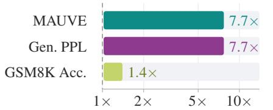  
Wall-clock training acceleration

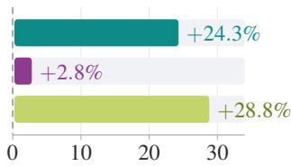  
Relative improvement (%)

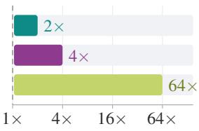  
Sampling acceleration  
Figure 1: Performance and efficiency gains of SERF. Improvements over FLM (Lee et al., 2026) on OpenWebText (Gokaslan & Cohen, 2019) and over S-FLM (Deschenaux & Gulcehre, 2026) on GSM8K. Left: SERF reaches the baseline’s quality with substantially fewer training steps (see Fig. 4), achieving wall-clock acceleration despite its small additional computational cost (see Sec. A.4). Middle: Improves generation quality and reasoning accuracy at the same sampling budget (see Tab. 1 and Fig. 5). Right: Matches the baseline’s 1024-step performance with only a fraction of the sampling steps (see Tab. 1, Fig. 4 and Fig. 8). Sources for each value are listed in Tab. 2.

## 1 INTRODUCTION

Current leading language models (Achiam et al., 2023; Anil et al., 2023; Guo et al., 2025) primarily rely on autoregressive decoding, generating one token at a time. While training benefits from the parallelism of transformer architectures and teacher forcing, inference remains fundamentally sequential, creating a major bottleneck as models and sequence lengths scale. Diffusion language models (Khanna et al., 2025; Nie et al., 2025; Sahoo et al., 2024) have recently emerged as a promising alternative, offering significantly more flexibility in their generative trajectories. By learning to reverse a corruption process applied to the entire sequences simultaneously, they can generate multiple tokens in parallel and potentially enable substantially faster inference.

While most diffusion language models rely on discrete corruption processes such as masking (Sahoo et al., 2024; Arriola et al., 2025) or token replacement (Schiff et al., 2024; Lou et al., 2023), recent work has revisited continuous diffusion and flow-based formulations for language (Dieleman et al., 2022; Lee et al., 2026). Such formulations have been central to advances in image and video generation and provide smooth generative trajectories that support efficient ODE- and SDE-based sampling (Lipman et al., 2023; Song et al., 2021). They are also particularly well-suited to fewstep generation, as continuous trajectories can be effectively approximated with a small number of integration steps (Lee et al., 2026; Kang et al., 2025). Importantly, they make techniques developed for continuous generative models directly applicable to language, including guidance (Ho & Salimans, 2022; Karras et al., 2024) and flow-based distillation (Song et al., 2023; Boffi et al., 2025). These properties make continuous diffusion a promising and versatile framework for text generation.

Interestingly, recent advances in diffusion modeling for image synthesis have shown that augmenting the standard denoising objective with auxiliary self-supervised signals can substantially improve both training efficiency and generation quality (Yu et al., 2025; Kouzelis et al., 2025; Chefer et al., 2025; Jiang et al., 2025). These methods often involve distilling semantic representations from pretrained encoders (Yu et al., 2025; Kouzelis et al., 2025; Wu et al., 2025), but this introduces a dependency on external models whose suitability can be difficult to anticipate, especially in the language domain. More recent methods instead exploit self-supervision within the generative model itself, leveraging the structure of the denoising trajectory to define objectives such as contrastive learning or self-distillation across noise levels and network layers (Chefer et al., 2025; Jiang et al., 2025; Haghighi et al., 2025). These results suggest that the denoising process contains rich internal supervision signals that go beyond direct reconstruction of clean data.

This raises a natural question: can such self-supervised objectives similarly improve continuous diffusion modelsfor language?

In this work, we answer this question affirmatively and introduce SERF (Self-Regularized Flow Language Models), a simple and effective training framework that integrates self-supervised learning into continuous flow-matching language models (see Fig. 2). We build on Flow Matching Language Models (FLMs) (Lee et al., 2026), which operate over one-hot token embeddings and are trained to predict the clean one-hot embedding from a noised input using a cross-entropy loss. SERF augments this objective with a noisy-to-clean self-distillation signal derived from the flow trajectory. Given an input sequence, we construct two corrupted versions using the same underlying noise but at different noise levels. The student processes the more corrupted input, while an exponential moving average (EMA) teacher processes a cleaner version along the same interpolation path. Since the teacher solves an easier denoising problem, its representations and predictions provide informative targets for what the student should recover from the noisier input. Matching these targets encourages consistency along the denoising trajectory and provides richer supervision, without modifying the model architecture or inference procedure.

Inspired by self-distillation approaches in image diffusion (Chefer et al., 2025; Jiang et al., 2025; Haghighi et al., 2025), we study two instantiations of SERF. Following these prior works, Latent Distillation (SERF-L) aligns intermediate hidden representations, matching the student’s features at a shallow block to the teacher’s features at a deeper block through a lightweight projection head. This encourages the student’s early layers to form the contextual representations that the teacher reaches deeper in the network and from a cleaner input. Our second variant, Probability Distribution Distillation (SERF-P), distills the teacher’s predicted token distribution instead of its features. This target is natural for language, where the denoiser outputs a categorical distribution over the vocabulary at every position. Beyond matching the student’s final output, we also investigate distillation at an early student block: its hidden states pass through a small adapter and the teacher’s frozen output head, and are trained with a cross-entropy loss to match the teacher’s prediction from the cleaner input. Reusing the teacher’s head keeps both distributions in the same output space and encourages the student to recover, already in its early layers, which tokens are plausible given a less corrupted context. This distribution-level target is also closer to the language modeling objective than feature alignment, as it shares the cross-entropy form of the denoising loss. SERF is fully self-contained: all proposed variants derive their supervision from the flow model itself and require no external teacher or pretrained representation model. Moreover, SERF is used only during training and leaves the underlying sampling procedure unchanged, introducing no additional inference-time cost.

To the best of our knowledge, SERF is the first framework to systematically integrate self-supervised objectives into continuous diffusion language models. Our results demonstrate that simple selfdistillation along the denoising trajectory can substantially improve training efficiency, generation quality, and few-step generation.

Contributions. Our contributions can be summarized as follows:

1. We introduce SERF, a simple self-regularization framework that exploits the denoising trajectory of continuous flow language models through noisy-to-clean self-distillation, requiring neither external pretrained models nor changes to the architecture or inference procedure.

2. We investigate two instantiations of SERF: SERF-L, which aligns hidden representations, and SERF-P, which aligns output token distributions, including at early student layers.

3. We show that SERF generalizes across three continuous diffusion paradigms (FLM, ELF, and S-FLM), yielding substantial gains in training time, generation quality, and sampling efficiency. On OpenWebText, SERF reaches the MAUVE of FLM with up to 7.7 less wall-clock training time and ultimately raises MAUVE by 24.3%. On GSM8K, SERF improves the accuracy of S-FLM by 28.8% and matches its 1024-step accuracy with 64 fewer sampling steps (Fig. 1).

## 2 RELATED WORK

Discrete Diffusion for Language. Early approaches to diffusion-based language modeling operate directly in the discrete token space, defining forward processes based on masking (Sahoo et al., 2024; Arriola et al., 2025; Nie et al., 2025; Chao et al., 2025) or random token substitution (Schiff et al., 2024; Lou et al., 2023; Sahoo et al., 2025) and training models to reverse these corruptions. While theoretically principled, discrete diffusion models face fundamental challenges: tractable inference requires factorized approximations of the reverse process, and the discrete nature of the state space limits the applicability of continuous optimization tools (Lee et al., 2026). Recent efforts have sought to address these limitations by combining discrete and continuous corruption (Zhou et al., 2025; Zheng et al., 2025; Pynadath et al., 2025). In contrast, we operate entirely in a continuous space, avoiding discrete approximations at both training and inference time.

Continuous Diffusion for Language. Continuous diffusion and flow matching language models lift tokens into a continuous representation before applying the generative process, enabling the use of standard continuous optimization. The choice of representation varies across methods: learned token embeddings (Li et al., 2022; Gulrajani & Hashimoto, 2023; Gong et al., 2022; Chen et al., 2026), frozen pretrained embeddings (Lovelace et al., 2023; Strudel et al., 2022), and one-hot vectors (Lee et al., 2026) have all been explored, alongside Riemannian manifold formulations that respect the geometry of the probability simplex (Jo & Hwang, 2025; Cheng et al., 2024; Davis et al., 2024). Our work builds on three continuous flow-based language models. FLM (Lee et al., 2026) operates in the unconstrained Euclidean setting, representing tokens as one-hot vectors and transporting Gaussian noise to these targets via a learned velocity field trained with a cross-entropy objective. S-FLM (Deschenaux & Gulcehre, 2026) instead defines the flow on the unit hypersphere, with token embeddings and hidden states constrained to $\mathbb { S } ^ { d - 1 }$ . ELF (Hu et al., 2026) performs flow matching in a continuous latent space of pretrained T5 sentence embeddings. We show that SERF applies to all three. A related line of work has explored few-step sampling via flow map distillation (Lee et al., 2026; Roos et al., 2026), where a teacher model is used to distill the generative trajectory into fewer sampling steps. While this direction also involves a teacher-student setup, it is orthogonal to ours: our primary goal is not to reduce the number of sampling steps but to improve the training objective itself through self-regularization, leaving the inference procedure entirely unchanged.

Self-Supervised Learning in Image Diffusion. In image generation, a growing body of work has explored augmenting diffusion and flow model training with self-supervised signals to improve representation quality and generation performance. One prominent direction leverages pretrained self-supervised encoders (Radford et al., 2021; Oquab et al., 2024; He et al., 2020; Assran et al., 2023)

to align intermediate diffusion features with rich external visual representations, yielding substantial gains in training efficiency and sample quality (Yu et al., 2025; Kouzelis et al., 2025; 2026; Wu et al., 2025; Singh et al., 2025; Leng et al., 2025). A complementary set of approaches instead derives supervision entirely from within the generative model itself, through objectives such as contrastive approaches (Stoica et al., 2025; Wang & He, 2025), or teacher-student alignment along the denoising trajectory (Chefer et al., 2025; Jiang et al., 2025; Haghighi et al., 2025), without relying on an external encoder. Although methods based on external representations have generally achieved strong results, Chefer et al. (2025) showed that purely self-supervised objectives, without external representations, can exceed their performance and scale more favorably across modalities and model sizes. Motivated by these findings, we ask whether auxiliary self-supervised objectives can improve continuous flow matching language models.

## 3 METHOD

In this section, we introduce Self-Regularized Flow Language Models (SERF), a training framework that regularizes a flow language model by distilling signals from an EMA teacher evaluated at a cleaner point along the same interpolation path (see Fig. 2). We first review continuous one-hot flow matching for language modeling (Sec. 3.1). We then introduce SERF and its two variants, based on latent and probability distribution distillation (Sec. 3.2), before describing the strategies used to select the student and teacher noise levels (Sec. 3.3). Although we instantiate SERF using FLM (Lee et al., 2026), our framework can in principle be applied to other continuous diffusion or flow-based language models.

## 3.1 PRELIMINARY: FLOW LANGUAGE MODELS

Flow matching language models operate in continuous representations; one natural choice, as in Lee et al. (2026), is to embed discrete tokens as one-hot vectors. Formally, let  be a vocabulary and let $\mathbf { y } = ( y ^ { 1 } , \dots , y ^ { L } ) \in \mathcal { V } ^ { L }$ denote a sequence of length L. A flow matching language model represents y as the continuous one-hot matrix

$$
\mathbf { x } _ { 1 } = \mathrm { o n e h o t } ( \mathbf { y } ) \in \mathbb { R } ^ { L \times | \mathcal { V } | } .\tag{1}
$$

Training. Once the tokens have been represented as continuous vectors, a time-dependent interpolation process transforms the data $\mathbf { x } _ { 1 } \sim p ( x )$ into Gaussian noise $\mathbf { \epsilon } \sim \mathcal { N } ( 0 , 1 )$

$$
{ \bf x } _ { s } = s { \bf x } _ { 1 } + ( 1 - s ) e\tag{2}
$$

where $s \in [ 0 , 1 ]$ . The denoiser $f _ { \theta } ( \mathbf { x } _ { s } , s )$ is parameterized with a token-wise softmax output layer, ensuring that the predicted distribution at each position lies on the probability simplex $\Delta ^ { | \nu | - 1 }$ , and outputs a per-position probability distribution over the vocabulary, i.e., $\mathbf { p } _ { \theta } ^ { l } \doteq f _ { \theta } ( \mathbf { \bar { x } } _ { s } , s ) ^ { l } \in \Delta ^ { | \mathcal { V } | - 1 }$ for each position l. Since $\mathbf { x } _ { 1 }$ is one-hot, the denoiser is trained with token-level cross-entropy:

$$
\mathcal { L } _ { \mathrm { F L M } } = \mathbb { E } _ { \mathbf { x } _ { 1 } , e , s } \left[ - \frac { 1 } { L } \sum _ { l = 1 } ^ { L } ( \mathbf { x } _ { 1 } ^ { l } ) ^ { \mathsf { T } } \cdot \log \mathbf { p } _ { \theta } ^ { l } \right] .\tag{3}
$$

Sampling. During sampling the denoiser is converted into a velocity field by $v _ { \theta } ( \mathbf { x } _ { s } , s ) = \big ( f _ { \theta } ( \mathbf { x } _ { s } , s ) -$ $\mathbf { x } _ { s } ) / ( 1 - s )$ , and sampling is performed by integrating the probability flow ODE $\dot { \mathbf { x } } _ { s } = v _ { \theta } ( \mathbf { x } _ { s } , s )$ from $s = 0 \mathrm { ~ t o ~ } s = 1$ , starting from $\mathbf { x } _ { 0 } \sim \mathcal { N } ( \mathbf { 0 } , \mathbf { I } )$ . The final continuous state $\hat { \mathbf { x } } _ { 1 } ^ { l }$ is decoded back to discrete tokens with a simple argmax operation: $\hat { \mathbf { y } } ^ { l } = \arg \operatorname* { m a x } _ { v \in \mathcal { V } } \hat { \mathbf { x } } _ { 1 } ^ { l } ( v )$

## 3.2 SELF-REGULARIZED FLOW LANGUAGE MODELS

Teacher–student framework. Standard FLM training supervises the denoiser only through crossentropy against the clean sequence. We add a self-supervised signal from a teacher derived from the model itself, requiring no external network and adding no inference cost. Let $f _ { \theta }$ be the student denoiser and $f _ { \bar { \theta } }$ the teacher, whose parameters are an exponential moving average (EMA) of the student’s, $\bar { \theta }  \alpha \bar { \theta } + ( 1 - \alpha ) \theta$ with $\alpha \in ( 0 , 1 )$ . For each sequence $\mathbf { x } _ { 1 }$ , we construct a noisy student input and a cleaner teacher input at times $s \leq t$

$$
\mathbf { x } _ { s } = s \mathbf { x } _ { 1 } + \left( 1 - s \right) e , \qquad \mathbf { x } _ { t } = t \mathbf { x } _ { 1 } + \left( 1 - t \right) e ,\tag{4}
$$

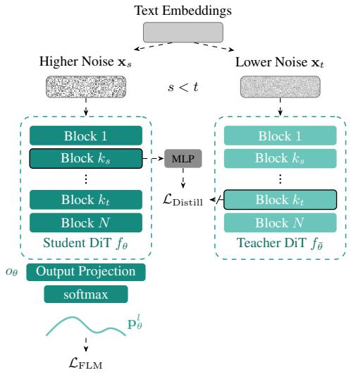

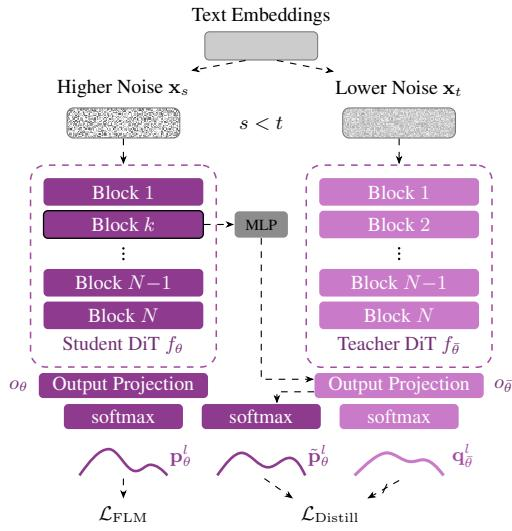  
Latent Distillation (SERF-L)  
Probability Distribution Distillation (SERF-P)  
Figure 2: Overview of SERF. In flow language models, the clean data lies at $\mathbf { x } _ { 1 }$ (one-hot token embeddings) and pure noise at $\mathbf { x } _ { \mathrm { 0 } }$ . SERF corrupts $\mathbf { x } _ { 1 }$ at two noise levels along the same interpolation path using shared noise: the noisier input $\mathbf { x } _ { s }$ is fed to the student $f _ { \theta } ,$ , while the cleaner input ${ \bf x } _ { t } \left( t > s \right)$ is fed to the EMA teacher $f _ { \bar { \theta } } ,$ whose outputs are detached via stop-gradient. The student is supervised by the standard cross-entropy loss against the ground-truth one-hot target $\mathbf { x } _ { 1 } ^ { l }$ , plus a distillation loss weighted by $\lambda ,$ which takes one of two forms. Left: In Latent Distillation, (SERF-L) the hidden states of an early student block $k _ { s }$ are mapped through a lightweight projection head $g _ { \theta }$ and aligned with those of a deeper teacher block $k _ { t } > k _ { s }$ using a per-token cosine distance. Right: In Probability Distribution Distillation (SERF-P), features from student block $k$ pass through a small MLP and the teacher’s frozen head $O _ { \bar { \theta } } .$ giving token-wise distributions $\tilde { \mathbf { p } } _ { \theta } ^ { l }$ that are trained to match the teacher’s $\mathbf { q } _ { \bar { \theta } } ^ { l }$ via a cross-entropy loss; the student’s own output $\mathbf { p } _ { \theta } ^ { l }$ is trained with $\mathcal { L } _ { \mathrm { F L M } }$

where the noise $\mathbf { \boldsymbol { e } } \sim \mathcal { N } ( \mathbf { \boldsymbol { 0 } } , I )$ is shared, so the two views differ only in noise level.

Since the teacher receives a cleaner input and therefore solves an easier denoising problem, its hidden representations and output predictions provide informative targets for what the student should recover from the noisier input. We train the student with the general objective

$$
\mathcal { L } _ { \mathrm { S E R F } } = \mathcal { L } _ { \mathrm { F L M } } + \lambda \mathcal { L } _ { \mathrm { D i s t i l l } } ,\tag{5}
$$

where $\lambda > 0$ controls the strength of the self-distillation signal. We consider two choices for $\mathcal { L } _ { \mathrm { D i s t i l } } .$ Latent Distillation (SERF-L), which aligns intermediate hidden representations, and Probability Distribution Distillation (SERF-P), which aligns output token distributions. In both cases, gradients are propagated only through the student, while the teacher is updated exclusively through EMA. Sampling remains identical to FLM. The full training procedure for all variants is summarized in Algorithm 1, Algorithm 2 and Algorithm 3, where highlights indicate the minimal modifications required on top of the baseline FLM.

## 3.2.1 LATENT DISTILLATION

Intermediate representations of a denoiser encode contextual information well before it is resolved into token predictions. We therefore align the student’s hidden states with those the teacher computes from the cleaner input. Let $\mathbf h _ { \theta } ^ { ( k _ { s } ) } ( \mathbf x _ { s } , s ) \in \mathbb R ^ { L \times d }$ denote the hidden states after the $k _ { s }$ -th transformer block of the student, and $\mathbf { h } _ { \bar { \theta } } ^ { ( k _ { t } ) } ( \mathbf { x } _ { t } , t ) \in \mathbb { R } ^ { L \times d }$ those after the $k _ { t }$ -th block of the teacher. Since the two representations are taken at different depths and noise levels, the student features are mapped through a lightweight projection head $g _ { \theta }$ before being compared, while the teacher features are used as is:

$$
\begin{array} { r } { \mathbf { z } _ { \theta } ^ { l } = g _ { \theta } \big ( \mathbf { h } _ { \theta } ^ { ( k _ { s } ) } ( \mathbf { x } _ { s } , s ) ^ { l } \big ) , \qquad \bar { \mathbf { z } } ^ { l } = \mathrm { s g } \big ( \mathbf { h } _ { \bar { \theta } } ^ { ( k _ { t } ) } ( \mathbf { x } _ { t } , t ) ^ { l } \big ) , } \end{array}\tag{6}
$$

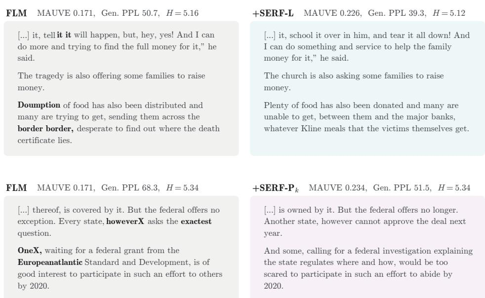  
Figure 3: Generated samples on OWT. Samples from FLM, and $\mathrm { S E R F - L } , \mathrm { S E R F - P } _ { k }$ , trained for 1M and 300K steps and generated with 1024 sampling steps from the same initial noise. Errors are highlighted in bold. Both SERF variants produce notably more fluent text, whereas FLM exhibits grammatical errors and repetitions. We provide more examples of generated text in Appendix C.

where sg( ) denotes stop-gradient. The latent distillation loss is

$$
\mathcal { L } _ { \mathrm { D i s t i l l } } ^ { \mathrm { L } } = \mathbb { E } _ { \mathbf { x } _ { 1 } , \epsilon , s , t } \left[ \frac { 1 } { L } \sum _ { l = 1 } ^ { L } \mathrm { d i s t } \left( \mathbf { z } _ { \theta } ^ { l } , \bar { \mathbf { z } } ^ { l } \right) \right] ,\tag{7}
$$

where dis $, ( \cdot , \cdot )$ denotes the distance between feature vectors, for which we use cosine distance in our experiments. SERF-L is obtained by setting $\mathcal { L } _ { \mathrm { D i s t i l } } = \mathcal { L } _ { \mathrm { D i s t i l } } ^ { \mathrm { L } }$ in Eq. 5.

Choosing a shallow student block and a deeper teacher block $( k _ { s } < k _ { t } )$ encourages the early layers of the student to already form the contextual representations that the teacher only reaches deeper in the network and from a cleaner input. The projection head is used only during training and is discarded at inference.

## 3.2.2 PROBABILITY DISTRIBUTION DISTILLATION

Beyond internal features, the teacher’s predictive distribution itself is an informative target, since it reflects which tokens remain plausible given a less corrupted context. We therefore align the student’s and the teacher’s per-position distributions, $\mathbf { p } _ { \theta } ^ { l }$ and $\mathbf { q } _ { \bar { \theta } } ^ { l } = \mathrm { s g } \big ( f _ { \bar { \theta } } ( \mathbf { x } _ { t } , t ) ^ { l } \big ) \in \Delta ^ { | \mathcal { V } | - 1 }$ , via a cross-entropy distillation loss:

$$
\mathcal { L } _ { \mathrm { D i s t i l l } } ^ { \mathrm { P } } = \mathbb { E } _ { \mathbf { x } _ { 1 } , \epsilon , s , t } \left[ - \frac { 1 } { L } \sum _ { l = 1 } ^ { L } ( \mathbf { q } _ { \bar { \theta } } ^ { l } ) ^ { \top } \log { \mathbf { p } _ { \theta } ^ { l } } \right] .\tag{8}
$$

SERF-P is obtained by setting $\mathcal { L } _ { \mathrm { D i s t i l } } = \mathcal { L } _ { \mathrm { D i s t i l } } ^ { \mathrm { P } }$ in Eq. 5, with the student’s own output as the aligned distribution, $\mathbf { p } _ { \theta } ^ { l } = f _ { \theta } ( \mathbf { x } _ { s } , s ) ^ { l }$

Distilling into an early layer. SERF-L benefits most from aligning a shallow student block with a deeper teacher block (see Fig. 7), consistent with findings in image diffusion (Chefer et al., 2025; Jiang et al., 2025): supervising early layers directly encourages the student to form, early in the network, information that it would otherwise only build at full depth. When the distillation loss acts on the final output alone, early layers receive this signal only indirectly, through the entire network. We therefore also apply Eq. 8 to an intermediate layer of the student. Let $\mathbf { h } _ { \theta } ^ { ( k ) }$ be the hidden states after the k-th block. We map them to a distribution with a lightweight projection head $g _ { \theta }$ followed by the teacher’s output head $o _ { \bar { \theta } }$ , kept frozen:

Table 1: Best MAUVE ( , top) on OWT over $\tau \in \{ 0 . 9 5 , 1 . 0 , 1 . 0 5 \}$ , where is the std over 5 MAUVE seeds, and Gen. PPL ( , bottom) at the unigram entropy of OWT text $( H = 5 . 4 4 )$ , interpolated over each model’s temperature sweep. $\mathrm { S E R E { - } L }$ and $\mathrm { S E R F { - } } \mathrm { P } _ { k }$ , trained for 300K steps, are compared against FLM trained for 1M steps. Best in bold, second best underlined. We further present the full MAUVE and Gen. PPL fronts in Fig. 8.
<table><tr><td rowspan="2">MODEL</td><td rowspan="2">#ITERS</td><td colspan="5">SAMPLING STEPS</td></tr><tr><td>64</td><td>128</td><td>256</td><td>512</td><td>1024</td></tr><tr><td colspan="7">Best MAUVE (↑)</td></tr><tr><td>FLM</td><td>1M</td><td> $0 . 2 6 0 \pm 0 . 0 1 1$ </td><td> $0 . 3 2 9 \pm 0 . 0 2 2$ </td><td> $0 . 3 4 9 \pm 0 . 0 1 4$ </td><td> $0 . 3 4 5 \pm 0 . 0 0 5$ </td><td> $0 . 3 1 3 { \scriptstyle \pm 0 . 0 1 1 }$ </td></tr><tr><td> $\mathrm { S E R E { - } } \mathbb { P } _ { k }$ </td><td>300K</td><td> $\mathbf { 0 . 3 4 1 } \pm 0 . 0 1 9$ </td><td> $0 . 4 1 4 \pm 0 . 0 2 6$ </td><td> $0 . 3 9 9 { \scriptstyle \pm 0 . 0 1 0 }$ </td><td> $0 . 4 0 9 \pm 0 . 0 2 6$ </td><td> $0 . 3 8 8 \pm 0 . 0 0 4$ </td></tr><tr><td> $\mathrm { S E R E { - I } }$ </td><td>300K</td><td> $0 . 3 3 7 { \scriptstyle \pm 0 . 0 0 9 }$ </td><td> $\mathbf { 0 . 4 3 5 \pm } 0 . 0 1 5$ </td><td> $\mathbf { 0 . 4 1 8 \pm } 0 . 0 1 7$ </td><td> $\mathbf { 0 . 4 2 3 \bot 0 . 0 1 9 }$ </td><td> $\mathbf { 0 . 3 8 9 \bot 0 . 0 0 5 }$ </td></tr><tr><td colspan="7">Gen. PPL at  $H = 5 . 4 4 \left( \downarrow \right)$ </td></tr><tr><td>FLM</td><td>1M</td><td>86.2</td><td>78.8</td><td>75.7</td><td>74.7</td><td>74.9</td></tr><tr><td> $\mathrm { S E R E { - } } \mathbb { P } _ { k }$ </td><td>300K</td><td>83.9</td><td>76.2</td><td>73.2</td><td>72.5</td><td>73.5</td></tr><tr><td> $\mathrm { S E R E { - I } }$ </td><td>300K</td><td>82.3</td><td>75.4</td><td>72.6</td><td>71.7</td><td>72.9</td></tr></table>

$$
\tilde { \mathbf { p } } _ { \theta } ^ { l } = o _ { \bar { \theta } } \Big ( g _ { \theta } \Big ( \mathbf { h } _ { \theta } ^ { ( k ) } ( \mathbf { x } _ { s } , s ) \Big ) \Big ) ^ { l } ,\tag{9}
$$

which we denote $\mathrm { S E R E { - } } \mathrm { P } _ { k }$ . Reusing the teacher’s head, rather than the student’s, ensures that both distributions are obtained through the same mapping to token probabilities, while avoiding interference with the student’s output head, which is optimized for final-layer predictions. Unlike SERF-P which distills the final predictions through the student’s own output head, $\mathrm { S E R E { - } } \mathrm { P } _ { k }$ supervises intermediate representations through the teacher’s output head and a lightweight adapter.

Remark. We note that SERF is orthogonal to flow map distillation methods (Lee et al., 2026; Roos et al., 2026), whose primary goal is to reduce the number of inference steps by distilling the generative trajectory into a fewer-step student. Such methods also typically require a pretrained teacher model to provide the distillation targets. Our objective, instead, is to train a regularizer: it improves the quality of the learned flow without modifying the inference procedure, and can in principle be combined with any such distillation method.

## 3.3 STUDENT AND TEACHER NOISE LEVEL STRATEGIES.

A key design choice is how to construct the pair $( s , t )$ with $t > s .$ . We consider two strategies.

Fixed Offset. The simplest strategy is to sample a student timestep $s \sim \mathcal { U } ( 0 , 1 )$ and set the teacher timestep to

$$
t = \operatorname* { m i n } \{ s + \delta , 1 \} ,
$$

where $\delta \in ( 0 , 1 )$ controls how far the teacher is advanced toward the clean data endpoint. Thus, the EMA teacher is always evaluated on a cleaner version of the same sample, with a fixed student–teacher noise gap up to clipping at $t = 1$

Random Offset. Alternatively, we sample the student and teacher timesteps randomly while ensuring that the teacher receives the cleaner input. Specifically, we draw two times $\mu , \kappa \sim \mathcal { U } ( 0 , 1 )$ and set

$$
s = \operatorname* { m i n } ( \mu , \kappa ) , \quad \quad t = \operatorname* { m a x } ( \mu , \kappa ) .
$$

The student is evaluated at the noisier timestep $s ,$ while the EMA teacher is evaluated at the cleaner timestep t. This exposes the distillation loss to a range of student–teacher noise gaps, rather than imposing a fixed offset.

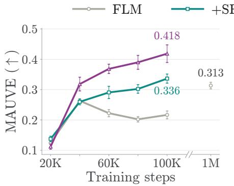

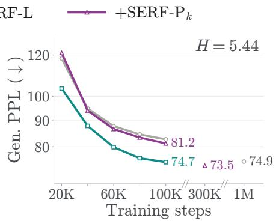  
Figure 4: Training convergence on OWT. SERF-L and SERF-P compared against FLM. At each iteration, we report the best MAUVE over $\tau \in \{ 0 . 9 5 , 1 . 0 , 1 . 0 5 \}$ and the Gen. PPL interpolated to the dataset entropy (see Sec. A.5), using 1024 sampling steps.

## 4 EXPERIMENTS

To validate SERF, we evaluate its two variants, SERF-L (Latent Distillation, Sec. 3.2.1) and $\mathrm { S E R E { - } P }$ (Probability Distribution Distillation, Sec. 3.2.2), on unconditional language modeling and math reasoning. We apply them to three baseline models: FLM (Lee et al., 2026), S-FLM (Deschenaux & Gulcehre, 2026) and ELF (Hu et al., 2026). These span three distinct continuous paradigms, namely one-hot embeddings, spherical embeddings, and latent embeddings, underscoring the broad applicability of our method and showing that it is not tied to the choice of input representation. We first describe the experimental setup (Sec. 4.1). We then present unconditional text generation results on OWT with FLM and ELF (Sec. 4.2), followed by math reasoning results on GSM8K(Cobbe et al., 2021) with S-FLM (Sec. 4.3). Finally, we analyze the effect of the noise level strategy and the choice of distilled layers in (Sec. 4.4).

## 4.1 EXPERIMENTAL SETUP

Training. All training hyperparameters are kept identical to those of the corresponding baselines. Both SERF-L and SERF-P use the random offset strategy, with regularization weights $\lambda = 2 . 0$ and $\lambda = 0 . 1$ , respectively. For SERF-L, the alignment loss is active from the start of training, and unless otherwise noted, the student’s block $k _ { s } = 2$ is aligned with the teacher’s block $k _ { t } = 1 0$ . For $\mathrm { S E R E { - } } \mathbb { P } _ { k }$ , the student’s block is set to $k = 2$ . For SERF-P, we found it is better to initialize the distillation loss after the first 10K steps. The decay of the EMA teacher is set to $\alpha = 0 . 9 9 9 9$

Evaluation. We sample 5000 sequences per model and report MAUVE ( ) (Pillutla et al., 2021) against an equal number of validation sequences, averaged over 5 seeds, and generative perplexity (Gen. PPL ) under GPT-2 Large (Radford et al., 2019). We treat MAUVE as our primary metric: Gen. PPL is known to reward repetitive, degenerate text, and recent work has shown it can be directly gamed (Franca & Tong, 2026). To further account for the quality–diversity trade-off, we compare models not at a single operating point but along MAUVE–entropy and Gen. PPL–entropy fronts, obtained by sweeping the sampling temperature τ and measuring average per-sample unigram entropy. Details on math reasoning evaluation can be found in Appendix A.

## 4.2 UNCONDITIONAL TEXT GENERATION RESULTS

To demonstrate the effectiveness of our approach, we evaluate two variants of SERF on OpenWebText (OWT) (Gokaslan & Cohen, 2019): SERF-L (Latent Alignment) and $\mathrm { S E R E { - } P }$ $\mathrm { S E R E { - } } \mathrm { P } _ { k }$ (Probability Distribution Alignment). We apply both to the FLM baseline, and additionally apply SERF-L to ELF (Hu et al., 2026).

Results with Flow Language Models. Both variants substantially outperform FLM across all sampling budgets from 64 to 1024 steps (Tab. 1), while requiring 300K training steps instead of 1M. For example, at 1024 steps they raise MAUVE from 0.313 to 0.388 $\left( \operatorname { S E R F - P } _ { k } \right)$ and 0.389 (SERF-L). The gains in Gen. PPL point in the same direction: both variants achieve lower perplexity than FLM at every sampling budget, with the largest margin in the few-step regime $( 8 6 . 2  8 2 . 3 $ for SERF-L at 64 steps). With only 256 steps, both variants already reach a lower perplexity (72.6 and 73.2) than FLM at any budget (74.7 at best). Since Gen. PPL is evaluated at a matched unigram entropy, these gains do not come from reduced sample diversity.

<table><tr><td rowspan=1 colspan=1>Model        Acc. (%)</td></tr><tr><td rowspan=1 colspan=1>AutoregressiveSample        53.9Greedy        63.3</td></tr><tr><td rowspan=1 colspan=1>Discrete DiffusionMDLM           18.0DUO            17.2</td></tr><tr><td rowspan=1 colspan=1>Continuous DiffusionCANDI          0.2</td></tr><tr><td rowspan=1 colspan=1>FLM             0.3S-FLM         18.0</td></tr><tr><td rowspan=1 colspan=1>S-FLM*        17.7</td></tr><tr><td rowspan=1 colspan=1>+SERF-L      22.3+SERF-P      20.2</td></tr><tr><td rowspan=1 colspan=1> $+ \mathrm { S E R F } { - \mathrm { P } _ { k } }$      22.8</td></tr></table>

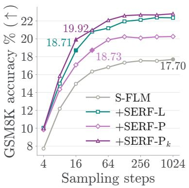

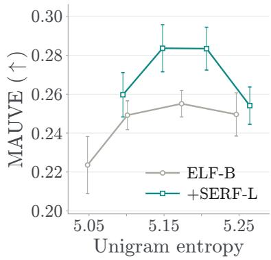  
Figure 5: Left: GSM8K accuracy at 250K training steps. Diffusion models at 1024 steps with $\tau = 1$ Best overall underlined, best continuous diffusion bolded. ∗Denotes our evaluation. Middle: GSM8K accuracy across sampling steps. SERF-L, SERF-P, and $\mathtt { S E R F - P } _ { k }$ compared against $_ { \mathrm { { S - F L M } } }$ all trained on TinyGSM (Liu et al., 2023) for 250K steps. We report the mean over 5 sample seeds. Right: Comparison with ELF on OWT. SERF-L compared against ELF-B, both trained for 5 epochs ( 95K steps) and sampled with 64 steps, sweeping the self-conditioning guidance scale $\bar { w } \in \{ 0 . 5 , 1 . 0 , 1 . 5 , \bar { 2 . 0 } \}$

The training curves in Fig. 4 make this explicit: by 100K steps, both variants exceed the 1M-step FLM in MAUVE (0.336 for SERF-L and 0.418 for $\mathrm { S E R F { - } } \mathrm { P } _ { k }$ , vs. 0.313). In Gen. PPL, SERF-L stays well below FLM throughout and matches the 1M-step model at 100K steps (74.7 vs. 74.9), while $\mathrm { S E R E { - } } \mathrm { P } _ { k }$ tracks FLM early on and surpasses it at 300K steps (73.5). Fig. 3 shows the improvement qualitatively.

Results with Embedded Language Flows. To test whether SERF transfers beyond FLM, we apply it to ELF-B, training both the baseline and our variant for 5 epochs as in Hu et al. (2026). We evaluate only ${ \mathrm { S E R F - L } } ,$ as SERF-P is not applicable here: ELF does not output a probability distribution over tokens. Fig. 5 (right) reports MAUVE against unigram entropy with 64 sampling steps, where each curve sweeps the self-conditioning guidance scale w. $S \mathrm { E R E - I }$ improves over $\mathrm { E L E { - B } }$ at every guidance scale, shifting the whole front upwards, with the gains most pronounced at intermediate scales (w = 1 and $w = 1 . 5 )$ . This shows that the improvements of latent distillation carry over to a different continuous diffusion language model paradigm.

## 4.3 REASONING ON GSM8K

Accuracy Improvements. We apply SERF-L, SERF-P and $\mathrm { S E R E { - } } \mathrm { P } _ { k }$ to $_ { \mathrm { S - E L M } }$ (Deschenaux & Gulcehre, 2026), train on TinyGSM, and evaluate accuracy on the GSM8K test set. Following S-FLM, we report accuracy at $\tau = 1$ with 1024 sampling steps for the diffusion models. As shown in $\mathrm { { F i g . } } 5 ( \mathrm { { l e f t } ) . }$ all three variants improve the accuracy of $_ { \mathrm { S - E L M } }$ from 17.7% to 22.3% (SERF-L), 20.2% (SERF-P) and $2 2 . 8 \% ( \mathtt { S E R F - P } _ { k } )$ , with $\mathrm { S E R F { - } P } _ { k }$ achieving the best result among continuous diffusion language models, while CANDI and FLM remain near zero. All three variants also outperform discrete diffusion models at τ = 1. A gap remains under low-temperature decoding $( \tau = 0 . 1 )$ , where MDLM and DUO reach 33–36% (Deschenaux & Gulcehre, 2026).

Sampling acceleration. The improvement holds at every sampling budget, as shown in $\operatorname { F i g } . 5$ (middle), which substantially reduces the number of steps needed to reach a given accuracy. $\mathrm { S E R E { - } } \mathrm { P } _ { k }$ and $\mathrm { S E R E { - } I }$ surpass the 1024-step accuracy of $\mathrm { S - F L M } \left( \mathrm { 1 7 . 7 \% } \right)$ with only 16 sampling steps (19.9% and 18.7%, respectively), a 64 reduction in sampling cost, and SERF-P does so with 32 steps (18.7%), a 32 reduction.

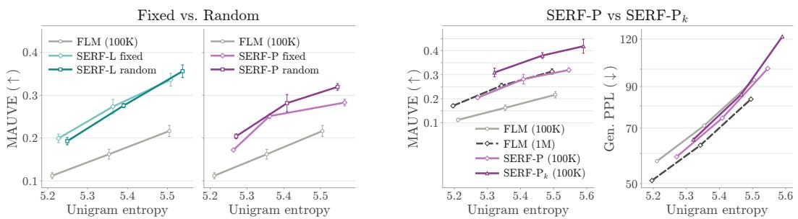  
Figure 6: Left: fixed $( \delta = 0 . 8 )$ vs. random offset strategy for $\mathrm { S E R E { - } L }$ and SERF-P, respectively. Right: The teacher’s output distribution supervises the student’s final layer (SERF-P) or an earlier block $( \mathrm { S E R F - P } _ { k } , k = 2 )$ . Both trained for 100K steps on OWT.

## 4.4 ANALYSIS

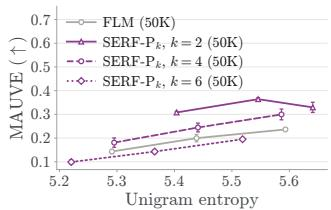

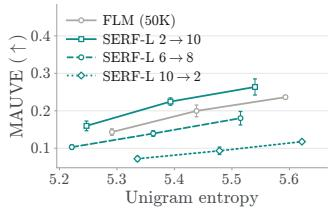  
Figure 7: Layer ablations for SERF-L and $\mathrm { S E R F { - } } \mathrm { P } _ { k }$ Models trained for 50K.

Effect of Layer choice. In Fig. 7 (bottom), we study which layers to align in $\mathrm { S E R E { - L } }$ , denoting by $k _ { s }  k _ { t }$ the alignment of student layer $k _ { s }$ to teacher layer $k _ { t } .$ , with all models trained on OWT for 50K steps. The choice of layers has a clear effect. Aligning an early student layer to a late teacher layer $( 2  1 0 )$ gives the highest MAUVE across the whole entropy range, followed by aligning two intermediate layers $( 6  8 )$ , while the reversed configuration $( 1 0  2 )$ , which aligns a late student layer to an early teacher layer, performs worst. This is consistent with prior work on image generation (Chefer et al., 2025; Jiang et al., 2025), which observed that aligning an early layer of the student to a later layer of the teacher is beneficial: it encourages the student to form, already in its early layers, the higher-level representations that the teacher builds deeper in the network.

We observe a similar behavior when distilling the teacher’s predicted distribution into an intermediate student layer. Fig. 7 (top) varies the student block k of ${ \mathrm { S E R F } } { \mathrm { - P } } _ { k } ,$ , whose hidden state is projected to the vocabulary and matched to the teacher’s prediction (50K steps). Earlier blocks are consistently better: $k = 2$ reaches the highest

MAUVE (0.36 at peak), $k = 4$ is lower but still above FLM, and $k = 6$ falls below the FLM baseline at every entropy. Distilling into early layers thus helps for both latent and distribution targets, with $k = 2$ the best choice.

Distilling distributions into an early layer. Fig. 6 (right) compares applying the teacher’s distribution to the student’s output (SERF-P) with applying it to an early block $( \mathtt { S E R F - P } _ { k } , k = 2 )$ , both trained for 100K steps on OWT. SERF-P already matches the MAUVE of FLM trained for 1M steps. $\mathrm { S E R E { - } } \mathrm { P } _ { k }$ improves further: its MAUVE front lies above all other models across the entire entropy range, and it extends to higher entropies, producing more diverse samples over the same temperature sweep. $\mathrm { S E R E { - } } \mathrm { P } _ { k }$ thus combines the benefits of both variants: like ${ \mathrm { S E R E - L } } ,$ it supervises early layers directly, but it keeps a distribution-level cross-entropy loss, of the same form as $\mathcal { L } _ { \mathrm { F L M } }$ , rather than aligning hidden features.

Effect of the noise level strategy. In Fig. 6 (Left) we compare the fixed $( \delta = 0 . 8 )$ and random offset strategies (see Sec. 3.3) for $\mathrm { S E R E { - } L }$ and SERF-P trained for 100K steps on OWT. SERF-L is robust to this choice: both strategies yield nearly identical fronts that lie well above the 100K-step FLM baseline across the full entropy range. SERF-P, in contrast, is sensitive to it: the random strategy clearly outperforms the baseline, whereas the fixed offset brings no improvement. We attribute this to the clipping $t = \operatorname* { m i n } \{ s + \delta , 1 \}$ : with $\delta = 0 . 8 $ , the teacher receives the fully clean input $\mathbf { x } _ { 1 }$ whenever $s > 0 . 2 .$ There, its predictions become nearly one-hot, so the distillation target of

SERF-P adds little beyond the ground-truth label, whereas SERF-L aligns hidden representations, which remain informative even for clean inputs.

## 5 CONCLUSION

In this work, we introduced SERF, a simple self-regularization framework for continuous diffusion language models. Building on the observation that an EMA teacher evaluated at a cleaner point on the same interpolation path provides informative targets for a noisier student, SERF augments the standard training objective with a noisy-to-clean self-distillation loss that requires no external models and leaves the architecture and sampling procedure unchanged. We studied two instantiations: SERF-L, which distills intermediate hidden representations, and SERF-P, which distills output token distributions, together with its early-layer variant SERF-P . For both latent and distribution targets, supervising early student layers proved most effective. Across three baselines, SERF consistently improves generation quality. On OWT, SERF-L and $\mathtt { S E R F - P } _ { k }$ match or exceed FLM trained for 1M steps using roughly a tenth of the training budget, with gains that persist in the few-step regime; on GSM8K, SERF improves the accuracy of S-FLM and outperforms prior continuous diffusion language models. Overall, these results suggest that the denoising trajectory is a rich source of self-supervision for language, and that simple self-distillation along it is an effective and practical way to exploit it.

## AI USE STATEMENT

We used large language models (LLMs) as writing assistants during the preparation of this manuscript, primarily to polish the language, improve clarity and concision, and help with LATEX formatting. All scientific content, including the method, experimental design, results and their interpretation, was conceived and produced by the authors.

## ETHICS STATEMENT

Generative models carry a substantial risk of misuse. Their application can lead to various negative societal impacts, most notably the spread of disinformation. Enhancements in generative performance, as achieved by our method, may further increase the realism of generated content, potentially making disinformation even more convincing.

## REPRODUCIBILITY STATEMENT

SERF is fully specified in Sec. 3.2 and Algorithms 1 and 2. All hyperparameters, as well as the architecture, training and sampling details of each baseline, are reported in Sec. 4.1 and the appendix. All experiments use publicly available datasets, and we will release our code and checkpoints upon publication.

## REFERENCES

Josh Achiam, Steven Adler, Sandhini Agarwal, Lama Ahmad, Ilge Akkaya, Florencia Leoni Aleman, Diogo Almeida, Janko Altenschmidt, Sam Altman, Shyamal Anadkat, et al. Gpt-4 technical report. arXiv preprint arXiv:2303.08774, 2023. 1

Rohan Anil, Sebastian Borgeaud, Jean-Baptiste Alayrac, Jiahui Yu, Radu Soricut, Johan Schalkwyk, Andrew M Dai, Anja Hauth, Katie Millican, et al. Gemini: a family of highly capable multimodal models. arXiv preprint arXiv:2312.11805, 2023. 1

Marianne Arriola, Aaron Gokaslan, Justin T Chiu, Zhihan Yang, Zhixuan Qi, Jiaqi Han, Subham Sekhar Sahoo, and Volodymyr Kuleshov. Block diffusion: Interpolating between autoregressive and diffusion language models. arXiv preprint arXiv:2503.09573, 2025. 2, 3

Mahmoud Assran, Quentin Duval, Ishan Misra, Piotr Bojanowski, Pascal Vincent, Michael Rabbat, Yann LeCun, and Nicolas Ballas. Self-supervised learning from images with a joint-embedding predictive architecture. In IEEE/CVF Conference on Computer Vision and Pattern Recognition, 2023. 3

Nicholas M Boffi, Michael S Albergo, and Eric Vanden-Eijnden. Flow map matching with stochastic interpolants: A mathematical framework for consistency models. arXiv preprint arXiv:2406.07507, 2025. 2

Chen-Hao Chao, Wei-Fang Sun, Hanwen Liang, Chun-Yi Lee, and Rahul G Krishnan. Beyond masked and unmasked: Discrete diffusion models via partial masking. arXiv preprint arXiv:2505.18495, 2025. 3

Hila Chefer, Patrick Esser, Dominik Lorenz, Dustin Podell, Vikash Raja, Vinh Tong, Antonio Torralba, and Robin Rombach. Self-supervised flow matching for scalable multi-modal synthesis. arXiv preprint arXiv:2603.06507, 2025. 2, 4, 6, 10

Yuxin Chen, Chumeng Liang, Hangke Sui, Ruihan Guo, Chaoran Cheng, Jiaxuan You, and Ge Liu. Langflow: Continuous diffusion rivals discrete in language modeling. arXiv preprint arXiv:2604.11748, 2026. 3

Chaoran Cheng, Jiahan Li, Jian Peng, and Ge Liu. Categorical flow matching on statistical manifolds. Advances in Neural Information Processing Systems, 37:54787–54819, 2024. 3

Karl Cobbe, Vineet Kosaraju, Mohammad Bavarian, Mark Chen, Heewoo Jun, Lukasz Kaiser, Matthias Plappert, Jerry Tworek, Jacob Hilton, Reiichiro Nakano, Christopher Hesse, and John Schulman. Training verifiers to solve math word problems. arXiv preprint arXiv:2110.14168, 2021. 8

Oscar Davis, Samuel Kessler, Mircea Petrache, ˙Ismail ˙I Ceylan, Michael Bronstein, and Avishek J Bose. Fisher flow matching for generative modeling over discrete data. Advances in Neural Information Processing Systems, 37:139054–139084, 2024. 3

Justin Deschenaux and Caglar Gulcehre. Language modeling with hyperspherical flows. arXiv preprint arXiv:2605.11125, 2026. 1, 3, 8, 9, 16, 19

Sander Dieleman, Laurent Sartran, Arman Roshannai, Nikolay Savinov, Yaroslav Ganin, Pierre H Richemond, Arnaud Doucet, Robin Strudel, Chris Dyer, Conor Durkan, et al. Continuous diffusion for categorical data. arXiv preprint arXiv:2211.15089, 2022. 2

Antonio Franca and Alexander Tong. Hacking generative perplexity: Why unconditional text evaluation needs distributional metrics. arXiv preprint arXiv:2606.08417, 2026. 8

Aaron Gokaslan and Vanya Cohen. Openwebtext corpus. https://skylion007.github. io/OpenWebTextCorpus/, 2019. 1, 8

Shansan Gong, Mukai Li, Jiangtao Feng, Zhiyong Wu, and LingPeng Kong. Diffuseq: Sequence to sequence text generation with diffusion models. arXiv preprint arXiv:2210.08933, 2022. 3

Ishaan Gulrajani and Tatsunori B Hashimoto. Likelihood-based diffusion language models. Advances in Neural Information Processing Systems, 36:16693–16715, 2023. 3

Daya Guo, Dejian Yang, Haowei Zhang, Junxiao Song, Ruoyu Zhang, Runxin Xu, Qihao Zhu, Shirong Ma, Peiyi Wang, Xiao Bi, et al. Deepseek-r1: Incentivizing reasoning capability in llms via reinforcement learning. arXiv preprint arXiv:2501.12948, 2025. 1

Yasaman Haghighi, Bastien van Delft, Mariam Hassan, and Alexandre Alahi. Layersync: Selfaligning intermediate layers. arXiv preprint arXiv:2510.12581, 2025. 2, 4

Kaiming He, Haoqi Fan, Yuxin Wu, Saining Xie, and Ross Girshick. Momentum contrast for unsupervised visual representation learning. In IEEE/CVF Conference on Computer Vision and Pattern Recognition, pp. 9729–9738, 2020. 3

Jonathan Ho and Tim Salimans. Classifier-free diffusion guidance. arXiv preprint arXiv:2207.12598, 2022. 2

Keya Hu, Linlu Qiu, Yiyang Lu, Hanhong Zhao, Tianhong Li, Yoon Kim, Jacob Andreas, and Kaiming He. Elf: Embedded language flows. arXiv preprint arXiv:2605.10938, 2026. 3, 8, 9, 16

Dengyang Jiang, Mengmeng Wang, Liuzhuozheng Li, Lei Zhang, Haoyu Wang, Wei Wei, Guang Dai, Yanning Zhang, and Jingdong Wang. No other representation component is needed: Diffusion transformers can provide representation guidance by themselves. arXiv preprint arXiv:2505.02831, 2025. 2, 4, 6, 10

Jaehyeong Jo and Sung Ju Hwang. Continuous diffusion model for language modeling. arXiv preprint arXiv:2502.11564, 2025. 3

Keller Jordan, Yuchen Jin, Vlado Boza, Jiacheng You, Franz Cesista, Laker Newhouse, and Jeremy Bernstein. Muon: An optimizer for hidden layers in neural networks, 2024. URL https: //kellerjordan.github.io/posts/muon/. 16

Wonjun Kang, Kevin Galim, Seunghyuk Oh, Minjae Lee, Yuchen Zeng, Shuibai Zhang, Coleman Hooper, Yuezhou Hu, Hyung Il Koo, Nam Ik Cho, et al. Parallelbench: Understanding the trade-offs of parallel decoding in diffusion llms. arXiv preprint arXiv:2510.04767, 2025. 2

Tero Karras, Miika Aittala, Tuomas Kynkäänniemi, Jaakko Lehtinen, Timo Aila, and Samuli Laine. Guiding a diffusion model with a bad version of itself. Advances in Neural Information Processing Systems, 37:52996–53021, 2024. 2

Samar Khanna, Siddhant Kharbanda, Shufan Li, Harshit Varma, Eric Wang, Sawyer Birnbaum, Ziyang Luo, Yanis Miraoui, Akash Palrecha, Stefano Ermon, et al. Mercury: Ultra-fast language models based on diffusion. arXiv preprint arXiv:2506.17298, 2025. 2

Diederik P Kingma and Jimmy Ba. Adam: A method for stochastic optimization. arXiv preprint arXiv:1412.6980, 2014. 16

Theodoros Kouzelis, Efstathios Karypidis, Ioannis Kakogeorgiou, Spyros Gidaris, and Nikos Komodakis. Boosting generative image modeling via joint image-feature synthesis. arXiv preprint arXiv:2504.16064, 2025. 2, 4

Theodoros Kouzelis, Spyros Gidaris, and Nikos Komodakis. Coevolving representations in joint image-feature diffusion. In European Conference on Computer Vision, pp. 374–391. Springer, 2026. 4

Chanhyuk Lee, Jaehoon Yoo, Manan Agarwal, Sheel Shah, Jerry Huang, Aditi Raghunathan, Seunghoon Hong, Nicholas M Boffi, and Jinwoo Kim. Flow map language models: One-step language modeling via continuous denoising. arXiv preprint arXiv:2602.16813, 2026. 1, 2, 3, 4, 7, 8, 16, 19

Xingjian Leng, Jaskirat Singh, Yunzhong Hou, Zhenchang Xing, Saining Xie, and Liang Zheng. REPA-E: Unlocking VAE for end-to-end tuning with latent diffusion transformers. arXiv preprint arXiv:2504.10483, 2025. 4

Xiang Li, John Thickstun, Ishaan Gulrajani, Percy S Liang, and Tatsunori B Hashimoto. Diffusion-lm improves controllable text generation. Advances in Neural Information Processing Systems, 35: 4328–4343, 2022. 3

Yaron Lipman, Ricky T.Q. Chen, Heli Ben-Hamu, Maximilian Nickel, and Matt Le. Flow matching for generative modeling. In International Conference on Learning Representations, 2023. 2

Bingbin Liu, Sebastien Bubeck, Ronen Eldan, Janardhan Kulkarni, Yuanzhi Li, Anh Nguyen, Rachel Ward, and Yi Zhang. Tinygsm: achieving> 80% on gsm8k with small language models. arXiv preprint arXiv:2312.09241, 2023. 9

Aaron Lou, Chenlin Meng, and Stefano Ermon. Discrete diffusion modeling by estimating the ratios of the data distribution. arXiv preprint arXiv:2310.16834, 2023. 2, 3

Justin Lovelace, Varsha Kishore, Chao Wan, Eliot Shekhtman, and Kilian Q Weinberger. Latent diffusion for language generation. Advances in Neural Information Processing Systems, 36: 56998–57025, 2023. 3

Shen Nie, Fengqi Zhu, Zebin You, Xiaolu Zhang, Jingyang Ou, Jun Hu, Jun Zhou, Yankai Lin, Ji-Rong Wen, and Chongxuan Li. Large language diffusion models. arXiv preprint arXiv:2502.09992, 2025. 2, 3

Maxime Oquab, Timothée Darcet, Théo Moutakanni, Huy Vo, Marc Szafraniec, Vasil Khalidov, Pierre Fernandez, Daniel Haziza, Francisco Massa, Alaaeldin El-Nouby, et al. DINOv2: Learning robust visual features without supervision. Transactions on Machine Learning Research, 2024. 3

William Peebles and Saining Xie. Scalable diffusion models with transformers. In Proceedings of the IEEE/CVF international conference on computer vision, pp. 4195–4205, 2023. 16

Krishna Pillutla, Swabha Swayamdipta, Rowan Zellers, John Thickstun, Sean Welleck, Yejin Choi, and Zaid Harchaoui. Mauve: Measuring the gap between neural text and human text using divergence frontiers. Advances in Neural Information Processing Systems, 34:4816–4828, 2021. 8

Patrick Pynadath, Jiaxin Shi, and Ruqi Zhang. Candi: Hybrid discrete-continuous diffusion models. arXiv preprint arXiv:2510.22510, 2025. 3, 19

Alec Radford, Jeffrey Wu, Rewon Child, David Luan, Dario Amodei, Ilya Sutskever, et al. Language models are unsupervised multitask learners. OpenAI blog, 1(8):9, 2019. 8

Alec Radford, Jong Wook Kim, Chris Hallacy, et al. Learning transferable visual models from natural language supervision. In ICML, 2021. 3

Morgane Riviere, Shreya Pathak, Pier Giuseppe Sessa, Cassidy Hardin, Surya Bhupatiraju, Léonard Hussenot, Thomas Mesnard, Bobak Shahriari, Alexandre Ramé, et al. Gemma 2: Improving open language models at a practical size. arXiv preprint arXiv:2408.00118, 2024. 16

Daan Roos, Oscar Davis, Floor Eijkelboom, Michael M. Bronstein, Max Welling, .Ismail .Ilkan Ceylan, Luca Ambrogioni, and Jan-Willem van de Meent. Categorical flow maps. ArXiv, abs/2602.12233, 2026. URL https://api.semanticscholar.org/CorpusID: 285540743. 3, 7

Subham Sekhar Sahoo, Marianne Arriola, Aaron Gokaslan, Edgar Mariano Marroquin, Alexander M Rush, Yair Schiff, Justin T Chiu, and Volodymyr Kuleshov. Simple and effective masked diffusion language models. In The Thirty-eighth Annual Conference on Neural Information Processing Systems, 2024. URL https://openreview.net/forum?id=L4uaAR4ArM. 2, 3, 19, 20

Subham Sekhar Sahoo, Justin Deschenaux, Aaron Gokaslan, Guanghan Wang, Justin Chiu, and Volodymyr Kuleshov. The diffusion duality. arXiv preprint arXiv:2506.10892, 2025. 3, 19

Yair Schiff, Subham Sekhar Sahoo, Hao Phung, Guanghan Wang, Sam Boshar, Hugo Dalla-torre, Bernardo P de Almeida, Alexander Rush, Thomas Pierrot, and Volodymyr Kuleshov. Simple guidance mechanisms for discrete diffusion models. arXiv preprint arXiv:2412.10193, 2024. 2, 3, 20

Jaskirat Singh, Xingjian Leng, Zongze Wu, Liang Zheng, Richard Zhang, Eli Shechtman, and Saining Xie. What matters for representation alignment: Global information or spatial structure? arXiv preprint arXiv:2512.10794, 2025. 4

Yang Song, Jascha Sohl-Dickstein, Diederik P Kingma, Abhishek Kumar, Stefano Ermon, and Ben Poole. Score-based generative modeling through stochastic differential equations. International Conference on Learning Representations, 2021. 2

Yang Song, Prafulla Dhariwal, Mark Chen, and Ilya Sutskever. Consistency models. In Andreas Krause, Emma Brunskill, Kyunghyun Cho, Barbara Engelhardt, Sivan Sabato, and Jonathan Scarlett (eds.), Proceedings ofthe 40th International Conference on Machine Learning, volume 202 of Proceedings ofMachine Learning Research, pp. 32211–32252. PMLR, 23–29 Jul 2023. URL https://proceedings.mlr.press/v202/song23a.html. 2

George Stoica, Vivek Ramanujan, Xiang Fan, Ali Farhadi, Ranjay Krishna, and Judy Hoffman. Contrastive flow matching. In Proceedings of the IEEE/CVF International Conference on Computer Vision, pp. 1185–1194, 2025. 4

Robin Strudel, Corentin Tallec, Florent Altché, Yilun Du, Yaroslav Ganin, Arthur Mensch, Will Grathwohl, Nikolay Savinov, Sander Dieleman, Laurent Sifre, et al. Self-conditioned embedding diffusion for text generation. arXiv preprint arXiv:2211.04236, 2022. 3

Jianlin Su, Yu Lu, Shengfeng Pan, Ahmed Murtadha, Bo Wen, and Yunfeng Liu. Roformer: Enhanced transformer with rotary position embedding. arXiv preprint arXiv:2104.09864, 2021. 16

Runqian Wang and Kaiming He. Diffuse and disperse: Image generation with representation regularization. arXiv preprint arXiv:2506.09027, 2025. 4

Ge Wu, Shen Zhang, Ruijing Shi, Shanghua Gao, Zhenyuan Chen, Lei Wang, Zhaowei Chen, Hongcheng Gao, Yao Tang, Jian Yang, Ming-Ming Cheng, and Xiang Li. Representation entanglement for generation: Training diffusion transformers is much easier than you think. In Advances in Neural Information Processing Systems, 2025. 2, 4

Sihyun Yu, Sangkyung Kwak, Huiwon Jang, Jongheon Jeong, Jonathan Huang, Jinwoo Shin, and Saining Xie. Representation alignment for generation: Training diffusion transformers is easier than you think. In International Conference on Learning Representations, 2025. 2, 4

Huangjie Zheng, Shansan Gong, Ruixiang Zhang, Tianrong Chen, Jiatao Gu, Mingyuan Zhou, Navdeep Jaitly, and Yizhe Zhang. Continuously augmented discrete diffusion model for categorical generative modeling. arXiv preprint arXiv:2510.01329, 2025. 3

Cai Zhou, Chenxiao Yang, Yi Hu, Chenyu Wang, Chubin Zhang, Muhan Zhang, Lester Mackey, Tommi Jaakkola, Stephen Bates, and Dinghuai Zhang. Coevolutionary continuous discrete diffusion: Make your diffusion language model a latent reasoner. arXiv preprint arXiv:2510.03206, 2025. 3

## Appendix

## A ADDITIONAL DETAILS

## A.1 FLOW LANGUAGE MODELS

Architecture. For all FLM (Lee et al., 2026) experiments, we train a 179M-parameter Diffusion Transformer (DiT) (Peebles & Xie, 2023) with 12 transformer blocks, rotary positional embeddings (RoPE) (Su et al., 2021), and adaptive layer normalization (AdaLN) for time conditioning.

Training. We train on OWT with a batch size of 512. Following Lee et al. (2026), we use 2,500 warmup steps and then keep the learning rate fixed at $3 \times 1 0 ^ { - 4 }$ , using the Adam optimizer (Kingma & Ba, 2014) with $\beta _ { 1 } = 0 . 9$ and $\beta _ { 2 } = 0 . 9 9 9$ . We additionally apply softcapping (Riviere et al., 2024) to the attention logits, which limits large values and improves numerical stability.

Sampling. We use an Euler solver followed by a per-position argmax. At each position $l ,$ the denoiser outputs a categorical distribution over the vocabulary, $\mathbf { p } _ { \theta } ^ { l } ( \mathbf { x } _ { s } , s ) = \mathrm { s o f t m a x } ( \ell _ { \theta } ( \mathbf { x } _ { s } , s ) ^ { l } )$ where $\ell _ { \theta }$ are the network logits, so that $f _ { \theta }$ is the stack of the $\mathbf { p } _ { \theta } ^ { l }$ . We temper these with a temperature $\tau , \mathbf { p } _ { \theta } ^ { \tau , l } = \mathrm { s o f t m a x } ( \ell _ { \theta } ^ { l } / \tau )$ , and use the tempered distributions in place of $\mathbf { p } _ { \theta } ^ { l }$ when forming the velocity field at every integration step. Values $\tau < 1$ sharpen the distributions towards the vertices of the simplex and yield lower-entropy samples, $\tau > 1$ increases diversity, and $\tau = 1$ recovers the untempered sampler. Sweeping τ thus traces a quality–diversity front.

## A.2 EMBEDDED LANGUAGE FLOWS

Architecture. For all ELF (Hu et al., 2026) experiments, we use the ELF-B backbone, a 105Mparameter DiT (Peebles & Xie, 2023) with 12 transformer blocks (hidden size 768, 12 heads), RoPE (Su et al., 2021), and prefix tokens for time and self-conditioning. The model operates on T5-small sentence embeddings.

Training. We train on OWT with a batch size of 512. Following Hu et al. (2026), we use 9,508 warmup steps (half an epoch) and then keep the learning rate fixed at $2 \times 1 0 ^ { - 3 }$ , obtained by linearly scaling a base rate of $1 \times 1 0 ^ { - 3 }$ with the batch size. Training uses the Muon optimizer (Jordan et al., 2024).

Sampling. Following Hu et al. (2026), we employ an SDE-like sampler with 64 steps. Since ELF is trained with a randomly drawn self-conditioning guidance scale supplied as a conditioning token, the scale w is set at inference in a single forward pass: small w yields higher-entropy samples and large w sharpens them, so sweeping $\bar { w } \in \{ 0 . 5 , 1 . 0 \mathrm { , 1 . 5 , 2 . 0 } \}$ traces a quality–diversity front.

## A.3 HYPERSPHERICAL FLOW LANGUAGE MODELS

Architecture. For all S-FLM (Deschenaux & Gulcehre, 2026) experiments, we train a 163Mparameter hyperspherical transformer (S-arch) with 12 blocks, RoPE (Su et al., 2021), and time conditioning. Embeddings and hidden states lie on the unit hypersphere $\mathbb { S } ^ { d - 1 }$ , and all weight matrices are renormalized after each optimizer step.

Training. We train on TinyGSM with a batch size of 512. Following Deschenaux & Gulcehre (2026), we use 2,500 warmup steps and then keep the learning rate fixed at $3 \times 1 0 ^ { - 4 }$ , using the Adam optimizer (Kingma & Ba, 2014) with $\beta _ { 1 } = 0 . 9$ and $\beta _ { 2 } = 0 . 9 9 9$ . Softcapping is not required: stability follows from the normalized architecture, which unit-normalizes queries and keys and renormalizes all weight matrices after each optimizer step.

Sampling. Following Deschenaux & Gulcehre (2026), we use an Euler solver. The problem statement is fixed to its clean embeddings and re-projected after every step, so the flow acts only on the answer. At each position, the denoiser outputs a categorical distribution over the vocabulary, which determines the direction in which the current embedding moves; we truncate this distribution at every step to its single highest-probability token, so the embedding moves directly towards that token. We decode with an argmax after the final step.

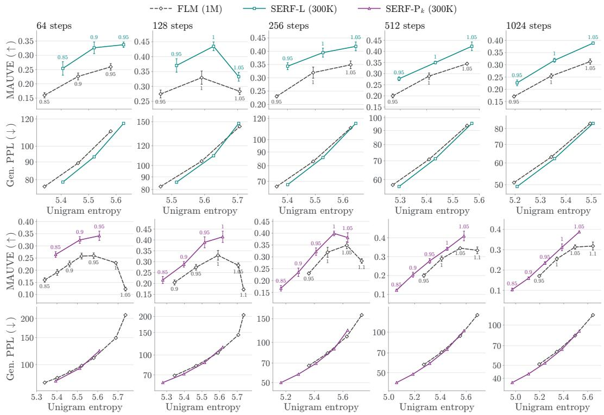  
Figure 8: Mauve and Gen.PPL fronts for $\mathrm { S E R E { - L } }$ and $\mathrm { S E R F { - } } \mathrm { P } _ { k }$ at 300K steps and for the baseline FLM at 1M steps. Curves obtained by sweeping the sampling temperature τ .

## A.4 ADDITIONAL DETAILS ON SERF

Implementation Details. Unless otherwise noted, the following settings are shared across all three baselines (FLM, ELF and S-FLM). In both variants of SERF, the teacher is an EMA of the model weights (decay $\alpha = 0 . 9 9 9 9 )$ , evaluated without gradients on the same noised sequence as the student but at a cleaner time. The regularization weight is $\lambda = 2 . 0$ for $\mathrm { S E R E { - } L }$ and $\bar { \lambda = 0 . 1 }$ for SERF-P. For SERF-L, the output of student block $k _ { s } = 2$ is passed through a two-layer MLP projection head (768 1536 768, SiLU) and aligned with the output of teacher block $k _ { t } = 1 0$ using a per-token cosine distance. The same MLP architecture is used for $\mathrm { S E R E { - } } \mathrm { P } _ { k }$ . The projection head is used only during training and discarded at inference. For SERF-P and ${ \mathrm { S E R F } } { \mathrm { - P } } _ { k } ,$ the distillation loss is enabled after an initial warm-up phase of 10K training steps. Training algorithms for SERF-L and $\mathrm { S E R E { - } P }$ , assuming FLM as the base model, are presented in Algorithm 1 and Algorithm 2 respectively.

Computational overhead. SERF adds no cost at sampling time. The teacher and the SERF-L projection head are used only during training, and the model we sample from is the same network as the baseline. During training, each step needs one extra forward pass of the EMA teacher on the cleaner input. This pass runs without gradients and keeps no activations for the backward pass. A forward pass costs roughly a third of a forward-backward step, so SERF makes each training step 30% slower as measured on our resources. The remaining additions (the EMA update of the teacher weights, the small projection head and the SERF loss) are negligible. Even accounting for this per-step overhead, SERF-L reaches the quality of the baselines in much less wall-clock time, namely 7.7 faster for MAUVE, and Gen. PPL, and 1.4 for GSM8K accuracy.

Algorithm 1 SERF-L Training (Latent Distillation)   
Require: Dataset , λ, α, blocks $k _ { s } , k _ { t }$   
Initialize: Student and Teacher $f _ { \theta } , f _ { \bar { \theta } } , \bar { \theta }  \theta ,$ projection head gθ   
repeat   
x1 onehot(y), y  ; ϵ  N(0, I)   
Sample s, t ▷ See Sec. 3.3   
$\mathbf { x } _ { s } \gets s \mathbf { x } _ { 1 } + ( 1 - s ) \mathbf { \epsilon } , \mathbf { x } _ { t } \gets t \mathbf { x } _ { 1 } + ( 1 - t ) \epsilon$   
pθ fθ(xs, s)   
zθ $\begin{array} { r } { \longleftarrow g _ { \theta } \left( \mathbf { h } _ { \theta } ^ { ( k _ { s } ) } ( \mathbf { x } _ { s } , s ) \right) , \bar { \mathbf { z } } \longleftarrow \mathrm { s g } \left( \mathbf { h } _ { \bar { \theta } } ^ { ( k _ { t } ) } ( \mathbf { x } _ { t } , t ) \right) } \end{array}$   
$\begin{array} { r } { \mathcal { L } _ { \mathrm { F L M } } = - \frac { 1 } { L } \sum _ { l } ( \mathbf { x } _ { 1 } ^ { l } ) ^ { \top } } \end{array}$ log plθ   
LDistill = 1 P dist zlθ, z¯l   
Update θ: SERF = FLM + λ Distil   
Update ¯θ α¯θ + (1 α)θ   
until converged

Algorithm 2 SERF-P Training (Probability Distribution Distillation)   
Require: Dataset , λ, α   
Initialize: Student and Teacher $f _ { \theta } , f _ { \bar { \theta } } , \bar { \theta }  \theta ,$   
repeat   
x1 onehot(y), y ; ϵ N(0, I)   
Sample s, t ▷ See Sec. 3.3   
xs sx1 + (1  s)ϵ, xt tx1 + (1  t)ϵ   
pθ fθ(xs, s), q¯ sg f¯(xt, t)   
$\begin{array} { r } { \mathcal { L } _ { \mathrm { F L M } } = - \frac { 1 } { L } \sum _ { l } ( \mathbf { x } _ { 1 } ^ { l } ) ^ { \top } } \end{array}$ log plθ   
Distill = 1 P (ql¯)⊤ log pl   
Update θ: SERF = FLM + λ Distill   
Update ¯θ α¯θ + (1 α)θ   
until converged

Algorithm 3 SERF-P Training (Probability Distribution Distillation from block k)   
Require: Dataset , λ, α, block k   
Initialize: Student and Teacher $f _ { \theta } , f _ { \bar { \theta } } , \bar { \theta }  \theta ,$ projection head gθ   
repeat   
x1 onehot(y), y  ; ϵ  N(0, I)   
Sample s, t ▷ See Sec. 3.3   
xs sx1 + (1  s)ϵ, xt tx1 + (1  t)ϵ   
pθ ← fθ(xs, s)   
$\mathbf { p } _ { \theta } ^ { ( k ) } \gets o _ { \bar { \theta } } \Big ( g _ { \theta } \big ( \mathbf { h } _ { \theta } ^ { ( k ) } ( \mathbf { x } _ { s } , s ) \big ) \Big ) , \mathbf { q } _ { \bar { \theta } } \gets \mathrm { s g } \big ( f _ { \bar { \theta } } ( \mathbf { x } _ { t } , t ) \big )$   
LFLM = − 1L Pl(xl1)⊤ log plθ   
$\begin{array} { r } { \mathcal { L } _ { \mathrm { D i s t i l l } } = - \frac { 1 } { L } \sum _ { l } ( \mathbf { q } _ { \bar { \theta } } ^ { l } ) ^ { \top } \log \mathbf { p } _ { \theta } ^ { ( k ) , l } } \end{array}$   
Update θ: SERF = FLM + λ Distill   
Update ¯θ α¯θ + (1 α)θ   
until converged

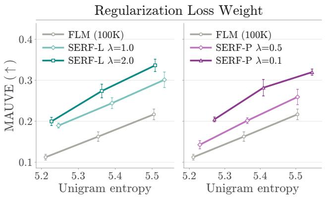

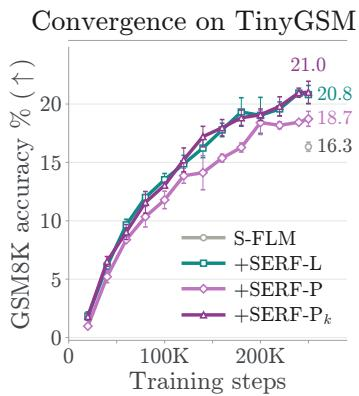  
Figure 9: Left: Regularization weight ablation for SERF-L and SERF-P. Right: Training convergence of $\mathtt { S E R F - L } , \mathtt { S E R F - P }$ and $\mathrm { S E R E { - } } \mathrm { P } _ { k }$ against the S-FLM baseline, trained on TinyGSM and evaluated by GSM8K accuracy with 32 sampling steps.

GSM8K evaluation. We evaluate on all GSM8K test problems. The problem statement is supplied as a clean prefix and is held fixed throughout sampling, so generation acts only on the answer. Since this sampler is deterministic given the initial noise, we repeat each evaluation over 5 noise seeds and report the mean.

Baselines. Baseline results for FLM and S-FLM are taken from their respective papers. On GSM8K (Fig. 5), we compare against two discrete diffusion language models, MDLM (Sahoo et al., 2024) and DUO (Sahoo et al., 2025), and three continuous diffusion language models, CANDI (Pynadath et al., 2025), FLM (Lee et al., 2026) and S-FLM (Deschenaux & Gulcehre, 2026). All results in this table, including the autoregressive baselines, are taken from Deschenaux & Gulcehre (2026).

Computational Resources. For both training and sampling we use 8 NVIDIA GH200 96GB GPUs.

## A.5 ADDITIONAL EVALUATION DETAILS

Entropy-matched generative perplexity. Generative perplexity can be lowered simply by sampling at a lower temperature, which also lowers sample diversity. Comparing models at a fixed temperature is therefore misleading, so we report Gen. PPL at a fixed sample entropy instead. For each model we draw 5,000 samples at a small sweep of temperatures, τ 0.95, 1.0, 1.05 . For each temperature we record the Gen. PPL and the mean per-sequence unigram entropy H. We then interpolate the sweep to a target entropy H = 5.44, which is the entropy of OpenWebText validation text.

## B ADDITIONAL EXPERIMENTAL RESULTS

## B.1 TRAINING ACCELERATION ON TINYGSM

Figure 9 (right) tracks GSM8K accuracy over training, measured with 32 sampling steps and averaged over 4 evaluation seeds. Both SERF variants learn faster than the S-FLM baseline. SERF-L reaches the accuracy of the released S-FLM checkpoint, trained for 250K steps (16.3%), after only 140K steps (16.2%), that is, with 1.8 fewer training steps. SERF-P does so after 180K steps (1.4 fewer). At 250K steps, SERF-L reaches 20.8% and SERF-P 18.7%, respectively 4.5 and 2.4 points above S-FLM. Taking into account SERF’s per-step overhead of roughly 30%, SERF-L still matches the baseline 1.4 faster in training time.

## B.2 EFFECT OF THE SELF-REGULARIZATION WEIGHT λ.

Fig. 9 (left) reports MAUVE against unigram entropy for SERF-L and SERF-P under different regularization weights. The two variants respond to λ in opposite directions: SERF-L benefits from a larger weight (0.336 at λ = 2.0 vs. 0.321 at $\lambda = 1 . 0 )$ , whereas SERF-P degrades as the weight grows (0.320 at $\lambda = 0 . 1 \mathrm { v s . } 0 . 2 5 9 \mathrm { a t } \lambda = 0 . 5 )$ . This reflects the scale of the two alignment losses. The cosine distance used by SERF-L is bounded and much smaller in magnitude than the cross-entropy of $\mathcal { L } _ { \mathrm { F L M } } .$ , so a larger λ is needed for it to meaningfully affect training. In contrast, SERF-P employs a cross-entropy loss on the same scale as $\mathcal { L } _ { \mathrm { F L M } }$ , thus increasing λ shifts the effective target away from the ground truth and toward the teacher’s prediction.

Table 2: Sources of the numbers in Fig. 1. For each value, we list the compared models and where the underlying numbers are reported.
<table><tr><td rowspan=1 colspan=1>METRIC        VALUE  COMPARISON          SOURCE</td></tr><tr><td rowspan=1 colspan=1>Left: wall-clock training acceleration</td></tr><tr><td rowspan=1 colspan=1>MAUVE         $\sim 7 . 7 \times$     $\mathrm { S E R F - L ~ v s . ~ F L M }$         $\mathrm { F i g . 4 ( l e f t ) }$ Gen. PPL        $\sim 7 . 7 \times$    $\mathrm { S E R F - L ~ v s . ~ F L M }$         $\mathrm { F i g . 4 ( r i g h t ) }$ GSM8K Acc.    $\sim 1 . 4 \times$    $\mathtt { S E R F - L } \mathtt { v s . } \mathtt { S - F L M }$      $\mathrm { { F i g . 9 ( r i g h t ) , } }$ </td></tr><tr><td rowspan=1 colspan=1>Middle: relative improvement at the same sampling budget</td></tr><tr><td rowspan=1 colspan=1>MAUVE        $+ 2 4 . 3 \%$    $\mathrm { S E R F - L ~ v s . ~ F L M }$        Tab. 1 (top)Gen. PPL       +2.8%   $\mathrm { S E R F - L ~ v s . ~ F L M }$        Tab. 1 (bottom)GSM8K Acc.   $+ 2 8 . 8 \%$    $\mathtt { S E R F - P \mu \nu s . } \mathtt { S - F L M }$    Fig. 5 (left)</td></tr><tr><td rowspan=1 colspan=1>Right: sampling acceleration</td></tr><tr><td rowspan=1 colspan=1>MAUVE           $\sim 2 \times$    SERF VS. FLM          Tab. 1 (top)Gen. PPL          $\sim 4 \times$    $\mathrm { S E R F ~ v s . ~ F L M }$           Tab. 1 (bottom)GSM8K Acc.     $\sim 6 4 \times$    $\boldsymbol { \mathrm { S E R F ~ v s . ~ S ^ { - } F I M } ^ { * } }$       Fig. 5 (middle)</td></tr></table>

## C QUALITATIVE COMPARISONS

We present qualitative comparisons with the baseline FLM in Fig. 10, Fig. 11, Fig. 12 and Fig. 13. For each comparison, we use the same initial Gaussian noise and vary only the trained denoiser, generating samples with 1024 sampling steps. Since Euler sampling is deterministic given the initial noise, this setup allows a direct comparison between the two learned flows. As shown in the examples, SERF produces more coherent and grammatically well-formed text. In contrast, the baseline FLM more often generates degenerate fragments, repeated symbols, and locally incoherent phrases.

## D LIMITATIONS AND FUTURE WORK

Our method is currently developed and evaluated for continuous flow-based language models. Extending the framework to discrete diffusion language models (Sahoo et al., 2024; Schiff et al., 2024) represents a promising direction for future work. Since discrete diffusion models follow different corruption and denoising dynamics than continuous flows, adapting the teacher supervision mechanism may require additional design considerations. We view this as an opportunity to further generalize our framework and broaden its applicability.

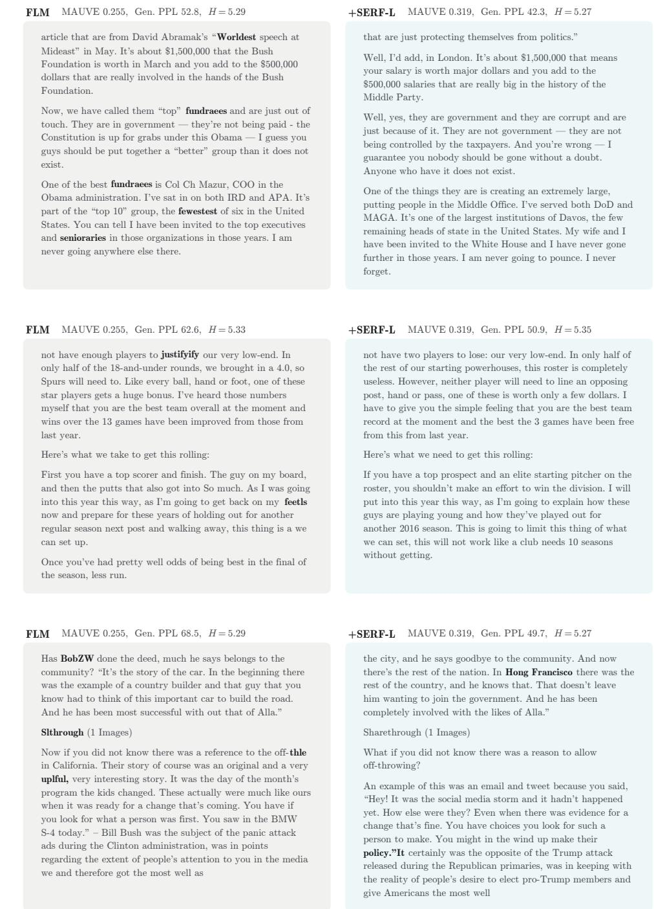  
Figure 10: Generated samples on OWT. Samples from FLM (left) and SERF-L (right), all trained for 1M and 300K steps respectively. Text generated with 1024 sampling steps from the same initial noise. Errors are highlighted in bold.

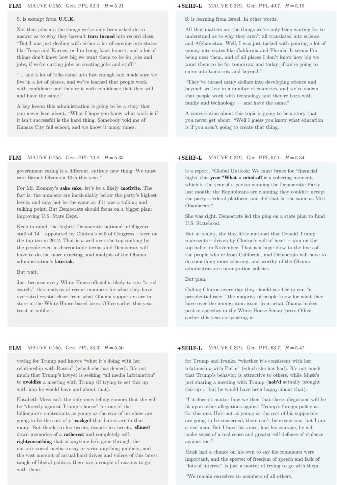  
Figure 11: Generated samples on OWT. Samples from FLM (left) and SERF-L (right), all trained for 1M and 300K steps respectively. Text generated with 1024 sampling steps from the same initial noise. Errors are highlighted in bold.

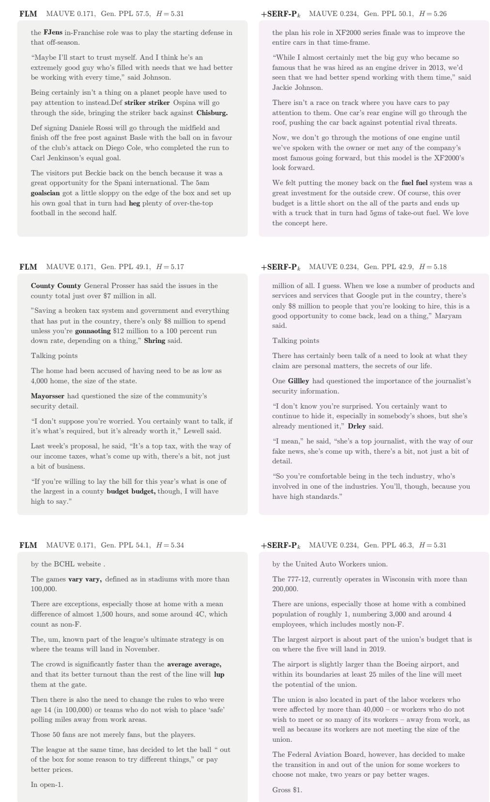  
Figure 12: Generated samples on OWT. Samples from FLM (left) and $\mathrm { S E R F { - } } \mathrm { P } _ { k }$ (right), all trained for 1M and 300K steps respectively. Text generated with 1024 sampling steps from the same initial noise. Errors are highlighted in bold.

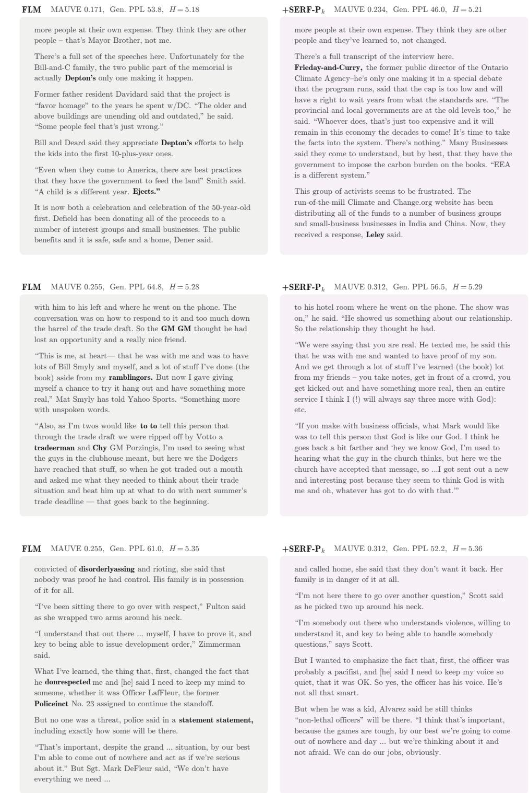  
Figure 13: Generated samples on OWT. Samples from FLM (left) and $\mathrm { S E R F { - } } \mathrm { P } _ { k }$ (right), all trained for 1M and 300K steps respectively. Text generated with 1024 sampling steps from the same initial noise. Errors are highlighted in bold.