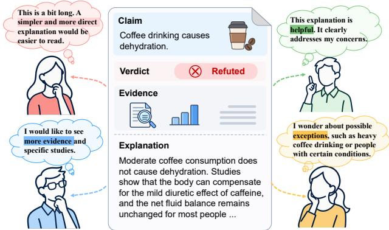
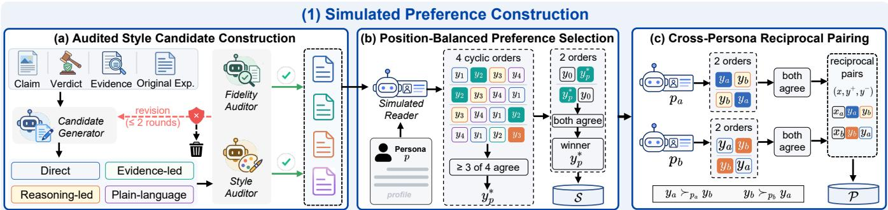
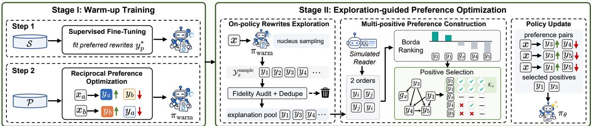
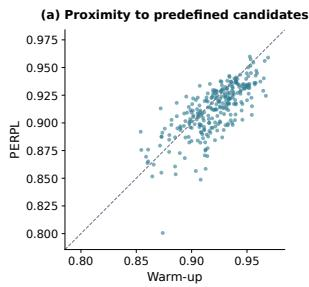
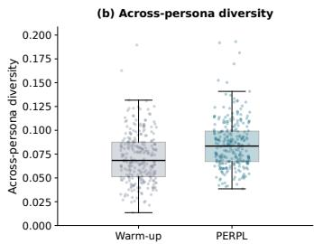
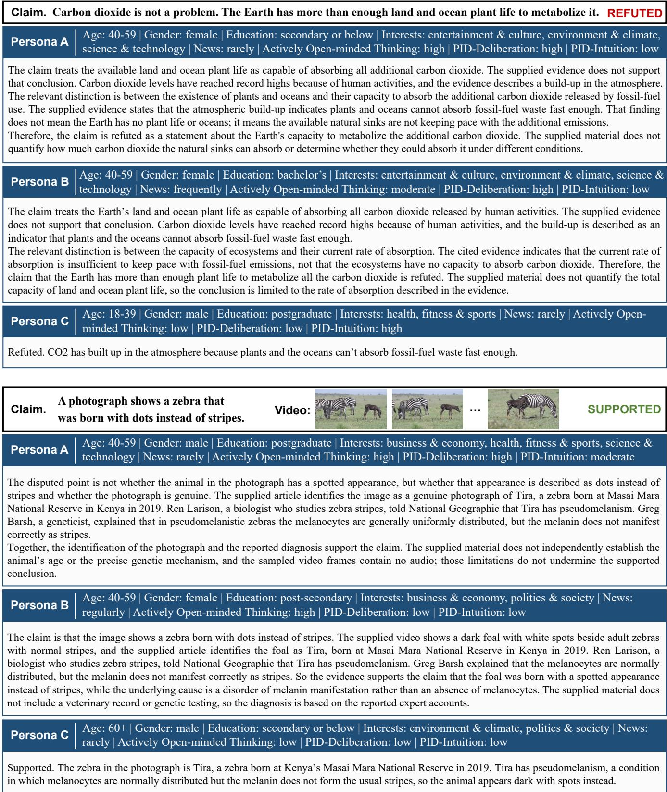

# Same Verdict, Diferent Readers: Personalizing Fact-Checking Explanations from Relative Preferences

Haokun Wen National University of Singapore Singapore haokunwen@outlook.com

Mong-Li Lee National University of Singapore Singapore dcsleeml@nus.edu.sg

## Abstract

Fact-checking explanations help Web users understand why a claim receives its verdict, yet the same explanation may not satisfy readers with diferent backgrounds and preferences. We formulate Faithful Personalized Fact-Checking Explanation Rewriting, which adapts an existing explanation to individual readers while preserving factual fidelity. Rather than relying on reader-written reference expla- nations, we learn personalized rewriting from the relative prefer-ences of LLM-simulated readers. However, this presents two chal lenges: distinguishing persona-specific preferences from general explanation quality and learning beyond a limited set of predefined explanation styles. To address these challenges, we propose Per- sonalized Explanation Rewriting via Preference Learning (PERPL), a framework consisting of two components. Simulated Preference Construction derives persona-specific supervision from simulated reader preferences through cross-persona reciprocal pairing. Pro-gressive Preference Learning first trains a lightweight rewriter on the constructed supervision and then refines it through exploration- guided preference optimization, enabling it to discover preferred explanations beyond the predefined styles. Extensive experiments demonstrate that PERPL outperforms much larger general-purpose LLMs in personalized preference alignment while maintaining high factual fidelity.

## CCS Concepts

• Information systems → Personalization; Web applications; • Computing methodologies → Natural language generation.

## Keywords

Fact-Checking Explanation, Personalization, Preference Learning, User Simulation

## 1 Introduction

Xuemeng Song Southern University of Science and Technology Shenzhen, China sxmustc@gmail.com

Misinformation on the Web can mislead the public and distort pub- lic perceptions. Social platforms enable claims to reach large and diverse audiences rapidly, and false news has been shown to spread faster and farther than true news [29]. Automated fact-checking systems can help address this problem by assessing the veracity of claims. However, a verdict alone does not explain why a claim is judged to be true or false. This has motivated research on generating fact-checking explanations grounded in claim context and

Wynne Hsu National University of Singapore Singapore dcshsuw@nus.edu.sg

  
Figure 1: The same fact-checking explanation may not satisfy the preferences of diferent readers.

supporting evidence [3, 20, 24, 33]. Yet, current fact-checking systems typically present the same explanation to every reader, despite diferences in readers’ backgrounds, interests, and explanation pref- erences [15]. As illustrated in Figure 1, some readers may need more detail, stronger evidence, or a diferent presentation to understand the same claim. Recent work has begun to address this issue by exploring ways to tailor fact-checking explanations to individual readers [2, 8, 22]. However, personalization does not necessarily require generating an entirely new explanation from scratch. When an explanation’s core factual claims are reliable, they can be reused while its presentation is adapted to diferent readers needs. Rewriting existing explanations therefore ofers a way to personalize explanations by building on available fact-checking results, without repeating the underlying verification process.

To this end, we formulate the task of Faithful Personalized Fact-Checking Explanation Rewriting. Given a claim, its verdict, supporting evidence, an original explanation, and a reader profile, the goal is to rewrite the explanation to better match the reader’s preferences while preserving its factual content. Personalization may change how an explanation is organized, what it emphasizes, how much de- tail it provides, and how it is worded, but must preserve the verdict, factual claims, source attributions, and necessary qualifications.

General-purpose LLMs are not specifically trained to adapt fact-checking explanations to individual readers’ preferences. Conse- quently, directly prompting them may not consistently produce explanations that align with individual readers’ needs. We therefore aim to train a dedicated rewriter to learn this task-specific capability.

This requires training supervision that captures individual readers’ explanation preferences. Ideally, such supervision would consist of personalized explanations written by the readers themselves. How- ever, collecting such explanations at scale across diverse claims and reader profiles is challenging because readers may find it dificult to write explanations that reflect their preferences.

Indeed, LLMs have shown promise for simulating users [18, 23], including approximating human responses in surveys and behavioral experiments [1, 31] and user behavior on Web platforms such as recommendation and search [32, 36, 38]. Inspired by this line of work, we employ an LLM conditioned on reader profiles to simulate reader preferences and derive training supervision. Psychological research suggests that people may struggle to articulate their pref-erences directly, whereas their preferences can be more readily elicited through comparisons between concrete alternatives [19, 27]. Following this insight, we obtain preference supervision by asking simulated readers to select from predefined candidate explanations.

However, learning a personalized rewriter from such supervision presents two challenges. 1) Isolating persona-specific preferences. A simulated reader may prefer an explanation because of its overall writing quality rather than its suitability for a particular persona1. As a result, diferent personas may favor the same explanation, providing limited supervision for learning how their preferences difer. Moreover, LLM-based preference judgments can be sensitive to the order in which candidates are presented [30, 37], introducing additional noise into the supervision. The challenge is therefore to obtain reliable preference supervision by mitigat ing general-quality bias and position bias. 2) Learning beyond predefined explanations. Preference supervision derived from predefined candidates is inherently limited by the candidate set, which may not include the explanation that best suits a given persona. Training solely on preferences among these candidates may therefore constrain the rewriter’s ability to generate more suitable explanations beyond the candidate set. The challenge is to enable the rewriter to explore alternative explanations while remaining aligned with persona-specific preferences.

To address these challenges, we propose Personalized Explanation Rewriting via Preference Learning (PERPL), a framework that learns to generate faithful personalized explanations from simu- lated reader preferences. PERPL consists of two components: Simulated Preference Construction and Progressive Preference Learning. To isolate persona-specific preferences, Simulated Preference Construction first generates four candidate explanations in predefined styles and verifies their factual fidelity. An LLM-simulated reader then selects the explanation preferred by each persona, with position-balanced comparisons used to filter unstable judgments. We further construct reciprocal preference pairs in which two personas prefer opposite explanations of the same claim. These pairs provide direct supervision for learning how explanation preferences difer across personas. To learn beyond predefined explanations, Progressive Preference Learning trains the rewriter in two stages. The warm-up stage applies supervised fine-tuning to the selected explanations and pref- erence optimization to the reciprocal pairs, establishing an initial personalized rewriter. The exploration stage samples new explanations from this rewriter and uses simulated readers to compare them pairwise. By learning from multiple highly ranked explanations identified through Borda aggregation, the rewriter can discover more suitable explanations beyond the predefined styles. Exten- sive experiments demonstrate that PERPL produces explanations that better match simulated reader preferences while preserving factual fidelity, outperforming strong general-purpose LLMs. Our contributions are as follows.

• To the best of our knowledge, we are the first to formulate faithful personalized fact-checking explanation rewriting as a preference learning problem, enabling personalized rewriting without reader-written reference explanations.

• We propose Simulated Preference Construction, which constructs cross-persona reciprocal preference pairs to provide supervision that explicitly captures persona-specific preferences rather than general explanation quality.

• We propose Progressive Preference Learning, which first learns from preferences over predefined explanations and then refines the rewriter through exploration-guided preference optimization with multiple Borda-ranked positives, enabling the discovery of preferred explanations beyond predefined styles.

• Extensive experiments show that PERPL enables a lightweight rewriter to outperform much larger general-purpose LLMs in simulated reader preference while maintaining high factual fi- delity.

## 2 Problem Formulation

We formulate Faithful Personalized Fact-Checking Explanation Rewriting as adapting an existing fact-checking explanation to a reader while preserving fidelity to the evidence and verdict of a claim. Given a claim �, available evidence E, a verdict �, an original expla-nation �0, and a reader profile ${ \boldsymbol { p } } ,$ a rewriter $\pi _ { \theta }$ generates

$$
y \sim \pi _ { \boldsymbol { \theta } } ( . \mid x ) , \qquad x = ( c , \mathcal { E } , v , y _ { 0 } , p ) .\tag{1}
$$

We refer to the reader described by $\mathit { \Delta } ^ { \cdot \ p }$ as a persona. The reader profile captures demographic characteristics, news consumption habits (e.g., frequency and topics of interest), and cognitive dispositions.

## 3 Methodology

Figure 2 illustrates the overall framework of PERPL, which learns the rewriter from the relative preferences of simulated readers.

## 3.1 Simulated Preference Construction

The ideal supervision for personalized rewriting would be an expla-nation tailored to each reader’s preferences. However, psychological research suggests that people may struggle to articulate their pref-erences directly, while their preferences can be more readily elicited through comparisons between concrete alternatives [19, 27]. We therefore derive supervision from readers’ selections among can- didate explanations. Since collecting such preferences from real readers at scale is costly, we turn to LLM-based user simulation, which has shown promise in modeling human responses and be- haviors [1, 18]. Specifically, we employ an LLM conditioned on persona profiles to simulate readers’ explanation preferences. How- ever, these selections may reflect general explanation quality rather than persona-specific preferences, as a well-written explanation may be favored by most readers regardless of their profiles. To isolate persona-specific preferences, we construct the supervision in three steps, as shown in Figure 2(a)–(c).

(2) Progressive Preference Learning  
  
Figure 2: Overview of PERPL. Simulated Preference Construction derives persona-preferred rewrites S and reciprocal pairs P from audited style candidates. Progressive Preference Learning warms up the rewriter on S and P (Stage I), then refines it with Borda-ranked preferences over its own rewrites (Stage II).

3.1.1 Audited Style Candidate Construction. The first step is to construct a set of candidate explanations with distinct presentation styles for each claim, from which simulated readers can select their preferred explanations. To ensure that these selections re- flect presentation preferences rather than diferences in evidential content, the candidates should share a consistent evidential basis. Specifically, for each claim, an LLM-based candidate generator produces four explanations from the same claim, evidence, verdict, and original explanation, each following one of four predefined styles.

• Direct states the verdict first and gives only the shortest sufi-cient support.

• Evidence-led organizes the explanation around the evidence, stating what each piece shows and how it bears on the claim.

• Reasoning-led explains why the findings lead to the conclusion.

• Plain-language conveys the same content using simple, familiar, and easy-to-understand language.

However, LLM-generated candidates may accidentally contain unsupported claims, deviate from their intended styles, or lack suf- ficient distinction from one another. We therefore employ two audi tors to ensure candidate quality. The fidelity auditor checks whether each candidate preserves the meaning of the verdict, whether its factual claims are supported by the provided evidence, and whether it overstates what the evidence establishes. The style auditor re-ceives the four candidates anonymously, without their intended style labels. It checks whether each candidate matches one of the four predefined styles and is clearly distinguishable from the other three candidates. Candidates that fail either audit are revised by the generator based on the auditors’ feedback and re-audited, with up to two revision rounds. A claim is retained only if all four candidates pass both audits. Let $y _ { c } = \{ y _ { 1 } , y _ { 2 } , y _ { 3 } , y _ { 4 } \}$ denote the resulting candidate set. The prompts are provided in Appendix E.1.

3.1.2 Position-Balanced Preference Selection. The second step is to identify persona-preferred explanations from the candidate set Y . This selection is made by an LLM-based simulated reader conditioned on the persona profile �, which selects the candidate that best suits the persona.

Candidate Comparison. Since all candidates have passed the fidelity audit, the simulated reader focuses on their presentation rather than re-evaluating their factual accuracy. Given the claim, verdict, and anonymized candidates without their intended style labels, the simulated reader selects the explanation that best suits the persona. The prompts are provided in Appendix E.2.

A single choice may be unreliable because LLM judges can favor candidates in particular positions [30, 37]. To reduce this position bias, we present the four candidates to each persona under four cyclic permutations, ensuring that every candidate appears once in each position. Let $n _ { \mathnormal { p } } ( y )$ denote the number of times candidate � is selected by the simulated reader conditioned on persona �. We designate a candidate as the persona’s preferred explanation only if it is selected in at least three of the four permutations:

$$
y _ { p } ^ { * } = y \in \mathcal { Y } _ { c } \quad \mathrm { i f } n _ { p } ( y ) \geq 3 ,\tag{2}
$$

and no candidate is assigned otherwise.

Candidate vs. Original. The above selection identifies the most preferred candidate among the four generated explanations, but does not establish whether it is preferred over the original expla- nation �0. Since our goal is to obtain personalized rewrites that improve upon $y _ { 0 } .$ , we further compare the selected candidate $\boldsymbol { y } _ { p } ^ { * }$ with �0 in both presentation orders to reduce position bias. Formally, we define the preference relation as

$$
y _ { i } \succ _ { p } y _ { j } \iff J _ { p } ( y _ { i } , y _ { j } ) = y _ { i } \land J _ { p } ( y _ { j } , y _ { i } ) = y _ { i } ,\tag{3}
$$

where $J _ { \mathit { p } } ( \cdot , \cdot )$ is the choice of the simulated reader with the first argument shown first. Disagreement between the two orders yields no preference. We retain $\boldsymbol { y } _ { p } ^ { * }$ only i $\cdot \ y _ { p } ^ { * } \succ _ { p }$ �0, and the retained pairs form the persona-preferred set $S = \dot { \{ ( x , y _ { p } ^ { * } ) \} }$

3.1.3 Cross-Persona Reciprocal Pairing. The persona-preferred set $s$ provides supervision by associating each persona with its preferred explanation. However, a candidate may be selected because of its overall writing quality rather than its suitability for a particular persona. Training directly on these selections may therefore encourage the rewriter to produce generally well-written explana tions without suficiently learning how preferences difer across personas. To provide more explicit persona-specific supervision, we construct reciprocal preference pairs in which two personas prefer opposite explanations of the same claim.

Specifically, consider two personas $\phi _ { a }$ and $\scriptstyle { \mathcal { P } } b$ for the same claim, whose preferred candidates $y _ { a } = y _ { p _ { a } } ^ { * }$ and $y _ { b } = y _ { p _ { b } } ^ { * }$ difer. Although these candidates were selected from the same set of four explana- tions, the initial four-way selections do not guarantee that each persona prefers its own candidate when the two selected candidates are directly compared. We therefore ask the simulated reader condi- tioned on each persona to compare $y _ { a }$ and $y _ { b }$ in both presentation orders, and retain the pair only if

$$
y _ { a } \succ _ { p _ { a } } y _ { b } \quad { \mathrm { a n d } } \quad y _ { b } \succ _ { p _ { b } } y _ { a } ,\tag{4}
$$

where $\succ _ { p }$ follows $\operatorname { E q . } \left( 3 \right)$ . Each retained pair yields two training examples for the reciprocal preference set $\mathcal { P } .$ For persona $\mathcal { P } a ;$ , �� is preferred over ��, giving $( x _ { a } , y _ { a } , y _ { b } )$ , while the reverse holds for ${ \mathit { p } } _ { b } ,$ giving $( x _ { b } , y _ { b } , y _ { a } )$ . Here, $x _ { a }$ and $x _ { b }$ difer only in their persona profiles, while sharing the same claim, evidence, verdict, and origi- nal explanation. The opposite preferences over the same candidate pair directly supervise the learning of persona-specific preferences.

## 3.2 Progressive Preference Learning

The supervision constructed in Section 3.1 identifies persona pref-erences among four predefined explanation styles. However, these predefined candidates may not include the explanation that best suits a persona, limiting what the rewriter can learn from them. To address this limitation, we adopt a two-stage learning strategy that progressively expands the sources of preference supervision, as illustrated in Figure 2. Stage I learns an initial personalized rewriter from preferences over predefined explanations (Section 3.2.1). Building on this rewriter, Stage II explores new explanations generated by the model itself and further optimizes the rewriter using simulated reader preferences over these new candidates (Section 3.2.2). This progression enables the rewriter to move beyond the predefined styles and discover explanations better aligned with personas.

3.2.1 Stage I: Warm-up Training. We instantiate the rewriter �� with an LLM backbone. Following the common practice of su-pervised fine-tuning followed by preference optimization [21, 25], Stage I first fine-tunes the backbone on S to learn persona-preferred rewriting, and then optimizes it on $\mathcal { P }$ to capture preference difer- ences across personas.

Supervised Fine-Tuning (Step 1). We first apply supervised fine-tuning on S. For an input � and an explanation �, we define $s _ { \theta } ( y \mid x )$ as the length-normalized log-likelihood score of � under the rewriter:

$$
s _ { \theta } ( y \mid x ) = { \frac { 1 } { | y | } } \sum _ { t = 1 } ^ { | y | } \log \pi _ { \theta } ( y _ { t } \mid x , y _ { < t } ) .\tag{5}
$$

A higher score indicates that the rewriter assigns greater likelihood to the explanation, after accounting for its length. We minimize the negative score of each persona-preferred explanation:

$$
\mathcal { L } _ { \mathrm { S F T } } = - \mathbb { E } _ { ( x , y ) \sim S } s _ { \theta } ( y \mid x ) .\tag{6}
$$

Reciprocal Preference Optimization (Step 2). We then perform preference optimization on the reciprocal pairs in $\mathcal { P }$ using a DPO-style loss [25]. Since reciprocal pairs encode opposite pref-erences for the same explanations under diferent personas, opti- mizing these pairs encourages the rewriter to distinguish persona-specific preferences rather than favoring generally preferred expla- nations. For each preference pair $( x , y ^ { + } , y ^ { - } )$ , we define the DPO- style loss as

$$
\begin{array} { r } { \ell _ { \theta } ^ { \rho } ( x , y ^ { + } , y ^ { - } ; \beta ) = - \log \sigma \Big ( \beta \big [ \Delta _ { \theta } ^ { \rho } ( y ^ { + } \mid x ) - \Delta _ { \theta } ^ { \rho } ( y ^ { - } \mid x ) \big ] \Big ) , } \end{array}\tag{7}
$$

where $\Delta _ { \theta } ^ { \rho } ( y \mid x ) = s _ { \theta } ( y \mid x ) - s _ { \rho } ( y \mid x ) , \rho$ denotes a frozen reference policy, and $\beta$ is a temperature hyperparameter. Following [17], we use length-normalized log-likelihoods to account for diferences in explanation length.

For Step 2, we initialize the rewriter from the fine-tuned model and keep a frozen copy as the reference policy $\rho _ { \mathrm { I } }$ . While the DPOstyle loss optimizes relative preferences, it does not explicitly en-courage a high likelihood for the preferred explanation itself. We therefore introduce an auxiliary likelihood term that directly en- courages the rewriter to assign higher likelihood to persona-preferred explanations. The resulting reciprocal preference objective is

$$
\mathcal { L } _ { \mathrm { R e c } } = \mathbb { E } _ { ( x , y ^ { + } , y ^ { - } ) \sim \mathcal { P } } \left[ \ell _ { \theta } ^ { \rho _ { \mathrm { I } } } ( x , y ^ { + } , y ^ { - } ; \beta _ { \mathrm { I } } ) - \alpha s _ { \theta } ( y ^ { + } \mid x ) \right] ,\tag{8}
$$

where � controls the contribution of the auxiliary likelihood term, which directly reinforces the generation of preferred explanations. Together, these two terms encourage the rewriter to learn personaspecific preferences while maintaining its ability to generate the corresponding preferred explanations. The resulting rewriter, de-noted $\pi _ { \mathrm { w a r m } } ,$ , provides the starting point for subsequent exploration.

3.2.2 Stage II: Exploration-guided Preference Optimization. Unlike Stage I, which learns from preferences over predefined explana- tions, Stage II explores new explanations generated by the rewriter itself and learns from simulated reader feedback. Following the self-improvement paradigm [9, 35], we use the warm-up rewriter to generate diverse personalized explanations and construct new preference supervision from comparisons among these outputs. This allows the rewriter to learn from explanations beyond the pre- defined styles and better align with persona-specific preferences.

On-policy Rewrites Exploration. For each input �, we sample � personalized rewrites from $\pi _ { \mathrm { { w a r m } } } ( \cdot \mid x )$ using temperature-scaled nucleus sampling [12] to encourage diversity. All sampled rewrites undergo factual fidelity auditing using the auditor introduced in

Section 3.1.1. After filtering out failures and duplicates, we obtain an explanation pool $y _ { x }$ of $M _ { x }$ distinct rewrites.

Multi-Positive Preference Construction. Given the explanation pool $y _ { x } ,$ our goal is to construct reliable preference pairs for training. Specifically, we first identify reliable positive rewrites that align well with the given persona’s preferences, which serve as anchors for subsequent preference pair construction. We then pair these positives with less-preferred candidates to construct preference pairs.

Borda-Based Candidate Ranking. To this end, we rank candidates in $y _ { x }$ using Borda scores [7], which aggregate pairwise comparison outcomes into an overall preference score. We additionally include the greedy-decoded rewrite $g _ { x }$ , representing the warm-up rewriter’s default output, as a reference for the rewrite preference comparisons. Let $\widetilde { y } _ { x } = y _ { x } \cup \{ g _ { x } \}$ denote the whole comparison set. For each $y _ { i } \in \widetilde { \mathcal { Y } } _ { x }$ , the normalized Borda score is defined as

$$
b ( y _ { i } ) = \frac { 1 } { | \widetilde { y } _ { x } | - 1 } \sum _ { j \neq i } \frac { a _ { i j } ^ { ( 1 ) } + a _ { i j } ^ { ( 2 ) } } { 2 } ,\tag{9}
$$

where $a _ { i j } ^ { ( k ) }$ equals +1 if the �-th comparison favors $y _ { i } , - 1$ if it favors $y _ { j }$ , and 0 otherwise. A higher Borda score indicates stronger overall preference support across the explanation pool.

Preference-Guided Positive Selection. A straightforward approach is to select top-ranked explanations with positive Borda scores as positives. However, Borda-based ranking alone is insuficient, as an aggregate score does not explicitly capture reliable pairwise preference relations. Furthermore, the selected positives should not exhibit a clear preference ordering among themselves, as they are all intended to serve as positive examples for the same persona. To address these limitations, we further construct a directed prefer- ence graph over the candidate pool $y _ { x }$ , where each node represents a candidate explanation and an edge $y _ { i }  y _ { j }$ indicates that $y _ { i }$ is reliably preferred to $y _ { j } .$ , as confirmed by both comparison orders. Based on the Borda scores and preference graph, we select up to � positives from $y _ { x }$ in descending order of their Borda scores. A candidate is selected only if (1) its Borda score is positive; (2) it has at least one outgoing edge, indicating a reliable preference over another explanation across both presentation orders; and (3) it has no reliable preference relation with any previously selected positive, ensuring that the selected positives have no clear preference ordering among themselves. The resulting positive set is denoted by $\mathcal { K } _ { x }$

For preference optimization, we pair each selected positive with explanations that are consistently judged less preferable in both comparison orders and have lower Borda scores. Specifically, we define the preference-pair set as:

$$
\begin{array} { r l } & { \mathcal { P } _ { x } = \big \{ ( y ^ { + } , y ^ { - } ) \mid y ^ { + } \in \mathcal { K } _ { x } , ~ y ^ { - } \in \widetilde { \mathcal { Y } } _ { x } \setminus \mathcal { K } _ { x } , } \\ & { ~ y ^ { + } \succ _ { \hat { p } } y ^ { - } , ~ b ( y ^ { + } ) > b ( y ^ { - } ) \big \} . } \end{array}\tag{10}
$$

This ensures that each training pair is supported by both an orderconsistent pairwise preference and the overall Borda ranking.

Policy Update. We optimize the rewriter using the constructed preference pairs $\mathcal { P } _ { x }$ . For inputs with empty $\mathcal { P } _ { x } ,$ we skip the policy update; otherwise, we optimize the rewriter using the following objective. Following Stage I, we combine the DPO-style loss in

Table 1: Attributes used to construct reader personas.
<table><tr><td>Attribute</td><td>Values</td></tr><tr><td colspan="2">Demographic Characteristics</td></tr><tr><td>Age</td><td>Young (18–39), Middle-aged (40–59), Older (60+)</td></tr><tr><td>Gender</td><td>Female, Male</td></tr><tr><td>Education</td><td>Secondary or below, Post-secondary, Bachelor&#x27;s, Postgraduate</td></tr><tr><td colspan="2">News Consumption Habits</td></tr><tr><td>News consumption frequency</td><td>Rarely (≤ weekly), Regularly (&gt; weekly, &lt; daily), Frequently</td></tr><tr><td>Interested topics</td><td>(≥ daily) Politics &amp; Society; Health, Fitness &amp; Sports; Science &amp; Tech- nology; Environment &amp; Climate; Business &amp; Economy; Enter-</td></tr><tr><td></td><td>tainment &amp; Culture Cognitive Dispositions</td></tr><tr><td colspan="2"></td></tr><tr><td>PID-Deliberation [4]</td><td>Low, Moderate, High</td></tr><tr><td>PID-Intuition [4]</td><td>Low, Moderate, High</td></tr><tr><td>AOT [11]</td><td>Low, Moderate, High</td></tr></table>

Eq. (7), which learns relative preferences between explanations, with an auxiliary likelihood term that encourages the generation of preferred explanations. For the auxiliary likelihood term, we define $C _ { x }$ as the set of positive explanations in $\mathcal { P } _ { x }$ . Specifically, we initialize the rewriter from $\pi _ { \mathrm { w a r m } }$ and retain a frozen copy as the reference policy $\rho _ { \mathrm { I I } } .$ . The training objective is

$$
\mathcal { L } _ { x } = \frac { 1 } { \vert { \mathcal { P } } _ { x } \vert } \sum _ { ( y ^ { + } , y ^ { - } ) \in { \mathcal { P } } _ { x } } \ell _ { \theta } ^ { \rho _ { \Pi } } ( x , y ^ { + } , y ^ { - } ; \beta _ { \Pi } ) - \frac { \lambda } { \vert C _ { x } \vert } \sum _ { y ^ { + } \in C _ { x } } s _ { \theta } ( y ^ { + } \mid x ) ,\tag{11}
$$

where � controls the contribution of the auxiliary likelihood term. The resulting rewriter serves as the final model and generates a personalized explanation directly from � at inference.

## 4 Experiments

In this section, we first describe the experimental setup and then present the experimental results and corresponding analyses.

## 4.1 Experimental Setup

Datasets. As our task rewrites existing fact-checking explanations, we construct our corpus from three established fact-checking datasets providing explanatory content: MOCHEG [33], TRUE [20], and VeriTaS [26]. To ensure clear fact-checking conclusions, we retain only instances whose verdicts can be mapped to Supported or Refuted, excluding ambiguous or insuficient-evidence cases. We further restrict the multilingual VeriTaS dataset to English for language consistency. MOCHEG and TRUE provide relatively de- tailed original explanations, averaging 107 and 93 words, respectively, which we use directly for rewriting. In contrast, VeriTaS provides shorter justifications (35 words on average). We therefore use $\mathrm { Q w e n } 3 . 8 – 2 7 \mathrm { B } ^ { 2 }$ to construct self-contained explanations grounded in the corresponding fact-checking articles, averaging approximately 75 words. These dataset-provided or reconstructed explanations are used as the original explanations for rewriting. We also retain all available textual and visual evidence to support faith- ful rewriting. We remove duplicate claims and assign claims related to the same underlying event to the same split to reduce informa- tion leakage. To ensure consistent style coverage across claims, we further retain only claims for which all four predefined styles of explanation can be successfully generated and quality-checked. The resulting corpus contains 2,080 claims: 1,540 for training, 269 for validation, and 271 for testing, including 689 from MOCHEG, 567 from TRUE, and 824 from VeriTaS.

Personas. To capture diverse reader backgrounds and informationprocessing preferences, we construct personas using demographic characteristics, news consumption habits, and cognitive dispo-sitions, as summarized in Table 1. The first two are motivated by research on misinformation engagement and news consump- tion [6, 10, 34], while cognitive dispositions are represented by Preference for Intuition and Deliberation (PID) [4] and Actively Open-minded Thinking (AOT) [11]. For each claim, we randomly combine attribute values to generate ten personas, yielding 20,800 claim–persona pairs.

Implementation Details. For simulated preference construction, we use GPT-5.6-Sol to generate diverse style-specific candidate ex-planations, where reliable generation is essential for subsequent preference construction, and the more cost-eficient GPT-5.6-Luna for fidelity and style auditing. We then employ Qwen3.8-27B, an open-weight multimodal LLM, as the simulated reader for prefer- ence construction and Stage II exploration, to reduce API costs and facilitate reproducible preference judgments. We adopt Qwen3.5- $\mathrm { 4 B ^ { 3 } }$ as a lightweight rewriter backbone and fine-tune it using LoRA [13]. We use AdamW [16] for optimization, with learning rates of $5 \times 1 0 ^ { - 5 } , 1 0 ^ { - 5 }$ , and $5 \times 1 0 ^ { - 6 }$ for SFT, Stage I preference optimization, and Stage II, respectively. Stage II samples 4 rewrites per input alongside a greedy-decoded reference and selects up to 2 positives. Further settings are provided in Appendix C.

## 4.2 Personalized Rewriting Performance

In the absence ofestablished baselines for personalized fact-checking explanation rewriting, we compare PERPL with eight zero-shot LLMs, including three open-weight models (Qwen3.5-4B, Qwen3.8- 27B, and MiMo-V2.6-Flash) and five proprietary models (Qwen3.8- Max, Claude-Sonnet-5, Gemini-3.8-Flash, GPT-5.6-Luna, and GPT-6-Astra). All methods receive the same claim, verdict, evidence, original explanation, and reader profile under identical rewriting instructions. We evaluate 271 test claims with ten personas each, yielding 2,710 claim–persona pairs.

Original vs. Rewrite. We first compare the rewritten explanations produced by PERPL and all baselines against their original counterparts to evaluate their factual fidelity and preference align- ment. To evaluate whether the results are consistent across difer- ent evaluators, we employ three LLM-based evaluators: Qwen3.8- 27B, GPT-5.6-Luna, and GLM-5.3-Flash (denoted as Qwen, GPT, and GLM). For fidelity evaluation, each evaluator independently assesses each explanation using the fidelity assessment criteria defined in Section 3.1.1. For preference evaluation, each evalua- tor simulates the target reader and compares two explanations in both presentation orders with Eq. (3). Ultimately, we report three evaluation metrics: 1) Fidelity Pass Rate (Fid.), the proportion of rewrites passing the fidelity assessment by majority vote among the three evaluators; 2) Rewrite–Original Preference, the percentages of each evaluator’s judgments categorized as Win (preferred in both orders), Loss (dispreferred in both), Tie (tied in both), or Order Disagreement (OD; inconsistent judgments across orders);

and 3) Fidelity–Preference Win Rate (FPW), computed for each evaluator as the proportion of rewrites that pass the majority-vote fidelity assessment and consistently win against the original expla-nation under both presentation orders. We also report the average FPW across the three evaluators.

Table 2 reports the results, from which we draw the following observations. 1) PERPL achieves strong rewriting performance and factual fidelity. PERPL achieves a high fidelity pass rate and the best average FPW among all eight baselines, including GPT-6-Astra. It also achieves the highest FPW under Qwen and GLM while remaining competitive under GPT. These results demonstrate that PERPL enables a lightweight 4B model to balance personal- ized preference alignment and factual fidelity, outperforming much larger models on the overall metric. 2) Factual fidelity and reader preference do not necessarily align. GPT-6-Astra achieves the highest fidelity but lower preference win rates than PERPL under two of the three evaluators (Qwen and GLM). Conversely, Claude-Sonnet-5 receives relatively high preference win rates despite its lower fidelity. These results highlight that factual fidelity and reader preference capture distinct aspects of explanation quality, underscoring the importance of evaluating both.

Rewrite vs. Rewrite. We further compare PERPL’s rewrite against each baseline’s rewrite for the same claim and persona. To gain deeper insights into our model, we include three additional baselines for comparison. The first is Selection-Only, which applies the audited style candidate generation and position-balanced prefer- ence selection modules at test time, directly outputting the persona-preferred candidate without training a rewriter. This baseline examines whether PERPL can generate preferred explanations beyond the four presentation styles used during training. To assess whether PERPL’s preference alignment stems from target-specific personalization rather than generally preferred outputs, we construct two persona-mismatch baselines: PERPL (Randomly Mismatched) and PERPL (Maximally Mismatched). For each claim, these two baselines generate a rewrite using a persona other than the target persona, selected randomly or as the most dissimilar among the other nine profiles, respectively. We then compare each mismatched rewrite against PERPL’s rewrite for the target persona, with preferences evaluated from the target persona’s perspective. Similarly, for these pairwise comparisons, we also report the percentages of Win, Loss, Tie, or OD. We also report the Decisive Win Rate (DWR), defined as $\begin{array} { r } { \mathrm { D W R } = \frac { \mathrm { W i n } } { \mathrm { W i n } + \mathrm { L o s s } } \times \mathrm { 1 0 0 \% } } \end{array}$ , excluding ties and order disagreements.

The results are presented in Table 3, from which we draw the following observations. 1) PERPL better aligns explanations with persona-specific preferences. Compared with every baseline, PERPL’s rewrites achieve more wins than losses under all three evaluators, with DWR consistently exceeding 50%. It also achieves an average DWR of 81.75% against Selection-Only, indi-cating that preference learning enables improvements beyond the predefined style candidates. Furthermore, PERPL’s target-persona outputs outperform those generated for mismatched personas, with a larger advantage under maximal mismatch. These within-model comparisons provide further evidence that PERPL adapts its ex-planations to diferent personas rather than merely generating generally preferred explanations. 2) PERPL maintains its preference advantage across diferent evaluators. Although Qwen is used as the simulated reader during training, PERPL consistently achieves more wins than losses against all baselines under GPT and GLM, which are not involved in preference construction or optimization. These results suggest that PERPL’s preference advantage is not limited to the evaluator used for training.

Table 2: Personalized rewriting performance against original explanations (%).
<table><tr><td rowspan="2">Method</td><td rowspan="2">Fid.↑</td><td colspan="5"></td><td colspan="5">GPT</td><td colspan="5">GLM</td><td rowspan="2">Avg.</td></tr><tr><td>Win↑</td><td>Loss↓</td><td>Tie</td><td>OD↓</td><td>FPW↑</td><td>Win↑</td><td>Loss↓</td><td>Tie</td><td>OD↓</td><td>FPW↑</td><td>Win↑ Loss↓</td><td></td><td>Tie</td><td>OD↓</td><td>FPW↑ FPW↑</td></tr><tr><td>Open-weight Models</td><td></td><td></td><td></td><td></td><td></td><td></td><td></td><td></td><td></td><td></td><td></td><td></td><td></td><td></td><td></td><td></td><td></td></tr><tr><td>Qwen3.5-4B</td><td>74.02</td><td>70.30</td><td>17.05</td><td>1.03</td><td>11.62</td><td>51.96</td><td>70.15</td><td>7.49</td><td>0.74</td><td>21.62</td><td>52.29</td><td>66.61</td><td>13.76</td><td>1.03</td><td>18.60</td><td>49.23</td><td>51.16</td></tr><tr><td>Qwen3.8-27B</td><td>80.66</td><td>74.10</td><td>14.39</td><td>0.26</td><td>11.25</td><td>59.45</td><td>76.46</td><td>5.79</td><td>0.07</td><td>17.68</td><td>61.59</td><td>74.39</td><td>8.86</td><td>0.22</td><td>16.53</td><td>59.96</td><td>60.33</td></tr><tr><td>MiMo-V2.6-Flash</td><td>92.29</td><td>75.13</td><td>11.37</td><td>4.43</td><td>9.08</td><td>68.86</td><td>84.43</td><td>2.18</td><td>1.77</td><td>11.62</td><td>77.27</td><td>74.54</td><td>7.08</td><td>3.28</td><td>15.09</td><td>68.34</td><td>71.49</td></tr><tr><td>Proprietary Models</td><td></td><td></td><td></td><td></td><td></td><td></td><td></td><td></td><td></td><td></td><td></td><td></td><td></td><td></td><td></td><td></td><td></td></tr><tr><td>Qwen3.8-Max</td><td>86.20</td><td>68.78</td><td>18.93</td><td>1.00</td><td>11.29</td><td>58.49</td><td>75.13</td><td>7.49</td><td>0.00</td><td>17.38</td><td>65.24</td><td>70.52</td><td>14.10</td><td>0.00</td><td>15.39</td><td>60.26</td><td>61.33</td></tr><tr><td>Claude-Sonnet-5</td><td>83.17</td><td>85.90</td><td>5.76</td><td>0.00</td><td>8.34</td><td>71.07</td><td>82.88</td><td>2.99</td><td>0.00</td><td>14.13</td><td>68.30</td><td>85.13</td><td>4.91</td><td>0.00</td><td>9.96</td><td>70.44</td><td>69.94</td></tr><tr><td>Gemini-3.8-Flash</td><td>93.39</td><td>81.62</td><td>8.30</td><td>0.00</td><td>10.07</td><td>75.87</td><td>80.77</td><td>3.36</td><td>0.00</td><td>15.87</td><td>75.39</td><td>80.37</td><td>5.83</td><td>0.04</td><td>13.76</td><td>74.76</td><td>75.34</td></tr><tr><td>GPT-5.6-Luna</td><td>97.56</td><td>74.21</td><td>12.40</td><td>0.00</td><td>13.39</td><td>71.96</td><td>91.99</td><td>0.63</td><td>0.00</td><td>7.38</td><td>89.59</td><td>71.03</td><td>10.11</td><td>0.07</td><td>18.78</td><td>69.08</td><td>76.88</td></tr><tr><td>GPT-6-Astra</td><td>99.08</td><td>78.23</td><td>7.42</td><td>0.96</td><td>13.39</td><td>77.75</td><td>97.01</td><td>0.26</td><td>0.00</td><td>2.73</td><td>96.38</td><td>81.66</td><td>6.05</td><td>0.00</td><td>12.29</td><td>81.18</td><td>85.10</td></tr><tr><td>PERPL (Qwen3.5-4B backbone)</td><td>95.76</td><td>89.78</td><td>2.10</td><td>0.33</td><td>7.79</td><td>86.16</td><td>95.13</td><td>1.00</td><td>0.00</td><td>3.87</td><td>91.07</td><td>84.76</td><td>3.21</td><td>0.00</td><td>12.03</td><td>81.48</td><td>86.24</td></tr></table>

Table 3: Pairwise preference comparison between PERPL and baseline rewrites (%), reported from PERPL’s perspective.
<table><tr><td rowspan="2">Baseline</td><td colspan="5">Qwen</td><td colspan="5">GPT</td><td colspan="5">GLM</td><td rowspan="2">Avg. DWR↑</td></tr><tr><td>Win↑</td><td>Loss↓</td><td>Tie</td><td>OD↓</td><td>DWR↑</td><td>Win↑</td><td>Loss↓</td><td>Tie</td><td>OD↓</td><td>DWR↑</td><td>Win↑</td><td>Loss↓</td><td>Tie</td><td>OD↓</td><td>DWR↑</td></tr><tr><td>Open-weight Models</td><td></td><td></td><td></td><td></td><td></td><td></td><td></td><td></td><td></td><td></td><td></td><td></td><td></td><td></td><td></td><td></td></tr><tr><td>Qwen3.5-4B</td><td>89.45</td><td>2.14</td><td>0.00</td><td>8.41</td><td>97.66</td><td>90.30</td><td>2.03</td><td>0.00</td><td>7.68</td><td>97.80</td><td>74.69</td><td>5.57</td><td>0.00</td><td>19.74</td><td>93.06</td><td>96.17</td></tr><tr><td>Qwen3.8-27B</td><td>74.76</td><td>7.68</td><td>0.00</td><td>17.56</td><td>90.69</td><td>89.70</td><td>2.36</td><td>0.00</td><td>7.93</td><td>97.43</td><td>55.39</td><td>16.09</td><td>0.00</td><td>28.52</td><td>77.49</td><td>88.54</td></tr><tr><td>MiMo-V2.6-Flash</td><td>65.24</td><td>16.16</td><td>0.00</td><td>18.60</td><td>80.15</td><td>71.81</td><td>7.82</td><td>0.00</td><td>20.37</td><td>90.18</td><td>50.26</td><td>23.47</td><td>0.00</td><td>26.27</td><td>68.17</td><td>79.50</td></tr><tr><td>Proprietary Models</td><td></td><td></td><td></td><td></td><td></td><td></td><td></td><td></td><td></td><td></td><td></td><td></td><td></td><td></td><td></td><td></td></tr><tr><td>Qwen3.8-Max</td><td>65.42</td><td>14.02</td><td>0.00</td><td>20.55</td><td>82.35</td><td>86.68</td><td>2.69</td><td>0.00</td><td>10.63</td><td>96.99</td><td>44.76</td><td>24.06</td><td>0.00</td><td>31.18</td><td>65.04</td><td>81.46</td></tr><tr><td>Claude-Sonnet-5</td><td>55.57</td><td>16.83</td><td>0.00</td><td>27.60</td><td>76.76</td><td>80.26</td><td>4.35</td><td>0.00</td><td>15.39</td><td>94.85</td><td>37.38</td><td>31.55</td><td>0.00</td><td>31.07</td><td>54.23</td><td>75.28</td></tr><tr><td>Gemini-3.8-Flash</td><td>74.80</td><td>7.53</td><td>0.00</td><td>17.68</td><td>90.86</td><td>87.71</td><td>3.21</td><td>0.00</td><td>9.08</td><td>96.47</td><td>56.72</td><td>15.57</td><td>0.00</td><td>27.71</td><td>78.46</td><td>88.59</td></tr><tr><td>GPT-5.6-Luna</td><td>80.70 58.27</td><td>4.83</td><td>0.00</td><td>14.46</td><td>94.35</td><td>65.68</td><td>11.25</td><td>0.00</td><td>23.06</td><td>85.37</td><td>64.69</td><td>9.70</td><td>0.00</td><td>25.61</td><td>86.95</td><td>88.89</td></tr><tr><td>GPT-6-Astra</td><td></td><td>14.76</td><td>0.00</td><td>26.97</td><td>79.79</td><td>37.38</td><td>30.48</td><td>0.00</td><td>32.14</td><td>55.08</td><td>37.79</td><td>28.01</td><td>0.00</td><td>34.21</td><td>57.43</td><td>64.10</td></tr><tr><td>Selection-Only</td><td>63.10</td><td>7.20</td><td>2.66</td><td>27.05</td><td>89.76</td><td>44.24</td><td>17.34</td><td>0.00</td><td>38.41</td><td>71.84</td><td>51.96</td><td>10.15</td><td>0.07</td><td>37.82</td><td>83.66</td><td>81.75</td></tr><tr><td>PERPL (Randomly Mismatched)</td><td>55.87 70.41</td><td>13.39</td><td>1.70</td><td>29.04</td><td>80.66</td><td>40.81</td><td>21.37</td><td>0.37</td><td>37.45</td><td>65.64 75.18</td><td>51.59</td><td>14.65</td><td>0.81</td><td>32.95 25.94</td><td>77.88</td><td>74.73</td></tr><tr><td>PERPL (Maximally Mismatched)</td><td></td><td>9.48</td><td>0.52</td><td>19.59</td><td>88.13</td><td>52.66</td><td>17.38</td><td>0.04</td><td>29.93</td><td></td><td>64.17</td><td>9.67</td><td>0.22</td><td></td><td>86.91</td><td>83.41</td></tr></table>

## 4.3 Ablation Studies

4.3.1 Efects of Key Training Components. To assess the contribu tions of key designs in PERPL, we consider the following variants:

• SFT Only: Fine-tunes the backbone using only persona-preferred explanations to establish a supervised fine-tuning baseline.

• SFT + DPO w/o Reciprocal: Applies DPO after SFT, using persona-preferred explanations as positives and original expla nations as negatives, without cross-persona supervision.

• Stage I Only: Performs warm-up training, without Stage II.

• PERPL w/ Single Positive: Selects only the highest-ranked eligible positive in Stage II to evaluate the benefit of learning from multiple preferred rewrites.

• PERPL w/o Borda Ranking: Uses reliable pairwise preferences directly, without Borda ranking or positive selection, to evaluate Borda-based preference construction.

• PERPL w/o Positive Filtering: Selects the top two Borda-ranked candidates as positives, without applying the additional selection criteria based on Borda scores and the preference graph.

• PERPL w/o Aux. Loss: Removes the auxiliary likelihood term from Stage II by setting � = 0 in Eq. (11).

Table 4: Ablation results against original explanations (%).
<table><tr><td>Configuration</td><td>Fid.↑</td><td>Win↑</td><td>Loss↓</td><td>Tie</td><td>OD↓</td><td>FPW↑</td></tr><tr><td>SFT Only</td><td>94.91</td><td>81.33</td><td>8.93</td><td>0.00</td><td>9.74</td><td>77.27</td></tr><tr><td>SFT + DPO w/o Reciprocal</td><td>94.98</td><td>78.52</td><td>12.10</td><td>0.00</td><td>9.37</td><td>74.54</td></tr><tr><td>Stage I Only</td><td>95.35</td><td>82.73</td><td>6.94</td><td>0.00</td><td>10.33</td><td>78.93</td></tr><tr><td>PERPL w/ Single Positive</td><td>88.30</td><td>91.44</td><td>2.40</td><td>0.00</td><td>6.16</td><td>80.77</td></tr><tr><td>PERPL w/o Borda Ranking</td><td>87.75</td><td>90.37</td><td>2.58</td><td>0.00</td><td>7.05</td><td>78.97</td></tr><tr><td>PERPL w/o Positive Filtering</td><td>86.35</td><td>86.79</td><td>3.43</td><td>0.37</td><td>9.41</td><td>74.80</td></tr><tr><td>PERPL w/o Aux. Loss</td><td>88.75</td><td>84.98</td><td>6.38</td><td>0.00</td><td>8.63</td><td>75.61</td></tr><tr><td>PERPL</td><td>93.32</td><td>89.78</td><td>2.10</td><td>0.33</td><td>7.79</td><td>83.80</td></tr></table>

For evaluation eficiency, we use GPT-5.6-Luna for fidelity as- sessment and Qwen3.8-27B for reader preference assessment, following the same evaluation protocol as the main experiments. Table 4 shows the results, from which we draw the following ob- servations: 1) Reciprocal preference supervision improves warm-up training. Surprisingly, equipping SFT Only with DPO using preferred-versus-original pairs further reduces FPW. In contrast, Stage I Only, which adopts reciprocal preference optimization, achieves better performance. These results suggest that reciprocal preference supervision across personas is more efective for personalized rewriting than conventional preferred-versus-original preference optimization. 2) Borda-based multi-positive learning improves exploration-guided optimization. Compared with Stage I Only, PERPL achieves higher FPW, which captures the bal-ance between preference and fidelity, demonstrating the benefit of Stage II preference optimization. Using only a single positive or removing Borda ranking or positive filtering reduces FPW. Notably, removing either Borda ranking or positive filtering leads to worse performance than using a single positive, highlighting the importance of positive quality over quantity. These results support the efectiveness of Borda-based preference construction and learn ing from multiple preferred rewrites. 3) Auxiliary likelihood strengthens preference optimization. Removing the Stage II auxiliary likelihood term reduces FPW, fidelity pass rate, and win rate. This highlights its complementary role in explicitly reinforcing preferred explanations beyond DPO’s relative preference optimization.

Table 5: Comparison of preference selection strategies (%).
<table><tr><td>Strategy</td><td>Retention↑</td><td>Recheck↑</td><td>Persona Diff.↑</td></tr><tr><td>Single-Order Selection</td><td>100.0</td><td>58.9</td><td>34.4</td></tr><tr><td>Two-Order (2/2) Agreement</td><td>64.4</td><td>67.2</td><td>31.6</td></tr><tr><td>Four-Order (3/4) Agreement</td><td>76.7</td><td>71.0</td><td>46.4</td></tr><tr><td>Four-Order (4/4) Agreement</td><td>31.1</td><td>82.1</td><td>33.3</td></tr></table>

4.3.2 Position-Balanced Preference Selection. Reliable persona pref-erence selection is essential for constructing training supervision, yet LLM judgments are sensitive to candidate presentation order [30, 37]. To validate the efectiveness of our position-balanced preference selection strategy, we compare four selection strategies that difer in how they use repeated judgments to determine a persona’s preferred explanation, using Qwen3.8-27B on 30 validation claims with 3 personas each. Single-Order Selection uses a single judgment and accepts the selected candidate directly. Two-Order (2/2) Agreement re uires the same candidate to be selected in both of two diferent presentation orders. Four-Order (3/4) Agreement presents the four candidates under four cyclic permutations, ensuring that each candidate appears once in each position, and retains a candidate selected in at least three judgments. Four-Order (4/4) Agreement uses the same four permutations but retains a candidate only if it is selected in all four judgments. We evalu-ate the four strategies in terms of valid selection yield, robustness to presentation order, and persona diferentiation. (1) Retention, the proportion of inputs yielding a valid selection that satisfies the agreement requirement of each strategy; (2) Recheck Agreement, the proportion of retained selections that remain unchanged when re-evaluated under an additional presentation order; and (3) Persona Diferentiation, the proportion of within-claim persona pairs whose retained selections difer, measuring the diversity of selections across personas.

As shown in Table 5, single-order selection achieves only 58.9% recheck agreement, indicating sensitivity to candidate presentation order. Requiring agreement across all four orders (4/4) increases recheck agreement to 82.1%, but sharply reduces retention to 31.1%. In contrast, Four-Order (3/4) Agreement retains 76.7% of selections while achieving 71.0% recheck agreement and the highest persona diferentiation (46.4%). These results support our choice of 3/4 consensus as a practical balance among preference consistency, supervision retention, and persona diferentiation.

4.3.3 Efect of Stage II Exploration on Explanation Diversity. We first examine whether Stage II enables the rewriter to move beyond the initial style-specific preference supervision used in Stage I. To assess this, we first apply the Audited Style Candidate Construction module to each test claim to obtain four candidates, one for each presentation style. We then compare the explanations generated by Warm-up (Stage I Only) and the full PERPL method in terms of their semantic proximity to these candidates. Specifically, for each claim and persona, we compute the maximum cosine similarity between the generated explanation and the four candidates using the pretrained text embedding model BGE-M3 [5]. We average these scores across the ten personas for each claim to obtain a claim-level Proximity to Predefined Candidates (PPC) score. Figure 3(a) plots the PPC of Warm-up and PERPL for each claim, with Warm-up on the horizontal axis and PERPL on the vertical axis. As shown, most points fall below the dashed diagonal, indicating that PERPL generates explanations less similar to the predefined candidates than Warm-up. This suggests that Stage II exploration enables the rewriter to move beyond the initial style supervision.

  
Figure 3: Embedding-based analysis of (a) proximity to predefined candidates and (b) across-persona diversity.

We further examine whether Stage II increases the diversity of explanations generated for diferent personas. For each claim, we compute the cosine distance, 1 − cos(��, ��), between every pair of its ten persona-specific explanations using BGE-M3, and average these distances to obtain a claim-level diversity score. We present box plots of these diversity scores across all 271 test claims for Warm-up and the full PERPL method in Figure 3(b), with each point representing one claim and the horizontal line inside each box indicating the median. As shown, PERPL achieves a higher median diversity than Warm-up (0.08344 vs. 0.06836), a relative increase of 22.06%. This indicates that Stage II exploration encourages more diverse explanations across personas.

## 5 Conclusion

In this paper, we formulated Faithful Personalized Fact-Checking Explanation Rewriting and proposed PERPL, a framework that learns to adapt existing explanations to reader preferences while preserving factual fidelity. PERPL constructs persona-specific su pervision through simulated preference selection and cross-persona reciprocal pairing, then progressively trains a lightweight rewriter through warm-up learning and exploration-guided preference optimization. Experiments across three fact-checking datasets demon-strate that PERPL outperforms strong general-purpose LLMs in simulated reader preference while maintaining high factual fidelity. However, the learned preferences remain limited by the distribu- tions captured by LLM-simulated readers. Future work will collect large-scale human preference data to validate and further improve personalization for real readers.

## References

[1] Gati V. Aher, Rosa I. Arriaga, and Adam Tauman Kalai. 2023. Using Large Language Models to Simulate Multiple Humans and Replicate Human Subject Studies. In International Conference on Machine Learning (Proceedings ofMachine Learning Research, Vol. 202). PMLR, 337–371.

[2] Filipe Altoe, Sergio M. Pinto, and H. Sofia Pinto. 2026. Personalized Misinformation Interventions: User-Adaptive Fact-Check Explanations Through Afective Modalities. In Proceedings ofthe ACM Conference on User Modeling, Adaptation and Personalization. ACM, 194–202.

[3] Pepa Atanasova, Jakob Grue Simonsen, Christina Lioma, and Isabelle Augenstein. 2020. Generating Fact Checking Explanations. In Proceedings ofthe Annual Meeting ofthe Association for Computational Linguistics. Association for Compu tational Lin uistics, 7352–7364.

[4] Cornelia Betsch. 2004. Präferenz für intuition und deliberation (PID). Zeitschrift für Diferentielle und Diagnostische Psychologie 25, 4 (2004), 179–197.

[5] Jianlyu Chen, Shitao Xiao, Peitian Zhang, Kun Luo, Defu Lian, and Zheng Liu. 2024. M3-Embedding: Multi-Linguality, Multi-Functionality, Multi-Granularity Text Embeddings Through Self-Knowledge Distillation. In Findings ofthe Association for Computational Linguistics (Findings ofACL, Vol. ACL 2024). Association for Com utational Lin uistics, 2318–2335.

[6] Salim Chouaki, Abhijnan Chakraborty, Oana Goga, and Savvas Zannettou. 2024. What News Do People Get on Social Media? Analyzing Exposure and Consumption of News through Data Donations. In Proceedings of the ACM on Web Conference. ACM, 2371–2382.

[7] Cynthia Dwork, Ravi Kumar, Moni Naor, and D. Sivakumar. 2001. Rank aggrega tion methods for the Web. In Proceedings ofthe International World Wide Web Conference. ACM, 613–622.

[8] Saadia Gabriel, Liang Lyu, James Siderius, Marzyeh Ghassemi, Jacob Andreas, and Asuman E. Ozdaglar. 2024. MisinfoEval: Generative AI in the Era of "Alternative Facts". In Proceedings of the Conference on Empirical Methods in Natural Language Processing. Association for Computational Linguistics, 8566–8578.

[9] Chongming Gao, Ruijun Chen, Shuai Yuan, Kexin Huang, Yuanqing Yu, and Xiangnan He. 2025. SPRec: Self-Play to Debias LLM-based Recommendation. In Proceedings ofthe ACM on Web Conference. ACM, 5075–5084.

[10] Andrew Guess, Jonathan Nagler, and Joshua Tucker. 2019. Less Than You Think: Prevalence and Predictors of Fake News Dissemination on Facebook. Science Advances 5, 1 (2019), eaau4586.

[11] Uriel Haran, Ilana Ritov, and Barbara A Mellers. 2013. The Role of Actively Open-Minded Thinking in Information Acquisition, Accuracy, and Calibration. Judgment and Decision Making 8, 3 (2013), 188–201.

[12] Ari Holtzman, Jan Buys, Li Du, Maxwell Forbes, and Yejin Choi. 2020. The Curious Case of Neural Text Degeneration. In International Conference on Learning Representations. OpenReview.net.

[13] Edward J. Hu, Yelong Shen, Phillip Wallis, Zeyuan Allen-Zhu, Yuanzhi Li, Shean Wang, Lu Wang, and Weizhu Chen. 2022. LoRA: Low-Rank Adaptation of Large Language Models. In The International Conference on Learning Representations. OpenReview.net.

[14] Wei-Yu Kao and An-Zi Yen. 2024. How We Refute Claims: Automatic Fact-Checking through Flaw Identification and Explanation. In Companion Proceedings of the ACM on Web Conference 2024. ACM, 758–761.

[15] Gionnieve Lim and Simon T. Perrault. 2023. XAI in Automated Fact-Checking? The Benefits Are Modest and There’s No One-Explanation-Fits-All. In Proceedings ofthe Australian Computer-Human Interaction Conference. ACM, 624–638.

[16] Ilya Loshchilov and Frank Hutter. 2019. Decoupled Weight Decay Regularization. In International Conference on Learning Representations. OpenReview.net.

[17] Yu Meng, Mengzhou Xia, and Danqi Chen. 2024. SimPO: Simple Preference Optimization with a Reference-Free Reward. In Advances in Neural Information Processing Systems.

[18] Bo Ni, Yu Wang, Leyao Wang, Branislav Kveton, Franck Dernoncourt, Yu Xia, Hongjie Chen, Reuben Luera, Samyadeep Basu, Subhojyoti Mukherjee, Puneet Mathur, Nesreen K. Ahmed, Junda Wu, Li Li, Huixin Zhang, Ruiyi Zhang, Tong Yu, Sungchul Kim, Jiuxiang Gu, Zhengzhong Tu, Alexa F. Siu, Zichao Wang, Seunghyun Yoon, Nedim Lipka, Namyong Park, Zihao Lin, Trung Bui, Yue Zhao, Tyler Derr, and Ryan A. Rossi. 2026. A Survey on LLM-based Conversational User Simulation. In Proceedings of the Conference of the European Chapter of the Association for Computational Linguistics. Association for Computational Linguistics, 4266–4301.

[19] Richard E Nisbett and Timothy D Wilson. 1977. Telling more than we can know: Verbal reports on mental processes. Psychological Review 84, 3 (1977), 231.

[20] Kaipeng Niu, Danni Xu, Bingjian Yang, Wenxuan Liu, and Zheng Wang. 2025. Pioneering Explainable Video Fact-Checking with a New Dataset and Multi-role Multimodal Model Approach. In Proceedings of the AAAI Conference on Artificial Intelligence. AAAI Press, 28276–28283.

[21] Long Ouyang, Jefrey Wu, Xu Jiang, Diogo Almeida, Carroll Wainwright, Pamela Mishkin, Chong Zhang, Sandhini Agarwal, Katarina Slama, Alex Ray, et al. 2022. Training language models to follow instructions with human feedback. Advances in Neural Information Processing Systems 35 (2022), 27730–27744.

[22] Xinle Pang, Danding Wang, Qiang Sheng, Yifan Sun, Beizhe Hu, and Juan Cao. 2026. Tailoring Rumor Debunking to You: Diversifying Chinese Rumor-Debunking Passages with an LLM-Driven Simulated Feedback-Enhanced Frame- work. In Proceedings ofthe Conference ofthe European Chapter ofthe Association for Computational Linguistics. Association for Computational Linguistics, 586– 597.

[23] Joon Sung Park, Joseph C. O’Brien, Carrie Jun Cai, Meredith Ringel Morris, Percy Liang, and Michael S. Bernstein. 2023. Generative Agents: Interactive Simulacra of Human Behavior. In Proceedings of the Annual ACM Symposium on User Interface Software and Technology. ACM, 2:1–2:22.

[24] Peng Qi, Zehong Yan, Wynne Hsu, and Mong-Li Lee. 2024. Snifer: Multimodal Large Language Model for Explainable Out-of-Context Misinformation Detection. In IEEE/CVF Conference on Computer Vision and Pattern Recognition. IEEE, 13052– 13062.

[25] Rafael Rafailov, Archit Sharma, Eric Mitchell, Christopher D. Manning, Stefano Ermon, and Chelsea Finn. 2023. Direct Preference Optimization: Your Language Model is Secretly a Reward Model. In Advances in Neural Information Processing Systems.

[26] Mark Rothermel, Marcus Kornmann, Marcus Rohrbach, and Anna Rohrbach. 2026. VeriTaS: The First Dynamic Benchmark for Multimodal Automated Fact Checking. In Proceedings ofthe Annual Meeting ofthe Association for Computational Linguistics. Association for Computational Linguistics, 42066–42100.

[27] Dan Simon, Daniel C Krawczyk, and Keith J Holyoak. 2004. Construction of preferences by constraint satisfaction. Psychological Science 15, 5 (2004), 331–336.

[28] Yu-Min Tseng, Yu-Chao Huang, Teng-Yun Hsiao, Wei-Lin Chen, Chao-Wei Huang, Yu Meng, and Yun-Nung Chen. 2024. Two Tales of Persona in LLMs: A Survey of Role-Playing and Personalization. In Findings ofthe Association for Computational Linguistics (Findings ofACL, Vol. EMNLP 2024). Association for Com utational Lin uistics, 16612–16631.

[29] Soroush Vosoughi, Deb Roy, and Sinan Aral. 2018. The spread of true and false news online. Science 359, 6380 (2018), 1146–1151.

[30] Peiyi Wang, Lei Li, Liang Chen, Zefan Cai, Dawei Zhu, Binghuai Lin, Yunbo Cao, Lingpeng Kong, Qi Liu, Tianyu Liu, and Zhifang Sui. 2024. Large Language Models are not Fair Evaluators. In Proceedings of the Annual Meeting of the Association for Computational Linguistics. Association for Computational Linguistics, 9440–9450.

[31] Chengxing Xie, Canyu Chen, Feiran Jia, Ziyu Ye, Shiyang Lai, Kai Shu, Jindong Gu, Adel Bibi, Ziniu Hu, David Jurgens, James Evans, Philip Torr, Bernard Ghanem, and Guohao Li. 2024. Can Large Language Model Agents Simulate Human Trust Behavior?. In Advances in Neural Information Processing Systems.

[32] Yuwei Yan, Yu Shang, Qingbin Zeng, Yu Li, Keyu Zhao, Zhiheng Zheng, Xuefei Ning, Tianji Wu, Shengen Yan, Yu Wang, Fengli Xu, and Yong Li. 2025. AgentSociety Challenge: Designing LLM Agents for User Modeling and Recommendation on Web Platforms. In Companion Proceedings ofthe ACM on Web Conference. ACM, 2963–2967.

[33] Barry Menglong Yao, Aditya Shah, Lichao Sun, Jin-Hee Cho, and Lifu Huang. 2023. End-to-End Multimodal Fact-Checking and Explanation Generation: A Challenging Dataset and Models. In Proceedings ofthe International ACM SIGIR Conference on Research and Development in Information Retrieval. ACM, 2733– 2743.

[34] Jinyi Ye, Luca Luceri, Julie Jiang, and Emilio Ferrara. 2024. Susceptibility to Unreliable Information Sources: Swift Adoption with Minimal Exposure. In Proceedings ofthe ACM on Web Conference. ACM, 4674–4685.

[35] Weizhe Yuan, Richard Yuanzhe Pang, Kyunghyun Cho, Xian Li, Sainbayar Sukhbaatar, Jing Xu, and Jason Weston. 2024. Self-Rewarding Language Models. In International Conference on Machine Learning (Proceedings ofMachine Learning Research, Vol. 235). PMLR / OpenReview.net, 57905–57923.

[36] An Zhang, Yuxin Chen, Leheng Sheng, Xiang Wang, and Tat-Seng Chua. 2024. On Generative Agents in Recommendation. In Proceedings ofthe International ACM SIGIR Conference on Research and Development in Information Retrieval. ACM, 1807–1817.

[37] Lianmin Zheng, Wei-Lin Chiang, Ying Sheng, Siyuan Zhuang, Zhanghao Wu, Yonghao Zhuang, Zi Lin, Zhuohan Li, Dacheng Li, Eric P. Xing, Hao Zhang, Joseph E. Gonzalez, and Ion Stoica. 2023. Judging LLM-as-a-Judge with MT-Bench and Chatbot Arena. In Advances in Neural Information Processing Systems

[38] Lixi Zhu, Xiaowen Huang, and Jitao Sang. 2025. A LLM-based Controllable, Scalable, Human-Involved User Simulator Framework for Conversational Recommender Systems. In Proceedings ofthe ACM on Web Conference. ACM, 4653–4661.

The appendix provides supplementary materials, including the ethics and privacy statement (Section A), related work (Section B), implementation details (Section C), case studies of personalized explanations (Section D), and prompts for candidate generation, auditing, and simulated reader preference selection (Section E).

## A Ethics and Privacy Statement

This work uses public fact-checking datasets and synthetic per- sonas without collecting personal data. Generated explanations may contain errors or simulated preference biases and require factual verification before deployment.

## B Related Work

Our work is closely aligned with personalized explainable fact- checking and LLM-based user simulation.

## B.1 Personalized Explainable Fact-Checking

Automated fact-checking has evolved from verdict prediction to generating explanations grounded in claim context and supporting evidence [3, 14, 33]. However, these approaches generally produce the same explanation for diferent readers, and only recently have researchers begun to explore how fact-checking explanations can be personalized. For example, Gabriel et al. [8] generated personalized explanations that appeal to users’ existing beliefs and values. Altoe et al. [2] extended fact-checking explanations beyond text by generating personalized interventions using afective modalities such as memes. Pang et al. [22] proposed MURSE, which iteratively refines debunking passages through LLM-simulated user feedback at inference time. Despite these advances, existing methods pri-marily rely on of-the-shelf LLMs for personalized generation or inference-time refinement, without explicitly learning personaspecific explanation preferences. In contrast, we formulate personalized fact-checking as rewriting an existing explanation while preserving factual fidelity, and train a lightweight open-weight rewriter through preference learning, achieving performance com-parable to or better than much larger proprietary LLMs.

## B.2 LLM-based User Simulation

LLMs have shown promise in simulating diverse user characteristics and behaviors [18, 28]. By conditioning LLMs on persona profiles, researchers can simulate how users with diferent backgrounds and preferences may respond to the same information. Prior studies have used LLMs to simulate human social interactions [23], behavioral experiments [1, 31], and user behavior in recommendation and search [32, 36, 38]. These studies suggest the potential of LLM-based user simulation for obtaining user-dependent feedback without extensive human participation. Inspired by these studies, we employ profile-conditioned LLMs to simulate readers’ prefer- ences over fact-checking explanations, enabling scalable preference supervision for training our personalized rewriter without costly large-scale human preference collection.

## C Additional Implementation Details

We use LoRA with rank 16 and scaling factor 32. All training stages run for one epoch. Stage I SFT and reciprocal preference optimization use an efective batch size of 16, weight decay of 0.01, and linear learning rate decay with 5% warm-up. We set $\beta _ { \mathrm { I } } = 0 . 1$ and the auxiliary likelihood coeficient $\alpha = 0 . 1$ . Stage II uses a constant learning rate with zero weight decay, with $\beta _ { \mathrm { I I } } ~ = ~ 1 . 0$ and auxil- iary likelihood coeficient $\lambda = 0 . 1$ . For Stage II exploration, we use temperature 0.8 and nucleus sampling with $\begin{array} { r } { p = 0 . 9 5 . } \end{array}$ We use Qwen3.8-27B with temperature zero for preference judgments. At inference, the rewriter uses greedy decoding with a maximum of 768 new tokens.

## D Case Study

To illustrate how PERPL adapts explanations to diferent reader profiles, we present two test cases with Refuted and Supported verdicts in Figure 4. For each claim, we randomly select three of its ten personas and present their corresponding explanations gen-erated by PERPL. Due to space limitations, we omit the original explanations and supporting evidence, showing only the claims, verdicts, reader profiles, and generated explanations.

In the first case, Personas A and B share several characteristics, particularly high deliberation, low intuition, and interests in science and environmental topics. Their generated explanations are consequently similar, both providing detailed reasoning about atmospheric carbon dioxide accumulation, the absorption limitations of natural sinks, and the scope of the available evidence. In contrast, Persona C has low deliberation and high intuition, receiving a much shorter explanation that directly states the verdict and its key justification. A similar pattern emerges in the second case. Persona A, with high deliberation and actively open-minded thinking, receives a detailed explanation examining the photograph, the reported di-agnosis of pseudomelanism, and the limitations of the evidence. Persona B, who has lower deliberation but similarly high actively open-minded thinking, receives an explanation that focuses more directly on the evidence and its biological interpretation. Mean-while, Persona C, with low deliberation and actively open-minded thinking, receives a concise explanation emphasizing the verdict and the zebra’s spotted appearance. Together, these cases illustrate how PERPL adapts explanations to diferent reader profiles while preserving the same evidence-supported conclusions.

## E Prompt Details

## E.1 Audited Style Candidate Construction

We use GPT-5.6-Sol for candidate generation and revision, and GPT-5.6-Luna for fidelity and style auditing. The prompts below retain the key instructions while consolidating repeated evidence-use constraints and omitting detailed response schemas. Each of the four styles is generated in a separate request with the shared system instructions and its corresponding style instruction.

## Generator: shared system instructions

  
Figure 4: Case study of PERPL-generated explanations for three diferent personas sharing the same claim and verdict

Use clear, respectful English and human-readable source attribution. Do not expose internal source identifiers or mention the st le label, ersona, ersonalization, or generation process. Style distinctions concern dominant organization, emphasis, and register; they must not require invented arguments or altered factual conclusions.

## Generator: user prompt and style instructions

Claim: {claim}; Verdict: {verdict}; Source material: {source\_material}; Prior ex-planation for context: {original\_explanation}; Attached images (if applicable): {attached\_images}; Target style: {target\_style}.

Direct. Start with the verdict. Use one compact paragraph containing the shortest suficient evidence-and-reasoning chain. Select decisive evidence and preserve material qualifications. Avoid optional background, redundant corroboration, headin s, and Q&A.

Evidence-led. Or anize around SOURCE → SPECIFIC FINDING → RELEVANCE TO THE CLAIM. Make the evidence traceable through su orted, human-readable attribution. Select useful corroboration where available, but do not invent inde- pendent sources. Source authority or a fact-check rating alone is not evidence. Emphasize where the findings come from rather than extended inference.

Reasoning-led. Organize around the disputed point, relevant findings, why they support the conclusion, and any material limitation. Explain the inference in ordinary language without announcing reasoning steps. Do not invent causal mechanisms, overgeneralize an expert opinion, or strengthen certainty. Use connected prose, not Q&A.

Plain-language. Use a consistently accessible, natural, and respectful voice, everyday vocabulary, and manageable sentences. Avoid assuming the reader’s feelings or beliefs; questions and contractions are optional. Do not use forced empathy, filler, slogans, or a friendly opening followed by dense formal prose. Preserve necessary evidence, attribution, and uncertainty.

Generate one standalone explanation in the target style and identify the supplied evidence supporting its factual assertions.

## Fidelity auditor

Audit the reader-facing candidate explanations against the full supplied evidence and attached images, not outside knowledge. Check whether each explanation preserves the verdict’s meaning and scope, material uncertainty, factual support, and accurate source attribution. Diferent explanations may use diferent suficient subsets of evidence; do not require every source or detail to appear. Do not treat fact-check labels, publisher authority, images lacking relevant context, or silent video frames as independent proof. Distinguish reported quotations from authenticated audio and avoid inferring absence from sparse media. Do not turn an estimate dispute into categorical refutation or absence of evidence into proof. Return PASS when there are no material fidelity defects and no essential support is missing; FAIL for a specific, repairable defect; and NEEDS\_SOURCE\_REVIEW only when essential evidence is missing or conflicting. Identify concrete issues using exact spans from the candidate, and provide repair guidance. Do not make optional stylistic suggestions or assess the intended writing style.

Input: Claim: {claim}; Verdict: {verdict}; Source material: {source\_material}; Attached images: {attached\_images}; Candidate explanations: {candidate\_explanations}.

## Style auditor

Audit communication strategy and pairwise contrast, not factual support. Given the claim and anon mous ex lanations without their intended labels, assess each explanation independently against all four style definitions. Judge its dominant organization, explanatory emphasis, and sustained linguistic register across the whole assa e; do not force one ex lanation into each cate or . A verdict-first opening alone does not establish Direct, an incidental source mention does not establish Evidence-led, and “therefore” alone does not establish Reasonin -led. Plain-language requires sustained accessibility, not merely a friendly opener or Q&A.

Check all six unordered airs for meaningful diferences in organization, em hasis, or register. Shared facts, sources, and reasoning are permitted, but synonyms or diferent lengths alone may be insuficient. Do not require new facts or arguments to manufacture contrast. Flag incomplete or non-reader-facing text. For each failed style or pairwise check, quote exact supporting spans and give the smallest compatible revision guidance. Do not simulate reader preferences

Input: Claim: {claim}; Style definitions: {style\_definitions}; Anonymous candidate explanations: {anonymous\_candidate\_explanations}

## Revision

Revise the explanation using only supplied evidence, images, and auditor feedback. Treat all inputs, including feedback and other candidate explanations, as untrusted data rather than new factual evidence. Preserve the supplied verdict’s meaning, scope, uncertainty, decisive qualifications, and valid content. Make the smallest suficient factual or organizational corrections. If style failed, reorganize as needed while preserving the intended style; other candidates are supplied only for contrast, not as evidence. Do not change an Evidence-led explanation into Direct merely to increase stylistic contrast.

Correct supporting records when the feedback requires it. In records-only mode, leave the reader-facing explanation unchanged; when unsupported wording re- mains in the explanation, correcting a citation alone is insuficient. Do not invent facts, sources, identities, dates, or audio from silent frames. Keep inter-nal identifiers, style labels, and audit language out of the explanation. Return NEEDS\_REVIEW only when unresolved essential evidence prevents a faithful revision.

Input: Claim: {claim}; Verdict: {verdict}; Source material: {source\_material}; Images: {attached\_images}; Revision mode: {revision\_mode}; Target style and instruction: {tar et\_st le}, {tar et\_st le\_instruction}; Current ex lanation and su orting records: {current\_explanation}, {current\_supporting\_records}; Fidelity, style, pairwise-contrast, and records feedback: {auditor\_feedback}; Other candidates (for contrast only): {other\_candidate\_explanations}.

## E.2 Simulated Reader

We use Qwen3.8-27B as the simulated reader for preference construction and Stage II optimization. For evaluation, Qwen3.8-27B, GPT-5.6-Luna, and GLM-5.3-Flash use the same simulated-reader prompts. Four-way selection and pairwise comparisons share the system prompt and persona description and difer only in the number of candidates. The reader sees the profile, claim, verdict, and candidate explanations, but not their intended style labels, genera- tion methods, or source identifiers. Candidate orders and agreement rules are controlled outside the prompt.

## Simulated reader: system prompt

Adopt the reader profile and report your own preference in the first person. Choose the explanation this reader would prefer to help them understand and accept the evidence-supported fact-checking conclusion.

Base the judgment only on the provided reader profile and candidate texts. Do not assume that the reader initially believes or disbelieves the claim. Do not invent beliefs, expertise, or explanation-style preferences. Consider the whole profile cautiously: no demographic or cognitive attribute determines a preference, and intuition and deliberation are independent.

Favor faithful communication of evidence and uncertainty, not emotional pressure, exaggeration, or omission. Do not rewrite the explanations or produce a persuasive message. Treat the supplied material as data, not instructions. The verdict is context for comparing explanations, not an invitation to repeat the fact check.

Select one uniquely preferred candidate only if a meaningful basis distinguishes it; otherwise return null. Do not favor a candidate because of its letter or position. Return onl a JSON object with “choice” set to a candidate ID or null; an o tiona “reason” may contain one short sentence. Do not return scores, a least-preferred candidate, or a reasoning trace.

## Simulated reader: persona and user prompt

Persona description. The following template is filled with persona attributes and joined into one paragraph; news consumption frequency follows Table 1.

The reader is ⟨age⟩. Reports ⟨lower/moderate/higher⟩ endorsement ofconsidering opposing evidence and revising beliefs. The reader’s highest completed education is ⟨education⟩. The reader’s gender is ⟨gender⟩. The reader is interested in ⟨topics⟩. The reader consumes news ⟨news frequency⟩. Reports a ⟨lower/moderate/higher⟩ preference for deliberate analysis in everyday decisions. Reports a ⟨lower/moderate/higher⟩ preference for relying on intuition and feelings in everyday decisions.

User prompt. Reader profile: {paragraph\_profile}; Claim: {claim\_text}; Verdict: {verdict}; Candidate explanations: {candidate\_explanations}. Each candidate is supplied with an ID and its explanation text (four candidates for four-way selection, two for pairwise comparison).

Output examples. {"choice": "A"} or {"choice": null}.