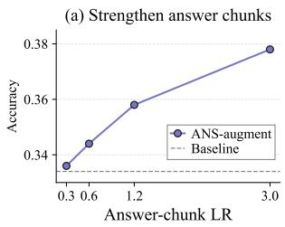
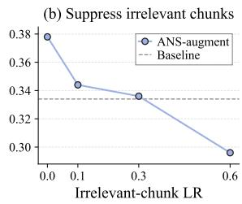
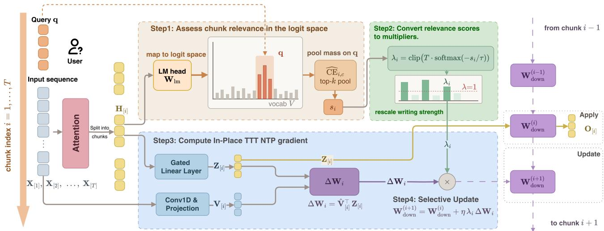
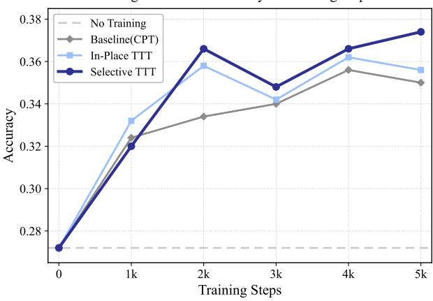
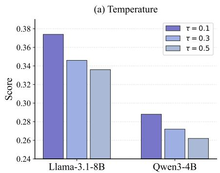
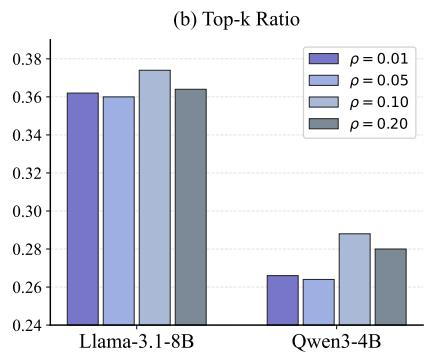
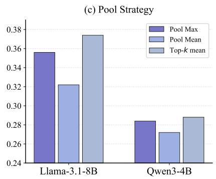
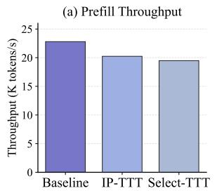
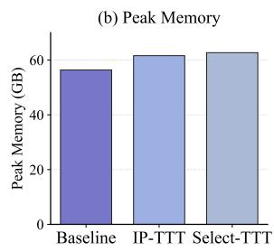

# Select-TTT: Query-Conditioned Selective Fast Weight Updates for In-Place Test-Time Training

Yue Wu wuyuewy@mail.ustc.edu.cn University of Science and Technology of China China

Chongming Gao chongminggao@ustc.edu.cn University of Science and Technology of China China

Yang Zhang zyang1580@gmail.com National University of Singapore Singapore

Xinsen Guo xsguo@mail.ustc.edu.cn University of Science and Technology of China China

Fuli Feng fulifeng93@gmail.com University of Science and Technology of China China

Weinan Gan   
ganweinan1@huawei.com   
Huawei Noah’s Ark Lab   
China

Xiaoyuan Li xiaoyuanli@mail.ustc.edu.cn University of Science and Technology of China China

## Abstract

Test-time training (TTT) enables a deployed language model to internalize incoming context on-the-fly into a small set of fastweight parameters, rather than merely treating it as transient context for attention. In-Place TTT recently made this idea practical for large language models by repurposing the down-projection of standard MLP blocks as fast weights. However, we find that its benefit largely disappears on realistic web long-context question answering. We attribute this to In-Place TTT’s uniform write schedule: every chunk is written with equal strength, so irrelevant content dilutes query-relevant information in fast-weight memory. Building on this insight, we propose Select-TTT, a model-agnostic, query-conditioned rule for In-Place TTT that scales each chunk’s write strength by its relevance to the user query. This relevance signal requires no supervision and no new parameters: it is read directly from the model’s frozen output head, as the probability mass that a chunk’s hidden states assign to the query tokens. A temperature-scaled softmax turns these scores into learning-rate multipliers, leaving the chunk-wise, context-parallel computation of In-Place TTT intact. Select-TTT consistently improves long-context question answering on two benchmarks and two backbones. These findings highlight the value of query-conditioned fast weight writes for practical test-time training on long-context question answering, which is also potentially promising for long-horizon agent tasks involving multiple user queries over evolving contexts.

## CCS Concepts

• Computing methodologies → Machine learning; • Information systems → Question answering.

## Keywords

Test-Time Training, Fast Weights, Query-Conditioned, Long-Context Question Answering

## 1 Introduction

Large Language Models (LLMs) [5, 13, 26, 41] are increasingly deployed as web assistants that answer user queries over long, evolving contexts: multi-session dialogue histories, web browsing traces, and lengthy documents [25, 38]. In such scenarios, the static “train then deploy” paradigm faces a double challenge. First, the answer-bearing evidence typically occupies only a tiny fraction of the context, and empirical studies show that LLMs struggle to exploit long contexts even when they nominally fit the context window [2, 6, 18, 24]. Second, once deployed, the model’s weights are frozen: the model can re-read its context through attention at every step, but it can never internalize it, leaving its parameters misaligned with the information at hand [12].

Two lines of research address these challenges from complementary angles. Architectural approaches extend the context window itself, via sparse or linear attention [4, 8, 21, 46], state-space models [11, 15, 16], and positional-embedding scaling [28, 31]. Test-Time Training (TTT) [3, 33, 34, 36], in contrast, makes the model itself adaptive: it designates a small subset of parameters — the fast weights [1, 30] — as a dynamic memory that is updated on the fly while processing the input, internalizing contextual information as it arrives. Among TTT methods, In-Place TTT (IP-TTT) [12] is of particular practical interest: it repurposes the final projection matrix of the ubiquitous gated MLP blocks as fast weights, pairs this with an objective aligned with Next-Token Prediction (NTP), and organizes updates chunk-wise so that TTT becomes a “drop-in” enhancement compatible with context parallelism — requiring no architectural modification and no training from scratch.

However, the IP-TTT’s write schedule is uniform: every chunk updates the fast weights with the same learning rate, regardless of its content. This is at odds with how long-context question answering works in practice. When a question concerns a small portion of a long history, the chunks that carry the answer are written with the same strength as the many chunks that do not, and the noise accumulated from irrelevant writes dilutes the queryrelevant information in the fast-weight memory. Empirically, we find that uniform In-Place TTT brings little or no improvement on realistic long-context QA benchmarks, and sometimes degrades the zero-shot performance. A controlled experiment with oracle annotations confirms the diagnosis: amplifying the writes of answer chunks improves accuracy markedly, whereas amplifying the writes of irrelevant chunks drives it below the baseline (Figure 1).

We solve this question afirmatively with Select-TTT, a queryconditioned selective update rule for In-Place TTT. Our key observation is that a pre-trained LLM already carries a well-calibrated relevance measure — its own output head. Select-TTT scores each chunk in the logit space: it maps the chunk’s hidden states through the frozen output head and measures the probability mass they assign to the query tokens (the query-conditioned cross-entropy). A low query-CE indicates that the local representation is already predictive of the question, i.e., the chunk is relevant. Chunk-level scores, aggregated by top-� mean pooling, are converted into perchunk learning-rate multipliers via a temperature-scaled softmax designed to meet three desiderata: soft writes (every chunk receives a positive multiplier, so potentially answer-bearing chunks are never entirely discarded), budget preservation (only the distribution across chunks changes, conserving the total amount of information written), and stability (an upper clip prevents any single chunk from dominating). The resulting rule merely rescales each chunk’s update by a scalar, and reduces to IP-TTT when no query is present.

We evaluate Select-TTT on two long-context QA benchmarks, LongMemEval-S [38] and LoCoMo [25], with Llama-3.1-8B-Instruct and Qwen3-4B backbones, under two protocols: applying the selective rule only at inference on an In-Place TTT checkpoint, and enabling it during continual training on LongCite-45k [47] as well. In both settings Select-TTT consistently outperforms uniform In-Place TTT and the corresponding baselines. Ablations show that each component of the multiplier design contributes. All these findings highlight the value of query-conditioned fast weight writes for practical test-time training.

## 2 Preliminary

## 2.1 Test-Time Training

Test-Time Training (TTT) enables a model to adapt its parameters at inference time by introducing a small subset oftrainable parameters, the fast weights [1]. Denoted by W, these weights parameterize a small network $f _ { \mathbf { W } } ( \cdot ) : \mathbb { R } ^ { d }  \dot { \mathbb { R } ^ { d } }$ that acts as a dynamic memory, continuously storing and retrieving contextual information from the input sequence.

Given a sequence of tokens, each token is projected to derive a query ${ \bf q } _ { i }$ , a key $\mathbf { k } _ { i }$ and a value $\mathbf { v } _ { i } .$ The TTT mechanism alternates two operations:

(1) Update Operation: The fast weight is updated by one optimization step of a self-supervised loss $\mathcal { L } ( \cdot , \cdot )$ that associates the key $\mathbf { k } _ { i }$ with its value $\mathbf { v } _ { i } { : }$

$$
\mathbf { W } _ { i }  \mathbf { W } _ { i - 1 } - \eta \nabla _ { \mathbf { W } } \mathcal { L } \big ( f _ { \mathbf { W } _ { i - 1 } } ( \mathbf { k } _ { i } ) , \mathbf { v } _ { i } \big ) ,\tag{1}
$$

where � is the learning rate. Intuitively, this step encodes the information of the pair $( \mathbf { k } _ { i } , \mathbf { v } _ { i } )$ into the memory $f _ { \mathbf { W } }$ .

(2) Apply Operation: The updated network is used to process the query, i.e., $\mathbf { o } _ { i } = f _ { \mathbf { W } _ { i } } ( \mathbf { q } _ { i } )$ , so that the output is enriched with the contextual information stored in $\mathbf { W } _ { i }$

While Eq. (1) describes the high-level mechanism, its practical instantiation in modern LLMs faces two barriers: (i) TTT is often realized by specialized recurrent layers that replace attention and require expensive pre-training from scratch; (ii) the canonical per-token update is inherently sequential and severely bottlenecks parallel accelerators. In-Place TTT [12] addresses both issues, and serves as the backbone of our method.

## 2.2 In-Place TTT

In-Place TTT [12] repurposes the final projection matrix of the ubiquitous gated MLP blocks as the fast weight, turning TTT into a “drop-in” enhancement without any architectural modification. For the widely used gated MLP [13, 41], given the hidden representation H $\in \mathbb { R } ^ { n \times \dot { d } _ { \mathrm { m o d e l } } }$ of � tokens, the gated MLP computes its output as

$$
\mathbf { O } = \left( \phi \left( \mathbf { H } \mathbf { W } _ { \mathrm { g a t e } } ^ { \top } \right) \odot \mathbf { \left( H \mathbf { W } _ { \mathrm { u p } } ^ { \top } \right) } \right) \mathbf { W } _ { \mathrm { d o w n } } ^ { \top } ,\tag{2}
$$

where $\phi$ is the activation and ⊙ the element-wise product. In-Place TTT freezes $\mathbf { W } _ { \mathrm { g a t e } }$ and $\mathbf { W } _ { \mathrm { u p } }$ as slow weights, and treats $\mathbf { W } _ { \mathrm { d o w n } }$ as the fast weight that is updated at inference time.

LM-alignedobjective andchunk-wise update. Let $\begin{array} { r } { \mathbf { Z } = \phi ( \mathbf { H } \mathbf { W } _ { \mathrm { g a t e } } ^ { \top } ) \odot } \end{array}$ $( \mathbf { H } \mathbf { W } _ { \mathrm { u p } } ^ { \top } ) \in \mathbb { R } ^ { n \times d _ { \mathrm { f f } } }$ denote the intermediate (gated) activations, and let the value target be constructed from the token embedding $\mathbf { X } ^ { 0 } \in \mathbb { R } ^ { n \times d _ { \mathrm { m o d e l } } }$ so that it carries future-token information,

$$
\widehat { \bf V } \ = \ \mathrm { C o n v 1 D } \big ( { \bf X } ^ { 0 } \big ) \ { \bf W } _ { \mathrm { t a r g e t } } ,\tag{3}
$$

where Conv1D(·) is a causal 1D convolution and $\mathbf { W } _ { \mathrm { t a r g e t } }$ is a trainable projection; e.g., a next-token target is obtained by setting $\mathbf { W } _ { \mathrm { t a r g e t } }$ to the identity and the convolution kernel to select the next token. In-Place TTT instantiates the fast-weight loss as the negative Frobenius inner product, $\mathcal { L } ( \cdot , \cdot ) = - \langle \cdot , \cdot \rangle _ { \mathrm { F } }$ , which is explicitly aligned with the Next-Token-Prediction (NTP) task.

The sequence is partitioned into � non-overlapping chunks of size $C ;$ for □ $| \in \{ \mathbf { Z } , { \widehat { \mathbf { V } } } , \mathbf { O } \}$ we write $\begin{array} { r } { \boldsymbol { \Xi } _ { [ i ] } = \boldsymbol { \Pi } _ { i C + 1 : ( i + 1 ) C } } \end{array}$ for its �-th chunk. Let $\mathbf { W } _ { \mathrm { d o w n } } ^ { ( i ) }$ denote the fast-weight state before processing chunk $^ { , i , }$ with $\mathbf { W } _ { \mathrm { d o w n } } ^ { ( 0 ) } = \mathbf { W } _ { \mathrm { d o w n } }$ . Processing chunk � performs:

(1) Apply Operation: the current fast weight is used to produce the output $\mathbf O _ { [ i ] } = \mathbf Z _ { [ i ] } \left( \mathbf W _ { \mathrm { d o w n } } ^ { ( i ) } \right) ^ { \top }$

(2) Update Operation: The fast weight $\mathbf { W } _ { \mathrm { d o w n } } ^ { ( i ) }$ are updated using $\mathbf { Z } _ { [ i ] }$ as keys and $\widehat { \mathbf { V } } _ { [ i ] }$ as values, which is performed via one gradient descent step with a loss function $\mathcal { L }$ and a learning rate �:

$$
\mathbf { W } _ { \mathrm { d o w n } } ^ { ( i + 1 ) } = \mathbf { W } _ { \mathrm { d o w n } } ^ { ( i ) } - \eta \nabla _ { \mathbf { W } } \mathcal { L } \left( \boldsymbol { Z } _ { [ i ] } ( \mathbf { W } _ { \mathrm { d o w n } } ^ { ( i ) } ) ^ { \top } , \widehat { \mathbf { V } } _ { [ i ] } \right) .\tag{4}
$$

Under the loss function $\mathcal { L } ( \cdot , \cdot ) = - \langle \cdot , \cdot \rangle _ { \mathrm { F } }$ , the gradient with respect to the fast weights in this chunk-wise mechanism can be directly derived:

$$
\mathbf { W } _ { \mathrm { d o w n } } ^ { ( i + 1 ) } = \mathbf { W } _ { \mathrm { d o w n } } ^ { ( i ) } + \eta \underbrace { \widehat { \mathbf { V } } _ { [ i ] } ^ { \top } \mathbf { Z } _ { [ i ] } } _ { \Delta \mathbf { W } _ { i } } ,\tag{5}
$$

with a global learning rate � and the chunk update $\Delta \mathbf { W } _ { i } =$ $\widehat { \mathbf { V } } _ { [ i ] } ^ { \top } \mathbf { Z } _ { [ i ] }$

The chunk-wise form of $\operatorname { E q . } \left( 5 \right)$ keeps the computation dense and matmul-rich, enabling eficient training with large chunk sizes and compatibility with context parallelism.

## 3 Motivation Experiment

While In-Place TTT has been shown efective on synthetic retrieval benchmarks such as RULER [12, 18], we observe that its benefit on long-context user QA under realistic web scenarios is marginal. Concretely, on LongMemEval-S[38], a comprehensive and challenging benchmark for testing the long-term memory of chat assistants, enabling In-Place TTT with the Llama-3.1-8B-Instruct backbone raises the average accuracy only from 33.4% (zero-shot Baseline) to 33.6%. We hypothesize that the cause is the indiscriminate write of In-Place TTT: the update of Eq. (5) applies the same learning rate � to every chunk, so chunks irrelevant to the user query are written into the fast weights with equal strength as the answer-bearing chunks, and their noise dilutes the query-relevant information in the memory.

To test this hypothesis we design an ANS-augment experiment on Llama-3.1-8B-Instruct. LongMemEval-S provides the session associated with each question, from which we obtain the ground truth set of answer-bearing chunks. We then decouple the write strength of answer chunks from that of the remaining (irrelevant) chunks and sweep the two learning rates independently.

Figure 1 reports the results, and two trends are clear. (a) Holding the irrelevant-chunk learning rate fixed, strengthening the write of answer chunks improves accuracy monotonically, from 33.6% (the uniform In-Place TTT setting) to 37.8%. (b) Conversely, increasing the write strength of irrelevant chunks progressively degrades accuracy, from 34.8% down to 29.6%. These two trends reveal a key limitation of uniform In-Place TTT: the writes from irrelevant chunks actively hurt performance, while stronger writes to answer chunks help. Then a practical question arises: in realistic QA scenarios, how can we know in advance which chunks contain the answer? A natural thought is: if each chunk’s write strength could be scaled by its relevance to the query — amplifying answer-bearing chunks and suppressing irrelevant ones — the fast-weight memory would tend to retain the information the model actually needs. Motivated by this idea, we propose Select-TTT in the next section.

## 4 Select-TTT: Query-Conditioned Selective In-Place TTT

## 4.1 The Selective Learning-Rate Rule

Our core idea is to modulate the per-chunk memory write by a scalar multiplier $\lambda _ { i } ~ \in ~ ( 0 , M ]$ , computed from the relevance between the chunk and the user query. We observe that this modulation and the In-Place TTT update are complementary: the learning rate sets the baseline strength of each memory write, while the query-conditioned relevance rescales this strength for each chunk according to how relevant it is to the query. This yields the queryconditioned selective learning-rate rule:

  
Figure 1: Motivation experiment on LongMemEval-S (Llama-3.1-8B-Instruct). (a) Accuracy vs. the answer-chunk learning rate. (b) Accuracy vs. the irrelevant-chunk learning rate. The default In-Place TTT configuration uses 0.3 for both learning rates. The dashed line marks the zero-shot Baseline (33.4%).

$$
\begin{array} { r l r } { \mathbf { W } _ { \mathrm { d o w n } } ^ { ( i + 1 ) } } & { = } & { \mathbf { W } _ { \mathrm { d o w n } } ^ { ( i ) } + \underbrace { \eta \lambda _ { i } } _ { \mathrm { q u e r y - c o n d i t i o n e d ~ s t e p ~ s i z e } } \mathbf { \widehat { V } } _ { [ i ] } ^ { \top } \mathbf { Z } _ { [ i ] } , } \end{array}\tag{6}
$$

This selective rule continuously modulates the memory write strength according to the relevance of each chunk to the query. When a chunk is weakly related to the query, $\lambda _ { i }$ becomes small, weakening its memory write so that the fast weight receives only a modest update from that chunk. Conversely, a highly relevant chunk yields $\lambda _ { i } > 1$ , producing an efective step size $\eta \lambda _ { i } > \eta$ and thereby strengthening its write into the memory. Figure 2 illustrates our Select-TTT framework.

## 4.2 The Query-conditioned chunk selection

In this subsection, we will detail the procedure by which the queryconditioned multiplier $\lambda _ { i }$ is computed. There are two steps:

Assessing chunk relevance score in the logit space. A key challenge is that fast weight updates in In-Place TTT are carried out entirely within the gated MLP, so the only signal available for chunk � is its own hidden state $\mathrm { H } _ { [ i ] }$ , which carries no direct notion of relevance to the query. Standard retrieval relevance signals such as cosine similarity between a chunk embedding and a query embedding, or a cross-encoder score do not transfer here: they assume documents are independent units whose vectors come from a separate, contrastively-trained encoder that projects query and documents into a shared calibrated semantic space. The chunks in Select-TTT are instead contiguous segments of a single input, represented solely by the model’s intermediate hidden states produced online during the forward pass.

We instead assess the chunk relevance in the logit space induced by the frozen output head $\mathbf { W } _ { \mathrm { l m } }$ , yielding a novel model-internal mechanism for selecting and weighting hidden-state chunks when such text-based signals are unavailable: we map each chunk’s hidden state through the output head into a calibrated probability distribution over the vocabulary, and read of the chunk’s impor tance from the probability mass it assigns to the query tokens. This can be viewed as projecting each chunk’s hidden state onto the query-token subspace of the logit space, where the semantics of “relevance to the query” has a direct, per-token meaning.

Formally, let $\mathbf { q } = ( q _ { 1 } , \dots , q _ { Q } )$ be the query tokens associated with the current input. During training, q is the question associated with each QA instance in the training set; at inference time, it is provided by the user query. For position � of chunk �, let $\mathbf { h } _ { i , c }$ be the hidden state, i.e., the �-th row of $\mathbf { H } _ { [ i ] }$ . The output head maps it to the logit vector

  
Figure 2: Overview of Select-TTT. (1) The frozen LM head maps chunk hidden states to logit space, where query-token scores are aggregated by top-� mean pooling to assess chunk relevance. (2) Relevance scores are converted into learning-rate multipliers. (3) In-Place TTT computes the NTP-aligned fast-weight updates. (4) The multipliers rescale these updates to selectively write query-relevant information into fast-weight memory.

$$
\mathbf { z } _ { t , c } ~ = ~ \mathbf { W } _ { \mathrm { l m } } ~ \mathrm { R M S N o r m } \left( \mathbf { h } _ { i , c } \right) ~ + ~ \mathbf { b } _ { \mathrm { l m } } ~ \in ~ \mathbb { R } ^ { V } ,\tag{7}
$$

where � is the vocabulary size. The likelihood that the model assigns to the query tokens at this position is

$$
{ \widehat { \mathrm { C E } } } _ { i , c } ~ = ~ - { \frac { 1 } { Q } } \sum _ { j = 1 } ^ { Q } \log { \frac { \exp \bigl ( ( \mathbf { z } _ { i , c } ) _ { q _ { j } } \bigr ) } { \sum _ { v \in \mathcal { V } } \exp \bigl ( ( \mathbf { z } _ { i , c } ) _ { v } \bigr ) } } .\tag{8}
$$

Here $( \mathbf { z } _ { i , c } ) _ { q { j } }$ refers to the logit assigned to token $q _ { j }$ at position � of chunk �. A low $\widehat { \mathrm { C E } } _ { i , c }$ indicates that the local representation already encodes information predictive of the question, so that the position is relevant to the query. We aggregate per-position scores within each chunk to obtain a single chunk relevance score ��:

$$
s _ { i } ~ = ~ \mathrm { P o o l } _ { c \in [ C ] } ^ { ( K ) } \left( \widehat { \mathrm { C E } } _ { i , c } \right) , \quad K = \operatorname* { m a x } \bigl ( 1 , ~ \lceil \rho C \rceil \bigr ) ,\tag{9}
$$

the Pool is specified by a strategy governed by the parameter top-k ratio $\rho \in \left( 0 , 1 \right]$ , which controls how many positions within a chunk are retained for the average:

• mean $( \rho = 1 ) \colon$ : all � positions are pooled, equally weighing every token in the chunk;

• max $( \rho \to 0 )$ : only the single position with the lowest CE is retained, giving a most-relevant-token rule;

• top-� mean $( \rho \in ( 0 , 1 ) )$ : the $k = \lceil \rho C \rceil$ positions with the lowest CE are kept and averaged, balancing question-relevant signal extraction with robustness to noise.

We default to aggregate over positions with a top-� mean pooling strategy to obtain a single chunk-level score, since we argue that the relevance of a chunk should be determined by the importance of its most query-relevant portions rather than by averaging over all tokens.

Convert relevance scores to multipliers. We convert the chunk scores $\mathbf { \boldsymbol { s } } = \left[ s _ { 1 } , \ldots , s _ { T } \right]$ into per-chunk learning-rate multipliers m = $[ \lambda _ { 1 } , . . . , \lambda _ { T } ]$ via a temperature-scaled softmax over the negative scores:

$$
\lambda _ { t } ~ = ~ \mathrm { c l i p } \left( \frac { \exp ( - s _ { t } / \tau ) } { \sum _ { i = 1 } ^ { T } \exp ( - s _ { i } / \tau ) } \cdot T , ~ 0 , ~ M \right) .\tag{10}
$$

Here the temperature � controls the extent to which query-relevant chunks are distinguished from irrelevant ones in the multiplier assignment. A smaller � sharpens this distinction: it amplifies the gap between relevant and irrelevant chunks, concentrating the write budget on the few most relevant chunks. The clip � sets the maximum allowed amplification per chunk. The design of Eq. (10) satisfies three desiderata:

(1) Soft write. The softmax yields strictly positive multipliers for all chunks, so every chunk is written into the fast weights with a strength proportional to its estimated relevance. Since the query-CE assessment is only an estimate, the smooth allocation ensures that the potential answer-bearing chunks are never entirely ignored.

(2) Budget preservation. Multiplying the softmax weights by� ensures $\begin{array} { r } { \frac { 1 } { T } \sum _ { t = 1 } ^ { T } \lambda _ { t } \approx 1 } \end{array}$ , so the average learning rate matches IP-TTT’s global �. The total amount of information written into fast weights is conserved; only its distribution across chunks changes.

(3) Stability. The upper clip � prevents any single chunk from dominating the update when the temperature � is small, which guards against any individual chunk being written too aggressively into the fast weights.

An online-learning view. Interpreting ΔW� of Eq. (5) as a closedform gradient step of the NTP-aligned objective [12], Eq. (6) is exactly chunk-wise SGD with a query-conditioned, per-chunk adaptive step size $\eta \lambda _ { t } \colon$ the overall write strength is set by the global learning rate �, then rescaled by the query-conditioned multiplier $\lambda _ { t }$ before the write is performed. Per-block adaptive step sizes are a classical technique in deep learning optimization, and here the step size is conditioned on the query, so that the model adaptively focuses its memory on query-relevant content.

## 4.3 Eficient Chunk-Wise Scoring and Training

The selective rule only rescales each $\Delta \mathbf { W } _ { i }$ by a per-chunk scalar $\lambda _ { i } .$ The main chunk-wise pass of In-Place TTT (Eq. (5)) is therefore left untouched, and all of its matmul-rich, context-parallel proper ties are preserved. The only additional computation is the scoring pass of Eqs. (7)–(9), which we make hardware-eficient with two techniques.

Blockwise log-sum-exp. The logits in Eq. (7) span the full vocabu lary � and would materialize a tensor of size [� , �, � ] if computed directly, incurring substantial GPU memory overhead. We instead compute the log-sum-exp normalizer in vocabulary blocks $\{ B _ { k } \} _ { k }$ of a smaller size �,

$$
\begin{array} { r l } & { \mathrm { l s e } _ { i , c } = \log \underset { v \in \mathcal { V } } { \sum } \exp \bigl ( ( \mathbf { z } _ { i , c } ) _ { v } \bigr ) } \\ & { \qquad = \log \underset { k } { \sum } \exp \Bigl ( \underset { v \in B _ { k } } { \log \sum } \exp \bigl ( ( \mathbf { z } _ { i , c } ) _ { v } \bigr ) \Bigr ) , } \end{array}\tag{11}
$$

where each block-wise $\mathrm { l s e } _ { i , c } ^ { ( k ) }$ is a single matrix product against a block of the (frozen) output head, and the blocks are combined by log-exp additions. This keeps the peak activation memory at $O \left( B \cdot T \cdot C \right)$ instead of $O \big ( V \cdot T \cdot C \big )$

Direct question-token logits. Only the � rows of the output head that correspond to the question tokens are needed in Eq. (8). We gather these rows and compute the logits directly,

$$
( \mathbf { z } _ { i , c } ) _ { q _ { j } } = \mathbf { w } _ { \mathrm { l m } , q _ { j } } ^ { \top } \mathrm { R M S N o r m } ( \mathbf { h } _ { i , c } ) { \bf \phi } + \ b _ { \mathrm { l m } , q _ { j } } , \quad j = 1 , \ldots , Q ,\tag{12}
$$

with cost $O \left( T \cdot C \cdot H \cdot Q \right)$ instead ofthe $O \left( T \cdot C \cdot H \cdot V \right)$ of a full forward pass. For question lengths $Q \ll V$ this is substantially cheaper. Expanding the logarithm in Eq. (8), the per-token CE decomposes as

$$
\begin{array} { l } { { \displaystyle \widehat { \mathrm { C E } } _ { i , c } = - \frac 1 Q \sum _ { j = 1 } ^ { Q } \log \frac { \exp \left( ( \mathbf z _ { i , c } ) _ { q j } \right) } { \sum _ { v \in \mathcal { V } } \exp \left( ( \mathbf z _ { i , c } ) _ { v } \right) } } \ ~ } \\ { { \displaystyle ~ = - \frac 1 Q \sum _ { j = 1 } ^ { Q } \left[ ( \mathbf z _ { i , c } ) _ { q j } - \log \sum _ { v \in \mathcal { V } } \exp \left( ( \mathbf z _ { i , c } ) _ { v } \right) \right] } \ ~ } \\ { { \displaystyle ~ = \frac 1 Q \sum _ { j = 1 } ^ { Q } \left[ \mathrm { l s e } _ { i , c } - ( \mathbf z _ { i , c } ) _ { q j } \right] } , } \end{array}\tag{13}
$$

where the normalizer $\mathrm { l s e } _ { i , c }$ is obtained from Eq. (11) and the gathered logits $\left( \mathbf { z } _ { i , c } \right) _ { q _ { j } }$ from Eq. (12). The per-token CE therefore decomposes into two cheap terms — � gathered logits plus a single blockwise log-sum-exp — requiring no $[ T , C , V ]$ logit tensor.

Overhead Analysis. Per selective layer, the scoring pass adds $O \big ( T C H ( V + Q ) \big )$ floating-point operations — dominated by the blockwise log-sum-exp, i.e., a single matrix product against the output head — and $O \big ( T C ( B + Q ) \big )$ peak activation memory. For each chunk, the additional computational cost amounts a single output-head forward pass over the input sequence per selective layer. The output head is frozen and shared across layers, so no additional parameters or optimizer states are introduced. Since this selective mechanism is executed only at the TTT layers and is computed from hidden states that are already available, the added overhead is modest relative to the overall per-step computation of the model.

Eficient Implementation with Context Parallelism. Our implementation inherits the context parallelism from In-Place TTT, which is designed for high eficiency and scalability on modern hardware. The full algorithm is presented in Algorithm 1 (Appendix A).

## 5 Experiments

In this section, we organize our empirical study around the following research questions:

• Q1 (Efectiveness). When the Select-TTT is only enabled during inference, as a training-free, drop-in enhancement for the In-Place TTT, does query-conditioned selectivity improve the zeroshot long-context QA performance?

• Q2 (Training-inference consistency). When the Select-TTT is enabled during both continual training and inference, does it outperform standard continual pre-training and uniformly trained In-Place TTT?

• Q3 (Sensitivity). How sensitive is our Select-TTT framework to its key design choices?

• Q4 (Mechanism). Does the query-conditioned selective mechanism of Eq. (9) genuinely rank query-relevant chunks above irrelevant ones?

## 5.1 Experimental Setup

Datasets. We evaluate our method on two widely adopted longcontext QA benchmarks that cover complementary aspects of longterm memory. LongMemEval-S [38] focuses on interactive memory in multi-session user-assistant dialogues, where information is accumulated across sessions and may evolve over time. It contains 500 questions embedded in histories of approximately 40 sessions and 115K tokens each, and comprises six subtasks. LoCoMo [25], in contrast, tests reasoning over very long conversations that span up to 35 sessions and roughly 300 turns per dialogue, with a total of around 1,980 questions distributed across 10 dialogues. Together, these benchmarks allow us to assess both multi-session consistency and long-context retrieval under a unified setup. For continualtraining experiments, we use LongCite-45k [47], a large-scale corpus of 44,600 long-context QA instances (up to 128K tokens) which provides a natural source of query-context pairs for training.

Backbone models. We use two backbones ofdiferent families and scales: Llama-3.1-8B-Instruct (32 layers) and Qwen3-4B (36 layers). For the Qwen3-4B model, we adapt the model’s Rotary Position Embeddings using YaRN [28] to efectively manage these long sequences. Following the In-Place TTT configuration, every sixth layer starting from the first one (layer indices {0, 6, 12, 18, 24, 30}, i.e., six layers per backbone) is equipped with the TTT mechanism; all other weights are identical to the original checkpoints.

Table 1: Protocol I: zero-shot inference-time TTT on LongMemEval-S with two backbones. Accuracy (%) is reported; the best result within each backbone block is in bold.
<table><tr><td rowspan="2">Backbone</td><td rowspan="2">Method</td><td colspan="7">LongMemEval-S</td></tr><tr><td>KU</td><td>MS</td><td>TR</td><td>S-Pref.</td><td>S-Asst.</td><td>S-User</td><td> $\mathbf { A v g } .$ </td></tr><tr><td rowspan="3">Llama-3.1-8B</td><td>Baseline</td><td>50.00</td><td>18.80</td><td>16.54</td><td>3.33</td><td>69.64</td><td>58.57</td><td>33.4</td></tr><tr><td>IP-TTT</td><td>47.44</td><td>18.80</td><td>20.30</td><td>3.33</td><td>66.07</td><td>58.57</td><td>33.6</td></tr><tr><td>Select-TTT</td><td>52.56</td><td>22.56</td><td>28.57</td><td>13.33</td><td>64.29</td><td>54.29</td><td>37.4</td></tr><tr><td rowspan="3">Qwen3-4B</td><td>Baseline</td><td>28.21</td><td>21.80</td><td>22.56</td><td>6.67</td><td>57.14</td><td>30.00</td><td>27.2</td></tr><tr><td>IP-TTT</td><td>26.92</td><td>15.79</td><td>20.30</td><td>3.33</td><td>67.86</td><td>27.14</td><td>25.4</td></tr><tr><td>Select-TTT</td><td>29.49</td><td>26.32</td><td>22.56</td><td>3.33</td><td>57.14</td><td>32.86</td><td>28.8</td></tr></table>

KU: Knowledge Update; MS: Multi-session; TR: Temporal Reasoning; S-Pref.: Single-session Preference; S-Asst.: Single-session Assistant; S-User: Single-session User.

Evaluation protocols. We consider two complementary protocols. Protocol I (inference-time Select-TTT). The Select-TTT chunk-wise updates ofEq. (6) are applied only at inference-time. We compare: (i) Baseline — the original pre-trained LLM evaluated directly, without any test-time update; (ii) IP-TTT — In-Place TTT with a uniform learning rate, i.e., $\lambda _ { i } = 1$ for all chunks �; and (iii) Select-TTT — our query-conditioned multipliers (Eq. (10)). Methods (ii) and (iii) are run on the same TTT-enhanced checkpoint, obtained by following the original recipe of In-Place TTT; the two rows difer only in whether the per-chunk multiplier is uniform or query-conditioned, so their contrast cleanly isolates the efect of query-conditioned selective mechanism. Protocol II (selective continual training). The model is continually trained for up to 5k steps on the processed LongCite-45k corpus with the TTT mechanism active during training, and evaluated on LongMemEval-S at every 1k-step checkpoint with the same mechanism active at inference. We compare: (i) CPT — standard continual pre-training on the same corpus without any TTT mechanism; (ii) IP-TTT — continual training with uniform TTT updates $( \lambda _ { i } = 1 )$ ; and (iii) Select-TTT — continual training with the selective mechanism. For TTT-based training, both the backbone parameters and the newly introduced TTT parameters are updated jointly so that the model adapts its TTT behavior to the long-context QA setting, whereas CPT follows the vanilla fine tuning recipe. We also report the No-Training reference, i.e., the zero-shot performance before any continual training.

Implementation details. All TTT-based methods use the LMaligned objective of In-Place TTT. In the continual-training protocol we set chunk size � = 2048 and TTT learning rate $\eta = 0 . 3$ . Select-TTT defaults to temperature � = 0.1, cap � = 10.0, pooling ratio $\rho = 0 . 1$ , and top-� mean pooling in Eq. (9). The ablation (Section 5.4) varies $\tau , \rho ,$ , and the pooling strategy around these defaults. Detailed descriptions of the experiment implementation can be found in Appendix B.

Table 2: Protocol I: zero-shot inference-time TTT on LoCoMo with two backbones. Overall score (%) is reported; the best result within each backbone block is in bold.
<table><tr><td rowspan="2">Backbone</td><td rowspan="2">Method</td><td colspan="6">LoCoMo</td></tr><tr><td>Multi</td><td>Temp.</td><td>Open</td><td>Single</td><td>Adv.</td><td> $\mathbf { A v g } .$ </td></tr><tr><td rowspan="3">Llama-3.1-8B</td><td>Baseline</td><td>36.60</td><td>29.30</td><td>17.78</td><td>57.91</td><td>18.83</td><td>39.55</td></tr><tr><td>IP-TTT</td><td>34.92</td><td>30.12</td><td>19.51</td><td>58.22</td><td>15.47</td><td>38.90</td></tr><tr><td>Select-TTT</td><td>36.38</td><td>30.74</td><td>20.74</td><td>58.34</td><td>20.40</td><td>40.42</td></tr><tr><td rowspan="3">Qwen3-4B</td><td>Baseline</td><td>25.66</td><td>20.12</td><td>18.31</td><td>38.88</td><td>4.04</td><td>25.15</td></tr><tr><td>IP-TTT</td><td>25.84</td><td>20.60</td><td>18.19</td><td>39.25</td><td>4.26</td><td>25.45</td></tr><tr><td>Select-TTT</td><td>25.27</td><td>21.12</td><td>20.46</td><td>39.77</td><td>6.05</td><td>26.19</td></tr></table>

Multi: Multi-hop; Temp.: Temporal reasoning; Open: Open-domain factual; Single: Single-hop short-memory; Adv.: Adversarial queries.

## 5.2 Inference-Time Select-TTT as a Drop-in Enhancement

This section addresses Q1 under Protocol I: the TTT-enhanced checkpoint is obtained by the original recipe of In-Place TTT and the only adaptation at test time is the selective chunk-wise updates of Eq. (6). Tables 1 and 2 report the zero-shot results on LongMemEval-S and LoCoMo for both backbones.

Results. Select-TTT attains the best average score on both benchmarks and both backbones: on LongMemEval-S it improves over IP-TTT by +3.8 (Llama) and +3.4 (Qwen), and over the Baseline by +4.0 and +1.6 respectively; on LoCoMo it reaches 40.42 (Llama) and 26.19 (Qwen), again the highest among the three methods. More revealing is the relative behavior of the two TTT variants. The uniform adaptation of IP-TTT does not consistently help in this zero-shot long-context QA scenario: on Qwen3-4B it drops the LongMemEval-S average from 27.2 to 25.4, and on Llama-3.1- 8B-Instruct from 39.55 to 38.90. This indicates that In-Place TTT writes every chunk into the fast weights with equal strength dilutes query-relevant information, as irrelevant chunks contribute noise on equal footing with relevant ones. Simply replacing the uniform schedule with query-conditioned multipliers on the same check point yields a consistent gain: by suppressing the write strength of query-irrelevant chunks while reinforcing that of relevant ones, Select-TTT achieves the best performance across both backbones and both benchmarks.

A further observation is that the Select-TTT gains concentrate on subtasks that require synthesizing an answer from multiple, scattered pieces of evidence: on LongMemEval-S, the Knowledge Update, Multi-session, and Temporal Reasoning show larger improvements compare to the Single-session subtasks. This indicates that Select-TTT selectively strengthens the writes ofquery-relevant chunks into the fast weights, which is particularly beneficial for multi-evidence reasoning that aggregates information from multiple chunks. These observations answer Q1 afirmatively: as a dropin replacement for the uniform schedule, the Select-TTT turns out to be a consistent, training-free enhancement for the In-Place TTT.

## 5.3 Continual Pre-Training with Select-TTT

We next address Q2 under Protocol II, where the TTT mechanism is active during both continual training and inference. All methods are trained on the processed LongCite-45k corpus for up to 5k steps with the Qwen3-4B backbone and evaluated on LongMemEval-S at every 1k-step checkpoint. Figure 3 plots the overall accuracy during the continual-training steps.

LongMemEval-S Accuracy vs. Training Steps  
  
Figure 3: Protocol II: LongMemEval-S overall accuracy vs. continual-training steps for No Training, CPT, IP-TTT, and Select-TTT (Qwen3-4B backbone).

Results. Continual training on LongCite-45k transfers well: every method lifts the zero-shot reference of 27.2% above 32% within the first thousand steps. The comparison among the trained models is more informative. From step 2k onward, both TTT-based methods outperform standard CPT, confirming that the In-Place TTT mechanism is an efective vehicle for long-context adaptation when backbone and TTT parameters are trained jointly; and Select-TTT in turn matches or exceeds IP-TTT at every subsequent checkpoint, finishing first at 37.4%, ahead of IP-TTT (35.6%) and CPT (35.0%). The single exception occurs at the earliest checkpoint, where the model has barely begun to accommodate the TTT mechanism and the query-conditioned redistribution of the learning-rate budget is not yet beneficial; as training proceeds, the selective schedule consistently dominates. Because Select-TTT and IP-TTT share the same update rule and difer only in the per-chunk multiplier $\lambda _ { i }$ of Eq. (10), the persistent gap between the two curves isolates the contribution of selectivity and answers Q2 afirmatively. Full persubtask results and additional results across all checkpoints are provided in the Appendix C.1.

## 5.4 Ablation Studies On the Impact of Select-TTT Design Choices

To answer Q3, we ablate the key design choices of Select-TTT under Protocol I: (a) the temperature � in Eq. (10), which controls how sharply the learning-rate budget concentrates on low-CE chunks; (b) the pooling ratio � in Eq. (9); (c) the pooling strategy that aggregates per-token query-CE into a chunk-level score; and (d) the two safeguards of the multiplier — the softmax, which realizes a soft write over all chunks, and the upper clip �, which prevents over-writes. Figure 4 reports (a)–(c) on both backbones with the LongMemEval-S overall accuracy; Table 3 reports (d) with the Llama-3.1-8B backbone on all six subtasks.

Table 3: Ablation of the multiplier design (Eq. (10)) on LongMemEval-S with the Llama-3.1-8B backbone. Accuracy (%) is reported; the best result per column is in bold.
<table><tr><td rowspan="2">Ablation Setting</td><td colspan="7">LongMemEval-S</td></tr><tr><td>KU</td><td>MS</td><td>TR</td><td>S-Pref.</td><td>S-Asst.</td><td>S-User |</td><td> $\mathbf { A v g } .$ </td></tr><tr><td>w/ soft write, w/ clip</td><td>52.56</td><td>22.56</td><td>28.57</td><td>13.33</td><td>64.29</td><td>54.29</td><td>37.4</td></tr><tr><td>w/ soft write, w/o clip</td><td>46.15</td><td>21.05</td><td>23.31</td><td>3.33</td><td>66.07</td><td>57.14</td><td>34.6</td></tr><tr><td>w/o soft write, w/ clip</td><td>42.31</td><td>15.04</td><td>18.05</td><td>6.67</td><td>66.07</td><td>51.43</td><td>30.4</td></tr><tr><td>w/o soft write, w/o clip</td><td>21.79</td><td>13.53</td><td>17.29</td><td>3.33</td><td>53.57</td><td>37.14</td><td>23.0</td></tr></table>

Table 4: Comparing relevance signals across diferent chunk sizes on LongMemEval-S QA instances. Hit@�: at least one of the � highest-ranked chunks contains the answer. Rec@�: fraction of answer chunks covered by the � highest-ranked chunks.
<table><tr><td rowspan="2">Chunk size</td><td rowspan="2">Signal</td><td colspan="3">Hit@k</td><td colspan="3">Rec@k</td></tr><tr><td>k=1</td><td>k=3</td><td>k=5</td><td>k=1</td><td>k=3</td><td>k=5</td></tr><tr><td rowspan="3">2048</td><td>Query-CE (ours)</td><td>0.200</td><td>0.440</td><td>0.582</td><td>0.092</td><td>0.201</td><td>0.278</td></tr><tr><td>Cosine</td><td>0.094</td><td>0.212</td><td>0.293</td><td>0.061</td><td>0.136</td><td>0.189</td></tr><tr><td>Cross-encoder</td><td>0.090</td><td>0.245</td><td>0.372</td><td>0.020</td><td>0.059</td><td>0.098</td></tr><tr><td rowspan="3">4096</td><td>Query-CE (ours)</td><td>0.256</td><td>0.519</td><td>0.654</td><td>0.128</td><td>0.295</td><td>0.393</td></tr><tr><td>Cosine</td><td>0.133</td><td>0.308</td><td>0.415</td><td>0.085</td><td>0.198</td><td>0.267</td></tr><tr><td>Cross-encoder</td><td>0.126</td><td>0.334</td><td>0.493</td><td>0.040</td><td>0.119</td><td>0.199</td></tr><tr><td rowspan="3">8192</td><td>Query-CE (ours)</td><td>0.312</td><td>0.653</td><td>0.843</td><td>0.183</td><td>0.381</td><td>0.599</td></tr><tr><td>Cosine</td><td>0.189</td><td>0.398</td><td>0.522</td><td>0.122</td><td>0.257</td><td>0.337</td></tr><tr><td>Cross-encoder</td><td>0.195</td><td>0.486</td><td>0.684</td><td>0.082</td><td>0.247</td><td>0.312</td></tr></table>

Temperature �. Figure 4 (a) shows that sharper selection helps: the lowest temperature � = 0.1 performs best on both backbones, and performance degrades as � increases. A small � tends to concentrate the learning-rate budget on the few most query-relevant chunks. This aligns with the motivation of Section 4.1: what harms the fast weights is precisely the dilution caused by spreading the budget over irrelevant chunks.

Pooling ratio $\rho .$ Unlike the temperature, the overall accuracy varies non-monotonically with the pooling ratio $\rho ;$ the accuracy varies across the diferent settings, reflecting an inherent trade-of in Figure 4 (b). We settle on $\rho = 0 . 1 0$ as a compromise: enough positions participate to make the score robust against spurious matches, while it still concentrates on the most query-relevant content.

Pooling strategy. Figure 4 (c) shows that the top-� mean pooling strategy outperforms both Max and Mean pooling on both backbones, validating our hypothesis in Section 4.2 that a chunk’s relevance should be governed by its most query-relevant portions. Mean is diluted by the many irrelevant positions within a chunk, while Max relies on a single position and inherits its fragility. Top-� mean strikes the right balance: it aggregates a small, robust subset of the most relevant positions, capturing strong query-relevant signal while remaining robust to individual noisy tokens.

Multiplier design. A final ablation examines the two safeguards built into the multiplier of Eq. (10) (Table 3). The softmax realizes a soft write: the query-CE ranking is only an estimate of relevance, so writing every chunk with a strength proportional to its estimated relevance ensures that answer-bearing chunks are never entirely skipped. The clip, in turn, guards against over-writes: an extremely confident chunk would otherwise attract a multiplier far beyond the average budget and be written into the fast weights too aggressively. The result in Table 3 shows that removing both components causes a performance drop. Both safeguards are empirically necessary.

  
Figure 4: Ablation of Select-TTT on LongMemEval-S (both backbones): (a) temperature $\tau \in \{ 0 . 1 , 0 . 3 , 0 . 5 \}$ (b) pooling ratio $\rho \in \{ 0 . 0 1 , 0 . 0 5 , 0 . 1 0 , 0 . 2 0 \}$ ; (c) pooling strategy (Max, Mean, Top-�). The default configuration is $\tau = 0 . 1 , \rho = 0 . 1 0 ,$ top-� mean.

## 5.5 Analysis: Which Relevance Signal Picks the Relevant Chunks?

The preceding sections show that selectivity helps; here we answer Q4 and examine why. To rule out the possibility that a standard retrieval signal would serve equally well despite the mismatch argued in Section 4.2, we compare the query-CE score of Eq. (9) with two representative alternatives: Cosine similarity between the mean-pooled chunk and query hidden states; and a pretrained Cross-encoder bge-reranker [40] consuming the hidden states. On LongMemEval-S QA instances with ground-truth answer-chunk annotations, we rank the chunks under each signal across diferent chunk sizes and measure Hit@� — whether at least one of the � highest-ranked chunks contains the answer and Rec@� — the fraction of answer chunks they cover.

Results. Table 4 shows that query-CE is the strongest signal at every chunk size and � under both metrics. This is consistent with our argument in Section 4.2: under this hidden-state input setting, query-CE provides a stronger chunk-ranking signal than cosine similarity or the pretrained reranker which are not aligned with the model’s hidden states. These results answer Q4: the logit-space query-CE score turns out to be an efective relevance signal.

## 5.6 Overhead analysis

We finally assess the computational overhead of Select-TTT relative to IP-TTT and the no-TTT baseline on Qwen3-4B model during inference time. Figure 5 reports the prefill throughput and peak GPU memory measured on diferent settings, confirming that the Select-TTT’s lightweight scoring mechanism introduces negligible overhead to the original IP-TTT.

  
Figure 5: Eficiency analysis of Select-TTT. Prefill throughput (a) and peak GPU memory (b) are compared across the Baseline, IP-TTT, and Select-TTT on Qwen3-4B model.

## 6 Related Work

Test-Time Training andfast weights. Fast weights, network parameters updated on the fly to act as a dynamic memory, date back to the early nineties [1, 30] and were revived by linear transformers [1, 21]. Test-time training was introduced in computer vision as a means of adapting to distribution shift [34, 36] and has since been scaled to language modeling, both as standalone sequence models [3, 20, 33, 48] and, most recently, as an in-place enhancement of pre-trained LLMs [12]. Research has concentrated on the update objective, the optimizer, and the parallelization of the inherently sequential per-token updates [19, 32, 44]. In all of these methods, however, the write schedule is fixed in advance: every token or chunk is written with the same strength, independently of its relevance to the task the model is being asked to perform.

Eficient long-context modeling. A parallel line of work attacks the quadratic cost of attention [35] directly, through sparse attention patterns [4, 8, 46], streaming attention with sinks [39], IOaware exact attention [10], linear attention [1, 21], and state-space models [11, 15, 16, 43], complemented by positional-embedding scaling [28, 31] and segment-level recurrence [9]. These methods make long inputs processable, yet benchmark studies show that the context models actually exploit falls well short of the advertised window [2, 18, 24]. Test-time adaptation is orthogonal to this line: rather than processing the context more cheaply, it changes what the model retains from the context, and the two can be combined.

Memory and gating in sequence models. Equipping language mod els with memory has a long history, from retrieval over external corpora [17, 22, 23] and dedicated memory modules [9, 14, 29] to recent memory systems for conversational assistants [7, 27, 37, 45, 49]. These systems keep memory outside the model’s parameters and decide what to read at answer time, typically through similarity retrieval. A complementary mechanism operates inside linearrecurrent models, where data-dependent gates control what a parametric state retains [15, 42].

## 7 Conclusion

We introduced Select-TTT, which applies a query-conditioned selective learning-rate rule that scores each chunk in the logit space of the frozen output head and rescales its fast-weight write accordingly. The rule is a drop-in enhancement that preserves the chunk-wise, context-parallel computation ofIP-TTT and adds only a lightweight scoring pass. This provides a novel model-internal way to select hidden states when conventional text-based retrieval signals are unavailable or poorly matched. Across two backbones and two benchmarks, Select-TTT consistently improves over IP-TTT and zero-shot baselines, both as an inference-time enhancement and when coupled with continual training. We see Select-TTT as a step toward query-aware test-time memory, and expect the principle

— conditioning what is written on why it is being written — to extend to other test-time adaptation mechanisms and to agentic web applications where long, evolving contexts are the norm.

## 8 Limitations

Select-TTT conditions its memory writes on the user query, and the logit-space query-CE is only a heuristic estimate of chunk rele vance: the scoring rule applies the frozen LM head to states from multiple TTT layers, potentially afecting the calibration of their query-token scores. A learned relevance function is a promising di rection but may introduce additional computation, parameters, and training overhead. Our fixed chunk size follows the IP-TTT setting to preserve context parallelism. Semantically adaptive chunking could yield better boundaries and relevance estimates. Our evalua tion covers two backbones of up to 8B parameters and two English benchmarks; scaling to larger models, multilingual settings, and other modalities remains future work.

## References

[1] Jimmy Ba, Geofrey Hinton, Volodymyr Mnih, Joel Z. Leibo, and Catalin Ionescu. 2016. Using fast weights to attend to the recent past. In Proceedings ofthe 30th International Conference on Neural Information Processing Systems (Barcelona, Spain) (NIPS’16). Curran Associates Inc., Red Hook, NY, USA, 4338–4346.

[2] Yushi Bai, Shangqing Tu, Jiajie Zhang, Hao Peng, Xiaozhi Wang, Xin Lv, Shulin Cao, Jiazheng Xu, Lei Hou, Yuxiao Dong, Jie Tang, and Juanzi Li. 2025. LongBench v2: Towards Deeper Understanding and Reasoning on Realistic Long-context Multitasks. arXiv:2412.15204 [cs.CL] https://arxiv.org/abs/2412.15204

[3] Ali Behrouz, Peilin Zhong, and Vahab Mirrokni. 2025. Titans: Learning to Memorize at Test Time. In Advances in Neural Information Processing Systems, D. Belgrave, C. Zhang, H. Lin, R. Pascanu, P. Koniusz, M. Ghassemi, and N. Chen (Eds.), Vol. 38, Main Conference. Curran Associates, Inc., 113506–113543. doi:10.52202/085713-3786

[4] Iz Beltagy, Matthew E. Peters, and Arman Cohan. 2020. Longformer: The Long Document Transformer. arXiv:2004.05150 [cs.CL] https://arxiv.org/abs/2004. 05150

[5] Tom Brown, Benjamin Mann, Nick Ryder, Melanie Subbiah, Jared D Kaplan, Prafulla Dhariwal, Arvind Neelakantan, Pranav Shyam, Girish Sastry, Amanda

Askell, et al. 2020. Language models are few-shot learners. In Advances in Neural Information Processing Systems, Vol. 33. 1877–1901.

[6] Jun Shern Chan, Neil Chowdhury, Oliver Jafe, James Aung, Dane Sherburn, Evan Mays, Giulio Starace, Kevin Liu, et al. 2025. MLE-bench: Evaluating Machine Learning Agents on Machine Learning Engineering. arXiv:2410.07095 [cs.CL] https://arxiv.org/abs/2410.07095

[7] Prateek Chhikara, Dev Khant, Saket Aryan, Taranjeet Singh, and Deshraj Yadav. 2025. Mem0: Building Production-Ready AI Agents with Scalable Long-Term Memory. arXiv:2504.19413 [cs.CL] https://arxiv.org/abs/2504.19413

[8] Rewon Child, Scott Gray, Alec Radford, and Ilya Sutskever. 2019. Generating Long Sequences with Sparse Transformers. arXiv:1904.10509 [cs.LG] https: //arxiv.org/abs/1904.10509

[9] Zihang Dai, Zhilin Yang, Yiming Yang, Jaime Carbonell, Quoc V. Le, and Ruslan Salakhutdinov. 2019. Transformer-XL: Attentive Language Models Beyond a Fixed-Length Context. In Proceedings ofthe 57th Annual Meeting ofthe Association for Computational Linguistics. Association for Computational Linguistics, 2978– 2988. https://aclanthology.org/P19-1285/

[10] Tri Dao, Dan Fu, Stefano Ermon, Atri Rudra, and Christopher Ré. 2022. FlashAtten tion: Fast and Memory-Eficient Exact Attention with IO-Awareness. In Advances in Neural Information Processing Systems, S. Koyejo, S. Mohamed, A. Agarwal, D. Belgrave, K. Cho, and A. Oh (Eds.), Vol. 35. Curran Associates, Inc., 16344– 16359. doi:10.52202/068431-1189

[11] Tri Dao and Albert Gu. 2024. Transformers are SSMs: generalized models and eficient algorithms through structured state space duality. In Proceedings ofthe 41st International Conference on Machine Learning (Vienna, Austria) (ICML’24). JMLR.org, Article 399, 31 pages.

[12] Guhao Feng, Shengjie Luo, Kai Hua, Ge Zhang, Wenhao Huang, Di He, and Tianle Cai. 2026. In-place test-time training. In International Conference on Learning Representations, Vol. 2026. 114452–114472.

[13] Aaron Grattafiori, Abhimanyu Dubey, Abhinav Jauhri, Abhinav Pandey, Abhishek Kadian, Ahmad Al-Dahle, Aiesha Letman, Akhil Mathur, Alan Schelten, Alex Vaughan, et al. 2024. The llama 3 herd of models. arXiv preprint arXiv:2407.21783 (2024).

[14] Alex Graves, Greg Wayne, and Ivo Danihelka. 2014. Neural Turing Machines. arXiv:1410.5401 [cs.NE] https://arxiv.org/abs/1410.540

[15] Albert Gu and Tri Dao. 2024. Mamba: Linear-Time Sequence Modeling with Selective State Spaces. arXiv:2312.00752 [cs.LG] https://arxiv.org/abs/2312.00752

[16] Albert Gu, Karan Goel, and Christopher Re. 2022. Eficiently Modeling Long Sequences with Structured State Spaces. In International Conference on Learning Representations. https://mlanthology.org/iclr/2022/gu2022iclr-eficiently/

[17] Kelvin Guu, Kenton Lee, Zora Tung, Panupong Pasupat, and Ming-Wei Chang. 2020. REALM: retrieval-augmented language model pre-training. In Proceedings of the 37th International Conference on Machine Learning (ICML’20). JMLR.org, Article 368, 10 pages.

[18] Cheng-Ping Hsieh, Simeng Sun, Samuel Kriman, Shantanu Acharya, Dima Rekesh, Fei Jia, Yang Zhang, and Boris Ginsburg. 2024. RULER: What’s the Real Context Size of Your Long-Context Language Models? arXiv preprint arXiv:2404.06654 (2024).

[19] Kazuki Irie and Samuel J. Gershman. 2026. Fast weight programming and linear transformers: from machine learning to neurobiology. arXiv:2508.08435 [cs.LG] https://arxiv.org/abs/2508.08435

[20] Mahdi Karami, Razvan Pascanu, and Vahab Mirrokni. 2025. Lattice: Learning to Eficiently Compress the Memory. arXiv:2504.05646 [cs.LG] https://arxiv.org/ abs/2504.05646

[21] Angelos Katharopoulos, Apoorv Vyas, Nikolaos Pappas, and François Fleuret. 2020. Transformers are RNNs: fast autoregressive transformers with linear attention. In Proceedings ofthe 37th International Conference on Machine Learning (ICML’20). JMLR.org, Article 478, 10 pages.

[22] Urvashi Khandelwal, Omer Levy, Dan Jurafsky, Luke Zettlemoyer, and Mike Lewis. 2020. Generalization through Memorization: Nearest Neighbor Language Models. arXiv:1911.00172 [cs.CL] https://arxiv.org/abs/1911.00172

[23] Patrick Lewis, Ethan Perez, Aleksandra Piktus, et al. 2020. Retrieval-augmented generation for knowledge-intensive NLP tasks. In Proceedings of the 34th International Conference on Neural Information Processing Systems (Vancouver, BC, Canada) (NIPS ’20). Curran Associates Inc., Red Hook, NY, USA, Article 793, 16 pages.

[24] Nelson F. Liu, Kevin Lin, John Hewitt, Ashwin Paranjape, Michele Bevilacqua, Fabio Petroni, and Percy Liang. 2024. Lost in the Middle: How Language Models Use Long Contexts. Transactions of the Association for Computational Linguistics 12 (2024), 157–173. doi:10.1162/tacl\_a\_00638

[25] Adyasha Maharana, Dong-Ho Lee, Sergey Tulyakov, Mohit Bansal, Francesco Barbieri, and Yuwei Fang. 2024. Evaluating Very Long-Term Conversational Memory of LLM Agents. In Proceedings ofthe 62nd Annual Meeting ofthe Association for Computational Linguistics (Volume 1: Long Papers). Association for Computational Linguistics, Bangkok, Thailand, 13851–13870. doi:10.18653/v1/2024.acl-long.747

[26] OpenAI, Josh Achiam, Steven Adler, Sandhini Agarwal, Lama Ahmad, Ilge Akkaya, Florencia Leoni Aleman, Diogo Almeida, Janko Altenschmidt, Sam Altman, et al. 2024. GPT-4 Technical Report. arXiv:2303.08774 [cs.CL] https:

//arxiv.org/abs/2303.08774

[27] Charles Packer, Sarah Wooders, Kevin Lin, Vivian Fang, Shishir G. Patil, Ion Stoica, and Joseph E. Gonzalez. 2024. MemGPT: Towards LLMs as Operating Systems. arXiv:2310.08560 [cs.AI] https://arxiv.org/abs/2310.08560

[28] Bowen Peng, Jefrey Quesnelle, Honglu Fan, and Enrico Shippole. 2024. YaRN: Eficient Context Window Extension of Large Language Models. In International Conference on Learning Representations, B. Kim, Y. Yue, S. Chaudhuri, K. Fragki adaki, M. Khan, and Y. Sun (Eds.), Vol. 2024. 31932–31951.

[29] Jack W. Rae, Anna Potapenko, Siddhant M. Jayakumar, and Timothy P. Lilli crap. 2019. Compressive Transformers for Long-Range Sequence Modelling. arXiv:1911.05507 [cs.LG] https://arxiv.org/abs/1911.05507

[30] Jürgen Schmidhuber. 1992. Learning to Control Fast-Weight Memories: An Alternative to Dynamic Recurrent Networks. Neural Computation 4, 1 (1992), 131–139. doi:10.1162/neco.1992.4.1.131

[31] Jianlin Su, Yu Lu, Shengfeng Pan, Ahmed Murtadha, Bo Wen, and Yunfeng Liu. 2023. RoFormer: Enhanced Transformer with Rotary Position Embedding. arXiv:2104.09864 [cs.CL] https://arxiv.org/abs/2104.09864

[32] Yutao Sun, Li Dong, Shaohan Huang, Shuming Ma, Yuqing Xia, Jilong Xue, Jianyong Wang, and Furu Wei. 2023. Retentive Network: A Successor to Transformer for Large Language Models. arXiv:2307.08621 [cs.CL] https: //arxiv.org/abs/2307.08621

[33] Yu Sun, Xinhao Li, Karan Dalal, Jiarui Xu, Arjun Vikram, Genghan Zhang, Yann Dubois, Xinlei Chen, Xiaolong Wang, Sanmi Koyejo, Tatsunori Hashimoto, and Carlos Guestrin. 2025. Learning to (Learn at Test Time): RNNs with Expressive Hidden States. In Proceedings ofthe 42nd International Conference on Machine Learning (Proceedings of Machine Learning Research, Vol. 267). PMLR, 57503– 57522.

[34] Yu Sun, Xiaolong Wang, Zhuang Liu, John Miller, Alexei Efros, and Moritz Hardt. 2020. Test-Time Training with Self-Supervision for Generalization under Distribution Shifts. In Proceedings of the 37th International Conference on Machine Learning (Proceedings of Machine Learning Research, Vol. 119), Hal Daumé III and Aarti Singh (Eds.). PMLR, 9229–9248.

[35] Ashish Vaswani, Noam Shazeer, Niki Parmar, Jakob Uszkoreit, Llion Jones, Aidan N Gomez, Lukasz Kaiser, and Illia Polosukhin. 2017. Attention is All you Need. In Advances in Neural Information Processing Systems, Vol. 30. Curran Associates, Inc.

[36] Dequan Wang, Evan Shelhamer, Shaoteng Liu, Bruno Olshausen, and Trevor Darrell. 2021. Tent: Fully Test-time Adaptation by Entropy Minimization. arXiv:2006.10726 [cs.LG] https://arxiv.org/abs/2006.10726

[37] Yu Wang, Yifan Gao, Xiusi Chen, Haoming Jiang, Shiyang Li, Jingfeng Yang, Qingyu Yin, Zheng Li, Xian Li, Bing Yin, Jingbo Shang, and Julian Mcauley. 2024. MEMORYLLM: Towards Self-Updatable Large Language Models. In Proceedings ofthe 41st International Conference on Machine Learning (Proceedings ofMachine Learning Research, Vol. 235). PMLR, 50453–50466.

[38] Di Wu, Hongwei Wang, Wenhao Yu, Yuwei Zhang, Kai-Wei Chang, and Dong Yu. 2024. LongMemEval: Benchmarking Chat Assistants on Long-Term Interactive Memory. (2024). arXiv:2410.10813 [cs.CL] https://arxiv.org/abs/2410.10813

[39] Guangxuan Xiao, Yuandong Tian, Beidi Chen, Song Han, and Mike Lewis. 2024. Eficient Streaming Language Models with Attention Sinks. arXiv:2309.17453 [cs.CL] https://arxiv.org/abs/2309.17453

[40] Shitao Xiao, Zheng Liu, Peitian Zhang, Niklas Muennighof, Defu Lian, and Jian-Yun Nie. 2024. C-Pack: Packed Resources For General Chinese Embeddings. arXiv:2309.07597 [cs.CL] https://arxiv.org/abs/2309.07597

[41] An Yang, Anfeng Li, Baosong Yang, Beichen Zhang, Binyuan Hui, Bo Zheng, Bowen Yu, Chang Gao, Chengen Huang, Chenxu Lv, et al. 2025. Qwen3 Technical Report. arXiv:2505.09388 [cs.CL] https://arxiv.org/abs/2505.09388

[42] Songlin Yang, Jan Kautz, and Ali Hatamizadeh. 2025. Gated delta networks: Improving mamba2 with delta rule. In International Conference on Learning Representations, Vol. 2025. 29687–29707.

[43] Songlin Yang, Bailin Wang, Yu Zhang, Yikang Shen, and Yoon Kim. 2024. Parallelizing Linear Transformers with the Delta Rule over Sequence Length. In Advances in Neural Information Processing Systems, Vol. 37. Curran Associates, Inc., 115491–115522. doi:10.52202/079017-3668

[44] Morris Yau, Sharut Gupta, Valerie Engelmayer, Kazuki Irie, Stefanie Jegelka, and Jacob Andreas. 2026. Sequential-Parallel Duality in Prefix Scannable Models. arXiv:2506.10918 [cs.LG] https://arxiv.org/abs/2506.10918

[45] Hongli Yu, Tinghong Chen, Jiangtao Feng, Jiangjie Chen, Weinan Dai, Qiying Yu, Ya-Qin Zhang, Wei-Ying Ma, Jingjing Liu, Mingxuan Wang, and Hao Zhou. 2026. MemAgent: Reshaping Long-Context LLM with Multi-Conv RL-based Memory Agent. arXiv:2507.02259 [cs.CL] https://arxiv.org/abs/2507.02259

[46] Manzil Zaheer, Guru Guruganesh, Kumar Avinava Dubey, Joshua Ainslie, Chris Alberti, Santiago Ontanon, Philip Pham, Anirudh Ravula, Qifan Wang, Li Yang, and Amr Ahmed. 2020. Big Bird: Transformers for Longer Sequences. In Advances in Neural Information Processing Systems, H. Larochelle, M. Ranzato, R. Hadsell, M.F. Balcan, and H. Lin (Eds.), Vol. 33. Curran Associates, Inc., 17283–17297.

[47] Jiajie Zhang, Yushi Bai, Xin Lv, Wanjun Gu, Danqing Liu, Minhao Zou, Shulin Cao, Lei Hou, Yuxiao Dong, Ling Feng, and Juanzi Li. 2025. LongCite: Enabling LLMs

to Generate Fine-grained Citations in Long-Context QA. In Findings ofthe Association for Computational Linguistics: ACL 2025. Association for Computational Linguistics, Vienna, Austria, 5098–5122. doi:10.18653/v1/2025.findings-acl.264

[48] Tianyuan Zhang, Sai Bi, Yicong Hong, Kai Zhang, Fujun Luan, Songlin Yang, Kalyan Sunkavalli, William T. Freeman, and Hao Tan. 2025. Test-Time Training Done Right. arXiv:2505.23884 [cs.LG] https://arxiv.org/abs/2505.23884

[49] Wanjun Zhong, Lianghong Guo, Qiqi Gao, He Ye, and Yanlin Wang. 2024. Memorybank: Enhancing large language models with long-term memory. In Proceedings ofthe AAAI conference on artificial intelligence, Vol. 38. 19724–19731.

## A Algorithmic Details

This appendix gives the complete context-parallel implementation of Select-TTT in Algorithm 1. For each chunk, the algorithm computes a query-conditioned relevance score and the standard In-Place TTT update in parallel. It then converts the scores into learningrate multipliers, aggregates the weighted updates with a causal prefix sum, and applies only preceding updates when producing each chunk’s output.

## B Implementation Details

## B.1 Backbone Architectures

We use two open-weight decoder-only Transformers. Table 5 summarizes their architectures. Both use SwiGLU gated MLPs and Rotary Position Embeddings (RoPE); Qwen3-4B additionally applies YaRN position interpolation [28] to support the long sequences of LongCite-45k, while Llama-3.1-8B-Instruct is evaluated in its native context window.

Table 5: Architectural configurations of the two backbones.
<table><tr><td>Parameter</td><td>Llama-3.1-8B-Instruct</td><td>Qwen3-4B</td></tr><tr><td>Parameters (approx.)</td><td>8B</td><td>4B</td></tr><tr><td>Hidden size dmodel</td><td>4,096</td><td>2,560</td></tr><tr><td>Num. layers</td><td>32</td><td>36</td></tr><tr><td>Attention heads</td><td>32</td><td>32</td></tr><tr><td>Key-value heads</td><td>8</td><td>8</td></tr><tr><td>FFN intermediate size dff</td><td>14,336</td><td>9,728</td></tr><tr><td>Vocabulary size</td><td>128,256</td><td>151,936</td></tr><tr><td>RoPE base θ</td><td>5×10⁵5</td><td>10⁶</td></tr><tr><td>Max position embeddings</td><td>131,072</td><td>40,960</td></tr><tr><td>RoPE extension</td><td>None</td><td>YaRN (factor 4)</td></tr><tr><td>Attention type</td><td>Full</td><td>Full</td></tr></table>

## B.2 TTT Module Configuration

Table 6 lists the configuration of the In-Place TTT module and our Select-TTT extension. The module is inserted into the gated MLP of every sixth layer ({0, 6, 12, 18, 24, 30}), and the down-projection $\mathbf { W } _ { \mathrm { d o w n } }$ of those layers is treated as the fast weight.

Algorithm 1 Select-TTT with Context Parallelism   
Require: Pre-trained weights � (incl. $\mathbf { W } _ { \mathrm { u p } } , \mathbf { W } _ { \mathrm { g a t e } } , \mathbf { W } _ { \mathrm { d o w n } } ^ { ( 0 ) } ) ;$ Conv1D   
kernel size $k _ { \mathrm { c o n v } } ;$ target projection $\mathbf { W } _ { \mathrm { t a r g e t } } ;$ learning rate �; LM  
head $\mathbf { W } _ { \mathrm { l m } } , \mathbf { b } _ { \mathrm { l m } } ;$   
Input: Chunk sequence $\{ \mathbf { X } _ { [ i ] } \} _ { i = 1 } ^ { T }$ ; query tokens $\mathbf { q } = ( q _ { 1 } , \dots , q _ { Q } )$   
— Phase 1: compute relevance score and NTP gradient —   
1: for all $i \in \{ 1 , . . . , T \}$ in parallel do   
2: $\mathbf { H } _ { [ i ] }  \mathbf { A }$ tentionBlock $( \mathbf { X } _ { [ i ] } ; \theta )$   
3: $\mathbf { Z } _ { [ i ] } ^ { \mathrm { i m } }  \mathrm { R M S N o r m } ( \mathbf { H } _ { [ i ] } ) \mathbf { W } _ { \mathrm { l m } } ^ { \top } + \mathbf { b } _ { \mathrm { l m } } ^ { \top }$ ⊲ LM-head forward.   
4: $\widehat { \mathrm { C E } } _ { i , c } \gets \mathrm { C E } \big ( ( \mathbf { Z } _ { [ i ] } ^ { \mathrm { l m } } ) _ { c } ; \mathbf { q } \big )$ , ∀� ∈ $\mathbf { X } _ { [ i ] }$ ⊲ Select: per-token CE.   
5: $\mathbf { C E } _ { i } \longleftarrow \mathbf { P o o l } _ { c \in \mathbf { X } _ { [ i ] } } ^ { ( K ) } \left( \widehat { \mathbf { C E } } _ { i , c } \right)$ ⊲ Select: chunk relevance score.   
6: $\mathbf { U } _ { [ i ] } , \mathbf { G } _ { [ i ] }  \mathbf { H } _ { [ i ] } \mathbf { \bar { W } } _ { \mathrm { u p } } ^ { \top } , \mathbf { H } _ { [ i ] } \mathbf { W } _ { \mathrm { g a t e } } ^ { \top }$   
7: $\mathbf { Z } _ { [ i ] }  \phi ( \mathbf { G } _ { [ i ] } ) \odot \mathbf { U } _ { [ i ] } ^ { \cdot }$   
8: $\widehat { \mathbf { V } } _ { [ i ] }  \mathrm { C o n v 1 D } _ { k _ { \mathrm { c o n v } } } ( \mathbf { X } _ { [ i ] } ) \mathbf { W } _ { \mathrm { t a r g e t } }$   
9: $\Delta \mathbf { W } _ { i }  \widehat { \mathbf { V } } _ { [ i ] } ^ { \top } \mathbf { Z } _ { [ i ] }$ ⊲ IP-TTT: compute NTP gradient.   
10: end for   
— Phase $2 \colon$ query-conditioned multipliers and aggregation —   
11: $\{ \lambda _ { i } \} _ { i = 1 } ^ { T }  \mathrm { C l i p } \Big ( T \cdot \mathrm { s o f t m a x } \big ( - \{ \mathbf { C E } _ { i } \} _ { i = 1 } ^ { T } / \tau \big ) , ~ 0 , ~ M \Big )$   
12: $\{ \mathsf { S } _ { i } \} _ { i = 1 } ^ { T }  ($ Cumsum ${ \big ( } \{ \lambda _ { i } \Delta \mathbf { W } _ { i } \} _ { i = 1 } ^ { T } { \big ) } ; \mathbf { S } _ { 0 } \gets \mathbf { 0 }$   
— Phase 3: apply updates and compute outputs —   
13: for all $i \in \{ 1 , . . . , T \}$ in parallel do   
14: $\mathbf { W } _ { \mathrm { d o w n } } ^ { ( i - 1 ) }  \mathbf { W } _ { \mathrm { d o w n } } ^ { ( 0 ) } + \eta \mathbf { S } _ { i - }$ 1 ⊲ Use only preceding chunks.   
15: $\mathbf { O } _ { [ i ] }  \mathbf { Z } _ { [ i ] } \big ( \mathbf { W } _ { \mathrm { d o w n } } ^ { ( i - 1 ) } \big ) ^ { \top }$   
16: end for   
17: At document boundaries: reset fast weights to $\mathbf { W } _ { \mathrm { d o w n } } ^ { ( 0 ) } .$

Table 6: Configuration of the TTT module and Select-TTT scoring.
<table><tr><td>Component</td><td>Value</td></tr><tr><td>TTT layers</td><td>{0, 6, 12, 18, 24, 30}</td></tr><tr><td>Fast weight</td><td>MLP down-projection  $\mathbf { W } _ { \mathrm { d o w n } }$ </td></tr><tr><td>Conv1D kernel size</td><td>5 (causal, depthwise, zero-init)</td></tr><tr><td>Target projection  $\mathbf { W } _ { \mathrm { t a r g e t } }$ </td><td>dmodel × dmodel, sparse-diagonal init</td></tr><tr><td>Objective</td><td>NTP-aligned (negative Frobenius inner product)</td></tr><tr><td>Pooling strategy</td><td>top-k mean</td></tr><tr><td>Pooling ratio ρ (default)</td><td>0.1</td></tr><tr><td>Temperature τ (default)</td><td>0.1</td></tr><tr><td>Cap M (default)</td><td>10.0</td></tr><tr><td>Block size B (default)</td><td>2,048</td></tr></table>

Initialization. At the start of continual training, the newly introduced TTT components are initialized so that the fast-weight update $\Delta \mathbf { W } _ { \mathrm { d o w n } } = \widehat { \mathbf { V } } _ { [ i ] } ^ { \top } \mathbf { Z } _ { [ i ] }$ is negligible, preserving the pre-trained behaviour. Concretely, the depthwise Conv1D (kernel size $^ { 5 , }$ causal padding, no bias) is zero-initialized, and the projection $\mathbf { W } _ { \mathrm { t a r g e t } }$ is a sparse diagonal matrix whose diagonal entries are drawn from $N ( 0 , \sigma ^ { 2 } )$ with $\sigma$ equal to the model’s standard initializer range. This yields $\Delta \mathbf { W } _ { \mathrm { d o w n } } \approx \mathbf { 0 }$ at step 0, so the efective $\mathbf { W } _ { \mathrm { d o w n } }$ remains identical to its pre-trained value, and the TTT mechanism emerges smoothly as training progresses.

## B.3 Dataset Statistics

We use separate datasets for inference-time evaluation and continual pre-training (CPT). The CPT corpus is filtered by language and context length as described below.

B.3.1 Inference Benchmarks. LongMemEval-S is a benchmark for long-term interactive memory in chat assistants. It contains 500 questions over timestamped histories of approximately 40 sessions and 115K tokens. Its six question types are knowledge update, multi-session, temporal reasoning, single-session user, singlesession assistant, and single-session preference. We use the public benchmark and follow its oficial per-subtask accuracy protocol. LoCoMo evaluates very long-term conversational memory. The public ten-dialogue release contains 1,986 questions over 19–32 sessions and 369–689 turns per dialogue. Its five query types are single-hop, multi-hop, temporal, open-domain, and adversarial reasoning. We use the public dialogues and report overall score by query type.

Table 7: Inference-time evaluation benchmarks.
<table><tr><td>Statistic</td><td>LongMemEval-S</td><td>LoCoMo</td></tr><tr><td>Questions</td><td>500</td><td>1,986</td></tr><tr><td>Context organization</td><td>≈ 40 sessions</td><td>19–32 sessions</td></tr><tr><td>Context scale</td><td>≈ 115K tokens</td><td>369-689 turns/dialogue</td></tr><tr><td>Subtasks / query types</td><td>6 subtasks</td><td>5 query types</td></tr><tr><td>Purpose</td><td>inference evaluation</td><td>inference evaluation</td></tr></table>

B.3.2 CPT Dataset. LongCite-45k [47] is a corpus of approximately 44,600 long-context QA instances with sentence-level citation annotations, designed to train models to answer questions and identify supporting context spans. It was constructed using the Coarse-to-Fine (CoF) pipeline and contains both Chinese and English examples. To maintain data quality and keep the CPT corpus consistent with our long-context English evaluation benchmarks, we retain only English examples whose context lengths are in the 8K–65K token range. We use this filtered English subset for all CPT experiments.

Table 8: LongCite-45k subset used for continual pre-training.
<table><tr><td>Statistic</td><td>Value</td></tr><tr><td>Original corpus</td><td>≈ 44,600 QA instances</td></tr><tr><td>Languages</td><td>Chinese and English (mixed)</td></tr><tr><td>Subset used for CPT</td><td>English only</td></tr><tr><td>Context-length filter</td><td>8K-65K tokens</td></tr><tr><td>Annotations</td><td>sentence-level citation spans</td></tr><tr><td>Purpose</td><td>continual pre-training</td></tr></table>

## B.4 Training Hyperparameters

Table 9 lists the continual-training hyperparameters for each backbone. Both backbones are trained with the same optimizer and global batch size; the TTT learning rate � and the chunk size � are shared across methods within a backbone, so the only diference between IP-TTT and Select-TTT is whether the per-chunk multiplier is uniform or query-conditioned. All experiments are conducted on Nvidia H200 GPUs.

Table 9: Continual-training hyperparameters (Protocol II).
<table><tr><td>Hyperparameter</td><td>Llama-3.1-8B-Instruct</td><td>Qwen3-4B</td></tr><tr><td>Optimizer</td><td>AdamW</td><td>AdamW</td></tr><tr><td>Peak learning rate</td><td> $5 \times { 1 0 } ^ { - 6 }$ </td><td> $5 \times { 1 0 } ^ { - 6 }$ </td></tr><tr><td>Weight decay</td><td>0.1</td><td>0.1</td></tr><tr><td>Gradient clipping</td><td>1.0</td><td>1.0</td></tr><tr><td>LR decay ratio</td><td>0.90</td><td>0.90</td></tr><tr><td>Global batch size</td><td>8</td><td>8</td></tr><tr><td>Warmup ratio</td><td>2%</td><td>2%</td></tr><tr><td>Max. sequence length</td><td>65,536</td><td>65,536</td></tr><tr><td>Training steps</td><td>up to 5k</td><td>up to 5k</td></tr><tr><td>Chunk size C</td><td>2,048</td><td>2,048</td></tr><tr><td>TTT learning rate η</td><td>0.3</td><td>0.3</td></tr><tr><td>RoPE extension during training</td><td>None</td><td>YaRN (factor 4)</td></tr></table>

## B.5 Query Extraction and Evaluation

For every QA instance, the query tokens q of Eq. (8) are obtained by tokenizing the question text with the backbone’s own tokenizer. On LongMemEval-S we follow the oficial evaluation protocol and report accuracy per subtask; on LoCoMo we report overall score per query type. The relevance-signal analysis of Section 5.5 uses the ground-truth answer-chunk annotations of LongMemEval-S’s QA instances.

## C Additional Results

## C.1 Full Numerical Results of Continual-Training

Tables 10 and 11 report per-subtask accuracy at each 1k-step checkpoint from 1k to 5k for CPT, IP-TTT, and Select-TTT on both backbones, complementing the Protocol II results. All values are percentages.

Table 10: Continual-training results on LongMemEval-S with Qwen3-4B. All values are percentages (%).
<table><tr><td rowspan="2">Step</td><td rowspan="2">Method</td><td colspan="7">LongMemEval-S</td></tr><tr><td>KU</td><td>MS</td><td>TR</td><td>S-Pref.</td><td>S-Asst.</td><td>S-User</td><td>Avg.</td></tr><tr><td rowspan="3">1000</td><td>CPT</td><td>43.59</td><td>20.30</td><td>24.81</td><td>3.33</td><td>76.79</td><td>34.29</td><td>32.40</td></tr><tr><td>IP-TTT</td><td>35.90</td><td>24.06</td><td>28.57</td><td>3.33</td><td>73.21</td><td>37.14</td><td>33.20</td></tr><tr><td>Select-TTT</td><td>44.87</td><td>19.55</td><td>29.32</td><td>0.00</td><td>69.64</td><td>30.00</td><td>32.00</td></tr><tr><td rowspan="3">2000</td><td>CPT</td><td>43.59</td><td>26.32</td><td>25.56</td><td>0.00</td><td>71.43</td><td>34.29</td><td>33.40</td></tr><tr><td>IP-TTT</td><td>51.28</td><td>27.07</td><td>27.07</td><td>6.67</td><td>71.43</td><td>35.71</td><td>35.80</td></tr><tr><td>Select-TTT</td><td>44.87</td><td>27.07</td><td>29.32</td><td>6.67</td><td>71.43</td><td>44.29</td><td>36.60</td></tr><tr><td rowspan="3">3000</td><td>CPT</td><td>43.59</td><td>22.56</td><td>28.57</td><td>3.33</td><td>69.64</td><td>40.00</td><td>34.00</td></tr><tr><td>IP-TTT</td><td>42.31</td><td>24.06</td><td>27.82</td><td>3.33</td><td>67.86</td><td>42.86</td><td>34.20</td></tr><tr><td>Select-TTT</td><td>50.00</td><td>22.56</td><td>25.56</td><td>3.33</td><td>75.00</td><td>40.00</td><td>34.80</td></tr><tr><td rowspan="3">4000</td><td>CPT</td><td>43.59</td><td>19.55</td><td>33.83</td><td>0.00</td><td>71.43</td><td>47.14</td><td>35.60</td></tr><tr><td>IP-TTT</td><td>46.15</td><td>26.32</td><td>29.32</td><td>3.33</td><td>67.86</td><td>45.71</td><td>36.20</td></tr><tr><td>Select-TTT</td><td>43.59</td><td>22.56</td><td>33.08</td><td>3.33</td><td>69.64</td><td>50.00</td><td>36.60</td></tr><tr><td rowspan="3">5000</td><td>CPT</td><td>38.46</td><td>24.06</td><td>33.08</td><td>10.00</td><td>67.86</td><td>40.00</td><td>35.00</td></tr><tr><td>IP-TTT</td><td>41.03</td><td>26.32</td><td>31.58</td><td>10.00</td><td>64.29</td><td>42.86</td><td>35.60</td></tr><tr><td>Select-TTT</td><td>50.00</td><td>24.06</td><td>31.58</td><td>0.00</td><td>67.86</td><td>51.43</td><td>37.40</td></tr></table>

Table 11: Continual-training results on LongMemEval-S with Llama-3.1-8B-Instruct. All values are percentages (%). Avg. is the question-weighted overall accuracy. Bold Avg. values indicate the best result at each training step.
<table><tr><td rowspan="2">Step</td><td rowspan="2">Method</td><td colspan="7">LongMemEval-S</td></tr><tr><td>KU</td><td>MS</td><td>TR</td><td>S-Pref.</td><td>S-Asst.</td><td>S-User</td><td>Avg.</td></tr><tr><td rowspan="3">1000</td><td>CPT</td><td>29.49</td><td>22.56</td><td>30.08</td><td>0.00</td><td>71.43</td><td>35.71</td><td>31.60</td></tr><tr><td>IP-TTT</td><td>44.87</td><td>18.80</td><td>24.81</td><td>6.67</td><td>71.43</td><td>32.86</td><td>31.60</td></tr><tr><td>Select-TTT</td><td>43.59</td><td>21.05</td><td>25.56</td><td>3.33</td><td>76.79</td><td>35.71</td><td>33.00</td></tr><tr><td rowspan="3">2000</td><td>CPT</td><td>44.87</td><td>20.30</td><td>25.56</td><td>3.33</td><td>73.21</td><td>37.14</td><td>32.80</td></tr><tr><td>IP-TTT</td><td>52.56</td><td>24.81</td><td>32.33</td><td>0.00</td><td>69.64</td><td>37.14</td><td>36.40</td></tr><tr><td>Select-TTT</td><td>46.15</td><td>21.80</td><td>29.32</td><td>6.67</td><td>71.43</td><td>44.29</td><td>35.40</td></tr><tr><td rowspan="3">3000</td><td>CPT</td><td>43.59</td><td>21.80</td><td>27.82</td><td>3.33</td><td>73.21</td><td>41.43</td><td>34.20</td></tr><tr><td>IP-TTT</td><td>44.87</td><td>21.80</td><td>28.57</td><td>6.67</td><td>71.43</td><td>45.71</td><td>35.20</td></tr><tr><td>Select-TTT</td><td>50.00</td><td>24.81</td><td>28.57</td><td>3.33</td><td>69.64</td><td>47.14</td><td>36.60</td></tr><tr><td rowspan="3">4000</td><td>CPT</td><td>46.15</td><td>22.56</td><td>24.06</td><td>0.00</td><td>64.29</td><td>48.57</td><td>33.60</td></tr><tr><td>IP-TTT</td><td>43.59</td><td>20.30</td><td>26.32</td><td>3.33</td><td>71.43</td><td>47.14</td><td>34.00</td></tr><tr><td>Select-TTT</td><td>51.28</td><td>25.56</td><td>24.06</td><td>3.33</td><td>73.21</td><td>51.43</td><td>36.80</td></tr><tr><td rowspan="3">5000</td><td>CPT</td><td>41.03</td><td>23.31</td><td>33.08</td><td>6.67</td><td>67.86</td><td>42.86</td><td>35.40</td></tr><tr><td>IP-TTT</td><td>47.44</td><td>24.81</td><td>29.32</td><td>3.33</td><td>73.21</td><td>45.71</td><td>36.60</td></tr><tr><td>Select-TTT</td><td>56.41</td><td>26.32</td><td>34.59</td><td>3.33</td><td>71.43</td><td>47.14</td><td>39.80</td></tr></table>

## C.2 Full Numerical Results of the Ablation Study

The following six tables provide per-subtask LongMemEval-S results for the temperature (�), pooling-ratio (�), and pooling-strategy ablations on both backbones.

Temperature �. Tables 12 and 13 report the per-subtask results for $\tau \in \{ 0 . 1 , 0 . 3 , 0 . 5 \}$ on the two backbones. All values are percentages.

Table 12: Temperature ablation on LongMemEval-S with Llama-3.1-8B-Instruct.
<table><tr><td rowspan="2">Method</td><td rowspan="2">τ</td><td colspan="7">LongMemEval-S</td></tr><tr><td>KU</td><td>MS</td><td>TR</td><td>S-Pref.</td><td>S-Asst.</td><td>S-User</td><td>Avg.</td></tr><tr><td rowspan="3">Select-TTT</td><td>0.1</td><td>52.56</td><td>22.56</td><td>28.57</td><td>13.33</td><td>64.29</td><td>54.29</td><td>37.40</td></tr><tr><td>0.3</td><td>46.15</td><td>21.05</td><td>23.31</td><td>3.33</td><td>66.07</td><td>57.14</td><td>34.60</td></tr><tr><td>0.5</td><td>46.15</td><td>20.30</td><td>19.55</td><td>10.00</td><td>64.29</td><td>57.14</td><td>33.60</td></tr></table>

Table 13: Temperature ablation on LongMemEval-S with Qwen3-4B.
<table><tr><td rowspan="2">Method</td><td rowspan="2">τ</td><td colspan="7">LongMemEval-S</td></tr><tr><td>KU</td><td>MS</td><td>TR</td><td></td><td>S-Pref. S-Asst.</td><td>S-User</td><td>Avg.</td></tr><tr><td rowspan="3">Select-TTT</td><td>0.1</td><td>29.49</td><td>26.32</td><td>22.56</td><td>3.33</td><td>57.14</td><td>32.86</td><td>28.80</td></tr><tr><td>0.3</td><td>33.33</td><td>22.56</td><td>21.05</td><td>0.00</td><td>60.71</td><td>25.71</td><td>27.20</td></tr><tr><td>0.5</td><td>28.21</td><td>21.05</td><td>21.05</td><td>0.00</td><td>60.71</td><td>27.14</td><td>26.20</td></tr></table>

Pooling ratio �. Tables 14 and 15 report the per-subtask results for $\rho \in \{ 0 . 0 1 , 0 . 0 5 , 0 . 1 0 , 0 . 2 0 \}$ . All values are percentages.

Table 14: Pooling-ratio ablation on LongMemEval-S with Llama-3.1-8B-Instruct.
<table><tr><td rowspan="2">Method</td><td rowspan="2">ρ</td><td colspan="7">LongMemEval-S</td></tr><tr><td>KU</td><td>MS</td><td>TR</td><td>S-Pref.</td><td>S-Asst.</td><td>S-User </td><td>|Avg.</td></tr><tr><td rowspan="4">Select-TTT</td><td>0.01</td><td>53.85</td><td>23.31</td><td>24.06</td><td>6.67</td><td>64.29</td><td>54.29</td><td>36.20</td></tr><tr><td>0.05</td><td>53.85</td><td>21.05</td><td>25.56</td><td>13.33</td><td>60.71</td><td>54.29</td><td>36.00</td></tr><tr><td>0.10</td><td>52.56</td><td>22.56</td><td>28.57</td><td>13.33</td><td>64.29</td><td>54.29</td><td>37.40</td></tr><tr><td>0.20</td><td>53.85</td><td>22.56</td><td>25.56</td><td>13.33</td><td>66.07</td><td>50.00</td><td>36.40</td></tr></table>

Table 15: Pooling-ratio ablation on LongMemEval-S with Qwen3-4B.
<table><tr><td rowspan="2">Method</td><td rowspan="2">ρ</td><td colspan="7">LongMemEval-S</td></tr><tr><td>KU</td><td>MS</td><td>TR</td><td>S-Pref.</td><td> S-Asst.</td><td>S-User</td><td>Avg.</td></tr><tr><td rowspan="4">Select-TTT</td><td>0.01</td><td>37.18</td><td>18.80</td><td>20.30</td><td>3.33</td><td>64.29</td><td>21.43</td><td>26.60</td></tr><tr><td>0.05</td><td>32.05</td><td>18.05</td><td>20.30</td><td>3.33</td><td>57.14</td><td>32.86</td><td>26.40</td></tr><tr><td>0.10</td><td>29.49</td><td>26.32</td><td>22.56</td><td>3.33</td><td>57.14</td><td>32.86</td><td>28.80</td></tr><tr><td>0.20</td><td>35.90</td><td>20.30</td><td>18.80</td><td>3.33</td><td>60.71</td><td>35.71</td><td>28.00</td></tr></table>

Pooling strategy. Tables 16 and 17 compare Max, Mean, and top-� mean pooling on both backbones. All values are percentages.

Table 16: Pooling-strategy ablation on LongMemEval-S with Llama-3.1-8B-Instruct.
<table><tr><td rowspan="2">Method</td><td rowspan="2">Pooling</td><td colspan="7">LongMemEval-S</td></tr><tr><td>KU</td><td>MS</td><td>TR</td><td></td><td>S-Pref. S-Asst.</td><td>S-User</td><td>Avg.</td></tr><tr><td rowspan="3">Select-TTT</td><td>Max</td><td>53.85</td><td>21.80</td><td>18.80</td><td>6.67</td><td>67.86</td><td>60.00</td><td>35.60</td></tr><tr><td>Mean</td><td>50.00</td><td>19.55</td><td>20.30</td><td>3.33</td><td>64.29</td><td>45.71</td><td>32.20</td></tr><tr><td>Top-k mean</td><td>52.56</td><td>22.56</td><td>28.57</td><td>13.33</td><td>64.29</td><td>54.29</td><td>37.40</td></tr></table>

Table 17: Pooling-strategy ablation on LongMemEval-S with Qwen3-4B.
<table><tr><td rowspan="2">Method</td><td rowspan="2">Pooling</td><td colspan="7">LongMemEval-S</td></tr><tr><td>KU</td><td>MS</td><td>TR</td><td></td><td>S-Pref. S-Asst. S-User</td><td></td><td>| Avg.</td></tr><tr><td rowspan="3">Select-TTT</td><td>Max</td><td>38.46</td><td>20.30</td><td>18.80</td><td>3.33</td><td>60.71</td><td>35.71</td><td>28.40</td></tr><tr><td>Mean</td><td>33.33</td><td>20.30</td><td>21.05</td><td>0.00</td><td>62.50</td><td>28.57</td><td>27.20</td></tr><tr><td>Top-k mean</td><td>29.49</td><td>26.32</td><td>22.56</td><td>3.33</td><td>57.14</td><td>32.86</td><td>28.80</td></tr></table>

## D Online Resources

The full source code, training and evaluation configurations, and the Select-TTT-enhanced checkpoints will be released at the project repository upon publication.

## E Usage of LLMs

Large language models are used in this work in two capacities. First, the method itself operates on open-weight LLMs (Llama-3.1-8B-Instruct and Qwen3-4B). Second, writing assistance was limited to grammar and phrasing suggestions; all technical content, experiments, and final text were prepared and verified by the authors, who take full responsibility for the paper.