# The State and Fate of Multilingual, Contextual Evaluation in the NLP World

Manan Uppadhyay♡, Himanshu Beniwal♡♣∗, Prashant Kodali♡, Sunayana Sitaram♡

♡Microsoft Research India, ♣IIT Gandhinagar

{t-muppadhyay, b-hbeniwal, t-prakodali, sunayana.sitaram}@microsoft.com

## Abstract

Multilingual evaluation benchmarks are the primary instrument for assessing whether large language models generalize beyond English, yet the adequacy of these benchmarks has received little systematic scrutiny. We present a data-driven audit of 51 recent multilingual benchmarks spanning 242 datasets and 219 languages, organized around three pillars: coverage, representativeness, and rigor. Our analysis reveals that coverage is wide but thin with 36% of evaluated languages appearing in only a single benchmark, entire regions (Oceania, the Americas, Central Asia) are near-zero, and a stark task equity gap leaves low-resource languages evaluated on only 1–3 task categories versus 14 for high-resource languages. Representativeness is structurally compromised: translation from English remains the dominant construction strategy where 56% of all dataset–language instances are translated introducing artifacts and English-centric framing, while culturally grounded content is concentrated in a handful of community-driven benchmarks with narrow language scope. The ecosystem thus forces a trade-off between breadth and validity. Rigor is undermined by benchmark contamination, including translated benchmark leakage and parallel corpus overlap that evade surface-form detection. We synthesize these findings into concrete recommendations for building evaluation frameworks that are natively constructed, culturally grounded, contamination-aware, and designed to serve the communities whose languages they claim to evaluate. The dashboard with all the metadata collected can be found at https://aka.ms/multilingual-evals.

## 1 Introduction

Evaluation benchmarks are the primary instrument through which the NLP community measures progress. AI evaluation is critical beyond English, particularly for Global South languages, because most AI systems are designed from an English-centric perspective, with Global North assumptions baked into their data, task design, and notions of success (Akindotuni, 2025; Lamentillo, 2025). Benchmark gains on English can obscure systematic failures in other languages and conditions where AI systems are deployed, potentially leading to marginalized communities being excluded, stereotyped, or exposed to high-stakes failures (Lachini, 2024; Ahmad et al., 2025). Multilingual evaluation for Large Language Models (LLMs) has expanded rapidly in recent years, reflecting a growing recognition that English-only evaluation is insufficient (Weidinger et al., 2022; Mergen et al., 2025; Guo et al., 2025; Upadhayay, 2025; Kargaran et al., 2025; Zhang et al., 2026). However, multilingual evaluation is not simply about measuring in another language what is measured in English, but about capturing the local contexts and cultural nuances that determine quality, usefulness and safety. Recently at the India AI Impact Summit1, the New Delhi Frontier AI Commitments make this explicit through the commitment titled “Strengthening

Multilingual and Contextual Evaluations,” which calls for ensuring AI system effectiveness “across languages, cultures, and real-world use cases”2.

Progress on multilingual evaluation remains limited in important ways (Wu et al., 2025; Sinha et al., 2025; Qin et al., 2025), with many efforts still being Western-centric in their assumptions, priorities, and task formulations, often extending English benchmarks to other languages rather than grounding evaluation in the linguistic, cultural, and practical realities of diverse communities (Smith, 2025; Oh et al., 2025; Mushtaq et al., 2025; Zahraei & Asgari, 2025; Plum et al., 2025). As a result, existing benchmarks are often not broad enough in the languages, varieties, and tasks they cover, nor sufficiently representative of how people actually use language technologies in different contexts (McIntosh et al., 2025; Ni et al., 2025; Yang et al., 2025). In the spirit of Joshi et al. (2020) ”The State and Fate of Linguistic Diversity and Inclusion in the NLP World”, which took stock of languages represented in NLP and ones that are left behind, we offer a similar reckoning for multilingual evaluation by examining its growth and gaps. We examine the current state of multilingual LLM evaluation through three key lenses: coverage, representativeness, and rigor, identify limitations in current practice and outline directions for building evaluation frameworks that are more meaningful, valid, and globally relevant. We will release all structured metadata annotations, the full analysis codebase, and an interactive web dashboard that will allow users to explore benchmark coverage, representativeness, and per-language statistics (Appendix C).

## 2 Related Work

Multilingual Benchmarks and Language Coverage Early cross-lingual benchmarks such as XNLI (Conneau et al., 2018) established the paradigm of translating English datasets into multiple languages to perform multilingual evaluation. This was scaled across dozens of languages and task types by large benchmarking efforts such as XTREME-R, XGLUE, and MEGA (Ruder et al., 2021; Liang et al., 2020; Ahuja et al., 2023). However, language coverage remains heavily skewed toward high-resource Indo-European and CJK languages (Joshi et al., 2020; Blasi et al., 2022; Conneau et al., 2020; Ruder et al., 2021), and low-resource languages continue to lag behind (Ahuja et al., 2023; Asai et al., 2024; Li et al., 2025). LLMpowered data augmentation for multilingual commonsense reasoning also fails to produce meaningful text in certain low-resource languages (Doostmohammadi, 2026; Gain et al., 2025). Furthermore, multilingual LLMs have been shown to use English as an internal pivot, with abstract representations closer to English than to other input languages, revealing a structural English-centrism that needs to be addressed in evaluation (Wendler et al., 2024; Ye, 2025; Blasi et al., 2022; Kumar et al., 2025; Ahuja et al., 2023). These limitations have prompted calls for alternative paradigms such as performance prediction over per-language evaluation sets (Ahuja et al., 2022).

Representativeness: Translation Artifacts and Cultural Grounding A critical concern with multilingual benchmarks is their reliance on translation from English (Huang et al., 2025a), as exemplified by XNLI’s use of professionally translated MultiNLI data (Conneau et al., 2018). TyDiQA (Clark et al., 2020) addressed this by eliciting questions directly in each target language, avoiding translationese3 artifacts and better capturing language-specific information needs. Several studies further highlight how cultural knowledge, pragmatic norms, and world knowledge diverge from the English-centric assumptions embedded in translated datasets (Hershcovich et al., 2022; Ruder et al., 2021; Conneau et al., 2018; Hou et al., 2026; Ebrahimi et al., 2022; Wendler et al., 2024). Language-specific benchmarks such as MasakhaNER, IndicNLPSuite, AmericasNLI, and NusaX have shown that culturally grounded evaluation yields substantially different performance profiles than translated counterparts (Adelani et al., 2021; Kakwani et al., 2020; Ebrahimi et al., 2022; Winata et al., 2023). However, even these benchmarks do not always reflect the priorities or lived realities of the communities they target. Community-driven efforts like Pariksha (Watts et al., 2024) and Samiksha (Bhat et al., 2025) help bridge this gap by incorporating stakeholder input, though such benchmarks remain scarce. More recently, benchmarks like TUMLU (Isbarov et al., 2025) for Turkic languages have begun prioritizing sociolinguistic authenticity over mere cross-lingual alignment.

Evaluation Rigor and Data Contamination The integrity of benchmark-based evaluation has come under increasing scrutiny as LLMs are trained on ever-larger web corpora that may include benchmark test data. Contamination has been argued to represent an existential threat to LLM evaluation, necessitating systematic analysis before conclusions are drawn from benchmark results (Ahuja et al., 2024b; Sainz et al., 2023; Jacovi et al., 2023; Ahuja et al., 2023). Practical mitigation strategies have been proposed, including encrypting test data and demanding training exclusion controls from closed API model builders to proactively protect test data rather than retroactively detect leakage (Jacovi et al., 2023; Sainz et al., 2023; Blasi et al., 2022). The problem is further complicated by the opacity of training data in proprietary models, where contamination can only be inferred indirectly (Sainz et al., 2023; Jacovi et al., 2023; Casalnuovo & Farrell, 2025) and agentic behavior showing evidence of knowledge of being tested4 and deliberate cheating5. In the multilingual setting, contamination risks are compounded by the existence of parallel corpora and translated benchmark variants: a model trained on English test data may exhibit inflated performance on translated versions in other languages, yet this cross-lingual leakage pathway remains poorly characterized (Sainz et al., 2023; Liang et al., 2020; Ruder et al., 2021; Conneau et al., 2018; Cruz & Aji, 2026). Contamination detection methods trained on one language often fail to generalize to linguistically dissimilar languages (Macko et al., 2023) and usually rely on surface-form overlap, which is inadequate for detecting semantic leakage through paraphrase or translation (Cheng et al., 2025; Macko et al., 2023; Blevins & Zettlemoyer, 2022; Fu et al., 2025; Cruz & Aji, 2026).

## 3 Survey of Existing Multilingual Benchmarks

We conduct a unified audit of existing multilingual benchmarks across coverage, representativeness, and rigor in four stages: benchmark collection, structured field extraction, manual verification, and contamination checks.

We compile a corpus of 51 publicly released multilingual evaluation benchmarks, spanning diverse tasks (NLI, QA, NER, sentiment analysis, commonsense reasoning, summarization, and others), language resource levels, and language families. We identify candidate benchmarks through a combination of literature search, leaderboard tracking, and community repositories. We include both widely cited benchmarks (e.g., XNLI, XQuAD, TyDiQA) and recent community-driven efforts targeting underrepresented languages and regions (e.g., AfriSenti, MasakhaNER, IrokoBench). The full list is provided in Table 8. For finegrained analysis, each benchmark must be annotated with a consistent set of structured fields, including languages covered, language families, scripts, task types, construction methodology (translated vs. natively authored), data sources, and licensing information. To extract these fields at scale, we leverage Claude Opus 4.66, prompting the model with the benchmark’s paper and metadata as context. The extraction methodology is provided in the Appendix A.1. This semi-automated approach enables consistent, structured annotation across all 51 benchmarks while substantially reducing manual effort. We then perform a thorough manual verification of the annotations by cross-referencing the extracted fields with the original papers, dataset cards, and associated repositories.

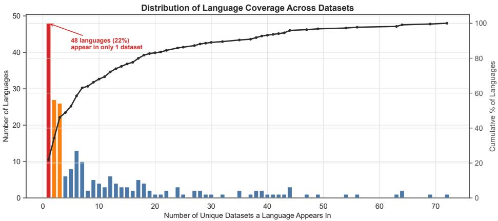  
Figure 1: Languages ranked by the number of datasets in which they appear. The long tail reveals that 36% of evaluated languages appear in only a single dataset.

## 3.1 Coverage

We analyze 51 benchmarks encompassing 242 distinct datasets and 219 unique languages along four dimensions: language, typological and geographic diversity, task coverage, and resource-level balance. Because many benchmarks aggregate existing datasets (22 of the 51 are mixed or aggregation suites), we conduct our analysis at the dataset–language level to avoid inflating coverage counts when the same dataset appears in multiple benchmarks.Unless otherwise specified, all subsequent analyses are conducted and reported at the dataset level.

Language Coverage: Across the 51 benchmarks we survey, a total of 219 unique languages are evaluated across 242 datasets, suggesting reasonable coverage. However, the distribution follows a steep power law, as shown in Figure 1 that plots languages ranked by the number of datasets in which they appear. A small cluster of high-resource languages Hindi, Chinese, Spanish, Swahili, Arabic appear in 19 or more datasets, while 48 of 219 languages (37%) appear in only a single dataset. For these 48 languages, there exists no independent replication of evaluation results and no opportunity for cross-dataset comparison. This longtail structure has a direct methodological implication: claims of multilingual generalization rest on a dense evaluation of a handful of languages and single-point estimates for the majority.

Typological and Geographical Coverage: Language count alone is an insufficient measure of diversity. Two benchmark suites could each cover 20 languages yet differ vastly in typological range if one samples broadly across families and scripts while the other concentrates on closely related Indo-European varieties. Figure 2a shows the distribution of unique lan guages across the 29 language families represented in our survey. Indo-European languages account for 83 of 219 languages (38%), while Atlantic-Congo (39 languages) ranks second, but this representation is almost entirely attributable to Africa-focused benchmarks like AfroBench, IrokoBench, and Uhuru. Families such as Austroasiatic (3 languages), Tai-Kadai (3), Japonic (1), and Quechuan (2) are poorly represented. The entire Oceanic branch of Austronesian is absent. Figure 2b reveals a similar distribution: Latin script accounts for the majority of evaluated languages, followed by Devanagari, Arabic, and CJK. Scripts used by hundreds of millions of speakers such as Ge’ez (Ethiopic), Khmer, Myanmar appear in only 1–3 benchmarks. Script diversity matters because models may exhibit systematically different tokenization efficiency (Ahia et al., 2023), character-level recall, and decoding accuracy across scripts, and these script-specific failure modes remain invisible when evaluation concentrates on Latin and Devanagari. We find similar trends in Geographical coverage as well with entire regions of the world such as Oceania and South America having very poor or no representation.

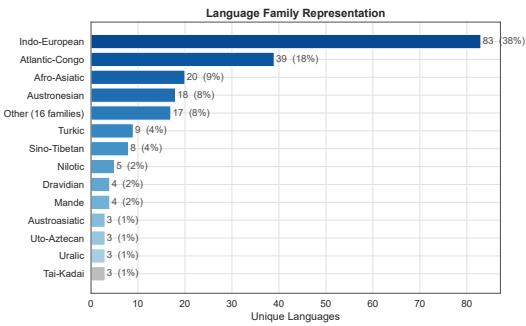  
(a) Language family representation.

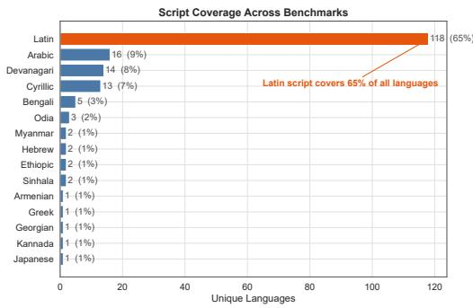  
(b) Script coverage (top 15 scripts).  
Figure 2: Typological concentration in multilingual benchmarks. (a) Indo-European dominates at 38% of all languages, with many families represented by fewer than 5 languages. (b) Latin script accountsfor the majority; widely-used scripts such as $\check { G } e ^ { \prime } e z ,$ , Khmer, and Myanmar are barely represented.

Resource-Level Distribution and Task Equity: We examine the resource-level composition of evaluated languages using the taxonomy from Joshi et al. (2020). Across the 242 distinct datasets, 65% of evaluated languages fall in the two lowest resource classes (Scraping-Bys and Left-Behinds, levels 0–1), while Winners (level 5) account for only 5% (Figure 7 in Appendix A.2). This distribution appears to favor low-resource languages, but a finer-grained analysis reverses the picture. Figure 3 disaggregates task coverage across 15 categories by resource level: the 10 Winner languages are each evaluated on a median of 14 task categories across multiple benchmarks, whereas the 160 low-resource languages (levels 0–2) are typically tested on only 1–3 tasks in a single benchmark. For Left-Behinds, Translation alone accounts for 29% of all evaluation rows and Sentiment/Classification for 25%, while Coding, Safety/Toxicity, and Instruction Following each represent only 1%. By contrast, Winners and Underdogs distribute evaluation more evenly, with Math/Reasoning (11% and 8%), Embedding/Retrieval (9% and 6%), and Safety (7% and 9%) all receiving meaningful attention. In absolute terms, Safety/Toxicity evaluation is scarce—only roughly 25 dataset– language rows across all datasets—and these are concentrated almost entirely at higher resource levels, meaning that safety coverage for low-resource languages is effectively nonexistent. Figure 8 (Appendix) cross-tabulates task categories against world regions and confirms that QA and knowledge tasks dominate everywhere, while specialized capabilities show uneven coverage. This task equity gap means that for most low-resource languages, a model’s “evaluation” amounts to a narrow probe on translation and classification, making it far too limited to support claims of general competence.

The coverage analysis reveals an ecosystem that is wide but thin: many languages are nominally included, but the depth of evaluation measured by replication across datasets, typological diversity, task breadth, and resource-level balance is concentrated in a small core. The next section asks whether the quality of coverage that does exist is adequate.

## 3.2 Representativeness

Coverage establishes what is evaluated; representativeness asks whether that evaluation is valid. A dataset may nominally cover a language, yet evaluate it using content translated from English, written by non-native speakers, or detached from local cultural context and assumptions. We audit the 242 datasets along two axes: translation and cultural grounding. At the dataset–language level, 56% of all instances are translated from English, 36% are natively authored, and 8% are partially adapted.

Translation vs. Native Construction: The dominant construction strategy for multilingual datasets remains translation from English source datasets. This approach scales efficiently as one annotation effort produces content in many languages but comes with the cost of translationese artifacts, English-centric framing, and inherited contamination risk (Section 3.3) (Artetxe et al., 2020a; Graham et al., 2020). Figure 4a disaggregates translation status by world region. In every region, a substantial fraction of languages are evaluated primarily through translated content. Datasets covering Europe and East Asia are the most translationdependent, while Sub-Saharan Africa shows the highest share of natively authored content, which is a direct consequence of language-specific datasets created from scratch such as AfroBench (Ojo et al., 2025), IrokoBench Adelani et al. (2025), and MasakhaNER (Adelani et al., 2021).

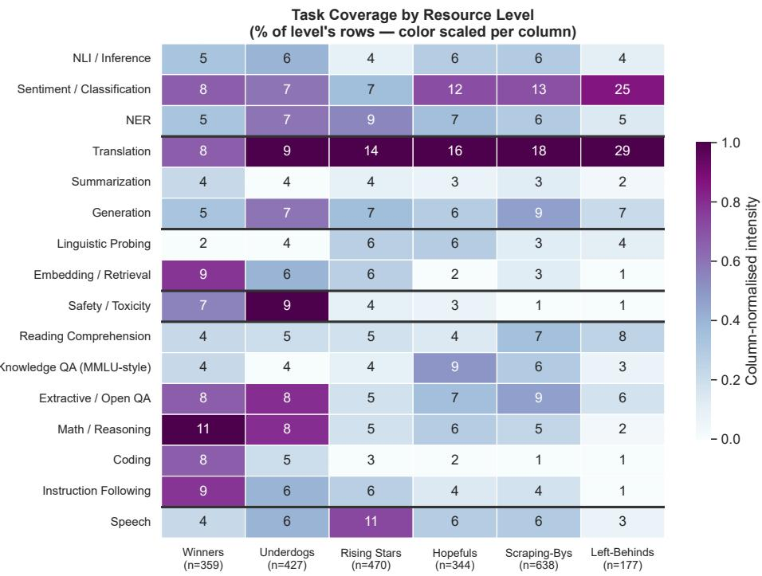  
Figure 3: Task coverage by resource level. Each cell shows the percentage of a resource level’s dataset–language rows devoted to that task category. Left-Behinds are overwhelmingly evaluated on Translation (29%) and Sentiment/Classification (25%); specialised tasks such as Coding, Safety, Instruction Following, each accountfor ≤1% of their evaluation, whereas Winners are evaluated more evenly across all 15 categories.

Cultural Representativeness: Culturally grounded datasets reflect the norms, knowledge, and pragmatic conventions of the target language community. A dataset can be natively authored yet culturally shallow (e.g., factoid QA drawn from Wikipedia), and a translated dataset can incorporate cultural adaptation (transcreation) to make it more culturally grounded. However, in practice, the two are correlated: datasets constructed from scratch by native-speaker communities are far more likely to be culturally grounded. Figure 4b shows cultural grounding rates by region. Datasets targeting Sub-Saharan Africa and South Asia exhibit the highest cultural grounding rates, reflecting the deliberate design philosophy of community-driven efforts like CulturalBench (Chiu et al., 2025), Samiksha Hamna et al. (2026), and TUMLU (Isbarov et al., 2025). By contrast, datasets with broad cross-regional scope tend to have lower cultural grounding as it is difficult to achieve at scale. This finding reinforces the pattern: the datasets that are methodologically strongest along the representativeness axis are those with the narrowest language coverage.

Annotator Demographics: Transparency around annotation workforces remains limited: only 8 of 51 benchmarks (16%) report annotator demographics such as geographic origin, ethnicity, or educational background, and only 17 (33%) disclose compensation details. Researchers are the dominant creator type across datasets, with community volunteers and crowdworkers accounting for a small minority, raising questions about whose linguistic backgrounds and priorities shape “ground truth” for underrepresented languages. The few benchmarks that do document their annotation pipeline in detail (CulturalBench, Aya, and Uhuru) tend to be the same ones that score highest on cultural grounding, suggesting that annotator transparency and evaluation validity go hand in hand.

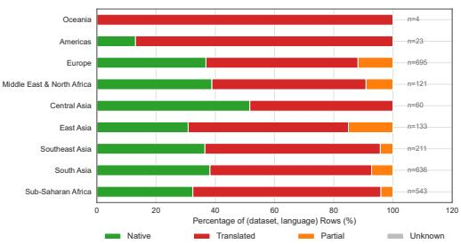  
(a) Translation status by world region.

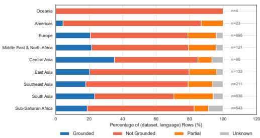  
(b) Cultural grounding by world region.  
Figure 4: Representativeness of multilingual benchmarks by world region. (a) Europe and East Asia are the most translation-dependent; Sub-Saharan Africa has the highest share of natively authored content. (b) Community-driven benchmarks in Sub-Saharan Africa and South Asia achieve the highest cultural grounding rates; broad-coverage suites score lower.

## 3.3 Rigor

## 3.3.1 Metrics

Metrics determine what counts as success, and poorly chosen metrics can give a misleading picture of model quality. Most benchmarks rely either on standard reference-based metrics to compare model outputs against ground truth, or on reference-free metrics such as LLM judges. However, many widely used metrics, such as BLEU, ROUGE, exact match, and Word Error Rate, were developed largely in English-centric settings and can be poor proxies for quality in morphologically rich languages or languages with non-standard spellings, where valid responses may differ substantially in surface form. Similarly, although LLM judges are increasingly becoming standard in evaluation pipelines, prior work shows that they often align poorly with human judgments in multilingual and multicultural settings, particularly for low-resource languages and in culturally grounded, context-sensitive evaluations (Hada et al., 2024b; Watts et al., 2024; Hamna et al., 2026; Hada et al., 2024a).

## 3.3.2 Contamination

Contamination is especially consequential in multilingual evaluation because much of the evaluation ecosystem is thin: 36% of languages appear in only one dataset (Figure 1), and 56% of dataset–language rows rely on translated content (Figure 4a). When a language’s evaluation rests on a single translated dataset, contamination through any pathway invalidates the only evidence of model competence for that language. The task equity gap (Figure 3) further amplifies this risk: for low-resource languages evaluated on only 1–2 task categories, contamination on even a single task can dominate the reported result.

Prior Contamination Analyses. Several studies have investigated multilingual benchmark contamination using surface-form overlap and membership inference methods. Ahuja et al. (2024a) found that GPT-4, Llama-2, and Gemini-Pro are likely contaminated on PAWS-X, XCopa, and XQuAD. Ahuja et al. (2024b) extended this analysis to newer models (Llama-3.1, Mistral-v0.3, Gemma-2) and confirmed pervasive contamination across 7 benchmarks. Yao et al. (2024) further demonstrated that contamination transfers cross-lingually: models contaminated on the English version of a dataset show inflated scores on non-English translations (Table 3, Appendix). Aggregating across these studies, 9 of the 10 models tested are contaminated on PAWS-X, XCopa, and XQuAD, and 7 of 7 are contaminated on Flores (Table 1; per-model details in Table 2, Appendix). However, these analyses examined a limited set of established datasets, leaving open the question of whether contamination extends to newer evaluation suites.

<table><tr><td>Dataset</td><td>Task</td><td>Prior Work</td><td>STAMP</td><td>DCQ</td></tr><tr><td>PAWS-X MGSM XCOPA XQUAD AFRIMGSM XNLI</td><td>Paraphrase Det. Math Commonsense QA Math</td><td>9/10 9/10 9/10</td><td>67.9% 45.5% 21.0%</td><td>32.6% 30.9%</td></tr><tr><td>XSTORYCLOZE FLORES XLSUM</td><td>NLI Story Cloze Translation Summarization</td><td>7/10 7/10 7/7 5/7</td><td>1.2%</td><td></td></tr><tr><td>INDICPARAM MMMLU GLOBAL MMLU INCLUDE MILU</td><td>Knowledge Knowledge Knowledge Knowledge Knowledge</td><td></td><td>4.3% 2.0% 1.7% 1.0% 0.0%</td><td>14.7% 19.6% 17.5% 18.8%</td></tr></table>

Table 1: Summary of contamination evidence across 14 multilingual datasets. Prior Work: fraction of models flagged as contaminated by surface-form and overlap methods (Ahuja et al., 2024a;b; Yao et al., 2024) (details in Table 2). STAMP: overall contamination rate (% of model–language pairs flagged at p<0.05) from our analysis using STAMP (Rastogi et al., 2025) (details in Table 4). DCQ: mean maximum recognition rate across models and languages using the Data Contamination Quiz ; 20% is the random-chance floor (details in Table 5).

Contamination Analysis with STAMP. To provide an updated assessment, we apply STAMP (Rastogi et al., 2025) to a broader and more contemporary suite of 9 datasets including recent ones such as Global MMLU, MILU, INCLUDE, and IndicParam alongside established ones like PAWS-X, MGSM, and AfriMGSM across 7 recent models (Table 4, Appendix). STAMP makes minimal assumptions about data format, enabling reliable membership detection at trace levels while strictly preserving the semantic meaning and evaluation utility of the original content. Following Rastogi et al. (2025), we operationalize contamination detection by generating 9 paraphrased versions of each dataset item and measuring the performance gap between the original and its variants. Paraphrases are produced using Qwen-3.5 397B, a large multilingual model chosen because its scale ensures high-quality rephrasings across diverse writing systems. Our results reveal that contamination remains pervasive for older datasets: PAWS-X (67.9% of model–language pairs flagged), MGSM (45.5%), and AfriMGSM (21.0%) show significant contamination signals across all seven models (Table 1). By contrast, newer datasets—MILU (0.0%), INCLUDE (1.0%), and Global MMLU (1.7%) exhibit markedly lower contamination rates, suggesting that dataset age and prominence are strong predictors of contamination risk. One notable discrepancy emerges for Flores: prior surface-form methods flag 7 of 7 models, yet STAMP detects contamination in only 1.2% of model–language pairs. This divergence likely reflects differences in what each method measures, i.e. surface-form overlap versus memorizationdriven performance gaps and underscores that no single detection approach suffices for multilingual contamination.

Complementary Analysis with DCQ. We additionally apply the Data Contamination Quiz (DCQ) Golchin & Surdeanu (2025) to 85 dataset–language partitions from 8 datasets across the same 7 models. For each of 100 sampled items per partition, GPT-4.1 produces four wordlevel synonym perturbations. A bias-detection quiz first presents only the four perturbations and a “none of these” option; the original item is then inserted into positions that the model under-selected in this initial quiz. Selecting the verbatim original provides a recognition signal while the initial responses estimate positional bias. DCQ reports a conservative and a maximum recognition rate; we use the maximum rate in Table 1 for consistency across models, while noting that taking the best rate across positions is optimistic and that 20% is the random-chance floor. At the dataset level, PAWS-X (32.6%) and MGSM (30.9%) show the strongest average recognition, whereas the remaining dataset averages range from 14.7% to 21.7%. Recognition is generally higher for English partitions: for example, English versus non-English averages are 45.7% versus 15.3% for AfriMGSM, 44.0% versus 29.6% for MGSM, and 47.6% versus 30.1% for PAWS-X. These values measure recognition rather than the fraction of a dataset that leaked and should not be directly equated with STAMP’s significance-based flag rate. Full dataset–model results, language-group comparisons, and validity caveats are reported in Appendix B.1.

Challenges of Multilingual Contamination Detection. Both STAMP and DCQ rely on another LLM to construct the measuring instrument, so variation in that model’s competence across languages can be mistaken for variation in contamination. For STAMP, semantically faithful watermarked rephrasing is harder across typologically distant and low-resource languages; uneven paraphrase quality introduces noise into the paired test. Its KGW watermarking scheme also partitions vocabulary through a tokenizer-dependent hash function (Kirchenbauer et al., 2023), so sparse or unstable tokenization can weaken the watermark and the test’s statistical power. For DCQ, difficulty is determined by the quality of GPT-4.1’s decoys. Perturbation distance ranges from 5.8% for AfriMGSM in Amharic to 48.1% for Global MMLU in English and varies with language resource level. In the eight weakest partitions, decoys are too similar to the original for reliable separation, pinning recognition near the chance floor regardless of exposure; conversely, misspellings or semantic drift can make decoys easier to reject and inflate recognition. This asymmetry is especially consequential because it can reproduce the expected finding: apparently lower contamination in low-resource languages may reflect a weaker measuring instrument rather than less exposure.

DCQ introduces a further identification problem because its prompt names the dataset, potentially conflating recognition of the dataset label with recognition of its instances. Our natural replicate holds all 100 GSM8K items byte-identical while changing only the label from AfriMGSM to MGSM; the resulting recognition difference ranges from 1 percentage point for Aya-Expanse-8B to 23 points for Gemma-3-12B (Appendix B.1). This variation cannot be attributed to contamination and limits how finely models or languages can be compared. Removing the dataset name would reduce the confound but also remove a cue on which DCQ’s recognition design depends. Together, these limitations show that neither method is language-neutral: multilingual contamination claims require per-language instrument validation and convergence across complementary methods rather than direct comparison of raw scores.

## 3.3.3 Reporting Practices in Model Releases

Based on our analysis, we ask: how do model developers report multilingual evaluation? We audit 23 recent model releases (15 open-weight, 8 closed-models, 2024–2026) across five binary transparency dimensions (1) whether training language composition is explicitly disclosed, (2) whether any multilingual evaluation dataset/benchmark is reported, (3) whether the specific evaluation languages are listed, (4) whether a contamination detection technique is named, and (5) whether contamination results are reported. The composite transparency score is the sum (0–5) (Figure 12; full methodology and per-model breakdown in Appendix A.7). The results are stark: 35% of releases report zero multilingual datasets, and 87% provide no contamination analysis. Only 3 models (all open-weight) report any contamination testing, and even these leave cross-lingual contamination pathways unexamined. When multilingual evaluation is reported, it concentrates on a handful of benchmarks, the model–dataset matrix is 93% sparse, while natively authored datasets from our survey (AfroBench, IrokoBench, MILU) are almost entirely unused. Open-weight models are more transparent (mean score 2.47/5) than closed (0.75/5), but both fall well below adequacy: the overall mean is 1.87/5, and no closed model discloses training language composition or reports contamination. These findings argue for a standardized multilingual evaluation card mandating per-language dataset disclosure accounting for contamination. Finally, multilingual safety evaluation is reported by only 4 of 23 models: Tiny Aya, Claude Opus 4.6, Claude Sonnet 4.6, and CommandA. All other models either test safety only in English or do not report safety testing at all.

## 4 Discussion

Our audit of 51 recent multilingual benchmarks spanning 242 datasets reveals a consistent pattern across all three pillars. Coverage is wide but thin: 36% of languages appear in only a single dataset and entire regions of the world are completely absent. Multilingual safety datasets remain few in number and provide little coverage of low-resource languages. Representativeness is structurally compromised: the datasets with the broadest language coverage are the most translated and least culturally grounded, while the most valid datasets cover the fewest languages. Annotator demographics are rarely reported, with researchers being the primary data creators of multilingual datasets, raising concerns about whose values and priorities are reflected in these datasets. Rigor is undermined by multiple contamination pathways that are amplified by translation-based construction, Englishcentric metrics that do not always work well on diverse languages and a lack of meaningful reporting of multilingual evaluation in model releases. These findings point to a systemic misalignment between how multilingual evaluation is currently conducted and what it would need to be to support trustworthy claims of cross-lingual competence. If these issues are not taken seriously, multilingual evaluation risks becoming performative: creating the appearance of inclusion while masking shallow support, overstating progress, and ultimately widening existing linguistic and cultural gaps in AI.

Supporting a language is not simply a matter of translating prompts, reporting a score, or listing it in a benchmark; it requires evidence that the system works in ways that are meaningful for users in their local linguistic and cultural contexts. Similarly, evaluating a language is not just measuring in another language what was originally defined in English, but assessing model behavior under the norms, knowledge systems, communicative practices, and risks that shape real use. Our work aims to raise the bar for how multilingual evaluation is conducted and reported. Reporting should make clear what was evaluated, how data was created or adapted, what contexts are covered, and what claims the results do and do not support. Meaningful community participation must go beyond translation or validation to include communities in defining tasks, rubrics, and failure modes. AI itself can also help scale multilingual evaluation through advances in multilingual synthetic data (Chitale et al., 2026), aligned multilingual LLM judges, and dynamic benchmarks to avoid contamination. Multilingual evaluation must also move beyond model-level assessment to include product, user, and real-world impact evaluation7, since model performance alone cannot capture how systems behave in deployed, culturally situated settings.

There is an inherent tension between coverage and representativeness in multilingual evaluation: approaches that scale across many languages often depend on standardization, while representativeness requires deeper engagement with local variation, context, and heterogeneity. If the field is committed to supporting everyone with AI, it must accept this tension as a fundamental reality: meaningful evaluation cannot always be reduced to uniform or fully replicable patterns across highly diverse settings, and some degree of variation must be expected as a consequence of taking linguistic, cultural, and contextual diversity seriously.

## References

David Ifeoluwa Adelani, Jade Abbott, Graham Neubig, Daniel D’souza, Julia Kreutzer, Constantine Lignos, Chester Palen-Michel, Happy Buzaaba, Shruti Rijhwani, Sebastian Ruder, Stephen Mayhew, Israel Abebe Azime, Shamsuddeen H. Muhammad, Chris Chinenye Emezue, Joyce Nakatumba-Nabende, Perez Ogayo, Aremu Anuoluwapo, Catherine Gitau, Derguene Mbaye, Jesujoba Alabi, Seid Muhie Yimam, Tajuddeen Rabiu Gwadabe, Ignatius Ezeani, Rubungo Andre Niyongabo, Jonathan Mukiibi, Verrah Otiende, Iroro Orife, Davis David, Samba Ngom, Tosin Adewumi, Paul Rayson, Mofetoluwa Adeyemi, Gerald Muriuki, Emmanuel Anebi, Chiamaka Chukwuneke, Nkiruka Odu, Eric Peter Wairagala, Samuel Oyerinde, Clemencia Siro, Tobius Saul Bateesa, Temilola Oloyede, Yvonne Wambui, Victor Akinode, Deborah Nabagereka, Maurice Katusiime, Ayodele Awokoya, Mouhamadane MBOUP, Dibora Gebreyohannes, Henok Tilaye, Kelechi Nwaike, Degaga

Wolde, Abdoulaye Faye, Blessing Sibanda, Orevaoghene Ahia, Bonaventure F. P. Dossou, Kelechi Ogueji, Thierno Ibrahima DIOP, Abdoulaye Diallo, Adewale Akinfaderin, Tendai Marengereke, and Salomey Osei. MasakhaNER: Named entity recognition for African languages. Transactions ofthe Associationfor Computational Linguistics, 9:1116–1131, 2021. doi: 10.1162/tacl a 00416. URL https://aclanthology.org/2021.tacl-1.66/.

David Ifeoluwa Adelani, Jessica Ojo, Israel Abebe Azime, Jian Yun Zhuang, Jesujoba Oluwadara Alabi, Xuanli He, Millicent Ochieng, Sara Hooker, Andiswa Bukula, En Shiun Annie Lee, Chiamaka Ijeoma Chukwuneke, Happy Buzaaba, Blessing Kudzaishe Sibanda, Godson Koffi Kalipe, Jonathan Mukiibi, Salomon Kabongo Kabenamualu, Foutse Yuehgoh, Mmasibidi Setaka, Lolwethu Ndolela, Nkiruka Odu, Rooweither Mabuya, Salomey Osei, Shamsuddeen Hassan Muhammad, Sokhar Samb, Tadesse Kebede Guge, Tombekai Vangoni Sherman, and Pontus Stenetorp. IrokoBench: A new benchmark for African languages in the age of large language models. In Luis Chiruzzo, Alan Ritter, and Lu Wang (eds.), Proceedings ofthe 2025 Conference of the Nations of the Americas Chapter of the Associationfor Computational Linguistics: Human Language Technologies (Volume 1: Long Papers), pp. 2732–2757, Albuquerque, New Mexico, April 2025. Association for Computational Linguistics. ISBN 979-8-89176-189-6. doi: 10.18653/v1/2025.naacl-long.139. URL https://aclanthology.org/2025.naacl-long.139/.

Orevaoghene Ahia, Sachin Kumar, Hila Gonen, Jungo Kasai, David Mortensen, Noah Smith, and Yulia Tsvetkov. Do all languages cost the same? tokenization in the era of commercial language models. In Houda Bouamor, Juan Pino, and Kalika Bali (eds.), Proceedings of the 2023 Conference on Empirical Methods in Natural Language Processing, pp. 9904–9923, Singapore, December 2023. Association for Computational Linguistics. doi: 10.18653/v1/ 2023.emnlp-main.614. URL https://aclanthology.org/2023.emnlp-main.614/.

Amar Ahmad, Yvonne Valles, and Youssef Idaghdour. Bias in ai systems: integrating formal\` and socio-technical approaches. Frontiers in Big Data, 8:1686452, 2025.

Kabir Ahuja, Sandipan Dandapat, Sunayana Sitaram, and Monojit Choudhury. Beyond static models and test sets: Benchmarking the potential of pre-trained models across tasks and languages. In Tatiana Shavrina, Vladislav Mikhailov, Valentin Malykh, Ekaterina Artemova, Oleg Serikov, and Vitaly Protasov (eds.), Proceedings ofNLP Power! The First Workshop on Efficient Benchmarking in NLP, pp. 64–74, Dublin, Ireland, May 2022. Association for Computational Linguistics. doi: 10.18653/v1/2022.nlppower-1.7. URL https://aclanthology.org/2022.nlppower-1.7/.

Kabir Ahuja, Harshita Diddee, Rishav Hada, Millicent Ochieng, Krithika Ramesh, Prachi Jain, Akshay Nambi, Tanuja Ganu, Sameer Segal, Mohamed Ahmed, Kalika Bali, and Sunayana Sitaram. MEGA: Multilingual evaluation of generative AI. In Houda Bouamor, Juan Pino, and Kalika Bali (eds.), Proceedings of the 2023 Conference on Empirical Methods in Natural Language Processing, pp. 4232–4267, Singapore, December 2023. Association for Computational Linguistics. doi: 10.18653/v1/2023.emnlp-main.258. URL https: //aclanthology.org/2023.emnlp-main.258/.

Sanchit Ahuja, Divyanshu Aggarwal, Varun Gumma, Ishaan Watts, Ashutosh Sathe, Millicent Ochieng, Rishav Hada, Prachi Jain, Mohamed Ahmed, Kalika Bali, and Sunayana Sitaram. MEGAVERSE: Benchmarking large language models across languages, modalities, models and tasks. In Kevin Duh, Helena Gomez, and Steven Bethard (eds.), Proceed ings of the 2024 Conference of the North American Chapter of the Associationfor Computational Linguistics: Human Language Technologies (Volume 1: Long Papers), pp. 2598–2637, Mexico City, Mexico, June 2024a. Association for Computational Linguistics. doi: 10.18653/v1/ 2024.naacl-long.143. URL https://aclanthology.org/2024.naacl-long.143/.

Sanchit Ahuja, Varun Gumma, and Sunayana Sitaram. Contamination report for multilingual benchmarks, 2024b. URL https://arxiv.org/abs/2410.16186.

Doyin Akindotuni. Resource asymmetry in multilingual nlp: A comprehensive review and critique. Journal of Computer and Communications, 13(7):14–47, 2025.

Mikel Artetxe, Gorka Labaka, and Eneko Agirre. Translation artifacts in cross-lingual transfer learning. In Bonnie Webber, Trevor Cohn, Yulan He, and Yang Liu (eds.), Proceedings of the 2020 Conference on Empirical Methods in Natural Language Processing (EMNLP), pp. 7674–7684, Online, November 2020a. Association for Computational Linguistics. doi: 10.18653/v1/2020.emnlp-main.618. URL https://aclanthology.org/2020.emnlp-main. 618/.

Mikel Artetxe, Sebastian Ruder, and Dani Yogatama. On the cross-lingual transferability of monolingual representations. In Dan Jurafsky, Joyce Chai, Natalie Schluter, and Joel Tetreault (eds.), Proceedings of the 58th Annual Meeting of the Association for Computational Linguistics, pp. 4623–4637, Online, July 2020b. Association for Computational Linguistics. doi: 10.18653/v1/2020.acl-main.421. URL https://aclanthology.org/2020.acl-main. 421/.

Akari Asai, Jungo Kasai, Jonathan Clark, Kenton Lee, Eunsol Choi, and Hannaneh Hajishirzi. XOR QA: Cross-lingual open-retrieval question answering. In Kristina Toutanova, Anna Rumshisky, Luke Zettlemoyer, Dilek Hakkani-Tur, Iz Beltagy, Steven Bethard, Ryan Cotterell, Tanmoy Chakraborty, and Yichao Zhou (eds.), Proceedings of the 2021 Conference of the North American Chapter of the Association for Computational Linguistics: Human Language Technologies, pp. 547–564, Online, June 2021. Association for Computational Linguistics. doi: 10.18653/v1/2021.naacl-main.46. URL https://aclanthology.org/2021.naacl-main.46/.

Akari Asai, Sneha Kudugunta, Xinyan Yu, Terra Blevins, Hila Gonen, Machel Reid, Yulia Tsvetkov, Sebastian Ruder, and Hannaneh Hajishirzi. Buffet: Benchmarking large language models for few-shot cross-lingual transfer. In Proceedings of the 2024 Conference of the North American Chapter of the Association for Computational Linguistics: Human Language Technologies (Volume 1: Long Papers), pp. 1771–1800, 2024.

Lucas Bandarkar, Davis Liang, Benjamin Muller, Mikel Artetxe, Satya Narayan Shukla, Donald Husa, Naman Goyal, Abhinandan Krishnan, Luke Zettlemoyer, and Madian Khabsa. The belebele benchmark: a parallel reading comprehension dataset in 122 language variants. In Proceedings of the 62nd Annual Meeting of the Association for Computational Linguistics (Volume 1: Long Papers), pp. 749–775, 2024.

Irene Baucells, Javier Aula-Blasco, Iria de Dios-Flores, Silvia Paniagua Suarez, Naiara Perez,´ Anna Salles, Susana Sotelo Docio, Julia Falc´ ao, Jose Javier Saiz, Robiert Sepulveda Torres,˜ Jeremy Barnes, Pablo Gamallo, Aitor Gonzalez-Agirre, German Rigau, and Marta Villegas. IberoBench: A benchmark for LLM evaluation in Iberian languages. In Owen Rambow, Leo Wanner, Marianna Apidianaki, Hend Al-Khalifa, Barbara Di Eugenio, and Steven Schockaert (eds.), Proceedings of the 31st International Conference on Computational Linguistics, pp. 10491–10519, Abu Dhabi, UAE, January 2025. Association for Computational Linguistics. URL https://aclanthology.org/2025.coling-main.699/.

Edward Bayes, Israel Abebe Azime, Jesujoba O. Alabi, Jonas Kgomo, Tyna Eloundou, Elizabeth Proehl, Kai Chen, Imaan Khadir, Naome A. Etori, Shamsuddeen Hassan Muhammad, Choice Mpanza, Igneciah Pocia Thete, Dietrich Klakow, and David Ifeoluwa Adelani. Uhura: A benchmark for evaluating scientific question answering and truthfulness in low-resource african languages, 2024. URL https://arxiv.org/abs/2412.00948.

Gayatri Bhat, Sourabrata Mukherjee, Faisal Lalani, Evan Hadfield, Divya Siddarth, Kalika Bali, Sunayana Sitaram, et al. Building benchmarks from the ground up: Communitycentered evaluation of llms in healthcare chatbot settings. arXiv preprint arXiv:2509.24506, 2025.

Damian Blasi, Antonios Anastasopoulos, and Graham Neubig. Systematic inequalities in language technology performance across the world’s languages. In Smaranda Muresan, Preslav Nakov, and Aline Villavicencio (eds.), Proceedings of the 60th Annual Meeting of the Association for Computational Linguistics (Volume 1: Long Papers), pp. 5486–5505, Dublin, Ireland, May 2022. Association for Computational Linguistics. doi: 10.18653/v1/2022. acl-long.376. URL https://aclanthology.org/2022.acl-long.376/.

Terra Blevins and Luke Zettlemoyer. Language contamination helps explains the crosslingual capabilities of English pretrained models. In Yoav Goldberg, Zornitsa Kozareva, and Yue Zhang (eds.), Proceedings of the 2022 Conference on Empirical Methods in Natural Language Processing, pp. 3563–3574, Abu Dhabi, United Arab Emirates, December 2022. Association for Computational Linguistics. doi: 10.18653/v1/2022.emnlp-main.233. URL https://aclanthology.org/2022.emnlp-main.233/.

Casey Casalnuovo and Matthew Todd Farrell. Review of grey box/black box data contamination metrics on open and commercial models. Technical report, Sandia National Laboratories (SNL-CA), Livermore, CA (United States), 02 2025. URL https: //www.osti.gov/biblio/2585515.

Yuxing Cheng, Yi Chang, and Yuan Wu. A survey on data contamination for large language models. arXiv preprint arXiv:2502.14425, 2025.

Pranjal A. Chitale, Varun Gumma, Sanchit Ahuja, Prashant Kodali, Manan Uppadhyay, Deepthi Sudharsan, and Sunayana Sitaram. Updesh: Synthesizing grounded instruction tuning data for 13 indic languages, 2026. URL https://arxiv.org/abs/2509.21294.

Yu Ying Chiu, Liwei Jiang, Bill Yuchen Lin, Chan Young Park, Shuyue Stella Li, Sahithya Ravi, Mehar Bhatia, Maria Antoniak, Yulia Tsvetkov, Vered Shwartz, and Yejin Choi. CulturalBench: A robust, diverse and challenging benchmark for measuring LMs’ cultural knowledge through human-AI red-teaming. In Wanxiang Che, Joyce Nabende, Ekaterina Shutova, and Mohammad Taher Pilehvar (eds.), Proceedings of the 63rd Annual Meeting of the Association for Computational Linguistics (Volume 1: Long Papers), pp. 25663–25701, Vienna, Austria, July 2025. Association for Computational Linguistics. ISBN 979-8-89176-251-0. doi: 10.18653/v1/2025.acl-long.1247. URL https: //aclanthology.org/2025.acl-long.1247/.

Jonathan H. Clark, Eunsol Choi, Michael Collins, Dan Garrette, Tom Kwiatkowski, Vitaly Nikolaev, and Jennimaria Palomaki. TyDi QA: A benchmark for information-seeking question answering in typologically diverse languages. Transactions of the Association for Computational Linguistics, 8:454–470, 2020. doi: 10.1162/tacl a 00317. URL https: //aclanthology.org/2020.tacl-1.30/.

Alexis Conneau, Ruty Rinott, Guillaume Lample, Adina Williams, Samuel Bowman, Holger Schwenk, and Veselin Stoyanov. XNLI: Evaluating cross-lingual sentence representations. In Ellen Riloff, David Chiang, Julia Hockenmaier, and Jun’ichi Tsujii (eds.), Proceedings of the 2018 Conference on Empirical Methods in Natural Language Processing, pp. 2475–2485, Brussels, Belgium, October-November 2018. Association for Computational Linguistics. doi: 10.18653/v1/D18-1269. URL https://aclanthology.org/D18-1269/.

Alexis Conneau, Kartikay Khandelwal, Naman Goyal, Vishrav Chaudhary, Guillaume Wenzek, Francisco Guzman, Edouard Grave, Myle Ott, Luke Zettlemoyer, and Veselin´ Stoyanov. Unsupervised cross-lingual representation learning at scale. In Proceedings of the 58th annual meeting of the associationfor computational linguistics, pp. 8440–8451, 2020.

Jan Christian Blaise Cruz and Alham Fikri Aji. Llm olympiad: Why model evaluation needs a sealed exam. arXiv preprint arXiv:2603.23292, 2026.

Yue Deng, Wenxuan Zhang, Sinno Jialin Pan, and Lidong Bing. Multilingual jailbreak challenges in large language models. In The Twelfth International Conference on Learning Representations, 2024. URL https://openreview.net/forum?id=vESNKdEMGp.

Jer´ emie Dentan, Alexi Canesse, Davide Buscaldi, Aymen Shabou, and Sonia Vanier. Much:´ A multilingual claim hallucination benchmark. arXiv preprint arXiv:2511.17081, 2025.

Vijay Devane, Mohd Nauman, Bhargav Patel, Aniket Mahendra Wakchoure, Yogeshkumar Sant, Shyam Pawar, Viraj Thakur, Ananya Godse, Sunil Patra, Neha Maurya, Suraj Racha, Nitish Kamal Singh, Ajay Nagpal, Piyush Sawarkar, Kundeshwar Vijayrao Pundalik, Rohit Saluja, and Ganesh Ramakrishnan. Bhashabench v1: A comprehensive benchmark for the quadrant of indic domains, 2025. URL https://arxiv.org/abs/2510.25409.

Sumanth Doddapaneni, Rahul Aralikatte, Gowtham Ramesh, Shreya Goyal, Mitesh M Khapra, Anoop Kunchukuttan, and Pratyush Kumar. Towards leaving no indic language behind: Building monolingual corpora, benchmark and models for indic languages. In Proceedings of the 61st Annual Meeting of the Association for Computational Linguistics (Volume 1: Long Papers), pp. 12402–12426, 2023.

Ehsan Doostmohammadi. Toward Understanding and Enhancing the Training and Evaluation of Language Models: A Study on Vision, Instruction Tuning, and Retrieval Augmentation, volume 2502. Linkoping University Electronic Press, 2026.¨

Antoine Dussolle, Andrea Cardena D˜ ´ıaz, Shota Sato, and Peter Devine. M-IFEval: Multilingual instruction-following evaluation. In Luis Chiruzzo, Alan Ritter, and Lu Wang (eds.), Findings of the Association for Computational Linguistics: NAACL 2025, pp. 6176– 6191, Albuquerque, New Mexico, April 2025. Association for Computational Linguistics. ISBN 979-8-89176-195-7. doi: 10.18653/v1/2025.findings-naacl.344. URL https: //aclanthology.org/2025.findings-naacl.344/.

Abteen Ebrahimi, Manuel Mager, Arturo Oncevay, Vishrav Chaudhary, Luis Chiruzzo, Angela Fan, John Ortega, Ricardo Ramos, Annette Rios Gonzales, Ivan Meza-Ruiz, et al. Americasnli: Evaluating zero-shot natural language understanding of pretrained multilingual models in truly low-resource languages. In Proceedings of the 60th Annual Meeting of the Associationfor Computational Linguistics (Volume 1: Long Papers), pp. 6279–6299, 2022.

Kenneth Enevoldsen, Isaac Chung, Imene Kerboua, Marton Kardos, Ashwin Mathur, David´ Stap, Jay Gala, Wissam Siblini, Dominik Krzeminski, Genta Indra Winata, et al. Mmteb: Massive multilingual text embedding benchmark. In International Conference on Learning Representations. International Conference on Learning Representations, 2025.

Yujuan Fu, Ozlem Uzuner, Meliha Yetisgen-Yildiz, and Fei Xia. Does data contamination detection work (well) for llms? a survey and evaluation on detection assumptions. In Findings of the Association for Computational Linguistics: NAACL 2025, pp. 5235–5256, 2025.

Baban Gain, Dibyanayan Bandyopadhyay, Asif Ekbal, and Trilok Nath Singh. Bridging the linguistic divide: a survey on leveraging large language models for machine translation. arXiv preprint arXiv:2504.01919, 2025.

Shahriar Golchin and Mihai Surdeanu. Data contamination quiz: A tool to detect and estimate contamination in large language models. Transactions of the Association for Computational Linguistics, 13:809–830, 2025. doi: 10.1162/tacl.a.20. URL https: //aclanthology.org/2025.tacl-1.37/.

Naman Goyal, Cynthia Gao, Vishrav Chaudhary, Peng-Jen Chen, Guillaume Wenzek, Da Ju, Sanjana Krishnan, Marc’Aurelio Ranzato, Francisco Guzman, and Angela Fan. The ´ flores-101 evaluation benchmark for low-resource and multilingual machine translation. Transactions of the Association for Computational Linguistics, 10:522–538, 2022.

Yvette Graham, Barry Haddow, and Philipp Koehn. Statistical power and translationese in machine translation evaluation. In Bonnie Webber, Trevor Cohn, Yulan He, and Yang Liu (eds.), Proceedings of the 2020 Conference on Empirical Methods in Natural Language Processing (EMNLP), pp. 72–81, Online, November 2020. Association for Computational Linguistics. doi: 10.18653/v1/2020.emnlp-main.6. URL https://aclanthology.org/ 2020.emnlp-main.6/.

Yanzhu Guo, Simone Conia, Zelin Zhou, Min Li, Saloni Potdar, and Henry Xiao. Do large language models have an english accent? evaluating and improving the naturalness of multilingual llms. In Proceedings of the 63rd Annual Meeting of the Associationfor Computational Linguistics (Volume 1: Long Papers), pp. 3823–3838, 2025.

Rishav Hada, Varun Gumma, Mohamed Ahmed, Kalika Bali, and Sunayana Sitaram. METAL: Towards multilingual meta-evaluation. In Kevin Duh, Helena Gomez, and Steven Bethard (eds.), Findings of the Association for Computational Linguistics: NAACL 2024, pp. 2280–2298, Mexico City, Mexico, June 2024a. Association for Computational

Linguistics. doi: 10.18653/v1/2024.findings-naacl.148. URL https://aclanthology.org/ 2024.findings-naacl.148/.

Rishav Hada, Varun Gumma, Adrian de Wynter, Harshita Diddee, Mohamed Ahmed, Monojit Choudhury, Kalika Bali, and Sunayana Sitaram. Are large language model-based evaluators the solution to scaling up multilingual evaluation? In Yvette Graham and Matthew Purver (eds.), Findings of the Association for Computational Linguistics: EACL 2024, pp. 1051–1070, St. Julian’s, Malta, March 2024b. Association for Computational Linguistics. doi: 10.18653/v1/2024.findings-eacl.71. URL https://aclanthology.org/ 2024.findings-eacl.71/.

Hamna Hamna, Gayatri Bhat, Sourabrata Mukherjee, Faisal Lalani, Evan Hadfield, Divya Siddarth, Kalika Bali, and Sunayana Sitaram. Building benchmarks from the ground up: Community-centered evaluation of llms in healthcare chatbot settings, 2026. URL https://arxiv.org/abs/2509.24506.

Daniel Hershcovich, Stella Frank, Heather Lent, Miryam de Lhoneux, Mostafa Abdou, Stephanie Brandl, Emanuele Bugliarello, Laura Cabello Piqueras, Ilias Chalkidis, Ruixiang Cui, Constanza Fierro, Katerina Margatina, Phillip Rust, and Anders Søgaard. Challenges and strategies in cross-cultural NLP. In Smaranda Muresan, Preslav Nakov, and Aline Villavicencio (eds.), Proceedings of the 60th Annual Meeting of the Association for Computational Linguistics (Volume 1: Long Papers), pp. 6997–7013, Dublin, Ireland, May 2022. Association for Computational Linguistics. doi: 10.18653/v1/2022.acl-long.482. URL https://aclanthology.org/2022.acl-long.482/.

Daphne Xin Hou, Stuti Thapa, and Louis Tay. Bridging cultures in the era of big data: A cross-language equivalence framework in machine-learning research with social media texts. Advances in Methods and Practices in Psychological Science, 9(1):25152459251398713, 2026.

Cheng Huang, Nyima Tashi, Fan Gao, Yutong Liu, Jiahao Li, Hao Tian, Siyang Jiang, Thupten Tsering, Ban Ma-bao, Renzeg Duojie, et al. Tibetan language and ai: A comprehensive survey of resources, methods and challenges. arXiv preprint arXiv:2510.19144, 2025a.

Xu Huang, Wenhao Zhu, Hanxu Hu, Conghui He, Lei Li, Shujian Huang, and Fei Yuan. BenchMAX: A comprehensive multilingual evaluation suite for large language models. In Christos Christodoulopoulos, Tanmoy Chakraborty, Carolyn Rose, and Violet Peng (eds.), Findings of the Association for Computational Linguistics: EMNLP 2025, pp. 16751–16774, Suzhou, China, November 2025b. Association for Computational Linguistics. ISBN 979- 8-89176-335-7. doi: 10.18653/v1/2025.findings-emnlp.909. URL https://aclanthology. org/2025.findings-emnlp.909/.

Jafar Isbarov, Arofat Akhundjanova, Mammad Hajili, Kavsar Huseynova, Dmitry Gaynullin, Anar Rzayev, Osman Tursun, Aizirek Turdubaeva, Ilshat Saetov, Rinat Kharisov, Saule Belginova, Ariana Kenbayeva, Amina Alisheva, Abdullatif Koksal, Samir Rustamov, and¨ Duygu Ataman. TUMLU: A unified and native language understanding benchmark for Turkic languages. In Wanxiang Che, Joyce Nabende, Ekaterina Shutova, and Mohammad Taher Pilehvar (eds.), Proceedings of the 63rd Annual Meeting of the Association for Computational Linguistics (Volume 1: Long Papers), pp. 22816–22838, Vienna, Austria, July 2025. Association for Computational Linguistics. ISBN 979-8-89176-251-0. doi: 10.18653/ v1/2025.acl-long.1112. URL https://aclanthology.org/2025.acl-long.1112/.

Alon Jacovi, Avi Caciularu, Omer Goldman, and Yoav Goldberg. Stop uploading test data in plain text: Practical strategies for mitigating data contamination by evaluation benchmarks. In Houda Bouamor, Juan Pino, and Kalika Bali (eds.), Proceedings ofthe 2023 Conference on Empirical Methods in Natural Language Processing, pp. 5075–5084, Singapore, December 2023. Association for Computational Linguistics. doi: 10.18653/v1/2023. emnlp-main.308. URL https://aclanthology.org/2023.emnlp-main.308/.

Devansh Jain, Priyanshu Kumar, Samuel Gehman, Xuhui Zhou, Thomas Hartvigsen, and Maarten Sap. Polyglotoxicityprompts: Multilingual evaluation of neural toxic degeneration in large language models. In First Conference on Language Modeling, 2024.

Thanmay Jayakumar, Mohammed Safi Ur Rahman Khan, Raj Dabre, Ratish Puduppully, and Anoop Kunchukuttan. Indicifeval: A benchmark for verifiable instruction-following evaluation in 14 indic languages. arXiv preprint arXiv:2602.22125, 2026.

Pratik Joshi, Sebastin Santy, Amar Budhiraja, Kalika Bali, and Monojit Choudhury. The state and fate of linguistic diversity and inclusion in the NLP world. In Dan Jurafsky, Joyce Chai, Natalie Schluter, and Joel Tetreault (eds.), Proceedings of the 58th Annual Meeting of the Association for Computational Linguistics, pp. 6282–6293, Online, July 2020. Association for Computational Linguistics. doi: 10.18653/v1/2020.acl-main.560. URL https://aclanthology.org/2020.acl-main.560/.

Divyanshu Kakwani, Anoop Kunchukuttan, Satish Golla, Gokul NC, Avik Bhattacharyya, Mitesh M Khapra, and Pratyush Kumar. Indicnlpsuite: Monolingual corpora, evaluation benchmarks and pre-trained multilingual language models for indian languages. In Findings of the association for computational linguistics: EMNLP 2020, pp. 4948–4961, 2020.

Masahiro Kaneko, Ayana Niwa, and Timothy Baldwin. Jailnewsbench: Multi-lingual and regional benchmark for fake news generation under jailbreak attacks. In The Fourteenth International Conference on Learning Representations, 2026.

Amir Hossein Kargaran, Ali Modarressi, Nafiseh Nikeghbal, Jana Diesner, Franc¸ois Yvon, and Hinrich Schutze. Mexa: Multilingual evaluation of english-centric llms via cross-¨ lingual alignment. In Findings of the Association for Computational Linguistics: ACL 2025, pp. 27001–27023, 2025.

John Kirchenbauer, Jonas Geiping, Yuxin Wen, Jonathan Katz, Ian Miers, and Tom Goldstein. A watermark for large language models. In Andreas Krause, Emma Brunskill, Kyunghyun Cho, Barbara Engelhardt, Sivan Sabato, and Jonathan Scarlett (eds.), Proceedings ofthe 40th International Conference on Machine Learning, volume 202 of Proceedings of Machine Learning Research, pp. 17061–17084. PMLR, 23–29 Jul 2023. URL https://proceedings.mlr.press/ v202/kirchenbauer23a.html.

Sankalp KJ, Ashutosh Kumar, Laxmaan Balaji, Nikunj Kotecha, Vinija Jain, Aman Chadha, and Sreyoshi Bhaduri. Indicmmlu-pro: Benchmarking indic large language models on multi-task language understanding, 2025. URL https://arxiv.org/abs/2501.15747.

Aman Kumar, Himani Shrotriya, Prachi Sahu, Amogh Mishra, Raj Dabre, Ratish Puduppully, Anoop Kunchukuttan, Mitesh M. Khapra, and Pratyush Kumar. IndicNLG benchmark: Multilingual datasets for diverse NLG tasks in Indic languages. In Yoav Goldberg, Zornitsa Kozareva, and Yue Zhang (eds.), Proceedings of the 2022 Conference on Empirical Methods in Natural Language Processing, pp. 5363–5394, Abu Dhabi, United Arab Emirates, December 2022. Association for Computational Linguistics. doi: 10.18653/v1/2022. emnlp-main.360. URL https://aclanthology.org/2022.emnlp-main.360/.

Saurabh Kumar, Ranbir Sanasam, and Sukumar Nandi. Indisentiment140: Sentiment analysis dataset for indian languages with emphasis on low-resource languages using machine translation. In Proceedings of the 2024 Conference of the North American Chapter of the Association for Computational Linguistics: Human Language Technologies (Volume 1: Long Papers), pp. 7689–7698, 2024.

Somnath Kumar, Vaibhav Balloli, Mercy Ranjit, Kabir Ahuja, Sunayana Sitaram, Kalika Bali, Tanuja Ganu, and Akshay Nambi. Bridging the language gap: Dynamic learning strategies for improving multilingual performance in llms. In Proceedings of the 31st International Conference on Computational Linguistics, pp. 9209–9223, 2025.

Kyle Lachini. Rethinking language assessment in the age of ai: A call for a paradigm shift. Available at SSRN 5043405, 2024.

Anna Mae Lamentillo. Linguistic pluralism as a core dimension of algorithmic fairness. LSE International Development Review, 4(2), 2025.

Wei Qi Leong, Jian Gang Ngui, Yosephine Susanto, Hamsawardhini Rengarajan, Kengatharaiyer Sarveswaran, and William Chandra Tjhi. Bhasa: A holistic southeast asian linguistic and cultural evaluation suite for large language models, 2023.

Yue Li, Zhixue Zhao, and Carolina Scarton. It’s all about in-context learning! teaching extremely low-resource languages to llms. In Proceedings of the 2025 Conference on Empirical Methods in Natural Language Processing, pp. 29532–29547, 2025.

Yaobo Liang, Nan Duan, Yeyun Gong, Ning Wu, Fenfei Guo, Weizhen Qi, Ming Gong, Linjun Shou, Daxin Jiang, Guihong Cao, Xiaodong Fan, Ruofei Zhang, Rahul Agrawal, Edward Cui, Sining Wei, Taroon Bharti, Ying Qiao, Jiun-Hung Chen, Winnie Wu, Shuguang Liu, Fan Yang, Daniel Campos, Rangan Majumder, and Ming Zhou. XGLUE: A new benchmark dataset for cross-lingual pre-training, understanding and generation. In Bonnie Webber, Trevor Cohn, Yulan He, and Yang Liu (eds.), Proceedings of the 2020 Conference on Empirical Methods in Natural Language Processing (EMNLP), pp. 6008–6018, Online, November 2020. Association for Computational Linguistics. doi: 10.18653/v1/ 2020.emnlp-main.484. URL https://aclanthology.org/2020.emnlp-main.484/.

Yile Liu, Ziwei Ma, Xiu Jiang, Jinglu Hu, ChangJing ChangJing, and Liang Li. MaXIFE: Multilingual and cross-lingual instruction following evaluation. In Wanxiang Che, Joyce Nabende, Ekaterina Shutova, and Mohammad Taher Pilehvar (eds.), Proceedings of the 63rd Annual Meeting of the Associationfor Computational Linguistics (Volume 1: Long Papers), pp. 14252–14332, Vienna, Austria, July 2025. Association for Computational Linguistics. ISBN 979-8-89176-251-0. doi: 10.18653/v1/2025.acl-long.698. URL https://aclanthology.org/ 2025.acl-long.698/.

Dominik Macko, Robert Moro, Adaku Uchendu, Jason Lucas, Michiharu Yamashita, Matu´ sˇ Pikuliak, Ivan Srba, Thai Le, Dongwon Lee, Jakub Simko, et al. Multitude: Large-scale multilingual machine-generated text detection benchmark. In Proceedings of the 2023 Conference on Empirical Methods in Natural Language Processing, pp. 9960–9987, 2023.

Ayush Maheshwari, Kaushal Sharma, Vivek Patel, and Aditya Maheshwari. Indicparam: Benchmark to evaluate llms on low-resource indic languages. arXiv preprint arXiv:2512.00333, 2025.

Timothy R McIntosh, Teo Susnjak, Nalin Arachchilage, Tong Liu, Dan Xu, Paul Watters, and Malka N Halgamuge. Inadequacies of large language model benchmarks in the era of generative artificial intelligence. IEEE Transactions on Artificial Intelligence, 2025.

Aybike Mergen, Nergiz C¸ etin-Kılıc¸, and Mustafa F Ozbilgin. Artificial intelligence and bias¨ towards marginalised groups: Theoretical roots and challenges. 2025.

Arnav Mhaske, Harshit Kedia, Sumanth Doddapaneni, Mitesh M. Khapra, Pratyush Kumar, Rudra Murthy, and Anoop Kunchukuttan. Naamapadam: A large-scale named entity annotated data for Indic languages. In Anna Rogers, Jordan Boyd-Graber, and Naoaki Okazaki (eds.), Proceedings of the 61st Annual Meeting of the Association for Computational Linguistics (Volume 1: Long Papers), pp. 10441–10456, Toronto, Canada, July 2023. Association for Computational Linguistics. doi: 10.18653/v1/2023.acl-long.582. URL https://aclanthology.org/2023.acl-long.582/.

Abdullah Mushtaq, Imran Taj, Rafay Naeem, Ibrahim Ghaznavi, and Junaid Qadir. Worldview-bench: A benchmark for evaluating global cultural perspectives in large language models. arXiv preprint arXiv:2505.09595, 2025.

Shiwen Ni, Guhong Chen, Shuaimin Li, Xuanang Chen, Siyi Li, Bingli Wang, Qiyao Wang, Xingjian Wang, Yifan Zhang, Liyang Fan, et al. A survey on large language model benchmarks. arXiv preprint arXiv:2508.15361, 2025.

Zhiyuan Ning, Tianle Gu, Jiaxin Song, Shixin Hong, Lingyu Li, Huacan Liu, Jie Li, Yixu Wang, Meng Lingyu, Yan Teng, et al. Linguasafe: A comprehensive multilingual safety benchmark for large language models. arXiv preprint arXiv:2508.12733, 2025.

Juhyun Oh, Inha Cha, Michael Saxon, Hyunseung Lim, Shaily Bhatt, and Alice Oh. Culture is everywhere: A call for intentionally cultural evaluation. arXiv preprint arXiv:2509.01301, 2025.

Victor Ojewale, Inioluwa Deborah Raji, and Suresh Venkatasubramanian. Multi-lingual functional evaluation for large language models, 2026. URL https://arxiv.org/abs/ 2506.20793.

Jessica Ojo, Odunayo Ogundepo, Akintunde Oladipo, Kelechi Ogueji, Jimmy Lin, Pontus Stenetorp, and David Ifeoluwa Adelani. AfroBench: How good are large language models on African languages? In Wanxiang Che, Joyce Nabende, Ekaterina Shutova, and Mohammad Taher Pilehvar (eds.), Findings of the Association for Computational Linguistics: ACL 2025, pp. 19048–19095, Vienna, Austria, July 2025. Association for Computational Linguistics. ISBN 979-8-89176-256-5. doi: 10.18653/v1/2025.findings-acl.976. URL https://aclanthology.org/2025.findings-acl.976/.

Seoyoon Park, Hyeji Choi, Minseon Kim, Subin An, Xiaonan Wang, Gyuri Choi, and Hansaem Kim. FLUID QA: A multilingual benchmark for figurative language usage in dialogue across English, Chinese, and Korean. In Christos Christodoulopoulos, Tanmoy Chakraborty, Carolyn Rose, and Violet Peng (eds.), Proceedings of the 2025 Conference on Empirical Methods in Natural Language Processing, pp. 30280–30294, Suzhou, China, November 2025. Association for Computational Linguistics. ISBN 979-8-89176-332-6. doi: 10.18653/v1/2025.emnlp-main.1540. URL https://aclanthology.org/2025.emnlp-main. 1540/.

Alistair Plum, Anne-Marie Lutgen, Christoph Purschke, and Achim Rettinger. Identityaware large language models require cultural reasoning. arXiv preprint arXiv:2510.18510, 2025.

Libo Qin, Qiguang Chen, Yuhang Zhou, Zhi Chen, Yinghui Li, Lizi Liao, Min Li, Wanxiang Che, and Philip S Yu. A survey of multilingual large language models. Patterns, 6(1), 2025.

Saksham Rastogi, Pratyush Maini, and Danish Pruthi. Stamp your content: Proving dataset membership via watermarked rephrasings. In International Conference on Machine Learning, pp. 51247–51272. PMLR, 2025.

Sebastian Ruder, Noah Constant, Jan Botha, Aditya Siddhant, Orhan Firat, Jinlan Fu, Pengfei Liu, Junjie Hu, Dan Garrette, Graham Neubig, and Melvin Johnson. XTREME-R: Towards more challenging and nuanced multilingual evaluation. In Marie-Francine Moens, Xuanjing Huang, Lucia Specia, and Scott Wen-tau Yih (eds.), Proceedings of the 2021 Conference on Empirical Methods in Natural Language Processing, pp. 10215– 10245, Online and Punta Cana, Dominican Republic, November 2021. Association for Computational Linguistics. doi: 10.18653/v1/2021.emnlp-main.802. URL https: //aclanthology.org/2021.emnlp-main.802/.

Sebastian Ruder, Jonathan H Clark, Alexander Gutkin, Mihir Kale, Min Ma, Massimo Nicosia, Shruti Rijhwani, Parker Riley, Jean-Michel A-Sarr, Xinyi Wang, et al. Xtreme-up: A user-centric scarce-data benchmark for under-represented languages. In Findings of the Association for Computational Linguistics: EMNLP 2023, pp. 1856–1884, 2023.

Oscar Sainz, Jon Campos, Iker Garc´ıa-Ferrero, Julen Etxaniz, Oier Lopez de Lacalle, and Eneko Agirre. NLP evaluation in trouble: On the need to measure LLM data contamination for each benchmark. In Houda Bouamor, Juan Pino, and Kalika Bali (eds.), Findings of the Association for Computational Linguistics: EMNLP 2023, pp. 10776–10787, Singapore, December 2023. Association for Computational Linguistics. doi: 10.18653/v1/2023. findings-emnlp.722. URL https://aclanthology.org/2023.findings-emnlp.722/.

Tarun Sharma, Manikandan Ravikiran, Sourava Kumar Behera, Pramit Bhattacharya, Arnab Bhattacharya, and Rohit Saluja. Indic dialect: A multi task benchmark to evaluate and translate in indian language dialects. arXiv preprint arXiv:2601.10388, 2026.

Aditya Siddhant, Junjie Hu, Melvin Johnson, Orhan Firat, and Sebastian Ruder. Xtreme: A massively multilingual multi-task benchmark for evaluating cross-lingual generalization. In Proceedings of the International Conference on Machine Learning, volume 2020, pp. 4411– 4421, 2020.

Shivalika Singh, Freddie Vargus, Daniel D’souza, Borje F Karlsson, Abinaya Mahendiran,¨ Wei-Yin Ko, Herumb Shandilya, Jay Patel, Deividas Mataciunas, Laura O’Mahony, et al. Aya dataset: An open-access collection for multilingual instruction tuning. In Proceedings of the 62nd Annual Meeting of the Association for Computational Linguistics (Volume 1: Long Papers), pp. 11521–11567, 2024.

Samridhi Raj Sinha, Rajvee Sheth, Abhishek Upperwal, and Mayank Singh. Eka-eval: An evaluation framework for low-resource multilingual large language models. arXiv preprint arXiv:2507.01853, 2025.

Olu Smith. Cultural contexts in english language teaching: Balancing global standards with local relevance. IOSR Journal of Humanities and Social Science, 30(10):16–28, 2025.

Seyoung Song, Seogyeong Jeong, Eunsu Kim, Jiho Jin, Dongkwan Kim, Jay Shin, and Alice Oh. MUG-eval: A proxy evaluation framework for multilingual generation capabilities in any language. In Christos Christodoulopoulos, Tanmoy Chakraborty, Carolyn Rose, and Violet Peng (eds.), Findings of the Association for Computational Linguistics: EMNLP 2025, pp. 19488–19514, Suzhou, China, November 2025. Association for Computational Linguistics. ISBN 979-8-89176-335-7. doi: 10.18653/v1/2025.findings-emnlp.1061. URL https://aclanthology.org/2025.findings-emnlp.1061/.

Yosephine Susanto, Adithya Venkatadri Hulagadri, Jann Railey Montalan, Jian Gang Ngui, Xianbin Yong, Wei Qi Leong, Hamsawardhini Rengarajan, Peerat Limkonchotiwat, Yifan Mai, and William Chandra Tjhi. SEA-HELM: Southeast Asian holistic evaluation of language models. In Wanxiang Che, Joyce Nabende, Ekaterina Shutova, and Mohammad Taher Pilehvar (eds.), Findings of the Association for Computational Linguistics: ACL 2025, pp. 12308–12336, Vienna, Austria, July 2025. Association for Computational Linguistics. ISBN 979-8-89176-256-5. doi: 10.18653/v1/2025.findings-acl.636. URL https://aclanthology.org/2025.findings-acl.636/.

Bibek Upadhayay. Efficient and robust language adaptation in multilingual llms. 2025.

Madison Van Doren, Casey Ford, Jennifer Barajas, and Cory Holland. ” be my cheese?”: Cultural nuance benchmarking for machine translation in multilingual llms. arXiv preprint arXiv:2602.04729, 2026.

Sshubam Verma, Mohammed Safi Ur Rahman Khan, Vishwajeet Kumar, Rudra Murthy, and Jaydeep Sen. MILU: A multi-task Indic language understanding benchmark. In Luis Chiruzzo, Alan Ritter, and Lu Wang (eds.), Proceedings ofthe 2025 Conference ofthe Nations of the Americas Chapter of the Association for Computational Linguistics: Human Language Technologies (Volume 1: Long Papers), pp. 10076–10132, Albuquerque, New Mexico, April 2025. Association for Computational Linguistics. ISBN 979-8-89176-189-6. doi: 10.18653/ v1/2025.naacl-long.507. URL https://aclanthology.org/2025.naacl-long.507/.

Ishaan Watts, Varun Gumma, Aditya Yadavalli, Vivek Seshadri, Manohar Swaminathan, and Sunayana Sitaram. PARIKSHA: A large-scale investigation of human-LLM evaluator agreement on multilingual and multi-cultural data. In Yaser Al-Onaizan, Mohit Bansal, and Yun-Nung Chen (eds.), Proceedings of the 2024 Conference on Empirical Methods in Natural Language Processing, pp. 7900–7932, Miami, Florida, USA, November 2024. Association for Computational Linguistics. doi: 10.18653/v1/2024.emnlp-main.451. URL https://aclanthology.org/2024.emnlp-main.451/.

Laura Weidinger, Jonathan Uesato, Maribeth Rauh, Conor Griffin, Po-Sen Huang, John Mellor, Amelia Glaese, Myra Cheng, Borja Balle, Atoosa Kasirzadeh, et al. Taxonomy of risks posed by language models. In Proceedings of the 2022 ACM conference on fairness, accountability, and transparency, pp. 214–229, 2022.

Chris Wendler, Veniamin Veselovsky, Giovanni Monea, and Robert West. Do llamas work in English? on the latent language of multilingual transformers. In Lun-Wei Ku, Andre Martins, and Vivek Srikumar (eds.), Proceedings ofthe 62nd Annual Meeting ofthe Association for Computational Linguistics (Volume 1: Long Papers), pp. 15366–15394, Bangkok, Thailand, August 2024. Association for Computational Linguistics. doi: 10.18653/v1/2024.acl-long. 820. URL https://aclanthology.org/2024.acl-long.820/.

Genta Indra Winata, Alham Fikri Aji, Samuel Cahyawijaya, Rahmad Mahendra, Fajri Koto, Ade Romadhony, Kemal Kurniawan, David Moeljadi, Radityo Eko Prasojo, Pascale Fung, Timothy Baldwin, Jey Han Lau, Rico Sennrich, and Sebastian Ruder. NusaX: Multilingual parallel sentiment dataset for 10 Indonesian local languages. In Andreas Vlachos and Isabelle Augenstein (eds.), Proceedings of the 17th Conference of the European Chapter of the Association for Computational Linguistics, pp. 815–834, Dubrovnik, Croatia, May 2023. Association for Computational Linguistics. doi: 10.18653/v1/2023.eacl-main.57. URL https://aclanthology.org/2023.eacl-main.57/.

Minghao Wu, Weixuan Wang, Sinuo Liu, Huifeng Yin, Xintong Wang, Yu Zhao, Chenyang Lyu, Longyue Wang, Weihua Luo, and Kaifu Zhang. The bitter lesson learned from 2,000+ multilingual benchmarks. arXiv preprint arXiv:2504.15521, 2025.

Weihao Xuan, Rui Yang, Heli Qi, Qingcheng Zeng, Yunze Xiao, Aosong Feng, Dairui Liu, Yun Xing, Junjue Wang, Fan Gao, et al. Mmlu-prox: A multilingual benchmark for advanced large language model evaluation. In Proceedings of the 2025 Conference on Empirical Methods in Natural Language Processing, pp. 1513–1532, 2025.

Diyi Yang, Dirk Hovy, David Jurgens, and Barbara Plank. Socially aware language technologies: Perspectives and practices. Computational Linguistics, 51:689–703, 2025.

Feng Yao, Yufan Zhuang, Zihao Sun, Sunan Xu, Animesh Kumar, and Jingbo Shang. Data contamination can cross language barriers. In Yaser Al-Onaizan, Mohit Bansal, and Yun-Nung Chen (eds.), Proceedings of the 2024 Conference on Empirical Methods in Natural Language Processing, pp. 17864–17875, Miami, Florida, USA, November 2024. Association for Computational Linguistics. doi: 10.18653/v1/2024.emnlp-main.990. URL https: //aclanthology.org/2024.emnlp-main.990/.

Haotian Ye. Multilinguality and inclusive language technologies for low-resource languages. PhD thesis, lmu, 2025.

Pardis Sadat Zahraei and Ehsaneddin Asgari. I am aligned, but with whom? mena values benchmark for evaluating cultural alignment and multilingual bias in llms. arXiv preprint arXiv:2510.13154, 2025.

Longhui Zhang, Yanzhao Zhang, Dingkun Long, Pengjun Xie, Meishan Zhang, Jing Li, and Min Zhang. Progressive adaptation of large language models for multilingual text ranking. ACM Transactions on Information Systems, 2026.

Wenxuan Zhang, Mahani Aljunied, Chang Gao, Yew Ken Chia, and Lidong Bing. M3exam: A multilingual, multimodal, multilevel benchmark for examining large language models. Advances in Neural Information Processing Systems, 36:5484–5505, 2023.

Raoyuan Zhao, Beiduo Chen, Barbara Plank, and Michael A. Hedderich. MAKIEval: A multilingual automatic WiKidata-based framework for cultural awareness evaluation for LLMs. In Christos Christodoulopoulos, Tanmoy Chakraborty, Carolyn Rose, and Violet Peng (eds.), Findings of the Association for Computational Linguistics: EMNLP 2025, pp. 23104–23136, Suzhou, China, November 2025. Association for Computational Linguistics. ISBN 979-8-89176-335-7. doi: 10.18653/v1/2025.findings-emnlp.1256. URL https:// aclanthology.org/2025.findings-emnlp.1256/.

## A Appendix

## A.1 Data Extraction Methodology

We survey 51 multilingual evaluation benchmarks and extract structured metadata at dataset-level granularity through a multi-step pipeline. For each benchmark/dataset paper, Claude Opus 4.6 extracts the constituent datasets, their member languages, and three key properties per dataset: whether the evaluation content was translated from another language (typically English), whether native speakers were involved in annotation, and whether the dataset is culturally grounded in the target locale rather than reflecting sourceculture assumptions. The extraction operates at a three-level hierarchy—benchmark → dataset → language. Language metadata is enriched deterministically from authoritative sources: family and macroarea, primary script from Glottolog8, and resource classification (levels 0–5) from Joshi et al. (2020)’s taxonomy. To avoid inflated counts from shared datasets appearing across multiple aggregation benchmarks, we deduplicate at the (dataset, language) level while retaining benchmark provenance. Each property is assessed at the dataset level with an associated confidence rating (high, medium, or low) and a supporting evidence passage extracted from the paper. These produced assessments are then surfaced in a web-based human review interface (Figure 5), where reviewers inspect the extracted values and evidence, verify or correct language membership through interactive toggles, and provide final judgments via structured dropdowns. Certain datasets are automatically flagged for mandatory review due to missing or uncertain property values (e.g., unknown native annotator status), indicated by colored NEEDS REVIEW badges.

## A.2 Geographic Distribution

Figure 6 maps languages to macro-regions. Sub-Saharan Africa leads in raw language count (62 languages, 28%, driven by dedicated datasets), followed by Europe (45, 21%) and South Asia (43, 20%). The Americas (14) and Central Asia (9) have gained modest representation through recent datasets, but Oceania remains near-zero (2 languages, 1%)—a region home to over 1,400 living languages that remain almost entirely outside the evaluation perimeter.

## A.3 Resource-Level Distribution

Figure 7 shows the resource-level composition of all evaluated languages, complementing the task equity analysis in the section 3.2 (Figure 3).

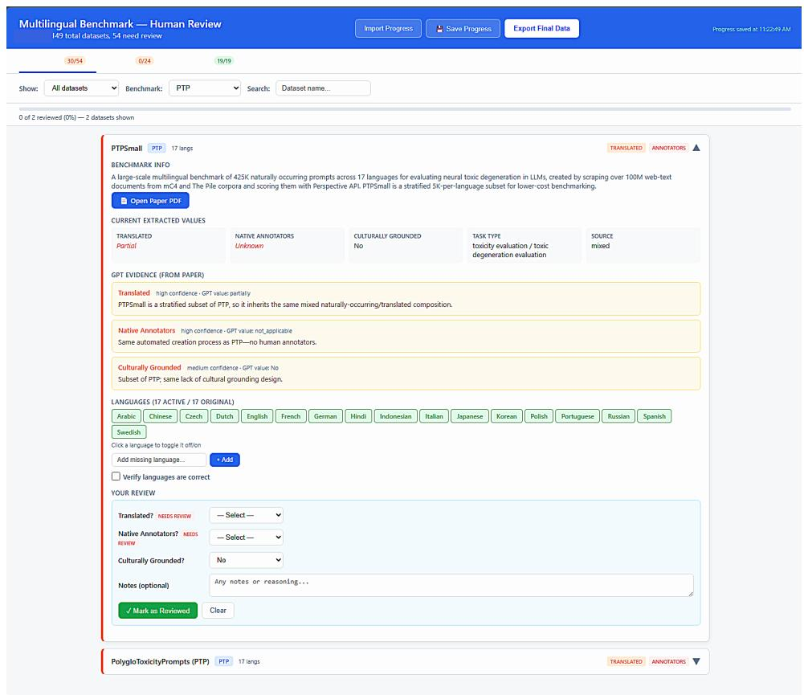  
Figure 5: Human review interface showing extracted dataset properties with evidence passages and confidence ratings, alongside structured dropdowns for reviewer adjudication of translation status, native annotator involvement, and cultural grounding.

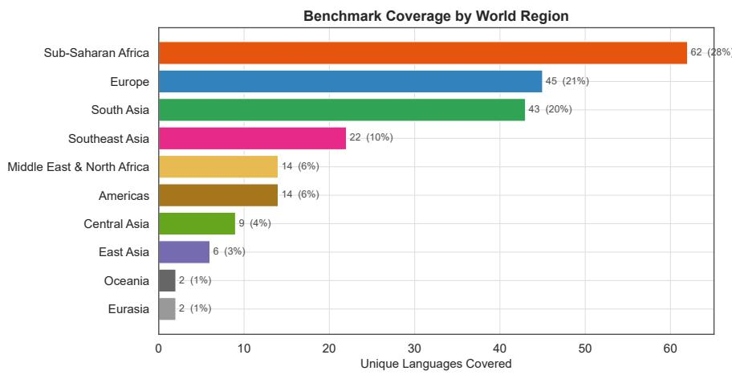  
Figure 6: Number of unique languages covered by world region. Takeaway: Coverage is concentrated in Sub-Saharan Africa, Europe, and South Asia; Oceania remains near-zero.

## A.4 Dataset Source Type Breakdown

Figure 9 breaks down the 242 unique datasets by construction method. While 128 datasets (53%) are originally authored, 85 (35%) are translated from English sources. The remaining datasets are either adapted from existing resources (15, 6%) or use a mix of methods (14, 6%).

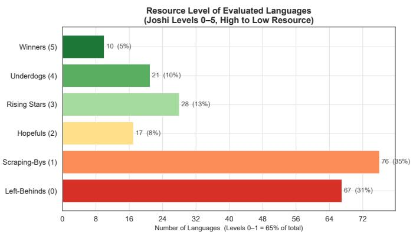  
Figure 7: Resource-level distribution of all evaluated languages. Takeaway: 65% of evaluated languages fall in the two lowest resource classes (levels 0–1), yet depth of evaluation remains concentrated in high-resource languages.

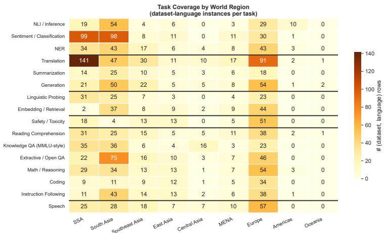  
Figure 8: Task category coverage by world region (number of datatset evaluating each task). Takeaway: QA/Knowledge dominates everywhere; specialized tasks (safety, reasoning, coding) are unevenly distributed, with Central Asia and MENA consistently thinnest.

This means that over a third of the evaluation data that multilingual models are tested on originates from English, carrying the associated risks of translationese artifacts and cultural misalignment.

## A.5 Translation Status by Resource Level

Figure 10 reveals how translation status interacts with resource level. Across all resource levels, roughly 35–40% of dataset–language instances involve native data. However, the composition shifts at the extremes: Left-Behinds (n = 178) have the lowest native share (∼20%) and are overwhelmingly evaluated through translated datasets, while Winners (n = 360) maintain a higher native proportion (∼40%) but still rely heavily on translated data. This pattern suggests that the most under-served languages are also the most likely to be evaluated using data that does not originate from their speech communities.

## A.6 Native Annotators by Region

Figure 11 examines whether dataset annotations were produced by native speakers of the target language, broken down by region. Central Asia and South Asia have the highest native-annotator share (∼50%), driven by dedicated regional datasets/benchmarks (e.g.,

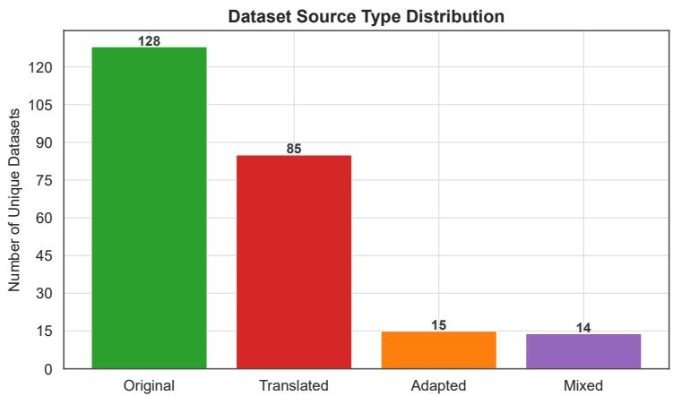  
Figure 9: Distribution of dataset construction methods across 242 unique datasets. 35% of datasets are translated from English; only 53% are originally authored in the target language(s).

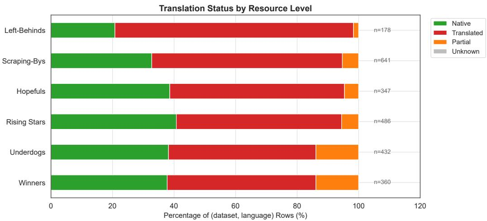  
Figure 10: Translation status of dataset–language instances by Joshi resource level. Takeaway: Left-Behinds have the lowest native data share; the most under-resourced languages are predominantly evaluated through translated datasets.

IndicGenBench, INCLUDE). Sub-Saharan Africa (n = 543) shows ∼45% native annotators but a large “Unknown” fraction, reflecting that many aggregation benchmarks do not document annotator provenance. The Americas $( n \stackrel { } { = } 2 3 )$ have the lowest native share, consistent with minimal community-driven dataset development for indigenous languages.

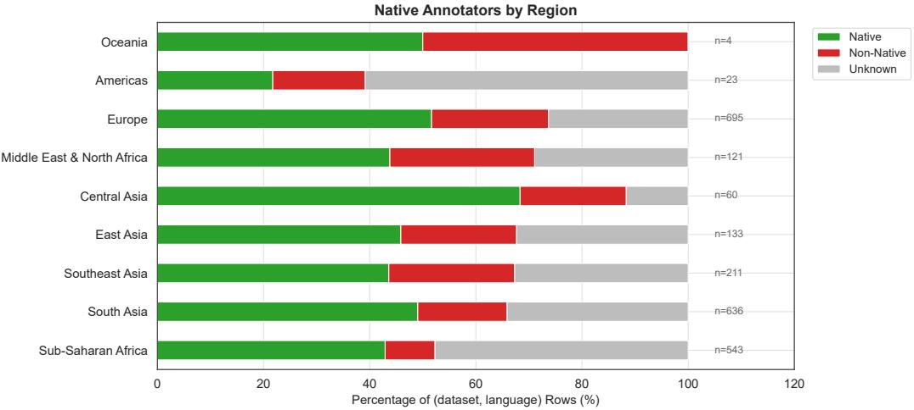  
Figure 11: Native vs. non-native annotator status by region. Takeaway: Annotator provenance is under-documented; where reported, South Asia and Central Asia lead in native-speaker annotation, while the Americas lag.

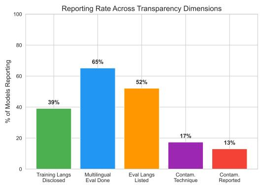

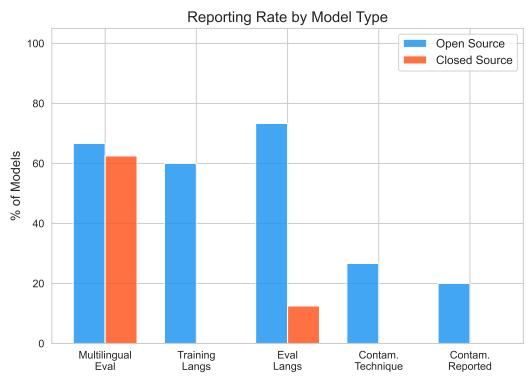  
Figure 12: Multilingual evaluation transparency across 23 recent model releases (15 openweight, 8 closed). Left: Reporting rate across five transparency dimensions—only 65% report any multilingual evaluation, and just 13% report contamination results. Right: Breakdown by model type—closed models disclose significantly less across all dimensions.

## A.7 Model Release Transparency Audit

Section 3.3.3 reports summary statistics from our audit of 23 recent model releases. Here we describe the methodology and provide the detailed per-model breakdown.

Methodology We examine technical reports, model cards, and blog posts for 23 model releases spanning 2024–2026 (15 open-weight, 8 closed-models). Each release is scored on five binary transparency dimensions: (1) whether training language composition is explicitly disclosed, (2) whether any multilingual evaluation datasets is reported, (3) whether the specific evaluation languages are listed, (4) whether a contamination detection technique is named, and (5) whether contamination results are reported. The composite transparency score is the sum (0–5).

## Detailed Findings

Models with sparse multilingual evaluation evidence include GPT, Grok, Mistral 3, BharatGen, Command-R+, OLMo, and Kimi K2.5. Kimi K2.5, for example, is described by its authors as “very English centric.” Similarly, while Sarvam is trained on 22 Indian languages, its reported evaluation appears to center on a newly introduced dataset/benchmark scored using an LLM judge, without corresponding results on other widely used multilingual datasets. Consequently, the multilingual capabilities of these releases remain difficult to verify comprehensively, given the limited publicly reported evaluation evidence.

Contamination testing is reported by only 3 models: Llama-3 (ConTAM), Gemma (quality reweighting), and GPT-OSS (TroubleshootingBench). All are open-weight. Even these three use techniques designed for English benchmarks; cross-lingual contamination pathways like translated dataset leakage, parallel corpus overlap, instruction-tuning propagation go unexamined.

Datasets concentration: INCLUDE, FLORES-200, and MGSM are the three most frequently cited multilingual datasets, each appearing in only 4 of 23 reports. Natively authored, culturally grounded datasets like AfroBench, IrokoBench, MILU, CulturalBench, TUMLU are almost never cited.

Open weight vs. closed: Open-weight models average 2.47/5 on the transparency score vs. 0.75/5 for closed models. The gap is largest on training language disclosure (60% vs. 0%), evaluation language listing (73% vs. 12%), and contamination reporting (20% vs. 0%). The Aya model family (Aya-23, Aya-Expanse, Tiny Aya) stands out as the transparency exemplar, reporting multilingual datasets across 23–70 languages. However, even the most transparent open-weight models rarely report contamination testing for multilingual datasets.

Multilingual safety evaluation is reported by only 4 of 23 models: Tiny Aya, Claude Opus 4.6, Claude Sonnet 4.6, and CommandA. All other models either test safety only in English or do not report safety testing at all.

## B Contamination Detection Results

<table><tr><td>LLAMA-3.1-8B LLAMA-3.1-8B-IT MISTRAL-7B-V0.3 FLORES PAWS-X</td><td</table>

Table 2: Benchmark contamination presence across all evaluated models based on Ahuja et al. (2024a), Ahuja et al. (2024b), and Yao et al. (2024). ✗ = contaminated, ✓ = not contaminated, – = not evaluated.

<table><tr><td></td><td>PHI2 2.7B</td><td>PHI3 3.8B</td><td>PHI3.5-MINI 3.8B</td><td>PHI3.5-MOE 3.8B×16</td><td>GRINMOE 3.8B×16</td><td>ABEL-7B 7B</td><td>LLAMA2 7B</td><td>MISTRAL 7B</td><td>QWEN2 7B</td><td>GLM4 9B</td><td>LLAMA3 70B</td><td>REFLECTION 70B</td></tr><tr><td>MMLU</td><td>23.83</td><td>67.27</td><td>68.64</td><td>76.62</td><td>77.55</td><td>47.08</td><td>44.88</td><td>57.29</td><td>69.05</td><td>67.36</td><td>78.55</td><td>75.83</td></tr><tr><td>MMLU-g</td><td>25.02</td><td>85.29</td><td>87.00</td><td>91.65</td><td>92.83</td><td>68.37</td><td>72.87</td><td>82.71</td><td>89.23</td><td>84.91</td><td>92.17</td><td>88.37</td></tr><tr><td>difference</td><td>1.20</td><td>18.02</td><td>18.36</td><td>15.03</td><td>15.28</td><td>21.29</td><td>27.99</td><td>25.42</td><td>20.18</td><td>17.55</td><td>13.62</td><td>12.54</td></tr><tr><td>ARC-C</td><td>42.92</td><td>80.20</td><td>59.56</td><td>54.78</td><td>63.57</td><td>50.34</td><td>36.18</td><td>64.08</td><td>84.81</td><td>86.35</td><td>61.52</td><td>56.74</td></tr><tr><td>ARC-C-g</td><td>47.27</td><td>92.15</td><td>93.94</td><td>96.50</td><td>96.25</td><td>66.04</td><td>44.71</td><td>85.75</td><td>95.22</td><td>91.81</td><td>95.99</td><td>94.45</td></tr><tr><td>difference</td><td>4.35</td><td>11.95</td><td>34.38</td><td>41.72</td><td>32.68</td><td>15.70</td><td>8.53</td><td>21.67</td><td>10.41</td><td>5.46</td><td>34.47</td><td>37.71</td></tr><tr><td>MathQA</td><td>31.32</td><td>41.14</td><td>41.14</td><td>37.42</td><td>47.67</td><td>34.30</td><td>28.71</td><td>36.88</td><td>44.36</td><td>43.05</td><td>56.52</td><td>58.29</td></tr><tr><td>MathQA-g</td><td>38.70</td><td>49.06</td><td>47.38</td><td>43.96</td><td>56.27</td><td>35.71</td><td>36.18</td><td>45.77</td><td>49.03</td><td>56.04</td><td>61.84</td><td>63.92</td></tr><tr><td>difference</td><td>7.38</td><td>7.92</td><td>6.24</td><td>6.54</td><td>8.60</td><td>1.41</td><td>7.47</td><td>8.89</td><td>4.67</td><td>12.99</td><td>5.32</td><td>5.63</td></tr></table>

Table 3: Detecting inadvertent contamination in popular open-source LLMs from Yao et al. (2024). Each benchmark is tested in its original form and a paraphrased variant (-g); the difference row shows the generalizability gap. Bold values indicate significantly lower generalizability, implying potential contamination.

<table><tr><td>Model</td><td>PAW-SX</td><td>Global MMLU</td><td>IndicParam</td><td>MILU</td><td>MMMLU</td><td>INCLUDE</td><td>FLORES</td><td>MGSM</td><td>AFRiMGSM</td><td>Overall</td></tr><tr><td>Aya-Expanse-32B</td><td>100% (4/4)</td><td>0% (0/42)</td><td>0% (0/6)</td><td>0% (0/11)</td><td>0% (0/14)</td><td>0% (0/44)</td><td>4% (1/28)</td><td>55% (6/11)</td><td>16% (3/19)</td><td>7.8%</td></tr><tr><td>Gemma-3-12B</td><td>50% (2/4)</td><td>12% (5/40)</td><td>0% (0/7)</td><td>0% (0/11)</td><td>14% (2/14)</td><td>5% (2/44)</td><td>0% (1/204)</td><td>55% (6/11)</td><td>16% (3/19)</td><td>5.9%</td></tr><tr><td>Tiny-Aya-Global</td><td>100% (4/4)</td><td>0% (0/42)</td><td>0% (0/12)</td><td>0% (0/11)</td><td>0% (0/14)</td><td>0% (0/44)</td><td>2% (5/204)</td><td>55% (6/11)</td><td>26% (5/19)</td><td>5.5%</td></tr><tr><td>Aya-Expanse-8B</td><td>75% (3/4)</td><td>0% (0/42)</td><td>10% (1/10)</td><td>0% (0/11)</td><td>0% (0/14)</td><td>0% (0/44)</td><td>1% (2/204)</td><td>64% (7/11)</td><td>26% (5/19)</td><td>5.0%</td></tr><tr><td>Qwen3-4B</td><td>100% (4/4)</td><td>0% (0/42)</td><td>8% (1/12)</td><td>0% (0/11)</td><td>0% (0/14)</td><td>0% (0/44)</td><td>0% (1/204)</td><td>36% (4/11)</td><td>21% (4/19)</td><td>3.9%</td></tr><tr><td>Phi-4</td><td>25% (1/4)</td><td>0% (0/42)</td><td>8% (1/12)</td><td>0% (0/11)</td><td>0% (0/14)</td><td>2% (1/44)</td><td>1% (2/204)</td><td>18% (2/11)</td><td>21% (4/19)</td><td>3.0%</td></tr><tr><td>Llama-3.1-8B</td><td>25% (1/4)</td><td>0% (0/42)</td><td>0% (0/10)</td><td>0% (0/11)</td><td>0% (0/14)</td><td>0% (0/44)</td><td>1% (3/204)</td><td>36% (4/11)</td><td>20% (2/10)</td><td>2.9%</td></tr><tr><td>Overall</td><td>67.9%</td><td>1.7%</td><td>4.3%</td><td>0.0%</td><td>2.0%</td><td>1.0%</td><td>1.2%</td><td>45.5%</td><td>21.0%</td><td>4.6%</td></tr></table>

Table 4: Contamination rate per model and dataset. Each cell shows the fraction of languages flagged as contaminated $( p \dot { < } 0 . 0 5 )$ , with the count in parentheses. Bold indicates the dataset is contaminated as a whole (Fisher’s combined $p < \bar { 0 } . 0 5 )$

## B.1 Data Contamination Quiz Results

We apply the Data Contamination Quiz (DCQ) to 85 dataset–language partitions, with 100 instances per partition. Table 5 reports the maximum recognition rate, averaged over languages within each dataset. Table 6 compares English partitions with the mean over non-English partitions where both are available. Because each quiz has five options, 20% is the random-chance floor. These are recognition rates rather than estimates of the fraction of training data contaminated.

Eight partitions have perturbation distance below 10%, making their quizzes close to unsolvable and their low scores uninformative. The bias-detection abstention rate is also near zero for most models, indicating that models often guess rather than select “none of these.” A byte-identical replicate of the English GSM8K items under the AfriMGSM and MGSM dataset names produces a mean absolute difference of 9.7 percentage points and a maximum difference of 23 points across models. Individual DCQ values should therefore be treated as approximate.

## C Released Resources and Interactive Dashboard

To facilitate community engagement with these findings, we will release three resources upon acceptance. First, we will provide the structured metadata annotations for all 51 benchmarks and 242 datasets, including per-language fields for script, language family, resource level, task categories, translation status, native annotator provenance, and cultural grounding. Second, we will release the full analysis codebase used to produce all figures, tables, and statistics in this paper, enabling researchers to reproduce our analysis and extend it as new datasets appear. Third, we provide an interactive web dashboard that allows users to explore coverage and representativeness statistics, browse individual datasets via a searchable explorer, and look up per-language dataset coverage. The dashboard is designed to be a living resource that will be updated as new datasets are added to the survey.

<table><tr><td>Model</td><td>AfriMGSM</td><td>Global MMLU</td><td>INCLUDE</td><td>IndicParam</td><td>MGSM</td><td>MILU</td><td>MMMLU</td><td>PAWS-X</td></tr><tr><td>Aya-Expanse-32B</td><td>21.3</td><td>28.7</td><td>29.7</td><td>16.2</td><td>47.4</td><td>27.0</td><td>31.8</td><td>54.4</td></tr><tr><td>Aya-Expanse-8B</td><td>10.8</td><td>12.6</td><td>11.5</td><td>8.7</td><td>22.3</td><td>13.6</td><td>12.4</td><td>38.9</td></tr><tr><td>Tiny-Aya-Global</td><td>27.5</td><td>21.0</td><td>19.1</td><td>15.1</td><td>34.6</td><td>16.7</td><td>22.8</td><td>11.4</td></tr><tr><td>Gemma-3-12B</td><td>39.4</td><td>21.5</td><td>40.6</td><td>36.0</td><td>56.6</td><td>36.6</td><td>19.7</td><td>41.3</td></tr><tr><td>Llama-3.1-8B</td><td>9.2</td><td>8.7</td><td>11.1</td><td>9.9</td><td>17.9</td><td>9.8</td><td>7.3</td><td>33.2</td></tr><tr><td>Phi-4</td><td>2.3</td><td>22.6</td><td>10.6</td><td>13.2</td><td>10.6</td><td>24.6</td><td>36.8</td><td>20.6</td></tr><tr><td>Qwen3-4B</td><td>18.1</td><td>7.7</td><td>9.3</td><td>3.8</td><td>26.8</td><td>13.7</td><td>6.5</td><td>28.2</td></tr><tr><td>Mean</td><td>18.4</td><td>17.5</td><td>18.8</td><td>14.7</td><td>30.9</td><td>21.7</td><td>19.6</td><td>32.6</td></tr></table>

Table 5: DCQ maximum recognition rate (%) by model and benchmark, averaged over each benchmark’s language partitions. The random-chance floor is 20%. The maximum rate selects the best raw hit rate across the tested answer positions and is therefore an optimistic estimate.

<table><tr><td>Benchmark</td><td>English</td><td>Non-English Mean</td></tr><tr><td>AfriMGSM</td><td>45.7%</td><td>15.3%</td></tr><tr><td>Global MMLU</td><td>26.1%</td><td>16.6%</td></tr><tr><td>MGSM</td><td>44.0%</td><td>29.6%</td></tr><tr><td>MILU</td><td>37.9%</td><td>18.6%</td></tr><tr><td>PAWS-X</td><td>47.6%</td><td>30.1%</td></tr></table>

Table 6: DCQ maximum recognition rate averaged across the seven models for English and non-English language partitions. INCLUDE, IndicParam, and MMMLU are omitted because the evaluated partitions do not include English.

<table><tr><td>Type</td><td>Name</td><td>Release Date</td></tr><tr><td>Model</td><td>Aya-Expanse-32B Aya-Expanse-8B Tiny-Aya-Global Gemma-3-12B Llama-3.1-8B Phi-4 Qwen3-4B</td><td>December 2024 December 2024 February 2026 March 2025 July 2024 December 2024 April 2025</td></tr><tr><td>Datasets</td><td>PAW-SX Global MMLU IndicParam MILU MMMLU INCLUDE FLORES MGSM AFRiMGSM</td><td>November 2019 December 2024 November 2025 November 2024 September 2020 November 2024 June 2021 October 2022 May 2024</td></tr></table>

Table 7: Release dates of models and datasets/benchmarks used in this study.

## The dashboard provides four main views:

• Coverage Analysis: Interactive visualisations of language, family, script, regional, resource-level, and task-type distributions, mirroring and extending the figures in this paper. Users can click on individual bars to drill down into which datasets cover specific languages (Figure 14).

• Representativeness: Translation status and cultural grounding breakdowns by region and resource level.

• Benchmark Explorer: A searchable, sortable table of all 51 benchmarks with expandable rows showing paper links, descriptions, language lists, task categories, and language family coverage (Figure 15).

• Language Lookup: A per-language search interface that returns all datasets/benchmarks covering a given language, with metadata on translation status and task types.

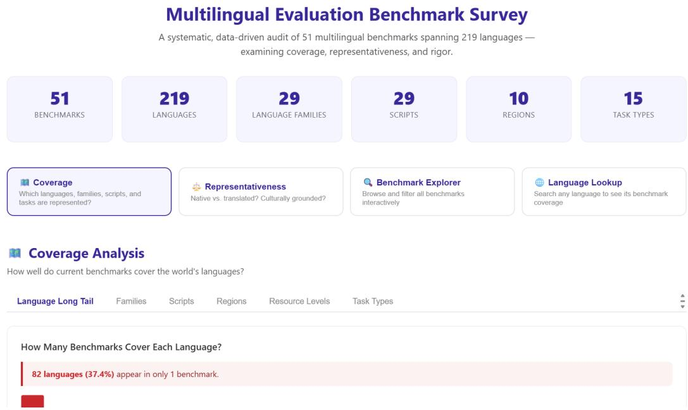  
Figure 13: Landing page of the interactive dashboard showing summary statistics (51 benchmarks, 219 languages, 29 families, 29 scripts, 10 regions, 15 task types) and navigation to the four main views: Coverage, Representativeness, Benchmark Explorer, and Language Lookup.

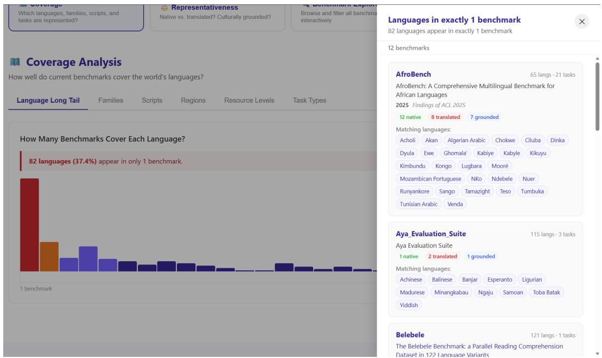  
Figure 14: Coverage Analysis view with interactive drill-down. Clicking on a bar in the language long-tail chart opens a panel listing the specific benchmarks that cover languages appearing in exactly that number of benchmarks, along with matching languages for each benchmark.

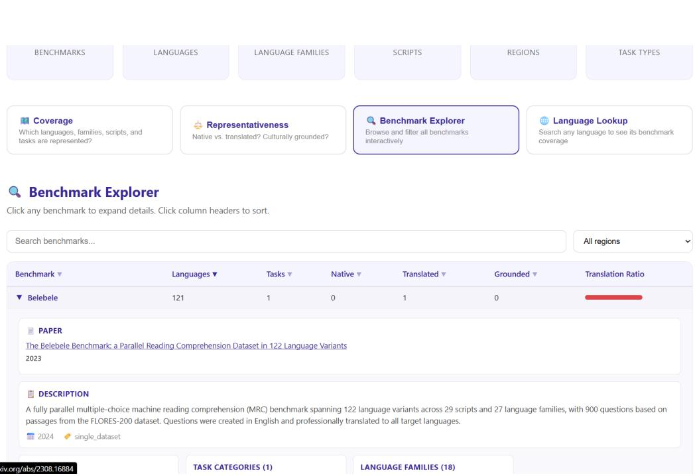  
Figure 15: Benchmark Explorer view. Users can search, sort by column, and filter by region. Expanding a row reveals the paper reference, description, year, benchmark type, task categories, and full language family breakdown.

<table><tr><td>#</td><td>Benchmark</td><td>Task Categories</td><td>Year</td><td>Venue</td><td>Citation</td></tr><tr><td>1</td><td>MMTEB</td><td>Classification / QA / Knowledge (550 tasks)</td><td>2025</td><td>ICLR</td><td>(Enevoldsen et al., 2025)</td></tr><tr><td>2</td><td>Belebele</td><td>QA / Knowledge</td><td>2024</td><td>ACL</td><td>(Bandarkar et al., 2024)</td></tr><tr><td>3</td><td>Aya_Evaluation_Suite</td><td>Generation</td><td>2024</td><td>ACL</td><td>(Singh et al., 2024)</td></tr><tr><td>4</td><td>FLORES-101</td><td>Translation</td><td>2022</td><td>TACL</td><td>(Goyal et al., 2022)</td></tr><tr><td>5</td><td>XTREME.UP</td><td>Linguistic Probing, Other, QA / Knowledge, ..</td><td>2023</td><td>ACL</td><td>(Ruder et al., 2023)</td></tr><tr><td>6</td><td>MEGA</td><td>NER, NLI / Inference, QA / Knowledge, .</td><td>2023</td><td>EMNLP</td><td>(Ahuja et al., 2023)</td></tr><tr><td>7</td><td>AfroBench</td><td>Linguistic Probing, Math / Reasoning, NER, .</td><td>2025</td><td>ACL</td><td>(Ojo et al., 2025)</td></tr><tr><td>8</td><td>BUFFET</td><td>NER, NLI / Inference, QA / Knowledge, ..</td><td>2024</td><td>NAACL</td><td>(Asai et al., 2024)</td></tr><tr><td>9</td><td>XTREME-R</td><td>Embedding / Retrieval, Linguistic Probing, . ..</td><td>2021</td><td>EMNLP</td><td>(Ruder et al., 2021)</td></tr><tr><td>10</td><td>XTREME</td><td>Embedding / Retrieval, NLI / Inference, </td><td>2020</td><td>ICML</td><td>(Siddhant et al., 2020)</td></tr><tr><td>11</td><td>MUG_Eval</td><td>Coding, Instruction Following, Math / Reasoning</td><td>2025</td><td>EMNLP</td><td>(Song et al., 2025)</td></tr><tr><td>12</td><td>MMLU-ProX</td><td>QA / Knowledge</td><td>2025</td><td>EMNLP</td><td>(Xuan et al., 2025)</td></tr><tr><td>13</td><td>MaXIFE</td><td>Instruction Following</td><td>2025</td><td>ACL</td><td>(Liu et al., 2025)</td></tr><tr><td>14</td><td>IndiSentiment140</td><td>Sentiment / Classification</td><td>2024</td><td>NAACL</td><td>(Kumar et al., 2024)</td></tr><tr><td>15</td><td>JailNewsBench</td><td>Safety / Toxicity</td><td>2026</td><td>ICLR</td><td>(Kaneko et al., 2026)</td></tr><tr><td>16</td><td>IndicXTREME</td><td>Embedding / Retrieval, NER, NLI / Inference, </td><td>2023</td><td>ACL</td><td>(Doddapaneni et al., 2023)</td></tr><tr><td>17</td><td>IrokoBench</td><td>Math / Reasoning, NLI / Inference, QA / Knowledge</td><td>2025</td><td>NAACL</td><td>(Adelani et al., 2025)</td></tr><tr><td>18 19</td><td>XGLUE</td><td>Embedding / Retrieval, Linguistic Probing, . ..</td><td>2020</td><td>EMNLP</td><td>(Liang et al., 2020)</td></tr><tr><td>20</td><td>BenchMAX</td><td>Coding, Instruction Following, . ..</td><td>2025</td><td>EMNLP</td><td>(Huang et al., 2025b)</td></tr><tr><td></td><td>PTP</td><td>Safety / Toxicity</td><td>2024</td><td>COLM</td><td>(Jain et al., 2024)</td></tr><tr><td>21 22</td><td>BeMyCheese</td><td>Sentiment / Classification</td><td>2026</td><td>ArXiv</td><td>(Van Doren et al., 2026)</td></tr><tr><td>23</td><td>XNLI</td><td>NLI / Inference</td><td>2018</td><td>EMNLP</td><td>(Conneau et al., 2018)</td></tr><tr><td>24</td><td>IndicIFEval</td><td>Instruction Following</td><td>2026</td><td>ArXiv</td><td>(Jayakumar et al., 2026)</td></tr><tr><td>25</td><td>INDIC-DIALECT</td><td>QA / Knowledge, Sentiment / Classification, . . .</td><td>2026</td><td>ArXiv</td><td>(Sharma et al., 2026)</td></tr><tr><td>26</td><td>LinguaSafe</td><td>Safety / Toxicity</td><td>2025</td><td>ArXiv</td><td>(Ning et al., 2025)</td></tr><tr><td>27</td><td>MAKIEVAL</td><td>Sentiment / Classification</td><td>2025</td><td>EMNLP</td><td>(Zhao et al., 2025)</td></tr><tr><td>28</td><td>GSM8K-Indic IndicNLG</td><td>Math / Reasoning</td><td>2025 2022</td><td></td><td>sarvamai/gsm8k-indic</td></tr><tr><td>29</td><td>IndicNLPSuite</td><td>Generation, NLI / Inference, QA / Knowledge, .. Embedding / Retrieval, NER, NLI / Inference, . ..</td><td>2020</td><td>EMNLP EMNLP</td><td>(Kumar et al., 2022)</td></tr><tr><td>30</td><td>IndicParam</td><td></td><td></td><td></td><td>(Kakwani et al., 2020)</td></tr><tr><td>31</td><td>MILU</td><td>QA / Knowledge</td><td>2025</td><td>ArXiv</td><td>(Maheshwari et al., 2025)</td></tr><tr><td>32</td><td>Naamapadam</td><td>QA / Knowledge NER</td><td>2025 2023</td><td>NAACL</td><td>(Verma et al., 2025)</td></tr><tr><td>33</td><td>TriviaQA-Indic</td><td>QA / Knowledge</td><td>2025</td><td>ACL</td><td>(Mhaske et al., 2023)</td></tr><tr><td>34</td><td>XQuAD</td><td>QA / Knowledge</td><td>2020</td><td>ACL</td><td>sarvamai/trivia-qa-indic-mcq (Artetxe et al., 2020b)</td></tr><tr><td>35</td><td>BoolQ-Indic</td><td>QA / Knowledge</td><td>2025</td><td></td><td></td></tr><tr><td>36</td><td>MMLU-Indic</td><td>QA / Knowledge</td><td>2025</td><td></td><td>sarvamai/boolq-indic sarvamai/mmlu-indic</td></tr><tr><td>37</td><td>MultiJail</td><td>Safety / Toxicity</td><td>2024</td><td>ICLR 2024</td><td>(Deng et al., 2024)</td></tr><tr><td>38</td><td>IndicMMLU-Pro</td><td>QA / Knowledge</td><td></td><td>ArXiv</td><td>(KJ et al., 2025)</td></tr><tr><td>39</td><td></td><td>QA / Knowledge</td><td>2025</td><td>NeurIPS 2023</td><td></td></tr><tr><td>40</td><td>M3Exam</td><td></td><td>2023</td><td></td><td>(Zhang et al., 2023)</td></tr><tr><td>41</td><td>TUMLU</td><td>QA / Knowledge</td><td>2025</td><td>ACL</td><td>(Isbarov et al., 2025)</td></tr><tr><td>42</td><td>XORQA</td><td>Embedding / Retrieval</td><td>2021</td><td>NAACL</td><td>(Asai et al., 2021)</td></tr><tr><td></td><td>CL-IFEval</td><td>Instruction Following, Math / Reasoning</td><td>2025</td><td>ArXiv</td><td>(Ojewale et al., 2026)</td></tr><tr><td>43</td><td>Uhura</td><td>QA / Knowledge</td><td>2024</td><td>ArXiv</td><td>(Bayes et al., 2024)</td></tr><tr><td>44</td><td>IberoBench</td><td>Linguistic Probing, Math / Reasoning, . ..</td><td>2025</td><td>COLING 2025</td><td>(Baucells et al., 2025)</td></tr><tr><td>45</td><td>SeaHELM</td><td>Generation, Instruction Following, ..</td><td>2025</td><td>Findings of ACL 2025</td><td>(Susanto et al., 2025)</td></tr><tr><td>46</td><td>BHASA</td><td>Linguistic Probing, Math / Reasoning, NER, . .</td><td>2023</td><td>ArXiv</td><td>(Leong et al., 2023)</td></tr><tr><td>47</td><td>M-IFEval</td><td>Instruction Following</td><td>2025</td><td>Findings of NAACL 2025</td><td>(Dussolle et al., 2025)</td></tr><tr><td>48</td><td>MUCH</td><td>Sentiment / Classification</td><td>2026</td><td>LREC</td><td>(Dentan et al., 2025)</td></tr><tr><td>49</td><td>FluidQA</td><td>QA / Knowledge, Sentiment / Classification</td><td>2025</td><td>EMNLP 2025</td><td>(Park et al., 2025)</td></tr><tr><td>50</td><td>BhashaBench_V1</td><td>QA / Knowledge</td><td>2025</td><td>ArXiv</td><td>(Devane et al., 2025)</td></tr><tr><td>51</td><td>CulturalBench</td><td>QA / Knowledge</td><td>2025</td><td>ACL 2025</td><td>(Chiu et al., 2025)</td></tr></table>

Table 8: Comprehensive overview of all 51 multilingual evaluation benchmarks surveyed.