# Watermark Basins: Black-Box Detection of Distilled LLMs

Hongyan Chang⋆, Hady Elsahar⋆, Tom Sander†, Pierre Fernandez†, Saeed Mahloujifar, Sylvestre-Alvise Rebuffi, Tomáš Soucekˇ , Tuan Tran, Valeriu Lacatusu, Surya Parimi§, Rashel Moritz§, Vanessa Stark§, Alexandre Mourachko

FAIR, Meta Superintelligence Labs ⋆Main contributors, †Core team, §Project support

Proprietary language models and their reasoning traces are vulnerable to API-based distillation, where an adversary trains a student model on the teacher model’s outputs. To obtain evidence of distillation, model providers can watermark the teacher’s outputs, aiming to leave a radioactive signal in the student’s outputs. Existing black-box detectors search for such radioactivity using token-level statistics of the suspect model’s outputs. However, token-level signals are not always detectable, for instance when the distillation traces are sampled at a low temperature. In this work, we discover the watermark basin, a persistent signal that enables more reliable watermark detection: during fine-tuning, watermarked teacher traces embed a distinct, keyspecific geometric signal in parameter space that lies orthogonal to the ordinary task-specific fine-tuning subspace. Building on this, we introduce Watermark Basin Alignment (WM-Basin), a black-box watermark detector that queries the suspect model through its API, without access to its weights or logits. WM-Basin maps generated text to gradient representations using a fixed clean probe model, projects out the ordinary fine-tuning task directions, and tests whether the residual gradient aligns with the watermark basin induced by the watermark key. We evaluate WM-Basin extensively across diverse teacher models and student architectures (from 135M to 8.2B parameters) distilled on mathematical reasoning. At a strict 0.1% falsepositive rate, WM-Basin detects 79% of distilled models at n-gram=1 and 45% at n-gram=3, substantially improving over the state-of-the-art token-level baseline (29% and 1.3%, respectively). Because the watermark signal resides in a persistent basin, it survives post-distillation modifications including quantization, pruning, and reinforcement-learning post-training.

∞Meta

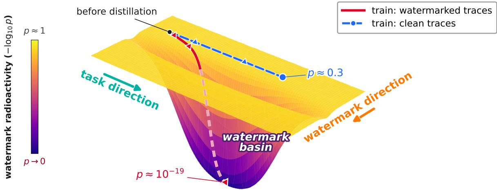  
Figure 1 The watermark basin. Training on watermarked traces moves the student into a persistent, key-specific watermark basin, whereas clean traces from the same teacher move it only along the task direction. Watermark Basin Alignment (WM-Basin) recovers this geometry from black-box outputs alone to detect distillation.

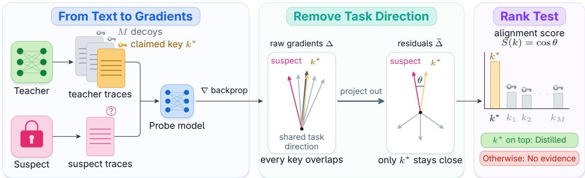  
Figure 2 WM-Basin: black-box distillation detection via watermark basin alignment. The three panels are the three stages of §2.3. (i) The verifier collects suspect outputs on test prompts and, on separate build prompts, teacher outputs under the claimed watermark key and M decoy keys. Backpropagating each collection through one fixed probe model gives the suspect gradient $\Delta _ { \mathrm { s u s } }$ and one reference gradient $\Delta _ { k }$ per key. (ii) Raw gradients share large common task components that inflate the cosine similarities, so every key appears to overlap with the suspect. Projecting out the shared task directions leaves the residuals $\widetilde { \Delta } _ { \mathrm { s u s } }$ and $\widetilde { \Delta } _ { k } ,$ among which only the claimed key stays close to the suspect; θ is the angle between them. (iii) Each candidate key receives the alignment score $S ( k ) = \cos ( \widetilde { \Delta } _ { \mathrm { s u s } } , \widetilde { \Delta } _ { k } )$ , and the claimed key’s rank among the decoys gives the p-value $p _ { \mathrm { r a n k } }$ The claimed key ranking at the top is evidence of distillation; a decoy key at the top is not.

## 1 Introduction

Proprietary language models are increasingly targeted by API-based distillation: an adversary queries a closed teacher model and fine-tunes a competing student model on its outputs. This attack extends black-box model extraction, first demonstrated against ML-as-a-service systems (Tramèr et al., 2016), and has become a major threat to reasoning LLMs (Anthropic, 2026a; Google Threat Intelligence Group, 2026; Remler and Hayum, 2026). Providers have responded by withholding reasoning traces, but concealment does not prevent distillation. Hidden traces can be extracted at scale from encrypted response blocks (Panfilov et al., 2026), while answers and short summaries can be expanded into synthetic traces that recover much of the benefit of training on the originals (Zhang et al., 2026). Other defenses make extraction harder rather than detectable (Anthropic, 2026a; Google Threat Intelligence Group, 2026; Savani et al., 2026; Ma et al., 2026). We review related work in full in §4.

In this work, we focus on output watermarking, which is encouraged by emerging regulatory requirements (European Commission, 2026). Anthropic, for example, embeds watermarks in texts generated by Claude models released beginning in August 2026 (Anthropic, 2026b). Such watermarks can survive distillation: Sander et al. (2024) show that students trained on watermarked teacher outputs retain a “radioactive” signal. Their black-box detector, to our knowledge the only existing one for this setting and our baseline throughout, tests suspect outputs for an excess of watermark-favored tokens, but only where watermark-conditioned contexts recur. We find that this dependence is fragile: detection de grades sharply with larger context windows and loses most of its power under low-temperature teacher sampling. We therefore seek a watermark signal that does not require exact token-level recurrence.

Our main finding is the watermark basin: supervised fine-tuning on clean (watermark-free) teacher traces moves a student along a broad task direction, whereas watermarked traces add a faint, keyspecific watermark direction (Fig. 1), leading the student into a key-specific region of parameter space. Post-training updates cannot easily push the student out of this basin. Building on this geometry, we introduce Watermark Basin Alignment (WM-Basin), a black-box detector that represents the suspect model’s outputs and the watermarked teacher’s outputs as gradients of one fixed, clean probe model. After removing the task subspace estimated from clean models, the distilled student should align with the watermark key more closely than with decoy keys that were never used to watermark the teacher. WM-Basin turns this relative rank into a calibrated p-value using a non-parametric ranking test (Dwass, 1957): a small value is evidence that the suspect was distilled from the claimed teacher and key on the audited domain (Fig. 2).

We evaluate WM-Basin along many axes: the student architecture, the teacher model, the watermarking scheme, the sampling temperature and watermarked fraction of the distillation traces, the fine-tuning recipe, and the task domain. Among 1,200 student models distilled from DeepSeek-R1- Distill-Qwen-14B (Guo et al., 2025) on OpenR1-Math reasoning traces (Hugging Face, 2025), at a 0.1% false-positive rate, WM-Basin detects 79% of distilled models at n-gram=1 and 45% at n-gram=3, against 29% and 1.3% for the state-of-the-art black-box detector (Sander et al., 2024). Quantization, pruning, and reinforcement-learning post-training all leave detection intact, as none of them moves the student out of the watermark basin. Like any black-box method, WM-Basin reads only the suspect model’s text, so detection depends on that text carrying the teacher’s token distribution. Continued training on clean data can reshape that distribution and therefore degrade black-box detection, although the basin itself survives in the weights and remains easy to identify under white-box access. Our contributions are as follows:

• Discovery of watermark basins. We find that watermarked distillation places every distilled student in a persistent basin, spanned by the ordinary task direction and a faint, key-specific watermark direction. Leaving this basin without knowledge of the key is dificult: post-training operations (quantization, pruning, supervised fine-tuning, RL) displace weights primarily along the task axis and leave the key-specific component intact, which we exploit for detection.

• A parameter-space black-box detector (WM-Basin). WM-Basin looks for distillation evidence in parameter space. It maps text outputs to gradients of a fixed clean probe model, removes the shared task subspace, and scores the residual alignment against decoy keys. The watermark becomes far more detectable than in token space, with exact finite-sample false-positive control and no access to the suspect’s parameters.

• Robust detection at scale. Across 24 student architectures (135M to 8.2B parameters), 4 teachers, and 4 watermarking schemes, WM-Basin achieves 79% TPR at 0.1% FPR versus 29% for the state-ofthe-art token-level detector, and remains efective under quantization, pruning, and RL post-training.

## 2 Watermark-Basin Detection

## 2.1 Threat Model and Statistical Setup

Distillation setting and adversary model. A proprietary teacher model $\mathcal { M } _ { \mathrm { t e a c h e r } }$ serves completions watermarked under a secret key $k ^ { \star }  \mathsf { K e y G e n }$ , drawn from the watermark scheme’s key-generation procedure. Following deployed systems (Aaronson, 2022; Dathathri et al., 2024; Sander et al., 2026; Anthropic, 2026b), we consider distortion-free schemes: the teacher’s marginal next-token distribution is preserved, but for each prompt x the output $\boldsymbol { y } \sim \mathcal { M } _ { \mathrm { t e a c h e r } } ( \boldsymbol { x } ; \boldsymbol { k } ^ { \star } )$ is coupled to the pseudorandomness induced by $k ^ { \star }$ . The adversary adaptively chooses N prompts $\chi _ { \mathrm { t r a i n } } = \{ x _ { i } \} _ { i = 1 } ^ { N }$ , receives watermarked traces $\{ y _ { i } \}$ , builds $\boldsymbol { \mathcal { D } } = \{ ( x _ { i } , y _ { i } ) \}$ , and trains a student $\mathcal { M } _ { \mathrm { s u s } }$ by supervised fine-tuning on D. Without knowledge of $k ^ { \star }$ , watermarked completions are indistinguishable from clean text, so the default adversary is unaware of the watermark and uses the traces as-is. After fine-tuning, the adversary may further post-train $\mathcal { M } _ { \mathrm { s u s } }$ on clean data, e.g., via continued SFT or GRPO (Guo et al., 2025).

Verifier regime. An audit is opened by the verifier, either the model owner or an authorized third party, and begins by naming one capability the owner sells and the suspect appears to compete on. We call it the audited domain $D \ { \mathrm { ( e . g . } }$ , math) and let $P _ { D }$ be its induced prompt distribution; the verifier chooses both and draws every prompt it uses from $P _ { D }$ . It holds two disjoint pools: a build pool $\chi _ { \mathrm { b u i l d } }$ used to construct the detector, and a test pool $\mathcal { X } _ { \mathrm { t e s t } }$ used to read the suspect. Neither overlaps the adversary’s prompts, which the verifier never sees, and keeping build and test prompts apart avoids score inflation from prompt reuse. The verifier’s access to $\mathcal { M } _ { \mathrm { s u s } }$ is black-box : it observes only texts sampled on the test prompts. The access is also unsupervised in the sense of Sander et al. (2024): the verifier does not hold the traces $\mathcal { M } _ { \mathrm { s u s } }$ was trained $\mathrm { o n } .$ , only fresh teacher traces on the build prompts (unwatermarked, watermarked under $k ^ { \star }$ , and watermarked under M independent decoy keys $k _ { j } \gets \mathsf { K e y G e n } )$ , together with a pool of public clean checkpoints. It knows the system prompts used to query $\mathcal { M } _ { \mathrm { s u s } }$ and the teacher, because it chooses them, and the number of test prompts sent to the suspect is the query budget.

Statistical objective. Let $S ( k )$ be any scalar alignment score computed from the suspect’s completions on test prompts and from teacher traces on build prompts under key $k ; \ S 2 . 3$ instantiates it. Its absolute magnitude is not comparable across suspects, prompt pools, or probe models, so an audit reads only where the claimed key $k ^ { \star }$ ranks among decoy keys. Our null hypothesis $H _ { 0 }$ is that the suspect’s outputs on the audited domain $D$ contain no information about the production key $k ^ { \star }$ . If the texts do depend on $k ^ { \star }$ , the dependence can only arise through the distillation path ${ k ^ { \star } }  \{ y _ { i } \}  \mathcal { M } _ { \mathrm { s u s } }$ . Rejecting $H _ { 0 }$ therefore establishes watermark radioactivity: the suspect was trained on the teacher’s keyed text, which separates it from any model not distilled under $k ^ { \star }$ . A failure to reject is scoped to domain $D ;$ we measure detection power beyond the distillation domain in $\ S 3 . 2$

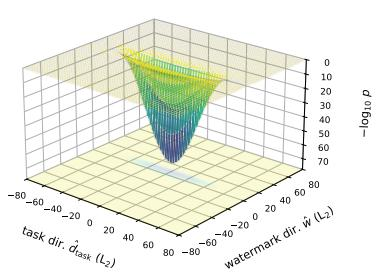

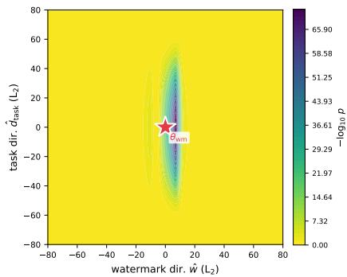

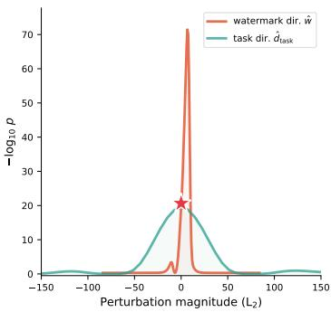  
Figure 3 The anisotropic geometry of the watermark basin, measured as the white-box detection significance $\left( - \log _ { 1 0 } p \right)$ around a radioactive student $\pmb { \theta } _ { \mathrm { w m } }$ (red star; $\pmb { \theta } _ { \mathrm { s t u d e n t } }$ in the text) fine-tuned on watermarked teacher traces. Left to right: 3D landscape, 2D contour map, and 1D slices through $\theta _ { \mathrm { w m } }$ . The signal falls to the detector’s floor within a few steps along the watermark direction $\hat { \Delta } _ { \mathrm { w m } }$ (red curve), while remaining detectable over a much broader range along the task direction $\hat { \Delta } _ { \mathrm { t a s k } }$ (green curve).

## 2.2 Watermark Basins in Parameter Space

We first use a white-box setting to investigate what distinguishes a student trained on watermarked traces from one trained on clean traces, and thus what makes a model radioactive. Fig. 1 presented the watermark basin; here we test that geometry directly with access to the student weights. We fix the true key $k ^ { \star }$ and fine-tune the same base model either on teacher traces watermarked with $k ^ { \star }$ , giving $\pmb { \theta } _ { \mathrm { s t u d e n t } } .$ , or on unwatermarked traces, giving a clean control $\theta _ { \mathrm { c t r l } }$ . The teacher, prompts, initialization, and training recipe are otherwise identical, so both students learn the same task while only one sees the watermark. Let $\Delta _ { \mathrm { t o t a l } } : = \theta _ { \mathrm { s t u d e n t } } - \theta _ { \mathrm { b a s e } }$ be the total update from watermarked training and $\Delta _ { \mathrm { t a s k } } : = \pmb { \theta } _ { \mathrm { c t r l } } - \pmb { \theta } _ { \mathrm { b a s e } }$ the clean task update. We isolate the watermark-specific part of the update by removing from $\Delta _ { \mathrm { t o t a l } }$ its component along $\Delta _ { \mathrm { t a s k } }$

$$
\Delta _ { \mathrm { w m } } : = \Delta _ { \mathrm { t o t a l } } - \frac { \langle \Delta _ { \mathrm { t o t a l } } , \Delta _ { \mathrm { t a s k } } \rangle } { \| \Delta _ { \mathrm { t a s k } } \| _ { 2 } ^ { 2 } } \Delta _ { \mathrm { t a s k } } .\tag{1}
$$

The subtracted term is the part of the watermarked update that the clean student also makes, i.e., learning the task. What remains, $\Delta _ { \mathrm { w m } } .$ , is the part that only the watermark can explain. We normalize $\Delta _ { \mathrm { w m } }$ and $\Delta _ { \mathrm { t a s k } }$ to obtain the watermark axis $\hat { \Delta } _ { \mathrm { w m } }$ and the task axis $\hat { \Delta } _ { \mathrm { t a s k } }$

To map the basin, we start at $\pmb { \theta } _ { \mathrm { s t u d e n t } }$ and perturb the weights along each axis, $\theta _ { \mathrm { s t u d e n t } } + t _ { \mathrm { w m } } \hat { \Delta } _ { \mathrm { w m } } +$ $t _ { \mathrm { t a s k } } \hat { \Delta } _ { \mathrm { t a s k } }$ , over a grid of step sizes $( \boldsymbol { t } _ { \mathrm { w m } } , t _ { \mathrm { t a s k } } )$ . At each point, we apply the open-weight detector of Sander et al. (2024) to the perturbed student and record $- \log _ { 1 0 } p$ , where a smaller p-value is stronger evidence of distillation. Fig. 3 shows that the surface is strongly anisotropic: a small step along the watermark axis makes the watermark signal collapse, whereas much larger displacements along the task axis leave it detectable. The basin is broad along $\hat { \Delta } _ { \mathrm { t a s k } }$ but has a sharp boundary along $\hat { \Delta } _ { \mathrm { w m } }$

This asymmetry gives the two axes diferent roles. The width along $\hat { \Delta } _ { \mathrm { t a s k } }$ suggests why ordinary posttraining can alter task behavior without erasing the basin, a hypothesis we test under compression and continued training in §3.3. The narrowness along $\hat { \Delta } _ { \mathrm { w m } }$ makes the basin key-specific, which motivates comparing against decoy keys rather than thresholding a generic watermark score. This analysis relies on access to the student’s parameters, which a black-box verifier does not have. Next, we show how to detect the same key-specific signal using only text sampled from the suspect.

## 2.3 WM-Basin: Black-Box Estimation via Probe Gradients

A black-box verifier cannot inspect the suspect’s parameters and observes only its generated text. WM-Basin maps suspect, keyed-teacher, and clean-model outputs into a shared gradient representation, removes the variation common to clean models, and ranks the claimed key by the remaining alignment. Fig. 2 gives the overview and $\mathrm { A l g }$ . 1 the full procedure.

Stage (i): from text to probe gradients. We use a small clean model as the probe, warm its LoRA parameters $\theta _ { \mathrm { p r o b e } }$ on held-out unwatermarked teacher traces, and then freeze them. A prompt–completion pair $( x , y )$ is represented by the gradient $g ( x , y ) = \nabla _ { \theta _ { \mathrm { p r o b e } } } \log p _ { \theta _ { \mathrm { p r o b e } } } ( y \mid x )$ , the parameter nudge that would make the probe more likely to produce y given x. We average these gradients over the suspect’s completions ${ \hat { y } } _ { x }$ on the test prompts, and over the teacher’s completions $y _ { x } ^ { k }$ under each key k on the build prompts:

$$
\Delta _ { \mathrm { s u s } } = \frac { 1 } { \left| \mathcal { X } _ { \mathrm { t e s t } } \right| } \sum _ { x \in \mathcal { X } _ { \mathrm { t e s t } } } g \big ( x , \hat { y } _ { x } \big ) , \qquad \Delta _ { k } = \frac { 1 } { \left| \mathcal { X } _ { \mathrm { b u i l d } } \right| } \sum _ { x \in \mathcal { X } _ { \mathrm { b u i l d } } } g \big ( x , y _ { x } ^ { k } \big ) .\tag{2}
$$

If the suspect inherited key $k ,$ the nudges induced by its outputs should share the key-specific component of the nudges induced by teacher outputs under $k ;$ this alignment is the signal we measure. The gradients give a common coordinate system for comparing first-order fine-tuning tendencies; they do not reconstruct the suspect’s hidden weight update (Xia et al., 2024). A single fixed random projection maps every gradient to $d = 8 , 1 9 2$ dimensions while approximately preserving inner products (Johnson et al., 1984). This stage needs only keyed teacher traces, not the watermark scheme’s own detector.

Stage (ii): removing the shared task subspace. Raw probe gradients share large components caused by the task, the response format, and generic language modeling. These common components inflate every cosine similarity cos $( \Delta _ { \mathrm { s u s } } , \Delta _ { k } )$ and hide the small diferences that distinguish one key from another. We therefore adapt the $A l l - b u t - t h e - T o p$ post-processing used to dehub learned representations (Mu et al., 2017). Clean checkpoints generate responses on held-out build prompts, and PCA on their probe gradients gives the top $q$ directions of clean-model variation, collected in the orthonormal basis $U = [ u _ { 1 } , \dots , u _ { q } ] \in \mathbb { R } ^ { d \times q }$ . We project every gradient of this basis and score each key by the cosine of the residuals:

$$
\widetilde { \Delta } = ( I - U U ^ { \top } ) \Delta , \qquad S ( k ) = \cos \bigl ( \widetilde { \Delta } _ { \mathrm { s u s } } , \widetilde { \Delta } _ { k } \bigr ) .\tag{3}
$$

The projection keeps only what clean models do not have in common, so the cosine asks whether the suspect’s residual points the same way as key k’s residual. We fit $U$ on clean models alone, never on suspects, and use $q { = } 1 0 0 \ ( \mathrm { A p p . \ B . 5 } )$ .

Stage (iii): ranking against decoy keys. Because S has no absolute scale, the verifier evaluates it at the claimed key and at M independent decoy keys $k _ { 1 } , \ldots , k _ { M } \gets { \mathsf { K e y G e n } }$ , and reads the claimed key’s rank:

$$
p _ { \mathrm { r a n k } } = \frac { 1 + \sum _ { j = 1 } ^ { M } \mathbb { I } ( S ( k _ { j } ) \geq S ( k ^ { \star } ) ) } { M + 1 } .\tag{4}
$$

In words, $p _ { \mathrm { r a n k } }$ is the fraction of the M+1 candidate keys, the claimed key included, that score at least as high as the claimed key. Under $H _ { 0 }$ , the claimed key and the decoys are independent outputs of the same key generator and pass through the same probe, random projection, basis $U$ , and prompts. Their scores are therefore exchangeable, which gives $p _ { \mathrm { r a n k } }$ exact finite-sample validity marginally over the draw of $k ^ { \star }$ (Dwass, 1957; Pesarin and Salmaso, $2 0 1 0 ) \ ( { \mathrm { A p p . ~ A } } )$ . Under $H _ { 0 }$ and absent ties, prank is uniform on the grid $\{ 1 , \ldots , M + 1 \} / ( M + 1 ) !$ ; a very small $p _ { \mathrm { r a n k } }$ lets the verifier conclude distillation from $k ^ { \star }$ with high confidence. The smallest attainable value is $1 / ( M + 1 )$ , so certifying $\alpha = 0 . 0 1$ or 0.001 requires $M \geq 9 9$ or 999 decoys.

Build once, audit many suspects. Alg. 1 separates what a verifier computes once from what it pays per suspect. The build-once block never touches the suspect: it reads only the candidate keys, the build pool $\chi _ { \mathrm { b u i l d } }$ , and the clean checkpoints, and produces the warmed probe, the reference bank $\{ \widetilde { \Delta } _ { k } \}$ , and the task basis $U$ (stages (i) and (ii)). The detect block is the only part paid per suspect: it samples the suspect on $\mathcal { X } _ { \mathrm { t e s t } } .$ , maps that text through the same probe and projection, and ranks the claimed key (stage (iii)). The claimed key enters exactly where each decoy does, as an index that selects reference traces, which is what makes the rank test exact. No step invokes the watermark scheme’s own test, so the same algorithm applies unchanged to any keyed watermark. The computational cost is dominated by the one-time generation of teacher traces under M + 1 keys (App. B.4).

Algorithm 1 WM-Basin: black-box detection of watermark distillation via basin alignment.   
Require: Query access to the suspect model $\mathcal { M } _ { \mathrm { s u s } }$ (black-box API) and the watermarked teacher; claimed key   
$k ^ { \star }$ and M decoy keys $k _ { 1 } , \ldots , k _ { M } \gets \mathsf { K e y G e n } ;$ disjoint build and test prompt pools $\mathcal { X } _ { \mathrm { b u i l d } } , \ \mathcal { X } _ { \mathrm { t e s t } }$ from the   
audited domain $D ;$ a pool of clean of-the-shelf models; significance level α.   
Ensure: p-value $p _ { \mathrm { r a n k } } ;$ report the suspect as distilled into the basin of $k ^ { \star }$ when $p _ { \mathrm { r a n k } } \leq \alpha .$   
Build once (ofline; independent of the suspect)   
1: $\theta _ { \mathrm { p r o b e } }$ ← clean small model warmed by a short LoRA pass on unwatermarked teacher traces from $\chi _ { \mathrm { b u i l d } }$   
2: for each key $k \in \{ k ^ { \star } , k _ { 1 } , \ldots , k _ { M } \}$ do   
3: Sample teacher responses under key k on $\chi _ { \mathrm { b u i l d } }$   
4: $\Delta _ { k } \gets$ average probe gradient of these responses ▷ Eq. (2)   
5: end for   
6: U ← top-q principal directions of the clean pool’s probe gradients on $\chi _ { \mathrm { b u i l d } }$   
7: for each key $k \in \{ k ^ { \star } , k _ { 1 } , \ldots , k _ { M } \}$ do   
8: $\widetilde { \Delta } _ { k } \gets ( I - U U ^ { \top } ) \Delta _ { k }$ ▷ Residual reference gradient   
9: end for   
Detect (online; once per suspect)   
10: Sample answers from $\mathcal { M } _ { \mathrm { s u s } }$ on $\mathcal { X } _ { \mathrm { t e s t } }$ ▷ Unused by every step above   
11: $\Delta _ { \mathrm { s u s } } $ average probe gradient of the suspect’s answers ▷ Eq. (2)   
12: $\widetilde { \Delta } _ { \mathrm { s u s } }  ( I - U U ^ { \top } ) \Delta _ { \mathrm { s u s } }$ ▷ Residual suspect gradient   
13: for each key $k \in \{ k ^ { \star } , k _ { 1 } , \ldots , k _ { M } \}$ do   
14: $S ( k ) \gets \cos \left( \widetilde { \Delta } _ { \mathrm { s u s } } , \widetilde { \Delta } _ { k } \right)$ ▷ Eq. (3)   
15: end for   
16: $\begin{array} { r } { p _ { \mathrm { r a n k } } \gets \frac { 1 + \sum _ { j = 1 } ^ { M } \mathbb { I } \left( S ( k _ { j } ) \geq S ( k ^ { \star } ) \right) } { M + 1 } } \end{array}$ ▷ Eq. (4)   
17: return $p _ { \mathrm { r a n k } } ;$ report “distilled into the basin of $k ^  \star \} \stackrel { } { \mathrm { i f } } p _ { \mathrm { r a n k } } \leq \alpha$

## 3 Experiments and Results

Most main-body tables report all three n-gram windows of the watermark (n=1, 2, 3) at three operating points. Unless stated otherwise, the text quotes n-gram=3, the hardest window for both detectors.

## 3.1 Experimental Setup

Distillation. We evaluate distillation detection across 24 suspect model architectures, 4 teacher models, and 4 watermarking schemes. In the default setting, the teacher is DeepSeek-R1-Distill-Qwen-14B (Guo et al., 2025) watermarked with TextSeal (Sander et al., 2026), a dual-key scheme that samples each token under one of two secret keys, mixed at a fixed rate α=0.1. Following standard reasoning-distillation protocols, an adversary fine-tunes a Qwen2.5-3B base model (Yang et al., 2024) for math on 1,900 quality-filtered OpenR1-Math-220k traces (Hugging Face, 2025) from that teacher. All traces are generated under one fixed math-teacher system prompt, on which the suspect model is also conditioned during fine-tuning. We evaluate capability on held-out GSM8K (Cobbe et al., 2021) and Math-500 (Hendrycks et al., 2021); App. B.2 gives the full distillation setup.

Sampling suspect model outputs. The verifier chooses one domain to audit and draws every prompt it uses for detection from that domain; it never sees the adversary’s prompts or traces (§2.1). By default the audited domain is OpenR1-Math-220k (Hugging Face, 2025), held out from the adversary’s distillation prompts, and every audit stage uses the same system prompt as the distillation traces, which we call a matched-prompt audit; §3.2 varies both the domain and the system prompt. We read each suspect on 1,900 prompts from the test pool $\mathcal { X } _ { \mathrm { t e s t } }$ , disjoint from the distillation prompts $\chi _ { \mathrm { t r a i n } } .$ and score the first 512 tokens of every response, around 1M tokens per suspect.

Detector. WM-Basin turns text into a gradient with a probe model, by default a clean Qwen2.5-3B base warmed on around 450 clean teacher traces from the audited domain (App. C.6 studies both the choice of probe and the warm-up). On 512 build-pool prompts we query the teacher under the claimed watermark key and 999 decoys, then map those responses and the suspect’s generations through the probe, giving a 1,000-key reference gradient bank and the suspect gradient scored against it. Before scoring, we project both away from a PCA task subspace fit on 43 of-the-shelf checkpoints, which leaves the key-specific alignment that the rank test reads (§2.3). All three stages draw separately from the build pool $\chi _ { \mathrm { b u i l d } }$ , disjoint from $\mathcal { X } _ { \mathrm { t e s t } }$ . Ranking the claimed key gives p-values down to 0.001; unless stated otherwise we report the true positive rate (TPR) at p≤0.01, i.e., at a 1% false positive rate (FPR). App. B.6 validates the false positive rate empirically.

Table 1 Distillation detection across 24 student architectures. A single TextSeal-watermarked teacher (DeepSeek-R1-Distill-Qwen-14B) is distilled into 24 students. Each cell is the percentage of up to 50 distilled models per architecture flagged at a p-value of 5%, 1%, or 0.1%; Overall pools all models in that column (1,200 for each), and Acc. is post-distillation GSM8K accuracy.
<table><tr><td rowspan=1 colspan=21>n-gram=1                      n-gram=2                    n-gram=3Student structure            Acc. WM-Basin   Black-box Acc. WM-Basin   Black-box Acc. WM-Basin  Black-boxTPR@FPR   TPR@FPR       TPR@FPR   TPR@FPR        TPR@FPR  TPR@FPR5%1%.1%5%1%.1%      5%1% .1%5%1%.1%      5%1% .1%5%1%.1%</td></tr><tr><td rowspan=1 colspan=1>Qwen3-4B-Instruct           88.7</td><td rowspan=1 colspan=3>100100100</td><td rowspan=1 colspan=1>63</td><td rowspan=1 colspan=1>26</td><td rowspan=1 colspan=1>9</td><td rowspan=1 colspan=1>89.5</td><td rowspan=1 colspan=2>100100</td><td rowspan=1 colspan=1>100</td><td rowspan=1 colspan=1>38</td><td rowspan=1 colspan=1>18</td><td rowspan=1 colspan=1>8</td><td rowspan=1 colspan=1>91.6</td><td rowspan=1 colspan=2>100100</td><td rowspan=1 colspan=1>88</td><td rowspan=1 colspan=1>8</td><td rowspan=1 colspan=1>2</td><td rowspan=1 colspan=1>0</td></tr><tr><td rowspan=1 colspan=1>Qwen3-4B-Instruct-2507      91.4</td><td rowspan=1 colspan=2>100100</td><td rowspan=1 colspan=1>100</td><td rowspan=1 colspan=1>56</td><td rowspan=1 colspan=1>33</td><td rowspan=1 colspan=1>14</td><td rowspan=1 colspan=1>91.6</td><td rowspan=1 colspan=2>100100</td><td rowspan=1 colspan=1>100</td><td rowspan=1 colspan=1>36</td><td rowspan=1 colspan=1>22</td><td rowspan=1 colspan=1>8</td><td rowspan=1 colspan=1>90.8</td><td rowspan=1 colspan=2>9896</td><td rowspan=1 colspan=1>90</td><td rowspan=1 colspan=1>14</td><td rowspan=1 colspan=1>4</td><td rowspan=1 colspan=1>0</td></tr><tr><td rowspan=1 colspan=1>Qwen3-8B-Instruct           89.6</td><td rowspan=1 colspan=2>100100</td><td rowspan=1 colspan=1>100</td><td rowspan=1 colspan=1>49</td><td rowspan=1 colspan=1>19</td><td rowspan=1 colspan=1>2</td><td rowspan=1 colspan=1>90.8</td><td rowspan=1 colspan=2>100100</td><td rowspan=1 colspan=1>100</td><td rowspan=1 colspan=1>20</td><td rowspan=1 colspan=1>12</td><td rowspan=1 colspan=1>0</td><td rowspan=1 colspan=1>89.9</td><td rowspan=1 colspan=2>100100</td><td rowspan=1 colspan=1>92</td><td rowspan=1 colspan=1>6</td><td rowspan=1 colspan=1>0</td><td rowspan=1 colspan=1>0</td></tr><tr><td rowspan=1 colspan=1>Qwen2.5-7B-Instruct         87.8</td><td rowspan=1 colspan=2>100100</td><td rowspan=1 colspan=1>100</td><td rowspan=1 colspan=1>70</td><td rowspan=1 colspan=1>47</td><td rowspan=1 colspan=1>12</td><td rowspan=1 colspan=1>87.9</td><td rowspan=1 colspan=2>100100</td><td rowspan=1 colspan=1>98</td><td rowspan=1 colspan=1>42</td><td rowspan=1 colspan=1>24</td><td rowspan=1 colspan=1>8</td><td rowspan=1 colspan=1>88.8</td><td rowspan=1 colspan=2>10092</td><td rowspan=1 colspan=1>80</td><td rowspan=1 colspan=1>18</td><td rowspan=1 colspan=1>2</td><td rowspan=1 colspan=1>0</td></tr><tr><td rowspan=1 colspan=1>Qwen2.5-Math-7B-Instruct    83.1</td><td rowspan=1 colspan=2>100100</td><td rowspan=1 colspan=1>100</td><td rowspan=1 colspan=1>42</td><td rowspan=1 colspan=1>23</td><td rowspan=1 colspan=1>2</td><td rowspan=1 colspan=1>85.6</td><td rowspan=1 colspan=2>100100</td><td rowspan=1 colspan=1>96</td><td rowspan=1 colspan=1>34</td><td rowspan=1 colspan=1>10</td><td rowspan=1 colspan=1>2</td><td rowspan=1 colspan=1>88.0</td><td rowspan=1 colspan=2>100100</td><td rowspan=1 colspan=1>76</td><td rowspan=1 colspan=1>12</td><td rowspan=1 colspan=1>4</td><td rowspan=1 colspan=1>0</td></tr><tr><td rowspan=1 colspan=1>DeepSeek-R1-Distill-Qwen-7B 86.7</td><td rowspan=1 colspan=2>100100</td><td rowspan=1 colspan=1>100</td><td rowspan=1 colspan=1>44</td><td rowspan=1 colspan=1>7</td><td rowspan=1 colspan=1>0</td><td rowspan=1 colspan=1>87.4</td><td rowspan=1 colspan=2>100100</td><td rowspan=1 colspan=1>98</td><td rowspan=1 colspan=1>24</td><td rowspan=1 colspan=1>4</td><td rowspan=1 colspan=1>2</td><td rowspan=1 colspan=1>87.0</td><td rowspan=1 colspan=2>10096</td><td rowspan=1 colspan=1>68</td><td rowspan=1 colspan=1>0</td><td rowspan=1 colspan=1>0</td><td rowspan=1 colspan=1>0</td></tr><tr><td rowspan=1 colspan=1>Qwen3-8B-Base              88.6</td><td rowspan=1 colspan=2>9591</td><td rowspan=1 colspan=1>74</td><td rowspan=1 colspan=1>51</td><td rowspan=1 colspan=1>28</td><td rowspan=1 colspan=1>5</td><td rowspan=1 colspan=1>89.1</td><td rowspan=1 colspan=2>8070</td><td rowspan=1 colspan=1>46</td><td rowspan=1 colspan=1>40</td><td rowspan=1 colspan=1>20</td><td rowspan=1 colspan=1>8</td><td rowspan=1 colspan=1>87.0</td><td rowspan=1 colspan=1>62</td><td rowspan=1 colspan=1>48</td><td rowspan=1 colspan=1>24</td><td rowspan=1 colspan=1>10</td><td rowspan=1 colspan=1>6</td><td rowspan=1 colspan=1>0</td></tr><tr><td rowspan=1 colspan=1>Llama-3.1-8B-Instruct         84.1</td><td rowspan=1 colspan=1>100</td><td rowspan=1 colspan=1>100</td><td rowspan=1 colspan=1>100</td><td rowspan=1 colspan=1>91</td><td rowspan=1 colspan=1>77</td><td rowspan=1 colspan=1>42</td><td rowspan=1 colspan=1>84.5</td><td rowspan=1 colspan=2>100100</td><td rowspan=1 colspan=1>88</td><td rowspan=1 colspan=1>80</td><td rowspan=1 colspan=1>52</td><td rowspan=1 colspan=1>18</td><td rowspan=1 colspan=1>84.4</td><td rowspan=1 colspan=1>98</td><td rowspan=1 colspan=1>80</td><td rowspan=1 colspan=1>66</td><td rowspan=1 colspan=1>24</td><td rowspan=1 colspan=1>4</td><td rowspan=1 colspan=1>4</td></tr><tr><td rowspan=1 colspan=1>Qwen3-1.7B-Instruct          77.6</td><td rowspan=1 colspan=1>100</td><td rowspan=1 colspan=1>100</td><td rowspan=1 colspan=1>100</td><td rowspan=1 colspan=1>42</td><td rowspan=1 colspan=1>19</td><td rowspan=1 colspan=1>5</td><td rowspan=1 colspan=1>80.1</td><td rowspan=1 colspan=2>100100</td><td rowspan=1 colspan=1>96</td><td rowspan=1 colspan=1>28</td><td rowspan=1 colspan=1>16</td><td rowspan=1 colspan=1>2</td><td rowspan=1 colspan=1>81.7</td><td rowspan=1 colspan=1>98</td><td rowspan=1 colspan=1>88</td><td rowspan=1 colspan=1>70</td><td rowspan=1 colspan=1>4</td><td rowspan=1 colspan=1>0</td><td rowspan=1 colspan=1>0</td></tr><tr><td rowspan=1 colspan=1>Qwen2.5-3B-Instruct          77.7</td><td rowspan=1 colspan=1>100</td><td rowspan=1 colspan=1>100</td><td rowspan=1 colspan=1>100</td><td rowspan=1 colspan=1>72</td><td rowspan=1 colspan=1>56</td><td rowspan=1 colspan=1>19</td><td rowspan=1 colspan=1>77.1</td><td rowspan=1 colspan=2>10098</td><td rowspan=1 colspan=1>94</td><td rowspan=1 colspan=1>50</td><td rowspan=1 colspan=1>26</td><td rowspan=1 colspan=1>8</td><td rowspan=1 colspan=1>79.7</td><td rowspan=1 colspan=1>100</td><td rowspan=1 colspan=1>90</td><td rowspan=1 colspan=1>58</td><td rowspan=1 colspan=1>18</td><td rowspan=1 colspan=1>6</td><td rowspan=1 colspan=1>0</td></tr><tr><td rowspan=1 colspan=1>DeepSeek-R1-Distill-Qwen-1.5B75.7</td><td rowspan=1 colspan=1>100</td><td rowspan=1 colspan=1>100</td><td rowspan=1 colspan=1>100</td><td rowspan=1 colspan=1>33</td><td rowspan=1 colspan=1>2</td><td rowspan=1 colspan=1>2</td><td rowspan=1 colspan=1>77.3</td><td rowspan=1 colspan=1>100</td><td rowspan=1 colspan=1>100</td><td rowspan=1 colspan=1>94</td><td rowspan=1 colspan=1>12</td><td rowspan=1 colspan=1>2</td><td rowspan=1 colspan=1>0</td><td rowspan=1 colspan=1>74.8</td><td rowspan=1 colspan=1>100</td><td rowspan=1 colspan=1>94</td><td rowspan=1 colspan=1>76</td><td rowspan=1 colspan=1>4</td><td rowspan=1 colspan=1>0</td><td rowspan=1 colspan=1>0</td></tr><tr><td rowspan=1 colspan=1>Llama-Guard-3-8B           61.7</td><td rowspan=1 colspan=1>100</td><td rowspan=1 colspan=1>100</td><td rowspan=1 colspan=1>100</td><td rowspan=1 colspan=1>100</td><td rowspan=1 colspan=1>84</td><td rowspan=1 colspan=1>51</td><td rowspan=1 colspan=1>62.6</td><td rowspan=1 colspan=1>100</td><td rowspan=1 colspan=1>96</td><td rowspan=1 colspan=1>76</td><td rowspan=1 colspan=1>82</td><td rowspan=1 colspan=1>64</td><td rowspan=1 colspan=1>22</td><td rowspan=1 colspan=1>63.0</td><td rowspan=1 colspan=1>92</td><td rowspan=1 colspan=1>70</td><td rowspan=1 colspan=1>52</td><td rowspan=1 colspan=1>24</td><td rowspan=1 colspan=1>6</td><td rowspan=1 colspan=1>2</td></tr><tr><td rowspan=1 colspan=1>Qwen3-0.6B-Instruct          61.3</td><td rowspan=1 colspan=2>100100</td><td rowspan=1 colspan=1>100</td><td rowspan=1 colspan=1>72</td><td rowspan=1 colspan=1>42</td><td rowspan=1 colspan=1>16</td><td rowspan=1 colspan=1>62.3</td><td rowspan=1 colspan=1>100</td><td rowspan=1 colspan=1>98</td><td rowspan=1 colspan=1>88</td><td rowspan=1 colspan=1>30</td><td rowspan=1 colspan=1>16</td><td rowspan=1 colspan=1>2</td><td rowspan=1 colspan=1>59.6</td><td rowspan=1 colspan=1>96</td><td rowspan=1 colspan=1>74</td><td rowspan=1 colspan=1>50</td><td rowspan=1 colspan=1>10</td><td rowspan=1 colspan=1>0</td><td rowspan=1 colspan=1>0</td></tr><tr><td rowspan=1 colspan=1>Qwen2.5-1.5B-Base           55.9</td><td rowspan=1 colspan=2>100100</td><td rowspan=1 colspan=1>100</td><td rowspan=1 colspan=1>74</td><td rowspan=1 colspan=1>35</td><td rowspan=1 colspan=1>7</td><td rowspan=1 colspan=1>52.2</td><td rowspan=1 colspan=1>98</td><td rowspan=1 colspan=1>90</td><td rowspan=1 colspan=1>66</td><td rowspan=1 colspan=1>38</td><td rowspan=1 colspan=1>20</td><td rowspan=1 colspan=1>6</td><td rowspan=1 colspan=1>58.5</td><td rowspan=1 colspan=1>82</td><td rowspan=1 colspan=1>62</td><td rowspan=1 colspan=1>38</td><td rowspan=1 colspan=1>12</td><td rowspan=1 colspan=1>6</td><td rowspan=1 colspan=1>0</td></tr><tr><td rowspan=1 colspan=1>Qwen2.5-1.5B-Instruct        58.2</td><td rowspan=1 colspan=2>100100</td><td rowspan=1 colspan=1>98</td><td rowspan=1 colspan=1>74</td><td rowspan=1 colspan=1>44</td><td rowspan=1 colspan=1>16</td><td rowspan=1 colspan=1>58.5</td><td rowspan=1 colspan=1>92</td><td rowspan=1 colspan=1>80</td><td rowspan=1 colspan=1>54</td><td rowspan=1 colspan=1>42</td><td rowspan=1 colspan=1>10</td><td rowspan=1 colspan=1>0</td><td rowspan=1 colspan=1>54.6</td><td rowspan=1 colspan=1>68</td><td rowspan=1 colspan=1>52</td><td rowspan=1 colspan=1>34</td><td rowspan=1 colspan=1>8</td><td rowspan=1 colspan=1>2</td><td rowspan=1 colspan=1>0</td></tr><tr><td rowspan=1 colspan=1>Llama-3.2-1B-Instruct        36.0</td><td rowspan=1 colspan=1>100</td><td rowspan=1 colspan=1>100</td><td rowspan=1 colspan=1>98</td><td rowspan=1 colspan=1>70</td><td rowspan=1 colspan=1>42</td><td rowspan=1 colspan=1>16</td><td rowspan=1 colspan=1>35.8</td><td rowspan=1 colspan=1>98</td><td rowspan=1 colspan=1>92</td><td rowspan=1 colspan=1>72</td><td rowspan=1 colspan=1>52</td><td rowspan=1 colspan=1>30</td><td rowspan=1 colspan=1>16</td><td rowspan=1 colspan=1>38.7</td><td rowspan=1 colspan=1>96</td><td rowspan=1 colspan=1>76</td><td rowspan=1 colspan=1>44</td><td rowspan=1 colspan=1>14</td><td rowspan=1 colspan=1>6</td><td rowspan=1 colspan=1>0</td></tr><tr><td rowspan=1 colspan=1>Qwen2.5-0.5B-Base           31.9</td><td rowspan=1 colspan=1>100</td><td rowspan=1 colspan=1>100</td><td rowspan=1 colspan=1>91</td><td rowspan=1 colspan=1>88</td><td rowspan=1 colspan=1>65</td><td rowspan=1 colspan=1>44</td><td rowspan=1 colspan=1>30.4</td><td rowspan=1 colspan=1>92</td><td rowspan=1 colspan=1>78</td><td rowspan=1 colspan=1>56</td><td rowspan=1 colspan=1>66</td><td rowspan=1 colspan=1>44</td><td rowspan=1 colspan=1>12</td><td rowspan=1 colspan=1>36.8</td><td rowspan=1 colspan=1>88</td><td rowspan=1 colspan=1>62</td><td rowspan=1 colspan=1>20</td><td rowspan=1 colspan=1>16</td><td rowspan=1 colspan=1>6</td><td rowspan=1 colspan=1>0</td></tr><tr><td rowspan=1 colspan=1>Qwen2.5-0.5B-Instruct        30.7</td><td rowspan=1 colspan=1>100</td><td rowspan=1 colspan=1>100</td><td rowspan=1 colspan=1>95</td><td rowspan=1 colspan=1>79</td><td rowspan=1 colspan=1>54</td><td rowspan=1 colspan=1>19</td><td rowspan=1 colspan=1>31.6</td><td rowspan=1 colspan=1>94</td><td rowspan=1 colspan=1>84</td><td rowspan=1 colspan=1>58</td><td rowspan=1 colspan=1>54</td><td rowspan=1 colspan=1>28</td><td rowspan=1 colspan=1>4</td><td rowspan=1 colspan=1>30.4</td><td rowspan=1 colspan=1>92</td><td rowspan=1 colspan=1>64</td><td rowspan=1 colspan=1>26</td><td rowspan=1 colspan=1>18</td><td rowspan=1 colspan=1>4</td><td rowspan=1 colspan=1>2</td></tr><tr><td rowspan=1 colspan=1>SmolLM2-1.7B-Base          18.5</td><td rowspan=1 colspan=1>95</td><td rowspan=1 colspan=1>86</td><td rowspan=1 colspan=1>56</td><td rowspan=1 colspan=1>26</td><td rowspan=1 colspan=1>5</td><td rowspan=1 colspan=1>2</td><td rowspan=1 colspan=1>18.0</td><td rowspan=1 colspan=1>82</td><td rowspan=1 colspan=1>58</td><td rowspan=1 colspan=1>34</td><td rowspan=1 colspan=1>6</td><td rowspan=1 colspan=1>0</td><td rowspan=1 colspan=1>0</td><td rowspan=1 colspan=1>18.0</td><td rowspan=1 colspan=1>64</td><td rowspan=1 colspan=1>34</td><td rowspan=1 colspan=1>12</td><td rowspan=1 colspan=1>4</td><td rowspan=1 colspan=1>0</td><td rowspan=1 colspan=1>0</td></tr><tr><td rowspan=1 colspan=1>Gemma-2-2B-Base            10.8</td><td rowspan=1 colspan=1>47</td><td rowspan=1 colspan=1>19</td><td rowspan=1 colspan=1>7</td><td rowspan=1 colspan=1>100</td><td rowspan=1 colspan=1>98</td><td rowspan=1 colspan=1>88</td><td rowspan=1 colspan=1>10.4</td><td rowspan=1 colspan=1>12</td><td rowspan=1 colspan=1>6</td><td rowspan=1 colspan=1>2</td><td rowspan=1 colspan=1>86</td><td rowspan=1 colspan=1>72</td><td rowspan=1 colspan=1>44</td><td rowspan=1 colspan=1>5.9</td><td rowspan=1 colspan=1>14</td><td rowspan=1 colspan=1>4</td><td rowspan=1 colspan=1>0</td><td rowspan=1 colspan=1>30</td><td rowspan=1 colspan=1>14</td><td rowspan=1 colspan=1>0</td></tr><tr><td rowspan=1 colspan=1>Llama-Guard-3-1B            3.8</td><td rowspan=1 colspan=1>100</td><td rowspan=1 colspan=1>84</td><td rowspan=1 colspan=1>56</td><td rowspan=1 colspan=1>86</td><td rowspan=1 colspan=1>54</td><td rowspan=1 colspan=1>21</td><td rowspan=1 colspan=1>4.4</td><td rowspan=1 colspan=1>88</td><td rowspan=1 colspan=1>64</td><td rowspan=1 colspan=1>38</td><td rowspan=1 colspan=1>46</td><td rowspan=1 colspan=1>24</td><td rowspan=1 colspan=1>10</td><td rowspan=1 colspan=1>5.8</td><td rowspan=1 colspan=1>80</td><td rowspan=1 colspan=1>42</td><td rowspan=1 colspan=1>16</td><td rowspan=1 colspan=1>16</td><td rowspan=1 colspan=1>6</td><td rowspan=1 colspan=1>2</td></tr><tr><td rowspan=1 colspan=1>Gemma-3-1B-Base            1.8</td><td rowspan=1 colspan=1>56</td><td rowspan=1 colspan=1>26</td><td rowspan=1 colspan=1>2</td><td rowspan=1 colspan=1>84</td><td rowspan=1 colspan=1>44</td><td rowspan=1 colspan=1>14</td><td rowspan=1 colspan=1>1.7</td><td rowspan=1 colspan=1>38</td><td rowspan=1 colspan=1>14</td><td rowspan=1 colspan=1>4</td><td rowspan=1 colspan=1>46</td><td rowspan=1 colspan=1>20</td><td rowspan=1 colspan=1>0</td><td rowspan=1 colspan=1>1.8</td><td rowspan=1 colspan=1>32</td><td rowspan=1 colspan=1>14</td><td rowspan=1 colspan=1>4</td><td rowspan=1 colspan=1>16</td><td rowspan=1 colspan=1>4</td><td rowspan=1 colspan=1>0</td></tr><tr><td rowspan=1 colspan=1>SmolLM2-135M-Instruct       1.5</td><td rowspan=1 colspan=1>56</td><td rowspan=1 colspan=1>28</td><td rowspan=1 colspan=1>7</td><td rowspan=1 colspan=1>7</td><td rowspan=1 colspan=1>5</td><td rowspan=1 colspan=1>0</td><td rowspan=1 colspan=1>1.6</td><td rowspan=1 colspan=1>50</td><td rowspan=1 colspan=1>18</td><td rowspan=1 colspan=1>10</td><td rowspan=1 colspan=1>6</td><td rowspan=1 colspan=1>4</td><td rowspan=1 colspan=1>0</td><td rowspan=1 colspan=1>1.8</td><td rowspan=1 colspan=1>34</td><td rowspan=1 colspan=1>16</td><td rowspan=1 colspan=1>2</td><td rowspan=1 colspan=1>4</td><td rowspan=1 colspan=1>0</td><td rowspan=1 colspan=1>0</td></tr><tr><td rowspan=1 colspan=1>SmolLM2-135M-Base          1.1</td><td rowspan=1 colspan=1>56</td><td rowspan=1 colspan=1>26</td><td rowspan=1 colspan=1>2</td><td rowspan=1 colspan=1>12</td><td rowspan=1 colspan=1>5</td><td rowspan=1 colspan=1>0</td><td rowspan=1 colspan=1>1.4</td><td rowspan=1 colspan=1>48</td><td rowspan=1 colspan=1>18</td><td rowspan=1 colspan=1>6</td><td rowspan=1 colspan=1>6</td><td rowspan=1 colspan=1>2</td><td rowspan=1 colspan=1>0</td><td rowspan=1 colspan=1>1.3</td><td rowspan=1 colspan=1>32</td><td rowspan=1 colspan=1>12</td><td rowspan=1 colspan=1>4</td><td rowspan=1 colspan=1>0</td><td rowspan=1 colspan=1>0</td><td rowspan=1 colspan=1>0</td></tr><tr><td rowspan=1 colspan=1>Overall</td><td rowspan=1 colspan=5>92 8679 71 52</td><td rowspan=1 colspan=1>29</td><td rowspan=1 colspan=1></td><td rowspan=1 colspan=2>8678</td><td rowspan=1 colspan=1>66</td><td rowspan=1 colspan=1>52</td><td rowspan=1 colspan=1>29</td><td rowspan=1 colspan=2>12</td><td rowspan=1 colspan=2>80 65</td><td rowspan=1 colspan=1>45</td><td rowspan=1 colspan=3>20 7  1</td></tr></table>

Baseline. We compare with the black-box sampled-token detector of Sander et al. (2024), to our knowledge the only existing detector for this setting. It reads the same suspect text as WM-Basin, so every comparison is paired. We run it under its own protocol with both filters that give it power: a position is scored only when its context window occurs in a held-out corpus of 5,000 teacher traces regenerated under the key being scored, and each distinct (context, token) pair is scored once. Its p-value is computed analytically from the score’s null distribution rather than by ranking decoys, and we threshold both detectors at the same p-value. App. B.4 gives the test used for each watermark scheme and the remaining settings.

## 3.2 Detection Performance

Effect of the student architecture. Does detection depend on which student architecture the adversary selects? We vary the student across 24 architectures spanning 6 families (135M to 8.2B parameters) and distill 50 models per architecture, for 1,200 distilled models per n-gram window, holding the teacher, distillation recipe, probe model, and reference gradient bank fixed. Pooled over all architectures (the Overall row of Tab. 1), WM-Basin outperforms the baseline at every window and operating point, and at the 5% and 1% thresholds its margin widens with the window. At n-gram=3 and $p { \le } 0 . 0 0 1$ , the baseline recovers almost nothing (1.3%) while WM-Basin detects 45% of distilled models. Detectability is governed by task acquisition rather than architecture: WM-Basin mostly misses students that failed to learn the task, so evading detection means giving up the capability that motivated distillation.

Table 2 Distillation detection across distillation temperatures. Qwen2.5-3B is distilled from DeepSeek-R1-Distill-Qwen-14B on traces sampled at each temperature, while the detector’s reference bank stays fixed at T=1.0. Each cell is the percentage of up to 100 distilled models (one per watermark key) flagged at a p-value threshold of 5%, 1%, or 0.1%, i.e., the TPR at that false-positive rate.
<table><tr><td rowspan="3">Temp.</td><td colspan="6">n-gram=1</td><td colspan="6">n-gram=2</td><td colspan="6">n-gram=3</td></tr><tr><td colspan="3">WM-Basin</td><td colspan="3">Black-box</td><td colspan="3">WM-Basin</td><td colspan="3">Black-box</td><td colspan="3">WM-Basin</td><td colspan="3">Black-box</td></tr><tr><td colspan="3">TPR@FPR 5% 1% .1%</td><td colspan="3">TPR@FPR</td><td colspan="3">TPR@FPR</td><td colspan="3">TPR@FPR</td><td colspan="3">TPR@FPR</td><td colspan="3">TPR@FPR</td></tr><tr><td></td><td></td><td></td><td></td><td></td><td></td><td>5% 1% .1%</td><td>5% 1% .1%</td><td></td><td></td><td></td><td>5% 1% .1%</td><td></td><td>5% 1% .1%</td><td></td><td></td><td>5%</td><td>1%.1%</td><td></td></tr><tr><td>1.0</td><td>100 100</td><td></td><td>100</td><td>72</td><td>43</td><td>26</td><td>100 100</td><td></td><td>98</td><td>50</td><td>25</td><td>9</td><td>100</td><td>99</td><td>88</td><td>23</td><td>9</td><td>1</td></tr><tr><td>0.7</td><td>100 100</td><td></td><td>100</td><td>37</td><td>16</td><td>2</td><td>100</td><td>97</td><td>88</td><td>25</td><td>12</td><td>0</td><td>99</td><td>93</td><td>62</td><td>12</td><td>2</td><td>0</td></tr><tr><td>0.5</td><td>100</td><td>) 100</td><td>99</td><td>24</td><td>7</td><td>2</td><td>94</td><td>78</td><td>40</td><td>8</td><td>2</td><td>1</td><td>71</td><td>51</td><td>22</td><td>4</td><td>2</td><td>0</td></tr></table>

Table 3 Distillation detection across teacher models. The same Qwen2.5-3B student is distilled at T=1.0 from each of four teachers spanning three families and 8B to 120B parameters, and the detector’s reference bank is rebuilt for each teacher. Cells are read as in Tab. 2, at n-gram=3, over up to 100 distilled models per teacher; Acc. is mean student GSM8K accuracy. The thresholds are nominal p-values on the DeepSeek row, as elsewhere, and empirical false-positive rates on the three swapped-teacher rows. Teacher properties are in Tab. 12.
<table><tr><td>Teacher</td><td>Acc.</td><td colspan="2">WM-Basin</td><td colspan="3">Black-box</td></tr><tr><td></td><td></td><td>TPR@FPR 5% 1% .1%</td><td></td><td>5%</td><td>TPR@FPR 1%.1%</td><td></td></tr><tr><td>DeepSeek-R1-Distill-Qwen-14B</td><td>368.9</td><td>100</td><td>99 88</td><td>23</td><td>9</td><td>1</td></tr><tr><td>gpt-oss-120B</td><td>77.2</td><td>96</td><td>76 30</td><td>18</td><td>10</td><td>2</td></tr><tr><td>QwQ-32B</td><td>80.8</td><td>99</td><td>97 91</td><td>88</td><td>74</td><td>42</td></tr><tr><td>Llama-3.1-8B</td><td>74.9</td><td>100</td><td>100 100</td><td>93</td><td>87</td><td>64</td></tr></table>

Table 4 Distillation detection across watermarking schemes. The teacher’s default TextSeal decoder is replaced by each of three other schemes, with the detector’s reference bank rebuilt to match. Cells are read as in Tab. 2, over 50 distilled models per scheme and window.
<table><tr><td rowspan="3">Watermark</td><td colspan="6">n-gram=1</td><td colspan="6">n-gram=2</td><td colspan="6">n-gram=3</td></tr><tr><td colspan="3">WM-Basin</td><td colspan="3">Black-box</td><td colspan="3">WM-Basin</td><td colspan="3">Black-box</td><td colspan="3">WM-Basin</td><td colspan="3">Black-box</td></tr><tr><td>5% 1% .1%</td><td></td><td>TPR@FPR</td><td></td><td>TPR@FPR 5% 1% .1%</td><td></td><td></td><td>TPR@FPR 5% 1% .1%</td><td></td><td></td><td></td><td>TPR@FPR 5% 1% .1%</td><td></td><td>TPR@FPR 5% 1% .1%</td><td></td><td></td><td>TPR@FPR</td><td>5% 1% .1%</td></tr><tr><td>GumbelMax</td><td>100</td><td>100 100</td><td></td><td>72</td><td>44</td><td>28</td><td>100</td><td>98</td><td>98</td><td>52</td><td>32</td><td>6</td><td>100</td><td>100 100</td><td></td><td>22</td><td>10</td><td>0</td></tr><tr><td>KGW</td><td>100</td><td>100 100</td><td></td><td>58</td><td>26</td><td>8</td><td>94</td><td>86</td><td>56</td><td>40</td><td>20</td><td>4</td><td>90</td><td>68</td><td>34</td><td>16</td><td>2</td><td>2</td></tr><tr><td>SynthID</td><td>100</td><td>100</td><td>100</td><td>64</td><td>38</td><td>8</td><td>100</td><td>100</td><td>98</td><td>44</td><td>16</td><td>0</td><td>100</td><td>96</td><td>78</td><td>24</td><td>8</td><td>4</td></tr></table>

Effect of the distillation temperature. What happens when the adversary samples its distillation traces at a temperature the verifier does not know? We generate the teacher’s traces at $T { = } 1 . 0 , 0 . 7 ,$ and 0.5 and distill 100 students from each setting. A lower T concentrates the teacher’s output distribution on its most likely tokens. For WM-Basin, the reference gradient bank remains fixed at $T { \mathrm { = } } 1 . 0 .$ , creating a mismatch at the two lower temperatures. Tab. 2 shows that lowering the distillation temperature costs the black-box baseline most of its power at every window, whereas WM-Basin at $p { \le } 0 . 0 1$ still flags every suspect at n-gram=1 and about half of them at n-gram=3, even at T=0.5. Temperature thus governs what the tokens reveal, not what the gradient reveals: lowering it is a cheap evasion against the baseline but not against WM-Basin.

Effect of the teacher model. Are some teachers harder to protect than others? We distill the same Qwen2.5-3B student from each of four teachers spanning three families and 8B to 120B parameters: DeepSeek-R1-Distill-Qwen-14B, gpt-oss-120B (Agarwal et al., 2025), QwQ-32B (Team, 2025), and Llama-3.1-8B (Grattafiori et al., 2024), rebuilding the reference bank for each. Tab. 3 shows that, at $p \leq 0 . 0 5$ , WM-Basin detects 96 to 100% of distilled models for every teacher. The baseline loses most of its power on two teachers and approaches WM-Basin on the other two. Its power is thus inherited from the teacher and varies sharply with it, whereas WM-Basin is robust across teachers; App. C.2 relates this to how often each student repeats its contexts.

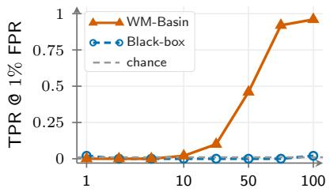  
Watermarked fraction (%)

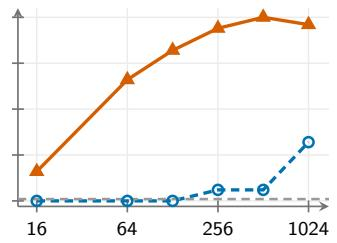  
Training LoRA rank r

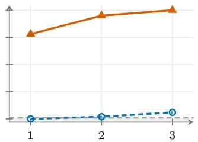  
Training epochs  
Figure 4 What governs detection: each knob swept on its own axis (n-gram=3). Each panel varies one knob, with its value on the x-axis and the TPR at a fixed 1% FPR on the y-axis, for WM-Basin and the black-box baseline; the grey dashed line marks chance (TPR=FPR=1%). Each configuration trains 50 students, each with a diferent watermark key. Left: watermarked fraction of the training traces. Middle: LoRA rank r. Right: training epochs. The all-clean control (no watermarked traces) is not plotted; none of its 50 students is flagged at any of the three thresholds.

Effect of the watermark scheme. Is detection tied to the watermark the teacher happens to deploy? We replace TextSeal in the teacher’s decoder with GumbelMax (Aaronson, 2022), KGW (γ=0.5) (Kirchenbauer et al., 2023), and SynthID (Dathathri et al., 2024), rebuilding the reference bank for each and distilling 50 students per scheme and window. Tab. 4 shows that all three transfer: WM-Basin flags every student at p≤0.01 and n-gram=1 under each scheme, and it outperforms the baseline in every cell, by a margin that widens with the window at p≤0.05. WM-Basin needs only traces the teacher generated under a key, not the watermark’s own detection test. The baseline, in contrast, scores the suspect’s tokens with that test, which must be derived scheme by scheme (App. B.4). To audit a new keyed watermark, the verifier therefore only generates teacher traces under its keys, rebuilds the reference bank, and runs the same detector.

Table 5 Distillation detection across the audited domain. The same 100 suspects, all distilled on OpenR1- Math (Hugging Face, 2025), are audited on three math datasets from the distillation domain (top block) and two domains outside it (bottom block), with both detectors built entirely from the audited domain’s own prompts and system prompt. Cells are read as in Tab. 1. Detailed setup in App. C.4.
<table><tr><td rowspan="3">Audited domain</td><td colspan="6">n-gram=1</td><td colspan="6">n-gram=2</td><td colspan="6">n-gram=3</td></tr><tr><td colspan="3">WM-Basin</td><td colspan="3">Black-box</td><td colspan="3">WM-Basin</td><td colspan="3">Black-box</td><td colspan="3">WM-Basin</td><td colspan="3">Black-box</td></tr><tr><td>TPR@FPR 5% 1% .1%</td><td></td><td></td><td>5% 1% .1%</td><td>TPR@FPR</td><td></td><td></td><td>TPR@FPR 5% 1% .1%</td><td></td><td></td><td>TPR@FPR</td><td>5% 1% .1%</td><td>5%</td><td>TPR@FPR 1% .1%</td><td></td><td>5%</td><td>TPR@FPR 1%.1%</td><td></td></tr><tr><td>OpenR1-Math</td><td>100</td><td>100</td><td>96</td><td>76</td><td>49</td><td>19</td><td>98</td><td>92</td><td>69</td><td>51</td><td>24</td><td>9</td><td>95</td><td>83</td><td>45</td><td>26</td><td>12</td><td>2</td></tr><tr><td>MATH</td><td>91</td><td>74</td><td>56</td><td>74</td><td>49</td><td>20</td><td>71</td><td>48</td><td>15</td><td>60</td><td>28</td><td>7</td><td>65</td><td>38</td><td>9</td><td>24</td><td>7</td><td>2</td></tr><tr><td>GSM8K</td><td>29</td><td>14</td><td>3</td><td>35</td><td>13</td><td>2</td><td>18</td><td>7</td><td>1</td><td>16</td><td>9</td><td>1</td><td>22</td><td>10</td><td>1</td><td>7</td><td>3</td><td>0</td></tr><tr><td>Code</td><td>12</td><td>5</td><td>0</td><td></td><td></td><td></td><td>5</td><td>1</td><td></td><td>31</td><td>11</td><td>2</td><td>8</td><td>4</td><td>0</td><td>7</td><td></td><td></td></tr><tr><td>Chat</td><td>11</td><td>1</td><td>0</td><td>50 22</td><td>19 4</td><td>4 1</td><td>2</td><td>0</td><td>0 0</td><td>15</td><td>4</td><td>0</td><td>4</td><td>1</td><td>0</td><td>13</td><td>2 4</td><td>0 1</td></tr></table>

Effect of the audited domain and system prompt. How close must the audited domain be to the adversary’s distillation data? We hold the 100 suspects fixed and change the domain the verifier audits, from the math domain they were distilled on (OpenR1-Math, MATH, GSM8K) to two domains outside it (code and chat). For each domain we rebuild the probe warm-up, the task subspace, and both detectors from that domain’s own prompts, none of them the teacher’s training system prompt; App. C.4 lists the exact prompts. Tab. 5 shows that WM-Basin’s detection power follows where the suspects were distilled: it ranks every math domain above both non-math ones in every cell, whereas the baseline ranks code above GSM8K at n-gram=1 and 2. A hit therefore tells the verifier on which domain the suspect’s text carries the watermark, not only that it carries one; a low score elsewhere means nothing was found there, not that the model is clean.

Effect of the watermarked fraction and the training recipe. What in the adversary’s data and training recipe lets the watermark reach the student? At n-gram=3 we sweep one knob at a time around the default recipe: the watermarked fraction of a fixed 1,900-trace training set from 1 to 100% (the remainder filled with clean traces from the same teacher), the distillation LoRA rank r from 16 to 1,024, and 1, 2, or 3 training epochs. Fig. 4 shows that detection power depends mostly on the watermarked fraction and the LoRA rank, and much less on how long the student trains. (1) WM-Basin performs at chance when at most 10% of the traces are watermarked and exceeds 90% TPR once 75% are. (2) Its TPR climbs from 16% at r=16 to 100% at r=512. (3) A single epoch already yields 78% TPR. The black-box baseline stays at or below 2% at every fraction and reaches its highest value in the figure at the largest rank; WM-Basin outperforms it in every cell of the rank and epoch sweeps.

Table 6 Distillation detection under compression. Each row applies one operation to the same 100 distilled suspects and regenerates their text, holding the probe and the reference bank fixed. Cells are read as in Tab. 2; Acc. is mean GSM8K accuracy per window. Operations below the mid-rule leave an unusable model, with accuracy under 0.9× the uncompressed 70.7. The black-box cells of the uncompressed row predate the token matching used for the six operations, so compare the black-box columns only across operations. The weightspace displacement of every operation is in Tab. 16 and the setup in App. D.1.
<table><tr><td rowspan="3">Compression Acc.</td><td rowspan="3"></td><td colspan="6">n-gram=1</td><td colspan="6">n-gram=2</td><td colspan="6">n-gram=3</td></tr><tr><td colspan="3">WM-Basin</td><td colspan="3">Black-box</td><td rowspan="2">Acc.</td><td colspan="3">WM-Basin</td><td colspan="3">Black-box</td><td rowspan="2"></td><td colspan="3">WM-Basin</td><td colspan="3">Black-box</td></tr><tr><td></td><td>TPR@FPR 1%.1%</td><td></td><td></td><td>TPR@FPR</td><td></td><td></td><td>TPR@FPR</td><td></td><td></td><td>TPR@FPR</td><td></td><td></td><td>TPR@FPR</td><td></td><td></td><td></td><td>TPR@FPR</td></tr><tr><td>none</td><td>70.7</td><td>100</td><td>100</td><td>100</td><td>81</td><td>50</td><td>17</td><td>70.7</td><td>100</td><td>100</td><td>99</td><td>44 19</td><td>5</td><td></td><td>70.7 100</td><td>95</td><td></td><td>80</td><td>8</td><td>4</td><td>2</td></tr><tr><td>int8</td><td>72.2</td><td>100</td><td>100</td><td>100</td><td>75</td><td>50</td><td>17</td><td>71.0</td><td>100</td><td>100</td><td>99</td><td>50</td><td>27 6</td><td></td><td>70.0 100</td><td></td><td>99</td><td>85</td><td>24</td><td>7</td><td>1</td></tr><tr><td>prune10</td><td>77.1</td><td>100</td><td>100</td><td>100</td><td>76</td><td>49</td><td>17</td><td>76.2</td><td>100</td><td>100</td><td>98</td><td>52</td><td>27</td><td>9</td><td>77.3 99</td><td></td><td>94</td><td>77</td><td>21</td><td>8</td><td>1</td></tr><tr><td></td><td></td><td></td><td></td><td></td><td></td><td></td><td></td><td></td><td></td><td></td><td></td><td></td><td></td><td></td><td></td><td></td><td></td><td></td><td></td><td></td><td></td></tr><tr><td>prune20 int4</td><td>59.5 50.4</td><td>100 100 79</td><td>59</td><td>100 31</td><td>70 50</td><td>44 25</td><td>20 11</td><td>61.2 50.8</td><td>100 43</td><td>96 25</td><td>82 12</td><td>44 38</td><td>24 10 16 2</td><td></td><td>57.6 91 45.4 46</td><td>82 25</td><td></td><td>49 10</td><td>20 7</td><td>4 1</td><td>0 0</td></tr><tr><td>nf4</td><td>55.8</td><td>100</td><td>100</td><td>99</td><td>70</td><td>46</td><td>23</td><td>42.9</td><td>100</td><td>95</td><td>76</td><td>48</td><td>26</td><td>4</td><td>41.2 95</td><td></td><td>79</td><td>40</td><td>8</td><td>3</td><td>0</td></tr><tr><td>prune30</td><td>37.8</td><td>93</td><td>71</td><td>36</td><td>52</td><td>30</td><td>8</td><td>39.6</td><td>75</td><td>51</td><td>12</td><td>32</td><td>13</td><td>1</td><td>28.9 49</td><td></td><td>26</td><td>7</td><td>14</td><td>1</td><td>0</td></tr></table>

## 3.3 Post-processing and Basin Dynamics

In §2.2, we showed that a watermarked student sits in a narrow basin: a small step along the watermark direction (Eq. (1)) leaves it, while a much larger step along the task direction does not. We now examine in which direction standard post-processing moves the student, and whether it removes the watermark.

Effect of model compression. Can an adversary quantize or prune the watermark out of a deployed student? We apply int8, int4, or nf4 quantization, or 10 to 30% unstructured pruning, to the same 100 suspects. Tab. 6 shows that only int8 and 10% pruning leave a usable model, and both cost WM-Basin at most three points at any window and operating point. The other operations weaken detection but also leave the student unusable. The weight-space decomposition explains why (Tab. 16): every operation displaces the student at least three orders of magnitude further orthogonally to the watermark direction than along it. Compression therefore does not move the student out of the watermark basin, and it remains detectable.

Effect of continued SFT and RL. Does continued training on clean data move the distilled model out of its watermark basin? We continue training the suspects via SFT on cross-domain data and via GRPO (Shao et al., 2024) on verifiable tasks (details in App. D.2), holding the probe and the reference bank fixed. Tab. 7 shows that continued RL leaves the student detectable while continued SFT weakens the signal: WM-Basin detects every distilled model in every GRPO arm at p≤0.05 and every window, whereas both SFT arms substantially reduce its power. This ordering matches how far each update moves the model along the watermark direction: SFT on general reasoning traces moves it furthest, SFT on multilingual math less, and GRPO barely at all. The open-weight detector, teacher-forced on the distillation traces, nevertheless still detects the SFT-trained students. Continued SFT thus weakens the signal observable in the student’s outputs without moving the model out of the watermark basin.

## 4 Related Work

Model extraction and unauthorized distillation. Frontier providers, threat-intelligence groups, policy analysts, and security researchers now document distillation-oriented misuse in the wild: adversaries harvest reasoning traces at scale from deployed APIs to train competing models (Anthropic, 2026a; Google Threat Intelligence Group, 2026; Panfilov et al., 2026). The underlying mechanism is knowledge distillation, which transfers capability from a teacher to a student model (Hinton et al., 2015). When exposed through an API, it becomes model extraction: black-box query access alone, without the target’s parameters or training data, sufices to replicate the teacher’s functionality (Tramèr et al., 2016). The threat is sharpest for reasoning models, whose step-by-step traces provide dense supervision. Capability also transfers through synthetic instructions, model-generated reasoning, rubric or reward feedback, and agent trajectories (Wang et al., 2023; Guo et al., 2025; Gunjal et al., 2025; Zeng et al., 2024). We study supervised fine-tuning on collected reasoning traces, motivated by evidence that small, high-quality reasoning sets sharply improve students (Muennighof et al., 2025).

Table 7 Distillation detection under continued training. Each row continues training the same distilled suspects on clean data, holding the probe, the reference bank, and the generation settings fixed. Cells are read as in Tab. 2, one block per n-gram window. ∆Acc. is the paired per-key change in GSM8K accuracy, and Along w is the signed projection of the weight change on the watermark direction $\hat { \Delta } _ { \mathrm { w m } } \ ( \mathrm { E q . \ ( 1 ) } )$ . Open-weight (Sander et al., 2024) is teacher-forced on the adversary’s own distillation traces, an idealized read that our black-box verifier cannot run (App. D.2). Cohort sizes and the full weight-space decomposition of every row are in Tab. 17.
<table><tr><td rowspan="3">Cond.</td><td rowspan="3">∆Acc. Along w</td><td rowspan="3"></td><td colspan="3">WM-Basin</td><td colspan="3">Black-box</td><td colspan="3">Open-weight</td></tr><tr><td colspan="3">TPR@FPR</td><td colspan="3">TPR@FPR</td><td colspan="3">TPR@FPR</td></tr><tr><td>5%</td><td>1% .1%</td><td></td><td>5%</td><td>1% .1%</td><td></td><td>5%</td><td>1% .1%</td></tr><tr><td>n-gram=1</td><td></td><td></td><td></td><td></td><td></td><td></td><td></td><td></td><td></td><td></td></tr><tr><td>SFT (reason)</td><td>+4.8</td><td>-0.252</td><td>3</td><td>1</td><td>0</td><td>39</td><td>15</td><td>3</td><td>92</td><td>82</td><td>52</td></tr><tr><td>SFT (multi.)</td><td>+7.0</td><td>-0.013</td><td>33</td><td>16</td><td>3</td><td>63</td><td>34</td><td>13</td><td>99</td><td>97</td><td>89</td></tr><tr><td>GRPO (GSM8K)</td><td>+2.4</td><td>0.000</td><td>100</td><td>100</td><td>100</td><td>58</td><td>42</td><td>25</td><td>100</td><td>100</td><td>92</td></tr><tr><td>GRPO (K&amp;K)</td><td>+0.5</td><td>0.000</td><td>100</td><td>100</td><td>100</td><td>57</td><td>14</td><td>0</td><td></td><td>100 100</td><td>86</td></tr><tr><td>GRPO (IFEval)</td><td>-1.4</td><td>0.000</td><td>100</td><td>100</td><td>100</td><td>71</td><td>57</td><td>14</td><td>100</td><td>100</td><td>86</td></tr><tr><td>n-gram=2</td><td></td><td></td><td></td><td></td><td></td><td></td><td></td><td></td><td></td><td></td><td></td></tr><tr><td>SFT (reason)</td><td>+1.0</td><td>-0.182</td><td>4</td><td>2</td><td>0</td><td>22</td><td>9</td><td>1</td><td>99</td><td>97</td><td>76</td></tr><tr><td>SFT (multi.)</td><td>+4.6</td><td>-0.009</td><td>27</td><td>13</td><td>3</td><td>36</td><td>18</td><td>5</td><td>100</td><td>100</td><td>99</td></tr><tr><td>GRPO (GSM8K)</td><td>+2.2</td><td>0.000</td><td>100</td><td>100</td><td>87</td><td>40</td><td>40</td><td>7</td><td>100</td><td>100</td><td>100</td></tr><tr><td>GRPO (K&amp;K)</td><td>+0.9</td><td>0.000</td><td>100</td><td>100</td><td>100</td><td>40</td><td>30</td><td>20</td><td>100</td><td>100</td><td>100</td></tr><tr><td>GRPO (IFEval)</td><td>+1.0</td><td>0.000</td><td>100</td><td>100</td><td>100</td><td>30</td><td>30</td><td>10</td><td>100</td><td>100</td><td>100</td></tr><tr><td>n-gram=3</td><td></td><td></td><td></td><td></td><td></td><td></td><td></td><td></td><td></td><td></td><td></td></tr><tr><td>SFT (reason)</td><td>+2.4</td><td>-0.146</td><td>6</td><td>1</td><td>0</td><td>7</td><td>3</td><td>1</td><td>98</td><td>95</td><td>73</td></tr><tr><td>SFT (multi.)</td><td>+6.0</td><td>-0.007</td><td>21</td><td>4</td><td>0</td><td>15</td><td>5</td><td>0</td><td>100</td><td>100</td><td>97</td></tr><tr><td>GRPO (GSM8K)</td><td>+0.5</td><td>0.000</td><td>100</td><td>93</td><td>53</td><td>0</td><td>0</td><td>0</td><td>100</td><td>100</td><td>100</td></tr><tr><td>GRPO (K&amp;K)</td><td>-0.2</td><td>0.000</td><td></td><td>100 100</td><td>50</td><td>0</td><td>0</td><td>0</td><td>100</td><td>100</td><td>100</td></tr><tr><td>GRPO (IFEval)</td><td>-0.3</td><td>0.000</td><td></td><td>100 100</td><td>50</td><td>10</td><td>0</td><td>0</td><td>100</td><td>100</td><td>100</td></tr></table>

Defenses against extraction. Existing defenses restrict what the API returns, monitor extraction-like querying (Anthropic, 2026a; Google Threat Intelligence Group, 2026), or make outputs less useful for training via antidistillation sampling or trace rewriting (Savani et al., 2026; Ma et al., 2026). Such methods trade away utility for benign users or assume that the attacker stays observable during collection. That assumption is fragile in practice: adversaries spread collection across many accounts and third-party API resellers, so no single query stream looks like extraction (Anthropic, 2026a). Detection is complementary: it acts after the fact and leaves the deployed model untouched. A parallel black-box line, dataset inference (Maini et al., 2021), resolves ownership by testing whether a suspect shares private knowledge of the victim’s data, without inserting a watermark; it observes that inserted watermarks are of-distribution and therefore not always preserved under stealing. Classical model watermarking instead hides a signal directly in the weights or via backdoors (Uchida et al., 2017; Adi et al., 2018), read from the parameters or by querying a trigger set; both assume the owner watermarked the suspect model under test, whereas our suspect is a model the owner never trained.

Watermarking and radioactivity. Text watermarking embeds a secret statistical signal into generated text (Kirchenbauer et al., 2023; Kuditipudi et al., 2023; Sander et al., 2026). The idea of tracing data through a trained model originates in computer vision: Sablayrolles et al. (2020) show that imperceptible “radioactive” watermarks in a dataset leave a statistical residue in models trained on it, detectable with a calibrated p-value even when only 1% of the data is marked. Our rank test follows the same framework. Sander et al. (2024) carry radioactivity over to language models, showing that watermarked distillation leaves a key-specific residue in the student, and others study how well such watermarks survive distillation (Sander et al., 2026; Zhao et al., 2022; Pan et al., 2025). The black-box verifier of Sander et al. (2024), which counts watermark-favored tokens in a suspect’s sampled text, defines the setting we work in and is, to the best of our knowledge, the only existing method for the task; it is our baseline throughout. Its limits were not previously characterized, and establishing them is part of our contribution. The statistic accumulates evidence only where exact watermarked contexts recur, which we show is fragile to wider windows, lower decoding temperatures, and larger text budgets (§3.2, App. C.5), the same failure mode that paraphrase attacks exploit against surface-level watermark detection (Sadasivan et al., 2023). WM-Basin keeps the access level and the generations, and replaces the token statistic with a weight-space one.

Weight-space geometry and basins. WM-Basin relies on the fact that students distilled under one key settle into a shared, key-specific region of weight space. This connects to the geometry of neural loss landscapes: independently trained optima are joined by simple, near-constant-loss curves (Garipov et al., 2018), and once permutation symmetries are accounted for, the landscape resembles a single wide basin, so separately trained models can be aligned by permutation and merged in weight space (Ainsworth et al., 2022). Large language models exhibit the same basin-like structure (Chen et al., 2026; Li et al., 2018; Peng et al., 2024). WM-Basin treats the watermark key as carving out one such basin and asks whether a suspect has fallen into it.

Gradient attribution and representation post-processing. To read this geometric signal from text alone, WM-Basin backpropagates a suspect’s completions through a fixed probe model. This draws on firstorder data attribution: influence functions trace a prediction back to the training points responsible for it using only gradient access (Koh and Liang, 2017), an idea scaled by gradient tracing (Pruth et al., 2020) and random-projected attribution (Park et al., 2023), and adapted to instruction tuning with low-rank projected gradients (Xia et al., 2024). Intuitively, a training example’s gradient captures how it would nudge the model, so aligned gradients indicate similar examples. Raw gradient cosines, however, are dominated by a few shared directions (generic language and formatting): a handfu of top components inflate the similarity between otherwise unrelated items (Ethayarajh, 2019; Gao et al., 2019; Radovanovic et al., 2010; Dinu et al., 2014). We remove these with an “All-but-the-Top” projection (Mu et al., 2017), stripping the few dominant yet uninformative directions so that the faint key-specific signal stands out from the generic task geometry.

## 5 Conclusion and Future Work

In this work, we introduce the watermark basin: distilling on watermarked traces encodes the teacher’s secret key as a faint direction in parameter space, displacing the student’s weights along that key direction and into a region that later training does not easily escape. Building on this geometry, we design WM-Basin, which reformulates black-box detection of unauthorized distillation from a fragile, surface-level token count into a geometric alignment test in parameter space. Across a wide range of evaluations, spanning six student families, four teachers, and four watermarking schemes, WM-Basin outperforms the existing baseline by a large margin, and it survives quantization, pruning, and RL post-training.

Scope and outlook. A watermark can be present in a distilled model but unreadable in its text: continued SFT on clean data suppresses the text-level signal while an open-weight probe still recovers the residual, and a supplementary study (App. D.3) finds the same for rewriting the teacher’s traces before distillation. WM-Basin is also an in-domain test: a hit tells the verifier on which domain the suspect’s text carries the watermark, not only that it carries one, and a low score elsewhere means nothing was found there, not that the model is clean (§3.2). Both are limits on what a black-box verifier can observe, not on what distillation transfers. Narrowing the gap between the black-box read and the open-weight probe is thus a promising direction for future work.

## Ethics Statement

This work studies whether a model provider can establish, from API access alone, that a suspect model was distilled from its watermarked teacher. It involves no human subjects and no personal or user data: the distillation corpus (OpenR1-Math-220k), the utility benchmarks (GSM8K and Math-500), and every teacher, student, probe, and clean-pool checkpoint are publicly released artefacts used under their own licenses, and every experiment runs on models we host ourselves. Because the method produces evidence of provenance, we report how it behaves on models that are not guilty rather than a bare score. We also measure what weakens the audit, including rewriting the teacher’s traces before distillation, continued fine-tuning, and probing away from the distillation domain. These are variants of attacks already described in the text-watermarking literature, and we report them because a verifier that does not know the limits of its own test is the more likely harm.

## Reproducibility Statement

The configuration behind every number in the paper is recorded in App. B. Tab. 8 gives the default models, watermark and sampling settings, distillation data and LoRA hyperparameters, probe warmup, and detector and baseline settings, down to the key ranges and seeds. Tab. 9 indexes every study, the factor it varies, the cohort and sample size, and where its result is reported, so a single arm is reproduced by reading the defaults plus the one row that changes them. The detector is specified procedurally in Alg. 1, and App. B.2 documents trace generation and the quality filter that takes 5,000 sampled traces to the 1,900 used for training.

## References

Scott Aaronson. My AI safety lecture for UT efective altruism, 2022. Blog post. Accessed: 2026-03-17.

Yossi Adi, Carsten Baum, Moustapha Cisse, Benny Pinkas, and Joseph Keshet. Turning your weakness into a strength: Watermarking deep neural networks by backdooring. In 27th USENIX security symposium (USENIX Security 18), pages 1615–1631, 2018.

Sandhini Agarwal, Lama Ahmad, Jason Ai, Sam Altman, Andy Applebaum, Edwin Arbus, Rahul K Arora, Yu Bai, Bowen Baker, Haiming Bao, et al. gpt-oss-120b & gpt-oss-20b model card. arXiv preprint arXiv:2508.10925, 2025.

Samuel K Ainsworth, Jonathan Hayase, and Siddhartha Srinivasa. Git re-basin: Merging models modulo permutation symmetries. arXiv preprint arXiv:2209.04836, 2022.

Anthropic. Detecting and preventing distillation attacks, 2026a. Accessed: 2026-02-25.

Anthropic. How Claude marks AI-generated content, 2026b. Accessed: 2026-08-13.

Huanran Chen, Zeming Wei, Yao Huang, Yichi Zhang, Yinpeng Dong, and Jun Zhu. Unveiling the basin-like loss landscape in large language models. In International Conference on Learning Representations, pages 148112–148146, 2026.

Nuo Chen, Zinan Zheng, Ning Wu, Ming Gong, Dongmei Zhang, and Jia Li. Breaking language barriers in multilingual mathematical reasoning: Insights and observations. In Findings of the Association for Computational Linguistics: EMNLP 2024, pages 7001–7016, 2024.

Karl Cobbe, Vineet Kosaraju, Mohammad Bavarian, Mark Chen, Heewoo Jun, Lukasz Kaiser, Matthias Plappert, Jerry Tworek, Jacob Hilton, Reiichiro Nakano, et al. Training verifiers to solve math word problems. arXiv preprint arXiv:2110.14168, 2021.

Sumanth Dathathri, Abigail See, Sumedh Ghaisas, Po-Sen Huang, Rob McAdam, Johannes Welbl, Vandana Bachani, Alex Kaskasoli, Robert Stanforth, Tatiana Matejovicova, et al. Scalable watermarking for identifying large language model outputs. Nature, 634(8035):818–823, 2024.

Georgiana Dinu, Angeliki Lazaridou, and Marco Baroni. Improving zero-shot learning by mitigating the hubness problem. arXiv preprint arXiv:1412.6568, 2014.

Meyer Dwass. Modified randomization tests for nonparametric hypotheses. The Annals of Mathematical Statistics, pages 181–187, 1957.

Kawin Ethayarajh. How contextual are contextualized word representations? comparing the geometry of bert, elmo, and gpt-2 embeddings. In Proceedings of the 2019 conference on empirical methods in natural language processing and the 9th international joint conference on natural language processing (EMNLP-IJCNLP), pages 55–65, 2019.

European Commission. Code of Practice on Transparency of AI-Generated Content, 2026.

Pierre Fernandez, Antoine Chafin, Karim Tit, Vivien Chappelier, and Teddy Furon. Three bricks to consolidate watermarks for large language models. In 2023 IEEE international workshop on information forensics and security (WIFS), pages 1–6. IEEE, 2023.

Jun Gao, Di He, Xu Tan, Tao Qin, Liwei Wang, and Tie-Yan Liu. Representation degeneration problem in training natural language generation models. arXiv preprint arXiv:1907.12009, 2019.

Timur Garipov, Pavel Izmailov, Dmitrii Podoprikhin, Dmitry Vetrov, and Andrew G Wilson. Loss surfaces, mode connectivity, and fast ensembling of dnns. Advances in neural information processing systems, 31, 2018.

Google Threat Intelligence Group. GTIG AI threat tracker: Distillation, experimentation, and (continued) integration of AI for adversarial use, 2026. Accessed: 2026-02-26.

Aaron Grattafiori, Abhimanyu Dubey, Abhinav Jauhri, Abhinav Pandey, Abhishek Kadian, Ahmad Al-Dahle, Aiesha Letman, Akhil Mathur, Alan Schelten, Alex Vaughan, et al. The llama 3 herd of models. arXiv preprint arXiv:2407.21783, 2024.

Anisha Gunjal, Anthony Wang, Elaine Lau, Vaskar Nath, Bing Liu, and Sean Hendryx. Rubrics as rewards: Reinforcement learning beyond verifiable domains. arXiv preprint arXiv:2507.17746, 2025.

Daya Guo, Dejian Yang, Haowei Zhang, Junxiao Song, Peiyi Wang, Qihao Zhu, Runxin Xu, Ruoyu Zhang, Shirong Ma, Xiao Bi, et al. Deepseek-r1: Incentivizing reasoning capability in llms via reinforcement learning. arXiv preprint arXiv:2501.12948, 2025.

Dan Hendrycks, Collin Burns, Saurav Kadavath, Akul Arora, Steven Basart, Eric Tang, Dawn Song, and Jacob Steinhardt. Measuring mathematical problem solving with the math dataset. arXiv preprint arXiv:2103.03874, 2021.

Geofrey Hinton, Oriol Vinyals, and Jef Dean. Distilling the knowledge in a neural network. arXiv preprint arXiv:1503.02531, 2015.

Hugging Face. Open r1: A fully open reproduction of deepseek-r1, 2025.

William B Johnson, Joram Lindenstrauss, et al. Extensions of lipschitz mappings into a hilbert space. Contemporary mathematics, 26(189-206):1, 1984.

John Kirchenbauer, Jonas Geiping, Yuxin Wen, Jonathan Katz, Ian Miers, and Tom Goldstein. A watermark for large language models. In International conference on machine learning, pages 17061–17084. PMLR, 2023.

Pang Wei Koh and Percy Liang. Understanding black-box predictions via influence functions. In International conference on machine learning, pages 1885–1894. Pmlr, 2017.

Rohith Kuditipudi, John Thickstun, Tatsunori Hashimoto, and Percy Liang. Robust distortion-free watermarks for language models. arXiv preprint arXiv:2307.15593, 2023.

Nathan Lambert, Jacob Morrison, Valentina Pyatkin, Shengyi Huang, Hamish Ivison, Faeze Brahman, Lester James V Miranda, Alisa Liu, Nouha Dziri, Shane Lyu, et al. Tulu 3: Pushing frontiers in open language model post-training. arXiv preprint arXiv:2411.15124, 2024.

Hao Li, Zheng Xu, Gavin Taylor, Christoph Studer, and Tom Goldstein. Visualizing the loss landscape of neural nets. Advances in neural information processing systems, 31, 2018.

Xinhang Ma, William Yeoh, Ning Zhang, and Yevgeniy Vorobeychik. Protecting language models against unauthorized distillation through trace rewriting. In Proceedings of the 64th Annual Meeting of the Association for Computational Linguistics (Volume 1: Long Papers), pages 11307–11324, 2026.

Pratyush Maini, Mohammad Yaghini, and Nicolas Papernot. Dataset inference: Ownership resolution in machine learning. arXiv preprint arXiv:2104.10706, 2021.

Jiaqi Mu, Suma Bhat, and Pramod Viswanath. All-but-the-top: Simple and efective postprocessing for word representations. arXiv preprint arXiv:1702.01417, 2017.

Niklas Muennighof, Zitong Yang, Weijia Shi, Xiang Lisa Li, Li Fei-Fei, Hannaneh Hajishirzi, Luke Zettlemoyer, Percy Liang, Emmanuel Candès, and Tatsunori B Hashimoto. s1: Simple test-time scaling. In Proceedings of the 2025 Conference on Empirical Methods in Natural Language Processing, pages 20286–20332, 2025.

Leyi Pan, Aiwei Liu, Shiyu Huang, Yijian Lu, Xuming Hu, Lijie Wen, Irwin King, and Philip S Yu. Can llm watermarks robustly prevent unauthorized knowledge distillation? In Proceedings of the 63rd Annual Meeting of the Association for Computational Linguistics (Volume 1: Long Papers), pages 13228–13251, 2025.

Alexander Panfilov, David Schmotz, Ilia Shumailov, Luca Beurer-Kellner, Joachim Schaefer, Ameya Prabhu, Jonas Geiping, and Maksym Andriushchenko. Stealing reasoning traces from proprietary llm apis. arXiv preprint arXiv:2608.09867, 2026.

Sung Min Park, Kristian Georgiev, Andrew Ilyas, Guillaume Leclerc, and Aleksander Madry. Trak: Attributing model behavior at scale. arXiv preprint arXiv:2303.14186, 2023.

Sheng Y Peng, Pin-Yu Chen, Matthew Hull, and Duen H Chau. Navigating the safety landscape: Measuring risks in finetuning large language models. Advances in Neural Information Processing Systems, 37:95692– 95715, 2024.

Fortunato Pesarin and Luigi Salmaso. Permutation tests for complex data: theory, applications and software. John Wiley & Sons, 2010.

Belinda Phipson and Gordon K Smyth. Permutation p-values should never be zero: calculating exact p-values when permutations are randomly drawn. arXiv preprint arXiv:1603.05766, 2016.

Garima Pruthi, Frederick Liu, Satyen Kale, and Mukund Sundararajan. Estimating training data influence by tracing gradient descent. Advances in neural information processing systems, 33:19920–19930, 2020.

Milos Radovanovic, Alexandros Nanopoulos, and Mirjana Ivanovic. Hubs in space: Popular nearest neighbors in high-dimensional data. Journal of machine learning research, 11(sept):2487–2531, 2010.

Daniel Remler and Ben Hayum. Adversarial distillation. Center for a New American Security (CNAS) Report, 2026. Accessed: 2026-08-01.

Alexandre Sablayrolles, Matthijs Douze, Cordelia Schmid, and Hervé Jégou. Radioactive data: tracing through training. In International Conference on Machine Learning, pages 8326–8335. PMLR, 2020.

Vinu Sankar Sadasivan, Aounon Kumar, Sriram Balasubramanian, Wenxiao Wang, and Soheil Feizi. Can ai-generated text be reliably detected? arXiv preprint arXiv:2303.11156, 2023.

Tom Sander, Pierre Fernandez, Alain Durmus, Matthijs Douze, and Teddy Furon. Watermarking makes language models radioactive. Advances in Neural Information Processing Systems, 37:21079–21113, 2024.

Tom Sander, Hongyan Chang, Tomáš Souček, Tuan Tran, Valeriu Lacatusu, Sylvestre-Alvise Rebufi, Alexandre Mourachko, Surya Parimi, Christophe Ropers, Rashel Moritz, et al. Textseal: A localized llm watermark for provenance & distillation protection. arXiv preprint arXiv:2605.12456, 2026.

Yash Savani, Asher Trockman, Zhili Feng, Yixuan Xu, Avi Schwarzschild, Alexander Robey, Marc Finzi, and Zico Kolter. Antidistillation sampling. Advances in Neural Information Processing Systems, 38:117800– 117827, 2026.

Zhihong Shao, Peiyi Wang, Qihao Zhu, Runxin Xu, Junxiao Song, Xiao Bi, Haowei Zhang, Mingchuan Zhang, YK Li, Yang Wu, et al. Deepseekmath: Pushing the limits of mathematical reasoning in open language models. arXiv preprint arXiv:2402.03300, 2024.

Qwen Team. Qwq-32b: Embracing the power of reinforcement learning, 2025.

Florian Tramèr, Fan Zhang, Ari Juels, Michael K Reiter, and Thomas Ristenpart. Stealing machine learning models via prediction {APIs}. In 25th USENIX security symposium (USENIX Security 16), pages 601–618, 2016.

Yusuke Uchida, Yuki Nagai, Shigeyuki Sakazawa, and Shin’ichi Satoh. Embedding watermarks into deep neural networks. In Proceedings of the 2017 ACM on international conference on multimedia retrieval, pages 269–277, 2017.

Yizhong Wang, Yeganeh Kordi, Swaroop Mishra, Alisa Liu, Noah A Smith, Daniel Khashabi, and Hannaneh Hajishirzi. Self-instruct: Aligning language models with self-generated instructions. In Proceedings of the 61st annual meeting of the association for computational linguistics (volume 1: long papers), pages 13484– 13508, 2023.

Mengzhou Xia, Sadhika Malladi, Suchin Gururangan, Sanjeev Arora, and Danqi Chen. Less: Selecting influential data for targeted instruction tuning. arXiv preprint arXiv:2402.04333, 2024.

Chulin Xie, Yangsibo Huang, Chiyuan Zhang, Da Yu, Xinyun Chen, Bill Yuchen Lin, Bo Li, Badih Ghazi, and Ravi Kumar. On memorization of large language models in logical reasoning. In Proceedings of the 14th International Joint Conference on Natural Language Processing and the 4th Conference of the Asia-Pacific Chapter of the Association for Computational Linguistics, pages 2742–2785, 2025.

An Yang, Baosong Yang, Beichen Zhang, Binyuan Hui, Bo Zheng, Bowen Yu, Chengyuan Li, Dayiheng Liu, Fei Huang, Haoran Wei, Huan Lin, Jian Yang, Jianhong Tu, Jianwei Zhang, Jianxin Yang, Jiaxi Yang, Jingren Zhou, Junyang Lin, Kai Dang, Keming Lu, Keqin Bao, Kexin Yang, Le Yu, Mei Li, Mingfeng Xue, Pei Zhang, Qin Zhu, Rui Men, Runji Lin, Tianhao Li, Tingyu Xia, Xingzhang Ren, Xuancheng Ren, Yang Fan, Yang Su, Yichang Zhang, Yu Wan, Yuqiong Liu, Zeyu Cui, Zhenru Zhang, and Zihan Qiu. Qwen2.5 technical report. arXiv preprint arXiv:2412.15115, 2024.

Aohan Zeng, Mingdao Liu, Rui Lu, Bowen Wang, Xiao Liu, Yuxiao Dong, and Jie Tang. Agenttuning: Enabling generalized agent abilities for llms. In Findings of the Association for Computational Linguistics: ACL 2024, pages 3053–3077, 2024.

Tingwei Zhang, John X Morris, and Vitaly Shmatikov. How to steal reasoning without reasoning traces. arXiv preprint arXiv:2603.07267, 2026.

Xuandong Zhao, Lei Li, and Yu-Xiang Wang. Distillation-resistant watermarking for model protection in nlp. In Findings of the Association for Computational Linguistics: EMNLP 2022, pages 5044–5055, 2022.

## Appendix

## Appendix Outline

A The Key-Randomization Rank Test 17   
B Experimental Setup 18   
B.1 Configuration Summary 18   
B.2 Distillation and Student Training 19   
B.3 Prompt Pools and Suspect Sampling 20   
B.4 Detector and Baseline Implementation 20   
B.5 Removing Shared Task Directions . 21   
B.6 Calibration of the Rank p-Value . 23   
C Additional Detection Results 24   
C.1 Operating Points 24   
C.2 Cross-Teacher Detection 24   
C.3 Watermark Scheme 25   
C.4 Audited Domain and System Prompt . 26   
C.5 Suspect-Text Budget 26   
C.6 Probe Model and Warm-Up . 27   
D Additional Robustness Results 28   
D.1 Compression 29   
D.2 Continued Fine-Tuning and RL 29   
D.3 Paraphrasing 31

## A The Key-Randomization Rank Test

Token-level detectors read significance from a parametric null for their score: a Gaussian or binomial tail for a green-list count (Kirchenbauer et al., 2023; Sander et al., 2024), or a Gamma tail for a Gumbel score (Fernandez et al., 2023), which is the form our black-box baseline uses (App. B.4). WM-Basin assumes no such model for $S$ and reads significance from the rank of the claimed key among M decoy keys drawn from the same generator (Dwass, 1957; Phipson and Smyth, 2016).

Let $H _ { 0 }$ be the null hypothesis of $\ S 2 .$ 1: the suspect’s outputs on the audited domain carry no information about the claimed key $k ^ { \star }$ , as holds when the suspect was never trained within that key’s basin. To test it, we fix the suspect model, the prompts, and the detection pipeline, then draw M independent decoy keys $k _ { 1 } , \ldots , k _ { M } \gets { \mathsf { K e y G e n } }$ . We evaluate $S$ at $k ^ { \star }$ and at each decoy, where a higher score means stronger basin alignment, and form the empirical p-value of Eq. (4), which measures how uniquely the suspect aligns with $k ^ { \star }$ relative to random basins. The leading 1 counts $k ^ { \star }$ among the $M { + 1 }$ candidates, which prevents $p _ { \mathrm { r a n k } } { = } 0$ and keeps Type-I error control valid under finite Monte Carlo sampling (Phipson and Smyth, 2016).

The p-value is valid because nothing in the pipeline can favor the claimed key under $H _ { 0 }$ . The claimed key and the M decoys are drawn the same way, and the scoring rule uses a key only as an index that selects reference traces; the probe, the random projection, the build prompts, and the fitted U are identical for all M+1 candidates. The claimed key is therefore equally likely to occupy any of the M+1 ranks, assuming no ties. Thresholding its rank p-value then controls the FPR in finite samples: the FPR is at most α for any threshold, and equals α when α lies on the attainable rank grid. The ≥ in Eq. (4) counts ties against rejection, so ties cost power rather than validity. None of this needs a parametric model of S (Pesarin and Salmaso, 2010): Eq. (4) places no restriction on the score, so the guarantee survives arbitrary non-linear transformations of the suspect model. App. B.6 measures the realized rate against the nominal one for every deployed key.

The smallest attainable p-value is 1/(M+1), so the decoy count sets the finest significance an audit can certify: reporting at α=0.001 requires $M \geq 9 9 9$ decoys. Decoy scoring is ofline and reuses the build-once artefacts, so improving the resolution can be cheap in practice.

## B Experimental Setup

This section presents the experiment setup in §3.

## B.1 Configuration Summary

Table 8 gives in full the default models and numeric settings that §3.1 states in summary, and Tab. 9 indexes the studies built on them, what each varies and where it is reported.

Table 8 Default experimental configuration. Models, watermark, distillation, probe, and detector settings used throughout §3 unless stated otherwise; see App. B.2 for full details. The TextSeal parameter α=0.1 is held fixed in every experiment.

<table><tr><td>Component</td><td>Setting</td></tr><tr><td colspan="2">Models</td></tr><tr><td>Teacher (default)</td><td>DeepSeek-R1-Distill-Qwen-14B</td></tr><tr><td>Teacher (swaps)</td><td>gpt-oss-120B, QwQ-32B, Llama-3.1-8B</td></tr><tr><td>Student (default) Student (cross-arch.)</td><td>Qwen2.5-3B</td></tr><tr><td></td><td>24 structures, 135M to 8.2B (Llama(-Guard), Qwen2.5/3, QwQ, DeepSeek-Distill, Gemma, SmolLM2)</td></tr><tr><td>Probe model</td><td>Qwen2.5-3B (base, warmed)</td></tr><tr><td>Clean PCA pool</td><td>43 off-the-shelf checkpoints (15 families, 135M to 120B; 129 cells total; Tab. 10)</td></tr><tr><td>Watermark &amp; teacher sampling</td><td></td></tr><tr><td colspan="2">Scheme TextSeal, α=0.1</td></tr><tr><td>Sampling</td><td>vLLM; T=1.0, top-p=0.95; ≤8,192 tokens</td></tr><tr><td>Distillation temperatures</td><td>{1.0, 0.7, 0.5} (reference fixed at T=1.0)</td></tr><tr><td>Distillation (student)</td><td></td></tr><tr><td colspan="2"></td></tr><tr><td>Dataset System prompt</td><td>OpenR1-Math-220k one fixed math-teacher prompt for every trace; by default every verifier stage (warm-up,</td></tr><tr><td></td><td>bank, clean pool, audit) renders this same prompt, so the default audit is prompt-matched.</td></tr><tr><td>Traces</td><td>Only the domain sweep replaces it (App. C.4)</td></tr><tr><td>Trace filter</td><td>5,000 sampled → quality-filtered → 1,900 used for training closing &lt;/think&gt;, \boxed{}, no ≥3× repetition, math_verify match</td></tr><tr><td>Fine-tuning</td><td>LoRA r=512, lr 2e-5, 3 epochs, effective batch 16, max sequence length 8192</td></tr><tr><td>LoRA targets</td><td>{q, k, v, o, gate, up, down}proj</td></tr><tr><td>Eval benchmarks</td><td>GSM8K, Math-500</td></tr><tr><td colspan="2">Probe warm-up</td></tr><tr><td>Data</td><td>450 clean teacher traces, on build-pool prompts Xbuild from the domain being audited</td></tr><tr><td>Adapter</td><td>(App. C.4) LoRA r=128, 4 epochs, lr 2e−4, batch 1</td></tr><tr><td colspan="2">Detector (WM-Basin)</td></tr><tr><td>Reference bank</td><td>100 deployed keys, one student distilled per key; each ranked against a 1,000-key bank (k*</td></tr><tr><td>Per-key gradient</td><td>+ 999 decoys) average of 512 traces (≥512 tokens) on build-pool prompts Xbuild</td></tr><tr><td>Projection</td><td>fixed random projection to 8,192-dim (TRAK)</td></tr><tr><td>Task subspace</td><td>top-q=100 PCA (all-but-the-top), fit on clean pool</td></tr><tr><td>p-value floor</td><td>0.001</td></tr><tr><td>Operating point</td><td>threshold p≤0.01 (TPR@1% FPR)</td></tr><tr><td colspan="2">Baseline (Sander et al., 2024)</td></tr><tr><td>Black-box n-gram</td><td>corpus φ from keyed teacher traces on 5,000 held-out prompts</td></tr><tr><td>Windows</td><td>n-gram ∈ {1, 2, 3} each distinct (context, token) pair scored once across traces</td></tr><tr><td colspan="2">Table 8, continued.</td></tr><tr><td>Component</td><td>Setting</td></tr><tr><td>Test</td><td>baseline's own analytic p-value: two-key score fused at the generation α=0.1, variance- corrected Gamma tail (App. B.4); plain, not entropy-weighted</td></tr><tr><td colspan="2">Suspect text (shared by every detector)</td></tr><tr><td>Budget</td><td>1,900 held-out prompts → median 1,875 scored responses, ≈10M sampled tokens of which ≈1M are scored (App. B.3)</td></tr><tr><td>Prompts</td><td>test pool  $\mathcal { X } _ { \mathrm { t e s t } } ,$  disjoint from  $\chi _ { \mathrm { t r a i n } }$  and  ${ \mathcal { X } } _ { \mathrm { b u i l d } } \ ( \mathrm { A p p . \ B . 3 } )$ </td></tr><tr><td>System prompt</td><td>the distillation prompt above, i.e. matched; replaced only in App. C.4</td></tr><tr><td>Sampling</td><td> $T { = } 1 . 0 ,$  top-p=0.95,  $\leq 8 , 1 9 2$  new tokens, repetition penalty 1.0, seed 42</td></tr></table>

Table 9 Per-experiment settings. What each study varies, the cohort used, and where the result is reported; varied factors are read against the defaults of Tab. 8.
<table><tr><td>Experiment</td><td>Varied factor and levels</td><td>Model cohort / sample size</td><td>Result</td></tr><tr><td>Student architecture</td><td>24 structures, 135M to 8.2B parameters</td><td>50 students per architecture Tab. 1 (1,200 total)</td><td></td></tr><tr><td>Distillation tempera- ture</td><td>Teacher sampling  $T \in \{ 1 . 0 , 0 . 7 , 0 . 5 \} ;$  erence bank fixed at T=1.0</td><td>ref- 100 students per temperature</td><td>Tab. 2</td></tr><tr><td>Teacher model</td><td>4 teachers spanning 3 families, 8B to 100 students per teacher 120B; bank rebuilt per teacher; the three swapped teachers distil for 8 epochs, not</td><td></td><td>Tabs. 3, 12</td></tr><tr><td>Watermark scheme</td><td>4 watermark schemes at n-gram ∈ {1, 2, 3}</td><td>50 students per scheme and win- Tabs. 4, 13 dow</td><td></td></tr><tr><td>Audited domain</td><td>5 domains; every detector stage and the Fixed pool of 100 students</td><td></td><td>Tab. 5</td></tr><tr><td>Model compression</td><td>system prompt rebuilt per domain int8, int4 and nf4 quantization; 10 to 30% 100 students per operation</td><td></td><td>Tabs. 6,</td></tr><tr><td>Continued SFT and</td><td>pruning Post-distillation training: SFT domain, 100 students (SFT); 10 to 20 Tabs. 7, 17, 18</td><td></td><td>Fig. 10</td></tr><tr><td>RL Probe model</td><td>or GRPO task 10 probe checkpoints; reference bank re- Fixed pool of 100 students</td><td>(GRPO)</td><td>Tab. 14</td></tr><tr><td>Probe warm-up</td><td>built per probe Presence, corpus domain, LoRA rank, Fixed pool of 100 scored keys, Tab. 15 learning rate, epochs; one knob at a time, reused across all 15 arms</td><td></td><td></td></tr><tr><td>Trace paraphrasing</td><td>n-gram=3 only Same-family Qwen paraphraser at 3 20 students per strength</td><td></td><td>Tab. 19</td></tr><tr><td>Watermarked data</td><td>strengths Proportion f of watermarked traces, at a 50 students per fraction</td><td></td><td>Fig. 4</td></tr><tr><td>fraction Student training</td><td>fixed 1,900-trace training budget LoRA rank r, epochs</td><td>50 students per configuration</td><td>Fig. 4</td></tr><tr><td>recipe Distillation utility</td><td>Clean vs. watermarked teacher traces</td><td>100 watermarked students per n- Fig. 5 gram window, plus a clean con-</td><td></td></tr><tr><td>Operating-point</td><td>Detection threshold, at n-gram</td><td>trol 100 watermarked students Fig. 8</td><td></td></tr><tr><td>ROC Suspect-text budget</td><td>∈ {1, 2, 3} Cumulative prefixes of 5 to 1,878 genera- Fixed pool of 100 students</td><td>against 6,500 null cases</td><td>Fig. 9</td></tr><tr><td>Per-key false-positive rate</td><td>tions (0.03 to 10.3M tokens supplied) Which bank key is read as the deployed All 1,000 bank keys, each Tab. 11 one, at α=5% and n-gram ∈ {1, 2, 3}</td><td>across 129 held-out clean model-</td><td></td></tr><tr><td></td><td>Watermark basin ge- Weight-space offset along  $\hat { \Delta } _ { \mathrm { w m } }$ </td><td>temperature cells and One student distilled under a sin- Fig. 3</td><td></td></tr><tr><td>ometry Task-subspace re-</td><td>△task Removed components q: seven settings, 1,200 distilled students at all n- Fig. 6</td><td>gle key from no PCA through mean only to grams, against 129 clean model-</td><td></td></tr><tr><td>moval</td><td>q=100</td><td>temperature cells Rank p-value calibra- Significance threshold α, swept under the 100 deployed keys across 65 held- Fig. 7 out clean model-temperature</td><td></td></tr></table>

## B.2 Distillation and Student Training

The student follows the fine-tuning recipe of Tab. 8. A teacher trace is retained only if it contains a closing </think> tag and a \boxed{...} answer, has no substring repeated ≥3 times under the sliding 100-character repetition check, and its extracted answer matches the gold answer under math\_verify.

The probe $\theta _ { \mathrm { p r o b e } }$ is warmed up on clean teacher traces with LoRA.

Distillation performance. Watermarking the teacher does not cost the student the utility distillation buys. Figure 5 compares clean and TextSeal distillation under this recipe on GSM8K (Cobbe et al., 2021) and Math-500 (Hendrycks et al., 2021): distillation lifts both benchmarks well above the undistilled base, and the watermarked students match the clean-distilled control at trace-filter pass rates within 8 points of it.

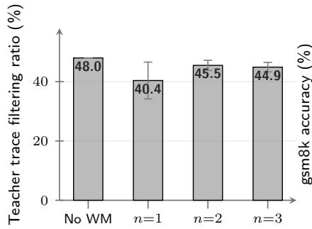

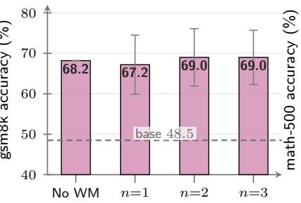

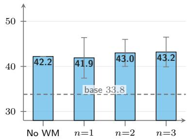  
Figure 5 Watermarking preserves the utility gained through distillation. DeepSeek-R1-Distill-Qwen-14B (Guo et al., 2025) is distilled into Qwen2.5-3B (Yang et al., 2024) using clean traces or TextSeal traces at three n-gram windows. The left panel reports the fraction of 5,000 traces passing the quality filter; the other panels report GSM8K and Math-500 accuracy. Watermarked bars average 100 keyed students with ±1 standarddeviation error bars, while No WM is one student trained on clean traces; dashed lines mark the un-distilled base.

## B.3 Prompt Pools and Suspect Sampling

Section 2.1 splits the audited domain into disjoint training, build and test pools. In the following, we explain how we split the prompts in our evaluation.

• The training pool $\chi _ { \mathrm { t r a i n } }$ is the adversary’s: OpenR1-Math-220k prompts sampled under the fixed math-teacher system prompt, yielding 5,000 traces, of which 40 to 48% pass the filter of App. B.2 (Fig. 5) and 1,900 become the distillation set.

• The build pool $\chi _ { \mathrm { b u i l d } }$ is the verifier’s ofline side and supplies the three artefacts WM-Basin is made of: the ≈450 clean teacher traces that warm the probe, the 512 keyed traces averaged into each of the 1,000 reference directions, and the free generations of the 43 clean checkpoints that fit the task subspace. The baseline’s n-gram corpus φ is a fourth ofline artefact, drawn by construction from held-out teacher traces the suspect is never read on.

• The test pool $\mathcal { X } _ { \mathrm { t e s t } }$ is 1,900 held-out prompts and is the only pool a verdict is ever read on. No prompt the adversary trained on is used to build either detector, and no prompt used to build either detector is used to score a suspect.

## B.4 Detector and Baseline Implementation

This section gives the implementation behind the detector and baseline of §3.1.

Reference key gradient bank and projection. For each candidate key, we generate teacher traces on the build pool $\chi _ { \mathrm { b u i l d } } ~ ( \mathrm { A p p . ~ B . 3 } )$ , discard responses below the minimum token length in Tab. 8, and average the surviving reference gradients into $\Delta _ { k }$ . A single fixed random projection, shared by all keys and applied unchanged to the suspect gradient $\Delta _ { \mathrm { s u s } }$ so that every cosine the rank test compares is taken in one coordinate space, approximately preserves their inner products (Johnson et al., 1984; Xia et al., 2024). We compute this with TRAK (Park et al., 2023). The deployed key and i.i.d. decoys form the bank used by the rank test in Eq. (4), and its size sets the reported p-value floor.

Compute cost. Nearly all of the cost is one-time and suspect-independent. Warming the probe is one short LoRA pass (App. C.6). Building the bank dominates: each projected direction averages

512 reference traces at about 27 minutes of single-GPU time, so around 450 GPU-hours for the ful 1,000-key bank, which occupies 31.2 MiB once projected. Both artefacts are reused by every subsequent audit and are rebuilt only when what they describe changes, namely the teacher or the probe for the bank, and the probe or the prompt distribution for the task subspace (App. B.5). Auditing one suspect then costs sampling its text, the ≈1M sampled tokens of App. B.3, a query cost identical for every detector, plus one backward pass and projection per completion; at the throughput above, the median 1,875-completion budget is roughly 1.6 GPU-hours on one device.

Sampled-token baselines. The baselines of Sander et al. (2024) score a single token per position. In the open-weight setting, teacher-forced reading evaluates the student’s top-1 prediction on teachergenerated test text. Their black-box variant scores tokens sampled by the student. We score a token only if its preceding n-gram appears in held-out teacher text generated with the key being tested. We exclude tokens whose preceding n-gram also appears in the prompt. Following Sander et al. (2024), both variants score distinct (context, token) pairs across traces. The open-weight variant additionally requires distinct contexts within each trace.

Seeing only text, the verifier re-tokenizes each suspect response with the teacher’s tokenizer and scores every position of that stream: the context n-gram $c _ { i }$ and the scored token $y _ { i }$ both come from the suspect’s own tokens, with no teacher forcing and no student logits. TextSeal’s secret is a key pair $\left( k _ { a } , k _ { b } \right)$ , and the generator draws its Gumbel noise from $k _ { a }$ with probability α and from $k _ { b }$ otherwise, so no token reveals which key drove it. We score both and weight them by that generation prior,

$$
S _ { i } \ = \ \alpha \big ( - \log ( 1 - r _ { i } ^ { ( a ) } ) \big ) \ + \ ( 1 - \alpha ) \big ( - \log ( 1 - r _ { i } ^ { ( b ) } ) \big ) , \qquad r _ { i } ^ { ( \cdot ) } \ = \ \mathrm { P R F } { \big ( } c _ { i } , y _ { i } ; k . \big ) ,\tag{5}
$$

at the deployed $\alpha { = } 0 . 1$ . Here $r _ { i }$ is the keyed pseudorandom value of the scored token: a watermarked teacher prefers tokens with large $r _ { i } ,$ so a radioactive student produces positions where $S _ { i }$ is larger than chance. Under $H _ { 0 }$ each $- \log ( 1 - r ) \sim \mathrm { E x p } ( 1 )$ and the two keys are independent, so $\mathbb { E } [ S _ { i } ] { = } 1$ but $\mathrm { V a r } [ S _ { i } ] { = } \sigma _ { \alpha } ^ { 2 } \equiv \alpha ^ { 2 } + ( 1 { - } \alpha ) ^ { 2 } { = } 0 . 8 2$ . Matching $\textstyle S = \sum _ { i = 1 } ^ { L } S _ { i }$ over the $L$ retained positions to a Gamma of mean L and variance $L \sigma _ { \alpha } ^ { 2 }$ (shape $L / \sigma _ { \alpha } ^ { 2 }$ , scale $\sigma _ { \alpha } ^ { 2 } )$ gives

$$
p ~ = ~ Q \biggl ( { \frac { L } { \sigma _ { \alpha } ^ { 2 } } } , { \frac { S } { \sigma _ { \alpha } ^ { 2 } } } \biggr ) , \qquad z ~ = ~ { \frac { S - L } { \sigma _ { \alpha } \sqrt { L } } } ,\tag{6}
$$

with $Q$ the upper regularized incomplete gamma function. The p-value is the probability that a clean model accumulates a total score of at least S over L positions, and z is the same evidence expressed in standard deviations above the null mean.

The three other watermark schemes in App. C.3 are read on the same principle: GumbelMax is the single-key case, where α=1 leaves $\sigma _ { \alpha } ^ { 2 } { = } 1$ , whereas KGW and SynthID score each position with a keyed-vocabulary indicator and a tournament g-value rather than a Gumbel variate.

## B.5 Removing Shared Task Directions

Section 2.3 projects the shared task subspace out of every gradient before scoring; this section gives how that subspace is fit and how many components we remove.

The idea of removing the shared task direction is aligned with removing the shared common vector for the word embeddings studied in Mu et al. (2017). Following their postprocessing, we fit PCA to gradients from the clean checkpoint pool and keep its top q principal directions as the shared task basis $U .$ , then project $\Delta _ { \mathrm { s u s } }$ and every $\Delta _ { k }$ onto the orthogonal complement of U before computing the cosine similarity score $S ( k )$ in stage (iii). The number of removed directions, q, is the one free parameter of this procedure.

What the clean pool is. Table 10 lists all models used for removing the task direction: 43 checkpoints are of-the-shelf, never-distilled causal LMs spanning 15 pretraining families and 135M to 120B parameters. None has been fine-tuned on the audited domain and none has ever been exposed to a watermark key. Every checkpoint contributes one cell per decoding temperature (0.7, 1.0, 1.3), giving the 129 cells of Tab. 8. A cell free-generates on the build pool $\chi _ { \mathrm { b u i l d } }$ , and its gradients are taken at the same probe model $\theta _ { \mathrm { p r o b e } } .$ so a clean cell and a suspect difer only in the text they produced. For fixedthreshold TPR evaluation, clean models are not evaluation models, so the PCA fit uses all 129 cells.

Table 10 The clean PCA pool. The 43 of-the-shelf checkpoints whose gradients fit the shared task subspace of App. B.5, grouped by pretraining lineage. Each model generates on 1,000 build-pool prompts at each of three decoding temperatures (0.7, 1.0, 1.3).
<table><tr><td>Family</td><td>Checkpoints</td><td>Ckpts.</td></tr><tr><td>Qwen</td><td>Qwen2.5-0.5B, -0.5B-Instruct, -1.5B, -1.5B-Instruct, -3B, -3B-Instruct, -7B-Instruct, -Math-7B; Qwen3-0.6B, -1.7B, -4B, -4B-Instruct, -8B, -8B-Base, -32B; QwQ-32B; Qwen1.5-MoE-A2.7B</td><td>17</td></tr><tr><td>Llama</td><td>Llama-2-7B, Llama-3.1-8B-Instruct, Llama-3.2-1B-Instruct, Llama-Guard-3-1B, Llama-Guard-3- 8B</td><td>5</td></tr><tr><td>DeepSeek</td><td>DeepSeek-R1-Distill-Qwen-1.5B, -7B, -14B†; DeepSeek-MoE-16B-Base</td><td>4</td></tr><tr><td>SmolLM2</td><td>SmolLM2-135M, -135M-Instruct, -1.7B</td><td>3</td></tr><tr><td>Gemma</td><td>Gemma-2-2B, Gemma-3-1B-PT</td><td>2</td></tr><tr><td>Phi</td><td>Phi-3.5-mini-Instruct, Phi-4</td><td>2</td></tr><tr><td>OLMo</td><td>OLMo-2-1B, OLMoE-1B-7B</td><td>2</td></tr><tr><td>Mistral</td><td>Mistral-7B-Instruct</td><td>1</td></tr><tr><td>Yi</td><td>Yi-1.5-9B-Chat</td><td>1</td></tr><tr><td>Falcon</td><td>Falcon3-7B-Instruct</td><td>1</td></tr><tr><td>Granite</td><td>Granite-3.1-8B-Instruct</td><td>1</td></tr><tr><td>StarCoder</td><td>StarCoder2-7B</td><td>1</td></tr><tr><td>Nemotron</td><td>Nemotron-Mini-4B</td><td>1</td></tr><tr><td>Moonlight</td><td>Moonlight-16B-A3B</td><td>1</td></tr><tr><td>gpt-oss</td><td>gpt-oss-120B</td><td>1</td></tr><tr><td colspan="3">15 families</td></tr></table>

The ROC curves and the per-key calibration curves use the balanced subset, i.e., 43 checkpoints at three temperatures split into disjoint fit and evaluation halves.

How many components to remove. We choose q on clean models alone, and we read the false-positive rate of each single deployed key. Figure 6 sweeps q from no PCA to q=100 and reads three keys of the 1,000-key bank against TPR: the typical key, the key at the 95th percentile of the per-key rate in terms of FPR, and the worst key which has the highest FPR. Without the projection those three disagree completely, the typical key firing on no clean cell at all while the 95th-percentile key fires on 38 to 44% of them. Removing q=100 directions closes that spread onto the nominal line and lifts TPR at α=5% from 70.2 to 91.7 at n-gram=1. A small q does neither, because the leading directions carry watermark signal as well as shared task structure: the projection pays for itself only from q≈10, after which power climbs monotonically. We deploy q=100, and App. B.6 reports the per-key calibration that remains at that setting.

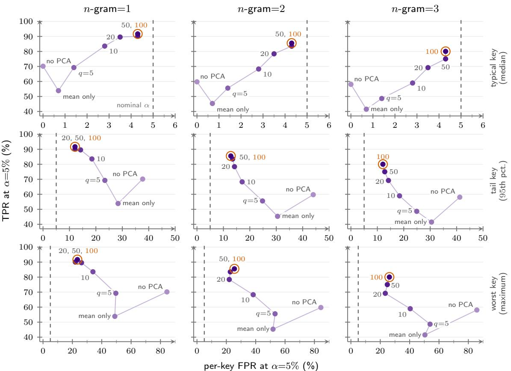  
Figure 6 Choosing q: detection power against three order statistics of the key bank. The projection sweeps from no PCA through mean only (subtract the pool mean, remove no subspace) to q=100 removed components; the path visits the seven settings in that order and marker shade runs light to dark with q. Columns are the n-gram window. Rows are which key of the 1,000-key bank the false-positive rate is read of: the typical key, the 95th-percentile tail key and the worst key. y: TPR at $\alpha { = } 5 \%$ over the 1,200 distilled students. x: the percentage of the 129 clean model-temperature cells on which that key fires at the same threshold.

## B.6 Calibration of the Rank p-Value

By the exchangeability argument of App. A, thresholding at p≤α should falsely accuse an α fraction of models that were not distilled from the protected teacher, which is what §3.1 relies on when it reads operating points of the nominal p-value. We test it on 100 deployed keys and 65 clean modeltemperature cells held out from the 64 used to fit the task subspace (App. B.5), ranking each key among the full 1,000-key bank. Figure 7 plots the empirical rate against α for each deployed key, for WM-Basin (Fig. 7a) and for the black-box baseline (Fig. 7b).

The per-key false-positive distribution. Table 11 reports the empirical false-positive rate at $\alpha { = } 5 \%$ over the 1,000 keys of the bank, each read across the 129 clean model-temperature cells, after the tasksubspace projection and under the same 4-fold cross-fitting by base model as App. B.5. The typical key is calibrated and the tail is not, which is the distinction the mean over the bank hides: the median key sits at 4.3% against a nominal 5% in all three windows and the 90th percentile at 9.9%, while the worst key reaches 23.4 to 26.2%. That tail is bounded by the size of the pool: the floor column is the level a perfectly exchangeable bank of this size reaches on its own (App. B.5), and against it the worst observed key is high by the worst / floor factor, where the unprojected scores are high by ≈6.

Table 11 Per-key false-positive rate at $\alpha { = } 5 \% ,$ , after removing the task subspace. Each of the 1,000 bank keys is read over the 129 clean model-temperature cells, with 4-fold projectors cross-fitted by base model so no cell is scored by a subspace fit on its own model. All values are percentages except the last column. Floor is the 95th percentile of the maximum under exact uniformity at $K { = } 1 { , } 0 0 0$ over 129 cells: the level a perfectly exchangeable bank of this size would still reach, and the reference the worst key should be judged against.
<table><tr><td>n-gram</td><td>median</td><td>p90</td><td>p95</td><td>worst</td><td>floor</td><td>worst / floor</td></tr><tr><td>1</td><td>4.3</td><td>9.9</td><td>12.1</td><td>23.4</td><td>13.5</td><td>1.74</td></tr><tr><td>2</td><td>4.3</td><td>9.9</td><td>12.8</td><td>25.5</td><td>13.5</td><td>1.89</td></tr><tr><td>3</td><td>4.3</td><td>9.9</td><td>12.1</td><td>26.2</td><td>13.5</td><td>1.95</td></tr></table>

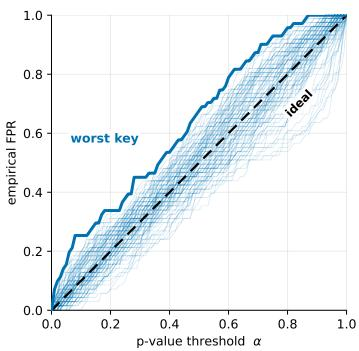  
(a) WM-Basin (ours)

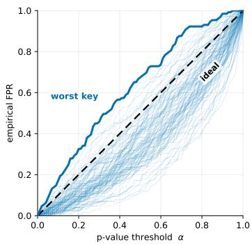  
(b) Black-box baseline  
Figure 7 Nominal p-value thresholds match empirical false-positive rates. Each faint curve is one of the 100 deployed keys, reporting its empirical FPR over the 65 held-out clean model-temperature cells at n-gram=3 as the threshold α varies; the solid curve is the worst key and the dashed line is the calibrated target $\mathrm { F P R } { = } \alpha$

## C Additional Detection Results

This section follows the sweep order of §3.2, adding the operating points and factors the main tables leave out, together with two studies the main text states only in passing: the suspect-text budget behind the fragility claim of §1, and the choice of probe model, together with the warm-up it is given, named in the detector setup of §3.1. The configuration of $\mathrm { A p p }$ . B is the reference point throughout, and each row of Tab. 9 names what it varies.

## C.1 Operating Points

Figure 8 sweeps the detection threshold continuously over the same T=1.0 distillation arm that Tab. 2 reads at three fixed thresholds, on an empirical false-positive axis rather than that table’s nominal p-values. Both detectors are scored on one shared set of students and innocent cells here, all 100 keys rather than the per-window cohorts the tables report, so the comparison to make is between the two curves rather than between a curve and a cell of Tab. 2: WM-Basin sits at or above the black-box baseline throughout the plotted range at every window, and strictly above it everywhere below the false-positive rate at which both saturate. The baseline’s curve is the read that preceded the token matching both tables now use; that matching lifts eight of the nine black-box cells of Tab. 2 at 5% FPR, by up to 18 points, so the separation plotted here is wider than the matched one.

## C.2 Cross-Teacher Detection

Section 3.2 reports cross-teacher detection in Tab. 3, whose three thresholds are empirical false-positive rates. The sampled-token baseline can only accumulate evidence at positions whose context window recurs, and student diversity orders it: gpt-oss students repeat only 65.3% of their 2-word contexts and the baseline reaches 18% there, against 92.1% and 93% on the most repetitive Llama students. Neither tokenizer sharing, trace length nor utility separates the teachers the same way (Tab. 12), and gpt-oss gives the second-largest GSM8K gain alongside the weakest sampled-token result. WM-Basin aggregates the watermark’s gradient direction over all positions instead, and stays at 96 to 100% in

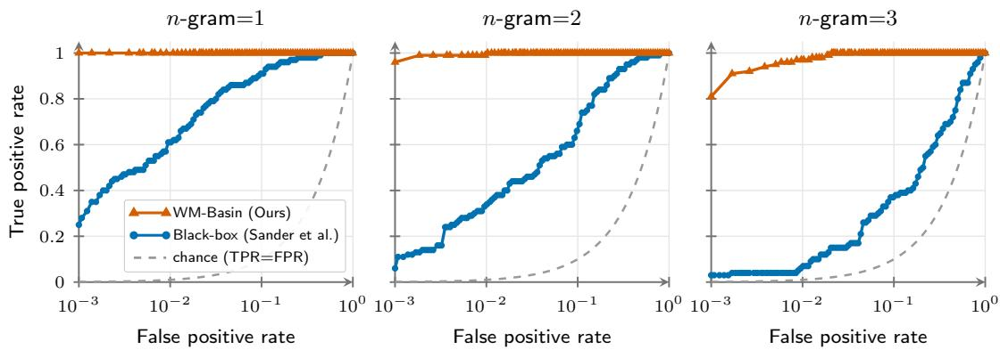  
Figure 8 Detection performance of the two closed-model detectors across all operating points. ROC (log x, linear y), one panel per n-gram window, matched on the 100 distillation keys 1001 to 1100. TPR is over the 100 watermarked students (one per key, scored with its own key); FPR is over the same 100 keys × the 65 held-out innocent model-temperature cells (the evaluation half of the 129-cell clean pool: 43 of-the-shelf base models × 3 sampling temperatures; 6,500 null cases). Sweeping the threshold α traces each curve; WM-Basin (ours) is drawn in vermilion and Black-box (baseline) in blue. The grey dashed line marks chance (TPR=FPR).

the 5% column on every teacher.

Table 12 Teacher properties, student utility and detection, for the three swapped-in teachers. DS tok is the DeepSeek-R1-Distill tokenizer. Accuracy is mean ± standard deviation over 100 keyed Qwen2.5-3B students, and ∆ is against the un-distilled base (GSM8K 48.5%, Math-500 33.8%). The two detection rows are the FPR=5% column of Tab. 3.
<table><tr><td></td><td>gpt-oss-120B</td><td>QwQ-32B</td><td>Llama-3.1-8B</td></tr><tr><td>Teacher Family / tokenizer Median trace chars</td><td>MoE / 200k native 10,552</td><td>Qwen2.5 / DS tok Llama / native 23,095</td><td>2,969</td></tr><tr><td>Student utility</td><td></td><td></td><td></td></tr><tr><td>GSM8K (%)</td><td>77.2 ± 1.7</td><td>80.8 ± 2.7</td><td>74.9 ± 1.2</td></tr><tr><td>∆ GSM8K</td><td>+28.7</td><td>+32.3</td><td>+26.4</td></tr><tr><td>Math-500 (%)</td><td>47.9 ± 1.5</td><td>52.1 ± 1.5</td><td>36.5 ± 1.5</td></tr><tr><td>∆ Math-500</td><td>+14.1</td><td>+18.3</td><td>+2.7</td></tr><tr><td></td><td></td><td></td><td></td></tr><tr><td>Detection, TPR at the 5% threshold</td><td></td><td></td><td></td></tr><tr><td>WM-Basin</td><td>96</td><td>99</td><td>100</td></tr><tr><td>Black-box</td><td>18</td><td>88</td><td>93</td></tr></table>

## C.3 Watermark Scheme

Table 4 replaces the teacher’s TextSeal decoder with three other watermarking schemes. TextSeal, the dual-key scheme used everywhere else in the paper (Sander et al., 2026), draws each token’s Gumbel noise from one of two keys with probability α=0.1; GumbelMax (Aaronson, 2022) is the single-key Gumbel scheme; and SynthID (Dathathri et al., 2024) resolves each position through a tournament of depth 10 between keyed g-values. KGW (Kirchenbauer et al., 2023) instead adds a fixed logit bias δ=2.0 to a keyed half of the vocabulary (γ=0.5) at every position, the one scheme here that modifies the teacher’s logits rather than the sampling rule. Each is generated at n-gram=1, 2 and 3 and distilled into 50 students, with all detectors reading the same ≈1M-token budget, the reference bank rebuilt per scheme and window, and everything else at the defaults of Tab. 8.

Does WM-Basin’s margin hold when the baseline is read in its strongest form? The black-box statistic can weight each scored token by the teacher’s entropy at that position, concentrating the test on the high-entropy positions where the watermark is able to bias the sample at all, as in (Sander et al., 2026); Tab. 13 gives the baseline that weighted read as a second row per scheme, beside the plain statistic reported in Tab. 4. The weighting is worth 8 to 30 points to the baseline at p≤0.05 across all twelve scheme and window cells, yet WM-Basin still leads at every level in every cell where that leve is defined. Its margin in the main body is therefore not an artefact of reading the baseline in its plain form.

Table 13 Distillation detection across watermarking schemes, with the baseline’s entropy-weighted statistic. The full form of Tab. 4: TextSeal, the teacher’s default scheme, joins the three swapped-in ones, and each watermark occupies two rows, the black-box baseline (Sander et al., 2024) reading the suspect text with its plain statistic on the first and with its entropy-weighted statistic on the second. The weighting belongs to that statistic, so one WM-Basin run serves both rows and its cells span the pair. Cells are read as in Tab. 4, and the dash marks a level the 991-key TextSeal bank at n-gram=1 cannot resolve.
<table><tr><td rowspan=1 colspan=16>n-gram=1                 n-gram=2                n-gram=3Watermark               WM-Basin   Black-box   WM-Basin   Black-box   WM-Basin  Black-boxTPR@FPR   TPR@FPR   TPR@FPR   TPR@FPR   TPR@FPR  TPR@FPR5%1%.1%5%1%.1% 5%1%.1%5%1%.1% 5%1%.1%5%1%.1%</td></tr><tr><td rowspan=9 colspan=1>TextSealTextSeal with entropyGumbelMaxGumbelMax with entropyKGWKGW with entropySynthIDSynthID with entropy</td><td rowspan=2 colspan=1>100 100</td><td rowspan=1 colspan=1>76</td><td rowspan=1 colspan=1>44</td><td rowspan=1 colspan=1>28</td><td rowspan=2 colspan=1>100 100</td><td rowspan=1 colspan=1>98</td><td rowspan=1 colspan=1>52</td><td rowspan=1 colspan=1>30</td><td rowspan=1 colspan=1>6</td><td rowspan=1 colspan=2>10098</td><td rowspan=1 colspan=1>84</td><td rowspan=1 colspan=1>22</td><td rowspan=1 colspan=1>8</td><td rowspan=1 colspan=1>2</td></tr><tr><td rowspan=1 colspan=1>96</td><td rowspan=1 colspan=1>88</td><td rowspan=1 colspan=1>60</td><td rowspan=1 colspan=1></td><td rowspan=1 colspan=1>74</td><td rowspan=1 colspan=1>54</td><td rowspan=1 colspan=1>40</td><td rowspan=1 colspan=2></td><td rowspan=1 colspan=1></td><td rowspan=1 colspan=1>46</td><td rowspan=1 colspan=1>24</td><td rowspan=1 colspan=1>2</td></tr><tr><td rowspan=3 colspan=1>100100 100</td><td rowspan=2 colspan=1>72</td><td rowspan=2 colspan=1>44</td><td rowspan=2 colspan=1>28</td><td rowspan=3 colspan=2>10098 98</td><td rowspan=2 colspan=1>52</td><td rowspan=2 colspan=1>32</td><td rowspan=2 colspan=1>6</td><td rowspan=3 colspan=2>100100</td><td rowspan=3 colspan=1>100</td><td rowspan=2 colspan=1>22</td><td rowspan=2 colspan=1>10</td><td></td></tr><tr><td rowspan=1 colspan=1>0</td></tr><tr><td rowspan=1 colspan=1>96</td><td rowspan=1 colspan=1>88</td><td rowspan=1 colspan=1>62</td><td rowspan=1 colspan=1>80</td><td rowspan=1 colspan=1>54</td><td rowspan=1 colspan=1>28</td><td rowspan=1 colspan=1>46</td><td rowspan=1 colspan=1>18</td><td rowspan=1 colspan=1>6</td></tr><tr><td rowspan=2 colspan=1>100100100</td><td rowspan=1 colspan=1>58</td><td rowspan=1 colspan=1>26</td><td rowspan=1 colspan=1>8</td><td rowspan=2 colspan=1>94 86</td><td rowspan=2 colspan=1>56</td><td rowspan=1 colspan=1>40</td><td rowspan=1 colspan=1>20</td><td rowspan=1 colspan=1>4</td><td rowspan=1 colspan=1>90</td><td rowspan=1 colspan=1>68</td><td rowspan=1 colspan=1>34</td><td rowspan=1 colspan=1>16</td><td rowspan=1 colspan=1>2</td><td rowspan=1 colspan=1>2</td></tr><tr><td rowspan=1 colspan=1>66</td><td rowspan=1 colspan=1>46</td><td rowspan=1 colspan=1>28</td><td rowspan=1 colspan=1>54</td><td rowspan=1 colspan=1>32</td><td rowspan=1 colspan=1>8</td><td rowspan=1 colspan=1></td><td rowspan=1 colspan=1></td><td rowspan=1 colspan=1></td><td rowspan=1 colspan=1>38</td><td rowspan=1 colspan=1>10</td><td rowspan=1 colspan=1>0</td></tr><tr><td rowspan=2 colspan=1>100 100 100</td><td rowspan=1 colspan=1>64</td><td rowspan=1 colspan=1>38</td><td rowspan=1 colspan=1>8</td><td rowspan=2 colspan=2>100 10098</td><td rowspan=1 colspan=1>44</td><td rowspan=1 colspan=1>16</td><td rowspan=1 colspan=1>0</td><td rowspan=2 colspan=2>10096</td><td rowspan=2 colspan=1>78</td><td rowspan=1 colspan=1>24</td><td rowspan=1 colspan=1>8</td><td rowspan=1 colspan=1>4</td></tr><tr><td rowspan=1 colspan=1>94</td><td rowspan=1 colspan=1>68</td><td rowspan=1 colspan=1>38</td><td rowspan=1 colspan=1>66</td><td rowspan=1 colspan=1>38</td><td rowspan=1 colspan=1>12</td><td rowspan=1 colspan=1>42</td><td rowspan=1 colspan=1>22</td><td rowspan=1 colspan=1>6</td></tr></table>

## C.4 Audited Domain and System Prompt

The audited-domain sweep of §3.2 reads Tab. 5; this section gives the per-domain rebuild and the exact prompts behind it. Every row only uses the prompt from the audit domain: the probe warm-up corpus, the PCA task subspace removal, the decoy bank, and the black-box baseline’s per-key corpus filter are all built from that row’s own questions and system prompt, never the teacher’s math-teacher prompt, so neither detector inherits an advantage from the distillation domain.

Each suspect is ranked against its own key plus the 999 decoys of that row’s bank, and 100 students are scored in every cell. All five rows read that row’s own held-out test pool, the three math-dataset rows under the shared math\_neutral system prompt and the other two under their own, so wording is constant inside the top block and the dataset alone separates those rows. On OpenR1-Math, the distilled dataset itself with held-out questions read under a prompt no suspect trained under, WM-Basin reaches 95%/83%/45% when context window is 1/2/3, so a new system prompt does not by itself cost the verifier its read.

Training domain (math): what the students actually learned on

You are a math teacher. You will be given a math problem and you will solve it step by step. You will output your final solution like \boxed{ANSWER}. Be sure to include relevant units within the brackets and fully evaluate arithmetic expressions.

math\_neutral (OOD, closest to training)

You are a helpful assistant. Solve the following problem step by step, then give the final answer.

code (OOD)

You are an expert programmer. Read the problem and write a complete, correct Python solution. Think step by step, then provide the final code.

chat (OOD, farthest from training)

## C.5 Suspect-Text Budget

How much suspect text does a verdict need, and does reading more always help? Section 3.1 fixes the default budget the in-domain tables are read at. We read the same fixed pool of 100 students, at cumulative prefixes of their generations, from 5 to 1,878 generations (0.03 to 10.3M tokens supplied), holding the probe, bank, task subspace and threshold fixed, and score both detectors on every prefix at 1% FPR (Fig. 9). WM-Basin accumulates evidence monotonically at every window, so more text never costs the verifier anything and no stopping rule is needed: it reaches 100% TPR by 0.6M tokens at n-gram 1 and 2, and at n-gram=3 it is within 8 points of its ceiling by that budget and spends the twenty times more text that follows gaining the rest. The baseline is not monotone in the budget at all: it peaks within the first ≈0.5M tokens and decays afterwards, because its scored-token denominator keeps growing while deduplication caps the signal it can collect.

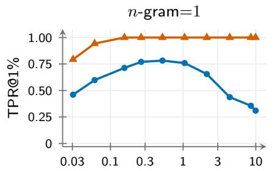  
Suspect text read (million tokens)

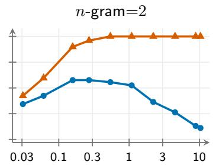  
Suspect text read (million tokens)

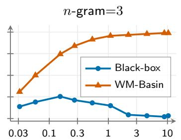  
Suspect text read (million tokens)  
Figure 9 Impact of suspect text budget on detection performance. We plot True Positive Rate at 1% FPR (TPR@1%; share of distilled models detected at rank-p≤0.01, one model per key) against the amount of suspect text evaluated (log x scale, million tokens). Both WM-Basin (ours) and Black-box (Sander et al., 2024) are evaluated on identical generations at the same 1% FPR operating point.

## C.6 Probe Model and Warm-Up

The probe model turns text into a gradient signal. In this section, we study the impact of the probe model on the performance of WM-Basin.

Choice of probe model. Does the verifier need a probe model from the suspect’s own family? Table 14 varies only the probe $\theta _ { \mathrm { p r o b e } }$ that §3.1 holds at a clean Qwen2.5-3B base, across ten checkpoints from 0.5B to 8B spanning four Qwen2.5 scales or post-training states, three Llama-3 checkpoints, and two families whose tokenizers sit farthest from the student’s 152k vocabulary. Every probe receives the same warm-up, and because each defines a diferent gradient coordinate space its reference bank is rebuilt with the default recipe; the suspect cohort, clean PCA pool and three n-gram windows stay fixed. Family costs the detector nothing: every probe recovers all suspects at n-gram=1, and at ngram=3 and 0.1% FPR the three Llama-3 probes land inside or just under the band the Qwen probes span, despite sharing no tokenizer with the student. The loss instead tracks how far the probe’s vocabulary sits from the student’s, the smallest vocabulary losing most while still staying an order of magnitude above the baseline in the same cell, and falling further behind the Qwen probes as the threshold tightens at n-gram=2 and 3. The verifier can therefore audit with whatever checkpoint it holds, preferring a nearby vocabulary.

Impact of warm-up. The probe warm-up of §3.1 is one short LoRA pass on clean teacher traces, run before any key gradient is taken; Tab. 15 sweeps it one knob at a time from the default, in a single scoring pass per arm. We report n-gram=3 because it is the only window that separates the arms: at n-gram=1 every probe in Tab. 14 already reads 100 at all three levels.

Removing the warm-up costs most of the detector’s power at 0.1% FPR: an untrained, randomly initialised adapter keeps about a third of the default’s TPR there, and the bare base model almost none. Gradients are taken with respect to the adapter parameters $\theta _ { \mathrm { p r o b e } }$ (§2.3), so a random adapter still defines a usable coordinate space and retains real signal at 5% FPR, whereas the bare model has no adapter to diferentiate against. The warm-up therefore sharpens a signal the probe already carries rather than creating one.

Warming on prompts from diferent domains and datasets, i.e., chat, MMLU, GSM8K or MATH instead of the audited OpenR1-Math distribution costs 11 to 21 points at 0.1% FPR and at most one key at 5%. Code is the single exception (37%), and it is the warm-up corpus farthest from the reasoning traces the reference bank is built from. This is a separate question from where the verifier draws its detection prompts, which do have to come from the audited domain or a similar one (§3.2).

Table 14 Effect of the probe model on detection. The same 100 distilled suspects are held fixed while the verifier changes the probe model and rebuilds the reference bank. Probes vary in scale, post-training, family, and tokenizer; the Black-box baseline (Sander et al., 2024) uses no probe and is token-matched, reading exactly the same suspect text as WM-Basin. Each cell reports True Positive Rate (TPR, %) at FPR (5%, 1%, 0.1%), over the suspects whose generations both detectors can score, 87/95/90 of the 100 keys at n-gram 1/2/3. At n-gram=3 and 0.1% FPR the five Qwen2.5 probes span 69 to 89 and the three Llama-3 probes 67 to $^ { 7 2 ; }$ vocabulary size is given beside each cross-family row.
<table><tr><td rowspan="2">Probe model  $\theta _ { \mathrm { p r o b e } }$ </td><td colspan="2">n-gram=1</td><td colspan="2">n-gram=2</td><td colspan="2">n-gram=3</td></tr><tr><td colspan="2">TPR@FPR 1% .1%</td><td colspan="2">TPR@FPR</td><td colspan="2">TPR@FPR</td></tr><tr><td>Black-box baseline (no  $\theta _ { \mathrm { p r o b e } } )$ </td><td colspan="2">5% 72 34</td><td colspan="2">5% 1% .1%</td><td colspan="2">5% 1% .1%</td></tr><tr><td>Qwen2.5-3B-Base (default)</td><td>100 100</td><td>11 44 100 100 100</td><td>28 9 98</td><td>26 100</td><td>13 99</td><td>3 89</td></tr><tr><td>Qwen2.5-1.5B-Base</td><td>100 100</td><td>100 100</td><td>100 99</td><td>97</td><td>90</td><td>72</td></tr><tr><td>Qwen2.5-0.5B-Base</td><td>100 100</td><td>100 100</td><td>99 97</td><td>99</td><td>96</td><td>81</td></tr><tr><td>Qwen2.5-3B-Instruct</td><td>100 100 100</td><td>100</td><td>100 98</td><td>100</td><td>99</td><td>84</td></tr><tr><td>Qwen2.5-7B-Instruct</td><td>100 100 100</td><td>100</td><td>100 96</td><td>96</td><td>87</td><td>69</td></tr><tr><td>Llama-3.1-8B-Instruct (128k vocab)</td><td>100 100</td><td>100 100</td><td>100 92</td><td>100</td><td>92</td><td>67</td></tr><tr><td>Llama-Guard-3-8B (128k vocab)</td><td>100 100</td><td>100 100</td><td>)100 94</td><td>97</td><td>91</td><td>69</td></tr><tr><td>Llama-3.2-1B-Instruct (128k vocab)</td><td>100 100 100</td><td>100</td><td>100 93</td><td>99</td><td>88</td><td>72</td></tr><tr><td>Gemma-2-2B-Base (256k vocab)</td><td>100 100 100</td><td>100</td><td>99 91</td><td>91</td><td>74</td><td>57</td></tr><tr><td>SmolLM2-1.7B-Base (49k vocab)</td><td>100 100 100</td><td>100</td><td>97 71</td><td>90</td><td>68</td><td>34</td></tr><tr><td></td><td></td><td></td><td></td><td></td><td></td><td></td></tr></table>

Table 15 The probe warm-up is necessary, but almost none of its details are. All rows are WM-Basin at n-gram=3 on the same 90 watermark keys, the same suspects, and the same suspect-text budget; only the probe warm-up changes, one knob at a time from the default. Cells are TPR (%) at 5%, 1%, and 0.1% FPR, scored on the task-neutral residual gradients of §2.3. Defaults in Tab. 8.
<table><tr><td rowspan="2">Probe warm-up</td><td colspan="3">WM-Basin</td><td rowspan="2">Probe warm-up</td><td colspan="3">WM-Basin</td></tr><tr><td></td><td></td><td>5% 1% .1%</td><td></td><td>5% 1% .1%</td><td></td></tr><tr><td>(a) Warm-up presence</td><td></td><td></td><td></td><td>(c) Adapter rank</td><td></td><td></td><td></td></tr><tr><td>Trained warm-up (default)</td><td>100 99</td><td></td><td>89</td><td>Rank 32</td><td>100 100</td><td></td><td>89</td></tr><tr><td>Untrained random adapter</td><td>82</td><td>59</td><td>33</td><td>Rank 128 (default)</td><td>100 99</td><td></td><td>89</td></tr><tr><td>No adapter (bare base model)</td><td>30</td><td>21</td><td>6</td><td>Rank 512</td><td></td><td>100 100</td><td>86</td></tr><tr><td>(b) Warm-up corpus</td><td></td><td></td><td></td><td>(d) Learning rate</td><td></td><td></td><td></td></tr><tr><td>OpenR1-Math (default)</td><td>100</td><td> 99</td><td>89</td><td>5e-5</td><td>100</td><td>98</td><td>90</td></tr><tr><td>MATH</td><td>100</td><td>97</td><td>76</td><td>2e-4 (default)</td><td>100</td><td>99</td><td>89</td></tr><tr><td>GSM8K</td><td>99</td><td>96</td><td>68</td><td>5e-4</td><td>100 100</td><td></td><td>93</td></tr><tr><td>MMLU</td><td>99</td><td>97</td><td>69</td><td>1e-3 (diverged)</td><td>7</td><td>2</td><td>0</td></tr><tr><td>Chat</td><td>99</td><td>94</td><td>78</td><td>(e) Warm-up epochs</td><td></td><td></td><td></td></tr><tr><td>Code</td><td>88</td><td>73</td><td>37</td><td>1 epoch</td><td>100</td><td>99</td><td>92</td></tr><tr><td></td><td></td><td></td><td></td><td>4 epochs (default)</td><td>100</td><td>99</td><td>89</td></tr><tr><td></td><td></td><td></td><td></td><td>8 epochs</td><td>100 97</td><td></td><td>81</td></tr></table>

Adapter rank and learning rate each move TPR at 0.1% FPR by at most 4 points, and epoch count by 11; none of the three moves the 5% column at all. Only divergence is fatal: at learning rate 1e−3 the warm-up run diverges and detection collapses at every level, a training failure the verifier can see without running the detector at all. The cheapest arms we ran are among the best at every level, so the setting to deploy is whatever converges: rank 32 matches the default at 0.1% FPR and beats it at 1%, and one epoch beats it at 0.1%. We did not run the two together, so rank 32 at one epoch is an inference from two single-knob arms rather than a measured configuration.

## D Additional Robustness Results

This section gives the protocols and weight-space analyses behind §3.3, followed by a robustness analysis against a paraphrasing attack that rewrites the teacher’s traces before distillation. Each modifies the

Table 16 Compression moves almost entirely orthogonally to the watermark direction. Across 100 students per window, Acc. is mean GSM8K (%) and Usable? denotes $\mathrm { A c c . } { \geq } 0 . 9 { \times } 7 0 . 7 { = } 6 3 . 6$ . We decompose $\Delta _ { \mathrm { p o s t } } { = } \pmb { \theta } _ { \mathrm { p o s t } } { - } \pmb { \theta } _ { \mathrm { w m } }$ into its signed projection along the watermark key direction $\hat { \Delta } _ { \mathrm { w m } }$ (Eq. (1)) and the orthogonal $L _ { 2 }$ remainder. The remainder is a property of the compressed weights alone and is identical at the three windows; the usability verdict is read of each window’s own Acc. and comes out the same in every row. Both are therefore printed once. The along component is at least three orders of magnitude smaller and increases in magnitude within the ordered pruning sweep.
<table><tr><td></td><td></td><td></td><td colspan="2">n-gram=1</td><td colspan="2">n-gram=2</td><td colspan="2">n-gram=3</td></tr><tr><td>Cond.</td><td>Orthogonal</td><td>Usable?</td><td>Acc.</td><td>Along w</td><td>Acc.</td><td>Along w</td><td>Acc.</td><td>Along w</td></tr><tr><td>none</td><td>0</td><td>√</td><td>70.7</td><td>0</td><td>70.7</td><td>0</td><td>70.7</td><td>0</td></tr><tr><td>int8</td><td>14.09</td><td>√</td><td>72.2</td><td>-0.0001</td><td>71.0</td><td>-0.0002</td><td>70.0</td><td>-0.0001</td></tr><tr><td>int4</td><td>152.07</td><td>x</td><td>50.4</td><td>-0.0113</td><td>50.8</td><td>-0.0112</td><td>45.4</td><td>-0.0117</td></tr><tr><td>nf4</td><td>125.91</td><td>x</td><td>55.8</td><td>-0.0291</td><td>42.9</td><td>-0.0281</td><td>41.2</td><td>-0.0266</td></tr><tr><td>prune10</td><td>27.23</td><td>√</td><td>77.1</td><td>-0.0063</td><td>76.2</td><td>-0.0061</td><td>77.3</td><td>-0.0058</td></tr><tr><td>prune20</td><td>77.74</td><td>x</td><td>59.5</td><td>-0.0390</td><td>61.2</td><td>-0.0368</td><td>57.6</td><td>-0.0348</td></tr><tr><td>prune30</td><td>144.85</td><td>x</td><td>37.8</td><td>-0.1022</td><td>39.6</td><td>-0.0945</td><td>28.9</td><td>-0.0887</td></tr></table>

student or the traces it was distilled on and re-reads it with the same probe and reference bank, at the defaults of $\mathrm { A p p }$ . B unless this section or a caption records otherwise.

## D.1 Compression

This section gives the protocol behind Tab. 6 and the weight-space displacement of every operation. We apply per-output-channel symmetric int8, uniform group-64 int4, nf4, or 10 to 30% unstructured magnitude pruning to 100 keyed students at each n-gram window, regenerating detector inputs after each operation. Quantized weights are dequantized to fp16 for evaluation, and pruning excludes lm\_- head and embed\_tokens. A model counts as usable when its mean GSM8K accuracy is at least 0.9× the distilled baseline, which int8 and prune10 clear and int4, nf4, prune20 and prune30 do not. The none row of Tab. 6 is the uncompressed reference rather than a compression condition, so its blackbox cells were never re-read under the token matching the six operation rows use; that row therefore supports no black-box comparison, either with its own WM-Basin cells or down the column.

Compression costs the watermark only where it costs the model. Int8 and prune10 retain both utility and strong WM-Basin detection, and the larger detection losses occur only beyond the usability gate, with nf4 and prune20 the two operations where the gradient signal outlasts utility (Fig. 10 at n-gram=3; Tabs. 6 and 16 at all three windows). The weight-space displacement is ordered the same way: the along component of every compression operation stays below 0.11 against orthogonal movement of 14 to 152, and grows with the pruning fraction. Therefore, compression does not move the model outside the watermark basin, and detection remains efective.

## D.2 Continued Fine-Tuning and RL

This section gives the training recipes behind Tab. 7 and the weight-space displacement of every arm. We continue training the keyed Qwen2.5-3B students of each n-gram window on clean data. We then regenerate suspect text and re-measure detection, utility and geometry. Continued SFT uses one of two clean corpora. The reason corpus is 1,900 traces, 950 code and 950 science, from open-r1/Mixtureof-Thoughts (Hugging Face, 2025). The multilingual corpus is 1,206 traces on math questions in eight languages (Chen et al., 2024). Both pass the think-closure and repetition filters of $\mathrm { A p p }$ . B.2.

SFT keeps the distillation adapter shape. It runs 2 epochs at global batch 16 and maximum sequence length 8192, on a cosine learning rate of $2 \times 1 0 ^ { - 5 }$ with 0.05 warmup. Continued RL uses GRPO (Shao et al., 2024). The in-domain arm optimises gsm8k with a verifiable correctness reward. The two cross-domain arms use learning rate $5 \times 1 0 ^ { - 6 }$ on rule-verified K&K logic puzzles (Xie et al., 2025) or on RLVR-IFeval instruction following (Lambert et al., 2024). Both cross-domain rewards are all-or nothing: K&K requires every inhabitant to be labeled correctly in the final boxed answer, and IFEval requires the requested constraint to hold. We measure task accuracy greedily on 400 held-out puzzles

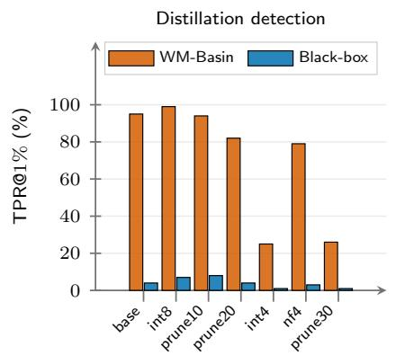

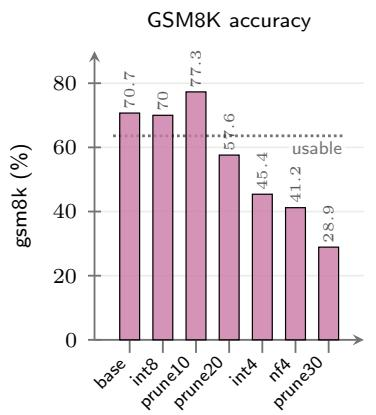

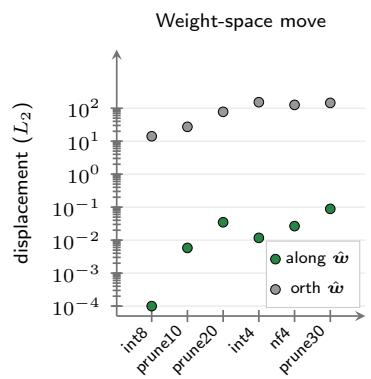  
Figure 10 Robustness to post-processing. TextSeal, n-gram=3, 100 keyed students under int8, int4 and nf4 quantization and 10/20/30% pruning; base is uncompressed. (a) TPR at 1% FPR for WM-Basin and Black-box; (b) gsm8k accuracy, dotted line is the 0.9× usable gate; (c) weight-space move along the watermark direction vs orthogonal residual. Details in Tab. 16.

Table 17 GRPO preserves utility with far smaller weight movement than SFT. Every row is paired against its own cohort’s pre-attack students, whose accuracy is printed as base: the cohorts difer in size (n) and do not share a baseline, so ∆ is the mean per-key change and not the diference of the two pooled columns beside it. GSM8K and Math-500 are percentages and ∆ is in points. Move (total) is $\| \Delta _ { \mathrm { p o s t } } \| _ { 2 } ,$ Along w is its signed projection on the key direction $\hat { \Delta } _ { \mathrm { w m } } .$ , and Along/total is the absolute percentage share. GRPO projections are under 0.0005 in magnitude and print as 0.000. The SFT rows share the full 100-key pool as their base; the GRPO rows are smaller cohorts carrying their own, which run from 0.6 points above it to 2.8 below, which is why Tab. 7 reports accuracy as a paired change rather than an absolute.
<table><tr><td colspan="3"></td><td colspan="3">GSM8K</td><td colspan="3">Math-500</td><td colspan="3">Move</td></tr><tr><td>Cond.</td><td>n-gram</td><td>n</td><td>base</td><td>post</td><td>∆</td><td>base</td><td>post</td><td>∆</td><td>total</td><td>along w</td><td>along/total</td></tr><tr><td>reason</td><td>1</td><td>100</td><td>67.2</td><td>72.0</td><td>+4.77</td><td>41.9</td><td>40.8</td><td>-1.11</td><td>4.80</td><td>-0.252</td><td>5.3%</td></tr><tr><td>reason</td><td>2</td><td>100</td><td>69.0</td><td>70.0</td><td>+0.96</td><td>43.0</td><td>39.4</td><td>-3.60</td><td>4.70</td><td>-0.182</td><td>3.9%</td></tr><tr><td>reason</td><td>3</td><td>100</td><td>69.0</td><td>71.3</td><td>+2.37</td><td>43.2</td><td>40.6</td><td>-2.62</td><td>4.66</td><td>-0.146</td><td>3.1%</td></tr><tr><td>multilingual</td><td>1</td><td>100</td><td>67.2</td><td>74.2</td><td>+6.98</td><td>41.9</td><td>46.9</td><td>+4.99</td><td>2.72</td><td>-0.013</td><td>0.5%</td></tr><tr><td>multilingual</td><td>2</td><td>100</td><td>69.0</td><td>73.6</td><td>+4.59</td><td>43.0</td><td>46.7</td><td>+3.68</td><td>2.71</td><td>-0.009</td><td>0.3%</td></tr><tr><td>multilingual</td><td>3</td><td>100</td><td>69.0</td><td>75.0</td><td>+6.03</td><td>43.2</td><td>47.5</td><td>+4.29</td><td>2.70</td><td>-0.007</td><td>0.3%</td></tr><tr><td>rl (gsm8k, GRPO)</td><td>1</td><td>20</td><td>67.8</td><td>70.1</td><td>+2.35</td><td>41.3</td><td>42.2</td><td>+0.90</td><td>0.051</td><td>0.000</td><td>0.0%</td></tr><tr><td>rl (gsm8k, GRPO)</td><td>2</td><td>20</td><td>69.3</td><td>71.5</td><td>+2.17</td><td>42.5</td><td>43.2</td><td>+0.74</td><td>0.049</td><td>0.000</td><td>0.0%</td></tr><tr><td>rl (gsm8k, GRPO)</td><td>3</td><td>20</td><td>68.0</td><td>68.5</td><td>+0.52</td><td>43.4</td><td>44.0</td><td>+0.67</td><td>0.050</td><td>0.000</td><td>0.0%</td></tr><tr><td>rl (K&amp;K, GRPO)</td><td>1</td><td>10</td><td>66.4</td><td>66.9</td><td>+0.48</td><td>40.9</td><td>42.4</td><td>+1.44</td><td>0.228</td><td>0.000</td><td>0.0%</td></tr><tr><td>rl (K&amp;K, GRPO)</td><td>2</td><td>10</td><td>67.8</td><td>68.7</td><td>+0.93</td><td>42.9</td><td>43.4</td><td>+0.54</td><td>0.226</td><td>0.000</td><td>0.0%</td></tr><tr><td>rl (K&amp;K, GRPO)</td><td>3</td><td>10</td><td>66.2</td><td>66.0</td><td>-0.20</td><td>43.7</td><td>44.8</td><td>+1.04</td><td>0.241</td><td>0.000</td><td>0.0%</td></tr><tr><td>rl (IFEval, GRPO)</td><td>1</td><td>10</td><td>66.4</td><td>65.0</td><td>-1.42</td><td>40.9</td><td>40.3</td><td>-0.58</td><td>0.242</td><td>0.000</td><td>0.0%</td></tr><tr><td>rl (IFEval, GRPO)</td><td>2</td><td>10</td><td>67.8</td><td>68.7</td><td>+0.96</td><td>42.9</td><td>42.1</td><td>-0.76</td><td>0.251</td><td>0.000</td><td>0.0%</td></tr><tr><td>rl (IFEval, GRPO)</td><td>3</td><td>10</td><td>66.3</td><td>66.1</td><td>-0.26</td><td>43.3</td><td>41.6</td><td>-1.71</td><td>0.246</td><td>0.000</td><td>0.0%</td></tr></table>

## and 1,000 held-out prompts. Detector inputs keep the standard T=1.0, top-p=0.95 sampling.

For every condition we decompose $\Delta _ { \mathrm { p o s t } } { = } \pmb { \theta } _ { \mathrm { p o s t } } { - } \pmb { \theta } _ { \mathrm { w m } }$ against $\hat { \Delta } _ { \mathrm { w m } }$ , the key-specific watermark direction of Eq. (1). The Open-weight column (Sander et al., 2024) is teacher-forced on the adversary’s own distillation traces. That is the ideal case, and not a read our verifier can run. It shows that those traces stay memorised after continued training, not that the watermark survives in the weights.

Which of these updates removes the watermark? One of the two SFT arms does, and no RL arm does (Tab. 7). The reason arm puts WM-Basin at its wrong-key floor at all three windows. The multilingual arm only degrades it, and part of the cohort is still recovered at 5% FPR. WM-Basin stays flat against each GRPO cohort’s pre-attack detection at 5% FPR, at every window. The Open-weight column stays at 86 or above in 41 of its 45 cells, and its four exceptions are all in the reason arm. The same detector scored on held-out prompts falls by 41 to 87 points. Every update is nearly orthogonal to $\hat { \Delta } _ { \mathrm { w m } } ,$ SFT and GRPO alike. Its projection on the watermark direction is at most 5.3% of its length under SFT and 0.0% under every GRPO arm (Tab. 17). The watermark component of the weights is left in place, and under GRPO so is the text read. Continued SFT changes what the student writes instead. WM-Basin and the black-box baseline score that text alone, so both fall on the reason arm at 5% FPR.

Table 18 Cross-domain GRPO improves the task it optimises. Pre, post and ∆ are task accuracy in percent on greedy held-out evaluation (400 K&K puzzles, 1,000 IFEval prompts). Each task and window pools 10 keys, except IFEval at n-gram=3 (11). Counted over the three windows together, 10 keys improved on K&K and 10 on IFEval. The same students’ weight-space displacement and their of-target GSM8K and Math-500 changes are in Tab. 17.
<table><tr><td></td><td colspan="3">n-gram=1</td><td colspan="3">n-gram=2</td><td colspan="3">n-gram=3</td></tr><tr><td>Task</td><td>Pre</td><td>Post</td><td>Δ</td><td>Pre</td><td>Post</td><td>∆</td><td>Pre</td><td>Post</td><td>∆</td></tr><tr><td>K&amp;K</td><td>10.0</td><td>14.4</td><td>+4.4</td><td>9.0</td><td>13.4</td><td>+4.4</td><td>10.1</td><td>15.2</td><td> $+ 5 . 1$ </td></tr><tr><td>IFEval</td><td>18.4</td><td>21.3</td><td>+2.9</td><td>18.3</td><td>21.6</td><td>+3.3</td><td>18.2</td><td>22.1</td><td>+3.9</td></tr></table>

Table 19 Effect of paraphrasing teacher traces before distillation, at all three n-gram windows. Every watermarked trace is rewritten at one of three strengths with a same-family (Qwen) paraphraser; none is the unmodified control, repeated in each block because each window is a separate training set. WM-Basin (ours) and Blackbox (Sander et al., 2024) score text, while Open-weight (Sander et al., 2024) teacher-forces the original teacher traces (orig.) or the rewritten traces the student actually trained on (ideal), the latter an upper bound that assumes the verifier already holds the adversary’s rewritten training set. Each cell reports TPR (%) at FPR (5%, 1%, 0.1%) over 20 students, except at n-gram=1, which is scored over the 15 of 20 keys whose reference direction at that window is clean and whose strictest column is 0.101% FPR, the finest rate that bank resolves.
<table><tr><td rowspan="2">Strength</td><td colspan="2">WM-Basin</td><td colspan="3">Black-box</td><td colspan="6">Open-weight</td></tr><tr><td colspan="2">TPR@FPR 5% 1% .1%</td><td colspan="2">TPR@FPR 5% 1%</td><td colspan="2">.1% 5%</td><td colspan="2">orig. 1% .1%</td><td>5%</td><td>ideal 1%</td><td>.1%</td></tr><tr><td>n-gram=1</td><td>(15 of 20 keys;</td><td></td><td></td><td>strictest column is</td><td></td><td></td><td>0.101% FPR)</td><td></td><td></td><td></td><td></td></tr><tr><td>none</td><td>100</td><td>100</td><td>100</td><td>60 20</td><td>0</td><td>100</td><td>93</td><td>93</td><td>100</td><td>93</td><td>93</td></tr><tr><td>mild</td><td>100</td><td>100</td><td>100</td><td>47 13</td><td>0</td><td>93</td><td>87</td><td>60</td><td>100</td><td>100</td><td>100</td></tr><tr><td>moderate</td><td>33</td><td>0</td><td>0</td><td>0</td><td>0</td><td>53</td><td>13</td><td>0</td><td>87</td><td>73</td><td>20</td></tr><tr><td>aggressive</td><td>13</td><td>0</td><td>0</td><td>0</td><td>0</td><td>7</td><td>7</td><td>0</td><td>33</td><td>13</td><td>7</td></tr><tr><td>n-gram=2</td><td></td><td></td><td></td><td></td><td>5</td><td></td><td></td><td></td><td></td><td></td><td></td></tr><tr><td>none</td><td>100 100 </td><td></td><td>100</td><td>60</td><td>25</td><td></td><td>100 100</td><td>100</td><td>100 100</td><td></td><td>100</td></tr><tr><td>mild</td><td>100</td><td>85</td><td>65</td><td>20 10</td><td>5 5</td><td>100</td><td>100</td><td>95</td><td>100</td><td>100</td><td>100</td></tr><tr><td>moderate</td><td>15</td><td>15</td><td>5</td><td>15</td><td></td><td>55</td><td>20</td><td>0</td><td>100</td><td>95</td><td>85</td></tr><tr><td>aggressive</td><td>15</td><td>10</td><td>5</td><td>5</td><td>0</td><td>5</td><td>5</td><td>0</td><td>55</td><td>40</td><td>10</td></tr><tr><td>n-gram=3 none</td><td></td><td></td><td></td><td></td><td></td><td></td><td>100 100</td><td></td><td></td><td></td><td></td></tr><tr><td></td><td></td><td>100 100</td><td>85</td><td>35</td><td>10</td><td>0</td><td></td><td>100</td><td>100</td><td>100</td><td>100</td></tr><tr><td>mild</td><td>90</td><td>70</td><td>25</td><td>10</td><td>5</td><td>0</td><td>100 100</td><td>95</td><td>100</td><td>100</td><td>100</td></tr><tr><td>moderate</td><td>5</td><td>0</td><td>0</td><td>5</td><td>0</td><td>0</td><td>55 25</td><td>15</td><td>100</td><td>95</td><td>80</td></tr><tr><td>aggressive</td><td>0</td><td>0</td><td>0</td><td>0</td><td>0</td><td>0</td><td>10 0</td><td>0</td><td>55</td><td>25</td><td>10</td></tr></table>

## D.3 Paraphrasing

We paraphrase only the reasoning body between <think> and </think>, preserving the tags and the final answer, then reapply the standard quality filter before distillation. A same-family (Qwen) paraphraser rewrites the traces under mild, moderate and aggressive instructions at T=0.5, 0.8 and 1.0 respectively, with top-p=0.95 and at most 8,192 generated tokens. Each setting trains 20 keyed students. Rewriting costs the adversary no capability: mean GSM8K accuracy exceeds 77% at every strength and window against 68 to 69% for the unmodified control, and every strength stays above its matched clean student in the paired per-key comparison.

Each n-gram window is a block of Tab. 19. Mild rewriting leaves the watermark readable from text: WM-Basin holds 100, 100 and 90% TPR at 5% FPR at n-gram=1, 2 and 3, against 47, 20 and 10% for the black-box baseline. Moderate and aggressive rewriting bring both text detectors down together, to at most 33% TPR at 5% FPR for WM-Basin and 15% for the baseline. What is left then depends on which traces the open-weight read (Sander et al., 2024) is teacher-forced on. On the original teacher traces, the set a verifier actually holds, it falls with the text detectors (53, 55 and 55% at 5% FPR under moderate rewriting). On the rewritten traces the student trained on, it recovers the moderate arm almost in full (87, 100 and 100% at 5% FPR, and 95% at 1% FPR at the two longer windows). The aggressive arm is gone under either read, at best 33 to 55% at 5% FPR. Moderate rewriting therefore leaves the watermark in the weights and only hides it from the traces the verifier can obtain.