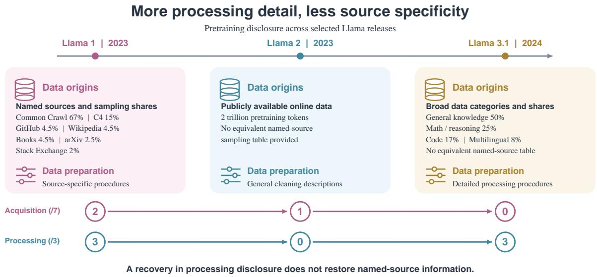
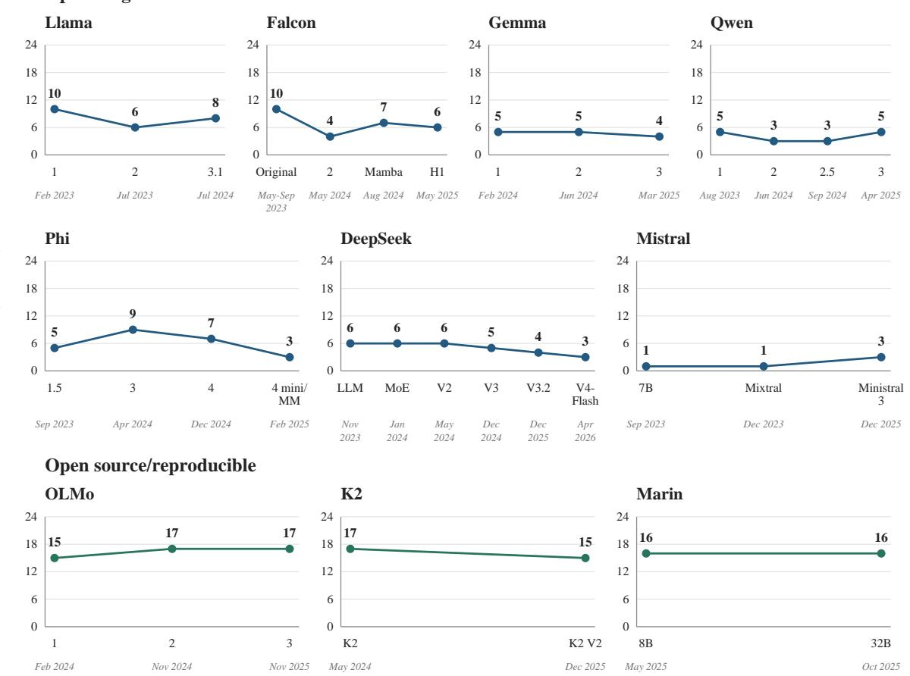
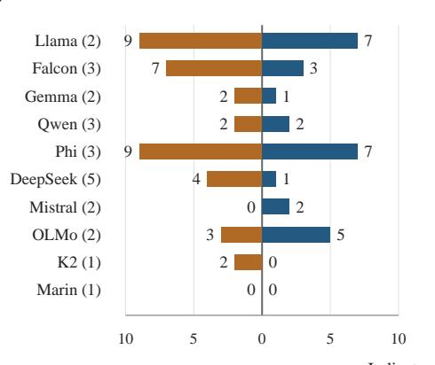
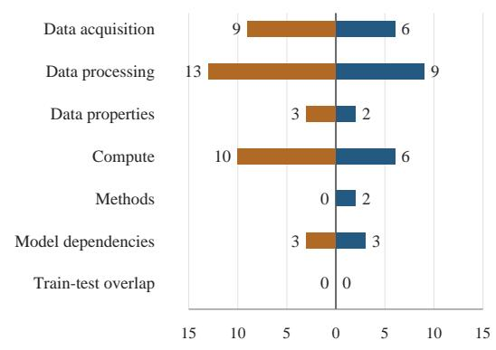
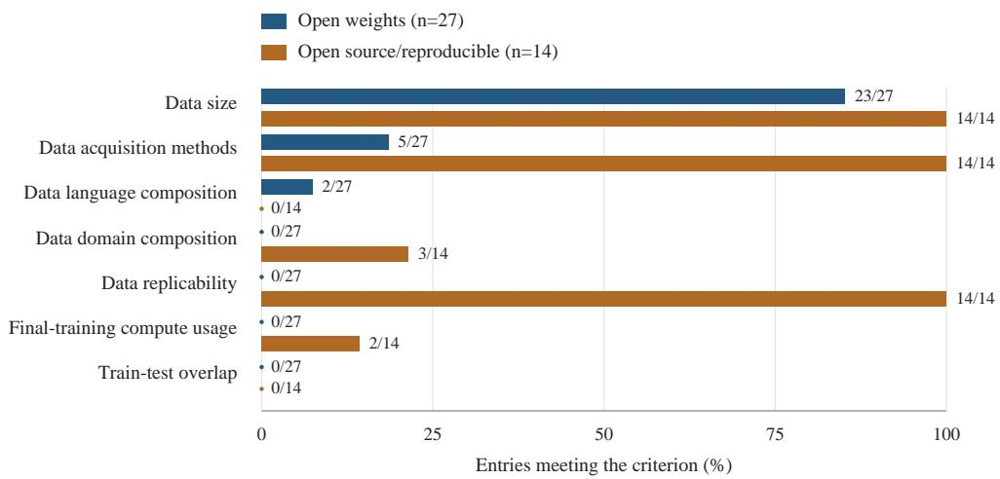

# What Carries Forward? Pretraining Disclosure Across Language Model Releases

Md Sakib Ul Islam Victorian Institute of Technology, Australia

S M Mehedi Zaman Rutgers University, USA

## Abstract

Understanding how language models were pretrained requires information about their data, processing procedures, and computational resources. However, it remains unclear whether successive releases preserve or expand earlier disclosure. We conduct a document-based audit of 41 model entries from 17 families using 24 pretraining-related indicators from the 2025 Foundation Model Transparency Index (FMTI). We examine overall scores and indicator profiles, tracking gains, losses, and retained disclosures across 24 adjacent comparisons in ten families. Scores decrease in 11 comparisons, increase in six, and remain unchanged in seven, with 38 indicator losses and 28 gains overall. Stable or improving scores can conceal losses: OLMo 2 and OLMo 3 receive identical totals despite three gains and three losses, while Llama 3.1 improves over Llama 2 while losing credit for two data-related criteria. Gaps also persist in corpus composition and training compute. These findings show that later releases do not consistently preserve earlier pretraining disclosure and motivate documentation that explicitly identifies changes and the applicability of inherited information.

## 1 Introduction

Pretraining choices affect what language models learn, memorize, and represent. Corpus audits have identified benchmark contamination, uneven multilingual data quality, and filtering that disproportionately excludes text associated with minority identities (Dodge et al., 2021; Kreutzer et al., 2022). Experiments show that deduplication reduces memorized outputs and train–test overlap (Lee et al., 2022; Deng et al., 2024), while data age, composition, and filtering affect performance, with some effects persisting after fine-tuning (Longpre et al., 2024). Training examples can also be recovered from model outputs, including material containing personal information (Carlini et al., 2021). Information about pretraining is therefore necessary for investigating model behavior and interpreting evaluation results.

Yet access to model weights does not ensure access to training data, code, or development documentation (Liesenfeld et al., 2023; Liesenfeld and Dingemanse, 2024). Naming a source such as Common Crawl leaves unresolved which material was selected and how it was transformed (Baack, 2024; Albalak et al., 2024). Documentation audits identify persistent gaps (Oreamuno et al., 2024; Pepe et al., 2026), while insufficient train–test overlap reporting limits the interpretation of benchmark results (Zhang et al., 2025). Descriptions of instruction tuning or alignment provide complementary information; they cannot substitute for an account of base-model pretraining.

We ask: How does pretraining disclosure change across releases within model families? Existing studies examine developer-level transparency and changes within an individual model family (Bommasani et al., 2023; Wan et al., 2025; Xu and Mustafaraj, 2024). We examine specific pretraining disclosures across selected releases in multiple families. Our focus is whether later releases preserve previously documented information, and whether stable or improving overall scores conceal losses in particular areas.

Figure 1 illustrates this distinction in the Llama family. Llama 1 reports named data sources and sampling proportions. Later reports provide broader descriptions or category-level proportions without an equivalent named-source breakdown. Processing disclosure recovers in Llama 3.1, but acquisition scores continue to decline under the selected criteria. More detailed documentation of corpus preparation therefore need not provide a more specific account of corpus origins.

We conduct a document-based audit of 41 model entries from 17 families, comprising 27 openweight and 14 open-source/reproducible entries. Using a fixed subset of 24 pretraining-related indicators from the 2025 FMTI, we examine technical reports and associated official documentation. We compare overall scores and indicator profiles, then trace gains, losses, and retained disclosures across 24 adjacent comparisons in ten families. Scores describe whether the reviewed evidence meets the selected requirements, rather than whether an undocumented practice occurred.

  
Figure 1: Pretraining disclosure across Llama releases, based on their technical reports (Touvron et al., 2023a,b; Dubey et al., 2024). Later reports do not provide an equivalent to Llama 1’s named-source sampling breakdown, although processing disclosure recovers in Llama 3.1.

Later releases are not consistently better documented: scores decrease in 11 comparisons, increase in six, and remain unchanged in seven, with 38 indicator losses and 28 gains overall. Stable or improving totals can conceal losses in particular information. These findings motivate tracking both the extent and continuity of pretraining disclosure.

## 2 Related Work

## 2.1 Pretraining Data and Documentation

Corpus audits identify properties that broad dataset descriptions leave unresolved. Dodge et al. (2021) find unexpected sources, benchmark contamination, and disproportionate exclusion of minorityassociated text in C4. Kreutzer et al. (2022) identify quality problems and mislabeled languages in multilingual web corpora. Controlled experiments show that deduplication reduces memorization and overlap (Lee et al., 2022), while data age, composition, and filtering affect performance (Longpre et al., 2024). Surveys of selection methods and analyses of Common Crawl further distinguish access to source data from knowledge of how developers curate it (Albalak et al., 2024; Baack, 2024). These studies motivate examining acquisition, processing, and corpus properties separately. They investigate corpora or curation effects; we examine disclosure about these aspects across model releases.

Pretraining also affects behavior addressed through later alignment. Minder et al. (2026) find effects of pretraining interventions under identical subsequent post-training, although their approach also requires later persona binding. Documentation of subsequent adaptation therefore cannot substitute for an account of base-model development.

## 2.2 Openness and Independent Scrutiny

Openness assessments distinguish available weights from access to training data, code, and technical documentation (Liesenfeld et al., 2023; Liesenfeld and Dingemanse, 2024). The OSI distinction between open weights and Open Source AI informs our operational grouping (Open Source Initiative, 2025, 2024). Higher disclosure in the open-source/reproducible group is partly expected, since development-resource availability informs both classification and scoring.

Documentation audits identify reporting gaps in NLP papers and model repositories (Magnusson et al., 2023; Oreamuno et al., 2024). Data Portraits support corpus-membership inspection (Marone and Van Durme, 2023), while Zhang et al. (2025) advocate training-data or overlap disclosure to support evaluation interpretation. Our audit complements these approaches by assessing explicit requirements; it does not inspect corpora, measure contamination, or test reproducibility.

## 2.3 Transparency across Releases

FMTI evaluates disclosure across upstream development, model information, and downstream use (Bommasani et al., 2023), with transparency reports consolidating supporting evidence (Bommasani et al., 2024b). The 2024 assessment records improvements, whereas the 2025 edition identifies renewed declines and persistent data and compute gaps (Bommasani et al., 2024a; Wan et al., 2025). We apply a fixed pretraining subset to releases rather than the full developer-level index.

Xu and Mustafaraj (2024) trace OpenAI’s GPT documentation, finding clearer descriptions of limitations and downstream uses alongside more opaque development information. Pepe et al. (2026) examine repository documentation over time and identify persistent gaps concerning datasets, bias, licensing, and terms of use. We extend these perspectives across selected families, tracking gains, losses, and retained pretraining disclosures under common criteria. This distinguishes changes in total scores from changes in the information documented.

## 3 Methodology

We conduct a document-based audit of pretraining disclosure for 41 selected model entries from 17 families. We examine base-model pretraining, including continued pretraining where it forms part of an included release. Disclosures concerning instruction tuning, preference optimization, reinforcement learning, and downstream fine-tuning are excluded. We apply 24 selected indicators from the 2025 Foundation Model Transparency Index (FMTI; Wan et al., 2025) to compare documented pretraining information across entries and within model families.

## 3.1 Model Selection

We identified candidate models through web searches and associated technical reports, developer websites, and repositories. We included general-purpose text language models and basemodel releases available for external use. Specialized models and instruction-tuned or aligned derivatives were excluded unless their documentation described a distinct qualifying base-model pretraining release. For reports covering multiple training stages, we considered only evidence attributable to pretraining. Where a family included multimodal models, we retained the text or base model when it could be identified separately.

Inclusion normally required an official developer-authored technical report or research paper. Marin 8B Base and Marin 32B Base were exceptions: their detailed official technical retrospectives were treated as report-equivalent documentation. We had a cutoff date for modelreport search at 29 August 2026. The corpus is a selected sample of qualifying entries, rather than an exhaustive inventory of models available by that date.

Each entry represents a release or a group of variants documented together. For grouped entries, a criterion received credit when the evidence met its requirements for at least one included variant. The score therefore summarizes disclosure available across the group and does not imply equal documentation of every variant.

We distinguish Open Weights (n = 27) from Open Source/Reproducible (n = 14), following the distinction between weight availability and broader access to development resources (Open Source Initiative, 2025, 2024). The former provides model weights with limited access to development artifacts; the latter provides substantial access to training code and training-data resources or information supporting external reproduction.

## 3.2 Evidence Sources

Each entry’s qualifying technical report served as the primary coding source. Directly associated official materials, including model cards, repositories, dataset documentation, and released training or data-processing code, were consulted where they supplied evidence for a selected indicator. These materials supplemented the report. Third-party descriptions and assumptions about undocumented practices were not used as evidence.

Evidence had to be explicitly attributable to the included entry’s pretraining process. Information about post-training data, alignment procedures, or downstream adaptation did not receive credit as pretraining disclosure. Where information combined training stages without establishing what applied to pretraining, it was insufficient to support the corresponding criterion.

For each decision, we recorded the disclosed information, supporting source, scoring justification, and binary score. The comparisons concern information documented for each entry; they do not establish that earlier documents were withdrawn.

We evaluated disclosure available for each release at the time of assessment, rather than reconstructing the documentation available on its original release date. Earlier documentation was considered when the later release explicitly stated that the relevant data, procedures, or other pretraining details remained unchanged or were inherited. In those cases, we consulted the earlier documentation for supporting evidence. Without an explicit statement establishing its applicability, earlier disclosure was not carried forward to the later release.

## 3.3 Disclosure Indicators

We selected the indicator subset before model coding, using the published FMTI definitions and their application in the December 2025 transparency reports (Stanford Center for Research on Foundation Models, 2025). We retained criteria concerning pretraining data, acquisition, processing, corpus properties, compute, development methods, model dependencies, and train–test overlap. Criteria concerning deployment, governance, and other topics outside this scope were excluded.

The subset comprises seven acquisition indicators, three processing indicators, five data-property indicators, four compute indicators, three methods indicators, and one indicator each for model dependencies and train–test overlap. Dependencies identify the development path underlying the base model; overlap concerns the relationship between pretraining data and evaluation datasets.

We retained the original indicator identifiers, wording, definitions, notes, and binary requirements. Their application was restricted to pretraining: data criteria concerned the pretraining corpus, compute criteria concerned pretraining resources, and methods and code criteria concerned base-model development. This scope restriction distinguishes our assessment from the full FMTI.

## 3.4 Coding and Verification

ChatGPT (GPT-5.6, High reasoning setting) assisted with initial evidence extraction and provisional coding. Published FMTI transparency reports were supplied as in-context examples of criterion application; the model was not fine-tuned on these materials. For each entry, it screened the qualifying documentation and produced an evidence record, justification, and provisional score.

<table><tr><td>Group</td><td>n</td><td>Mean</td><td>Median</td><td>Range</td></tr><tr><td>Open weights</td><td>27</td><td>5.19</td><td>5</td><td>1-10</td></tr><tr><td>Open source/reproducible</td><td>14</td><td>16.07</td><td>16</td><td>14-18</td></tr><tr><td>All entries</td><td>41</td><td>8.90</td><td>6</td><td>1-18</td></tr></table>

Table 1: Pretraining disclosure scores by operational openness group. Scores count requirements met out of 24; n counts releases or grouped variants.

Both authors subsequently verified the complete dataset. One author checked every indicator against its sources and the FMTI requirements. Another author then checked all entries and indicators, including cases not previously marked as uncertain. Discrepancies were resolved by revisiting the sources and discussing the relevant criterion until agreement was reached. This procedure is similar to the worksheet verification used by Liu et al. (2024). Because the second review examined existing coding records rather than independently assigned labels, we did not calculate inter-rater agreement.

An indicator received 1 when the qualifying evidence met its requirements and 0 otherwise. A zero denotes insufficient disclosure under the criterion, rather than absence of the underlying practice. Explicit statements of non-use were handled according to the corresponding FMTI rules; non-use was not inferred from silence. The equally weighted indicators were summed to produce a pretraining disclosure score out of 24 and descriptive subdomain totals.

We summarize scores and indicator prevalence and compare adjacent entries in the selected family sequences. Indicator transitions distinguish gains (0 → 1), losses (1 → 0), and retained disclosures (1 → 1). The sequences include architectural branches, continued-pretraining releases, and grouped variants; these are descriptive comparisons rather than controlled comparisons between equivalent successors.

## 4 Results

## 4.1 Distribution of Pretraining Disclosure

Table 1 summarizes scores for the 41 entries. The mean was 8.90 out of 24, the median was 6, and scores ranged from 1 to 18. No entry met all selected disclosure requirements.

Open-source/reproducible entries scored higher throughout the selected corpus. Their lowest score,

14, exceeded the highest open-weight score, 10. This separation is partly expected: training-code and training-data availability inform both the group definitions and some disclosure criteria. The comparison characterizes the selected entries and does not establish an independent effect of openness on disclosure.

## 4.2 Disclosure Changes across Releases

Later entries did not consistently meet more disclosure requirements. Across 24 adjacent comparisons in ten families, scores decreased in 11 cases, increased in six, and remained unchanged in seven. Figure 2 shows the selected release sequences.

DeepSeek initially maintained a score of 6 across three entries, followed by successive decreases to 5, 4, and 3. Gemma scored 5, 5, and 4. Llama and Falcon showed declines followed by partial recoveries: Llama changed from 10 to 6 to 8, and Falcon from 10 to 4 to 7 to 6. Neither sequence returned to its initial score.

Other families followed different patterns. Qwen returned to 5 after two entries scoring 3. Phi increased from 5 to 9 before decreasing to 7 and then 3. Mistral increased from 1 for Mistral 7B and Mixtral 8×7B to 3 for Ministral 3. Among opensource/reproducible entries, OLMo increased from 15 to 17 and remained at 17, K2 decreased from 17 to 15, and both Marin entries scored 16.

These patterns describe disclosure available for the selected entries at assessment. The sequences include architectural branches, continuedpretraining releases, and grouped variants, rather than uniformly comparable model generations.

## 4.3 Aggregate Scores Conceal Changes in Disclosure

Across the 24 comparisons, we recorded 28 indicator gains (0 → 1) and 38 losses (1 → 0). A loss means that the evidence applicable to the later entry did not meet a previously satisfied requirement. It does not establish that earlier documents were withdrawn or that the underlying practice changed.

Figure 3 summarizes transitions by family and subdomain. Llama and Phi each recorded seven gains and nine losses, while Qwen recorded two gains and two losses. Data processing accounted for nine gains and 13 losses; compute accounted for six gains and ten losses. These are transition counts, not rates: families have different numbers of comparisons, and subdomains contain different numbers of indicators.

<table><tr><td>Comparison</td><td>Scores</td><td>Gained</td><td>Lost </td><td>Retained</td></tr><tr><td>OLMo 2 → 3</td><td> $1 7  1 7$ </td><td>3</td><td>3</td><td>14</td></tr><tr><td>Llama  $2  3 . 1$ </td><td> $6  8$ </td><td>4</td><td>2</td><td>4</td></tr></table>

Table 2: Two illustrative release comparisons. Gained, lost, and retained denote 0 → 1, 1 → 0, and $1  1$ transitions. Scores are out of 24.

Two illustrative comparisons show why totals alone are insufficient (Table 2). OLMo 2 and OLMo 3 both scored 17, but six indicators changed. OLMo 3 gained credit for crawling, data-domain composition, and compute hardware, while losing credit for final-training compute usage, compute provider, and model dependencies. Fourteen criteria remained satisfied. The unchanged total therefore reflected three gains offset by three losses.

Llama illustrates improvement accompanied by losses. From Llama 2 to Llama 3.1, the score increased from 6 to 8 through four gains and two losses. The gains concerned processing methods, purposes, and techniques, together with compute hardware. The losses concerned usage data used in training and data-language composition.

Across the full Llama sequence, acquisition scores declined from 2 to 1 to 0, while processing scores changed from 3 to 0 to 3. As Figure 1 illustrates, Llama 3.1 recovered processing disclosure without restoring the named-source breakdown reported for Llama 1. That source comparison illustrates a change in documentary specificity; the acquisition scores summarize all seven selected acquisition criteria.

## 4.4 Persistent Gaps in Pretraining Disclosure

Model stages, objectives, and data size were the most consistently documented aspects of pretraining. All 41 entries met the model-stages criterion, and 37 met each of the objectives and data-size criteria. Only two met language composition and three met domain composition. None met external data access or train–test overlap under the applied requirements. Figure 4 compares seven selected indicators across the groups.

Open-weight entries documented corpus size more often than acquisition or composition. Of the 27 entries, 23 met data size, five met acquisition methods, one met public-dataset disclosure, and two met language composition. None met domain composition, data replicability, or training-code access. Processing purpose was credited for 14 entries, compared with ten for methods and six for

Open weights

  
Figure 2: Pretraining disclosure scores across selected family sequences. Scores are out of 24. Release months and years appear below the version labels; the original Falcon group spans May–September 2023. Entries are equally spaced by order, not elapsed time. Connecting lines do not imply direct model derivation. MM denotes multimodal.

techniques.

All 14 open-source/reproducible entries met the three processing criteria, data replicability, and training-code access. Nevertheless, none met language composition, and only three met domain composition. Broader artifact availability did not ensure satisfaction of every selected disclosure requirement.

Compute reporting was also incomplete under the criteria: only two entries met final-training compute usage, and two met development duration. Relevant quantitative information could be present without meeting the complete requirement. Some reports supplied GPU-hours or compute budgets but lacked sufficient methodological or pretrainingstage detail. Similarly, descriptions of decontamination or overlap measurements for selected benchmarks did not establish overlap across all relevant evaluations. These results distinguish partial reporting from satisfaction of the full coding requirements.

## 5 Discussion

Our results suggest that pretraining disclosure is a property of individual releases that needs to be maintained as models develop. Later entries sometimes provide less information under the selected criteria, and improvements in total scores do not necessarily preserve previously documented aspects of pretraining. These findings have implications for maintaining documentation and interpreting transparency assessments.

## 5.1 Maintaining Disclosure across Releases

Xu and Mustafaraj (2024) show that transparency can evolve differently across aspects of a model’s lifecycle. Our study extends this perspective across selected families using a common set of pretraining criteria. The comparisons identify where later releases add information, retain earlier disclosures, or leave previously documented aspects insufficiently specified.

This distinction matters when researchers consult an earlier report to understand a later model.

(a) Changes within families  
Indicator transition events  

(b) Changes by subdomain  

Figure 3: Indicator gains and losses across 24 adjacent comparisons, grouped by (a) family and (b) subdomain. Parentheses give the number of comparisons per family. Orange indicates losses $( 1  0 ) ;$ blue indicates gains (0 → 1). Counts include repeated transitions and are not normalized by comparisons or indicators.  
  
Figure 4: Selected disclosure criteria for open-weight $( n = 2 7 )$ and open-source/reproducible $( n = 1 4 )$ entries. Bars show percentages meeting each criterion; labels give counts. A zero denotes an unmet requirement.

A shared family name does not establish that the same data sources, processing procedures, or training arrangements remain applicable. At the same time, developers need not repeat an unchanged description in every report. An explicit reference can establish which earlier documentation still describes the later release.

Our coding recognized such references when the later documentation explicitly established continuity. The observed losses therefore concern requirements not met by either the later disclosures or explicitly applicable earlier documentation. They do not establish that developers removed earlier documents, changed their practices, or deliberately withheld information. Because we examined disclosure available at assessment, the comparisons also do not reconstruct documentation as it existed on each release date.

We recommend that each release identify which pretraining descriptions remain applicable, which have changed, and where supporting evidence can be found. A concise record linking each aspect of pretraining to current or inherited documentation would make continuity easier to verify. This would also help distinguish an unchanged procedure from an omission whose meaning cannot be determined from the available evidence.

## 5.2 What Disclosure Scores Establish

The OLMo and Llama comparisons demonstrate that a total score cannot establish continuity of information. OLMo’s stable score reflected gains offset by losses, while Llama’s improving score accompanied losses in data-related criteria. These indicators support different questions: hardware information helps characterize training resources, whereas language composition helps examine linguistic representation. Additional information in one area does not answer an unresolved question in another.

This finding complements Magnusson et al. (2023), who recommend tracking datadocumentation practices through specific checklist items. Our comparisons show why this specificity also matters over time: the same number of satisfied requirements can correspond to different information across releases.

FMTI supplies explicit criteria for comparison, but the resulting scores have a defined scope. They measure whether evidence meets the selected requirements; they do not directly measure reproducibility, documentation usefulness, or responsible development. As Liu et al. (2024) argue in the context of benchmark design, interpreting a measurement requires clarity about what it supports. We therefore use totals to summarize the extent of disclosure and indicator profiles to establish which information is documented.

The group comparison requires similar care. Open-source/reproducible releases are expected to provide broader access to development resources, and some of these resources also receive credit under the disclosure criteria. Their higher scores therefore partly follow from the classification. The informative questions are which requirements remain unmet and whether disclosures persist within subsequent releases.

## 5.3 Implications for Independent Scrutiny

The persistent gaps identify questions that researchers cannot readily resolve from the reviewed documentation. Corpus size does not establish the origins or distribution of its contents. Baack (2024) distinguish access to crawl data from transparency about its subsequent selection and filtering, while Dodge et al. (2021) demonstrate the insights obtained by examining corpus construction. Similarly, Kreutzer et al. (2022) show that nominal multilingual coverage can obscure substantial differences in data quality.

Our audit does not establish comparable problems in the selected models’ corpora. It identifies where documentation does not meet the requirements for describing relevant aspects of pretraining. Available data and code may permit further investigation, but deriving an answer from artifacts is different from receiving an explicit, releasespecific account. This distinction helps explain why broader artifact availability can accompany gaps in reported corpus composition.

Train–test overlap illustrates the importance of distinguishing partial disclosure from complete reporting. Zhang et al. (2025) argue that developers should publish training data or overlap statistics to support interpretation of evaluations. Their assessment recognizes reporting under different conditions from our selected FMTI criterion. Our zero scores therefore do not contradict evidence that some developers publish useful overlap information. They indicate that the reviewed evidence did not meet the full requirement applied here.

Useful release documentation should specify the pretraining data and procedures concerned, the evaluations covered by overlap analyses, and the limits of the reported information. Together with explicit references to inherited documentation, these details would support scrutiny of individual releases and comparisons across them. Our findings motivate assessing both how much pretraining information is disclosed and whether its applicability remains clear as models evolve.

## 6 Conclusion

We investigate how pretraining disclosure changes across model releases through an audit of 41 entries from 17 families using 24 selected FMTI indicators. Across 24 within-family comparisons, disclosure scores decreased more often than they increased, and stable or improving totals sometimes concealed losses in particular information. These findings show that later releases do not consistently preserve or expand earlier disclosure. They motivate release-specific documentation that makes changes and the applicability of inherited information explicit, alongside assessments that track individual disclosures as well as total scores.

## Limitations

Selected corpus. Our corpus is a selected sample of 41 entries from 17 families, not a representative survey of all language models. Inclusion generally required a developer-authored technical report, with official Marin retrospectives treated as exceptions. This requirement may favor betterdocumented releases and excludes models whose disclosures appear only in other formats. The findings therefore characterize the selected entries rather than the prevalence of disclosure across the full model ecosystem.

Comparability within families. The recorded sequences include architectural branches, continued-pretraining releases, and grouped variants. They are not controlled comparisons between otherwise equivalent successors. Differences in model scope and reporting conventions may contribute to score changes. Families also contribute unequal numbers of comparisons, so pooled transition counts give greater representation to longer sequences.

Grouped variants. A grouped entry received credit when at least one represented variant met a criterion. Different criteria may therefore be supported by evidence concerning different variants, and no single variant need satisfy the group’s complete indicator profile. This rule captures disclosure available across the release group but can obscure variation between model sizes.

Timing and inherited documentation. We evaluated information available at assessment, rather than reconstructing disclosure on each original release date. Earlier releases may have benefited from subsequent documentation updates or a longer period in which to accumulate supporting material. Earlier documentation was credited only when its applicability to a later release was explicitly established. Unchanged practices without such a statement could consequently remain uncredited. Observed losses do not establish that information was withdrawn or practices changed.

Measurement scope. The scores summarize 24 selected FMTI requirements applied to pretraining. Binary coding does not capture all differences in specificity, usefulness, or partial disclosure. Equal weighting also does not imply that the criteria are interchangeable or equally important for every research question. An unmet requirement may coexist with substantial relevant information, and the scores do not directly establish reproducibility, data quality, or responsible development.

Coding verification. AI-assisted coding was checked against supporting sources by both authors, but verification was sequential and based on existing records. The second reviewer could therefore be influenced by earlier decisions. Consensus resolution does not provide an independent estimate of coding reliability, and missed evidence or interpretive errors may remain.

Openness classification. Our openness groups are operational classifications, not formal certifications or verified reproduction outcomes. Trainingcode and training-data availability inform both classification and some disclosure criteria. The group difference is therefore partly structural and should not be interpreted as an independent effect of openness on disclosure.

## References

Alon Albalak, Yanai Elazar, Sang Michael Xie, Shayne Longpre, Nathan Lambert, Xinyi Wang, Niklas Muennighoff, Bairu Hou, Liangming Pan, Haewon Jeong, Colin Raffel, Shiyu Chang, Tatsunori Hashimoto, and William Yang Wang. 2024. A survey on data selection for language models. Transactions on Machine Learning Research.

Stefan Baack. 2024. A critical analysis of the largest source for generative AI training data: Common Crawl. In Proceedings ofthe 2024 ACM Conference on Fairness, Accountability, and Transparency, pages 2199–2208. Association for Computing Machinery.

Rishi Bommasani, Kevin Klyman, Sayash Kapoor, Shayne Longpre, Betty Xiong, Nestor Maslej, and Percy Liang. 2024a. The foundation model transparency index v1.1: May 2024. arXiv preprint arXiv:2407.12929.

Rishi Bommasani, Kevin Klyman, Shayne Longpre, Sayash Kapoor, Nestor Maslej, Betty Xiong, Daniel Zhang, and Percy Liang. 2023. The foundation model transparency index. arXiv preprint arXiv:2310.12941.

Rishi Bommasani, Kevin Klyman, Shayne Longpre, Betty Xiong, Sayash Kapoor, Nestor Maslej, Arvind Narayanan, and Percy Liang. 2024b. Foundation model transparency reports. In Proceedings of the AAAI/ACM Conference on AI, Ethics, and Society, volume 7, pages 181–195.

Nicholas Carlini, Florian Tramèr, Eric Wallace, Matthew Jagielski, Ariel Herbert-Voss, Katherine Lee, Adam Roberts, Tom Brown, Dawn Song, Úlfar

Erlingsson, Alina Oprea, and Colin Raffel. 2021. Extracting training data from large language models. In 30th USENIX Security Symposium (USENIX Security 21), pages 2633–2650. USENIX Association.

Chunyuan Deng, Yilun Zhao, Xiangru Tang, Mark Gerstein, and Arman Cohan. 2024. Investigating data contamination in modern benchmarks for large language models. In Proceedings of the 2024 Conference of the North American Chapter of the Association for Computational Linguistics: Human Language Technologies (Volume 1: Long Papers), pages 8706–8719, Mexico City, Mexico. Association for Computational Linguistics.

Jesse Dodge, Maarten Sap, Ana Marasovic, William´ Agnew, Gabriel Ilharco, Dirk Groeneveld, Margaret Mitchell, and Matt Gardner. 2021. Documenting large webtext corpora: A case study on the colossal clean crawled corpus. In Proceedings of the 2021 Conference on Empirical Methods in Natural Language Processing, pages 1286–1305. Association for Computational Linguistics.

Abhimanyu Dubey, Abhinav Jauhri, Abhinav Pandey, Abhishek Kadian, Ahmad Al-Dahle, et al. 2024. The Llama 3 herd of models. Preprint, arXiv:2407.21783.

Julia Kreutzer, Isaac Caswell, Lisa Wang, Ahsan Wahab, Daan van Esch, Nasanbayar Ulzii-Orshikh, Allahsera Tapo, Nishant Subramani, Artem Sokolov, Claytone Sikasote, Monang Setyawan, Supheakmungkol Sarin, Sokhar Samb, Benoît Sagot, Clara Rivera, Annette Rios, Isabel Papadimitriou, Salomey Osei, Pedro Ortiz Suarez, and 33 others. 2022. Quality at a glance: An audit of web-crawled multilingual datasets. Transactions ofthe Associationfor Computational Linguistics, 10:50–72.

Katherine Lee, Daphne Ippolito, Andrew Nystrom, Chiyuan Zhang, Douglas Eck, Chris Callison-Burch, and Nicholas Carlini. 2022. Deduplicating training data makes language models better. In Proceedings of the 60th Annual Meeting of the Association for Computational Linguistics (Volume 1: Long Papers), pages 8424–8445. Association for Computational Linguistics.

Andreas Liesenfeld and Mark Dingemanse. 2024. Rethinking open source generative AI: Open washing and the EU AI Act. In Proceedings of the 2024 ACM Conference on Fairness, Accountability, and Transparency, pages 1774–1787. Association for Computing Machinery.

Andreas Liesenfeld, Alianda Lopez, and Mark Dingemanse. 2023. Opening up ChatGPT: Tracking openness, transparency, and accountability in instructiontuned text generators. In Proceedings of the 5th International Conference on Conversational User Interfaces, pages 1–6. Association for Computing Machinery.

Yu Lu Liu, Su Lin Blodgett, Jackie Cheung, Q. Vera Liao, Alexandra Olteanu, and Ziang Xiao. 2024.

ECBD: Evidence-centered benchmark design for NLP. In Proceedings of the 62nd Annual Meeting of the Associationfor Computational Linguistics (Volume 1: Long Papers), pages 16349–16365. Association for Computational Linguistics.

Shayne Longpre, Gregory Yauney, Emily Reif, Katherine Lee, Adam Roberts, Barret Zoph, Denny Zhou, Jason Wei, Kevin Robinson, David Mimno, and Daphne Ippolito. 2024. A pretrainer’s guide to training data: Measuring the effects of data age, domain coverage, quality, & toxicity. In Proceedings ofthe 2024 Conference of the North American Chapter of the Association for Computational Linguistics: Human Language Technologies (Volume 1: Long Papers), pages 3245–3276. Association for Computational Linguistics.

Ian Magnusson, Noah A. Smith, and Jesse Dodge. 2023. Reproducibility in NLP: What have we learned from the checklist? In Findings of the Association for Computational Linguistics: ACL 2023, pages 12789– 12811. Association for Computational Linguistics.

Marc Marone and Benjamin Van Durme. 2023. Data portraits: Recording foundation model training data. In Advances in Neural Information Processing Systems, volume 36.

Julian Minder, Viktor Moskvoretskii, Raghav Singhal, Difan Jiao, Andy Arditi, Shaobo Cui, Yiderigun Borjigin, Kartik Bali, Stefan Krsteski, Harsh Raj, Huu Nguyen, Jannik Brinkmann, Ashton Anderson, Roland Aydin, and Robert West. 2026. Synthetic persona pretraining: Alignment from token zero. Preprint, arXiv:2608.13482.

Open Source Initiative. 2024. The open source ai definition 1.0. https://opensource.org/ai/ open-source-ai-definition. Accessed: 8 October 2026.

Open Source Initiative. 2025. Open weights: Not quite what you’ve been told. https://opensource.org/ ai/open-weights. Accessed: 8 October 2026.

Ernesto Lang Oreamuno, Rohan Faiyaz Khan, Abdul Ali Bangash, Catherine Stinson, and Bram Adams. 2024. The state of documentation practices of third-party machine learning models and datasets. IEEE Software, 41(5):52–59.

Federica Pepe, Vittoria Nardone, Antonio Mastropaolo, Gerardo Canfora, Gabriele Bavota, and Massimiliano Di Penta. 2026. Datasets, bias, licenses, and terms of use: A large and longitudinal study on the documentation of Hugging Face machine learning models. Empirical Software Engineering, 31(4):95.

Stanford Center for Research on Foundation Models. 2025. Foundation model transparency index: December 2025 transparency reports. https://github.com/stanford-crfm/fmti/ tree/main/Dec2025/reports. Accessed: 12 October 2026.

Hugo Touvron, Thibaut Lavril, Gautier Izacard, Xavier Martinet, Marie-Anne Lachaux, Timothée Lacroix, Baptiste Rozière, Naman Goyal, Eric Hambro, Faisal Azhar, Aurelien Rodriguez, Armand Joulin, Edouard Grave, and Guillaume Lample. 2023a. LLaMA: Open and efficient foundation language models. Preprint, arXiv:2302.13971.

Hugo Touvron, Louis Martin, Kevin Stone, Peter Albert, Amjad Almahairi, et al. 2023b. Llama 2: Open foundation and fine-tuned chat models. Preprint, arXiv:2307.09288.

Alexander Wan, Kevin Klyman, Sayash Kapoor, Nestor Maslej, Shayne Longpre, Betty Xiong, Percy Liang, and Rishi Bommasani. 2025. The 2025 foundation model transparency index. arXiv preprint arXiv:2512.10169.

Zhihan Xu and Eni Mustafaraj. 2024. Tracing the evolution of information transparency for openai’s gpt models through a biographical approach. In Proceedings ofthe AAAI/ACM Conference on AI, Ethics, and Society, volume 7, pages 1684–1695.

Andy K Zhang, Kevin Klyman, Yifan Mai, Yoav Levine, Yian Zhang, Rishi Bommasani, and Percy Liang. 2025. Position: Language model developers should report train-test overlap. In Proceedings ofthe 42nd International Conference on Machine Learning, volume 267 of Proceedings of Machine Learning Research, pages 82460–82482. PMLR.

## A Model Inventory

Table 3 lists the 41 entries included in our audit, their family groupings, and associated technical documentation. OW denotes open weights and OS denotes open source/reproducible, following the operational definitions in Section 3.1. The order column identifies each entry’s position in the selected family sequence; it does not establish direct ancestry. Entries containing multiple variants receive credit when at least one variant meets a criterion.

The search closed on 29 August 2026. We considered disclosure available for each release at assessment, including earlier documentation whose continued applicability was explicitly established. The listed references identify technical reports and selected associated materials.

Table 3: Selected entries and report references. Scores are out of 24.
<table><tr><td rowspan=1 colspan=15>Family      Entry                            OrderScore Primary report reference(s)group</td></tr><tr><td rowspan=1 colspan=7>Llama w Llama </td><td rowspan=3 colspan=8>1     10https://arxiv.org/abs/2302.139712      6 https://arxiv.org/abs/2307.092883      8https://arxiv.org/abs/2407.21783Falcon / OW Falcon 7B 40B 180B                  1     10https://arxiv.org/abs/2311.16867https://huggingface.co/datasets/tiiuae/falcon-refinedwebFalcon / OW Falcon 2 11B                         2      4https://arxiv.org/abs/2407.14885Falcon Mamba 7B                    3      7https://arxiv.org/abs/2410.05355</td></tr><tr><td rowspan=1 colspan=7></td></tr><tr><td rowspan=1 colspan=7></td></tr><tr><td rowspan=5 colspan=15>https://github.com/tiiuae/falcon-h1Gemma     Gemma 1                                    5 https://arxiv.org/abs/2403.08295OWGemma     Gemma 2                            2      5 https://arxiv.org/abs/2408.00118OWGemma     Gemma 3                             3         https://arxiv.org/abs/2503.19786OWQwen / OW  Qwen 1                               1      5 https://arxiv.org/abs/2309.16609Qwen / OW                                                    https://arxiv.org/abs/2407.10671</td></tr><tr><td rowspan=1 colspan=5></td></tr><tr><td rowspan=1 colspan=3>https://arxiv.org</td><td rowspan=1 colspan=2>abs/2309.16609</td></tr><tr><td rowspan=3 colspan=1>Qwen / OW</td></tr><tr><td rowspan=2 colspan=11>Qwen223 https://arxiv.org</td></tr><tr><td rowspan=1 colspan=2>abs/2407.10671</td><td></td></tr><tr><td rowspan=1 colspan=12>Qwen / OW  Qwen 2.5                            3      3https://arxiv.org/a</td><td rowspan=1 colspan=2>bs/2412.15115</td><td rowspan=1 colspan=1></td></tr><tr><td rowspan=1 colspan=12>Qwen / OW  Qwen 3                              4      5https://arxiv.org/p</td><td rowspan=1 colspan=3>df/2505.09388</td></tr><tr><td rowspan=4 colspan=15>https://chat.qwen.ai/legal-agreement/privacy-policyhttps://qwenlm.github.io/blog/qwen3/https://www.alibabacloud.com/help/en/model-studio/what-is-qwen-llm</td></tr><tr><td rowspan=1 colspan=2></td></tr><tr><td rowspan=1 colspan=1>1bak</td><td rowspan=1 colspan=2>acloud.com/help</td></tr><tr><td rowspan=1 colspan=2>is-qwen-11m</td></tr><tr><td rowspan=1 colspan=2>Phi / OW</td><td rowspan=1 colspan=10>Phi 1.5                                      5https://arxiv.org/a</td><td rowspan=1 colspan=2>bs/2309.05463</td><td rowspan=1 colspan=1></td></tr><tr><td></td><td></td><td rowspan=3 colspan=7>Phi 3                                 2      9</td><td rowspan=2 colspan=3>https://arxiv.org/a</td><td rowspan=2 colspan=2>bs/2306.11644</td><td rowspan=2 colspan=1></td></tr><tr><td rowspan=2 colspan=2>Phi / OW</td></tr><tr><td rowspan=1 colspan=3>https://arxiv.org/a</td><td rowspan=1 colspan=2>bs/2404.14219</td><td rowspan=1 colspan=1></td></tr><tr><td rowspan=1 colspan=2>Phi / OW</td><td rowspan=1 colspan=7>Phi 4                                 3      7</td><td rowspan=1 colspan=3>https://arxiv.org/a</td><td rowspan=1 colspan=2>bs/2412.08905</td><td rowspan=1 colspan=1></td></tr><tr><td rowspan=1 colspan=2>Phi / OW</td><td rowspan=1 colspan=5>Phi 4 mini multimodal               4</td><td rowspan=1 colspan=2>3</td><td rowspan=1 colspan=3>https://arxiv.org/a</td><td rowspan=1 colspan=2>bs/2503.01743</td><td rowspan=1 colspan=1></td></tr><tr><td rowspan=1 colspan=2>DeepSeek /OW</td><td rowspan=1 colspan=5>DeepSeek LLM 7B 67B              1</td><td rowspan=1 colspan=2>6</td><td rowspan=1 colspan=3>https://arxiv.org/a</td><td rowspan=1 colspan=2>bs/2401.02954</td><td rowspan=2 colspan=1></td></tr><tr><td rowspan=2 colspan=2>DeepSeek / DOW</td><td rowspan=2 colspan=7>eepSeekMoE 16B                  2      6</td><td rowspan=1 colspan=3>https://arxiv.org/a</td><td rowspan=1 colspan=2>bs/2401.06066</td></tr><tr><td rowspan=1 colspan=2></td><td rowspan=1 colspan=3>https://arxiv.org/a</td><td rowspan=1 colspan=2>bs/2401.02954</td><td rowspan=1 colspan=1></td></tr><tr><td rowspan=6 colspan=2>DeepSeek / DOWDeepSeek / DOW</td><td rowspan=5 colspan=5>eepSeek-V2 V2-Lite                3eepSeek-V3 Base</td><td rowspan=1 colspan=2>6</td><td rowspan=1 colspan=3>https://arxiv.org/a</td><td rowspan=1 colspan=1>bs/2405.0</td><td rowspan=1 colspan=1>4434</td><td rowspan=1 colspan=1></td></tr><tr><td rowspan=1 colspan=1></td><td rowspan=1 colspan=2></td><td rowspan=1 colspan=3>https://arxiv.org/a</td><td rowspan=1 colspan=1>bs/2401.0</td><td rowspan=1 colspan=1>2954</td><td rowspan=1 colspan=1></td></tr><tr><td rowspan=1 colspan=2></td><td rowspan=1 colspan=2></td><td></td><td></td><td></td><td></td><td></td><td></td><td></td><td></td></tr><tr><td rowspan=2 colspan=2></td><td></td><td></td><td></td><td></td><td></td><td></td><td></td><td></td></tr><tr><td rowspan=1 colspan=2>5</td><td rowspan=1 colspan=3>https://arxiv.org/a</td><td rowspan=1 colspan=2>bs/2412.19437</td><td rowspan=1 colspan=1></td></tr><tr><td rowspan=3 colspan=5>eepSeek-V3.2 Base                5</td><td rowspan=1 colspan=2></td><td rowspan=2 colspan=3>https://arxiv.org/a</td><td rowspan=2 colspan=2>bs/2501.12948</td><td rowspan=2 colspan=1></td></tr><tr><td rowspan=2 colspan=2>DeepSeek / DOW</td><td></td><td></td></tr><tr><td rowspan=1 colspan=2>4</td><td rowspan=1 colspan=3>https://arxiv.org/a</td><td rowspan=1 colspan=2>bs/2512.02556</td><td rowspan=5 colspan=1></td></tr><tr><td rowspan=1 colspan=7>DeepSeek /DeepSeek-V4-Flash                  6</td><td rowspan=1 colspan=2>3</td><td rowspan=1 colspan=3>https://arxiv.org/a</td><td rowspan=1 colspan=2>bs/2606.19348</td></tr><tr><td rowspan=1 colspan=7>Mistral      Mistral 7B familyOW</td><td rowspan=1 colspan=2></td><td rowspan=1 colspan=3>https://arxiv.org/a</td><td rowspan=1 colspan=2>bs/2310.06825</td></tr><tr><td rowspan=1 colspan=7>Mistral      Mixtral 8x7B                         2OW</td><td rowspan=1 colspan=2>1</td><td rowspan=1 colspan=3>https://arxiv.org/a</td><td rowspan=1 colspan=2>bs/2401.04088</td></tr><tr><td rowspan=1 colspan=9>Mistral     Ministral 3                           3      3OW</td><td rowspan=1 colspan=3>https://arxiv.org/a</td><td rowspan=1 colspan=2>bs/2601.08584</td></tr><tr><td rowspan=2 colspan=2>Pythia / OS</td><td rowspan=2 colspan=5>Pythia Suite</td><td rowspan=1 colspan=2></td><td rowspan=1 colspan=3>https:77mistra1.ai</td><td rowspan=1 colspan=2>/hews/mistral-</td><td rowspan=1 colspan=1></td></tr><tr><td rowspan=1 colspan=2>17</td><td rowspan=1 colspan=3>https://arxiv.org/a</td><td rowspan=1 colspan=2>bs/2304.01373</td><td rowspan=1 colspan=1></td></tr><tr><td rowspan=1 colspan=2>OLMo / OS</td><td rowspan=1 colspan=5>OLMO 1</td><td rowspan=1 colspan=2>15</td><td rowspan=1 colspan=3>https://arxiv.org/a</td><td rowspan=1 colspan=2>bs/2402.00838</td><td rowspan=1 colspan=1></td></tr><tr><td rowspan=1 colspan=2>OLMo / OS</td><td rowspan=1 colspan=5>OLMO 2                             2</td><td rowspan=1 colspan=2>17</td><td rowspan=1 colspan=3>https://arxiv.org/a</td><td rowspan=1 colspan=2>bs/2501.00656</td><td rowspan=1 colspan=1></td></tr><tr><td rowspan=1 colspan=2>OLMo / OS</td><td rowspan=1 colspan=5>OLMO 3                             3</td><td rowspan=1 colspan=2>17</td><td rowspan=1 colspan=3>https://arxiv.org/a</td><td rowspan=1 colspan=2>bs/2512.13961</td><td rowspan=1 colspan=1></td></tr><tr><td rowspan=1 colspan=2>Apertus / OS</td><td rowspan=1 colspan=5>Apertus</td><td rowspan=1 colspan=2>15</td><td rowspan=1 colspan=3>https://arxiv.org/a</td><td rowspan=1 colspan=2>bs/2509.14233</td><td rowspan=1 colspan=1></td></tr><tr><td rowspan=2 colspan=2>BLOOM /OSAmber / OS</td><td rowspan=1 colspan=5>BLOOM</td><td rowspan=1 colspan=2>14</td><td rowspan=1 colspan=3>https://arxiv.org/a</td><td rowspan=1 colspan=2>bs/2211.05100</td><td rowspan=1 colspan=1></td></tr><tr><td rowspan=1 colspan=5>Amber 7B</td><td rowspan=1 colspan=2>17</td><td rowspan=1 colspan=3>https://arxiv.org/a</td><td rowspan=1 colspan=2>bs/2312.06550</td><td rowspan=1 colspan=1></td></tr><tr><td rowspan=1 colspan=2>K2 / OS</td><td rowspan=1 colspan=5>LLM 360 K2</td><td rowspan=1 colspan=2>17</td><td rowspan=1 colspan=3>https://arxiv.org/a</td><td rowspan=1 colspan=2>bs/2501.07124</td><td rowspan=1 colspan=1></td></tr><tr><td rowspan=1 colspan=2>K2 / OS</td><td rowspan=1 colspan=5>LLM 360 K2 V2                     2</td><td rowspan=1 colspan=2>15</td><td rowspan=1 colspan=3>https://arxiv.org/a</td><td rowspan=1 colspan=2>bs/2512.06201</td><td rowspan=1 colspan=1></td></tr><tr><td rowspan=1 colspan=2>Marin / OS</td><td rowspan=1 colspan=5>Marin 8B</td><td rowspan=1 colspan=2>16</td><td rowspan=1 colspan=3>https://marin.readt</td><td rowspan=1 colspan=2>hedocs.io/en/l</td><td rowspan=2 colspan=1>atest/</td></tr><tr><td rowspan=5 colspan=15>2     16https://marin.readthedocs.io/en/latest/reports/marin-32b-retro/MAP-Neo / MAP Neo 7B                               15 https://arxiv.org/abs/2405.19327OS</td></tr><tr><td rowspan=2 colspan=2>Marin / OS</td><td rowspan=2 colspan=4>Marin 32B</td></tr><tr><td rowspan=1 colspan=3>https://marin.reac</td><td rowspan=1 colspan=2>thedocs.io/en/</td></tr><tr><td rowspan=1 colspan=3>reports/marin-32b</td><td rowspan=1 colspan=2>retro/</td></tr><tr><td rowspan=1 colspan=3>https://arxiv.org</td></tr></table>

Table 3 (continued)
<table><tr><td>Family group</td><td>/ Entry</td><td></td><td></td><td>Order Score Primary report reference(s)</td></tr><tr><td>OS</td><td>GPT-NeoX / GPT Neo X</td><td>1</td><td></td><td>16 https://arxiv.org/abs/2204.06745</td></tr><tr><td>Cerebras- GPT OS</td><td>Cerebras</td><td>1</td><td></td><td>18 https://arxiv.org/abs/2304.03208</td></tr></table>

## B Pretraining Disclosure Criteria

We selected 24 FMTI indicators addressing the origins and preparation of pretraining data, corpus properties, training resources, and base-model development. The subset was fixed before model coding. Below, we provide the definitions and guidance retained from FMTI 2025 (Wan et al., 2025; Stanford Center for Research on Foundation Models, 2025), followed by the reason for including each criterion. Original identifiers are retained.

FMTI addresses the full development lifecycle. In our study, evidence for these criteria was restricted to pretraining, including continued pretraining within an included release. References to other stages in the original guidance describe the broader framework and do not expand our assessment scope.

## B.1 Data Acquisition

Data acquisition methods (ID 0). Definition. What methods does the developer use to acquire data used to build the model?

FMTI guidance. Which of the following data acquisition methods does the developer use: (i) acquiring existing public datasets, (ii) crawling the web, (iii) using data acquired via its existing products and services, (iv) licensing existing data from external parties, (v) having humans create or annotate new data, (vi) using models to generate new data, or (vii) other data acquisition methods not captured by the above. For example, if the developer uses reinforcement learning from human feedback to train models using model-generated outputs with human preference annotations, this would satisfy categories (v) and (vi). Alternatively, if the developer post-trains its model using off-the-shelf preference data (for example, the Alpaca dataset), this would satisfy category (i).

Relevance to pretraining. Identifies the acquisition routes underlying the pretraining corpus.

Public datasets (ID 1). Definition. What are the top-5 sources (by volume) of publicly available datasets acquired for building the model?

FMTI guidance. We define a source as the entity or means by which the developer acquires data. We define the top-5 sources as the top-5 sources by data volume.

Relevance to pretraining. Makes major public sources identifiable rather than leaving their origins implicit.

Crawling (ID 2). Definition. If data collection involves web-crawling, what is the crawler name and opt-out protocol?

FMTI guidance. We award this point for disclosure of the crawler name and opt-out protocols, including if/how they respect the Robots Exclusion Protocol (robots.txt).

Relevance to pretraining. Documents direct collection and mechanisms by which websites can opt out.

Usage data used in training (ID 3). Definition. What are the top-5 sources (by volume) of usage data from the developer’s products and services that are used for building the model?

FMTI guidance. We define usage data as data collected from the use of a developer’s products or services.

Relevance to pretraining. Identifies whether and where product or service usage contributes to pretraining.

Notice of usage data used in training (ID 4). Definition. For the top-5 sources of usage data, how are users of these products and services made aware that this data is used for building the model?

FMTI guidance. We define usage data notice as the proactive disclosure to users of how their data is used for model development. For example, via a pop-up with a description, a link to the privacy policy, or link to a description of company practices.

Relevance to pretraining. Documents notice to users whose usage data enter pretraining.

Licensed data sources (ID 5). Definition. What are the top-5 sources (by volume) of licensed data acquired for building the model?

FMTI guidance. We define a source as the entity from which the developer acquires data. For example, the Associated Press is reportedly a source of licensed data for OpenAI.

Relevance to pretraining. Identifies major externally licensed pretraining sources.

Licensed data compensation (ID 6). Definition. For each of the top-5 sources of licensed data, are details related to compensation disclosed?

FMTI guidance. We award this point if the model developer describes the compensation structure specified in the contract with the data source or indicates they are prohibited from sharing this information if contractually mandated.

Relevance to pretraining. Documents compensation arrangements associated with licensed sources.

## B.2 Data Processing

Data processing methods (ID 12). Definition. What are the methods the developer uses to process acquired data to determine the data directly used in building the model?

FMTI guidance. We will award this point for disclosure of all of the methods used to process acquired data. Data processing refers to any method that substantively changes the content of the data. For example, compression or changing the data file format is generally not in the scope of this indicator.

Relevance to pretraining. Establishes the inventory of content-changing corpus preparation operations.

Data processing purpose (ID 13). Definition. For each data processing method, what is its primary purpose?

FMTI guidance. Data processing refers to any method that substantively changes the content of the data. For example, compression or changing the data file format is generally not in the scope of this indicator.

Relevance to pretraining. Explains why each corpus preparation operation is applied.

Data processing techniques (ID 14). Definition. For each data processing method, how does the developer implement the method?

FMTI guidance. Data processing refers to any method that substantively changes the content of the data. For example, compression or changing the data file format is generally not in the scope of this indicator.

Relevance to pretraining. Provides implementation information needed to understand the preparation recipe.

## B.3 Data Properties

Data size (ID 15). Definition. Is the size of the data used in building the model disclosed?

FMTI guidance. To receive this point, the developer should report data size in appropriate units (e.g. bytes, words, tokens, images, frames) and broken down by modality. Data size should be reported to a precision of one significant figure (e.g. 4 trillion tokens, 200 thousand images). The size should reflect data directly used in building the model (i.e. training data) and not data that was acquired but unused, or data used to evaluate the model.

Relevance to pretraining. Characterizes the quantity of data actually used in pretraining.

Data language composition (ID 16). Definition. For all text data used in building the model, what is the composition of languages?

FMTI guidance. To receive this point, the developer should report (i) all languages which make up at least 1% of the data and their corresponding proportions and (ii) a brief description of how languages are labeled (if a publicly available tool is used, include a link to the tool). Proportions should be reported to a precision of two significant figures and should describe proportions of documents labeled with some langauge. An "Unknown" category may be included to denote documents where the language could not be identified.

Relevance to pretraining. Characterizes linguistic representation and the method used to identify languages.

Data domain composition (ID 17). Definition. For all the data used in building the model, what is the composition of domains covered in the data?

FMTI guidance. To receive this point, the developer should report the composition of the main domains included in the data used to train the model. This data should be at a level of granularity lower than broad claims about training on "internet data". For example, this could include the proportion of data from e-commerce, social media, news, code, etc. based on the URLs from which the data is sourced. Proportions should be reported to a precision of one significant figure.

Relevance to pretraining. Characterizes the distribution of subject areas or source domains.

External data access (ID 18). Definition. Does a third-party have direct access to the data used to build the model?

FMTI guidance. By a third-party, we mean entities that are financially independent of the developer. We will award this point if at least one such entity is named as having direct access to the data. With that said, we may award this point if the developer provides justifications for prohibiting access to narrowly-scoped parts of the data.

Relevance to pretraining. Identifies independently named entities able to inspect the underlying data.

Data replicability (ID 19). Definition. Is the data used to build the model described in enough detail to be externally replicable?

FMTI guidance. We will award this point if the description contains (i) a list of all publicly available training data and where to obtain it and (ii) a list of all training data obtainable from third parties and where to obtain it. These conditions refer to criteria 2 and 3 under the OSI Open Source AI v1.0 definition.

Relevance to pretraining. Tests whether acquisition information supports external reconstruction of the data.

## B.4 Compute

Compute usage for final training run (ID 20). Definition. Is the amount of compute used in the model’s final training run disclosed?

FMTI guidance. Compute should be reported in appropriate units, which most often will be floating point operations (FLOPs), along with a description of the measurement methodology, which may involve estimation. Compute should be reported to a precision of one significant figure (e.g. 5 x 10^25 FLOPs). This number should represent the compute used to train the final model across all model stages.

Relevance to pretraining. Characterizes computational requirements and how they were measured or estimated.

Development duration for final training run (ID 22). Definition. Is the amount of time required to build the model disclosed?

FMTI guidance. The amount of time should be specified in terms of both the continuous duration of time required and the number of hardware hours used. The continuous duration of time required to build the model should be reported in weeks, days, or hours to a precision of one significant figure (e.g. 3 weeks). The number of hardware hours should be reported to a precision of one significant figure and include the type of hardware hours. No form of decomposition into phases of building the model is required for this indicator, but it should be clear what the duration refers to (e.g. training the model, or training and subsequent evaluation and red teaming).

Relevance to pretraining. Characterizes elapsed time and hardware time for the relevant training run.

Compute hardware for final training run (ID 23). Definition. For the primary hardware used to build the model, is the amount and type of hardware disclosed?

FMTI guidance. In most cases, this indicator will be satisfied by information regarding the number and type of GPUs or TPUs used to train the model. The number of hardware units should be reported to a precision of one significant figure (e.g. 800 NVIDIA H100 GPUs). We will not award this point if (i) the training hardware generally used by the developer is disclosed, but the specific hardware for the given model is not, or (ii) the training hardware is disclosed, but the amount of hardware is not. We will award this point even if information about the interconnects between hardware units is not disclosed.

Relevance to pretraining. Identifies the specific hardware quantity and type supporting pretraining.

Compute provider (ID 24). Definition. Is the compute provider disclosed?

FMTI guidance. For example, the compute provider may be the model developer in the case of a self-owned cluster, a cloud provider like Microsoft Azure, Google Cloud Platform, or Amazon Web Services, or a national supercomputer. In the event that compute is provided by multiple sources or is highly decentralized, we will award this point if a developer makes a reasonable effort to describe the distribution of hardware owners.

Relevance to pretraining. Identifies the organization or infrastructure supplying training compute.

## B.5 Methods

Model stages (ID 29). Definition. Are all stages in the model development process disclosed?

FMTI guidance. Stages refer to each identifiable step that constitutes a substantive change to the model during the model building process. We recognize that different developers may use different terminology for these stages, or conceptualize the stages differently. We will award this point if there is a clear and complete description of these stages.

Relevance to pretraining. Establishes the stages included in the scoped pretraining process.

Model objectives (ID 30). Definition. For all stages that are described, is there a clear description of the associated learning objectives or a clear characterization of the nature of this update to the model?

FMTI guidance. We recognize that different developers may use different terminology for these stages, or conceptualize the stages differently. We will award this point if there is a clear description of the update to the model related to each stage, whether that is the intent of the stage (e.g. making the model less harmful), a mechanistic characterization (e.g. minimizing a specific loss function), or an empirical assessment (e.g. evaluation results conducted before and after the stage).

Relevance to pretraining. Explains the learning objective or nature of updates in each included stage.

Code access (ID 31). Definition. Does the developer release code that allows third-parties to train and run the model?

FMTI guidance. The released code does not need to match the code used internally.

Relevance to pretraining. Identifies code access supporting external training and execution.

## B.6 Model Dependencies

Model dependencies (ID 36). Definition. Is the model(s) the model is derived from disclosed?

FMTI guidance. We will award this point for a comprehensive disclosure of the model or models on which the foundation model directly depends on or is derived from, as well as the method by which it was derived (e.g., through fine tuning, model merging, or distillation). Additionally, we will award a point if the developer discloses that the model is not dependent on or derived from any model.

Relevance to pretraining. Establishes whether the base model was derived from an earlier model and how.

## B.7 Train–Test Overlap

Train-test overlap (ID 45). Definition. Does the developer measure and disclose the overlap between the training set and the dataset used to evaluate model capabilities?

FMTI guidance. We will award this point if, with every capability evaluation for which the developer reports results, the developer reports the overlap between the training set of the model and the dataset used for evaluation, as well as the general methodology for computing train-test overlap (e.g. a description of how n-gram matching was used).

Relevance to pretraining. Supports interpretation of evaluations in relation to possible pretrain-

ing exposure.

## C Annotation Guidelines

## C.1 AI-Assisted Coding

ChatGPT assisted with understanding the FMTI criteria, extracting evidence, and producing provisional coding records. December 2025 indicator definitions, scores, and developer transparency reports were provided as in-context reference material. Both authors subsequently verified the coding decisions.

Prompt for preparatory instruction. Its purpose was to understand the FMTI reports before coding models

Carefully review the supplied December 2025 FMTI indicator definitions, scores, and developer transparency reports. Explain how the reports apply the criteria, use evidence, and justify scoring decisions. Identify the requirements that should guide the next stage of the study.

Use clear, concise language while preserving evidence, qualifications, and technical accuracy. Explain necessary technical terms and preserve the authors meaning and methodological detail when analyzing research.

## Coding instruction.

Examine the provided model documentation against the 24 selected FMTI indicators, definitions, and criterion notes. Use the published transparency reports as examples of criterion application.

Consider only base-model pretraining and relevant continued pretraining. Do not substitute evidence about instruction tuning, alignment, or downstream finetuning. Carry earlier disclosures forward only when their applicability to the later release is explicitly established.

For each indicator, record the relevant disclosure, source reference, justification, and provisional binary score. Assign 1 when the requirement is met and 0 otherwise. Do not infer undocumented practices or treat silence as nonuse. Identify uncertain interpretations for human review.

Interpretation. The reported results use the human-verified scores, whose evidence references and justifications support examination of the final decisions.

## C.2 Evidence and Scoring Rules

Evidence attribution. We used developerauthored technical reports and directly associated official documentation. Evidence had to describe the included entry’s pretraining process. Descriptions of later instruction tuning or alignment did not substitute for pretraining information. Where a statement combined stages without identifying what applied to pretraining, it was insufficient to support the criterion.

Inherited descriptions. We consulted earlier documentation when a later report explicitly stated that the relevant data, procedures, or other details remained unchanged or were inherited. Otherwise, we did not carry earlier disclosures forward. This distinguishes documented continuity from an assumption based on a shared model-family name.

Scoring. Each criterion received 1 when its requirements were met and 0 otherwise. An explicit statement of non-use could receive credit under the corresponding FMTI rule or precedent; silence did not establish non-use. A positive score therefore indicates a qualifying disclosure, not necessarily use of a data category. For grouped entries, evidence for different criteria may concern different variants. The total counts disclosures available across the group.

Verification. ChatGPT assisted with provisional evidence extraction and coding using published FMTI reports as in-context examples. For each decision, we retained the disclosure, source reference, justification, and score. Both authors checked every decision against the relevant sources, resolving discrepancies through discussion. The second review examined existing records rather than independently assigned labels.

## D Examples of Criterion Application

The following examples illustrate the distinction between relevant information and satisfaction of a complete disclosure requirement. Each example identifies the evidence considered and the basis for the final score.

## D.1 Llama 1 / 1: Public datasets

Score: 1.

Evidence. The full seven-source mixture and shares are disclosed: CommonCrawl 67%, C4 15%, GitHub 4.5%, Wikipedia 4.5%, Books 4.5%, arXiv 2.5%, Stack Exchange 2%.

Decision. The largest public sources by volume are identifiable from the complete mixture.

Source. https://arxiv.org/abs/2302. 13971

## D.2 Llama 2 / 0: Data acquisition methods Score: 0.

Evidence. The pretraining corpus is only described as a new mix of publicly available sources; existing public datasets versus direct crawling are not disambiguated and the acquisition-method inventory is not exhaustive.

Decision. This is insufficient under the FMTI acquisition taxonomy.

Source. https://arxiv.org/abs/2307. 09288

## D.3 Llama 3.1 / 16: Data language composition

Score: 0.

Evidence. A fastText language-ID pipeline covering 176 languages is described, but whole-corpus language proportions for all languages at or above 1% are not reported.

Decision. FMTI requires proportions plus the labeling method.

Source. https://arxiv.org/abs/2407. 21783

## D.4 Llama 3.1 / 17: Data domain composition Score: 0.

Evidence. The 50/25/17/8 mix is a broad training-category mixture (general knowledge, math/reasoning, code, multilingual), not a complete domain-composition analysis of the corpus.

Decision. The Data domain composition criterion is not fully met.

Source. https://arxiv.org/abs/2407. 21783

## D.5 Llama 3.1 / 20: Compute usage for final training run

Score: 0.

Evidence. The report states a $3 . 8 \times 1 0 ^ { 2 5 }$ FLOP pretraining budget, but does not provide an FMTIstyle measurement/estimation methodology for the final run.

Decision. The compute budget and GPU-hours provide relevant quantitative information, but do not establish the measurement or estimation methodology required by the criterion.

Source. https://arxiv.org/abs/2407. 21783

## D.6 Llama 3.1 / 45: Train-test overlap

Score: 0.

Evidence. The report provides an 8-gram contamination methodology and results for key benchmarks, but some results are unavailable/omitted and overlap is not reported for every capability evaluation.

Decision. The every-evaluation requirement is not met.

Source. https://arxiv.org/abs/2407. 21783

## E Supplementary Analyses

Let $x _ { i j } \in \{ 0 , 1 \}$ denote entry i’s score on indicator $j .$ . The overall score is $\begin{array} { r } { S _ { i } = \sum _ { j = 1 } ^ { 2 4 } x _ { i j } } \end{array}$ , and a subdomain score is the sum over its selected indicators. For a group I, indicator prevalence is

$$
P _ { j } ( \mathcal { T } ) = 1 0 0 | \mathcal { T } | ^ { - 1 } \sum _ { i \in \mathcal { T } } x _ { i j } .\tag{1}
$$

Family-balanced prevalence assigns equal weight to each of the $F = 1 7$ families:

$$
P _ { j } ^ { ( F ) } = \frac { 1 0 0 } { F } \sum _ { f = 1 } ^ { F } \frac { 1 } { n _ { f } } \sum _ { i \in f } x _ { i j } .\tag{2}
$$

Family coverage counts families with at least one entry receiving credit. Neither statistic establishes prevalence in an unsampled model population. Table 4 reports both entry-level and family-balanced summaries.

Table 4: All selected indicators: entry counts, equal-family prevalence, and family coverage.
<table><tr><td>ID</td><td>Indicator</td><td>OW</td><td>OS</td><td>All</td><td>Balanced (%)</td><td>Families</td></tr><tr><td>0</td><td>Data acquisition methods</td><td>5/27</td><td>14/14</td><td>19/41</td><td>66.7</td><td>13</td></tr><tr><td>1</td><td>Public datasets</td><td>1/27</td><td>8/14</td><td>9/41</td><td>37.3</td><td>7</td></tr><tr><td>2</td><td>Crawling</td><td>0/27</td><td>1/14</td><td>1/41</td><td>2.0</td><td>1</td></tr><tr><td>3</td><td>Usage data used in training</td><td>2/27</td><td>14/14</td><td>16/41</td><td>62.3</td><td>12</td></tr><tr><td>4</td><td>Notice of usage data used in training</td><td>1/27</td><td>14/14</td><td>15/41</td><td>60.3</td><td>11</td></tr><tr><td>5</td><td>Licensed data sources</td><td>1/27</td><td>13/14</td><td>14/41</td><td>54.4</td><td>10</td></tr><tr><td>6</td><td>Licensed data compensation</td><td>1/27</td><td>13/14</td><td>14/41</td><td>54.4</td><td>10</td></tr><tr><td>12</td><td>Data processing methods</td><td>10/27</td><td>14/14</td><td>24/41</td><td>73.0</td><td>15</td></tr><tr><td>13</td><td>Data processing purpose</td><td>14/27</td><td>14/14</td><td>28/41</td><td>80.4</td><td>16</td></tr><tr><td>14</td><td>Data processing techniques</td><td>6/27</td><td>14/14</td><td>20/41</td><td>68.6</td><td>13</td></tr><tr><td>15</td><td>Data size</td><td>23/27</td><td>14/14</td><td>37/41</td><td>92.2</td><td>16</td></tr><tr><td>16</td><td>Data language composition</td><td>2/27</td><td>0/14</td><td>2/41</td><td>3.4</td><td>2</td></tr><tr><td>17</td><td>Data domain composition</td><td>0/27</td><td>3/14</td><td>3/41</td><td>7.8</td><td>2</td></tr><tr><td>18</td><td>External data access</td><td>0/27</td><td>0/14</td><td>0/41</td><td>0.0</td><td>0</td></tr><tr><td>19</td><td>Data replicability</td><td>0/27</td><td>14/14</td><td>14/41</td><td>58.8</td><td>10</td></tr><tr><td>20</td><td>Compute usage for final training run</td><td>0/27</td><td>2/14</td><td>2/41</td><td>7.8</td><td>2</td></tr><tr><td>22</td><td>Development duration for final training run</td><td>1/27</td><td>1/14</td><td>2/41</td><td>7.8</td><td>2</td></tr><tr><td>23</td><td>Compute hardware for final training run</td><td>9/27</td><td>10/14</td><td>19/41</td><td>61.3</td><td>13</td></tr><tr><td>24</td><td>Compute provider</td><td>6/27</td><td>11/14</td><td>17/41</td><td>58.8</td><td>13</td></tr><tr><td>29</td><td>Model stages</td><td>27/27</td><td>14/14</td><td>41/41</td><td>100.0</td><td>17</td></tr><tr><td>30</td><td>Model objectives</td><td>23/27</td><td>14/14</td><td>37/41</td><td>92.2</td><td>17</td></tr><tr><td>31</td><td>Code access</td><td>0/27</td><td>14/14</td><td>14/41</td><td>58.8</td><td>10</td></tr><tr><td>36</td><td>Model dependencies</td><td>8/27</td><td>9/14</td><td>17/41</td><td>47.1</td><td>11</td></tr><tr><td>45</td><td>Train-test overlap</td><td>0/27</td><td>0/14</td><td>0/41</td><td>0.0</td><td>0</td></tr></table>

Sensitivity interpretation. Giving each family equal weight preserves the broad contrast between commonly documented stages, objectives, and data size and the absence of credit for external data access and train–test overlap. Rankings and ties can differ between the two summaries; Table 4 reports the complete values.

Release transitions. For adjacent entries $a , b ,$ gains count $x _ { a j } ~ = ~ 0 , x _ { b j } ~ = ~ 1$ , losses count $x _ { a j } = 1 , x _ { b j } = 0$ , and retained disclosures count $x _ { a j } = x _ { b j } = 1$ . Continued non-satisfaction counts $x _ { a j } = x _ { b j } = 0$ . Thus $S _ { b } - S _ { a } = G _ { a b } - L _ { a b }$ and all four transition counts sum to 24. Counts are aggregated across the selected comparisons, including repeated transitions of an indicator. They are not normalized by family length or subdomain size and do not constitute independent statistical trials.

Table 5: All adjacent comparisons. G: gained; L: lost; R: retained; N: continued non-satisfaction.
<table><tr><td>Family</td><td>Earlier entry</td><td>Later entry</td><td>Scores</td><td>G</td><td>L</td><td>R</td><td>N</td></tr><tr><td>Llama</td><td>Llama 1</td><td>Llama 2</td><td>10-6</td><td>3</td><td>7</td><td>3</td><td>11</td></tr><tr><td>Llama</td><td>Llama 2</td><td>Llama 3.1</td><td>6-8</td><td>4</td><td>2</td><td>4</td><td>14</td></tr><tr><td>Falcon</td><td>Falcon 7B 40B 180B</td><td>Falcon 2 11B</td><td>10-4</td><td>0</td><td>6</td><td>4</td><td>14</td></tr><tr><td>Falcon</td><td>Falcon 2 11B</td><td>Falcon Mamba 7B</td><td>4-7</td><td>3</td><td>0</td><td>4</td><td>17</td></tr><tr><td>Falcon</td><td>Falcon Mamba 7B</td><td>Falcon H1</td><td>7-6</td><td>0</td><td>1</td><td>6</td><td>17</td></tr><tr><td>Gemma</td><td>Gemma 1</td><td>Gemma 2</td><td>5-5</td><td>0</td><td>0</td><td>5</td><td>19</td></tr><tr><td>Gemma</td><td>Gemma 2</td><td>Gemma 3</td><td>5-4</td><td>1</td><td>2</td><td>3</td><td>18</td></tr><tr><td>Qwen</td><td>Qwen 1</td><td>Qwen 2</td><td>5-3</td><td>0</td><td>2</td><td>3</td><td>19</td></tr><tr><td>Qwen</td><td>Qwen 2</td><td>Qwen 2.5</td><td>3-3</td><td>0</td><td>0</td><td>3</td><td>21</td></tr><tr><td>Qwen</td><td>Qwen 2.5</td><td>Qwen 3</td><td>3-5</td><td>2</td><td>0</td><td>3</td><td>19</td></tr><tr><td>Phi</td><td>Phi 1.5</td><td>Phi 3</td><td>5-9</td><td>5</td><td>1</td><td>4</td><td>14</td></tr><tr><td>Phi</td><td>Phi 3</td><td>Phi 4</td><td>9-7</td><td>2</td><td>4</td><td>5</td><td>13</td></tr><tr><td>Phi</td><td>Phi 4</td><td>Phi 4 mini multimodal</td><td>7-3</td><td>0</td><td>4</td><td>3</td><td>17</td></tr><tr><td>DeepSeek</td><td>DeepSeek LLM 7B 67B</td><td>DeepSeekMoE 16B</td><td>6-6</td><td>0</td><td>0</td><td>6</td><td>18</td></tr><tr><td>DeepSeek</td><td>DeepSeekMoE 16B</td><td>DeepSeek-V2 V2-Lite</td><td>6-6</td><td>0</td><td>0</td><td>6</td><td>18</td></tr><tr><td>DeepSeek</td><td>DeepSeek-V2 V2-Lite</td><td>DeepSeek-V3 Base</td><td>6-5</td><td>1</td><td>2</td><td>4</td><td>17</td></tr><tr><td>DeepSeek</td><td>DeepSeek-V3 Base</td><td>DeepSeek-V3.2 Base</td><td>5-4</td><td>0</td><td>1</td><td>4</td><td>19</td></tr><tr><td>DeepSeek</td><td>DeepSeek-V3.2 Base</td><td>DeepSeek-V4-Flash</td><td>4-3</td><td>0</td><td>1</td><td>3</td><td>20</td></tr><tr><td>Mistral</td><td>Mistral 7B family</td><td>Mixtral 8x7B</td><td>1-1</td><td>0</td><td>0</td><td>1</td><td>23</td></tr><tr><td>Mistral</td><td>Mixtral 8x7B</td><td>Ministral 3</td><td>1-3</td><td>2</td><td>0</td><td>1</td><td>21</td></tr><tr><td>OLMo</td><td>OLMO 1</td><td>OLMO 2</td><td>15-17</td><td>2</td><td>0</td><td>15</td><td>7</td></tr><tr><td>OLMo</td><td>OLMO 2</td><td>OLMO 3</td><td>17-17</td><td>3</td><td>3</td><td>14</td><td>4</td></tr><tr><td>K2</td><td>LLM 360 K2</td><td>LLM 360 K2 V2</td><td>17-15</td><td>0</td><td>2</td><td>15</td><td>7</td></tr><tr><td>Marin</td><td>Marin 8B</td><td>Marin 32B</td><td>16-16</td><td>0</td><td>0</td><td>16</td><td>8</td></tr></table>

Table 6 reports overall and subdomain scores for all entries. Table 8 provides their indicator profiles, with columns corresponding to the original FMTI identifiers. A value of 1 indicates that the pretraining-scoped requirement was met.

## F Complete Scores and Indicator Matrix

Table 6: Complete entry and subdomain scores. Denominators: 24, 7, 3, 5, 4, 3, 1, 1. (Part 1 of 2.)
<table><tr><td>Entry</td><td>Total</td><td>Acq.</td><td>Proc.</td><td>Prop.</td><td>Comp.</td><td>Meth.</td><td>Dep.</td><td>Overlap</td></tr><tr><td>Llama 1</td><td>10</td><td>2</td><td>3</td><td>1</td><td>2</td><td>2</td><td>0</td><td>0</td></tr><tr><td>Llama 2</td><td>6</td><td>1</td><td>0</td><td>2</td><td>1</td><td>2</td><td>0</td><td>0</td></tr><tr><td>Llama 3.1</td><td>8</td><td>0</td><td>3</td><td>1</td><td>2</td><td>2</td><td>0</td><td>0</td></tr><tr><td>Falcon 7B 40B 180B</td><td>10</td><td>1</td><td>3</td><td>2</td><td>2</td><td>2</td><td>0</td><td>0</td></tr><tr><td>Falcon 2 11B</td><td>4</td><td>0</td><td>0</td><td>1</td><td>1</td><td>2</td><td>0</td><td>0</td></tr><tr><td>Falcon Mamba 7B</td><td>7</td><td>0</td><td>3</td><td>1</td><td>1</td><td>2</td><td>0</td><td>0</td></tr><tr><td>Falcon H1</td><td>6</td><td>0</td><td>3</td><td>1</td><td>0</td><td>2</td><td>0</td><td>0</td></tr><tr><td>Gemma 1</td><td>5</td><td>0</td><td>1</td><td>1</td><td>2</td><td>1</td><td>0</td><td>0</td></tr><tr><td>Gemma 2</td><td>5</td><td>0</td><td>1</td><td>1</td><td>2</td><td>1</td><td>0</td><td>0</td></tr><tr><td>Gemma 3</td><td>4</td><td>0</td><td>1</td><td>0</td><td>1</td><td>2</td><td>0</td><td>0</td></tr><tr><td>Qwen 1</td><td>5</td><td>0</td><td>2</td><td>1</td><td>0</td><td>2</td><td>0</td><td>0</td></tr><tr><td>Qwen 2</td><td>3</td><td>0</td><td>0</td><td>1</td><td>0</td><td>2</td><td>0</td><td>0</td></tr><tr><td>Qwen 2.5</td><td>3</td><td>0</td><td>0</td><td>1</td><td>0</td><td>2</td><td>0</td><td>0</td></tr><tr><td>Qwen 3</td><td>5</td><td>0</td><td>0</td><td>1</td><td>1</td><td>2</td><td>1</td><td>0</td></tr><tr><td>Phi 1.5</td><td>5</td><td>1</td><td>0</td><td>1</td><td>0</td><td>2</td><td>1</td><td>0</td></tr><tr><td>Phi 3</td><td>9</td><td>5</td><td>1</td><td>1</td><td>0</td><td>2</td><td>0</td><td>0</td></tr><tr><td>Phi 4</td><td>7</td><td>1</td><td>3</td><td>1</td><td>0</td><td>2</td><td>0</td><td>0</td></tr><tr><td>Phi 4 mini multimodal</td><td>3</td><td>0</td><td>0</td><td>1</td><td>0</td><td>2</td><td>0</td><td>0</td></tr><tr><td>DeepSeek LLM 7B 67B</td><td>6</td><td>0</td><td>2</td><td>1</td><td>0</td><td>2</td><td>1</td><td>0</td></tr><tr><td>DeepSeekMoE 16B</td><td>6</td><td>0</td><td>2</td><td>1</td><td>0</td><td>2</td><td>1</td><td>0</td></tr><tr><td>DeepSeek-V2 V2-Lite</td><td>6</td><td>0</td><td>2</td><td>1</td><td>0</td><td>2</td><td>1</td><td>0</td></tr><tr><td>DeepSeek-V3 Base</td><td>5</td><td>0</td><td>0</td><td>1</td><td>1</td><td>2</td><td>1</td><td>0</td></tr></table>

Table 7: Complete entry and subdomain scores. Denominators: 24, 7, 3, 5, 4, 3, 1, 1. (Part 2 of 2.)
<table><tr><td>Entry</td><td>Total</td><td>Acq.</td><td>Proc.</td><td>Prop.</td><td>Comp.</td><td>Meth.</td><td>Dep.</td><td>Overlap</td></tr><tr><td>DeepSeek-V3.2 Base</td><td>4</td><td>0</td><td>0</td><td>1</td><td>0</td><td>2</td><td>1</td><td>0</td></tr><tr><td>DeepSeek-V4-Flash</td><td>3</td><td>0</td><td>0</td><td>1</td><td>0</td><td>2</td><td>0</td><td>0</td></tr><tr><td>Mistral 7B family</td><td>1</td><td>0</td><td>0</td><td>0</td><td>0</td><td>1</td><td>0</td><td>0</td></tr><tr><td>Mixtral 8x7B</td><td>1</td><td>0</td><td>0</td><td>0</td><td>0</td><td>1</td><td>0</td><td>0</td></tr><tr><td>Ministral 3</td><td>3</td><td>0</td><td>0</td><td>0</td><td>0</td><td>2</td><td>1</td><td>0</td></tr><tr><td>Pythia Suite</td><td>17</td><td>6</td><td>3</td><td>2</td><td>2</td><td>3</td><td>1</td><td>0</td></tr><tr><td>OLMO 1</td><td>15</td><td>6</td><td>3</td><td>2</td><td>1</td><td>3</td><td>0</td><td>0</td></tr><tr><td>OLMO 2</td><td>17</td><td>6</td><td>3</td><td>2</td><td>2</td><td>3</td><td>1</td><td>0</td></tr><tr><td>OLMO 3</td><td>17</td><td>7</td><td>3</td><td>3</td><td>1</td><td>3</td><td>0</td><td>0</td></tr><tr><td>Apertus</td><td>15</td><td>6</td><td>3</td><td>2</td><td>1</td><td>3</td><td>0</td><td>0</td></tr><tr><td>BLOOM</td><td>14</td><td>3</td><td>3</td><td>2</td><td>3</td><td>3</td><td>0</td><td>0</td></tr><tr><td>Amber 7B</td><td>17</td><td>6</td><td>3</td><td>2</td><td>2</td><td>3</td><td>1</td><td>0</td></tr><tr><td>LLM 360 K2</td><td>17</td><td>5</td><td>3</td><td>3</td><td>2</td><td>3</td><td>1</td><td>0</td></tr><tr><td>LLM 360 K2 V2</td><td>15</td><td>5</td><td>3</td><td>3</td><td>0</td><td>3</td><td>1</td><td>0</td></tr><tr><td>Marin 8B</td><td>16</td><td>5</td><td>3</td><td>2</td><td>2</td><td>3</td><td>1</td><td>0</td></tr><tr><td>Marin 32B</td><td>16</td><td>5</td><td>3</td><td>2</td><td>2</td><td>3</td><td>1</td><td>0</td></tr><tr><td>MAP Neo 7B</td><td>15</td><td>5</td><td>3</td><td>2</td><td>1</td><td>3</td><td>1</td><td>0</td></tr><tr><td>GPT Neo X</td><td>16</td><td>6</td><td>3</td><td>2</td><td>2</td><td>3</td><td>0</td><td>0</td></tr><tr><td>Cerebras</td><td>18</td><td>6</td><td>3</td><td>2</td><td>3</td><td>3</td><td>1</td><td>0</td></tr></table>

Table 8: Final 41-entry binary indicator matrix. Indicators 0–16.
<table><tr><td>Entry</td><td></td><td>0 1</td><td>2</td><td>3 4</td><td>5</td><td>6</td><td>12</td><td></td><td>13</td><td>14</td><td>15</td><td>16</td></tr><tr><td></td><td></td><td></td><td></td><td></td><td>0</td><td></td><td>0</td><td></td><td>1</td><td></td><td>1</td><td></td></tr><tr><td>Llama 1 Llama 2</td><td>1</td><td>1</td><td>0 0</td><td>0</td><td>0 0</td><td>0</td><td>0 0</td><td>1</td><td>0</td><td>1 0</td><td>1</td><td>0 1</td></tr><tr><td>Llama 3.1</td><td>0</td><td>0 0</td><td>0</td><td>0</td><td>0</td><td>0</td><td>0</td><td></td><td>1</td><td>1</td><td>1</td><td>0</td></tr><tr><td>Falcon 7B 40B 180B</td><td>0</td><td></td><td>0</td><td>0</td><td>0 0</td><td>0</td><td>1</td><td></td><td>1</td><td></td><td>1</td><td>1</td></tr><tr><td>Falcon 2 11B</td><td>0</td><td>0 0</td><td>0</td><td>0</td><td>0 0</td><td>0</td><td>0</td><td>1 0</td><td>0</td><td></td><td></td><td>0</td></tr><tr><td>Falcon Mamba 7B</td><td>0</td><td>0</td><td>0</td><td>0</td><td>0 0</td><td>0</td><td></td><td></td><td></td><td></td><td></td><td>0</td></tr><tr><td>Falcon H1</td><td>0</td><td>0</td><td>0</td><td>0</td><td>0 0</td><td>0</td><td>1</td><td></td><td>1</td><td></td><td></td><td>0</td></tr><tr><td>Gemma 1</td><td>0</td><td>0</td><td>0</td><td>0</td><td>0 0</td><td>0</td><td>0</td><td></td><td>0</td><td></td><td></td><td>0</td></tr><tr><td>Gemma 2</td><td>0</td><td>0</td><td>0</td><td>0</td><td>0 0</td><td>0</td><td>0</td><td></td><td>0</td><td></td><td></td><td>0</td></tr><tr><td>Gemma 3</td><td>0</td><td>0</td><td>0</td><td>0</td><td>0 0</td><td></td><td>0 0</td><td></td><td>0</td><td></td><td>0</td><td>0</td></tr><tr><td>Qwen 1</td><td></td><td>0</td><td>0</td><td>0</td><td>0 0</td><td>0</td><td>1</td><td></td><td>0</td><td></td><td></td><td>0</td></tr><tr><td>Qwen 2</td><td>0 0</td><td>0</td><td>0</td><td>0</td><td>0 0</td><td>0</td><td>0</td><td>0</td><td>0</td><td></td><td></td><td>0</td></tr><tr><td>Qwen 2.5</td><td>0</td><td>0</td><td>0</td><td>0</td><td>0 0</td><td></td><td>0 0</td><td>0</td><td>0</td><td></td><td></td><td>0</td></tr><tr><td>Qwen 3</td><td></td><td>0</td><td>0</td><td>0</td><td>0 0</td><td></td><td>0 0</td><td>0</td><td>0</td><td></td><td></td><td>0</td></tr><tr><td>Phi 1.5</td><td>0</td><td>0</td><td>0</td><td>0</td><td>0</td><td>0</td><td>0 0</td><td>0</td><td>0</td><td></td><td></td><td>0</td></tr><tr><td>Phi 3</td><td></td><td>0</td><td>0</td><td></td><td></td><td></td><td>0</td><td></td><td>0</td><td></td><td></td><td>0</td></tr><tr><td>Phi 4</td><td></td><td>0</td><td>0</td><td>0</td><td>0</td><td></td><td>0</td><td></td><td></td><td></td><td></td><td>0</td></tr><tr><td>Phi 4 mini multimodal</td><td>0</td><td>0</td><td>0</td><td>0</td><td>0 0</td><td>0</td><td>0</td><td>0</td><td>0</td><td></td><td></td><td>0</td></tr><tr><td>DeepSeek LLM 7B 67B</td><td>0</td><td>0</td><td>0</td><td>0</td><td>0</td><td>0</td><td>0</td><td></td><td>0</td><td></td><td></td><td>0</td></tr><tr><td>DeepSeekMoE 16B</td><td>0</td><td>0</td><td>0</td><td>0</td><td>0</td><td>0</td><td>0</td><td></td><td>0</td><td></td><td></td><td>0</td></tr><tr><td>DeepSeek-V2 V2-Lite</td><td>0</td><td>0</td><td>0</td><td>0</td><td>0</td><td>0</td><td>0</td><td></td><td>0</td><td></td><td></td><td>0</td></tr><tr><td>DeepSeek-V3 Base</td><td>0</td><td>0</td><td>0</td><td>0</td><td>0</td><td>0</td><td>0 0</td><td>0</td><td>0</td><td></td><td></td><td>0</td></tr><tr><td>DeepSeek-V3.2 Base</td><td>0</td><td>0</td><td>0</td><td>0</td><td>0</td><td>0</td><td>0 0</td><td>0</td><td>0</td><td></td><td></td><td>0</td></tr><tr><td>DeepSeek-V4-Flash</td><td>0</td><td>0</td><td>0</td><td>0</td><td>0</td><td>0</td><td>0 0</td><td>0</td><td>0</td><td></td><td>1</td><td>0</td></tr><tr><td>Mistral 7B family</td><td>0</td><td>0</td><td>0</td><td>0</td><td>0</td><td>0</td><td>0 0</td><td></td><td>0 0</td><td></td><td>0</td><td>0</td></tr><tr><td>Mixtral 8x7B</td><td>0</td><td>0</td><td>0</td><td>0</td><td>0</td><td>0</td><td>0 0</td><td>0</td><td>0</td><td></td><td>0</td><td>0</td></tr><tr><td>Ministral 3</td><td>0</td><td>0</td><td>0</td><td>0</td><td>0</td><td>0</td><td>0 0</td><td>0</td><td>0</td><td></td><td>0</td><td>0</td></tr><tr><td>Pythia Suite</td><td></td><td></td><td>0</td><td></td><td></td><td></td><td></td><td></td><td></td><td></td><td></td><td>0</td></tr><tr><td>OLMO 1</td><td></td><td></td><td></td><td></td><td></td><td></td><td></td><td></td><td></td><td></td><td></td><td>0</td></tr><tr><td>OLMO 2</td><td></td><td></td><td>0</td><td></td><td></td><td></td><td></td><td></td><td></td><td></td><td></td><td>0</td></tr><tr><td>OLMO 3</td><td></td><td></td><td></td><td></td><td></td><td></td><td></td><td></td><td></td><td></td><td></td><td>0</td></tr><tr><td>Apertus</td><td></td><td></td><td>0</td><td></td><td></td><td></td><td></td><td></td><td></td><td></td><td></td><td>0 0</td></tr><tr><td>BLOOM Amber 7B</td><td></td><td>0</td><td>0 0</td></table>

Table 9: Final 41-entry binary indicator matrix. Indicators 17–45.
<table><tr><td rowspan=1 colspan=13>Entry                                 17 18 19 20 22 23 24 29 30 31 36 45</td></tr><tr><td rowspan=1 colspan=13>Llama 1                               0  0  0  0  1   1  0   1   1  0  0  0</td></tr><tr><td rowspan=1 colspan=13>Llama 2                               0  0  0  0  0  0   1   1   1   0  0  0</td></tr><tr><td rowspan=1 colspan=11>Llama 3.1                              0   0  0  0  0   1   1   1   1   0</td><td rowspan=1 colspan=2>0  0</td></tr><tr><td rowspan=1 colspan=11>Falcon 7B 40B 180B                  0  0  0  0  0   1   1   1  1  0</td><td rowspan=1 colspan=2>0  0</td></tr><tr><td rowspan=1 colspan=6>Falcon 2 11B                          0   0  0  0  0</td><td rowspan=1 colspan=5>1   0   1   1   0</td><td rowspan=1 colspan=2>0   0</td></tr><tr><td rowspan=1 colspan=6>Falcon Mamba 7B                     0   0  0  0  0</td><td rowspan=1 colspan=5>1   0   1   1   0</td><td rowspan=1 colspan=2>0   0</td></tr><tr><td rowspan=1 colspan=6>Falcon H1                             0  0  0  0  0</td><td rowspan=1 colspan=5>0   0   1   1   0</td><td rowspan=1 colspan=2>0  0</td></tr><tr><td rowspan=1 colspan=6>Gemma 1                              0   0  0  0  0</td><td rowspan=1 colspan=1>1</td><td rowspan=1 colspan=4>1   1   0   0</td><td rowspan=1 colspan=2>0   0</td></tr><tr><td rowspan=1 colspan=6>Gemma 2                              0   0  0  0  0</td><td rowspan=1 colspan=1>1</td><td rowspan=1 colspan=2>1</td><td rowspan=1 colspan=1>0</td><td rowspan=1 colspan=1>0</td><td rowspan=1 colspan=1>0</td><td rowspan=1 colspan=1>0</td></tr><tr><td rowspan=1 colspan=5>Gemma 3                              0  0  0  0</td><td rowspan=1 colspan=1>0</td><td rowspan=1 colspan=1>1</td><td rowspan=1 colspan=1>0</td><td rowspan=1 colspan=1></td><td rowspan=1 colspan=1>1</td><td rowspan=1 colspan=1>0</td><td rowspan=1 colspan=1>0</td><td rowspan=1 colspan=1>0</td></tr><tr><td rowspan=1 colspan=5>Qwen 1                                0   0  0  0</td><td rowspan=1 colspan=1>0</td><td rowspan=1 colspan=1>0</td><td rowspan=1 colspan=1>0</td><td rowspan=1 colspan=1>1</td><td rowspan=1 colspan=1>1</td><td rowspan=1 colspan=1>0</td><td rowspan=1 colspan=1>0</td><td rowspan=1 colspan=1>0</td></tr><tr><td rowspan=1 colspan=4>Qwen 2                               0   0  0</td><td rowspan=1 colspan=1>0</td><td rowspan=1 colspan=1>0</td><td rowspan=1 colspan=1>0</td><td rowspan=1 colspan=1>0</td><td rowspan=1 colspan=1>1</td><td rowspan=1 colspan=1>1</td><td rowspan=1 colspan=1>0</td><td rowspan=1 colspan=1>0</td><td rowspan=1 colspan=1>0</td></tr><tr><td rowspan=1 colspan=4>Qwen 2.5                              0   0  0</td><td rowspan=1 colspan=1>0</td><td rowspan=1 colspan=1>0</td><td rowspan=1 colspan=1>0</td><td rowspan=1 colspan=1>0</td><td rowspan=1 colspan=1></td><td rowspan=1 colspan=1></td><td rowspan=1 colspan=1>0</td><td rowspan=1 colspan=1>0</td><td rowspan=1 colspan=1>0</td></tr><tr><td rowspan=1 colspan=4>Qwen 3                               0   0  0</td><td rowspan=1 colspan=1>0</td><td rowspan=1 colspan=1>0</td><td rowspan=1 colspan=1>0</td><td rowspan=1 colspan=1>1</td><td rowspan=1 colspan=1>1</td><td rowspan=1 colspan=1>1</td><td rowspan=1 colspan=1>0</td><td rowspan=1 colspan=1>1</td><td rowspan=1 colspan=1>0</td></tr><tr><td rowspan=1 colspan=4>Phi 1.5                                0  0  0</td><td rowspan=1 colspan=1>0</td><td rowspan=1 colspan=1>0</td><td rowspan=1 colspan=1>0</td><td rowspan=1 colspan=1>0</td><td rowspan=1 colspan=1></td><td rowspan=1 colspan=1></td><td rowspan=1 colspan=1>0</td><td rowspan=1 colspan=1>1</td><td rowspan=1 colspan=1>0</td></tr><tr><td rowspan=1 colspan=2>Phi 3                                  0</td><td rowspan=1 colspan=2>0  0</td><td rowspan=1 colspan=1>0</td><td rowspan=1 colspan=1>0</td><td rowspan=1 colspan=1>0</td><td rowspan=1 colspan=1>0</td><td rowspan=1 colspan=1>1</td><td rowspan=1 colspan=1></td><td rowspan=1 colspan=1>0</td><td rowspan=1 colspan=1>0</td><td rowspan=1 colspan=1>0</td></tr><tr><td rowspan=1 colspan=2>Phi 4                                  0</td><td rowspan=1 colspan=1>0</td><td rowspan=1 colspan=1>0</td><td rowspan=1 colspan=1>0</td><td rowspan=1 colspan=1>0</td><td rowspan=1 colspan=1>0</td><td rowspan=1 colspan=1>0</td><td rowspan=1 colspan=1>1</td><td rowspan=1 colspan=1></td><td rowspan=1 colspan=1>0</td><td rowspan=1 colspan=1>0</td><td rowspan=1 colspan=1>0</td></tr><tr><td rowspan=1 colspan=2>Phi 4 mini multimodal                 0</td><td rowspan=1 colspan=1>0</td><td rowspan=1 colspan=1>0</td><td rowspan=1 colspan=1>0</td><td rowspan=1 colspan=1>0</td><td rowspan=1 colspan=1>0</td><td rowspan=1 colspan=1>0</td><td rowspan=1 colspan=1></td><td rowspan=1 colspan=1>1</td><td rowspan=1 colspan=1>0</td><td rowspan=1 colspan=1>0</td><td rowspan=1 colspan=1>0</td></tr><tr><td rowspan=1 colspan=2>DeepSeek LLM 7B 67B               0</td><td rowspan=1 colspan=1>0</td><td rowspan=1 colspan=1>0</td><td rowspan=1 colspan=1>0</td><td rowspan=1 colspan=1>0</td><td rowspan=1 colspan=1>0</td><td rowspan=1 colspan=1>0</td><td rowspan=1 colspan=1></td><td rowspan=1 colspan=1></td><td rowspan=1 colspan=1>0</td><td rowspan=1 colspan=1></td><td rowspan=1 colspan=1>0</td></tr><tr><td rowspan=1 colspan=1>DeepSeekMoE 16B</td><td rowspan=1 colspan=1>0</td><td rowspan=1 colspan=1>0</td><td rowspan=1 colspan=1>0</td><td rowspan=1 colspan=1>0</td><td rowspan=1 colspan=1>0</td><td rowspan=1 colspan=1>0</td><td rowspan=1 colspan=1>0</td><td rowspan=1 colspan=1>1</td><td rowspan=1 colspan=1>1</td><td rowspan=1 colspan=1>0</td><td rowspan=1 colspan=1></td><td rowspan=1 colspan=1>0</td></tr><tr><td rowspan=1 colspan=1>DeepSeek-V2 V2-Lite</td><td rowspan=1 colspan=1>0</td><td rowspan=1 colspan=1>0</td><td rowspan=1 colspan=1>0</td><td rowspan=1 colspan=1>0</td><td rowspan=1 colspan=1>0</td><td rowspan=1 colspan=1>0</td><td rowspan=1 colspan=1>0</td><td rowspan=1 colspan=1></td><td rowspan=1 colspan=1></td><td rowspan=1 colspan=1>0</td><td rowspan=1 colspan=1></td><td rowspan=1 colspan=1>0</td></tr><tr><td rowspan=1 colspan=1>DeepSeek-V3 Base</td><td rowspan=1 colspan=1>0</td><td rowspan=1 colspan=1>0</td><td rowspan=1 colspan=1>0</td><td rowspan=1 colspan=1>0</td><td rowspan=1 colspan=1>0</td><td rowspan=1 colspan=1>1</td><td rowspan=1 colspan=1>0</td><td rowspan=1 colspan=1>1</td><td rowspan=1 colspan=1></td><td rowspan=1 colspan=1>0</td><td rowspan=1 colspan=1></td><td rowspan=1 colspan=1>0</td></tr><tr><td rowspan=1 colspan=1>DeepSeek-V3.2 Base</td><td rowspan=1 colspan=1>0</td><td rowspan=1 colspan=1>0</td><td rowspan=1 colspan=1>0</td><td rowspan=1 colspan=1>0</td><td rowspan=1 colspan=1>0</td><td rowspan=1 colspan=1>0</td><td rowspan=1 colspan=1>0</td><td rowspan=1 colspan=1>1</td><td rowspan=1 colspan=1>1</td><td rowspan=1 colspan=1>0</td><td rowspan=1 colspan=1>1</td><td rowspan=1 colspan=1>0</td></tr><tr><td rowspan=1 colspan=1>DeepSeek-V4-Flash</td><td rowspan=1 colspan=1>0</td><td rowspan=1 colspan=1>0</td><td rowspan=1 colspan=1>0</td><td rowspan=1 colspan=1>0</td><td rowspan=1 colspan=1>0</td><td rowspan=1 colspan=1>0</td><td rowspan=1 colspan=1>0</td><td rowspan=1 colspan=1>1</td><td rowspan=1 colspan=1>1</td><td rowspan=1 colspan=1>0</td><td rowspan=1 colspan=1>0</td><td rowspan=1 colspan=1>0</td></tr><tr><td rowspan=1 colspan=1>Mistral 7B family</td><td rowspan=1 colspan=1>0</td><td rowspan=1 colspan=1>0</td><td rowspan=1 colspan=1>0</td><td rowspan=1 colspan=1>0</td><td rowspan=1 colspan=1>0</td><td rowspan=1 colspan=1>0</td><td rowspan=1 colspan=1>0</td><td rowspan=1 colspan=1>1</td><td rowspan=1 colspan=1>0</td><td rowspan=1 colspan=1>0</td><td rowspan=1 colspan=1>0</td><td rowspan=1 colspan=1>0</td></tr><tr><td rowspan=1 colspan=1>Mixtral 8x7B</td><td rowspan=1 colspan=1>0</td><td rowspan=1 colspan=1>0</td><td rowspan=1 colspan=1>0</td><td rowspan=1 colspan=1>0</td><td rowspan=1 colspan=1>0</td><td rowspan=1 colspan=1>0</td><td rowspan=1 colspan=1>0</td><td rowspan=1 colspan=1></td><td rowspan=1 colspan=1>0</td><td rowspan=1 colspan=1>0</td><td rowspan=1 colspan=1>0</td><td rowspan=1 colspan=1>0</td></tr><tr><td rowspan=1 colspan=1>Ministral 3</td><td rowspan=1 colspan=1>0</td><td rowspan=1 colspan=1>0</td><td rowspan=1 colspan=1>0</td><td rowspan=1 colspan=1>0</td><td rowspan=1 colspan=1>0</td><td rowspan=1 colspan=1>0</td><td rowspan=1 colspan=1>0</td><td rowspan=1 colspan=1></td><td rowspan=1 colspan=1>1</td><td rowspan=1 colspan=1>0</td><td rowspan=1 colspan=1>1</td><td rowspan=1 colspan=1>0</td></tr><tr><td rowspan=1 colspan=1>Pythia Suite</td><td rowspan=1 colspan=1>0</td><td rowspan=1 colspan=1>0</td><td rowspan=1 colspan=1>1</td><td rowspan=1 colspan=1>0</td><td rowspan=1 colspan=1>0</td><td rowspan=1 colspan=1>1</td><td rowspan=1 colspan=1>1</td><td rowspan=1 colspan=1></td><td rowspan=1 colspan=1>1</td><td rowspan=1 colspan=1>1</td><td rowspan=1 colspan=1>1</td><td rowspan=1 colspan=1>0</td></tr><tr><td rowspan=1 colspan=1>OLMO 1</td><td rowspan=1 colspan=1>0</td><td rowspan=1 colspan=1>0</td><td rowspan=1 colspan=1></td><td rowspan=1 colspan=1>0</td><td rowspan=1 colspan=1>0</td><td rowspan=1 colspan=1>0</td><td rowspan=1 colspan=1>1</td><td rowspan=1 colspan=1></td><td rowspan=1 colspan=1>1</td><td rowspan=1 colspan=1>1</td><td rowspan=1 colspan=1>0</td><td rowspan=1 colspan=1>0</td></tr><tr><td rowspan=1 colspan=1>OLMO 2</td><td rowspan=1 colspan=1>0</td><td rowspan=1 colspan=2>0</td><td rowspan=1 colspan=1>1</td><td rowspan=1 colspan=1>0</td><td rowspan=1 colspan=1>0</td><td rowspan=1 colspan=1>1</td><td rowspan=1 colspan=1>1</td><td rowspan=1 colspan=1>1</td><td rowspan=1 colspan=1>1</td><td rowspan=1 colspan=1>1</td><td rowspan=1 colspan=1>0</td></tr><tr><td rowspan=1 colspan=1>OLMO 3</td><td rowspan=1 colspan=1>1</td><td rowspan=1 colspan=2>0</td><td rowspan=1 colspan=1>0</td><td rowspan=1 colspan=1>0</td><td rowspan=1 colspan=1>1</td><td rowspan=1 colspan=1>0</td><td rowspan=1 colspan=1>1</td><td rowspan=1 colspan=1>1</td><td rowspan=1 colspan=1>1</td><td rowspan=1 colspan=1>0</td><td rowspan=1 colspan=1>0</td></tr><tr><td rowspan=1 colspan=2>Apertus                               0</td><td rowspan=1 colspan=2>0</td><td rowspan=1 colspan=1>0</td><td rowspan=1 colspan=1>0</td><td rowspan=1 colspan=1>0</td><td rowspan=1 colspan=1>1</td><td rowspan=1 colspan=1>1</td><td rowspan=1 colspan=1>1</td><td rowspan=1 colspan=1>1</td><td rowspan=1 colspan=1>0</td><td rowspan=1 colspan=1>0</td></tr><tr><td rowspan=1 colspan=2>BLOOM                              0</td><td rowspan=1 colspan=2>0</td><td rowspan=1 colspan=1>0</td><td rowspan=1 colspan=1>1</td><td rowspan=1 colspan=1>1</td><td rowspan=1 colspan=1>1</td><td rowspan=1 colspan=1>1</td><td rowspan=1 colspan=1>1</td><td rowspan=1 colspan=1>1</td><td rowspan=1 colspan=1>0</td><td rowspan=1 colspan=1>0</td></tr><tr><td rowspan=1 colspan=2>Amber 7B                             0</td><td rowspan=1 colspan=2>0</td><td rowspan=1 colspan=1>0</td><td rowspan=1 colspan=1>0</td><td rowspan=1 colspan=1>1</td><td rowspan=1 colspan=1>1</td><td rowspan=1 colspan=1>1</td><td rowspan=1 colspan=1>1</td><td rowspan=1 colspan=1>1</td><td rowspan=1 colspan=1>1</td><td rowspan=1 colspan=1>0</td></tr><tr><td rowspan=1 colspan=1>LLM 360 K2</td><td rowspan=1 colspan=1>1</td><td rowspan=1 colspan=2>0</td><td rowspan=1 colspan=1>0</td><td rowspan=1 colspan=1>0</td><td rowspan=1 colspan=1>1</td><td rowspan=1 colspan=1>1</td><td rowspan=1 colspan=1>1</td><td rowspan=1 colspan=1>1</td><td rowspan=1 colspan=1>1</td><td rowspan=1 colspan=1>1</td><td rowspan=1 colspan=1>0</td></tr><tr><td rowspan=1 colspan=1>LLM 360 K2 V2</td><td rowspan=1 colspan=1>1</td><td rowspan=1 colspan=2>0   1</td><td rowspan=1 colspan=1>0</td><td rowspan=1 colspan=1>0</td><td rowspan=1 colspan=1>0</td><td rowspan=1 colspan=1>0</td><td rowspan=1 colspan=1>1</td><td rowspan=1 colspan=1>1</td><td rowspan=1 colspan=1>1</td><td rowspan=1 colspan=1>1</td><td rowspan=1 colspan=1>0</td></tr><tr><td rowspan=1 colspan=2>Marin 8B                              0</td><td rowspan=1 colspan=2>0   1</td><td rowspan=1 colspan=1>0</td><td rowspan=1 colspan=1>0</td><td rowspan=1 colspan=1>1</td><td rowspan=1 colspan=1>1</td><td rowspan=1 colspan=1>1</td><td rowspan=1 colspan=1>1</td><td rowspan=1 colspan=1>1</td><td rowspan=1 colspan=1>1</td><td rowspan=1 colspan=1>0</td></tr><tr><td rowspan=1 colspan=2>Marin 32B                             0</td><td rowspan=1 colspan=2>0  1</td><td rowspan=1 colspan=1>0</td><td rowspan=1 colspan=1>0</td><td rowspan=1 colspan=1>1</td><td rowspan=1 colspan=1>1</td><td rowspan=1 colspan=1>1</td><td rowspan=1 colspan=1>1</td><td rowspan=1 colspan=1>1</td><td rowspan=1 colspan=1>1</td><td rowspan=1 colspan=1>0</td></tr><tr><td rowspan=1 colspan=2>MAP Neo 7B                          0</td><td rowspan=1 colspan=2>0  1</td><td rowspan=1 colspan=1>0</td><td rowspan=1 colspan=1>0</td><td rowspan=1 colspan=1>1</td><td rowspan=1 colspan=1>0</td><td rowspan=1 colspan=1>1</td><td rowspan=1 colspan=1>1</td><td rowspan=1 colspan=1>1</td><td rowspan=1 colspan=1>1</td><td rowspan=1 colspan=1>0</td></tr><tr><td rowspan=1 colspan=2>GPT Neo X                           0</td><td rowspan=1 colspan=2>0  1</td><td rowspan=1 colspan=1>0</td><td rowspan=1 colspan=1>0</td><td rowspan=1 colspan=1>1</td><td rowspan=1 colspan=1>1</td><td rowspan=1 colspan=3>1   1   1</td><td rowspan=1 colspan=1>0</td><td rowspan=1 colspan=1>0</td></tr><tr><td rowspan=1 colspan=2>Cerebras                              0</td><td rowspan=1 colspan=2>0  1</td><td rowspan=1 colspan=1>1</td><td rowspan=1 colspan=2>0  1</td><td rowspan=1 colspan=6>1   1   1  1  1   0</td></tr></table>

## G Disclosure Relationships and Changed Criteria

## G.1 Information Accompanying Broader Disclosures

Table 10 examines whether entries meeting one requirement also meet a related requirement. The arrow denotes a conditional description, not causation or a logical implication. For each row, the denominator counts entries satisfying the first condition and the numerator counts those satisfying both. “Language or domain” and “hardware or provider” each use the union of the two criteria, counting an entry once even when it meets both.

Only 5 of the 37 entries credited for data size also met language or domain composition requirements. Similarly, only 2 of 24 entries credited for hardware or provider disclosure met compute usage. Broad quantitative descriptions therefore did not consistently accompany the more specific information captured by these criteria.

Processing disclosures were more closely associated: 24 of 28 entries credited for purpose also met methods, and 20 of those 24 met techniques. The pooled usage-data-to-notice result was 15/16, but the open-weight result was only 1/2; the small denominator limits interpretation. Explicit non-use can receive credit under the coding rules, so these relationships concern qualifying disclosures rather than proving that usage data were collected. All code-access entries belonged to the open-source/reproducible group; the pooled dependency result therefore describes that group alone. These are descriptive associations between binary criteria, not evidence of independent effects of openness.

## G.2 Criterion-Level Release Transitions

Table 11 extends the transition summary with the identities of the gained and lost criteria. Original FMTI identifiers refer to the definitions in Appendix B. The four transition counts sum to 24 for each comparison, and the score difference equals gains minus losses. The 24 comparisons comprise 20 open-weight and four open-source/reproducible comparisons.

The Llama 2 to Llama 3.1 comparison gains the three processing criteria (12–14) and hardware (23), while losing usage-data disclosure (3) and language composition (16). OLMo 2 to OLMo 3 gains crawling (2), domain composition (17), and hardware (23), offset by losses in compute usage (20), provider (24), and dependencies (36). The full table also distinguishes stable totals with no indicator changes from stable totals with replacement, as in OLMo. No changed criteria are recorded for Gemma 1 to Gemma 2, Qwen 2 to Qwen 2.5, the first two DeepSeek comparisons, Mistral 7B to Mixtral, or the Marin pair. Losses identify requirements unmet by applicable evidence for the later entry; they do not establish withdrawal of information or direct model ancestry.

Table 10: Selected disclosure relationships. Each cell reports entries meeting both conditions divided by entries meeting the first condition.
<table><tr><td>Relationship</td><td>All entries</td><td>Open weights</td><td>Open source/ reproducible</td></tr><tr><td>Details accompanying broader disclosures Data size → language or domain composi- 5/37 (13.5%)</td><td></td><td>2/23 (8.7%)</td><td>3/14 (21.4%)</td></tr><tr><td>tion</td><td></td><td></td><td></td></tr><tr><td>Hardware or provider → compute usage Related disclosure criteria</td><td>2/24 (8.3%)</td><td>0/11 (0.0%)</td><td>2/13 (15.4%)</td></tr><tr><td>Processing purpose → processing methods 24/28 (85.7%)</td><td></td><td>10/14 (71.4%)</td><td>14/14 (100.0%)</td></tr><tr><td>Processing methods → processing tech- 20/24 (83.3%)</td><td></td><td>6/10 (60.0%)</td><td>14/14 (100.0%)</td></tr><tr><td>niques</td><td></td><td></td><td></td></tr><tr><td>Usage data → notice Code access → model dependencies</td><td>15/16 (93.8%) 9/14 (64.3%)</td><td>1/2 (50.0%) n.a.</td><td>14/14 (100.0%) 9/14 (64.3%)</td></tr></table>

n.a.: no open-weight entry met code access, so the conditional percentage is undefined. The pooled code-access result comes entirely from the open-source/reproducible group. Percentages are descriptive.

Table 11: All ordered release comparisons and changed criteria. G: gained (0 → 1); L: lost (1 → 0); N: still unmet (0 → 0); R: retained (1 → 1). Changed criteria use original FMTI IDs; – denotes none. MM abbreviates multimodal.
<table><tr><td>Comparison</td><td>Scores</td><td>∆</td><td>G</td><td>L</td><td>N</td><td>R</td><td>Gained IDs</td><td></td><td>Lost IDs</td></tr><tr><td>Llama 1 → Llama 2</td><td>10 → 6</td><td></td><td>-4</td><td>3</td><td>7</td><td>11</td><td>3 3,16,24</td><td></td><td>0, 1, 12, 13, 14,</td></tr><tr><td>Llama 2 → Llama 3.1</td><td>6 → 8</td><td>+2</td><td></td><td>4</td><td>2</td><td>14</td><td></td><td>12, 13, 14, 23</td><td>22,23 3,16</td></tr><tr><td>Falcon 7B 40B 180B → Falcon 2 11B</td><td>10 → 4</td><td></td><td>-6 0</td><td>6</td><td>14</td><td></td><td>4 一</td><td></td><td>0, 12, 13, 14, 16, 24</td></tr><tr><td>Falcon 2 11B → Falcon Mamba 7B</td><td>4 → 7</td><td>+3</td><td>3</td><td>0</td><td>17</td><td></td><td></td><td>412, 13, 14</td><td></td></tr><tr><td>Falcon Mamba 7B → Falcon H1</td><td>7 → 6</td><td>-1</td><td>0</td><td></td><td>17</td><td></td><td>6 一</td><td></td><td>23</td></tr><tr><td>Gemma 1 → Gemma 2</td><td>5 → 5</td><td>+0</td><td>0</td><td>0</td><td>19</td><td></td><td>5 一</td><td></td><td></td></tr><tr><td>Gemma 2 → Gemma 3</td><td>5 → 4</td><td>-1</td><td></td><td>1</td><td>2 18</td><td></td><td>3 30</td><td></td><td>15,24</td></tr><tr><td>Qwen 1 → Qwen 2</td><td>5 → 3</td><td></td><td>-2</td><td>0</td><td>2 19</td><td></td><td>3 一</td><td></td><td>12,13</td></tr><tr><td>Qwen 2 → Qwen 2.5</td><td>3 → 3</td><td>+0</td><td></td><td>0</td><td>0 21</td><td></td><td>3</td><td></td><td></td></tr><tr><td>Qwen 2.5 → Qwen 3</td><td>3 → 5</td><td>+2</td><td></td><td>2</td><td>0 19</td><td></td><td></td><td>24,36</td><td></td></tr><tr><td>Phi 1.5 → Phi 3</td><td>5 → 9</td><td>+4</td><td></td><td>5</td><td></td><td>14</td><td></td><td>3,4,5,6,13</td><td>36</td></tr><tr><td>Phi 3 → Phi 4</td><td>9 → 7</td><td></td><td>-2</td><td>2</td><td>4</td><td>13</td><td>512, 14</td><td></td><td>3,4,5,6</td></tr><tr><td>Phi 4 → Phi 4 mini MM DeepSeekLLM 7B 67B → DeepSeek</td><td>7 → 3</td><td>+0</td><td>-4</td><td>0</td><td>4 17</td><td></td><td>3 一</td><td></td><td>0, 12, 13, 14</td></tr><tr><td>MoE 16B</td><td>6 → 6</td><td></td><td></td><td>0</td><td>0</td><td>18</td><td>6 一</td><td></td><td></td></tr><tr><td>DeepSeekMoE 16B → DeepSeek-V2 V2-Lite</td><td>6 → 6 +0</td><td></td><td></td><td>0</td><td>0</td><td>18</td><td>6-</td><td></td><td></td></tr><tr><td>DeepSeek-V2 V2-Lite → DeepSeek-V3 Base</td><td>6 → 5</td><td>-1</td><td></td><td>1</td><td>2</td><td>17</td><td>4 23</td><td></td><td>12, 13</td></tr><tr><td>DeepSeek-V3 Base → DeepSeek-V3.2 Base</td><td>5 → 4</td><td>-1</td><td></td><td>0</td><td>1</td><td>19</td><td>4 -</td><td></td><td>23</td></tr><tr><td>DeepSeek-V3.2 Base → DeepSeek-V4- Flash</td><td>4 → 3</td><td></td><td>-1</td><td>0</td><td>1</td><td>20</td><td>3-</td><td></td><td>36</td></tr><tr><td>Mistral 7B family → Mixtral 8x7B</td><td>1 → 1</td><td>+0</td><td></td><td>0</td><td>0 23</td><td></td><td>1-</td><td></td><td></td></tr><tr><td>Mixtral 8x7B → Ministral 3</td><td>1 → 3</td><td>+2</td><td></td><td>2 0</td><td>21</td><td></td><td>1 30,36</td><td></td><td></td></tr><tr><td>OLMO 1 → OLMO 2</td><td>15 → 17</td><td>+2</td><td></td><td>2 0</td><td></td><td>7</td><td>15 20,36</td><td></td><td></td></tr><tr><td>OLMO 2 → OLMO 3</td><td>17 → 17</td><td>+0</td><td></td><td>3 3</td><td></td><td>4</td><td>14 2,17,23</td><td></td><td>20, 24, 36</td></tr><tr><td>LLM 360 K2 → LLM 360 K2 V2</td><td>17 → 15</td><td>-2</td><td></td><td>0</td><td>2</td><td></td><td>15 1</td><td></td><td>23,24</td></tr><tr><td>Marin 8B → Marin 32B</td><td>16 → 16</td><td>+0</td><td></td><td>0</td><td>0</td><td>8</td><td>16 一</td><td></td><td></td></tr></table>

## H Literature Search

An exploratory search beginning on 14 May 2026 informed the scope of the study. We used Google Scholar Labs to identify work on pretraining provenance, corpus construction, filtering, reproducibility, openness, and changes in disclosure. The search also covered documentation of major corpora, including Common Crawl, C4, The Pile, CC-100, RefinedWeb, and RedPajama. The resulting literature collection contained 51 distinct studies. This search supported methodological scoping and the related-work discussion; it was not intended as a systematic review.