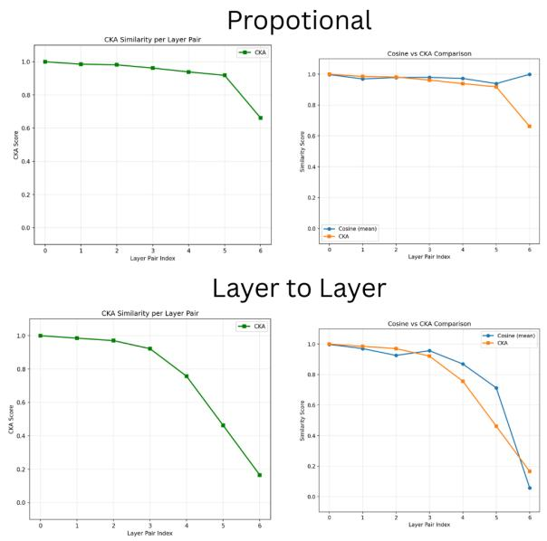
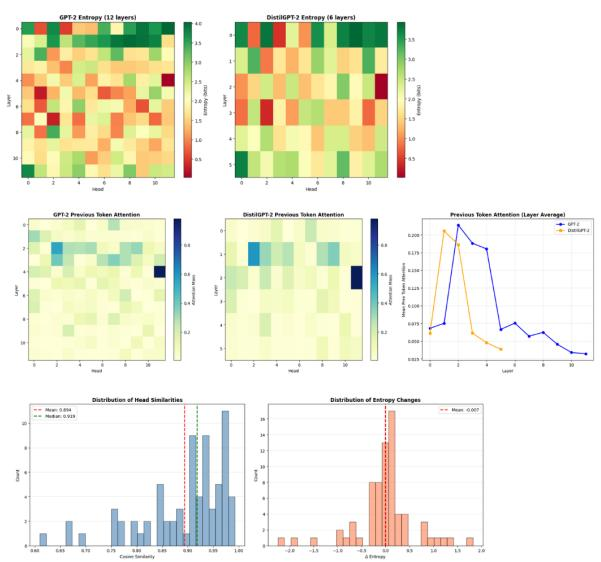
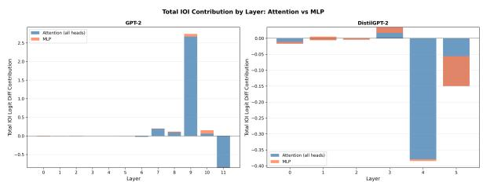
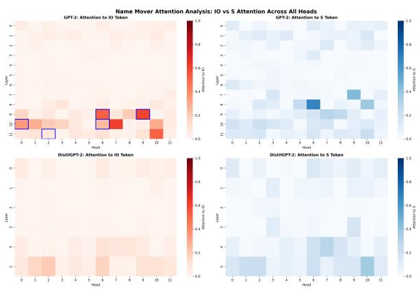
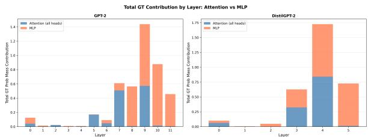

# What Survives Distillation? A Mechanistic Interpretability Study of GPT-2 and DistilGPT-2

Nabeelah Faumi

Informatics Institute of Technology   
57, Ramakrishna Road, Colombo 06, Sri Lanka nabeelahfaumi@gmail.com

## Abstract

Knowledge distillation compresses large language models into compact students that preserve aggregate metrics, yet the mechanistic consequences of depth-reduction distillation remain largely uncharacterized. This work applies linear CKA, logit lens analysis, attention pattern decomposition, sparse autoencoder feature statistics, and activation patching to compare GPT-2 and its six-layer student DistilGPT-2 across two canonical circuits: the Indirect Object Identification (IOI) circuit and the Greater-Than (GT) circuit. The results reveal a compression-collapse dichotomy: the IOI circuit suffers complete mechanistic collapse (DistilGPT-2: 35.2% accuracy vs. 94.8%, zero name-mover preservation), while the GT circuit survives with 87.7% task performance recovery through active remapping of the teacher’s layer-9 comparison head into student layer 4 (mean Pearson r = 0.945). These findings demonstrate that circuit compressibility governs mechanistic survival under distillation, and that aggregate metrics are insufficient diagnostics for circuit integrity.

## 1 Introduction

Large language models (LLMs) exhibit remarkable capabilities, but their sheer scale poses significant computational challenges for deployment. Knowledge distillation trains a compact student on soft targets from a larger teacher, enabling compression while mimicking the teacher’s generalization (Hinton et al., 2015). While distillation often successfully preserves aggregate metrics like validation perplexity, it remains an open question how severe architectural truncation affects the precise, underlying algorithms the model has learned. Prior work establishes that compression can degrade circuit integrity and alter feature representations (Lindner et al., 2023; Bereska and Gavves, 2024), but the specific mechanistic consequences of distillation-induced depth reduction remain largely

Deshan Sumanathilaka

Informatics Institute of Technology   
57, Ramakrishna Road, Colombo 06, Sri Lanka deshan.s@iit.ac.lk

uncharacterized. Mechanistic interpretability provides a framework for addressing this blind spot by reverse-engineering neural networks into humanunderstandable computational subgraphs, known as circuits (Elhage et al., 2021; Olah et al., 2020).

This work investigates the mechanistic impact of depth-reduction distillation. It focuses on DistilGPT-2 (Sanh et al., 2019), a 6-layer student distilled from the 12-layer GPT-2 teacher (Radford et al., 2019). This drastic depth reduction poses a critical structural challenge: many welldocumented higher-order reasoning behaviors in GPT-2 depend crucially on late-layer interactions. For example, both the Indirect Object Identification (IOI) circuit (Wang et al., 2022) and the Greater-Than (GT) circuit (Hanna et al., 2023) rely heavily on highly specialized attention heads located in layers 9-11. Because the student model is only 6 layers deep, these components have no direct structural counterpart. This raises two central research questions: do the internal representations of DistilGPT-2 remain similar to those of GPT-2 after depth halving (RQ1), and does distillation preserve the computational circuits responsible for higherorder reasoning, and if so, how does the student compensate for the absence of essential upper-layer components (RQ2).

To answer this, a suite of representational and causal probes, including representational similarity analysis, direct logit attribution (Elhage et al., 2022), and activation patching (Meng et al., 2022), is applied to track circuit preservation across the distillation gap. A natural question is whether circuit preservation matters at all if task performance is maintained. We argue it does, for two reasons. First, the IOI and GT circuits are among the most causally validated subgraphs in any language model, established through convergent evidence from activation patching, path patching, and direct logit attribution across independent studies (Wang et al., 2022; Hanna et al., 2023); they are not arbitrary correlational subgraphs but confirmed computational mechanisms. Second, and more critically, the IOI result we report is not a performance degradation but a sign reversal: DistilGPT-2 achieves a negative mean logit difference (−0.467), meaning the model is actively misled rather than merely uncertain, failure mode entirely invisible to aggregate metrics, the core motivation for circuit-level analysis.

We find a striking dichotomy in how different computational mechanisms survive depth halving. One circuit collapses entirely, the other is actively remapped into the student’s shallower stack, detailed in §5 and §6. By contrasting a circuit that collapses with one that compresses, this sheds light on the inductive biases of the distillation process.

The main contributions are as follows:

• Provide a comprehensive, circuit-level analysis comparing a depth-distilled model to its teacher, quantifying the mechanistic impact of structural truncation.

• Demonstrate that complex, multi-stage computational pipelines (such as the IOI circuit) fail to survive standard distillation when critical late-layer components are excised.

• Discover that the student model can successfully compress and remap specific cognitive algorithms (such as the GT circuit), migrating late-layer mechanisms into its available upper layers to preserve task functionality.

In the following sections, we review related work, outline our experimental setup, present our results, and conclude with a discussion and conclusion.

## 2 Related Work

Mechanistic Interpretability of GPT-2. Circuit analysis decomposes neural networks into functionally distinct sub-networks using causal interventions (Olah et al., 2020; Cammarata et al., 2020). In GPT-2, two circuits are directly relevant to this work: the Indirect Object Identification (IOI) circuit (Wang et al., 2022), a multi-stage pipeline of name-mover, S-inhibition, and induction heads spanning layers 0-11; and the Greater-Than (GT) circuit (Hanna et al., 2023), in which year-encoding heads feed comparison heads in layers 9-11. Activation patching (Meng et al., 2022), and path patching (Goldowsky-Dill et al., 2023) establish causal responsibility at the head and pathway level, respectively, while Direct Logit Attribution (Elhage et al., 2022) provides a complementary noninterventional decomposition. Sparse autoencoders (Bricken et al., 2023; Cunningham et al., 2023) extend circuit analysis to the feature level by decomposing polysemantic residual-stream activations into monosemantic feature dictionaries.

Knowledge Distillation. Knowledge distillation trains a compact student on soft targets from a larger teacher, enabling it to mimic the teacher’s generalization while maintaining a smaller architecture (Hinton et al., 2015). DistilGPT-2 (Sanh et al., 2019) reduces GPT-2’s depth to six layers by initializing from every other teacher layer and combining a language-modeling and distillation objective, thereby preserving embedding dimensionality throughout.

Compression and Interpretability. Prior work establishes that compression can degrade circuit integrity and alter feature representations (Lindner et al., 2023; Bereska and Gavves, 2024), but focuses primarily on pruning and quantization (Hatefi et al., 2025; Chhabra and Khalili, 2025). SAEbased analysis reveals representational changes under compression can be invisible to standard metrics (Malik et al., 2025; Ayonrinde et al., 2024). Most closely related, Wu et al. (2024); Haskins and Adams (2025); Baek and Tegmark (2025) show distillation induces simplicity bias, component reorganisation, and unique feature directions across model families.

## 3 Background and Models

Mechanistic interpretability (Elhage et al., 2021; Olah et al., 2020) reverse-engineers neural network algorithms at the level of attention heads and residual-stream components. The residual stream (Elhage et al., 2021) treats activations as a running sum of additive contributions from each head and MLP, enabling direct logit attribution (DLA). A circuit (Olah et al., 2020) is a minimal subgraph causally sufficient for a given behaviour. The IOI and GT circuits both depend critically on upperlayer interactions structurally absent in a six-layer student.

Representational similarity. Debiased linear CKA (Kornblith et al., 2019) compares activations across models. Let $H _ { X } = \widehat { \mathrm { H S I C } } ( X X ^ { \top } , X X ^ { \top } )$ $\begin{array} { r l r } { H _ { Y } } & { { } = } & { \widehat { \mathrm { H S I C } } ( Y Y ^ { \top } , Y Y ^ { \top } ) } \end{array}$ , and $\begin{array} { r l } { H _ { X Y } } & { { } = } \end{array}$ $\widehat { \mathrm { H S I C } } ( \boldsymbol { X } \boldsymbol { X } ^ { \top } , \boldsymbol { Y } \boldsymbol { Y } ^ { \top } )$ . Then,

$$
\operatorname { C K A } ( X , Y ) = { \frac { H _ { X Y } } { \sqrt { H _ { X } H _ { Y } } } } .\tag{1}
$$

Here, HSIC\ denotes the unbiased Hilbert–Schmidt Independence Criterion estimator (Song et al., 2012), which is invariant to orthogonal transformations and isotropic scaling.

Sparse autoencoders (Cunningham et al., 2023; Bricken et al., 2023) decompose residual-stream activations into sparse, interpretable feature directions. Pre-trained GPT-2 SAEs (Conmy et al., 2023) (gpt2-small-res-jb) are applied to both models at matched layers as a fixed reference basis, testing whether DistilGPT-2’s representations lie in the same sparse feature subspace.

Models. GPT-2 (Radford et al., 2019) is a 12-layer decoder-only transformer $( d _ { \mathrm { m o d e l } } = 7 6 8 .$ 12 heads, ∼117M parameters) and serves as the teacher. DistilGPT-2 (Sanh et al., 2019), the student, retains the same embedding dimensionality while halving the depth to 6 layers (∼82M parameters), initialised from every other teacher layer and fine-tuned with a combined language-modelling and soft-label distillation objective. IOI circuit heads in layers 6–11 and GT circuit heads in layers 9–11 have no direct counterpart in the student.

## 4 Methods

To answer RQ1, debiased linear CKA (§4.1), logit lens analysis (§4.2), and attention pattern analysis (§4.3) are applied. To answer RQ2, circuitlevel analysis of the IOI and GT tasks is conducted via activation patching and direct logit attribution (§4.5-4.6). All experiments use n=1,000 samples from the TinyStories validation set (Li and Eldan, 2023), filtered to [64, 256] tokens, processed via TransformerLens (Nanda and Bloom, 2022) on a single NVIDIA L4 GPU.

## 4.1 Representational Similarity via CKA

Debiased linear CKA (Kornblith et al., 2019) is computed between residual-stream activations at matched layers. Activations are mean-pooled over non-padding positions:

$$
\mathbf { h } _ { \ell } ^ { ( i ) } = \frac { \sum _ { t = 1 } ^ { T _ { i } } \mathbf { m } _ { t } \odot \mathbf { h } _ { \ell , t } ^ { ( i ) } } { \sum _ { t = 1 } ^ { T _ { i } } \mathbf { m } _ { t } } ,\tag{2}
$$

yielding $X _ { \ell } , Y _ { \ell } \in \mathbb { R } ^ { n \times 7 6 8 }$ in float64. CKA is computed via the unbiased HSIC estimator (Song et al., 2012) with variance terms clamped to $1 0 ^ { - 1 \bar { 6 } }$

Layer correspondence. Two schemes are used: same-index compares layer ℓ of each model for $\ell \in$ {0, 3, 5}; proportional maps DistilGPT-2 layer d to GPT-2 layer $g \ = \ \lfloor d \cdot 1 1 / 5 \rceil$ , giving pairs (G0/D0), (G2/D1), (G4/D2), (G7/D3), (G9/D4), (G11/D5).

## 4.2 Logit Lens Analysis

The tuned logit lens (nostalgebraist, 2020; Belrose et al., 2023) projects each intermediate hidden state through the final layer norm and unembedding matrix:

$$
\hat { p } _ { \ell , t } ^ { ( i ) } = \mathrm { s o f t m a x } \Big ( W _ { U } \mathrm { L N } _ { f } \Big ( \mathbf { h } _ { \ell , t } ^ { ( i ) } \Big ) \Big ) .\tag{3}
$$

Next-token prediction accuracy $\operatorname { A c c } _ { \ell }$ and relative accuracy $r _ { \ell } = \mathrm { A c c } _ { \ell } ^ { \mathrm { d i s t i l } } / \mathrm { A c c } _ { \ell } ^ { \mathrm { G P \bar { T } - 2 } }$ are computed at each layer under both mapping schemes.

## 4.3 Attention Pattern Analysis

Per-head attention patterns are extracted via TransformerLens hooks. Three metric families are computed: Shannon entropy $H _ { l , h }$ and top-k attention mass to quantify head collapse; mean BOS, previous-token, and EOS weights to characterise structural head types (Elhage et al., 2021); and persample cosine similarity between flattened $T \times T$ attention matrices at matched layer pairs, alongside per-head entropy change $\Delta \bar { H } _ { l , h } \mathrm { ~ \bar { = ~ } } H _ { d , h } ^ { \mathrm { d i s t i l } } \mathrm { ~ \bar { - ~ } }$ $H _ { l , h } ^ { \mathrm { G P T 2 } }$

## 4.4 SAE-Based Feature Analysis

Pre-trained GPT-2 SAEs (gpt2-small-res-jb, Conmy et al. 2023; Bloom et al. 2024) are applied to both models’ activations at matched layers as a fixed reference basis, testing whether DistilGPT-$2 \mathrm { { } s }$ representations lie in the same sparse feature subspace as GPT-2. Four metrics are computed: activation rate $\boldsymbol { r } _ { f } ;$ L0 sparsity ${ \bar { L } } _ { 0 }$ and change $\Delta L _ { 0 } ;$ feature survival (Pearson correlation per feature, excluding σ10−8); and magnitude drift $\delta _ { f } = \bar { z } _ { f } ^ { \mathrm { d i s t i l } } / ( \bar { z } _ { f } ^ { \mathrm { G P \bar { T } 2 } } + \varepsilon )$

## 4.5 Indirect Object Identification Circuit Analysis

The IOI task (Wang et al., 2022) uses prompts of the form “[Name1] and [Name2] went to the [place]. [Name] gave a [object] $t o ^ { \prime \prime }$ with 1,000 clean and 1,000 corrupted (ABC) prompts from 15 syntactic templates; the primary metric is logit difference $\Delta ( x ) \ = \ \ell _ { \mathrm { I O } } ( x , t ^ { * } ) \ - \ell _ { \mathrm { S } } ( x , t ^ { * } )$ . Of the 24 IOI circuit heads, 19 (all in layers 6–11)

Table 1: IOI circuit heads by functional class and availability in DistilGPT-2 (layers 0-5 only).
<table><tr><td>Class</td><td>GPT-2 heads</td><td>Available in DistilGPT-2</td></tr><tr><td>Previous token</td><td> $( 0 , 1 ) , ( 2 , 2 ) , ( 4 , 1 1 )$ </td><td>All 3</td></tr><tr><td>Duplicate token</td><td>(0,10),(3,0)</td><td>All 2</td></tr><tr><td>Induction</td><td>(5,1),(5,5),(6,9),(7,2),(7,10)</td><td>2 of 5</td></tr><tr><td>S-inhibition</td><td>(7,3),(7,9),(8,6),(8,10)</td><td>None</td></tr><tr><td>Name mover</td><td>(9,6),(9,9),(10,0),(10,6),(11,2)</td><td>None</td></tr><tr><td> $\mathrm { N e g . }$  name mover</td><td>(10,7),(11,10)</td><td>None</td></tr><tr><td>Backup name mover</td><td> $( 9 , 0 ) , ( 9 , 1 ) , ( 1 0 , 2 ) , ( 1 0 , 1 0 ) , ( 1 1 , 9 )$ </td><td>None</td></tr></table>

are structurally absent in DistilGPT-2; analysis is restricted to the 7 heads in layers 0–5 and 3 inter-head paths whose endpoints lie within layers 0–5. Each head’s causal contribution is measured by replacing its corrupted-run output with the clean-run activation (Meng et al., 2022; Wang et al., 2022); inter-head path patching (Goldowsky-Dill et al., 2023) injects the cleancorrupt difference at the receiver’s residual stream. Significance is assessed with paired t-tests and Wilcoxon tests (Bonferroni correction); effect sizes reported as Cohen’s d. DLA contributions $\delta _ { \mathrm { I O I } } ^ { l , h } =$ $( \mathbf { W } _ { U } \mathrm { L N } _ { f } ( \mathbf { v } ^ { l , h } ) ) _ { \mathrm { I O } } - ( \mathbf { W } _ { U } \mathrm { L N } _ { f } ( \mathbf { v } ^ { l , h } ) ) _ { \mathrm { S } }$ are computed via a single einsum over cached head outputs. To test whether any DistilGPT-2 head assumes the name-mover role, CKA and Pearson correlation between each GPT-2 name-mover head’s attention patterns and the top-20 DistilGPT-2 components (by DLA) are computed on a discovery set (500 prompts) and confirmed on a held-out evaluation set (500 prompts); the name-mover score $\begin{array} { r } { \mathrm { N M } ( l , h ) = \mathbb { E } [ \hat { \sum } _ { i \in \mathrm { I O } } \hat { \alpha } _ { t ^ { * } , i } ^ { l , h } - \sum _ { j \in \mathrm { S } } { \alpha _ { t ^ { * } , j } ^ { l , h } } ] } \end{array}$ quantifies IO-selective attention.

## 4.6 Greater-Than Circuit Analysis

The GT task (Hanna et al., 2023) uses prompts of the form “The [noun] lasted from the year [XX][YY] to the year $I X X J ^ { \prime \prime }$ with 1,000 clean and 1,000 corrupted prompts; the primary metric is GT probability mass ${ \mathrm { G T P r o b } } ( x , t ^ { * } ) \ =$ $\begin{array} { r l } { \sum _ { y y > Y Y } p ( y y } & { { } | \quad x , t ^ { * } ) } \end{array}$ Of the six GT circuit heads, only the two year-encoding heads $\{ ( 0 , 1 ) , ( 1 , 5 ) \}$ exist in DistilGPT-2; all comparison and output-computation heads in layers 9– 11 are absent. The same patching procedure as IOI is applied, with scores normalised by the noise ceiling $\hat { s } _ { l , h } ~ = ~ s _ { l , h } / ( \mathrm { G T P r o b _ { c l e a n } } ~ - ~$ $\mathrm { G T P r o b } _ { \mathrm { c o r r u p t } } )$ GT DLA scores $\begin{array} { r l } { \delta _ { \mathrm { G T } } ^ { l , h } } & { { } = } \end{array}$ $\begin{array} { r } { \sum _ { y y > Y Y } \mathrm { s o f t m a x } ( \mathbf { W } _ { U } \mathrm { L N } _ { f } ( v ^ { l , h } ) ) _ { y y } } \end{array}$ give each component’s contribution to GT probability mass. The same discovery-evaluation matching procedure tests whether any DistilGPT-2 head replicates GPT-

2’s comparison head (9,1).

## 5 Results

## 5.1 Perplexity Baseline

Table 2 reports perplexity for both models on TinyStories and WikiText-2, establishing that aggregate metrics appear reasonable despite the circuit-level collapse documented in the main paper.

The perplexity gap $( \Delta = 6 . 0 1$ on TinyStories, $\Delta = 1 6 . 3 1$ on WikiText-2) is substantial in absolute terms but does not signal mechanistic failure: the student retains 87.7% GT circuit performance while showing 52% higher perplexity, and loses the IOI circuit entirely while still producing fluent text. This illustrates the central claim that perplexity is an insufficient diagnostic for circuit integrity.

## 5.2 Representational Similarity via CKA

Under proportional mapping (Figure 1), similarity degrades monotonically with depth: early layers are near-perfectly aligned $( \mathbf { C } \mathbf { K } \mathbf { A } = 0 . 9 9 9 8 .$ cosine = 0.9977), middle layers retain strong similarity $( \mathrm { C K A } = ~ 0 . 9 6 7 )$ , and late layers fall to CKA = 0.790. Overall means are CKA = $0 . 9 2 1 \pm 0 . 1 0 9$ and cosine = $= 0 . 9 7 7 \pm 0 . 0 1 9$ . Under same-index mapping, late-layer degradation is severe $( \mathrm { C K A } ~ = ~ 0 . 3 1 4 .$ cosine = 0.385 at layer 5), with overall means dropping to CKA $= 0 . 7 5 2 \pm 0 . 2 9 8$ . The contrast between schemes is informative: the same-index collapse at layer 5 is substantially recovered under proportional mapping $( \mathrm { C K A 0 . 3 1 4 } \to 0 . 7 9 0 )$ , showing the student compresses the teacher’s representational trajectory into fewer steps rather than truncating it.

## 5.3 Logit Lens

Under proportional mapping, DistilGPT-2 consistently achieves higher relative accuracy than its matched GPT-2 counterpart at every layer except the final (Table 3), with r ranging from 0.97 (D5/G11) to 2.10 (D1/G2). Under same-index mapping, the picture reverses: DistilGPT-2 underperforms at every layer with r up to 3.95 at L4, reflecting how much representational work the teacher’s upper layers perform.

Table 2: Perplexity comparison on TinyStories validation and WikiText-2 test sets.
<table><tr><td>Model</td><td>Layers</td><td>Params</td><td>PPL (TinyStories)</td><td>PPL (WikiText-2)</td></tr><tr><td>GPT-2</td><td>12</td><td>124M</td><td>11.54</td><td>33.02</td></tr><tr><td>DistilGPT-2</td><td>6</td><td>82M</td><td>17.55 (+52.1%)</td><td>49.33 (+49.4%)</td></tr></table>

Table 3: Extended logit lens accuracy comparison including mean probability assigned to correct next token (p¯ℓ).
<table><tr><td>Pair</td><td>GPT-2 l</td><td>Distil l</td><td>∆ Acc</td><td> $r _ { \ell }$ </td></tr><tr><td>D0/G0</td><td>0</td><td>0</td><td>-0.005</td><td>1.13</td></tr><tr><td>D1/G2</td><td>2</td><td>1</td><td>-0.039</td><td>2.10</td></tr><tr><td>D2/G4</td><td>4</td><td>2</td><td>-0.021</td><td>1.32</td></tr><tr><td>D3/G6</td><td>6</td><td>3</td><td>-0.030</td><td>1.28</td></tr><tr><td>D4/G8</td><td>8</td><td>4</td><td>-0.068</td><td>1.35</td></tr><tr><td>D5/G11</td><td>11</td><td>5</td><td>+0.006</td><td>0.97</td></tr></table>

  
Figure 1: Layer-wise CKA similarity under proportional mapping (top) and same-index mapping (bottom). Latelayer CKA collapses to 0.314 at layer 5 under sameindex matching and is partially recovered under proportional mapping (0.790). Cosine similarity results agree in direction throughout.

## 5.4 Attention Pattern Analysis

Both models show broadly similar entropy profiles (GPT-2: 2.001 bits, DistilGPT-2: 2.094 bits), with DistilGPT-2 heads marginally more distributed than the teacher’s. Previous-token attention diverges at layer 1 (student ≈ 0.36 vs teacher ≈ 0.24), suggesting the student front-loads local token-copying into early layers. Under proportional mapping, perhead cosine similarity between matched attention patterns is $0 . 8 9 4 \pm 0 . 0 8 6$ (range [0.610, 0.993]); same-index mapping drops to $0 . 6 3 1 { \pm } 0 . 2 5 5$ (range [0.038, 0.981]), consistent with the CKA finding that same-index pairs are poorly matched beyond the first few layers.

  
Figure 2: Attention pattern analysis. Top: entropy heatmaps for GPT-2 and DistilGPT-2 (Q1). Middle: previous-token attention heatmaps and layer averages; student peaks earlier at layer 1 (Q2). Bottom: distributions of per-head cosine similarity (mean 0.894) and entropy change (mean −0.007 bits) under proportional mapping (Q3).

## 5.5 SAE Feature Analysis

Under same-index matching, feature survival and cosine similarity degrade sharply with depth (Appendix Table 9): at layer 5, survival is 0.086 and reconstruction error is 34.9× the teacher’s. Under proportional matching, the early pair (G1/D0)

shows near-zero survival (0.0002), reflecting feature divergence within that specific layer pair rather than a matching scheme artefact; mid- and latepipeline pairs recover to survival $\approx 0 . 5 3$ and cosine 0.927, with magnitude drift $\delta \approx 0 . 5 1 – 0 . 5 5$

## 5.6 Indirect Object Identification Circuit Preservation

GPT-2 achieves a mean logit difference of $2 . 9 4 2 \pm$ 1.797 and 94.8% accuracy on the IOI task. DistilGPT-2 fails completely: logit difference $- 0 . 4 6 7 { \scriptstyle \pm 1 . 3 3 5 }$ , accuracy 35.2%. This is below the 50% chance level for a two-name choice (one-sided binomial test, $n = 1 , 0 0 0 , p < 0 . 0 0 1 )$ , so the student is systematically wrong rather than guessing. The negative logit difference indicates the model actively favours the subject name over the indirect object, a sign reversal, not merely a performance gap. One possible explanation, which we do not test, is a repeated-name heuristic: in IOI prompts the subject appears twice and the indirect object once, so a model that favours frequently seen names would produce exactly this sign. DLA confirms no component provides meaningful positive attribution the student’s peak layer contribution is 0.0168 vs GPT $2 \mathrm { : s : 2 . 7 4 }$ at layer 9, roughly 160× smaller, and all IOI circuit classes score approximately zero (Fig ure 3). Activation patching of the 7 available heads (Table 4: three previous-token, two duplicate-token, two induction) yields negligible recovery; induction heads show a small effect (Cohen’s $d = 0 . 2 9 8$ $p < 0 . 0 0 1 )$ but the critical PT→IND pathway is non-significant $( d = 0 . 0 3 1 , p = 0 . 3 2 9 )$ . Namemover matching (Figure 4) identifies DistilGPT-2 candidates with CKA between 0.18 and 0.52, and attention-pattern correlation that ranges from weakly negative $( r \approx - 0 . 1 5$ for the layer-9 heads) to strongly positive $( r \approx 0 . 4 4 \ – 0 . 7 8$ for the layer-10 and layer-11 heads). However, no matched head reproduces IO-selective attention: name-mover score preservation is at most 0% for every match, so pattern similarity alone does not indicate that the name-mover function has been remapped. This confirms that soft-label distillation does not force remapping of critical late-layer IOI functionality.

## 5.7 Greater-Than Circuit Preservation and Compression

DistilGPT-2 maintains 87.3% accuracy and GT probability mass 0.750 (vs GPT-2’s 94.0% and 0.855), recovering 87.7% of teacher performance. DLA reveals an active circuit shift: GPT-2’s peak contribution is at layer 9 (L9H1, L9MLP, L10MLP), while DistilGPT-2’s shifts to layer 4 (L4MLP, L4H1, L5MLP) (Figure 5). DistilGPT-2’s L4H1 replicates GPT-2’s L9H1 comparison head with mean Pearson $r = 0 . 9 4 5 \pm 0 . 0 7 9$ (median $r = 0 . 9 8 1 )$ , confirming the student embeds the teacher’s comparison mechanism at the functionally analogous position in its shallower stack. Table 5 reports per-example YY-token attention weights for five representative examples.

  
Figure 3: DLA across layers for the IOI task. GPT-2 shows strong positive contributions from layers 9- 10; DistilGPT-2 shows near-zero attribution across all available layers.

  
Figure 4: Attention heatmaps for GPT-2 name-mover heads and their closest DistilGPT-2 matches. Matched student heads fail to exhibit IO-selective attention.

Both heads consistently attend to the YY token across all five examples (100% detection rate), and the full-pattern Pearson correlation of $r =$ $0 . 9 4 5 \pm 0 . 0 7 9$ (median 0.981) confirms that the student’s L4H1 replicates the teacher’s L9H1 at the level of individual attention weights, not merely in aggregate statistics.

## 5.7.1 GT Circuit: Head-Level Activation Patching

Year-encoding heads {(0,1),(1,5)} are the only GT circuit heads available in DistilGPT-2 (layers 0- 5); all year-difference, comparison, and outputcomputation heads in layers 9-11 are absent, and no valid inter-head paths exist within layers 0-5, so path patching was not applicable.

Table 4: Full name-mover head matching results across discovery and evaluation sets.
<table><tr><td>GPT-2</td><td>Distil</td><td>Disc CKA</td><td>Eval CKA</td><td>Disc r</td><td>Eval r</td><td>NM Pres%</td></tr><tr><td>L9H6</td><td>L0H1</td><td>0.4659</td><td>0.4592</td><td>-0.1535</td><td>-0.1514</td><td>0.0%</td></tr><tr><td>L9H9</td><td>L0H1</td><td>0.3209</td><td>0.3261</td><td>-0.1391</td><td>-0.1378</td><td>0.0%</td></tr><tr><td>L10H0</td><td>L1H6</td><td>0.5077</td><td>0.5150</td><td>0.4597</td><td>0.4417</td><td>-14.6%</td></tr><tr><td>L10H6</td><td>L1H6</td><td>0.3629</td><td>0.3926</td><td>0.6507</td><td>0.6484</td><td>-21.3%</td></tr><tr><td>L11H2</td><td>L1H6</td><td>0.2073</td><td>0.1784</td><td>0.7802</td><td>0.7781</td><td>nan</td></tr></table>

Table 5: YY-token attention weights for DistilGPT-2 L4H1 and GPT-2 L9H1 at the prediction position, across five representative GT examples.
<table><tr><td rowspan="2">Year</td><td rowspan="2">YY</td><td colspan="2">Attention to YY token</td><td rowspan="2">Pearson r (full pattern)</td></tr><tr><td>GPT-2 L9H1</td><td>Distil L4H1</td></tr><tr><td>1102</td><td>02</td><td>0.099</td><td>0.156</td><td></td></tr><tr><td>1503</td><td>03</td><td>0.239</td><td>0.175</td><td></td></tr><tr><td>1804</td><td>04</td><td>0.870</td><td>0.871</td><td></td></tr><tr><td>1505</td><td>05</td><td>0.085</td><td>0.233</td><td></td></tr><tr><td>1006</td><td>06</td><td>0.082</td><td>0.091</td><td></td></tr><tr><td colspan="5">Mean Pearson r (full attention pattern,  $n = 1 0 0 0 )$  0.945 ± 0.079</td></tr><tr><td colspan="3">Median Pearson r Proportion with  $r > 0 . 8$ </td><td>0.981 93.6%</td></tr></table>

  
Figure 5: DLA for the GT task. DistilGPT-2 shifts peak attribution to layer 4, functionally replacing GPT-2’s layer 9.

Both year-encoding heads show strong, significant causal contributions in DistilGPT-2 (normalised scores 0.517 and 0.465), comparable to GPT-2 (0.606 and 0.557). The overall effect size is large (Cohen’s $d = 0 . 6 8 1 )$ , confirming that the early-stage GT computation is causally preserved in the student. Path patching was not performed as no inter-head paths have both endpoints within layers 0-5.

## 6 Discussion

## 6.1 RQ1: Representational Similarity After Depth Halving

Three consistent patterns emerge across CKA, logit lens, attention analysis, and SAE feature statistics (§4.1–§4.4).

Early layers are near-identical, late layers diverge. Proportional-mapping CKA and per-head attention cosine similarity are both near 1.0 at the first layer pair, consistent with the student’s everyother-layer initialisation, while same-index CKA collapses to 0.314 by layer 5 and SAE feature survival falls to 0.086 with reconstruction error 34.9× the teacher’s. The logit lens shows the same trend: same-index layer-matched representations become markedly less predictive of the next token with depth.

The student compresses rather than truncates. The contrast between mapping schemes is itself informative: the same-index collapse at layer 5 is largely recovered under proportional mapping, showing that DistilGPT-2’s final layer is more similar to GPT-2’s layer 11 than to GPT-2’s layer 5. The logit lens reinforces this proportional-mapping relative accuracy exceeds 1 at every layer but the last and functional SAE survival recovers to ≈ 0.53 at mid- and late-pipeline pairs (magnitude drift $\delta \approx 0 . 5 1 \mathrm { - } 0 . 5 5 )$

## 6.2 RQ2: Circuit Preservation Under Depth Halving

Distillation preserves circuits whose critical computations fit within the student’s available depth and destroys those whose pipelines extend beyond it.

The IOI circuit collapses completely. The negative mean logit difference (§5.6) is a sign reversal, not merely a performance gap, and DLA confirms no component provides meaningful positive attribution. Activation patching of the available heads yields negligible recovery, and name-mover head matching yields candidates with moderate CKA but no matched head reproduces IO-selective attention, despite some showing moderate-to-high attentionpattern correlation. The IOI circuit suffers from a mechanistic collapse: induction heads show a small, significant effect, but without downstream name-movers, the pipeline cannot complete.

Table 6: GT circuit head-level activation patching results. Normalised scores use noise ceiling sˆ = $s / ( \mathrm { G T P r o b } _ { \mathrm { c l e a n } } - \mathrm { G T P r o b } _ { \mathrm { c o r r u p t } } )$ , noise ceiling = 0.547.
<table><tr><td>Head</td><td>Class</td><td colspan="2">Raw score</td><td colspan="2">Normalised score</td><td>Sig.</td></tr><tr><td></td><td></td><td>GPT-2</td><td>Distil</td><td>GPT-2</td><td>Distil</td><td></td></tr><tr><td>L0H1</td><td>Year encoding</td><td>0.332</td><td>0.283</td><td>0.606</td><td>0.517</td><td>√</td></tr><tr><td>L1H5</td><td>Year encoding</td><td>0.305</td><td>0.255</td><td>0.557</td><td>0.465</td><td>V</td></tr><tr><td colspan="2">Overall (Cohen&#x27;s d)</td><td colspan="5">d = 0.681, p &lt; 0.0001</td></tr></table>

The GT circuit survives through active remapping. In contrast, DLA reveals a coherent shift of peak contribution from the teacher’s layer 9 to the student’s layer 4, and the student’s L4H1 replicates the attention pattern of GPT-2’s L9H1 with mean Pearson r = 0.945, a level of alignment that stands in stark contrast to the IOI name-mover matching results.

Compressibility as a candidate explanation. This dichotomy is consistent with a circuit compressibility account: circuits whose critical computations fit within the student’s available depth survive, while those whose pipelines extend beyond it collapse. The result is structural incompleteness rather than graceful degradation. Confirming compressibility as a general principle requires testing intermediate-depth circuits across additional model pairs, which we identify as the most important extension of this work.

## 7 Conclusion

This work presented a mechanistic interpretability study of depth-reduction distillation, comparing GPT-2 and DistilGPT-2 across representational and causal probes. The finding is a compressioncollapse dichotomy: distillation preserves circuits whose critical computations fit within the student’s available depth and destroys those whose pipelines extend beyond it. These findings suggest that aggregate metrics like perplexity are insufficient for assessing mechanistic preservation; practitioners should evaluate circuit integrity directly and use distillation objectives that align intermediate representations at functionally critical layers.

## Limitations

Scope. The analysis is restricted to two circuits and a single teacher-student pair. Whether the compression-collapse dichotomy generalises to other circuits, distillation methods, or model families remains open.

IOI null result. The IOI null result does not rule out DistilGPT-2 solving a residual version of the task via an alternative mechanism. Future work could apply causal scrubbing (Chan et al., 2022) or automated circuit discovery (Conmy et al., 2023) to search for such subgraphs.

SAE reference basis. Using pre-trained GPT-2 SAEs as a fixed reference basis introduces a systematic blind spot to student-only features. Training student-specific SAEs would resolve this.

Incomplete verification of GT circuit survival. A complete mechanistic account of GT circuit survival would require verifying the full circuit beyond the key head match (L4H1 ↔ L9H1). This includes the year-encoding heads {(0, 1), (1, 5)} and the causal paths from year encoding through comparison to output computation, tested with both activation patching and path patching. Confirming that DistilGPT-2 replicates not just the comparison head’s attention pattern but the full causal chain would substantially strengthen the claim of circuit survival.

## References

Kola Ayonrinde, Michael T Pearce, and Lee Sharkey. 2024. Interpretability as compression: Reconsidering sae explanations of neural activations. In NeurIPS 2024 Workshop on Scientific Methods for Understanding Deep Learning.

David D Baek and Max Tegmark. 2025. Towards understanding distilled reasoning models: A representational approach. arXiv preprint arXiv:2503.03730.

Nora Belrose, Zach Furman, Logan Smith, Danny Halawi, Igor Ostrovsky, Lev McKinney, Stella Biderman, and Jacob Steinhardt. 2023. Eliciting latent predictions from transformers with the tuned lens. arXiv preprint arXiv:2303.08112.

Leonard Bereska and Efstratios Gavves. 2024. Mechanistic interpretability for ai safety–a review. arXiv preprint arXiv:2404.14082.

Joseph Bloom, Curt Tigges, Anthony Duong, and David Chanin. 2024. Saelens. https://github.com/ decoderesearch/SAELens.

Trenton Bricken, Xander Davies, Deepak Singh, Dmitry Krotov, and Gabriel Kreiman. 2023. Sparse distributed memory is a continual learner. arXiv preprint arXiv:2303.11934.

Nick Cammarata, Shan Carter, Gabriel Goh, Chris Olah, Michael Petrov, Ludwig Schubert, Chelsea Voss, Ben Egan, and Swee Kiat Lim. 2020. Thread: circuits. Distill, 5(3):e24.

Lawrence Chan, Adria Garriga-Alonso, Nicholas Goldowsky-Dill, Ryan Greenblatt, Jenny Nitishinskaya, Ansh Radhakrishnan, Buck Shlegeris, and Nate Thomas. 2022. Causal scrubbing: A method for rigorously testing interpretability hypotheses. In AI Alignment Forum, volume 2.

Vishnu Kabir Chhabra and Mohammad Mahdi Khalili. 2025. Towards understanding and improving refusal in compressed models via mechanistic interpretability. arXiv preprint arXiv:2504.04215.

Arthur Conmy, Augustine Mavor-Parker, Aengus Lynch, Stefan Heimersheim, and Adrià Garriga-Alonso. 2023. Towards automated circuit discovery for mechanistic interpretability. Advances in Neural Information Processing Systems, 36:16318–16352.

Hoagy Cunningham, Aidan Ewart, Logan Riggs, Robert Huben, and Lee Sharkey. 2023. Sparse autoencoders find highly interpretable features in language models. arXiv preprint arXiv:2309.08600.

Nelson Elhage, Tristan Hume, Catherine Olsson, Nicholas Schiefer, Tom Henighan, Shauna Kravec, Zac Hatfield-Dodds, Robert Lasenby, Dawn Drain, Carol Chen, et al. 2022. Toy models of superposition. arXiv preprint arXiv:2209.10652.

Nelson Elhage, Neel Nanda, Catherine Olsson, Tom Henighan, Nicholas Joseph, Ben Mann, Amanda Askell, Yuntao Bai, Anna Chen, Tom Conerly, et al. 2021. A mathematical framework for transformer circuits. Transformer Circuits Thread, 1(1):12.

Nicholas Goldowsky-Dill, Chris MacLeod, Lucas Sato, and Aryaman Arora. 2023. Localizing model behavior with path patching. arXiv preprint arXiv:2304.05969.

Michael Hanna, Ollie Liu, and Alexandre Variengien. 2023. How does gpt-2 compute greater-than?: Interpreting mathematical abilities in a pre-trained language model. Advances in Neural Information Processing Systems, 36:76033–76060.

Reilly Haskins and Benjamin Adams. 2025. Distilled circuits: A mechanistic study of internal restructuring in knowledge distillation. arXiv preprint arXiv:2505.10822.

Sayed Mohammad Vakilzadeh Hatefi, Maximilian Dreyer, Reduan Achtibat, Patrick Kahardipraja, Thomas Wiegand, Wojciech Samek, and Sebastian Lapuschkin. 2025. Attribution-guided pruning for compression, circuit discovery, and targeted correction in llms. arXiv preprint arXiv:2506.13727.

Geoffrey Hinton, Oriol Vinyals, and Jeff Dean. 2015. Distilling the knowledge in a neural network. arXiv preprint arXiv:1503.02531.

Simon Kornblith, Mohammad Norouzi, Honglak Lee, and Geoffrey Hinton. 2019. Similarity of neural network representations revisited. In International conference on machine learning, pages 3519–3529. PMlR.

Yuanzhi Li and Ronen Eldan. 2023. Tinystories: How small can language models be and still speak coherent english.

David Lindner, János Kramár, Sebastian Farquhar, Matthew Rahtz, Tom McGrath, and Vladimir Mikulik. 2023. Tracr: Compiled transformers as a laboratory for interpretability. Advances in Neural Information Processing Systems, 36:37876–37899.

Nikita Malik, Pratinav Seth, Neeraj Kumar Singh, Chintan Chitroda, and Vinay Kumar Sankarapu. 2025. Interpretability-aware pruning for efficient medical image analysis. arXiv preprint arXiv:2507.08330.

Kevin Meng, David Bau, Alex Andonian, and Yonatan Belinkov. 2022. Locating and editing factual associations in gpt. Advances in neural information processing systems, 35:17359–17372.

Neel Nanda and Joseph Bloom. 2022. Transformerlens. https://github.com/TransformerLensOrg/ TransformerLens.

nostalgebraist. 2020. Interpreting gpt: The logit lens. https://www. lesswrong.com/posts/AcKRB8wDpdaN6v6ru/ interpreting-gpt-the-logit-lens. Less-Wrong post.

Chris Olah, Nick Cammarata, Ludwig Schubert, Gabriel Goh, Michael Petrov, and Shan Carter. 2020. Zoom in: An introduction to circuits. Distill, 5(3):e00024– 001.

Alec Radford, Jeffrey Wu, Rewon Child, David Luan, Dario Amodei, Ilya Sutskever, et al. 2019. Language models are unsupervised multitask learners. OpenAI blog, 1(8):9.

Victor Sanh, Lysandre Debut, Julien Chaumond, and Thomas Wolf. 2019. Distilbert, a distilled version of bert: smaller, faster, cheaper and lighter. In NeurIPS $E M C ^ { 2 }$ Workshop.

Le Song, Alex Smola, Arthur Gretton, Justin Bedo, and Karsten Borgwardt. 2012. Feature selection via dependence maximization. Journal of Machine Learning Research, 13(5).

Kevin Wang, Alexandre Variengien, Arthur Conmy, Buck Shlegeris, and Jacob Steinhardt. 2022. Interpretability in the wild: a circuit for indirect object identification in gpt-2 small. arXiv preprint arXiv:2211.00593.

Cindy Wu, Ekdeep Singh Lubana, Bruno Kacper Mlodozeniec, Robert Kirk, and David Krueger. 2024. What mechanisms does knowledge distillation distill? In Proceedings ofUniReps: The First Workshop on Unifying Representations in Neural Models, pages 60–75. PMLR.

## A Appendix

## A.1 Distillation Objective Interventions

The analysis characterises the mechanistic consequences of soft-label distillation but does not intervene in the distillation process itself. An important open question is whether alternative objectives, intermediate-layer matching, attention transfer, or circuit-aware distillation losses could preserve circuit integrity during depth reduction. Preliminary evidence from the GT result suggests that even standard distillation can accidentally preserve circuits that are structurally compatible with the student’s depth; targeted objectives might extend this to deeper circuits, such as IOI.

## A.2 SAE Streaming Metrics: Implementation Details

All SAE-based statistics are computed in a single streaming pass over mini-batches of 64 activation vectors to avoid materialising the full sparse feature matrix $Z \in \mathbb { R } ^ { N _ { \mathrm { t o k } } \times d _ { \mathrm { S A E } } }$ in memory. Feature survival (Pearson correlation) is computed via online sufficient statistics, running sums of $z _ { f } , \ z _ { f } ^ { 2 }$ and $z _ { f } ^ { \mathrm { G P T - 2 } } \cdot z _ { f } ^ { \mathrm { d i s t i l } }$ , requiring only a single forward pass over the data. Activations are stored to disk after collection to avoid holding both model weights and SAE weights in GPU memory simultaneously; each SAE is loaded to the CPU and moved to the GPU only for the batch-level encode/decode operations.

A.3 CKA Full Results by Depth and Seed Table 7 reports CKA and cosine similarity broken down by depth quartile under each mapping scheme.

## A.4 Attention Pattern Analysis: Numerical Summary

Table 8 provides numerical summaries of all attention pattern metrics.

## A.5 SAE Feature Analysis Results

Table 7: CKA and cosine similarity by depth quartile under each mapping scheme, reported as mean across seeds {42, 123, 7}.
<table><tr><td>Scheme</td><td>Depth</td><td>CKA</td><td>Cosine</td><td>CKA range</td><td>Cosine range</td></tr><tr><td>Proportional</td><td>Early</td><td>0.9998</td><td>0.9977</td><td></td><td></td></tr><tr><td></td><td>Middle</td><td>0.9668</td><td>0.9749</td><td></td><td></td></tr><tr><td></td><td>Late</td><td>0.7903</td><td>0.9690</td><td></td><td></td></tr><tr><td></td><td>Overall</td><td> $0 . 9 2 1 \pm 0 . 1 0 9$ </td><td> $0 . 9 7 7 \pm 0 . 0 1 9$ </td><td>[0.662, 1.000]</td><td>[0.939, 0.999]</td></tr><tr><td>Same-index</td><td>Early</td><td>0.9998</td><td>0.9977</td><td></td><td>1</td></tr><tr><td></td><td>Middle</td><td>0.9082</td><td>0.9304</td><td></td><td></td></tr><tr><td></td><td>Late</td><td>0.3138</td><td>0.3851</td><td></td><td></td></tr><tr><td></td><td>Overall</td><td> $0 . 7 5 2 \pm 0 . 2 9 8$ </td><td>0.784 ± 0.310</td><td>[0.165, 1.000]</td><td>[0.057, 0.998]</td></tr></table>

Table 8: Attention pattern metrics summary. Head similarity and entropy change reported as mean ± std across 1,000 TinyStories samples.
<table><tr><td>Metric</td><td>GPT-2</td><td>DistilGPT-2</td></tr><tr><td>Mean entropy (bits)</td><td>2.001</td><td>2.094</td></tr><tr><td>Effective support (tokens)</td><td>11.19</td><td>12.14</td></tr><tr><td>Mean top-1 mass</td><td>0.507</td><td>0.493</td></tr><tr><td colspan="3">Cross-model head similarity (proportional mapping)</td></tr><tr><td>Mean cosine sim. Mean ∆H (bits)</td><td></td><td>0.894 ± 0.086 [0.610, 0.993]</td></tr><tr><td></td><td></td><td> $- 0 . 0 0 7 \pm 0 . 6 2 1$ </td></tr><tr><td>Cross-model head similarity (same-index mapping)</td><td></td><td></td></tr><tr><td>Mean cosine sim.</td><td></td><td> $0 . 6 3 1 \pm 0 . 2 5 5 \ [ 0 . 0 3 8 , 0 . 9 8 1 ]$ </td></tr><tr><td>Mean ∆H (bits)</td><td></td><td> $0 . 0 5 9 \pm 1 . 1 0 3$ </td></tr></table>

Table 9: SAE analysis summary across layer pairs.
<table><tr><td>Scheme</td><td>Pair</td><td>Cosine sim.</td><td>Feature survival</td><td> $\Delta L _ { 0 }$ </td></tr><tr><td>Same-index</td><td>L0</td><td>0.989</td><td>0.339</td><td>-2,379</td></tr><tr><td></td><td>L3</td><td>0.887</td><td>0.169</td><td>-1,493</td></tr><tr><td></td><td>L5</td><td>0.655</td><td>0.086</td><td>-7,178</td></tr><tr><td>Proportional</td><td>G1/D0</td><td>0.184</td><td>0.000</td><td>-132</td></tr><tr><td></td><td>G6/D3</td><td>0.927</td><td>0.527</td><td>-68</td></tr><tr><td></td><td>G11/D5</td><td>0.927</td><td>0.529</td><td>-601</td></tr></table>