# semanticfa: An R Package for Response-Free Semantic Factor Analysis of Psychometric Scales

Devon Yanitski and Chris Westbury Department of Psychology, University of Alberta, Edmonton, Alberta, Canada dyanitsk@ualberta.ca

October 28, 2026

## Abstract

The items of a reflective psychometric scale can be read as a proposal about a construct’s structure. Language models make that proposal measurable by converting each item into an embedding, a list of numbers, similar for similar meanings. We introduce semanticfa, an R package for semantic factor analysis, which factors item-embedding similarities. It also interprets factors, flags redundant items, builds short forms, and screens new items. A worked example analyzes the 50-item International Personality Item Pool Big-Five Factor Markers, embedded with Qwen3-Embedding-8B, and compares the results with a factor analysis of 874,434 respondents. Retention criteria tied between five and six factors, and the tie rule kept five. Three corresponded mainly to single domains, and two blended most Extraversion items with five Agreeableness items. Each factor’s congruence with its best-matching human factor (1 = identical) ranged from .92 for Openness to .52 for Agreeableness. Item pairs more similar in meaning tended to be answered more alike (r = .46 with raw responses), but same-domain reversekeyed opposites, answered oppositely, were about as similar as cross-domain pairs (.58 vs. .57). Sign-flipping reverse-keyed items’ embeddings did not improve agreement with raw responses and worsened it with reverse-scored ones. With five factors, a 25-item short form matched the domains better than all 200 random five-per-domain sets, but parallel analysis kept only three. We propose semantic–behavioral coherence, the agreement between semantic and response structures, as a measurable property of a scale, given an embedding model. Semantic factor analysis complements, and does not replace, response-based factor analysis.

Keywords: semantic factor analysis, language models, embeddings, construct validity, scale development, R package

## 1 Introduction

Much of what psychologists measure, from personality traits and attitudes to symptoms of anxiety and depression, is measured through language (Hommel & Arslan, 2025; Kambeitz et al., 2025). The instruments are scales: sets of short statements, called items, that respondents rate for how well each one describes them, such as “I am the life of the party.” for extraversion. Because the attributes these scales target cannot be observed directly, psychologists treat them as constructs. A construct is a theoretical attribute whose standing is inferred from the pattern of people’s answers rather than observed. The standard tool for studying that pattern is factor analysis. It identifies clusters of items whose responses correlate more strongly with one another than with the rest of the scale, and it treats each cluster as the expression of one underlying dimension, called a factor. Each item’s loading is a number that expresses how strongly the item reflects a factor. A scale is considered well built when its items load on the factors that correspond to the constructs they were written to measure.

Factor analysis is almost always run on responses. Before anyone answers a scale, however, its items already exist as sentences, and what those sentences mean shapes much of the structure that factor analysis later finds in the answers. The structure of a scale, in this sense, is the number of factors it has and which items load on each. Items that describe similar behavior in similar words tend to be answered alike, in part because a respondent who endorses one statement tends to endorse another that says much the same thing (Arnulf et al., 2014; Hommel & Arslan, 2025). Semantic factor analysis (SFA) builds on that observation by estimating the structure of a scale from its wording alone. The R package semanticfa (Yanitski & Westbury, 2026) implements SFA, from the item texts to the interpreted factors.

What makes the wording measurable is a kind of language model called a sentenceembedding model. Trained on very large collections of text, such a model learns to represent any sentence as a long list of numbers (4,096 for the model used in this paper), which are the coordinates of a point in a space with that many dimensions. That list is the sentence’s embedding. Training arranges the space so that sentences with similar meanings end up close together, whatever their exact wording (Reimers & Gurevych, 2019). The embeddings of “I am the life of the party.” and “I talk to a lot of diferent people at parties.” therefore lie near each other, while the embeddings of sentences on unrelated topics lie far apart. The similarity of two items can then be expressed as the cosine similarity of their embeddings. If each embedding is drawn as an arrow from the origin of the space to its point, cosine similarity is the cosine of the angle between the two arrows. It approaches 1 when two statements say nearly the same thing and approaches 0 when their meanings are unrelated. In practice, the embeddings from such models all share some similarity, as the internal word representations of contextual language models commonly do (Ethayarajh, 2019), so even unrelated statements score well above 0. This point returns in the subsection on reverse-keyed items. Computing it for every pair of items yields a matrix with the same form as the correlation matrix on which factor analysis normally operates. SFA is factor analysis of that similarity matrix, so no respondent is needed at any stage.

The semanticfa package organizes the analysis into four stages: building the similarity matrix from item embeddings, deciding how many factors it supports, extracting the factors and computing their diagnostics, and interpreting each factor by relating the embeddings of its items to the embeddings of candidate construct names. Beyond these stages, the package ofers refinement tools that use a fitted model to flag redundant items, propose shorter forms, and screen newly written items before they are administered.

SFA does not replace factor analysis of responses. It recovers a second structure over the same items, the semantic structure, which is built from what the items mean rather than from how people answer them. Where the semantic structure and the structure found in responses agree, the items that are similar in meaning are also the items that people answer alike. Where the two diverge, the divergence identifies the items that wording and responses group diferently and can suggest why. We call the degree of agreement between the two structures semantic–behavioral coherence, because the structure found in responses reflects how people behave when they answer the items. In the worked example, that behavioral structure, which we also call the response structure, is the factor structure of the human responses, and the Results call its factors the human factors.

The Introduction develops these ideas in six subsections. It begins with the evidence that item wording predicts how people respond, and then explains how language models turn the meaning of a sentence into numbers, the step on which both that evidence and SFA depend. Once embeddings have been explained, the third subsection considers what the semantic structure of a scale represents and how it relates to the structure found in responses. The fourth addresses the first practical dificulty any user meets, which concerns items worded so that agreeing with them indicates less of the construct, because how an analysis handles these items changes its results. The last two subsections turn from the method to its uses. The fifth describes what semantic structure can do before any data are collected, and the sixth introduces the package together with the worked example that the rest of the paper follows.

## 1.1 Item Wording Predicts How People Respond

This subsection reviews the evidence that a scale’s wording predicts how people respond to it. The evidence runs from single pairs of items to whole scales and then to its limits: how well wording predicts the correlation between two items, how well grouping items by meaning recovers a scale’s intended factors, and what the disagreements between semantic and response-based results reveal.

The wording of items predicts, in part, how responses to them correlate (Arnulf et al., 2014, 2018; Gefen & Larsen, 2017; Hommel & Arslan, 2025; Hussain et al., 2024; Kambeitz et al., 2025; Nimon et al., 2016; Ravenda et al., 2025; Schoenegger et al., 2025; Wulf & Mata, 2025), and in the strongest studies it predicts a substantial share (Arnulf et al., 2014; Hommel & Arslan, 2025). For example, Arnulf et al. (2014) measured the semantic similarity of item pairs in organizational-behavior surveys with methods such as latent semantic analysis. Latent semantic analysis is an early technique that represents each word by the texts in which it occurs and then reduces these representations to a few hundred dimensions (Landauer & Dumais, 1997). Across three samples, semantic similarity explained 47% to 79% of the variance in the correlations observed in responses (the in-sample $R ^ { 2 }$ of regressions over item pairs), and 68% to 87% once the scale each item belonged to was also taken into account. Arnulf et al. (2014) explained the result with what they called the semantic theory of survey response, which holds that the relations among survey items are largely determined by the items’ semantic properties. The program of work that followed is summarized in an editorial by Arnulf et al. (2021). The early methods in this program represented words rather than whole sentences, and on one kind of scale they predicted almost nothing. Item meaning predicted almost nothing about responses to a five-factor personality inventory (Arnulf et al., 2014), and a reanalysis of the same data agreed (Arnulf et al., 2018). The authors tentatively attributed this to how personality inventories are written. They suggested that the items of inventories such as the one they studied sample a wide range of past behaviors, so the answers carry information that the wording does not supply (Arnulf et al., 2018). The worked example in this paper also uses a five-factor personality inventory, and the studies with sentence embeddings described below have since recovered structure in such inventories. Separately, Hommel and Arslan (2025) trained a sentence-embedding model to predict item correlations and tested it on new items in a preregistered study. After adjustment for sampling error, its predictions correlated $r = . 5 9$ with the observed correlations between single items and $r ~ = ~ . 8 4$ with the correlations between whole scales, so the model predicted how whole scales relate more accurately than how single items relate. For the scale-level predictions, the embeddings of items worded against the construct were multiplied by −1 before the embeddings of each scale’s items were averaged, which requires knowing in advance which items are worded that way.

Wording also predicts some properties of single items. In educational testing, the dificulty of an item can be predicted in part from its text (Peters et al., 2025). Dificulty is commonly measured either as the proportion of people who answer the item correctly or as a corresponding parameter of a statistical model of the responses. Item discrimination refers to how sharply an item separates people who are high on the construct from people who are low on it. In one large bank of English language arts items, discrimination was harder to predict from text alone (Han et al., 2025), although language models fine-tuned to answer the items as simulated respondents recovered it better on the items of a Grade 6 English language arts assessment (Ormerod, 2026).

A stronger version of the finding concerns whole factor structures. Grouping items, or facets of items, by the similarity of their meaning, whether by principal component analysis, factor analysis, or clustering, largely recovers the factors that established scales were designed to measure (Casella et al., 2024; Guenole et al., 2025; Kambeitz et al., 2025; Milano et al., 2025). For one clinical scale, a proof of concept found the same factor structure in the semantic similarities as in the response correlations (Ravenda et al., 2025). Guenole et al. (2025) formalized the approach as pseudo-factor analysis, in which the matrix of cosine similarities between embeddings is factor-analyzed as a correlation matrix would be. The embeddings were those of the items, pooled over the items of each facet, or of each facet’s items embedded together as one text. Analyzed at the level of their facets, the five- and six-factor structures of two large personality inventories from the International Personality

Item Pool (IPIP), the IPIP-NEO-300 and the IPIP version of the HEXACO-240, were largely recovered, with the theoretically expected number of factors and an oblique target rotation toward the theoretical structure. The loadings themselves correlated substantially with those from responses but were often not equivalent to them, with Tucker congruence often below .85. Milano et al. (2025) found the same pattern across four scales, including a set of Big Five markers and the Depression Anxiety Stress Scales. In each scale, more than 70% of a construct’s items, on average, had their highest loading on the same principal component, and the items’ semantic loadings correlated with the loadings estimated from responses. The finding extends, in part, to clinical symptom scales (Kambeitz et al., 2025). A cognitive-network analysis of the Depression Anxiety Stress Scales found a related overlap: communities of the items’ words overlapped with the factors found in responses more than random allocations of the same words would (Stanghellini et al., 2024).

The match is strong but not complete. Studies that compared semantic structures with structures derived from responses or surveys have located specific places where the two diverge (Feraco & Tofalini, 2025; Kmetty et al., 2021; Kojima et al., 2026; Milano et al., 2025). Feraco and Tofalini (2025) proposed fitting confirmatory factor models to a matrix of cosine similarities between item embeddings, so that a model can be evaluated before any data are collected. They fitted such models both to the similarities among the items of a character-strengths inventory and to the responses of 31,697 people. A confirmatory factor model specifies in advance which items load on which factors and tests whether that structure fits the data. The semantic similarities correlated only moderately with the response correlations (r = .67). Every model that fit the semantic matrix also fit the responses, but about half of the models that the semantic matrix rejected fit the responses as well. In that study, then, a model that fit the semantic matrix also fit the responses, whereas a model that failed to fit the semantic matrix often fit the responses anyway. In one unpublished study of a single sample and nine dimensions from four scales, the strength of the relation between wording and responses also appeared to vary across dimensions (D. Zhang & Qiu, 2026). Kojima et al. (2026) extracted factors from both embedding similarities and response correlations for 145 psychiatric symptom items in Japanese. Both analyses produced a general factor on which all the items loaded. This factor was nearly identical in the two (congruence = .97), whereas the narrower factors diverged. Congruence measures how similar the loadings of two factors are. A value of 1 means that the two factors have the same pattern of loadings. Insomnia and physical symptoms, for example, formed one factor in the responses but not in the wording, plausibly because they occur together in people, perhaps through bodily or physiological causes, without being described alike. Semantic analyses of personality items also find agreeableness and extraversion items overlapping in meaning (Casella et al., 2024; Milano et al., 2025). One possible reason is that items of both domains describe warmth and sociability. Both studies note, however, that the two constructs are also associated in human responses (Casella et al., 2024; Milano et al., 2025). Such divergences are informative, because they can mark the places where the way a construct is described difers from the way people experience it. For that reason, this paper presents SFA as a complement to response data rather than a replacement.

Together, these studies suggest that much of a scale’s structure is already present in its wording. All of them depend on a step that the next subsection explains, turning the meaning of a sentence into numbers.

## 1.2 Language Models Turn Item Meaning Into Numbers

This subsection explains how the meaning of a sentence is turned into numbers, in four steps that build on one another: the distributional hypothesis about meaning, the word vectors that first applied it, the sentence embeddings that SFA uses, and the cosine similarity that compares them.

The underlying idea is old. Wittgenstein (1953/1967, §43) held that, for a large class of cases, “the meaning of a word is its use in the language.” In the same years, linguists stated a related claim, now called the distributional hypothesis. The hypothesis holds that words that occur in similar contexts tend to have similar meanings and, conversely, that words that difer more in meaning tend to occur in more diferent contexts (Z. S. Harris, 1954; Joos, 1950).

Computational models of meaning apply this idea by learning, for each word, a vector of numbers from the contexts in which the word appears across a large body of text. Mikolov, Chen, et al. (2013) trained a small neural network to predict which words appear near each other and used the network’s internal weights as the word vectors, whereas Pennington et al. (2014) built vectors directly from counts of how often each pair of words occurs near each other. In both kinds of space, words with similar meanings receive similar vectors. Diferences between vectors often capture relations between words as well. For example, the vector for king, minus the vector for man, plus the vector for woman, lies close to the vector for queen, because the diference between king and man is roughly the same as the diference between queen and woman (Mikolov, Yih, & Zweig, 2013).

Although such spaces are built only from where words occur, distances in them predict how people judge and process words (Buchanan et al., 2001; Günther et al., 2019). Similarities between word vectors predict how similar people judge two words to be, nearly as well as people agree with one another (Günther et al., 2019), and the density of a word’s neighborhood in such a space predicts how quickly people recognize it (Buchanan et al., 2001). The spaces even preserve graded features of meaning, such as size. Grand et al. (2022) located each word’s vector along a line running between words of opposite meaning, such as small and large, and the order of the words along that line tracked people’s ratings of everyday words on many, though not all, such features. How closely the order tracked the ratings varied widely from one combination of word category and feature to another.

Scale items are sentences rather than single words, so their meaning depends on how their words combine. Modern language models represent this combination with the transformer architecture, in which the representation of each word can draw on the other words in its sentence (Devlin et al., 2019; Vaswani et al., 2017). A simple way to obtain one vector per sentence is to average the vectors of its words. Averaged in this way, the vectors from the transformer model BERT agreed less with human judgments of sentence similarity than averaged vectors from an older word-level method, GloVe (Reimers & Gurevych, 2019). Reimers and Gurevych (2019) addressed the problem by training the model on pairs of sentences, so that sentences with similar meanings receive similar vectors. The sentenceembedding models described at the start of the paper are likewise trained on pairs of texts, although many difer from this model in architecture and training objective. Their output for a sentence is the embedding that SFA uses. The embeddings in this paper come from one such model, Qwen3-Embedding-8B, which is built on a Qwen3 large language model

(Qwen Team, 2025; Y. Zhang et al., 2025).

SFA compares embeddings with the cosine similarity introduced at the start of the paper. The embeddings of two items with similar meanings, such as “I am the life of the party.” and “I talk to a lot of diferent people at parties.”, point in similar directions and have a high cosine similarity. The embeddings of items with less related meanings point in more diferent directions and have a lower one. Embedding every item and computing the cosine similarity of every pair therefore turns the wording of a scale into a matrix that factor analysis can use. What the factors of that matrix represent is the question the next subsection takes up.

## 1.3 A Scale Has Both a Semantic and a Behavioral Structure

The evidence reviewed so far shows that wording predicts responses, but it does not say what the semantic structure of a scale is evidence of. This subsection argues that the semantic structure is part of what defines a construct, and that its agreement with the structure found in responses is evidence about that construct. The argument has three steps. First, a construct is defined by its relations to behavior and to other constructs, so the relations among the meanings of its items are part of what defines it. Second, a scale’s items are written deliberately to sample the construct, so their meanings are a designed proposal about its structure. Third, the same factor-analytic procedure can be run on either the meanings or the responses, so the agreement between the two results is evidence about the construct. This subsection then states what that agreement can and cannot show and closes with two consequences of the argument, one for naming factors and one for a current critique of rating scales.

The first step concerns what a construct is. Cronbach and Meehl (1955) argued that a construct is defined not by any single operation or criterion but by its place in a nomological network, the set of lawful relations that connect a construct to behavior, to observations, to theory, and to other constructs. Two psychological scales therefore measure the same thing when they relate in the same way to the same behaviors, observations, and other constructs. The same relational view holds for word meaning, as the previous subsection showed. Distributional theory defines the meaning of a word by the contexts in which it occurs, and nomological theory defines the meaning of a construct by its lawful relations, so a construct stands to its nomological network as a word stands to its distribution. Scale items fall under both theories at once, because each item is both a piece of language and an indicator of a construct. Validity theory applies the relational definition to test scores. What a score means is established in large part by its relations to other measures (Cronbach & Meehl, 1955; Messick, 1995). Convergent relations are those with measures of the same construct made by independent methods, and discriminant relations are those with measures of diferent constructs (Campbell & Fiske, 1959). Messick (1995) distinguishes six aspects of validity, two of which bear on SFA. The content aspect concerns whether the items are relevant to, and representative of, the construct’s domain, and the structural aspect concerns whether the way the items are scored mirrors the structure of that domain. SFA bears on the first and, in part, on the second, because it examines what the items say and how their meanings group.

The second step concerns how items are written. Scale developers do not choose items at random. They write an initial pool that deliberately covers every kind of content that might belong to the construct, and they keep the items that perform best when the pool is tried out on respondents (Clark & Watson, 2019). The wording they choose has consequences of its own. Clark and Watson (2019) note, for example, that responses to an item containing almost any negative mood term will partly reflect neuroticism, so the exact phrasing of an item can change what it measures. A scale’s items are therefore a semantic proposal, a deliberate attempt to set out in ordinary language what a construct contains and how its parts relate, and SFA measures the structure of that proposal. This view assumes a particular measurement model, which states how a construct relates to the responses to its items. In a reflective model, the construct causes the responses to its items, so the items should correlate with one another and factor analysis is appropriate. This expectation that the items of a construct correlate is the dominant view in psychology (Bollen & Lennox, 1991). In a formative model, by contrast, the items jointly determine the construct and need not correlate at all (Bollen & Lennox, 1991). SFA is designed for reflective scales, which include most personality and attitude scales. For formative item sets, the measurement model does not constrain how responses correlate (Bollen & Lennox, 1991), so agreement between the semantic and response structures cannot be assumed, and weak agreement need not be a sign that something is wrong.

The third step is that one procedure recovers both structures. Factor analysis starts from a matrix of associations between every pair of items and finds the few dimensions that best account for it. When the associations are correlations between responses, the result is the scale’s behavioral structure. When the associations are similarities between item meanings, the result is its semantic structure. Both uses have roots in the beginnings of personality measurement. Galton (1884) proposed measuring character by systematically recording what people do, and he estimated that English has at least a thousand words that describe character, observing that each has its own shade of meaning while sharing much of it with others. Twenty years later, Spearman (1904a) supplied the inference on which factor analysis rests, that correlated measurements reflect a common underlying factor. Later lexical studies, which Goldberg (1990) reviews, joined the two lines by factoring people’s ratings on sets of trait adjectives, and Goldberg showed, with the most comprehensive pools of English trait adjectives, that this recovers the Big Five. Because only the source of the matrix changes, the rest of the factor-analytic toolkit carries over, with some tools adapted to embeddings. This includes deciding how many factors to keep (Horn, 1965; Kaiser, 1960), rotating the factors to make them easier to interpret, and testing whether a hypothesized structure reproduces the observed associations (Jöreskog, 1969). Rotation re-expresses a factor solution so that each item loads strongly on as few factors as possible, without changing how well the solution fits. A rotation is either orthogonal or oblique (Bernaards & Jennrich, 2005). An orthogonal rotation, such as varimax (Kaiser, 1958), keeps the factors uncorrelated, and an oblique rotation lets them correlate. Testing a hypothesized structure carries over only in part. The structure can be fitted to a similarity matrix, but many tests of its fit cannot be computed, because they require a sample size, which a similarity matrix lacks (Suárez-Álvarez et al., 2026).

The agreement between the two structures is the semantic–behavioral coherence introduced at the start of the paper, and agreement and disagreement each have a specific interpretation. When the two structures agree, the items that are similar in meaning are also the items that many people answer alike, so two very diferent kinds of evidence group the items into the same factors. In the terms of Cronbach and Meehl (1955), this match can be read as one of the lawful relations that make up the construct’s nomological network. When the two structures disagree, the disagreement identifies the items that wording and responses group diferently and raises the question of why. A researcher can then examine three explanations: (1) the items may be worded ambiguously, (2) people may respond to them for reasons their wording does not state, or (3) the construct may be organized diferently in behavior than in language.

Coherence is evidence about a construct, not proof that it exists. Borsboom et al. (2004) argue that a test is valid for an attribute only if the attribute exists and causally produces the test’s outcomes. They also reject the view, adopted in the first step above, that a construct is defined by its nomological network. On their account, a match between a test’s relations and a theory corroborates the theory, and a mismatch signals a problem, but the match is not what makes the test valid. A close semantic–behavioral match therefore supports, but cannot establish, the claim that a scale measures what it was written to measure.

Coherence would be expected to be lower, moreover, where items influence one another directly instead of through a common cause. Borsboom (2008) proposes that some psychiatric symptoms relate in this way. In his example, a panic attack leads to worry about further attacks, and the worry in turn leads to avoidance. The symptoms would then correlate because each causes the next, not because their descriptions share meaning, so their response structure need not match their semantic structure.

Embeddings can also help with the step of factor analysis that has depended most on the analyst’s judgment, naming the factors. Lara et al. (1992) identified factor interpretation as a major problem in factor analysis, because many rotated solutions fit the data equally well and the analyst chooses among the meanings they suggest without a formal check. They proposed stating a candidate meaning for each factor as a hypothesis and testing whether it is compatible with the variables that load on that factor, and they anticipated that automatic interpretation of factors might become necessary for very large problems. SFA can run an analogous test, because a candidate name for a factor, such as extraversion, can be embedded in the same space as the items. The cosine similarity between the embedding of the name and the embeddings of the items that load on the factor then measures how well the name fits.

One recent critique of rating scales motivates studying their semantic structure separately. Uher (2025) argues that rating-scale data are people’s judgments of verbal statements rather than measurements of the phenomena the statements describe, and calls the confusion of the two psychology’s cardinal error. If this is right, much of the correlation among ratings is fixed by what the statements mean before anyone answers them, and the semantic structure of the items is a real object that can be studied separately. Uher also argues that language-model methods cannot by themselves show how responses relate to the phenomena they describe. SFA estimates that structure from the wording alone, before any data exist, and comparing it with the structure found in responses shows how closely the responses follow the wording. Every analysis of this kind, however, has dificulty with items worded against the construct, and the next subsection explains why.

## 1.4 Embeddings Do Not Represent Reverse-Keyed Items as Opposites

Most scales mix two kinds of items. A forward-keyed item is worded so that agreeing with it indicates more of the construct, as “I am the life of the party.” does for extraversion. A reverse-keyed item is worded so that agreeing with it indicates less of the construct, as “I don’t talk a lot.” does. Before responses are analyzed, the answers to reverse-keyed items are reversed, so that a high score always means more of the construct. In the raw responses, the two kinds of items correlate negatively, because people who agree with one tend to disagree with the other. This subsection explains why embeddings miss that negative relation and describes three families of solutions that have been proposed.

The cosine similarity between two sentence embeddings almost never falls below zero. Sentence embeddings share many features of language use that are common to nearly all sentences, and these shared features keep every pair of embeddings pointing in broadly the same direction (Hommel & Arslan, 2025). In one of their examples, a widely used sentence-embedding model rated “I am the life of the party.” about as similar to its opposite, “I keep in the background.” (cosine = .35), as to the compatible “I make friends easily.” (cosine = .32). Factoring such a matrix does not yet separate reverse-keyed items from their forward-keyed opposites (Suárez-Álvarez et al., 2026), and the missing negative correlations are a major obstacle to reproducing the correlation patterns of human data (Hommel & Arslan, 2025; Pellert et al., 2026). A loosely related observation appears in an early attempt to formalize factor interpretation. Lara et al. (1992) noted that properties studied in sociological domains cannot be tied exactly to continuous scales, so their meanings “are not unequivocally distinguishable from their opposites” (p. 14). Their remark concerns the blurred boundaries of such concepts rather than how embeddings represent reverse-keyed items, so the parallel is only an analogy.

The proposed solutions difer in where they get the negative sign. The first family takes it from the scoring key, which records which items are reverse-keyed. Guenole et al. (2025) multiplied each reverse-keyed item’s embedding by −1 before computing cosines, as an embedding analogue of reversing a response. This requires knowing the key in advance, and it also rests on an assumption that the embedding space does not meet. Reversing a response keeps the item’s content and inverts only the scale on which it is answered. Multiplying an embedding by −1 instead flips every one of its numbers, including the many that encode features all sentences share, so the result points away from the item’s whole topic rather than toward its opposite claim. The space is not organized so that negating a sentence corresponds to inverting its vector. Guenole et al. (2025) applied the flip before averaging the item embeddings into one embedding per facet. With that design, sign-flipping raised factor recovery for the IPIP-NEO-300. For the HEXACO, however, it recovered the factors less often than the other encodings tested and consistently failed to recover the Emotionality factor.

The second family needs no scoring key and works from the embeddings alone. SQuID (Survey and Questionnaire Item Embeddings Diferentials) takes the sign from the other items in the scale. It subtracts the average of all the item embeddings, called the questionnaire embedding, from every item’s embedding (Pellert et al., 2026). Because this removes what all the items share, the similarities that remain can fall below zero. The authors of the method computed these similarities as correlations, whereas the package computes them as cosines. They evaluated the method mainly on a questionnaire of human values, and they noted that questionnaires with reverse-keyed items still require methodological refinement. Mean-centering, a second correction that needs no scoring key, subtracts each embedding’s own mean value from all of its entries. After this centering, the cosine between two embeddings equals their Pearson correlation (Pokropek, 2026), so a constant ofset shared by all of an embedding’s entries no longer adds to the similarity. On the embeddings of the worked example this made no practical diference, and mean-centering does not by itself give opposite items negative similarities. It is nevertheless the package’s default, for reasons given in the Method section.

The third family takes the sign from a model trained to recognize when two sentences contradict each other. Natural language inference (NLI) is the task of judging whether one sentence entails, contradicts, or is neutral toward another, where one sentence entails another when the truth of the first implies the truth of the second. Hommel and Arslan (2025) retrained a sentence-embedding model on a corpus of about 570,000 sentence pairs that people had labeled in this way (Bowman et al., 2015). Contradicting pairs were given negative target similarities, so the model learned to place sentences that contradict each other far apart. Their final model, which was also trained further on correlations between survey items, still predicted positive correlations for more item pairs than the response data showed, 67% against 59% (Hommel & Arslan, 2025). A cross-encoder trained for NLI departs from embeddings entirely, because it produces no item vectors at all. Instead, it reads the two items of a pair together and estimates two probabilities, that the first item entails the second and that it contradicts the second. Subtracting the probability of contradiction from the probability of entailment gives a similarity between −1 and 1 that is negative when the two items assert opposite things (cf. Hommel & Arslan, 2025).

A diferent workaround, outside these three families, changes the items rather than the similarities. Jung and Seo (2025) reworded each reverse-keyed item into positive form before embedding it, so that “I don’t talk a lot.” became “I talk a lot.”, and they noted that the rewording may have changed what the items mean. The semanticfa package implements at least one method from each family: sign-flipping from the first, SQuID and mean-centering from the second, and the NLI cross-encoder from the third. The worked example compares them against human responses, so that a user can see what each choice does to the results.

## 1.5 Semantic Structure Can Guide Scale Development Before Any Data Are Collected

Because SFA needs no respondents, it can be used at the stage of scale development where changes are cheapest, before any data are collected. Response data are costly to gather and have also become easier to corrupt. Westwood (2025) built an autonomous software agent that passed 99.8% of the attention checks used to screen online survey respondents. An analysis of item wording cannot be corrupted in this way because it uses no respondents. This subsection describes four uses of semantic structure before data collection: finding redundant items, comparing a scale with existing scales, choosing the number of factors, and building short forms.

First, semantic structure can find redundant items. Internal consistency is the degree to which a scale’s items correlate with one another, and two items that say nearly the same thing raise it without adding content (Christensen et al., 2023). Christensen et al. (2023) developed Unique Variable Analysis to detect such pairs in response data, and the same screen can be applied to a matrix of item similarities. Redundancy has also been flagged directly from embeddings. In a preliminary study, Huang et al. (2025) clustered item embeddings. The clusters kept the gratitude items apart from the others, but they grouped the items of one grit facet, perseverance of efort, with the conscientiousness items. This grouping matches the strong correlation between grit and conscientiousness found in responses (Credé et al., 2017). Prompted chatbots given the same task recovered the broad structure but not consistent finer structure.

Second, it can check whether scales with similar names measure similar things. Psychology has many scales for overlapping constructs, built in research traditions that use diferent words for the same concept and the same word for diferent concepts. Borrowing a term from the philosophy of science (Sankey, 1998), Wulf and Mata (2025) call the resulting dificulty of comparing theories and findings taxonomic incommensurability. The two naming practices behind it produce two named errors. A jingle fallacy occurs when two scales share a label but measure diferent things, and a jangle fallacy is the reverse error, in which two scales have diferent labels but measure the same thing (Larsen & Bong, 2016). Semantic similarity makes both errors detectable. A jingle appears as two scales whose labels are similar but whose item content is dissimilar (Larsen & Bong, 2016; Wulf & Mata, 2025, 2026), whereas a jangle appears as two scales whose labels are dissimilar but whose item content is similar (Larsen & Bong, 2016; Rosenbusch et al., 2020; Wulf & Mata, 2025). Wulf and Mata (2025) embedded 4,452 IPIP items, 459 scales, and 277 construct labels in one space and flagged 504 candidate fallacies under a quantile-based criterion. They also argue that automated screening of this kind should inform expert judgment rather than replace it (Wulf & Mata, 2026).

Third, it can suggest how many factors a scale has. Garrido et al. (2025) compared methods for this decision on similarity matrices built from the embeddings of items measuring six personality facets. They applied two of the most common traditional rules, parallel analysis (Horn, 1965) and the Kaiser rule (Kaiser, 1960), to the principal components of these matrices. Both rules overestimated the number of dimensions and recovered it in none of the 500 simulated item pools, whereas Exploratory Graph Analysis (EGA) recovered it in 43.4% of them. EGA treats the items as a network and finds dimensions as communities of closely connected items (H. F. Golino & Epskamp, 2017). Its recovery became almost perfect once redundant and unstable items were removed (Garrido et al., 2025). The items in that study were written by one language model, GPT-4o, rather than taken from a published inventory, and they were embedded with one embedding model. A related but separate decision is how many of each embedding’s leading coordinates to keep. Later work makes this decision with a dynamic version of EGA, by weighting agreement with a known structure against an entropy-based measure of fit (H. Golino, 2026).

Fourth, it can build shorter forms of a scale without any data (Jung & Seo, 2025; Wang et al., 2026). Jung and Seo (2025), for example, reworded the reverse-keyed IPIP markers into positive form, grouped the items’ embeddings into five clusters that matched the five domains, and kept the items closest to each cluster’s center. The resulting 30-item form performed comparably to short forms built from responses. Wang et al. (2026), who also rewrote the reverse-keyed IPIP items in positive form, applied semantic item selection to three inventories and removed about 60% of their items while retaining their factor structure in confirmatory models. The five-factor model, however, fitted their IPIP short form only moderately well.

All four uses analyze items that already exist. Other work uses language models at diferent steps of measurement: to write new items and remove redundant ones (Russell-Lasalandra et al., 2026), to adapt existing scales (Grobelny et al., 2025), to stand in for human respondents (Lim et al., 2026; Liu et al., 2025), to rate or code text (Bunt et al., 2025; Eberhardt et al., 2025), and to measure traits directly from what people write (Maharjan et al., 2025). SFA can be combined with these approaches, for example by screening items that a language model has written before anyone answers them.

## 1.6 The R Package semanticfa Brings the Whole Workflow Together

The methods reviewed above are scattered across separate papers, scripts, and software, and each covers only one step of the analysis. For example, Pellert et al. (2026) shared code that reproduces their SQuID analyses, and Hommel and Arslan (2025) released a web application that estimates item correlations from item texts. Even a recent framework for evaluating text-based psychological measures, which applies natural language processing to the texts people write, mentioned factor analysis of text embeddings in place of rating-scale responses only briefly, as a possible direction for future work on text data rather than on scale items (Low et al., 2025). The semanticfa package (Yanitski & Westbury, 2026) brings the whole workflow together in R (R Core Team, 2025). It uses the psych package for factor analysis (Revelle, 2026) and, optionally, the EGAnet package (H. Golino & Christensen, 2026) for network analyses such as EGA (H. F. Golino & Epskamp, 2017), so its results can be examined with tools that researchers already use. The package follows the four stages previewed at the start of the paper.

1. Similarity construction computes the similarity between every pair of items, either as the cosine of their embeddings, raw or after one of the corrections described in the subsection on reverse-keyed items, or with the NLI cross-encoder, which uses no embeddings. The package calls the four embedding-based rules encodings and the cross-encoder’s output the NLI matrix.

2. Retention decides how many factors to keep. It can apply five criteria, some of them adapted to embeddings, including parallel analysis and EGA, and report their consensus, the number of factors they choose most often, with a tie going to the smaller number.

3. Extraction and diagnostics fits the factor model and reports five diagnostics. Three of them are fit statistics, which describe how well the fitted model accounts for the similarity matrix. An optional test compares these three fit statistics with the values that random embeddings would produce.

4. Interpretation computes how similar each item is to each construct, represented by the average embedding of the construct’s items or by the embedding of its name. It also places items on axes defined by pairs of opposite words and compares the semantic structure with a theoretical or response-based one.

Beyond the four stages, optional refinement tools use a fitted model to flag redundant items, propose shorter forms, and screen newly written items before they are administered.

The name semantic factor analysis has, to our knowledge, one earlier, independent use. Müller (2026) used it for an analysis that recovered much of the Big Five structure from trait adjectives with word vectors, in which each adjective’s vector was weighted by its mean response. SFA as defined here difers in two ways, because it needs no responses at all and it applies to any scale items rather than only to adjectives.

The Method and Results sections form a worked example. We apply every stage and each refinement tool to the 50-item IPIP Big-Five Factor Markers, embedded with Qwen3-Embedding-8B, and then compare the results with a conventional factor analysis of 874,434 people’s responses to the same items (Open-Source Psychometrics Project, 2018). The Method describes the materials, the embeddings, and the choices a user makes at each stage, and the Results follow the analysis step by step, from the first call to the package to the comparison with human data. The Discussion summarizes what the example shows, gives recommendations for users, and states the limits of the method.

## 2 Method

The Method describes what a user needs and the choices a user makes. It first describes the inventory and the human data used in the worked example, then the embeddings, then the workflow the package implements, and finally the steps of the analysis reported in the Results.

## 2.1 Materials

The worked example uses the 50-item IPIP Big-Five Factor Markers, the IPIP’s sentence-format counterpart (Goldberg et al., 2006) of the adjective factor markers of Goldberg (1992). The inventory has ten short, first-person items for each of the five domains, such as “I am the life of the party.” for Extraversion. The IPIP is a public-domain collection of personality items (Goldberg et al., 2006), so these items are free to use and reproduce without permission. It measures the five-factor structure that Goldberg (1990) recovered across nearly complete sets of English trait adjectives and across diferent raters and procedures, which makes it a good test case for a semantic method. The semantic solution can be checked against a well-established structure, and the items are short, concrete statements whose meaning a language model can plausibly capture. The inventory ships with the package as data(big5), which holds the item texts, the item codes (E1 to O50), precomputed item embeddings (see Embeddings below), a scoring key of +1 for forward-keyed and −1 for reverse-keyed items, and each item’s domain label.

The human benchmark is the Open-Source Psychometrics Project’s IPIP-FFM data set of responses to this inventory (Open-Source Psychometrics Project, 2018), the file IPIP-FFM-data-8Nov2018.zip, released on November 8, 2018. Only the 50 item columns of its data file were kept, in their original order, and renamed to the package’s item codes. The README of the reproduction archive gives the command that does this. The respondents are a self-selected online sample who rated each item on a 5-point Likert scale, and the data file codes a skipped item as 0. Of its 1,015,341 response records, we removed every record with a missing response or a response outside the 1–5 range (13.9% of the records), which left N = 874,434 respondents. No further screening was applied, and the ratings were analyzed through their Pearson correlations. Data from the same project have served as a validation corpus in earlier embedding work (Jung & Seo, 2025; Wulf & Mata, 2025), and Wulf and Mata (2025) also used them to fine-tune their embedding model. The package’s domain labels and scoring key follow this administration, which names the domains Extraversion, Neuroticism, Agreeableness, Conscientiousness, and Openness. The domain that Goldberg (1992) calls Emotional Stability is therefore labeled Neuroticism and keyed in that direction, so that “I get stressed out easily.” is forward-keyed. Under this key, 18 of the 50 items are reverse-keyed.

The key itself is used in only two places. The atomic\_reversed encoding uses it to multiply the embedding of each reverse-keyed item by −1, one proposed way of handling reverse-keyed items (Guenole et al., 2025). The human comparison uses it to reverse-score the responses to those items before they are factor-analyzed, so that the human factor solution can be compared with the semantic one.

## 2.2 Embeddings

The main analyses use precomputed item embeddings from Qwen3-Embedding-8B (Qwen Team, 2025; Y. Zhang et al., 2025), a sentence-embedding model whose embeddings have 4,096 dimensions. Each of the 50 item texts was embedded once, ofline. An item’s embedding was taken from the model’s internal representation of the item’s final token (lasttoken pooling), no task instruction was placed before the item text, and the model’s final step rescaled each vector to unit length. The resulting 50 × 4,096 matrix is the embeddings element of data(big5).

Two interpretation tools described below also need embeddings of words that are not items. Comparing items with construct names needs the five construct names (extraversion, neuroticism, agreeableness, conscientiousness, openness), and semantic projection needs the four words that define its axes (anxious, calm, solitary, sociable). The vectors for these nine words were taken from a precomputed lexicon of single-word embeddings made with the same Qwen3-Embedding-8B model, with the same pooling and rescaling and stored at half precision. The three candidate items checked with the refinement tools were embedded with the same model in the same way as the items. Every vector the analyses compare therefore comes from one model, and all of the comparisons use cosines, which do not depend on vector length. These auxiliary vectors are also part of the reproduction archive.

The model-size comparison uses the same items embedded with the two smaller members of the family, Qwen3-Embedding-0.6B (1,024 dimensions) and 4B (2,560 dimensions), from archives generated with the same pooling, no instruction, and the same rescaling. The three models were taken from their Hugging Face repositories, Qwen/Qwen3-Embedding-0.6B, Qwen/Qwen3-Embedding-4B, and Qwen/Qwen3-Embedding-8B (Qwen Team, 2025). The same three models also embedded the 42 items of a second inventory, the Depression Anxiety Stress Scales, for a repetition of the comparison that the Supplementary Materials report. The 0.6B model is the package’s default for embedding new text on a user’s own computer, because its weights need roughly 1 GB of memory at 16-bit precision, two bytes per parameter of its nominal size, against roughly 8 GB for the 4B model and 16 GB for the 8B model. We nevertheless recommend the 8B model when memory allows. In the model-size comparison reported in the Results, it was the only model whose embeddings brought the two main retention criteria, parallel analysis and EGA, into agreement on the five theoretical factors for this inventory, and for that reason all main analyses here use it. Model size and embedding dimension vary together in this family, so the comparison cannot separate the two.

Finally, one similarity matrix is not built from embeddings. The function sfa\_nli\_matrix() scores all item pairs with cross-encoder/nli-deberta-v3-base, an NLI cross-encoder. It is a DeBERTa-v3 model (He et al., 2023) trained on natural language inference data such as the Stanford Natural Language Inference (SNLI) corpus (Bowman et al., 2015) and the Multi-Genre Natural Language Inference (MultiNLI) corpus (Williams et al., 2018). Both corpora consist of sentence pairs labeled for whether the first sentence entails the second, contradicts it, or does neither. Unlike the embedding models above, which encode each item on its own, the cross-encoder reads the two items of a pair together and scores whether one entails or contradicts the other. The scoring runs in Python, called from R through the reticulate package (Ushey et al., 2025) with the Python library sentence-transformers. It is the only step of the worked example that needs network access, because the cross-encoder is downloaded from the Hugging Face Hub on first use.

## 2.3 The semanticfa Workflow

The package (Yanitski & Westbury, 2026) carries out the four stages described in the Introduction, along with the optional refinement tools, as documented R functions (R Core Team, 2025). For each stage, this subsection says what the stage does, what choice the user makes, and what the package does by default. The statistical details behind every function are collected in the Technical Reference in the Supplementary Materials.

Similarity construction. An encoding is the rule that turns item embeddings into a similarity matrix. The function sfa\_similarity() ofers four encodings:

1. The atomic encoding takes the cosine similarity between the raw embeddings. Guenole et al. (2025) applied this encoding and the next to embeddings pooled over the items of each facet, and the package applies them to single items.

2. The atomic\_reversed encoding first multiplies each reverse-keyed item’s embedding by −1, then takes cosines (Guenole et al., 2025). It requires the scoring key.

3. The squid (Survey and Questionnaire Item Embeddings Diferentials) encoding first subtracts the questionnaire embedding, the average of all the item embeddings, from every item’s embedding (Pellert et al., 2026). The package then takes cosines, where the original method correlated the results.

4. The mean\_centered\_pearson encoding, the default, first subtracts each embedding’s own mean value from all of its entries, then takes cosines. The cosine of two centered vectors equals their Pearson correlation, so the result is a Pearson correlation matrix (Pokropek, 2026).

The default encoding needs no scoring key, and the matrix it produces is a Pearson correlation matrix, which is the input that the factor-analytic methods of the later stages expect. The function sfa\_nli\_matrix() ofers one alternative that uses no embeddings. It scores each pair of items with the NLI cross-encoder as the probability of entailment minus the probability of contradiction, and the result is called the NLI matrix. If the NLI matrix is not a valid correlation matrix, sfa() prints a message when it factors the matrix and replaces it with a valid one, as described in the Technical Reference.

Retention. The user decides how many factors to keep. Each factor has an eigenvalue, which measures how much of the total variation in the similarity matrix the factor accounts for. The function sfa\_parallel() runs parallel analysis (Horn, 1965), which compares each eigenvalue with a threshold computed from the corresponding eigenvalues of matrices built from random data. By default the threshold is the 95th percentile of the corresponding eigenvalues of 100 such matrices. Following Horn (1965), the function counts the leading eigenvalues that exceed their thresholds and stops at the first that does not, so an eigenvalue that exceeds its threshold after that point is not counted. In SFA the random data are random embeddings with the same number of items and dimensions as the real ones, so a factor that passes this comparison accounts for more variation than chance similarity among random vectors would produce. The function sfa\_nfactors() adds four more criteria and reports their consensus, the number of factors they choose most often, with ties going to the smaller number. When the user does not fix the number of factors, sfa() uses parallel analysis.

Extraction and diagnostics. The main function, sfa(), runs the whole workflow in one call, from item text, embeddings, or a similarity matrix. Through the psych package (Revelle, 2026), it extracts the factors by minimum residual, a method that chooses the loadings so that the similarities the factors reproduce difer as little as possible from the observed ones. It then rotates them by oblimin, a rotation that allows the factors to correlate, computed with the GPArotation package (Bernaards & Jennrich, 2005). It reports five diagnostics, described in Table 1: the Kaiser–Meyer–Olkin measure of sampling adequacy (KMO) (Kaiser, 1970; Kaiser & Rice, 1974), the root mean square residual (RMSR), the common part accounted for (CAF) of Lorenzo-Seva et al. (2011), the total entropy fit index (TEFI) of H. Golino et al. (2021), and McDonald’s omega total for each factor, computed from the factor’s loadings (Revelle & Zinbarg, 2009). This is a one-factor omega for each factor’s items, not the hierarchical omega, which Zinbarg et al. (2005) distinguished from omega total and which Revelle and Zinbarg (2009) recommend for judging whether a test measures one construct. The KMO takes the normalized form of Kaiser and Rice (1974), which runs from 0 to 1, and the printout labels its value with their terms, such as marvelous for values of .90 or more. The TEFI is the version of the index based on Von Neumann entropy. RMSR, CAF, and TEFI are the fit statistics, because each describes how well the factor solution fits the similarity matrix. The cutof conventionally applied to the RMSR, a standardized root mean square residual of about .08 or below, was derived for confirmatory models of response data by Hu and Bentler (1999), who recommended supplementing it with a second fit index, because in their simulations it was most sensitive to misspecified factor covariances and less sensitive than other indices to misspecified loadings. Values produced by chance can pass it, as Pokropek (2026) showed for the standardized root mean square residual of confirmatory models. The option calibrate = TRUE therefore compares the three fit statistics with the values that the same model produces on random embeddings. The function as\_psych() converts a fit into the format of the psych package, so that the psych package’s own functions can be applied to the semantic solution.

Interpretation. Four functions help the user understand what each factor means. Two of them represent a construct by its centroid, the average of the embeddings of the construct’s items, or by its name embedding, the embedding of the construct’s name, such as extraversion.

• The function sfa\_anchor() adapts the approach of Wulf and Mata (2025) for aligning items with construct labels, which the package calls anchoring. It computes the cosine similarity between each item’s raw embedding and each construct, leaving the item out of its own construct’s centroid, and flags items that are more similar to another construct than to their own.

• The function sfa\_project() adapts the semantic projection of Grand et al. (2022), scoring items by a cosine rather than an inner product and rescaling the scores. It subtracts the embedding of one word from the embedding of its opposite, such as anxious from calm, and scores every item by the cosine between its embedding and that diference vector. The scores are rescaled so that 0 marks the first word and 1 the second.

Table 1  
Diagnostics reported by sfa() and how to read them
<table><tr><td>Diagnostic</td><td>What it measures</td><td>How to read it</td></tr><tr><td>Kaiser-Meyer- Olkin (KMO)</td><td>How large the correlations among items are compared with the partial correlations between pairs of items once all other items are held constant The typical size of the differences between the observed similarities and</td><td>From 0 to 1. Higher values mean the matrix is better suited to factor analysis.</td></tr><tr><td>Root mean square residual (RMSR)</td><td>those the factors reproduce</td><td>Lower is better. The range from random embeddings (see Note) shows how little the conventional cutoff discriminates for embeddings. A value above that range is not evidence of</td></tr><tr><td>Common part accounted for (CAF)</td><td>How much of the common variance the factors capture. It is one minus the KMO of what the factors leave unexplained How cleanly the factors divide the</td><td>misfit. From 0 to 1. Higher is better. A low value means factorable structure remains after the factors are removed. Lower is better. It has no</td></tr><tr><td>Total entropy fit index (TEFI)</td><td>items, measured with Von Neumann entropy (H. Golino et al., 2021)</td><td>conventional cutoff and is read against other solutions. The range from random embeddings (see Note) shows only whether the solution can be told apart from one fitted to random</td></tr><tr><td>McDonald&#x27;s omega total</td><td>The share of the variance of the summed score of a factor&#x27;s items that the factor accounts for, computed from the factor&#x27;s loadings. It indexes internal consistency</td><td>embeddings. From 0 to 1. Higher is better. It is computed twice, over the items whose largest loading is on the factor and over the items of the theoretical domain the factor matches best (ten items in the worked example).</td></tr></table>

• The function sfa\_congruence() measures how closely the semantic structure agrees with a theoretical assignment of items, a factor solution from responses, or a correlation matrix. Its agreement metrics are defined where the Results use them.

• The function sfa\_jinglejangle() adapts the label-versus-content comparison of Wulf and Mata (2025, 2026). For every pair of scales, it compares the similarity of their names with the similarity of their items and flags pairs where the two difer by 0.20 or more. This single threshold is the package’s own, whereas Wulf and Mata (2025) set separate cutofs for the two similarities from quantiles of their distributions.

For display, sfa\_corplot() draws the similarity matrix as a heatmap, and sfa\_itemplot() draws two-dimensional maps of the items. The plot() methods draw the loadings and the scree plot, which shows the eigenvalues in decreasing order.

Refinement tools. Three optional functions help the user improve the scale:

• The function sfa\_redundancy() flags pairs of items that say nearly the same thing, using Unique Variable Analysis (Christensen et al., 2023), and suggests which item of each redundant cluster to drop.

• The function sfa\_simplify() builds a candidate short form from the items most similar to their construct’s centroid, in the spirit of earlier methods that select representative items without responses (Jung & Seo, 2025; Wang et al., 2026).

• The function sfa\_item\_fit() checks newly written items against an existing fit, extending the anchoring approach of Wulf and Mata (2025). It reports the construct whose centroid each item is most similar to and, as additions of the package, how much more similar it is to that construct than to the next one and whether it nearly duplicates an existing item.

## 2.4 Analysis Plan

A single script, reproduce.R, ran every analysis. Every random step of the main analyses used the seed 42, set either by the script or by the package function itself. Three steps used other seeds or none. The five further human subsamples of the comparison-data check used the seeds 1 to 5, the parallel-analysis check across model sizes used the seeds 1 to 10, and psych’s parallel analysis of the human responses was not seeded. It runs its simulations in parallel processes (two worker processes, the default of R’s mclapply(), because the script does not set the mc.cores option), so their last digits can difer between runs of the script. The script is meant to be run from top to bottom. Its output transcript, saved by R CMD BATCH, supplies every number in the Results. The excerpts shown there are copied from it, reflowed to fit the page and with omissions marked. The script runs the steps in the order in which they were built, so its transcript does not follow the list below. The list follows the order in which the Results report the steps.

1. Fit the model. The function sfa() fit the model to the mean\_centered\_pearson similarity matrix of the 8B embeddings. This encoding was chosen before any factor was interpreted, because it needs no scoring key and produces a Pearson correlation matrix. Parallel analysis chose the number of factors, and that number, five, was then fixed for every later step. RMSR, CAF, and TEFI were finally compared with their values in fits to 100 sets of random embeddings of the same size.

2. Compare the encodings. All four embedding encodings were built from the same embedding matrix and compared by the range of their similarities, and atomic and mean-centered Pearson were also compared entry by entry. To see how each encoding treats reverse-keyed items, E1 was also compared with its reverse-keyed counterpart E2 and with E5, which is keyed the same way as E1.

3. Choose the number of factors. Parallel analysis compared each eigenvalue with the 95th percentile of the corresponding eigenvalues from 100 sets of random embeddings. It counted the leading eigenvalues that exceeded their thresholds and stopped at the first that did not. Its verdict was set against the consensus of the five criteria in sfa\_nfactors(), the number they chose most often, with ties going to the smaller number. Velicer’s minimum average partial test (Velicer, 1976) was also run but not counted in the consensus. The function sfa\_dimselect() then chose how many leading coordinates of each embedding to keep, the depth. It ran EGA on the first d coordinates at 148 depths: 147 depths spaced 28 apart, from 3 to 4,091 leading coordinates, plus the full embedding of 4,096 coordinates. At each depth, EGA estimated the item network with the triangulated maximally filtered graph (Massara et al., 2017) and found its communities with the Walktrap algorithm (Pons & Latapy, 2006). Two quantities were computed at each depth. The first was the normalized mutual information (NMI) between the EGA communities and the theoretical domains, which is defined in the Results. The second was the TEFI of the EGA solution. Each was rescaled across the depths to run from 0 to 1, and the chosen depth maximized 0.70 × NMI − 0.30 × TEFI on the rescaled values, so agreement with the theoretical domains counted for more than entropy fit (see the Technical Reference in the Supplementary Materials). The Qwen3-Embedding models support embeddings of a chosen, shorter size (Y. Zhang et al., 2025). This support rests on Matryoshka representation learning (Kusupati et al., 2022), which trains the leading coordinates of an embedding to work on their own, so keeping the first d coordinates gives a usable shorter embedding. The depth search was a separate analysis. The main fit used the full embedding, because sfa() keeps every coordinate unless its dim\_select argument requests the search.

4. Choose an embedding model. The similarity matrix and the retention criteria, with each function’s default settings, were recomputed from the 0.6B and 4B embeddings, and the first eight parallel-analysis thresholds were recorded for each model. To see how far each verdict of parallel analysis depends on the random embeddings drawn, parallel analysis was also repeated for each of the three models with the seeds 1 to 10. To measure how clearly each model separates the five domains, we computed a pointbiserial correlation over all 1,225 item pairs. A point-biserial correlation is a Pearson correlation between a two-valued variable and a continuous one. Here the two-valued variable records whether the two items of a pair belong to the same domain, and the continuous variable is their similarity, so the correlation is high when same-domain pairs are consistently more similar than cross-domain pairs. Its uncertainty at each size was described by the item-level bootstrap described below for the item pairs, and the within- minus between-domain gap in similarity was also computed for each domain separately.

5. Interpret the factors. Each item was compared by cosine similarity with every construct centroid and every construct name. The items were also placed by an adaptation of the semantic projection of Grand et al. (2022) on two axes, anxious–calm and solitary–sociable, each defined by a single pair of words. They were then mapped in two dimensions with the package’s default settings, a perplexity of 16 for t-distributed stochastic neighbor embedding (van der Maaten & Hinton, 2008) and 15 neighbors for uniform manifold approximation and projection (McInnes et al., 2018), and compared with their theoretical assignment. Both maps used the seed 42, with the other arguments of the Rtsne (Krijthe, 2023) and uwot (Melville, 2025) functions at their defaults. How well each map kept the domains apart was summarized by the share of each item’s five nearest neighbors in the map that came from its own domain. Agreement between the factors and the theoretical domains was judged against 1,000 random permutations of the domain labels. The five 10-item subscales were screened for jingle–jangle fallacies, with any pair of subscales flagged when the similarity of their names and the similarity of their items difered by 0.20 or more. This threshold is the package’s default, a heuristic rather than a published criterion.

6. Refine the items. Redundant pairs were flagged by Unique Variable Analysis, using its published cutof of 0.25 on the weighted topological overlap defined in the Results (Christensen et al., 2023). Because a similarity matrix has no respondents, the package estimates the underlying network with a nominal sample size of 1,000, a fixed convention described in the Technical Reference, and the number of flagged pairs was also counted with nominal sizes of 500 and 2,000. As a check, pairs were also flagged when their similarity in the fitted matrix, which here matches the raw cosine, was 0.85 or higher, a stricter cutof than the package default of 0.80. A 25-item short form kept the five items per domain most similar to the centroid of their domain’s other items, and it was refit with the same encoding, with its number of factors chosen by the same parallel analysis (100 random embeddings, seed 42). To see how much of its agreement with the domains selection alone provides, the short form and 200 random sets of five items per domain were also fitted with five factors and compared with the domains. Three newly written candidate items were then checked against the fitted model. They were written to illustrate the three verdicts the check can give: an item that fits one construct cleanly, an item that cross-loads, and a near-duplicate of an existing item. By the package’s rules, a candidate cross-loads when its similarity to its best construct exceeds its similarity to the next by less than 0.07, and it is a near-duplicate when its similarity to an existing item reaches the cutof, set here to 0.85 to match the pair screen (the function’s default of 0.90 gives the same verdicts here).

7. Compare with human responses. The responses to the 18 reverse-keyed items were reverse-scored by replacing each response x with $6 - x ,$ so that 1 became 5 and 5 became 1. The correlation matrix of these reverse-scored responses was factored with psych::fa (Revelle, 2026), using minimum residual extraction, oblimin rotation, and five factors fixed at the theoretical five-factor structure (Goldberg, 1990). The correlation matrix of the raw responses, without reverse-scoring, was kept for comparisons with encodings that ignore the scoring key, and it is the comparison for the default encoding, because neither uses the key. A conventional parallel analysis (Horn, 1965) of the reverse-scored correlations, the common-factor version in psych::fa.parallel with that function’s default of 20 simulated data sets, was run for comparison. It compares each common-factor eigenvalue of the responses with the mean of the corresponding eigenvalues of random data. The Supplementary Materials add comparisondata profiles (Ruscio & Roche, 2012) of the responses and the embeddings, with their settings. Semantic–behavioral coherence was measured at three levels: the factors, the item pairs, and the comparison across encodings. At the level of factors, each semantic factor was matched to the human factor with which its loadings had the highest Tucker congruence (Lorenzo-Seva & ten Berge, 2006), defined in the Results, in absolute value, and the mean of these matched values is the mean matched congruence. The absolute value was used because a factor whose loadings are all multiplied by −1 fits the data equally well, so the sign of a factor carries no meaning. At the level of item pairs, agreement was the Pearson correlation between each similarity matrix and each human correlation matrix over the 1,225 item pairs. For the default encoding, which ignores the scoring key, the headline comparison is with the correlations among raw responses. Its uncertainty was described by an item-level bootstrap, which resampled the 50 items with replacement 1,000 times and recomputed the correlation over the pairs of distinct items, and the 2.5th and 97.5th percentiles of the resampled values give a 95% percentile interval. After seeing the scatterplot, we also described the shape of the relation, which was not planned in advance. An ordinary least squares regression of the similarity on the human correlation and its square, both uncentered, measured the curvature. Mean similarity was computed for the pairs whose human correlation was above .20, within .10 of zero, and below −.20, cutofs chosen after the scatterplot was seen. The similarities were also correlated with the absolute values of the human correlations. Finally, the pairs were grouped into three kinds: two items of the same domain with the same scoring key, two items of the same domain with opposite scoring keys (an item and a reverse-keyed item of its domain), and two items of diferent domains. The same item-level bootstrap gave 95% intervals for the curvature, measured as the quadratic minus the linear $R ^ { 2 }$ , for the diference in mean similarity between the first two kinds of pairs, and for the diference between the second and third kinds. Across encodings, a five-factor model was fit under every encoding and to the NLI matrix and scored on the same agreement metrics (Table S1 in the Supplementary Materials).

## 3 Results

Applied to the 50 IPIP Big-Five Factor Markers, the workflow produced three factors that corresponded mainly to Neuroticism, Conscientiousness, and Openness. Most of the Extraversion items and five of the Agreeableness items were divided between two blended factors, which also took three items from other domains, and four Agreeableness items joined the Neuroticism factor (Table 2). The similarities that the workflow produced correlated r = .46 with the correlations among the raw responses of 874,434 respondents. The Results follow the analysis from beginning to end, in the order a user would run it. The first step fits the model in a single call and reads its output. The next three steps examine the choices on which this call depends: the encoding, the number of factors, and the embedding model. The fifth and sixth steps use the fitted model to interpret the factors and to refine the items, and the last step compares the semantic structure with the responses of 874,434 people.

## 3.1 Fitting the Model

Verbatim transcript excerpts (abridged where noted) trace a typical workflow, starting with the bundled dataset and its Qwen3-Embedding-8B vectors:

```perl
> data(big5) # 50 IPIP Big-Five Factor Markers + bundled Qwen3-Embedding-8B
> str(big5, max.level = 1)
List of 5
$ items : chr [1:50] "I am the life of the party." "I don’t talk a lot."
"I feel comfortable around people." "I keep in the background." ...
$ codes : chr [1:50] "E1" "E2" "E3" "E4" ...
$ factors : chr [1:50] "Extraversion" "Extraversion" "Extraversion"
"Extraversion" ...
$ scoring : num [1:50] 1 -1 1 -1 1 -1 1 -1 1 -1 ...
$ embeddings: num [1:50, 1:4096] 0.0361 0.0193 0.0184 0.0269 0.0081 0.0227
0.0204 0.0234 0.0214 0.0189 ...
..- attr(*, "dimnames")=List of 2
> big5_df <- data.frame(code = big5$codes, item = big5$items,
+ factor = big5$factors, scoring = big5$scoring)
> E8 <- big5$embeddings # 50 items x 4096 embedding dimensions
```

The package’s main function, sfa(), runs the whole workflow in one call. It builds the similarity matrix, chooses the number of factors, extracts and rotates the factors, and reports the five diagnostics. Each of these steps is also available as its own function (sfa\_similarity() for the encoding, sfa\_parallel() for retention) and can be run separately, as the next three steps do to examine the choices that the call depends on. Automatic retention chose five factors, which we will fix as nfactors = 5 for the rest of the analysis. The encoding method is set to the default mean-centered Pearson (see Method). Because this encoding ignores the scoring key, the warning confirms that the scoring column in big5\_df is not used.

> fit\_auto <- sfa(big5\_df, embeddings = E8, encoding = "mean\_centered\_pearson")   
Warning message:   
’scoring’ has reverse-keyed items but is ignored for encoding =   
"mean\_centered\_pearson": this method is keying-free by design. Use   
"atomic\_reversed" for keyed sign-flipping.   
> cat("Auto-retained factors:", fit\_auto\$factors, "\n")   
Auto-retained factors: 5   
> fit <- sfa(big5\_df, embeddings = E8, encoding = "mean\_centered\_pearson",   
+ nfactors = 5)

> fit   
Semantic Factor Analysis   
Encoding: mean\_centered\_pearson   
Embedding dim: 4096   
Factors:5 (minres + oblimin)   
Diagnostics:   
KMO: 0.971 (marvelous - higher is better)   
TEFI: -27.7059 (lower is better)   
RMSR: 0.0323 (good - lower is better)   
CAF: 0.4120 (marginal - higher is better)

[item-by-factor loadings omitted: reported in full in the supplement]

<table><tr><td colspan="2">MR3</td><td></td><td>MR1</td><td>MR2</td><td>MR5</td><td>MR4</td></tr><tr><td>SS loadings</td><td>6.421 5.330</td><td></td><td></td><td></td><td>4.111 3.193 2.736</td><td></td></tr><tr><td>Proportion Var 0.128 0.107 0.082 0.064 0.055</td><td></td><td></td><td></td><td></td><td></td><td></td></tr><tr><td>Cumulative Var 0.128 0.235 0.3170.381 0.436</td><td></td><td></td><td></td><td></td><td></td><td></td></tr></table>

<table><tr><td rowspan=1 colspan=1>Factor correlations (Phi):</td></tr><tr><td rowspan=1 colspan=1>MR3  MR1  MR2  MR5  MR4</td></tr><tr><td rowspan=1 colspan=1>MR3 1.0000.6850.6060.5770.539</td></tr><tr><td rowspan=1 colspan=1>MR1 0.685 1.000 0.5380.582 0.555</td></tr><tr><td rowspan=1 colspan=1>MR20.6060.5381.0000.4650.446</td></tr><tr><td rowspan=1 colspan=1>MR50.577 0.582 0.465 1.000 0.398</td></tr><tr><td rowspan=1 colspan=1>MR4 0.539 0.555 0.446 0.398 1.000</td></tr></table>

The labels MR1 to MR5 in the printout are the automatic factor names of the psych R package (Revelle, 2026). MR stands for minimum residual, the extraction method, and the numbers carry no substantive meaning. Below, each factor is matched to the domain on whose items its absolute loadings are largest on average.

KMO was .971, which means that the correlations among the items are large compared with the partial correlations that remain between pairs of items once all other items are held constant, so the matrix is well suited to factoring. RMSR was .032. This means that the five-factor model reproduces the observed similarities with a small average error, and by the cutof conventionally applied to response data, a standardized root mean square residual of about .08 or below (Hu & Bentler, 1999), the value counts as good. The comparison with random embeddings at the end of this subsection shows how little that reading means for embeddings. TEFI was −27.71. TEFI has no conventional cutof, so the value is read against other solutions and against fits to random embeddings. CAF was .412. This means that the similarities the five factors leave unexplained still share structure that additional factors could capture, so five factors account for only part of what the items have in common. The factor correlations ranged from .40 to .69. These high values are consistent with the positive component of similarity that every pair of items shares, whose size the first eigenvalue in Choosing the Number of Factors shows. Calling summary(fit) adds McDonald’s omega total for each factor, a one-factor omega computed separately for each factor from its loadings on two sets of items (Revelle & Zinbarg, 2009):

<table><tr><td colspan="5">McDonald&#x27;s omega per factor:</td></tr><tr><td></td><td></td><td></td><td></td><td>factor omega_assigned omega_theoretical matched_theoretical</td></tr><tr><td>MR3</td><td>0.908</td><td></td><td>0.902</td><td>Neuroticism</td></tr><tr><td>MR1</td><td>0.863</td><td></td><td>0.850</td><td>Conscientiousness</td></tr><tr><td>MR2</td><td>0.830</td><td></td><td>0.560</td><td>Agreeableness</td></tr><tr><td>MR5</td><td>0.709</td><td></td><td>0.583</td><td>Extraversion</td></tr><tr><td>MR4</td><td>0.704</td><td></td><td>0.732</td><td>Openness</td></tr></table>

Table 2 assigns each item to the factor on which it loads most strongly and crosstabulates these assignments with the items’ theoretical domains. Three factors each correspond mainly to one domain. MR3 takes eight of the ten Neuroticism items, together with four Agreeableness items such as “I feel others’ emotions.” (A29). MR1 takes ten of the ten Conscientiousness items and a few items from other domains, and MR4 takes seven of the ten Openness items. The two remaining factors are blended factors, which means that each mixes items from several domains. Between them they take nine of the ten Extraversion items, five of the ten Agreeableness items, and three items from other domains. Their composition is consistent with a grouping by topic and phrasing rather than by domain. MR5 gathers seven forward-keyed items about sociability and warmth from both domains, such as “I feel comfortable around people.” (E3) and “I make people feel at ease.” (A30). MR2 gathers ten items, all of them reverse-keyed, that describe the absence of a disposition, such as “I am not really interested in others.” (A27), “I don’t talk a lot.” (E2), and “I am not interested in abstract ideas.” (O44). These items come from four domains, so the embeddings appear to group them by their negated phrasing as well as by their topic (Figure 1 and Table S2). Not every reverse-keyed item joined this factor, however. The other eight of the inventory’s 18 reverse-keyed items load most on other factors, six of them on MR1. Some of these counts rest on near ties, items whose two largest loadings difer by less than .03 (Table 2). A24 decides whether the Neuroticism factor takes four Agreeableness items or one fewer, and N14 and O46 decide how many items from other domains the blended factors take, so these counts could change under a slightly diferent solution. An item’s communality is the share of its variance that the five factors jointly reproduce. Communalities ranged from .566 (A23, “I insult people.”) to .905 (N16, “I get upset easily.”). This means that the five factors reproduce more than half of the variance of even the least well explained item. The loading of N16 on MR3 slightly exceeds 1, which an oblique solution permits.

The two omega columns in the printout give a second view of the same pattern. For each factor, omega is computed twice, over the items whose largest loading is on that factor (the assigned omega) and over the ten items of the theoretical domain the factor matches best (the theoretical omega). The assigned item sets are chosen by their loadings, so at equal size their omega would be expected to be the higher of the two. The sets difer in size, however, and omega rises with the number of items. For MR3 and MR1 the two values are close (.908 against .902, and .863 against .850), because those factors’ item sets overlap largely with their domains. For the Openness-matched factor, MR4, the ten theoretical items reached .732, slightly above the .704 of its seven assigned items. For MR2 the assigned omega is .830 against a theoretical Agreeableness omega of .560, and for MR5 it is .709 against .583. The gap is much larger for these two factors than for the other three, which is consistent with how far their item sets depart from the theoretical domains (Table 2). The comparison is descriptive only.

Conventional cutofs for fit statistics need not transfer to embedding-derived matrices. In confirmatory models with word embeddings, Pokropek (2026) found that values produced by chance often passed the cutof for the standardized root mean square residual in models with four to eight indicators, although less often as the number of indicators grew. That cutof was derived from fits to simulated samples of respondents of several sizes (Hu & Bentler, 1999), so it was set with the sampling error of response correlations in mind,

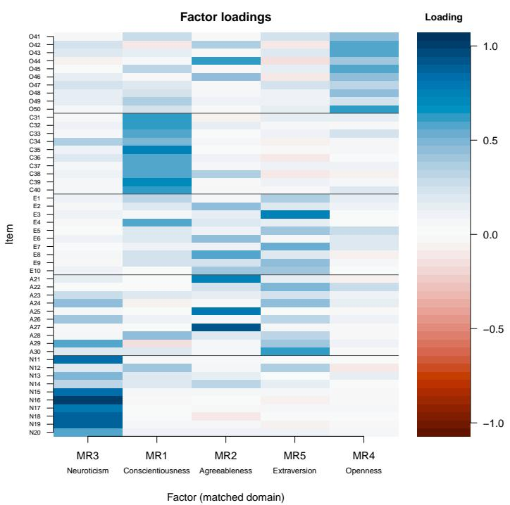  
Figure 1

Item-by-factor loading heatmap for the five-factor semantic solution (mean-centered Pearson encoding of the Qwen3-Embedding-8B embeddings). Rows are items, ordered by theoretical domain (Openness, Conscientiousness, Extraversion, Agreeableness, Neuroticism) and separated by horizontal lines, and columns are factors, ordered by explained variance. Below each factor label is the domain the factor matches best, the domain on whose items its mean absolute loading is largest, as in Table 2. Two of the factors are blended: MR5 gathers forward-keyed sociability and warmth items and MR2 reverse-keyed items describing the absence of a disposition. Color shows the oblimin pattern loading, from red (negative) through white to blue (positive), on the scale at the right. The call plot(fit, type = "loadings") draws the same map with items sorted by their dominant factor. Item codes give the domain (O, C, E, A, N) and the item’s position in the inventory. MR = minimum residual, the prefix of the psych package’s automatic factor labels.

## Table 2

Assignment of the 50 items to the five semantic factors, by theoretical domain
<table><tr><td rowspan="2">Factor (matched domain)</td><td colspan="5">Theoretical domain</td><td colspan="2"></td></tr><tr><td>O</td><td>C</td><td>E</td><td>A</td><td>N</td><td>Items</td><td>Reverse-keyed</td></tr><tr><td>MR4 (O)</td><td>7</td><td>0</td><td>0</td><td>0</td><td>0</td><td>7</td><td>1</td></tr><tr><td>MR1 (C)</td><td>1</td><td>10</td><td>1</td><td>1</td><td>1</td><td>14</td><td>6</td></tr><tr><td>MR5 (E)</td><td>0</td><td>0</td><td>5</td><td>2</td><td>0</td><td>7</td><td>0</td></tr><tr><td>MR2 (A)</td><td>2</td><td>0</td><td>4</td><td>3</td><td>1</td><td>10</td><td>10</td></tr><tr><td>MR3 (N)</td><td>0</td><td>0</td><td>0</td><td>4</td><td>8</td><td>12</td><td>1</td></tr></table>

Note. Each item is assigned to the factor on which its absolute oblimin loading is largest (mean-centered Pearson encoding of the Qwen3-Embedding-8B embeddings). Rows are factors, each labeled with the domain on whose items its mean absolute loading is largest, and bold counts are those of the matched domain. For the two blended factors this label rests on a small margin. MR2’s mean absolute loading on the Agreeableness items exceeds that on the Extraversion items by only .045, and MR5’s on the Extraversion items exceeds that on the Agreeableness items by only .049. O = Openness, C = Conscientiousness, E = Extraversion, A = Agreeableness, N = Neuroticism. Items = number of items assigned to the factor. Reverse-keyed = how many of them are reverse-keyed. For four items, the two largest absolute loadings difer by less than .03, so their assignments are near ties. MR = minimum residual, the prefix of the psych package’s automatic factor labels.

that is, with how much a correlation varies from one sample of respondents to the next. An embedding similarity matrix has no respondents. Adding calibrate = TRUE to the call compares RMSR, CAF, and TEFI with their values in 100 fits to random embeddings of the same size. The random embeddings are random vectors of unit length, and the cosine similarities among them are close to zero. These cosines are computed without centering the random vectors, whatever encoding the real fit used, whereas the default encoding of the observed fit centers each embedding. These random fits passed the conventional RMSR cutof easily, with RMSR between .0119 and .0134, because a matrix of near-zero similarities leaves the factors almost nothing to reproduce. Passing that cutof therefore says little about fit. For the same reason the observed RMSR (.032), although higher than in every random fit, cannot be read as misfit, because RMSR grows with the size of the similarities being reproduced. TEFI behaves similarly. The observed value (−27.71) was lower than in every random fit (−21.66 to −17.82, mean −20.85), so none of the 100 random fits was as low, which shows only that the real items are not random. The oblimin rotation did not converge in one of the random fits, and over the 99 fits in which it converged TEFI ranged from −21.66 to −18.80. CAF has a diferent reference value. Residuals with no shared structure give a CAF near .5, as the random fits did (.501 to .532, mean .507, SD = .003). The maximum came from the fit whose rotation did not converge, and the other fits reached at most .512. The observed CAF (.412) was lower than in all of the 100 random fits. This suggests that the similarities the five factors leave unexplained still contain shared structure that random embeddings lack, although, as for RMSR, a baseline of near-zero similarities makes this a weak contrast. The Technical Reference in the Supplementary Materials describes how the random fits are built and why they are a weak baseline.

Finally, as\_psych(fit) converts the fit into the format of the psych package, so that functions such as psych::fa.sort() and psych::factor.congruence() can treat it like a response-based solution.

## 3.2 Choosing an Encoding

There are several ways to turn item embeddings into the similarity matrix that gets factored. The package implements four. The atomic encoding takes the cosine similarity between the raw embeddings. The atomic\_reversed encoding first multiplies each reversekeyed item’s embedding by −1 (here, 18 of the 50 items), then takes cosines (Guenole et al., 2025). The squid encoding (Survey and Questionnaire Item Embeddings Diferentials) subtracts the questionnaire embedding, the mean of all the items’ embeddings, from every item’s embedding (Pellert et al., 2026). The package then takes cosines, where the origina method correlated the results. The mean\_centered\_pearson encoding, the package’s default, subtracts each embedding’s own mean value from all of its entries. The cosine of two such centered vectors is exactly their Pearson correlation, so the similarity matrix is a correlation matrix. The function sfa\_similarity() builds all four from the same embedding matrix:

```r
> sim_at <- sfa_similarity(E8, "atomic",
+ factors = big5$factors, codes = big5$codes)
> sim_ar <- sfa_similarity(E8, "atomic_reversed", scoring = big5$scoring,
+ factors = big5$factors, codes = big5$codes)
> sim_sq <- sfa_similarity(E8, "squid",
+ factors = big5$factors, codes = big5$codes)
> sim_mcp <- sfa_similarity(E8, "mean_centered_pearson",
+ factors = big5$factors, codes = big5$codes)
> enc_range <- t(sapply(list(atomic = sim_at, atomic_reversed = sim_ar,
+ squid = sim_sq, mean_centered_pearson = sim_mcp),
+ function(s) round(range(s[lower.tri(s)]), 3)))
> colnames(enc_range) <- c("min", "max")
> enc_range
min max
atomic 0.394 0.938
atomic_reversed -0.777 0.938
squid -0.267 0.827
mean_centered_pearson 0.394 0.938
```

All 1,225 raw cosines are positive, from .394 to .938 (Figure 2). They are positive even between items keyed in opposite directions, such as E1 (“I am the life of the party.”) and E2 (“I don’t talk a lot.”), whose cosine is .63. This replicates the finding that raw cosines between embeddings rarely mark opposite meanings with negative values (Hommel & Arslan, 2025; Pellert et al., 2026). The negative values in the other rows are imposed by the transformation: sign-flipping produces the −.777 and subtracting the questionnaire embedding the −.267. The default mean-centered Pearson encoding gave the same range as the raw cosines, and entry by entry the two sets of similarities difered by at most .0010 (r = 1.000), so centering each embedding made no practical diference for these embeddings.

The NLI matrix (see Method) difers from all four embedding encodings, because its negative values come from the cross-encoder’s judgment that two items contradict each other rather than from a transformation of embeddings. It scores E1 (“I am the life of the party.”) against the reverse-keyed E2 (“I don’t talk a lot.”) at −1.00, which means that the cross-encoder judged the pair to be almost certainly contradictory. Sign-flipping

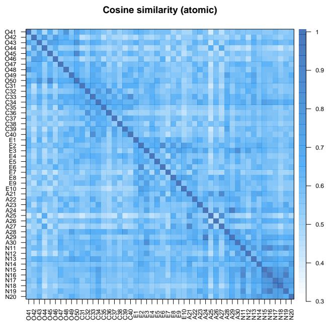  
Figure 2

Cosine similarity (atomic encoding) among the 50 International Personality Item Pool Big-Five Factor Marker items, grouped by domain in the order Openness,

Conscientiousness, Extraversion, Agreeableness, and Neuroticism (sfa\_corplot()). All pairwise similarities are positive (range = .394–.938), so the color scale runs from 0.3 (white) to 1 (dark blue). The diagonal is 1 by definition and is excluded from the stated range. Darker cells mark higher similarity. The block structure along the diagonal is clearest among the Neuroticism items N15 to N19 and faint in the other domains. Item codes give the domain (O, C, E, A, N) and the item’s position in the inventory.

gives the same pair a cosine of −.63, the raw cosine with its sign reversed. Multiplying E2’s embedding by −1 makes the cosine negative, but the pair is not the most dissimilar one. The lowest value in the sign-flipped matrix is −.777, 4% of its similarities are at or below the E1–E2 value, and the pairs of an item and a reverse-keyed item of the same domain average −.58. The transcript excerpt, the full NLI similarity heatmap, and the full comparison with the four embedding encodings are reported in the Supplementary Materials (Figure S2). Which encoding best matches human responses is tested in the last step of the Results.

## 3.3 Choosing the Number of Factors

The five factors of the main fit were chosen by the retention step inside sfa(), and sfa\_parallel() runs that step on its own. With response data, parallel analysis compares each eigenvalue with those of random data sets of the same size (Horn, 1965). SFA has no respondents, so sfa\_parallel() builds the comparison matrices from random embeddings instead. It compares each eigenvalue with the 95th percentile of the corresponding eigenvalues from 100 such matrices. It then counts the leading eigenvalues that exceed their thresholds and stops at the first that does not (Horn’s sequential rule):

> pa <- sfa\_parallel(sim\_mcp, E8)   
> pa   
Embedding-adapted parallel analysis   
Suggested factors: 5   
Embedding dimension: 4096   
Iterations: 100   
Percentile: 95

Because parallel analysis is only one of several rules for this decision, and the rules can disagree, sfa\_nfactors() adds four more and reports their consensus. The consensus is the number the criteria choose most often, and a tie goes to the smaller number:

1. The Kaiser rule (kaiser in the printout) keeps every factor whose eigenvalue is greater than one (Kaiser, 1960).

2. The empirical Kaiser criterion (EKC) compares each eigenvalue with a reference value that depends on the eigenvalues before it and on the ratio of the number of items to the sample size, and it never lets that reference fall below one (Braeken & van Assen, 2017). The criterion was derived for correlation matrices of sample data, so the package puts the embedding dimension in place of the sample size.

3. The TEFI criterion fits solutions with one to 15 factors and keeps the number of factors whose solution has the lowest TEFI. The package uses the Von Neumann entropy version of the index (H. Golino et al., 2021). Its authors developed the index to compare candidate structures for response data, so its use on a similarity matrix goes beyond the settings they tested.

4. EGA (H. F. Golino & Epskamp, 2017) keeps the number of communities of closely connected items that it finds in the item network. The benchmark of Garrido et al. (2025) used personality items written by a language model (GPT-4o) and a single embedding model. In that benchmark, EGA recovered the dimensionality of the embedding matrices more accurately than parallel analysis and the Kaiser rule, both applied with principal component extraction.

The Technical Reference describes how each criterion is adapted to embeddings. The following call runs all five on the main similarity matrix:

> nf <- sfa\_nfactors(sim\_mcp, embeddings = E8,   
+ methods = c("parallel", "kaiser", "TEFI", "EGA", "EKC"))   
> nf   
Factor retention analysis (embedding-adapted)   
Method n\_factors   
parallel 5   
kaiser 6   
TEFI 2   
EGA 5   
EKC 6

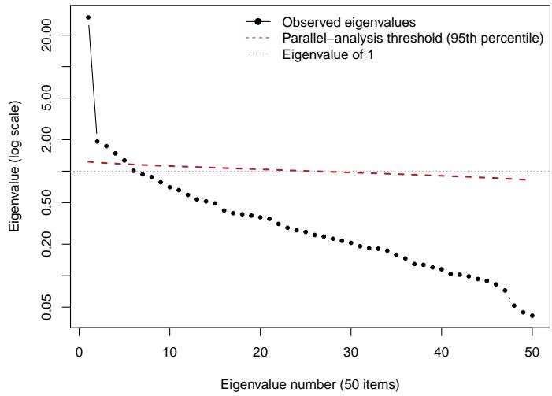  
Figure 3

Eigenvalues of the mean-centered Pearson similarity matrix of the Qwen3-Embedding-8B embeddings of the 50 items in decreasing order (a scree plot, on a logarithmic scale). The dashed red line is the parallel-analysis threshold, the 95th percentile of the corresponding eigenvalues of 100 similarity matrices of random embeddings, and the dotted line marks an eigenvalue of 1, the Kaiser rule’s cutof. The first eigenvalue (29.63) is far larger than the rest, and five eigenvalues exceed the parallel-analysis threshold.

Consensus 5

Eigenvalues: 29.63 1.92 1.74 1.48 1.27 1.01 0.93 0.88 0.78 0.70 ...

Parallel analysis and EGA indicated five factors, the Kaiser rule six, the empirical Kaiser criterion six, and TEFI two. Five and six were therefore each chosen by two criteria, and the tie rule makes the consensus five, which matches the number of domains the inventory was written to measure. The Kaiser rule and the empirical Kaiser criterion agree here for a mechanical reason. Once the large first eigenvalue is set aside, the empirical Kaiser criterion’s reference values fall below one and are raised to one, so for this matrix the two criteria amount to a single vote. The first eigenvalue (29.63, or 59% of the total of 50) is far larger than all the others (Figure 3). This means that one general component, the similarity that every pair of items shares, accounts for most of the total variation in the matrix. The eigenvalues after it decline gradually. A scree plot is usually read by looking for an elbow, the point after which the eigenvalues level of into a straight line (Cattell, 1966), and because this plot has no sharp elbow it does not settle the number of factors by itself. The decision therefore rests on the formal criteria above.

Embeddings raise one further question that response data do not: how many of the 4,096 coordinates of each embedding are needed to recover the structure. The number of leading coordinates kept is called the depth, and the package’s printouts call the full size of the embedding the embedding dimension. The function sfa\_dimselect(), described in the Technical Reference, rebuilds the similarity matrix from the first d coordinates for a grid of depths d and chooses the depth whose EGA solution best balances agreement with the theoretical domains against TEFI. The grid had 147 depths spaced 28 apart, from 3 to 4,091 leading coordinates, plus the full embedding of 4,096 coordinates. The function selected roughly the first third of the coordinates (1,431 of 4,096), at which EGA found five communities. Their agreement with the theoretical domains, measured by the normalized mutual information (NMI), which runs from 0 for unrelated groupings to 1 for identical ones and is defined under Interpreting the Factors, was .704, the maximum over the depths evaluated. Across depths NMI ranged from .193 to .704. Figure S1 in the Supplementary Materials shows NMI and TEFI at every depth. NMI rose quickly over the first few hundred coordinates, stayed high but jagged over a broad middle range, and declined toward the full embedding, while TEFI changed sharply from one depth to the next. The selected depth is therefore the highest point of a noisy curve rather than a sharply defined optimum. At the full depth, EGA found five communities (NMI = .454). These NMI values compare EGA communities with the domains and are distinct from the NMI of the five-factor fit reported under Interpreting the Factors. Because the choice of depth already favors agreement with theory, this result is consistent with the main fit rather than an independent confirmation of it.

## 3.4 Choosing an Embedding Model

The last choice the call depends on is the embedding model, and in particular its size. To measure how much size matters, the same 50 items were embedded with three sizes of one model family, Qwen3-Embedding-0.6B, 4B, and 8B (see Method), and the meancentered Pearson similarity matrix was built from each. Figure 4 shows the three matrices side by side with the items grouped by domain. At every size, items are on average more similar to items of their own domain than to items of other domains. In the figure, the Neuroticism block along the diagonal is clearly visible at every size, whereas the blocks of the other domains are faint. Two statistics measure the separation more precisely. The point-biserial correlation between sharing a domain and a pair’s similarity, computed over all 1,225 item pairs, was .398 for 0.6B, .458 for 4B, and .416 for 8B (item-level bootstrap 95% intervals .286 to .515, .372 to .548, and .316 to .535), and the mean similarity of pairs within a domain exceeded that of pairs between domains by .077, .077, and .079. By both statistics, the separation between domains was similar at the three sizes and did not rise steadily with model size. The intervals resample items rather than pairs, because the pairs share items, and they overlap widely, so the three sizes cannot be told apart on this statistic. Computed for each domain separately, the mean similarity of the domain’s own pairs exceeded that of its pairs with other domains at every size, and the excess was largest for Neuroticism (.127, .104, and .131, against at most .077 for any other domain), the domain whose block stands out in the figure.

What changed with size was the number of factors that some retention criteria indicated, each from a single seeded run with the package’s default settings. Parallel analysis retained three factors for 0.6B and four for 4B, while EGA retained six and six, and the consensus across the five criteria was six for 0.6B and six for 4B. For 0.6B, the parallelanalysis verdict of three rested on a narrow margin, because the fourth eigenvalue, 1.370, fell just below its threshold of 1.372. Repeated with each of ten further seeds, parallel analysis gave the same verdict in every run for each model size (three for 0.6B, four for 4B, and five for 8B), so the verdicts did not depend on the random embeddings drawn. Under the 8B embeddings, parallel analysis and EGA both retained the theoretical five, and the consensus was five. The other criteria did not move toward five. Under the 8B embeddings the Kaiser rule indicated six factors and the empirical Kaiser criterion six, as at the smaller sizes, and TEFI indicated two at every size, so the criteria still disagreed at 8B. Within this family, then, the 8B model was the only one for which parallel analysis and EGA both indicated the five theoretical factors, even though the separation between domains changed little. Model size and embedding dimension also vary together here (1,024, 2,560, and 4,096 dimensions), and the dimension enters both the random baseline of parallel analysis, whose first threshold was 1.50, 1.31, and 1.23 at the three sizes, and the reference values of the empirical Kaiser criterion. The comparison is therefore descriptive and cannot separate size from dimension. Agreement with the theory the inventory was written to express was also the reason the 8B model was used for the main analysis. That agreement concerned the number of factors, because only under the 8B embeddings did the retention criteria lead to five factors. When five factors were extracted at every size, the 8B solution did not match the domains best. The NMI between each item’s strongest factor and its domain, a measure of agreement defined under Interpreting the Factors, was highest for 4B (.693, against .497 for 0.6B and .527 for 8B, Table S4).

A second inventory, the Depression Anxiety Stress Scales (Lovibond & Lovibond, 1995), showed a clearer efect of size (see Model Size With a Second Scale in the Supplementary Materials). There, the gap between within-scale and between-scale similarity rose from the 0.6B to the 8B model, although the paired 95% interval of the increase, from −.001 to .053, just included zero. The three-factor solution merged two of the three scales under the 0.6B model but separated all three under the 8B model. The NMI between each item’s strongest factor and its scale rose with each larger model, from .412 to .700 and .834, and the rise held for a second 0.6B solution described in the Supplementary Materials, whose NMI was .665. For some scales, then, a larger model can give factors that match the scales more closely, even though it did not for the Big Five inventory. For users of this model family, we therefore suggest the largest model their computer’s memory allows. Both results rest on three models of one family and two English inventories, so whether the suggestion holds for other model families and inventories remains to be tested. The package’s default for embedding new text remains the 0.6B model, because it needs the least memory (see Method). The Supplementary Materials apply one further retention method, the comparison-data method, to the same three matrices and compare its results with those for the human responses.

## 3.5 Interpreting the Factors

Once the factors are fitted, the next task is to understand what each one means and whether each item sits with the construct it was written for. The function sfa\_anchor() adapts the approach of Wulf and Mata (2025). It computes the cosine similarity between each item’s raw embedding and every construct, represented by the construct’s centroid or by the embedding of its name, and it leaves each item out of its own construct’s centroid. The printout lists the eight items whose similarity to their own construct is lowest and marks those that are more similar to another construct:

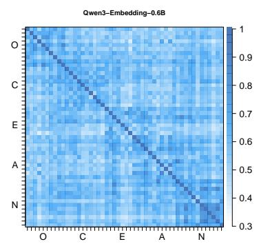  
Figure 4

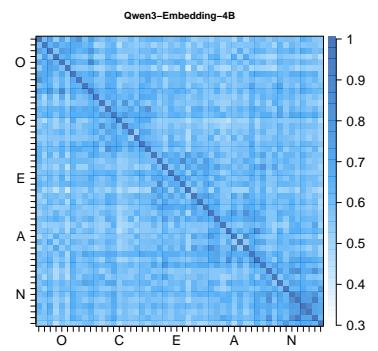

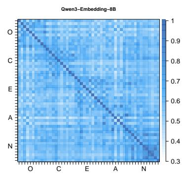

Mean-centered Pearson similarity matrices of the 50 International Personality Item Pool items, grouped by domain in the order Openness, Conscientiousness, Extraversion, Agreeableness, and Neuroticism, for Qwen3-Embedding-0.6B (left), 4B (center), and 8B (right). Each panel shows all 50 items against all 50, and the axes mark each domain’s block with the domain’s initial letter (O, C, E, A, N) at the middle of the block. The three panels share one color scale of mean-centered Pearson similarity, from white at 0.3, the lowest similarity in any of the three matrices rounded down to the nearest tenth, to dark blue at 1, and the color key is marked in steps of 0.1. The diagonal is 1 by definition. The Neuroticism block along the diagonal is clearly visible at every size, and the blocks of the other domains are faint. The text reports two measures of this separation. The point-biserial correlation between sharing a domain and pair similarity is .398 (0.6B), .458 (4B), and .416 (8B), and the mean similarity of pairs within a domain exceeds that of pairs between domains by .077, .077, and .079, respectively.

> anc   
Semantic anchoring   
Method: Wulff & Mata (2025)   
Anchor: centroid   
Constructs: 5 | Items: 50   
[50 x 5 item-by-construct cosine matrix omitted]   
Weakest own-construct similarity (review/removal candidates):   
N12 Neuroticism own=0.69 <-- higher on Extraversion (0.72)   
"I am relaxed most of the time."   
O44 Openness own=0.69   
"I am not interested in abstract ideas."   
A23 Agreeableness own=0.71 <-- higher on Extraversion (0.71)   
"I insult people."   
A25 Agreeableness own=0.71   
"I am not interested in other people’s problems."   
[list abridged]

In the worked example the constructs are the inventory’s five domains. All four items at the top of the centroid list are reverse-keyed. Two of them are more similar to another domain than to their own, N12 clearly and A23 only by .006. N12 (“I am relaxed most of the time.”), for example, has a cosine of .72 with the Extraversion centroid and .69 with the Neuroticism centroid. This means that its wording resembles the Extraversion items slightly more than the Neuroticism items it was written to join. Because the printout lists only the eight lowest items, the script also lists every item whose similarity to another domain’s centroid (rival) exceeds its similarity to its own (own):

> closer\_other   
item own rival   
3 E3 0.792 0.803   
4 E4 0.733 0.751   
12 N12 0.689 0.724   
23 A23 0.708 0.714   
30 A30 0.774 0.807   
49 O49 0.732 0.736

Across all 50 items, six were more similar to another domain’s centroid than to their own. Every such margin was small compared with the positive similarity that all items share, so these items are candidates for review rather than misplaced items. Comparing items with the construct names instead, embedded with the same 8B model, separated the domains less clearly, because only 29 of the 50 items were most similar to the name of their own construct. A25 (“I am not interested in other people’s problems.”) had the lowest similarity to its own construct name, .36 with agreeableness against .37 with neuroticism, which means that its wording is no closer to the name of its own construct than to the name of another. E6, A27, C36, N12, and C32 followed, so N12 is near the top of both lists.

The function sfa\_project() adapts the semantic projection of Grand et al. (2022). For each axis, it subtracts the embedding of the low-pole word from the embedding of the high-pole word and scores each item by the cosine between its embedding and that diference, rescaled so that the low-pole word itself scores 0 and the high-pole word scores 1. Scores are therefore relative to the two pole words and can fall outside the range from 0 to 1. Each pole here is a single word, so the scores also depend on which words are chosen. The four pole words were embedded with the same 8B model as the items, and the reproduction archive stores their vectors together with those of the five construct names. The script loads these auxiliary vectors as aux, uses aux\_vec() to look up the vector of one word, and passes the pole vectors to sfa\_project() as poles:

> AUX\_NPZ <- "data/Big5FM\_aux\_8B.npz"   
> aux <- sfa\_load\_npz(AUX\_NPZ, codes\_key = "codes")   
> aux\_vec <- function(w) aux\$embeddings[match(w, aux\$codes), , drop = TRUE]   
> poles <- list(   
+ stability = list(low = aux\_vec("anxious"), high = aux\_vec("calm")),   
+ sociability = list(low = aux\_vec("solitary"), high = aux\_vec("sociable")))   
> prj <- sfa\_project(fit,   
+ axes = list(stability = c(low = "anxious", high = "calm"),   
+ sociability = c(low = "solitary", high = "sociable")),   
+ pole\_embeddings = poles)   
> prj   
Semantic projection onto 2 axis/axes   
Method: Grand et al. (2022)   
Scale: 0 = low pole, 1 = high pole   
Axis ’stability’ [anxious <-> calm]   
lowest: N13=0.28 N11=0.33 N16=0.37 N19=0.38 N15=0.42   
highest: N12=0.82 A30=0.72 E3=0.65 E4=0.64 C37=0.62   
Axis ’sociability’ [solitary <-> sociable]   
lowest: O46=0.37 A27=0.38 A21=0.38 N20=0.39 E4=0.41   
highest: E3=0.82 E7=0.81 A22=0.68 E5=0.68 A30=0.65

The scores follow the item’s wording and ignore the scoring key. Reverse-keyed N12 (“I am relaxed most of the time.”) lands nearest the calm pole (.82), opposite the anxious pole that the forward-keyed Neuroticism items fill. This sensitivity to wording suggests a use in scale construction, which the example illustrates but does not test. Because the researcher chooses the two words that define each axis, projection could show, before anyone responds, whether an item pool covers both ends of its target dimension, which items sit near the neutral middle, and how items from diferent domains are ordered along a shared axis. The example did not check whether an axis tracks its intended dimension or whether other pole words would order the items in the same way. On the sociability axis, the top five items include three Extraversion items about being with and talking to people (E3, E7, and E5) and two Agreeableness items about other people (A22 and A30). This mixing of the two domains at the sociable end is consistent with the blending of Agreeableness and Extraversion in the factor solution, although it rests on one axis and five items.

The figures so far show the similarity matrix (Figure 2), the eigenvalues (Figure 3), and the loadings (Figure 1). The function sfa\_itemplot() adds a map of the items themselves. It reduces each item’s 4,096 coordinates to two, so that items with similar embeddings are drawn near each other, using one of four methods: t-distributed stochastic neighbor embedding (t-SNE) (van der Maaten & Hinton, 2008) computed with the Rtsne package (Krijthe, 2023), uniform manifold approximation and projection (UMAP) (McInnes et al., 2018) computed with the uwot package (Melville, 2025), principal component analysis (PCA), or classical multidimensional scaling (MDS). The following lines draw all four maps and keep the coordinates of each, which sfa\_itemplot() returns as Y, for the neighbor shares reported below:

> maps <- list()   
> for (m in c("tsne", "umap", "pca", "mds")) {   
+ maps[[m]] <- sfa\_itemplot(fit, method = m, seed = 42)\$Y   
+ }

Most Neuroticism items are set apart from the other domains in the two nonlinear maps (Figure 5), although a few, such as N12 in the t-SNE map, lie among the items of other domains. In the two linear maps they form a band along the second axis, with a few inside the main cluster. The two nonlinear maps in the top row emphasize local neighborhoods, so items with similar embeddings tend to appear next to each other. In them, the Conscientiousness items occupy their own region, as do most Openness items, and the Extraversion items form a group. Several Agreeableness items lie next to that group, and the rest are spread across the map rather than forming a group of their own. The two linear maps in the bottom row preserve the overall distances between items instead. The first two principal components, the axes of the PCA map, account for 9% and 9% of the variance of the embeddings. Classical MDS on Euclidean distances gives the same configuration as PCA up to reflection, so the two panels are mirror images of one map rather than two separate views. In that map the items of the four domains other than Neuroticism overlap. The maps thus show, in two dimensions, a blending of Agreeableness and Extraversion similar to the one in the two blended factors of the semantic solution, MR2 and MR5 (Table 2). The axes of the t-SNE and UMAP maps have no interpretable scale, and nonlinear maps can distort larger distances. McInnes et al. (2018) also advise care with UMAP for data sets of fewer than 500 points, because its approximations can then give suboptimal maps, and they note that it can find apparent structure in noise. The t-SNE and UMAP maps are therefore for visual inspection only. The share of each item’s five nearest neighbors that came from its own domain, averaged over the 50 items, puts these impressions in numbers. It was .72 in the t-SNE map, .68 in the UMAP map, and .42 in the linear map, against .18 expected by chance, because nine of the other 49 items share an item’s domain. The nonlinear maps are built to keep each item’s nearest neighbors near it, so their higher shares partly reflect that design. In the linear map the Neuroticism items had the highest share of any domain, .70, against .80 and .78 in the t-SNE and UMAP maps.

The function sfa\_congruence() measures how closely the semantic factors reproduce the theoretical assignment of items to the Big Five. It reports two agreement metrics here, after assigning each item to the factor on which its absolute loading is largest. The normalized mutual information (NMI) is the information that two groupings share, divided by the geometric mean of the entropies of the two groupings (Strehl & Ghosh, 2002). The entropy of a grouping is the information that the grouping carries on its own. NMI therefore runs from 0 (nothing shared) to 1 (identical groupings). The adjusted Rand index (ARI) is based on the proportion of item pairs that both groupings treat the same way, either together or apart, corrected so that 0 means chance agreement and 1 means identical grouping (Hubert & Arabie, 1985). The call compares the semantic factors with the theoretical domains:

> cong\_theory <- sfa\_congruence(fit, target = big5\$factors,   
+ metrics = c("nmi", "ari"))   
> cong\_theory   
Factor structure congruence   
NMI: 0.527 (moderate - higher is better)   
ARI: 0.402 (weak - higher is better)

The NMI of .527 means that the semantic factors and the theoretical domains share about half their information. To show what chance would give, the script repeated the comparison 1,000 times with the domain labels randomly permuted across the items. The median, 95th percentile, and maximum of the permuted values were

> round(apply(perm\_na, 2, quantile, probs = c(.50, .95, 1)), 3)   
nmi ari   
50% 0.117 -0.004   
95% 0.191 0.048   
100% 0.292 0.149

No permutation reached an NMI above .292 or an ARI above .149, so the observed agreement is well above chance. It is also far from complete, mainly because of how the Agreeableness and Extraversion items are grouped (Table 2). The labels moderate and weak in the printout come from a rule of thumb in the package that has not been validated.

The function sfa\_jinglejangle() checks whether scales with similar names have similar content (Wulf & Mata, 2025, 2026). It represents each scale by two vectors, the average of its raw item embeddings and the embedding of its name, and for every pair of scales it compares the cosine between their item averages with the cosine between their names. A pair is flagged when the two cosines difer by 0.20 or more. Here the five 10-item

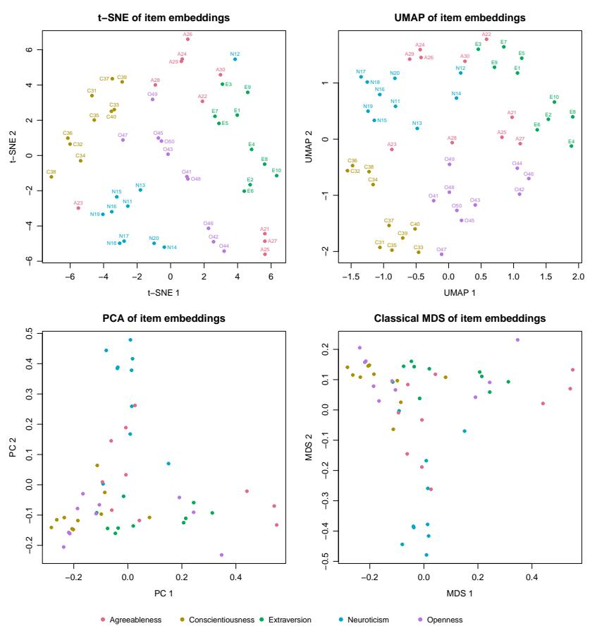  
Figure 5

Two-dimensional item maps of the 50 item embeddings produced by sfa\_itemplot(): t-SNE (top left), UMAP (top right), PCA (bottom left), and classical MDS (bottom right), with items colored by theoretical domain in the same colors in all four panels (legend below the panels). The maps are computed from the Qwen3-Embedding-8B item embeddings (4,096 coordinates) after the default encoding, which centers each embedding across its coordinates and scales it to unit length. In the t-SNE and UMAP maps, item codes, added for this figure, give the domain (O, C, E, A, N) and the item’s position in the inventory and are placed where they cover no other item or code. The PCA and MDS panels color the items by domain without item codes, because the codes overprint in those panels. t-SNE = t-distributed stochastic neighbor embedding, UMAP = uniform manifold approximation and projection, PCA = principal component analysis, MDS = multidimensional scaling.

subscales were treated as separate scales. In the call, sub\_items holds the items of each subscale, sub\_emb their 8B embeddings, and jj\_lab\_emb the 8B embeddings of the five construct names:

> sub\_items <- split(big5\$items, big5\$factors)   
> sub\_emb <- lapply(split(seq\_len(50), big5\$factors),   
+ function(i) E8[i, , drop = FALSE])   
> jj\_lab\_emb <- rbind(   
+ Agreeableness = aux\_vec("agreeableness"),   
+ Conscientiousness = aux\_vec("conscientiousness"),   
+ Extraversion = aux\_vec("extraversion"),   
+ Neuroticism = aux\_vec("neuroticism"),   
+ Openness = aux\_vec("openness"))[names(sub\_items), ]   
> jj <- sfa\_jinglejangle(sub\_items, item\_embeddings = sub\_emb,   
+ label\_embeddings = jj\_lab\_emb)   
> jj   
Jingle-jangle detection across 5 scales   
Method: Wulff & Mata (2025, 2026)   
Flag threshold |content - label| >= 0.20   
No jingle/jangle pairs flagged.   
> jj\$flags   
scale\_a scale\_b content\_sim label\_sim divergence type   
2 Agreeableness Extraversion 0.885 0.720 0.165   
4 Agreeableness Neuroticism 0.849 0.715 0.134   
3 Conscientiousness Extraversion 0.833 0.717 0.116   
10 Neuroticism Openness 0.807 0.703 0.104   
6 Extraversion Neuroticism 0.821 0.729 0.092   
5 Conscientiousness Neuroticism 0.822 0.733 0.088   
9 Extraversion Openness 0.831 0.750 0.080   
8 Conscientiousness Openness 0.841 0.762 0.079   
7 Agreeableness Openness 0.825 0.812 0.013   
1 Agreeableness Conscientiousness 0.822 0.815 0.007

No pair of subscales was flagged, which means that for every pair the similarity of the construct names and the similarity of the items difered by less than 0.20. The largest divergence, .17, was for Agreeableness and Extraversion, the two domains whose items the factor solution blended. Their item averages had a cosine of .89, but the divergence still fell short of the threshold. Because the raw cosines between these embeddings are all strongly positive, both similarities lie near the top of their range, which makes a divergence of 0.20 hard to reach. A null result on five subscales of one inventory therefore says little about how sensitive the screen is. We see the tool’s main use in comparing scales, including scales from diferent instruments, where mismatches between labels and content can arise (Wulf & Mata, 2025).

## 3.6 Refining the Items

Three functions refine a scale before any respondent is recruited. The function sfa\_redundancy() detects redundant item pairs with Unique Variable Analysis (Christensen et al., 2023). It first builds a network from the similarity matrix in which each pair of items is linked by its partial correlation, the association between the two items that remains after all other items are accounted for, and in which weak links are set to zero. It then computes the weighted topological overlap (wTO) of every pair:

Redundant-item detection   
Method: Christensen et al. (2023)   
Measure: wto | threshold: 0.25   
Redundant pairs: 11 | redundant clusters: 10   
Top redundant pairs:   
A24 \~ A29 overlap=0.462   
N17 \~ N18 overlap=0.402   
O45 \~ O50 overlap=0.374   
N16 \~ N19 overlap=0.361   
E2 \~ E6 overlap=0.339   
A25 \~ A27 overlap=0.331   
A21 \~ A27 overlap=0.320   
C32 \~ C36 overlap=0.309   
C33 \~ C40 overlap=0.286   
O41 \~ O48 overlap=0.268  
Suggested removals (keep one per cluster): E6, N19, N18, A25, A27, A29, C36, C40, O41, O44, O45  
> red\_uva\$pairs  
item\_i item\_j overlap

\# every flagged pair

[ten rows omitted: the pairs listed above]

9 O42 O44 0.253

The printout lists the pairs from the largest overlap to the smallest but keeps the row numbers they had before sorting. Each flagged pair consists of two items whose relations to the rest of the scale overlap strongly. The overlap column is the pair’s wTO, the degree to which the two items’ connections, including their direct link and their links to the other 48 items in the network, coincide, running from 0 (no shared pattern) to 1 (identical patterns). Pairs at or above 0.25, the cutof of Unique Variable Analysis, are flagged. The top pair, A24 (“I sympathize with others’ feelings.”) with A29 (“I feel others’ emotions.”), overlaps at .462. This means that the two items relate to the rest of the scale in similar ways in their wording, so either one is a candidate to drop. Other pairs near the top of the list are also near-paraphrases, such as N17 (“I change my mood a lot.”) and N18 (“I have frequent mood swings.”), and O45 (“I have excellent ideas.”) and O50 (“I am full of ideas.”). Every one of the eleven flagged pairs, including O42 with O44, which the first printout leaves out, joins items from one domain, so the redundancy is repetition inside domains rather than confusion between them. That pair is also the weakest flagged pair and lies just above the cutof, so the number of flagged pairs depends on exactly where the cutof falls. The number of flagged pairs did not depend on the nominal sample size with which the network is estimated (see Method): with 500 or 2,000 in place of 1,000, eleven pairs again reached the cutof. The flagged pairs form ten redundant clusters, each a set of items linked by flagged pairs, and the suggested-removals line names every item to drop so that one item of each cluster remains, the one with the highest mean absolute similarity to all the items. A simpler criterion, which flags any pair whose similarity in the fitted matrix is 0.85 or higher (here matching the raw cosine), found seven pairs in five clusters. Its top pairs were N16 (“I get upset easily.”) with N19 (“I get irritated easily.”, .938) and A24 (“I sympathize with others’ feelings.”) with A29 (“I feel others’ emotions.”, .933), and both of these pairs were also flagged by Unique Variable Analysis. In all, five of the seven pairs that the cosine criterion found were also flagged by Unique Variable Analysis. Near-paraphrase pairs inflate internal consistency without broadening content coverage (Christensen et al., 2023).

The function sfa\_simplify() builds a candidate short form without any responses (Jung & Seo, 2025; Wang et al., 2026). Within each domain, it keeps the items most similar to the centroid of the domain’s other items, here five per domain:

> short <- sfa\_simplify(fit, target\_n = 5, method = "anchor") # 50 -> 25 items   
> short   
Scale simplification (response-free)   
Method: centroid/medoid item selection (in the spirit of Wang et al. 2026;   
Jung & Seo 2025)   
Note: candidate short form -- validate psychometrically before use   
Selection: anchor | groups: theoretical | target\_n = 5 per group   
Items: 50 -> 25   
Factors retained (parallel analysis): 5 -> 3   
Structure recovery vs theory (NMI / ARI):   
full: NMI=0.527 ARI=0.402   
reduced: NMI=0.810 ARI=0.571   
Items kept per construct:   
[counts omitted: five per construct]   
Dropped 25 item(s); see \$drop. Reduced fit in \$reduced\_fit.   
> short\$keep   
[1] "E2" "E3" "E5" "E8" "E10" "N11" "N15" "N16" "N17" "N19" "A21" "A22"   
[13] "A24" "A28" "A29" "C33" "C34" "C35" "C37" "C40" "O42" "O43" "O45" "O48"   
[25] "O50"   
> L\_sf <- unclass(short\$reduced\_fit\$loadings)   
> table(factor = colnames(L\_sf)[apply(abs(L\_sf), 1, which.max)],   
+ domain = short\$reduced\_fit\$item\_data\$factor)   
domain   
factor Agreeableness Conscientiousness Extraversion Neuroticism Openness   
MR1 0 5 0 0 5   
MR2 0 0 0 5 0   
MR3 5 0 5 0 0

In the 25-item short form, the factors agreed more closely with the theoretical domains, with NMI rising from .527 to .810 and ARI from .402 to .571. This change is descriptive, because it compares the five factors of the full form with the three factors retained for the short form. Two further comparisons, in which every item set was fitted with five factors, show where the gain comes from. First, 200 random sets of five items per domain reached a median NMI of .600 (95th percentile .734), already above the full form’s .527, and a median ARI of .367 (95th percentile .559), slightly below the full form’s .402. Part of the gain in NMI therefore comes from having fewer items per domain. Second, the short form itself, fitted with five factors, reached NMI = .810 and ARI = .707. Both values were higher than in any of the random sets (maximum NMI .785, maximum ARI .656). This comparison with the random sets measures the efect of selection, and it shows that selection by centrality improved agreement with the domains beyond what a random choice of five items per domain gives. Parallel analysis, which had given five factors for the full inventory, kept only three factors for the short form, which means that with five items per domain the similarities no longer cleared its threshold for one factor per domain. Parallel analysis is a weak criterion for embedding matrices (see the Technical Reference), so this is one run of one criterion rather than a general verdict on the short form. The table at the end of the excerpt assigns each item to the factor on which it loads most strongly. Neuroticism kept a factor of its own, while the Conscientiousness and Openness items shared one factor and the Agreeableness and Extraversion items shared another. Because each of these three factors holds whole domains, with every item on the same factor as the rest of its domain, the three-factor NMI of .810 is the value that any merge of two pairs of domains into single factors gives. The items flagged as redundant were not removed before the short form was built, and the short form kept both items of four of the flagged pairs, A24 and A29 among them, because its rule selects central items rather than distinct ones. As the printed note warns, a semantic short form is therefore a candidate for psychometric validation, not a finished instrument.

The function sfa\_item\_fit() extends the anchoring approach of Wulf and Mata (2025) to newly written items. It embeds each candidate and computes its cosine with the centroid of every construct’s raw item embeddings. The report gives the construct with the highest cosine, the margin over the next construct, how the candidate’s cosine compares with the average cosine of that construct’s existing items, and the most similar existing item. So that the candidates are compared with the items in the same 8B space, the reproduction archive stores their Qwen3-Embedding-8B vectors, generated with the same settings as the item vectors. Before the call below, the reproduction script places these vectors, and the archived 8B vectors of the five construct names, in the package’s embedding cache, so the call reads them from the cache instead of running the model. Without these cache entries, the same call embeds the candidates and the construct names with the model. The reference fit, fit\_ns, is the main five-factor fit rebuilt without the scoring column. Because the keying-free encoding ignores that column, fit\_ns is equivalent to the main fit, and sfa\_item\_fit() in any case uses only the item embeddings, their theoretical domains, and the construct-name vectors:

```haskell
> fit_ns <- sfa(big5_df[, c("code", "item", "factor")],
+ embeddings = E8,
+ encoding = "mean_centered_pearson", nfactors = 5)
> cand <- c("I make friends easily.",
+ "I am the life of every party.",
+ "I finish what I start.")
> ifit <- sfa_item_fit(fit_ns, cand, model = "Qwen/Qwen3-Embedding-8B",
+ redundancy_cutoff = 0.85)
> ifit
Candidate item fit
Method: Wulff & Mata (2025), extended
Candidate 1: "I make friends easily."
[similarity-by-construct table omitted]
Best construct : Extraversion
Cross-loading : gap to 2nd (Agreeableness) = 0.04 -> ambiguous -
cross-loads with Agreeableness
Strength : about typical for Extraversion (items 0.73 vs avg 0.77)
Redundancy : closest item E3 "I feel comfortable around people."
(0.81) -> distinct
Verdict : cross-loads (Extraversion vs Agreeableness) - poor
discrimination
Candidate 2: "I am the life of every party."
[similarity-by-construct table omitted]
Best construct : Extraversion
[cross-loading and strength lines omitted]
Redundancy : closest item E1 "I am the life of the party." (0.95)
-> near-duplicate
Verdict : redundant (near-duplicate of an existing item)
Candidate 3: "I finish what I start."
[similarity-by-construct table omitted]
Best construct : Conscientiousness
Cross-loading : gap to 2nd (Openness) = 0.09 -> some cross-loading
```

risk   
Strength : about typical for Conscientiousness (items 0.82 vs   
avg 0.78)   
Redundancy : closest item C35 "I get chores done right away."   
(0.75) -> distinct   
Verdict : good fit for Conscientiousness - clean and   
non-redundant

The three candidates, written to illustrate the three verdicts, received the verdicts they were written for, which shows that the tool flags what it was designed to flag rather than how often it is right. The first, “I make friends easily.”, was more similar to the Extraversion centroid than to the Agreeableness centroid by only .04, so it would not distinguish the two domains. The second, “I am the life of every party.”, had a cosine of .95 with E1 (“I am the life of the party.”), above the 0.85 cutof, which marks it as a near-duplicate of an existing item. The third, “I finish what I start.”, fit Conscientiousness. Its similarity to the Conscientiousness centroid was about as high as the average for the domain’s existing items, it exceeded its similarity to the next construct by .09, and no existing item was a near-duplicate of it. A margin of this size falls in the band that the printout labels some cross-loading risk, but it is above the 0.07 cutof for a cross-loader, so the overall verdict is a clean fit.

## 3.7 Comparing With Human Responses

To compare the semantic data to the human benchmark, we load the responses from the Open-Source Psychometrics Project (Open-Source Psychometrics Project, 2018), drop every row with a missing response or a response outside the 1–5 range (keeping 874,434 of 1,015,341 response records), apply reverse scoring to the 18 reverse-keyed items (6 − x), and run a conventional factor analysis:

```r
> HUMAN_CSV <- Sys.getenv("BIG5_HUMAN_CSV", "data/Big5FM_data.csv")
> human_raw <- read.csv(HUMAN_CSV)
> keep <- rowSums(human_raw < 1 | human_raw > 5 | is.na(human_raw)) == 0
> human <- human_raw[keep, ]
> n_human <- nrow(human)
> cat("Respondents after cleaning:", n_human, "of", nrow(human_raw), "\n")
Respondents after cleaning: 874434 of 1015341
> human_keyed <- human
> rev_idx <- which(big5$scoring < 0)
> human_keyed[, rev_idx] <- 6 - human_keyed[, rev_idx]
> R_human <- cor(human_keyed)
> human_fa <- psych::fa(R_human, nfactors = 5, n.obs = n_human,
+ rotate = "oblimin", fm = "minres")
There were 48 warnings (use warnings() to see them)
```

The warnings report that the noncentral chi-square probabilities, which psych computes for its significance tests of fit, did not converge at this sample size. They do not afect the loadings. Five factors were fixed at the theoretical five-factor structure (Goldberg, 1990, 1992). A conventional parallel analysis of these correlations, computed with psych::fa.parallel(), suggested ten instead. This analysis compares each commonfactor eigenvalue with the mean of the corresponding eigenvalues of random data of the same size, following Horn (1965) but with common-factor eigenvalues:

```csv
> human_pa <- psych::fa.parallel(R_human, n.obs = n_human, fa = "fa",
+ plot = FALSE)
Parallel analysis suggests that the number of factors = 10 and the number
of components = NA
> round(rbind(observed = human_pa$fa.values[1:12],
+ random = human_pa$fa.sim[1:12]), 3)
[,1] [,2] [,3] [,4] [,5] [,6] [,7] [,8] [,9] [,10] [,11]
observed 6.858 4.142 3.112 2.737 1.992 0.617 0.386 0.175 0.082 0.051 0.003
random 0.015 0.013 0.012 0.012 0.011 0.010 0.010 0.009 0.008 0.008 0.007
[,12]
observed -0.028
random 0.007
```

At N = 874,434 the random-data eigenvalues are almost exactly zero. They come from simulations that psych runs in parallel processes and that the script does not seed separately, so their last digits can difer slightly from one run of the script to the next, although the suggested number of factors did not change across our runs. Even very small factors exceed them, so the ten factors may reflect the very large sample rather than ten substantive dimensions, although this explanation was not tested here. The five-factor solution reproduced the Big Five with simple structure, which means that each item loads strongly on one factor and weakly on the others. Here, every item’s largest loading was on the factor of its own domain (Table S3).

## 3.7.1 Factor-Level Agreement

The function sfa\_congruence() takes a fitted psych model as the target:

> cong\_human <- sfa\_congruence(fit, target = human\_fa,   
+ metrics = c("tucker", "nmi", "ari", "frobenius"))   
> cong\_human   
Factor structure congruence   
Tucker phi (factor-by-factor):   
[5 x 5 matrix omitted: reported in the Tucker congruence table]   
NMI: 0.527 (moderate - higher is better)   
ARI: 0.402 (weak - higher is better)   
Frobenius: 0.664 (moderate - higher is better)

Tucker’s congruence coeficient (ϕ), which Burt (1948) described for comparing two columns of coeficients and which later became known by Tucker’s name (Lorenzo-Seva & ten Berge, 2006), measures how similar the loading patterns of two factors are. It runs from −1 to 1, and values near 1 mean that the same items load on both factors in nearly the same proportions (Lorenzo-Seva & ten Berge, 2006). By the benchmarks of Lorenzo-Seva and ten Berge (2006), values from .85 to .94 indicate fair similarity, and values above .95 indicate good similarity, at which two factors can be considered equal. The benchmarks rest on averaged ratings by experienced factor analysts who compared loading patterns on 15 or 20 variables. The individual ratings varied widely and difered between the two lengths. For pairs of low congruence they also difered between research fields, with researchers in personality judging the factors to be more diferent than researchers in intelligence did. The benchmarks are therefore only approximate for the 50-item patterns compared here (Lorenzo-Seva & ten Berge, 2006). Each semantic factor matched a diferent human factor (Table 3). The factor matched to Openness reached ϕ = .92, within the range of fair

## Table 3

Tucker congruence coeficients between the semantic factors (rows) and the human-response factors (columns)
<table><tr><td rowspan="2">Semantic factor</td><td colspan="4">Human factor</td></tr><tr><td>O (MR5)</td><td>C (MR2)</td><td>E (MR4) A (MR3)</td><td>N (MR1)</td></tr><tr><td>O (MR4)</td><td>.92</td><td>.14</td><td>.18</td><td>.17 .02</td></tr><tr><td>C (MR1)</td><td>.28</td><td>.84</td><td>.27 .10</td><td>.11</td></tr><tr><td>E (MR5)</td><td>.16</td><td>.11</td><td>.64</td><td>.52 .07</td></tr><tr><td>A (MR2)</td><td>.27</td><td>.05</td><td>.41</td><td>.52 -.01</td></tr><tr><td>N (MR3)</td><td>.12</td><td>.13</td><td>.03</td><td>.30 .80</td></tr></table>

Note. O = Openness, C = Conscientiousness, E = Extraversion, A = Agreeableness, and N = Neuroticism. Each cell is Tucker’s congruence coeficient ϕ between a semantic factor’s and a human factor’s loadings on the 50 items, which runs from −1 to 1. MR labels are each solution’s automatic factor names (MR = minimum residual), and the domain beside each label is the one on whose items the factor’s mean absolute loading is largest. Bold values mark each semantic factor’s largest absolute congruence with any human factor, and their mean is the mean matched $\bar { \phi } = . 7 4 4$ . Semantic solution: minimum-residual extraction with oblimin rotation, applied to the mean-centered Pearson similarity matrix. Human solution: the same method applied to the correlations of the reverse-scored responses, $N = 8 7 4 { , } 4 3 4$

similarity, and the factors matched to Conscientiousness and Neuroticism reached .84 and .80, below it. The factors matched to Extraversion and Agreeableness reached only .64 and .52. The semantic Extraversion factor also matched human Agreeableness (.52) as closely as the semantic Agreeableness factor did, which fits its mixture of sociability and warmth items (Table 2). The mean matched congruence, each semantic factor’s largest absolute congruence with any human factor averaged over the five factors, was $\bar { \phi } = . 7 4 4$ , the average of three closer matches and two weak ones. The NMI and ARI between the semantic and human groupings equal the values reported above for the theoretical assignment (.527 and .402), because every item’s largest human loading falls on its own domain’s factor, so the human grouping is the theoretical one. These two metrics therefore add nothing to that earlier comparison. The Frobenius similarity (.664) is the cosine between the two solutions factor-correlation matrices, each written out as a single list of numbers. It does not first match the factors, so its value depends on the arbitrary order in which each solution lists them, and it is not interpreted here.

## 3.7.2 Encoding-Level Agreement

Fitting a five-factor model under each of the four embedding encodings and to the NLI matrix gives the comparison in Table S1 of the Supplementary Materials. Each is compared with the human correlations that match it. The keying-free encodings and the NLI matrix are compared with the correlations among raw responses. The sign-flipping encoding applies the scoring key, so it is also compared with the correlations of the reversescored responses, which apply the same key. Sign-flipping left the grouping of the items unchanged (its NMI and ARI equal those of atomic). Against the raw responses, it gave no gain $( r = . 4 4 4$ for the flip, against .456 for the default encoding). Against the reverse-scored responses, its agreement was lower than that of atomic, which applies no flip $( r = . 1 3 7 ,$ against $r = . 4 3 4 )$ , and so was its mean matched congruence with the human factors. A likely source of the drop in both is the sign pattern that the flip imposes. Every unflipped cosine is positive (the smallest is .394), so the flip makes every similarity between a forward-keyed and a reverse-keyed item negative, whereas reverse-scoring is meant to make the items of a domain correlate positively whatever their keying.

Against the raw responses, the NLI matrix agreed best $( r = . 5 6 1 )$ , followed by the squid encoding $( r = . 4 9 0 )$ and by atomic and mean\_centered\_pearson $( r = . 4 5 6 )$ The squid matrix is a poor basis for factor analysis, however. Its KMO was only .022, which means that its correlations are small compared with its partial correlations. The KMO describes each matrix’s own factorability, and the three fit statistics in the table (RMSR, CAF, and TEFI) describe how well each solution fits its own matrix, so none of the four is comparable across the table’s rows. The squid CAF near 1, for example, follows from its KMO near 0. The NLI matrix matched the human loading patterns worst, with the lowest mean matched congruence $( \bar { \phi } = . 2 8 6 )$ This matrix had negative eigenvalues, however, which were raised to just above zero before factoring, as the Supplementary Materials describe. Its factor-based columns in the table (NMI, ARI, $\bar { \phi } ,$ KMO, TEFI, RMSR, and CAF) therefore come from the repaired matrix, and its rankings on them reflect the repair. Its r with the raw responses uses the original matrix and is the cleaner NLI result. These rankings are descriptive, from a single analysis of 50 items, and carry no estimate of their uncertainty. Gaps of a few hundredths between encodings, such as those among the r values above, cannot be distinguished without such estimates, and even the larger lead of the NLI matrix on the raw responses was not tested. The default mean-centered Pearson encoding had the highest mean matched congruence $( \bar { \phi } = . 7 4 4$ , tied with atomic) and produced a matrix well suited to factor analysis $( \mathrm { K M O } = . 9 7 1 )$ . The table therefore does not single out one best encoding, and it is consistent with the reasons the Method gives for the default. On these embeddings the default and atomic gave the same values to three decimals on every agreement metric, so the comparison cannot separate them.

## 3.7.3 Item-Pair Agreement

Across all 1,225 item pairs, the mean-centered Pearson similarities correlated r = .46 with the correlations among the raw responses of 874,434 respondents (Figure 6). Raw responses are the right comparison here, because this encoding ignores the scoring key (against the reverse-scored correlations, $r = . 4 3 4 )$ . The correlation means that pairs of items that are more similar in meaning tended to be answered more alike, although meaning leaves most of the variation in the human correlations unexplained. The 1,225 pairs share 50 items, so they are not independent observations. An item-level bootstrap, which resampled the 50 items, gave a 95% percentile interval for the correlation from .34 to .58.

The relation is also curved rather than straight (Figure 6). A quadratic curve accounts for .40 of the variance in the semantic similarities, against .21 for the straight line, a gain of .20 (item-level bootstrap 95% interval .12 to .28). Most of the curvature lies at the positive end of the human-correlation axis. Mean similarity was .69 for pairs whose human correlation was above .20, .56 for pairs within .10 of zero, and .58 for pairs below −.20.

Similarity therefore rises steeply as the human correlation becomes more positive and only slightly as it becomes more negative. These cutofs are descriptive and were chosen after the scatterplot was seen.

Grouping the pairs by domain and keying describes the negative end further. Pairs of items from the same domain that are keyed alike (115 pairs) had a mean similarity of .71 and a mean raw-response correlation of .39. Pairs that join an item and a reverse-keyed item of the same domain (110 pairs) correlated negatively in the responses (mean $r = - . 3 4$ 9 negative for 100% of them), and their mean similarity, .58, was about the same as that of pairs from diferent domains (1,000 pairs, mean similarity .57, mean $r = . 0 2 )$ . The diference of .016 had an item-level bootstrap 95% interval from −.005 to .037, which includes zero. The embeddings thus separated the opposite-keyed items of a domain from the items keyed alike, by .12 in mean similarity (item-level bootstrap 95% interval .09 to .16). They placed them at the level of unrelated items, however, not below it, which means that they registered that the two items difer but not that they are opposed. Of the 120 pairs whose human correlation was below −.20, 97 joined a forward-keyed and a reverse-keyed item of the same domain, and the other 23 were similarly close to the level of unrelated pairs (mean similarity .56). This pattern is consistent with the reverse-keying problem described in the Introduction: the embeddings did not represent the opposition that people’s answers show. The similarities also correlated $r = . 5 3$ with the absolute values of the human correlations, against $r = . 4 6$ with the signed values, a descriptive diference without an interval.

The worked example therefore gives the semantic–behavioral coherence of this inventory, for this embedding model, a numerical value, a correlation of $r = . 4 6$ between semantic and human similarities across item pairs and a mean matched congruence of $\bar { \phi } = . 7 4 4$ across factors. The coherence is uneven across domains. The Openness, Conscientiousness, and Neuroticism factors resemble their human counterparts most closely, whereas the Agreeableness and Extraversion factors resemble theirs only partly. In the semantic solution, most of the Extraversion items and five of the Agreeableness items were divided between two blended factors, which also took three items from other domains, and four Agreeableness items joined the Neuroticism factor (Table 2). The composition of the two blended factors is consistent with a grouping by topic and phrasing. One gathers forward-keyed items about sociability and warmth from both domains, and the other gathers reverse-keyed items that describe the absence of a disposition, from these and other domains. The responses, once reverse-scored, keep the two domains separate. This divergence identifies the specific items on which the wording of the scale and the responses it elicits organize the constructs diferently.

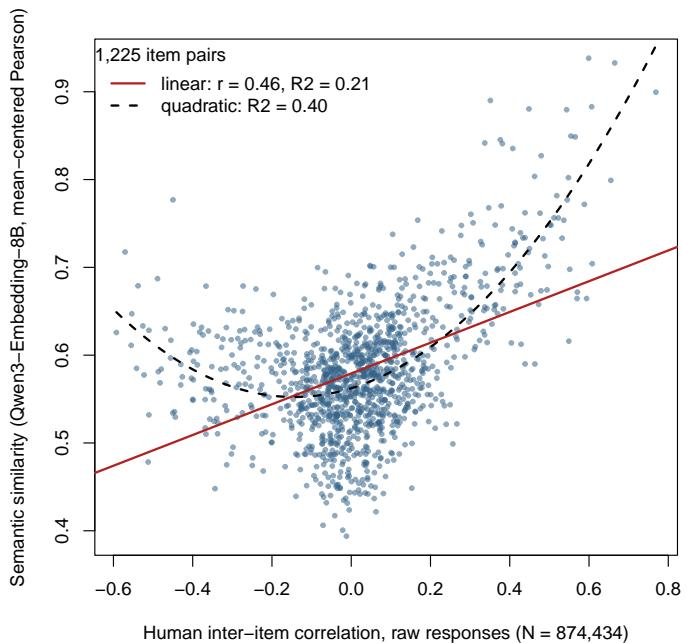  
Figure 6  
Semantic similarity (mean-centered Pearson encoding of the Qwen3-Embedding-8B item vectors) against human inter-item correlations from raw responses $( N = 8 7 4 , 4 3 4 ) _ { \cdot }$ , for all 1,225 item pairs. Each point is one pair of items. The red line is the linear fit $( r = . 4 6 )$ The dashed black curve is the quadratic fit, which accounts for .40 of the variance in the semantic similarities, against .21 for the line. Similarity rises steeply toward the positive end of the horizontal axis and only slightly toward the negative end.

## 4 Discussion

In this example, with the 8B embeddings, the consensus of five retention criteria, with ties going to the smaller number, matched the number of factors the inventory’s authors intended, with two criteria choosing five factors, two choosing six, and one choosing two. Three of the five domains corresponded mainly to single factors. Where the semantic structure and the structure of the human responses disagreed, the disagreement suggested where to look for a source. This Discussion first summarizes what the example found and then explains what the agreement between the semantic and response structures means, because the recommendations, applications, and limits that follow depend on what that agreement can and cannot show. It then draws recommendations for users, describes where the package is most useful, states the limits of the method, and ends with three directions for further research.

## 4.1 Summary of Findings

This article introduced semanticfa, an R package that runs the whole factoranalytic workflow on the similarities between the embeddings of a scale’s items, and can also factor a similarity matrix from an NLI cross-encoder, without any response data. The worked example applied every stage and each refinement tool to the 50-item IPIP Big-Five Factor Markers and compared the results with a factor analysis of 874,434 people’s responses. It produced four main findings.

First, the semantic analysis recovered part of the structure that the inventory’s authors intended. Two retention criteria chose five factors, two chose six, and one chose two, and the package’s rule for ties, which keeps the smaller number, gave a consensus of five, the number of domains. Three of the five factors corresponded mainly to one domain each (Openness, Conscientiousness, and Neuroticism). Most of the Extraversion items and five of the Agreeableness items were divided between the other two, which are blended factors. One gathered forward-keyed items about sociability and warmth, and the other gathered reverse-keyed items that describe the absence of a disposition. The blended factors also took three items from other domains, and four Agreeableness items joined the Neuroticism factor (Table 2). Second, the agreement with human responses difered by domain. The semantic factors matched the human factors more closely for Openness $( \phi = . 9 2 $ , in the range of fair similarity), Conscientiousness (.84), and Neuroticism (.80) than for Extraversion (.64) and Agreeableness (.52). Across all 1,225 item pairs, pairs that were more similar in meaning tended to be answered more alike, as measured by the correlations among the raw responses $( r = . 4 6 )$ The relation was curved. Similarity rose steeply among pairs that people answered alike and only slightly among pairs answered in opposite directions. An item and a reverse-keyed item of its domain, which people answered oppositely, were on average about as similar as two items from diferent domains (.58 against .57, a diference whose 95% interval included zero), so the embeddings registered that the two items difer but not that they are opposed.

Third, two analysis choices changed the conclusions. The first was the encoding. Sign-flipping the reverse-keyed items’ embeddings, the apparent analogue of reverse-scoring, gave no gain in agreement with the correlations among raw responses (r = .444, against .456 for the default encoding). Because the flip applies the scoring key, its matched comparison is with the correlations among reverse-scored responses, and there it gave the worst agreement of the four embedding encodings (r = .137, against .434 without the flip). A likely source of that drop is the sign pattern that the flip imposes on every pair of a forward-keyed and a reverse-keyed item. The second was the reference used to judge fit. By the cutof conventionally applied to response data (Hu & Bentler, 1999), the RMSR of .032 indicated good fit, but every fit to random embeddings also passed that cutof, so passing it says little about embeddings. Fourth, the refinement tools proposed specific revisions to the item pool. They flagged eleven redundant item pairs and built a 25-item short form. Its agreement with the theoretical domains rose from NMI = .527 for the full inventory to .810, but parallel analysis on the short form kept only three factors, so that change compares a five-factor with a three-factor partition and is descriptive. Random sets of five items per domain, fitted with five factors, already reached a median NMI of .600, so part of the gain comes from having fewer items per domain. Fitted the same way, the short form reached NMI = .810 and ARI = .707, both above every random set, which is the efect of choosing the items closest to the center of their own domain. The tools also sorted three candidate items, written to illustrate the three verdicts, into one that cross-loaded, one that nearly duplicated an existing item, and one that fit Conscientiousness without duplicating any

item.

## 4.2 Theoretical Implications

The semantic and human analyses start from diferent data. The semantic analysis factors the similarities between item embeddings and uses no respondents, whereas the human analysis factors the correlations among the answers of 874,434 people. The two agreed more closely for Openness, Conscientiousness, and Neuroticism $( \phi = . 9 2 $ .84, and .80) than for the other two domains. Because the two analyses use diferent information about the same items, that agreement is evidence, for this inventory and embedding model, that the items’ wording and people’s responses group the items of these three domains in broadly similar ways, most closely for Openness, the only domain in the approximate range of fair similarity. The embedding model may, however, have learned the published domain assignment from listings of the items in its training text, which would inflate the agreement and cannot be excluded here (see Limitations). Such agreement can be counted among the observable relations that make up a construct’s nomological network (Cronbach & Meehl, 1955). It is not proof that the traits exist or cause the responses (Borsboom et al., 2004).

The disagreements are also informative, because they were concentrated in two domains rather than spread across the inventory. In the semantic solution, most of the Extraversion items and five of the Agreeableness items were divided between two blended factors, which also took three items from other domains, and four Agreeableness items joined the Neuroticism factor (Table 2), although a few of these counts rest on near ties. The composition of the blended factors is consistent with a grouping by topic and phrasing rather than by domain. One gathered forward-keyed items about sociability and warmth from both domains, and the other gathered reverse-keyed items that describe the absence of a disposition, from both domains and from Openness and Neuroticism. The semantic Extraversion factor matched human Agreeableness (.52) as closely as the semantic Agreeableness factor did (Table 3), which fits this mixture. Two reasons are plausible, although neither was tested here. English describes sociability and warmth in overlapping words, and statements phrased as the absence of something share the wording of negation across topics, whereas people’s reverse-scored answers keep the domains apart. Other studies have found divergences of this kind and ofered plausible sources for them. Two studies found the same overlap of Agreeableness and Extraversion items in embeddings and noted that the two domains are also associated in human responses (Casella et al., 2024; Milano et al., 2025). The wording may thus draw two related dimensions closer together than people’s answers do, which is consistent with the mixture of warmth and sociability here, where the human solution kept the two domains apart. The connotations of a word may also shift its position in text away from the position that other measures give it. Kmetty et al. (2021), for example, found that health-care occupations ranked lower in text than on a socioeconomic index of occupations, plausibly because of their connotations of illness. People’s answers may also share causes that the wording does not carry, as when insomnia and physical symptoms formed one factor only in responses, plausibly because they occur together in people, perhaps through bodily or physiological causes, without being described alike (Kojima et al., 2026). A disagreement therefore points to the items and domains where these possible sources can be investigated. How large the divergence is may also vary with the construct. In one unpublished study of a single sample and nine dimensions from four scales, wording appeared to predict correlations least well in the dimensions whose items already correlated strongly, by the authors’ reading of a random-efect correlation estimated across those nine dimensions, in a model whose average efect of wording was significant only narrowly $( p = . 0 4 4 )$ (D. Zhang & Qiu, 2026).

Because coherence can be estimated, for a given embedding model, theories of a construct can be asked to predict it, and those predictions can be tested. If some clinica constructs are networks of symptoms that cause one another (Borsboom, 2008), coherence should be lower for them than for constructs whose symptoms share a common cause, because symptoms that cause one another can correlate strongly in people’s answers without resembling one another in meaning. The function sfa\_congruence() makes that prediction testable across instruments of both kinds. The same reasoning yields predictions for two other cases. Formative indicators jointly determine a construct and need not correlate (Bollen & Lennox, 1991), so coherence cannot be assumed for them. Method variance, the part of the correlations among responses that comes from the method of measurement rather than from the content measured (Campbell & Fiske, 1959), is a form of construct-irrelevant variance (Messick, 1995). We expect, although this was not tested, that it also lowers coherence, because embeddings register the wording of an item but not other features of the method, such as the response format. Embeddings do register some features of wording beyond topic, however, such as the negated phrasing that appears to have grouped ten of the 18 reverse-keyed items here, so a method efect carried by the wording could instead raise coherence. Studies of the semantic theory of survey response suggest that the wording of a scale can shape factor analyses of its ratings (Arnulf et al., 2014, 2018), but a factor analysis of responses alone does not estimate how much of a scale’s structure comes from its wording. Coherence indexes how closely the response structure follows the wording. It is presumably related to that contribution of the wording but is not the same thing, and the present data do not test the relation. Theories of a construct can be asked to predict this index.

## 4.3 Recommendations for Users

The worked example suggests six practices for anyone running SFA. The first five each follow from a specific finding, and the sixth follows from the uneven agreement with human responses across domains. Where a practice rests on the worked example, that evidence comes from one inventory, one family of embedding models plus one NLI crossencoder, and English items, so each practice is a starting point that further applications can revise.

1. Use a keying-free encoding, and do not sign-flip reverse-keyed items. Reverse-scoring a response keeps the item’s content and inverts only the scale on which it is answered. Multiplying an embedding by −1, by contrast, reverses the sign of its cosine with every item that is not also flipped, so the item becomes dissimilar even to items on its own topic. In this inventory, sign-flipping gave no gain in agreement with the correlations among raw responses (r = .444, against .456 for the default encoding), and it left the grouping of the items unchanged. Because the flip applies the scoring key, its matched comparison is with the correlations among reverse-scored responses, which apply the same key. On that comparison it gave the worst agreement of the four embedding encodings, both over item pairs and in loading patterns (Table S1 in the Supplementary Materials). A likely source of the drop from the unflipped cosines is the sign pattern that the flip imposes. After reverse-scoring, a forward-keyed and a reverse-keyed item of the same domain correlate positively, whereas the flip gives such pairs an average similarity of −.58. In earlier work, which flipped item embeddings before averaging them within each facet, sign-flipping raised factor recovery for one inventory. For the HEXACO, however, it recovered the factors less often than the other encodings tested and consistently failed to recover the Emotionality factor (Guenole et al., 2025). Embeddings from general-purpose models do not represent reverse-keyed items as the opposites of the forward-keyed items they contradict (Hommel & Arslan, 2025; Suárez-Álvarez et al., 2026), raw embeddings rarely give negative similarities between opposing items (Pellert et al., 2026), and text methods older than embeddings could not detect that an item is reversed either, so studies using them corrected the signs of reverse-scored items by hand (Arnulf et al., 2018) and, for scales expected to relate negatively, assigned negative signs from theory (Arnulf et al., 2014, 2018). In the worked example, an item and a reverse-keyed item of its domain were on average about as similar as two items from diferent domains (.58 against .57, a diference whose 95% interval included zero), although people answered them in opposite directions. Three of the four embedding encodings use no scoring key: the unflipped cosines, SQuID, and the default mean-centered Pearson encoding. SQuID agreed best with the correlations among reverse-scored responses, but on the like-with-like comparison with raw responses it fell below the NLI matrix (.490 against .561). It also left a matrix poorly suited to factor analysis (KMO = .022), so the default mean\_centered\_pearson encoding is the better choice for factor analysis.

2. Decide the number of factors from several criteria, and check it against theory. The criteria disagreed here, with five and six each chosen by two criteria and two chosen by TEFI. In simulations with personality items written by a language model (GPT-4o) and embedded with a single embedding model, the Kaiser rule and parallel analysis chose too many factors more often than EGA (Garrido et al., 2025), although here the adapted parallel analysis agreed with EGA. The human analysis had a diferent problem. With 874,434 respondents, conventional parallel analysis endorsed ten factors, possibly because with that many respondents even very small factors exceed the mean random-data eigenvalues, although this explanation was not tested. Reporting the consensus, and fixing the final number at the theoretical five (Goldberg, 1990) rather than letting a single criterion decide, avoids relying on any one criterion. The consensus alone would not have been enough here, because it reached five only with the 8B embeddings, and only through its tie rule.

3. Compare fit statistics with fits to random embeddings. By the cutof conventionally applied to response data (Hu & Bentler, 1999), the RMSR of .032 indicated good fit, but every fit to random embeddings also passed that cutof. Without a sample size, many of the usual tests of fit cannot be computed (Suárez-Álvarez et al., 2026). Randomembedding baselines are a cruder relative of the random-word baseline that Pokropek (2026) used for confirmatory models, because random vectors lack the general similarity that real items share. They are therefore a weak reference (see Limitations), but they show which conventional readings do not carry over to embeddings.

4. Prefer the largest model that memory allows, and check how the number of factors depends on model size. All three model sizes placed items from the same domain closer together than items from diferent domains, and for this inventory the separation did not grow with size. For a second inventory in the Supplementary Materials, the separation rose with size, although its paired interval just included zero, and that inventory’s factors matched its scales more closely with each larger model. Only with the 8B model, however, did parallel analysis and EGA both indicate the theoretical five factors, while the Kaiser rule, the empirical Kaiser criterion, and TEFI did not change with size. Because the comparison covered three sizes of one model family on two English inventories, and size was confounded with embedding dimension, this recommendation may not hold for other families or inventories.

5. Report agreement with human data on several metrics, and compare each encoding with the matching human correlations. Encodings that ignore the scoring key should be compared with the correlations among raw responses, and encodings that use the key with the correlations among reverse-scored responses, so that both sides of each comparison either use the scoring key or ignore it. Because an encoding that uses the key imposes a sign pattern of its own, its comparison with raw responses should be reported as well, as the first practice showed for sign-flipping. Diferent metrics (loading shape, item grouping, and item-pair correlation) can rank the encodings diferently. The NLI matrix, for example, was best on item grouping and on itempair correlation with raw responses but worst on loading shape (Table S1 in the Supplementary Materials). Its item grouping and loading shape, however, come from a repaired version of the matrix, in which the negative eigenvalues were raised to just above zero, so those two rankings partly reflect the repair. Its item-pair correlation with raw responses uses the original matrix, so it does not depend on the repair, although its lead there was not tested either. Gaps of a few hundredths between encodings, such as the NLI matrix’s lead in item grouping, cannot be distinguished without intervals.

6. Treat every semantic verdict as a hypothesis for response data to test. Agreement with the structure of the human responses was closer for three domains (ϕ from .80 to .92) and weak for two (.52 and .64). In the semantic solution, Agreeableness and Extraversion items shared two blended factors (Table 2), but nothing in that solution could show whether people’s responses would separate the two domains. Extending the same caution to a redundancy flag, a short form, or a verdict on a new item is a precaution rather than a finding of the example, because each of these describes wording. Whether people’s responses show the same redundancy, structure, or fit cannot be assumed from wording alone.

## 4.4 Applications

The package is intended for the early stage of scale development that Clark and Watson (2019) call crucial, the writing of the item pool, which comes before any data are collected. At that stage a researcher can screen a large pool of candidate items, remove redundant ones early, and draft a short form, all without collecting responses. The worked example flagged redundant pairs, drafted a short form, and screened new candidate items. It made no removal on the basis of the redundancy flags, however, and its screen covered three candidate items rather than a large pool. Redundancy screening flagged eleven redundant pairs, the strongest of them near-paraphrases, led by A24 (“I sympathize with others feelings.”) and A29 (“I feel others’ emotions.”), whose wTO of .462 was the highest of any pair, against a flag threshold of 0.25. Such pairs would be expected to raise internal consistency without adding content (Christensen et al., 2023), although the example did not check this in the responses. The short form halved the inventory. Its agreement with the theoretical domains cannot be compared directly with the full form’s, because paralle analysis kept three factors for the short form. The rise in NMI from .527 to .810 therefore compares a partition of the items into five factors with one into three and is descriptive only. The informative comparison is with random item sets. 200 random sets of five items per domain, fitted with five factors, already reached a median NMI of .600, above the full form’s .527, so part of the gain comes from having fewer items per domain. Choosing the items closest to the center of their own domain improved agreement further. Fitted the same way, the short form reached an NMI of .810 and an ARI of .707, above every random set on both (maxima .785 and .656). The short form also kept both items of four of the flagged redundant pairs, so building a short form and screening for redundancy are separate steps. A short form chosen for semantic centrality can also lose breadth that the construct needs, in the same way that maximizing internal consistency can (Clark & Watson, 2019). It is therefore a candidate for validation rather than a finished instrument (Jung & Seo, 2025; Wang et al., 2026), and the package prints this caveat with every short form it builds.

A second use arises when response data are scarce, unavailable, or untrustworthy. Müller (2026) recovered semantic structure, from adjective vectors weighted by the mean responses of 55 people, in a study where a confirmatory factor analysis of the same responses fit poorly and merged two of its five factors, a failure that the author attributed in large part to the small sample. The semantic analysis in that study still used the responses as weights, unlike SFA, so it is a precedent for semantic structure helping where a smallsample analysis failed rather than for response-free use. Kambeitz et al. (2025) also note that collecting the samples needed to develop a clinical questionnaire is costly and can miss hard-to-reach groups, and that in some countries the cost can make a suficient validation sample infeasible. Synthetic respondents that can pass attention checks (Westwood, 2025) are a newer threat to response data, and an analysis that uses no respondents cannot be contaminated by them. The risk of mistaking machine output for human data also applies to SFA itself, because structure derived from a language model must never be reported as evidence about how people respond. On a College Algebra test, none of six language models on its own reproduced the distribution of human abilities, although an ensemble of them approximated it better (Liu et al., 2025). One framework that simulates respondents also does not claim to replicate the psychological processes by which people answer survey items (Lim et al., 2026). For this reason the package measures coherence with human data rather than assuming it.

A third use is comparing instruments. The jingle–jangle screen found nothing to flag in the Big-Five Factor Markers. That null result from one inventory says little about the screen’s sensitivity, because the two cosines it compares, between subscale item averages and between construct names, were all strongly positive, so a diference of 0.20 is hard to reach. We intend the screen mainly for comparing scales, including those of diferent instruments, where mismatches between labels and content can arise (Wulf & Mata, 2025, 2026). The package also complements item-generation tools such as AI-GENIE (Russell-Lasalandra et al., 2026). Such a tool writes new items and already removes redundant ones, and semanticfa could then apply a further screen for redundancy and fit against the existing items before anyone answers them. This combination was not tested here, and the worked example screened only three candidate items written to illustrate the verdicts.

Finally, design choices afect what an analysis recovers, how private and reproducible it is, and where it can run. Within this package, the encoding and the size of the embedding model changed what the worked example recovered (see the Results). Outside it, in a small preliminary study of a diferent pipeline, clustering item embeddings recovered structure that prompted chatbots did not recover consistently (Huang et al., 2025). Open models that run on the researcher’s own computer can also keep sensitive data private. Hussain et al. (2024) make this point in their tutorial on open-source language models for behavioral science. A model that is saved and run locally, they note, keeps the data on the researcher’s own hardware, where the model’s creators cannot access them. For SFA, recording the version of a locally saved model has a further benefit, because every reanalysis then uses the same measurement instrument. Once the item embeddings and the embeddings of any auxiliary words exist, every step of the workflow described here that works from stored embeddings runs without a network connection, provided Python with NumPy (C. R. Harris et al., 2020) is installed for reading them. The semantic analysis is therefore designed to give the same numerical results in a clinic that cannot send data of site and in a teaching laboratory, when both use the same embeddings, seed, and software versions, including the linear-algebra library. Even then, the layouts of the two nonlinear item maps in Figure 5 can difer slightly between platforms (see the Open Practices Statement). Across the package, only three steps call Python, namely embedding new text, reading embeddings stored in NumPy files, and building the NLI matrix, and embedding new text and building the NLI matrix also download their models on first use.

## 4.5 Limitations

The central limitation is built into the method, because SFA characterizes the wording of items rather than the people who answer them. Without respondents, it cannot show that a trait causes any response, and it supplies none of the theory of how people arrive at their answers, which Borsboom et al. (2004) make the focus of validation research. Coherence must therefore never be reported as a validity coeficient. Semantic evidence bears on two of the aspects of validity that Messick (1995) distinguishes. It addresses the content aspect, which concerns which content a scale covers and how well, and it addresses the structural aspect in part, because it shows whether the meanings of a scale’s items group in the way its scoring assumes. The remaining aspects require response and outcome data. Close agreement between the two structures does not remove these limits. Kojima et al. (2026) found that factor scores from responses predicted lifetime diagnoses better than scores that weighted the responses by loadings derived from text, at least for the general factor. SFA is best described, in the words that Hommel and Arslan (2025) use for their own web application, as “a free pilot study of survey items” (p. 15), and it should be followed by human data wherever they can be collected. Schoenegger et al. (2025) also found that language models predicted item correlations more accurately than most individual experts but did not outperform the experts’ pooled judgment. Finally, in one study that tested it, a finding that a model fits the semantic matrix was more reliable than a finding that a model does not fit. Feraco and Tofalini (2025) fitted a one-factor model to each four-item scale of a character-strengths inventory. Every model that fit the semantic matrix also fit the responses, whereas about half of the models that the semantic matrix rejected fit the responses as well.

Coherence that is high would be consistent with part of the critique of Uher (2025), who argues that rating-scale data are people’s judgments of verbal statements rather than measurements of what the statements describe. Coherence estimates how closely the structure found in rating-scale responses follows the meaning of the items, which is the part of that critique that item text can test. Uher also argues that language-model methods cannot by themselves show how responses relate to the phenomena they describe, and SFA shares this limit. Studies of the semantic theory of survey response estimated, with older text methods, how closely item wording predicts the correlations among responses, and those methods predicted almost nothing for a five-factor personality inventory (Arnulf et al., 2014, 2018). Their main estimates were in-sample proportions of variance explained, computed on other instruments and samples, so they are not directly comparable with the values found here. Here coherence was $r = . 4 6$ at the level of item pairs, against the correlations among raw responses, with a mean matched congruence of $\phi = . 7 4 4$ across factors, values for which no benchmark of coherence across instruments exists yet. The theory of meaning behind embeddings sets a further limit. Embeddings summarize how words are used in the language (Wittgenstein, 1953/1967, §43), not how an individual respondent reads an item, so the part of each response that reflects one person’s reading lies outside what SFA can measure. Coherence below 1 should therefore be expected even from a flawless instrument, although how far below 1 is not known.

A further limitation is specific to the inventory used here. The IPIP Big-Five Factor Markers are reproduced on public websites together with their domain labels, including in the documentation of the very data set used as the benchmark here (Open-Source Psychometrics Project, 2018). The embedding model was initialized from a Qwen3 generative language model (Y. Zhang et al., 2025). That model was pretrained on about 36 trillion tokens of text in 119 languages and dialects, which its technical report describes only by broad domain, such as code, books, and multilingual text (Yang et al., 2025), so whether listings of this inventory were part of that text cannot be checked. Generative language models can memorize and reproduce text from their training data (Carlini et al., 2021), so the model may have learned which items belong together from those listings rather than from what the sentences mean, which would inflate the agreement between the semantic and response structures. The semantic solution divided most of the Extraversion items and five of the Agreeableness items between two blended factors, which also took three items from other domains, and four Agreeableness items joined the Neuroticism factor (Table 2). This is not what one would expect if the model had simply reproduced the published domain assignment, because such a model would have kept the items of each domain together. Partial memorization of the three domains that were recovered cannot be excluded without reworded items, however, so coherence measured on well-known inventories may be an upper bound. An important use of the package, checking new and unpublished items, is the case that memorization is least likely to help with. Re-embedding systematically reworded versions of the items, with their meaning preserved, would bear on this without new respondents and is left to future work.

The random-embedding baselines have a limit of their own. Parallel analysis and the fit calibration compare the observed matrix with matrices built from random embeddings. Random vectors in thousands of dimensions are nearly unrelated to one another, whereas real item embeddings are positively similar to one another, as in the worked example and as representations from contextual language models commonly are, a property called anisotropy (Ethayarajh, 2019). Every raw cosine in the worked example lay between .394 and .938. Exceeding the random baseline is therefore a weak test for parallel analysis. For TEFI, a value better than every random fit shows only that the items are not random. The RMSR comparison is weak for the same reason, and the CAF comparison should be read with the same caution, because the baseline matrix is nearly an identity matrix. The Technical Reference in the Supplementary Materials explains this problem and what a better baseline would require. Until one exists, the number of factors is better treated as a judgment informed by the consensus of several criteria and by theory, as recommended above.

The human benchmark has limits of its own. It is an open, self-selected online sample, cleaned only by removing records with a missing or out-of-range response (Open-Source Psychometrics Project, 2018), so its factor structure need not match that of a representative sample. Guenole et al. (2025) also note that the people who wrote the text on which an embedding model was trained may difer from the people who answer a scale, and that the more the two populations difer, the less well the embeddings may stand in for responses.

The results also depend on the embedding model. The texts a model was trained on, how much context it reads, and how it was built can all change which human behaviors its similarities predict, and no model is best for every task, at least among word-level models (Mandera et al., 2017). The embedding model is thus part of the measurement instrument, so the stability of results across models should be reported. The present results cannot show that stability, because they rest on one model family (Qwen3-Embedding) and on English items. Even a model’s full embedding need not be optimal, because preliminary simulation evidence suggests that the signal can concentrate in a subset of its coordinates (H. Golino, 2026). The selected depth of 1,431 of 4,096 coordinates here, the highest point of a noisy curve, is consistent with this but gives it little support, because the depth criterion favors agreement with the theoretical domains and so is not an independent test. In one study, embedding methods were also less accurate than expert judges at assigning items phrased as behaviors, rather than as traits, to their intended constructs, although on an inventory of concise trait descriptions every model tested was more accurate than the judges (Milano et al., 2026). In that study, the expert judges were graduate students in psychology who, unlike the models, were given definitions of the constructs, item length and instrument were confounded with phrasing, and the authors note that translating the behavioral items from Italian into English for some models may have distorted their content. If the finding holds, the structure of scales whose items describe behaviors may be recovered even less accurately than the partial recovery obtained here for the Big-Five Factor Markers, whose short firstperson statements mix descriptions of traits and of behaviors and were not classified by phrasing here. Clinical experiences that are hard to put into words, and likely rare in training texts, may be where semantic structure is least trustworthy (Kambeitz et al., 2025).

Finally, the refinement and screening tools carry their own caveats. Removing items assumes a reflective model, in which the construct causes the responses to every item. In a formative model, by contrast, each item is part of the construct’s definition, so removing one usually changes the construct (Bollen & Lennox, 1991). The cutof that Unique Variable Analysis uses was calibrated on simulated response data rather than on similarity matrices (Christensen et al., 2023), so how often it errs on similarity matrices is unknown. Two items with nearly the same meaning can still difer in how people respond to them, for example in how readily people endorse them or how extreme their ratings are, so similarity of meaning does not show that two items measure the construct in the same way (Wang et al., 2026). Every purely semantic verdict about redundancy, including this package’s, should inform expert judgment rather than replace it, and so should the screen for jingle–jangle fallacies (Wulf & Mata, 2026).

## 4.6 Future Directions

Three directions follow from these results and their limits. The first is comparative, because no one can say what counts as high or low coherence until it has been estimated across instruments, domains, and populations. The worked example, which analyzed one carefully constructed inventory, provides a single data point, and the largest diferences may lie between kinds of constructs. One prediction and two findings bear on this question, and each awaits a systematic test with a common toolkit. If the symptoms of some clinical constructs cause one another (Borsboom, 2008), those constructs should show lower coherence than common-cause constructs, as argued above. In one unpublished study, the strength of the relation between meaning and correlation appeared to vary across nine dimensions from four scales that measure diferent constructs (D. Zhang & Qiu, 2026). Milano et al. (2026) found that embedding methods were generally less accurate than expert judges at assigning items phrased as behaviors to their constructs. The judges were graduate students in psychology who, unlike the models, were given definitions of the constructs, item length and instrument were confounded with phrasing, and translating the behavioral items into English for some models may have distorted their content. That finding concerns how well the intended structure is recovered rather than coherence, and the phrasing of items rather than the kind of construct. If it holds, however, whether items are phrased as behaviors or as traits, which varies across instruments, may also produce diferences in coherence between them.

The second direction is methodological. It concerns four settings that the present analysis fixed or examined only narrowly, and one test that it left open. The analysis used a single model family and compared only three sizes within it. Because results can depend on the embedding model, as Mandera et al. (2017) found among word-level models, their stability across model families should be reported the way agreement across raters is. The number of an embedding’s leading coordinates to use (H. Golino, 2026) was examined here only with a criterion that favors agreement with the theoretical domains, and the main fit used the full embedding, which is the package’s default. The depth could be examined in every analysis, with a criterion that does not depend on the theoretical domains. The cutofs for redundancy screening should be recalibrated on similarity matrices instead of being inherited from simulations of response data (Christensen et al., 2023). The randomembedding baselines could be computed once for common numbers of items, embedding sizes, and encodings, and matched to the positive similarity that real item embeddings share, so that a Monte Carlo reference of the kind Pokropek (2026) used would require looking up a table rather than running a new simulation. A precomputed baseline would still leave open what it should hold fixed from one draw to the next (see the Technical Reference). A particularly hard open problem among these is a better baseline for deciding the number of factors, which the Technical Reference discusses in detail. The test left open is the one for memorization described in the Limitations. Re-embedding systematically reworded versions of a published inventory, with the meaning of each item preserved, and comparing their semantic structure with that of the original wording and with the existing human responses would help show, without new respondents, whether the agreement found here depends on the model having seen the published items.

The third direction extends screening before data collection to translated scales. In one study, a scale adapted from English into Polish with a generative model performed at or near a human adaptation on most psychometric criteria, with slightly lower reliability (Grobelny et al., 2025), but without responses their structure cannot be checked until the adapted scale has been administered. SFA could check the adaptation’s semantic structure earlier by embedding the original and the adapted items in a shared multilingual space. If the model represents the two languages comparably, which would itself need to be tested, the agreement metrics could indicate whether the wording of the adaptation has drifted from the original semantic structure. The response structure of the adapted scale would still have to be confirmed once it has been administered.

The first and third directions keep the division of labor that these results suggest, in which the analysis of wording can be automated but its verdicts remain hypotheses for response data to test. More than thirty years ago, Lara et al. (1992) proposed testing a candidate meaning for each factor against the variables that load on it, and anticipated that automatic semantic interpretation of factor solutions might become necessary for very large problems. Sentence embeddings now make construct-level versions of such tests computable, such as comparing items with construct names and centroids, and semanticfa implements semantic factor analysis as a standard factor-analytic workflow in R. Three tasks still require response data and expert judgment: explaining how people arrive at their answers, relating scores to outcomes, and deciding when a well-characterized set of items has become a validated measure.

## 5 Conclusion

A rating scale has two structures that factor analysis can examine: the correlations among people’s responses and the organization of the language that drew those responses. Methods for the first have been developed for over a century (Spearman, 1904a). Meth ods for the second, which work from the meanings of the items, are recent. Most use sentence-embedding models, such as Sentence-BERT (Reimers & Gurevych, 2019), and their precursors represented words rather than whole sentences (Arnulf et al., 2014). As the Introduction described, the published ones have been scattered across separate papers, scripts, and software. The semanticfa package brings the stages of the factor-analytic workflow together in one R package. It runs that workflow on the similarities between item embeddings and can also factor the NLI matrix, whose similarities come from a natu ral language inference cross-encoder rather than from embeddings, although the steps that need embeddings, such as the random-embedding baselines and the anchoring of items to construct centroids, do not apply to it. The workflow covers a choice among encodings, retention by several criteria, diagnostics with an optional comparison of three fit statistics with fits to random embeddings, tools for interpretation, and tools for refinement. The semantic analysis itself needs no responses. Because it works from fixed, archived embeddings, it is designed so that its numerical results can be reproduced from those embeddings with the seeds given in the Method and the software versions and linear-algebra library given in the Open Practices Statement, apart from small platform diferences in the t-SNE and UMAP layouts. The comparison with human responses also needs the downloaded response file, and psych’s parallel analysis of those responses is not seeded and runs in paralle processes, so the last digits of its random-data eigenvalues can difer between runs. The NLI matrix is a further exception. It does not come from the archived embeddings, and the cross-encoder that computes it is downloaded on first use. The Open Practices Statement records the revision of the cross-encoder that was used. On a well-understood inventory embedded with Qwen3-Embedding-8B, the consensus of five retention criteria, with ties going to the smaller number, was five factors, the number of domains the inventory was written to measure, after two criteria chose five, two chose six, and one chose two. With the two smaller models of the same family, the consensus was six for 0.6B and six for 4B. Three factors corresponded mainly to single domains (Openness, Conscientiousness, and Neuroticism). Most of the Extraversion items and five of the Agreeableness items were divided between two blended factors, which also took three items from other domains, and four Agreeableness items joined the Neuroticism factor (Table 2), although a few of these counts rest on near ties. One blended factor gathered forward-keyed items about sociability and warmth, and the other gathered reverse-keyed items that describe the absence of a disposi tion. Agreement with the factor structure of 874,434 respondents was closer for Openness, Conscientiousness, and Neuroticism (ϕ = .92, .84, and .80, with only Openness in the rang of fair similarity) and weaker for Extraversion and Agreeableness. Two reasons are plausible, although neither was tested here. English describes warmth and sociability in overlapping words, and statements that describe the absence of a disposition share the wording of nega tion across topics. For this inventory and embedding model, sign-flipping the embedding of reverse-keyed items agreed less with reverse-scored human responses than leaving them unflipped did. The package’s refinement tools, which need no responses, flagged redundant item pairs, built a candidate short form, and screened three new items written to illustrate its verdicts, so revisions of this kind can be drafted before any data are collected, as candidates to be validated once responses exist. We propose that the agreement between the two structures, semantic–behavioral coherence, be treated as a measurable property of a scale, for a given embedding model, and counted among the relations in the nomological network of the construct the scale measures. In the worked example, coherence was summarized by the correlation across item pairs between semantic similarities and the correlations among raw responses (r = .46) and by the mean matched congruence of the factors (ϕ<sup>¯</sup> = .744). For a given embedding model, high coherence is consistent with a scale’s wording and its respondents’ answers grouping the items in the same way, although what counts as high remains to be established. Low coherence points to the domains and items where the two part and gives a starting point for asking why. For a given embedding model, SFA estimates the structure that a scale’s wording implies before any respondent is recruited, and once responses exist, coherence shows how closely the structure of the responses agrees with that wording.

## Declarations

## Funding

This work received no external funding.

## Acknowledgements

This research was enabled in part by computing resources provided by the Digital Research Alliance of Canada.

## Competing Interests

The authors have no competing interests to declare.

## Ethics Approval and Consent

Not applicable. No new human data were collected. The human benchmark is a secondary analysis of the publicly released, anonymized Open-Source Psychometrics Project data set (Open-Source Psychometrics Project, 2018).

## Availability of Data and Materials

The embeddings, outputs, and other materials of the worked example are available in the package’s GitHub repository and in its archived Zenodo release (see the Open Practices Statement for the links and contents). The human response data are publicly available from the Open-Source Psychometrics Project (Open-Source Psychometrics Project, 2018) and are not redistributed.

## Code Availability

All code is available in the same GitHub repository and Zenodo release. The semanticfa package is available on the Comprehensive R Archive Network (CRAN), and its development sources and issue tracker are at https://github.com/devon7y/semanticfa.

## Use of Large Language Models

During the preparation of this work the authors used various Claude (Anthropic) and GPT (OpenAI) models to search and summarize the literature, write and review the code of the package and of the analyses, draft and revise the text of the manuscript under the authors’ direction, and check its citations, statistics, and claims against the cited sources and the data. The design of the package and of the worked example, the analytic decisions, and the interpretations are the authors’. After using these tools, the authors reviewed and edited the content as needed and take full responsibility for the content of the published article.

## Open Practices Statement

A self-contained reproduction archive regenerates every number, table, and figure in the worked example from raw inputs. It is kept in the reproduce folder of the package’s GitHub repository (https://github.com/devon7y/semanticfa), and the release that accompanies this paper is archived on Zenodo (https://doi.org/10.5281/ zenodo.23696188). It contains the master script (reproduce.R) and a full-run console transcript (reproduce.Rout) against which every command can be checked. It also contains the precomputed Qwen3-Embedding-8B embeddings of the auxiliary words (the five construct names and four projection poles) and of the candidate items, together with the scripts that generated them, the item embeddings from the two smaller models used in the model-size comparison, the embeddings of the 42 items of the Depression Anxiety Stress Scales from all three models, used in the Supplementary Materials, and a script that reembeds the items with each model size and compares the result with the stored vectors. The 8B item embeddings themselves are bundled with the package. The item embeddings came from the Hugging Face revisions 97b0c614be4d77ee51c0cef4e5f07c00f9eb65b3 (Qwen3-Embedding-0.6B), 5cf2132abc99cad020ac570b19d031efec650f2b (4B), and 1d8ad4ca9b3dd8059ad90a75d4983776a23d44af (8B) of the model repositories (Qwen Team, 2025). Re-embedding the 50 items with these revisions, in single precision, without an instruction prompt, and on an NVIDIA H100 GPU, reproduced the stored vectors: the cosine between each new vector and the stored one was at least .999998 for every item and model size, and 1.000000 to six decimal places for the Depression Anxiety Stress Scales items. The output of this check is part of the archive. Results are stored as an .rds object and as CSV tables, including the encoding comparison, the congruence matrix, both loading matrices, the NLI similarity matrix, and the fits to random embeddings, alongside the regenerated figures. The script documents where to download the human response file (Open-Source Psychometrics Project, 2018) and reads its location from an environment variable, so the archive does not depend on redistributing it. Two steps of the worked example call Python: reading the archived auxiliary and candidate-item embeddings from NumPy files, which uses the NumPy library (C. R. Harris et al., 2020), and building the NLI matrix, which uses sentence-transformers (Reimers & Gurevych, 2019) and downloads its cross-encoder from the Hugging Face Hub on first run. All factor analyses, retention methods, diagnostics, congruence metrics, refinement analyses, and figures are pure R and run ofline. The worked example was not preregistered.

The reported run used R 4.5.0 (R Core Team, 2025) with semanticfa 0.5.1 (Yanitski & Westbury, 2026), psych 2.6.5 (Revelle, 2026), EGAnet 2.4.1 (H. Golino & Christensen, 2026), GPArotation 2026.4-1 (Bernaards & Jennrich, 2005), Rtsne 0.17 (Krijthe, 2023), uwot 0.2.4 (Melville, 2025), and reticulate 1.43.0 (Ushey et al., 2025), with seed 42 and the reference NETLIB linear-algebra library, on a Linux (x86-64, AlmaLinux 9.8) compute node of the Nibi cluster of the Digital Research Alliance of Canada. The Python steps used Python 3.11.5 with NumPy 2.4.2 (C. R. Harris et al., 2020), torch 2.12.1 (Paszke et al., 2019), transformers 5.12.1 (Wolf et al., 2020), and sentence-transformers 5.2.0 (Reimers & Gurevych, 2019), and the NLI cross-encoder was the Hugging Face revision 6c749ce3425cd33b46d187e45b92bbf96ee12ec7. The NLI matrix was computed on the processors of that compute node, without a GPU, with the library’s default settings, so its scores may difer slightly on other hardware. The transcript records the Python library versions and this revision. The layouts of the t-distributed stochastic neighbor embedding and uniform manifold approximation and projection maps (Figure 5) depend on the floating-point arithmetic of the machine, so the positions of the items in those two maps can difer slightly on other platforms. Reproducing the worked example requires semanticfa 0.5.1 or later. The package’s development sources are in the same repository, and a getting-started vignette, a tutorial installed with the package, runs the full analysis on the bundled inventory.

## References

Arnulf, J. K., Larsen, K. R., Martinsen, Ø. L., & Bong, C. H. (2014). Predicting survey responses: How and why semantics shape survey statistics on organizational behaviour. PLoS ONE, 9 (9), e106361. https://doi.org/10.1371/journal.pone.0106361

Arnulf, J. K., Larsen, K. R., Martinsen, Ø. L., & Egeland, T. (2018). The failing measurement of attitudes: How semantic determinants of individual survey responses come to replace measures of attitude strength. Behavior Research Methods, 50(6), 2345–2365. https://doi.org/10.3758 s13428-017-0999-y

Arnulf, J. K., Larsen, K. R., Martinsen, Ø. L., & Nimon, K. F. (2021). Editorial: Semantic algorithms in the assessment of attitudes and personality. Frontiers in Psychology, 12 , 720559. https://doi.org/10.3389/fpsyg.2021.720559

Bernaards, C. A., & Jennrich, R. I. (2005). Gradient projection algorithms and software for arbitrary rotation criteria in factor analysis. Educational and Psychological Measurement, 65 (5), 676– 696. https://doi.org/10.1177/0013164404272507

Bollen, K. A., & Lennox, R. (1991). Conventional wisdom on measurement: A structural equation perspective. Psychological Bulletin, 110(2), 305–314. https://doi.org/10.1037/0033-2909.110 .2.305

Borsboom, D. (2008). Psychometric perspectives on diagnostic systems. Journal of Clinical Psychology, 64 (9), 1089–1108. https://doi.org/10.1002/jclp.20503

Borsboom, D., Mellenbergh, G. J., & van Heerden, J. (2004). The concept of validity. Psychological Review, 111 (4), 1061–1071. https://doi.org/10.1037/0033-295X.111.4.1061

Bowman, S. R., Angeli, G., Potts, C., & Manning, C. D. (2015). A large annotated corpus for learning natural language inference. In Proceedings of the 2015 Conference on Empirical Methods in Natural Language Processing (pp. 632–642). Lisbon, Portugal: Association for Computational Linguistics. https://doi.org/10.18653/v1/D15-1075

Braeken, J., & van Assen, M. A. L. M. (2017). An empirical Kaiser criterion. Psychological Methods, 22 (3), 450–466. https://doi.org/10.1037/met0000074

Brown, W. (1910). Some experimental results in the correlation of mental abilities. British Journal of Psychology, 3 (3), 296–322. https://doi.org/10.1111/j.2044-8295.1910.tb00207.x

Buchanan, L., Westbury, C., & Burgess, C. (2001). Characterizing semantic space: Neighborhood efects in word recognition. Psychonomic Bulletin & Review, 8 (3), 531–544. https://doi.org/10 .3758/BF03196189

Bunt, H. L., Goddard, A., Reader, T. W., & Gillespie, A. (2025). Validating the use of large language models for psychological text classification. Frontiers in Social Psychology, 3 , 1460277. https://doi.org/10.3389/frsps.2025.1460277

Burt, C. (1948). The factorial study of temperamental traits. British Journal of Statistical Psychology, 1 (3), 178–203. https://doi.org/10.1111/j.2044-8317.1948.tb00236.x

Campbell, D. T., & Fiske, D. W. (1959). Convergent and discriminant validation by the multitrait-multimethod matrix. Psychological Bulletin, 56(2), 81–105. https://doi.org/10 .1037/h0046016

Carlini, N., Tramèr, F., Wallace, E., Jagielski, M., Herbert-Voss, A., Lee, K., . . . Rafel, C. (2021). Extracting training data from large language models. In Proceedings of the 30th USENIX Security Symposium (pp. 2633–2650).

Casella, M., Luongo, M., Marocco, D., Milano, N., & Ponticorvo, M. (2024). LLM embeddings on test items predict post hoc loadings in personality tests. In Proceedings of the Ital-IA 2024 Thematic Workshops, 4th CINI National Lab AIIS Conference on Artificial Intelligence (Vol. 3762, pp. 313–317). Naples, Italy: CEUR-WS.org. (https://ceur-ws.org/Vol-3762/ 518.pdf)

Cattell, R. B. (1966). The scree test for the number of factors. Multivariate Behavioral Research, 1 (2), 245–276. https://doi.org/10.1207/s15327906mbr0102\_10

Christensen, A. P., Garrido, L. E., & Golino, H. (2023). Unique variable analysis: A network psychometrics method to detect local dependence. Multivariate Behavioral Research, 58 (6), 1165–1182. https://doi.org/10.1080/00273171.2023.2194606

Clark, L. A., & Watson, D. (2019). Constructing validity: New developments in creating objective measuring instruments. Psychological Assessment, 31 (12), 1412–1427. https://doi.org/10 .1037/pas0000626

Credé, M., Tynan, M. C., & Harms, P. D. (2017). Much ado about grit: A meta-analytic synthesis of the grit literature. Journal of Personality and Social Psychology, 113 (3), 492–511. https://doi.org/10.1037/pspp0000102

Cronbach, L. J., & Meehl, P. E. (1955). Construct validity in psychological tests. Psychological Bulletin, 52 (4), 281–302. https://doi.org/10.1037/h0040957

Devlin, J., Chang, M.-W., Lee, K., & Toutanova, K. (2019). BERT: Pre-training of deep bidirectional transformers for language understanding. In Proceedings of the 2019 Conference of the North American Chapter of the Association for Computational Linguistics: Human Language Technologies (pp. 4171–4186). Minneapolis, Minnesota: Association for Computational Linguistics. https://doi.org/10.18653/v1/N19-1423

Eberhardt, S. T., Vehlen, A., Schafrath, J., Schwartz, B., Baur, T., Schiller, D., . . . Lutz, W. (2025). Development and validation of large language model rating scales for automatically transcribed psychological therapy sessions. Scientific Reports, 15, 29541. https://doi.org/10 .1038/s41598-025-14923-y

Ethayarajh, K. (2019). How contextual are contextualized word representations? Comparing the geometry of BERT, ELMo, and GPT-2 embeddings. In Proceedings of the 2019 Conference on Empirical Methods in Natural Language Processing and the 9th International Joint Conference on Natural Language Processing (EMNLP-IJCNLP) (pp. 55–65). Hong Kong, China: Association for Computational Linguistics. https://doi.org/10.18653/v1/D19-1006

Feraco, T., & Tofalini, E. (2025). SEMbeddings: How to evaluate model misfit before data collection using large-language models. Frontiers in Psychology, 15 , 1433339. https://doi.org/10.3389/ fpsyg.2024.1433339

Foygel, R., & Drton, M. (2010). Extended Bayesian information criteria for Gaussian graphical models. In Advances in Neural Information Processing Systems 23 (pp. 604–612).

Friedman, J., Hastie, T., & Tibshirani, R. (2008). Sparse inverse covariance estimation with the graphical lasso. Biostatistics, 9 (3), 432–441. https://doi.org/10.1093/biostatistics/kxm045 Galton, F. (1884). Measurement of character. Fortnightly Review, 36, 179–185 Galton, F. (1884). Measurement of character. Fortnightly Review, 36, 179–185.

Garrido, L. E., Russell-Lasalandra, L. L., & Golino, H. F. (2025). Estimating dimensional structure in generative psychometrics: Comparing PCA and network methods using large language model item embeddings. PsyArXiv preprint. https://doi.org/10.31234/osf.io/2s7pw

Gefen, D., & Larsen, K. R. (2017). Controlling for lexical closeness in survey research: A demonstration on the technology acceptance model. Journal of the Association for Information Systems, 18(10), 727–757. https://doi.org/10.17705/1jais.00469

Goldberg, L. R. (1990). An alternative “description of personality”: The Big-Five factor structure. Journal of Personality and Social Psychology, 59(6), 1216–1229. https://doi.org/10.1037/ 0022-3514.59.6.1216

Goldberg, L. R. (1992). The development of markers for the Big-Five factor structure. Psychological Assessment, 4 (1), 26–42. https://doi.org/10.1037/1040-3590.4.1.26

Goldberg, L. R., Johnson, J. A., Eber, H. W., Hogan, R., Ashton, M. C., Cloninger, C. R., & Gough, H. G. (2006). The international personality item pool and the future of public-domain personality measures. Journal of Research in Personality, 40(1), 84–96. https://doi.org/10 .1016/j.jrp.2005.08.007

Golino, H. (2026). Optimizing the landscape of LLM embeddings with dynamic exploratory graph analysis for generative psychometrics: A Monte Carlo study. arXiv preprint arXiv:2601.17010. (https://arxiv.org/abs/2601.17010)

Golino, H., & Christensen, A. P. (2026). EGAnet: Exploratory graph analysis – a framework for estimating the number of dimensions in multivariate data using network psychometrics [Computer software manual]. (R package version 2.4.1. https://CRAN.R-project.org/ package=EGAnet)

Golino, H., Moulder, R., Shi, D., Christensen, A. P., Garrido, L. E., Nieto, M. D., . . . Boker, S. M. (2021). Entropy fit indices: New fit measures for assessing the structure and dimensionality of multiple latent variables. Multivariate Behavioral Research, 56(6), 874–902. https://doi.org/10.1080/00273171.2020.1779642

Golino, H. F., & Epskamp, S. (2017). Exploratory graph analysis: A new approach for estimating the number of dimensions in psychological research. PLoS ONE, 12(6), e0174035. https://doi.org/10.1371/journal.pone.0174035

Goretzko, D., & Ruscio, J. (2024). The comparison data forest: A new comparison data approach to determine the number of factors in exploratory factor analysis. Behavior Research Methods, 56, 1838–1851. https://doi.org/10.3758/s13428-023-02122-4

Grand, G., Blank, I. A., Pereira, F., & Fedorenko, E. (2022). Semantic projection recovers rich human knowledge of multiple object features from word embeddings. Nature Human Behaviour, 6(7), 975–987. https://doi.org/10.1038/s41562-022-01316-8

Grobelny, J., Szymański, K., & Strozyk, Z. (2025). Act as an expert in psychometry. The evaluation of large language models utility in psychological tests cross-cultural adaptations. Acta Psychologica, 261 , 105813. https://doi.org/10.1016/j.actpsy.2025.105813

Guenole, N., D’Urso, E. D., Samo, A., Sun, T., & Haslbeck, J. M. B. (2025). Enhancing scale development: Pseudo factor analysis of language embedding similarity matrices. PsyArXiv preprint. https://doi.org/10.31234/osf.io/vf3se\_v2

Günther, F., Rinaldi, L., & Marelli, M. (2019). Vector-space models of semantic representation from a cognitive perspective: A discussion of common misconceptions. Perspectives on Psychological Science, 14 (6), 1006–1033. https://doi.org/10.1177/1745691619861372

Han, S., Rijmen, F., Ames Boykin, A., & Lottridge, S. (2025). Leveraging fine-tuned large language models in item parameter prediction. In Proceedings of the Artificial Intelligence in Measurement and Education Conference (AIME-Con) – Volume 1: Full Papers (pp. 250–264). National Council on Measurement in Education.

Harris, C. R., Millman, K. J., van der Walt, S. J., Gommers, R., Virtanen, P., Cournapeau, D., . . . Oliphant, T. E. (2020). Array programming with NumPy. Nature, 585(7825), 357–362. https://doi.org/10.1038/s41586-020-2649-2

Harris, Z. S. (1954). Distributional structure. Word, 10(2–3), 146–162. (Reprinted in Z. S. Harris (1970), Papers in Structural and Transformational Linguistics, Dordrecht: Reidel.) https://doi.org/10.1080/00437956.1954.11659520

He, P., Gao, J., & Chen, W. (2023). DeBERTaV3: Improving DeBERTa using ELECTRA-style pre-training with gradient-disentangled embedding sharing. In The Eleventh International Conference on Learning Representations (ICLR 2023). (arXiv:2111.09543, https://arxiv .org/abs/2111.09543)

Hommel, B. E., & Arslan, R. C. (2025). Language models accurately infer correlations between psychological items and scales from text alone. Advances in Methods and Practices in Psychological Science, 8 (4), 1–19. https://doi.org/10.1177/25152459251377093

Horn, J. L. (1965). A rationale and test for the number of factors in factor analysis. Psychometrika, 30 (2), 179–185. https://doi.org/10.1007/BF02289447

Hu, L.-t., & Bentler, P. M. (1999). Cutof criteria for fit indexes in covariance structure analysis: Conventional criteria versus new alternatives. Structural Equation Modeling: A Multidisciplinary Journal, 6(1), 1–55. https://doi.org/10.1080/10705519909540118

Huang, Z., Long, Y., Peng, K., & Tong, S. (2025). An embedding-based semantic analysis approach: A preliminary study on redundancy detection in psychological concepts operationalized by scales. Journal of Intelligence, 13(1), 11. https://doi.org/10.3390/jintelligence13010011

Hubert, L., & Arabie, P. (1985). Comparing partitions. Journal of Classification, 2 (1), 193–218. https://doi.org/10.1007/BF01908075

Hussain, Z., Binz, M., Mata, R., & Wulf, D. U. (2024). A tutorial on open-source large language models for behavioral science. Behavior Research Methods, 56 (8), 8214–8237. https://doi.org/10.3758/s13428-024-02455-8

Joos, M. (1950). Description of language design. The Journal of the Acoustical Society of America, 22(6), 701–708. https://doi.org/10.1121/1.1906674

Jöreskog, K. G. (1969). A general approach to confirmatory maximum likelihood factor analysis. Psychometrika, 34 (2), 183–202. https://doi.org/10.1007/BF02289343

Jung, S.-J., & Seo, J.-W. (2025). A transformer-based embedding approach to developing shortform psychological measures. Frontiers in Psychology, 16 , 1640864. https://doi.org/10.3389/ fpsyg.2025.1640864

Kaiser, H. F. (1958). The varimax criterion for analytic rotation in factor analysis. Psychometrika, 23 (3), 187–200. https://doi.org/10.1007/BF02289233

Kaiser, H. F. (1960). The application of electronic computers to factor analysis. Educational and Psychological Measurement, 20 (1), 141–151. https://doi.org/10.1177/001316446002000116

Kaiser, H. F. (1970). A second generation Little Jify. Psychometrika, 35(4), 401–415. https://doi.org/10.1007/BF02291817

Kaiser, H. F., & Rice, J. (1974). Little Jify, Mark IV. Educational and Psychological Measurement, 34 (1), 111–117. https://doi.org/10.1177/001316447403400115

Kambeitz, J., Schifman, J., Kambeitz-Ilankovic, L., Mittal, V. A., Ettinger, U., & Vogeley, K. (2025). The empirical structure of psychopathology is represented in large language models. Nature Mental Health, 3 , 1482–1492. https://doi.org/10.1038/s44220-025-00527-y

Kmetty, Z., Koltai, J., & Rudas, T. (2021). The presence of occupational structure in online texts based on word embedding NLP models. EPJ Data Science, 10 , 55. https://doi.org/10.1140/ epjds/s13688-021-00311-9

Kojima, H., Soda, T., & Yamashita, Y. (2026). Language or syndrome? Investigating the origins of the general psychopathology factor through large language model embeddings. Psychiatry and Clinical Neurosciences, 80 (3), 196–204. https://doi.org/10.1111/pcn.70010

Krijthe, J. H. (2023). Rtsne: T-distributed stochastic neighbor embedding using a Barnes-Hut implementation [Computer software manual]. (R package version 0.17) https://doi.org/10 .32614/CRAN.package.Rtsne

Kusupati, A., Bhatt, G., Rege, A., Wallingford, M., Sinha, A., Ramanujan, V., . . . Farhadi, A. (2022). Matryoshka representation learning. In Advances in Neural Information Processing Systems 35 (NeurIPS 2022) (pp. 30233–30249). https://doi.org/10.52202/068431-2192

Landauer, T. K., & Dumais, S. T. (1997). A solution to Plato’s problem: The latent semantic analysis theory of acquisition, induction, and representation of knowledge. Psychological Review, 104 (2), 211–240. https://doi.org/10.1037/0033-295X.104.2.211

Lara, B. F., Tartas, E., & Oyarzabal, P. (1992). Semantics and factor analysis: An approach to the interpretation of factors. Applied Stochastic Models and Data Analysis, 8 (1), 7–16. https://doi.org/10.1002/asm.3150080103

Larsen, K. R., & Bong, C. H. (2016). A tool for addressing construct identity in literature reviews and meta-analyses. MIS Quarterly, 40 (3), 529–551. https://doi.org/10.25300/MISQ/2016/ 40.3.01

Lim, S., Song, W., Lee, E.-J., & Jo, Y. (2026). Psychometric item validation using virtual respondents with trait-response mediators. Transactions of the Association for Computational Linguistics, 14 , 1390–1412. https://doi.org/10.1162/tacl.a.733

Liu, Y., Bhandari, S., & Pardos, Z. A. (2025). Leveraging LLM respondents for item evaluation: A psychometric analysis. British Journal of Educational Technology, 56 (3), 1028–1052. https://doi.org/10.1111/bjet.13570

Lorenzo-Seva, U., & ten Berge, J. M. F. (2006). Tucker’s congruence coeficient as a meaningful index

of factor similarity. Methodology, 2 (2), 57–64. https://doi.org/10.1027/1614-2241.2.2.57

Lorenzo-Seva, U., Timmerman, M. E., & Kiers, H. A. L. (2011). The Hull method for se lecting the number of common factors. Multivariate Behavioral Research, 46 (2), 340–364. https://doi.org/10.1080/00273171.2011.564527

Lovibond, P. F., & Lovibond, S. H. (1995). The structure of negative emotional states: Comparison of the Depression Anxiety Stress Scales (DASS) with the Beck Depression and Anxiety Inventories. Behaviour Research and Therapy, 33(3), 335–343. https://doi.org/10.1016/ 0005-7967(94)00075-U

Low, D. M., Mair, P., Nock, M. K., & Ghosh, S. S. (2025). Text psychometrics: Assessing psychological constructs in text using natural language processing. PsyArXiv preprint. https://doi.org/10.31234/osf.io/9rdux\_v4

Maharjan, J., Jin, R., Zhu, J., & Kenne, D. (2025). Psychometric evaluation of large language model embeddings for personality trait prediction. Journal of Medical Internet Research, 27, e75347. https://doi.org/10.2196/75347

Mandera, P., Keuleers, E., & Brysbaert, M. (2017). Explaining human performance in psycholinguistic tasks with models of semantic similarity based on prediction and counting: A review and empirical validation. Journal of Memory and Language, 92 , 57–78. https://doi.org/10.1016/ j.jml.2016.04.001

Massara, G. P., Di Matteo, T., & Aste, T. (2017). Network filtering for big data: Triangulated maximally filtered graph. Journal of Complex Networks, 5 (2), 161–178. https://doi.org/10 .1093/comnet/cnw015

McInnes, L., Healy, J., & Melville, J. (2018). UMAP: Uniform manifold approximation and projection for dimension reduction. arXiv preprint arXiv:1802.03426. https://doi.org/10.48550/ arXiv.1802.03426

Melville, J. (2025). uwot: The uniform manifold approximation and projection (UMAP) method for dimensionality reduction [Computer software manual]. (R package version 0.2.4) https://doi.org/10.32614/CRAN.package.uwot

Messick, S. (1995). Validity of psychological assessment: Validation of inferences from persons’ responses and performances as scientific inquiry into score meaning. American Psychologist, 50(9), 741–749. https://doi.org/10.1037/0003-066X.50.9.741

Mikolov, T., Chen, K., Corrado, G., & Dean, J. (2013). Eficient estimation of word representations in vector space. arXiv preprint arXiv:1301.3781. (https://arxiv.org/abs/1301.3781)

Mikolov, T., Yih, W.-t., & Zweig, G. (2013). Linguistic regularities in continuous space word representations. In Proceedings of the 2013 Conference of the North American Chapter of the Association for Computational Linguistics: Human Language Technologies (pp. 746–751). Atlanta, Georgia: Association for Computational Linguistics. (https://aclanthology.org/ N13-1090)

Milano, N., Luongo, M., Ponticorvo, M., & Marocco, D. (2025). Semantic analysis of test items through large language model embeddings predicts a-priori factorial structure of personality tests. Current Research in Behavioral Sciences, 8 , 100168. https://doi.org/10.1016/j.crbeha .2025.100168

Milano, N., Ponticorvo, M., & Marocco, D. (2026). Human expertise and large language model embeddings in the content validity assessment of personality tests. Educational and Psychological Measurement, 86 (1), 30–53. https://doi.org/10.1177/00131644251355485

Müller, O. (2026). Semantic factor analysis: Validating personality structure recovery from empirically-weighted word embeddings. In Proceedings of SIGHUM 2026 (pp. 176–188). Association for Computational Linguistics.

Nimon, K., Shuck, B., & Zigarmi, D. (2016). Construct overlap between employee engagement and job satisfaction: A function of semantic equivalence? Journal of Happiness Studies, 17 , 1149–1171. https://doi.org/10.1007/s10902-015-9636-6

Open-Source Psychometrics Project. (2018). IPIP-FFM data: Answers to the IPIP Big Five Factor

Markers. Data set, file IPIP-FFM-data-8Nov2018.zip, released November 8, 2018. (https:// openpsychometrics.org/\_rawdata/)

Ormerod, C. (2026). Reconstructing item characteristic curves using fine-tuned large language models. arXiv preprint arXiv:2601.02580. (https://arxiv.org/abs/2601.02580)

Paszke, A., Gross, S., Massa, F., Lerer, A., Bradbury, J., Chanan, G., . . . Chintala, S. (2019). PyTorch: An imperative style, high-performance deep learning library. In H. Wallach, H. Larochelle, A. Beygelzimer, F. d’Alché Buc, E. Fox, & R. Garnett (Eds.), Advances in Neural Information Processing Systems (Vol. 32). Curran Associates. (https://proceedings.neurips.cc/paper\_files/paper/2019/file/ bdbca288fee7f92f2bfa9f7012727740-Paper.pdf)

Pellert, M., Lechner, C. M., Sen, I., & Strohmaier, M. (2026). Neural network embeddings recover value dimensions from psychometric survey items on par with human data. In Findings of the Association for Computational Linguistics: EACL 2026 (pp. 5738–5752). Association for Computational Linguistics.

Pennington, J., Socher, R., & Manning, C. D. (2014). GloVe: Global vectors for word representation. In Proceedings of the 2014 Conference on Empirical Methods in Natural Language Processing (EMNLP) (pp. 1532–1543). Doha, Qatar: Association for Computational Linguistics.

Peters, S., Zhang, N., Jiao, H., Li, M., Zhou, T., & Lissitz, R. (2025). Text-based approaches to item dificulty modeling in large-scale assessments: A systematic review. arXiv preprint arXiv:2509.23486. (https://arxiv.org/abs/2509.23486)

Pokropek, A. (2026). From keyword-based text measures to latent variables: Confirmatory factor analysis with word embeddings. EPJ Data Science, 15 (1), 51. https://doi.org/10.1140/epjds/ s13688-026-00654-1

Pons, P., & Latapy, M. (2006). Computing communities in large networks using random walks. Journal of Graph Algorithms and Applications, 10 (2), 191–218. https://doi.org/10.7155/ jgaa.00124

Qwen Team. (2025). Qwen3-Embedding. Hugging Face model repositories Qwen3-Embedding 0.6B, Qwen3-Embedding-4B, and Qwen3-Embedding-8B. (https://huggingface.co/Qwen/ Qwen3-Embedding-0.6B, https://huggingface.co/Qwen/Qwen3-Embedding-4B, https:// huggingface.co/Qwen/Qwen3-Embedding-8B)

R Core Team. (2025). R: A language and environment for statistical computing [Computer software manual]. Vienna, Austria. (Version 4.5.0. https://www.R-project.org/)

Ravenda, F., Preti, A., Poletti, M., Mira, A., & Raballo, A. (2025). Rethinking psychometrics through LLMs: How item semantics shape measurement and prediction in psychological questionnaires. Scientific Reports, 15, 37313. https://doi.org/10.1038/s41598-025-21289-8

Reimers, N., & Gurevych, I. (2019). Sentence-BERT: Sentence embeddings using siamese BERTnetworks. In Proceedings of the 2019 Conference on Empirical Methods in Natural Language Processing and the 9th International Joint Conference on Natural Language Processing (pp. 3982–3992). Hong Kong, China: Association for Computational Linguistics. (https://arxiv .org/abs/1908.10084) https://doi.org/10.18653/v1/D19-1410

Revelle, W. (2026). psych: Procedures for psychological, psychometric, and personality research [Computer software manual]. Evanston, IL. (R package version 2.6.5. https:// CRAN.R-project.org/package=psych)

Revelle, W., & Zinbarg, R. E. (2009). Coeficients alpha, beta, omega, and the glb: Comments on Sijtsma. Psychometrika, 74 (1), 145–154. https://doi.org/10.1007/s11336-008-9102-z

Rosenbusch, H., Wanders, F., & Pit, I. L. (2020). The Semantic Scale Network: An online tool to detect semantic overlap of psychological scales and prevent scale redundancies. Psychological Methods, 25 (3), 380–392. https://doi.org/10.1037/met0000244

Ruscio, J., & Kaczetow, W. (2008). Simulating multivariate nonnormal data using an iterative algorithm. Multivariate Behavioral Research, 43(3), 355–381. https://doi.org/10.1080/ 00273170802285693

Ruscio, J., & Roche, B. (2012). Determining the number of factors to retain in an exploratory factor analysis using comparison data of known factorial structure. Psychological Assessment, 24 (2), 282–292. https://doi.org/10.1037/a0025697

Russell-Lasalandra, L. L., Golino, H., Garrido, L. E., & Christensen, A. P. (2026). The ultimate tutorial for AI-driven scale development in generative psychometrics: Releasing AIGENIE from its bottle. arXiv preprint arXiv:2603.28643. (https://arxiv.org/abs/2603.28643)

Sankey, H. (1998). Taxonomic incommensurability. International Studies in the Philosophy of Science, 12 (1), 7–16. https://doi.org/10.1080/02698599808573578

Schoenegger, P., Greenberg, S., Grishin, A., Lewis, J., & Caviola, L. (2025). AI can outperform humans in predicting correlations between personality items. Communications Psychology, 3 , 23. https://doi.org/10.1038/s44271-025-00205-w

Spearman, C. (1904a). “General intelligence,” objectively determined and measured. The American Journal of Psychology, 15(2), 201–292. https://doi.org/10.2307/1412107

Spearman, C. (1904b). The proof and measurement of association between two things. The American Journal of Psychology, 15 (1), 72–101. https://doi.org/10.2307/1412159

Spearman, C. (1910). Correlation calculated from faulty data. British Journal of Psychology, 3(3), 271–295. https://doi.org/10.1111/j.2044-8295.1910.tb00206.x

Stanghellini, F., Perinelli, E., Lombardi, L., & Stella, M. (2024). Introducing semantic loadings in factor analysis: Bridging network psychometrics and cognitive networks for understanding depression, anxiety and stress. Advances in Psychology, 2 (1), 1–27. https://doi.org/10.56296 aip00008

Strehl, A., & Ghosh, J. (2002). Cluster ensembles: A knowledge reuse framework for combining multiple partitions. Journal of Machine Learning Research, 3, 583–617. https://doi.org/10 .1162/153244303321897735

Suárez-Álvarez, J., He, Q., Guenole, N., & D’Urso, D. (2026). Using artificial intelligence in test construction: A practical guide. Psicothema, 38 (1), 1–12. https://doi.org/10.70478/ psicothema.2026.38.01

Uher, J. (2025). Statistics is not measurement: The inbuilt semantics of psychometric scales and language-based models obscures crucial epistemic diferences. Frontiers in Psychology, 16 , 1534270. https://doi.org/10.3389/fpsyg.2025.1534270

Ushey, K., Allaire, J. J., & Tang, Y. (2025). reticulate: Interface to ’Python’ [Computer software manual]. (R package version 1.43.0) https://doi.org/10.32614/CRAN.package.reticulate

van der Maaten, L., & Hinton, G. (2008). Visualizing data using t-SNE. Journal of Machine Learning Research, 9(86), 2579–2605.

Vaswani, A., Shazeer, N., Parmar, N., Uszkoreit, J., Jones, L., Gomez, A. N., . . . Polosukhin, I. (2017). Attention is all you need. In Advances in Neural Information Processing Systems (Vol. 30, pp. 5998–6008).

Velicer, W. F. (1976). Determining the number of components from the matrix of partial correlations. Psychometrika, 41 (3), 321–327. https://doi.org/10.1007/BF02293557

Wang, B., Zhang, Y., Hu, Y., Hou, H., Peng, K., & Ni, S. (2026). Discovering semantic latent structures in psychological scales: A response-free pathway to eficient simplification. arXiv preprint arXiv:2602.12575. (https://arxiv.org/abs/2602.12575)

Westwood, S. J. (2025). The potential existential threat of large language models to online survey research. Proceedings of the National Academy of Sciences, 122 (47), e2518075122. https://doi.org/10.1073/pnas.2518075122

Williams, A., Nangia, N., & Bowman, S. R. (2018). A broad-coverage challenge corpus for sentence understanding through inference. In Proceedings of the 2018 Conference of the North American Chapter of the Association for Computational Linguistics: Human Language Technologies, Volume 1 (Long Papers) (pp. 1112–1122). New Orleans, LA: Association for Computational Linguistics. https://doi.org/10.18653/v1/N18-1101

Wittgenstein, L. (1967). Philosophical investigations (3rd ed.; G. E. M. Anscombe, Trans.). Oxford,

United Kingdom: Basil Blackwell. (Original work published 1953)

Wolf, T., Debut, L., Sanh, V., Chaumond, J., Delangue, C., Moi, A., . . . Rush, A. M. (2020). Transformers: State-of-the-art natural language processing. In Proceedings of the 2020 Conference on Empirical Methods in Natural Language Processing: System Demonstrations (pp. 38–45). Association for Computational Linguistics. https://doi.org/10.18653/v1/2020.emnlp -demos.6

Wulf, D. U., & Mata, R. (2025). Semantic embeddings reveal and address taxonomic incommensurability in psychological measurement. Nature Human Behaviour, 9(5), 944–954. https://doi.org/10.1038/s41562-024-02089-y

Wulf, D. U., & Mata, R. (2026). Escaping the jingle-jangle jungle: Increasing conceptual clarity in psychology using large language models. Current Directions in Psychological Science, 35 (2), 59–65. https://doi.org/10.1177/09637214251382083

Yang, A., Li, A., Yang, B., Zhang, B., Hui, B., Zheng, B., . . . Qiu, Z. (2025). Qwen3 technical report. arXiv preprint arXiv:2505.09388. https://doi.org/10.48550/arXiv.2505.09388

Yanitski, D., & Westbury, C. (2026). semanticfa: Semantic factor analysis of language model embeddings [Computer software manual]. (R package version 0.5.1. https://CRAN.R-project .org/package=semanticfa)

Zhang, D., & Qiu, B. (2026). Can large language model embeddings predict test item correlations? A multilevel analysis. Unpublished manuscript. (Department of Applied Psychology, School of Health Management, Guangzhou Medical University)

Zhang, Y., Li, M., Long, D., Zhang, X., Lin, H., Yang, B., . . . Zhou, J. (2025). Qwen3 Embedding: Advancing text embedding and reranking through foundation models. arXiv preprint arXiv:2506.05176. https://doi.org/10.48550/arXiv.2506.05176

Zinbarg, R. E., Revelle, W., Yovel, I., & Li, W. (2005). Cronbach’s α, Revelle’s β, and McDonald’s ω<sub>h</sub>: Their relations with each other and two alternative conceptualizations of reliability. Psychometrika, 70 (1), 123–133. https://doi.org/10.1007/s11336-003-0974-7

## Supplementary Materials

These Supplementary Materials hold the detail that a reader needs to check or extend the analysis but not to follow the main text. The Technical Reference comes first, because the later sections use its definitions. It describes the package’s functions, how each criterion for the number of factors is adapted to embeddings, how fit is calibrated against random embeddings, how the four embedding encodings and the NLI matrix compare on every metric, and where the random-embedding baselines fall short. The full loading matrices of the semantic and human solutions follow. The next section shows the NLI matrix, the signed similarity matrix built by natural language inference (NLI), which uses no embeddings. The comparison-data misfit profiles follow, because they extend the discussion of baselines that ends the Technical Reference. The last section repeats the model-size comparison with a second inventory, the Depression Anxiety Stress Scales.

## Technical Reference

This section gives the technical detail behind the workflow described in the main text. It has five parts. The Function Reference describes the package’s functions for building, fitting, interpreting, and refining a semantic factor solution, with the statistical rationale and source of each. Retention Criteria and Monte Carlo Calibration then explain how the package chooses the number of factors and how it judges model fit. These are the two places where methods built for response data had to be adapted to embedding similarity matrices. The Encoding Comparison compares all the encodings on the agreement and fit metrics of the main analysis. The last part explains the limits of the random-embedding baselines that retention and calibration rely on, which is the main problem the package leaves open.

## Function Reference

Extraction and diagnostics. The main function, sfa(), runs the whole workflow from raw item text, from precomputed embeddings, or from a similarity matrix. It extracts factors by minimum residual through the psych package (Revelle, 2026). Minimum residua chooses the loadings so that the similarities the factors reproduce difer as little as possible from the observed similarities. The function then rotates the factors by oblimin. Oblimin is an oblique rotation, which allows the factors to correlate, and it belongs to the family of analytic rotations that includes varimax (Kaiser, 1958). Every fit reports the five diagnostics that Table 1 in the main text defines: the Kaiser–Meyer–Olkin (KMO) measure of sampling adequacy (Kaiser, 1970), printed with the descriptive labels of Kaiser and Rice (1974), the root mean square residual (RMSR), the common part accounted for (CAF) of Lorenzo-Seva et al. (2011), the total entropy fit index (TEFI) of H. Golino et al. (2021), and McDonald’s omega total for each factor (Revelle & Zinbarg, 2009). Omega is computed from one factor’s loadings $\lambda _ { i }$ on a set of items as $\omega = ( \sum _ { i } \lambda _ { i } ) ^ { 2 } / [ ( \sum _ { i } \lambda _ { i } ) ^ { 2 } + \sum _ { i } ( 1 - \lambda _ { i } ^ { 2 } ) ]$ . It is computed twice, once over the items whose largest absolute loading is on the factor and once over the items of the theoretical domain that the factor matches best, which is the domain on whose items the factor’s mean absolute loading is largest. This is a single-factor omega computed from the oblique pattern loadings, so it ignores cross-loadings and difers from an omega for the full five-factor model. Assignment by the largest absolute loading is also arbitrary for items whose two largest loadings are nearly equal. When the user supplies domain labels, sfa() also reports a matrix of average absolute loadings. Each entry of this matrix is the mean absolute loading of one factor across the items of one theoretical domain, and each factor is matched to the domain with its largest entry. The matrix adapts the dominant average absolute loading procedure that Guenole et al. (2025) used to label factors. They computed the averages over facets and added rules for factors that match no domain or several, whereas the package computes them over items and applies no such rules. The calibrate = TRUE option compares RMSR, CAF, and TEFI with their values in fits to random embeddings (see Monte Carlo Calibration below). The function as\_psych() converts a fit into a psych::fa object, so that the psych package’s own functions can be applied to it. The function sfa\_load\_npz() reads embeddings that were computed elsewhere and saved as NumPy .npz files, and it needs a Python installation with the NumPy library. The function sfa\_embed() embeds new text through Python with the sentence-transformers library, and it downloads the chosen model on first use.

Similarity. The function sfa\_similarity() turns a matrix of item embeddings into an item-by-item similarity matrix. An encoding is the rule it uses to do so, and the function ofers four:

1. The atomic encoding takes the cosine similarity between the item embeddings. Guenole et al. (2025) applied this encoding and the next to embeddings pooled over the items of each facet, and the package applies them to single items.

2. The atomic\_reversed encoding multiplies each reverse-keyed item’s embedding by −1 before taking cosines (Guenole et al., 2025). It is the only encoding that needs the scoring key.

3. The squid encoding of Pellert et al. (2026), named for Survey and Questionnaire Item Embeddings Diferentials (SQuID), subtracts the questionnaire embedding from every item’s embedding before taking cosines. The questionnaire embedding is the mean of all the item embeddings, and subtracting it can produce negative similarities between items, which raw cosines rarely do (Pellert et al., 2026). The original method correlated the centered embeddings, whereas the package takes cosines.

4. The mean\_centered\_pearson encoding, the default, subtracts each embedding’s own mean value from all of its entries before taking cosines. The cosine of two centered vectors equals their Pearson correlation, so the result is a Pearson correlation matrix, which can difer from the matrix of raw cosines (Pokropek, 2026).

A fifth route uses no embeddings. The function sfa\_nli\_matrix() scores every ordered pair of items with a cross-encoder trained for natural language inference (NLI), the task of judging whether one sentence entails, contradicts, or is neutral toward another (Bowman et al., 2015). A model of this kind reads two sentences together and estimates the probabilities that the first entails the second, that it contradicts the second, and that it does neither. The score of an ordered pair is the probability of entailment minus the probability of contradiction, a signed mapping in the spirit of Hommel and Arslan (2025), who gave contradicting pairs negative similarities. Entailment is directional, so the two orders of a pair can receive diferent scores, and the function averages them to make the matrix symmetric. The resulting matrix need not be positive semi-definite. A matrix that is not positive semi-definite has at least one negative eigenvalue, so it cannot be the correlation matrix of any set of variables. The function returns the matrix as it is. When a matrix with a negative eigenvalue is passed to sfa(), sfa() prints a message and replaces it with a positive-definite correlation matrix. It raises every eigenvalue below $1 0 ^ { - 6 } ~ \mathrm { t o } ~ 1 0 ^ { - 6 }$ , rebuilds the matrix from the adjusted eigenvalues, and rescales it so that every diagonal entry is one.

Interpretation. The function sfa\_anchor() adapts the approach of Wulf and Mata (2025). It computes each item’s belonging to each construct as the cosine similarity between the item’s raw embedding and the construct’s anchor, so it does not use the similarity matrix that was factored. Belonging is the semantic counterpart of a loading. An anchor is either a construct’s centroid or its name embedding. The centroid is the mean embedding of the construct’s items, and the name embedding is the embedding of the construct’s name, such as extraversion. When the function computes an item’s belonging to its own construct, it leaves the item out of the centroid, so that the item is not compared with an average that contains it. The printed output lists the eight items with the lowest belonging to their own construct and marks each of them that belongs more strongly to another construct.

The function sfa\_project() adapts the semantic projection of Grand et al. (2022). It defines an axis as the diference between the embeddings of two poles, such as calm minus anxious, where a pole given as several words is the mean of their embeddings. Grand et al. projected words onto lines defined by several pairs of opposite words. The package instead scores each item by the cosine c between its embedding and the axis and then rescales the score as $( c - c _ { \mathrm { l o w } } ) / ( c _ { \mathrm { h i g h } } - c _ { \mathrm { l o w } } )$ , where $c _ { \mathrm { l o w } }$ and $c _ { \mathrm { h i g h } }$ are the cosines of the two pole embeddings with the axis. The low pole (anxious) therefore scores 0 and the high pole (calm) scores 1, and items can score outside that range.

The function sfa\_congruence() compares a fit with a theoretical assignment of items to constructs, with a factor solution from responses, or with a correlation matrix. It reports up to five metrics:

1. Tucker’s congruence coeficient $\phi$ for each pair of factors, computed by psych::factor.congruence (Revelle, 2026), with the benchmarks of Lorenzo-Seva and ten Berge (2006). It is the cosine between the two factors’ columns of loadings, so it equals 1 when the two factors have the same pattern of loadings.

2. The normalized mutual information (NMI) between two assignments of items to groups, which earlier embedding work also used to score recovered structures (Garrido et al., 2025; H. Golino, 2026). A factor solution becomes an assignment by placing each item with the factor on which its absolute loading is largest. NMI is the mutual information of the two assignments divided by the geometric mean of their entropies (Strehl & Ghosh, 2002). Garrido et al. (2025) divided by the arithmetic mean of the entropies instead, which gives similar but not identical values. It is 0 when knowing one assignment says nothing about the other and 1 when the two assignments are identical.

3. The adjusted Rand index (ARI) of Hubert and Arabie (1985) between the same two assignments. It counts the item pairs that both assignments place together or both place apart, as a proportion of all pairs, and corrects that proportion so that chance agreement scores 0 and identical assignments score 1.

4. The Frobenius similarity between the factor-correlation matrices of the two solutions. It is the cosine between the two matrices after each is written out as a single list of numbers. The matrices are compared in the order in which each solution reports its factors, without first matching the factors, so the value depends on that order. It is therefore not interpreted in this article.

5. The disattenuated item-pair correlation. It is the correlation between the item-pair entries of the semantic matrix and those of the comparison matrix, divided by the square root of the product of the two matrices’ reliabilities. Each matrix’s reliability is estimated by splitting its item-pair entries into odd- and even-numbered halves in the order in which the entries are stored, correlating the halves, and stepping the result up with the Spearman–Brown formula (Brown, 1910; Spearman, 1910). The division by the reliabilities is the correction for attenuation of Spearman (1904b). This split depends on the order of the items and is not a standard reliability estimate. The result is capped at 1, so a value of 1 can hide a larger uncorrected value. When either reliability is not positive, the correction is undefined, and the metric is reported as missing with a warning.

The function sfa\_jinglejangle() screens a set of scales for jingle–jangle fallacies (Wulf & Mata, 2025, 2026). A jingle fallacy is giving the same name to scales that measure diferent things. A jangle fallacy is giving diferent names to scales that measure the same thing. For every pair of scales, the function compares the cosine between the embeddings of the two scales’ names with the cosine between the means of their raw item embeddings. By default it flags the pair when the two similarities difer by 0.20 or more. This single threshold is the package’s own. Wulf and Mata (2025) instead set separate cutofs for the two similarities from quantiles of their distributions.

Refinement. The function sfa\_redundancy() flags pairs of items that are locally dependent, which means that they share more than the factor they both measure, typically because they say nearly the same thing. By default it uses Unique Variable Analysis (UVA) as described by Christensen et al. (2023). UVA first estimates a network in which the items are nodes and each link is the partial correlation between two items, the correlation that remains when all other items are held constant. The network is estimated with EBICglasso (H. Golino & Christensen, 2026). EBICglasso is the graphical lasso (Friedman et al., 2008), which sets weak links to zero, with the strength of that penalty chosen by the extended Bayesian information criterion (Foygel & Drton, 2010). EBICglasso needs a sample size, and a similarity matrix has none, so the package supplies a nominal sample size of 1,000 or 20 times the number of items, whichever is larger. This value is a fixed convention rather than an estimate. In the worked example the number of flagged pairs was the same with 500 and 2,000, but for other scales the flagged pairs could change with it. UVA then computes the weighted topological overlap (wTO) of every pair of items. The wTO of two items is high when they are linked with similar strengths to the same other items. Pairs whose absolute wTO is 0.25 or more, the cutof that Christensen et al. (2023) recommend, are flagged. From each redundant cluster the function keeps the item with the highest mean absolute similarity to all the items and suggests removing the others. A simpler alternative flags pairs whose absolute similarity in the fitted matrix is 0.80 or more.

The function sfa\_simplify() builds a short form without responses (Jung & Seo, 2025; Wang et al., 2026). It ofers two ways of choosing items. The default, "anchor", keeps in each construct the items most similar to the construct’s centroid, with each item left out of the centroid it is compared with. This is in the spirit of Wang et al. (2026), who selected the items with the highest cluster-membership probability. The alternative, "medoid", chooses items within each construct one at a time, each time taking an item that is close to the centroid and far from the items already chosen. It gives up some closeness to the centroid in exchange for broader coverage of the construct. The function then refits the shortened scale with the same encoding, chooses its number of factors by parallel analysis, and compares it with the full scale on the number of factors retained and on agreement with the theoretical domains (NMI and ARI). It labels the result a candidate that still needs validation with response data.

The function sfa\_item\_fit() extends the anchoring approach of Wulf and Mata (2025) to newly written items. It embeds each candidate item with the model recorded in the fit, or with another model or embedding function that the user supplies. It then reports the candidate’s cosine with each construct’s name embedding and with the centroid of each construct’s raw item embeddings, the gap between the construct it is most similar to and the next one, and its similarity to the nearest existing item. A gap below 0.07 marks a cross-loader, and a gap from 0.07 to 0.15 is reported as some cross-loading risk. The candidate’s similarity to its best construct is called typical when it lies within 0.05 of the average for that construct’s items, each item compared with a centroid that leaves it out. A candidate whose similarity to an existing item is 0.90 or more, the default cutof, is flagged as a near-duplicate. These cutofs are heuristics of the package, not published criteria.

Display. The function sfa\_corplot() draws the similarity matrix as a heatmap with the items grouped by factor. The function sfa\_itemplot() maps the items to two dimensions by t-distributed stochastic neighbor embedding (van der Maaten & Hinton, 2008), computed with the Rtsne package (Krijthe, 2023), uniform manifold approximation and projection (McInnes et al., 2018), computed with the uwot package (Melville, 2025), principal component analysis, or classical multidimensional scaling. On these maps, items with similar meanings appear close together. The plot() method for a fit draws either a heatmap of the loadings or a scree plot of the eigenvalues in decreasing order. The scree plot in the main text was drawn directly from the eigenvalues of the similarity matrix, with the parallel-analysis thresholds added.

## Retention Criteria

Retention is the decision of how many factors to keep. Some retention criteria compare the observed eigenvalues with the eigenvalues that sampling error would produce in a sample of a given size. These criteria cannot be applied to a similarity matrix unchanged, because a similarity matrix comes from no sample. The package adapts them by putting random embeddings of the same size as the real ones, or the embedding dimension, where the sample would go. The function sfa\_nfactors() reports the consensus of up to five criteria, which is the number of factors chosen most often, with a tie going to the smaller number. The criteria are not independent. With its reference values floored at one, for example, the empirical Kaiser criterion gave the same answer as the Kaiser rule on all three embedding matrices analyzed here. The five criteria are the following:

1. Parallel analysis (Horn, 1965), computed by sfa\_parallel(). Its comparison eigenvalues come from the similarity matrices of random embeddings. Each random embedding is a set of random vectors of unit length with the same number of items and the same embedding dimension as the real embeddings. By default the function builds 100 such matrices and compares each eigenvalue with the 95th percentile of the corresponding random eigenvalues, rather than with the mean that Horn (1965) used. Following Horn, it counts the leading eigenvalues that exceed their thresholds and stops at the first that does not, so an eigenvalue that exceeds its threshold after that point is not counted.

2. The Kaiser rule (Kaiser, 1960), which keeps every factor whose eigenvalue is greater than one. The package applies it unchanged.

3. The empirical Kaiser criterion of Braeken and van Assen (2017), computed by sfa\_ekc() with the embedding dimension n in place of the sample size. For J items, each eigenvalue is compared with a reference value. The reference value is $( 1 + { \sqrt { J / n } } ) ^ { 2 }$ which is approximately the largest eigenvalue expected from n observations of J unrelated variables, multiplied by the average variance that remains per eigenvalue once the earlier eigenvalues are subtracted from the total. No reference value is allowed to fall below one. Factors are kept up to the first eigenvalue that does not exceed its reference value. Braeken and van Assen (2017) derived and evaluated the criterion for correlation matrices of sample data, so its use with the embedding dimension in place of the sample size goes beyond the conditions they studied.

4. The TEFI criterion, which keeps the number of factors whose solution has the lowest TEFI, the Von Neumann entropy version of the index (H. Golino et al., 2021). H. Golino et al. (2021) developed the index to compare candidate structures of at least two factors with simple structure. The package applies it unchanged to the similarity matrix, fitting solutions with 1 to 15 factors by the extraction and rotation of the main fit and keeping the number with the lowest TEFI. This scan over the number of factors goes beyond the comparisons of candidate structures that H. Golino et al. (2021) tested. They also found that the index can indicate too few factors when loadings and correlations between factors are both high, although the problem seemed to vanish with more items per factor. Their simulations used binary items and two or three factors with four or eight items each, so the ten items per domain here lie outside the conditions they studied. They also left the extension of the index to onefactor structures to future work, so the one-factor candidate in the package’s scan lies outside the structures the index was developed for. On these matrices it chose two factors at every model size, fewer than the theory contains.

5. Exploratory Graph Analysis (EGA), run through the EGAnet package (H. Golino & Christensen, 2026). EGA (H. F. Golino & Epskamp, 2017) estimates a network of the items and keeps one factor for each community it finds. A community is a group of items more strongly linked to one another than to the other items. In the benchmark of Garrido et al. (2025), which used personality items written by a language model (GPT-4o) and a single embedding model, EGA recovered the number of dimensions of embedding matrices more often than parallel analysis and the Kaiser rule, both applied with principal component extraction. That benchmark estimated its networks with EBICglasso, which requires a sample size. The package instead uses the triangulated maximally filtered graph (Massara et al., 2017), which builds the network from the similarity matrix alone, and it finds communities with the Walktrap algorithm (Pons & Latapy, 2006).

Two further tools were not part of the consensus. Velicer’s minimum average partial test (Velicer, 1976), computed by sfa\_map(), removes the first m principal components from the matrix for increasing values of m, up to two fewer than the number of items, and keeps the m at which the average squared partial correlation among the items is smallest. On the present matrix it indicated removing 10 components, well beyond the five domains the inventory was written to measure. Including it would have added a vote far above five, although with the plurality rule it would not by itself have changed the consensus. The function sfa\_cd() adapts the comparison-data method of Ruscio and Roche (2012). Instead of a single number, it reports how well each candidate number of factors reproduces the observed eigenvalues. The resulting profile shows whether the matrix has a sharp boundary between major and minor factors (see Comparison-Data Misfit Profiles below).

The function sfa\_dimselect() addresses a question that only embeddings raise, which is how many of an embedding’s coordinates are needed to recover the structure. It adapts the embedding-depth optimization of H. Golino (2026), using ordinary EGA on the leading coordinates where Golino used dynamic EGA. For a grid of 148 depths d, it rebuilds the similarity matrix from the first d coordinates of each embedding, in their stored order, and runs EGA with the triangulated maximally filtered graph and the Walktrap algorithm. The grid has 147 depths spaced 28 apart, from 3 to 4,091 leading coordinates, plus the full embedding of 4,096 coordinates. The function then rescales two quantities across the depths so that each runs from 0 at its lowest value to 1 at its highest. These are the NMI between the EGA communities and the theoretical domains, and the TEFI of the EGA solution. The chosen depth maximizes 0.70 × NMI − 0.30 × TEFI computed on the rescaled values, so the weights favor agreement with the theoretical domains over entropy fit:

> ds <- sfa\_dimselect(E8, factors = big5\$factors,   
+ encoding = "mean\_centered\_pearson")   
> ds   
EGA-based embedding-dimension selection   
Method: EGA depth optimization (adapts Golino 2026)   
Full embedding dim: 4096   
Depths evaluated: 148 (range 3-4096)   
Criterion: 0.70\*NMI - 0.30\*TEFI (normalized)   
Optimal depth: 1431 of 4096 coordinates   
at optimum: n\_dim=5 NMI=0.704 TEFI=-23.291

In this printout, n\_dim is the number of EGA communities, and the embeddingdimension selection it reports is the selection of the depth. The chosen depth was 1,431 of the 4,096 coordinates, roughly the first third. At that depth EGA found five communities, and their agreement with the theoretical domains was NMI = .704, where 1 would mean identical groupings. Because the criterion rewards agreement with the theoretical domains, this choice of depth depends on the theory and is not an independent test of it. The TEFI in this printout belongs to the EGA solution at the chosen depth, and the NMI compares the EGA communities with the domains. Neither is the TEFI or NMI of the five-factor sfa() fit. NMI was the maximum over the depths evaluated, which ranged from .193 to .704. Figure S1 shows NMI and TEFI at every depth.

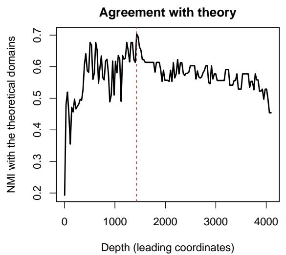  
Figure S1

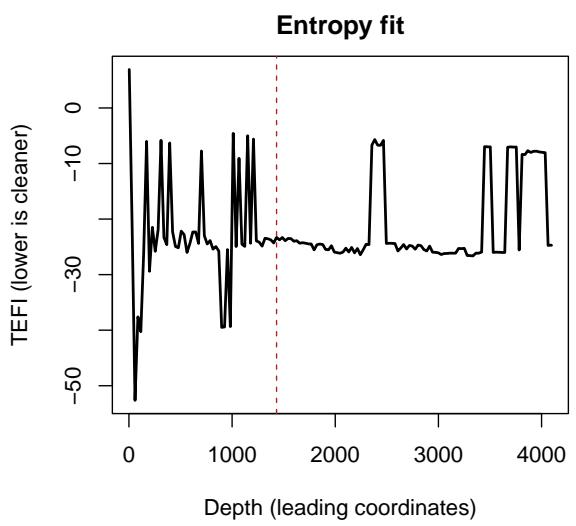  
Depth selection for the Qwen3-Embedding-8B item embeddings. Each panel shows one quantity at every depth evaluated, the number of leading coordinates kept (147 depths spaced 28 apart from 3 to 4,091, plus the full 4,096). Left: normalized mutual information (NMI) between the exploratory graph analysis communities and the theoretical domains. Right: the total entropy fit index (TEFI), for which lower values indicate a cleaner division. The curves show the unrescaled values. The selected depth, marked by the dashed line, is 1,431, the depth at which $0 . 7 0 \times \mathrm { N M I } - 0 . 3 0 \times \mathrm { T E F I }$ is largest after each quantity is rescaled across the depths to run from 0 to 1. NMI there is .704, the maximum of a jagged curve.

The criteria disagreed on these data. Parallel analysis and EGA kept five factors, the Kaiser rule kept six, the empirical Kaiser criterion kept six, and TEFI kept two. In simulations with personality items written by a language model and embedded with a single embedding model, the Kaiser rule and parallel analysis chose too many factors more often than EGA (Garrido et al., 2025), although here the adapted parallel analysis agreed with EGA. Criteria applied to response data can also indicate too many factors. Conventional parallel analysis of the responses of the 874,434 respondents indicated ten factors, possibly because with that many respondents even very small factors exceed the mean random-data eigenvalues, although this explanation was not tested. On both kinds of data, then, some criteria indicated more factors than the theory contains. We therefore recommend reporting the consensus of several criteria and choosing the final number of factors with the theory in view, which for this inventory is the five-factor structure (Goldberg, 1990, 1992).

## Monte Carlo Calibration

Conventional cutofs for fit statistics, such as a standardized root mean square residual of about .08 or below (Hu & Bentler, 1999), were derived from fits to simulated samples of respondents, so they were set with the sampling error of correlations in mind. An embedding similarity matrix has no respondents. The values its fit statistics take by chance depend instead on the items and the embedding space, so cutofs such as the one for the standardized root mean square residual can be too lenient for it, as Pokropek (2026) found for confirmatory models with few indicators. In his simulations the share of random models that passed the standardized root mean square residual cutof fell from 95% with four indicators to 66% with eight, and he judged the cutofs for the comparative fit index, the Tucker–Lewis index, and the root mean square error of approximation appropriate with six or more indicators. Many model-based tests and indexes of fit require a sample size, which a similarity matrix lacks (Suárez-Álvarez et al., 2026). The calibrate = TRUE option supplies a reference. With a fixed seed (42 by default), it draws sets of vectors from a standard normal distribution, with the same number of items and the same embedding dimension as the scale, and rescales each vector to unit length. Such vectors share no semantic structure by construction. The function takes the raw cosines among each set, whatever encoding the real fit used, so the random vectors are not centered, whereas the default encoding of the observed fit centers each embedding. It fits the same number of factors with the same extraction and rotation, and records the values of RMSR, CAF, and TEFI. A replicate whose fit fails is dropped, and in the worked example 100 of 100 replicates were retained. Their values are written to output/calibration\_null.csv in the reproduction archive. The transcript reports 20 warnings that the oblimin rotation stopped at its limit of 1,000 iterations without converging, and a single fit can issue this warning many times. Rerunning the replicates with the same random draws, which reproduced their RMSR values exactly, and counting the warnings fit by fit showed that all 20 came from one fit, so the rotation failed to converge in one of the 100 fits. RMSR and CAF do not depend on the rotation, but TEFI, which uses each item’s assignment to a factor, does. The remaining warning repeats that the keying-free encoding ignores the scoring column. This procedure adapts the reference distributions of Pokropek (2026), which were built from words drawn at random from the same text corpus as the real words. Words drawn this way keep the general thematic similarity that real words share, whereas random unit vectors do not.

> fit\_cal <- sfa(big5\_df, embeddings = E8, encoding = "mean\_centered\_pearson",   
+ nfactors = 5, calibrate = TRUE, calibrate\_iter = 100)   
There were 21 warnings (use warnings() to see them)   
> fit\_cal\$calibration   
[lists of random-embedding RMSR, CAF, and TEFI values omitted]   
> cat("Calibration replicates retained:", length(fit\_cal\$calibration\$rmsr),   
+ "of 100\n")   
Calibration replicates retained: 100 of 100   
> summary(warnings())   
Summary of (a total of 21) warning messages:   
1x : ’scoring’ has reverse-keyed items but is ignored for encoding =   
"mean\_centered\_pearson": this method is keying-free by design. Use   
"atomic\_reversed" for keyed sign-flipping.   
20x : In engine(A, Tmat = current\_Tmat, normalize = normalize, ... :   
Convergence not obtained in GPFoblq. 1000 iterations used.

from .501 to .532 (mean .507, SD = .003), and TEFI from −21.66 to −17.82 (mean −20.85, $S D = 0 . 5 3 )$ . Over the 99 replicates whose rotation converged, TEFI ranged from −21.66 $\mathrm { t o \ - } 1 8 . 8 0$ . Each statistic needs its own reading. The random fits passed the conventional RMSR cutof easily, because the cosines among random unit vectors are close to zero and leave the factors almost nothing to reproduce. RMSR grows with the size of the similarities being reproduced, so the observed RMSR (.032), although above the whole random range, cannot be read as misfit, and passing the cutof says little about fit. The observed TEFI (−27.71) was lower than every random value, so none of the 100 random fits was as low, which shows only that the real items are not random. CAF is about .5 when the residuals share no structure, as in the random fits, and the observed CAF (.412) was lower than every random value. This suggests that the similarities the five factors leave unexplained still share structure that random embeddings lack, although, as for RMSR, a baseline of near-zero similarities makes this a weak contrast. These results echo the finding of Pokropek (2026) that, for confirmatory models with few indicators and for the standardized root mean square residual, values produced by chance can pass conventional thresholds. We therefore recommend reporting calibrated values alongside the conventional ones, with the caveat that the random-embedding baseline is weak. Which baseline to calibrate against is stil the analyst’s choice, as discussed under Limits of the Random-Embedding Baselines below.

## Encoding Comparison

Table S1 reports a five-factor solution under each of the four embedding encodings and under the NLI matrix. Each solution is scored against the theoretical domains, against the human factor solution, and against the human item-pair correlations, and its diagnostics are listed alongside. The NLI matrix was not positive semi-definite. It had 18 negative eigenvalues, the smallest −14.1, so it was replaced by a positive-definite matrix before factoring, as described in the Function Reference above. Across the item pairs, the repaired values correlated .93 with the original ones. The factor solution in the nli row uses the repaired matrix, and the item-pair correlations $r _ { \mathrm { k e y e d } }$ and $r _ { \mathrm { r a w } }$ use the original one.

Three patterns appear in Table S1. First, atomic\_reversed agreed least of the four embedding encodings with the correlations among reverse-scored responses $( r _ { \mathrm { k e y e d } } = . 1 3 7$ against .434 for atomic, the same encoding without the sign flip), and its agreement with the raw correlations $( r _ { \mathrm { r a w } } = . 4 4 4 )$ was close to that of atomic and mean\_centered\_pearson. Reverse-scoring a response keeps its content and inverts only the rating scale. Multiplying an embedding by −1, by contrast, reverses the whole vector, which plausibly makes it point away from the item’s topic as well as from its position on the trait. In the similarity matrix the flip only changes the signs of some entries, so it cannot change the grouping of the items, and the NMI, ARI, KMO, RMSR, and CAF of atomic\_reversed equal those of atomic by construction. Its lower agreement with the reverse-scored correlations likely reflects the signs it imposes. Every unflipped cosine is positive, so the flip makes the similarity of every forward-keyed item with every reverse-keyed item negative, whereas reverse-scoring is meant to make the items of a domain correlate positively whatever their keying. The flip is compared with the reverse-scored correlations because it applies the same scoring key, and against the raw responses it gave no gain. The sign flip also makes the split-half reliability of the similarity matrix negative, so the disattenuated correlation is undefined. The package reports that value as missing, with a warning that names the cause, rather

## Table S1

Agreement of each five-factor solution with theory and with human data, and its diagnostics, for the four embedding encodings and the NLI matrix
<table><tr><td rowspan="2">Encoding or matrix</td><td colspan="2">Theory</td><td colspan="4">Human data</td><td colspan="4">Diagnostics</td></tr><tr><td>NMI</td><td>ARI</td><td>φ</td><td>Ikeyed</td><td>rraw</td><td>rdis</td><td>KMO</td><td>TEFI</td><td>RMSR</td><td>CAF</td></tr><tr><td>atomic</td><td>.527</td><td>.402</td><td>.744</td><td>.434</td><td>.456</td><td>.707</td><td>.971</td><td>-27.72</td><td>.032</td><td>.412</td></tr><tr><td>atomic_reversed</td><td>.527</td><td>.402</td><td>.450</td><td>.137</td><td>.444</td><td></td><td>.971</td><td>-27.72</td><td>.032</td><td>.412</td></tr><tr><td>squid</td><td>.391</td><td>.272</td><td>.622</td><td>.567</td><td>.490</td><td>1.000</td><td>.022</td><td>-44.39</td><td>.072</td><td>.996</td></tr><tr><td>mean_centered_pearson</td><td>.527</td><td>.402</td><td>.744</td><td>.434</td><td>.456</td><td>.707</td><td>.971</td><td>-27.71</td><td>.032</td><td>.412</td></tr><tr><td>nli</td><td>.548</td><td>.448</td><td>.286</td><td>.063</td><td>.561</td><td></td><td>.551</td><td>-54.15</td><td>.094</td><td>.688</td></tr></table>

Note. Each row is a five-factor solution of the 50 International Personality Item Pool Big-Five Factor Marker items under one of the four embedding encodings or, in the nli row, under the signed natural language inference (NLI) matrix, the probability of entailment minus the probability of contradiction. The encodings are atomic, the cosine of the item embeddings, atomic\_reversed, the cosine after the embeddings of reverse-keyed items are multiplied by −1, squid, the cosine after the mean of all the item embeddings is subtracted from each, and mean\_centered\_pearson, the default, the cosine after each embedding is centered across its coordinates. For that row, the factor solution and its diagnostics use the repaired NLI matrix, and $r _ { k e y e d }$ and $r _ { r a w }$ use the original one. Human comparisons use N = 874,434 respondents. NMI = normalized mutual information and ARI = adjusted Rand index, both measuring agreement between the solution’s grouping of the items and the theoretical Big Five domains (1 = identical groupings). ϕ<sup>¯</sup> = mean matched congruence, the mean Tucker congruence between the semantic factors and the human factors, after each semantic factor is matched to the human factor it resembles most (1 = identical loading patterns). Because the sign of an oblimin factor is arbitrary, factors were matched on the absolute value of their congruence, and $\bar { \phi }$ averages these absolute values. r<sub>keyed</sub> and $r _ { \mathit { r a w } } =$ correlation between the encoding’s 1,225 item-pair similarities and the human inter-item correlations computed from reverse-scored and raw responses, respectively. $r _ { d i s } = r _ { k e y e d }$ corrected for the reliability of both matrices (disattenuated), each reliability estimated from an odd-even split of the item-pair entries and capped so that $r _ { d i s } \leq 1$ . It is computed against the reverse-scored human matrix for every row. Dashes mark encodings for which $r _ { d i s }$ could not be computed because the similarity matrix’s split-half reliability was not positive, probably because of the mixture of positive and negative entries that the sign flip of atomic\_reversed and the contradiction scores of the NLI matrix create. The warnings that report this are printed in the transcript. KMO = Kaiser–Meyer–Olkin measure of sampling adequacy, TEFI = total entropy fit index (Von Neumann version), RMSR = root mean square residual, and CAF = common part accounted for. These four are the diagnostics of each solution other than omega (see Table 1 in the main text). Within a row, lower TEFI indicates a cleaner division of the items. KMO describes each matrix’s own factorability, and TEFI, RMSR, and CAF describe how well each solution fits its own matrix, so none of the four is comparable across rows. The CAF of squid near 1, for example, follows from its KMO near 0. All rankings are descriptive, from a single analysis of 50 items, and gaps of a few hundredths cannot be distinguished without intervals.

than dropping it from the output.

Second, SQuID agreed best with the correlations among reverse-scored responses $( r _ { \mathrm { k e y e d } } = . 5 6 7$ , with $r _ { \mathrm { d i s } }$ at its ceiling of 1.000). On the like-with-like comparison with raw responses, which suits a keying-free encoding, it came second to the NLI matrix $( r _ { \mathrm { r a w } } = . 4 9 0$ against .561). Its matrix was also nearly unfactorable (KMO = .022, where values near 0 mean that the matrix is unsuited to factor analysis). A plausible reason is that subtracting the questionnaire embedding keeps the relations between pairs of items but removes the variance that all the items share, which is the variance that factor extraction depends on. Only mean\_centered\_pearson and atomic combined agreement with the theoretical domains within .021 NMI of the best encoding, the closest match to the human loading patterns $\left( \bar { \phi } = . 7 4 4 \right)$ , and a matrix well suited to factor analysis $( \mathrm { K M O } = . 9 7 1 )$ . On these embeddings the two encodings gave the same values to three decimals on every metric in the table except TEFI, which difered in the second decimal. The conclusions that this table supports for mean\_centered\_pearson, the encoding of the main analysis, therefore hold for atomic as well. The table cannot choose between the two, and the default rests on its design, because it needs no scoring key and yields a Pearson correlation matrix.

Third, the NLI matrix ranked diferently from the four embedding encodings on two kinds of metric. It matched the theoretical domains best (NMI = .548) and agreed best with the raw correlations $( r _ { \mathrm { r a w } } = . 5 6 1 )$ , but it matched the human loading patterns worst $( \bar { \phi } = . 2 8 6 )$ . Its factor-based columns (NMI, ARI, ϕ<sup>¯</sup>, KMO, TEFI, RMSR, and CAF) come from the repaired matrix, whose values correlated only .93 with the original ones, so its rankings on them partly reflect the repair. Its $r _ { \mathrm { r a w } } ,$ which uses the original matrix, is the cleaner NLI result.

No single encoding or agreement metric was best on every comparison, and the table supports two reporting practices. The first is to compare like with like, which means comparing keying-free encodings with correlations of raw responses and key-using encodings with correlations of reverse-scored responses. Mixing the two misstates coherence. The NLI matrix, for example, agreed with the raw correlations at $r _ { \mathrm { r a w } } = . 5 6 1$ but with the correlations among reverse-scored responses at only $r _ { \mathrm { k e y e d } } = . 0 6 3$ . The second practice is to report agreement on several metrics, namely $\bar { \phi }$ for loading patterns, NMI or ARI for groupings of items, and r for item pairs, because they can rank the encodings diferently.

## Limits of the Random-Embedding Baselines

Both the adapted parallel analysis and the fit calibration compare the real similarity matrix with matrices built from random unit vectors. In thousands of dimensions such vectors are nearly orthogonal, which means that the cosine between any two of them is close to 0. Their similarity matrix is therefore close to an identity matrix, and the parallelanalysis thresholds derived from it lie near one. For the 8B embeddings the first threshold was 1.23, and the thresholds declined across eigenvalue positions to 1.14 at the eighth. These random vectors are not centered, whereas the observed matrix of the default encoding is. Real item embeddings, by contrast, are positively similar to one another in the worked example, as hidden-state representations from contextual language models commonly are (Ethayarajh, 2019), so their similarity matrix has one very large eigenvalue that reflects this shared similarity. Exceeding the random-embedding baseline, built from nearly unrelated vectors, is a weak test for such a matrix. In practice the adapted parallel analysis behaves like a Kaiser rule with a cutof a little above one that declines slowly across eigenvalue positions, which makes it somewhat stricter than the Kaiser rule here (first thresholds 1.50, 1.31, and 1.23 for the three model sizes). Its verdict therefore shows which eigenvalues exceed that cutof rather than where interpretable structure ends.

A better choice of random vectors would not remove the problem. Conventional retention baselines model what sampling respondents does to a correlation matrix when no factors are present. An embedding similarity matrix, by contrast, is fully determined by the items and the embedding model, and nothing was sampled to produce it. Any baseline for such a matrix must therefore stipulate what varies from one draw to the next, a decision that a sampling design would otherwise make. The baseline of Pokropek (2026), built from words drawn at random from a text corpus, keeps the general thematic similarity that real items share, which random unit vectors lack. Two other alternatives both indicate too many factors, for diferent reasons. Parallel analysis with simulated-data comparison matrices indicated too many factors on embedding matrices in the benchmark of Garrido et al. (2025). With comparison data generated from factor models, the reproduction of the observed eigenvalues improves with every added factor. Presumably, a factor model with one unique variance per item cannot reproduce the many small eigenvalues of an embedding similarity matrix, which decline gradually, so each added comparison factor captures more of them (see Comparison-Data Misfit Profiles below). The same procedure applied to the human responses shows a sharp elbow at exactly five factors. The eigenvalues of embedding similarity matrices therefore appear to decline with no sharp boundary between major and minor factors. If so, a single number of factors for such a matrix records how much minor structure the analyst chose to keep, not a boundary in the data.

A retention test suited to embedding similarity matrices would need reference data generated from item embeddings themselves. These would be sets of items whose factor structure is known in advance and whose embeddings have the geometry of real ones. Such a benchmark could also train and validate a machine-learning criterion in the spirit of the comparison data forest (Goretzko & Ruscio, 2024). Until such a benchmark exists, we recommend reporting retention on embedding similarity matrices as the consensus of several criteria together with the comparison-data misfit profile, and checking agreement with theory across several candidate numbers of factors.

## Full Loading Matrices

Tables S2 and S3 report the complete oblimin-rotated loading matrices of the two five-factor solutions compared in the main text. The semantic solution factors the meancentered Pearson similarity matrix of the Qwen3-Embedding-8B item embeddings. The human solution factors the correlations among the reverse-scored responses of the 874,434 respondents who remained after exclusions, with the same minimum residual extraction and oblimin rotation. Each factor column carries the label that the psych package assigns automatically, which is MR, for minimum residual, followed by the factor’s number in order of extraction. The main text matches these labels to the Big Five domains. The script reproduce/make\_paper\_assets.R generates both tables directly from the files output/semantic\_loadings.csv and output/human\_loadings.csv in the reproduction archive.

## Table S2

Factor loadings of the 50 International Personality Item Pool Big-Five Factor Marker items in the five-factor semantic solution (mean-centered Pearson encoding of the Qwen3-Embedding-8B embeddings, minimum residual extraction, oblimin rotation)
<table><tr><td>Item</td><td>Domain</td><td>MR3</td><td>MR1</td><td>MR2</td><td>MR5</td><td>MR4</td></tr><tr><td>E1</td><td>Extraversion</td><td>.093</td><td>.308</td><td>.076</td><td>.354</td><td>.148</td></tr><tr><td>E2</td><td>Extraversion</td><td>.051</td><td>.196</td><td>.449</td><td>.203</td><td>.122</td></tr><tr><td>E3</td><td>Extraversion</td><td>.084</td><td>.061</td><td>.127</td><td>.752</td><td>.013</td></tr><tr><td>E4</td><td>Extraversion</td><td>-.001</td><td>.546</td><td>.206</td><td>.161</td><td>.008</td></tr><tr><td>E5</td><td>Extraversion</td><td>.037</td><td>.205</td><td>.117</td><td>.385</td><td>.257</td></tr><tr><td>E6</td><td>Extraversion</td><td>.093</td><td>.175</td><td>.432</td><td>.065</td><td>.190</td></tr><tr><td>E7</td><td>Extraversion</td><td>.005</td><td>.110</td><td>.120</td><td>.509</td><td>.182</td></tr><tr><td>E8</td><td>Extraversion</td><td>.062</td><td>.220</td><td>.570</td><td>.169</td><td>-.044</td></tr><tr><td>E9</td><td>Extraversion</td><td>-.001</td><td>.232</td><td>.225</td><td>.450</td><td>.066</td></tr><tr><td>E10</td><td>Extraversion</td><td>.094</td><td>.034</td><td>.408</td><td>.390</td><td>.014</td></tr><tr><td>N11</td><td>Neuroticism</td><td>.817</td><td>.073</td><td>-.001</td><td>.013</td><td>.023</td></tr><tr><td>N12</td><td>Neuroticism</td><td>.176</td><td>.395</td><td>.079</td><td>.347</td><td>-.093</td></tr><tr><td>N13</td><td>Neuroticism</td><td>.490</td><td>.177</td><td>.154</td><td>.022</td><td>.157</td></tr><tr><td>N14</td><td>Neuroticism</td><td>.297</td><td>.170</td><td>.319</td><td>.141</td><td>.022</td></tr><tr><td>N15</td><td>Neuroticism</td><td>.801</td><td>.074</td><td>.069</td><td>.054</td><td>-.042</td></tr><tr><td>N16</td><td>Neuroticism</td><td>1.003</td><td>-.020</td><td>.010</td><td>-.053</td><td>-.029</td></tr><tr><td>N17</td><td>Neuroticism</td><td>.790</td><td>.034</td><td>-.009</td><td>.058</td><td>.053</td></tr><tr><td>N18</td><td>Neuroticism</td><td>.860</td><td>.027</td><td>-.087</td><td>.019</td><td>.029</td></tr><tr><td>N19</td><td>Neuroticism</td><td>.871</td><td>.057</td><td>.055</td><td>-.071</td><td>-.012</td></tr><tr><td>N20</td><td>Neuroticism</td><td>.574</td><td>.086</td><td>.104</td><td>.096</td><td>.082</td></tr><tr><td>A21</td><td>Agreeableness</td><td>.149</td><td>.039</td><td>.718</td><td>.128</td><td>-.043</td></tr><tr><td>A22</td><td>Agreeableness</td><td>.041</td><td>.030</td><td>.230</td><td>.485</td><td>.261</td></tr><tr><td>A23</td><td>Agreeableness</td><td>.267</td><td>.193</td><td>.146</td><td>.211</td><td>.113</td></tr><tr><td>A24</td><td>Agreeableness</td><td>.453</td><td>-.082</td><td>.069</td><td>.425</td><td>.141</td></tr><tr><td>A25</td><td>Agreeableness</td><td>.084</td><td>.000</td><td>.786</td><td>.025</td><td>-.031</td></tr><tr><td>A26</td><td>Agreeableness</td><td>.390</td><td>.106</td><td>.043</td><td>.303</td><td>.100</td></tr><tr><td>A27</td><td>Agreeableness</td><td>-.023</td><td>.030</td><td>.895</td><td>.072</td><td>-.029</td></tr><tr><td>A28</td><td>Agreeableness</td><td>.077</td><td>.459</td><td>.171</td><td>.308</td><td>-.026</td></tr><tr><td>A29</td><td>Agreeableness</td><td>.553</td><td>-.158</td><td>.073</td><td>.390</td><td>.119</td></tr><tr><td>A30</td><td>Agreeableness</td><td>.179</td><td>.203</td><td>.046</td><td>.596</td><td>-.001</td></tr><tr><td>C31</td><td>Conscientiousness</td><td>.050</td><td>.626</td><td>-.056</td><td>.159</td><td>.139</td></tr><tr><td>C32</td><td>Conscientiousness</td><td>.091</td><td>.617</td><td>.144</td><td>.070</td><td>-.029</td></tr><tr><td>C33</td><td>Conscientiousness</td><td>.064</td><td>.566</td><td>.041</td><td>.091</td><td>.233</td></tr><tr><td>C34</td><td>Conscientiousness</td><td>.354</td><td>.503</td><td>.081</td><td>-.046</td><td>.070</td></tr><tr><td>C35</td><td>Conscientiousness</td><td>.103</td><td>.716</td><td>.004</td><td>-.001</td><td>.050</td></tr><tr><td>C36</td><td>Conscientiousness</td><td>.207</td><td>.566</td><td>.125</td><td>-.103</td><td>.022</td></tr><tr><td>C37</td><td>Conscientiousness</td><td>.082</td><td>.567</td><td>.048</td><td>.121</td><td>.103</td></tr><tr><td>C38</td><td>Conscientiousness</td><td>.085</td><td>.567</td><td>.336</td><td>-.094</td><td>-.048</td></tr><tr><td>C39</td><td>Conscientiousness</td><td>.082</td><td>.677</td><td>-.034</td><td>.093</td><td>.066</td></tr><tr><td>C40</td><td>Conscientiousness</td><td>.074</td><td>.605</td><td>.046</td><td>-.032</td><td>.207</td></tr><tr><td>041</td><td>Openness</td><td>.063</td><td>.263</td><td>-.034</td><td>.222</td><td>.450</td></tr><tr><td>042</td><td>Openness</td><td>.244</td><td>-.122</td><td>.350</td><td>-.095</td><td>.563</td></tr><tr><td>043</td><td>Openness</td><td>.181</td><td>.155</td><td>-.027</td><td>.169</td><td>.554</td></tr><tr><td>044</td><td>Openness</td><td>-.045</td><td>.071</td><td>.615</td><td>-.128</td><td>.403</td></tr><tr><td>045</td><td>Openness</td><td>.012</td><td>.300</td><td>-.036</td><td>.126</td><td>.582</td></tr><tr><td>046</td><td>Openness</td><td>.155</td><td>-.003</td><td>.438</td><td>-.093</td><td>.437</td></tr><tr><td>047</td><td>Openness</td><td>.220</td><td>.205</td><td>-.009</td><td></td><td>.332</td></tr><tr><td></td><td></td><td></td><td></td><td></td><td>.217</td><td></td></tr><tr><td>048</td><td>Openness</td><td>.162</td><td>.235</td><td>.070</td><td>.086</td><td>.425</td></tr><tr><td>049</td><td>Openness</td><td>.164</td><td>.351</td><td>.100</td><td>.098</td><td>.250</td></tr><tr><td>050</td><td>Openness</td><td>.069</td><td>.249</td><td>-.024</td><td>.150</td><td>.606</td></tr></table>

Note. Entries are oblimin pattern loadings, and the factors are allowed to correlate. Bold marks each item’s largest absolute loading. Item codes give the item’s domain initial and its position in the 50-item inventory, and Domain is the domain the inventory assigns it to. MR = minimum residual, the prefix of the psych package’s automatic factor labels. Each factor is matched to the domain on whose items its mean absolute loading is largest (columns in table order): MR3 = Neuroticism, MR1 = Conscientiousness, MR2 = Agreeableness, MR5 = Extraversion, MR4 = Openness.

## Table S3

Factor loadings of the 50 International Personality Item Pool Big-Five Factor Marker items in the five-factor solution of the human responses (correlations of reverse-scored responses, minimum residual extraction, oblimin rotation, N = 874,434 respondents after exclusions)
<table><tr><td>Item</td><td>Domain</td><td>MR4</td><td>MR1</td><td>MR3</td><td>MR2</td><td>MR5</td></tr><tr><td>E1</td><td>Extraversion</td><td>.712</td><td>.042</td><td>-.010</td><td>-.015</td><td>-.012</td></tr><tr><td>E2</td><td>Extraversion</td><td>.713</td><td>.086</td><td>.053</td><td>-.026</td><td>.008</td></tr><tr><td>E3</td><td>Extraversion</td><td>.623</td><td>-.189</td><td>.179</td><td>.061</td><td>-.068</td></tr><tr><td>E4</td><td>Extraversion</td><td>.755</td><td>-.023</td><td>-.039</td><td>.018</td><td>-.027</td></tr><tr><td>E5</td><td>Extraversion</td><td>.714</td><td>.012</td><td>.123</td><td>.067</td><td>.034</td></tr><tr><td>E6</td><td>Extraversion</td><td>.522</td><td>.005</td><td>.073</td><td>.010</td><td>.235</td></tr><tr><td>E7</td><td>Extraversion</td><td>.721</td><td>-.004</td><td>.069</td><td>.012</td><td>-.019</td></tr><tr><td>E8</td><td>Extraversion</td><td>.618</td><td>.039</td><td>-.109</td><td>-.070</td><td>.026</td></tr><tr><td>E9</td><td>Extraversion</td><td>.653</td><td>.027</td><td>-.105</td><td>-.050</td><td>.103</td></tr><tr><td>E10</td><td>Extraversion</td><td>.684</td><td>-.079</td><td>-.018</td><td>.014</td><td>-.019</td></tr><tr><td>N11</td><td>Neuroticism</td><td>-.074</td><td>.708</td><td>.125</td><td>.061</td><td>-.055</td></tr><tr><td>N12</td><td>Neuroticism</td><td>-.064</td><td>.559</td><td>.013</td><td>.101</td><td>-.004</td></tr><tr><td>N13</td><td>Neuroticism</td><td>-.125</td><td>.611</td><td>.208</td><td>.092</td><td>.017</td></tr><tr><td>N14</td><td>Neuroticism</td><td>-.129</td><td>.349</td><td>.059</td><td>-.069</td><td>.092</td></tr><tr><td>N15</td><td>Neuroticism</td><td>.005</td><td>.505</td><td>.004</td><td>-.029</td><td>-.095</td></tr><tr><td>N16</td><td>Neuroticism</td><td>.027</td><td>.746</td><td>.031</td><td>.005</td><td>-.068</td></tr><tr><td>N17</td><td>Neuroticism</td><td>.077</td><td>.719</td><td>-.021</td><td>-.091</td><td>.008</td></tr><tr><td>N18</td><td>Neuroticism</td><td>.063</td><td>.741</td><td>-.035</td><td>-.096</td><td>.005</td></tr><tr><td>N19</td><td>Neuroticism</td><td>.055</td><td>.719</td><td>-.175</td><td>.041</td><td>-.017</td></tr><tr><td>N20</td><td>Neuroticism</td><td>-.219</td><td>.574</td><td>.017</td><td>-.135</td><td>.114</td></tr><tr><td>A21</td><td>Agreeableness</td><td>-.049</td><td>-.056</td><td>.499</td><td>-.006</td><td>.061</td></tr><tr><td>A22</td><td>Agreeableness</td><td>.282</td><td>-.041</td><td>.522</td><td>-.040</td><td>.060</td></tr><tr><td>A23</td><td>Agreeableness</td><td>-.180</td><td>-.240</td><td>.418</td><td>.144</td><td>-.071</td></tr><tr><td>A24</td><td>Agreeableness</td><td>-.055</td><td>.033</td><td>.807</td><td>-.007</td><td>-.004</td></tr><tr><td>A25</td><td>Agreeableness</td><td>.060</td><td>-.027</td><td>.661</td><td>-.038</td><td>-.002</td></tr><tr><td>A26</td><td>Agreeableness</td><td>-.063</td><td>.131</td><td>.618</td><td>.001</td><td>-.074</td></tr><tr><td>A27</td><td>Agreeableness</td><td>.225</td><td>-.084</td><td>.613</td><td>-.035</td><td>.015</td></tr><tr><td>A28</td><td>Agreeableness</td><td>.077</td><td>-.014</td><td>.559</td><td>.061</td><td>.001</td></tr><tr><td>A29</td><td>Agreeableness</td><td>.019</td><td>.100</td><td>.700</td><td>.019</td><td>.033</td></tr><tr><td>A30</td><td>Agreeableness</td><td>.260</td><td>-.100</td><td>.362</td><td>.086</td><td>.062 .091</td></tr><tr><td>C31</td><td>Conscientiousness</td><td>.015</td><td>.000</td><td>-.032</td><td>.648</td><td></td></tr><tr><td>C32</td><td>Conscientiousness</td><td>-.051</td><td>-.035</td><td>-.069</td><td>.573</td><td>-.105</td></tr><tr><td>C33</td><td>Conscientiousness</td><td>-.068</td><td>.075</td><td>.062</td><td>.405</td><td>.251</td></tr><tr><td>C34</td><td>Conscientiousness</td><td>.012</td><td>-.279</td><td>-.010</td><td>.556</td><td>-.003</td></tr><tr><td>C35</td><td>Conscientiousness</td><td>.073</td><td>.009</td><td>-.002</td><td>.632</td><td>-.079</td></tr><tr><td>C36</td><td>Conscientiousness</td><td>-.024</td><td>-.088</td><td>-.037</td><td>.614</td><td>-.043</td></tr><tr><td>C37</td><td>Conscientiousness</td><td>-.049</td><td>.160</td><td>-.004</td><td>.581</td><td>.040</td></tr><tr><td>C38</td><td>Conscientiousness</td><td>.006</td><td>-.152</td><td>.097</td><td>.465</td><td>.049</td></tr><tr><td>C39</td><td>Conscientiousness</td><td>.053</td><td>.111</td><td>.058</td><td>.634</td><td>-.054</td></tr><tr><td>C40</td><td>Conscientiousness</td><td>.002</td><td>.052</td><td>.009</td><td>.456</td><td>.249</td></tr><tr><td>041</td><td>Openness</td><td>-.015</td><td>-.011</td><td>-.058</td><td>.035</td><td>.596</td></tr><tr><td>O42</td><td>Openness</td><td>-.068</td><td>-.189</td><td>.014</td><td>-.030</td><td>.579</td></tr><tr><td>043</td><td>Openness</td><td>-.014</td><td>.107</td><td>.091</td><td>-.099</td><td>.545</td></tr><tr><td>044</td><td>Openness</td><td>-.095</td><td>-.109</td><td>.114</td><td>-.100</td><td>.518</td></tr><tr><td>045</td><td>Openness</td><td>.166</td><td>-.027</td><td>-.069</td><td>.122</td><td>.575</td></tr><tr><td>O46</td><td>Openness</td><td>.011</td><td>-.032</td><td>.091</td><td>-.052</td><td>.499</td></tr><tr><td>047</td><td>Openness</td><td>.019</td><td>-.115</td><td>-.044</td><td>.154</td><td>.474</td></tr><tr><td>048</td><td>Openness</td><td>-.006</td><td>.076</td><td>-.126</td><td>-.024</td><td>.564</td></tr><tr><td>049</td><td>Openness</td><td>-.185</td><td>.115</td><td>.187</td><td>.037</td><td>.396</td></tr><tr><td>050</td><td>Openness</td><td>.122</td><td>.017</td><td>.008</td><td>.000</td><td>.662</td></tr></table>

Note. Entries are oblimin pattern loadings, and the factors are allowed to correlate. Bold marks each item’s largest absolute loading. Item codes give the item’s domain initial and its position in the 50-item inventory, and Domain is the domain the inventory assigns it to. MR = minimum residual, the prefix of the psych package’s automatic factor labels. Each factor is matched to the domain on whose items its mean absolute loading is largest (columns in table order): MR4 = Extraversion, MR1 = Neuroticism, MR3 = Agreeableness, MR2 = Conscientiousness, MR5 = Openness.

## Signed NLI Similarity Matrix

The function sfa\_nli\_matrix() scores ordered pairs of items with the cross-encoder cross-encoder/nli-deberta-v3-base, a DeBERTa-v3 model (He et al., 2023) trained on natural language inference data such as SNLI (Bowman et al., 2015) and MultiNLI (Williams et al., 2018). Each pair’s score is the probability of entailment minus the probability of contradiction, a signed mapping in the spirit of Hommel and Arslan (2025), averaged over the two orders of the pair (the function’s default). Before averaging, the scores of the two orders of each pair correlated .57. The three class probabilities come from the model’s softmax output, and the probability of the neutral class is not used. The excerpt below compares three Extraversion items under this matrix and under atomic\_reversed, whose matrix the main analysis stored as sim\_ar. E1 (“I am the life of the party.”) and E5 (“I start conversations.”) are forward-keyed, and E2 (“I don’t talk a lot.”) is reverse-keyed:

```perl
> sim_nli <- sfa_nli_matrix(big5$items) # cross-encoder/nli-deberta-v3-base
> round(sim_nli[c("E1", "E2", "E5"), c("E1", "E2", "E5")], 2)
E1 E2 E5
E1 1.00 -1.00 0.03
E2 -1.00 1.00 -0.98
E5 0.03 -0.98 1.00
> round(sim_ar[c("E1", "E2", "E5"), c("E1", "E2", "E5")], 2)
E1 E2 E5
E1 1.00 -0.63 0.67
E2 -0.63 1.00 -0.65
E5 0.67 -0.65 1.00
```

The NLI matrix scores E1 and its reverse-keyed counterpart E2 at −1.00, which means that the cross-encoder judged the two statements to contradict each other almost certainly. Under atomic\_reversed the same pair scores −.63. Flipping the sign of E2’s embedding makes the pair’s similarity negative, but the pair is not the most dissimilar one in the sign-flipped matrix, whose lowest value is −.777, although the two statements say opposite things. Figure S2 shows the full NLI matrix.

The Encoding Comparison in the Technical Reference compares this matrix with the four embedding encodings (Table S1).

## Comparison-Data Misfit Profiles

The comparison-data method of Ruscio and Roche (2012) treats retention as a comparison between models rather than as a test against a baseline with no structure. For each candidate number of factors k, it asks how well data generated to have exactly k factors reproduce the observed eigenvalues. The method has four steps:

1. For each k, generate a large population of comparison data whose correlations follow the k-factor model fitted to the observed correlations and whose variables have the observed distributions.

2. Draw random samples from that population, each the same size as the observed data.

3. For each sample, compute the root mean square diference between its eigenvalues and the observed eigenvalues. This diference is the misfit of k factors, and it is small when k factors account for the observed eigenvalues well.

4. Compare the misfits of successive values of k.

Because each candidate number of factors is judged against the one before it, the method does not need a baseline with no structure, which is the weak point of the adapted paralle analysis (see Limits of the Random-Embedding Baselines above). The comparison populations are generated with an adaptation of the GenData algorithm of Ruscio and Kaczetow (2008). GenData draws each variable from its target distribution and iteratively adjusts an intermediate correlation matrix so that the generated data reproduce the target correlations as closely as possible. It stops when several adjustments in a row bring no improvement. The adaptation in sfa\_cd() instead makes a fixed sequence of six adjustments and keeps the population that reproduced the target correlations best.

The function sfa\_cd() applies this method to embedding similarity matrices by treating the embedding dimensions as the cases, the role that respondents play in response data. This is a heuristic, because the dimensions are not sampled like respondents, and the resulting numbers of cases (1,024 to 4,096) exceed the range of sample sizes, 200 to 1,000, for which the method was validated (Ruscio & Roche, 2012). The Pearson correlations between items computed across the embedding dimensions equal the mean\_centered\_pearson similarities, so the profile describes exactly the matrix that the main analyses factor. The profiles reported here use candidate numbers of factors from 1 to 10, 500 random samples for each number, comparison populations of 10,000 cases generated with six refinement iterations, minimum residual factoring, the seed 42 for the random steps inside sfa\_cd(),

Signed NLI similarity

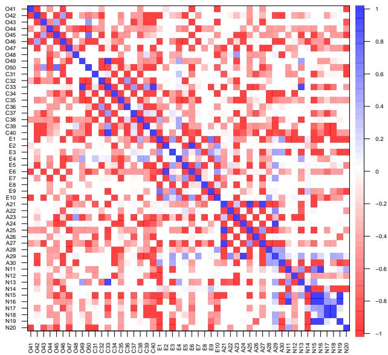  
Figure S2

Signed natural language inference (NLI) similarity, the probability of entailment minus the probability of contradiction, among the 50 International Personality Item Pool Big-Five Factor Marker items, grouped by domain. The color scale runs from −1 (red) through 0 (white) to 1 (blue), and the diagonal is 1. Red cells are negative and mark pairs that the cross-encoder judged to contradict each other. The matrix is shown before the repair that made it positive definite for factoring. Every similarity in the cosine matrix of Figure 2 in the main text is positive. Here, by contrast, pairs of items of the same domain averaged .20 when keyed the same way and -.79 when keyed oppositely, which produces negative bands within the domain blocks. Many pairs from diferent domains are negative as well (71% of them, and 26% below −.5). Item codes give the domain (O, C, E, A, N) and the item’s position in the inventory.

and semanticfa 0.5.1. They were computed for the three Qwen3-Embedding model sizes (0.6B, 4B, and 8B) and for a random subsample of n = 2,500 respondents’ reverse-scored responses from the human benchmark, drawn after set.seed(42).

Figure S3 shows the profiles, and two quantities summarize each one. The normalized misfit at k is the median misfit at k divided by the median misfit at one factor, so it shows how much of the one-factor misfit remains. The relative improvement at k is the percentage by which the median misfit falls from k − 1 to k factors. An elbow is a value of k at which the relative improvement is large and after which it drops sharply, and it marks the last factor that substantially improves the fit.

For the human responses, the relative improvement rose with each added factor up to the fifth, which reduced the misfit by 57.2% relative to four factors, and then fell to 19.7% at the sixth. At five factors only 16% of the one-factor misfit remained. The eigenvalues of the Big Five responses therefore show a sharp boundary after the fifth factor, which is where the theory places it. This profile comes from one random subsample of 2,500 respondents, although the elbow is large enough that another draw is unlikely to remove it. The three embedding matrices showed no such elbow. Each added factor reduced their misfit by between 9% and 22%, with no spike comparable to the human one at any number of factors (the largest embedding improvement was less than half the human peak of 57.2%), and 47–49% of the one-factor misfit remained at five factors. Presumably, a factor model with one unique variance per item cannot reproduce the many small eigenvalues of an embedding similarity matrix, which decline gradually, so each added comparison factor keeps improving the reproduction.

Ruscio and Roche (2012) also give a sequential stopping rule. It tests each k against k − 1 with a one-tailed Mann–Whitney test on the two sets of misfits, asking whether k factors reduce the misfit, and it keeps adding factors until the next one does not reduce the misfit significantly. We ran it at the liberal significance level that they used, α = .30, which performed best in their preliminary tests. For all three embedding matrices it reached ten factors, the largest number tested.

The human responses show how the rule behaves on response data. Besides the subsample of 2,500 respondents behind the profile, we drew subsamples of 250, 500, and 1,000 respondents. All four were drawn after the same seed, 42, so each smaller subsample is the first part of the larger ones, and the four are nested. Five further subsamples of 250 and of 500 respondents were drawn with the seeds 1 to 5, and with each of these seeds, too, the subsample of 250 is the first part of the subsample of 500. These seeds governed only the choice of respondents, because the random steps inside sfa\_cd() used the seed 42 in every run. In the subsample of 250 drawn with the seed 42, near the lower end of the sample sizes for which the method was validated, the rule stopped at seven factors, and the five further subsamples of 250 stopped at seven to nine. In the subsamples drawn with the seed 42, the rule reached ten, the largest number tested, from 500 respondents upward, although the five further subsamples of 500 stopped at eight to ten. The sequential rule therefore did not stop at five on the human data at any size tested. This is consistent with the ten factors that conventional parallel analysis indicated for the full benchmark of 874,434 respondents (see Retention Criteria above), although the cap prevents a direct comparison.

These results are consistent with an account based on statistical power. On this account, the test detects smaller reductions in misfit as the number of cases grows, so with

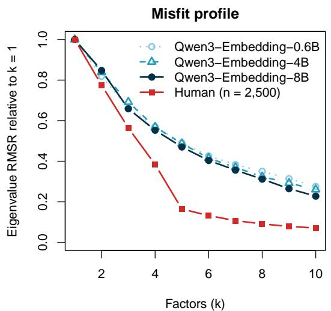

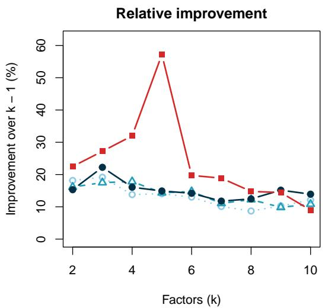  
Figure S3

Comparison-data misfit profiles for the similarity matrices of three embedding models (Qwen3-Embedding-0.6B, -4B, and -8B) and for one random subsample of n = 2,500 respondents’ reverse-scored responses, drawn with the seed 42. The misfit at each candidate number of factors is the median, across 500 random samples from the comparison population, of the eigenvalue RMSR, the root mean square diference between a sample’s eigenvalues and the observed eigenvalues. The eigenvalue RMSR is a diferent quantity from the root mean square residual (RMSR) that sfa() reports as a fit diagnostic. The embedding profiles treat the embedding dimensions (1,024 to 4,096) as cases, and the human profile treats respondents as cases. The three model sizes are drawn with diferent line types (0.6B dotted, 4B dashed, 8B solid), and the human profile is drawn in red. Left: misfit divided by its value at one factor. Right: relative improvement, the percentage reduction in misfit from the preceding number of factors. The human profile shows a sharp elbow at five factors, where the improvement peaks at 57.2% and then drops. The embedding profiles decline gradually. Their largest improvement, 22%, is less than half the human improvement into five factors.

enough respondents the rule keeps adding factors beyond the five interpretable ones. The embedding matrices, with 1,024 to 4,096 dimensions as cases, may reach the cap for the same reason rather than because of a property peculiar to embeddings. The results do not establish this account. The test’s p values also depend on the 500 simulated samples for each number of factors, and the embedding dimensions only play the role of cases, so the comparison with the human subsamples is an analogy. On the embedding matrices, moreover, the profiles show no boundary for the rule to detect. Taken together, the profiles support the practice recommended in the main text, which is to report retention as the consensus of several criteria and to check agreement with theory across several candidate numbers of factors.

## Model Size With a Second Scale

In the main text, the separation between the Big Five domains did not rise steadily from the 0.6B to the 8B model. Because that comparison used a single inventory, it was repeated with a second one, the Depression Anxiety Stress Scales (DASS). The DASS has 42 items, 14 for each of three scales, and each item describes a negative emotional symptom, such as “I found myself getting upset by quite trivial things” (Lovibond & Lovibond, 1995). The scale’s history makes it a useful second case. Its Stress scale grew out of items that did not separate anxiety from depression, and in its authors’ factor analysis of responses, the Anxiety and Stress factors merged into one when only two factors were extracted (Lovibond & Lovibond, 1995).

The 42 items were embedded with the same three models and the same settings as the Big Five items. Re-embedding them with the model revisions given in the Open Practices Statement reproduced the stored vectors, with a cosine of 1.000000 to six decima places between each new vector and the stored one. The comparison then used the statistics of the main text. The first is the point-biserial correlation between sharing a scale and a pair’s similarity, over all 861 item pairs, with an item-level bootstrap 95% interval. The second is the gap between the mean similarity of pairs within a scale and that of pairs between scales. Because the same resampled items served all three sizes, the bootstrap also gave an interval for the diference between two sizes. Finally, three factors were extracted at each size, the theoretical number, and each item was assigned to the factor on which it loaded most strongly. The agreement of this assignment with the three scales was measured with the normalized mutual information (NMI) and the adjusted Rand index (ARI), as in the main text, and compared with a permutation baseline, the largest values reached when the item assignment of the 8B solution was compared with 1,000 random permutations of the scale labels. For comparison, Table S4 also gives the same agreement for the five-factor Big Five solution at each size.

With the DASS, the gap rose with model size, from .099 for 0.6B to .106 for 4B and .124 for 8B (Table S4). With the Big Five it stayed nearly constant. The paired 95% interval for the DASS increase from 0.6B to 8B ran from −.001 to .053, so it only just included zero, whereas the Big Five interval for the same increase ran from −.012 to .013. The point-biserial correlation rose only slightly, from .481 to .505 and .510, and its intervals overlapped widely. The three scales did not change alike (Figure S4). The gaps of Depression (.118, .129, and .180) and Stress (.126, .144, and .158) grew with size, whereas the gap of Anxiety shrank (.053, .044, and .034).

The clearest change was in the three-factor solutions. Under the 0.6B model, the factor with the most Anxiety items (eight of 14) also took all 14 Stress items, so most Anxiety items and the Stress items formed a single factor, as Anxiety and Stress did in the two-factor solution of responses that Lovibond and Lovibond (1995) reported. Under the 8B model, each scale had a factor of its own, and these factors took 14 Depression, 14 Stress, and 11 Anxiety items, out of 14 each. Agreement with the three scales rose accordingly, from NMI = .412 and ARI = .271 for 0.6B to .700 and .650 for 4B and .834 and .801 for 8B, all above the largest values reached with permuted labels (.249 and .195). With the Big Five, agreement did not rise with size. It was highest for 4B (NMI = .693, ARI = .574), against .497 and .393 for 0.6B and .527 and .402 for 8B. Neither parallel analysis nor the consensus of the five retention criteria indicated three factors for the DASS at any size. Parallel analysis retained four factors at every size, and the consensus of the five criteria was five for 0.6B, four for 4B, and four for 8B.

The 0.6B solution was not the only one. psych (Revelle, 2026) starts the oblique rotation from several orientations, most of them random, and keeps the result with the largest share of loadings close to zero, which is not necessarily the one with the lowest value of the rotation criterion. The seed argument of sfa() does not set these random orientations, so the reproduction script sets the random seed before each DASS fit. To see how far the results depend on the orientations drawn, each three-factor DASS fit and each five-factor Big Five fit was repeated under 40 random seeds. Judged by their agreement with the scales, every fit but one gave the same solution under every seed. The exception was the 0.6B DASS fit, which gave the solution reported here under 16 seeds and a second solution under the other 24. In the second solution, all 14 Anxiety items and 13 of the 14 Stress items loaded most strongly on one factor, and agreement with the scales was higher (NMI = .665, ARI = .514), although still lower than for 4B. The reported solution had the lower value of the oblimin criterion, which the rotation minimizes (0.564 against 0.567). Two of the refits ended with a warning that the rotation had not converged, and neither gave a solution other than those described here. Neither solution separated Anxiety from Stress.

The DASS thus showed a clearer efect of model size than the Big Five. The smallest model merged two scales that are also closely related in responses, and the largest separated all three. The two inventories difer in many ways besides the efect of size, including the number of scales and the kind of content their items describe, so two inventories cannot show which of these properties makes model size matter.

## Table S4

Separation of the theoretical scales and agreement of the factor solutions with them, by model size, for the Big Five inventory and the DASS
<table><tr><td>Scale</td><td>Model</td><td> $r _ { \mathrm { p b } }$ </td><td>95% interval</td><td>Gap</td><td>NMI</td><td>ARI</td><td>Consensus</td></tr><tr><td>Big Five</td><td>0.6B</td><td>.398</td><td>[.286, .515]</td><td>.077</td><td>.497</td><td>.393</td><td>6</td></tr><tr><td></td><td>4B</td><td>.458</td><td>[.372, .548]</td><td>.077</td><td>.693</td><td>.574</td><td>6</td></tr><tr><td></td><td>8B</td><td>.416</td><td>[.316, .535]</td><td>.079</td><td>.527</td><td>.402</td><td>5</td></tr><tr><td>DASS</td><td>0.6B</td><td>.481</td><td>[.344, .612]</td><td>.099</td><td>.412</td><td>.271</td><td>5</td></tr><tr><td></td><td>4B</td><td>.505</td><td>[.349, .649]</td><td>.106</td><td>.700</td><td>.650</td><td>4</td></tr><tr><td></td><td>8B</td><td>.510</td><td>[.343, .664]</td><td>.124</td><td>.834</td><td>.801</td><td>4</td></tr></table>

Note. Each row is one inventory embedded with one size of Qwen3-Embedding, under the mean-centered Pearson encoding. The point-biserial correlation $r _ { p b }$ is computed between sharing a scale (for the Big Five, a domain) and a pair’s similarity, over all pairs of items, with its item-level bootstrap 95% interval. Gap is the mean similarity of pairs within a scale minus that of pairs between scales. NMI (normalized mutual information) and ARI (adjusted Rand index) measure the agreement of each item’s dominant factor with its scale, in the five-factor solution for the Big Five and the three-factor solution for the DASS. For the 0.6B DASS model, the row gives the solution with the lower oblimin criterion, found under 16 of 40 random seeds, and the text describes a second solution, found under the other 24 $( N M I = . 6 6 5 , A R I = . 5 1 \AA 4 )$ . Consensus is the number of factors chosen by more of the five retention criteria than any other number, with ties going to the smaller number. DASS = Depression Anxiety Stress Scales.

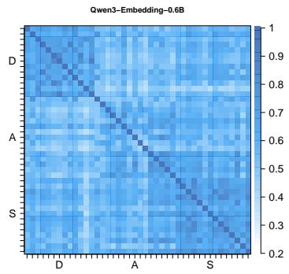  
Figure S4

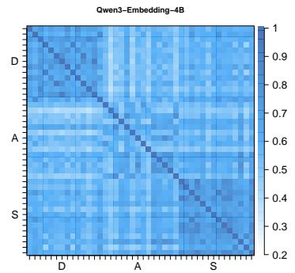

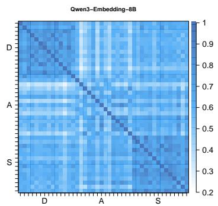

Mean-centered Pearson similarity matrices of the 42 items of the Depression Anxiety Stress Scales (DASS), grouped by scale in the order Depression, Anxiety, and Stress, for Qwen3-Embedding-0.6B (left), 4B (center), and 8B (right). The axes mark each scale’s block with its initial letter (D, A, S) at the middle of the block. The three panels share one color scale of mean-centered Pearson similarity, from white at 0.2, the lowest similarity in any of the three matrices rounded down to the nearest tenth, to dark blue at 1. The diagonal is 1 by definition. The Depression and Stress blocks stand out more with each larger model, and the Anxiety block less.