# A LOW-RANK SPACE CAPTURES LINEAR ALIGNMENT BETWEEN LLM AND HUMAN NEURAL ACTIVITY DURING NATURALISTIC LANGUAGE LISTENING

Zach Paris & Emily Finn

Department of Psychological and Brain Sciences

Dartmouth College

Hanover, NH 03755, USA

{zachary.r.paris.gr, Emily.S.Finn}@dartmouth.edu

## ABSTRACT

Large language models (LLMs) are increasingly used as computational models of human language processing, yet it remains unclear which components of their representations drive alignment with neural activity. Here, we use ridge reducedrank regression to identify the brain-predictive subspace of LLM representations: the representational directions that support linear prediction of neural responses. Across three naturalistic language-listening datasets spanning intracranial electrophysiology and fMRI, and six model conditions spanning autoregressive, bidirectional masked, and randomly initialized language models, we find that full linear encoding performance can be recovered using only 1–3% of the original embedding dimensionality. These low-dimensional subspaces generalize across held-out participants and, to a lesser extent, across datasets, suggesting that neural predictivity is concentrated in a compact and partially shared representational space. We next compare these brain-predictive directions with the principal axes of variation in the embeddings. Principal component analysis requires substantially more dimensions to recover neural prediction, demonstrating that the directions most useful for predicting neural activity are distinct from those capturing the most overall variance within LLM representations themselves. Finally, characterizing the learned subspaces allows us to surface interpretable features that are overrepresented in neural activity above and beyond the LLM representations. Together, these results show that LLM–brain alignment is supported by a small, structured subset of model representations and provides a framework for better understanding exactly why these representations align. Code can be found at: https://github.com/thefinnlab/low-rank-alignment

## 1 INTRODUCTION

Large language models (LLMs) are strong predictors of human neural activity during language processing and are increasingly used as computational models of language comprehension (Schrimpf et al., 2021; Goldstein et al., 2022; Mischler et al., 2024; Zada et al., 2024). Yet it remains unclear which components of their high-dimensional representations drive this alignment. Prior work has related neural predictivity to properties such as training objective, model scale, layer depth, intrinsic dimensionality, and representational generality (Antonello et al., 2023; Antonello & Huth, 2024; Antonello & Cheng, 2024). However, these model-level relationships do not identify the specific representational directions that support neural prediction, and apparent differences in alignment can also be influenced by confounds in the evaluation process (Hadidi et al., 2026).

Here, we take a complementary approach. Rather than asking which global properties of a model correlate with its neural predictivity, we ask which part of the model representation actually supports that prediction. Conceptually, we view LLM–brain alignment as arising from information shared between features represented by an LLM and measured neural responses (figure 1a). Under a linear encoding model, we operationalize this shared information as a brain-predictive subspace of the LLM representation: the set of representational directions that are useful for predicting neural activity. This framing turns a single encoding score into a representational object that can itself be studied.

Across three naturalistic language-listening datasets spanning intracranial electrophysiology and fMRI, and six different language models we use reduced rank regression (RRR) (Izenman, 1975) to discover this brain-predictive subspace and find that full linear encoding performance can be recovered from only 1–3% of the original embedding dimensions. These brain-predictive subspaces generalize across held-out participants and, partially, across datasets. We then compare each learned subspace against one learned by Principal Component Analysis (PCA) applied only to the LLM embeddings. We find that there is a mismatch between the directions of principal variance in the embeddings as learned from an unsupervised PCA and the directions most useful for neural prediction; suggesting differences in the representational geometry of the two systems. Finally, feature-decoding analyses reveal interpretable differences in the linguistic information emphasized by these subspaces across datasets and recording modalities. Together, these results show that LLM– brain alignment is supported by a compact, structured subset of model representations and provide a framework for identifying which components of those representations drive neural predictivity.

## 2 BACKGROUND AND MOTIVATION

## 2.1 LANGUAGE ENCODING MODELS

Encoding models test whether a candidate representational space captures information present in neural responses. In language neuroscience, this approach has progressed from investigator-defined semantic features to contextual representations learned by neural language models, which predict activity across fMRI, MEG, and intracranial recordings (Huth et al., 2016; Jain & Huth, 2018; Toneva & Wehbe, 2019; Schrimpf et al., 2021; Goldstein et al., 2022; Caucheteux & King, 2022).

LLM representations are effective encoding spaces because they capture many aspects of language simultaneously, but this also complicates their interpretation. A single layer may contain thousands of distributed features reflecting lexical, syntactic, semantic, contextual, and predictive information, any combination of which may support neural prediction. Thus, successful encoding establishes that neurally relevant information is linearly accessible from the representation but does not reveal which components carry that signal.

Prior work has related neural predictivity to properties including next-word prediction performance, model scale, layer depth, representational generality, intrinsic dimensionality, and particular linguistic or computational features (Schrimpf et al., 2021; Antonello & Huth, 2024; Antonello & Cheng, 2024; Kumar et al., 2024; Mischler et al., 2024). These results constrain possible explanations of LLM–brain alignment but primarily characterize representations globally rather than identifying the specific directions responsible for prediction.

## 2.2 BRAIN-PREDICTIVE SUBSPACES

Prior work suggests that both language representations and their relationship to neural activity exhibit low-dimensional structure. Antonello et al. (2021) identified low-dimensional organization in linguistic representations related to fMRI predictivity, while Lewis et al. (2025) used low-rank constraints to factorize LLM-to-MEG encoding models into interpretable semantic, temporal, and spatial components.

These approaches motivate a more direct question: how much of an individual LLM representation is actually required to recover its neural predictivity? Reduced-rank regression provides a supervised way to answer this question by identifying low-dimensional directions chosen specifically for their ability to predict neural responses. This distinguishes the brain-predictive subspace from unsupervised low-dimensional structure, such as the principal variance directions identified by PCA, and provides a representation whose dimensionality, generalization, and linguistic content can be studied directly.

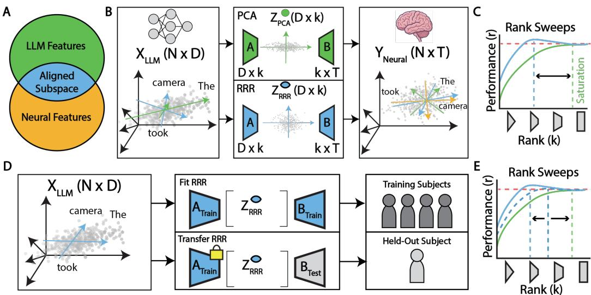  
Figure 1: (a) We view alignment as a measure of the linear features shared by the LLM embedding space and the neural response space. Our goal is to selectively extract the intersection of the two spaces. (b) Our pipeline. We learn two low-rank representations of the model embeddings and use them to predict neural data. The PCA space (green) prioritizes capturing the directions of principal variation in the LLM embeddings. The RRR space (blue) prioritizes the directions which best align between the two representational spaces teasing out the aligned subspace. (c) To identify the size of the aligned subspace we sweep the subspace rank, fit new models and re-evaluate. We find the point at which our RRR space performance saturates and compare it to the PCA point of saturation. (d) Leave-one-subject-out experiment. We fit the RRR space on all but one subject and then transfer the projection matrix to a held-out subject and fit a new mapping to that subject’s neural data. (e) We again sweep over ranks and compare the point of saturation on the held-out subject between the RRR space fit on all subjects, RRR space fit on all but the held-out subject, and the unsupervised PCA space.

## 3 METHODS

## 3.1 DATASETS

We analyzed three datasets of neural responses to naturalistic spoken language. The Podcast ECoG dataset contains high-gamma (70–200 Hz) recordings from nine participants and 1,330 intracranial electrodes collected during a 30-minute narrative podcast (Zada et al., 2025). Brain Treebank contains stereoelectroencephalography (sEEG) recordings from participants viewing movies (Wang et al., 2024); we analyzed Cars 2, which contained the most heard words (∼8,000) viewed by at least three participants. The Deep fMRI dataset contains responses to spoken stories collected across five recording sessions (LeBel et al., 2023); we analyzed eight participants and evaluated encoding models on the repeated held-out test story.

## 3.2 PREPROCESSING

We used the released high-gamma responses for Podcast and preprocessed Brain Treebank recordings to extract 70–200 Hz high-gamma activity. Both intracranial datasets were aligned to word onset and sampled at 32 Hz. We used the released preprocessed fMRI responses. Full preprocessing details are provided in Appendix A.1.

## 3.3 LANGUAGE MODELS

We extracted word representations from four autoregressive models—GPT-2, GPT-2 XL, GPT-J 6B, and Llama 3 8B—and the bidirectional masked language model RoBERTa Large (Radford et al.,

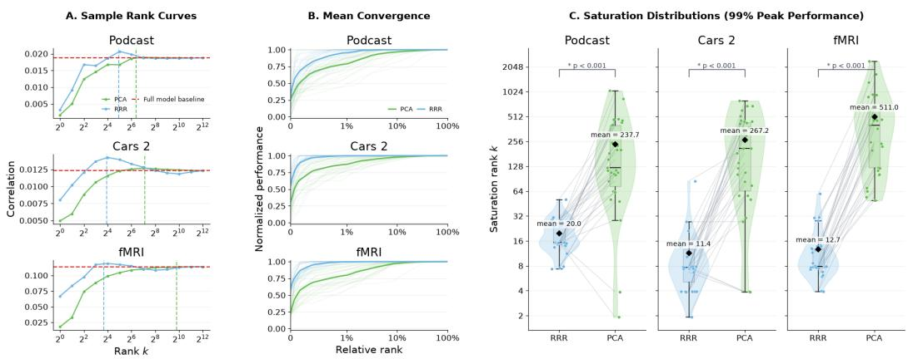  
Figure 2: Low-rank RRR recovers neural predictivity more efficiently than PCA. (a) Example rank-performance curves for GPT-J-6b layer 21 across the three datasets. (b) Mean convergence across model-layers showing RRR converges quicker than PCA. Generated by normalizing by max performance and enforcing monotonicity before averaging. (c) Saturation ranks for matched model– layer combinations, defined as the minimum rank at which all informative target-performance quantiles reach 99% of their maximum. RRR saturates at substantially lower rank than PCA across all three datasets. See Methods and Appendix for threshold and significance details.

2019; Wang & Komatsuzaki, 2021; AI@Meta, 2024; Liu et al., 2019). We additionally analyzed a randomly initialized GPT-2 control as such controls have been studied in previous work as well as a non-contextual 300-dimensional GloVe embeddings (Schrimpf et al., 2021; Hosseini et al., 2024; Pennington et al., 2014). For each contextual model, we sampled five layers at 0%, 25%, 50%, 75%, and 100% depth. Additional embedding-generation details are provided in Appendix A.1.1.

## 3.4 SELECTION OF NEURAL TARGETS

Because our goal was to estimate the rank of the subspace supporting general neural alignment, we used a broad target-selection procedure designed to retain reliable signal linking LLM embeddings to neural activity while excluding clearly noisy targets. We selected recording sites using heldout predictions from full-embedding ridge encoding models. Significance was assessed against null distributions generated by circularly shifting neural responses, with Benjamini–Hochberg correction across recording sites. For iEEG, selected electrodes contributed all sampled lags as RRR targets; for fMRI, selected voxels were used directly. Additional selection details and target counts are provided in Appendix A.5.

## 3.5 ENCODING MODELS

We first fit ridge encoding models using the full embedding space to establish a reference performance for each model and layer. For iEEG, word embeddings predicted electrode responses at sampled lags relative to word onset, with performance evaluated using five contiguous held-out word folds. For fMRI, embeddings were aligned to acquisition times and used to construct a four-delay finite impulse response design; models were evaluated on held-out stories. Ridge penalties were selected by cross-validation.

## 3.6 REDUCED-RANK REGRESSION

We used ridge reduced-rank regression (RRR) (Izenman, 1975) to identify the optimal rank k subspace of embeddings for neural prediction (Figure 1b). Within each training partition, we fit a multivariate ridge model from embeddings (X) to neural responses (Y ), producing coefficients (W) and fitted responses $( { \hat { Y } } = X W )$ . We decomposed $( \hat { Y } )$ and used its leading (k) right singular vectors $( V _ { k } )$ to construct an input factor $( A _ { k } \ = \ W V _ { k } )$ , whose columns span embedding directions associated with the leading components of predicted neural activity.

At each rank (k), we projected embeddings into an orthonormalized version of this subspace and fit a new ridge encoding model using the projected data. We swept ranks from one to the available embedding-dimensionality endpoint to determine how quickly neural prediction was recovered as the bottleneck increased (figure 1c). Performance was evaluated on held-out neural responses, with the full-embedding ridge model serving as the reference. For fMRI, we combined the delayspecific RRR factors into a single orthonormal basis in the original embedding coordinates; details are provided in Appendix A.2.2.

We compared RRR with principal component analysis (PCA) of the training embeddings (figure 1b). At each rank, embeddings were projected onto the leading principal components and evaluated using the same ridge refitting and held-out data.

## 3.7 SATURATION RANK

To summarize how quickly predictive performance was recovered as rank increased (figure 1c), we defined a saturation rank using the distribution of performance across neural targets. At each rank, we computed the 10th, 25th, 50th, 75th, and 90th percentiles of held-out target performance and tracked each quantile across the rank sweep. Saturation rank was defined as the minimum rank at which all informative quantile curves reached at least 99% of their respective maximum performance. Quantiles whose maximum performance did not exceed 0.005 were excluded. This criterion captures recovery across the target-performance distribution rather than relying on mean performance alone. Additional motivation and threshold-sensitivity analyses are provided in Appendix A.3.

## 3.8 GENERALIZATION ANALYSES

To assess cross-participant generalization, we held out one participant at a time and learned an RRR subspace from the remaining participants (figure 1d). We transferred this subspace to the held-out participant and fit a new encoding model using only that participant’s neural responses. We then compared transferred RRR with RRR learned from the held-out participant and with PCA across ranks (figure 1e).

For cross-dataset transfer, we learned an RRR or PCA subspace from a source dataset and projected the target dataset’s embeddings into that space. A new ridge model was then fit and evaluated using only target-dataset neural responses. Thus, in both generalization analyses, only the embedding subspace was transferred; the mapping from that subspace to neural activity was estimated separately in the target participant or dataset.

## 3.9 LANGUAGE-FEATURE DECODING

To characterize the information preferentially represented in brain-predictive subspaces, we annotated stimulus words with lexical, syntactic, semantic, discourse, timing, and pause features. At each rank, we projected embeddings into the RRR and PCA spaces and trained held-out decoders for each available feature. Continuous features were evaluated using Pearson correlation and categorical features using balanced accuracy. The complete feature set and decoding details are provided in Appendix A.7.

## 4 RESULTS

## 4.1 ALIGNMENT RELIES ON A LOW-RANK SUBSPACE

To estimate the dimensionality of the LLM representation required to recover its full neural predictivity, we fit ridge reduced-rank regression (RRR) in each of our three datasets and measured encoding performance as we varied the rank of the predictive bottleneck (Figure 2; see Appendix for full encoding-model results). Across datasets, models, and layers, performance typically peaked at ranks substantially below the full embedding dimensionality, with low-rank RRR models often outperforming the corresponding full-space ridge baseline (Figure 2a). This improvement was not observed in PCA-based dimensionality reduction, indicating that it is not simply a consequence of compressing the embedding space. Instead, the result is consistent with RRR preferentially retaining directions that are informative for predicting neural responses while discarding dimensions that contribute little useful predictive signal. Moreover, RRR saturates at only tens of dimensions across all three datasets and across model layers—for example, a mean rank of 20 in the Podcast dataset—whereas PCA generally requires hundreds of dimensions to achieve comparable perfor mance (Figure 2c). Thus, the directions that support neural prediction constitute a much lowerdimensional subspace than would be inferred from the dominant axes of variance in the embeddings themselves. This low-rank finding is consistent across models, layers, and recording modalities. Whether the same brain-predictive subspaces generalize across participants, stimuli, and datasets, however, remains an open question addressed in the following analyses.

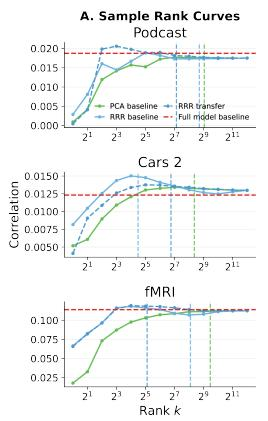

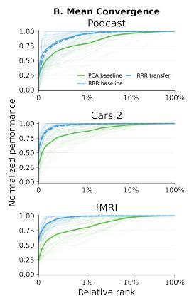

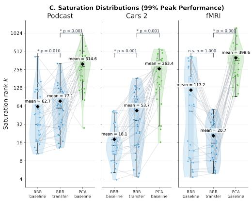  
Figure 3: Brain-predictive subspaces generalize across held-out participants. (a) Example rank– performance curves for within-participant RRR, transferred RRR learned from the remaining participants, and PCA. (b) Mean convergence curves across models and layers. (c) Saturation ranks for matched model–layer combinations. Transferred RRR reaches near-maximal performance at substantially lower rank than PCA and is generally comparable to within-participant RRR.

## 4.2 THE LEARNED LOW-RANK SUBSPACE GENERALIZES ACROSS HELD-OUT SUBJECTS

We next asked whether the brain-predictive subspace learned from one group of participants generalizes to an unseen participant (Figure 1d). If the same low-dimensional embedding directions support neural prediction in a held-out participant, this would indicate that the learned subspace reflects structure shared across individuals rather than idiosyncratic properties of a particular participant’s neural responses.

Across all three datasets, transferred RRR subspaces recovered near-maximal neural prediction using only tens of dimensions (Figure 3). The rank required to reach 99% of peak performance was substantially lower for transferred RRR subspaces than for PCA across datasets, indicating that the cross-participant result cannot be explained simply by retaining the dominant dimensions of variation in the embeddings. We additionally compared transferred subspaces with RRR subspaces learned using the held-out participant’s responses. In the Podcast and fMRI datasets, the transferred subspaces required a comparable number of dimensions—and in some cases fewer—to reach saturation, whereas the Cars 2 dataset showed a larger difference between transferred and participant-inclusive RRR. These results indicate that much of the low-dimensional structure supporting LLM–brain alignment is shared across participants and can be identified without observing neural responses from the participant on whom it is subsequently evaluated.

More broadly, the ability to transfer these subspaces across participants motivates a stronger test of their generality: whether the same predictive directions also transfer across datasets, stimuli, and neural recording modalities.

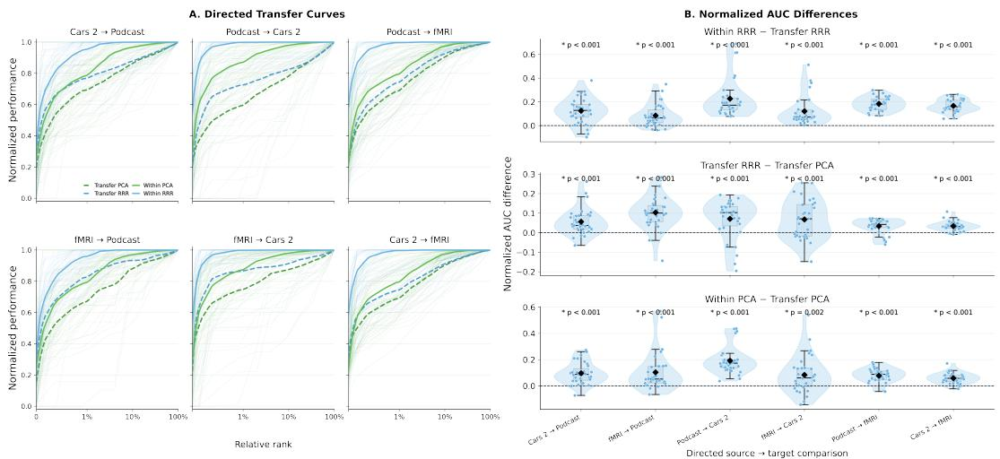  
Figure 4: Brain-predictive subspaces partially generalize across datasets. (a) Mean convergence curves for within-dataset RRR, cross-dataset transferred RRR, and transferred PCA. (b) Summary of rank–performance efficiency across directed source–target dataset pairs. Transferred RRR is less efficient than within-dataset RRR but consistently more efficient than transferred PCA, indicating partial cross-dataset generalization.

## 4.3 CROSS-DATASET TRANSFER REVEALS SHARED BRAIN-PREDICTIVE STRUCTURE BUT IS LIMITED BY STIMULUS SHIFT

We next asked whether brain-predictive subspaces generalize across datasets differing in participants, stimuli, recording modality, and preprocessing. For each directed source–target pair, we learned an RRR subspace from the source dataset, transferred it to the target embeddings, and fit a new ridge model using only target neural responses such that only the embedding subspace was transferred. Reduced transfer performance could therefore reflect either differences in neurally predictive directions across datasets or differences in the stimulus distributions used to estimate those directions.

Transferred RRR remained predictive but recovered performance less efficiently than RRR learned within the target dataset (Figure 4a). Because these transferred curves saturated more gradually, we summarized normalized rank–performance curves using area under the curve (AUC), with larger AUC indicating more efficient recovery of predictive performance. Across directed dataset pairs and model layers, transferred RRR had lower AUC than within-dataset RRR but significantly higher AUC than transferred PCA for every dataset pair (Figure 4b). Thus, brain-predictive subspaces contain structure that generalizes across datasets, although this structure is not fully invariant to changes in stimulus and recording setting.

We next asked whether some of this RRR transfer loss could be explained by differences in the stimuli themselves. To obtain a neural-response-independent measure of cross-dataset representational shift, we performed the same transfer analysis using PCA, which is estimated solely from the stimulus embeddings. The difference between within-dataset and transferred PCA therefore quantifies how much the dominant embedding geometry changes across stimulus sets. Transferred PCA performed significantly worse than within-dataset PCA across all directed dataset comparisons (Figure 4b), indicating substantial stimulus-dependent variation in embedding geometry.

If stimulus distribution shift contributes to the loss of RRR transfer performance, then dataset pairs with a larger PCA transfer gap should also tend to have a larger RRR transfer gap. We therefore compared these two quantities across models, layers, and directed dataset pairs. The RRR transfer gap positively covaried with the corresponding PCA transfer gap (Figure 5; Pearson r = 0.58, n = 184), indicating that poorer transfer of the stimulus-defined embedding space was associated with poorer transfer of the brain-predictive subspace.

This relationship does not establish that stimulus shift fully explains the RRR transfer gap, since recording modality, preprocessing, or dataset-specific neural representations may also contribute. However, it indicates that stimulus distribution shift is an important source of cross-dataset variability. We next examine these representational differences more directly using interpretable feature decoding.

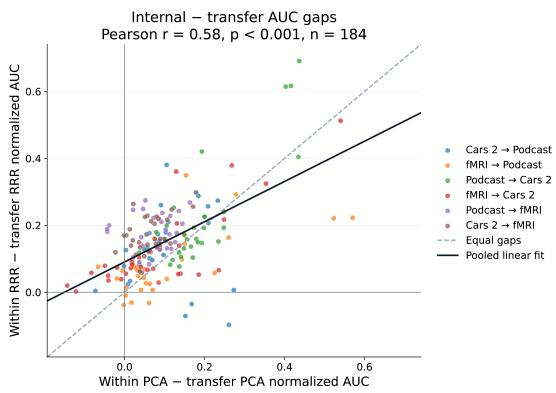  
Figure 5: Cross-dataset RRR transfer loss covaries with stimulus-dependent PCA shift. Across models, layers, and directed dataset pairs, the gap between within-dataset and transferred RRR performance is positively correlated with the corresponding PCA transfer gap $( r = 0 . 5 8 , n = 1 8 4 )$ Each point represents a model–layer combination for one directed source–target transfer.

## 4.4 FMRI AND IEEG ALIGNED LOW-RANK SUBSPACES EMPHASIZE DIFFERENT LINGUISTIC INFORMATION

Having shown that RRR recovers neural predictivity in far fewer dimensions than PCA, we next asked what information distinguishes these two low-dimensional spaces. PCA preserves directions of greatest variance in the model embeddings, whereas RRR selects directions specifically for their ability to predict neural responses. Comparing feature decodability between equally sized RRR and PCA subspaces therefore asks which linguistic information is preferentially preserved when the embedding space is constrained by neural prediction rather than by variance alone. Greater decodability from RRR does not imply that a feature itself drives neural prediction, but indicates enrichment of that feature, or correlated information, in the brain-predictive subspace.

Across datasets, several features showed preferential decoding from the RRR subspace. For example, sentence position and GPT-2 next-word prediction entropy were more accessible from RRR than PCA at low ranks across all three datasets (Figure 6a). Word concreteness, however, was preferentially represented in the fMRI-derived RRR subspace at low ranks, but showed no corresponding enrichment in either iEEG dataset. Thus, the learned subspaces preserve both shared and dataset-specific linguistic information.

We next asked whether these dataset differences showed systematic structure. If RRR is capturing meaningful properties of the neural measurements rather than an arbitrary predictive compression, datasets sharing a recording modality should prioritize similar features. Consistent with this prediction, enrichment profiles were strongly correlated between the two iEEG datasets (Podcast versus Cars $2 \colon ( r = 0 . 7 \bar { 0 } )$ ; Figure 6b), but showed little correspondence between either iEEG dataset and fMRI (Podcast versus fMRI: $( r = - 0 . 1 1 )$ ; Cars 2 versus fMRI: $( r = - 0 . 1 2 ) )$ ).

This pattern provides convergent support for the interpretation that RRR is isolating meaningful brain-predictive structure. Despite differences in participants and stimuli, the two iEEG datasets emphasize similar linguistic information, while both differ from fMRI. It also complements the cross-dataset transfer results: stimulus shift contributes to transfer loss, but datasets may additionally differ in which components of the embedding space are selected by neural supervision.

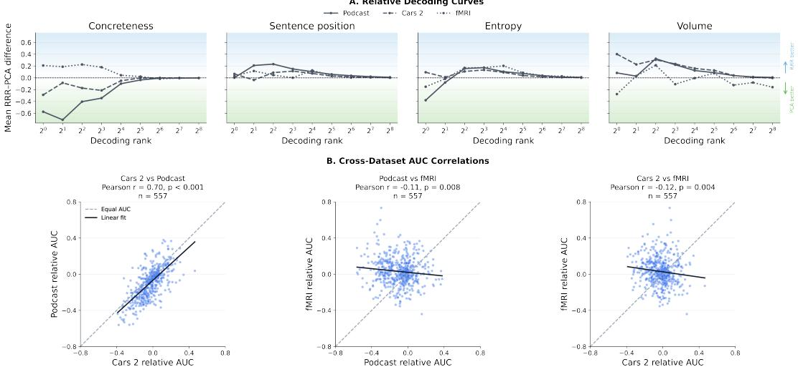  
Figure 6: Linguistic feature enrichment differs across neural datasets. (a) Relative decoding advantage of RRR over PCA across ranks for example features. Positive values indicate greater decodability from RRR; negative values indicate greater decodability from PCA. Details of computation in A.3.1. (b) Feature-enrichment profiles are strongly correlated between the two iEEG datasets but not between either iEEG dataset and fMRI.

## 5 DISCUSSION

Our results show that LLM–brain alignment during naturalistic language processing is supported by a surprisingly low-dimensional subset of the embedding space. Across datasets, models, and layers, neural prediction saturated using only tens of dimensions, and these brain-predictive directions differed from the principal axes of embedding variance. The learned subspaces generalized strongly across held-out participants and partially across datasets, with cross-dataset differences associated with both stimulus-dependent shifts in embedding geometry and differences in the linguistic information emphasized across recording modalities.

Beyond establishing the existence and generality of this low-rank structure, the framework provides a way to probe which components of large model representations contribute most strongly to neural prediction. Because RRR identifies directions that are selected specifically for their ability to predict neural responses, comparing the information available in the RRR and PCA subspaces can reveal representational mismatches between the two spaces. For example, we find that some stimulus-level properties, including volume (Figure 6a), can be decoded more accurately from the RRR space than from a comparable PCA space. This should not be interpreted as evidence that the language model represents acoustic volume: the model receives only the transcript. Instead, the RRR subspace is likely preserving linguistic features that covary with acoustic properties of the stimulus which is useful for predicting responses to heard speech. This example highlights a broader interpretational challenge for neural encoding models built from high-dimensional language representations. Linguistic, semantic, syntactic, discourse, and acoustic properties are highly correlated in naturalistic stimuli, such that successful neural prediction does not by itself identify which underlying feature is causally responsible for alignment.

An open question remains as to what is limiting the dimensionality of this aligned subspace. One possibility is that coarse neural recordings which we typically have access to in human neuroscience contain little signal and we are in fact recovering it well with tens of dimensions. Another possibility though is that the model embedding representations are missing some portion of the true representational signal contained in this neural data. While our analysis cannot answer this question, it does provide evidence that the primary features of LLM embeddings which align with the neural data are not equivalent to the principal axes of the embeddings, demonstrating a divide in the representational geometry of the two systems.

## AI USE STATEMENT

In this work, we used generative AI tools to help provide feedback on research methodology, implement methods through the writing of code, clean and reformat datasets through scripts for one-off runs, and, at times, interpret results.

We did not use generative AI tools to help develop theoretical models or conceptual frameworks, formulate mathematical claims, propose or refine hypotheses, or support qualitative and thematic data analysis. Generation of synthetic datasets, assistance with translation, assistance in writing proofs, and providing critical ingredients for or proving mathematical claims were not applicable to this work.

Additionally, we used generative AI tools to help create scientific figures or images, suggest experimental parameters, create or edit software code with human review, summarize existing literature, brainstorm, edit our paper to improve readability, and identify relevant literature. Most of the AI usage for this project was to aid in writing code, always with human review. It was also used frequently to make language more concise to fit within the page limitations. We have reviewed all AI-assisted work. We take responsibility for the final content of this work, including text, claims, or artifacts produced with the aid of generative AI.

## REPRODUCIBILITY STATEMENT

To make our work easily reproducible we have provided our code at https://github.com/thefinnlab/low-rank-alignment. In our docs folder is a guide for reproducing which specifies all of the steps necessary to rebuild our results from scratch. All of the data is already open-source and free to download and thus can be easily utilized by any researcher. We have also provided descriptions of our methods in detailed prose in the appendix which should be useful for discerning the specifics of our approach at a high level.

## ACKNOWLEDGMENTS

We thank Clara Sava- Segal, Katie O’Nell, Tommy Botch, and Kay Liang for their thoughtful comments during the drafting process of this paper.

## REFERENCES

AI@Meta. Llama 3 model card, 2024. URL https://github.com/meta-llama/llama3/ blob/main/MODEL\_CARD.md.

Richard Antonello and Emily Cheng. Evidence from fMRI Supports a Two-Phase Abstraction Process in Language Models. In NeurIPS 2024 Workshops: UniReps, 2024.

Richard Antonello and Alexander Huth. Predictive Coding or Just Feature Discovery? An Alternative Account of Why Language Models Fit Brain Data. Neurobiology of Language, 5(1):64–79, April 2024. ISSN 2641-4368. doi: 10.1162/nol a 00087.

Richard Antonello, Javier S Turek, Vy Vo, and Alexander Huth. Low-dimensional Structure in the Space of Language Representations is Reflected in Brain Responses. In Advances in Neural Information Processing Systems, volume 34, pp. 8332–8344. Curran Associates, Inc., 2021.

Richard Antonello, Aditya Vaidya, and Alexander Huth. Scaling laws for language encoding models in fMRI. In Advances in Neural Information Processing Systems, volume 36, pp. 21895–21907. Curran Associates, Inc., 2023. doi: 10.52202/075280-0958.

Herve Bredin, Ruiqing Yin, Juan Manuel Coria, Gregory Gelly, Pavel Korshunov, Marvin Lavechin,´ Diego Fustes, Hadrien Titeux, Wassim Bouaziz, and Marie-Philippe Gill. Pyannote.audio: Neural building blocks for speaker diarization, November 2019.

Marc Brysbaert, Amy Beth Warriner, and Victor Kuperman. Concreteness ratings for 40 thousand generally known English word lemmas. Behavior Research Methods, 46(3):904–911, September 2014. ISSN 1554-3528. doi: 10.3758/s13428-013-0403-5.

Marc Brysbaert, Paweł Mandera, Samantha F. McCormick, and Emmanuel Keuleers. Word prevalence norms for 62,000 English lemmas. Behavior Research Methods, 51(2):467–479, April 2019. ISSN 1554-3528. doi: 10.3758/s13428-018-1077-9.

Charlotte Caucheteux and Jean-Remi King. Brains and algorithms partially converge in natural´ language processing. Communications Biology, 5(1):134, February 2022. ISSN 2399-3642. doi: 10.1038/s42003-022-03036-1.

Simon De Deyne, Danielle J. Navarro, Amy Perfors, Marc Brysbaert, and Gert Storms. The “Small World of Words” English word association norms for over 12,000 cue words. Behavior Research Methods, 51(3):987–1006, June 2019. ISSN 1554-3528. doi: 10.3758/s13428-018-1115-7.

Edward Gibson. Linguistic complexity: Locality of syntactic dependencies. Cognition, 68(1):1–76, August 1998. ISSN 0010-0277. doi: 10.1016/S0010-0277(98)00034-1.

Ariel Goldstein, Zaid Zada, Eliav Buchnik, Mariano Schain, Amy Price, Bobbi Aubrey, Samuel A. Nastase, Amir Feder, Dotan Emanuel, Alon Cohen, Aren Jansen, Harshvardhan Gazula, Gina Choe, Aditi Rao, Catherine Kim, Colton Casto, Lora Fanda, Werner Doyle, Daniel Friedman, Patricia Dugan, Lucia Melloni, Roi Reichart, Sasha Devore, Adeen Flinker, Liat Hasenfratz, Omer Levy, Avinatan Hassidim, Michael Brenner, Yossi Matias, Kenneth A. Norman, Orrin Devinsky, and Uri Hasson. Shared computational principles for language processing in humans and deep language models. Nature Neuroscience, 25(3):369–380, March 2022. ISSN 1546-1726. doi: 10.1038/s41593-022-01026-4.

Nima Hadidi, Ebrahim Feghhi, Bryan H. Song, Idan A. Blank, and Jonathan C. Kao. Spurious alignment between large language models and brains can emerge from non-robust methods and overlooked confounds. Nature Communications, 17(1):5769, April 2026. ISSN 2041-1723. doi: 10.1038/s41467-026-72253-7.

Paul Hoffman, Matthew A. Lambon Ralph, and Timothy T. Rogers. Semantic diversity: A measure of semantic ambiguity based on variability in the contextual usage of words. Behavior Research Methods, 45(3):718–730, September 2013. ISSN 1554-3528. doi: 10.3758/s13428-012-0278-x.

Eghbal A. Hosseini, Martin Schrimpf, Yian Zhang, Samuel Bowman, Noga Zaslavsky, and Evelina Fedorenko. Artificial Neural Network Language Models Predict Human Brain Responses to Language Even After a Developmentally Realistic Amount of Training. Neurobiology of Language, 5(1):43–63, April 2024. ISSN 2641-4368. doi: 10.1162/nol a 00137.

Alexander G. Huth, Wendy A. de Heer, Thomas L. Griffiths, Fred´ eric E. Theunissen, and Jack L.´ Gallant. Natural speech reveals the semantic maps that tile human cerebral cortex. Nature, 532 (7600):453–458, April 2016. ISSN 1476-4687. doi: 10.1038/nature17637.

Alan Julian Izenman. Reduced-rank regression for the multivariate linear model. Journal of Multivariate Analysis, 5(2):248–264, June 1975. ISSN 0047-259X. doi: 10.1016/0047-259X(75) 90042-1.

Shailee Jain and Alexander Huth. Incorporating Context into Language Encoding Models for fMRI. In Advances in Neural Information Processing Systems, volume 31. Curran Associates, Inc., 2018.

Sreejan Kumar, Theodore R. Sumers, Takateru Yamakoshi, Ariel Goldstein, Uri Hasson, Kenneth A. Norman, Thomas L. Griffiths, Robert D. Hawkins, and Samuel A. Nastase. Shared functional specialization in transformer-based language models and the human brain. Nature Communications, 15(1):5523, June 2024. ISSN 2041-1723. doi: 10.1038/s41467-024-49173-5.

Victor Kuperman, Hans Stadthagen-Gonzalez, and Marc Brysbaert. Age-of-acquisition ratings for 30,000 English words. Behavior Research Methods, 44(4):978–990, December 2012. ISSN 1554- 3528. doi: 10.3758/s13428-012-0210-4.

Amanda LeBel, Lauren Wagner, Shailee Jain, Aneesh Adhikari-Desai, Bhavin Gupta, Allyson Morgenthal, Jerry Tang, Lixiang Xu, and Alexander G. Huth. A natural language fMRI dataset for voxelwise encoding models. Scientific Data, 10(1):555, August 2023. ISSN 2052-4463. doi: 10.1038/s41597-023-02437-z.

Lane Lewis, Xaq Pitkow, and Leila Wehbe. Low-Rank Tensor Encoding Models Decompose Natural Speech Comprehension Processes. bioRxiv, June 2025. doi: 10.1101/2025.06.02.657514.

Yinhan Liu, Myle Ott, Naman Goyal, Jingfei Du, Mandar Joshi, Danqi Chen, Omer Levy, Mike Lewis, Luke Zettlemoyer, and Veselin Stoyanov. RoBERTa: A Robustly Optimized BERT Pretraining Approach, July 2019.

Dermot Lynott, Louise Connell, Marc Brysbaert, James Brand, and James Carney. The Lancaster Sensorimotor Norms: Multidimensional measures of perceptual and action strength for 40,000 English words. Behavior Research Methods, 52(3):1271–1291, June 2020. ISSN 1554-3528. doi: 10.3758/s13428-019-01316-z.

Gavin Mischler, Yinghao Aaron Li, Stephan Bickel, Ashesh D. Mehta, and Nima Mesgarani. Contextual feature extraction hierarchies converge in large language models and the brain. Nature Machine Intelligence, 6(12):1467–1477, December 2024. ISSN 2522-5839. doi: 10.1038/ s42256-024-00925-4.

Saif M. Mohammad. NRC VAD Lexicon v2: Norms for Valence, Arousal, and Dominance for over 55k English Terms, March 2025.

Joakim Nivre, Marie-Catherine de Marneffe, Filip Ginter, Jan Hajic, Christopher D. Manning,ˇ Sampo Pyysalo, Sebastian Schuster, Francis Tyers, and Daniel Zeman. Universal Dependencies v2: An Evergrowing Multilingual Treebank Collection. In Nicoletta Calzolari, Fred´ eric B´ echet,´ Philippe Blache, Khalid Choukri, Christopher Cieri, Thierry Declerck, Sara Goggi, Hitoshi Isahara, Bente Maegaard, Joseph Mariani, Hel´ ene Mazo, Asuncion Moreno, Jan Odijk, and Stelios\` Piperidis (eds.), Proceedings ofthe Twelfth Language Resources and Evaluation Conference, pp. 4034–4043, Marseille, France, May 2020. European Language Resources Association. ISBN 979-10-95546-34-4.

Jeffrey Pennington, Richard Socher, and Christopher D. Manning. GloVe: Global vectors for word representation. In Proceedings of the 2014 Conference on Empirical Methods in Natural Language Processing (EMNLP), pp. 1532–1543, 2014.

Princeton University. About WordNet. https://wordnet.princeton.edu/, 2010. Word-Net, Princeton University; accessed September 26, 2026.

Peng Qi, Yuhao Zhang, Yuhui Zhang, Jason Bolton, and Christopher D. Manning. Stanza: A Python Natural Language Processing Toolkit for Many Human Languages. In Asli Celikyilmaz and Tsung-Hsien Wen (eds.), Proceedings of the 58th Annual Meeting of the Association for Computational Linguistics: System Demonstrations, pp. 101–108, Online, July 2020. Association for Computational Linguistics. doi: 10.18653/v1/2020.acl-demos.14.

Alec Radford, Jeffrey Wu, Rewon Child, David Luan, Dario Amodei, and Ilya Sutskever. Language models are unsupervised multitask learners. OpenAI Technical Report, 2019. URL https://cdn.openai.com/better-language-models/language\_ models\_are\_unsupervised\_multitask\_learners.pdf.

Nathan Roll, Calbert Graham, and Simon Todd. PSST! Prosodic Speech Segmentation with Transformers. In Jing Jiang, David Reitter, and Shumin Deng (eds.), Proceedings of the 27th Conference on Computational Natural Language Learning (CoNLL), pp. 476–487, Singapore, December 2023. Association for Computational Linguistics. doi: 10.18653/v1/2023.conll-1.31.

Martin Schrimpf, Idan Asher Blank, Greta Tuckute, Carina Kauf, Eghbal A. Hosseini, Nancy Kanwisher, Joshua B. Tenenbaum, and Evelina Fedorenko. The neural architecture of language: Integrative modeling converges on predictive processing. Proceedings of the National Academy ofSciences, 118(45):e2105646118, November 2021. doi: 10.1073/pnas.2105646118.

C. E. Shannon. A mathematical theory of communication. The Bell System Technical Journal, 27 (3):379–423, July 1948. ISSN 0005-8580. doi: 10.1002/j.1538-7305.1948.tb01338.x.

Robyn Speer. wordfreq: v3.0, 2022.

Mariya Toneva and Leila Wehbe. Interpreting and improving natural-language processing (in machines) with natural language-processing (in the brain). In Advances in Neural Information Processing Systems, volume 32. Curran Associates, Inc., 2019.

Ben Wang and Aran Komatsuzaki. GPT-J-6B: A 6 Billion Parameter Autoregressive Language Model. https://github.com/kingoflolz/mesh-transformer-jax, May 2021.

Christopher Wang, Adam Yaari, Aaditya K. Singh, Vighnesh Subramaniam, Dana Rosenfarb, Jan DeWitt, Pranav Misra, Joseph R. Madsen, Scellig Stone, Gabriel Kreiman, Boris Katz, Ignacio Cases, and Andrei Barbu. Brain Treebank: Large-scale intracranial recordings from naturalistic language stimuli. Advances in Neural Information Processing Systems, 37:96505–96540, December 2024. doi: 10.52202/079017-3060.

Zaid Zada, Ariel Goldstein, Sebastian Michelmann, Erez Simony, Amy Price, Liat Hasenfratz, Emily Barham, Asieh Zadbood, Werner Doyle, Daniel Friedman, Patricia Dugan, Lucia Melloni, Sasha Devore, Adeen Flinker, Orrin Devinsky, Samuel A. Nastase, and Uri Hasson. A shared model-based linguistic space for transmitting our thoughts from brain to brain in natural conversations. Neuron, 112(18):3211–3222.e5, September 2024. ISSN 0896-6273. doi: 10.1016/j.neuron.2024.06.025.

Zaid Zada, Samuel A. Nastase, Bobbi Aubrey, Itamar Jalon, Sebastian Michelmann, Haocheng Wang, Liat Hasenfratz, Werner Doyle, Daniel Friedman, Patricia Dugan, Lucia Melloni, Sasha Devore, Adeen Flinker, Orrin Devinsky, Ariel Goldstein, and Uri Hasson. The “Podcast” ECoG dataset for modeling neural activity during natural language comprehension. Scientific Data, 12 (1):1135, July 2025. ISSN 2052-4463. doi: 10.1038/s41597-025-05462-2.

## A APPENDIX

## A.1 DATA PREPROCESSING

## A.1.1 LLM EMBEDDINGS

We generated contextual representations from the stimulus transcripts using GPT-2, GPT-2 XL, GPT-J 6B, Llama 3 8B, and RoBERTa Large. Each transcript word was tokenized independently with a leading space, and the resulting subword tokens were concatenated in transcript order. For the causal models, we processed overlapping windows of up to 1,023 tokens, advancing by 512 tokens per window. We retained all token representations from the first window and only newly introduced token representations from subsequent windows. Native causal attention restricted each representation to the target token and preceding tokens within its window. For RoBERTa, we constructed a separate window of up to 511 tokens ending at each target token and retained its final-position representation. Thus, although RoBERTa uses bidirectional attention within a window, its extracted representations had no access to subsequent transcript tokens.

We extracted hidden states at five depths spanning each model: layers 0, 3, 6, 9, and 12 for GPT-2; 0, 12, 24, 36, and 48 for GPT-2 XL; 0, 7, 14, 21, and 28 for GPT-J; 0, 8, 16, 24, and 32 for Llama; and 0, 6, 12, 18, and 24 for RoBERTa. Layer 0 denotes the embedding-stage hidden state. Word representations were obtained by averaging the hidden states of all subword tokens belonging to that word. Contextual representations were generated before applying the vocabulary restrictions used in the neural analyses. Controls comprised a randomly initialized GPT-2 model with initialization seed 42 and static 300-dimensional GloVe embeddings.

## A.1.2 CARS 2 PREPROCESSING

We analyzed Brain Treebank intracranial recordings from subjects 3, 7, and 10 during viewing of Cars 2. Contacts identified as corrupted in the dataset annotations were removed, and the continuous voltage recordings were resampled from 2,048 Hz to 512 Hz. We then despiked each contact by identifying samples whose absolute deviation from its median exceeded four times its interquartile range. The artifact mask was expanded using a 100-ms filter applied forward and backward, and masked samples were replaced using piecewise cubic Hermite interpolation.

We applied shaft-Laplacian rereferencing, subtracting the mean voltage of the two immediately adjacent contacts on the same shaft from each contact:

$$
V _ { n } ^ { r e f } ( t ) = V _ { n } ( t ) - \frac { V _ { n - 1 } ( t ) + V _ { n + 1 } ( t ) } { 2 }
$$

Only contacts with both consecutively numbered neighbors available after corrupted-contact removal were retained. We applied notch filters at 60, 120, and 180 Hz with 2-Hz notch widths, followed by a fourth-order Butterworth band-pass filter from 70 to 200 Hz. High-gamma amplitude was defined as the magnitude of the analytic signal obtained through the Hilbert transform.

## A.1.3 WORD ALIGNMENT AND EPOCH CONSTRUCTION.

We reconstructed transcript words by matching the dataset’s transcript entries to the corresponding sentence text, recovering punctuation and contractions where applicable. When multiple separately timed entries mapped to a single sentence word, we retained the separately timed entries. Each resulting word received a persistent transcript index linking its embedding to its neural epoch.

Movie timestamps were mapped separately to each subject’s neural recording using the supplied synchronization triggers. Words lacking valid onset or offset times, or beginning after the final synchronization trigger, were excluded from neural alignment.

For each remaining word, we rounded its recording-relative onset to the nearest sample on the 512- Hz preprocessing grid and extracted a high-gamma epoch covering [-2,2) seconds relative to onset. When multiple words mapped to the same onset sample, we retained the first; epochs extending beyond the recording boundaries were discarded. Each extracted epoch was then independently resampled to 32 Hz using FFT resampling with a Hamming window, yielding 128 samples per contact at 31.25-ms intervals. Consequently, every epoch used a sampling grid anchored to its own word onset.

We stored the retained transcript indices alongside the epochs and used these indices to select the corresponding word embeddings. Analyses combining subjects used the intersection of their retained word indices. The iEEG analyses additionally restricted words to those covered by the 300- dimensional GloVe vocabulary, ensuring a common vocabulary across model comparisons.

## A.2 METHODS DETAILS

## A.2.1 RRR FITTING AND RANK EVALUATION

Within each training partition, we fit a multivariate ridge model from (X) to (Y), yielding coefficient matrix (W) and fitted responses $( \hat { Y } = X W )$ . After decomposing (Yˆ ), we used its first (k) right singular vectors $( V _ { k } )$ to construct $( A _ { k } = W V _ { k } )$ ). Before projection, the truncated input factor was orthonormalized using QR decomposition so that differences in column magnitude did not influence the refitted model or comparisons with PCA.

Ranks generally doubled in powers of 2 to the available embedding-dimensionality endpoint. At each rank, a new ridge encoding model was fit after projection. Ridge penalties were selected by inner cross-validation from a 25-value scale-aware grid. Performance was measured as Pearson correlation between predicted and observed held-out responses. For iEEG, correlations across lag were averaged in Fisher-(z) space to obtain per-electrode performance.

## A.2.2 CONSTRUCTION OF THE FMRI RRR SUBSPACE

For fMRI, the initial RRR fit operated on the complete four-delay finite impulse response design, yielding a separate input-factor block for each delay. We combined these blocks to obtain a (k)- dimensional subspace in the original embedding coordinates. For each of the first (k) RRR components, coefficients were normalized across the four delays and scaled by the corresponding singular value of the ridge model’s fitted training responses. This weighting gives components with greater fitted prediction energy greater influence while preserving their distribution across delays.

The four weighted blocks were concatenated, and their leading (k) left singular vectors were used as an orthonormal embedding basis. At each rank, embeddings were projected into this basis, the four-delay design was reconstructed, and a new ridge encoding model was fit for held-out evaluation.

## A.2.3 LANGUAGE-FEATURE DECODING DETAILS

Stimulus words were annotated with the available lexical, syntactic, semantic, discourse, timing, and pause features. At each rank, embeddings were projected separately into the RRR and PCA spaces. Continuous features were decoded using ridge regression and evaluated by Pearson correlation; categorical features were decoded using class-balanced logistic regression and evaluated by balanced accuracy. Features unavailable for a given dataset were omitted from that dataset’s analysis. A complete list of decoded features and their sources is provided below.

## A.3 SATURATION RANK DEFINITION

Our goal was to estimate the minimum rank required to recover near-maximal neural predictive performance. In principle, this could be defined separately for every neural target (voxel or electrode). Individual target-level rank–performance curves are noisy, however, making target-specific saturation estimates unstable. Conversely, defining saturation from only the mean performance across targets can obscure heterogeneity across the neural-target distribution.

We therefore characterized saturation at the level of the target-performance distribution. At each evaluated rank, we computed the 10th, 25th, 50th, 75th, and 90th percentiles of held-out target performance and tracked each quantile across the rank sweep. For each quantile, we defined its maximum as the highest performance attained across evaluated ranks. The overall saturation rank was then the minimum rank at which every informative quantile reached at least 99% of its respective maximum performance.

Quantile curves whose maximum performance did not exceed 0.005 were excluded because they contained almost no positive predictive performance for which a recovery rank could be meaningfully defined. Requiring all remaining quantiles to reach threshold prevents saturation from being determined solely by high-performing targets or by changes in the mean and instead requires nearmaximal recovery across a broad portion of the neural-target distribution.

Because the estimated saturation rank depends on the chosen recovery threshold, we additionally evaluated the sensitivity of our conclusions to alternative thresholds.

See figures 9, 10, 12, 11 for example quantiles and sensitivity analyses of these measures.

## A.3.1 RELATIVE DECODING PERFORMANCE

After clipping each decoding score below at zero, we defined relative advantage as

$$
D ( k ) = \frac { s _ { R R R } ( k ) - s _ { P C A } ( k ) } { [ s _ { R R R } ( k ) + s _ { P C A } ( k ) ] / 2 + 0 . 0 5 }
$$

The value is greater than 0 if a feature can be more readily decoded from the RRR space than the PCA space and less than 0 otherwise. It is normalized by the mean of the two values and 0.05 is added to prevent unstable values at low performance. We repeat this computation across many ranks to study how it changes with the size of the subspaces.

## A.4 SIGNIFICANCE TESTS

## A.4.1 STATISTICAL COMPARISONS

We compared dimensionality and transfer performance using one-sided paired sign-flip permutation tests. The pairing unit was a model– layer combination. For each comparison, the test statistic was the mean paired difference. We generated a null distribution by independently multiplying each paired difference by either +1 or -1, with equal probability, across 10,000 randomizations using a fixed random seed of 0. We calculated Monte Carlo p-values as

$$
p = \frac { 1 + \Sigma _ { b = 1 } ^ { 1 0 , 0 0 0 } [ T _ { b } \mathrm { { i s } a t l e a s t a s \ e x t r e m e \ a s \ } T _ { o b s } ] } { 1 0 , 0 0 1 }
$$

where extremeness was defined according to the direction of the one-sided alternative.

## A.4.2 SATURATION-RANK COMPARISONS.

For each dataset, model–layer combination, and method, we summarized dimensionality by the rank required to reach 99% of peak performance. We first averaged target-level correlations across evaluation folds in Fisher-z space and computed the 10th, 25th, 50th, 75th, and 90th percentiles across neural targets. Each percentile curve was made monotonic by taking its cumulative maximum and normalized by its own peak. Curves with peak correlations at or below 0.005 were excluded. Saturation rank was the largest of the first ranks at which the eligible percentile curves reached the threshold, with linear interpolation between tested ranks.

We tested whether RRR required fewer dimensions than PCA using paired differences in $\log _ { 2 }$ saturation rank. For leave-one-subject-out analyses, we computed saturation ranks separately for each subject and averaged the finite ranks across subjects within each model–layer combination before applying the logarithmic transformation. We tested whether transferred RRR required fewer dimensions than the within-subject PCA baseline and whether the RRR baseline required fewer dimensions than transferred RRR. Comparisons used model–layer combinations with finite saturation estimates for every method shown in the panel. The two leave- one-subject-out tests were corrected using the Holm procedure within each dataset panel. Sensitivity analyses repeated these comparisons across alternative saturation thresholds and, for internal analyses, alternative minimum peak correlations.

## A.4.3 CROSS-DATASET TRANSFER COMPARISONS

We summarized each performance curve by its area under the curve (AUC). Correlations were clipped below at zero, made monotonic using a cumulative maximum, and divided by the curve’s own peak. We then integrated the normalized curve using the trapezoidal rule over normalized log rank, $l o g ( k ) / l o g ( k _ { m a x } )$ , from rank 1 to the maximum tested rank. For each of the six directed dataset pairs, we tested whether the mean paired AUC difference was positive for three comparisons: within-dataset RRR versus transferred RRR, transferred RRR versus transferred PCA, and within dataset PCA versus transferred PCA. Each test used matched model–layer combinations with valid AUCs.

## A.4.4 CORRELATION ANALYSES

We used Pearson correlations with two-sided p-values to assess associations between the withindataset-minus-transfer AUC gaps for PCA and RRR, pooling matched observations across all six transfer directions. We also assessed cross-dataset consistency of the relative decoding advantage of RRR over PCA.

We integrated the relative decoding performance quantity over normalized log rank and correlated the resulting AUCs between datasets, matching observations by model, layer, and decoding task and retaining combinations available in all three datasets.

Statistical significance was indicated at $p < 0 . 0 5$ . Cross-dataset AUC tests and Pearson correlation tests used unadjusted p-values; Holm correction was confined to the comparisons within each saturation panel.

## A.5 SIGNIFICANCE SELECTION

Neural targets were selected using held-out predictions from full-embedding ridge encoding models. For iEEG, we used five contiguous word folds and evaluated each electrode using its best-lag prediction correlation, defined as the sampled time point relative to word onset at which the correlation between predicted and observed neural activity was greatest. Null distributions were generated by circularly shifting responses within held-out folds. Best-lag (p)-values were corrected across electrodes using the Benjamini–Hochberg procedure. Once an electrode was selected, all sampled lags for that electrode were retained as separate RRR targets. Main analyses used the union of electrodes selected across configured model and layer significance runs.

For fMRI, voxel significance was assessed using predictions from models that held out complete training sessions, each consisting of unique stories and one repeated test story. The repeated test story was excluded from target selection. Null distributions were generated by circularly shifting responses within each story, followed by Benjamini–Hochberg correction. Significant voxels were retained as RRR targets.

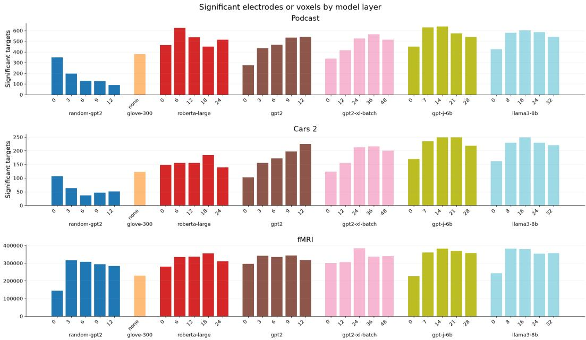  
Figure 7: We use all targets deemed significant by at least one model–layer combination. See table 1 for full counts.

## A.5.1 RESULTS OF SELECTION

See figure 7 and table 1 for significance results.

## A.6 ENCODING MODEL PERFORMANCE

See figure 8 for a summary figure.

## A.7 LINGUISTIC DECODING TASK LABELS

See table 2 for a complete list and description of tasks used.

Table 1: Number of significant targets (electrodes for Podcast and Cars 2, voxels for fMRI) for each model-layer. Union represents the final number of targets used for our analysis by taking all targets which any model-layer deemed significant.
<table><tr><td>Dataset</td><td>Model</td><td>0%</td><td>25%</td><td>50%</td><td>75%</td><td>100%</td></tr><tr><td>Podcast</td><td>random-gpt2 glove-300 roberta-large gpt2 gpt2-xl-batch gpt-j-6b llama3-8b Union</td><td>350 463 275 337 450 426</td><td>197 626 435 415 630 579</td><td>128 381 538 467 526 638 602</td><td>127 450 535 565 574 584</td><td>90 515 541 516 540</td></tr><tr><td>Cars 2</td><td>random-gpt2 glove-300 roberta-large gpt2 gpt2-xl-batch gpt-j-6b llama3-8b Union</td><td>107 148 103 124 170 162</td><td>63 156 156 156 235 229</td><td>1,200 37 122 155 172 213 249 249</td><td>47 184 197 216 249 229</td><td>539 51 139 225 200 218 220</td></tr><tr><td>fMRI</td><td>random-gpt2 glove-300 roberta-large gpt2 gpt2-xl-batch gpt-j-6b llama3-8b Union</td><td>144,979 280,635 296,089 301,334 226,388 242,553 381,781</td><td>316,842 335,494 342,502 306,597 360,222 382,378</td><td>439 307,353 229,249 336,063 334,932 385,015 368,703</td><td>294,695 356,103 343,213 337,107</td><td>284,196 311,036 317,423 340,529</td></tr></table>

Table 2: Features decoded in the internal Cars 2, fMRI, and Podcast configurations.

CITATION(S)   
(Kuperman et al., 2012)   
(Mohammad, 2025)   
(De Deyne et al., 2019; Shannon, 1948)   
(Brysbaert et al., 2014)   
(Nivre et al., 2020; Qi et al., 2020)   
(Nivre et al., 2020; Qi et al., 2020)   
(Gibson, 1998; Nivre et al., 2020; Qi et al., 2020)   
Derived from aligned transcript   
(Wang et al., 2024)   
(Qi et al., 2020)   
(Roll et al., 2023)   
(Roll et al., 2023)   
(Roll et al., 2023)   
(Roll et al., 2023)   
(Wang et al., 2024)   
(Nivre et al., 2020; Qi et al., 2020)   
Derived from aligned timestamps   
Derived from aligned timestamps   
Derived from aligned transcript   
(Hoffman et al., 2013)   
(Nivre et al., 2020: Oi et al., 2020)   
(Nivre et al., 2020; Qi et al., 2020)   
(Nivre et al., 2020; Qi et al., 2020)   
(Princeton University, 2010)   
(Wang et al., 2024; Bredin et al., 2019)   
(Lynott et al., 2020)   
(Shannon, 1948; Radford et al., 2019)   
(Radford et al., 2019)   
(Mohammad, 2025)   
Derived from aligned timestamps   
Derived from aligned transcript   
Derived from aligned transcript   
(Brysbaert et al., 2019)   
(Speer, 2022)

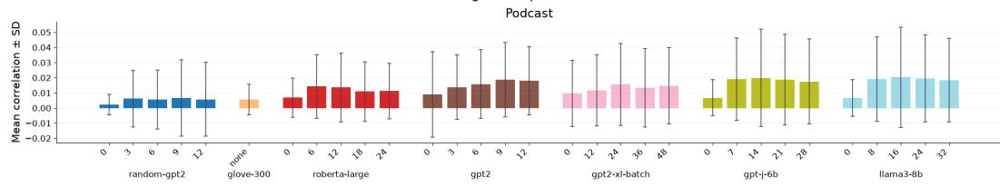

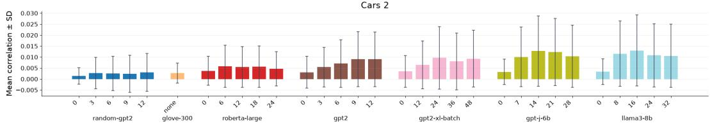

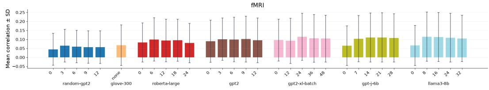  
Figure 8: Mean encoding results of all of our model-layers across all of our datasets. We generally recover patterns typical of previous work where larger models outperform smaller models, and middle layers perform better than early or late layers. Performance is quite spread due to our liberal significance filtering.

Target correlation quantiles · gpt-j-6b / 21

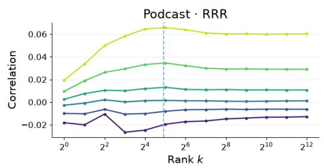

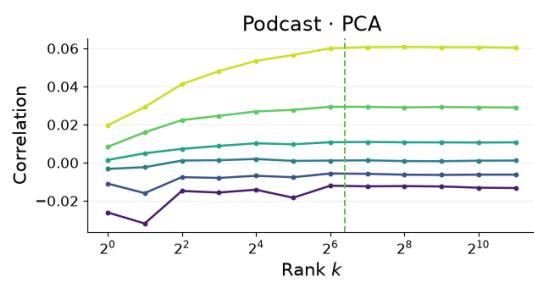

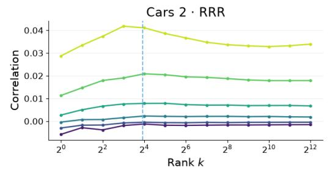

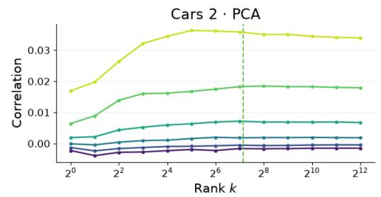

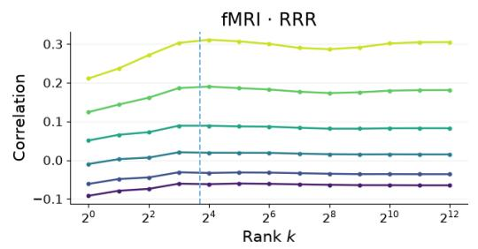

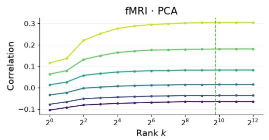  
Figure 9: GPT-J-6b layer 21 performance quantiles on different datasets. We can see that lowerquantiles generally lag a bit behind higher ones. We exclude any with a peak value less than 0.005 when calculating saturation to avoid unreliable targets leading to noisy overestimates.

Mean quantile convergence across model layers · peak > 0.005  
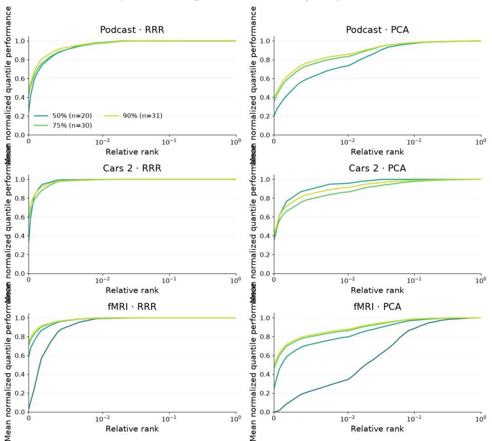  
Figure 10: Normalized performance curves for every quantile averaged across model-layers. All tested quantiles tend to converge quickly on RRR but less quickly for PCA.

Internal RRR quantile saturation sensitivity: required peak fraction  
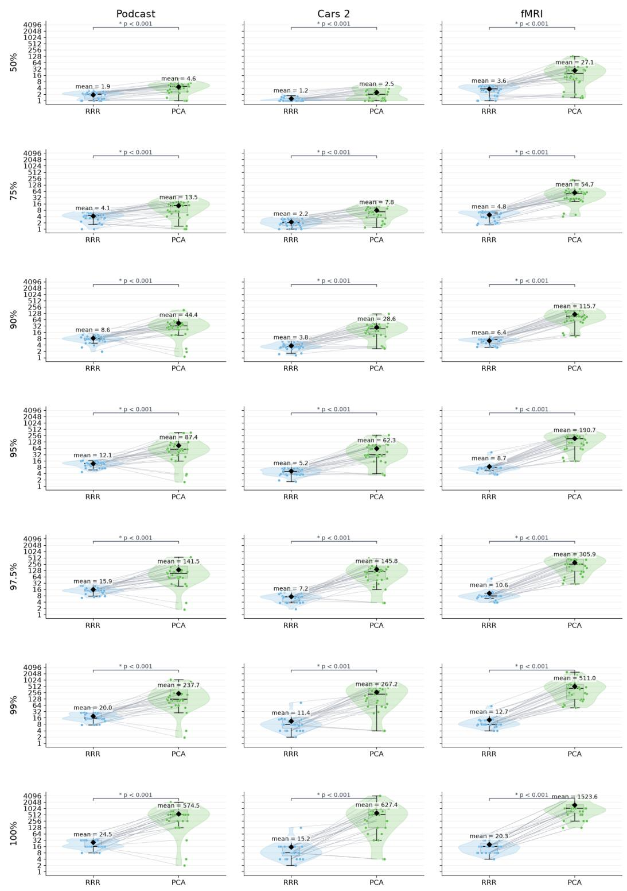  
Figure 11: Sensitivity analysis of how saturation rank changes as you change the required performance threshold across qualifying quantiles. Across all thresholds RRR converges quicker than PCA, but the effect becomes more drastic as the value increases. We selected 99% as our goal is to ask when max performance is almost entirely recovered.

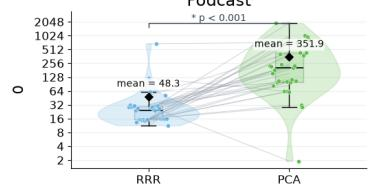

InternaRRsquantile saturation sensitivity: inimum quantile peak correlation fMRI  
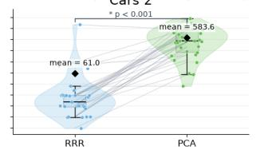

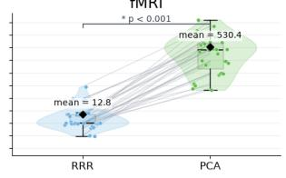

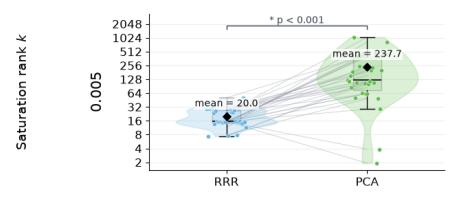

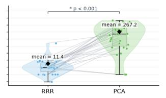

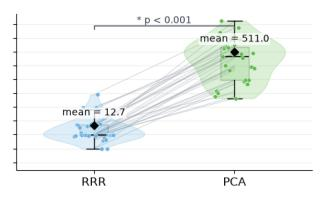

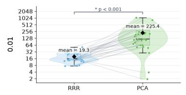

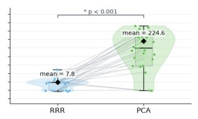

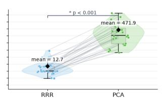  
Figure 12: Sensitivity analysis of how saturation rank changes as you change the floor correlation for a quantile to be included in the saturation rank computation. Using a floor of 0 causes some model layers to gain ∼ 1000 saturation rank. Increasing to 0.005 leads to more reasonable results which we choose as this is so close to a noise response.