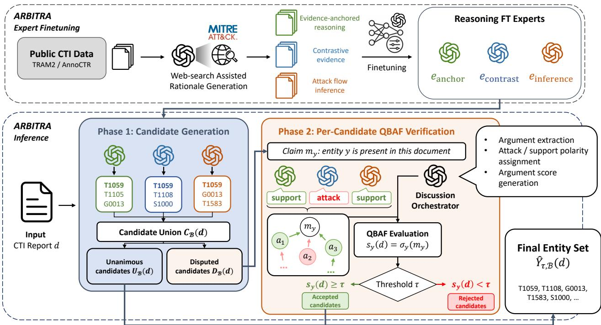
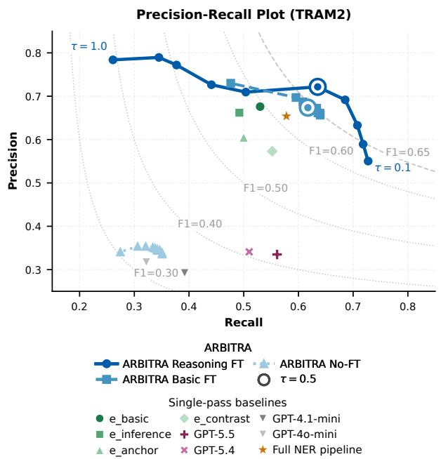
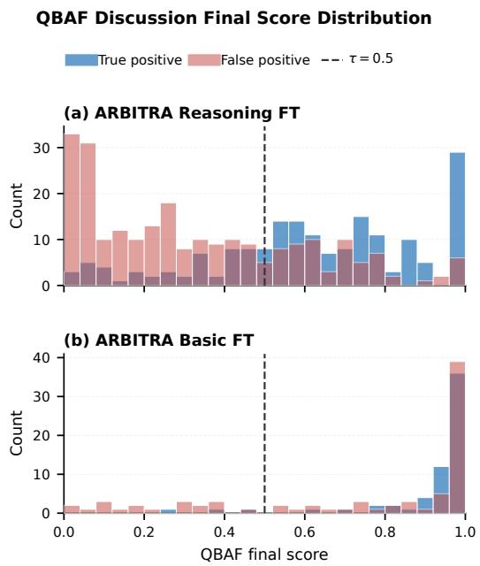
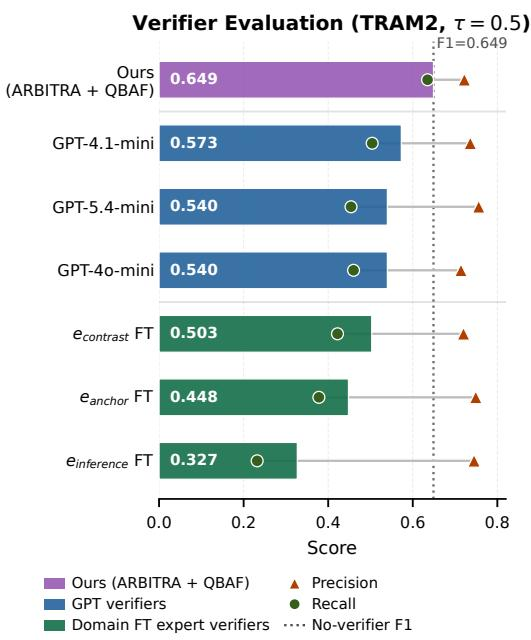
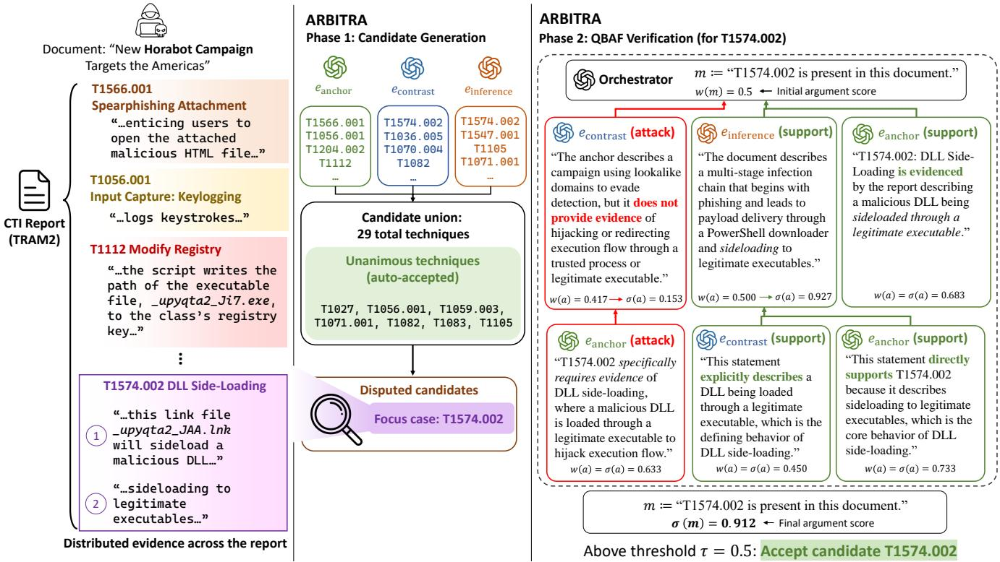

# ARBITRA: Robust Document-Level ATT&CK Extraction via Multi-Expert Argumentation

Youngjin Jin Seungwon Shin School of Electrical Engineering, KAIST {ijinjin,claude}@kaist.ac.kr

## Abstract

Cyber threat intelligence (CTI) reports describe adversary behavior in natural language, but converting them into structured MITRE ATT&CK mappings remains difficult: existing methods decompose reports to sentence-level granularity for extraction, while modern LLMs can work with full reports in a single pass but with noticeable performance degradation. We present ARBITRA, which orchestrates multiple rolespecialized LLM experts that propose candidate ATT&CK entities from the full report, which are then verified through a per-candidate quantitative bipolar argumentation framework (QBAF) grounded in document evidence and rationales. We additionally construct reasoning-specialized corpora for finetuning so experts can act as effective participants during this verification process. Across ATT&CK extraction benchmarks, ARBITRA reaches a stronger precision-oriented operating point than sentence-level pipelines, recent LLM-based extraction systems, and frontier models including GPT-5.5. Under adversarial perturbations simulating conflicting TTP statements, cross-report contamination, and semantic poisoning, ARBITRA limits mean precision degradation to roughly half that of frontier-model baselines for a more robust extraction.

## 1 Introduction

Cyber threat intelligence (CTI) reports are a primary medium through which security analysts communicate adversary behavior: what an adversary did, how it operated, and what defenders should anticipate. Unlike raw indicators of compromise, CTI reports typically describe higher-level tactics, techniques, and procedures (TTPs) like persistence mechanisms, credential access, or malware capabilities. The MITRE ATT&CK framework [25] provides a widely adopted ontology for representing these behaviors and underpins downstream workflows such as threat hunting, detection engineering, incident triage, and threat attribution.

This practical utility of CTI, however, depends on whether analysts can convert long, unstructured reports into reliable structured knowledge. A single report may interleave concrete behavioral evidence, background description of an actor, analyst hypotheses, mitigation guidance, or even unrelated or contradictory statements. Mapping such text to ATT&CK techniques is therefore not a keyword-recognition problem: a system must determine whether a technique is genuinely supported by report-level evidence.

Prior work has made substantial progress through rulebased systems, NER pipelines, graph construction, and learning-based approaches such as TTPDrill, AttacKG, and TTPXHunter [12, 20, 33]. However, a recent USENIX Security SoK [3] re-evaluated under a unified protocol on public resources such as TRAM2 [27] and AnnoCTR [18] and found a performance ceiling no existing approach overcomes, with traditional NLP pipelines outperforming generative LLM approaches in realistic open-set settings. The SoK attributes this to ontology ambiguity: many ATT&CK techniques differ only in intent and cannot be distinguished from a single sentence, yet the systems that perform well remain sentencecentric. Reading the full document is necessary but not sufficient: full-document LLM prompting and even frontier LLMs over-accept plausible but unsupported techniques and degrade further on misleading or contaminated content [3, 24]. Since false positives misdirect analyst attention and pollute detection systems, a practical extractor must read at document level, recover performance lost from single-pass prompting, and accept a candidate only when it is grounded in report evidence and contestable by an analyst.

To this end, we introduce ARBITRA (Argumentative Reasoning with Bipolar Inference for Threat Report Analysis), a document-level extraction system built around argumentation-based multi-expert verification. ARBITRA is inspired by ARGORA [15], which provides a general mechanism for structured multi-expert argumentation, but is not well-suited for document-level, multi-label extraction. AR-BITRA reformulates the problem as a two-phase candidateverification procedure: multiple role-specialized LLM experts first read the full report and independently propose candidate MITRE entities, favoring coverage through expert diversity;

each non-unanimous candidate is then recast as a claim for which experts generate supporting and attacking arguments based on their expertise, and the resulting quantitative bipolar argumentation framework (QBAF) decides acceptance. ARBITRA is thus a candidate-level verification layer atop document-level expert extraction.

A challenge with this design is that generic LLM experts may not be effective participants in these argumentation-based verification settings, as experts trained only to emit final la bels produce justifications that are shallow or poorly aligned. We therefore construct reasoning-specialized supervised finetuning corpora from the training splits of the TRAM2 and AnnoCTR data and compare them against answer-only finetuning to test whether rationale-rich experts are beneficial for downstream candidate verification. Finally, we evaluate robustness under adversarial CTI conditions designed to test whether an extractor preserves precision when a report contains plausible but unsupported or conflicting evidence.

In summary, our contributions are as follows:

• We formulate document-level ATT&CK extraction as a precision-oriented candidate-verification problem, motivated by the limitations of sentence-centric pipelines and naive full-document LLM extraction.

• We introduce ARBITRA, a two-phase document-level extraction framework that pairs full-report expert candidate generation with QBAF-based verification.

• We construct reasoning-based fine-tuned experts to leverage the benefits of the structured multi-expert verification design of ARBITRA.

• We evaluate ARBITRA against frontier LLMs (e.g., GPT-5.5), the SoK’s best-performing sentence-level pipeline, and three recent extraction systems (TTPX-Hunter, CTINexus, TTPrint). ARBITRA is the only system to surpass the sentence-level pipeline on all three metrics on TRAM2 and attains the highest precision on both benchmarks.

• We introduce an adversarial CTI robustness evaluation suite and show that ARBITRA retains extraction precision under these conditions more reliably than frontiermodel baselines.

## 2 Related Work

Automated TTP Extraction from CTI Reports. Early automated TTP extraction systems recovered security behavior from unstructured CTI text using linguistic patterns, domain knowledge, and graph construction: TTPDrill combines NLP with security-specific inference [12], AttacKG builds technique knowledge graphs from reports [20], and TTPXHunter aggregates sentence–TTP predictions to the report level [33].

The recent USENIX Security SoK by Büchel et al. [3] reimplements the core methods of these systems under a unified protocol and reaches conclusions that shape the motivation for our work: existing approaches hit a performance ceiling; classical NLP pipelines outperform embedding-based and generative LLM methods once the technique set is realistic and open; and the limiting factor is ontology ambiguity that cannot be resolved from sentence-level granularity. We adopt the SoK’s findings and target the document-level, open-set regime in which it finds generative approaches weakest.

LLM-Based CTI Extraction. LLMs are an appealing alternative to sentence-level pipelines because they read longer contexts and emit structured outputs directly. CTIBench [1] and CTIConnect [6] evaluate existing LLMs on CTI tasks and confirm that frontier models lead most ATT&CK-oriented extraction. System-level efforts such as CTINexus [4] and ThreatPilot [43] use in-context learning and LLM-driven pipelines to turn unstructured reports into structured intelligence. Longcontext extraction however also introduces new failure modes: LLMs can be distracted by irrelevant context [36], and recent evaluations find LLMs inconsistent and overconfident on real-size reports which lead to precision degradation [24]. The SoK’s document-level experiments suggest a large recall degradation compared to sentence-level granularity [3]. AR-BITRA addresses both sides of this trade-off. A union over role-specialized experts recovers the recall that a single pass loses, and per-candidate argumentation filters the union so that precision is also retained.

A recent, concurrent work called TTPrint [5] decomposes a report into atomic behaviors, anchors each to a lexically localized evidence span, and accepts candidate techniques whose single-verifier confidence exceeds a threshold. AR-BITRA shares the premise that candidate generation and acceptance should be decoupled, but differs in how acceptance is decided: TTPrint scores each candidate using a single LLM verifier, whereas ARBITRA adjudicates each disputed candidate through structured argumentation from multiple role-specialized experts over the full document. Our ablation in Section 5.6 shows that collapsing this step to a single-call verifier degrades F1 by up to 15 pp.

Reasoning Fine-Tuning. Reasoning-elicitation based works such as chain-of-thought (CoT) [42], instruction tuning [30, 41], and rationale-based training [11, 44] show that generation or supervision of intermediate steps rather than outcomes alone can matter for reliability [22]. These motivate the hypothesis that even small models can become stronger task specialists when trained to expose the reasoning process, not only the final answer. We raise a narrower question: does reasoning supervision help when the same model also participates in argumentation? ARBITRA studies this by constructing both answer-only and reasoning-specialized fine-tuning datasets from TRAM2 and AnnoCTR; to our knowledge this comparison has not been isolated inside a structured multi-expert verification pipeline.

Multi-LLMs and Multi-Agents. A growing body of work improves LLM reliability by sampling multiple reasoning paths or coordinating multiple agents: self-consistency aggregates several CoT paths by voting [40]; multi-agent debate has models critique one another [8, 21]; and multi-expert prompting and mixture-of-agents use multiple specialized or layered calls [23, 39]. Most recently, ARGORA organizes multi-experts into explicit argumentation graphs for decisionlevel reasoning and diagnostics [15]. These methods motivate expert diversity but mostly aggregate at the answer level or rely on unstructured transcripts. ARGORA is a closer precursor but its setting assumes a small set of competing alternatives rather than the verification setting necessary for document-level, multi-label ATT&CK extraction. As such, ARBITRA allows experts to disagree on each technique without invalidating the rest of their output.

Adversarial CTI. Security text is not guaranteed to be clean: false-flag artifacts complicate attribution [37], LLMs can generate fake CTI-like text that poisons downstream defenses [32], models are easily distracted by irrelevant context [36], and cybersecurity NER systems are vulnerable to textual adversarial attacks [14]. Our adversarial evaluation is designed around these observations and assesses robustness on realistic forms of CTI noise and manipulation, and is the first work to define an adversarial CTI threat model for MITRE extraction and instantiate full-report perturbations.

## 3 Problem Definition

## 3.1 Background and Motivation

Precision and Contestability. False positives carry a heavier cost beyond missed recall in CTI: an unsupported technique can send analysts after irrelevant behaviors or pollute a knowl edge base that later systems treat as trusted input. This motivates a precision-oriented view of document-level extraction. One such method would be to allow uncertain candidates to undergo a focused verification step. This verification process should be contestable; simple judge-based verification mechanisms fall short of these requirements. A single LLM confidence score is uncalibrated and opaque: it collapses all considerations into a scalar without separating evidence in favor of a mapping from evidence against it, and it provides no handle for an analyst to inspect which evidence drove the decision. We describe this as one of the key challenges to solve in Section 3.4, and design our methodology around this challenge as shown in Section 4.

Noisy and Adversarial CTI Inputs. CTI reports can carry false or misleading technique attributions (as mentioned in Section 2), can be contaminated by passages aggregated from unrelated incidents, and can describe genuine behavior in paraphrased language that suppresses entity recognizability. We formalize these degradation classes as a threat model in Section 3.3 and construct adversarial variants in Section 6.

## 3.2 Task: Document-Level CTI Extraction

We study document-level ATT&CK entity extraction from CTI reports. Given a full CTI report d, the task is to produce a set of normalized MITRE ATT&CK entity labels $\widehat { Y } _ { \mathcal { B } } ( d )$ that approximates the gold label set $Y _ { \mathcal { B } } ( d )$ under a benchmarkspecific label space $\mathcal { Y } _ { \mathcal { B } }$ . We use MITRE ATT&CK entity to refer collectively to the benchmark-specific label types considered in this paper: ATT&CK techniques and sub-techniques, tactics, groups, and software.

## 3.3 Threat Model: Adversarial CTI Reports

Our threat model is grounded in documented CTI cases of adversarial manipulation and ordinary noise. The 2018 Olympic Destroyer operation is a canonical example: the Sandworm-attributed malware was deliberately crafted to resemble Lazarus Group samples as a false flag intended to misdirect attribution [9, 38]. More recently, adversarial rewrit ing can suppress ATT&CK-recognizable cues while preserving the underlying behavior [14]. Similar degradation also arises non-adversarially through feed aggregation, analyst errors, and reporting-style variation. We taxonomize three such perturbation types below.

Target system. The target system is an automated ATT&CK extraction pipeline that ingests CTI reports and outputs structured ATT&CK entity sets for downstream use such as intrusion detection. The pipeline is exposed to the content of each ingested report and trusts that report as its primary input.

Adversary goal. The adversary aims to degrade the quality of the extraction output by manipulating CTI reports. We consider two complementary degradation objectives: falsepositive injection (⊕ FP), in which the adversary causes the extractor to accept ATT&CK entities that are not supported by the underlying evidence; and true-positive suppression (⊖ TP), in which the adversary causes the extractor to miss entities supported by the original document.

Adversary capabilities. The adversary can modify CTI report content before it enters the extraction pipeline. The original incident and its gold label set are left unchanged; only the document text is modified.

• Conflicting TTP statements (⊕ FP). The adversary inserts plausible text that attributes adversary behavior to unsupported ATT&CK entities. This models false-flag artifacts, deliberate misattribution, or the injection of fabricated analysis into shared threat intelligence [32, 37].

• Cross-report contamination (⊕ FP). The adversary interleaves passages from unrelated CTI documents into the target report. This models noisy aggregation from heterogeneous threat feeds or manipulation of shared intelligence repositories [16].

• Semantic poisoning (⊖ TP). The adversary paraphrases or rewrites entity-signaling language in labeled reports. This models adversarial obfuscation of ATT&CKrecognizable phrasing [14] or distribution shift between reporting styles.

  
Figure 1: Overview of ARBITRA as described in Section 4.

Adversary knowledge. The adversary is assumed to have black-box access to the extraction system: it knows the system’s capabilities (e.g., ATT&CK-based extraction) but does not know the system’s model weights, prompts, fine-tuning data, or internal architecture. The adversary operates purely at the text level and requires no knowledge of model internals. Our threat model is scoped to realistic text-level manipulations of CTI reports that an adversary could deploy through compromised intelligence sources.

Non-adversarial occurrences. The non-adversarial instantiations of all three classes are grounded in documented CTI practice. For conflicting TTP statements, manual TTP mapping is characterized as being error prone even under careful conditions [34], and CISA’s ATT&CK mapping guidance explicitly recognizes that insufficient behavioral evidence leads to misattribution [7]. For cross-report contamination, the SolarWinds/SUNBURST campaign was labeled under at least four distinct vendor-assigned identifiers (UNC2452, NOBELIUM, Dark Halo, and SolarStorm) before attribution was consolidated [26]; an empirical study of multi-report ATT&CK extraction across 90 reports demonstrates that multi-report aggregation changes extraction behavior and up to 33.3% of misclassifications involve semantically similar techniques [10]. For semantic poisoning, reporting style varies substantially across vendors, with some using ATT&CKrecognizable terminology and others describing the same behavior in narrative or proprietary language, producing surfacelevel signal suppression indistinguishable from deliberate obfuscation.

## 3.4 Challenges

We present three challenges that prior approaches do not jointly address as follows.

(C1): Precision control under full-document extraction. When a model reads the full report and generates entity labels in a single pass, it has no mechanism to distinguish candidate discovery from candidate acceptance. Hallucinated labels are easily generated because suggestive attack patterns or terminology can all trigger an entity prediction.

(C2): Expert rationales for verification-based design. The two-phase design introduced to address (C1) requires experts to produce grounded support and attack arguments, not just final labels. LLMs trained only on label prediction produce rationales that are shallow or poorly aligned with the evidential requirements of ATT&CK mapping and are unsuited for a contestable verification step.

(C3): Robustness to adversarial report content. Under the threat model of Section 3.3, a report may contain plausible but unsupported technique claims, irrelevant ATT&CK-relevant passages, or weakened surface cues for genuinely supported techniques. An extractor that makes document-level decisions without a verification step is vulnerable to all three classes.

## 3.5 Design Goal

ARBITRA is designed to address (C1)–(C3) within a single unified framework. To address (C1), ARBITRA decouples candidate generation from candidate acceptance through a two-phase pipeline: Phase 1 builds a broad union of expert-proposed candidates, and Phase 2 subjects each nonunanimous candidate to evidence-grounded QBAF verification. To address (C2), its experts are fine-tuned on reasoningspecialized corpora that contain grounded rationales. To address (C3), the QBAF verification step provides a mechanism for rejecting candidates that cannot accumulate sufficient argumentative support from the report evidence, making the system inherently harder to mislead with adversarial content. In the rest of the paper, we mark with (C1)–(C3) the design decisions and experimental results that address each challenge to trace how each challenge is resolved.

## 4 ARBITRA

This section describes ARBITRA. An illustrated overview of ARBITRA is shown in Figure 1 for reference.

Preliminaries. We use quantitative bipolar argumentation frameworks (QBAFs) [2, 17, 31] to represent each percandidate verification discussion. QBAFs provide semantics for computing acceptance strength from structured support and attack arguments necessary for transparent, contestable candidate verification. Previous multi-expert argumentation systems such as ARGORA [15] apply QBAFs to singlechoice decision problems, where a small set of competing expert arguments is compared and one answer is selected. ARBITRA instead instantiates per-candidate QBAF verification within a multi-label document-level extraction pipeline, which requires a fundamentally different formulation in which each non-unanimous candidate is adjudicated independently. Formally, a QBAF is a tuple

$$
\begin{array} { r } { Q = \langle \mathcal { A } , R ^ { - } , R ^ { + } , w \rangle , } \end{array}\tag{1}
$$

where A is a finite set of textual arguments, $R ^ { - } \subseteq \mathcal { A } \times \mathcal { A }$ and $R ^ { + } \subseteq \mathcal { A } \times \mathcal { A }$ are directed attack and support relations, and w : $\mathcal { A }  [ 0 , 1 ]$ assigns each argument a base score. We represent each QBAF as a rooted directed tree whose edges are oriented from child to parent. For a node $^ { a , }$ let c $\mathfrak { n } ( a ) = \{ c _ { 1 } , \ldots , c _ { n } \}$ denote its children and let $\pi ( a ) \in \{ - 1 , + 1 \} ^ { n }$ denote the corresponding attack/support polarity vector.

Quantitative semantics computes a final strength $\sigma ( a ) \in$ [0,1] for every argument. Following the standard modular view of these semantics [2, 17, 31], a fixed aggregation map α combines child strengths and an influence map ι updates the parent strength:

$$
\mathfrak { O } ( a ) = \mathfrak { 1 } _ { w ( a ) } \left( \mathfrak { C } _ { \pi ( a ) } \bigl ( \mathfrak { O } ( c _ { 1 } ) , \ldots , \mathfrak { O } ( c _ { n } ) \bigr ) \right) .\tag{2}
$$

For leaves, this update reduces to $\sigma ( a ) = w ( a )$ . We use the DF-QuAD semantics in our implementation [31].

Problem Setup. Building on the document-level extraction task defined in Section 3.2, let $d \in \mathcal { D }$ denote a CTI report and let $E = \{ e _ { 1 } , \ldots , e _ { K } \}$ be the set of K experts that jointly produce the predicted entity set $\widehat { Y } _ { \mathcal { B } } ( d )$ over the benchmark label space $\mathcal { Y } _ { \mathcal { B } }$

## 4.1 Two-Phase Document-Level Extraction

ARBITRA separates extraction into two separate phases. The first phase is dedicated to candidate generation by constructing a union set of proposed candidates from each of the participating experts from the full document. The second phase is a verification step where each of the disputed candidates from the set undergoes a structured discussion between the experts, which in turn generates a QBAF to be used for the final decision.

Phase 1: candidate union generation. Each expert independently reads the full report and produces a structured response $g _ { e } ( d )$ containing candidate MITRE entities. We parse each response into a normalized candidate set

$$
C _ { e } ( d ) = \mathsf { P a r s e } ( g _ { e } ( d ) ) , \qquad e \in E ,\tag{3}
$$

where Parse(·) extracts and normalizes MITRE identifiers from the model output to the benchmark label space $\mathcal { Y } _ { \mathcal { B } }$ . The initial candidate pool is the union of all expert predictions:

$$
C _ { \mathcal { B } } ( d ) = \bigcup _ { e \in E } C _ { e } ( d ) .\tag{4}
$$

For each candidate $\boldsymbol { y } \in C _ { \mathcal { B } } ( d )$ , we compute its vote count

$$
\nu _ { y } ( d ) = \sum _ { e \in E } \mathbb { I } [ y \in C _ { e } ( d ) ] ,\tag{5}
$$

where $\mathbb { I } [ \cdot ]$ is the indicator function, equal to 1 if its argument holds and 0 otherwise. Candidates proposed by every expert are accepted directly:

$$
U _ { \mathcal { B } } ( d ) = \{ y \in C _ { \mathcal { B } } ( d ) : \nu _ { y } ( d ) = K \} .\tag{6}
$$

The remaining candidates are disputed candidates:

$$
D _ { \mathcal { B } } ( d ) = C _ { \mathcal { B } } ( d ) \backslash U _ { \mathcal { B } } ( d ) .\tag{7}
$$

This pruning is applied to reduce inference cost and reserve discussion for cases where expert disagreement makes verification informative.

Phase 2: per-candidate QBAF verification. For every disputed candidate $y \in D _ { \mathcal { B } } ( d )$ , ARBITRA constructs a separate verification discussion centered on the claim

$$
m _ { y } : = { \mathrm { ^ { * } M I T R E ~ e n t i t y ~ y ~ i s ~ p r e s e n t ~ i n ~ t h i s ~ d o c u m e n t . ^ { \circ } ~ } }\tag{8}
$$

This root argument is fixed by the system as a neutral, verifiable claim. The experts are prompted to generate support and attack arguments grounded in the report. To coordinate these outputs into a well-formed QBAF, ARBITRA employs a dedicated orchestrator LLM that acts as an overseer of the verification process: it extracts and assigns individual arguments into a support or attack polarity with respect to $m _ { y } ,$ and scores non-root arguments according to a set criterion. This yields a candidate-specific QBAF

Algorithm 1 Document-Level ATT&CK Extraction with AR-  
BITRA   
Require: Document $d ,$ experts $E = \{ e _ { 1 } , \ldots , e _ { K } \}$ , threshold τ   
Ensure: Predicted normalized entity set $\widehat { Y } _ { \tau , \mathcal { B } } ( d )$   
1: $C _ { \mathcal { B } } ( d ) \gets 0$   
2: for each expert $e \in E$ do   
3: Generate full-document response $g _ { e } ( d )$   
4: $C _ { e } ( d ) \gets \mathsf { P a r s e } ( g _ { e } ( d ) )$   
5: $C _ { \mathcal { B } } ( d ) \gets C _ { \mathcal { B } } ( d ) \cup C _ { e } ( d )$   
6: end for   
7: for each candidate $\boldsymbol { y } \in C _ { \mathcal { B } } ( d )$ do   
8: $\nu _ { y } ( d )  \textstyle \sum _ { e \in E } \mathbb { I } [ y \in C _ { e } ( d ) ]$   
9: end for   
10: $U _ { \mathcal { B } } ( d )  \{ y \in C _ { \mathcal { B } } ( d ) : \nu _ { y } ( d ) = K \}$   
11: $D _ { \mathcal { B } } ( d )  C _ { \mathcal { B } } ( d ) \backslash U _ { \mathcal { B } } ( d )$   
12: $\widehat { Y } _ { \tau , \mathcal { B } } ( d ) \gets U _ { \mathcal { B } } ( d )$   
13: for each candidate $y \in D _ { \mathcal { B } } ( d )$ do   
14: Fix root claim $m _ { y } \colon$ entity y is present in d   
15: Build $Q _ { y } = \langle \mathcal { A } _ { y } , R _ { y } ^ { - } , R _ { y } ^ { + } , w _ { y } \rangle$ with $w _ { y } ( m _ { y } ) = 0 . 5$   
16: Evaluate $Q _ { y }$ and set $s _ { y } \mathbf { \tilde { ( } } d ) \gets \pmb { \sigma } _ { y } ( m _ { y } )$   
17: if $s _ { y } ( d ) \ge \tau$ then   
18: $\hat { Y } _ { \tau , \mathcal { B } } ( d ) \gets \widehat { Y } _ { \tau , \mathcal { B } } ( d ) \cup \{ y \}$   
19: end if   
20: end for   
21: return $\widehat { Y } _ { \tau , \mathcal { B } } ( d )$

$$
\begin{array} { r } { \boldsymbol { Q } _ { y } = \langle \boldsymbol { \mathcal { A } } _ { y } , \boldsymbol { R } _ { y } ^ { - } , \boldsymbol { R } _ { y } ^ { + } , w _ { y } \rangle , \qquad m _ { y } \in \mathcal { A } _ { y } . } \end{array}\tag{9}
$$

Since $m _ { y }$ is a fixed neutral claim rather than an argument generated by the experts, we set

$$
w _ { y } ( m _ { y } ) = 0 . 5 .\tag{10}
$$

All other arguments receive orchestrator-assigned base scores. After evaluating $Q _ { y }$ under Eq. (2), the candidate score is the root strength

$$
s _ { y } ( d ) : = \sigma _ { y } ( m _ { y } ) .\tag{11}
$$

Then, the final output combines unanimous candidates with disputed candidates whose verification score exceeds a threshold $\tau \in [ 0 , 1 ]$ :

$$
\widehat { Y } _ { \tau , \mathscr { B } } ( d ) = U _ { \mathscr { B } } ( d ) \cup \{ y \in D _ { \mathscr { B } } ( d ) : s _ { y } ( d ) \geq \tau \} .\tag{12}
$$

The threshold τ controls the operating point for precision (C1). Algorithm 1 provides a complete step-by-step summary of the full extraction procedure.

## 4.2 Reasoning-Based Expert Construction

ARBITRA requires experts that can both propose candidates and justify them during verification. Generic LLM justifications, however, may be shallow or poorly aligned with the evidential requirements of ATT&CK mapping (C2). We therefore construct supervised fine-tuning corpora containing evidence-grounded rationales, following prior work on reasoning supervision [11, 22, 30, 44]. ARBITRA utilizes three experts, each targeting a failure mode of naive documentlevel extraction: (i) accepting plausible techniques without direct textual support; (ii) confusing semantically adjacent techniques; and (iii) missing techniques whose evidence is distributed across multiple non-contiguous passages.

The public training splits of TRAM2 and AnnoCTR provide manually annotated gold labels but no detailed explanations. We therefore use a teacher model $( M _ { \mathrm { t e a c h } } =$ GPT-5.4-mini) to generate rationales conditioned on each gold entity. For each training context $\boldsymbol { x } \in \mathcal { X } _ { \mathcal { B } } ^ { \mathrm { t r a i n } }$ and gold entity $y \in Y _ { \mathcal { B } } ( x )$

$$
r _ { y } ( x ) = M _ { \mathrm { t e a c h } } ( x , y ; \Pi _ { \mathrm { j u s t } } ) .\tag{13}
$$

The teacher is prompted to justify the entity using visible report evidence. Web search is enabled to retrieve current ATT&CK definitions and behavioral descriptions when generating these rationales [28].

Reasoning-Based Experts. Each expert uses a distinct response format corresponding to one of the failure modes above.

The Evidence-Anchored Grounding Expert $( e _ { \mathrm { a n c h o r } } )$ is motivated by extractive rationale methods that ground predictions in input spans [19]. It confirms a technique only when an exact document phrase can be quoted as an anchor, followed by a short justification; rejected techniques explicitly state that no direct textual anchor exists.

The Contrastive Evidence Expert $( e _ { \mathrm { c o n t r a s t } } )$ builds on contrastive explanation, where a prediction is justified relative to plausible alternatives [13]. In addition to a verbatim anchor, it explicitly rules out a similar alternative and explains why the evidence does not support it. These alternatives are sampled from sibling techniques representing different mechanisms.

The Attack-Flow Inference Expert $( e _ { \mathrm { i n f e r e n c e } } )$ is motivated by prior CTI work that reconstructs causal and temporal attack behavior from threat reports [35]. It first reconstructs the attack progression in chronological and causal order without technique labels, describing attacker actions, affected resources, and dependencies. Gold techniques are then mapped to the reconstructed phases with explicit justification.

The three experts jointly form

$$
E _ { \mathrm { F T } } = \{ e _ { \mathrm { a n c h o r } } , e _ { \mathrm { c o n t r a s t } } , e _ { \mathrm { i n f e r e n c e } } \} .\tag{14}
$$

Their complementary evidential perspectives provide epistemic diversity during verification: support and attack arguments for the same candidate arise from distinct reasoning structures rather than near-duplicate reasoning styles. We empirically evaluate this property in our experiments.

Backbone selection. Expert backbones are selected per benchmark (TRAM2 and AnnoCTR) through a pilot singlepass evaluation on the training split. GPT-4.1-mini performs consistently better on AnnoCTR, so all three experts use it (‡). On TRAM2, GPT-4o-mini and GPT-4.1-mini are both competitive; the best-performing pool uses one GPT-4.1-mini and two GPT-4o-mini experts (†).

## 4.3 Adversarial CTI Perturbations

To evaluate robustness beyond clean benchmark data, we construct three adversarial variants of the TRAM2 evaluation split, one for each of the adversary capability classes from Section 3.3 (C3). The gold label set is preserved in all three cases, so performance changes measure extractor fragility to text-level manipulation.

Conflicting TTP statement injection: Insert plausible analyst-style statements that mention the same malware, actor, or campaign context but attribute behavior to techniques not present in the gold label set. This tests whether a model accepts plausible but unsupported technique claims.

Cross-report contamination: Interleave unlabeled sentences sampled from unrelated TRAM2 reports. This tests whether an extractor is distracted by contaminated CTI context.

Targeted semantic poisoning: Rewrite labeled sentences to preserve the same malicious behavior while weakening entitysignaling keywords, tool names, or phrases. This tests whether the model can recover techniques from behavioral meaning rather than lexical cues alone.

The implementation for the three adversarial perturbations is similar to that of Section 4.2, where we use a teacher model to generate these perturbations.

## 5 Evaluation: MITRE Entity Extraction

We evaluate ARBITRA on two public CTI extraction benchmarks. Our evaluation addresses six research questions: RQ1 (Effectiveness): Does ARBITRA improve document-level extraction over sentence-level and frontier-LLM baselines? RQ2 (Reasoning supervision): Does reasoning-based fine tuning improve multi-expert verification beyond answer-only fine-tuning, even when it does not improve standalone extraction? RQ3 (Existing systems): How does ARBITRA compare with recent CTI extraction systems under a common ATT&CK output space and comparable backbones? RQ4 (Cost analysis): What runtime and API-cost overhead does multi-expert verification incur? RQ5 (Score discriminability): Does reasoning supervision help QBAF verification distinguish supported from unsupported candidates? RQ6 (Verification mechanism): Is structured multi-expert QBAF verification more effective than a single-call LLM verifier?

## 5.1 Experimental Setup

Datasets and metrics. We evaluate on TRAM2 and AnnoCTR. TRAM2 provides technique-level annotations for CTI reports [27]; following the split used by the SoK [3], we evaluate on 31 held-out reports. As the original TRAM2 dataset is sentence-level, we convert the dataset to documentlevel by merging all sentences from the same document to a single datapoint and taking the union of sentence-level annotations as the gold label. AnnoCTR contains techniques, tactics, threat groups, and software [18]; we use the corresponding SoK split of 34 held-out documents and normalize sub-techniques to their parent techniques for scoring. Additional dataset statistics are provided in Appendix A.1. We report document-level macro-averaged precision, recall, and F1 using exact normalized ATT&CK identifier matches.

Baselines and configurations. Our primary comparison (Table 1) includes: (i) the strongest sentence-level NER pipeline from the unified SoK evaluation [3]; (ii) single-pass fulldocument GPT-4o-mini, GPT-4.1-mini, GPT-5.4, and GPT-5.5 baselines [29]; (iii) standalone answer-only $( e _ { \mathrm { b a s i c } } )$ and reasoning-specialized $( e _ { \mathrm { a n c h o r } } , e _ { \mathrm { c o n t r a s t } } , e _ { \mathrm { i n f e r e n c e } } )$ fine-tuned experts; and (iv) ARBITRA with No-FT (3 non-finetuned LLM backbone experts), Basic-FT (3 $e _ { \mathrm { b a s i c } }$ experts), and Reasoning-FT (eanchor, econtrast, einference) expert pools. As described in Section 4.2, the Reasoning-FT pool uses one GPT-4.1-mini and two GPT-4o-mini backbones on TRAM2, and three GPT-4.1-mini backbones on AnnoCTR. All QBAFs use DF-QuAD semantics [31], all LLM calls use temperature 0, and the default operating threshold is $\tau = 0 . 5 .$ Across five repetitions of ARBITRA Reasoning FT on TRAM2, F1 is 0.649 ± 0.015 (95% CI: [0.631,0.668]).

## 5.2 Extraction Performance

RQ1: Overall effectiveness. Table 1 shows that stronger single-pass frontier models improve recall on TRAM2 but do not resolve its precision deficit: GPT-5.5 reaches R = 0.561 but only $P = 0 . 3 3 5 ,$ , compared with $P = 0 . 6 5 4$ for the sentence-level NER pipeline. ARBITRA (Reasoning FT) reaches $P / R / F 1 = 0 . 7 2 2 / 0 . 6 3 5 / 0 . 6 4 9$ , surpassing the NER pipeline on all three metrics and GPT-5.5 by 23.8 pp F1. The results also suggest that per-candidate verification preserves a substantially stronger precision-oriented operating point (C1).

AnnoCTR presents a complementary transfer setting. Here, ARBITRA (Reasoning FT) reaches the highest precision $( P = 0 . 5 9 3 )$ , although GPT-5.5 retains higher recall and F1. This gap is consistent with the benchmark’s training–test label mismatch: 15.5% of techniques, 26.1% of software, and 53.8% of threat groups present in the test set are never seen during fine-tuning, whereas TRAM2’s test labels are fully covered by the training (fine-tuning) set. Consequently, finetuned experts face a recall ceiling for unseen entities.

RQ2: Benefits of reasoning supervision. The benefit of reasoning supervision emerges most clearly inside ARBITRA rather than from standalone extraction. On TRAM2, Reasoning FT improves F1 by 10.3 pp over the strongest standalone reasoning expert, compared with 4.2 pp for Basic FT over e . On AnnoCTR, the same comparison yields +9.2 pp for Reasoning FT, whereas Basic FT decreases F1 by 1.0 pp. Thus, reasoning-based experts need not be stronger standalone classifiers to be more useful participants in evidencegrounded QBAF verification (C2).

Table 1: Document-level extraction results on TRAM2 and AnnoCTR (†one GPT-4.1-mini and two GPT-4o-mini experts; ‡three GPT-4.1-mini experts). GPT-5.4 and GPT-5.5 are document-level baselines only (not used as ARBITRA experts). Deltas (in pp – percentage points) below each ARBITRA row are relative to the corresponding standalone expert: GPT-4o-mini for No-FT, ebasic for Basic FT, and the best-F1 reasoning expert $( e _ { \mathrm { i n f e r e n c e } } )$ for Reasoning FT. Bold: best per column.
<table><tr><td>System</td><td>Setting</td><td colspan="3">TRAM2†</td><td colspan="3">AnnoCTR</td></tr><tr><td></td><td></td><td>P</td><td>R</td><td>F1</td><td>P</td><td>R</td><td>F1</td></tr><tr><td colspan="8">Sentence-level baseline</td></tr><tr><td>Full NER pipeline [3]</td><td>Sentence-level extraction</td><td>0.654</td><td>0.578</td><td>0.614</td><td>0.435</td><td>0.709</td><td>0.539</td></tr><tr><td colspan="8">Document-level LLM baselines</td></tr><tr><td>GPT-4o-mini</td><td>Document-level extraction</td><td>0.317</td><td>0.322</td><td>0.299</td><td>0.293</td><td>0.256</td><td>0.263</td></tr><tr><td>GPT-4.1-mini</td><td>Document-level extraction</td><td>0.292</td><td>0.392</td><td>0.319</td><td>0.340</td><td>0.432</td><td>0.362</td></tr><tr><td>GPT-5.4</td><td>Document-level extraction</td><td>0.341</td><td>0.510</td><td>0.401</td><td>0.575</td><td>0.653</td><td>0.598</td></tr><tr><td>GPT-5.5</td><td>Document-level extraction</td><td>0.335</td><td>0.561</td><td>0.411</td><td>0.528</td><td>0.743</td><td>0.603</td></tr><tr><td colspan="8">Single fnetuned expert instances</td></tr><tr><td>ebasic</td><td>Basic FT</td><td>0.676</td><td>0.530</td><td>0.577</td><td>0.541</td><td>0.515</td><td>0.512</td></tr><tr><td>eanchor</td><td>Reasoning FT</td><td>0.605</td><td>0.500</td><td>0.503</td><td>0.535</td><td>0.336</td><td>0.396</td></tr><tr><td>econtrast</td><td>Reasoning FT</td><td>0.573</td><td>0.552</td><td>0.534</td><td>0.580</td><td>0.300</td><td>0.379</td></tr><tr><td>einference</td><td>Reasoning FT</td><td>0.662</td><td>0.492</td><td>0.546</td><td>0.490</td><td>0.398</td><td>0.424</td></tr><tr><td colspan="8">Multi-expert orchestration (ours)</td></tr><tr><td colspan="8">Expert pool: GPT-4o-mini / GPT-4.1-mini</td></tr><tr><td>ARBITRA</td><td>No-FT (3× GPT-4o-mini)</td><td>0.348 +3.1 pp</td><td>0.342 +2.0pp</td><td>0.327 +2.8 pp</td><td>0.350 +5.7 pp</td><td>0.449 +19.3 pp</td><td>0.357 +9.4 pp</td></tr><tr><td>ARBITRA</td><td>Basic FT</td><td>0.674 −0.2pp</td><td>0.617 +8.7pp</td><td>0.619 +4.2pp</td><td>0.565 +2.4pp</td><td>0.483 -3.2pp</td><td>0.502 -1.0pp</td></tr><tr><td>ARBITRA</td><td>Reasoning FT</td><td>0.722 +6.0pp</td><td>0.635 +14.3 pp</td><td>0.649 +10.3pp</td><td>0.593 +10.3pp</td><td>0.477 +7.9pp</td><td>0.516 +9.2 pp</td></tr></table>

Figure 2 further shows that τ provides explicit precision– recall tradeoff control: Reasoning FT traces the strongest frontier among the ARBITRA configurations, moving from high-precision unanimous acceptance toward higher recall as τ decreases. Appendix A.2 further evaluates expert-pool composition.

## 5.3 Comparison with Existing CTI Systems

In order to answer RQ3, we next compare ARBITRA against three recent CTI-specific extraction systems that represent complementary designs: TTPXHunter [33], a supervised sentence-level TTP classifier; CTINexus [4], an LLM-based cybersecurity knowledge-graph construction pipeline; and TTPrint [5], a document-level LLM pipeline that separates technique proposal from evidence-grounded verification. Because these systems expose different output spaces, we evaluate their largest directly comparable target: ATT&CK techniques. TTPXHunter and TTPrint are designed around ATT&CK technique prediction rather than the broader tactic, group, and software labels included in AnnoCTR. CTINexus supports broader cybersecurity ontologies, but produces entity–relation graphs rather than ATT&CK identifiers, so we add a fixed LLM bridge that maps its graph output to target techniques.

  
Figure 2: TRAM2 precision–recall curve as τ varies from 1.0 to 0.1. Fixed points denote single-pass baselines. ISO-F1 contours use aggregate precision/recall, whereas Table 1 reports document-level macro-F1, so the values need not coincide.

Table 2: Document-level technique-only extraction against recent CTI systems and LLMs. CTINexus uses our ATT&CKmapping bridge; TTPrint is reimplemented from its published prompts. We report matched-backbone, headline-backbone, and best-performing Reasoning-FT variants (eanchor, econtrast, $e _ { \mathrm { i n f e r e n c e } } )$ for each applicable system. Bold: best per column among existing CTI systems and ARBITRA; italics: document-level LLM scores exceeding ARBITRA. Gray cells represent score from the best-performing backbone variant for that specific system.
<table><tr><td rowspan="2">System</td><td rowspan="2">Backbone</td><td colspan="3">TRAM2</td><td colspan="3">AnnoCTR (techniques only)</td></tr><tr><td>P</td><td>R</td><td>F1</td><td>P</td><td>R</td><td>F1</td></tr><tr><td colspan="8">Document-level LLM baselines</td></tr><tr><td>Single-pass prompting</td><td>GPT-4o-mini</td><td>0.317</td><td>0.322</td><td>0.299</td><td>0.501</td><td>0.302</td><td>0.354</td></tr><tr><td>Single-pass prompting</td><td>GPT-5.5</td><td>0.335</td><td>0.561</td><td>0.411</td><td>0.648</td><td>0.651</td><td>0.635</td></tr><tr><td colspan="8">Existing CTI extraction systems</td></tr><tr><td>TTPXHunter [33]</td><td>SecureBERT (finetuned)</td><td>0.245</td><td>0.531</td><td>0.328</td><td>0.220</td><td>0.356</td><td>0.265</td></tr><tr><td>CTINexus [4] + bridge</td><td>GPT-4o-mini</td><td>0.355</td><td>0.211</td><td>0.246</td><td>0.307</td><td>0.213</td><td>0.229</td></tr><tr><td>CTINexus [4] + bridge</td><td>GPT-4.1</td><td>0.282</td><td>0.141</td><td>0.168</td><td>0.298</td><td>0.195</td><td>0.195</td></tr><tr><td>CTINexus [4] + bridge</td><td> $e _ { \mathrm { c o n t r a s t } } ^ { \mathrm { ( T R A M 2 ) } } / e _ { \mathrm { c o n t r a s t } } ^ { \mathrm { ( A n n o C T R ) } }$ </td><td>0.326</td><td>0.196</td><td>0.228</td><td>0.364</td><td>0.222</td><td>0.256</td></tr><tr><td>TTPrint [5]</td><td>GPT-4o-mini</td><td>0.466</td><td>0.476</td><td>0.447</td><td>0.602</td><td>0.368</td><td>0.426</td></tr><tr><td>TTPrint [5]</td><td>GPT-40</td><td>0.484</td><td>0.582</td><td>0.494</td><td>0.521</td><td>0.442</td><td>0.447</td></tr><tr><td>TTPrint [5]</td><td> $e _ { \mathrm { a n c h o r } } ^ { \mathrm { ( T R A M 2 ) } } / e _ { \mathrm { c o n t r a s t } } ^ { \mathrm { ( A n n o C T R ) } }$ </td><td>0.574</td><td>0.278</td><td>0.338</td><td>0.690</td><td>0.400</td><td>0.487</td></tr><tr><td colspan="8">Multi-expert orchestration (ours)</td></tr><tr><td>ARBITRA (Reasoning FT)</td><td> $e _ { \mathrm { a n c h o r } } + e _ { \mathrm { c o n t r a s t } } + e _ { \mathrm { i n f e r e n c e } }$ </td><td>0.722</td><td>0.635</td><td>0.649</td><td>0.711</td><td>0.476</td><td>0.554</td></tr></table>

For backbone fairness, we evaluate CTINexus with GPT-4.1 as a cost-efficient substitute for GPT-4, its strongest reported backbone, and with GPT-4o-mini for a matched-backbone setting. As TTPrint does not provide a public implementation at the time of our evaluation, we perform a best-effort reimplementation following its described pipeline and published prompt templates using GPT-4o, its best-performing reported backbone, and GPT-4o-mini. We additionally instantiate both LLM-based pipelines with our Reasoning-FT experts to test whether ARBITRA’s gains persist when competing architectures receive the same domain-specialized models.

RQ3: Comparison with existing systems. The baseline comparison results are shown in Table 2. ARBITRA outperforms all three CTI systems on both datasets across all metrics. On TRAM2, it reaches F1 = 0.649, 15.5 pp above the strongest TTPrint configuration (0.494). On technique-only AnnoCTR, ARBITRA reaches $P / R / F 1 = 0 . 7 1 1 / 0 . 4 7 6 / 0 . 5 5 4 ;$ ; providing CTINexus and TTPrint with our Reasoning-FT experts does not close the gap, indicating that the improvement is not explained by domain fine-tuning alone.

Table 3: Per-document median runtime and output-token API cost on the TRAM2 evaluation (over 31 documents).
<table><tr><td>System</td><td>Output tok.</td><td>Runtime</td><td>Output cost</td></tr><tr><td>GPT-5.4</td><td>2,865</td><td>43.6s</td><td>$0.0430</td></tr><tr><td>GPT-5.5</td><td>2,534</td><td>41.1s</td><td>$0.0760</td></tr><tr><td>ARBITRA</td><td>26,513</td><td>146.0s</td><td>$0.0214</td></tr></table>

Note. The ARBITRA total includes three Reasoning-FT expert calls and the orchestrator. Using raw per-token billing rates, this puts ARBITRA at approximately 50% of GPT-5.4 and 28% of GPT-5.5’s per-document output cost despite producing more output tokens (as of August 2026).

## 5.4 Cost Analysis

RQ4: Cost analysis. Table 3 reports per-document runtime and output-token API cost on TRAM2. We use outputtoken rather than total token cost because ARBITRA repeatedly reuses long report and instruction prefixes across candidate discussions; shared input prefixes can benefit from API prompt caching, making input cost dependent on cachehit behavior and deployment details [29]. Output tokens are unaffected by prompt-prefix caching and therefore provide a more stable comparison of marginal generation cost.

Although ARBITRA produces substantially more output through multi-expert verification, its median output cost is \$0.0214 per report, approximately 50% of GPT-5.4 (\$0.0430) and 28% of GPT-5.5 (\$0.0760), because its expert backbones have substantially lower per-token rates. The trade-off is latency: ARBITRA requires 146.0s per report versus 41– 44s for the frontier single-pass models, largely due to percandidate discussions. For batch-oriented CTI extraction, this yields a practical trade-off of increased latency for substantially lower frontier-model output cost and stronger precisionoriented extraction performance.

  
Figure 3: QBAF scores for disputed TRAM2 candidates under Reasoning FT and Basic FT. TP/FP denote candidates that do/do not match a gold label; the dashed line marks $\tau = 0 . 5 .$

## 5.5 QBAF Score Discriminability Under Reasoning vs. Answer-Only Fine-Tuning

RQ5 (Score discriminability): Having answered RQ1–RQ4, we examine why reasoning-specialized experts and QBAF verification are effective together. Figure 3 shows a clear difference between the reasoning-based and answer-only finetuning methods. With Reasoning FT, gold-positive candidates concentrate at higher QBAF scores while unsupported candidates shift toward lower scores, making τ = 0.5 an effective filter. Under Basic FT, this separation largely collapses, with many unsupported candidates receiving scores near 1. This is consistent with reasoning-specialized experts providing evidence-specific support and attack arguments that the orchestrator can score discriminatively, whereas answer-only supervision provides weaker evidence for verification. Thus, reasoning supervision is valuable not merely for standalone extraction, but specifically for producing useful arguments within ARBITRA (C2).

## 5.6 Expert QBAF vs. Single-Call Verification

RQ6 (Verification mechanism): In this section, we ask if structured multi-expert QBAF verification is more effective than assigning each candidate to a single LLM verifier.

  
Figure 4: TRAM2 verification results at $\tau = 0 . 5$ with the candidate union phase fixed. Only the verification phase varies between ARBITRA’s QBAF and single-call generic or domainfinetuned LLM verifiers.

This ablation also isolates an important architectural distinction from TTPrint [5]. TTPrint ultimately assigns each proposed technique to a single LLM verifier conditioned on localized evidence and its ATT&CK definition, whereas AR-BITRA adjudicates disputed candidates through arguments from multiple experts. Although this ablation is not a reproduction of TTPrint’s full pipeline (this comparison was already handled in Section 5.3), it tests a narrower scoped distinction by replacing only the QBAF verification phase with a single-call LLM-as-judge baseline [45]. We test three generic LLMs and the three Reasoning FT experts as verifiers; Figure 4 reports TRAM2, while Table 4 additionally covers No-FT and AnnoCTR settings.

Every single-verifier configuration under Reasoning FT falls below ARBITRA $( F 1 = 0 . 6 4 9 )$ : the strongest, GPT-4.1- mini, reaches $F 1 = 0 . 5 7 3$ , while domain-finetuned verifiers perform as low as 0.327. The gap is predominantly recall, indicating that single verifiers reject supported candidates despite maintaining high precision. Table 4 further shows that this advantage largely disappears without fine-tuning, but becomes substantial with Reasoning FT: against GPT-4o-mini verification, QBAF gains 10.9 pp F1 on TRAM2 and 3.8 pp on AnnoCTR, and gains 14.6/2.1 pp when compared with the best reasoning-expert verifier. Together with RQ5, these results show that ARBITRA benefits from the combination of evidence-rich expert reasoning and structured multi-expert verification, rather than either component alone (C2).

Table 4: Ablation of the Phase 2 verification mechanism on TRAM2 and AnnoCTR: per-candidate QBAF Discussion (ARBITRA) vs. a single Verifier LLM. Conditions are detailed in the section headers; ARBITRA (QBAF) Reasoning FT values in conditions 2 and 3 are identical and repeated for direct comparison. ∆ rows show ARBITRA minus Verifier LLM in percentage points (pp); green/red = QBAF advantage/disadvantage. Bold: higher value within each condition block.
<table><tr><td rowspan="2">System</td><td rowspan="2">Verification Mechanism</td><td colspan="3">TRAM2</td><td colspan="3">AnnoCTR</td></tr><tr><td>P</td><td>R</td><td>F1</td><td>P</td><td>R</td><td>F1</td></tr><tr><td colspan="8">Condition 1: No fine-tuning (Phase 1: 3× GPT-4o-mini)</td></tr><tr><td>ARBITRA (QBAF)</td><td>QBAF Discussion</td><td>0.348</td><td>0.342</td><td>0.327</td><td>0.350</td><td>0.449</td><td>0.357</td></tr><tr><td>ARBITRA (Verifier LLM)</td><td>Verifier LLM (GPT-4o-mini) ∆ QBAF – Verifier</td><td>0.338 +1.0pp</td><td>0.379 -3.7pp</td><td>0.337 -1.0pp</td><td>0.365 −1.5pp</td><td>0.438 +1.1 pp</td><td>0.370 -1.3pp</td></tr><tr><td colspan="8">Condition 2: Reasoning FT (Phase 1: eanchor, econtrast, einference; verifier: GPT-4o-mini)</td></tr><tr><td>ARBITRA (QBAF)</td><td>QBAF Discussion</td><td>0.722</td><td>0.635</td><td>0.649</td><td>0.593</td><td>0.477</td><td>0.516</td></tr><tr><td>ARBITRA (Verifier LLM)</td><td>Verifier LLM (GPT-4o-mini) ∆ QBAF - Verifier</td><td>0.714 +0.8 pp</td><td>0.460 +17.5 pp</td><td>0.540 +10.9 pp</td><td>0.521 +7.2pp</td><td>0.481 -0.4 pp</td><td>0.478 +3.8 pp</td></tr><tr><td colspan="8"></td></tr><tr><td>Condition 3: Reasoning FT (Phase 1: eanchor, econtrast, einference; verifier: ebest)</td><td></td><td></td><td></td><td></td><td></td><td></td><td></td></tr><tr><td colspan="8">ARBITRA (QBAF)</td></tr><tr><td></td><td>QBAF Discussion</td><td>0.722</td><td>0.635</td><td>0.649</td><td>0.593</td><td>0.477</td><td>0.516</td></tr><tr><td>ARBITRA (Verifier LLM)</td><td>Verifier LLM (ebest) ∆ QBAF - Verifier</td><td>0.720 +0.2 pp</td><td>0.422 +21.3pp</td><td>0.503 +14.6pp</td><td>0.566 +2.7pp</td><td>0.475 +0.2 pp</td><td>0.495</td></tr></table>

## 6 Evaluation: Adversarial CTI Robustness

We next evaluate ARBITRA under the adversarial CTI threat model defined in Section 3.3 (C3). Recall that the three per turbation classes target two distinct degradation objectives: conflicting TTP statements and cross-report contamination aim to inject false positives (⊕ FP), whereas semantic poisoning aims to suppress true positives (⊖ TP). We therefore analyze the attacks according to their intended failure mode: precision is the primary robustness measure for the two ⊕ FP variants and recall for the ⊖ TP variant.

Setup. We evaluate all systems on the three adversarial TRAM2 variants constructed in Section 4.3, alongside their clean TRAM2 results. The original gold label sets are unchanged by the perturbations, such that performance changes reflect sensitivity to the modified report text. Consistent with Section 5, Table 5 reports document-level macro-averaged precision and recall. We additionally report the mean relative precision change from each system’s own clean baseline (Mean ∆P) as an aggregate measure of precision stability across perturbations.

## 6.1 Conflicting TTP Statements

Conflicting TTP statements directly test the ⊕ FP objective by introducing plausible but unsupported technique attributions. Accordingly, the principal signal is whether these injected claims reduce extraction precision. ARBITRA retains precision of 0.662, compared with 0.722 on clean TRAM2, corresponding to an 8.3% relative decrease. In contrast, GPT-5.4 falls from 0.341 to 0.284 (−16.7%) and GPT-5.5 from 0.335 to 0.266 (−20.6%). Thus, although the injected statements affect all systems, ARBITRA preserves a substantially stronger precision-oriented operating point and retains the highest absolute precision on the perturbed reports.

This robustness does not arise simply from rejecting more candidates: ARBITRA also achieves the highest recall on this variant (0.576). The result is consistent with the intended role of verification as a plausible technique mention is insufficient by itself when a disputed candidate must accumulate evidencegrounded support through multi-expert argumentation before acceptance.

## 6.2 Cross-Report Contamination

Cross-report contamination provides a complementary ⊕ FP test in which the misleading content is itself legitimate CTI, but originates from an unrelated report. ARBITRA again retains the highest precision, decreasing from 0.722 to 0.657 (−9.0% relative). The corresponding losses are substantially larger for GPT-5.4 (−16.1%) and GPT-5.5 (−17.0%). At the same time, ARBITRA maintains recall of 0.551, also the highest among the evaluated systems on this variant.

The standalone $e _ { \mathrm { a n c h o r } }$ expert illustrates why this perturbation is particularly challenging for evidence-localized extraction. Its recall increases slightly from 0.500 to 0.517, while its precision falls from 0.605 to 0.502 (−17.0% relative). This pattern is consistent with contaminating passages providing genuine-looking textual anchors that surface additional candidates but are unsupported with respect to the target report. Within ARBITRA, this leads to a mitigation of false-positive increase.

## 6.3 Semantic Poisoning

Semantic poisoning targets a different failure mode: ⊖ TP suppresses recognizable surface cues for genuinely supported entities without introducing new unsupported behaviors. Recall is therefore the primary diagnostic. Under this perturbation, ARBITRA’s recall decreases from 0.635 to 0.545, a 9.0 percentage-point (14.2% relative) reduction. Its precision, by contrast, remains comparatively stable at 0.696, only 3.6% below its clean value. The asymmetric change in precision and recall is consistent with the intended attack objective, as semantic rewriting primarily causes supported techniques to be missed rather than inducing additional false positives.

Table 5: Robustness summary on clean TRAM2 and three adversarial variants. Cells report precision/recall (P/R). Adversarial variants are annotated by their primary degradation objective: ⊕ FP denotes false-positive injection and ⊖ TP denotes true positive suppression. Mean ∆P reports the average relative precision change from each model’s own clean baseline across the three variants (negative values indicate degradation). Shaded cells range from white (least degradation) to red (most degradation).
<table><tr><td>Model</td><td>Clean P/R</td><td>Conflicting (⊕ FP) P/R</td><td>Cross-report (⊕ FP) P/R</td><td>Semantic (TP) P/R</td><td>Mean ∆P</td></tr><tr><td>GPT-4o-mini (CoT)</td><td>0.317 / 0.322</td><td>0.289 / 0.302</td><td>0.284 / 0.284</td><td>0.285 / 0.251</td><td>–9.8%</td></tr><tr><td>GPT-5.4</td><td>0.341 / 0.510</td><td>0.284 / 0.461</td><td>0.286 / 0.446</td><td>0.328 / 0.457</td><td>–12.2%</td></tr><tr><td>GPT-5.5</td><td>0.335 / 0.561</td><td>0.266 / 0.512</td><td>0.278 / 0.504</td><td>0.320 / 0.511</td><td>-14.0%</td></tr><tr><td>ebasic (finetuned GPT-4o-mini)</td><td>0.676 / 0.530</td><td>0.600 / 0.557</td><td>0.596 / 0.533</td><td>0.655 / 0.510</td><td>-8.7%</td></tr><tr><td>eanchor (finetuned GPT-4.1-mini)</td><td>0.605 / 0.500</td><td>0.543 / 0.503</td><td>0.502 / 0.517</td><td>0.633 / 0.495</td><td>–7.5%</td></tr><tr><td>econtrast (finetuned GPT-4o-mini)</td><td>0.573 / 0.552</td><td>0.537 / 0.480</td><td>0.513 / 0.470</td><td>0.536 / 0.473</td><td>–7.7%</td></tr><tr><td>einference (finetuned GPT-4o-mini)</td><td>0.662 / 0.492</td><td>0.606 / 0.474</td><td>0.561 / 0.475</td><td>0.613 / 0.469</td><td>-10.4%</td></tr><tr><td>ARBITRA (eanchor, econtrast, einference)</td><td>0.722 / 0.635</td><td>0.662 / 0.576</td><td>0.657 / 0.551</td><td>0.696 / 0.545</td><td>-7.0%</td></tr></table>

ARBITRA does not exhibit the smallest relative recall degradation under semantic poisoning. Nevertheless, because ARBITRA begins from a substantially stronger clean operating point, it still achieves the highest absolute recall on the poisoned reports (0.545), compared with 0.511 for GPT-5.5. Semantic poisoning therefore exposes the principal residual weakness in ARBITRA’s adversarial robustness: evidencegrounded verification is effective at rejecting unsupported candidates, but cannot fully recover a true technique when semantic obfuscation prevents that candidate or its supporting evidence from being recognized in the first place.

## 6.4 Overall Robustness

Across the three adversarial variants, ARBITRA incurs a mean relative precision degradation of −7.0%, the smallest among all evaluated systems and roughly half that of GPT-5.5 (−14.0%) and GPT-5.4 (−12.2%). Moreover, ARBITRA retains the highest absolute precision under both ⊕ FP perturbations as well as under semantic poisoning. These results support (C3) that reasoning-specialized multi-expert verification makes document-level extraction substantially less susceptible to plausible but unsupported or contaminated CTI content.

The precision–recall decomposition also clarifies the boundary of this robustness. ARBITRA is particularly ef fective against ⊕ FP attacks, where multi-expert verification can contest and reject unsupported candidates after they are proposed. Under ⊖ TP semantic poisoning, however, weakened behavioral cues can prevent supported candidates from being recovered at all, producing a larger recall sensitivity despite the highest remaining absolute recall. Thus, ARBITRA improves robustness to both classes in absolute extraction quality, while semantic true-positive suppression remains a distinct challenge from false-positive filtering.

We additionally extend the adversarial evaluation using the single-call verifier model from Section 5.6 in Appendix A.3 (Table 8). The QBAF advantage over single-call verification is preserved across all three perturbation classes under Reasoning FT in terms of F1.

## 7 Case Study

We examine an individual TRAM2 document as a case study with qualitatively distinct extraction challenges and illustrate where ARBITRA provides interpretable advantages. A comprehensive workflow of ARBITRA is shown in Figure 5.

The New Horabot campaign report describes a multistage phishing and banking trojan operation with overlapping delivery, execution, persistence, credential-access, and exfiltration mechanisms. ARBITRA Reasoning FT achieves P/R/F1 = 0.947/0.720/0.818 on this document, compared with 0.750/0.600/0.667 for Basic FT and 0.500/0.240/0.324 for No-FT. The Reasoning FT candidate union contains 29 techniques and seven unanimous groundtruth techniques, demonstrating that the experts agree on several core behaviors while surfacing additional disputed candidates for verification.

The expert outputs also show why the QBAF layer is useful for distributed evidence. The evidence-grounding experts locate direct textual anchors such as “enticing users to open the attached malicious HTML file” for T1566.001 (Phishing: Spearphishing Attachment) and “logs keystrokes” for

  
Figure 5: Example case study of ARBITRA on the New Horabot campaign CTI report.

T1056.001 (Input Capture: Keylogging). For T1574.002 1 (DLL Side-Loading), whose evidence is distributed across paragraphs describing malicious DLLs loaded through legit imate executables, both $e _ { \mathrm { a n c h o r } }$ and $e _ { \mathrm { i n f e r e n c e } }$ independently nominate the technique. Notably, econtrast produces a false argument claiming that the report contains no evidence for T1574.002. This argument is then directly attacked by eanchor, weakening the original false claim. The resulting QBAF score remains high (0.912): the discussion contains attacks against weak or mismatched side-loading evidence, but these are outweighed by stronger supports grounded in the actual DLL side-loading chain. Disagreement is thus not simply averaged away but instead converted into explicit support and attack structures, which is the same mechanism that underpins AR-BITRA’s robustness to adversarial content (C3) (Section 6).

## 8 Conclusion

We presented ARBITRA, a document-level CTI extraction framework that separates candidate discovery from candidate acceptance through reasoning-specialized multi-expert argumentation. ARBITRA first constructs a broad union of expert-proposed ATT&CK entities and then subjects disputed candidates to evidence-grounded QBAF verification, providing precision control under full-document extraction (C1), complementary reasoning for verification (C2), and robustness to adversarial report content (C3). Across TRAM2 and AnnoCTR, ARBITRA achieves the strongest precisionoriented operating point among the evaluated systems, surpasses the sentence-level baseline on all three metrics on TRAM2, and outperforms recent CTI extraction systems under the common technique-level evaluation. Our ablations show that these gains arise from the combination of reasoning specialized experts and structured multi-expert verification rather than either component alone. Under adversarial perturbations, ARBITRA is particularly effective against falsepositive injection from conflicting TTP statements and crossreport contamination, limiting mean precision degradation to roughly half that of frontier-model baselines while retaining strong absolute performance.

Several limitations remain. Semantic poisoning exposes greater recall sensitivity when behavioral cues are sufficiently obfuscated to suppress candidates from the union before verification. Per-candidate multi-expert discussion also introduces additional inference latency in exchange for stronger verification. Extending the reasoning corpora with behaviorally equivalent paraphrases and improving recovery of unseen entities are promising directions for future work.

## References

[1] Md Tanvirul Alam, Dipkamal Bhusal, Le Nguyen, and Nidhi Rastogi. CTIBench: A benchmark for evaluating LLMs in cyber threat intelligence. In Advances in Neural Information Processing Systems, volume 37, pages 50805–50825, 2024.

[2] Pietro Baroni, Antonio Rago, and Francesca Toni. From fine-grained properties to broad principles for gradual argumentation: A principled spectrum. International Journal of Approximate Reasoning, 105:252–286, 2019. URL: https://www.sciencedirect.com/ science/article/pii/S0888613X18304651, doi:10.1016/j.ijar.2018.11.019.

[3] Marvin Büchel, Tommaso Paladini, Stefano Longari, Michele Carminati, Stefano Zanero, Hodaya Binyamini, Gal Engelberg, Dan Klein, Giancarlo Guiz zardi, Marco Caselli, Andrea Continella, Maarten van Steen, Andreas Peter, and Thijs van Ede. SoK: Automated TTP extraction from CTI reports – are we there yet? In 34th USENIX Security Symposium (USENIX Security 25), pages 4621– 4641, Seattle, WA, August 2025. USENIX Association. URL: https://www.usenix.org/conference/ usenixsecurity25/presentation/buechel.

[4] Yutong Cheng, Osama Bajaber, Saimon Amanuel Tsegai, Dawn Song, and Peng Gao. CTINexus: Automatic Cyber Threat Intelligence Knowledge Graph Construction Using Large Language Models In 2025 IEEE 10th European Symposium on Security and Privacy (EuroS&P), pages 923–938, Los Alamitos, CA, USA, July 2025. IEEE Computer Society. URL: https://doi.ieeecomputersociety. org/10.1109/EuroSP63326.2025.00057, doi:10.1109/EuroSP63326.2025.00057.

[5] Yutong Cheng, Changze Li, Raihan Sultan Pasha Basuki, Qian Cui, Wei Ding, and Peng Gao. Ttprint: Evidencegrounded ttp extraction via diverge-then-converge verification, 2026. URL: https://arxiv.org/abs/2605. 25836, arXiv:2605.25836.

[6] Yutong Cheng, Yang Liu, Changze Li, Dawn Song, and Peng Gao. Cticonnect: A benchmark for retrievalaugmented llms over heterogeneous cyber threat intelligence. In Proceedings of the 32nd ACM SIGKDD Conference on Knowledge Discovery and Data Mining V.2, KDD ’26, page 8741–8752, New York, NY, USA, 2026. Association for Computing Machinery. doi:10.1145/3770855.3817527.

[7] Cybersecurity and Infrastructure Security Agency. Best practices for MITRE ATT&CK mapping. Tech-

nical report, Cybersecurity and Infrastructure Security Agency, January 2023. Accessed: 2026-05-28. URL: https://www.cisa.gov/news-events/news/ best-practices-mitre-attckr-mapping.

[8] Yilun Du, Shuang Li, Antonio Torralba, Joshua B. Tenenbaum, and Igor Mordatch. Improving factuality and reasoning in language models through multiagent debate. In Proceedings ofthe 41st International Conference on Machine Learning, ICML’24. JMLR.org, 2024.

[9] Global Research and Analysis Team, Kaspersky. The devil’s in the rich header. Securelist, March 2018. Accessed: 2026-08-22. URL: https://securelist. com/the-devils-in-the-rich-header/84348/.

[10] Md Nazmul Haque, Sivana Hamer, Brandon Wroblewski, Md Rayhanur Rahman, and Laurie Williams. Beyond single reports: Evaluating automated att&ck technique extraction in multi-report campaign settings, 2026. URL: https://arxiv.org/abs/2604.07470, arXiv:2604.07470.

[11] Cheng-Yu Hsieh, Chun-Liang Li, Chih-kuan Yeh, Hootan Nakhost, Yasuhisa Fujii, Alex Ratner, Ranjay Krishna, Chen-Yu Lee, and Tomas Pfister. Distilling step-by-step! outperforming larger language models with less training data and smaller model sizes. In Anna Rogers, Jordan Boyd-Graber, and Naoaki Okazaki, editors, Findings ofthe Associationfor Computational Linguistics: ACL 2023, pages 8003–8017, Toronto, Canada, July 2023. Association for Computational Linguistics. URL: https://aclanthology. org/2023.findings-acl.507/, doi:10.18653/v1/ 2023.findings-acl.507.

[12] Ghaith Husari, Ehab Al-Shaer, Mohiuddin Ahmed, Bill Chu, and Xi Niu. Ttpdrill: Automatic and accurate extraction of threat actions from unstructured text of cti sources. In Proceedings of the 33rd Annual Computer Security Applications Conference, ACSAC ’17, page 103–115, New York, NY, USA, 2017. Association for Computing Machinery. doi:10.1145/3134600. 3134646.

[13] Alon Jacovi, Swabha Swayamdipta, Shauli Ravfogel, Yanai Elazar, Yejin Choi, and Yoav Goldberg. Contrastive explanations for model interpretability. In Marie-Francine Moens, Xuanjing Huang, Lucia Specia, and Scott Wen-tau Yih, editors, Proceedings of the 2021 Conference on Empirical Methods in Natural Language Processing, pages 1597–1611, Online and Punta Cana, Dominican Republic, November 2021. Association for Computational Linguistics. URL: https://aclanthology.org/2021. emnlp-main.120/, doi:10.18653/v1/2021.emnlpmain.120.

[14] Tian Jiang, Yunqi Liu, and Xiaohui Cui. Textual adversarial attacks in cybersecurity named entity recognition. Comput. Secur., 150(C), March 2025. doi: 10.1016/j.cose.2024.104278.

[15] Youngjin Jin, Hanna Kim, Kwanwoo Kim, Chanhee Lee, and Seungwon Shin. ARGORA: Orchestrated argumentation for causally grounded LLM reasoning and decision making, 2026. URL: https://arxiv. org/abs/2601.21533, arXiv:2601.21533, doi:10. 48550/arXiv.2601.21533.

[16] Christopher Johnson, Mark Badger, David Waltermire, Julie Snyder, and Clem Skorupka. Guide to cyber threat information sharing. NIST Special Publication 800-150, National Institute of Standards and Technology, 2016. doi:10.6028/NIST.SP.800-150.

[17] Timotheus Kampik, Nico Potyka, Xiang Yin, Kristijonas Cyras, and Francesca Toni. Contribution functions forˇ quantitative bipolar argumentation graphs: A principlebased analysis. International Journal of Approximate Reasoning, 173:109255, 2024. doi:10.1016/j.ijar. 2024.109255.

[18] Lukas Lange, Marc Müller, Ghazaleh Haratinezhad Torbati, Dragan Milchevski, Patrick Grau, Subhash Chandra Pujari, and Annemarie Friedrich. AnnoCTR: A dataset for detecting and linking entities, tactics, and techniques in cyber threat reports. In Nicoletta Calzolari, Min-Yen Kan, Veronique Hoste, Alessandro Lenci, Sakriani Sakti, and Nianwen Xue, editors, Proceedings ofthe 2024 Joint International Conference on Computational Linguistics, Language Resources and Evaluation (LREC-COLING 2024), pages 1147–1160, Torino, Italia, May 2024. ELRA and ICCL. URL: https: //aclanthology.org/2024.lrec-main.103/.

[19] Tao Lei, Regina Barzilay, and Tommi Jaakkola. Rationalizing neural predictions. In Jian Su, Kevin Duh, and Xavier Carreras, editors, Proceedings of the 2016 Conference on Empirical Methods in Natural Language Processing, pages 107–117, Austin, Texas, November 2016. Association for Computational Linguistics. URL: https://aclanthology.org/D16- 1011/, doi:10.18653/v1/D16-1011.

[20] Zhenyuan Li, Jun Zeng, Yan Chen, and Zhenkai Liang. Attackg: Constructing technique knowledge graph from cyber threat intelligence reports. In Computer Security – ESORICS 2022: 27th European Symposium on Research in Computer Security, Copenhagen, Denmark, September 26–30, 2022, Proceedings, Part I, page 589–609, Berlin, Heidelberg, 2022. Springer-Verlag. doi:10.1007/978-3-031-17140-6\_29.

[21] Tian Liang, Zhiwei He, Wenxiang Jiao, Xing Wang, Yan Wang, Rui Wang, Yujiu Yang, Shuming Shi, and Zhaopeng Tu. Encouraging divergent thinking in large language models through multi-agent debate. In Yaser Al-Onaizan, Mohit Bansal, and Yun-Nung Chen, editors, Proceedings of the 2024 Conference on Empirical Methods in Natural Language Processing, pages 17889–17904, Miami, Florida, USA, November 2024. Association for Computational Linguistics. URL: https://aclanthology.org/2024. emnlp-main.992/, doi:10.18653/v1/2024.emnlpmain.992.

[22] Hunter Lightman, Vineet Kosaraju, Yuri Burda, Harrison Edwards, Bowen Baker, Teddy Lee, Jan Leike, John Schulman, Ilya Sutskever, and Karl Cobbe. Let's verify step by step. In B. Kim, Y. Yue, S. Chaudhuri, K. Fragkiadaki, M. Khan, and Y. Sun, editors, International Conference on Learning Representations, volume 2024, pages 39578–39601, 2024. URL: https: //proceedings.iclr.cc/paper\_files/paper/ 2024/file/aca97732e30bcf1303bc22ac3924fd16- Paper-Conference.pdf.

[23] Do Xuan Long, Duong Ngoc Yen, Anh Tuan Luu, Kenji Kawaguchi, Min-Yen Kan, and Nancy F. Chen. Multi-expert prompting improves reliability, safety and usefulness of large language models. In Yaser Al-Onaizan, Mohit Bansal, and Yun-Nung Chen, editors, Proceedings ofthe 2024 Conference on Empirical Methods in Natural Language Processing, pages 20370– 20401, Miami, Florida, USA, November 2024. Association for Computational Linguistics. URL: https:// aclanthology.org/2024.emnlp-main.1135/, doi: 10.18653/v1/2024.emnlp-main.1135.

[24] Emanuele Mezzi, Fabio Massacci, and Katja Tuma. Large language models are unreliable for cyber threat intelligence. In Availability, Reliability and Security: 20th International Conference, ARES 2025, Ghent, Belgium, August 11–14, 2025, Proceedings, Part II, page 343–364, Berlin, Heidelberg, 2025. Springer-Verlag. doi:10.1007/978-3-032-00627-1\_17.

[25] MITRE. MITRE ATT&CK. https://attack.mitre. org/. Accessed: 2026-05-28.

[26] MITRE ATT&CK. SolarWinds Compromise, Campaign C0024. https://attack.mitre.org/campaigns/ C0024/, 2023. Accessed 2025.

[27] MITRE Engenuity Center for Threat-Informed Defense. Threat report ATT&CK mapper (TRAM), 2023.

[28] Reiichiro Nakano, Jacob Hilton, Suchir Balaji, Jeff Wu, Long Ouyang, Christina Kim, Christopher Hesse, Shantanu Jain, Vineet Kosaraju, William Saunders,

Xu Jiang, Karl Cobbe, Tyna Eloundou, Gretchen Krueger, Kevin Button, Matthew Knight, Benjamin Chess, and John Schulman. Webgpt: Browser-assisted question-answering with human feedback. CoRR, abs/2112.09332, 2021. URL: https://doi.org/ 10.48550/arXiv.2112.09332, arXiv:2112.09332, doi:10.48550/ARXIV.2112.09332.

[29] OpenAI. OpenAI models. https://platform. openai.com/docs/models, 2026. Accessed: 2026-08- 24.

[30] Long Ouyang, Jeff Wu, Xu Jiang, Diogo Almeida, Carroll L. Wainwright, Pamela Mishkin, Chong Zhang, Sandhini Agarwal, Katarina Slama, Alex Ray, John Schulman, Jacob Hilton, Fraser Kelton, Luke Miller, Maddie Simens, Amanda Askell, Peter Welinder, Paul Christiano, Jan Leike, and Ryan Lowe. Training language models to follow instructions with human feedback. In Proceedings of the 36th International Conference on Neural Information Processing Systems, NIPS ’22, Red Hook, NY, USA, 2022. Curran Associates Inc.

[31] A. Rago, F. Toni, M. Aurisicchio, and P. Baroni. Discontinuity-free decision support with quantitative argumentation debates. In Proceedings of the Fifteenth International Conference on Principles ofKnowledge Representation and Reasoning, KR’16, page 63–72. AAAI Press, 2016.

[32] Priyanka Ranade, Aritran Piplai, Sudip Mittal, Anupam Joshi, and Tim Finin. Generating fake cyber threat intelligence using transformer-based models. In 2021 International Joint Conference on Neural Networks (IJCNN), pages 1–9, 2021. doi:10.1109/IJCNN52387.2021. 9534192.

[33] Nanda Rani, Bikash Saha, Vikas Maurya, and Sandeep Kumar Shukla. Ttpxhunter: Actionable threat intelligence extraction as ttps from finished cyber threat reports. Digital Threats, 5(4), December 2024. doi:10.1145/3696427.

[34] James Ross and Jackie Lasky. Our TRAM large language model automates TTP identification in CTI reports. Center for Threat-Informed Defense, MITRE Engenuity (Medium), August 2023. Document CT0075. URL: https://medium.com/mitre-engenuity/ourtram-large-language-model-automates-ttpidentification-in-cti-reports-5bc0a30d4567.

[35] Kiavash Satvat, Rigel Gjomemo, and V.N. Venkatakrishnan. Extractor: Extracting Attack Behavior from Threat Reports . In 2021 IEEE European Symposium on Security and Privacy (EuroS&P), pages 598–615, Los Alamitos, CA, USA, September 2021. IEEE Computer

Society. URL: https://doi.ieeecomputersociety. org/10.1109/EuroSP51992.2021.00046, doi:10.1109/EuroSP51992.2021.00046.

[36] Freda Shi, Xinyun Chen, Kanishka Misra, Nathan Scales, David Dohan, Ed Chi, Nathanael Schärli, and Denny Zhou. Large language models can be easily distracted by irrelevant context. In Proceedings of the 40th International Conference on Machine Learning, ICML’23. JMLR.org, 2023.

[37] Florian Skopik and Timea Pahi. Under false flag: Using technical artifacts for cyber attack attribution. Cybersecurity, 3(1):1–20, 2020. doi:10.1186/s42400-020- 00048-4.

[38] U.S. Department of Justice. Six russian GRU officers charged in connection with worldwide deployment of destructive malware and other disruptive actions in cyberspace. U.S. Department of Justice, October 2020. Accessed: 2026-08-22. URL: https://www.justice.gov/usao-wdpa/pr/sixrussian-gru-officers-charged-connectionworldwide-deployment-destructive-malware.

[39] Junlin Wang, Jue Wang, Ben Athiwaratkun, Ce Zhang, and James Y Zou. Mixture-of-agents enhances large language model capabilities. In Y. Yue, A. Garg, N. Peng, F. Sha, and R. Yu, editors, International Conference on Learning Representations, volume 2025, pages 33944–33963, 2025. URL: https: //proceedings.iclr.cc/paper\_files/paper/ 2025/file/5434be94e82c54327bb9dcaf7fca52b6- Paper-Conference.pdf.

[40] Xuezhi Wang, Jason Wei, Dale Schuurmans, Quoc Le, Ed Chi, Sharan Narang, Aakanksha Chowdhery, and Denny Zhou. Self-consistency improves chain of thought reasoning in language models. In Proceedings ofthe Eleventh International Conference on Learning Representations, 2023. URL: https://arxiv.org/ abs/2203.11171.

[41] Yizhong Wang, Yeganeh Kordi, Swaroop Mishra, Alisa Liu, Noah A. Smith, Daniel Khashabi, and Hannaneh Hajishirzi. Self-instruct: Aligning language models with self-generated instructions. In Anna Rogers, Jordan Boyd-Graber, and Naoaki Okazaki, editors, Proceedings of the 61st Annual Meeting of the Association for Computational Linguistics (Volume 1: Long Papers), pages 13484–13508, Toronto, Canada, July 2023. Association for Computational Linguistics. URL: https:// aclanthology.org/2023.acl-long.754/, doi:10. 18653/v1/2023.acl-long.754.

[42] Jason Wei, Xuezhi Wang, Dale Schuurmans, Maarten Bosma, brian ichter, Fei Xia, Ed Chi, Quoc V Le,

and Denny Zhou. Chain-of-thought prompting elicits reasoning in large language models. In S. Koyejo, S. Mohamed, A. Agarwal, D. Belgrave, K. Cho, and A. Oh, editors, Advances in Neural Information Processing Systems, volume 35, pages 24824–24837. Curran Associates, Inc., 2022. URL: https://proceedings. neurips.cc/paper\_files/paper/2022/file/ 9d5609613524ecf4f15af0f7b31abca4-Paper-Conference.pdf, doi:10.52202/068431-1800.

[43] Ming Xu, Hongtai Wang, Jiahao Liu, Xinfeng Li, Zheng min Yu, Weili Han, Hoon Wei Lim, Jin Song Dong, and Jiaheng Zhang. Threatpilot: Attack-driven threat intelligence extraction, 2025. URL: https://arxiv.org/ abs/2412.10872, arXiv:2412.10872.

[44] Eric Zelikman, Yuhuai Wu, Jesse Mu, and Noah D. Goodman. Star: self-taught reasoner bootstrapping reasoning with reasoning. In Proceedings ofthe 36th International Conference on Neural Information Processing Systems, NIPS ’22, Red Hook, NY, USA, 2022. Curran Associates Inc.

[45] Lianmin Zheng, Wei-Lin Chiang, Ying Sheng, Siyuan Zhuang, Zhanghao Wu, Yonghao Zhuang, Zi Lin, Zhuohan Li, Dacheng Li, Eric P. Xing, Hao Zhang, Joseph E. Gonzalez, and Ion Stoica. Judging llm-as-a-judge with mt-bench and chatbot arena. In Proceedings of the 37th International Conference on Neural Information Processing Systems, NIPS ’23, Red Hook, NY, USA, 2023. Curran Associates Inc.

## Ethical Considerations

Our work studies automated MITRE ATT&CK extraction from publicly available CTI benchmark datasets and does not involve human subjects or the collection of new private or personally identifiable information. The experiments use the released TRAM2 and AnnoCTR datasets and their existing annotations, and our evaluation is conducted entirely on benchmark CTI documents. Accordingly, the primary ethical considerations arise not from data collection, but from the possible downstream use of automated CTI extraction and from the adversarial perturbations introduced for robustness evaluation.

First, inaccurate ATT&CK mappings can affect downstream security analysis: false positives may direct analysts toward unsupported behaviors, while false negatives may cause relevant techniques to be overlooked. ARBITRA is intended as a decision-support mechanism rather than a replacement for analyst judgment. Its per-candidate arguments are designed to make disputed mappings inspectable, but they should not be interpreted as guarantees of correctness. Deployments such as operational CTI pipelines should therefore retain human oversight and validate extracted mappings against the underlying report evidence.

Second, our CTI threat model and the adversarial evaluation consider conflicting TTP statements, cross-report contamination, and semantic rewriting of CTI text. These perturbations could in principle inform attempts to mislead automated intelligence-processing systems. However, the evaluation is limited to text-level manipulation of benchmark reports and does not develop exploits, malware, or techniques for compromising deployed systems. We include these perturbations to characterize realistic failure modes and to support the development of more robust CTI extraction systems. We believe that documenting these weaknesses and evaluating defenses against them provides greater defensive benefit than the limited misuse potential introduced by their disclosure.

## Open Source Availability

The ARBITRA codebase is not publicly available at the time of the preprint and will be released following acceptance and publication of this work at a peer-reviewed venue.

## A.1 Benchmark Dataset Statistics

We provide the full dataset statistics for the three benchmark datasets used in the evaluation (TRAM2, AnnoCTR, and CTIBench-ATE) in Table 7. Our statistics show minor discrepancies with those reported in the SoK paper [3]. These differences stem from sentence tokenization choices and preprocessing details that are not fully specified in the SoK paper. However, our splits are identical: we evaluate directly on the dataset files released as part of their open-science artifact [3], so the statistics reported here reflect recalculations over the exact same documents and annotations. We therefore regard our counts as the more precise reference for the experimental results presented in this paper.

Table 6: Expert pool combination ablation on TRAM2 (τ = 0.5). All configurations use the same Phase 2 QBAF orchestrator (GPT-4o-mini). The canonical ARBITRA Reasoning FT pool is repeated from Table 1 for reference. Bold: best; italic: second best per column.
<table><tr><td>Expert Configuration</td><td>P</td><td>R</td><td>F1</td></tr><tr><td>Canonical (3 diverse reasoning experts) eanchor, econtrast, einference</td><td>0.722</td><td>0.635</td><td>0.649</td></tr><tr><td>2-expert subsets</td><td></td><td></td><td></td></tr><tr><td>eanchor, einference</td><td>0.691</td><td>0.644</td><td>0.640</td></tr><tr><td> $e _ { \mathrm { a n c h o r } } , e _ { \mathrm { c o n t r a s t } }$ </td><td>0.707</td><td>0.589</td><td>0.602</td></tr><tr><td>econtrast, einference</td><td>0.756</td><td>0.561</td><td>0.617</td></tr><tr><td> $e _ { \mathrm { b a s i c } } , e _ { \mathrm { i n f e r e n c e } }$ </td><td>0.721</td><td>0.581</td><td>0.625</td></tr><tr><td>Mixed reasoning + basic FT (3 experts) econtrast, einference, ebasic</td><td>0.692</td><td>0.635</td><td>0.643</td></tr><tr><td>Duplicate experts (reduced diversity)</td><td></td><td></td><td></td></tr><tr><td> $e _ { \mathrm { i n f e r e n c e } } \times 2 , e _ { \mathrm { a n c h o r } }$ </td><td>0.708</td><td>0.613</td><td>0.632</td></tr><tr><td> $e _ { \mathrm { i n f e r e n c e } } \times 2 , e _ { \mathrm { c o n t r a s t } }$ </td><td>0.666</td><td>0.516</td><td>0.571</td></tr><tr><td> $e _ { \mathrm { i n f e r e n c e } } \times 3$ </td><td>0.736</td><td>0.563</td><td>0.624</td></tr><tr><td></td><td>0.648</td><td>0.616</td><td>0.610</td></tr><tr><td> $e _ { \mathrm { a n c h o r } } \times 3$ </td><td>0.727</td><td>0.487</td><td>0.562</td></tr><tr><td> $e _ { \mathrm { c o n t r a s t } } \times 2 , e _ { \mathrm { a n c h o r } }$   $e _ { \mathrm { c o n t r a s t } } \times 2 , e _ { \mathrm { i n f e r e n c e } }$ </td><td>0.726</td><td>0.503</td><td>0.572</td></tr></table>

## A.2 Effect of Expert Pool Composition

The main evaluation uses a fixed pool of three reasoningspecialized experts (eanchor, econtrast, einference) chosen to cover complementary evidential failure modes, as described in Section 4.2. In this section, we verify whether this specific composition is necessary, or whether alternative pools such as dropping one expert, mixing reasoning-FT with basic-FT experts, or using duplicate instances of a single strong expert can achieve comparable performance. Table 6 reports eleven alternative configurations against the canonical pool on TRAM2 $\mathrm { a t } \tau = 0 . 5$

The canonical three-expert pool achieves the highest F1 (0.649) across all eleven alternatives, even though certain configurations exceed it on individual metrics. These gains, however, come at the cost of the complementary metric—high precision pools suppress recall, and high recall pools admit more false positives—whereas the three-expert canonical pool achieves the best precision-recall balance as measured by F1. Among 2-expert subsets, the spread in F1 is substantial, illustrating that the three experts are not interchangeable: removing any one of them unbalances the evidential coverage that Phase 2 relies on. The mixed-FT pool $( e _ { \mathrm { c o n t r a s t } } .$ , einference, $e _ { \mathrm { b a s i c } } )$ is the closest overall alternative, and contains the two highest-performing standalone experts on TRAM2 (Table 1; $e _ { \mathrm { b a s i c } } \mathrm { F } 1 = 0 . 5 7 7 , e _ { \mathrm { i n f e r e n c e } } \mathrm { F } 1 = 0 . 5 4 6 )$ . However, substituting $e _ { \mathrm { a n c h o r } }$ with $e _ { \mathrm { b a s i c } }$ still yields a weaker pool, showing that Phase 2 benefit derives from reasoning diversity rather than individual model strength.

Table 7: Comprehensive corpus and annotation statistics for the three evaluation benchmarks as used in our evaluations.
<table><tr><td rowspan="2">Statistic</td><td colspan="3">TRAM2 [27]</td><td colspan="3">AnnoCTR [18]</td><td rowspan="2">CTIBench-ATE [1]</td></tr><tr><td>Train</td><td>Test</td><td>Full</td><td>Train</td><td>Test</td><td>Full</td></tr><tr><td>(a) Corpus Statistics</td><td></td><td></td><td></td><td></td><td></td><td></td><td>Test</td></tr><tr><td># Documents</td><td>120</td><td>31</td><td>151</td><td>83</td><td>34</td><td>117</td><td>60</td></tr><tr><td># Sentences</td><td>15,358</td><td>3,820</td><td>19,178</td><td>3,133</td><td>2,017</td><td>5,150</td><td>401</td></tr><tr><td>Sent. / Doc Mean ± SD</td><td>127.98±88.30</td><td>123.23±61.66</td><td>127.01 ± 83.36</td><td>37.75±54.63</td><td>59.32±39.29</td><td>44.02±54.74</td><td>6.68±2.69</td></tr><tr><td>Sent./Doc Median</td><td>105.5</td><td>110.0</td><td>107.0</td><td>22.0</td><td>42.5</td><td>33.0</td><td>6.5</td></tr><tr><td>Sent./Doc Min/Max</td><td>18/522</td><td>2/256</td><td>2/522</td><td>1/463</td><td>23/177</td><td>1/522</td><td>1/14</td></tr><tr><td>(b) Unique Ground-Truth Labels by MITRE ATT&amp;CK Entity Type</td><td></td><td></td><td></td><td></td><td></td><td></td><td></td></tr><tr><td>Techniques (parent, Txxxx)</td><td>26</td><td>25</td><td>26</td><td>118</td><td>97</td><td>133</td><td>115</td></tr><tr><td>Sub-Techniques (Txxxx.yyy)</td><td>24</td><td>23</td><td>24</td><td></td><td></td><td></td><td></td></tr><tr><td>Total (Sub-)Techniques</td><td>50</td><td>48</td><td>50</td><td></td><td></td><td></td><td></td></tr><tr><td>Tactics (TAxxxx)</td><td></td><td></td><td></td><td>14</td><td>12</td><td>14</td><td></td></tr><tr><td>Software / Malware (Sxxxx)</td><td></td><td></td><td></td><td>57</td><td>23</td><td>63</td><td></td></tr><tr><td>Threat Groups (Gxxxx)</td><td colspan="3"></td><td>31</td><td>13</td><td>38</td><td></td></tr><tr><td>(c) Dataset Properties</td><td colspan="3"></td><td colspan="3"></td><td colspan="2"></td></tr><tr><td>Annotation Granularity</td><td colspan="3">Sentence-level</td><td colspan="3">Word-level (span)</td><td colspan="2"></td></tr><tr><td></td><td colspan="3"></td><td colspan="3"></td><td colspan="2">Document-level</td></tr><tr><td>Training Split Available ATT&amp;CK Coverage</td><td colspan="3">√</td><td colspan="3">√ 133 techniques (full set)</td><td colspan="2">115 techniques (full set)</td></tr></table>

The duplicate-expert configurations reveal that the severity of recall collapse under reduced diversity is expert-dependent. Duplicating $e _ { \mathrm { c o n t r a s t } }$ causes the most severe degradation. Across all duplicate settings, the mechanism is consistent: using the same models causes the QBAF discussion to lose its deliberative character and over-reject or over-accept candidates depending on that expert’s inherent tendency.

## A.3 Adversarial Evaluation Using a Verifier

Section 5.6 and Table 4 establish that replacing ARBITRA’s Phase 2 QBAF discussion with a single verifier LLM call degrades performance on clean TRAM2, with the gap growing substantially under Reasoning FT settings. We follow this up by verifying whether this advantage holds under adversarial conditions: a single-call verifier sees the same perturbed document as the QBAF discussion and may be differentially susceptible to injected noise or suppressed phrasing. Table 8 reports this comparison across the three adversarial variants defined in Section 4.3.

The pattern from the clean evaluation transfers directly to the adversarial setting. Under Condition 1 (No fine-tuning), QBAF and the verifier remain effectively indistinguishable across all three perturbation types, consistent with the clean finding that neither mechanism benefits significantly when

Phase 1 experts lack reasoning supervision. Under Conditions 2 and 3 (Reasoning FT), QBAF maintains a consistent F1 advantage across every adversarial variant. Notably, the advantage is driven almost entirely by recall, which is also consistent with the behavior observed on clean data in Table 4, where single-call verifiers suppress true positives rather than over-accepting false ones. Under adversarial perturbation, this conservative bias is amplified: the verifier encounters a noisier document and grows more skeptical of all candidates.

## A.4 Cross-Benchmark Transfer to CTIBench-ATE

In this section, we investigate whether fine-tuned experts can transfer across benchmarks: whether experts trained on TRAM2 or AnnoCTR have learned generalizable TTP extraction skills and can be applied to a held-out dataset with a different label space without any benchmark-specific retraining. We test this directly using CTIBench-ATE [1] as the transfer target.

Table 9 reports zero-shot transfer results on CTIBench-ATE, where all ARBITRA configurations use expert pools trained on either TRAM2 or AnnoCTR with no CTIBench-ATE-specific fine-tuning. In this evaluation, No-FT configurations outperform all fine-tuned variants: ARBITRA No-FT (3×GPT-4.1-mini) achieves the best overall performance. Fine-tuned expert pools, by contrast, consistently degrade relative to their No-FT counterparts. The primary explanation is label space mismatch. CTIBench-ATE covers 115 distinct ATT&CK techniques drawn from the full Enterprise matrix, while TRAM2 fine-tuning targets only 50 (sub-)techniques and AnnoCTR covers a partially overlapping set of 133 parent techniques (see Table 7). Fine-tuned experts develop strong priors toward the techniques represented in their training data; on CTIBench-ATE documents, this results in recall degradation as experts decline to predict identifiers outside their domain.

Table 8: Adversarial robustness ablation on three adversarial TRAM2 variants: QBAF Discussion (ARBITRA) vs. a single Verifier LLM as the Phase 2 mechanism. Conditions are detailed in the section headers; ARBITRA (QBAF) values in conditions 2 and 3 are identical and repeated for direct comparison. Clean baseline performance is reported in Table 4. ∆ rows show ARBITRA minus Verifier LLM in percentage points (pp); green/red = QBAF advantage/disadvantage. Bold: higher value within each condition block.
<table><tr><td rowspan="2">System</td><td rowspan="2">Verification Mechanism</td><td colspan="3">Conflicting</td><td colspan="3">Cross-report</td><td colspan="3">Semantic</td></tr><tr><td>P</td><td>R</td><td>F1</td><td>P</td><td>R</td><td>F1</td><td>P</td><td>R</td><td>F1</td></tr><tr><td colspan="10">Condition 1: No fine-tuning (Phase 1: 3× GPT-4o-mini)</td></tr><tr><td>ARBITRA (QBAF)</td><td>QBAF Discussion</td><td>0.286</td><td>0.295</td><td>0.273</td><td>0.310</td><td>0.303</td><td>0.288</td><td>0.309</td><td>0.316</td><td>0.286</td></tr><tr><td>ARBITRA (Verifier LLM)</td><td>Verifier LLM (GPT-4o-mini)</td><td>0.274</td><td>0.315</td><td>0.274</td><td>0.298</td><td>0.337</td><td>0.297</td><td>0.279</td><td>0.309</td><td>0.269</td></tr><tr><td></td><td>∆ QBAF – Verifier</td><td>+1.2pp</td><td>-2.0pp</td><td>-0.1 pp</td><td>+1.2pp</td><td>-3.4pp</td><td>-0.9 pp</td><td>+3.0pp</td><td>+0.7 pp</td><td>+1.7pp</td></tr><tr><td colspan="10">Condition 2: Reasoning FT (Phase 1: eanchor, econtrast, einference; verifier: GPT-4o-mini)</td></tr><tr><td>ARBITRA (QBAF)</td><td>QBAF Discussion</td><td>0.662</td><td>0.576</td><td>0.595</td><td>0.657</td><td>0.551</td><td>0.583</td><td>0.696</td><td>0.545</td><td>0.576</td></tr><tr><td>ARBITRA (Verifier LLM)</td><td>Verifier LLM (GPT-4o-mini)</td><td>0.644</td><td>0.475</td><td>0.528</td><td>0.644</td><td>0.473</td><td>0.511</td><td>0.720</td><td>0.440</td><td>0.530</td></tr><tr><td></td><td>∆ QBAF = Verifier</td><td>+1.8pp</td><td>+10.1 pp</td><td>+6.7pp</td><td>+1.3pp</td><td>+7.8 pp</td><td>+7.2pp</td><td>-2.4pp</td><td>+10.5 pp</td><td>+4.6pp</td></tr><tr><td colspan="10">Condition 3: Reasoning FT (Phase 1: eanchor, econtrast, einference; verifier: ebest)</td></tr><tr><td>ARBITRA (QBAF)</td><td>QBAF Discussion</td><td>0.662</td><td>0.576</td><td>0.595</td><td>0.657</td><td>0.551</td><td>0.583</td><td>0.696</td><td>0.545</td><td>0.576</td></tr><tr><td>ARBITRA (Verifier LLM)</td><td>Verifier LLM (ebest)</td><td>0.698</td><td>0.416</td><td>0.501</td><td>0.677</td><td>0.400</td><td>0.469</td><td>0.685</td><td>0.364</td><td>0.459</td></tr><tr><td></td><td>∆ QBAF − Verifier</td><td>-3.6pp</td><td>+16.0pp</td><td>+9.4pp</td><td>-2.0pp</td><td>+15.1 pp</td><td>+11.4pp</td><td>+1.1 pp</td><td></td><td>+18.1 pp +11.7 pp</td></tr></table>

Although fine-tuned pools degrade under the label-space shift, the orchestration mechanism still provides measurable benefit in the No-FT setting (+5.0–+7.3 pp F1 over the corresponding standalone baselines), showing that the multi-expert verification pipeline itself transfers across benchmarks with out benchmark-specific tuning. What the cross-benchmark results expose instead is a fundamental constraint of the CTI dataset ecosystem: as Büchel et al. conclude in their SoK study, data-driven TTP extraction isfundamentally limited by the lack of manually annotated datasets [3]. Our results also support this statement by showing that fine-tuned experts that achieve strong in-distribution performance regress sharply with target label space shifts.

Table 9: Zero-shot transfer results on CTIBench-ATE. Backbone models are indicated in parentheses. ARBITRA applies no CTIBench-ATE-specific tuning. Percentage-point deltas (pp) are relative to the corresponding standalone baseline: the single LLM for No-FT rows, $e _ { \mathrm { b a s i c } }$ for Basic FT rows, and the best-F1 expert $( e _ { \mathrm { a n c h o r } }$ for TRAM2; $e _ { \mathrm { c o n t r a s t } }$ for AnnoCTR) for Reasoning FT rows. Bold: best per column.
<table><tr><td>System</td><td>Expert Config</td><td>P</td><td>R</td><td>F1</td></tr><tr><td colspan="2">Document-level LLM baselines</td><td></td><td></td><td></td></tr><tr><td colspan="2">GPT-4o-mini</td><td>0.446</td><td>0.398</td><td>0.416</td></tr><tr><td colspan="2">GPT-4.1-mini</td><td>0.603</td><td>0.609</td><td>0.597</td></tr><tr><td colspan="2">Finetuned expert instances — trained on TRAM2, transferred to CTIBench-ATE</td><td></td><td></td><td></td></tr><tr><td colspan="2"> $e _ { \mathrm { b a s i c } }$  (finetuned GPT-4o-mini)</td><td>0.510</td><td>0.381</td><td>0.429</td></tr><tr><td colspan="2"> $e _ { \mathrm { a n c h o r } }$  (finetuned GPT-4.1-mini)</td><td>0.469</td><td>0.408</td><td>0.427</td></tr><tr><td colspan="2"> $e _ { \mathrm { c o n t r a s t } }$  (finetuned GPT-4o-mini)</td><td>0.269</td><td>0.295</td><td>0.271</td></tr><tr><td colspan="2"> $e _ { \mathrm { i n f e r e n c e } }$  (finetuned GPT-4o-mini)</td><td>0.428</td><td>0.310</td><td>0.338</td></tr><tr><td colspan="2">Finetuned expert instances — trained on AnnoCTR, transferred to CTIBench-ATE</td><td></td><td></td><td></td></tr><tr><td colspan="2">(finetuned GPT-4.1-mini)  $e _ { \mathrm { b a s i c } }$ </td><td>0.358</td><td>0.294</td><td>0.315</td></tr><tr><td colspan="2"> $e _ { \mathrm { a n c h o r } }$  (finetuned GPT-4.1-mini)</td><td>0.413</td><td>0.272</td><td>0.322</td></tr><tr><td colspan="2">econtrast (finetuned GPT-4.1-mini)</td><td>0.431</td><td>0.273</td><td>0.328</td></tr><tr><td colspan="2"> $e _ { \mathrm { i n f e r e n c e } }$  (finetuned GPT-4.1-mini)</td><td>0.394</td><td>0.249</td><td>0.298</td></tr><tr><td colspan="2">Multi-expert orchestration (ours)</td><td></td><td></td><td></td></tr><tr><td colspan="2">Expert pool: GPT-4o-mini / GPT-4.1-mini</td><td>0.565</td><td>0.447</td><td></td></tr><tr><td>ARBITRA</td><td>No-FT (3× GPT-4o-mini)</td><td>+11.9 pp</td><td>+4.9pp</td><td>0.489 +7.3 pp</td></tr><tr><td>ARBITRA</td><td> $\mathrm { N o \mathrm { - } F T \ ( 3 \times G P T \mathrm { - } 4 . 1 \mathrm { - } m i n i ) }$ </td><td>0.665 +6.2pp</td><td>0.649 +4.0pp</td><td>0.647 +5.0pp</td></tr><tr><td>ARBITRA</td><td> $\mathrm { B a s i c } \mathrm { F T } ( 3 \times e _ { \mathrm { b a s i c } } ; \mathrm { T R A M 2 } )$ </td><td>0.527 +1.7 pp</td><td>0.351 -3.0pp</td><td>0.410 -1.9pp</td></tr><tr><td>ARBITRA</td><td>Basic  $\mathrm { F T } \left( 3 \times e _ { \mathrm { b a s i c } } ; \right.$  AnnoCTR)</td><td>0.335 -2.3 pp</td><td>0.326 +3.2 pp</td><td>0.321 +0.6pp</td></tr><tr><td>ARBITRA</td><td>Reasoning FT (eanchor, econtrast, einference; TRAM2)</td><td>0.490 +2.1 pp</td><td>0.300 -10.8pp</td><td>0.360 -6.7 pp</td></tr><tr><td>ARBITRA</td><td>Reasoning FT (eanchor, econtrast, einference; AnnoCTR)</td><td>0.520 +8.9 pp</td><td>0.256 -1.7 pp</td><td>0.331 +0.3 pp</td></tr></table>