# When Requirements Interact: Scaling Long-Horizon Coding via Interdependent Specifications

Yishuo Cai1,2,\*,‡ Minzheng Wang1,\* Liang Zhao1 Linghao Zhang1

Lei Li1,3 Shicheng Li1 Xu Sun2,† Fuli Luo1,†

1LLM Core, Xiaomi 2Peking University

3University of Hong Kong

## Abstract

To succeed in real-world long-horizon software development, coding agents must satisfy multidimensional task specifications, such as interface compatibility and error handling, and do so without breaking existing dependencies. However, current works lack specification in both quantity and diversity, often emphasizing primary goals while ignoring complex constraints. Synthesizing tasks to bridge this gap presents two challenges: naively adding specifications risks reducing tasks to trivial checklists rather than compelling joint reasoning, and verifying these subtle interactions risks overlooking hidden flaws or rejecting valid alternatives. To address these challenges, we introduce CodeSpecWeave, a framework for synthesizing tasks with rich, interdependent specifications. Grounded in real developer seeds, a synthesis agent iteratively develops both coupled task requirements and executable tests, while a review agent audits solution trajectories from multiple models to guarantee test reliability. Using this pipeline, we construct 4,670 training tasks across 2,865 repositories. Applying Reinforcement learning on these tasks significantly improves performance over the base model on DeepSWE-v1.1, largely outperforming existing baselines. Furthermore, we curate CodeSpecWeave-Bench, a rigorous benchmark comprising 100 tasks and 1,044 specifications, which clearly separates frontier models and reveals significant headroom in handling interdependent engineering constraints.

## 1 Introduction

Recent advances in large language models (LLMs) have enabled coding agents to explore repositories, modify code, execute tests, and iteratively refine their solutions (Yang et al., 2024; Jimenez et al., 2024; Deng et al., 2026; Tan et al., 2026b). As these agents navigate the increasing complexity of real-world software architectures, they must implement changes without breaking behavior that other components already depend on (Jimenez et al., 2024; Deng et al., 2026). In practice, these expectations span multiple requirements, such as interface compatibility, state consistency, and error handling (Han et al., 2024; Ruan et al., 2025). Together, they form concrete task specifications that an agent must satisfy throughout exploration, coding, and testing.

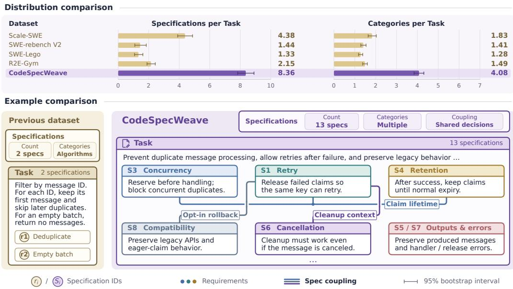  
Figure 1 Comparison of task specifications across datasets. Top: Mean extracted specifications and distinct behavioral categories per task across existing SWE training datasets and CodeSpecWeave, with 95% bootstrap confidence intervals. Category counts follow the taxonomy in Table 5. Bottom: Example task structures. Prior datasets typically contain few independent rules (left), whereas CodeSpecWeave tasks feature multiple interdependent specifications tied together by shared execution contexts and lifecycle constraints (right).

Developing this capability requires a large number of executable tasks that encompass these diverse engineering requirements. Existing works typically construct executable tasks by mining issues and pull requests (Pan et al., 2025), with limited attention to the role and properties of task specifications. Our empirical analysis reveals that existing data fall significantly short in both specification density and structural diversity (Figure 1, top), often emphasizing the primary development goal while leaving compatibility, state consistency, and error handling unaddressed. Consequently, agents trained on such partial specifications often fail in practice, as they struggle to satisfy the intricate constraints inherent in real-world repositories. This deficiency underscores the need for a scalable pipeline to synthesize tasks grounded in realistic and diverse specifications.

However, synthesizing such tasks presents two connected challenges. First, purely adding specifications may inadvertently reveal solution paths (Kim et al., 2026) or reduce the task to a checklist of independent edits. Specification design should therefore organize requirements into interdependent specifications where individual implementation choices constrain one another, compelling agents to coordinate across requirements through joint reasoning to achieve globally coherent implementations (Figure 1, bottom). Second, verifying such interdependent specifications is uniquely challenging: the subtle interactions among requirements make it easy for tests either to miss hidden flaws (Sun et al., 2026; Tan et al., 2026a) or to reject valid solutions (Chowdhury et al., 2024). Reliable verification requires strict alignment with both individual requirements and their interactions, while accommodating diferent implementations that satisfy them.

To this end, we introduce CodeSpecWeave, a framework for synthesizing coding tasks with rich, interdependent specifications. Grounded in specification seeds derived from real developers, a synthesis agent explores the repository context and develops the task requirements and executable test suites together in an iterative loop, intentionally designing coupled constraints that require simultaneous satisfaction while refining the tests to strictly align with them. To ensure test reliability, a review agent further examines the solution trajectories and patches from multiple models, filtering out tests that accept incomplete implementations or reject valid alternatives. Using this pipeline, we construct 4,670 training tasks across 2,865 repositories. Applying Reinforcement learning on these tasks significantly improves performance over the base model on DeepSWE-v1.1. In addition, we curate CodeSpecWeave-Bench through careful manual review, compiling 100 tasks with 1,044 specifications to evaluate coding agents under interdependent specifications. Benchmarking leading models clearly separates their capabilities, revealing shared failure modes and significant room for improvement.

Our contributions are as follows:

• We introduce CodeSpecWeave, a synthesis framework that builds on real developer specification seeds to generate coding tasks with interdependent specifications and reliable verifiers.

• We construct a scalable training set of 4,670 tasks across 2,865 repositories and demonstrate its efectiveness through reinforcement learning, yielding substantial performance gains on DeepSWE-v1.1 over strong training baselines.

• We present CodeSpecWeave-Bench, a benchmark comprising 100 tasks with 1,044 specifications. Evaluations across leading coding agents reveal notable performance gaps and substantial headroom under interdependent requirements.

## 2 CodeSpecWeave

CodeSpecWeave transforms requirements observed in real software development into coding tasks, addressing two connected challenges: compelling agents toward holistic exploration and joint reasoning under rich specifications, and scaling reliable test verification aligned with stated requirements. We first introduce the task formulation (Section 2.1) and design principle (Section 2.2). The framework consists of two core stages (Figure 2): task synthesis constructs interdependent requirements and linked tests guided by specification seeds (Section 2.3); validation and repair reviews trajectories generated by multiple model trials to identify and repair misalignments between queries and tests (Section 2.4).

## 2.1 Preliminaries and Problem Formulation

We represent a task as a tuple $\mathcal { T } = ( \mathcal { R } , Q , S , \mathcal { E } )$ . Here, R is the code repository, Q is the naturallanguage request provided to the solver, $S = \{ s _ { 1 } , \ldots , s _ { m } \}$ is the set of specifications embedded within Q that a valid patch must satisfy, and E is an execution environment equipped with a verifier �. Given Q and ${ \mathcal { R } } ,$ a solver produces a patch Δ through repository interactions. We write $s _ { i } ( \Delta ) = 1$ when the patched repository satisfies specification $s _ { i } .$ , and 0 otherwise. The set of valid patches is defined as:

$$
{ \mathcal { F } } ( { \mathcal { T } } ) = \{ \Delta : \ s _ { i } ( \Delta ) = 1 { \mathrm { ~ f o r ~ a l l ~ } } i \} .\tag{1}
$$

In practice, the verifier � checks whether $\Delta \in { \mathcal { F } } ( { \mathcal { T } } )$ by executing test suites.

## 2.2 Design Principle: Interdependent Specifications

Integrating rich specifications into coding tasks requires organizing how requirements relate to one another, rather than merely accumulating them. In our initial synthesis attempts, we observed that when relying solely on specification count, the synthesized tasks remained trivial: language models achieved high success simply by satisfying each requirement in isolation. This observation motivates distinguishing additive specifications, whose requirements admit largely separate decisions, from interdependent specifications, where a choice made to satisfy one requirement constrains the feasible options for another.

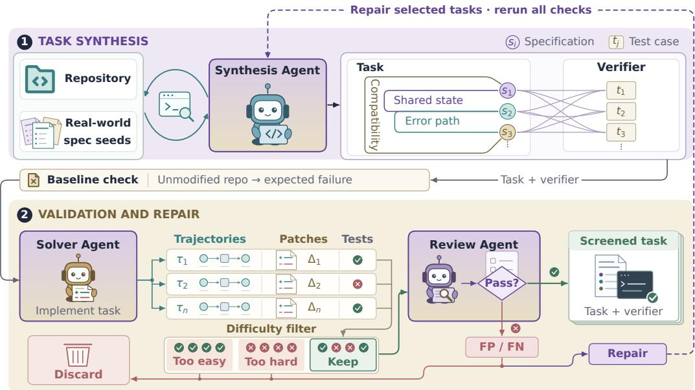  
Figure 2 Overview of CodeSpecWeave. The synthesis agent repeatedly consults specification seeds, explores the repository, and runs generated tests to refine a task and its verifier. Schematic links between specifications and test cases illustrate many-to-many coverage. Solver trials and trajectory review then assess dificulty and query–test alignment. Accepted task–verifier pairs are retained; selected candidates with false positives or false negatives are repaired and revalidated.

Formally, let design variables $d \ = \ ( d _ { 1 } , \ldots , d _ { k } )$ denote the engineering choices permitted by specification set S within feasible space F�. An idealized additive task factorizes independently as $\mathcal { F } _ { d } = \Pi _ { j } \mathcal { F } _ { j }$ , reducing to a step-by-step checklist where each choice can be resolved greedily in isolation. In contrast, interdependent specifications break this factorization $\textstyle ( { \mathcal { F } } _ { d } \subset \prod _ { j } { \mathcal { F } } _ { j } )$ , such that selecting one choice strictly restricts the feasible alternatives for others. Because local edits cannot be decoupled, the solver must reason across all requirements simultaneously, presenting much more challenging tasks for existing agents.

## 2.3 Task Synthesis

To reflect real-world developer requirements, we extract specification seeds from open-source repositories by mining commit histories, issue discussions, and pull requests. After filtering out conversational chatter and raw code fragments, normalized deduplication yields 104,182 candidate specification units across six natural languages. These seeds inform a compact specification reference containing examples, definitions, and boundary guidance for task synthesis.

Given a repository R, specification seeds, and prompt instructions to construct interdependent specifications, the synthesis agent explores the codebase to formulate development tasks. It combines complementary requirements, anchoring them to the same state transitions or core components so that satisfying one requirement constrains the implementation of others. For instance, a task may couple input validation, transactional rollback, and backward compatibility for existing readers, ensuring that satisfying any single requirement in isolation still violates the broader contract. The agent iteratively drafts the task request Q, fine-grained specifications S, and corresponding test cases A. These tests map flexibly to specifications, allowing multiple checks to validate a single requirement or an integration test to cover several obligations simultaneously. Throughout this process, the agent executes generated tests directly in the repository and refines them based on runtime feedback.

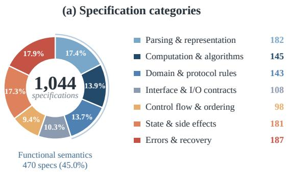

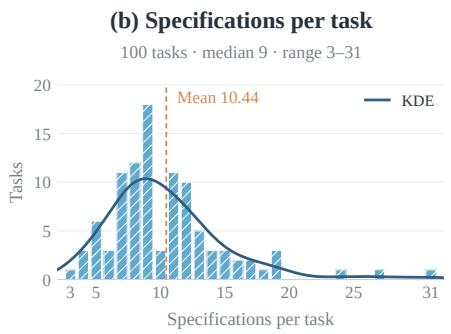  
Figure 3 Specification distribution in CodeSpecWeave-Bench. (a) The five behavioral categories in Table 5, with functional semantics expanded into three blue subcategories. Each of the 1,044 specifications contributes once to one of the seven segments. (b) Specifications per task across 100 tasks (mean: 10.44).

## 2.4 Validation and Repair

Simultaneously generating interdependent specifications and tests does not guarantee capturing the intended requirement boundary. Because multiple requirements closely interact, tests often fail to check flaws that arise only when the requirements interact at runtime, allowing incorrect solutions to pass (Sun et al., 2026; Tan et al., 2026a). At the same time, verifying coupled requirements easily causes tests to assume a specific implementation, rejecting valid solutions that satisfy the full specification (Chowdhury et al., 2024). Our pilot generation reflects this dificulty: automated reviews identified alignment flaws in 2,267 of 3,067 candidate tasks (73.9%; Table 1), confirming that complex specifications make reliable test generation exceedingly hard.

<table><tr><td>Issue</td><td>Tasks</td><td>%</td></tr><tr><td>False positives only</td><td>1,548</td><td>50.5</td></tr><tr><td>False negatives only</td><td>426</td><td>13.9</td></tr><tr><td>Both</td><td>293</td><td>9.6</td></tr><tr><td>None observed</td><td>800</td><td>26.1</td></tr><tr><td>Total with issues</td><td>2,267</td><td>73.9</td></tr></table>

Table 1 Test alignment breakdown on 3,067 candidates.

Because these flaws only appear when code actually runs against the requirements, inspecting static code or tests alone is insuficient. Instead, we collect candidate patches Δ and their execution trajectories � from independent coding models across multiple attempts, filtering for tasks with mixed solver success to keep challenging yet solvable tasks. Comparing these execution trajectories with test results reveals errors that are invisible during generation: runs that violate multiple requirements expose missing checks, while valid runs that fail indicate tests that enforce unintended restrictions. A review agent inspects the full tuple (Q, A, Δ, �) to iteratively reconcile the tests with the interdependent specifications. In one generation batch of 14,905 initial tasks, dificulty filtering retained 3,275 candidates, from which this review approved 766 verified tasks.

For selected candidates with identified false positives or false negatives, a repair agent uses the review findings and execution trajectories to revise the task request or verifier. Each repaired task–verifier pair then undergoes execution checks, fresh solver trials, and alignment review before acceptance.

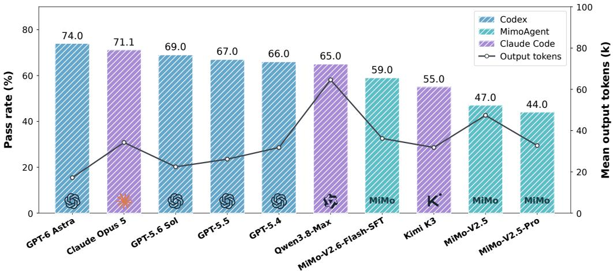  
Figure 4 Pass rates and mean reported output tokens on CodeSpecWeave-Bench. Hatched bars show pass rates (left axis); the line shows mean output tokens (right axis). Colors identify agent frameworks.

Using the full CodeSpecWeave pipeline, we synthesize 4,670 training tasks across 2,865 repositories for reinforcement learning. For evaluation, we curate CodeSpecWeave-Bench, a benchmark of 100 manually reviewed tasks. We provide details of the manual review in Appendix A.2. Figure 3 summarizes its 1,044 specifications by category and task, with a mean of 10.44 specifications per task. The models and harness used for data construction are listed in Appendix A.1.

## 3 Experiments

## 3.1 Evaluation on CodeSpecWeave-Bench

Evaluation setup. We evaluate GPT-5.4, GPT-5.5, GPT-5.6 Sol, and GPT-6 Astra (OpenAI, $2 0 2 6 \mathrm { a } , \mathrm { b } , \mathrm { c } , \mathrm { d } )$ with Codex (OpenAI); Claude Opus 5, Kimi K3, and Qwen3.8-Max (Anthropic, 2026; Moonshot AI, 2026; Qwen Team, 2026) with Claude Code (Anthropic); and MiMo-V2.5, MiMo V2.5-Pro (Xiaomi MiMo Team, 2026a,b), and MiMo-V2.6-Flash-SFT with MimoAgent (LLM-Core Xiaomi, 2026).

Results. Figure 4 shows performance across representative agents on CodeSpecWeave-Bench. Pass rates range from 44.0% to 74.0%, demonstrating that the benchmark clearly distinguishes model capabilities while leaving significant headroom, as even the strongest model (GPT-6 Astra at 74.0%) fails on 26% of the attempts.

Higher task success does not require more output tokens. GPT-6 Astra achieves the highest pass rate with the lowest mean output length (17.2k tokens). Within Codex, pass rate decreases monotonically with mean output length across the four GPT models, from 74.0% at 17.2k tokens to 66.0% at 31.8k. Within Claude Code, Claude Opus 5 exceeds Qwen3.8-Max by 6.1 percentage points while producing approximately 47% fewer output tokens, indicating that extra length largely reflects unproductive trial-and-error when resolving interdependent specifications.

<table><tr><td>Training Settings</td><td>CODESPECWEAVE- BENCH</td><td>DeepSWE- v1.1</td><td>SWE-bench Verified</td><td>SWE-bench Pro</td><td>Avg</td></tr><tr><td>MiMo-V2.5</td><td></td><td></td><td></td><td></td><td></td></tr><tr><td>w/ Vanilla</td><td>47.00</td><td>12.39</td><td>69.27</td><td>50.11</td><td>44.69</td></tr><tr><td>W/ SWE-PI</td><td>44.00</td><td>6.78</td><td>68.00</td><td>49.43</td><td>42.05</td></tr><tr><td>w/ MiMo Coding</td><td>50.00</td><td>18.62</td><td>73.63</td><td>53.81</td><td>49.01</td></tr><tr><td>W/ CODESPECWEAVE</td><td>52.00</td><td>25.30</td><td>72.00</td><td>51.30</td><td>50.15</td></tr><tr><td>MiMo-V2.6-Flash-SFT</td><td></td><td></td><td></td><td></td><td></td></tr><tr><td>w/ Vanilla</td><td>59.00</td><td>54.42</td><td>74.20</td><td>54.54</td><td>60.54</td></tr><tr><td>W/ SWE-PI</td><td>66.33</td><td>56.64</td><td>76.60</td><td>59.05</td><td>64.66</td></tr><tr><td>w/ MiMo Coding</td><td>69.00</td><td>50.74</td><td>77.20</td><td>59.44</td><td>64.09</td></tr><tr><td>W/ CODESPECWEAVE</td><td>70.67</td><td>62.98</td><td>77.40</td><td>59.37</td><td>67.60</td></tr></table>

Table 2 Task success rates (%, higher is better). Avg is the unweighted mean across the four benchmarks. Within each model, the best results are in bold and the second-best are underlined.

## 3.1.1 Failure analysis

We qualitatively review unsuccessful attempts to examine implementation errors in satisfying task specifications. We identify two main error patterns: (1) patches contain code or tests targeting a specification, yet their behavior still violates it. Incomplete handling of input boundaries or execution paths leaves the requirement satisfied only in some settings. (2) Some patches satisfy one requirement while violating another that constrains the same state. Although the model attempts to satisfy both requirements, it overlooks how a change made to satisfy one can violate the other in a diferent usage scenario. Concrete examples are provided in Appendix F.

## 3.2 Training on CodeSpecWeave

## 3.2.1 Training and evaluation setup

Models. We apply reinforcement learning to two Mixture-of-Experts (MoE) models, MiMo-V2.5 (Xiaomi MiMo Team, 2026a) and MiMo-V2.6-Flash-SFT (LLM-Core Xiaomi, 2026), each with 310B total and 15B active parameters.

Training datasets. We compare three RL datasets: CodeSpecWeave, SWE-PI, and MiMo Coding. CodeSpecWeave contains 4,670 tasks across 2,865 repositories. SWE-PI is a mixture of SWE datasets released by Prime Intellect (Auras and Prime Intellect Team, 2026), comprising 30,128 tasks from Scale-SWE (Zhao et al., 2026), SWE-Lego (Tao et al., 2026), SWE-rebench V2 (Badertdinov et al., 2026), and Multi-SWE-RL (Zan et al., 2025). MiMo Coding (LLM-Core Xiaomi, 2026) is curated from diverse collection pipelines, including issue-driven development, everyday development workflows, functionality implementation, and long-horizon engineering. Training hyperparameters are provided in Appendix B.1.

Evaluation benchmarks. We evaluate on four coding benchmarks. CodeSpecWeave-Bench contains 100 tasks from 100 repositories with interdependent specifications. DeepSWE-v1.1 contains 113 long-horizon coding tasks (Huang et al., 2026). SWE-bench Verified comprises 500 human-validated GitHub issues from Python repositories (Jimenez et al., 2024; Chowdhury et al., 2024). SWE-bench Pro provides 731 public tasks across multiple programming languages (Deng et al., 2026). Evaluation settings are provided in Appendix B.2.

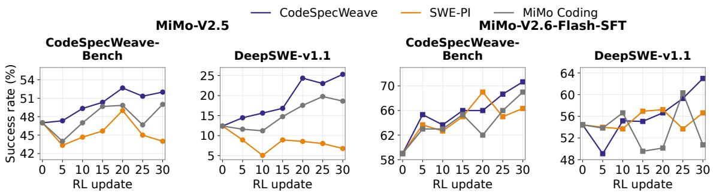

Figure 5 Learning curves for CodeSpecWeave, SWE-PI, and MiMo Coding, trained from MiMo-V2.5 (left) and MiMo-V2.6-Flash-SFT (right).
<table><tr><td>Measure</td><td colspan="2">MiMo-V2.5</td><td colspan="2">MiMo-V2.6-Flash-SFT</td></tr><tr><td></td><td>Vanilla</td><td>CODESPECWEAVE</td><td>Vanilla</td><td>CODESPECWEAVE</td></tr><tr><td>Thinking tokens (k)</td><td>29.7</td><td>141.6</td><td>22.8</td><td>69.5</td></tr><tr><td>Modified files</td><td>4.47</td><td>9.79</td><td>4.09</td><td>6.17</td></tr><tr><td>Changed lines</td><td>451</td><td>3,632</td><td>350</td><td>667</td></tr><tr><td>Edit-test loops</td><td>3.48</td><td>4.34</td><td>2.96</td><td>4.90</td></tr><tr><td>Trajectories with ≥ 2 loops (%)</td><td>63.0</td><td>72.7</td><td>69.0</td><td>78.3</td></tr></table>

Table 3 Reasoning, code changes, and edit–test loops on CodeSpecWeave-Bench. The edit– test loop definition is given in Appendix E.

## 3.2.2 Evaluation results

Table 2 compares performance across four benchmarks. Across both MiMo-V2.5 and MiMo-V2.6-Flash-SFT backbones, CodeSpecWeave yields the highest average scores (50.15% and 67.60%), outperforming other training datasets. The improvements are especially clear on CodeSpecWeave-Bench and DeepSWE. Figure 5 shows the RL updates of CodeSpecWeave across both backbones on these two benchmarks. On CodeSpecWeave-Bench, CodeSpecWeave consistently achieves the top scores across both base models (52.00% and 70.67%). The advantage is even more pronounced on DeepSWE, which presents challenging long-horizon coding tasks. While other datasets show limited gains or even negative transfer (e.g., SWE-PI on MiMo-V2.5), CodeSpecWeave substantially boosts scores to 25.30% and 62.98%. Meanwhile, CodeSpecWeave maintains competitive performance on SWE-bench Verified and SWE-bench Pro.

Model behavior. After CodeSpecWeave training, MiMo-V2.5 generates 4.8 times as many thinking tokens and MiMo-V2.6-Flash-SFT 3.0 times as many (Table 3). Both models also modify significantly more files and lines on average, indicating a shift from localized patches toward cross-file refactoring to accommodate interdependent specifications. Crucially, this expanded modification scope is grounded in active verification: training increases the number of edit–test loops per trajectory (from 3.48 to 4.34 for MiMo-V2.5, and from 2.96 to 4.90 for Flash-SFT). Each loop consists of one or more code edits followed by executable test feedback in a subsequent turn. With an increased proportion of trajectories sustaining repeated loops (≥ 2 loops reaching over 70%), this demonstrates that CodeSpecWeave trains agents to systematically navigate and validate complex constraints without breaking existing dependencies through tight, iterative feedback loops.

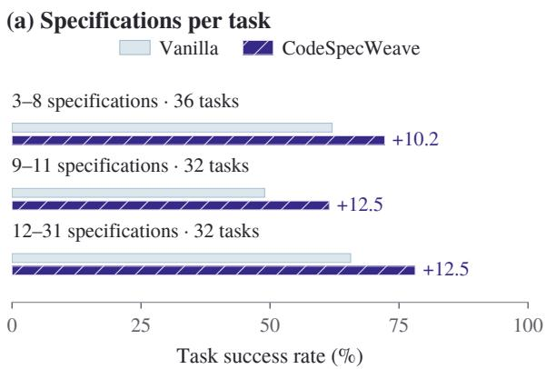

## (b) Specification category

Parsing & Representation Computation & Algorithms Domain & Protocol Rules Interface & I/O Contracts Control Flow & Ordering State & Side Effects Errors & Recovery

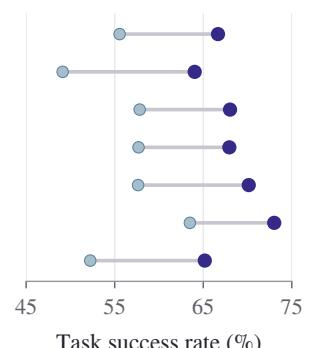  
Fi ure 6 Task success rates on CodeSpecWeave-Bench for MiMo-V2.6-Flash-SFT before and after reinforcement learning on the 4,670-task CodeSpecWeave training set. Results cover all 100 benchmark tasks. (a) Tasks grouped by specifications per task, with annotations showing percentage-point gains over Vanilla. (b) Tasks grouped by specification category (each point denotes the success rate on tasks requiring that category).

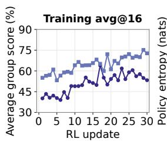

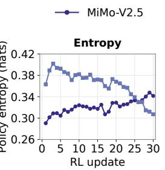

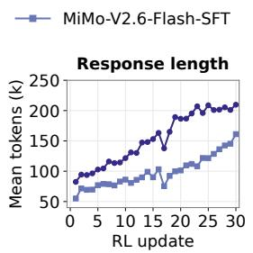

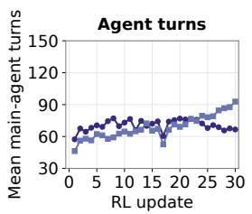  
Figure 7 Training dynamics through RL update for the two CodeSpecWeave runs. From left to right: mean task-group score, policy entropy, response length, and main-agent turns.

## 3.2.3 Performance by specification count and category

CodeSpecWeave improves Flash-SFT across tasks with diferent numbers of specifications, with gains of 10.2–12.5 percentage points (Figure 6). The gain is greatest in both the 9–11 and 12–31 specification groups, suggesting that CodeSpecWeave helps the model better handle tasks with many interacting requirements. Gains are also broadly comparable across the seven categories in Table 5 (9.5–14.9 points), covering both functional requirements and constraints on interfaces, execution order, state, and error handling.

## 3.2.4 Training dynamics

Figure 7 illustrates the training dynamics across both backbones. Task scores rise steadily across updates while policy entropy remains stable (0.29–0.40), confirming consistent policy improvement. To resolve interdependent specifications, the two models exhibit distinct adaptation strategies: MiMo-V2.5 scales its single-turn efort through extensive elaboration (more than doubling its response length), whereas Flash-SFT relies on active multi-turn interaction by nearly doubling its agent turns. These trajectories demonstrate that CodeSpecWeave reinforces sustained problem solving and environment exploration.

## 4 Related Work

Coding Data Synthesis. Prior work constructs coding tasks from source code, repository changes, and agent feedback. Magicoder (Wei et al., 2024) generates coding problems and solutions from open-source code snippets, while KodCode (Xu et al., 2025) draws on programming exercises, algorithm implementations, and library documentation. At the repository level, R2E-Gym (Jain et al., 2025) derives tasks from commits through test generation and back-translation, SWEsmith (Yang et al., 2026) modifies working code to create repair tasks, and SWE-Flow (Zhang et al., 2025) uses unit tests and runtime dependencies to construct incremental development tasks. Other methods expand how task content is generated: SWE-Mirror (Wang et al., 2025) transfers issue semantics across repositories, ADR (Zheng et al., 2026) recombines semantic elements extracted from seed problems, and TaskPilot (Kim et al., 2026) uses solver feedback to refine jointly generated tasks, reference patches, and tests. CodeSpecWeave makes the coverage and interaction of engineering requirements explicit objectives of task synthesis. Guided by developer specification seeds and repository context, it constructs tasks that require joint reasoning about interdependent specifications.

Software Specifications. Software specifications make the behaviors and constraints of a development task explicit. ArchCode (Han et al., 2024) organizes functional and non-functional requirements from problem descriptions, while SpecRover (Ruan et al., 2025) infers intended behavior from issue descriptions and repository context. REAgent (Kuang et al., 2026) produces structured requirements that include root-cause analysis and proposed edits, while CodeSpec (Wang et al., 2026) constructs cross-component functional chains to guide feature development. Specifications also structure evaluation and learning: DevAI (Zhuge et al., 2025) organizes development requirements as dependency graphs, SWE-AGI (Zhang et al., 2026) evaluates system construction from standards and RFCs, and SpecCoder (Li et al., 2026) trains models to produce specification analyses and code through supervised fine-tuning and reinforcement learning. CodeSpec uses executable specifications to maintain consistency between a functional-chain design and its implementation. CodeSpecWeave instead uses interdependent specifications to construct the task: requirements are coupled so that the choices made to satisfy one constrain the valid choices for others. The agent must explore the repository and develop an implementation that satisfies these requirements together.

## 5 Conclusion

We introduced CodeSpecWeave, a framework for synthesizing executable coding tasks with interdependent specifications in real repositories. Starting from specification seeds drawn from developer interactions, a synthesis agent jointly refines task requirements and tests, while a review agent examines solutions from multiple models to identify verification errors. The resulting training set contains 4,670 tasks across 2,865 repositories. Reinforcement learning on these tasks substantially raises the base model’s success rate on DeepSWE-v1.1, with gains over the base model on all four evaluated benchmarks. We also introduced CodeSpecWeave-Bench, comprising 100 manually reviewed tasks and 1,044 specifications. Evaluations reveal substantial performance diferences across agents and remaining challenges in satisfying interacting requirements.

## Limitations

Our approach has three practical limitations. First, using the synthesized tasks to improve model performance through RL requires substantial computational resources for training experiments.

Second, each task has an associated container image and runs in a Kubernetes pod. Training and evaluation therefore require infrastructure to manage many containers concurrently. Third, producing high-quality tasks relies on strong models and multiple rounds of filtering, which discard a large fraction of generated candidates.

## References

Anthropic. Claude Code Overview.

Anthropic. 2026. System Card: Claude Opus 5. System card.

Daniel Auras and Prime Intellect Team. 2026. Scaling Agentic RL: 365,000+ Environments for SWE, Terminal, and Search. Prime Intellect blog.

Ibragim Badertdinov, Maksim Nekrashevich, Anton Shevtsov, and Alexander Golubev. 2026. SWErebench v2: Language-agnostic SWE task collection at scale. In Proceedings of ICML.

Neil Chowdhury, James Aung, Chan Jun Shern, Oliver Jafe, Dane Sherburn, Giulio Starace, Evan Mays, Rachel Dias, Marwan Aljubeh, Mia Glaese, Carlos E. Jimenez, John Yang, Leyton Ho, Tejal Patwardhan, Kevin Liu, and Aleksander Madry. 2024. Introducing SWE-bench Verified. OpenAI blog. Published August 13, 2024.

Xiang Deng, Jef Da, Edwin Pan, Yannis Yiming He, Charles Ide, Kanak Garg, Niklas Laufer, Andrew Park, Chetan Rane, Karmini Sampath, Maya Krishnan, Srivatsa R Kundurthy, Sean M. Hendryx, Zifan Wang, Chen Bo Calvin Zhang, Noah Jacobson, Bing Liu, and Brad Kenstler. 2026. SWE-bench pro: Can AI agents solve long-horizon software engineering tasks? In Proceedings of ICML.

Hojae Han, Jaejin Kim, Jaeseok Yoo, Youngwon Lee, and Seung-won Hwang. 2024. ArchCode: Incorporating software requirements in code generation with large language models. In Proceedings ofACL, pages 13520–13552.

Wenqi Huang, Charley Lee, Leonard Tng, and Serena Ge. 2026. Deepswe: Measuring frontier coding agents on original, long-horizon engineering tasks. arXiv preprint arXiv:2607.07946.

Naman Jain, Jaskirat Singh, Manish Shetty, Liang Zheng, Koushik Sen, and Ion Stoica. 2025. R2e-gym: Procedural environments and hybrid verifiers for scaling open-weights swe agents. arXiv preprint arXiv:2504.07164.

Carlos E Jimenez, John Yang, Alexander Wettig, Shunyu Yao, Kexin Pei, Ofir Press, and Karthik Narasimhan. 2024. Swe-bench: Can language models resolve real-world github issues? In Proceedings of ICLR, volume 2024, pages 54107–54157.

Minseon Kim, Zhengyan Shi, Emiliano Penaloza, Christopher Cui, Roger Creus Castanyer, Maryam Hashemzadeh, Isadora White, Jonathan Light, Jeonghye Kim, Matheus Pereira, et al. 2026. Frognano: Training a 4b coding agent via online task synthesis. arXiv preprint arXiv:2609.07925.

Shiqi Kuang, Zhao Tian, Kaiwei Lin, Chaofan Tao, Shaowei Wang, Haoli Bai, Lifeng Shang, and Junjie Chen. 2026. Reagent: Requirement-driven llm agents for software issue resolution. arXiv preprint arXiv:2604.06861.

Yixuan Li, Mingxuan Huang, Jiajing Wang, Weidong Yang, Xinyi Liu, Ben Fei, and Lipeng Ma. 2026. Speccoder: Specification-aware code generation with curriculum dual-task reinforcement learning. arXiv preprint arXiv:2609.06041.

LLM-Core Xiaomi. 2026. MiMo-V2.6: Scaling Reinforcement Learning Towards Self-Improvement. Technical report.

Moonshot AI. 2026. Kimi K3. Hugging Face model card.

OpenAI. Codex CLI.

OpenAI. 2026a. GPT-5.4 Thinking System Card. System card.

OpenAI. 2026b. GPT-5.5 System Card. System card.

OpenAI. 2026c. GPT-5.6 System Card. System card.

OpenAI. 2026d. GPT-6 Astra System Card. System card.

Jiayi Pan, Xingyao Wang, Graham Neubig, Navdeep Jaitly, Heng Ji, Alane Suhr, and Yizhe Zhang. 2025. Training software engineering agents and verifiers with SWE-gym. In Proceedings of ICML, volume 267, pages 47717–47737.

Qwen Team. 2026. Qwen3.8-Max: A New Bar for Coding and Cowork. Qwen blog.

Haifeng Ruan, Yuntong Zhang, and Abhik Roychoudhury. 2025. Specrover: Code intent extraction via llms. In Proceedings of ICSE, pages 963–974.

Zhihong Shao, Peiyi Wang, Qihao Zhu, Runxin Xu, Junxiao Song, Xiao Bi, Haowei Zhang, Mingchuan Zhang, YK Li, Yang Wu, et al. 2024. Deepseekmath: Pushing the limits of mathematical reasoning in open language models. arXiv preprint arXiv:2402.03300.

Yuxuan Sun, Yuze Zhao, Yufeng Wang, Yao Du, Zhiyuan Ma, Jinbo Wang, Mengdi Zhang, Kai Zhang, and Zhenya Huang. 2026. SWE-mutation: Can LLMs generate reliable test suites in software engineering? In Findings of ACL, pages 39651–39674.

Yuhao Tan, Zhibang Yang, Fangkai Yang, Yuan Yao, Yu Kang, Lu Wang, Pu Zhao, Xin Zhang, Xiaoxing Ma, Qingwei Lin, et al. 2026a. Beyond fail-to-pass: Iterative hardening of co-generated bug reproduction tests and fixes. arXiv preprint arXiv:2607.19843.

Yuqiao Tan, Jinxiang Meng, Fangyu Lei, Minzheng Wang, Shizhu He, Jun Zhao, and Kang Liu. 2026b. SWE-Touch: Benchmarking coding agents when users touch the code. arXiv preprint arXiv:2608.02499.

Chaofan Tao, Jierun Chen, Yuxin Jiang, Kaiqi Kou, Shaowei Wang, Ruoyu Wang, Xiaohui Li, Sidi Yang, Yiming Du, Jianbo Dai, et al. 2026. Swe-lego: Pushing the limits of supervised fine-tuning for software issue resolving. arXiv preprint arXiv:2601.01426.

Junhao Wang, Daoguang Zan, Shulin Xin, Siyao Liu, Yurong Wu, and Kai Shen. 2025. Swemirror: Scaling issue-resolving datasets by mirroring issues across repositories. arXiv preprint arXiv:2509.08724.

Peiding Wang, Li Zhang, Fang Liu, Taichuan Li, and Yinghao Zhu. 2026. Codespec: Dual executable specifications for agentic long-horizon feature development. arXiv preprint arXiv:2607.26777.

Yuxiang Wei, Zhe Wang, Jiawei Liu, Yifeng Ding, and Lingming Zhang. 2024. Magicoder: Empowering code generation with OSS-instruct. In Proceedings of ICML, volume 235, pages 52632–52657.

Xiaomi MiMo Team. 2026a. MiMo-V2.5. Hugging Face model card.

Xiaomi MiMo Team. 2026b. MiMo-V2.5-Pro. Hugging Face model card.

Zhangchen Xu, Yang Liu, Yueqin Yin, Mingyuan Zhou, and Radha Poovendran. 2025. KodCode: A diverse, challenging, and verifiable synthetic dataset for coding. In Findings of ACL, pages 6980–7008.

John Yang, Carlos Jimenez, Alexander Wettig, Kilian Lieret, Shunyu Yao, Karthik Narasimhan, and Ofir Press. 2024. Swe-agent: Agent-computer interfaces enable automated software engineering. In Proceedings of NeurIPS, volume 37, pages 50528–50652.

John Yang, Kilian Lieret, Carlos E Jimenez, Alexander Wettig, Kabir Khandpur, Yanzhe Zhang, Binyuan Hui, Ofir Press, Ludwig Schmidt, and Diyi Yang. 2026. SWE-smith: Scaling data for software engineering agents. In Proceedings of NeurIPS Datasets and Benchmarks Track.

Daoguang Zan, Zhirong Huang, Wei Liu, Hanwu Chen, Linhao Zhang, Shulin Xin, Lu Chen, Qi Liu, Xiaojian Zhong, Aoyan Li, Siyao Liu, Yongsheng Xiao, Liangqiang Chen, Yuyu Zhang, Jing Su, Tianyu Liu, Rui Long, Kai Shen, and Liang Xiang. 2025. Multi-SWE-bench: A Multilingual Benchmark for Issue Resolving. Preprint, arXiv:2504.02605.

Lei Zhang, Jiaxi Yang, Min Yang, Jian Yang, Mouxiang Chen, Jiajun Zhang, Zeyu Cui, Binyuan Hui, and Junyang Lin. 2025. Synthesizing software engineering data in a test-driven manner. In Proceedings of ICML, volume 267, pages 76518–76540. PMLR.

Zhirui Zhang, Hongbo Zhang, Haoxiang Fei, Zhiyuan Bao, Yubin Chen, Zhengyu Lei, Ziyue Liu, Yixuan Sun, Mingkun Xiao, Zihang Ye, et al. 2026. Swe-agi: Benchmarking specificationdriven software construction with moonbit in the era of autonomous agents. arXiv preprint arXiv:2602.09447.

Jiale Zhao, Guoxin Chen, Fanzhe Meng, Minghao Li, Jie Chen, Hui Xu, Yongshuai Sun, Wayne Xin Zhao, Ruihua Song, Yuan Zhang, et al. 2026. Immersion in the github universe: Scaling coding agents to mastery. arXiv preprint arXiv:2602.09892.

Jiasheng Zheng, Boxi Cao, Boxi Yu, Yuzhong Zhang, Jialun Cao, Yaojie Lu, Hongyu Lin, Xianpei Han, and Le Sun. 2026. Combinatorial synthesis: Scaling code rlvr via atomic decomposition and recombination. arXiv preprint arXiv:2605.31058.

Mingchen Zhuge, Changsheng Zhao, Dylan R. Ashley, Wenyi Wang, Dmitrii Khizbullin, Yunyang Xiong, Zechun Liu, Ernie Chang, Raghuraman Krishnamoorthi, Yuandong Tian, Yangyang Shi, Vikas Chandra, and Jürgen Schmidhuber. 2025. Agent-as-a-judge: Evaluate agents with agents. In Proceedings of ICML, volume 267, pages 80569–80611.

## A Data Construction

## A.1 Agents

The synthesis and review agents use MiMo-V2.5-Pro. Solver agents use MiMo-V2.5-Pro and MiMo-V2.5-Flash. These agents use Claude Code (Anthropic) as their harness.

## A.2 Manual review

The authors manually reviewed the 100 tasks included in CodeSpecWeave-Bench, examining task descriptions, executable verifiers, code patches generated by models, and execution trajectories. The review focused on whether tasks reflected realistic development scenarios in their repositories, whether requirements were clear and mutually consistent, and whether tests covered the explicitly stated requirements. They also checked whether verifiers omitted required behavior or imposed constraints absent from the task descriptions, including implementation details that could lead to valid solutions being rejected.

The authors further examined successful and failed trajectories to assess the verification results. For solutions that passed the tests, they checked whether the implementations actually satisfied the task requirements; for those that failed, they distinguished implementation defects from verifier restrictions and environment issues. Solutions that were close to correct but failed verification helped identify hidden constraints and problems in handling boundary cases. The review also considered missing dependencies, environment errors, and flaky tests to reduce their influence on the evaluation of model capabilities.

## B Experimental Settings

## B.1 Reinforcement learning

We train the model using GRPO (Shao et al., 2024). Table 4 supplements the training setup in Section 3.2.

<table><tr><td>Setting</td><td>Value</td></tr><tr><td>Training batch size</td><td>128</td></tr><tr><td>Mini-batch size</td><td>128</td></tr><tr><td>Samples per task</td><td>16</td></tr><tr><td>Sampling temperature</td><td>1.0</td></tr><tr><td>Top-p</td><td>0.97</td></tr><tr><td>Prompt token limit</td><td>8,192</td></tr><tr><td>Response token limit</td><td>516,096</td></tr></table>

Table 4 RL training hyperparameters.

Training dynamics. Training score averages within-task pass rates over all tested groups before batch selection, excluding invalid outcomes and assigning zero to groups with fewer than two valid outcomes. Entropy is measured over masked training tokens; response length and main-agent turns are means per training context and sampled context, respectively. The sampled tasks change across updates.

## B.2 Evaluation settings

The evaluation uses three samples per task, a 512K context budget, temperature 1.0, top-� = 0.95.

## C Specification Analysis

## C.1 Categories and benchmark annotation

Table 5 summarizes the taxonomy across five primary categories, where functional semantics is further divided into three subcategories, yielding seven categories in total.
<table><tr><td>Specification Type</td><td>Scope</td><td>Count</td></tr><tr><td>Functional Semantics</td><td>End-to-end data transformation and algorithmic logic</td><td>470</td></tr><tr><td>Parsing &amp; Representation</td><td>Syntax matching, encoding, and format serialization</td><td>182</td></tr><tr><td>Computation &amp; Algorithms</td><td>Mathematical calculations and core algorithmic logic</td><td>145</td></tr><tr><td>Domain &amp; Protocol Rules</td><td>Business constraints and protocol-specific semantics</td><td>143</td></tr><tr><td>Interface &amp; I/O Contracts</td><td>Public APIs, argument types and defaults, input/output schemas</td><td>108</td></tr><tr><td>Control Flow &amp; Ordering</td><td>Conditional branching, execution order, and concurrency</td><td>98</td></tr><tr><td>State &amp; Side Effects</td><td>State transitions, atomicity, and resource lifecycles</td><td>181</td></tr><tr><td>Errors &amp; Recovery</td><td>Input rejection, exception propagation, and fallback paths</td><td>187</td></tr></table>

Table 5 Taxonomy and distribution of the 1,044 benchmark specifications. Functional specifications (� = 470) are partitioned into three fine-grained subcategories.

We annotate the 1,044 specifications using a human-in-the-loop pipeline: MiMo-V2.5 (Xiaomi MiMo Team, 2026a) first proposes primary/secondary categories, auxiliary tags (compatibility, security, platform, observability), and rationales, which are subsequently audited by the authors. In Figure 3, each specification is uniquely attributed to its primary category, while secondary categories track cross-cutting aspects.

Classification boundaries are grounded in the requirement’s primary intent: interface contracts cover API signatures and schema constraints; functional semantics govern transformation logic; state obligations enforce invariants during failed transactions; and error handling captures explicit exceptions and retries. We further subdivide the 470 functional specifications into parsing, algorithmic computation, and domain protocols.

## C.2 Training query distributions

CodeSpecWeave queries have a median length of 2,131 characters, compared with 731–1,361 characters for the other training datasets. Figure 8 compares their distributions, and Table 6 reports statistics over the complete training splits.

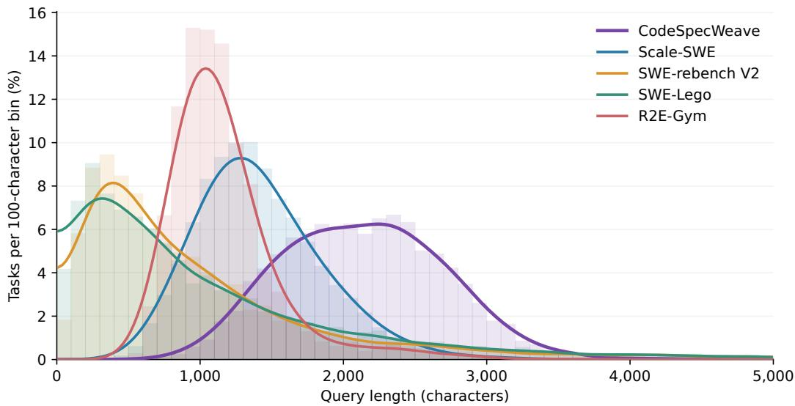

Figure 8 Query length distributions of CodeSpecWeave, Scale-SWE, SWE-rebench V2, SWE-Lego, and R2E-Gym.
<table><tr><td>Dataset</td><td>Median</td><td>P10</td><td>P90</td></tr><tr><td>CODESPECWEAVE</td><td>2,131</td><td>1,414</td><td>2,856</td></tr><tr><td>Scale-SWE</td><td>1,361</td><td>900</td><td>2,006</td></tr><tr><td>SWE-rebench V2</td><td>731</td><td>231</td><td>2,536</td></tr><tr><td>SWE-Lego</td><td>742</td><td>181</td><td>2,619</td></tr><tr><td>R2E-Gym</td><td>1,088</td><td>810</td><td>1,556</td></tr></table>

Table 6 Query lengths across the complete training splits, in characters.

## D Task Example

This task illustrates how a new feature is constrained by compatibility and boundary requirements. It asks to change how Skycoin’s transaction builder allocates coin hours across payments while preserving its existing behavior for a single recipient.

## Task

The CLI already supports building a raw transaction from a wallet through The CLI already supports building a raw transaction fr through createRawTransaction/send -m, but its multi-recipient hour policy is not useful to callers: it divides recipient hours equally, can give a larger payment no more hours than a tiny payment, and can strand a recipient with zero hours when the available remainder is small. Make the raw-transaction builder allocate coin hours from the selected inputs according to the requested payments while preserving its existing transaction and wallet semantics.

For a non-empty multi-recipient request, after the normal required fee is reserved, allocate the recipient share in proportion to each recipient’s coin amount using deterministic integer rounding: the recipient hours must sum exactly to the assignable recipient share, and any rounding remainder must be assigned deterministically without depending on map iteration or randomness; when fractional remainders tie, earlier entries in the request order receive the extra hours first. If there are enough recipient hours for every output to receive one, no recipient may receive zero. When a change output is present, split the post-fee hours between recipients and change using the existing 50/50 policy (the extra odd hour goes to change), then apply the proportional allocation only within the recipient share; all unassigned hours remain on the change output. When there is no change, do not burn or discard

hours merely because the change output is absent. Keep output order stable: the to entries remain in request order and a non-zero-coin change output, if any, is last.   
Do not regress the established single-recipient behavior: its existing coin-hour cap and output values must remain unchanged. Continue to reject requests that cannot produce a fee-valid transaction, and do not create zero-coin outputs.

The requirements jointly constrain allocation, rounding, and output construction (Table 7). The new proportional rule applies to multiple recipients, while the legacy cap must remain limited to a single recipient. Applying both rules to every request would violate the new allocation policy.

<table><tr><td>Requirement</td><td>Expected behavior</td></tr><tr><td>Proportionality</td><td>Without change, allocate post-fee hours proportionally and resolve rounding ties by request order.</td></tr><tr><td>Change allocation</td><td>Split post-fee hours 50/50 between recipients and change, assigning the odd hour to change.</td></tr><tr><td>Minimum allocation</td><td>Give each recipient at least one hour whenever the recipient share permits it.</td></tr><tr><td>Output order</td><td>Keep recipients in request order and append non-zero-coin change last.</td></tr><tr><td>Compatibility</td><td>Preserve the single-recipient cap and its existing output values.</td></tr></table>

Table 7 Requirements in the example task.

## E Development Behavior

We identify editing and testing actions from tool names and shell commands in the main-agent trajectories. An edit–test loop consists of one or more edits followed by a test invocation in a later turn. Edits include source code, tests, and auxiliary files. Within the first 40 turns, the proportion of trajectories with at least two edit–test loops changes from 44.0% to 54.7% for MiMo-V2.5 and from 47.7% to 45.7% for Flash-SFT.

Editing and retesting after failure. For test invocations whose output explicitly reports a failure, we measure how often a later edit is followed by another test invocation. Both models more often edit and test again after CodeSpecWeave training (Table 8).

<table><tr><td>Model</td><td>Vanilla</td><td>CODESPECWEAVE</td></tr><tr><td>MiMo-V2.5</td><td>77.1</td><td>86.0</td></tr><tr><td>Flash-SFT</td><td>77.7</td><td>87.1</td></tr></table>

Table 8 Task-averaged rates of editing and retesting after a failed test (%).

## F Failure Analysis

We use a frontier agent to inspect the prompt received by the solver, its final patch, and verification output, consulting test implementations and tool records where needed. We first establish whether the prompt explicitly requires the failed behavior, then inspect the corresponding implementation and the execution evidence for its violation.

Figures 9 and 10 illustrate error patterns (1) and (2) from Section 3.1.1, respectively.

Failure pattern (1): incomplete enforcement. The SimpleX patch in Figure 9 includes link recognition and punctuation handling, and the agent’s probe recognizes a parenthesized URL. However, a URL following See( remains plain text in the final evaluation. The targeted boundary requirement therefore holds only in some input settings.

Failure pattern (2): interacting requirements. The Iroha patch in Figure 10 addresses both signature union and state isolation. Transactions are cloned on insertion, but a whole-state copy retains shared transaction objects. Adding the required signature through the copy also changes the original. The same update therefore fulfills the merge requirement while violating isolation.

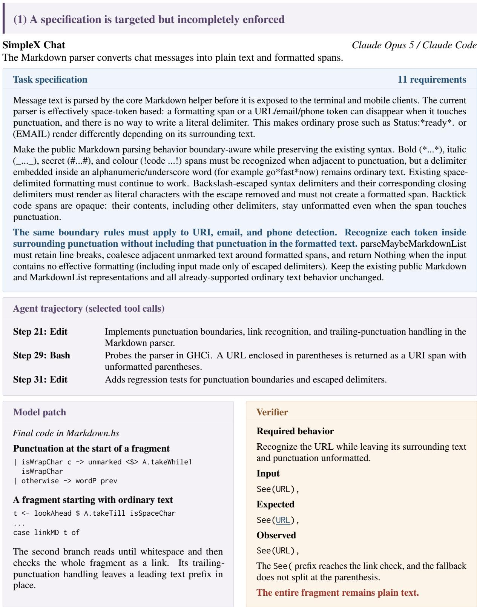  
Figure 9 Failure pattern (1): a specification is targeted but incompletely enforced. The patch includes link recognition and punctuation handling, and the agent’s probe recognizes a parenthesized URL. Yet a URL following the text prefix remains plain text in the final evaluation. The targeted requirement is satisfied in one boundary setting but violated in another. URL and email strings are abbreviated; underlining denotes a URI span.

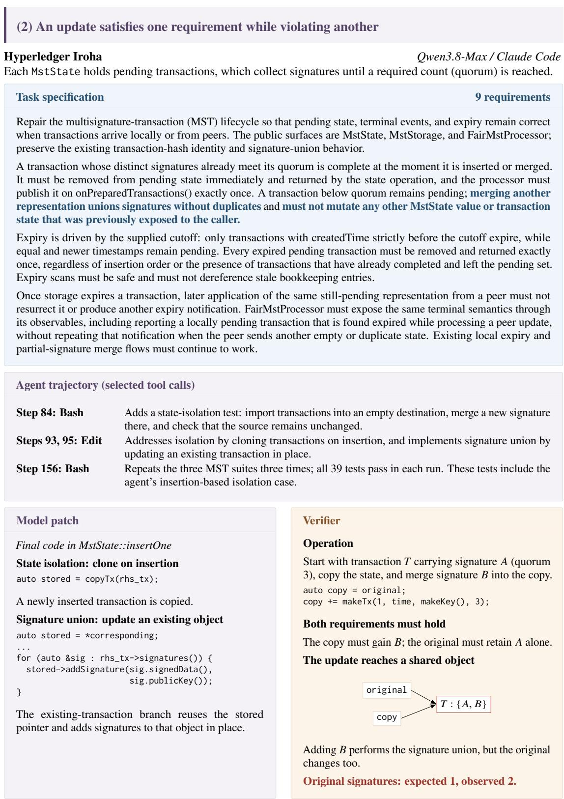  
Figure 10 Failure pattern (2): an update satisfies one requirement while violating another. The patch addresses both signature union and state isolation. After a whole-state copy, however, both states share a transaction. The update adds the required signature to the destination transaction while also changing the original, violating isolation. Thus the same update fails to satisfy both requirements together. The original-state count is measured by the verifier.