# Agentic LLM reasoning in pediatric diabetes outcome prediction from multimodal medical records

Daniel Palacios1,2,3,4, Guantong Qi2,3,4,5, Anna Kadi6, Natali Borrego2, Sukru Aras2,3,7, Michael L. Ferm8,11, Elizabeth Kubota-Mishra8, Maria J. Redondo8,9,10, Zhandong Liu∗1,2,3,4, Mustafa Tosur∗8,9, and Hu Chen∗2,3,4

1Quantitative and Computational Biosciences, Baylor College of Medicine, Houston, Texas, USA

2Department of Pediatrics, Baylor College of Medicine, Houston, Texas, USA

3Jan and Dan Duncan Neurological Research Institute, Texas Children’s Hospital, Houston, Texas, USA

4Data Science Center, Texas Children’s Hospital, Houston, Texas, USA

5Genetics and Genomics Graduate Program, Baylor College of Medicine, Houston, Texas, USA 6School of Medicine, Baylor College of Medicine, Houston, Texas, USA

7Department of Epidemiology and Population Health, Baylor College of Medicine, Houston, Texas, USA 8Department of Pediatrics, Division of Pediatric Diabetes and Endocrinology, Baylor College of Medicine, Texas Children’s Hospital, Houston, Texas, USA

9Children’s Nutrition Research Center, USDA/ARS, Department of Pediatrics, Baylor College of Medicine, Houston, Texas, USA 10Immunobiology Center, Baylor College of Medicine, Texas Children’s Hospital, Houston, Texas, USA

11Division of Pediatric Endocrinology and Diabetes, Department of Pediatrics, NYU Grossman School of Medicine, New York, NY, USA

∗Co-corresponding authors (senior authors); H.C. is the lead corresponding author. Correspondence: Zhandong Liu (zhandong.liu@bcm.edu), Mustafa Tosur (mustafa.tosur@bcm.edu), Hu Chen (hu.chen@bcm.edu).

## Abstract

Large language model (LLM) agents are proposed for clinical prediction but are untested in pediatrics, where cohorts are small and outcomes are uncommon. Using records from 2,489 youth with type 2 diabetes (T2D) and 4,018 with type 1 diabetes (T1D), spanning structured data, note-derived social determinants and, in T1D, continuous glucose monitoring data, we predicted seven T2D outcomes, four also in T1D, at 24 months from 18 months of followup. Cedar (Clinical Evidence-Driven Agent for Risk-prediction), an evidence-citing, self-auditing LLM pipeline, outperformed trained machine learning in both cohorts (pooled area under the receiver operating characteristic curve 0.815 versus 0.656–0.700 in T2D and 0.756 versus 0.603–0.631 in T1D), most on the sparsely screened outcomes. Only 4 of 70,246 values it cited did not match the chart. Reading only its cited evidence and reasoning, two pediatric endocrinologists reached Cedar’s prediction in about nine of ten cases, agreeing with each other on 90.5%.

## Introduction

Diabetes is among the most common chronic diseases of childhood in the United States. Type 1 diabetes (T1D) remains the predominant pediatric form (prevalence ∼215 per 100,000 under 20 years, incidence rising ∼2%/year [1, 2, 3]), while type 2 diabetes (T2D), once rare in youth, has emerged as a parallel epidemic driven by childhood obesity (prevalence up 95% from 2001–2017, incidence ∼18 per 100,000 [1, 2]). Youth of Black, Hispanic, and American Indian descent bear a disproportionate burden of both incidence and poor glycemic outcomes [4, 5]. U.S. diabetes-related costs exceeded \$400 billion in 2022 across all ages [6], and pediatric-onset disease contributes disproportionately to lifetime cost through its longer duration of exposure.

Pediatric diabetes also difers biologically from adult-onset disease. Youth with T2D show earlier micro- and macrovascular complications [7, 8] and greater insulin resistance with hyperresponsive beta cells relative to adults [9], and the TODAY trial found durable glycemic control from metformin alone in only about half of adolescents with T2D [10]. T1D poses distinct challenges as well, including glycemic variability, recurrent hypoglycemia, and early cardiovascular risk emergence [11, 12]. This heterogeneity motivates precision approaches that stratify risk and guide individualized decisions.

Pediatric diabetes care is delivered by a multidisciplinary team. The pediatric endocrinologist interprets a child’s metabolic course alongside treatment history and social circumstances, and integrates input from diabetes educators, dietitians and social workers, each of whom contributes a diferent kind of information.

Machine learning (ML), by contrast, collapses this reasoning into a single function approximation. Such models are widely applied to clinical prediction from electronic health records (EHR) [13, 14], including in pediatric diabetes [15, 16], but treat prediction as pattern matching rather than reasoning. They also leave largely untapped two modalities that plausibly add value. Continuous glucose monitoring (CGM) captures temporal dynamics that static glycated hemoglobin (HbA1c) cannot [17, 18], and social determinants of health (SDOH) are documented in narrative notes but rarely available as structured data [19, 20] and are now extractable at scale with LLMs [21, 22]. Each has demonstrated prognostic value on its own: CGM-derived features predict short-term hypoglycemia and glycemic variability in type 1 diabetes [17], and psychosocial burden is associated with worsening glycemic control in youth with diabetes [5]. What is unresolved is how much either adds beyond longitudinal structured EHR in this setting, and in what representation. This gap between how clinicians reason and how models predict motivates asking whether an LLM can reason over the same multimodal evidence a clinician weighs.

Large language models (LLMs) with strong clinical knowledge [23, 24] enable explicit, chain-of-thought reasoning over patient data [25], and a natural next step is to decompose that reasoning across communicating specialized agents [26, 27], by analogy to a care team.

Recent systems apply this idea to clinical prediction, each covering a slice of our problem. CARE-AD [28] predicts Alzheimer’s onset from clinical notes, ColaCare [29] predicts in-hospital mortality and readmission through multi-agent collaboration between LLMs and trained EHR models, MDAgents [30] performs adaptive routing for question answering and diagnosis, and MoMA [31] coordinates modality-specialist agents that convert non-text modalities to text for multimodal clinical prediction. These establish the promise of agentic clinical prediction, yet enthusiasm has outpaced evidence. The gains attributed to multi-agent debate are contested: majority voting, rather than debate itself, accounts for most of them [32], decision protocols help unevenly across task types [33], and debate strategies do not reliably outperform simpler prompting at substantially higher cost [34]. None of these systems has been evaluated in pediatric settings, where cohorts are small and the outcomes of interest are uncommon, so a model has few training examples to learn from. Pediatric diabetes is a demanding place to test them: a child’s record is longitudinal but sparse, the complications being predicted are uncommon, and the evidence a clinician would weigh is spread across social-worker notes, structured EHR and, in T1D, continuous glucose monitoring data. Four questions therefore remain open. First, can LLM reasoning predict a child’s diabetes outcomes more accurately than a conventional trained machine-learning model? Second, can the reasoning behind such a prediction be trusted, that is, are the cited chart values real rather than hallucinated? Third, do those cited values actually drive the prediction, or merely accompany it? Fourth, can a clinician follow the reasoning well enough to reach the same conclusion?

We compare LLM reasoning with classical and temporal ML for pediatric diabetes outcome prediction. Using longitudinal Texas Children’s Hospital data, we predict seven type 2 and four type 1 diabetes outcomes at 24 months from the first 18 months of follow-up (Figure 1). We introduce Cedar (Clinical Evidence-Driven Agent for Risk-prediction), a single-model pipeline tha reasons over structured EHR data, SDOH extracted from social-worker notes and, for T1D, CGM, and cites the record values behind each prediction so that a clinician can check them (Methods, Section 6).

We address these questions with four analyses. We compare Cedar with classical and temporal ML across eleven cohort–outcome pairs in two cohorts, and audit the faithfulness of the evidence it cites with established rationale-evaluation protocols [35, 36]. Two pediatric endocrinologists review its reasoning blinded to the outcome, and an information ablation measures how much of the predictive signal lies in the outcome’s own history. We also test whether supplying a trained model’s score to Cedar as a tool improves prediction.

## Results

## Discrimination of Cedar and machine learning in both pediatric diabetes cohorts

We built a benchmark in which the first three 6-month visit windows, covering months 0–18, predict each outcome at 24 months, across seven T2D and four T1D outcomes (Figure 1; Methods, Sections 1 to 3). Prevalence ranges from 58.7% for dyslipidemia to 8.9% for hypertension in T2D, and from 24.6% to 4.7% for the same two outcomes in T1D (Supplementary Table 1). Cohort composition and feature availability are in Supplementary Tables 2 and 3. Two companion studies describe these cohorts in more detail, in T2D (D. Palacios et al., manuscript in preparation) and in T1D (M. Ferm et al., manuscript in preparation).

The benchmark compares two machine-learning subgroups, classical models over the flattened feature matrix and temporal models over the visit sequence, with the full Cedar pipeline (Figure 2; Methods, Sections 4 and 6). Across the seven T2D outcomes Cedar outperforms ML (Figure 2a; Mann–Whitney U treating each model’s score on each outcome as one observation, p < 0 001). The pooled mean area under the receiver operating characteristic curve (ROC-AUC) was 0.815±0.049 against 0.700±0.100 for classical ML and 0.656±0.103 for temporal ML. Exact test statistics for every pooled comparison are reported in Supplementary Table 4. We also benchmarked naive single-call LLM implementations on the same base model and patients, which reached discrimination comparable to Cedar (Supplementary Note 4). Cedar’s lead over the best ML model stayed positive on all four base models tested, including the open-weight Llama 3.3 70B that an institution could run locally (Supplementary Figure 1).

The same ordering holds in T1D (Figure 2c, d), where Cedar reaches 0.756±0.060 against 0.631±0.110 for classical ML and 0.603±0.083 for temporal ML (p = 0 007 against ML as a whole, p = 0 058 against classical ML alone, where only four outcomes are evaluable). The advantage is nonetheless uneven across outcomes. In T2D the per-outcome heatmap (Figure 2b) and the best-ML-versus-Cedar comparison (Figure 2e) show margins as wide as +0 21 on dyslipidemia and +0 11 on microalbuminuria but as narrow as +0 03 on optimal glycemic control and +0 01 on insulin independence. In T1D individual ML models match or lead Cedar: random forest leads on optimal glycemic control at 0.797 against 0.785, and logistic regression reaches 0.688 on hypertension against 0.666.

At the level of individual outcomes the evidence is weaker than the pooled contrast suggests, since the 95% bootstrap intervals of Cedar and the best ML model separate only on dyslipidemia, in both cohorts (Supplementary Table 5). And although Cedar needs no training, its inference costs about \$0.10 per patient against less than \$10−6 for a trained model (Methods, Section 8; Supplementary Figure 2).

## Faithfulness of the evidence Cedar cites, and clinician review

Where a classical model returns only a risk score, Cedar also returns the record values it reasoned from, each traceable to the chart (Figure 3a). The record shown there is synthetic. Any chain-of-thought prompt narrates a rationale; what distinguishes Cedar is that the rationale arrives as a fixed table of cited features, visits and values (Methods, Section 6), so each claim resolves to a record value a clinician can look up.

Two audits at diferent scales, both built on established rationale-evaluation protocols [35, 36], test whether that trace holds up.

We first checked every scored patient-outcome record for fabricated evidence, 1,600 in T2D and 890 in T1D, comparing each cited feature, visit and value against the chart. Of 47,803 cited values in T2D only 4 fail to match the record, three on metformin response and one on microalbuminuria, and in T1D all 22,443 match. Fabricated evidence is therefore essentially absent. This is a check on transcription rather than on clinical judgment.

We then asked whether the cited values drive the prediction or merely decorate it, on a deeper counterfactual audit of up to 10 patients per outcome, giving 70 records and 2,050 cited features in T2D and 40 records and 1,046 cited features in T1D. The cited evidence alone reproduces the prediction, with mean suficiency 0.95 in both cohorts, while no single citation is decisive, with mean comprehensiveness 0.08 in T2D and 0.05 in T1D (Figure 3b). Masking the top cited values cumulatively moves the prediction steadily further, from a mean change of 0.11 at the top citation to 0.32 at the top ten, about five times the shift from masking the same number of randomly chosen available values, 0.065 at the top ten (Figure 3c). Cited features therefore carry more of the prediction than an equally sized arbitrary set, and the prediction rests on the combined weight of many mutuall supporting clues rather than on any one of them, much as a clinician reasons.

Finally, the evidence Cedar highlights is clinically sensible (Figure 3d). Across outcomes it relies most on recognized drivers such as BMI z-score, the outcome’s own recent history, and the glucose and HbA1c axis. To test whether a clinician can follow that reasoning, two board-certified pediatric endocrinologists reviewed 63 T2D patient-outcome cases, sampled across the four confusion cells and presented as Cedar’s citation table and reasoning chain with the probability withheld. Each rated clinica usefulness from 1 to 5 and named the prediction the rationale supports, blinded to the recorded outcome and to whether Cedar was correct; both completed all 63. Working independently, each agreed with Cedar’s prediction from the rationale alone in 92.1% and 88.9% of cases (Cohen’s κ = 0 84 and 0 78), and the two agreed with each other on 90.5% (57/63, κ = 0 81; Supplementary Figure 3a). Mean usefulness was 4.68 and 3.95 of 5 (Supplementary Figure 3c). The cases Cedar scored incorrectly were largely the cases the specialists also scored incorrectly: on 29 of 31 errors at least one expert reached the same incorrect call, and on 24 both did (Supplementary Figure 3b). Because the specialists saw only the evidence Cedar cited, this shows that its errors cannot be detected from its rationale, not that clinicians reading the full record would make the same errors. Alongside its accuracy gain over ML (Figure 2), what Cedar adds is a rationale a clinician can read and check. Further configurations tested on top of Cedar and the full per-citation audit are in Supplementary Figures 4 and 5.

## Error overlap between Cedar and machine learning, and machine-learning scores as a tool

We next asked whether the ML models and Cedar make the same mistakes (Figure 4a shows T2D). Within the ML family errors overlap strongly, with an error correlation (ϕ, the correlation between two models’ misclassification indicators) of 0.63 in T2D and 0.61 in T1D between the best classical and best temporal models. Between Cedar and ML they are largely independent, with ϕ of 0.12 to 0.17 in T2D and 0.03 to 0.06 in T1D, so the two families make mistakes on diferent patients. Error rates also diverge with prevalence (Supplementary Figure 6a shows T2D). On the outcomes with low prevalence classical ML makes fewer errors, 0.15 against 0.58 for Cedar in T2D and 0.05 against 0.31 in T1D, because it predicts the majority class while Cedar attempts the rare positive calls. In T2D, Cedar errs less on the more balanced outcomes.

That complementarity invites combining them, but how matters. Rather than a black-box combiner, we gave Cedar the frozen ML score as an in-context tool. T1D optimal glycemic control is the outcome where a standalone statistical model is strongest relative to Cedar, with random forest numerically ahead, and logistic regression is likewise ahead on T1D hypertension, within noise. On optimal glycemic control the tool gained +0 03 ROC-AUC over no-tool Cedar, with a bootstrap interval excluding zero, matching a stacked late-fusion combiner while keeping a checkable rationale (Figure 4b). On a representative outcome on which ML performs poorly, T2D dyslipidemia, no comparison reached significance (Supplementary Figure 7a). The hybrid approach therefore helps where the ML tool is competitive and gives no benefit, at times a small loss, where it is not.

Declining to score the least confident 40% of patients, ranked by Cedar’s own probability, raised ROC-AUC from 0.767 to 0.825 in T2D (Supplementary Figure 6e; Supplementary Note 1). Ofering the ML score to more patients kept helping on T1D optimal glycemic control but not on dyslipidemia (Figure 4c), and a learned per-patient policy for when to ofer it was safe on every outcome (Supplementary Figure 8).

Against that one targeted win, no other attempt to improve Cedar’s discrimination moved it beyond noise. These were a pre specified screen of verifier-gated self-refinement and a diverse-reasoner ensemble (Supplementary Figure 4), LLM-guided feature engineering (Supplementary Table 6) and a prompt-level refinement supplying the empirical transition rates (Supplementary Table 7). Accuracy here appears limited by the information in the data rather than by the strength of the model. A case-level review of Cedar’s T2D errors locates that limit (Supplementary Note 2, Supplementary Figure 9 and Supplementary Table 8). Cedar mostly carries the last observed outcome state forward and cannot anticipate a change, carrying it forward about as often when the state changed as when it held (p = 0 39), so most errors are unpredictable transitions rather than reasoning failures. Recalibration would improve its probabilities but cannot change any ROC-AUC reported here (Supplementary Table 9). A baseline that simply carries the last observed outcome state forward is beaten by Cedar on six of seven T2D outcomes, by +0 035 to +0 083 ROC-AUC (Supplementary Note 2).

Further analyses, all reported in the supplement, support these results. Fusing Cedar with the best ML model improved calibration but not discrimination (Supplementary Figures 4 and 10). CGM improved prediction only on T1D optimal glycemic control, and SDOH on no outcome in any model family (Supplementary Figures 11 and 12). Every family held its accuracy when trained on earlier-diagnosed patients and tested on more recently diagnosed ones (Supplementary Figure 13). On the adult critical-care database MIMIC-IV (Medical Information Mart for Intensive Care), Cedar led every model on one-year mortality but trailed supervised ML on readmission and in-hospital mortality (Supplementary Note 3, Supplementary Table 10).

## Contribution of outcome history and clinical context

The error review suggests that prediction rests on the outcome’s own recent course. To measure how much of the signal that history carries, we separated each record into two parts and scored them apart (Figure 5a; Methods, Section 11). The outcome history is the laboratory values and diagnosis codes that define the outcome, at visits 1 to 3. The clinical context is everything else, including other laboratory values, medications, social determinants and demographics. Three separate LLM prompts on the same base model, which we call readers, scored each patient from the history alone, from the context alone, or from both. On all 1,600 T2D test patient-outcomes, the history alone reached a mean ROC-AUC of 0.79 across the seven outcomes, close to Cedar’s 0.81 on the same patients, whereas the context alone reached 0.67 (Figure 5b). Adding the context to a complete history changed discrimination by −0 005 to +0 018. Most of the predictive signal therefore sits in the outcome’s own recent course.

We then withheld that history visit by visit, in seven conditions applied to 100 patients per outcome (Figure 5a, right). Recency mattered more than amount. A history showing only the latest visit beat one showing only the earliest visit on all seven outcomes, by +0 02 to +0 24 ROC-AUC (Figure 5c), and the two most recent visits matched or beat the full laboratory history on five of seven. When the history was thin, the clinical context recovered much of what was lost. In all 11 outcome-condition pairs where the history alone fell below the context alone, reading both improved on the history, by a mean of +0 076 ROC-AUC (Figure 5e and Supplementary Figure 14). Reading both also kept accuracy steadier: across conditions its ROC-AUC spanned 0.06 to 0.19 depending on the outcome, against 0.12 to 0.27 for the history alone, and it was narrower on all seven outcomes (Figure 5d). Per-condition estimates with confidence intervals are in Supplementary Table 11, and the design’s limits in Supplementary Note 5.

## Discussion

We set out to test whether an evidence-citing LLM pipeline predicts pediatric diabetes outcomes better than trained machine learning, and whether its reasoning can be trusted. Across eleven cohort–outcome pairs in two pediatric diabetes cohorts, Cedar beat trained classical and temporal ML, with pooled T2D ROC-AUC 0.82 against 0.66–0.70. The accuracy benefit is outcomedependent, largest on sparsely screened endpoints such as dyslipidemia and microalbuminuria and near zero on the best-powered outcomes, where a classical model stays competitive at a fraction of the cost. Beyond accuracy, what Cedar adds is reasoning a clinician can use: two pediatric endocrinologists reading only its rationale reached the same prediction in about nine cases in ten and only 4 of 70,246 cited values did not match the record. Supplying the ML score as a tool added accuracy where the statistical model was strong, +0 03 ROC-AUC on that outcome.

The pattern of gains across outcomes suggests an explanation. They are largest on dyslipidemia and microalbuminuria, outcomes that are screened sparsely, so few patients carry the measurement a trained model would learn from, whereas Cedar brings clinica priors through its guideline knowledge and its base model. On rare outcomes the trained models default to the majority class and rank near chance, and the two families make mistakes on diferent patients, which is why an ML score supplied as a tool helps only where that model is already strong. The information ablation supports this account. Most of the signal lies in the outcome’s own recent history, consistent with trained models doing well where that history is dense and poorly where it is sparse, and the clinical context matters most when the history is thin. Reasoning over the whole record can therefore hold accuracy for patients whose recent measurements are missing, a group that grows as follow-up lengthens (Figure 1b).

Several limitations bound these conclusions. The study is single-center and retrospective, and the Cedar evaluation, though bootstrapped, uses adaptive per-outcome test samples rather than the full cohort. Tool use raised accuracy on only one outcome, so its benefit is outcome-specific. Cost estimates are based on vendor list prices, so the tiers should be read as orders of magnitude. The temporal and external checks summarized in the Results do not replace multi-site pediatric validation. Additional limitations and future directions are detailed in Supplementary Note 1.

Four directions follow. First, the MIMIC-IV benchmark [37] still lacks the head-to-head comparison against ColaCare [29], MDAgents [30] and MoMA [31]. Second, a larger review in which clinicians predict from the full record, with and without Cedar’s rationale, would test whether the rationale helps them catch its errors. Third, the 24-month horizon is one snapshot, so predicting at successive visits and horizons would show when each outcome first becomes predictable. Fourth, accuracy is limited by the information in the data, so new signal should help more than new machinery. Two candidates are the raw social-worker notes in place of binarized SDOH factors, and a continuous-glucose foundation model [18] applied to the raw sensor trace.

In this setting of small cohorts and uncommon outcomes Cedar outperforms the trained statistical models we tested while producing reasoning that two pediatric endocrinologists could follow and largely agreed with, and reasoning over the whole record recovers accuracy when a patient’s recent measurements are missing. Evidence-citing clinical reasoning is therefore a practical foundation for pediatric prediction, and the direction worth building on is richer evidence for the model to reason over.

## Methods

All models are compared on a shared, held-out test set. For each outcome, a single deterministic, prevalence-stratified train/test split defines the test patients (random seed 42), and every model family is scored on those identical patients with the same feature representation, collinearity exclusions, and metrics. Trainable models are fit on the training partition; the LLM configurations are inference-only. This matched comparison is the basis for every head-to-head claim in this paper.

## 1. Study population

We use data from Texas Children’s Hospital, one of the largest pediatric health systems in the United States. The primary cohort comprises 2,489 patients with T2D. A parallel cohort of 4,018 patients with T1D serves as a second, larger cohort in which the target outcomes are rarer and fewer are clinically applicable (Supplementary Figure 15). All patients were diagnosed at leas 2 years before data extraction, but not all have recorded data at the 24-month visit, so each outcome is analyzed in the patients assessable at that visit (Figure 1b, d; Supplementary Table 1).

The established PheKB computable phenotype algorithms for type 1 and type 2 diabetes [38, 39] cross-contaminated cohorts on our pediatric Observational Medical Outcomes Partnership (OMOP) data, so we identified candidates with the Palantir Foundry Cohort Builder agent system instead. The agent searched the diabetes Epic flowsheets for patients carrying a recorded type 1 or type 2 diabetes diagnosis. Where a patient had conflicting diagnosis entries or diagnosis dates across encounters, we kept the most recent reliable record. A medical expert team at Texas Children’s Hospital validated these candidates by manual chart review, removing misclassified patients and correcting diagnosis dates. Candidates added in a later rebuild of the cohort were confirmed with the same criteria, so the phenotype definition did not change between builds. The medical expert team comprised three board-certified pediatric endocrinologists and three trainees (a pediatric endocrinology fellow, a pediatric resident, and a medica student) who worked under their supervision. We then accessed the full OMOP records, demographics, medications, laboratory results, and International Classification of Diseases (ICD) codes, and curated a clinically relevant variable set with domain experts (Supplementary Table 12). We collected the corresponding social-worker notes for SDOH extraction, and continuous glucose monitoring (CGM) data for about 2,000 T1D patients. CGM coverage in the T2D cohort was too sparse to be representative, so CGM is not used there.

This retrospective study was approved by the Baylor College of Medicine Institutional Review Board (protocols H-55929 and H-53771), which granted a waiver of informed consent for secondary analysis of existing clinical data.

## 2. Data structure and modalities

Each patient has a matrix of features across 10 visit windows of 182 days (6-month intervals, 0–5 years post-diagnosis), organized into modality groups (Supplementary Table 12). These are labs and vitals (18), medications (3, namely insulin, biguanide and glucagon-like peptide-1 receptor agonist, GLP-1RA) and conditions (4, namely diabetic ketoacidosis, DKA, ketosis, retinopathy and neuropathy). The remaining groups are demographics (9, namely age at diagnosis, sex, Hispanic ethnicity, four race indicators, primary language and diabetes duration), SDOH (13 factors, enumerated below) and, for T1D only, CGM (20 per-visit glycemic metrics). The analysis-ready representation contains 47 features for T2D and 67 for T1D (cohort composition and feature availability in Supplementary Tables 2 and 3).

SDOH factors were extracted from social-worker notes with a two-stage LLM pipeline. An OpenAI GPT 5.1 extractor (Palantir Language Model Service identifier openai-gpt-5-1, version 1.151.0, accessed 2026-07-03) produced structured JSON, and an Anthropic Claude Sonnet 4.5 validator (anthropic-claude-4-5-sonnet, v1.151.0) confirmed each field. The 13 extracted factors are eight binary indicators (food insecurity, adverse childhood experiences, housing instability, transportation barriers, physical or sexual abuse, alcohol abuse, substance abuse, smoking), four binarized categorical factors (parental education, parenta employment, financial strain and family support) and insurance, encoded as an ordinal category. All are treated as static across visits. A further extracted factor, physical activity, was excluded for missingness. Clinical experts reviewed the extracted factors against the source social-worker notes, approximately ten patients per factor, and the disagreements identified were used to revise the extractor prompts. This review was iterative rather than an independent held-out test, so no agreement rate was recorded.

CGM data are available only for T1D, which makes the two cohorts a natural modality contrast. Vendor exports difer in format and sampling, and none provides visit-aligned summaries, so we wrote our own extraction routine. It reads the raw sensor traces and reduces each patient’s readings to 20 metrics per 182-day visit window, covering glucose statistics, time in, above and below range, hypoglycemia episode counts and monitoring coverage (Supplementary Table 12). The metrics and the glucose thresholds that define the time-in-range bands follow international consensus recommendations [40] rather than choices made for this study, so they are the features a clinician reading a CGM report would recognize. Because sensor wear is intermittent, the metric set also carries reading counts, monitoring duration and the fraction of the window missing, so every model can see how much data each metric rests on.

## 3. Prediction targets, outcome definitions, and horizon

We predict seven binary outcomes. Three are complications: hypertension (ICD diagnosis, or three consecutive outpatient blood-pressure readings above AAP-2017 age and sex thresholds) and dyslipidemia (non-HDL cholesterol ≥145 mg/dL, an ICD E78.x diagnosis, or lipid-lowering therapy). The third is microalbuminuria (ICD diagnosis or urine albumin-to-creatinine ratio (UACR) ≥30 mg/g confirmed on two or more measurements, capped at 300). Four are treatment goals: optimal glycemic control (HbA1c <7%), insulin independence (of insulin, HbA1c <7%, no DKA), metformin response (on metformin alone with HbA1c 7%) and GLP-1RA response (on a GLP-1RA with HbA1c 7%). Each label is 1, 0, or not-assessable (null), the last excluded from that outcome’s analysis. Because laboratory screening is not completed for every patient, the assessable patients may difer from those who were not screened, which may limit how far the results generalize.

To prevent collinearity, the laboratory value or medication that defines an outcome is removed from that outcome’s feature set, identically for every model family (Supplementary Table 13). These are HbA1c for glycemic control, all blood-pressure features for hypertension, the lipid panel for dyslipidemia, UACR for microalbuminuria, insulin for insulin independence, and biguanide plus HbA1c for metformin and GLP-1RA response.

The primary analysis uses a 2-year horizon, so the first three visit windows covering months 0–18 are the input and the outcome is evaluated at visit 4, at approximately 24 months. A 5-year horizon is defined analogously (input visits 1–5, target visit 10) and is deferred to future work. Outcome prevalence at the target visit is shown in Figure 1d.

## 4. Reference baselines: classical ML and temporal ML

Classical ML comprises three classifiers on the flattened feature matrix (all features by input visits). These are logistic regression (elastic net, L1 ratio 0.5, inverse regularization strength 1.0, SAGA solver), random forest (200 trees, max depth 10, min-leaf 5) and XGBoost (200 estimators, max depth 5, learning rate 0.1, subsample and column-sample 0.8). Temporal ML treats the visit history as a sequence. XGBoost-Temporal augments XGBoost with five engineered temporal features per base feature: last value, mean, standard deviation, first-to-last delta and ordinary least-squares slope. Four deep-sequence models complete the family. These are long short-term memory (LSTM) and gated recurrent unit (GRU) networks (2 layers, hidden size 64, dropout 0.3), a temporal convolutional neural network (CNN; 1-D convolution, 64 channels, adaptive pooling) and a Transformer (4-head attention, 2 layers, model dimension 64, learned positional embeddings). All four are trained for 100 epochs with Adam (learning rate 0.001, weight decay 0.0001) and class-weighted binary cross-entropy. Classical models use median imputation and standardization fit on the training partition, and feature importances are collected on the held-out folds.

## 5. LLM configurations

Cedar and every LLM configuration use Anthropic Claude Sonnet 4.6 (Palantir Language Model Service identifier anthropic-claude-4-6-sonnet, version 1.151.0, accessed 2026-07-03), referred to below by its vendor short name claude-sonnet-4-6. Models are called through the Palantir Language Model Service, within the institution’s environment approved for protected health information, at temperature 0, except the self-consistency samples described below. The Results report the full Cedar pipeline (Section 6). For the reference benchmark in Supplementary Note 4 we also scored naive single-call configurations on the same patients. A direct configuration (“Vanilla”) gives one model the full multimodal record and asks for a probability, a binary prediction and a brief rationale. A chain-of-thought configuration (CoT) uses the same input with a structured step-by-step scafold (metabolic, treatment, social, CGM for T1D, then severity), and Vanilla variants withhold the demographics and SDOH blocks or, in T1D, the CGM block. A naive multi-agent configuration, in which modality-specialis agents’ free-text findings are fused by an LLM synthesizer, underperformed and is reported only in Supplementary Figure 4. To test whether results depend on the base model, Cedar and the Vanilla configuration were re-run on all 11 cohort–outcome pairs with three further models spanning vendors and sizes, claude-haiku-4-5, gemini-3-1-pro and the open-weight llama-3-3-70b, holding prompts, inputs and test sets fixed.

## 6. Cedar: evidence-grounded, self-consistent clinical reasoning

Cedar is a four-stage pipeline run per patient (Figure 1c). It runs on a single underlying model, and each stage targets one failure mode of naive prompting: missing domain priors, ungrounded reasoning, hallucinated evidence or miscalibration.

S0, knowledge injection. Two to three one-sentence guideline snippets, selected by outcome, are prepended to the prompt as a fixed per-outcome knowledge base rather than as retrieval over a corpus. They were curated by the authors from the American Diabetes Association Standards of Care [41], the 2022 International Society for Pediatric and Adolescent Diabetes Clinical Practice Consensus Guidelines [42] and two landmark youth-onset T2D trials [10, 43]. Statements of accepted pathophysiology carrying no specific citation complete the set. The complete S0 text for every outcome, reproduced exactly as it is inserted into the prompt and attributed line by line, is given in Supplementary Tables 14 and 15 for T2D and T1D respectively. One snippet compresses the TODAY trial to “∼50% of youth with T2D lose glycemic control on metformin alone within 3 years”. The published result is a 51.7% metformin-monotherapy failure rate over a mean follow-up of 3.9 years [10], so the injected wording rounds the rate and shortens the horizon.

S1, evidence-grounded chain-of-thought. The model reasons step by step over each modality (temperature 0) and emits a strict plain-text record. The probability comes first so it is never truncated, then a table of cited evidence (FEATURE | VISIT | VALUE | DIRECTION | IMPORTANCE) with values at explicit visit tokens such as v3(18mo)=8.50 so citations can be checked against the record, and finally the free-text reasoning. S2, verification. Every citation is checked against the record by the deterministic tolerance test of Methods, Section 7, and unmatched citations are removed. In parallel a clinical evidence auditor pass reviews the same citations and may issue a single revised probability. Both signals are reported separately in Supplementary Note 1. S3, self-consistency calibration. The S1 prompt is resampled K = 3 times at temperature 0.7, and the mean of the parsed probabilities is the self-consistency (SC) estimate. Although the pipeline has four stages, only S1 to S3 issue model calls, five per patient, since S0 is prepended context.

The final score averages the verified probability and the self-consistency mean, $\begin{array} { r } { p _ { \mathrm { f i n a l } } = \frac { 1 } { 2 } \big ( p _ { \mathrm { v e r i f y } } + p _ { \mathrm { S C } } \big ) } \end{array}$ , and is used directly for ROC-AUC and Brier score. Two ablations, reported in Supplementary Note 4, isolate each mechanism’s contribution: CoT+Verify (S1 and S2 only) and CoT+SC (S1 and S3 only).

Relative to a single prompted call, which returns only a probability, Cedar adds guideline priming, forced grounding in citable record values, verification of those claims, and stability across resamples (Supplementary Table 16). The individual techniques are not themselves new; the contribution is their composition into a workflow purpose-built for auditable clinical outcome prediction.

## 7. Faithfulness and interpretability

For Cedar, we audit whether cited evidence corresponds to real record values and is collectively relevant to the prediction (change threshold 0.10 throughout), with five complementary analyses. The audit targets faithfulness, how accurately a rationale reflects the reasoning that produced the prediction, as distinct from plausibility, how convincing that rationale is to a reader [36, §2]. We therefore intervene on the model’s inputs rather than inspect its prose, and leave reader-facing judgement to the expert review of Section 10. Extractive grounding, being cheap, runs on every scored patient-outcome record; the four counterfactual analyses each re-run S1 under masking and run on a random subsample of patients per outcome.

Extractive grounding compares each cited (feature, visit, value) triple with the actual record. A citation is verified if it matches within tolerance (|cited − actual| ≤ max(0 5 0 05 |actual|)), and unmatched or non-existent citations are counted as hallucinations [44]. Suficiency and comprehensiveness are the two faithfulness metrics of the ERASER rationale-evaluation framework [35, §4.2], adapted here from extractive rationales over text to a citation table over structured records. Suficiency masks all non-cited features and re-runs S1, reporting $1 - | p _ { \mathrm { b a s e l i n e } } - p _ { \mathrm { c i t e d - o n l y } } | ,$ so higher is better. Comprehensiveness masks each cited feature individually and reports the fraction whose removal moves the probability by ≥0.10. Both depart from ERASER’s published form, which is detailed with the rationale for each departure in Supplementary Note 1.

The group-masking curve ranks cited features by importance and masks the cumulative top-K (K ∈ {1 3 5 10}) together, tracing mean |∆p| against K, following the area-over-the-perturbation-curve construction of ERASER [35, §4.2, Eq. 3] with cited features in place of token bins. It is paired with a size-matched random-masking control. For the same patients and the same K, K features are drawn uniformly at random from those available for the patient, under the same outcome-specific exclusions, and the draw is repeated 20 times per patient and K and averaged. The evidence audit plots each cited feature’s model-reported importance against its actual counterfactual impact when masked, colored by verification status. A model’s stated reasoning need not correspond to what drives its output [45, §3.2], and intervening on the reasoning is the established way to measure that gap [46, §2].

## 8. Cost and clinical economics

Cost here is a token- and compute-based estimate, not a vendor bill, and it is reported to separate the tiers by order of magnitude rather than to predict any site’s budget. For LLM configurations, input and output tokens are tracked per call, priced at \$3 and \$15 per million tokens, the list price of the Claude Sonnet tier used here, and divided by the number of patients scored. Latency and call counts are logged separately. At these prices Cedar’s five calls per patient (Section 6), with their long prompts and rationales, cost \$0.099 per patient. That figure is indicative only, since actual spend depends on the provider, contract, model tier and any caching or batching, none of which are properties of the method. Classical and temporal models issue no tokens, so we report a deliberately conservative inference-equivalent cost instead: wall-clock training time priced at $\$ 5\times10^{ -5}$ per second (≈\$0.18/CPU-hour) and amortized over the test cohort. This gives $\$ 1.8\times10^ { - 7 }$ per patient for classical ML and $\$ 4.2\times10^ { -6 }$ for temporal ML, which overstates their true marginal cost and so understates rather than inflates the Cedar-versus-ML gap.

We compute the cost-performance Pareto frontier across all families and, per outcome, the ROC-AUC gain over the best classical or temporal model divided by cost per patient (Supplementary Figure 2). A gain counts as statistically distinguishable from ML when the two models’ 95% confidence intervals do not overlap.

## 9. Extensions: tool use and routing, selective prediction, external benchmark, and temporal validation

ML score as an in-context tool, and per-patient routing. The frozen statistical model’s predicted probability for the patient is supplied to Cedar inside the S1 prompt as an explicitly labeled tool reading, which the model can cite, discount or contradict in its citation table. No model is retrained and no scores are combined arithmetically. Four policies were compared per outcome on the shared held-out set. These were never route (Cedar without the tool), always route, a pre-specified rule ofering the tool only where standalone ML is competitive, and a learned per-patient policy gated jointly on Cedar’s self-consistency spread and the ML model’s own confidence. For each we report ROC-AUC with bootstrap confidence intervals, the fraction of patients routed and the cost per patient, since routing adds tokens. The learned policy’s gating threshold was then swept so that the routed fraction covered the full 0–100% range, reporting at each point the ROC-AUC diference from never-route on a positive-control outcome, T1D optimal glycemic control, and on a null-contrast outcome, T1D dyslipidemia.

Selective prediction. Patients are ranked by a confidence signal and the least confident withheld rather than scored. Four signals were compared: the spread of the K=3 self-consistency samples, the fraction of cited evidence the S2 verifier flags, the predicted probability’s distance from the 0.5 decision boundary, and a composite of the three. Coverage was swept from 100% down to 10% in 10-point steps. At each level, ROC-AUC, accuracy and Brier score were recomputed on the retained subset only, both pooled over records and averaged over outcomes, and summarized as the area under the risk–coverage curve [47], for which lower is better. The identical protocol was applied to Cedar and to the Vanilla single call, so that the comparison isolates the signal rather than the system.

External benchmark on MIMIC-IV. Cedar was run unchanged on MIMIC-IV v3.1 [37], a single-center adult critical-care database, under its PhysioNet data use agreement. Three tasks were sized to mirror the T2D cohort number for number, 2,489 patients with 2,239 in training and 250 held out, prevalence-stratified with the same seed: 30-day readmission at discharge, death within 365 days of discharge, and in-hospital death from the first 48 ICU hours. S1 to S3 were identical to the pediatric pipeline and only the S0 knowledge base was replaced, with ten one-sentence snippets drawn from the severity-scoring, sepsis and readmission literature, frozen and hashed before any test prediction was scored. Comparators were the published training-free instruments clinicians already use [48, 49, 50, 51, 52, 53], the Vanilla single call, and the eight trained families used throughout this paper (Supplementary Note 3).

Temporal validation. We split each cohort on diabetes duration rather than at random, training on longer-duration (earlierdiagnosed) patients and validating on more recently diagnosed ones, with the cut placed so the two partitions do not overlap in duration (partition sizes and duration ranges in Supplementary Note 1). Up to 200 validation patients per outcome were scored by the LLM configurations to bound inference cost. The statistical families were refitted on the training partition and the LLM configurations re-scored the validation partition with prompts unchanged, and each family’s ROC-AUC distribution was compared with that from the primary split (Supplementary Figure 13). The T1D split follows the same rule.

## 10. Evaluation and statistics

The primary metric is ROC-AUC, which is threshold-free and comparable across outcomes of very diferent prevalence, and Brie score is reported as an additional summary. ROC-AUC summarizes ranking across all thresholds, so it can stay high when decisions at a usable threshold are poor on a rare outcome. The benchmark was therefore repeated under Matthews correlation, balanced accuracy and positive-class $F _ { 1 }$ , each at a threshold selected on the training folds, which give the same ordering (Supplementary Note 1). Uncertainty is quantified by 2,000-iteration patient-level bootstrap 95% confidence intervals. The shared held-out test set is sized adaptively to the eligible population (50–250 patients, the same test patients used for every model family) to keep per-outcome estimates stable under imbalance, and tasks with fewer than 40 assessable patients or a single class are skipped. The evaluation covers all seven outcomes for T2D and the four outcomes that are clinically applicable in T1D (glycemic control, hypertension, microalbuminuria, dyslipidemia); insulin independence, metformin response and GLP-1RA response are T2D-specific. Classica and temporal ML baselines are run on the same eleven cohort–outcome pairs.

The family-level comparisons are exploratory. Each is a Mann–Whitney U test in which one observation is one model’s ROC-AUC on one outcome, computed on overlapping patients and correlated outcomes, so we report them as descriptive efect sizes and use the patient-paired bootstrap for per-outcome comparisons (Supplementary Note 1). The base-model comparison of Supplementary Note 4 uses a paired Wilcoxon signed-rank test on the 11 per-outcome ROC-AUC pairs within each base model, Holm–Bonferroni corrected across the four base models. Throughout, the main text rounds any p-value below 0.001 to $p < 0 . 0 0 1$ , and the exact statistics for all pooled and multi-model tests are reported in Supplementary Table 4. A modality ablation (EHR only, EHR+SDOH, and EHR+SDOH+CGM for T1D) is run for every model family on a fixed matched held-out set of 100 patients per outcome (Supplementary Table 17).

For the clinician review of Cedar’s reasoning chains (Results; Supplementary Figure 3), two board-certified pediatric endocri nologists each received the same deck of 63 T2D patient-outcome cases, drawn to span the four confusion cells across all seven outcomes. Each case showed Cedar’s citation table and reasoning chain with the predicted probability removed, and the raters saw neither the recorded outcome nor whether Cedar was correct. For every case a rater gave a 1–5 clinical-usefulness score and named the prediction the rationale supports, so agreement is scored on a forced binary call rather than on free text. Both raters are authors of this study. Agreement is reported as raw percentage and Cohen’s κ, with 2,000-iteration bootstrap 95% confidence intervals over cases. Because the 63 cases are a stratified draw across the confusion cells rather than a random sample, neithe rater’s accuracy nor Cedar’s on this subset estimates population accuracy, and we report only agreement and usefulness.

## 11. Information-ablation experiment

This experiment asks how much of each prediction rests on the outcome’s own history. Each record is split into two channels. The outcome history holds the laboratory values and diagnosis codes that define the outcome, at visits 1 to 3. For the three treatmen goals defined by glycemic control this is HbA1c, and for insulin independence HbA1c with DKA codes. For the complications it is blood pressure with the hypertension code, UACR, urine microalbumin and urine creatinine with the microalbuminuria code, and the lipid panel with the dyslipidemia code. The clinical context holds every other feature, namely demographics, SDOH, other laboratory values, other diagnosis codes and medications. Medications that define an outcome are withheld from both channels. Unlike the benchmark, which removes the defining laboratory value to prevent collinearity (Section 3), the history reader sees it on purpose, since its contribution is what the experiment measures. The label is always taken at visit 4, after every visit shown.

Three readers run on claude-sonnet-4-6 at temperature 0 (Section 5). The history reader sees only the outcome history and the context reader only the clinical context. The combined reader sees both, together with the other two readers’ scores and reasoning and is instructed to weight the history by how much of it is available. Each returns a probability from 0 to 100 with cited evidence, and every citation is checked against the supplied features. The context reader is called once per patient and its output is reused in every condition, so only the history changes between conditions.

Two designs were run. The first scores the 1,600 T2D test patient-outcomes of the benchmark with every available history value. The second withholds the history in seven conditions. Two show all three visits of one source, laboratory values without codes or codes without laboratory values. The other five restrict the history to visit 1, 2 or 3 alone, visits 1 and 2, or visits 2 and 3, showing both laboratory values and codes. A withheld value is marked as unknown rather than normal, and the codes-only condition does not apply to the three HbA1c-defined outcomes, which have no defining code. This design uses a seeded, label-stratified sample o 50 positive and 50 negative patients per outcome, drawn once from patients with history evidence at each of visits 1 to 3, with T1D and T2D pooled within outcome and the same patients in every condition. Discrimination is ROC-AUC per outcome, never pooled across outcomes, with 1,000-resample paired bootstrap 95% confidence intervals that use the same resampled patients for every reader.

## Reporting and use of large language models

The study is reported in accordance with the TRIPOD+AI statement; a completed checklist is provided in the Supplementary Information.

Use of large language models. LLMs are the object of study in this work and were additionally used for cohort construction and for extraction of social determinants of health from clinical notes. All model identifiers, versions and access dates are reported in Methods, Sections 1, 2 and 5. Beyond that analytical use, no AI-assisted tool contributed to study design or to primary manuscript drafting; generative AI tools were used only for proofreading and typographical and grammatical correction of author-written text. In accordance with COPE’s position and npj Digital Medicine’s AI editorial policy, no AI tool is listed as an author; the authors reviewed and verified all text and take full responsibility for the integrity, accuracy and originality of all content.

## Data availability

The underlying clinical and administrative data cannot be shared because they are protected patient health information subject to institutional and HIPAA data-use restrictions, and are not available for public deposition. Requests for access to de-identified derived data may be directed to the corresponding author and will be considered subject to institutional review, an executed data use agreement, and applicable HIPAA restrictions. De-identified aggregate metrics that support the findings of this study are provided within the article and its Supplementary Information, and the analysis code is available as described below.

## Code availability

The analysis and figure-generation code (manuscript\_npj\_cedar/) and the upstream cohort-construction and Foundry data-transform pipeline (palantir/t1d/, palantir/t2d/, and related directories) are available at https://github.com/ DanPalBCM/clinical-diabetes-t1d-t2d. Publication figures were produced with Matplotlib; their visual design (color palette, typography, and soft-bar styling) was created with and inspired by the PubliPlots library [54].

## Acknowledgments

This research was supported by a fellowship from the Gulf Coast Consortia on the NLM Training Program in Biomedical Informatics and Data Science (T15 LM007093) and by the National Science Foundation Graduate Research Fellowship Program (NSF GRFP Fellow ID 2024370642). Further support came from the Cancer Prevention and Research Institute of Texas (CPRIT, RP240131), the Chan Zuckerberg Initiative (2023-332162) and the National Institutes of Health (NIH, U54NS093793 and OT2OD040565). The Eunice Kennedy Shriver National Institute of Child Health and Human Development of the NIH (P50HD103555), the Chao Endowment, the Hufington Foundation and the Jan and Dan Duncan Neurological Research Institute at Texas Children’s Hospital also supported this work. This study was also supported by the National Institutes of Health through the National Institute of Diabetes and Digestive and Kidney Diseases (dkNET Award 3U24DK097771-12S1, Subaward 707871; M.T., M.J.R., Z.L., H.C., D.P. and S.A.) and K23DK129821 (M.T.).

## Author contributions

Following the CRediT taxonomy: D.P. (Palacios): conceptualization, methodology, software, formal analysis, investigation, data curation, visualization, writing – original draft. G.Q. (Qi): methodology, software, formal analysis, investigation, writing – review and editing. G.Q. designed and ran the information-ablation experiment (Methods, Section 11). M.T. (Tosur): conceptualization, validation, investigation, data curation, resources, supervision, project administration, funding acquisition, writing – review and editing. M.T. led the medical expert team and its annotation, chart-review and spot-checking work, defined and adjudicated the clinical questions and outcome definitions, assessed the clinical relevance of the model’s reasoning, and directed the quality contro of cohort construction and of the curated variable set. M.T. and E.K.M. were the two specialists who independently rated Cedar’s reasoning chains for clinical usefulness and reconstructed its predictions (Methods, Section 10). A.K. (Kadi), N.B. (Borrego), M.J.R. (Redondo), and M.F. (Ferm): clinical expertise, validation, investigation, guidance on clinical questions and outcome definitions, validation of pipeline components (e.g., cohort chart review and SDOH annotation), writing – review and editing. E.K.M. (Kubota-Mishra): clinical expertise, validation, investigation, writing – review and editing. S.A. (Aras): statistical and epidemiological methodology, data curation, validation, supervision, writing – review and editing. S.A. contributed foundational work on the underlying dataset and served as the senior statistical reviewer, independently checking the analyses reported here. Z.L. (Liu) and H.C. (Chen): conceptualization, methodology, investigation, supervision, project administration, funding acquisition, writing – review and editing. Z.L. and H.C. directed the design and development of the agent architecture and the computational experiments.

## Competing interests

The authors declare no competing interests.

## References

[1] Jean M Lawrence, Jasmin Divers, Scott Isom, et al. Trends in prevalence of type 1 and type 2 diabetes in children and adolescents in the US, 2001–2017. JAMA, 326(8):717–727, 2021.

[2] Lynne E Wagenknecht, Jean M Lawrence, Scott Isom, et al. Trends in incidence of youth-onset type 1 and type 2 diabetes in the USA, 2002–18: results from the population-based SEARCH for diabetes in youth study. The Lancet Diabetes & Endocrinology, 11(4):242–250, 2023.

[3] Jasmin Divers, Elizabeth J Mayer-Davis, Jean M Lawrence, et al. Trends in incidence of type 1 and type 2 diabetes among youths—selected counties and Indian reservations, United States, 2002–2015. MMWR Morbidity and Mortality Weekly Report, 69(6):161–165, 2020.

[4] Kenneth C Copeland, Philip Zeitler, Mitchell Gefner, et al. Characteristics of adolescents and youth with recent-onset type 2 diabetes: the TODAY cohort at baseline. The Journal ofClinical Endocrinology & Metabolism, 96(1):159–167, 2011.

[5] Korey K Hood, Daniel P Beavers, Joyce Yi-Frazier, et al. Psychosocial burden and glycemic control during the first 6 years of diabetes: results from the SEARCH for diabetes in youth study. Journal ofAdolescent Health, 55(4):498–504, 2014.

[6] Emily D Parker, Janice Lin, Troy Mahoney, et al. Economic costs of diabetes in the U.S. in 2022. Diabetes Care, 47(1): 26–43, 2024.

[7] Allison B Dart, Patricia J Martens, Claudio Rigatto, Marni D Brownell, Heather J Dean, and Elizabeth AC Sellers. Earlier onset of complications in youth with type 2 diabetes. Diabetes Care, 37(2):436–443, 2014.

[8] Jeanie B Tryggestad and Steven M Willi. Complications and comorbidities of T2DM in adolescents: findings from the TODAY clinical trial. Journal ofDiabetes and its Complications, 29(2):307–312, 2015.

[9] RISE Consortium. Metabolic contrasts between youth and adults with impaired glucose tolerance or recently diagnosed type 2 diabetes: I. observations using the hyperglycemic clamp. Diabetes Care, 41(8):1696–1706, 2018. doi: 10.2337/dc18-0244.

[10] Philip Zeitler, Katrina Hirst, Laura Pyle, et al. A clinical trial to maintain glycemic control in youth with type 2 diabetes. New England Journal ofMedicine, 366(24):2247–2256, 2012.

[11] Grace Kim, Jasmin Divers, Nora Franceschini Fino, et al. Trends in prevalence of cardiovascular risk factors from 2002 to 2012 among youth early in the course of type 1 and type 2 diabetes. Pediatric Diabetes, 20(6):693–701, 2019.

[12] Petter Bjornstad, David ZI Cherney, David M Maahs, and Kristen J Nadeau. Diabetic kidney disease in adolescents with type 2 diabetes: new insights and potential therapies. Current Diabetes Reports, 16(2):11, 2016.

[13] Alvin Rajkomar, Eyal Oren, Kai Chen, et al. Scalable and accurate deep learning with electronic health records. npj Digital Medicine, 1(1):18, 2018.

[14] Taiyu Zhu, Kezhi Li, Pau Herrero, and Pantelis Georgiou. Deep learning for diabetes: a systematic review. IEEE Journal of Biomedical and Health Informatics, 25(7):2744–2757, 2021.

[15] Devika Subramanian, Rona Sonabend, and Ila Singh. A machine learning model for risk stratification of postdiagnosis diabetic ketoacidosis hospitalization in pediatric type 1 diabetes: Retrospective Study. JMIR Diabetes, 9:e53338, 2024.

[16] Hamed Javidi, Arshiya Mariam, Lina Alkhaled, Kevin M Pantalone, and Daniel M Rotrof. An interpretable predictive deep learning platform for pediatric metabolic diseases. Journal ofthe American Medical Informatics Association, 31(6): 1227–1238, 2024.

[17] Simon Lebech Cichosz, Søren Schou Olesen, and Morten Hasselstrøm Jensen. Explainable machine-learning models to predict weekly risk of hyperglycemia, hypoglycemia, and glycemic variability in patients with type 1 diabetes based on continuous glucose monitoring. Journal ofDiabetes Science and Technology, 20(3):836–847, 2026. doi: 10.1177/19322968241286907.

[18] Guy Lutsker, Gal Sapir, Smadar Shilo, Jordi Merino, Anastasia Godneva, Jerry R Greenfield, Dorit Samocha-Bonet, Raja Dhir, Francisco Gude, Shie Mannor, Eli Meirom, Eric P. Xing, Gal Chechik, Hagai Rossman, and Eran Segal. A foundation model for continuous glucose monitoring data. Nature, 650(8103):978–986, 2026. doi: 10.1038/s41586-025-09925-9.

[19] Shivani Mehta, Courtney R. Lyles, Anna D. Rubinsky, et al. Social determinants of health documentation in structured and unstructured clinical data of patients with diabetes: comparative analysis. JMIR Medical Informatics, 11:e46159, 2023. doi: 10.2196/46159.

[20] Braja G Patra, Mohit M Sharma, Veer Vekaria, et al. Extracting social determinants of health from electronic health records using natural language processing: a systematic review. Journal ofthe American Medical Informatics Association, 28(12): 2716–2727, 2021.

[21] Vipina K. Keloth, Salih Selek, Qingyu Chen, et al. Social determinants of health extraction from clinical notes across institutions using large language models. npj Digital Medicine, 8:287, 2025. doi: 10.1038/s41746-025-01645-8.

[22] Marco Guevara, Shan Chen, Spencer Thomas, et al. Large language models to identify social determinants of health in electronic health records. npj Digital Medicine, 7(1):6, 2024.

[23] Karan Singhal et al. Large language models encode clinical knowledge. Nature, 620:172–180, 2023.

[24] Harsha Nori et al. Can generalist foundation models outcompete special-purpose tuning? Case study in medicine. arXiv preprint arXiv:2311.16452, 2023.

[25] Jason Wei, Xuezhi Wang, Dale Schuurmans, et al. Chain-of-thought prompting elicits reasoning in large language models. Advances in Neural Information Processing Systems, 35:24824–24837, 2022.

[26] Joon Sung Park, Joseph C O’Brien, Carrie J Cai, et al. Generative agents: interactive simulacra of human behavior. arXiv preprint arXiv:2304.03442, 2023.

[27] Yilun Du, Shuang Li, Antonio Torralba, Joshua B Tenenbaum, and Igor Mordatch. Improving factuality and reasoning in language models through multiagent debate. arXiv preprint arXiv:2305.14325, 2023.

[28] Rumeng Li, Xun Wang, Dan Berlowitz, Jesse Mez, Honghuang Lin, and Hong Yu. CARE-AD: a multi-agent large language model framework for Alzheimer’s disease prediction using longitudinal clinical notes. npj Digital Medicine, 8(1):541, 2025.

[29] Zixiang Wang, Yinghao Zhu, Huiya Zhao, Xiaochen Zheng, Dehao Sui, Tianlong Wang, Wen Tang, Yasha Wang, Ewen Harrison, Chengwei Pan, Junyi Gao, and Liantao Ma. ColaCare: Enhancing electronic health record modeling through large language model-driven multi-agent collaboration. In Proceedings ofthe ACM Web Conference 2025 (WWW ’25), pages 2250–2261. Association for Computing Machinery, 2025. doi: 10.1145/3696410.3714877.

[30] Yubin Kim, Chanwoo Park, Hyewon Jeong, Yik Siu Chan, Xuhai Xu, Daniel McDuf, Hyeonhoon Lee, Marzyeh Ghassemi, Cynthia Breazeal, and Hae Won Park. MDAgents: An adaptive collaboration of LLMs for medical decision-making. Advances in Neural Information Processing Systems, 37:79410–79452, 2024.

[31] Jifan Gao, Mahmudur Rahman, John Caskey, Madeline Oguss, Ann O’Rourke, Randy Brown, Anne Stey, Anoop Mayampu rath, Matthew M Churpek, Guanhua Chen, and Majid Afshar. MoMA: A mixture-of-multimodal-agents architecture for enhancing clinical prediction modelling. npj Digital Medicine, 9(1):46, 2025. doi: 10.1038/s41746-025-02219-4.

[32] Hyeong Kyu Choi, Xiaojin Zhu, and Yixuan Li. Debate or vote: Which yields better decisions in multi-agent large language models? In Advances in Neural Information Processing Systems, volume 38, 2025. Spotlight.

[33] Lars Benedikt Kaesberg, Jonas Becker, Jan Philip Wahle, Terry Ruas, and Bela Gipp. Voting or consensus? Decision-making in multi-agent debate. In Findings ofthe Associationfor Computational Linguistics: ACL 2025, pages 11640–11671, 2025. doi: 10.18653/v1/2025.findings-acl.606.

[34] Andries Petrus Smit, Nathan Grinsztajn, Paul Duckworth, Thomas D Barrett, and Arnu Pretorius. Should we be going MAD? A look at multi-agent debate strategies for LLMs. In Proceedings ofthe 41st International Conference on Machine Learning, volume 235 of Proceedings ofMachine Learning Research, pages 45883–45905. PMLR, 2024.

[35] Jay DeYoung, Sarthak Jain, Nazneen Fatema Rajani, Eric Lehman, Caiming Xiong, Richard Socher, and Byron C. Wallace. ERASER: A benchmark to evaluate rationalized NLP models. In Proceedings ofthe 58th Annual Meeting ofthe Association for Computational Linguistics, pages 4443–4458, Online, 2020. Association for Computational Linguistics. doi: 10.18653/ v1/2020.acl-main.408. URL https://aclanthology.org/2020.acl-main.408.

[36] Alon Jacovi and Yoav Goldberg. Towards faithfully interpretable NLP systems: How should we define and evaluate faithfulness? In Proceedings ofthe 58th Annual Meeting ofthe Associationfor Computational Linguistics, pages 4198– 4205, Online, 2020. Association for Computational Linguistics. doi: 10.18653/v1/2020.acl-main.386. URL https: //aclanthology.org/2020.acl-main.386.

[37] Alistair E. W. Johnson, Lucas Bulgarelli, Lu Shen, Alvin Gayles, Ayad Shammout, Steven Horng, Tom J. Pollard, Sicheng Hao, Benjamin Moody, Brian Gow, Li-wei H. Lehman, Leo A. Celi, and Roger G. Mark. MIMIC-IV, a freely accessible electronic health record dataset. Scientific Data, 10(1):1, 2023. doi: 10.1038/s41597-022-01899-x.

[38] PheKB. Type 2 diabetes mellitus (computable phenotype). https://phekb.org/phenotype/ type-2-diabetes-mellitus, 2012. Phenotype KnowledgeBase (PheKB).

[39] PheKB. Type 1 diabetes (computable phenotype). https://phekb.org/phenotype/type-1-diabetes, 2012. Phenotype KnowledgeBase (PheKB).

[40] Tadej Battelino, Thomas Danne, Richard M. Bergenstal, Stephanie A. Amiel, Roy Beck, Torben Biester, Emanuele Bosi Bruce A. Buckingham, William T. Cefalu, Kelly L. Close, Claudio Cobelli, Eyal Dassau, J. Hans DeVries, Kim C. Donaghue, Klemen Dovc, Francis J. Doyle, Satish Garg, George Grunberger, Simon Heller, Lutz Heinemann, Irl B. Hirsch, Roman Hovorka, Weiping Jia, Olga Kordonouri, Boris Kovatchev, Aaron Kowalski, Lori Lafel, Brian Levine, Alexander Mayorov, Chantal Mathieu, Helen R. Murphy, Revital Nimri, Kirsten Nørgaard, Christopher G. Parkin, Eric Renard, David Rodbard, Banshi Saboo, Desmond Schatz, Keaton Stoner, Tatsuiko Urakami, Stuart A. Weinzimer, and Moshe Phillip. Clinical targets for continuous glucose monitoring data interpretation: recommendations from the international consensus on time in range. Diabetes Care, 42(8):1593–1603, 2019. doi: 10.2337/dci19-0028.

[41] American Diabetes Association Professional Practice Committee. Standards of care in diabetes—2024. Diabetes Care, 47 (Supplement 1):S1–S321, 2024.

[42] International Society for Pediatric and Adolescent Diabetes. ISPAD clinical practice consensus guidelines 2022. Pediatric Diabetes, 23(8), 2022.

[43] William V Tamborlane, Margarita Barrientos-Pérez, Uwe Fainberg, Helle Frimer-Larsen, Mona Hafez, Paula M Hale, Muhammad Yazid Jalaludin, Margarita Kovarenko, Ingrid Libman, Jane Lynch, et al. Liraglutide in children and adolescents with type 2 diabetes. New England Journal ofMedicine, 381(7):637–646, 2019. doi: 10.1056/NEJMoa1903822.

[44] Elham Asgari, Nina Montaña-Brown, Magda Dubois, Saleh Khalil, Jasmine Balloch, Joshua Au Yeung, and Dominic Pimenta. A framework to assess clinical safety and hallucination rates of LLMs for medical text summarisation. npj Digital Medicine, 8(1):274, 2025. doi: 10.1038/s41746-025-01670-7.

[45] Miles Turpin, Julian Michael, Ethan Perez, and Samuel R. Bowman. Language models don’t always say what they think: Unfaithful explanations in chain-of-thought prompting. In Advances in Neural Information Processing Systems, volume 36, pages 74952–74965. Curran Associates, Inc., 2023. URL https://proceedings.neurips.cc/paper\_files/paper/ 2023/hash/ed3fea9033a80fea1376299fa7863f4a-Abstract-Conference.html.

[46] Tamera Lanham, Anna Chen, Ansh Radhakrishnan, Benoit Steiner, Carson Denison, Danny Hernandez, Dustin Li, Esin Durmus, Evan Hubinger, Jackson Kernion, Kamile Lukoši˙ ut¯ e, Karina Nguyen, Newton Cheng, Nicholas Joseph, Nicholas˙ Schiefer, Oliver Rausch, Robin Larson, Sam McCandlish, Sandipan Kundu, Saurav Kadavath, Shannon Yang, Thomas Henighan, Timothy Maxwell, Timothy Telleen-Lawton, Tristan Hume, Zac Hatfield-Dodds, Jared Kaplan, Jan Brauner, Samuel R. Bowman, and Ethan Perez. Measuring faithfulness in chain-of-thought reasoning. arXiv preprint arXiv:2307.13702, 2023.

[47] Yonatan Geifman and Ran El-Yaniv. Selective classification for deep neural networks. In Advances in Neural Information Processing Systems, volume 30, pages 4878–4887, 2017.

[48] Carl van Walraven, Irfan A Dhalla, Chaim Bell, Edward Etchells, Ian G Stiell, Kelly Zarnke, Peter C Austin, and Alan J Forster. Derivation and validation of an index to predict early death or unplanned readmission after discharge from hospita to the community. CMAJ, 182(6):551–557, 2010. doi: 10.1503/cmaj.091117. LACE index.

[49] Jacques Donzé, Drahomir Aujesky, Deborah Williams, and Jefrey L Schnipper. Potentially avoidable 30-day hospita readmissions in medical patients: derivation and validation of a prediction model. JAMA Internal Medicine, 173(8):632–638, 2013. doi: 10.1001/jamainternmed.2013.3023. HOSPITAL score.

[50] Mary E Charlson, Peter Pompei, Kathy L Ales, and C Ronald MacKenzie. A new method of classifying prognostic comorbidity in longitudinal studies: development and validation. Journal ofChronic Diseases, 40(5):373–383, 1987. doi: 10.1016/0021-9681(87)90171-8.

[51] Jean-Louis Vincent, Rui Moreno, Jukka Takala, Sheila Willatts, Arnaldo De Mendonça, Hajo Bruining, C K Reinhart, Peter M Suter, and Lambertus G Thijs. The SOFA (sepsis-related organ failure assessment) score to describe organ dysfunction/failure. Intensive Care Medicine, 22(7):707–710, 1996. doi: 10.1007/BF01709751. On behalf of the Working Group on Sepsis-Related Problems of the European Society of Intensive Care Medicine.

[52] Alistair E W Johnson, Andrew A Kramer, and Gari D Cliford. A new severity of illness scale using a subset of Acute Physiology And Chronic Health Evaluation data elements shows comparable predictive accuracy. Critical Care Medicine, 41 (7):1711–1718, 2013. doi: 10.1097/CCM.0b013e31828a24fe. Oxford Acute Severity of Illness Score (OASIS).

[53] Jean-Roger Le Gall, Stanley Lemeshow, and Fabienne Saulnier. A new Simplified Acute Physiology Score (SAPS II) based on a European/North American multicenter study. JAMA, 270(24):2957–2963, 1993. doi: 10.1001/jama.1993.03510240069035.

[54] Jorge Botas. PubliPlots: Publication-ready plotting for Python. https://github.com/jorgebotas/publiplots, 2025. GitHub repository.

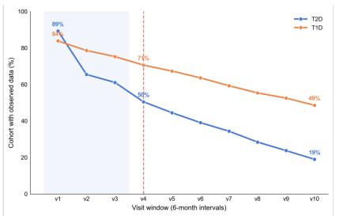  
b

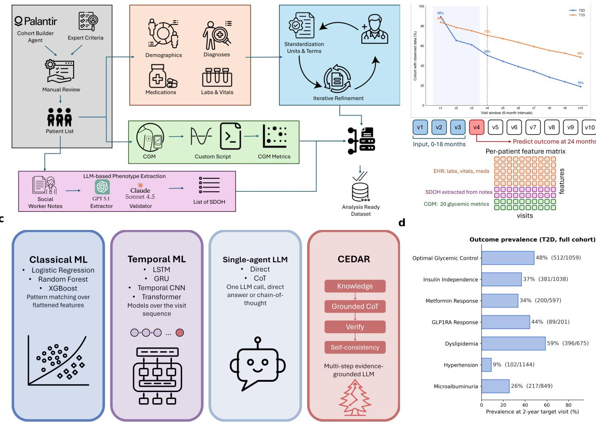  
Figure 1: Study design, data construction, and methods. (a) Data construction. A cohort-builder agent with expert-defined criteria plus manual endocrinologist review yields the patient list, structured EHR is standardized through iterative expert refinement, continuous glucose monitoring (CGM) is processed into 20 per-visit glycemic metrics in T1D, and social determinants of health (SDOH) are extracted from social-worker notes by a two-stage LLM pipeline. All modalities are merged into the analysis-ready dataset. (b) Data structure and prediction task. Patients are followed over ten 6-month visit windows, and data availability declines over follow-up (top), which motivates the 2-year primary horizon. The first three windows, months 0–18 and shaded, are the input and the outcome is predicted at visit 4. Each patient is a feature × visit matrix spanning EHR, SDOH and, in T1D, CGM (schematic). (c) The model families evaluated, from classical ML over flattened features and temporal ML over visit sequences to the multi-step Cedar pipeline. (d) Prevalence of each outcome at the 2-year target visit across the full assessable T2D population, annotated with event and assessable counts.

T1D: models × outcomes (gold = best per outcome)  
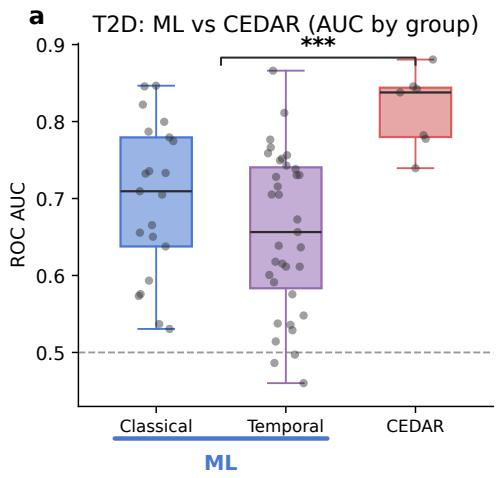

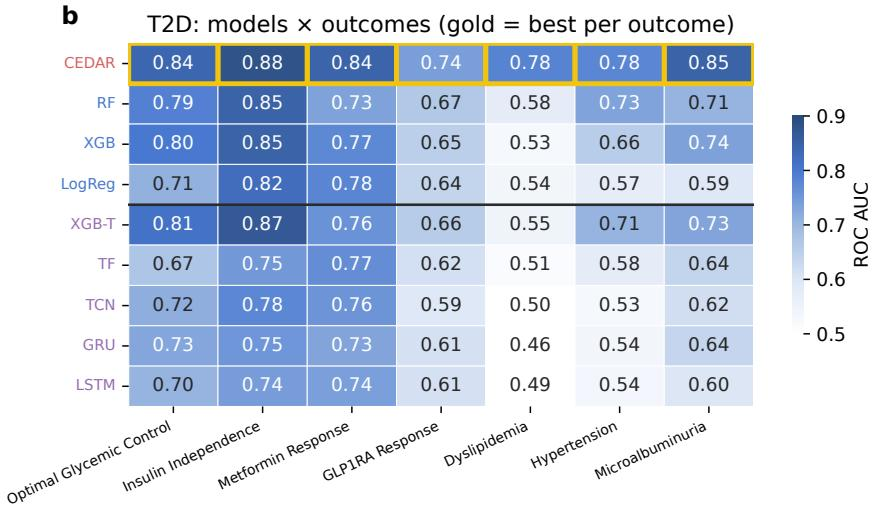

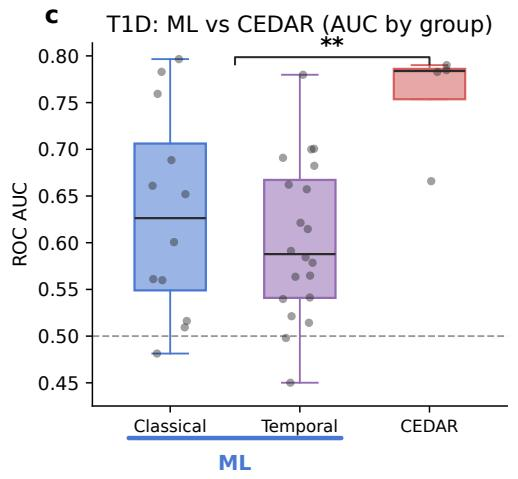

d  
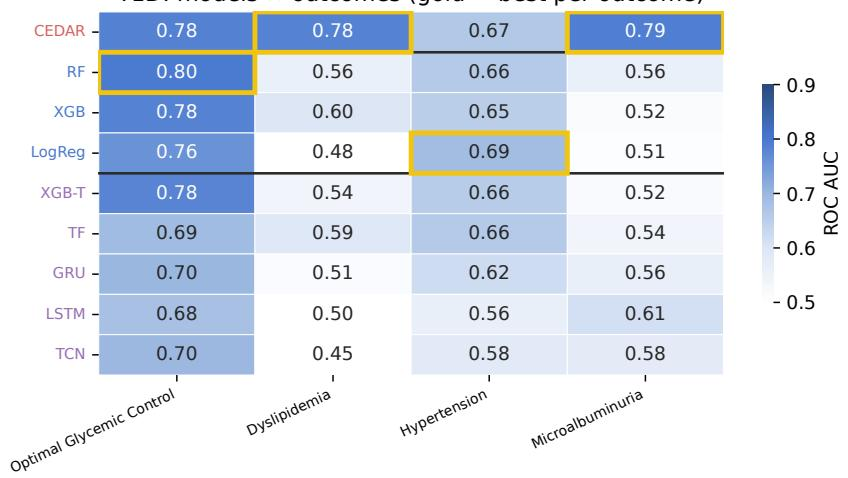

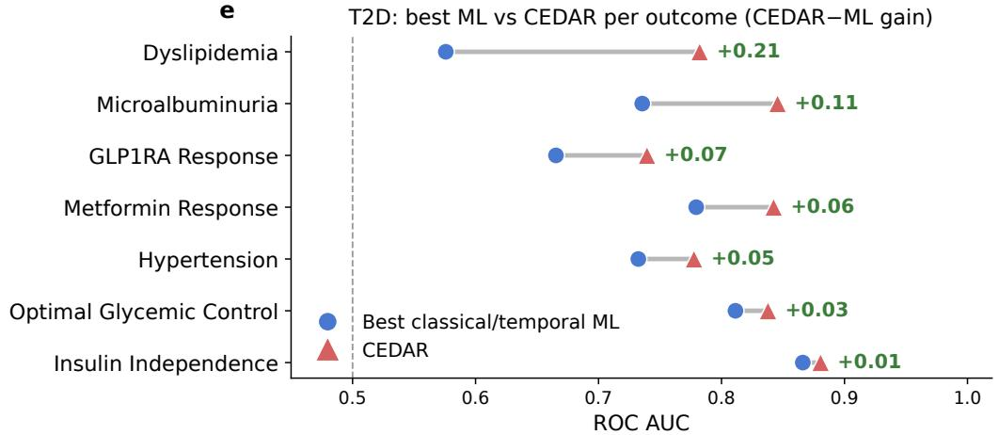  
Figure 2: The performance landscape: Cedar beats machine learning in both cohorts. The trained statistical models form one family split into two subgroups, classical ML over the flattened feature matrix and temporal ML over the visit sequence, compared with the full Cedar pipeline. (a, b) T2D; (c, d) T1D. (a, c) ROC-AUC by group, one point per model and outcome. Cedar sits well above ML in both cohorts (Mann–Whitney U with one ROC-AUC per model and outcome, $^ { * * * } p < 0 . 0 0 1$ in T2D and $^ { * * } p < 0 . 0 1$ in T1D, exact statistics in Supplementary Table $4 ;$ dashed line = chance). $( \boldsymbol { \mathsf { b } } , \boldsymbol { \mathsf { d } } )$ Model × outcome ROC-AUC matrix, Cedar above the ML rows, with the best model per outcome outlined in gold. Cedar is best on every T2D outcome and on two of four in T1D. (e) Best ML baseline (circle) versus Cedar (triangle) per T2D outcome, ordered by the Cedar-over-ML gain, which is widest where signal is scarce and narrowest on the best-powered outcomes. Per-outcome confidence intervals are in Supplementary Table 5.

What CEDAR adds beyond a risk score CEDAR output — Optimal Glycemic Control Predicted probability: 0.83 All cited features verified against the record

What CEDAR cites across outcomes  
Cited evidence (checkable against the chart):
<table><tr><td>Feature</td><td>Visit</td><td colspan="2">Value</td></tr><tr><td></td><td></td><td></td><td></td></tr><tr><td>Fasting glucose</td><td>v1 / v3</td><td>96 / 89 mg/dL</td><td>▲</td></tr><tr><td>Serum C-peptide</td><td>v1</td><td>3.6 ng/mL</td><td></td></tr><tr><td>Glycemic control (prior)</td><td>v1-v3</td><td>controlled x3</td><td></td></tr><tr><td>Insulin independence (prior)</td><td>v2-v3</td><td>achieved</td><td></td></tr><tr><td>Metformin response (prior)</td><td>v3</td><td>achieved</td><td></td></tr></table>

Faithfulness: per-patient spread  
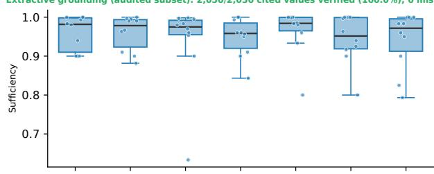  
Model's stated reasoning (excerpt): “Maintained optimal control at all three visits, with near-normal fasting glucose (96→89 mg/dL) — the single strongest predictor of continued control. Robust C-peptide (3.6 ng/mL) indicates preserved beta-cell reserve; per ADA 2024 / TODAY this favors glycemic durability. → High probability of continued optimal control.” A classical model returns only the 0.83 — no citations, no rationale.

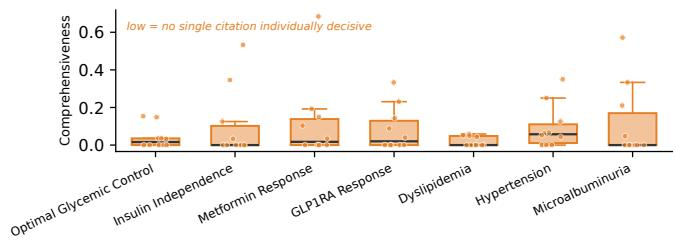

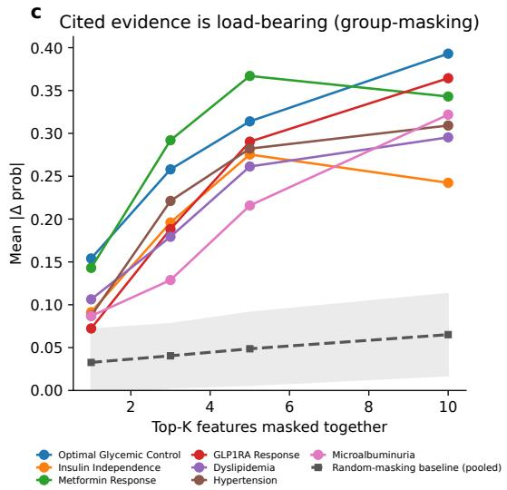

d  
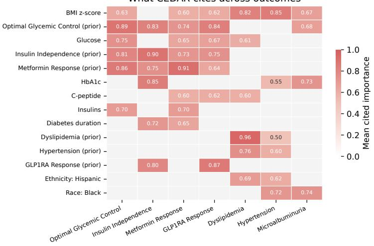

Figure 3: What Cedar adds beyond a risk score: faithful, auditable reasoning (T2D). (a) A Cedar output alongside its probability, showing the cited record values it reasoned from with feature, visit and value, each checkable against the chart, where a classical model emits only a risk score. Every value in this panel is a synthetic composite constructed to represent a high-grounding case, not any patient’s record. (b) Faithfulness per outcome across audited patients, as box plots over individual patients. Suficiency is high because the cited evidence alone reproduces the prediction, whereas comprehensiveness is low because no single citation is individually decisive. Extractive grounding is a near-ceiling fabrication check, so it is annotated as a count rather than plotted; the count shown covers the 70-record counterfactual subsample, 2,050 citations, whereas the cohort-wide check over all 1,600 T2D records, 47,803 citations with 4 mismatches, is reported in the Results. (c) Masking the cumulative top-K cited features moves the prediction steadily further for every outcome, far above a size-matched random-masking baseline (dashed gray, pooled), so the prediction depends specifically on the cited evidence rather than on removing any features at all. (d) Mean cited importance for the features Cedar cites across the most outcomes, with gray cells not among an outcome’s top citations. Cedar relies most on clinically coherent drivers, BMI z-score, the outcome’s own recent history, and the glucose and HbA1c axis.

a  
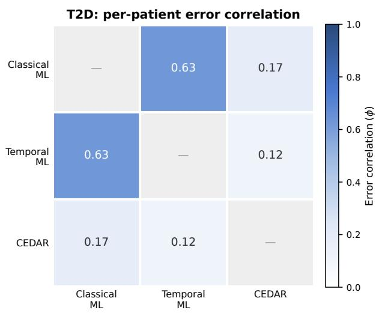

b  
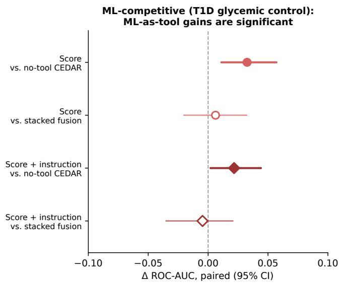

c  
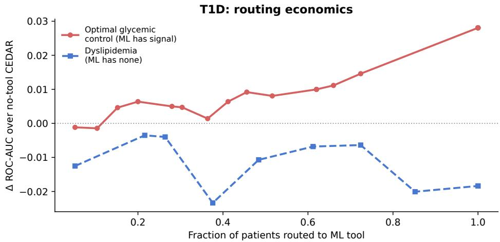  
Figure 4: Cedar and machine-learning errors are decorrelated, and targeted tool use exploits that. (a) Per-patient error correlation among classical ML, temporal ML and Cedar in T2D, as ϕ of the misclassification indicators at a 0.5 threshold. Errors overlap strongly within the ML family yet are largely independent between ML and Cedar, so the two families make mistakes on diferent patients. T1D shows the same pattern, 0.61 within ML and 0.03 to 0.06 between ML and Cedar. (b) Supplying the best-per-outcome ML model’s frozen score to Cedar as an in-context tool on T1D optimal glycemic control, the outcome where a standalone ML model was strongest, either alone (circles) or with an instruction to weigh it against the record (diamonds) Paired-bootstrap ∆ROC-AUC against no-tool Cedar and the stacked late-fusion combiner, where a filled marker means the 95% confidence interval excludes zero. The same analysis on a representative outcome on which ML performs poorly, T2D dyslipidemia, finds nothing significant (Supplementary Figure 7a). (c) Routing economics in T1D: the gain over no-tool Cedar as the fraction of patients routed to the ML tool rises. Optimal glycemic control, where the ML model holds complementary signal, climbs with more routing, while dyslipidemia stays flat to negative. The learned routing policy evaluated on every outcome is in Supplementary Figure 8.

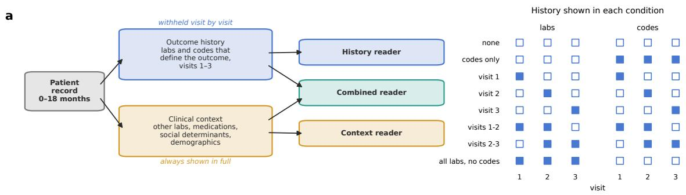

b  
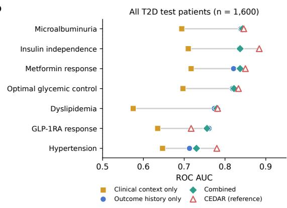

c  
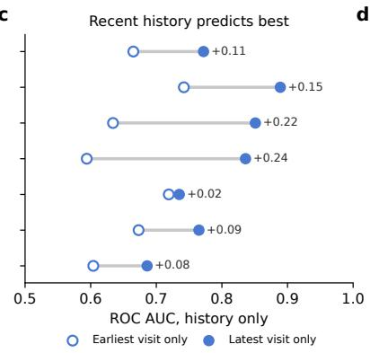

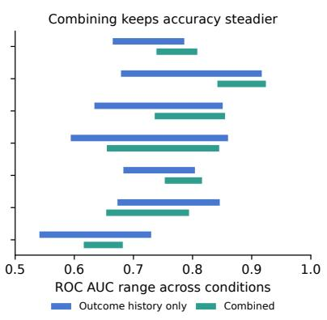

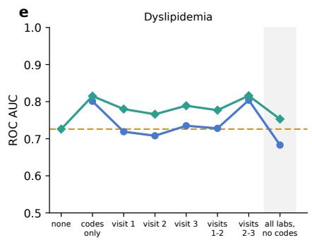

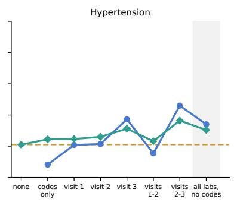

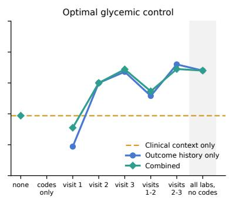

Figure 5: Recent outcome history drives prediction, and clinical context recovers accuracy when that history is missing. (a) Design. Each record is split into the outcome history, the laboratory values and diagnosis codes that define the outcome at visits 1 to 3, and the clinical context, everything else. Three readers on the same base model score the history alone, the contex alone, or both; the grid shows which visits of the history each condition reveals (filled) or withholds (open). (b) All 1,600 T2D test patient-outcomes with complete records: the history alone approaches Cedar (hollow triangle), and the context alone is lower. (c) History restricted to the earliest or the latest visit, 100 patients per outcome: the latest visit predicts better on every outcome. (d) Range of ROC-AUC across the history conditions for the history alone and for both together; reading both narrows the range on every outcome. (e) ROC-AUC by condition for three outcomes, ordered from no history to the full laboratory history (shaded, not nested with the others). When the history is thin, reading both recovers toward or above the context-only level (dashed). Al seven outcomes are in Supplementary Figure 14, with estimates and 95% confidence intervals in Supplementary Table 11.

# Supplementary Information

for

Agentic LLM reasoning in pediatric diabetes outcome prediction from multimodal medical records

The completed TRIPOD+AI reporting checklist is Supplementary Table 21.

## Supplementary Notes

## Supplementary Note 1: Extended Discussion

This note expands the main-text Discussion, giving the mechanism behind each finding and the analyses that support it.

Why extra reasoning stages do not help. A capable LLM brings clinical priors that substitute for the training signal a datastarved statistical model lacks. One competent reasoning pass therefore captures most of the available signal, and further stages have little left to add: Cedar and its CoT+Verify and CoT+SC ablations difer neither from each other nor from a single call. Two further designs failed the same way. An early naive multi-agent decomposition, which split the patient across modality specialists, scored below the single-LLM baseline and was set aside, and a pre-specified screen of verifier-gated self-refinement and a diverse-reasoner ensemble also failed to beat a single call (Supplementary Figure 4). Both are consistent with evidence that self-correction needs reliable external feedback to help [1, 2] and that multi-agent debate does not reliably beat simpler prompting [3]. This is a boundary of the approach rather than of our particular pipeline.

The boundary does move with the base model. Across four models the null held on the three commercial ones but not on the open-weight llama-3-3-70b, where Cedar gained +0 099 ROC-AUC over a single call (Supplementary Figure 16f). The extra stages thus substitute for single-pass reliability rather than adding to it, which predicts that their value grows as models shrink, the relevant regime for institutions that must run inference locally on protected health data. Two versions of this comparison appear in Supplementary Note 4 because they average diferently. The pooled subgroup means cover three configurations per side in T2D and four on the single-LLM side in T1D (+0 006). The paired base-model comparison contrasts the full pipeline against a single Vanilla call on identical patients (+0 009; Supplementary Figure 16f, Supplementary Table 4b).

Why we did not try a multi-model consensus. Ensembles improve on their members only when those members make decorrelated errors [4, 5, 6]. Our error analysis shows a single LLM and Cedar misclassify almost the same patients (ϕ = 0 87; Supplementary Figure 17a, Supplementary Figure 6), and diferent frontier models reasoning over the same inputs would likely be correlated the same way, so a consensus across vendors should mostly reproduce their shared mistakes. Our four-model comparison is consistent with this, since the three commercial models reproduced the same pattern, though we did not measure per-patient error correlation across vendors. A consensus would also trade the single-model reproducibility of this pipeline for dependence on several proprietary models and their versions. Disagreement signals are more plausibly useful for uncertainty estimation than fo accuracy, and a genuinely heterogeneous disagreement signal remains open.

The one place our data show decorrelated errors is across families, between the LLMs and classical ML (ϕ ≤ 0 17). We tested that fusion directly: it improved calibration but not discrimination, and helped only on the outcomes where standalone ML was already competitive (Supplementary Figures 4 and 10).

What Cedar adds is trust, not accuracy. The auditability claim rests on a grounding rate ≥0.9999 with essentially no fabrication, cited evidence that is collectively relevant to the prediction, and cited features that are clinically coherent. The 4 mismatches in 70,246 reported in the main text are counted on S1’s citation table, which is also the final one: the deterministic tolerance check removes those 4 and S2’s auditor flags no further citations in either cohort. S2 therefore contributes its revised probability, isolated in the CoT+Verify ablation, rather than error detection, the same external-feedback limit noted above.

We also asked whether Cedar’s extra stages give a better uncertainty signal. Abstaining on the least-confident patients improves accuracy on those retained for both a single LLM and Cedar, but only when the ranking uses the output probability itself; Cedar’s own confidence signals rank hard cases worse rather than better. Its verifier flag almost never fires, precisely because grounding is near-perfect, so it carries little information and defers patients the model already scores well (Supplementary Figure 6). Useful abstention is thus a generic benefit of a usable probability rather than a Cedar-specific one.

One clarification about the faithfulness audit. Counterfactual intervention measures faithfulness, how accurately a rationale reflects the computation that produced the prediction, whereas clinician rating measures plausibility and clinical usefulness. The two can come apart [7, §2], so the two-specialist review reported in the Results (Supplementary Figure 3) measures a diferent construct, not a stronger version of the audit. The review bears this out: the two endocrinologists agreed with Cedar’s prediction on about nine cases in ten, yet on 29 of its 31 errors at least one of them reached the same incorrect call. A rationale can be legible and well rated while the prediction it supports is wrong, which is why the grounding and counterfactual audits, not the ratings, carry the faithfulness claim. Because the two specialists largely reproduced Cedar’s errors, a rationale a clinician endorses is not yet a safeguard against a wrong prediction. A larger review, and abstention when the record lacks the measurement that defines the outcome, would test whether that gap can be closed.

Why the faithfulness metrics depart from ERASER’s published form. Suficiency and comprehensiveness are ERASER’s metric names [8, §4.2], and we keep the names because the constructions are the same in spirit, but two deviations are worth stating. ERASER defines suficiency as the probability drop when only the rationale is retained, so that a lower value is better; we report 1 − |∆p| instead, so that higher is better for both metrics and neither has to be read backwards against the other. ERASER defines comprehensiveness by deleting the whole rationale at once, which suits a short span of text. Cedar cites tens of features per patient, so deleting the rationale entire would remove most of the input and measure little, and we therefore mask each cited feature individually and keep ERASER’s cumulative-deletion form separately as the group-masking curve. The random-masking control exists because the group-masking curve on its own cannot show that the movement is specific to the citations rather than to removing that many features at all, so the control draws from exactly the candidate pool the model could have cited, under the same outcome-specific exclusions.

Methods for the refinement and ensembling screen and for blind late fusion. The main text reports these two experiments only by their result, so their methods are given here. Verifier-gated refinement and diverse-reasoner ensembling (“Cedar v2”). A pre-specified screen asked whether two further internal mechanisms improve on the pipeline of Methods, Section 6, with the null hypothesis that neither beats a single call by a meaningful margin. Five systems were scored on the same fixed set of 60 held-out patients per outcome: a Vanilla single call, Cedar as described, and three variants. Verifier-gated self-refinement re-runs the extractive-grounding check on S1’s citation table. If any cited triple is unverified, the ofending citations are returned to the model by name, with an instruction to remove or correct them, re-examine the record and revise the probability, for at most two rounds, after which S2 and S3 proceed unchanged. In practice this gate almost never opened: first-pass extractive grounding is already at ceiling, so no refinement round was triggered in the screen (Supplementary Note 1). The diverse-reasoner ensemble replaces S1’s single system prompt with three structurally distinct ones over an identical patient prompt, directing the model to reason primarily from the longitudinal laboratory and vital-sign trajectory, primarily from demographics, comorbid conditions and social determinants, or primarily by applying the injected guideline knowledge. A meta-reasoner then receives all three reasoning chains with their probabilities and returns one integrated probability, instructed to weigh agreement and disagreement rather than to average. The unweighted mean of the three member probabilities is retained as a secondary reference. The third variant combines both mechanisms. The screen ran on the three highest-headroom T2D outcomes (GLP-1RA response, hypertension, dyslipidemia), with both anchors re-scored on the same 60 patients; promotion required a paired ROC-AUC diference whose 2,000-iteration bootstrap 95% interval excluded zero against both anchors. Neither addition met that rule (Supplementary Figure 4a).

Blind late fusion. Separately from the tool-use experiments, Cedar’s probability was combined post hoc with the statistica models’ probabilities, blind in the sense that the combiner is never told which family is stronger on the outcome. Four combiners were evaluated on the full held-out set against Cedar, the single call, and the best classical and best temporal models. These were the unweighted mean of Cedar and the best ML model, the unweighted mean of Cedar with both the best classical and the best temporal model, a logistic stacker over the two scores, and a routed combiner selecting one source per outcome from training-fold performance. The router’s per-cohort choices, and why its pooled T1D ROC-AUC falls below Cedar’s, are given in the next paragraph.

Design details behind the extension experiments. Four choices in those experiments need their reasoning stated. First, the verifier-gated refinement arm returned a null that should be read as uninformative rather than negative. First-pass extractive grounding is already at ceiling, so no refinement round was ever triggered in the screen, and the null says nothing about refinement in lower-grounding settings. Second, routing adds tokens, and across outcomes the routed fraction spanned 0 to 1 at a cost of \$0.091 to \$0.104 per patient, so the routing decision is not cost-free even where it is accuracy-neutral. Third, the routed late-fusion combiner chose Cedar on all seven T2D outcomes, making its T2D scores numerically identical to Cedar’s, whereas in T1D it chose classical ML on hypertension and on optimal glycemic control, which is why its pooled T1D ROC-AUC (0.734) falls below Cedar’s (0.759) in that cohort. Fourth, the temporal split was cut so the partitions do not overlap in diabetes duration. In T2D the minimum training duration exceeded the maximum validation duration for all seven outcomes, with median duration 4.1–7.7 years in training against 2.4–3.4 years in validation. Training partitions held 140–801 patients against 61–343 in validation.

Why the family-level comparisons are exploratory. Each pooled comparison is a Mann–Whitney U test in which one observation is one model’s ROC-AUC on one outcome. Those observations are not fully independent, being computed on overlapping patients and correlated outcomes, so nominal significance is inflated and we report the comparisons as descriptive efect sizes. The patient-paired bootstrap on the shared test set carries the more rigorous per-outcome comparisons instead. Where many pairwise tests are reported we say so rather than implying family-wise error control, and the multi-model comparison is exploratory in the same sense.

Class-imbalance metrics give the same ordering as ROC-AUC. ROC-AUC summarizes ranking across all thresholds, so it can stay high when decisions at a usable threshold are poor, and several of the outcomes here are imbalanced (Supplementary Table 1). We therefore repeated the full benchmark of Supplementary Figure 16 under three threshold-based metrics: Matthews correlation coeficient (MCC), balanced accuracy, and $F _ { 1 }$ on the positive class. We did not use weighted $F _ { 1 }$ or raw accuracy, both of which can be maximized by predicting the majority class. All three are threshold-dependent, so each model’s decision threshold was selected on the training folds alone by maximizing out-of-fold MCC, and every model was then scored on the same held-out patients as in the primary analysis. The LLM configurations have no training partition and therefore borrow the threshold selected by the strongest statistical model on that outcome, which denies them any tuning advantage. Classical models were additionally refit with balanced class weights so that all eight statistical models carry the weighting the deep-sequence models already used; this changed their ROC-AUC by +0 002 and their MCC by −0 005 on average, because a tuned threshold already absorbs most o the efect.

Both conclusions of that benchmark hold. The LLM family leads the statistical family on every metric and on 9 to 11 of the 11 cohort–outcome pairs (Supplementary Table 19), and a single LLM call and Cedar remain indistinguishable, with $p \geq 0 . 6 9$ on all three new metrics against $p = 0 . 2 6$ for ROC-AUC (Supplementary Table 20). The equivalence is therefore firmer under these metrics than under ROC-AUC, not weaker. The margin between families does narrow: comparing the best model in each family per outcome, rather than the family mean, the LLM lead stays positive but is no longer statistically distinguishable on the three new metrics, and in T1D, where only four outcomes are evaluable, no family contrast reaches significance. We therefore read these metrics as confirming the ordering while bounding how strongly the size of the gap should be stated, and we report ROC-AUC in the main text because it is the metric the comparison was designed around and is threshold-free.

The numbers behind selective prediction and routing (Supplementary Figure 6e and Figure 4c). Ranking patients by Cedar’s bare probability gives area under the risk-coverage curve 0.148 in T2D and 0.185 in T1D, against 0.205 and 0.233 for self-consistency spread. The spread gains at 80% coverage in T2D, 0.803, then plateaus and reaches only 0.809 by 60%, and in T1D it loses accuracy outright (0.760 then 0.744). Verification failure rate is worse than not abstaining at all (0.758 then 0.729 in T2D, 0.738 then 0.717 in T1D). A single LLM’s bare probability separates confident from uncertain cases equally well (0.171 in T2D, 0.182 in T1D). Averaging over outcomes rather than pooling over records preserves the ordering in attenuated form: the bare probability reaches +0 079 ROC-AUC at 40% coverage, spread peaks at +0 036 near 60% and then decays, and verification failure rate stays near +0 01 throughout (Supplementary Figure 6e).

The verifier fails for an instructive reason. It flags nothing for essentially every patient, so its ranking is close to arbitrary, and ROC-AUC on the deferred 20% is in fact higher than on the retained 80% (0.831 against 0.758 in T2D, 0.784 against 0.738 in T1D): the signal defers easy cases rather than hard ones. For the routing sweep, the null-contrast outcome T1D dyslipidemia moves from −0 004 to −0 023 across the same threshold range. Per-outcome intervals in that panel are wide given our sample sizes (Supplementary Table 17), so it shows the learned policy does not hurt anywhere rather than carrying the statistical evidence for the tool-use efect, which rests on the tighter paired estimate.

Where agentic design does help: targeted tool use. Re-reasoning over the same inputs and re-encoding them both failed, because neither escapes the LLM’s shared error set. The one exception crosses family boundaries. T1D optimal glycemic control was the only outcome where a standalone statistical model out-predicted the LLM by a margin whose bootstrap interval excluded zero; logistic regression was also numerically ahead on T1D hypertension, but within noise. When we exposed that model’s score to Cedar as an in-context tool, applied only where standalone ML is independently competitive, Cedar incorporated it and beat a single LLM on that outcome (+0 05 ROC-AUC, 95% CI [0 023 0 081]; +0 03 over Cedar without the tool). The tool gave no benefit, and occasionally some harm, where it carried no complementary signal (Supplementary Figure 7).

Two features make this more than a lucky subgroup. Cedar matched a black-box logistic stacker on the same outcome, but unlike the stacker it exposed why it combined the two sources. And its behavior was appropriately conditional: it moved toward the tool’s estimate when the tool was good and largely ignored it when weak, over-trusting it only on the noisiest, lowest-prevalence outcomes (Supplementary Figure 7). That behavior is both the mechanism of the gain and a caution for deployment.

Because the initial gain came from a single pre-specified outcome, we replaced the pre-specification with a learned per-patient policy, gated on Cedar’s self-consistency spread and the tool’s own confidence, and evaluated it on every outcome in both cohorts. It held: the policy tracked the always-route and hand-picked-rule gain where complementary signal existed and stayed inert, at no added cost, where it did not (Supplementary Figure 8). Sweeping the routed fraction separates the two regimes. On T1D optimal glycemic control the gain rises with the fraction routed, reaching +0 028 when all patients are routed, whereas the same sweep on T1D dyslipidemia runs flat to negative (Figure 4c).

This identifies the productive role for agentic architecture. Its value is not reasoning harder over the same data, but serving as an auditable substrate that integrates genuinely complementary tools where they exist, deciding case by case whether to consult them. Designing and validating such tools across further modalities is a promising direction beyond the one tool tested here, for example a calibrated statistical model per outcome, a continuous-glucose foundation model for the raw CGM trace, or retrieval over the guideline corpus.

Deploy in tiers. The cost structure implies a two-decision cascade. The first decision, whether to escalate from a cheap classica model to an LLM, is about accuracy. Reading Supplementary Figure 2b, a single LLM significantly out-predicts ML precisely where ML has little signal, on dyslipidemia (+0 21) and microalbuminuria (+0 14), for a few dollars per thousand patients. On the remaining outcomes the LLM is numerically ahead but the study is underpowered to certify the gap. The second decision, whethe to escalate from a single LLM to Cedar, is not about accuracy, since we detected no diference, but about whether the case requires an auditable, record-grounded rationale. Cedar’s five calls per patient buy that transparency, and on a weaker base model they buy accuracy as well. A third, outcome-specific option follows from the tool-use result: where a statistical model is independently competitive, equipping Cedar with it can add accuracy on top of auditability.

How many patients must be scored also matters, and the two regimes pull in opposite directions. In a small, high-stakes setting, such as a rare-disease clinic or a new program with a few hundred patients, the total inference bill stays small even at Cedar’s per-patient rate, so a few expensive calls that return a checkable rationale are easy to justify. At population scale that same rate dominates costs, and a classical model that stays competitive on the well-powered outcomes and needs no inference calls is the better default, with the LLM tier reserved for the outcomes and patients where it earns its price. The cost estimates therefore rank the tiers rather than decide between them.

Extended limitations: information symmetry and leakage. The comparison is deliberately asymmetric in one respect: Cedar’s S0 stage injects outcome-specific guideline priors (for example the TODAY finding on metformin durability) that the statistical baselines never receive. This tests whether guideline-grounded reasoning helps and is the kind of prior a clinician also brings, so the gain should be read as “reasoning with clinical priors” rather than “more of the same features.” The priors are general guideline statements, never patient- or test-set-specific. We confirmed that the collinearity and withheld-feature exclusions apply identically to the LLM prompts and the classical feature matrices, that prompts use only input visits v1–v3 and never the target visit, and tha the shared train/test split is respected throughout. The trained statistical models used fixed, standard hyperparameters (Methods, Section 4) rather than an extensive search; nested hyperparameter optimization could strengthen them, so the comparison is agains well-configured rather than fully optimized baselines.

Two caveats remain. LLMs may have encountered guideline text or similar cohorts during pretraining, which grounding and the withheld-feature design mitigate but cannot eliminate. And on outcomes defined by a withheld lab or medication, the model’s medical knowledge may let it reconstruct the target from correlated laboratory values even with the defining feature removed, so we cannot fully separate genuine reasoning from recalled priors about how such features co-occur. This caveat matters most for the largest LLM gains, such as dyslipidemia (+0 21). A third caveat is reproducibility: all results depend on specific hosted mode versions (Claude Sonnet 4.6 for the main pipeline; GPT 5.1 and Claude Sonnet 4.5 for SDOH extraction), and because these are updated over time, exact numbers may not reproduce on later versions even with identical prompts. We report service identifiers, versions and access dates to make the pipeline as reproducible as a hosted service allows. Finally, Cedar here is a multi-stage pipeline over a single model; whether heterogeneous agents would add value in larger-data regimes remains open.

Extended future directions. A proof-of-concept in which an LLM proposed and deterministic code appended trajectory features (slopes, deltas, variability) failed to improve over a single LLM on the three highest-headroom outcomes, at roughly Cedar’s own per-patient cost (Supplementary Table 6), reinforcing that re-expressing the same inputs does not help. We also flag two controls we did not run. One is post-hoc recalibration of the single LLM’s own probabilities, to confirm that the calibration gains from fusion do not require a second model. The other is a disagreement-aware ensemble with selective abstention [9, 10] across several models, which is distinct from the single-model selective prediction we do report. A further direction is an LLM re-ranking stage. Rather than combining families by voting or late fusion, a re-ranker could re-order candidate predictions from the cheaper tiers by reasoning jointly over the candidates and their grounding, a pattern that has improved list quality in recommender and retrieval systems [11]. Because the re-ranker sees several candidates at once, it may correct the shared errors a repeated-sampling ensemble cannot.

Why are dyslipidemia and microalbuminuria so much more amenable to a language model? Both are lab-defined renal or metabolic endpoints with sparse, irregularly sampled screening labs, since urine microalbumin and lipid panels are typically ordered at later surveillance visits rather than at diagnosis. We hypothesize the gain reflects the LLM’s tolerance of missing and unevenly timed inputs, together with clinical priors about which surrounding features (renal function, adiposity, glycemic burden) covary with these endpoints, signal a fixed-schema classifier trained on the same sparse columns cannot exploit. Masking those plausible covariates, or inspecting the reasoning chains on correctly predicted cases, would test this. The advantage does not track prevalence: it is largest on dyslipidemia (58.7% prevalent) and microalbuminuria (25.6%) and near zero on optimal glycemic control and insulin independence, the two best-powered outcomes. At a fixed 0.5 threshold the picture difers again, because on rare outcomes classical ML has the lower error rate only by defaulting to the majority class (Supplementary Figure 6a). Finally, predicting at additional visits and longer horizons, such as 5-year events, would establish whether the LLM advantage persists as more temporal data accrue and the statistical baselines gain power.

Why the SDOH and CGM channels add little. The standardized ablation (Supplementary Figures 11 and 12) found that adding SDOH changed discrimination by essentially zero in every model family (−0 02 to +0 01 mean ROC-AUC), and that CGM contributed only +0 05 on a single T1D outcome, optimal glycemic control. Because the ablation covers all families including

Cedar, we can state that the reasoning model, not only the statistical baselines, extracts no usable incremental signal from SDOH as currently represented.

We did not anticipate this, and we think it is informative rather than merely null. Two explanations are consistent with it. First, the structured EHR may already encode most of the SDOH-correlated signal for these outcomes, so an explicit channel adds little even though SDOH is prognostic in isolation. Second, and more actionable, the signal may be present in the source data but lost in how these modalities are digested. Our pipeline reduces free social-worker documentation to a small set of extracted entities and the continuous CGM stream to summary metrics, and either step could erase structure a richer representation would retain. We therefore read this as a limitation of the current representation, and we expect predictions to improve if these data were ingested more faithfully. Two routes are feeding raw social-worker notes directly to Cedar’s reasoning instead of pre-extracting entities, and calling a published continuous-glucose foundation model as a tool so that temporal structure is drawn from the raw trace rather than from hand-engineered metrics. That published model was pretrained on adults largely without diabetes, so its transfer to pediatric type 1 traces would itself need validation.

## Supplementary Note 2: Cedar error analysis and model refinement

Design. The benchmark establishes that Cedar and a single LLM tie, and that both sit near an apparent information ceiling; it does not establish why individual predictions fail. We therefore reviewed Cedar’s errors case by case, keeping the scope narrow so the result would be interpretable: Cedar only, type 2 diabetes only, the 24-month horizon, and the same binarization used for MCC throughout. The review used a separate 82-case stratified deck, drawn for this automated error analysis and independent of the clinician reasoning review reported in the Results. The deck holds 21 true positives, 21 true negatives, 21 false positives and 19 false negatives, with only one false negative for hypertension because 22 of 250 held-out patients are positive. Each case carries Cedar’s predicted probability, its full reasoning chain and its structured evidence table. This gives 4–6 misclassified patients per outcome, 40 errors in total. Every cited evidence line was parsed programmatically (n = 2 457 citations, mean 30.0 per case, matching the 47,803 values over 1,600 records in the full T2D audit), so the coding is rule-based and reproducible rather than impressionistic.

Two features of the design bound what the counts mean. The deck is stratified on the confusion cell, so it is a case-control sample with respect to error status: proportions are proportions oferrors, not population risks, though odds ratios remain interpretable. And codes that require chart review rather than model output, notably label noise, cannot be assigned here at all.

The probability level fails on adverse outcomes, not the ranking. Supplementary Figure 10 reports calibration pooled across outcomes. Splitting it per outcome exposes a pattern the pooled view hides (Supplementary Figure 9a). On all three adverse outcomes Cedar’s Brier score is worse than an intercept-only model that simply predicts the base rate (hypertension 0.436 versus 0.080, microalbuminuria 0.255 versus 0.190, dyslipidemia 0.257 versus 0.242), and on all four beneficial outcomes it beats the base rate. The split follows outcome valence, not prevalence or sample size, and the same 3-of-3 pattern holds for the single LLM, whose mean Brier of 0.238 is close to Cedar’s 0.234, so it is a property of how an LLM emits probabilities rather than of Cedar’s additional stages. The model reasons its way to “this child is at high risk” and reports a correspondingly high probability withou conditioning on how uncommon the outcome is: hypertension false positives sit at 0.60–0.72 where prevalence is 0.089.

Most of this excess is removable. Decomposing each outcome’s Brier score on the reliability bins into refinement and calibration terms, count-weighted pooled Brier falls from 0.235 to 0.134 under perfect per-outcome recalibration, and mean MCC rises from 0.359 to 0.497 under a per-outcome threshold (Supplementary Figure 9a, b). Both are ceilings fitted on the same test bins, so they are upper bounds rather than achievable gains; train-fold-fitted values appear below. This is a real refinement, but only of reported agreement and probability quality, and nothing in the LLM-versus-ML discrimination comparison moves.

Cedar is, to first order, a last-observation-carried-forward classifier. Observed features run to the 18-month window and the target is at 24 months, so persistence of the current outcome state is the dominant available signal for every paradigm in this paper. Cedar uses it explicitly. In 70 of 82 cases it cites the target outcome’s own prior state, and that citation has median rank 1 among all cited evidence and is in the top three in 71% of cases. Cedar’s predicted label equals the last observed state in 91% of the cases where the prior state is recoverable (64/70).

Carrying the last state forward is reasonable and not in itself an error. The question is whether the model does it selectively, and i does not: the carry-forward rate is 97% (n = 29) in patients whose outcome flips between 18 and 24 months and 88% (n = 41) in patients whose outcome holds, which is statistically indistinguishable (Fisher exact OR 3.89, p = 0 39; Supplementary Figure 9c). Cedar cannot anticipate the flip. Consequently 28 of 33 evaluable errors (85%) are cases where it repeated the last observed state and the patient changed. The flip-to-error association is partly true by construction, because an anchored prediction on a flipping patient is an error by definition, so the non-circular result is the indiscriminate anchoring, not the error rate. This is the most direct evidence we have for the information-ceiling argument the paper makes elsewhere from cross-paradigm error overlap and the enhancement nulls. Every family sees the same three windows and the same prior state, and if the 24-month flip is not in tha record, no amount of reasoning recovers it.

Two smaller mechanisms. First, direction polarity. The direction Cedar assigns each citation is anchored to clinical harm rather than to the outcome label, so on beneficial outcomes a citation marked as increasing risk argues against label = 1. The correlation between a case’s share of increasing-risk citations and its predicted probability is $+ 0 . 8 \bar { 8 } / + 0 . \dot { 8 } 7 / + 0 . 9 2$ on the three adverse outcomes but −0 62/−0 57/−0 73/−0 34 on the four beneficial ones, confirming the inversion; GLP-1RA response is additionally not self-consistent and is excluded from the per-case test. Cases whose direction lean disagrees with their own probability, given valence, are more common among errors than among correct predictions (25% versus 10%). Second, input artifacts: four of 82 cases reason over a physiologically impossible cited value (serum C-peptide 16–35 ng/mL). No case shows the SBP = DBP pattern, consistent with the diastolic-pressure correction already applied upstream. Both mechanisms are real and both are small.

How much of the error is reachable at all. Coding the 40 errors against the taxonomy gives the split in Supplementary Table 8 and Supplementary Figure 9d. Codes are not mutually exclusive, since nine errors carry more than one, so any single “primary” code is a choice of priority order rather than a fact, and we report both defensible orders. Coding mechanism-first, where anchoring takes precedence because a prediction downstream of an unpredictable flip is not repaired by adjusting its probability, leaves 9 of 40 errors addressable. Coding fixability-first, where calibration and polarity take precedence, leaves 18 of 40. The honest statement is 22–45%, and the gap is informative: the nine errors in it would score better on this sample under a diferent threshold without the underlying flip having become predictable, so the high end is luck rather than a repair. Under either coding the largest single class is anchoring, and anchoring is not a reasoning failure.

Refinement 1: recalibration and thresholding, fitted honestly. We fitted per-outcome Platt and isotonic calibrators and a per-outcome decision threshold on the training folds and applied them unchanged to the held-out set (Supplementary Table 9). The gain in agreement and probability quality is real and close to the ceiling above: mean MCC rises from 0.359 to 0.489, mean Brier falls from 0.234 to 0.151 against a base-rate Brier of 0.209, and mean expected calibration error falls from 0.222 to 0.064. No outcome remains worse than its intercept-only benchmark, down from three of seven; hypertension moves from MCC 0.097 to 0.436 and from Brier 0.436 to 0.073.

Discrimination does not improve, and that is the point. Moving the threshold alone recovers most of the MCC gain (0.359 to 0.484) while leaving ROC-AUC bit-identical, because a threshold cannot reorder patients. Isotonic calibration reduces ROC-AUC by 0.015–0.065 per outcome, since it is only weakly monotone and the ties it introduces cost discrimination; Platt scaling, which is strictly monotone, still loses 0.003–0.033, which we attribute to saturation of extreme probabilities at floating-point precision. Every deviation is downward, which rules out the failure this check was designed to detect, since fitting the calibrator on the test set would inflate ROC-AUC rather than depress it. We therefore report recalibration as an improvement in reported agreement and calibration only, and no discrimination result in this paper is recalibrated.

Refinement 2: prompt-level changes, tested before running them. The refinement that targets the dominant error class asks Cedar to state whether it expects the last observed state to persist. That is only worth a full rerun if the impending flip is in the record at all, so we tested the premise directly and pre-registered the decision rule. For each outcome we trained a gradient-boosted classifier on the training patients, with the binary flip indicator as target and the same 47-feature × 3-visit block supplied to every model as features, then evaluated on the held-out set.

The raw flip ROC-AUCs look encouraging (0.491–0.841) but are almost entirely an artifact of the prior state. That feature ranks top on hypertension with 3.4 times the gain of the next, because transitions are strongly asymmetric $( \bar { P } ( \mathrm { f l i p } \mid \mathrm { p r i o r } = 1 ) = 0 . 6 6 7$ against $P ( \mathrm { f l i p } \mid \mathrm { p r i o r } = 0 ) = 0 . 0 4 9 )$ , so a classifier knowing only the prior state already reaches 0.817 there. Subtracting that baseline, the entire feature block adds a mean of +0.030 ROC-AUC (Supplementary Table 9); insulin independence is the only outcome gaining more than 0.07, and its leading flip feature is a social-determinant flag rather than a clinical trajectory. A separate test agrees: comparing flippers with non-flippers on within-patient slopes across the three observed windows, only 5 of 42 comparisons reach $| \mathrm { S M D } | \ge 0 . 4$ , three of those are the outcome’s own state, and the clinical change drivers top out at 0.353 (HbA1c), 0.335 (systolic pressure) and 0.334 (glucose). Flippers and non-flippers are indistinguishable in their observed laboratory trajectories. Under the pre-registered rule, which cancels the prompt refinements when incremental ROC-AUC falls below 0.55–0.65, we did not rerun Cedar, because the instruction would surface the persistence assumption without supplying the information needed to override it.

Refinement 3: supplying the transition rates directly. The premise test above asks whether the impending flip is legible in the record. A second possibility is that it is legible in the population: not which patient will change, but how likely change is given how long the current state has already held. That quantity separates cleanly. We define state run length as the number of consecutive observed windows over which the current state has persisted. The flip rate falls monotonically with run length in six of seven outcomes, a two- to six-fold gradient (Cochran–Armitage $p < 0 . 0 2 ;$ hypertension 0.357, 0.083, 0.054 at run lengths one, two and three, $p = 4 \times 1 0 ^ { - 7 }$ ; microalbuminuria the sole null at $p = 0 . 9 )$

Cedar does not use it. Across the 82 coded cases it asserts persistence with probability 0.711, 0.750 and 0.675 at run lengths one, two and three, against observed persistence of 0.471, 0.700 and 0.667. It is near-calibrated on established states and overconfident by 0.240 on freshly acquired ones, with no correlation between run length and asserted persistence (Spearman −0 053, p = 0 66).

We therefore reran Cedar with one addition: training-fold base rates and transition rates conditioned on run length, quoting the contrast between run lengths rather than the prior state alone. No test-set quantity enters the prompt.

On discrimination the result is the predicted null (Supplementary Table 7): mean ROC-AUC moves from 0.812 to 0.821, no per-outcome bootstrap interval excludes zero, no per-outcome p falls below 0.07, and a paired test across outcomes gives p = 0 47. On thresholded agreement and probability quality the change is large. Mean MCC rises from 0.366 to 0.501, mean Brier falls from 0.233 to 0.153 and mean expected calibration error from 0.222 to 0.096, while the number of outcomes whose Brier score is worse than an intercept-only benchmark falls from three to one. Unlike Refinement 1 this costs no discrimination, because it changes the raw probabilities at a fixed threshold rather than applying a monotone transform afterwards; the refined raw configuration exceeds the recalibrated original on both axes at once (mean MCC 0.501 versus 0.475, mean ROC-AUC 0.821 versus 0.786).

We nonetheless do not adopt it, and the reason is the mechanism rather than the metrics: the gain is purchased by anchoring harder. The rate at which Cedar predicts the last observed state rises from 0.778 to 0.951 (paired p = 0 031) and its accuracy on stable patients from 0.779 to 0.964, while the flips it catches fall from 51 of 277 to 31 of 277 (18.4% to 11.2%, p = 0 023). Microalbuminuria, which contributes the single largest MCC gain (+0 33), goes from catching nine of nineteen flips to catching none. Told the empirical transition rates, Cedar draws the correct inference that states usually persist and applies it more aggressively. The aggregate metrics improve because non-flippers dominate every outcome and those metrics are insensitive to the minority of patients whose state changes, which is exactly the minority the refinement was meant to reach. As in Refinement 1 we report this as an improvement in agreement and calibration only, no discrimination result in this paper uses it, and the dominant error class is unimproved, by this measure made worse.

A persistence baseline bounds what any of this could achieve. Because carry-forward is the dominant mechanism, we scored the trivial rule that predicts the last observed outcome state on the same held-out patients (Supplementary Table 9). Cedar discriminates better than persistence on six of seven outcomes (ROC-AUC +0 035 to +0 083), losing only microalbuminuria (0.846 versus 0.872), the outcome with the lowest flip rate (0.088). On thresholded agreement the ordering reverses: persistence attains the highest MCC of any model in any paradigm on five of seven outcomes, and recalibrated Cedar exceeds it on only three.

Two caveats bound the comparison. Persistence is defined only for patients whose prior state is recoverable, so it is scored on 221–241 patients rather than 250 (66 of 100 on GLP-1RA response, which we therefore do not interpret), and that asymmetry mildly favors the baseline. The comparison is consistent with everything above: Cedar ranks patients better than persistence and decides worse than it, so the remaining headroom is in the decision rule rather than in the ordering.

What we conclude. The analysis was undertaken expecting a null, and on discrimination it delivers one with a mechanism attached rather than merely an absence of gain. Post-hoc recalibration improves agreement and probability quality substantially and cannot improve discrimination; the prompt-level change that would target the dominant error class was cancelled on a pre-registered test of its premise. The search for a better-discriminating configuration, run from the other direction, returned to the same place. Of four blind late-fusion combiners over Cedar and the statistical models, the routed combiner, which selects one source per outcome from training-fold performance and was free to choose otherwise, chose Cedar on all seven T2D outcomes. The logistic stacker was worse on pooled ROC-AUC (0.804 versus 0.813), and the mean combiner’s advantage (0.815) has a bootstrap confidence interval spanning zero on every outcome (Supplementary Note 1; Supplementary Figure 17c).

The one change we do recommend is not an accuracy change. Replacing the direction labels “increases risk” and “decreases risk” with “supports outcome” and “opposes outcome”, anchored explicitly to the outcome label, removes the valence inversion documented above. It is justified as an interpretability fix regardless of whether it moves accuracy, which on these data it is unlikely to do. What the analysis argues against is the direction of scaling this architecture already tests: more reasoning stages, more agents or more self-consistency samples address a reasoning deficit, and the dominant error class is not one. What it argues for is denser outcome-proximal data, the same conclusion the modality ablation reaches from the other direction.

## Supplementary Note 3: External benchmark on MIMIC-IV

Design. The temporal split mitigates but does not replace external validation, so we ran Cedar unchanged on MIMIC-IV v3.1 [12], a single-center adult critical-care database, under its PhysioNet data use agreement. We built three prediction tasks, each sized to mirror the T2D cohort number for number (2,489 patients, 2,239 training and 250 held out, prevalence-stratified with the same seed), so the external results inherit the same data regime and confidence-interval width rather than a more favorable one. Task R predicts 30-day readmission at hospital discharge (62 of 250 test patients positive); task M-B predicts death within 365 days of discharge (50 of 250); task M-A predicts in-hospital death from the first 48 ICU hours, binned as four 12-hour blocks (34 of 250).

Tasks R and M-B use the same visit-grid layout as the pediatric cohorts, with three input windows of 182 days and the index admission treated as a baseline covariate block at t = 0. A 30-day input window, which would have matched the endpoint horizon, is not constructible: only 2,418 admissions in the whole database have five or more analytes in each of three consecutive 30-day windows. The asymmetry is structural rather than a threshold artifact. The pediatric grid is dense because it is an outpatient registry with scheduled visits, whereas an inpatient database records data only during an encounter.

Comparators. Three tiers were scored on the identical held-out patients. Tier 0 is the published training-free instruments clinicians already use: LACE [13] and HOSPITAL [14] for readmission, the Charlson index [15, 16] for one-year mortality, and SOFA [17], OASIS [18] and SAPS-II [19] for in-hospital mortality. These consume zero outcome labels and run by inference only, which makes them the like-for-like comparison for a training-free LLM and a more informative bar than any supervised model. Tier 1 is Cedar and the Vanilla single call, both zero-shot. Tier 2 is the eight statistical and deep families used throughout this paper, refit on the 2,239 training patients with the hyperparameters in Methods.

Cedar’s architecture was not modified: S1, S2 and S3 are identical, and only the S0 knowledge base was replaced, with ten curated one-sentence snippets drawn from the severity-scoring, sepsis and readmission literature. That knowledge base was frozen and hashed before any test prediction was scored, and it deliberately contains no published discrimination figure and no quantity measured from this cohort. Cedar receives every component variable the Tier 0 scores are built from but never a score total, so it must derive severity itself.

## Results. Supplementary Table 10 gives the full comparison. The outcome is mixed and difers by task.

On one-year mortality Cedar is the strongest of all ten models on all three metrics (ROC-AUC 0.852, AUPRC 0.570, MCC 0.425 against the best supervised model’s 0.830, 0.521 and 0.375). It is the one place in this work where a training-free configuration matches label-trained ML on a task those models were fit for. On in-hospital mortality it loses clearly, and by more than ROC-AUC alone conveys: −0 073 ROC-AUC but −0 200 AUPRC and −0 170 MCC against XGBoost, ranking eighth of nine on the two threshold-sensitive metrics. On 30-day readmission it trails the best supervised model by 0.041, but no method performs well there. LACE reaches 0.615 and the best supervised model 0.687, and three of the four deep sequence families sit at or near chance (temporal CNN 0.492, transformer 0.538, GRU 0.556), which is what 2,239 patients over three visits buys those architectures.

Against Tier 0, Cedar improves on the best published instrument on two of three tasks with a paired 95% confidence interva excluding zero (+0 165 on M-B, +0 133 on M-A) and ties on readmission (+0 030, CI −0 029 to 0 090). Against the Vanilla single call it is better on one-year mortality (+0 041, p = 0 005) and tied on the other two, so the near-parity reported for the pediatric cohorts holds in two of three external tasks and breaks in Cedar’s favor in the third.

What transferred, and what this bounds. The machinery behaved: the S1 evidence serializer parsed on every patient, the S2 citation-tolerance test passed on 0.998–1.000 of roughly 2,200 checked citations, and the S3 self-consistency spread was 0.023–0.029, all comparable to the pediatric runs. So the architecture ports; what does not port is a uniform accuracy advantage.

Read together with the temporal check, the reasonable conclusion is that Cedar’s edge is specific to the pediatric diabetes setting, with its sparse, scheduled, guideline-dense outpatient data, rather than general to clinical prediction, and that it erodes as data become dense and outcome-proximal. That is the same boundary the modality ablation and the error analysis identify from inside the pediatric cohorts. The comparison nonetheless remains asymmetric in one respect worth stating: Cedar consumed no training labels on any of these tasks, while every Tier 2 model consumed 2,239.

Three limitations bound this benchmark. Task M-A has 34 test events, so the sampling standard deviation of a 250-patient ROC-AUC is approximately 0.047 and marginal gaps below roughly 0.09 are unresolvable there; only the paired diferences are interpretable. The multi-agent systems named in the Discussion were not run, because they were not available in the credentialed analysis environment, and a reimplementation that lost to Cedar would be evidence about the reimplementation rather than about the published system. Finally, two failures are worth recording because both were silent: an early run had a non-functioning verification stage, which collapsed Cedar’s fused probability onto its first-pass estimate, and a Vanilla configuration whose outputs failed to parse on every patient, yielding a ROC-AUC of exactly 0.500. Both were output truncation rather than model behavior, and both were caught only by pre-specified mechanical checks on a pilot subset before any metric was tabled. Had they been tabled, they would have appeared as a large Cedar win.

## Supplementary Note 4: Benchmark against naive single-call LLM implementations

Design. The main text compares the trained statistical models with the full Cedar pipeline. To separate what the base model contributes from what Cedar’s stages contribute, we also scored naive single-call configurations on the same patients, feature representation and base model (Methods, Section 5): a direct call (Vanilla), a chain-of-thought call (CoT), and Vanilla variants with modality blocks withheld. Supplementary Figure 16 reproduces the full benchmark with these configurations, and with Cedar’s two partial ablations, CoT+Verify and CoT+SC, included. In this note the single LLM subgroup averages the single-call configurations and the Cedar subgroup averages the full pipeline with its two ablations.

A single call reaches comparable discrimination. The single-LLM subgroup reached a pooled ROC-AUC of 0.806±0.056 in T2D and 0.750±0.045 in T1D, against 0.812±0.051 and 0.753±0.057 for the Cedar subgroup, with no diference detected (p = 0 71 and p = 0 56; Supplementary Table 4), and both subgroups sit well above ML in both cohorts. The equivalence is not uniform. On T2D hypertension Cedar exceeded a single call by +0 049 with a bootstrap interval excluding zero, the only pair of eleven where either configuration was distinguishable from the other. Formal equivalence testing is margin-dependent and mostly inconclusive at these sample sizes, holding for 3 of 11 pairs at ±0 03 ROC-AUC but none at ±0 02, with 7 pairs indeterminate (Supplementary Table 18), so most pairs reflect a failure to detect a diference rather than evidence that none exists. The two also err on almost the same patients (ϕ = 0 87 in T2D and 0.77 in T1D; Supplementary Figure 17a, b), and none of the further mechanisms we added to Cedar moved its discrimination beyond a single pass (Supplementary Figure 17c). Under class-imbalance metrics the equivalence is firmer still (Supplementary Note 1, Supplementary Table 20).

The equivalence depends on the base model. Repeated on four base models (Methods, Section 5), it held on the three commercial ones but not on the open-weight llama-3-3-70b, where Cedar outscored a single call by +0 099 mean ROC-AUC (p = 0 027 Holm-corrected; Supplementary Figure 16f and Supplementary Table 4b). On that model a single call fell below the best statistical model, by −0 060 and ahead on only 2 of 11 pairs (Wilcoxon $p = 0 . 0 1 9$ , uncorrected). Cedar’s mean lead over the best statistical model, by contrast, stayed positive on every base model, significantly on claude-sonnet-4-6 and gemini-3-1-pro after Holm correction (Supplementary Figure 1). The extra stages therefore matter most where the base model is weakest.

How to read this benchmark. On a frontier base model the accuracy gain over ML comes from the model rather than from Cedar’s stages, and Cedar’s contribution is the auditable, clinician-legible reasoning reported in the main text. On a model small enough to run in-house, the stages also recover accuracy a single call loses.

## Supplementary Note 5: Information-ablation experiment, detail and limits

What the experiment is and is not. The three readers of Methods, Section 11 are a decomposition built to measure where predictive signal lives, run on the same base model as Cedar. They are not Cedar: they have no S0 guideline priors, no verification or self-consistency stage, and the history reader sees the outcome-defining laboratory values that the benchmark withholds. Cedar’s values in Figure 5b are therefore a reference, not a like-for-like comparator. Cedar also receives the outcome-defining medications, which the readers do not.

Outcome-specific exceptions. Two outcomes depart from the general pattern. For hypertension, reading both did worse than the history alone when the two most recent blood-pressure visits were shown (−0 047 ROC-AUC, 95% CI excluding zero): the context diluted a strong recent signal. For GLP-1RA response the context alone was weak (ROC-AUC 0.594), because the sample is almost entirely T2D and the GLP-1RA exposure itself is withheld, so reading both never improved on the history. Dyslipidemia went the other way: its diagnosis codes alone predicted well (0.801), because the visit-4 label itself includes diagnosis codes, and the context helped in every condition (Supplementary Table 11).

Limits of the design. Each outcome has 100 patients, so most diferences carry 95% confidence intervals of about ±0 05 to ±0 09 ROC-AUC, and roughly 150 diferences were examined without multiplicity correction. Of the 11 pairs in which reading both improved on a weak history, six have confidence intervals that exclude zero. Two observations partly follow from construction. The gain from reading both is measured against the history alone, so noise in the history-only estimate alone pushes the gain and the history-only score in opposite directions, and the negative association between them overstates the evidence. The conditions are also not fully nested: the all-laboratory condition shows no codes, whereas the visit-restricted conditions show both. The sample is balanced, so its precision–recall figures and calibration do not transfer to real prevalence; $F _ { 1 }$ at a fixed threshold of 50 fell under reading both for the beneficial outcomes even where ROC-AUC rose, because the context reader anchors on real-world prevalence and pulls scores down. T1D and T2D are pooled within each outcome, which makes diabetes type a strong context feature, above all for insulin independence. Some context features may partly stand in for the withheld history, for example glucose for the HbA1c-defined outcomes. The results come from one base model and one run at temperature 0.

Supplementary Table 1: Prediction targets: assessable population and prevalence. For each outcome, the assessable population is the set of patients with a valid input window and a non-null label at the target visit, the same denominator used to construct the held-out test sets. Values are n (prevalence %). These assessable N match the annotations in Supplementary Figure 15 (e.g. T1D microalbuminuria N = 280). Dashes mark outcomes not defined for a cohort (GLP-1RA response, insulin independence, and metformin response are T2D-specific).
<table><tr><td>Outcome</td><td>T1D</td><td>T2D</td></tr><tr><td>Optimal glycemic control</td><td>561 / 2544 (22.1%)</td><td>512 / 1059 (48.3%)</td></tr><tr><td>Hypertension</td><td>118 / 2531 (4.7%)</td><td>102 / 1144 (8.9%)</td></tr><tr><td>Microalbuminuria</td><td>58 / 280 (20.7%)</td><td>217 / 849 (25.6%)</td></tr><tr><td>Dyslipidemia</td><td>168 / 684 (24.6%)</td><td>396 / 675 (58.7%)</td></tr><tr><td>Insulin independence</td><td></td><td>381 / 1038 (36.7%)</td></tr><tr><td>Metformin response</td><td></td><td>200 / 597 (33.5%)</td></tr><tr><td>GLP-1RA response</td><td></td><td>89 / 201 (44.3%)</td></tr></table>

Supplementary Table 2: Composition of the analysis cohorts. Demographics and social determinants of health for the Type 1 (T1D) and Type 2 (T2D) diabetes cohorts, as consumed by the prediction tasks. Continuous variables are mean ± SD; binary variables as n (%) on the full-cohort denominator. Full descriptive clinical and epidemiological characterization of each cohort is reported in companion studies of the same dataset (in preparation) and is not reproduced here to keep the two lines of work independent. Missing SDOH values (1–32% per factor in T1D and 13–66% in T2D) are counted as absent, so these percentages are lower bounds.
<table><tr><td>Characteristic</td><td>T1D (N = 4,018)</td><td>T2D  $( N = 2 , 4 8 9 )$ </td></tr><tr><td>Demographics</td><td></td><td></td></tr><tr><td>Age at diagnosis (yr)</td><td> $8 . 1 \pm 4 . 1$ </td><td> $1 3 . 6 \pm 2 . 4$ </td></tr><tr><td>Diabetes duration (yr)</td><td> $6 . 4 \pm 4 . 6$ </td><td> $6 . 1 \pm 4 . 2$ </td></tr><tr><td>Sex, male</td><td>2052 (51.1%)</td><td>1036 (41.6%)</td></tr><tr><td>Race, White</td><td>2525 (62.8%)</td><td>1575 (63.3%)</td></tr><tr><td>Race, Black</td><td>764 (19.0%)</td><td>696 (28.0%)</td></tr><tr><td>Race, Asian</td><td>136 (3.4%)</td><td>70 (2.8%)</td></tr><tr><td>Race, Other</td><td>593 (14.8%)</td><td>148 (5.9%)</td></tr><tr><td>Hispanic ethnicity</td><td>1102 (27.4%)</td><td>1459 (58.6%)</td></tr><tr><td>Social determinants of health Adverse childhood exp.</td><td></td><td></td></tr><tr><td></td><td>366 (9.1%)</td><td>371 (14.9%)</td></tr><tr><td>Food insecurity</td><td>698 (17.4%)</td><td>505 (20.3%)</td></tr><tr><td>Housing instability</td><td>370 (9.2%)</td><td>293 (11.8%)</td></tr><tr><td>Financial strain</td><td>827 (20.6%)</td><td></td></tr><tr><td></td><td></td><td>665 (26.7%)</td></tr><tr><td>Transportation barrier</td><td>246 (6.1%)</td><td>293 (11.8%)</td></tr><tr><td>Physical/sexual abuse</td><td>184 (4.6%)</td><td>189 (7.6%)</td></tr><tr><td>Drug/substance abuse</td><td>65 (1.6%)</td><td>64 (2.6%)</td></tr><tr><td>Alcohol abuse</td><td>30 (0.7%)</td><td>23 (0.9%)</td></tr><tr><td>Smoking</td><td></td><td></td></tr><tr><td></td><td>37 (0.9%)</td><td>29 (1.2%)</td></tr><tr><td>Social/family support</td><td>3521 (87.6%)</td><td>1659 (66.7%)</td></tr><tr><td>Parental employment</td><td>3279 (81.6%)</td><td>1366 (54.9%)</td></tr><tr><td>Parental education</td><td>2598 (64.7%)</td><td>697 (28.0%)</td></tr><tr><td>Insurance categoryª</td><td> $1 . 6 \pm 0 . 6$ </td><td>1.2 ± 0.5</td></tr></table>

aOrdinal insurance level as encoded for the models; mean ± SD rather than n (%).

Supplementary Table 3: Feature availability and the surveillance-timing artifact. Ever-observed coverage for representative dynamic measures in each cohort. $\mathbf { M s s } _ { \nu 1 }$ is the fraction of patients missing the value at the diagnosis visit alone; $\mathbf { M i s s } _ { e \nu e r }$ is the fraction with no value in any of the 10 visit windows. The gap between the two columns is the key point. Renal-screening labs (UACR, urine microalbumin) read as 97–99% “missing” at diagnosis in T1D and 48–81% in T2D, but this reflects standard surveillance cadence. They are ordered at later follow-up visits, not at onset, so their true cohort coverage is much higher (e.g. T1D UACR observed in 1,425 patients, 35.5% of the cohort, not the 2.8% implied by visit 1 alone). The models consume the full visit sequence, so ever-observed coverage is the relevant availability. Full per-analyte statistics are given in the companion studies.
<table><tr><td rowspan="2">Measure</td><td colspan="3">T1D</td><td colspan="3">T2D</td></tr><tr><td>N</td><td> $\mathbf { M s s } _ { \nu 1 }$ </td><td> $\mathbf { M i s s } _ { e \nu e r }$ </td><td>N</td><td>Missy1</td><td> $\mathbf { M i s s } _ { e v e r }$ </td></tr><tr><td>HbA1c</td><td>3802</td><td>19.0</td><td>5.4</td><td>2437</td><td>13.1</td><td>2.1</td></tr><tr><td>Glucose</td><td>3812</td><td>18.1</td><td>5.1</td><td>2446</td><td>12.7</td><td>1.7</td></tr><tr><td>BMI z-score</td><td>3801</td><td>19.6</td><td>5.4</td><td>2423</td><td>14.1</td><td>2.7</td></tr><tr><td>Total cholesterol</td><td>1554</td><td>91.2</td><td>61.3</td><td>1399</td><td>70.0</td><td>43.8</td></tr><tr><td>UACR ratio</td><td>1425</td><td>97.2</td><td>64.5</td><td>2095</td><td>47.7</td><td>15.8</td></tr><tr><td>Urine microalbumin</td><td>382</td><td>99.1</td><td>90.5</td><td>958</td><td>81.1</td><td>61.5</td></tr></table>

Supplementary Table 4: Exact test statistics for the pooled family comparisons and the multi-model comparison. The main text rounds any p-value below 0.001 to $p < 0 . 0 0 1$ for readability; the exact values are given here. (a) Mann–Whitney U tests in which one observation is one model’s ROC-AUC on one outcome, pooled within each family or subgroup; n is the number of such model–outcome AUCs per group. In the main comparison Cedar is the full pipeline only (7 observations in T2D, 4 in T1D); the reference rows below use the subgroup definitions of Supplementary Note 4, which also average Cedar’s two partia ablations. These are descriptive efect sizes rather than formal hypothesis tests, because AUCs computed on overlapping patients and correlated outcomes are not independent (Methods, Section 10). (b) Paired Wilcoxon signed-rank tests of Cedar versus a single LLM call on the same base model, over the 11 cohort–outcome pairs, with Holm–Bonferroni correction across the four base models. Only llama-3-3-70b reaches significance.

(a) Pooled family comparisons (Mann–Whitney U)
<table><tr><td>Comparison</td><td>Cohort</td><td>n (group 1 / 2)</td><td>U</td><td>Exact p</td></tr><tr><td>CEDAR vs. ML family</td><td>T2D</td><td>7/56</td><td>352</td><td> $1 . 9 \times 1 0 ^ { - 4 }$ </td></tr><tr><td>CEDAR vs. classical ML</td><td>T2D</td><td>7/21</td><td>123</td><td>0.007</td></tr><tr><td>CEDAR vs. temporal ML</td><td>T2D</td><td>7/35</td><td>229</td><td> $5 . 4 \times 1 0 ^ { - 5 }$ </td></tr><tr><td>CEDAR vs. ML family</td><td>T1D</td><td>4/32</td><td>115</td><td>0.007</td></tr><tr><td>CEDAR vs. classical ML</td><td>T1D</td><td>4/12</td><td>40</td><td>0.058</td></tr><tr><td>CEDAR vs. temporal ML</td><td>T1D</td><td>4/20</td><td>75</td><td>0.003</td></tr><tr><td colspan="3">Reference benchmark, Supplementary Note 4</td><td></td><td></td></tr><tr><td>LLM family vs. ML family</td><td>T2D</td><td>42/56</td><td>2056</td><td> $2 . 7 \times 1 0 ^ { - 1 0 }$ </td></tr><tr><td>Single LLM vs. CEDAR</td><td>T2D</td><td>21/21</td><td>205</td><td>0.71</td></tr><tr><td>LLM family vs. ML family</td><td>T1D</td><td>28/32</td><td>787</td><td> $5 . 3 \times 1 0 ^ { - 7 }$ </td></tr><tr><td>Single LLM vs. CEDAR</td><td>T1D</td><td>16/12</td><td>83</td><td>0.56</td></tr></table>

(b) Cedar vs. single LLM by base model (paired Wilcoxon signed-rank)
<table><tr><td>Base model</td><td>Pairs</td><td>Mean ∆AUC</td><td>Exact p</td><td>Holm-corrected p</td></tr><tr><td>claude-sonnet-4-6</td><td>11</td><td>+0.009</td><td>0.175</td><td>0.442</td></tr><tr><td>claude-haiku-4-5</td><td>11</td><td>-0.004</td><td>0.147</td><td>0.442</td></tr><tr><td>gemini-3-1-pro</td><td>11</td><td>+0.004</td><td>0.240</td><td>0.442</td></tr><tr><td>11ama-3-3-70b</td><td>11</td><td>+0.099</td><td>0.007</td><td>0.027</td></tr></table>

Supplementary Table 5: Cedar against the best statistical model on each outcome. For each cohort–outcome pair, the highestscoring classical or temporal ML model and the full Cedar pipeline, ROC-AUC with 2,000-iteration patient-level bootstrap 95% confidence intervals on the shared held-out set. Separated marks pairs whose two intervals do not overlap, a conservative criterion. Cedar is ahead on 9 of 11 pairs, and the intervals separate only on dyslipidemia, in both cohorts.
<table><tr><td>Cohort</td><td>Outcome</td><td>Best ML model</td><td>Best ML</td><td>CEDAR</td><td>Difference</td><td>Separated</td></tr><tr><td>T2D</td><td>Optimal glycemic control</td><td>XGBoost-Temporal</td><td>0.811 [0.764, 0.866]</td><td>0.838 [0.790, 0.884]</td><td>+0.026</td><td>no</td></tr><tr><td>T2D</td><td>Insulin independence</td><td>XGBoost-Temporal</td><td>0.866 [0.815, 0.910]</td><td>0.881 [0.833, 0.918]</td><td>+0.014</td><td>no</td></tr><tr><td>T2D</td><td>Metformin response</td><td>Logistic regression</td><td>0.779 [0.721, 0.831]</td><td>0.842 [0.785, 0.883]</td><td>+0.063</td><td>no</td></tr><tr><td>T2D</td><td>GLP-1RA response</td><td>Random forest</td><td>0.665 [0.556, 0.782]</td><td>0.739 [0.652, 0.826]</td><td>+0.074</td><td>no</td></tr><tr><td>T2D</td><td>Dyslipidemia</td><td>Random forest</td><td>0.576 [0.499, 0.642]</td><td>0.782 [0.731, 0.837]</td><td>+0.206</td><td>yes</td></tr><tr><td>T2D</td><td>Hypertension</td><td>Random forest</td><td>0.732 [0.632, 0.820]</td><td>0.778 [0.656, 0.891]</td><td>+0.045</td><td>no</td></tr><tr><td>T2D</td><td>Microalbuminuria</td><td>XGBoost</td><td>0.736 [0.651, 0.805]</td><td>0.846 [0.778, 0.910]</td><td>+0.110</td><td>no</td></tr><tr><td>T1D</td><td>Optimal glycemic control</td><td>Random forest</td><td>0.797 [0.738, 0.861]</td><td>0.785 [0.701, 0.859]</td><td>-0.012</td><td>no</td></tr><tr><td>T1D</td><td>Dyslipidemia</td><td>XGBoost</td><td>0.601 [0.511, 0.690]</td><td>0.783 [0.706, 0.848]</td><td>+0.182</td><td>yes</td></tr><tr><td>T1D</td><td>Hypertension</td><td>Logistic regression</td><td>0.688 [0.555, 0.811]</td><td>0.666 [0.486, 0.826]</td><td>-0.023</td><td>no</td></tr><tr><td>T1D</td><td>Microalbuminuria</td><td>LSTM</td><td>0.615 [0.509, 0.730]</td><td>0.790 [0.677, 0.877]</td><td>+0.175</td><td>no</td></tr></table>

Supplementary Table 6: LLM-guided feature engineering does not improve accuracy over a single LLM (proof-of-concept, T2D). An LLM proposed, per outcome, which trajectory summaries of the available longitudinal features (slopes, deltas, means, variability) would be most predictive. Deterministic code then computed exactly those summaries from the raw visit values and appended them to the record Cedar reasoned over, 8 engineered features per outcome. The same outcome-specific exclusions used elsewhere were applied, so no target-leaking feature could be proposed. Evaluated on the three highest-headroom outcomes, a fixed held-out set of $N = 6 0$ patients each, with 2,000-iteration bootstrap confidence intervals. Re-expressing the same raw inputs as engineered trajectory features, which is the representation the temporal machine-learning baselines already receive, did not improve discrimination on any outcome. Every paired AUC diference versus a single LLM has a 95% CI spanning zero, and two of three point estimates are flat-to-negative, at roughly the same per-patient cost as Cedar itself (\$0.10–0.12 versus \$0.006 for a single call). This is a third convergent null (with self-refinement and reasoner ensembling; Supplementary Figure 4), reinforcing that in this regime accuracy is bounded by the available signal rather than by how it is reasoned over or re-encoded.
<table><tr><td>Outcome</td><td>Single LLM AUC</td><td>CEDAR+FE AUC</td><td>∆AUC (paired) [95% CI]</td><td>Cost/patient (vanilla → +FE)</td></tr><tr><td>GLP-1RA response</td><td>0.743</td><td>0.761</td><td>+0.018 [-0.030, +0.063]</td><td>$0.007 → $0.115</td></tr><tr><td>Hypertensionª</td><td>0.878</td><td>0.873</td><td>-0.005 [-0.055, +0.068]</td><td>$0.006 → $0.106</td></tr><tr><td>Dyslipidemia</td><td>0.822</td><td>0.772</td><td>-0.050 [-0.128, +0.014]</td><td>$0.005 → $0.102</td></tr></table>

aHypertension has only 5 positive cases in the held-out set; its interval is correspondingly wide and this row is the least informative.

Supplementary Table 7: Refinement 3: Cedar with run-length-conditioned transition rates supplied in the prompt, T2D, 24-month horizon. Both configurations are scored on the identical held-out patients, and every base rate and transition rate quoted to the model is computed on the training folds only (Supplementary Note 2). Original is the configuration used throughout the paper; Refined adds training-fold base rates and transition rates conditioned on state run length. Flips caught is the number of patients whose 24-month state difers from their last observed state that the model predicted correctly, out of all such patients. Discrimination does not change; agreement and calibration improve; the dominant error class gets worse.
<table><tr><td colspan="2"></td><td colspan="3">ROC-AUC</td><td colspan="2">MCC</td><td colspan="2">Brier</td><td>Flips caught</td></tr><tr><td>Outcome</td><td>n</td><td>Orig.</td><td>Ref.</td><td>Δ</td><td>Orig.</td><td>Ref.</td><td>Orig.</td><td>Ref.</td><td>Orig. → Ref.</td></tr><tr><td>Hypertension</td><td>239</td><td>0.787</td><td>0.756</td><td>-0.030</td><td>0.092</td><td>0.399</td><td>0.440</td><td>0.094</td><td>9/32 → 5/32</td></tr><tr><td>Microalbuminuria</td><td>192</td><td>0.854</td><td>0.880</td><td>+0.026</td><td>0.400</td><td>0.732</td><td>0.243</td><td>0.098</td><td>9/19 → 0/19</td></tr><tr><td>Dyslipidemia</td><td>221</td><td>0.790</td><td>0.802</td><td>+0.012</td><td>0.111</td><td>0.352</td><td>0.249</td><td>0.201</td><td>17/52 → 17/52</td></tr><tr><td>Optimal glycemic control</td><td>241</td><td>0.837</td><td>0.837</td><td>+0.000</td><td>0.485</td><td>0.545</td><td>0.174</td><td>0.167</td><td>6/54 → 2/54</td></tr><tr><td>Insulin independence</td><td>241</td><td>0.890</td><td>0.884</td><td>-0.006</td><td>0.579</td><td>0.596</td><td>0.138</td><td>0.140</td><td>0/45 → 0/45</td></tr><tr><td>Metformin response</td><td>234</td><td>0.851</td><td>0.856</td><td>+0.005</td><td>0.569</td><td>0.558</td><td>0.144</td><td>0.148</td><td>9/52 → 6/52</td></tr><tr><td>GLP-1RA response</td><td>66</td><td>0.675</td><td>0.730</td><td>+0.055</td><td>0.328</td><td>0.328</td><td>0.246</td><td>0.222</td><td>1/23 → 1/23</td></tr><tr><td>Mean / total</td><td></td><td>0.812</td><td>0.821</td><td>+0.009</td><td>0.366</td><td>0.501</td><td>0.233</td><td>0.153</td><td> $\mathbf { 5 1 } / 2 7 7 \to 3 \mathbf { 1 } / 2 7 7$ </td></tr></table>

No per-outcome bootstrap interval on ∆ROC-AUC excludes zero; the widest is GLP-1RA response a $\mathrm { t } + 0 . 0 5 5 \left( - 0 . 0 1 1 \mathrm { t o } + 0 . 1 2 6 , n = 6 6 \right)$ , which we do not interpret), and the smallest per-outcome p is 0.073 (microalbuminuria). A paired test across the seven outcomes gives p = 0 47 for ROC-AUC, against $p = 0 . 0 6 3$ for MCC, $p = 0 . 0 7 8$ for Brier and $p = 0 . 0 4 7$ for expected calibration error, which falls from a mean of 0.222 to 0.096 (six of seven outcomes). Outcomes whose Brier score is worse than their intercept-only benchmark fall from three of seven to one (hypertension, 0.094 against 0.080). The refined column is the raw probability at a fixed 0.5 threshold with no post-hoc calibration, so unlike Supplementary Table 9 it carries no discrimination cost; it exceeds the recalibrated original on both mean MCC (0.501 versus 0.475) and mean ROC-AUC (0.821 versus 0.786). The rate at which the model predicts the last observed state rises from 0.778 to 0.951 (paired $p = 0 . 0 3 1 )$ . Bold marks the refined value where the two configurations difer materially, in either direction. The Original ROC-AUC column is re-scored on the paired assessable patients and so difers from Supplementary Table 9 by at most 0.008 except on GLP-1RA response (0.675 versus 0.717 at $n = 6 6 )$

Supplementary Table 8: Cedar error taxonomy, T2D, 24-month horizon. All 40 misclassified cases in the 82-case stratified deck, coded by rule against Cedar’s own reasoning and structured evidence (Supplementary Note 2). Codes are not mutually exclusive: nine errors carry more than one, so the bottom three rows give both defensible priority orders rather than a single primary code. “Any” counts each error under every code that applies and therefore exceeds 40. Anchoring = the prediction repeats the last observed outcome state and the patient’s state changed by 24 months. Calibration = the cited evidence and its direction are right and only the numeric probability falls on the wrong side of the threshold. Polarity = the direction lean of the cited evidence contradicts the predicted probability given the outcome’s valence. Input artifact = faithful reasoning over a physiologically impossible cited value. No signal = no code applies, i.e. nothing in the model’s own output distinguishes the case from correctly predicted ones. Label noise cannot be assigned without chart review and is absorbed into no signal. Anchoring requires the prior state to be recoverable from the citations, which holds in 70 of 82 cases.

<table><tr><td colspan="2"></td><td colspan="4">Primary code, mechanism-first</td></tr><tr><td>Outcome</td><td>Errors</td><td>Anchoring</td><td>Calibration</td><td>Polarity</td><td>No signal</td></tr><tr><td>Hypertension</td><td>4</td><td>1</td><td>3</td><td>0</td><td>0</td></tr><tr><td>Microalbuminuria</td><td>6</td><td>2</td><td>1</td><td>1</td><td>2</td></tr><tr><td>Dyslipidemia</td><td>6</td><td>4</td><td>2</td><td>0</td><td>0</td></tr><tr><td>Optimal glycemic control</td><td>6</td><td>5</td><td>1</td><td>0</td><td>0</td></tr><tr><td>Insulin independence</td><td>6</td><td>6</td><td>0</td><td>0</td><td>0</td></tr><tr><td>Metformin response</td><td>6</td><td>5</td><td>0</td><td>1</td><td>0</td></tr><tr><td>GLP-1RA response</td><td>6</td><td>5</td><td>0</td><td>0</td><td>1</td></tr><tr><td>Total, mechanism-first</td><td>40</td><td>28</td><td>7</td><td>2</td><td>3</td></tr><tr><td>Total, fixability-first</td><td>40</td><td>19</td><td>8</td><td>10</td><td>3</td></tr><tr><td>Any (codes overlap)</td><td>40</td><td>28</td><td>8</td><td>10</td><td>3</td></tr></table>

Input artifacts are coded on 1 of the 40 errors (and 4 of the 82 cases) and are omitted as a column. Addressable by post-processing or a prompt change: 9/40 (22%) mechanism-first, 18/40 (45%) fixability-first.

Supplementary Table 9: Refinement experiments, T2D, 24-month horizon. All quantities are on the same held-out patients used throughout the paper, and every calibrator, threshold and classifier is fitted on the training folds only (Supplementary Note 2). Flip ROC-AUC refers to a gradient-boosted classifier whose target is the binary indicator that the 24-month outcome state difers from the last observed state. The prior state column is the ROC-AUC available analytically from the transition rates alone, and thefull column adds the complete 47-feature × 3-visit block. The diference is therefore the discrimination attributable to the observed record rather than to the population fact that recently acquired states are unstable. Persistence is the rule that predicts the las observed outcome state; it is defined only where that state is recoverable, hence $n = 2 2 1 { - } 2 4 1$ rather than 250 (n = 66 of 100 for GLP-1RA response, which we do not interpret). Cedar recalibrated applies per-outcome isotonic calibration and a per-outcome threshold; it changes MCC and Brier but not the ordering of patients, so no ROC-AUC in this paper is recalibrated.
<table><tr><td></td><td colspan="3">Flip ROC-AUC</td><td colspan="2">Persistence</td><td colspan="3">CEDAR</td></tr><tr><td>Outcome</td><td>Prior</td><td>Full</td><td>∆</td><td>AUC</td><td>MCC</td><td>AUC</td><td>MCC</td><td>MCC†</td></tr><tr><td>Hypertension</td><td>0.817</td><td>0.841</td><td>+0.024</td><td>0.711</td><td>0.347</td><td>0.780</td><td>0.097</td><td>0.436</td></tr><tr><td>Microalbuminuria</td><td>0.559</td><td>0.554</td><td>-0.005</td><td>0.872</td><td>0.770</td><td>0.846</td><td>0.354</td><td>0.569</td></tr><tr><td>Dyslipidemia</td><td>0.540</td><td>0.583</td><td>+0.043</td><td>0.747</td><td>0.503</td><td>0.782</td><td>0.097</td><td>0.467</td></tr><tr><td>Optimal glycemic control</td><td>0.552</td><td>0.618</td><td>+0.067</td><td>0.777</td><td>0.556</td><td>0.833</td><td>0.472</td><td>0.532</td></tr><tr><td>Insulin independence</td><td>0.591</td><td>0.689</td><td>+0.098</td><td>0.804</td><td>0.604</td><td>0.885</td><td>0.565</td><td>0.561</td></tr><tr><td>Metformin response</td><td>0.639</td><td>0.670</td><td>+0.031</td><td>0.767</td><td>0.520</td><td>0.850</td><td>0.556</td><td>0.535</td></tr><tr><td>GLP-1RA response</td><td>0.540</td><td>0.491</td><td>-0.049</td><td>0.650</td><td>0.299</td><td>0.717</td><td>0.373</td><td>0.324</td></tr><tr><td>Mean</td><td>0.605</td><td>0.635</td><td>+0.030</td><td>0.761</td><td>0.514</td><td>0.813</td><td>0.359</td><td>0.489</td></tr></table>

†After train-fold recalibration and thresholding. In the persistence and Cedar columns, bold marks the cases where the trivial persistence rule outperforms raw Cedar on that metric. Recalibration also lowers mean Brier from 0.234 to 0.151 (base-rate benchmark 0.209) and mean expected calibration error from 0.222 to 0.064, and leaves no outcome worse than its intercept-only benchmark, down from three of seven. It does not raise ROC-AUC: thresholding leaves it unchanged and isotonic calibration reduces it by 0.015–0.065 through tie creation.

Supplementary Table 10: External benchmark on MIMIC-IV: Cedar against published training-free scores and supervised machine learning. All models scored on the identical 250-patient held-out set for each task (Supplementary Note 3). R, 30-day readmission at discharge (62 positives); M-B, death within 365 days of discharge (50); M-A, in-hospital death predicted from the first 48 ICU hours (34). Tier 0 and Tier 1 consume no training labels; Tier 2 models were fit on 2,239 patients. MCC is taken at the prevalence-matched threshold. Bold marks the best value in each column. Cedar leads every model on M-B, trails the best supervised model by 0.041 ROC-AUC on R, and loses on M-A by more than ROC-AUC alone indicates.
<table><tr><td rowspan="2">Model</td><td colspan="3">R (readmit-30)</td><td colspan="3">M-B (death-365)</td><td colspan="3">M-A (in-hospital)</td></tr><tr><td>AUC</td><td>AUPRC</td><td>MCC</td><td>AUC</td><td>AUPRC</td><td>MCC</td><td>AUC</td><td>AUPRC</td><td>MCC</td></tr><tr><td colspan="10">Tier 0: published training-free scores (0 labels)</td></tr><tr><td>Best published scoreª</td><td>0.615</td><td></td><td></td><td>0.687</td><td></td><td></td><td>0.677</td><td></td><td></td></tr><tr><td colspan="10">Tier 1: training-free LLM (0 labels)</td></tr><tr><td>Vanilla single LLM</td><td>0.616</td><td>0.341</td><td>0.136</td><td>0.811</td><td>0.472</td><td>0.388</td><td>0.814</td><td>0.391</td><td>0.342</td></tr><tr><td>CEDAR</td><td>0.645</td><td>0.389</td><td>0.185</td><td>0.852</td><td>0.570</td><td>0.425</td><td>0.810</td><td>0.435</td><td>0.353</td></tr><tr><td colspan="10">Tier 2: supervised,  $n _ { \mathrm { t r a i n } } = 2 { , } 2 3 9$ </td></tr><tr><td>Logistic regression</td><td>0.616</td><td>0.417</td><td>0.228</td><td>0.805</td><td>0.515</td><td>0.275</td><td>0.721</td><td>0.413</td><td>0.251</td></tr><tr><td>Random forest</td><td>0.687</td><td>0.438</td><td>0.228</td><td>0.830</td><td>0.521</td><td>0.375</td><td>0.839</td><td>0.477</td><td>0.421</td></tr><tr><td>XGBoost</td><td>0.668</td><td>0.397</td><td>0.206</td><td>0.809</td><td>0.487</td><td>0.375</td><td>0.883</td><td>0.635</td><td>0.523</td></tr><tr><td>XGBoost-Temporal</td><td>0.603</td><td>0.358</td><td>0.142</td><td>0.768</td><td>0.446</td><td>0.250</td><td>0.857</td><td>0.592</td><td>0.421</td></tr><tr><td>LSTM</td><td>0.574</td><td>0.384</td><td>0.185</td><td>0.721</td><td>0.353</td><td>0.225</td><td>0.832</td><td>0.512</td><td>0.387</td></tr><tr><td>GRU</td><td>0.556</td><td>0.330</td><td>0.099</td><td>0.706</td><td>0.356</td><td>0.300</td><td>0.791</td><td>0.484</td><td>0.387</td></tr><tr><td>Temporal CNN</td><td>0.492</td><td>0.280</td><td>0.013</td><td>0.705</td><td>0.360</td><td>0.225</td><td>0.827</td><td>0.436</td><td>0.455</td></tr><tr><td>Transformer</td><td>0.538</td><td>0.289</td><td>-0.008</td><td>0.713</td><td>0.385</td><td>0.275</td><td>0.800</td><td>0.450</td><td>0.353</td></tr><tr><td>∆ CEDAR – best Tier 2b</td><td>-0.041</td><td>-0.049</td><td>-0.043</td><td>+0.022</td><td>+0.049</td><td>+0.050</td><td>-0.073</td><td>-0.200</td><td>-0.170</td></tr></table>

aHighest-scoring published instrument per task: LACE on R (HOSPITAL 0.599), the Charlson index on M-B (calibrated one-year probability 0.664), SAPS-II at 48 h on M-A (OASIS 0.673, SOFA 0.635). AUPRC and MCC are not reported for Tier 0 because these scores are calibrated on other populations and were compared on rank-based metrics only. bBest Tier 2 model selected per task by ROC-AUC: random forest on R and M-B, XGBoost on M-A. Because that selection is made over eight models on the same test set, the ∆ row is a descriptive reference rather than a hypothesis test. The pre-specified comparisons are against Tier 0, where Cedar improves by +0 165 (95% CI 0.094 to 0.239) on M-B and +0 133 (0.057 to 0.207) on M-A and ties on R (+0 030, −0 029 to 0.090), all by patient-paired bootstrap over 2,000 resamples.

Supplementary Table 11: Information ablation by outcome and condition. ROC-AUC of the history-only reader and of the reader that sees both channels, 100 patients per outcome (50 positive, 50 negative), with the diference and its 1,000-resample paired bootstrap 95% confidence interval; ∗ marks intervals that exclude zero. The codes-only condition does not apply to the three HbA1c-defined outcomes. Exploratory: no correction for the roughly 150 comparisons (Supplementary Note 5).
<table><tr><td>Condition</td><td>History only</td><td>Both</td><td>Difference</td><td>95% CI</td></tr><tr><td colspan="5">Dyslipidemia (clinical context only: 0.726)</td></tr><tr><td>All labs, no codes</td><td>0.683</td><td>0.753</td><td>+0.070*</td><td>[+0.015, +0.134]</td></tr><tr><td>Codes only</td><td>0.801</td><td>0.815</td><td>+0.014</td><td>[-0.038, +0.070]</td></tr><tr><td>Visit 1</td><td>0.719</td><td>0.780</td><td>+0.062*</td><td>[+0.007, +0.120]</td></tr><tr><td>Visit 2</td><td>0.708</td><td>0.766</td><td>+0.058*</td><td>[+0.006, +0.119]</td></tr><tr><td>Visit 3</td><td>0.735</td><td>0.789</td><td>+0.054</td><td>[-0.007, +0.117]</td></tr><tr><td>Visits 1–2</td><td>0.728</td><td>0.777</td><td>+0.048*</td><td>[+0.003, +0.096]</td></tr><tr><td>Visits 2–3</td><td>0.804</td><td>0.816</td><td>+0.012</td><td>[-0.024, +0.049]</td></tr><tr><td colspan="5">GLP-1RA response (clinical context only: 0.594)</td></tr><tr><td>All labs, no codes</td><td>0.768</td><td>0.775</td><td>+0.007</td><td>[-0.015, +0.030]</td></tr><tr><td>Codes only</td><td></td><td></td><td></td><td>not applicable</td></tr><tr><td>Visit 1</td><td>0.673</td><td>0.654</td><td>-0.019</td><td>[-0.116, +0.070]</td></tr><tr><td>Visit 2</td><td>0.846</td><td>0.794</td><td>-0.053</td><td>[-0.127, +0.014]</td></tr><tr><td>Visit 3</td><td>0.765</td><td>0.763</td><td>-0.002</td><td>[-0.040, +0.036]</td></tr><tr><td>Visits 1–2</td><td>0.799</td><td>0.761</td><td>-0.038</td><td>[-0.091, +0.010]</td></tr><tr><td>Visits 2–3</td><td>0.771</td><td>0.758</td><td>-0.013</td><td>[-0.042, +0.014]</td></tr><tr><td colspan="5">Hypertension (clinical context only: 0.605)</td></tr><tr><td>All labs, no codes</td><td>0.670</td><td>0.652</td><td>-0.018</td><td>[-0.071, +0.029]</td></tr><tr><td>Codes only</td><td>0.541</td><td>0.622</td><td>+0.081</td><td>[-0.028, +0.178]</td></tr><tr><td>Visit 1</td><td>0.604</td><td>0.623</td><td>+0.019</td><td>[-0.060, +0.093]</td></tr><tr><td>Visit 2</td><td>0.607</td><td>0.630</td><td>+0.023</td><td>[-0.063, +0.104]</td></tr><tr><td>Visit 3</td><td>0.686</td><td>0.656</td><td>-0.030</td><td>[-0.078, +0.019]</td></tr><tr><td>Visits 1–2</td><td>0.577</td><td>0.616</td><td>+0.039</td><td>[-0.027, +0.105]</td></tr><tr><td>Visits 2–3</td><td>0.730</td><td>0.682</td><td>-0.047*</td><td>[-0.100, -0.003]</td></tr><tr><td colspan="5">Insulin independence (clinical context only: 0.827)</td></tr><tr><td>All labs, no codes</td><td>0.917</td><td>0.918</td><td>+0.001</td><td>[-0.050, +0.046]</td></tr><tr><td>Codes only</td><td>0.679</td><td>0.842</td><td>+0.163*</td><td>[+0.083, +0.246]</td></tr><tr><td>Visit 1</td><td>0.742</td><td>0.851</td><td>+0.110*</td><td>[+0.034, +0.187]</td></tr><tr><td>Visit 2</td><td>0.892</td><td>0.899</td><td>+0.007</td><td>[-0.052, +0.063]</td></tr><tr><td>Visit 3</td><td>0.889</td><td>0.908</td><td>+0.019</td><td>[-0.040, +0.075]</td></tr><tr><td>Visits 1–2</td><td>0.898</td><td>0.882</td><td>-0.016</td><td>[-0.069, +0.040]</td></tr><tr><td>Visits 2–3</td><td>0.911</td><td>0.924</td><td>+0.013</td><td>[-0.036, +0.064]</td></tr><tr><td colspan="5">Metformin response (clinical context only: 0.689)</td></tr><tr><td>All labs, no codes Codes only</td><td>0.811</td><td>0.832</td><td>+0.020</td><td>[-0.014, +0.056] not applicable</td></tr><tr><td>Visit 1</td><td>0.634</td><td>0.736</td><td>+0.102*</td><td>[+0.015, +0.191]</td></tr><tr><td>Visit 2</td><td>0.720</td><td>0.785</td><td>+0.065</td><td>[-0.012, +0.144]</td></tr><tr><td>Visit 3</td><td>0.851</td><td>0.849</td><td>-0.002</td><td>[-0.048, +0.044]</td></tr><tr><td>Visits 1–2</td><td>0.757</td><td>0.798</td><td>+0.040</td><td>[-0.021, +0.101]</td></tr><tr><td>Visits 2–3</td><td>0.849</td><td>0.855</td><td>+0.007</td><td>[-0.026, +0.041]</td></tr><tr><td></td><td></td><td></td><td></td><td></td></tr><tr><td colspan="5">Microalbuminuria (clinical context only: 0.673)</td></tr><tr><td>All labs, no codes</td><td>0.786</td><td>0.797</td><td>+0.012</td><td>[-0.033, +0.054]</td></tr><tr><td>Codes only</td><td>0.678</td><td>0.764</td><td>+0.086*</td><td>[+0.002, +0.166]</td></tr><tr><td>Visit 1</td><td>0.665</td><td>0.739</td><td>+0.074</td><td>[-0.001, +0.154]</td></tr><tr><td>Visit 2</td><td>0.702</td><td>0.774</td><td>+0.072</td><td>[-0.003, +0.142]</td></tr><tr><td>Visit 3</td><td>0.772</td><td>0.780</td><td>+0.008</td><td>[-0.059, +0.071]</td></tr><tr><td>Visits 1–2</td><td>0.772</td><td>0.792</td><td>+0.021</td><td>[-0.052, +0.093]</td></tr><tr><td>Visits 2–3</td><td>0.770</td><td>0.808</td><td>+0.038</td><td>[-0.018, +0.091]</td></tr><tr><td colspan="5">Optimal glycemic control (clinical context only: 0.694)</td></tr><tr><td>All labs, no codes</td><td>0.840</td><td>0.840</td><td>+0.000</td><td>[-0.021, +0.022]</td></tr><tr><td>Codes only Visit 1</td><td>0.594</td><td></td><td></td><td>not applicable</td></tr><tr><td>Visit 2</td><td>0.800</td><td>0.655</td><td>+0.061 +0.000</td><td>[-0.016, +0.138] [-0.040, +0.039]</td></tr><tr><td>Visit 3</td><td>0.836</td><td>0.800 0.844</td><td>+0.008</td><td>[-0.013, +0.033]</td></tr><tr><td>Visits 1–2</td><td>0.758</td><td>0.773</td><td>+0.015</td><td>[-0.019, +0.047]</td></tr><tr><td></td><td></td><td></td><td></td><td></td></tr><tr><td>Visits 2–3</td><td>0.860</td><td>0.845</td><td>-0.015</td><td>[-0.036, +0.002]</td></tr></table>

Supplementary Table 12: Feature categories in the analysis-ready dataset. All features are measured at each of 10 visit windows (6-month intervals, 0–5 years post-diagnosis). The T1D cohort adds a CGM modality not available for T2D.
<table><tr><td>Category</td><td>Count</td><td>Type</td><td>Examples</td></tr><tr><td>Labs &amp; Vitals</td><td>18</td><td>Continuous</td><td>HbA1c, glucose, BMI z-score, lipid panel, ALT, AST, BUN, creatinine, C-peptide, UACR, β- hydroxybutyrate, SBP/DBP (inpatient &amp; outpatient)</td></tr><tr><td>Medications</td><td>3</td><td>Binary</td><td>Insulins, biguanide, GLP-1RA</td></tr><tr><td>Conditions</td><td>4</td><td>Binary</td><td>DKA, ketosis, retinopathy, neuropathy</td></tr><tr><td>Demographics</td><td>9</td><td>Mixed</td><td>Age at diagnosis, sex, Hispanic ethnicity, race (4 indi- cators), primary language, diabetes duration</td></tr><tr><td>SDOH</td><td>13</td><td>Mixed</td><td>Food insecurity, ACEs, housing instability, transporta- tion, smoking, abuse (3 further binary indicators), insurance, parental education/employment, financial strain, family support</td></tr><tr><td>CGM (T1D only)</td><td>20</td><td>Continuous</td><td>Mean glucose, SD, CV, GMI, time-in/above/below- range, hypo episodes, reading counts, monitoring du- ration, % missing</td></tr><tr><td>Total (T2D)</td><td>47</td><td></td><td></td></tr><tr><td>Total (T1D)</td><td>67</td><td></td><td></td></tr></table>

Supplementary Table 13: Features excluded per outcome to prevent label leakage or circularity (Methods, Section 3).
<table><tr><td>Outcome</td><td>Excluded feature(s)</td></tr><tr><td>Optimal glycemic control</td><td>HbA1c</td></tr><tr><td>Hypertension</td><td>all blood-pressure features (SBP/DBP, inpatient &amp; outpatient)</td></tr><tr><td>Dyslipidemia</td><td>lipid panel (TC, HDL, LDL, triglycerides)</td></tr><tr><td>Microalbuminuria</td><td>UACR ratio</td></tr><tr><td>Insulin independence</td><td>insulin (medication)</td></tr><tr><td>Metformin response</td><td>biguanide (medication), HbA1c</td></tr><tr><td>GLP-1RA response</td><td>GLP-1RA (medication), HbA1c</td></tr></table>

Supplementary Table 14: Verbatim stage-S0 knowledge-injection text, T2D cohort, with attribution. Cedar’s S0 stage prepends two to three fixed one-sentence snippets to the S1 prompt, chosen by outcome. Each line below is reproduced exactly as it is inserted into the prompt, including the source tags the model sees, and is attributed in the right-hand column; snippets marked as accepted pathophysiology are author-written summaries that carry no single source. This is a fixed per-outcome knowledge base, not retrieval: no snippet is patient-, cohort- or test-set-specific, and the same text is used for every patient scored on that outcome. The T1D snippet set is a separate, cohort-specific dictionary, given in Supplementary Table 15. †This snippet understates the published TODAY result, a 51.7% metformin-monotherapy failure rate over a mean follow-up of 3.9 years; it is reproduced here as the model received it (Methods, Section 6).

<table><tr><td>Snippet, exactly as prepended to the prompt</td><td>Attribution</td></tr><tr><td>Optimal glycemic control</td><td></td></tr><tr><td>“ADA 2024: Target HbA1c &lt;7% for youth with T2D; metformin + insulin are ADA Standards of Care [20] first-line therapies.&quot;</td><td></td></tr><tr><td>“ADA 2024: Youth-onset T2D is more aggressive than adult-onset; beta-cell decline ADA Standards of Care [20] is faster.&quot;</td><td></td></tr><tr><td>“ISPAD 2022: Intensive lifestyle intervention should accompany pharmacotherapy ISPAD 2022 [21] in pediatric T2D.&quot;</td><td></td></tr><tr><td>Hypertension</td><td></td></tr><tr><td>“ADA 2024: Screen BP at every visit; hypertension in T2D youth often co-occurs ADA Standards of Care [20] with obesity.&#x27;</td><td></td></tr><tr><td>“ADA 2024: Elevated BMI z-score is the strongest modifiable risk factor for hyper- ADA Standards of Care [20] tension.&quot;</td><td></td></tr><tr><td>&quot;Weight management is primary intervention; ACEi/ARB if BP ≥95th percentile Accepted pathophysiology; no specific cita- persists.&quot;</td><td>tion</td></tr><tr><td>Microalbuminuria</td><td></td></tr><tr><td>“ADA 2024: Screen UACR at T2D diagnosis and annually thereafter (earlier than ADA Standards of Care [20] T1D).&quot;</td><td></td></tr><tr><td>“ISPAD 2022: Persistent microalbuminuria warrants ACEi/ARB; glycemic control ISPAD 2022 [21] is protective.&quot;</td><td></td></tr><tr><td>&quot;Obesity and hypertension accelerate nephropathy progression in youth T2D.&quot;</td><td>Accepted pathophysiology; no specific cita- tion</td></tr><tr><td>Dyslipidemia</td><td></td></tr><tr><td>“ADA 2024: Screen fasting lipid panel at diagnosis; T2D youth have high dyslipi- ADA Standards of Care [20] demia prevalence.&quot;</td><td></td></tr><tr><td>&quot;ISPAD 2022: LDL &gt;130 mg/dL warrants statin consideration in children &gt;10 yr.&quot; ISPAD 2022 [21] &quot;Insulin resistance drives the atherogenic lipid triad (high TG, low HDL, small dense Accepted pathophysiology; no specific cita-</td><td></td></tr><tr><td>LDL).&quot;</td><td>tion</td></tr><tr><td>Insulin independence</td><td></td></tr><tr><td>“ADA 2024: Some T2D youth may transition off insulin with improved glycemic ADA Standards of Care [20] control and weight loss.&quot;</td><td></td></tr><tr><td>&quot;Preserved beta-cell function (C-peptide) and shorter diabetes duration predict insulin Accepted pathophysiology; no specific cita- independence.&quot;</td><td>tion</td></tr><tr><td>Metformin response</td><td></td></tr><tr><td>“ADA 2024: Metformin is first-line for T2D; response defined as A1c &lt;7% on ADA Standards of Care [20] monotherapy.&quot;</td><td></td></tr><tr><td>“TODAY study: ~50% of youth with T2D lose glycemic control on metformin alone TODAY trial [22]† within 3 years.&quot;</td><td></td></tr><tr><td>&quot;Lower baseline A1c and shorter disease duration predict better metformin response.&quot; Accepted pathophysiology; no specific cita-</td><td>tion</td></tr><tr><td>GLP-1RA response</td><td></td></tr><tr><td>“ADA 2024: GLP-1 RAs (liraglutide, exenatide) are approved adjuncts for youth ADA Standards of Care [20] T2D.&quot;</td><td></td></tr><tr><td>“ELLIPSE trial: Liraglutide significantly improved A1c vs placebo in youth T2D.&quot; ELLIPSE trial [23]</td><td></td></tr><tr><td>“Weight reduction and improved postprandial glucose are primary benefits.&quot;</td><td>Accepted pathophysiology; no specific cita- tion</td></tr></table>

Supplementary Table 15: Verbatim stage-S0 knowledge-injection text, T1D cohort, with attribution. The T1D pipeline uses the same S0 mechanism as T2D (Supplementary Table 14) with its own snippet dictionary, reproduced here exactly as inserted into the prompt. Snippets are shown for the four outcomes evaluated in T1D; the dictionary also defines entries for insulin independence, metformin response and GLP-1RA response, which are T2D-specific and are not scored in T1D, so that text is never presented to the model in this cohort. Two diferences from the T2D set are substantive rather than cosmetic. The thresholds are T1D-specific, for example UACR screening five years after diagnosis or at puberty rather than at diagnosis, and an LDL lifestyle threshold of 100 rather than 130 mg/dL. The glycemic-control snippets also reference CGM time-in-range, the only place a modality appears in S0.

Snippet, exactly as prepended to the prompt Attribution   
Optimal glycemic control   
“ADA 2024: Target HbA1c <7% for most pediatric T1D patients; individualize ADA Standards of Care [20]   
based on hypoglycemia risk.”   
“ISPAD 2022: CGM time-in-range >70% (70–180 mg/dL) correlates with HbA1c ISPAD 2022 [21]   
<7% and improved outcomes.”   
“Younger age at diagnosis and longer diabetes duration are associated with higher Accepted pathophysiology; no specific cita-  
HbA1c trajectories.” tion   
Hypertension   
“ADA 2024: Screen BP at every visit; hypertension defined as BP ≥95th percentile ADA Standards of Care [20]   
for age/height/sex on ≥3 occasions.”   
“ISPAD 2022: Elevated BMI z-score is the strongest modifiable risk factor for ISPAD 2022 [21]   
hypertension in pediatric diabetes.”   
“Microalbuminuria and hypertension frequently co-occur; both should be screened Accepted pathophysiology; no specific cita   
simultaneously.” tion   
Microalbuminuria   
“ADA 2024: Screen UACR annually starting 5 years after T1D diagnosis or at ADA Standards of Care [20]   
puberty onset.”   
“ISPAD 2022: Persistent microalbuminuria (UACR 30–300 mg/g on ≥2 of 3 samples) ISPAD 2022 [21]   
warrants ACEi/ARB initiation.”   
“Poor glycemic control (HbA1c >9%) and longer diabetes duration increase microal- Accepted pathophysiology; no specific cita   
buminuria risk.” tion   
Dyslipidemia   
“ADA 2024: Screen fasting lipid panel at diagnosis, then every 5 years if normal; ADA Standards of Care [20]   
annually if abnormal.”   
“ISPAD 2022: LDL >100 mg/dL warrants lifestyle intervention; >130 mg/dL con- ISPAD 2022 [21]   
sider statin in children >10 yr.”   
“Dyslipidemia prevalence increases with poor glycemic control and obesity in pedi- Accepted pathophysiology; no specific cita   
atric T1D.” tion

Supplementary Table 16: How Cedar difers from a single (“Vanilla”) LLM call. Both run on the same underlying model and see the same record; Cedar adds four disciplined stages, each targeting a distinct failure mode of naive clinical prompting.
<table><tr><td></td><td>Vanilla LLM</td><td>CEDAR</td></tr><tr><td>Prompt</td><td>Record + “return a probability&quot;</td><td>Outcome-specific guideline snippets (SO) + a citation-forced reasoning schema (S1)</td></tr><tr><td>Model calls</td><td>1</td><td>5 (S0 is prepended context, not a call; S1 grounded CoT → S2 verify → S3 self-consistency, K=3)</td></tr><tr><td>Output</td><td>Probability + brief free-text ratio- Probability nale</td><td>+ a structured FEATURE|VISIT| VALUE |DIRECTION | IMPORTANCE citation table with visit-tokened values</td></tr><tr><td>Evidence check</td><td>None</td><td>S2 auditor verifies every cited triple against the record and flags halluci- nations</td></tr><tr><td>Probability stability</td><td>Single sample</td><td>Mean over K=3 resamples (variance reduction)</td></tr><tr><td>Failure mode addressed</td><td></td><td>Missing priors; ungrounded reason- ing; hallucinated evidence; unstable probability</td></tr><tr><td>What you can trust</td><td>The number only</td><td>The number and its record-checked, guideline-anchored evidence</td></tr></table>

Supplementary Table 17: Sample size per analysis, and why it difers. Diferent analyses use diferent held-out sample sizes, chosen to balance statistical precision against LLM inference cost. This table collects each analysis, its per-outcome N, and the rationale, so the varying denominators throughout the paper are transparent. In all cases the same held-out patients are scored across every model family being compared, and uncertainty is quantified by 2,000-iteration patient-level bootstrap.
<table><tr><td>Analysis</td><td>N per outcome</td><td>Rationale</td></tr><tr><td>Main benchmark, all families (Figure 2)</td><td>50–250 (adaptive)</td><td>Sized to the eligible population per outcome to stabilize imbal- anced estimates while capping LLM cost.</td></tr><tr><td>Modality ablation, all families (Supplemen- tary Figure 11)</td><td>100 (fixed)</td><td>A coarser “does adding a modality shift AUC?&quot; question; a fixed matched set caps the 4× per-family LLM call volume.</td></tr><tr><td>Faithfulness audit (Figure 3)</td><td>10 (per outcome)</td><td>Per-citation, per-record manual-grade audit is labor-intensive; ≈70 records total suffice for grounding rates.</td></tr><tr><td>Late fusion &amp; error analysis (Figure 4)</td><td>full held-out set</td><td>Combiners and error-correlation need the full set; no additional LLM calls beyond the main benchmark.</td></tr><tr><td>Feature-engineering PoC (Supplementary Table 6)</td><td>60 (fixed)</td><td>Proof-of-concept on the three highest-headroom outcomes; small N to bound the ~20× per-patient cost.</td></tr><tr><td>Information ablation (Figure 5)</td><td>1,600; 100 per outcome</td><td>All T2D test patient-outcomes for the complete-history compar- ison; for the conditions, 50 positive and 50 negative patients per outcome, T1D and T2D pooled, to bound the eight-condition LLM cost (Methods, Section 11).</td></tr></table>

Supplementary Table 18: Single-LLM vs. Cedar equivalence (TOST), all 11 cohort–outcome pairs. Two one-sided tests on the paired bootstrap ROC-AUC diference (Cedar − single LLM) were swept across three pre-specified margins rather than one. The choice of margin materially changes how many pairs qualify as equivalent (0 of 11 at ±0 02, 2 of 11 at ±0 025, 3 of 11 at ±0 03). Classification at the ±0 03 margin: equivalent (TOST rejects),favors Cedar (95% CI excludes zero, positive),favors single LLM (CI excludes zero, negative), or indeterminate (CI includes zero, not equivalent). A pair can fail to reach equivalence without favoring either model, which is why 7 of 11 pairs below are indeterminate rather than a statement of no diference. Equivalence is determined by the TOST p-value at α = 0 05, equivalently by the 90% CI lying within the margin, not by the 95% CIs displayed, which are shown for efect-size interpretation. The two criteria can disagree at the boundary.
<table><tr><td>Cohort</td><td>Outcome</td><td>Diff. (CEDAR-LLM)</td><td>95% CI</td><td>Equiv. @.02</td><td>@.025</td><td>@.03</td><td>Classification</td></tr><tr><td>T2D</td><td>Optimal Glycemic Control</td><td>+0.010</td><td>−0.004 to +0.025</td><td>No</td><td>Yes</td><td>Yes</td><td>Equivalent</td></tr><tr><td>T2D</td><td>Insulin Independence</td><td>+0.011</td><td>–0.004 to +0.026</td><td>No</td><td>Yes</td><td>Yes</td><td>Equivalent</td></tr><tr><td>T2D</td><td>Dyslipidemia</td><td>-0.005</td><td>−0.028 to +0.018</td><td>No</td><td>No</td><td>Yes</td><td>Equivalent</td></tr><tr><td>T2D</td><td>Hypertension</td><td>+0.049</td><td>+0.016 to +0.086</td><td>No</td><td>No</td><td>No</td><td>Favors CEDAR</td></tr><tr><td>T2D</td><td>Metformin Response</td><td>+0.018</td><td>–0.016 to +0.049</td><td>No</td><td>No</td><td>No</td><td>Indeterminate</td></tr><tr><td>T2D</td><td>GLP-1RA Response</td><td>-0.008</td><td>–0.056 to +0.038</td><td>No</td><td>No</td><td>No</td><td>Indeterminate</td></tr><tr><td>T2D</td><td>Microalbuminuria</td><td>-0.025</td><td>–0.052 to +0.001</td><td>No</td><td>No</td><td>No</td><td>Indeterminate</td></tr><tr><td>T1D</td><td>Optimal Glycemic Control</td><td>+0.018</td><td>−0.003 to +0.039</td><td>No</td><td>No</td><td>No</td><td>Indeterminate</td></tr><tr><td>T1D</td><td>Dyslipidemia</td><td>+0.034</td><td>−0.000 to +0.070</td><td>No</td><td>No</td><td>No</td><td>Indeterminate</td></tr><tr><td>T1D</td><td>Hypertension</td><td>-0.000</td><td>–0.052 to +0.052</td><td>No</td><td>No</td><td>No</td><td>Indeterminate</td></tr><tr><td>T1D</td><td>Microalbuminuria</td><td>+0.003</td><td>-0.035 to +0.041</td><td>No</td><td>No</td><td>No</td><td>Indeterminate</td></tr></table>

Supplementary Table 19: Statistical versus LLM families under class-imbalance metrics. Each observation is one model’s score on one cohort–outcome pair; family means are paired by cohort–outcome and compared with a Wilcoxon signed-rank test over the 11 pairs. LLM ahead counts the pairs on which the LLM family mean exceeds the statistical family mean. The final column repeats the test on the best model in each family per outcome rather than the family mean, which is the contrast Supplementary Figure 16e draws. Thresholds were selected on training folds only (Supplementary Note 1); ROC-AUC is threshold-free and is shown for reference. The direction of the efect is the same for every metric, while the best-versus-best contrast is statistically distinguishable only for ROC-AUC.
<table><tr><td>Metric</td><td>Statistical</td><td>LLM</td><td>Difference</td><td>LLM ahead</td><td>p (family)</td><td>p (best)</td></tr><tr><td>ROC-AUC</td><td>0.652</td><td>0.789</td><td>+0.137</td><td>11/11</td><td>0.001</td><td>0.005</td></tr><tr><td>MCC</td><td>0.197</td><td>0.287</td><td>+0.090</td><td>10/11</td><td>0.014</td><td>0.175</td></tr><tr><td>Balanced accuracy</td><td>0.601</td><td>0.644</td><td>+0.044</td><td>10/11</td><td>0.014</td><td>0.465</td></tr><tr><td>F1 (positive)</td><td>0.425</td><td>0.493</td><td>+0.068</td><td>9/11</td><td>0.054</td><td>0.365</td></tr></table>

Supplementary Table 20: A single LLM call versus Cedar under class-imbalance metrics. Pooled columns compare the single-LLM subgroup (37 model–outcome observations) with the Cedar subgroup (33) by Mann–Whitney U, using the same subgroup definitions as Supplementary Figure 16. The paired columns compare the full Cedar pipeline directly against the Vanilla single call on the same 11 cohort–outcome pairs by Wilcoxon signed-rank. No metric distinguishes the two, and on balanced accuracy and $F _ { 1 }$ the full pipeline is ahead on fewer than half the pairs, so the equivalence reported in the main text is firmer under these metrics than under ROC-AUC.
<table><tr><td rowspan="2">Metric</td><td colspan="3">Pooled subgroups</td><td colspan="2">Paired, CEDAR vs Vanilla</td></tr><tr><td>Single LLM</td><td>CEDAR</td><td>p</td><td>CEDAR ahead</td><td>p</td></tr><tr><td>ROC-AUC</td><td>0.782</td><td>0.793</td><td>0.264</td><td>7/11</td><td>0.175</td></tr><tr><td>MCC</td><td>0.275</td><td>0.285</td><td>0.759</td><td>7/11</td><td>0.695</td></tr><tr><td>Balanced accuracy</td><td>0.642</td><td>0.640</td><td>0.944</td><td>4/11</td><td>0.922</td></tr><tr><td> $F _ { 1 }$  (positive)</td><td>0.485</td><td>0.486</td><td>0.953</td><td>4/11</td><td>0.922</td></tr></table>

Supplementary Table 21: TRIPOD+AI reporting checklist. Each item of the TRIPOD+AI statement [24] with the place in the main text (Methods sections are numbered) or Supplementary Information where it is reported. Items the study does not address are stated as such.
<table><tr><td>Item</td><td>Topic</td><td>Where reported</td></tr><tr><td>1</td><td>Title</td><td>Title page</td></tr><tr><td>2</td><td>Abstract</td><td>Abstract</td></tr><tr><td>3a</td><td>Background and rationale</td><td>Introduction, paragraphs 1–5</td></tr><tr><td>3b</td><td>Target population, intended use and users</td><td>Introduction; Discussion, paragraph 1</td></tr><tr><td>3c</td><td>Known health inequalities</td><td>Introduction, paragraph 1</td></tr><tr><td>4</td><td>Objectives</td><td>Introduction, the four questions and final paragraph</td></tr><tr><td>5a</td><td>Data sources</td><td>Methods, Section 1; external data, Supplementary Note 3</td></tr><tr><td>5b</td><td>Dates of data collection</td><td>Diagnosis years 2011–2025; LLM access dates, Methods, Section 5</td></tr><tr><td>6a</td><td>Setting and centres</td><td>Methods, Section 1 (single centre)</td></tr><tr><td>6b</td><td>Eligibility criteria</td><td>Methods, Section 1</td></tr><tr><td>6c</td><td>Treatments</td><td>Methods, Sections 2 and 3 (medications as features and in outcome definitions)</td></tr><tr><td>7</td><td>Data preparation</td><td>Methods, Sections 1–2; Supplementary Tables 12 and 3</td></tr><tr><td>8a</td><td>Outcome definition and horizon</td><td>Methods, Section 3; Figure 1</td></tr><tr><td>8b</td><td>Outcome assessors</td><td>Not applicable: outcomes are rule-based on laboratory values, codes and medications</td></tr><tr><td>8c</td><td>Blinding of outcome assessment</td><td>Not applicable (rule-based outcomes); clinician review blinding, Methods, Section 10</td></tr><tr><td>9a</td><td>Choice of predictors</td><td>Methods, Section 2; Supplementary Table 12</td></tr><tr><td>9b</td><td>Predictor definitions</td><td>Methods, Section 2; Supplementary Tables 12 and 13</td></tr><tr><td>9c</td><td>Subjectively assessed predictors</td><td>Methods, Section 2 (LLM extraction of social determinants with expert review)</td></tr><tr><td>10</td><td>Sample size</td><td>Methods, Section 10 (all eligible patients; adaptive held-out test set; no formal calculation)</td></tr><tr><td>11</td><td>Missing data</td><td>Methods, Sections 3 and 4</td></tr><tr><td>12a</td><td>Data partitioning</td><td>Methods, opening paragraph and Section 10</td></tr><tr><td>12b</td><td>Predictor handling</td><td>Methods, Section 4</td></tr><tr><td>12c</td><td>Model type, building, hyperparameters</td><td>Methods, Sections 4–6 (fixed hyperparameters); Supplementary Note 1</td></tr><tr><td>12d</td><td>Heterogeneity across clusters</td><td>Not applicable (single centre)</td></tr><tr><td>12e</td><td>Performance measures</td><td>Methods, Section 10; Supplementary Note 1; Supplementary Figure 10</td></tr><tr><td>12f</td><td>Model updating</td><td>Supplementary Note 2 (recalibration)</td></tr><tr><td>12g</td><td>How predictions are calculated</td><td>Methods, Sections 5–6; Code availability</td></tr><tr><td>13</td><td>Class imbalance</td><td>Methods, Section 4; Supplementary Note 1</td></tr><tr><td>14</td><td>Fairness</td><td>Not assessed</td></tr><tr><td>15</td><td>Model output and thresholds</td><td>Methods, Section 6; Supplementary Note 1</td></tr><tr><td>16</td><td>Development versus evaluation data</td><td>Methods, opening paragraph and Section 9</td></tr><tr><td>17</td><td>Ethical approval and consent</td><td>Methods, Section 1</td></tr><tr><td>18a</td><td>Funding Conflicts of interest</td><td>Acknowledgments</td></tr><tr><td>18b 18c</td><td></td><td>Competing interests</td></tr><tr><td>18d</td><td>Protocol</td><td>No protocol was prepared Not registered</td></tr><tr><td>18e</td><td>Registration Data sharing</td><td>Data availability</td></tr><tr><td>18f</td><td>Code sharing</td><td>Code availability</td></tr><tr><td>19</td><td>Patient and public involvement</td><td>None</td></tr><tr><td>20a</td><td>Participant flow</td><td>Figure 1; Supplementary Table 1</td></tr><tr><td>20b</td><td>Participant characteristics</td><td>Supplementary Tables 2 and 3</td></tr><tr><td>20c</td><td>Development versus evaluation distributions</td><td>Supplementary Note 1 (temporal split)</td></tr><tr><td>21</td><td>Participants and events per analysis</td><td>Figure 1; Supplementary Table 17</td></tr><tr><td>22</td><td>Full model specification</td><td></td></tr><tr><td></td><td></td><td>Methods, Sections 4–6; Supplementary Table 14; Code availability</td></tr><tr><td>23a</td><td>Performance with confidence intervals</td><td>Figure 2; Supplementary Tables 4 and 5; subgroups not reported</td></tr><tr><td>23b</td><td>Heterogeneity across clusters</td><td>Not applicable (single centre)</td></tr><tr><td>24</td><td>Model updating results</td><td>Supplementary Note 2; Supplementary Tables 9 and 7</td></tr><tr><td>25</td><td>Interpretation</td><td>Discussion</td></tr><tr><td>26</td><td>Limitations</td><td>Discussion; Supplementary Note 1</td></tr><tr><td></td><td>Poor-quality or missing inputs</td><td>Results (information ablation); Discussion, paragraph 2</td></tr><tr><td>27a</td><td></td><td></td></tr><tr><td>27b 27c</td><td>User interaction and expertise</td><td>Results (clinician review); Methods, Section 10 Discussion; Supplementary Note 1</td></tr></table>

## Supplementary Figures

The supplementary figures extend the main analyses along the family/model axis: the T1D-cohort counterpart of the faithfulness figure, the standardized modality ablation across model families (Supplementary Figure 11) and its per-model breakdown, and a temporal (train-on-past, validate-on-recent) robustness check compared against the original analysis across all methods. Descriptive clinical and epidemiological analyses of this cohort (longitudinal profiles, trajectory phenotypes, cumulative incidence, and univariate risk factors) are reported in a companion study of the same dataset (in preparation) and are not reproduced here.

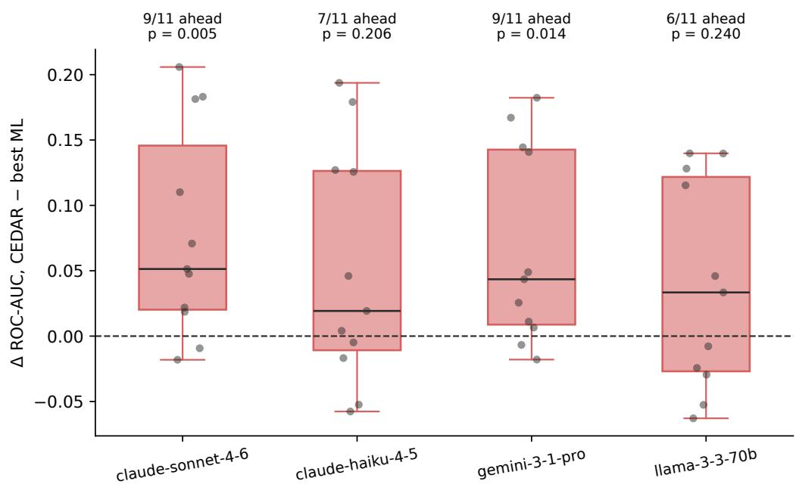  
Supplementary Figure 1: Cedar against the best statistical model on four base models (Supplementary Note 4). For each base model, the ROC-AUC of the full Cedar pipeline minus that of the best classical or temporal model on the same cohort–outcome pair, one point per pair (11 per base model). The statistical models do not depend on the base model, so one best-ML value per pair serves every base model. Annotations give the number of pairs on which Cedar is ahead and the uncorrected Wilcoxon signed-rank p; after Holm–Bonferroni correction across the four base models the lead remains significant on claude-sonnet-4-6 and gemini-3-1-pro.

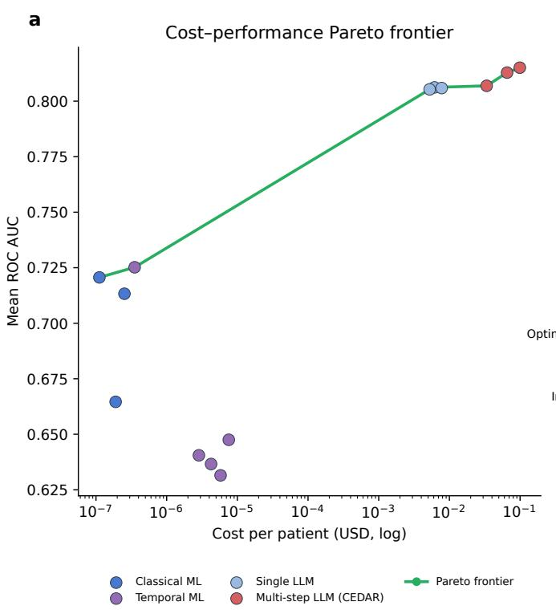

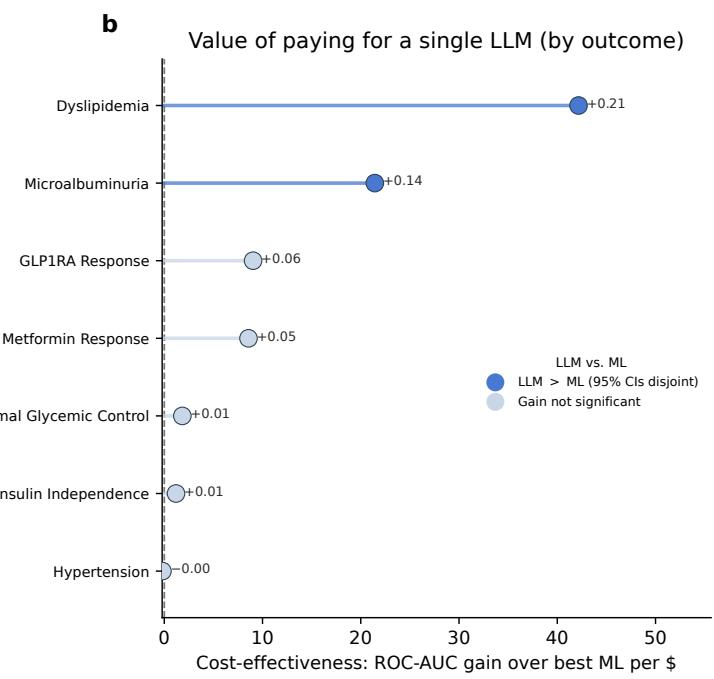

Supplementary Figure 2: Clinical economics: what paying for an LLM buys (T2D). These are cost estimates rather than measured values (Methods, Section 8), which is why the analysis appears here rather than in the main text. They are list prices per token and per CPU-second at one point in time and exclude engineering, review and infrastructure efort. Actual spend depends on the provider, the contract, the model tier and any caching or batching applied, none of which are properties of the method, so these panels separate the tiers by order of magnitude and should not be read as a budget. The quantity that transfers between sites is the number of model calls per patient: one for a single LLM, five for Cedar. (a) Cost–performance Pareto frontier (log cost per patient against mean ROC-AUC): classical ML anchors the cheap end, and both LLM tiers reach the top accuracy band several orders of magnitude above it, with Cedar above a single LLM at the same accuracy, its extra calls buying auditability rather than discrimination. (b) Per-outcome cost-efectiveness of paying for a single LLM. The comparison is deliberately family-level a single LLM against the best classical or temporal ML model, rather than a search for the single best model, because the benchmark of Supplementary Note 4 finds that the inexpensive single LLM already captures most of the LLM accuracy advantage (Supplementary Figure 16a). For each outcome the ratio is the ROC-AUC gain of the single LLM (∼\$0.006/patient) over the bes ML model, divided by the single-LLM cost per patient, i.e. ROC-AUC points gained per dollar. Outcomes are sorted best to worst, each stem is annotated with the underlying ROC-AUC gain, and color indicates whether that gain is statistically distinguishable from ML (non-overlapping 95% confidence intervals, solid) or numerical only (pale). We report the raw gain-per-dollar ratio rather than applying a fixed “worth-it” AUC cut, which would be arbitrary. This panel difers from Supplementary Figure 16e, which compares best-ML and best-LLM AUC per outcome without a cost axis.

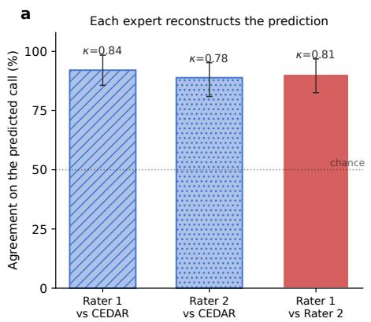

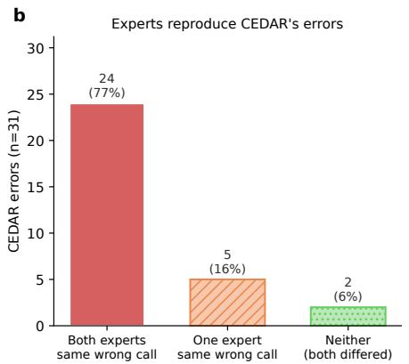

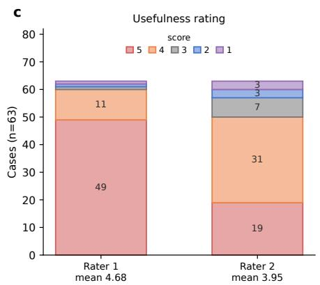  
Supplementary Figure 3: Two-clinician review of Cedar’s reasoning chains (supporting the clinician review reported in the Results). Two board-certified pediatric endocrinologists independently reviewed the same 63 T2D patient-outcome cases, sampled across the four confusion cells, each shown as Cedar’s citation table and reasoning chain with the predicted probability withheld and with no indication of the recorded outcome or of whether Cedar was correct. (a) Agreement on the predicted call: each rater against Cedar, and the two raters against each other, with Cohen’s κ above each bar and 2,000-iteration bootstrap 95% confidence intervals; the dotted line marks chance. An expert reading only the cited evidence arrives at Cedar’s conclusion about nine times in ten, and the two raters agree with each other about as often as either agrees with the model. (b) The 31 cases Cedar scored incorrectly, split by how many raters independently reached the same incorrect call. Only 2 of 31 errors were avoided by both raters, so Cedar’s residual errors sit where two clinicians reading the same record also fail. (c) Distribution of the 1–5 clinical-usefulness rating for each rater, with means in the axis labels. Ratings are high for both raters and, consistent with (b), do not mark out the cases Cedar got wrong $( p = 0 . 5 8$ and $p = 0 . 6 2$ , Mann–Whitney). Because the 63 cases are a stratified draw across the confusion cells, this subset supports agreement and usefulness comparisons but not an accuracy estimate for either the raters or Cedar (Methods, Section 10).

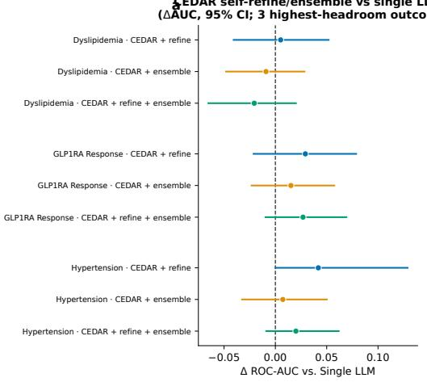

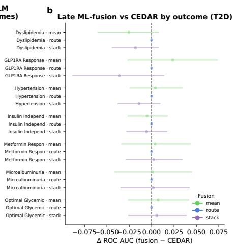

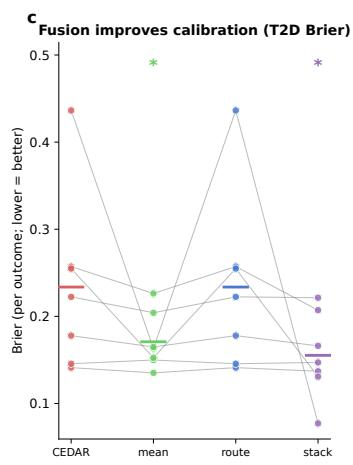

Supplementary Figure 4: Additional Cedar-enhancement configurations tested, none of which improves discrimination over a single LLM call (T2D). The main text already compares all model families, so the former pooled-bars panel is omitted here. (a) Pre-specified “Cedar $\mathbf { v } 2 ^ { \mathbf { , } }$ screen (verifier-gated self-refinement, a diverse-reasoner ensemble, and their combination) on the three highest-headroom T2D outcomes (N=60): paired ∆AUC vs. a single LLM. Every interval crosses zero. The refinement step almost never triggered $( n _ { \mathrm { r e f i n e } } = 0 )$ because first-pass grounding is already ≥0.9999 (Figure 3), consistent with reports that self-correction does not reliably help without external feedback [1, 2] and that multi-agent debate/ensembling does not reliably beat simpler prompting [3]. (b) Late ML-fusion: per-outcome paired ∆AUC vs. Cedar for all three pre-specified combiners (fixed mean, logistic stacking, and prevalence-aware routing) across the seven T2D outcomes (bold = 95% CI excludes zero); wins and losses cancel and no combiner separates from Cedar on discrimination. (c) Late fusion nonetheless improves calibration: per-outcome Brier for Cedar vs. each combiner (points = outcomes, bar = mean; gray lines pair the same outcome across systems). Pooled over records the Brier score falls from 0.234 to 0.155 in T2D and from 0.217 to 0.115 in T1D. The mean and stacking combiners lower Brier on 6 of 7 outcomes (Wilcoxon signed-rank vs. Cedar across the 7 outcomes: mean $p = 0 . 0 3 1$ , stack $p = 0 . 0 4 7 ;$ marked \*), by recalibrating the LLM’s overconfident probabilities while preserving its ranking (hence no ROC-AUC change). Prevalence-aware routing sent all seven T2D outcomes to the LLM and therefore simply recovers Cedar (no change, no mark). Given only seven paired outcomes these calibration p-values are suggestive rather than definitive.

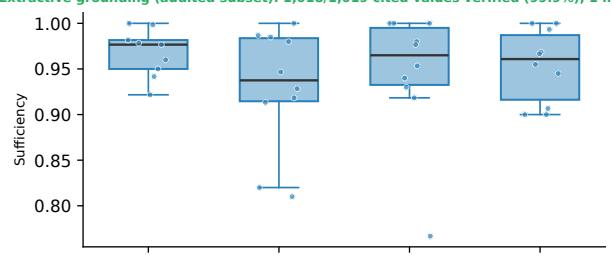

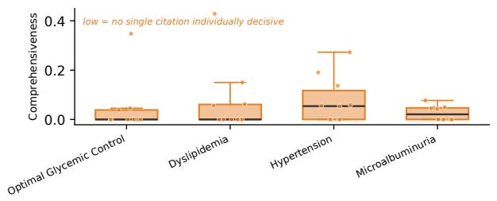

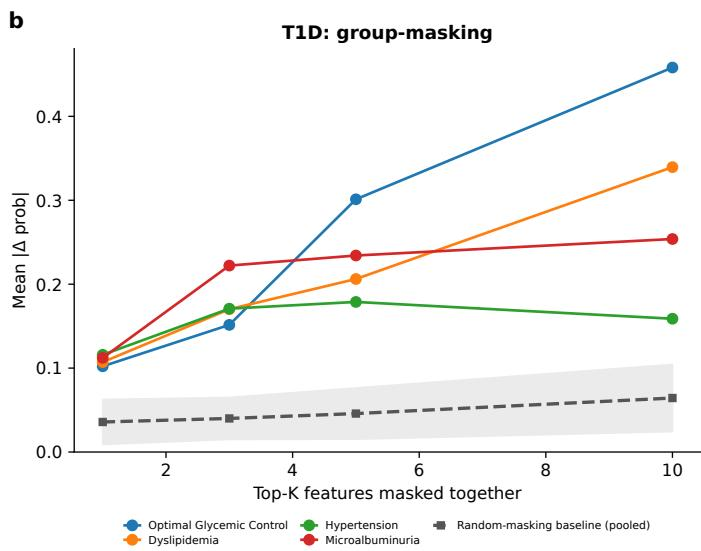

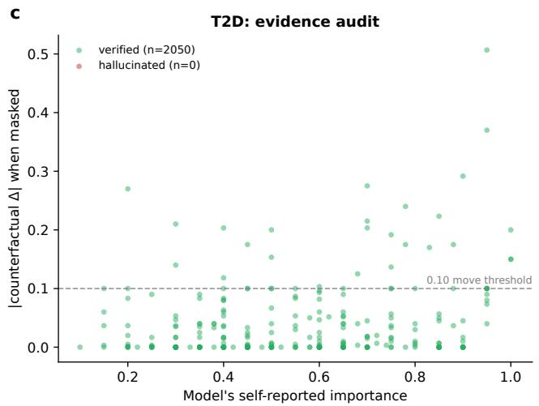

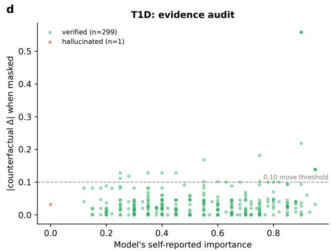

Supplementary Figure 5: Faithfulness of Cedar reasoning: T1D cohort and per-citation evidence audit for both cohorts (companion to Figure 3). (a) T1D faithfulness per outcome across audited patients (box plots: suficiency, top; comprehensiveness, bottom; points are individual patients), with extractive grounding reported as a count in the annotation, as in T2D (a near-ceiling fabrication check). (b) T1D group-masking curve (mean |∆p| vs. top-K cited features masked), which rises as in T2D far above the size-matched random-masking baseline (dashed gray, pooled; ≈0.06 at $K = 1 0 )$ . (c, d) Per-citation evidence audit for T2D and T1D: each cited feature’s self-reported importance versus its actual counterfactual impact when masked, colored by verification status. Essentially all citations match real record values: within this deeper audit every audited T2D citation was verified and all but one in T1D, and the cohort-wide grounding check found 4 mismatches in 47,803 T2D citations and none in 22,443 T1D citations (Results; dashed line, 0.10 move threshold). Consistent with the low comprehensiveness, the median single-citation |∆p is small (≈0.01). No one citation is individually decisive, but the cited set is collectively relevant. Each panel plots a random subsample ofthat cohort’s audited citationsfor legibility, while the legend reports the totals.

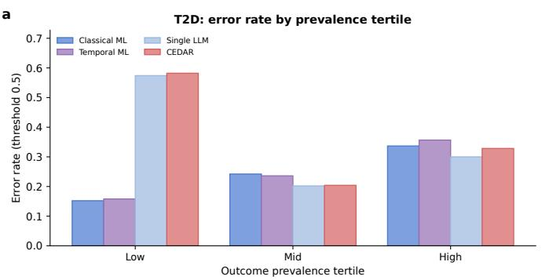

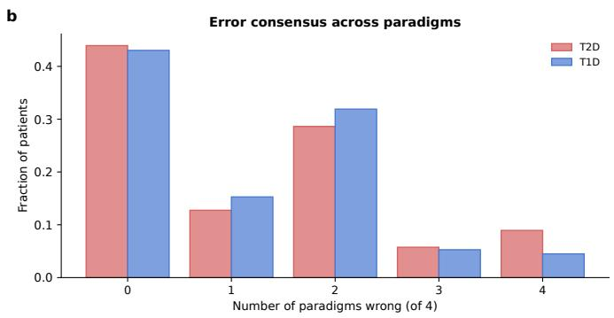

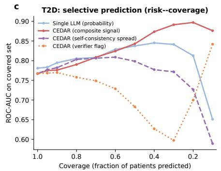

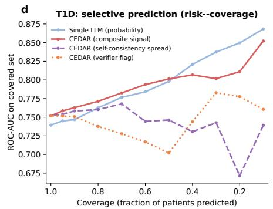

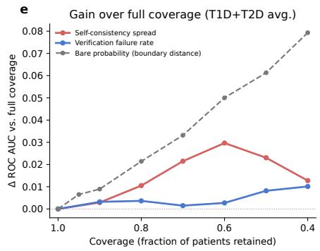

Supplementary Figure 6: Error stratification and selective prediction (supporting the per-patient error analysis of Figure 4; the error-correlation heatmap is in Figure 4a and not duplicated here). (a) Error rate of each family within outcome-prevalence tertiles (T2D). At a 0.5 threshold, classical and temporal ML have a lower error rate on low-prevalence outcomes only because they safely predict the majority class, a near-chance ranking, whereas the LLMs attempt the rare positive calls. This majority-class efect, not an ML discrimination advantage, is the mechanism behind the cross-family error decorrelation. (b) Distribution of how many of the four subgroups misclassify each patient: a large mass at 0 (all correct) and a substantial “exactly 2 wrong” cluster, the two correlated pairs failing as units. (c, d) Selective prediction: risk–coverage curves (covered-set ROC-AUC against the fraction of patients predicted, full coverage at left, increasing abstention to the right), T2D and T1D. Four curves per cohort: a single LLM’s bare probability (its distance from 0.5), Cedar’s own bare probability (“composite,” which folds in the two signals below but is dominated by the bare-probability term since grounding is near-perfect), Cedar’s self-consistency spread, and Cedar’s verifier flag. Deferring the least-confident patients raises covered-set AUC for the single LLM and for Cedar’s bare probability, and the two track each other closely at every coverage level. Self-consistency spread adds nothing beyond that shared baseline in T2D and degrades it in T1D. The verifier flag is actively harmful as a confidence signal: in T2D, ranking on it alone lowers covered-set ROC-AUC by up to 0.14 at 40% coverage, consistent with a signal that almost never fires and is therefore mostly noise. Useful abstention is a generic benefit of any usable probability rather than something Cedar’s verification or self-consistency machinery adds. (e) The same comparison as a gain over full coverage, T1D and T2D averaged. Neither signal Cedar produces internally the spread of its K = 3 self-consistency samples or the fraction of cited evidence its verifier flags, improves on its own predicted probability read as a distance from 0.5 (gray dashed). Curves stop at 40% coverage, below which the retained subset is too small to be reliable.

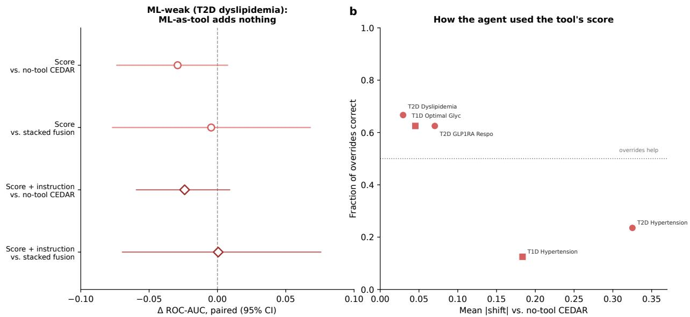

Supplementary Figure 7: How the agent used the injected ML score (mechanism for the targeted tool-use result in Figure 4b). (a) The counterpart of Figure 4b on an outcome on which ML performs poorly. On T2D dyslipidemia, supplying the best-peroutcome ML model’s frozen score to Cedar as an in-context tool changes ROC-AUC significantly against neither no-tool Cedar nor the stacked late-fusion combiner (paired bootstrap; a filled marker would mean the 95% confidence interval excludes zero). (b) The behavioral signal: the mean shift the injected score induced in Cedar’s output relative to the no-tool run (x) versus the fraction of resulting overrides that were correct (y), per outcome and cohort (circles T2D, squares T1D). The agent shifted little and overrode correctly (>50%) when the tool was informative (upper-left), but shifted strongly and incorrectly on the noisiest, lowest-prevalence outcomes (hypertension; lower-right). It therefore uses a good tool and largely resists a bad one, though it can over-trust a noisy score. This is a hypothesis-generating result on a single ML-competitive outcome, not a general accuracy claim; it motivates the future direction of designing outcome- and modality-specific tools for the agent (Discussion).

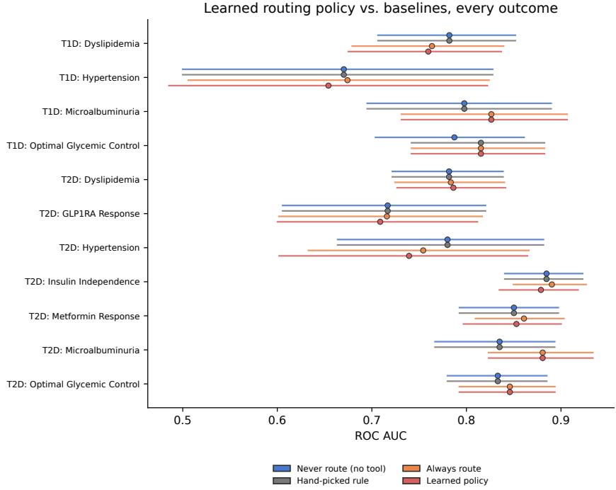  
Supplementary Figure 8: A learned routing policy, evaluated on every outcome (supporting Figure 4c). The hand-picked routing result of Figure 4b generalized into a learned per-patient policy, gated on Cedar’s self-consistency spread or the ML tool’s own confidence exceeding a threshold fit on the training folds, and evaluated on every outcome in both cohorts against always-route, never-route and the original hand-picked rule. It tracks those baselines everywhere, including the ten outcomes where the too carries nothing, so the earlier gain is not an artifact of outcome selection. Per-outcome intervals are wide, so the panel shows that the policy does not hurt rather than carrying the tool-use efect itself.

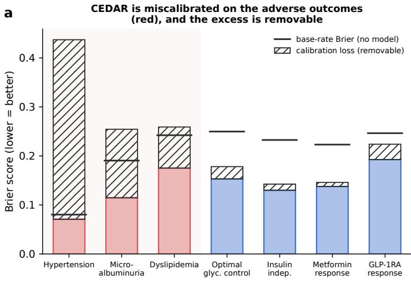

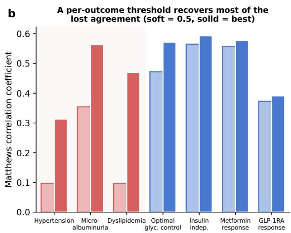

c  
CEDAR carries the last state forward just as often in patients about to change: it cannot see the flip  
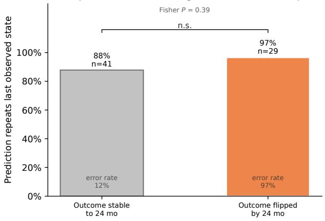

d  
9 of 40 errors are reachable by post-processing or a prompt change; the rest are not  
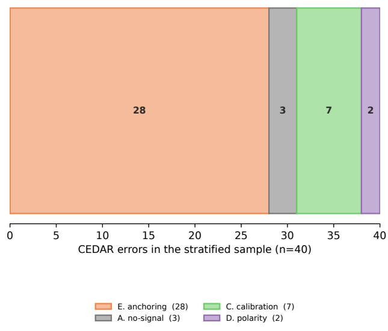  
Supplementary Figure 9: Cedar error analysis and refinement ceiling, T2D (Supplementary Note 2). Cedar (model\_d\_full) only, 24-month horizon. Adverse outcomes are shaded in (a) and (b). (a) Brier score per outcome, decomposed on the reliability bins into a refinement term (solid, the Brier score that would remain after a perfect per-outcome recalibration) and a removable calibration loss (hatched). The horizontal rule on each bar marks the Brier score of an intercept-only model that predicts the base rate. Cedar is worse than that no-model benchmark on all three adverse outcomes and better on all four beneficial ones. (b) Matthews correlation coeficient at the 0.5 threshold used throughout the paper (pale) and at the best threshold for that outcome (solid). Both the recalibration in (a) and the threshold in (b) are fitted on the same held-out bins they are evaluated on, so each is an optimistic ceiling rather than an achievable gain, and neither operation can change ROC-AUC. (c) Rate at which Cedar’s predicted label simply repeats the last observed outcome state, split by whether that state actually changed between the last observed window (18 months) and the target (24 months). The two rates are statistically indistinguishable, i.e. Cedar carries the state forward just as readily in the patients who are about to change: it cannot identify them in advance. The error rates printed inside the bars follow from this and are partly true by construction (an anchored prediction on a flipping patient is an error by definition), which is why the test shown is the anchoring rate rather than the error rate. (d) The 40 misclassified cases in the stratified deck by primary error code, mechanism-first (Supplementary Table 8); anchoring is the largest class under either priority order.

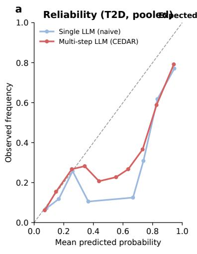

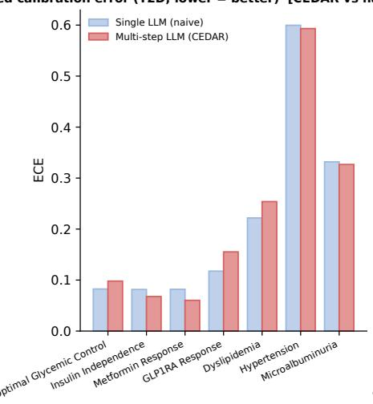

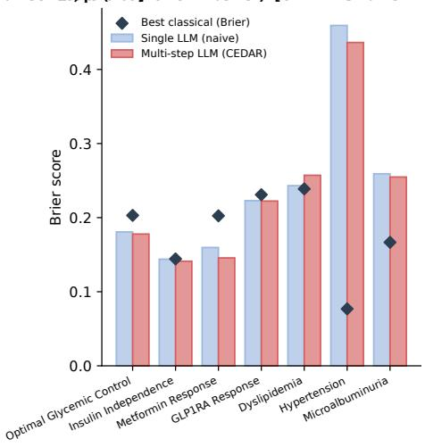

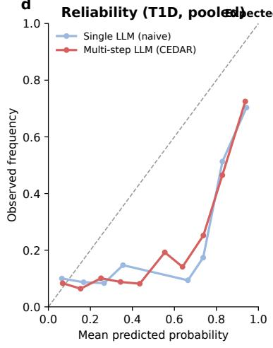

Supplementary Figure 10: Calibration of Cedar vs. the naive single LLM. Reliability curves (pooled over outcomes, countweighted), expected calibration error (ECE), and Brier score for the naive single LLM and Cedar, with the best classical model’s Brier shown as a reference diamond, for (a–c) T2D and (d–f) T1D. All are computed on the shared held-out test set. Self-consistency does not produce a statistically significant calibration improvement in either cohort. In T2D, Cedar and the naive LLM are comparably (mis)calibrated (mean ECE 0.222 vs. 0.217, Wilcoxon signed-rank $p = 0 . 6 9 ;$ mean Brier 0.234 vs. 0.238, $p = 0 . 2 2 )$ In T1D, Cedar is numerically better on both metrics (mean ECE 0.268 vs. 0.319; mean Brier $0 . 2 1 7 \mathrm { v s . } 0 . 2 5 7 )$ , but with only four evaluable outcomes the paired test cannot reach significance $( p = 0 . 1 2 5$ for both, the smallest attainable value at $n = 4 )$ , so we do not claim a calibration advantage. We therefore treat self-consistency primarily as variance reduction (main text) and report calibration transparently rather than as a headline claim.

  
Supplementary Figure 11: Modality contribution across all model families. Standardized ablation on a fixed held-out set (N=100 patients per outcome), run identically for every family, classical ML, temporal ML, single LLM, and Cedar. Bars show the change in mean ROC-AUC (averaged over models and outcomes within each family) from adding a modality on top of EHR-only. (a) T2D: adding SDOH changes discrimination by essentially zero in every family, including Cedar. (b) T1D: adding SDOH is again near-zero, while adding CGM gives a small positive contribution for the classical, temporal, and Cedar families (driven by optimal glycemic control) but not the single LLM. No modality changes a family’s mean ROC-AUC by more than 0.03; the largest single efect is a 0.021 decrease from adding SDOH to classical ML in T1D. A per-model breakdown is given in Supplementary Figure 12.

Supplementary Figure 12: Per-model modality ablation (all families). The by-family ablation in Supplementary Figure 11, broken out for each individual model (mean ROC-AUC over outcomes per model × feature set), confirming the pattern is consistent across every estimator, including the LLMs (Vanilla, CoT, Cedar), and not an averaging artefact. Models span classical ML (LogReg, RF, XGB), temporal ML (XGB-T, LSTM, GRU, TCN, TF), the single LLM (Vanilla, CoT), and Cedar. (a) T2D: EHR-only vs. EHR+SDOH; (b) T1D: EHR-only vs. EHR+SDOH vs. EHR+SDOH+CGM, on the fixed N=100 held-out set. Adding SDOH leaves discrimination essentially unchanged for every model, while adding CGM gives most T1D models (including Cedar) a small lift driven by glycemic control. Dashed line = chance.

Supplementary Figure 13: Temporal (prospective-style) validation: original analysis vs. temporal split. Because no separate validation cohort was available, patients were split by diagnosis recency: models were trained on the earlier-diagnosed cohort and evaluated on the more-recently-diagnosed cohort (“train on the past, validate on the future”). (a, b) Cedar’s original held-out test ROC-AUC (open blue) vs. its temporal-validation ROC-AUC (filled red) per outcome, with the change annotated (green = holds/improves, red = drops), for (a) T2D and (b) T1D. Discrimination is preserved under the temporal split: most outcomes move by less than 0.05 ROC-AUC and several improve, e.g. T1D optimal glycemic control by +0 11. (c, d) ROC-AUC distributions by model family in the original vs. temporal analysis, for (c) T2D and (d) T1D, showing that the agreement holds perfamily and not just for Cedar. Each box pools one ROC-AUC per model and outcome within a family, and the original analysis is restricted to the models present in the temporal run so that the comparison is like for like. Every family, classical ML, single LLM, and the multi-step LLM (Cedar), occupies a similar ROC-AUC range under both datasets, with Cedar the tightest and most stable, indicating the family ordering reproduces across the temporal shift. (Temporal-ML and multi-agent models were not included in the temporal-validation export and are therefore absent from (c, d).) (e) Split provenance: median diabetes duration of the train (earlier-diagnosed) vs. validation (recent-diagnosed) subsets for each cohort, confirming a genuine temporal separation.

  
Supplementary Figure 14: Information ablation for all seven outcomes (supporting Figure 5e). ROC-AUC by condition for the history-only reader and the reader that sees both channels, with the context-only level dashed, 100 patients per outcome. Conditions run from no history to the full laboratory history (shaded), which is not nested with the visit-restricted conditions. Estimates and confidence intervals are in Supplementary Table 11, and the exceptions and limits are in Supplementary Note 5.

  
Supplementary Figure 15: Outcome prevalence and assessable sample size, by cohort. Prevalence at the 2-year target visit for each outcome, annotated with event/assessable counts, for (a) T2D and (b) T1D. The two cohorts occupy diferent regimes. T1D is evaluated on four outcomes (insulin independence, metformin response, and GLP-1RA response are not clinically applicable in T1D) and generally at lower prevalence (e.g. optimal glycemic control 22% vs. 48%, hypertension 5% vs. 9%), while assessable N varies substantially across outcomes (e.g. T1D microalbuminuria N = 280). These diferences, not a change in method, underlie the diferent per-outcome numbers between cohorts.

d  

b T2D: models × outcomes (gold = best per outcome)  

T1D: models × outcomes (gold = best per outcome)  

e T2D: best ML vs best LLM per outcome (LLM−ML gain)  

Single LLM vs CEDAR across base models n.s. n.s. n.s.  
  
Supplementary Figure 16: Full benchmark including naive single-call LLM implementations (Supplementary Note 4). Models are grouped into two families, ML and LLM, each split into two subgroups: classical and temporal ML, and the single LLM (Vanilla, CoT and modality-ablated Vanilla) and Cedar (the full pipeline with its CoT+Verify and CoT+SC ablations). (a, b) T2D; (c, d) T1D. (a, c) ROC-AUC by subgroup with family brackets (Mann–Whitney $U , ^ { \ast \ast \ast } \overset { \cdot } { p } < 0 . 0 0 1 )$ . Within the LLM family the single LLM and Cedar are statistically indistinguishable, $p = 0 . 7 1$ in T2D and $p = 0 . 5 6$ in T1D. (b, d) Model × outcome ROC-AUC matrix with the best model per outcome outlined in gold. (e) Best ML model versus best LLM configuration per T2D outcome. (f) Single LLM versus Cedar on four base models, pooling the 11 cohort–outcome pairs, paired Wilcoxon signed-rank test per base model, Holm–Bonferroni corrected. The equivalence holds on the three commercial base models and not on llama-3-3-70b.

a  
T2D: per-patient error correlation  

b  
T1D: per-patient error correlation  

c Every CEDAR configuration converges to a single pass  

Supplementary Figure 17: Error overlap with a single call, and the mechanisms that did not improve on it (Supplementary Note 4). (a, b) Per-patient error correlation among all four subgroups, T2D and T1D, as ϕ of the misclassification indicators at a 0.5 threshold. The single LLM and Cedar err on almost the same patients (ϕ = 0 87 and 0.77), so the added stages do not reshape the error set. (c) Every Cedar configuration evaluated, as a paired mean ∆ROC-AUC against a single LLM pass (point ±95% CI), colored by the kind of change: internal mechanism, more reasoning, LLM-guided feature engineering and late ML fusion. All cluster on zero.

## References

[1] Jie Huang, Xinyun Chen, Swaroop Mishra, Huaixiu Steven Zheng, Adams Wei Yu, Xinying Song, and Denny Zhou. Large language models cannot self-correct reasoning yet. https://arxiv.org/abs/2310.01798, 2024.

[2] Ryo Kamoi, Yusen Zhang, Nan Zhang, Jiawei Han, and Rui Zhang. When can LLMs actually correct their own mistakes? A critical survey of self-correction of LLMs, 2024.

[3] Andries Petrus Smit, Nathan Grinsztajn, Paul Duckworth, Thomas D Barrett, and Arnu Pretorius. Should we be going MAD? A look at multi-agent debate strategies for LLMs. In Proceedings ofthe 41st International Conference on Machine Learning, volume 235 of Proceedings ofMachine Learning Research, pages 45883–45905. PMLR, 2024.

[4] Anders Krogh and Jesper Vedelsby. Neural network ensembles, cross validation, and active learning. In G. Tesauro, D. Touretzky, and T. Leen, editors, Advances in Neural Information Processing Systems, volume 7. MIT Press, 1994. URL https:// proceedings.neurips.cc/paper\_files/paper/1994/file/b8c37e33defde51cf91e1e03e51657da-Paper.pdf.

[5] Thomas G. Dietterich. Ensemble methods in machine learning. In Multiple Classifier Systems, pages 1–15, Berlin, Heidelberg, 2000. Springer Berlin Heidelberg. ISBN 978-3-540-45014-6.

[6] Ludmila I. Kuncheva and Christopher J. Whitaker. Measures of diversity in classifier ensembles and their relationship with the ensemble accuracy. Machine Learning, 51:181–207, 2003. doi: 10.1023/A:1022859003006.

[7] Alon Jacovi and Yoav Goldberg. Towards faithfully interpretable NLP systems: How should we define and evaluate faithfulness? In Proceedings ofthe 58th Annual Meeting ofthe Associationfor Computational Linguistics, pages 4198– 4205, Online, 2020. Association for Computational Linguistics. doi: 10.18653/v1/2020.acl-main.386. URL https: //aclanthology.org/2020.acl-main.386.

[8] Jay DeYoung, Sarthak Jain, Nazneen Fatema Rajani, Eric Lehman, Caiming Xiong, Richard Socher, and Byron C. Wallace. ERASER: A benchmark to evaluate rationalized NLP models. In Proceedings ofthe 58th Annual Meeting ofthe Association for Computational Linguistics, pages 4443–4458, Online, 2020. Association for Computational Linguistics. doi: 10.18653/ v1/2020.acl-main.408. URL https://aclanthology.org/2020.acl-main.408.

[9] Emily Black, Klas Leino, and Matt Fredrikson. Selective ensembles for consistent predictions. https://arxiv.org/abs/ 2111.08230, 2021.

[10] Yonatan Geifman and Ran El-Yaniv. Selective classification for deep neural networks. In Advances in Neural Information Processing Systems, volume 30, pages 4878–4887, 2017.

[11] Jingtong Gao, Bo Chen, Xiangyu Zhao, Weiwen Liu, Xiangyang Li, Yichao Wang, Zijian Zhang, Wanyu Wang, Yuyang Ye, Shanru Lin, et al. Llm-enhanced reranking in recommender systems. arXiv preprint arXiv:2406.12433, 2024.

[12] Alistair E. W. Johnson, Lucas Bulgarelli, Lu Shen, Alvin Gayles, Ayad Shammout, Steven Horng, Tom J. Pollard, Sicheng Hao, Benjamin Moody, Brian Gow, Li-wei H. Lehman, Leo A. Celi, and Roger G. Mark. MIMIC-IV, a freely accessible electronic health record dataset. Scientific Data, 10(1):1, 2023. doi: 10.1038/s41597-022-01899-x.

[13] Carl van Walraven, Irfan A Dhalla, Chaim Bell, Edward Etchells, Ian G Stiell, Kelly Zarnke, Peter C Austin, and Alan J Forster. Derivation and validation of an index to predict early death or unplanned readmission after discharge from hospital to the community. CMAJ, 182(6):551–557, 2010. doi: 10.1503/cmaj.091117. LACE index.

[14] Jacques Donzé, Drahomir Aujesky, Deborah Williams, and Jefrey L Schnipper. Potentially avoidable 30-day hospital readmissions in medical patients: derivation and validation of a prediction model. JAMA Internal Medicine, 173(8):632–638, 2013. doi: 10.1001/jamainternmed.2013.3023. HOSPITAL score.

[15] Mary E Charlson, Peter Pompei, Kathy L Ales, and C Ronald MacKenzie. A new method of classifying prognostic comorbidity in longitudinal studies: development and validation. Journal ofChronic Diseases, 40(5):373–383, 1987. doi: 10.1016/0021-9681(87)90171-8.

[16] Hude Quan, Vijaya Sundararajan, Patricia Halfon, Andrew Fong, Bernard Burnand, Jean-Christophe Luthi, L Duncan Saunders, Cynthia A Beck, Thomas E Feasby, and William A Ghali. Coding algorithms for defining comorbidities in ICD-9- CM and ICD-10 administrative data. Medical Care, 43(11):1130–1139, 2005. doi: 10.1097/01.mlr.0000182534.19832.83.

[17] Jean-Louis Vincent, Rui Moreno, Jukka Takala, Sheila Willatts, Arnaldo De Mendonça, Hajo Bruining, C K Reinhart, Peter M Suter, and Lambertus G Thijs. The SOFA (sepsis-related organ failure assessment) score to describe organ dysfunction/failure. Intensive Care Medicine, 22(7):707–710, 1996. doi: 10.1007/BF01709751. On behalf of the Working Group on Sepsis-Related Problems of the European Society of Intensive Care Medicine.

[18] Alistair E W Johnson, Andrew A Kramer, and Gari D Cliford. A new severity of illness scale using a subset of Acute Physiology And Chronic Health Evaluation data elements shows comparable predictive accuracy. Critical Care Medicine, 41 (7):1711–1718, 2013. doi: 10.1097/CCM.0b013e31828a24fe. Oxford Acute Severity of Illness Score (OASIS).

[19] Jean-Roger Le Gall, Stanley Lemeshow, and Fabienne Saulnier. A new Simplified Acute Physiology Score (SAPS II) based on a European/North American multicenter study. JAMA, 270(24):2957–2963, 1993. doi: 10.1001/jama.1993.03510240069035.

[20] American Diabetes Association Professional Practice Committee. Standards of care in diabetes—2024. Diabetes Care, 47 (Supplement 1):S1–S321, 2024.

[21] International Society for Pediatric and Adolescent Diabetes. ISPAD clinical practice consensus guidelines 2022. Pediatric Diabetes, 23(8), 2022.

[22] Philip Zeitler, Katrina Hirst, Laura Pyle, et al. A clinical trial to maintain glycemic control in youth with type 2 diabetes. New England Journal ofMedicine, 366(24):2247–2256, 2012.

[23] William V Tamborlane, Margarita Barrientos-Pérez, Uwe Fainberg, Helle Frimer-Larsen, Mona Hafez, Paula M Hale, Muhammad Yazid Jalaludin, Margarita Kovarenko, Ingrid Libman, Jane Lynch, et al. Liraglutide in children and adolescents with type 2 diabetes. New England Journal ofMedicine, 381(7):637–646, 2019. doi: 10.1056/NEJMoa1903822.

[24] Gary S. Collins, Karel G. M. Moons, Paula Dhiman, et al. TRIPOD+AI statement: updated guidance for reporting clinical prediction models that use regression or machine learning methods. BMJ, 385:e078378, 2024.