# Agentic University: Collaborative Agents for Personalized Learning

Jingru Fan1 Tianle Zhou2 Yunjie Zhou1 Zihao He1 Yixuan Zhou1

Kezhao Wu1 Xinyu Zheng1 Xiyuan Wang3 Yuheng Wang1 Zhi Li1

Songhua Liu1 Weinan E1 Chen Qian1

1Shanghai Jiao Tong University 2Nanyang Technological University

3National University of Singapore

fanjingru510@sjtu.edu.cn qianc@sjtu.edu.cn

## Abstract

Large language models support personalized tutoring, content generation, and adaptive learning paths. However, capability development requires these resources and interactions to form a coherent learning process that evolves with the learner. A central challenge is to align goals, activities, and assessment while using learning evidence to decide what should follow. We introduce Human-Participatory Multi-Agent Organization and instantiate it in Agentic University (AU). In AU, learners participate as organization members and work with specialized agents to maintain a revisable Capability Program. The program connects personal goals, learning activities across modalities, and layered assessment, while learner feedback and performance guide subsequent support. Our evaluation shows advantages in program organization, assessment design, and revision quality. Users achieved larger mean assessment gains (12.19 versus 5.61 points on a 50-point scale) and reported stronger cognitive support. This work contributes an organizational approach to adaptive learning that makes learner participation a continuing basis for multi-agent coordination.

The Agentic University project is available at $\frac { 9 } { \frac { 3 } { 4 } }$ https://github.com/AgenticOrgLab/AgenticUniversity.git.

## 1 Introduction

Advances in large language models (LLMs) enable educational systems to provide personalized tutoring, generate instructional materials, and plan learning activities [37, 38, 65]. Recent applications support instructional design [73], teaching video generation [67], and real-time guidance for human tutors [64]. Other systems use learner profiles and feedback to plan and refine learning paths [65, 71], and use interaction history to support ongoing tutoring and practice [74].

However, for learners seeking to develop their capabilities, generating instructional materials or conducting tutoring dialogues provides only part of the required support. These materials and interactions need to form a coherent learning process that aligns goals, learning activities, and assessment [9]. A system therefore needs to coordinate how diferent learning artifacts support an individual learner. As learning evidence accumulates, it needs to adjust the content of subsequent activities and how they connect. A learning path organizes tasks, and instructional content and practice support those tasks. Evidence-centered assessment connects claims about learner capability to observable evidence and the tasks that elicit it [48]. Recent work applies this approach to evidence from human-AI writing interactions [21]. Assistance conditions also matter. A study of high-school mathematics found that better performance during AI-assisted practice did not necessarily translate into better unaided performance [8]. Dificulties identified during learning should guide subsequent support, and assessed performance should inform revisions to the learning path [10]. We therefore examine how to organize sustained learning around each learner’s goals, prior knowledge, and progress.

We build on role specialization and collaboration in LLM-based multi-agent systems (MAS) [18, 65] to introduce Human-Participatory Multi-Agent Organization. The framework draws on artifacts as a means of coordinating cooperative work [59]. Its emphasis on learner participation is informed by research on learner decision making [62] and human-AI interaction guidelines on feedback and control [3]. We use this framework to develop the Agentic University (AU) system. AU is designed for learners pursuing specific capability goals, with a focus on university students. As Figure 1 shows, each learner participates as an organization member and jointly maintains a revisable Capability Program with agents. The program connects personal goals, diverse learning activities across modalities, and assessment requirements. The organization provides learning support through a learning path, an interactive classroom, and layered assessment, and adapts subsequent learning activities.

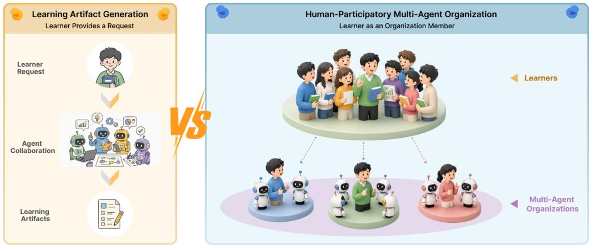  
Figure 1. Two ways of organizing multi-agent work around a learner. Left: a learner provides a request, and agents collaborate to generate learning artifacts. Right: a learner participates as a member of a multi-agent organization. Its activities support learning, while learner feedback and performance inform subsequent work.

We evaluated AU through three studies of program formation, evidence-guided revision, and human use. Model-based evaluation identified program organization and assessment design as AU’s clearest advantages. In revision comparisons, AU received higher ratings for revision appropriateness, program improvement, and path coherence. Both systems received high ratings for alignment between evidence and revisions. In the human study, we observed mean assessment gains of 12.19 points for AU users and 5.61 points for the comparison group on a 50-point scale. AU users also reported stronger cognitive support.

This paper makes three contributions:

1. We introduce Human-Participatory Multi-Agent Organization, a framework in which learners participate as organization members and work with agents to organize and adapt ongoing learning activities.

2. We develop AU, which uses the Capability Program to connect personal goals, diverse learning activities across modalities, and layered assessment to provide adaptive learning support.

3. We report three studies of program formation, evidence-guided revision, and human use, providing empirical evidence on program quality, revision quality, and learner outcomes and experiences.

## 2 Related Work

## 2.1 From Personalized Tutoring to Coherent Learning Programs

Personalized learning research connected representations of the learner to instructional decisions. Knowledge tracing estimated skill acquisition from performance [22], and deep knowledge tracing learned representations of learning histories with recurrent neural networks [55]. Adaptive hypermedia used learner models to adapt content presentation and navigation [14], while AutoTutor used mixed-initiative dialogue to support learning [30]. Together, these approaches established personalization at the levels of learner state, content access, and instructional interaction.

Recent systems extended personalization through pedagogically informed generation and course-specific support. LearnLM incorporated learning-science principles into model development and pedagogical evaluation [37], while CourseAssist aligned tutoring responses with course materials and learning objectives through retrieval and question decomposition [25]. Other systems broadened the available learning activities through customized instructional design [73], teaching-video production [67], and agent-supported online classrooms [72]. Together, these systems expanded the instructional resources and interactions available for personalized learning.

A further line coordinated personalization across learning paths. MALPP coordinated learner analytics, path planning, and reflection agents to iteratively refine personalized paths with explicit rationales [71], while Pxplore combined goal-driven learner-state modeling with policy training for personalized path planning [43]. GenMentor, our closest system-level comparison, connected goal-to-skill mapping, dynamic learner profiles, instructional content, and quizzes. It revised learning paths using updated profiles and required learner approval before applying changes [65]. DeepTutor shared evolving learner profiles and interaction memory across tutoring functions [74]. These systems established precedents for adaptive paths, continuing personalization, and coordinated support. AU extended this line through a Human-Participatory Multi-Agent Organization for capability development. The learner participated as an organization member alongside agents responsible for planning, mentoring, assessment, and replanning. Together, they maintained a revisable Capability Program that connected personal goals, multimodal learning activities, and layered assessment. The organization used learner contributions and performance evidence to adapt subsequent learning, with the learner retaining control over path changes.

## 2.2 From Role Specialization to Shared-State Coordination in Multi-Agent Systems

Research on multi-agent organizations formalized collective activity through agents, groups, and roles [26]. MOISE+ further distinguished structural, functional, and deontic specifications, connecting organizational roles to collective goals and obligations [35]. LLM-based systems operationalized complementary forms of collaboration. CAMEL used role-playing to structure agent interaction [42], and AgentVerse coordinated teams of agents [18]. MetaGPT organized intermediate artifacts through standard operating procedures [32], while ChatDev linked specialized roles through a staged software-development process [56]. These approaches provided precedents for organizing specialized outputs into collective work.

Later work examined how teams coordinated during execution. AutoGen supported conversations among agents, tools, and people [70]. Internet of Agents supported heterogeneous agents through dynamic teaming [19], and Optima trained agents to balance communication eficiency and task efectiveness [20]. Magentic-One maintained task and progress ledgers to guide execution and replanning [28]. Cemri et al. identified failures involving system design, inter-agent misalignment, and verification in multi-agent execution traces [17]. Together, these studies highlighted the importance of coordination rules and shared context alongside role specialization.

Shared artifacts provided a further basis for coordination. Schmidt and Simone described coordination mechanisms as artifacts coupled with conventions for managing interdependent work [59]. Recent work examined the authority and consistency of persistent state: governed collaborative memory distinguished private from institutional memory and connected memory admission to ratification, provenance, and version lineage [23]; the Artifact Coherence System serialized writes to each artifact and used versioning and invalidation to coordinate cached copies [54]. AU applied an organizational perspective to educational dependencies: its Capability Program connected objectives, prerequisites, activities, assessment requirements, and current program state. Its evidence records retained sources, conditions, and permitted updates, while its revision history linked evidence and diagnosis to learner-confirmed changes and path versions.

## 2.3 Human Participation and Learner Agency

Research on learner agency examined how learners influenced AI-supported activity. Vincoli et al. distinguished agency over content, feedback and help, co-orchestration, and data [62]. Dai and Lai identified initiating and redirecting, mindful adoption, external help-seeking, and reflection as interrelated aspects of agency in students AI-assisted learning [24]. These perspectives situated participation across learning decisions and interactions. Open learner modeling ofered a concrete mechanism by making learner representations inspectable and, in some designs, negotiable or editable [16].

Educational systems also distributed participation across diferent human roles. AI2T supported tutor authoring through demonstrations and corrective feedback [68], while TeachTune helped teachers inspect pedagogical agents across simulated learner profiles [36]. During instruction, Tutor CoPilot supplied suggestions to human tutors [64], and the LearnLM classroom trial placed every generated message under expert review before delivery [61]. These systems located human judgment in tutor construction, review, and instructional delivery.

Human–AI interaction research addressed related questions of initiative and control. Mixed-initiative interaction examined how people and systems shared initiative [33], and human–AI interaction guidelines emphasized correction, feedback, and control over time [3]. AgentCoord enabled users to inspect and revise multi-agent plans, agent assignments, and task processes [53]. In education, LearnMate enabled learners to adjust personalized plans and schedules while receiving contextual support [66]. These systems demonstrated concrete ways for people to shape plans and agent behavior.

AU investigated how learner contributions remained consequential when educational work passed between roles. Its Human Node retained goals, constraints, and corrections, while its Capability Program connected those contributions to subsequent planning, mentoring, assessment, and replanning. Learner confirmation governed the application of path changes. This design treated continuing participation as part of organizational coordination.

## 2.4 Connecting Capability Assessment to Program Revision

Educational research provided principles for connecting goals, instructional activity, and evidence. Constructive alignment linked intended outcomes, learning activities, and assessment [9]. Evidence-centered design connected capability claims to observable evidence and the tasks that elicited it [48], while authentic-assessment research situated assessment in meaningful tasks, contexts, and criteria [31]. These perspectives informed AU’s alignment of knowledge-point checks, stage micro-projects, and an integrative simulation with objectives at corresponding scopes.

AI assistance made the interpretation of performance especially consequential. Cheng et al. used evidencecentered assessment to examine human–AI writing processes [21]. Bastani et al. found that better performance during AI-assisted mathematics practice did not necessarily imply better performance after assistance was removed [8]. Formative-assessment research connected evidence to subsequent teaching and learning de cisions [10, 11]. Sadler further emphasized learners’ understanding of quality, comparison of their work against that standard, and action to close the gap [58]. These perspectives motivated AU’s attention to what an observation supported and how it informed subsequent instruction. AU distinguished Learning-State Evidence for interpreting support needs from Capability Evidence for updating estimates within the assessed task and assistance conditions. Both informed targeted program revisions, with explicit links to the afected objectives, activities, and assessment requirements.

## 3 Formative Study

Learning support needs to connect learners’ backgrounds and goals with their activities, progress, and next steps. We conducted formative interviews to understand how people make these connections in study, technical work, and teaching. The findings informed AU’s design goals for maintaining learner context, organizing learning activities, interpreting performance, and adapting subsequent work.

## 3.1 Participants and Procedure

Recruitment and sampling rationale. We recruited seven participants through online social platforms. We used purposive sampling [52] to select people with relevant experience in learning, applying, or teaching technical knowledge. Their experience could inform the study of learning planning, progress judgments, and responses to dificulty.

Five primary learners (L1 to L5) provided accounts of managing their own learning. Their backgrounds included undergraduate computing, AI exploration and career preparation, extensive online-course learning, and interdisciplinary doctoral study. We included a technical practitioner (L6) with data-pipeline experience to examine learning shaped by workplace delivery needs. We included a data structures instructor (E1) to examine how educators interpret learner performance and select instructional support. These backgrounds provided variation in learning goals, experience, and settings. We distinguished L6’s workplace account and E1’s instructional observations from the primary learners’ accounts throughout the analysis.

Interview procedure and ethics. Individual online interviews took place on February 25 and 26, 2026, in Mandarin Chinese. Each interview lasted 40 to 60 minutes. We used a common semi-structured guide to ask how participants planned learning, judged progress, and responded to dificulty. Follow-up questions explored these practices in each participant’s learning, workplace, or teaching context. Participants discussed their existing practices without viewing a prototype.

The university’s ethics committee approved the study. Researchers explained the study purpose, procedure, recording arrangements, intended data use, and participant rights. All participants provided electronic informed consent before their interviews and agreed to audio recording. Each participant received CNY 100 through online payment. Researchers checked the automatically generated transcripts against the recordings and corrected transcription errors. We removed or generalized identifying details and replaced names with participant identifiers before analysis.

## 3.2 Analysis

Two researchers manually analyzed the transcripts using inductive thematic analysis at the semantic level [13]. They open-coded passages to capture participants’ explicit accounts and developed a shared codebook through repeated coding, review, and revision [45]. A passage could receive multiple codes. The researchers compared interpretations, revisited the surrounding transcript, and discussed diferences to refine the codes and their application.

The researchers grouped the codes into themes and reviewed supporting and contrasting accounts. They kept direct experiences, prospective accounts, and instructor observations distinct when interpreting each theme. The final analysis comprised 22 codes and four themes. We retained the coding records, analytic decisions, and supporting excerpts as an audit trail [49].

## 3.3 Findings

Italic quotations are English translations of Mandarin interview excerpts.

## 3.3.1 F1: Learner context was fragmented and sometimes inaccurate

Participants carried context across courses, AI conversations, and other resources. L1 explained, “In a new conversation, I usually have to explain my background again, how far I have learned, and what I still do not understand.” L3 reported that tools lacked context from learning elsewhere. E1 noted that scores and submissions did not convey students’ specific dificulties between instructors.

L5’s humanities label also led AI-generated routes to discount prior STEM training, while recommendations for L2 assumed continued commitment to a briefly explored direction. These accounts call for context continuity and correction of inaccurate or outdated assumptions.

## 3.3.2 F2: Learning routes left gaps in action and completion criteria

L2 wanted a concrete daily task within a short planning horizon; L3 found generated routes fragmented and poorly connected to resources. L1 explained, “The route looks clear, but when I execute it, it is dificult to judge what counts as finished.” L5 reprioritized learning amid competing doctoral responsibilities. L6 planned workplace learning around immediate delivery demands, while L4 valued fixed courses linked to examination or work goals and including practice. These accounts call for linking broad goals to feasible activities and explicit completion criteria, with planning horizons suited to learners’ circumstances.

## 3.3.3 F3: Capability judgments depended on tasks and available support

Participants distinguished activity completion from applying knowledge. L1 could follow a model-training video but struggled with missing values, feature selection, and evaluation on an actual dataset. E1 used explanations and open-ended tasks to assess understanding beyond participation, submissions, or running code, revealing further dificulties.

Available assistance also shaped performance judgments. L3 explained, “If I follow the quick start, the project will usually run, and AI helps me repair pipeline problems. So the project running by itselfdoes not say much.” L6 described a diferent workplace criterion: “Ifyou can bring the resources together and complete the work as the owner, that is also aform ofworkplace capability.” These accounts distinguish independent technical execution from responsibility for completing work with available resources. Performance evidence therefore needs to be interpreted in relation to the task and support used. L5 also described possible causes of non-completion: knowledge gaps, limited time, competing priorities, and unsuitable resources.

## 3.3.4 F4: Interpreting dificulties guided subsequent learning choices

L2 described how dificulties guided subsequent learning: “I treat it as a new judgment about the boundary of my capability, and then decide whether to strengthen it or adjust what I learn next.” L3 gave AI questions and self-produced answers to identify weaknesses and generate follow-up questions. L4 changed explanations or resources when a course did not resolve a dificulty.

E1 distinguished conceptual misunderstanding from insuficient practice when selecting support and used conversation to interpret conflicting assessment results. These interpretations guided further explanation, practice, resource changes, or revised priorities.

## 3.4 Design Goals

The four themes and related work informed AU’s design goals and corresponding system support.

DG1: Maintain a persistent and correctable learner representation (F1). AU should retain relevant learner context across interactions and roles, record its sources, and allow learners to correct inaccurate or outdated assumptions. This goal informed the Human Node and selective SharedMemory.

DG2: Connect goals to activities, completion criteria, and progress (F2). AU should connect goals to activities, resources, prerequisites, and explicit completion criteria, consistent with constructive alignment among intended learning outcomes, learning activities, and assessment [9]. It should track completed, remaining, and deferred work within a program scope suited to the learner’s planning horizon. This goal informed the Capability Program.

DG3: Match capability claims to the scope of evidence (F3). AU should interpret performance in relation to the target capability, task, conditions, timing, and allowed support. This goal informed its assessment design and the distinction between Learning-State Evidence and Capability Evidence.

DG4: Use learner evidence and input to guide program revision (F4). AU should use new evidence and learner input to revise subsequent work, following formative assessment’s use of learning evidence to guide the next instructional step [11]. Revisions should address identified dificulties, preserve relevant work, and allow learner inspection. AU should support learner review when evidence conflicts or time and other constraints may explain performance.

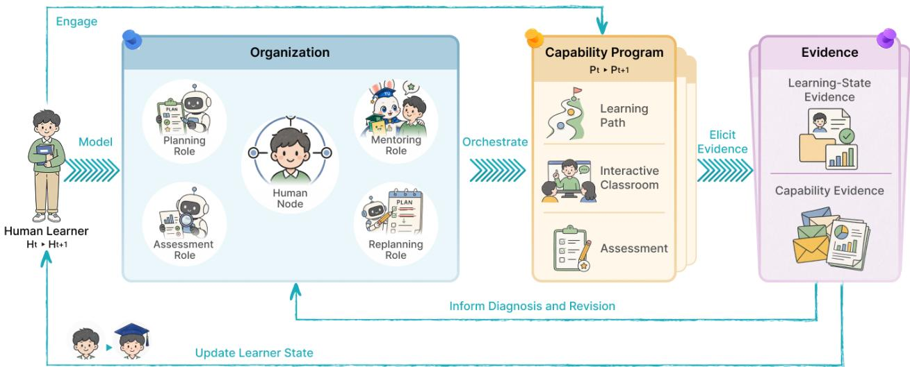  
Figure 2. AU connects the Human Node and agent roles through a Capability Program. The program includes a Learning Path, Interactive Classroom, Assessment. Classroom contributions and assessed performance provide Learning-State Evidence and Capability Evidence. The agents use this evidence to update learner state and revise remaining work. The four icons denote functional roles; the replanning role includes three diagnostic agents.

## 4 Agentic University

Agentic University (AU) supports learners from goal setting through learning and program revision. A learner arrives with a goal and begins in a guided conversation, describing background, preferences, and constraints, and correcting the system’s assumptions along the way. AU organizes a learning program of stages and knowledge-point nodes. Within each node, the learner studies materials, watches instructional videos, and answers Pause-QA questions, turning to mentors for explanations, examples, or hints as dificulties arise. Node assessments, stage micro-projects, and a final enterprise simulation follow, each returning feedback the learner can act on. When assessment results or learning interactions indicate a need for additional support, AU considers a revision to the remaining path. It applies proposed changes after learner confirmation.

Sustaining this experience across stages requires planning, mentoring, and assessment to stay aligned with what the learner is trying to achieve. AU maintains this alignment through two shared representations: the Human Node, which carries the learner’s goals and contributions, and the Capability Program, which organizes learning activities and assessment criteria around them (Figure 2). The rest of this section develops the organization behind the walkthrough: the organizational model (Section 4.1), how a Capability Program is formed (Section 4.2), how executing it produces evidence (Section 4.3), and how that evidence updates learner state and revises the program (Section 4.4).

## 4.1 Organizational Model and Human Node

AU coordinates work across activities through clear agent responsibilities and shared learner information. At time �, we represent the organization as

$$
\begin{array} { r } { \mathcal G _ { t } = ( \mathcal V _ { t } , \mathcal R _ { t } ) , \qquad \mathcal V _ { t } = \{ H _ { t } \} \cup \mathcal A . } \end{array}\tag{1}
$$

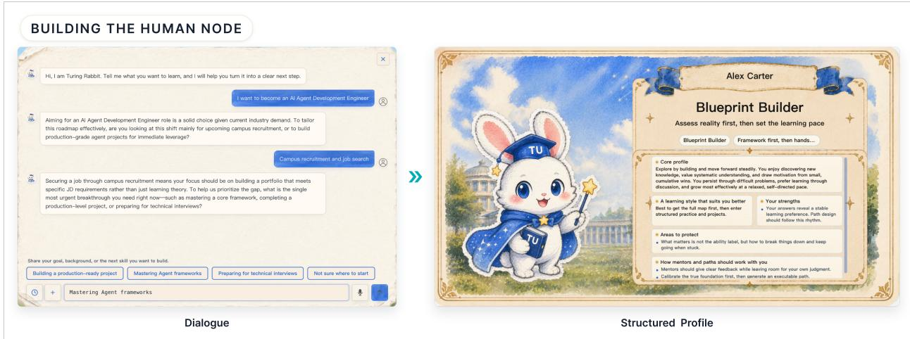  
Figure 3. AU uses intake dialogue to build the Human Node. The learner describes goals, background, preferences, and constraints. AU stores this information in structured records for later planning and interaction. The displayed name and avatar are fictional.

Here, $H _ { t }$ is the Human Node, and $\mathcal { A }$ contains role-level Agent Nodes, each representing one or more agents with a shared functional responsibility. The relations $\mathcal { R } _ { t }$ specify how nodes share information and propose or make decisions.

Human Node. We define the Human Node as

$$
H _ { t } = \langle p _ { t } , s _ { t } , m _ { \leq t } \rangle .\tag{2}
$$

The profile $p _ { t }$ records the learner’s background, experience, preferences, available time, and practical constraints. The current state $s _ { t }$ records goals, progress, capability estimates, dificulties, and uncertainty. The shared memory $m _ { \le t }$ retains selected evidence, earlier goals, learner corrections, previous support, and program revisions.

Learners shape this account directly: they state goals, ask questions, complete tasks, provide feedback, and correct system assumptions [15]. Agents then act on the state these contributions produce. Assessment results, in turn, ground capability estimates in the tasks and conditions actually tested.

The intake conversation from the walkthrough is where this account begins. Because a learner’s initial request often leaves goals or constraints underspecified, AU opens with a dialogue that turns the request into structured goal and profile records (Figure 3). The learner may describe a target role, an intended product, or simply an area of interest; AU asks follow-up questions only when the answers would change the plan [2, 33]. Explicit learner statements take priority over inferred or default values, whose sources are kept on record. The resulting records distinguish prior exposure from demonstrated capability, and project preferences from target criteria, with each capability claim linked to its evidence and criteria. The planning role reads these records to set the program’s starting point.

Agent Nodes. AU represents four functional roles as Agent Nodes, ${ \mathcal { A } } = \left\{ A _ { \mathrm { p l a n } } , A _ { \mathrm { m e n t o r } } , A _ { \mathrm { a s s e s s m e n t } } , A _ { \mathrm { r e p l a n } } \right\}$

• The planning role $A _ { \mathrm { p l a n } }$ uses the learner’s goal, state, and constraints to form a learning path.

• The mentoring role $A _ { \mathrm { { m e n t o r } } }$ creates learning materials and provides explanations, practice support, and feedback [39–41].

• The assessment role $A _ { \mathrm { a s s e s s m e n t } }$ creates tasks and criteria at the node, stage, and program levels.

• The replanning role $A _ { \mathrm { r e p l a n } }$ uses learner state, program state, and evidence to propose changes to remaining work.

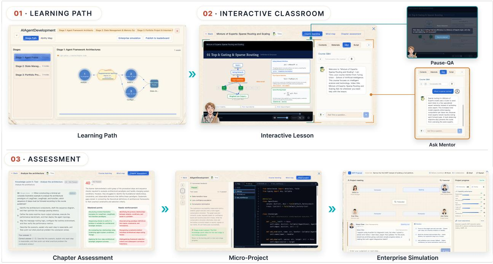  
Figure 4. AU breaks the learning goal into stages and linked knowledge-point nodes. The classroom supports each node through learning materials, Pause- $\mathbf { \nabla \cdot Q A } .$ , and mentor dialogue. Chapter assessments, stage micro-projects, and an enterprise simulation examine performance at increasing scopes. Names and avatars shown in the enterprise simulation are fictional and do not represent actual participants.

These roles describe organizational responsibilities, and each role can involve multiple specialized agents. The mentoring role can span domain, career, ethics, platform, and learning-support mentors. The replanning role is implemented by the Replanner, a multi-agent subsystem that coordinates the diagnostic evaluators described in Section 4.4 and uses their aggregated diagnosis to guide program revision.

What binds the nodes together is a shared Capability Program $P _ { t } .$ , which connects goals, activities, assessment requirements, progress, and revisions. Each agent consults the Human Node and the current program to decide what work should follow. We describe this program next.

## 4.2 Forming the Capability Program

A learning goal becomes actionable only once its activities and assessment criteria are pinned down. The Capability Program is AU’s device for holding these elements together:

$$
P _ { t } = \langle L _ { t } , C _ { t } , Q _ { t } , S _ { t } ^ { P } \rangle .\tag{3}
$$

The Learning Path $L _ { t }$ sets activities and their order; the Interactive Classroom $C _ { t }$ provides materials and mentor interaction; the Assessment structure $Q _ { t }$ defines tasks, conditions, and criteria; and the Program State $S _ { t } ^ { P }$ records progress and revisions. Figure 4 shows how these components connect. This subsection covers how the path and program state are formed; Section 4.3 turns to the classroom and assessments through which the program is experienced.

Learning Path construction. The planner uses the learner’s goal to define stage subgoals and knowledge-point nodes. It links these nodes through prerequisite relations within and across stages:

$$
L _ { t } = \langle V _ { t } ^ { L } , E _ { t } ^ { L } , G _ { t } \rangle .\tag{4}
$$

The set $V _ { t } ^ { L }$ contains the nodes grouped into stages. The set $E _ { t } ^ { L }$ contains prerequisite links. The conditions $G _ { t }$ govern task availability and progression.

The planner combines the Human Node with career reference paths, capability graphs, and job descriptions to identify target skills and their prerequisites. The learner’s background and current state guide the starting point and prerequisite learning. Preferences and constraints guide workload, examples, and activity format.

Each node connects its objective to learning materials, mentor support, and assessment requirements. These connections guide the creation of lecture documents, videos, Pause-QA activities, and node assessments. Stage subgoals guide micro-projects, and the overall goal guides the enterprise simulation. Node objectives and prerequisite links also provide a reference for later revision. They help the Replanner locate the afected knowledge point and determine where additional learning fits within the remaining path.

Execution of the path is tracked through

$$
S _ { t } ^ { P } = \langle A c t i v e P a t h V e r s i o n _ { t } , P r o g r e s s _ { t } , E \nu i d e n c e _ { t } , R e \nu i s i o n H i s t o r y _ { t } \rangle ,\tag{5}
$$

which identifies the current path, completed and remaining work, assessment results, and past changes, so that every role works from the same program state across activities.

## 4.3 Executing the Program: Instruction, Assessment, and Evidence

Once the program is underway, nearly everything the learner does leaves a trace: a question in a lesson, a retry after feedback, a scored task. AU treats these traces as evidence, but not all of them warrant the same conclusions. This subsection follows the program’s execution, from instruction through assessment, to show where evidence comes from and what each kind can support.

Interactive Classroom and mentor coordination. Learning dificulties often arise while learners are studying a knowledge point, before they reach an assessment. AU therefore attaches an Interactive Classroom to each node to support learners during this process. The classroom brings together AU-generated instructional videos [67], lecture or session documents, questions, and mentor dialogue, all organized around the node’s objective. Within a lesson, Pause-QA inserts questions at key teaching points, prompting learners to reflect on the ideas just covered and check their understanding [57]. Learners can also seek clarification, examples, hints, or feedback on an attempted solution from mentors [1]. AU selects a mentor by matching the request against role scope and conversation context. The selected mentor then responds in light of the node objective and relevant learner state [30]. These interactions connect explanation, reflection, and feedback within each lesson, while the resulting questions, retries, and confidence reports help AU interpret learning dificulties and support needs.

Layered assessment. Understanding a knowledge point is one demand; using knowledge across tasks is another. AU separates these demands into three assessment levels that examine understanding, application, and integration in turn:

• A chapter assessment follows each knowledge-point node. It checks the learner’s understanding of that point and records grading details for each answer.

• A micro-project follows each stage. It asks the learner to apply knowledge from several nodes in a task with defined outputs and assessment criteria [7, 12].

• An enterprise simulation follows the learning stages for the overall goal. It asks the learner to combine knowledge across stages in a simulated workplace task [6, 31].

Every assessment specifies the task, the assessed dimensions, the allowed support, and the grading criteria [48]. Where code tasks support testing, project reviews can combine model feedback with execution results. Together, the three levels trace a path from local understanding to broader use of knowledge, and their results feed back at matching scopes: practice on a knowledge point, review within a stage, or further work on combining skills.

From interaction to evidence. A stated preference and a scored task justify diferent decisions, so AU links each observation to the updates it can support. At the framework level, an evidence item is

$$
e _ { i } = \langle x _ { i } , s _ { i } , c _ { i } , t _ { i } , q _ { i } , \lambda _ { i } \rangle ,\tag{6}
$$

recording the observation $x _ { i }$ , its source and conditions $s _ { i }$ , the relevant claim or decision $c _ { i } ,$ , the time $t _ { i }$ , a confidence or quality rating $q _ { i }$ , and the permitted updates $\lambda _ { i }$ . This tuple is the evidence model that runs through all of AU’s records.

The two activities above produce the two kinds of evidence introduced earlier. Classroom interactions become Learning-State Evidence once AU links them to a learner-state field or teaching decision; this evidence informs dificulties, preferences, strategies, progress, and uncertainty, and so guides explanations and support. Assessed performance provides Capability Evidence, which updates capability estimates, but only within the assessed dimensions and assistance conditions [47]. A hint request, for example, can guide support, whereas a scored task can back a claim about the tested knowledge. Learner corrections update the relevant goal or profile fields directly.

## 4.4 Closing the Loop: State Updates and Program Revision

AU uses learning evidence to update its account of the learner and propose changes to the remaining program. We describe the update as

$$
( H _ { t } , P _ { t } ) \stackrel { { \mathcal { E } } _ { t } } { \longrightarrow } ( H _ { t + 1 } , P _ { t + 1 } ) .\tag{7}
$$

The evidence set $\scriptstyle { \mathcal { E } } _ { t }$ informs learner-state updates and revision proposals. Path changes take efect after learner confirmation.

State update rules. The add rule combines compatible evidence to strengthen or weaken an estimate. The replace rule updates a goal, preference, or constraint when its source permits the change and retains its history. The keep conflicts rule preserves conflicting observations for later diagnosis. For example, high confidence and repeated errors can remain recorded together. These rules operate over evidence records, source-linked goal updates, versioned summaries, and Replan records. Supported gaps guide additional support, while uncertain or missing evidence calls for further diagnosis or assessment.

Multi-agent diagnosis. The Replanner coordinates specialized evaluators to identify which learning requirements need further support. The evaluators share the learner’s evidence and a node-specific target profile and rubric covering concept, transfer, and independence dimensions. The evidence includes assessment results, answer-level errors, task outcomes, reported dificulties, and help-seeking interactions. Capability Evidence grounds estimates in assessed performance and its assistance conditions, while Learning-State Evidence helps interpret dificulties and support needs.

The diagnostic panel comprises three separately prompted LLM evaluators. An evidence auditor checks the evidential support for judgments, a process observer examines learning behavior and help-seeking, and an outcome examiner assesses task performance and errors. Each evaluator assesses all three dimensions, providing complementary perspectives on the same evidence under a shared rubric. Disagreement beyond a preset tolerance in any dimension triggers bounded peer review, during which the evaluators examine one another’s reasoning and reconsider their estimates. The Replanner aggregates their final estimates using weights obtained by normalizing each evaluator’s self-reported confidence across the panel. The resulting diagnosis links gaps between estimated performance and target requirements to the afected node and the learning requirements that need support.

Diagnosis-guided path revision. The revision policy interprets the diagnosed gaps together with prerequisite performance and earlier interventions to determine whether a path change is warranted. When the largest decision-adjusted gap falls below the intervention criterion, AU retains the current path and records that no revision is needed. When intervention is warranted, the diagnosis determines both the content and placement of additional learning. A concept gap guides prerequisite instruction before the afected node, while a transfer or independence gap guides practice after it. The diagnosis also specifies the added activity’s objective, instructional content, and assessment requirements, connecting the identified dificulty to concrete learning tasks and completion criteria.

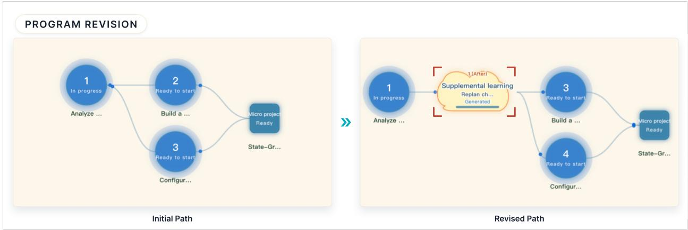  
Figure 5. AU uses learner evidence to propose a local path revision. The Replanner identifies a supported dificulty and defines additional learning within the existing sequence. AU applies the revision after learner confirmation and records the updated program state.

The Replanner integrates the proposed activity into the existing prerequisite sequence, subject to limits on branch depth and insertions per afected node (Figure 5). The revision preserves completed work and the sequence outside the revised portion, with the original subsequent nodes retained after the added activity. This local revision policy connects the diagnosed gap to additional support while preserving the surrounding program structure. Stage-level cases and broader goal changes follow separate review procedures.

Learner confirmation and follow-up. AU asks the learner to confirm a proposed path change and applies it after receiving approval. Each Replan record links the supporting evidence to the diagnosis, selected adjustment, changed and retained activities, application status, and path versions. Later assessment results inform follow-up judgments of the learner’s understanding and the outcome of the added support. The revision history provides context for subsequent teaching and replanning decisions.

## 5 Evaluation

## 5.1 Evaluation Overview

We evaluated AU’s support for program formation, evidence-based revision, and learning during system use.   
The three studies assessed initial program quality, revision quality, and learning outcomes and experiences.   
Table 1 links each study to its research question and evaluation focus.

## 5.2 Study 1: Capability Program Formation

Learning programs need clear activities and criteria for assessing progress. AU links learning goals to activities, assessments, and success criteria. Study 1 examines the quality of programs generated with this approach. The study addresses RQ1 by comparing AU with three baselines. We focus on how AU organizes learning activities and defines evidence for assessing the target capabilities.

Table 1. Research questions and evaluation focus of the three studies.
<table><tr><td>Study</td><td>Research question</td><td>Evaluation focus</td></tr><tr><td>Study 1</td><td>RQ1: Representation. What aspects of learning-program quality does the Capability Program representation support?</td><td>Quality of initial learning pro- grams.</td></tr><tr><td>Study 2</td><td>RQ2: Evidence conditioning. How effectively can learner evi- dence guide program revisions that improve learning support and maintain a coherent path?</td><td>Quality of program revisions based on learner evidence.</td></tr><tr><td>Study 3</td><td>RQ3: Human participation. What learning outcomes and experi- ences arise when learners participate in a Capability Program?</td><td>Learning outcomes, system expe- rience, and experienced revision.</td></tr></table>

## 5.2.1 Study Design and Measures

Learner profiles. We constructed 96 simulated learner–goal cases by crossing three learning goals with 16 profile settings and two natural-language versions of each combination $( 3 \times 1 6 \times 2 = 9 6 )$ . We used controlled augmentation of de-identified learner-profile records from existing system users to vary goal clarity, learning time frame, AI expertise, and expertise in the target field. Each method received the same learner and goal facts through its own input interface. We used GPT-5.6 Sol [50] to simulate learner dialogues during profile construction.

Baselines. General uses a general-purpose LLM to generate learning plans. PLPP [43] creates personalized learning paths; we adapted its workflow to this setting while preserving its core personalization logic. GenMentor [65] is a multi-agent learning system and our closest system-level comparison.

Generation and evaluation. All four methods used gemini-3-flash-preview [29] to generate one program per case (384 outputs), retaining their native output structures. We compared complete system configurations. The same fable-5 model [4] judged all outputs with a shared rubric [44, 75]. Two human experts independently rated AU and GenMentor outputs for 24 matched cases, with eight cases per learning goal, after jointly reviewing the rubric. We averaged their ratings and then averaged the four primary outcomes to obtain composite scores for each case and method. Across the resulting 48 case–method pairs, human and model composites showed Spearman’s $\rho = . 7 2 1$ and Lin’s concordance correlation coeficient of .708. These statistics describe pooled correspondence across the two systems. Study 2 used the same models in the same roles.

Measures. Capability Coverage assesses coverage of the core capabilities required by the target role. Program Quality assesses subgoal decomposition, learning unit granularity, prerequisite coherence, and supporting artifacts. Assessment Validity assesses whether formative checks, applied practice, and integrated tasks are designed to elicit evidence of target capabilities [48]. It also assesses the clarity of success criteria. Learner Personalization assesses how well the program’s starting point, content, and dificulty fit the learner. For Capability Coverage, the judge compared expert-annotated Core Node labels with each program’s ordered, flattened learning-unit titles. Only these title fields were provided for this measure. Each required node was marked as fully covered, partly covered, or missing. General and PLPP used a separate, non-scoring title-extraction step. Program Quality, Assessment Validity, and Learner Personalization used four, four, and two submetrics, respectively. Each submetric was rated from 1 to 5. We averaged submetric ratings within each outcome and rescaled them to the 0–100 reporting scale.

Statistical analysis. We report scores on a scale from 0 to 100. Each case was a unit of analysis. Wilcoxon signed-rank tests compared AU with each baseline on the four primary outcomes. We applied Holm correction to these comparisons. We used bias-corrected and accelerated (BCa) 95% confidence intervals for the mean paired diferences.

<table><tr><td>Outcome</td><td>General</td><td></td><td>PLPP ●  $M e a n \pm S D$ </td><td>GenMentor</td><td>AU è</td><td>Paired difference</td><td>AU - baseline</td><td></td></tr><tr><td>Capability</td><td colspan="6" rowspan="4"> $6 7 . 0 9  { \mathrm { ~ \pm ~ } } 1 5 . 0 4$   $7 0 . 4 9 \ \pm \ 1 3 . 7 6$   $7 6 . 8 4 \pm 9 . 2 9$ </td><td></td><td></td><td rowspan="4"></td></tr><tr><td>Coverage</td><td></td></tr><tr><td></td><td></td></tr><tr><td>Program Quality</td><td></td></tr></table>

Figure 6. Comparison of AU and three baselines across four outcome dimensions. The table reports mean ± standard deviation (SD). Horizontal bars show mean paired diferences in score points for AU minus each baseline. Whiskers show BCa 95% confidence intervals. Purple, green, and gold bars denote comparisons with General, PLPP, and GenMentor, respectively. The four bar groups align with the table rows. The dashed vertical line marks zero diference; positive values favor AU.

## 5.2.2 Higher Ratings for Program Organization and Assessment

AU had the highest mean on all four measures. GenMentor had the highest baseline mean on each measure. The comparisons below focus on AU’s results against GenMentor. We also used GenMentor in Studies 2 and 3 because of these results and its support for revision and interactive learning.

AU’s largest advantage was in Assessment Validity. Its mean was 19.32 points higher than GenMentor’s (95% CI [17.55, 21.04]). AU’s Program Quality mean was 10.52 points higher ([9.27, 11.77]). Its Capability Coverage mean was 5.89 points higher ([2.99, 8.50]). All three comparisons remained significant after Holm correction (Figure 6). The largest diferences concern the organization of learning tasks and the design of assessments. These features specify what learners should do and how their work will be assessed. AU scored 88.75 on Learner Personalization. GenMentor scored 87.40. The paired diference was 1.35 points (95% CI [−0.21, 2.92], $p _ { \mathrm { H o l m } } = . 0 9 0 )$

Against GenMentor, AU received higher Program Quality ratings in 85 of the 96 cases and higher Assessment Validity ratings in 94 cases. These counts show that its higher ratings extended across most matched cases.

## 5.2.3 Applied Tasks and Clear Success Criteria

The submetric scores locate AU’s higher ratings within task design (Figure 7). AU exceeded GenMentor by 23.54 points on Applied Practice Validity and 22.50 points on Integrated Transfer Validity. These ratings concern tasks that ask learners to apply and combine the target capabilities. AU also scored 27.29 points higher on Success Criteria Clarity. Its programs provided clearer standards for judging task outcomes. These standards define what a completed task should achieve and give learners a concrete target for their work.

The systems organized their outputs at diferent levels. General and PLPP mainly produced plan text. GenMentor added documents and quizzes for each session. AU linked teaching materials, assessments, applied tasks, and integrative projects across capability, stage, and program levels. This structure places practice and assessment within the learning plan. The higher ratings for tasks and success criteria support the value of this design in the generated programs.

## 5.3 Study 2: Evidence-Conditioned Program Evolution

Study 1 examined programs built from learners’ starting profiles. New assessment results and questions can reveal where learners need more support. AU uses this evidence to revise the remaining program. Study 2 addresses RQ2 by assessing how well these revisions improve program fit and maintain path coherence.

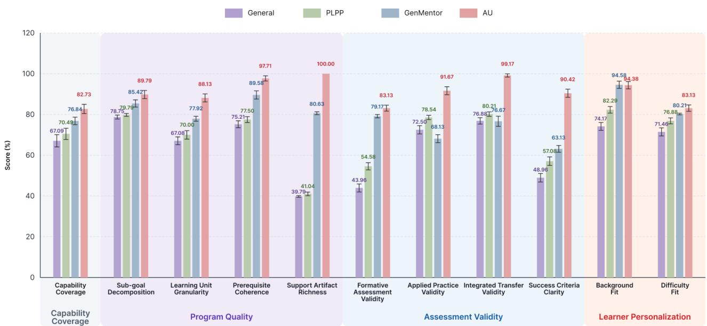  
Figure 7. The figure shows Capability Coverage and ten rubric submetrics for the four methods. Bars show means. Whiskers show 95% confidence intervals across 96 matched cases. Shading groups the submetrics by their main measure. The figure shows Capability Coverage separately.

## 5.3.1 Study Design and Measures

Cases and conditions. We analyzed 32 source cases from Study 1 associated with the target role of “AI Agent Development Engineer.” Each case was evaluated at two points along the learning trajectory (early vs. late). For each trajectory position, we specified two target assessment scores (20/100 and 50/100), yielding a fully crossed design with $3 2 \times 2 \times 2 = 1 2 8$ matched case pairs for AU and GenMentor. The two trajectory positions operationalized difering amounts of remaining learning, whereas the two target scores represented distinct levels of low assessment performance. This design allowed us to examine whether revision behavior remained appropriate under both severe and moderate learning dificulties. Each system maintained its own initial programs and assessment items. Case matching controlled for learner profile, trajectory position, and target score. All experiments employed the model configuration described in Study 1.

Evidence and revision. For AU, the learner simulator also asked questions about dificult content. AU answered through its normal tutoring process. AU retained these dialogues as conversational evidence alongside the assessment results. AU’s normal trigger initiated the Replanner’s multi-agent diagnosis, which informed its local revision policy (Section 4.4). A script sent Replan requests to GenMentor. Each system revised its program using the evidence available through its own workflow. The shared external judge evaluated each revision using the original program, revised program, and case context.

Measures. We used four measures to assess program improvement, path coherence, revision decisions, and their supporting evidence. Program Improvement measures the change in program quality relative to the system’s own initial program. It assesses whether the revised program better fits the learner’s current state. Post-Revision Path Coherence measures whether the revised path maintains prerequisite relationships, coherent stage transitions, and appropriate dificulty progression. We use this measure to check whether the added support fits the remaining program. Revision Decision Appropriateness measures whether the chosen changes address the learner’s needs and preserve content that remains appropriate. This measure assesses the scope and suitability of the revision. Evidence-Revision Alignment measures whether the available learning evidence and learner state support the main changes. This measure assesses the basis for the revision.

<table><tr><td>Outcome</td><td>GenMentor Mean ± SD</td></tr><tr><td>Evidence-Revision Alignment</td><td> $9 5 . 0 0 \pm 9 . 7 2$   $9 4 . 0 6 \pm 9 . 1 7$ </td></tr><tr><td>Revision Decision Appropriateness</td><td> $8 5 . 0 0 \pm 1 0 . 3 5$   $9 0 . 7 8 \pm 1 0 . 0 1$ </td></tr><tr><td>Program Improvement</td><td> $8 8 . 0 9 \pm 1 3 . 6 6$   $9 6 . 0 9 \pm 9 . 1 1$ </td></tr><tr><td>Post-Revision Path Coherence</td><td> $9 3 . 9 1 \pm 9 . 2 4$   $9 6 . 0 9 \pm 7 . 9 6$ </td></tr></table>

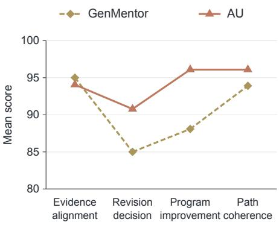  
Figure 8. The table reports mean ± standard deviation (SD) on a normalized 0–100 scale. The right panel compares mean scores across the four revision measures. Paired AU − GenMentor mean diferences (95% paired bootstrap confidence intervals), in the plotted order, are −0.94 [−3.28, 1.56], +5.78 [3.28, 8.28], +8.01 [5.27, 10.74], and +2.19 [0.31, 4.06].

Statistical analysis. Program Improvement used ratings from $- 2 \tan + 2 .$ . The other measures used ratings from 1 to 5. We report normalized means on a scale from 0 to 100. We used case-level paired bootstrap 95% confidence intervals for the mean diferences between AU and GenMentor. Each of the 32 source profiles appeared in four conditions.

## 5.3.2 Higher Revision Quality

AU received higher mean ratings on Program Improvement, Revision Decision Appropriateness, and Post-Revision Path Coherence (Figure 8). Its Program Improvement mean was 8.01 points higher than GenMentor’s. This score compares each revision with the system’s own initial program. AU’s higher score shows greater rated improvement in how the program fits the learner’s current needs.

AU’s Revision Decision Appropriateness mean was 5.78 points higher. Its Post-Revision Path Coherence mean was 2.19 points higher. These ratings indicate more appropriate revision decisions and more coherent resulting paths under the rubric. All three paired bootstrap intervals were above zero.

Both systems received high Evidence-Revision Alignment ratings. AU scored 94.06, and GenMentor scored 95.00. The mean diference was −0.94 points (95% CI [−3.28, 1.56]). These ratings indicate that both systems revisions were well supported by the evidence available in their workflows.

Revision across the learning trajectory. Figure 9 compares early and late replanning. The 20/100 and 50/100 conditions were pooled within each position, yielding 64 cases per system. Overall Adaptation Quality is the equal-weight mean of the four normalized revision measures, used here as a summary. It was lower under early than late replanning for both systems: AU increased from 92.56 to 95.96, while GenMentor increased from 87.73 to 93.26. The AU–GenMentor diference was larger early than late (4.83 vs. 2.70 points), suggesting a clearer distinction when more of the program remained. This comparison is descriptive and does not establish that the two gaps difer statistically.

## 5.3.3 Addressing Learning Dificulties with Structured Tasks

Two selected cases illustrate how the systems organized support in response to their respective assessment evidence. AU specified remedial activities with explicit learning steps and completion requirements. In both cases, AU received +2 for Program Improvement and 5/5 for Revision Decision Appropriateness. GenMentor received +1 and 4/5 on these measures. Both systems received 5/5 for Evidence-Revision Alignment and Post-Revision Path Coherence.

Structuring prerequisite learning. In CASE-0025 (early, 20/100), GenMentor revised its first session to address context management, structured output, and error handling. It added explanations, practice tasks, and

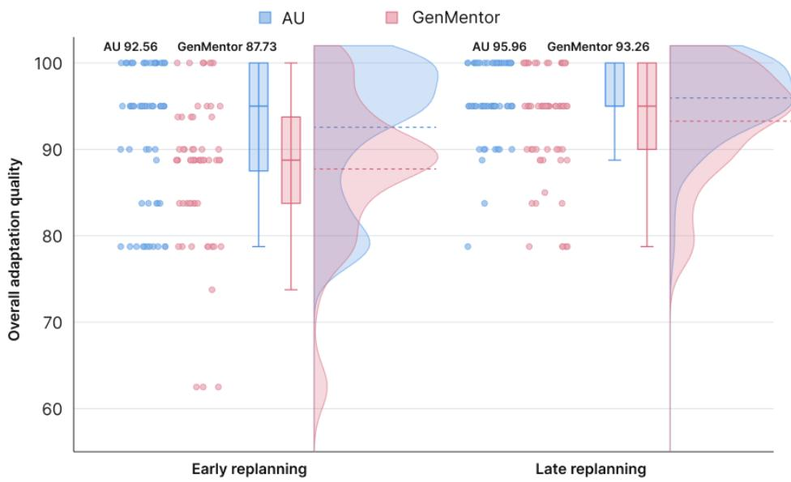  
Figure 9. Overall adaptation quality for AU and GenMentor under early and late replanning. Points show individual cases. Boxplots summarize the distributions, and shaded curves show score densities. Dashed lines and labels indicate means.

guided problem solving within that session.

AU’s assessment identified confusion about prompting, retrieval-augmented generation (RAG), and agentbased approaches. AU added a separate activity on these concepts and when to use each approach. The activity included positive and negative examples, checks on when each approach applies, and a small example task. The plan placed these learning steps and checks before the return to the original learning node. AU made prerequisite learning, understanding checks, and the return to the original node explicit parts of the path. This design specified how the added support connected to the remaining program and how learners would complete it.

Defining practice and completion criteria. In CASE-0008 (late, 50/100), GenMentor revised its ofline evaluation session. It added explanations and code examples on retrieval-ranking metrics and model-based evaluation. These changes addressed weaknesses found in its assessment.

AU addressed dificulties in containerized deployment and configuration through a separate practice task. The task required independent completion, error handling, and explicit recovery procedures and acceptance criteria. AU’s revision specified how learners should use the added content and check their results. The task defined both the work learners would perform and the standards their work should meet.

## 5.4 Study 3: Learning Outcomes and Learner Experience

A learning program needs to help learners use knowledge, act on feedback, and continue when they face dificulty. Studies 1 and 2 examined the quality of generated programs and their revisions. Study 3 addresses RQ3 by examining the value of these supports during actual learning. We combined learning outcomes, experience ratings, and interviews to examine changes in performance alongside learners’ reported actions and judgments of their own progress.

All participants followed the assigned goal of becoming an AI video generation product manager. We chose this goal because it combines AI knowledge with product decisions. We compared the complete AU and GenMentor workflows. GenMentor had the highest mean scores among the Study 1 baselines and supports interactive learning and revision [65].

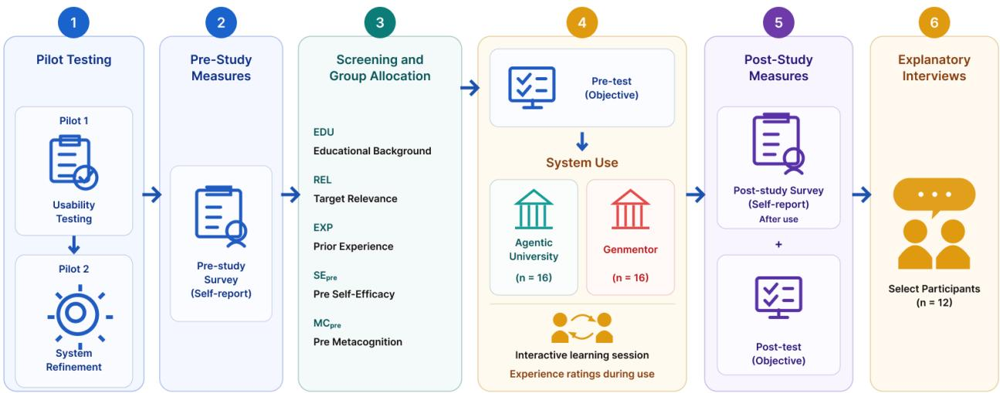  
Figure 10. Overview of the Study 3 procedure, including pilot testing, participant screening and allocation, pre- and post-study measures, system use, and explanatory interviews.

## 5.4.1 Study Design and Procedure

Figure 10 summarizes the Study 3 procedure, from pilot testing and pre-study screening through system use, post-study measures, and explanatory interviews.

Pilot testing. The team ran two internal pilot rounds with 30 system developers and student interns in total.   
The first round assessed usability. The second informed system refinement before the main study.

Recruitment and pre-study survey. Forty individuals registered through online channels. Six did not proceed because of health issues, scheduling constraints, or ineligibility, leaving 34 who completed the pre-study survey. The survey recorded educational stage, disciplinary relevance, prior domain-related experience, Self-Eficacy, and Metacognition. Before allocation, we excluded two respondents whose baseline Self-Eficacy and Metacognition scores both exceeded 90/100. This study-specific criterion aimed to reduce ceiling constraints on measuring positive changes in self-ratings [63]. No score-based eligibility thresholds were applied to the three background indicators. The final sample comprised 32 learners aged 18–30. All participants provided informed consent, and the university’s ethics committee approved the study. Participants who completed the study received CNY 100.

Group allocation and pre-test. Before system use, we generated five random allocation schemes and selected the final allocation by considering between-group distributions across the five pre-study indicators, yielding 16 participants in AU and 16 in GenMentor. Both groups pursued the same learning goal. We selected ten parent questions from online accounts of product-manager job interviews and used their decision contexts to develop the tests. An item-generation agent produced questions, correct answers, and distractors within the knowledge covered by both systems. It generated Forms A and B in isolated environments using the same prompt and configuration. Form A served as the pre-test and Form B as the post-test; both measured Objective Capabilit on a 0–50 scale. Participants completed Form A after group allocation and before system use.

System use and experience ratings. Both groups used the same completion window of approximately 54 hours. The window covered the pre-test, learning activities, and post-test. AU organized videos and quizzes into learning units called knowledge nodes. It also provided short written projects, called microprojects, and a project simulation through dialogue. GenMentor organized text materials and quizzes into sessions. AU used assessment results and learner feedback to identify revision needs. It requested confirmation and inserted additional learning into the remaining path after learner approval. GenMentor learners clicked the Replan button to request a new learning path based on session assessment results.

Participants opened the experience questionnaire at the start and completed relevant items during use. These items assessed participants’ perceptions of learning support. Instructional Alignment assessed perceived alignment among goals, content, assessments, and initial knowledge. Learner Agency & Engagement assessed perceived support for acting on feedback, active thinking, and control over learning. Cognitive Support assessed the clarity and organization of explanations and materials. Learning Eficiency measured perceived time use and ease of task completion.

Participants who reported revision also rated their overall revision experience. Adaptive Diagnosis covered revision timing and the fit of the diagnosis to their dificulties. Instructional Responsiveness covered the fit and continuity of added instruction. Post-Revision Recovery covered perceived ability to retry or continue learning.

Post-study measures. After completing their learning tasks, participants took the objective post-test (Form B). They also completed the post-study Self-Eficacy and Metacognition items and the remaining experience items. Self-Eficacy used four items on task confidence [5]. Metacognition used three items on self-reported understanding and monitoring [27, 60]. All 32 allocated participants completed the study. The matched preand post-study self-ratings used the same item wording and response scales. We averaged item scores within each multi-item construct and report self-rating scores on a 0–100 scale.

Explanatory interviews. We selected 12 interview volunteers from the study participants, six per group, to cover diferent backgrounds, revision experiences, and patterns of test and self-rating change. Both groups used the same semi-structured guide. Interviews were in Chinese and lasted 50 to 75 minutes. Participants reopened their systems to help recall specific learning and revision events. Each interviewee received an additional CNY 50. We label AU interviewees T1 to T6 and GenMentor interviewees G1 to G6.

## 5.4.2 Data Analysis

Quantitative analysis. Each participant was one unit of analysis. Learning gain was the post-study score minus the pre-study score. We report means with standard deviations (SDs). We used Wilcoxon signed-rank tests for within-group changes. We used Mann-Whitney � tests [46] to compare participant-level gains and questionnaire scores between groups. We report rank-biserial correlations $( r _ { r b } )$ as efect sizes. Positive values favor AU. Holm correction covered the four experience comparisons and the three revision comparisons as separate families. Learning-gain comparisons report raw � values. All tests were two-sided with $\alpha = . 0 5$

Qualitative analysis. The research questions and quantitative results guided the broad analysis areas. Within these areas, we used inductive thematic analysis. We developed codes from participants’ explicit accounts of their experiences [13]. Two researchers coded independently and resolved diferences through discussion. We counted each participant at most once per theme. The theme counts describe the interview sample. Italic quotations are English translations of Chinese interview excerpts. We interpreted the accounts alongside test scores, questionnaire ratings, and system records of learning interactions and assessment results.

## 5.4.3 Findings

Larger learning gains and knowledge use in tasks. AU showed larger mean gains on all three learning outcomes (Figure 11). Objective Capability increased from $2 1 . 8 8 \pm 8 . 3 9 \mathrm { t o } 3 4 . 0 6 \pm 8 . 6 2$ under AU and from $2 4 . 7 3 \pm 5 . 8 4 \mathrm { t o } 3 0 . 3 3 \pm 8 . 5 4$ under GenMentor. Both groups improved, with within-group $p < . 0 0 1$ for AU and $p = . 0 0 6$ for GenMentor. Their mean gains were 12.19 and 5.61 points. AU’s mean gain was 6.58 points larger. The gain-score comparison yielded $U = 1 8 4 . 5 , p _ { \mathrm { r a w } } = . 0 3 5 , r _ { r b } = . 4 4$ . Self-Eficacy gains were 15.30 and 8.77 points $( p = . 3 0 0 )$ . Metacognition gains were 15.10 and 7.29 points $( p = . 4 6 3 )$ . AU’s clearest observed learning advantage was its larger gain in assessed knowledge and task judgments. The two self-ratings showed higher mean gains for AU without a statistically significant group diference.

Interviewees described how they used new knowledge to answer questions. T1 recalled guessing on the pre-test. T1 then explained, “After learning, I knew the correct answer and why it was the right choice.” T5 reported a similar change in questions about adapting a system to user needs. T5 could understand the task and make relevant choices after learning. In the GenMentor group, G1 linked limits in video generation to product choices.

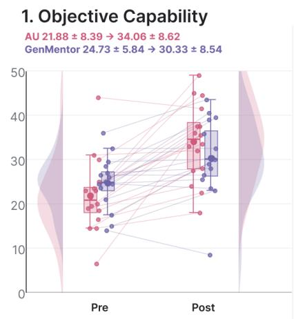

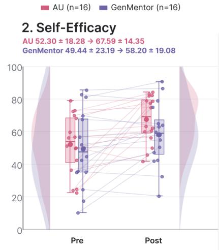

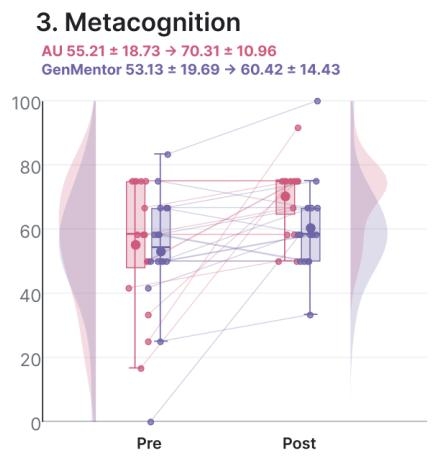  
Figure 11. Learning outcomes before and after system use. Raincloud plots show Objective Capability, Self-Eficacy, and Metacognition for 16 participants in each group. Lines link the two observations for each participant. Labels report mean ± SD. Objective Capability uses a scale from 0 to 50. The self-ratings use scales from 0 to 100.

Three of the six AU interviewees described reviewing materials or revising work after feedback (T1, T2, T3). T2 and T3 returned to materials to check concepts they had missed. T1 described a further step in the microprojects: “I would revise my work based on the feedback and submit it again.” T1 linked these open tasks and their feedback to greater confidence. For T1, the revised output provided a concrete basis for judging progress. These accounts describe how learners used feedback to review concepts and revise their work.

Participants also used diferent standards to judge their learning. T3 described greater understanding but linked lower confidence during the study partly to fatigue. G3 judged understanding by the links between concepts and reassessed earlier knowledge after further review. These accounts suggest that self-ratings can reflect perceived learning, fatigue, and the standards learners use to judge progress.

Cognitive support and choices within the learning path. AU received higher mean scores on all four experience measures (Figure 12). Cognitive Support was 78.13 ± 11.64 under AU and $6 5 . 6 3 \pm 1 4 . 0 7$ under GenMentor. The mean diference was 12.50 points. The group comparison remained significant after Holm correction $( U = 1 9 0 . 5 , p _ { \mathrm { r a w } } = . 0 1 2 , p _ { \mathrm { H o l m } } = . 0 4 8 , r _ { r b } = . 4 9 )$ . Instructional Alignment was 73.75 versus 67.50. Learner Agency & Engagement was 76.56 versus 63.02. Learning Eficiency was 78.91 versus 70.31. These three comparisons showed higher means for AU. Their Holm-adjusted � values were .193, .126, and .193.

AU interviewees described support that made the content easier to use. T1 valued short videos and materials that covered the main concepts and helped form an overview of the target role. T2 valued video summaries, AI explanations, and notes: “The system could also create notes based on the questions I asked in the AI conversation.” These accounts describe concrete forms of cognitive support: concise materials, accessible explanations, and resources that learners could revisit.

Four of the six AU interviewees described choices about resources or learning pace (T2, T3, T4, T6). T4 could replay a dificult section or look up a concept. T6 moved between video and written materials. T3 explained, “I could decide whether to look at these materials in detail and whether to talk with the AI model.” T5 also described questions within lessons: “The lessons often asked us questions and let us think before continuing.” Group G had the following feedback: G4 thought “there’s a lack ofdwell time, common mistakes, andjudgment for short-answer questions; hints mostly appear after submission”, while G3 felt “the hint words are pretty

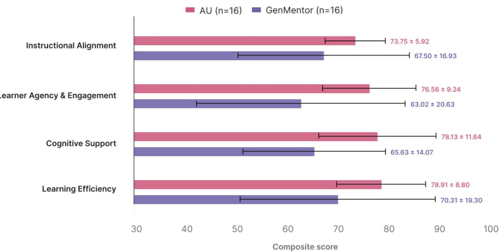  
Figure 12. Experience ratings collected during and after system use. Bars show the means of four measures. Error bars show ±1 SD. Each group includes 16 participants.

Table 2. Revision experience among participants who reported revision. Values are mean ± SD on a scale from 0 to 100. Each participant provides one score for each measure across their revision experience. Two-sided Mann-Whitney � tests compare the groups. Holm correction covers the three comparisons. Positive rank-biserial efect sizes $( r _ { r b } )$ favor AU.
<table><tr><td>Construct</td><td> $\mathbf { A U } \left( n = 1 3 \right)$ </td><td>GenMentor (n = 7)</td><td>U</td><td> $p _ { \mathrm { r a w } }$ </td><td>PHolm</td><td> $r _ { r b }$ </td></tr><tr><td>Adaptive Diagnosis</td><td> $7 4 . 0 4 \pm 1 2 . 9 7$ </td><td> $8 0 . 3 6 \pm 9 . 8 3 $ </td><td>30.0</td><td>.189</td><td>.378</td><td>-.34</td></tr><tr><td>Instructional Responsiveness</td><td> $7 8 . 8 5 \pm 1 2 . 8 9$ </td><td> $6 4 . 2 9 \pm 1 3 . 3 6$ </td><td>72.0</td><td>.030</td><td>.090</td><td>.58</td></tr><tr><td>Post-Revision Recovery</td><td> $7 5 . 0 0 \pm 1 4 . 4 3$ </td><td> $7 1 . 4 3 \pm 1 7 . 2 5$ </td><td>51.0</td><td>.640</td><td>.640</td><td>.12</td></tr></table>

experienced, but contextual short answers reveal gaps in knowledge connection and practical application”.   
These accounts show that learners could follow AU’s learning path and choose how to work through each part.   
They could revisit a dificult section, switch materials, or ask for an explanation.

Learner agency and perceived growth. Figure 13 examines whether learners’ reported agency was associated with their perceived growth during the study at the participant level. Within AU, stronger Learner Agency & Engagement was positively associated with greater pre–post Metacognition gain $( \rho = . 5 5 7 , p = . 0 2 5 )$ , whereas GenMentor showed no corresponding positive relationship $( \rho = - . 3 4 3 , p = . 1 9 4 )$ . Within AU, learners who reported stronger participation and control also tended to report greater growth in metacognitive judgment. This exploratory association was not observed in GenMentor.

Responding to dificulties and supporting the next step. Revision-experience ratings came from 13 AU participants and seven GenMentor participants who reported using the revision function. AU asked for confirmation when it identified a need for revision. GenMentor learners started revision through Replan. The following exploratory comparisons use these revision-experience subsamples.

Instructional Responsiveness showed the largest descriptive diference among the revision measures. AU scored 78.85 and GenMentor scored 64.29, a diference of 14.56 points $( U = 7 2 . 0 , p _ { \mathrm { r a w } } = . 0 3 0 , p _ { \mathrm { H o l m } } =$ $. 0 9 0 , r _ { r b } = . 5 8 )$ . Post-Revision Recovery was 75.00 versus 71.43 $( p _ { \mathrm { H o l m } } = . 6 4 0 )$ . Adaptive Diagnosis was 74.04 versus 80.36 $( p _ { \mathrm { H o l m } } = . 3 7 8 )$ . None of the three exploratory comparisons reached the corrected significance threshold. Table 2 reports the full results.

Five of the six AU interviewees described added learning that addressed a dificulty they had encountered (T1, T2, T3, T5, T6). T1 described more focused content: “After replanning, the content was more focused and included more concrete examples and questions. It was easier to understand and more interesting.” T2 described further explanations of concepts and their diferences. T5 valued the addition of unfamiliar technical concepts. These accounts describe how targeted examples and added concepts helped learners address specific dificulties and prepare for later tasks.

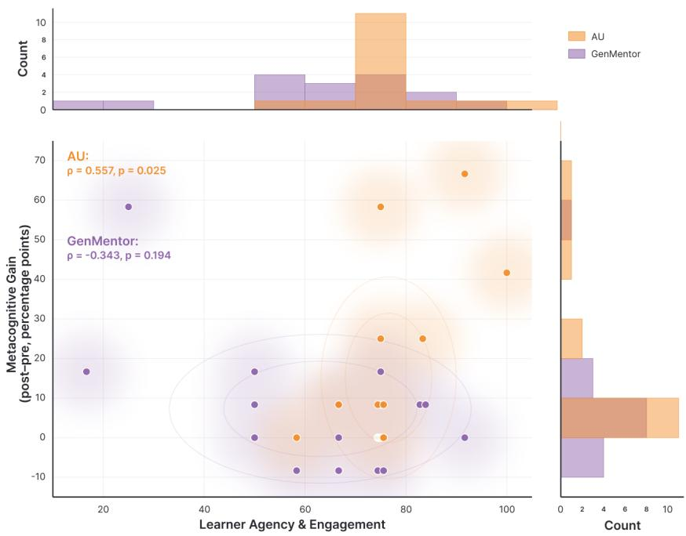  
Figure 13. Participant-level association between Learner Agency & Engagement and pre–post Metacognition gain.

Three AU interviewees described an easier retry or next step after the added learning (T1, T2, T6). T2 recalled, “After studying the added lesson, I answered again, and things were slightly better.” T1 also found later tasks easier to continue. In the GenMentor group, G1 noted that explanations on the Replan page were easy to overlook, while G2 found it dificult to distinguish what had been reordered from what had been newly added.

Taken together, Study 3 provides complementary evidence about the learning outcomes and experiences that arose as learners participated in an evolving Capability Program. AU showed a larger Objective Capability gain and stronger Cognitive Support, while the remaining self-rating, experience, and revision comparisons were more tentative. Interview accounts further illustrate how learners used feedback, resource choices, and targeted revisions to revisit dificulties and continue learning. These findings motivate the broader question of how learner contributions can remain consequential as work passes across coordinated roles.

## 6 Discussion

AU ofers a concrete way to organize educational work around a person whose capabilities, goals, and constraints can change through participation. The broader significance of this approach lies in sustaining human influence across agent roles and keeping the learning program aligned with the learner’s current state and goals. We develop these implications from the system design and the complementary findings of our three studies.

## 6.1 Human Participation as a Continuing Basis for Coordination

Participation in a multi-agent organization requires that what a person contributes remain connected to what diferent roles subsequently do. The formative interviews exposed the efort of repeatedly reconstructing learner context across tools and interactions. AU responds with two connected representations: the Human Node maintains the current account of the learner, and the Capability Program records the work organized around that account, so that a contribution made in one interaction remains relevant to later planning, mentoring, and assessment decisions.

Existing systems such as GenMentor establish the value of dynamic profiles and evolving paths [65]. Our organizational perspective adds a criterion: meaningful participation depends on whether contributions remain consequential when work passes between roles. A constraint stated during planning, a dificulty encountered during practice, or a correction to an inferred background can each become a reason to reconsider future work. For HCI, AU ofers a concrete design pattern for giving human input revisable efects that persist across roles within coordinated activity.

## 6.2 Maintaining Learning Continuity as Learners Change

Learning changes the conditions under which its own plan was formed: developing knowledge can reveal unrecognized prerequisites, and experience may alter what a learner considers useful or feasible. A program therefore needs to track the learner’s current state while preserving the value of completed work—a tension the Capability Program makes explicit by linking goals, activities, assessment requirements, and revisions within a continuing trajectory.

The studies support both halves of this commitment. Study 1’s clearest advantages appeared precisely in program organization and assessment design. Study 2 adds evidence about maintaining these relationships through change: AU received higher ratings for revision appropriateness, improvement, and coherence even though both systems received high evidence-alignment ratings, suggesting that useful adaptation depends on how a response to dificulty fits into subsequent learning rather than on reading evidence alone. This perspective makes the program’s continuing suitability itself an object of evaluation: an unsuccessful attempt can prompt examination of prerequisite assumptions, activity demands, or available support alongside the learner’s understanding, and revision can then preserve achievements while updating the conditions for further progress. The present studies demonstrate bounded program revision; sustained trajectories remain a direction for validation.

## 6.3 Making Adaptive Organizations Accountable to Learners

An organization that maintains an account of the learner also influences how progress is interpreted and which opportunities follow. Study 3 associated AU use with stronger cognitive support and larger objective assessment gains, while diferences in self-eficacy and Metacognition gains were not statistically significant; interview accounts of fatigue and reconsidered understanding illustrate why performance and judgments of progress may diverge. Learners should therefore be able to see what particular evidence supports and how it informs subsequent work.

Correction and control [3] must accordingly hold across the whole organization, not only at the interface where a learner happens to be working—as when a background label overlooked a learner’s prior training and shaped future opportunities. Corrections should afect the shared state used by subsequent roles, capability judgments should remain bounded by task and assistance conditions, and goals should stay open to reconsideration as priorities change. Shared representations make these relationships explicit enough to inspect and revise, and could support human educators and specialist agents working around a learner-owned program; our system-level results motivate this direction without isolating the efects of individual agents or establishing a general theory of human-participatory organization.

## 6.4 From Personal Programs to Organizational Learning

Although our studies evaluate only single-learner programs, the representations AU uses—Human Nodes, Capability Programs, and evidence records—also create conditions for learning across learners. A Capability Program records not only what activities a learner completed but also which revisions were triggered, what evidence supported them, and whether those revisions led to subsequent success. Aggregated across learners pursuing related goals, these records could inform the planning role’s initial path construction, where recurring prerequisite gaps suggest reordering, and the mentoring role’s choice of explanations, where recurring misconceptions suggest addressing a dificulty before it arises. This organizational learning depends on the evidence discipline described above: capability claims must remain bounded by their conditions and learner corrections must remain legible, so that the organization improves through accountable use of participant evidence rather than opaque pattern-matching that reinforces earlier biases.

## 7 Limitations and Future Work

Empirical scope and validation. Our studies evaluated complete system configurations through selected synthetic cases and a short human study. Studies 1 and 2 used LLM-based evaluation under a fixed model configuration; Study 1 also examined correlations between expert and model ratings on a subset of cases. Evaluator models and scoring prompts may afect automated judgments [75], motivating broader human review and comparisons across evaluators. Study 3 involved 32 learners aged 18–30, with recruitment focused on university students. Larger studies across age groups and racial, ethnic, and cultural communities could assess broader generalizability. Since systems difered in instructional formats and practice requirements, component studies and comparisons accounting for actual learning time could clarify the contributions of AU’s organizational mechanisms, content formats, and practice opportunities.

Reliable evidence and meaningful participation. AU’s decisions depend on the evidence carried through the Human Node. Errors in generated materials or assessment feedback may afect subsequent teaching and revision. AU records evidence sources and supports learner correction; how efectively these mechanisms resolve errors across roles requires further study. Independent reviews of instructional content and scoring could be combined with studies of concrete correction episodes: a learner challenges a diagnosis, updates a profile, or rejects a proposed change, and the organization responds. Following these episodes across mentoring and planning would show whether learner input has a lasting efect on subsequent work. Such studies could also examine how the organization handles conflicting evidence and when consultation with a human educator is useful.

Adaptation to diferent learners and changing goals. The human study used a researcher-assigned goal, while the revision benchmark examined prespecified low-performance conditions. The evaluated revisions primarily added support within an existing learning path. Everyday learning also involves changing direction, reducing workload, returning after interruptions, and deciding when further intervention is unnecessary. Future deployments could examine how learners and agents negotiate these choices as goals and available time change. Co-design with diferent learner groups, including learners with attention-deficit/hyperactivity disorder (ADHD), could inform adjustable task lengths, pacing, reminders, and feedback. Optional game elements, such as short missions and progress milestones, ofer another direction for organizing practice. Their value should be examined through sustained learning and perceived control, with room for learners to change or disable them as their needs evolve.

Capability development beyond technical domains. Writing, the humanities, and workplace soft skills ofer further settings in which to examine Capability Programs. The product-decision scenarios, written microprojects, and dialogue-based simulations in Study 3 provide initial examples of how AU can accommodate open-ended practice. They ofer a starting point for dedicated studies of learning in these broader domains. Progress may become visible through successive drafts, stronger interpretations, or more efective responses to workplace situations. Assessment would need to capture these forms of development through domain-specific rubrics and expert or peer feedback. Diferences in judgment could themselves become useful evidence for revision, particularly when several approaches are appropriate for the learner’s goal.

Sustaining a personal learning organization. The longer-term vision of a “university for each learner” requires continuity across successive Capability Programs. Following learners across educational and career transitions would reveal when earlier evidence remains relevant and when reassessment is needed. Building on research in long-term agent memory [34, 51, 69], AU could consolidate experience, revisit outdated assumptions, and preserve the source and context of capability claims. Learners would need practical ways to inspect, correct, delete, and carry these records between programs. As goals change, the organization may also need to redistribute responsibilities among agents and involve human educators, making teacher handofs and continuity of support useful subjects for study. Sustained use brings questions of generation cost and waiting time, which remain to be measured across the complete workflow. On-demand generation and reuse of suitable materials could help manage these costs. Longitudinal deployments would allow retention and transfer to be evaluated alongside the learner efort and resources required to sustain support.

## 8 Conclusion

We presented Agentic University as an instantiation of Human-Participatory Multi-Agent Organization. By connecting a correctable Human Node with a persistent Capability Program, AU allows learner contributions and assessed evidence to inform coordinated revisions to subsequent work. Three studies provide initial support for the integrated approach through evaluations of program quality, revision quality, and learner outcomes and experiences. The broader contribution is a design perspective in which human participation remains consequential across agent roles and the learning program remains revisable as the learner develops. Future work should examine whether this approach can sustain continuity, learner control, and reliable memory across open-ended, long-term learning trajectories.

## References

[1] Vincent Aleven, Ido Roll, Bruce M. McLaren, and Kenneth R. Koedinger. 2016. Help Helps, But Only So Much: Research on Help Seeking with Intelligent Tutoring Systems. International Journal ofArtificial Intelligence in Education (2016).

[2] James F. Allen, Curry I. Guinn, and Eric Horvitz. 1999. Mixed-Initiative Interaction. IEEE Intelligent Systems and their Applications (1999).

[3] Saleema Amershi, Dan Weld, Mihaela Vorvoreanu, Adam Fourney, Besmira Nushi, Penny Collisson, Jina Suh, Shamsi Iqbal, Paul N. Bennett, Kori Inkpen, Jaime Teevan, Ruth Kikin-Gil, and Eric Horvitz. 2019. Guidelines for Human-AI Interaction. In Proceedings OfThe 2019 CHI Conference On Human Factors In Computing Systems(CHI).

[4] Anthropic. 2026. System Card: Claude Fable 5 & Claude Mythos 5. Anthropic.

[5] Albert Bandura. 2006. Guide for Constructing Self-Eficacy Scales. In Self-Eficacy Beliefs of Adolescents, Frank Pajares and Tim Urdan (Eds.). Information Age Publishing, 307–337.

[6] Susan M. Barnett and Stephen J. Ceci. 2002. When and Where Do We Apply What We Learn? A Taxonomy for Far Transfer. Psychological Bulletin (2002).

[7] Brigid J. S. Barron, Daniel L. Schwartz, Nancy J. Vye, Allison Moore, Anthony Petrosino, Linda Zech, and John D. Bransford. 1998. Doing with Understanding: Lessons from Research on Problem- and Project-Based Learning. Journal ofthe Learning Sciences (1998).

[8] Hamsa Bastani, Osbert Bastani, Alp Sungu, Haosen Ge, Özge Kabakcı, and Rei Mariman. 2025. Generative AI without Guardrails Can Harm Learning: Evidence from High School Mathematics. Proceedings of the National Academy of Sciences (2025).

[9] John Biggs. 1996. Enhancing teaching through constructive alignment. Higher Education (1996).

[10] Paul Black and Dylan Wiliam. 1998. Assessment and Classroom Learning. Assessment in Education: Principles, Policy & Practice (1998).

[11] Paul Black and Dylan Wiliam. 2009. Developing the theory of formative assessment. Educational Assessment, Evaluation and Accountability (2009).

[12] Phyllis C. Blumenfeld, Elliot Soloway, Ronald W. Marx, Joseph S. Krajcik, Mark Guzdial, and Annemarie Palincsar. 1991. Motivating Project-Based Learning: Sustaining the Doing, Supporting the Learning. Educational Psychologist (1991).

[13] Virginia Braun and Victoria Clarke. 2006. Using thematic analysis in psychology. Qualitative Research in Psychology (2006).

[14] Peter Brusilovsky. 2001. Adaptive hypermedia. User Modeling and User-Adapted Interaction (2001).

[15] Susan Bull and Judy Kay. 2007. Student Models that Invite the Learner In: The SMILI Open Learner Modelling Framework. International Journal ofArtificial Intelligence in Education (2007).

[16] Susan Bull and Judy Kay. 2016. SMILI: A Framework for Interfaces to Learning Data in Open Learner Models, Learning Analytics and Related Fields. International Journal of Artificial Intelligence in Education (2016).

[17] Mert Cemri, Melissa Z. Pan, Shuyi Yang, Lakshya A. Agrawal, Bhavya Chopra, Rishabh Tiwari, Kurt Keutzer, Aditya Parameswaran, Dan Klein, Kannan Ramchandran, Matei Zaharia, Joseph E. Gonzalez, and Ion Stoica. 2025. Why Do Multi-Agent LLM Systems Fail?. In Advances in Neural Information Processing Systems(NeurIPS).

[18] Weize Chen, Yusheng Su, Jingwei Zuo, Cheng Yang, Chenfei Yuan, Chi-Min Chan, Heyang Yu, Yaxi Lu, Yi-Hsin Hung, Chen Qian, Yujia Qin, Xin Cong, Ruobing Xie, Zhiyuan Liu, Maosong Sun, and Jie Zhou. 2024. AgentVerse: Facilitating Multi-Agent Collaboration and Exploring Emergent Behaviors. In The Twelfth International Conference On Learning Representations(ICLR).

[19] Weize Chen, Ziming You, Ran Li, Yitong Guan, Chen Qian, Chenyang Zhao, Cheng Yang, Ruobing Xie, Zhiyuan Liu, and Maosong Sun. 2025. Internet of Agents: Weaving a Web of Heterogeneous Agents for Collaborative Intelligence. In The Thirteenth International Conference on Learning Representations(ICLR).

[20] Weize Chen, Jiarui Yuan, Chen Qian, Cheng Yang, Zhiyuan Liu, and Maosong Sun. 2025. Optima: Optimizing Efectiveness and Eficiency for LLM-Based Multi-Agent System. In Findings ofthe Associationfor Computational Linguistics: ACL 2025.

[21] Yixin Cheng, Kayley Lyons, Guanliang Chen, Dragan Gašević, and Zachari Swiecki. 2024. Evidence-centered Assessment for Writing with Generative AI. In Proceedings of the 14th Learning Analytics And Knowledge Conference(LAK)

[22] Albert T. Corbett and John R. Anderson. 1995. Knowledge Tracing: Modeling the Acquisition of Procedural Knowledge. User Modeling and User-Adapted Interaction (1995).

[23] Diego F. Cuadros, Abdoul-Aziz Maiga, Helen Meskhidze, and Andre Curtis-Trudel. 2026. Governed Collaborative Memory as Artificial Selection in LLM-Based Multi-Agent Systems. arXiv preprint arXiv:2605.04264 (2026).

[24] Yun Dai and Sichen Lai. 2025. A Theoretical Framework of Student Agency in AI-Assisted Learning: A Grounded Theory Approach. In Oxford Intersections: Social Media in Society and Culture.

[25] Ty Feng, Sa Liu, and Dipak Ghosal. 2024. CourseAssist: Pedagogically Appropriate AI Tutor for Computer Science Education. In Proceedings of the 2024 on ACM Virtual Global Computing Education Conference V. 2.

[26] Jacques Ferber, Olivier Gutknecht, and Fabien Michel. 2003. From Agents to Organizations: An Organizational View of Multi-agent Systems. In Agent-Oriented Software Engineering IV.

[27] John H. Flavell. 1979. Metacognition and Cognitive Monitoring: A New Area of Cognitive–Developmental Inquiry. American Psychologist (1979).

[28] Adam Fourney, Gagan Bansal, Hussein Mozannar, Cheng Tan, Eduardo Salinas, Erkang (Eric) Zhu, Friederike Niedtner, Grace Proebsting, Grifin Bassman, Jack Gerrits, Jacob Alber, Peter Chang, Ricky Loynd, Robert West Victor Dibia, Ahmed Awadallah, Ece Kamar, Rafah Hosn, and Saleema Amershi. 2024. Magentic-One: A Generalist Multi-Agent System for Solving Complex Tasks. arXiv preprint arXiv:2411.04468 (2024).

[29] Google DeepMind. 2025. Gemini 3 Flash Model Card. Google DeepMind.

[30] Arthur C. Graesser, Patrick Chipman, Brian C. Haynes, and Andrew Olney. 2005. AutoTutor: An Intelligent Tutoring System With Mixed-Initiative Dialogue. IEEE Transactions on Education (2005).

[31] Judith T. M. Gulikers, Theo J. Bastiaens, and Paul A. Kirschner. 2004. A Five-Dimensional Framework for Authentic Assessment. Educational Technology Research and Development (2004).

[32] Sirui Hong, Mingchen Zhuge, Jonathan Chen, Xiawu Zheng, Yuheng Cheng, Jinlin Wang, Ceyao Zhang, Zili Wang, Steven Yau, Zijuan Lin, Liyang Zhou, Chenyu Ran, Lingfeng Xiao, Chenglin Wu, and Jürgen Schmidhuber. 2024. MetaGPT: Meta Programming for a Multi-Agent Collaborative Framework. In The Twelfth International Conference on Learning Representations(ICLR).

[33] Eric Horvitz. 1999. Principles of Mixed-Initiative User Interfaces. In Proceedings Of The SIGCHI Conference On Human Factors In Computing Systems(CHI).

[34] Yuyang Hu, Shichun Liu, Yanwei Yue, Guibin Zhang, Boyang Liu, Fangyi Zhu, Jiahang Lin, Honglin Guo, Shihan Dou, Zhiheng Xi, Senjie Jin, Jiejun Tan, Yanbin Yin, Jiongnan Liu, Zeyu Zhang, Zhongxiang Sun, Yutao Zhu, Hao Sun, Boci Peng, Zhenrong Cheng, Xuanbo Fan, Jiaxin Guo, Xinlei Yu, Zhenhong Zhou, Zewen Hu, Jiahao Huo, Junhao Wang, Yuwei Niu, Yu Wang, Zhenfei Yin, Xiaobin Hu, Yue Liao, Qiankun Li, Kun Wang, Wangchunshu Zhou, Yixin Liu, Dawei Cheng, Qi Zhang, Tao Gui, Shirui Pan, Yan Zhang, Philip Torr, Zhicheng Dou, Ji-Rong Wen, Xuanjing Huang, Yu-Gang Jiang, and Shuicheng Yan. 2025. Memory in the Age of AI Agents. arXiv preprint arXiv:2512.13564 (2025).

[35] Jomi Fred Hübner, Jaime Simão Sichman, and Olivier Boissier. 2002. A Model for the Structural, Functional, and Deontic Specification of Organizations in Multiagent Systems. In Proceedings of the 16th Brazilian Symposium on Artificial Intelligence: Advances in Artificial Intelligence.

[36] Hyoungwook Jin, Minju Yoo, Jeongeon Park, Yokyung Lee, Xu Wang, and Juho Kim. 2025. TeachTune: Reviewing Pedagogical Agents Against Diverse Student Profiles with Simulated Students. In Proceedings OfThe 2025 CHI Conference On Human Factors In Computing Systems(CHI).

[37] Irina Jurenka, Markus Kunesch, Kevin R. McKee, Daniel Gillick, Shaojian Zhu, Sara Wiltberger, et al. 2024. Towards Responsible Development of Generative AI for Education: An Evaluation-Driven Approach. arXiv preprint arXiv:2407.12687 (2024).

[38] Greg Kestin, Kelly Miller, Anna Klales, Timothy Milbourne, and Gregorio Ponti. 2025. AI Tutoring Outperforms In-Class Active Learning: An RCT Introducing a Novel Research-Based Design in an Authentic Educational Setting. Scientific Reports (2025).

[39] Yanghee Kim and Amy L. Baylor. 2006. A Social-Cognitive Framework for Pedagogical Agents as Learning Companions. Educational Technology Research and Development (2006).

[40] Nicole C. Krämer and Gary Bente. 2010. Personalizing e-Learning: The Social Efects of Pedagogical Agents. Educational Psychology Review (2010).

[41] James C. Lester, Sharolyn A. Converse, Susan E. Kahler, S. Todd Barlow, Brian A. Stone, and Ravinder S. Bhogal. 1997. The Persona Efect: Afective Impact of Animated Pedagogical Agents. In Proceedings OfThe ACM SIGCHI Conference On Human Factors In Computing Systems(CHI).

[42] Guohao Li, Hasan Abed Al Kader Hammoud, Hani Itani, Dmitrii Khizbullin, and Bernard Ghanem. 2023. CAMEL: Communicative Agents for “Mind” Exploration of Large Language Model Society. In Advances In Neural Information Processing Systems(NeurIPS).

[43] Joy Jia Yin Lim, Ye He, Jifan Yu, Xin Cong, Daniel Zhang-Li, Zhiyuan Liu, Huiqin Liu, Lei Hou, Juanzi Li, and Bin Xu. 2026. Personalized Learning Path Planning through Goal-Driven Learner State Modeling. In Proceedings Of The ACM Web Conference 2026(WWW).

[44] Yang Liu, Dan Iter, Yichong Xu, Shuohang Wang, Ruochen Xu, and Chenguang Zhu. 2023. G-Eval: NLG Evaluation Using GPT-4 with Better Human Alignment. In Proceedings Of The 2023 Conference On Empirical Methods In Natural Language Processing(EMNLP).

[45] Kathleen M. MacQueen, Eleanor McLellan, Kelly Kay, and Bobby Milstein. 1998. Codebook Development for Team-Based Qualitative Analysis. CAM Journal (1998).

[46] Patrick E. McKnight and Julius Najab. 2010. Mann-Whitney U Test. In The Corsini Encyclopedia of Psychology, Irving B. Weiner and W. Edward Craighead (Eds.).

[47] Samuel Messick. 1995. Validity of Psychological Assessment: Validation of Inferences from Persons’ Responses and Performances as Scientific Inquiry into Score Meaning. American Psychologist (1995).

[48] Robert J. Mislevy, Russell G. Almond, and Janice F. Lukas. 2003. A Brief Introduction to Evidence-Centered Design. ETS Research Report Series (2003).

[49] Lorelli S. Nowell, Jill M. Norris, Deborah E. White, and Nancy J. Moules. 2017. Thematic Analysis: Striving to Meet the Trustworthiness Criteria. International Journal of Qualitative Methods(IJQM) (2017).

[50] OpenAI. 2026. Previewing GPT-5.6 Sol: A Next-Generation Model. OpenAI.

[51] Charles Packer, Sarah Wooders, Kevin Lin, Vivian Fang, Shishir G. Patil, Ion Stoica, and Joseph E. Gonzalez. 2023. MemGPT: Towards LLMs as Operating Systems. arXiv preprint arXiv:2310.08560 (2023).

[52] Lawrence A. Palinkas, Sarah M. Horwitz, Carla A. Green, Jennifer P. Wisdom, Naihua Duan, and Kimberly Hoagwood. 2015. Purposeful Sampling for Qualitative Data Collection and Analysis in Mixed Method Implementation Research. Administration and Policy in Mental Health and Mental Health Services Research (2015).

[53] Bo Pan, Jiaying Lu, Ke Wang, Li Zheng, Zhen Wen, Yingchaojie Feng, Minfeng Zhu, and Wei Chen. 2025. AgentCoord: Visually Exploring Coordination Strategy for LLM-based Multi-Agent Collaboration. Computers & Graphics (2025).

[54] Vladyslav Parakhin. 2026. Token Coherence: Adapting MESI Cache Protocols to Minimize Synchronization Overhead in Multi-Agent LLM Systems. arXiv preprint arXiv:2603.15183 (2026).

[55] Chris Piech, Jonathan Bassen, Jonathan Huang, Surya Ganguli, Mehran Sahami, Leonidas J Guibas, and Jascha Sohl-Dickstein. 2015. Deep Knowledge Tracing. In Advances In Neural Information Processing Systems(NIPS).

[56] Chen Qian, Wei Liu, Hongzhang Liu, Nuo Chen, Yufan Dang, Jiahao Li, Cheng Yang, Weize Chen, Yusheng Su, Xin Cong, Juyuan Xu, Dahai Li, Zhiyuan Liu, and Maosong Sun. 2024. ChatDev: Communicative Agents for Software Development. In Proceedings Of The 62nd Annual Meeting Of The Association For Computational Linguistics (Volume 1: Long Papers)(ACL).

[57] Henry L. Roediger and Jefrey D. Karpicke. 2006. Test-Enhanced Learning: Taking Memory Tests Improves Long-Term Retention. Psychological Science (2006).

[58] D. Royce Sadler. 1989. Formative Assessment and the Design of Instructional Systems. Instructional Science (1989).

[59] Kjeld Schmidt and Carla Simone. 1996. Coordination Mechanisms: Towards a Conceptual Foundation of CSCW Systems Design. Computer Supported Cooperative Work(CSCW) (1996).

[60] Gregory Schraw and Rayne Sperling Dennison. 1994. Assessing Metacognitive Awareness. Contemporary Educational Psychology (1994).

[61] LearnLM Team, Albert Wang, Aliya Rysbek, Andrea Huber, Anjali Nambiar, Anna Kenolty, Ben Caulfield, Beth Lilley-Draper, Bibi Groot, Brian Veprek, et al. 2025. AI Tutoring Can Safely and Efectively Support Students: An Exploratory RCT in UK Classrooms. arXiv preprint arXiv:2512.23633 (2025).

[62] Martina Vincoli, Niklas Scholz, and Tomohiro Nagashima. 2025. Multidimensional Student Agency in Learning with AI: A Conceptual Framework and Design Implications. In International Conference on Artificial Intelligence in Education(AIED).

[63] Lijuan Wang, Zhiyong Zhang, John J. McArdle, and Timothy A. Salthouse. 2008. Investigating Ceiling Efects in Longitudinal Data Analysis. Multivariate Behavioral Research (2008).

[64] Rose E Wang, Ana T Ribeiro, Carly D Robinson, Susanna Loeb, and Dora Demszky. 2024. Tutor CoPilot: A Human-AI Approach for Scaling Real-Time Expertise. arXiv preprint arXiv:2410.03017 (2024).

[65] Tianfu Wang, Yi Zhan, Jianxun Lian, Zhengyu Hu, Nicholas Jing Yuan, Qi Zhang, Xing Xie, and Hui Xiong. 2025. LLM-powered Multi-agent Framework for Goal-oriented Learning in Intelligent Tutoring System. In Companion Proceedings OfThe ACM On Web Conference 2025(WWW).

[66] Xinyu Jessica Wang, Christine P. Lee, and Bilge Mutlu. 2025. LearnMate: Enhancing Online Education with LLM-Powered Personalized Learning Plans and Support. In Proceedings of the Extended Abstracts of the CHI Conference on Human Factors in Computing Systems.

[67] Yuheng Wang, Runde Yang, Lin Wu, Jie Zhang, Jingru Fan, Tianle Zhou, Ruoyu Fu, Huatao Li, Ruijie Shi, Siheng Chen, Weinan E, and Chen Qian. 2026. TeachMaster: Generative Teaching via Code. In Proceedings OfThe 64th Annual Meeting OfThe Association For Computational Linguistics (Volume 6: Industry Track)(ACL).

[68] Daniel Weitekamp, Erik Harpstead, and Kenneth Koedinger. 2024. AI2T: Building Trustable AI Tutors by Interactively Teaching a Self-Aware Learning Agent. arXiv preprint arXiv:2411.17924 (2024).

[69] Di Wu, Hongwei Wang, Wenhao Yu, Yuwei Zhang, Kai-Wei Chang, and Dong Yu. 2025. LongMemEval: Benchmarking Chat Assistants on Long-Term Interactive Memory. In The Thirteenth International Conference On Learning Representations(ICLR).

[70] Qingyun Wu, Gagan Bansal, Jieyu Zhang, Yiran Wu, Beibin Li, Erkang Zhu, Li Jiang, Xiaoyun Zhang, Shaokun Zhang, Jiale Liu, Ahmed Hassan Awadallah, Ryen W. White, Doug Burger, and Chi Wang. 2024. AutoGen: Enabling Next-Gen LLM Applications via Multi-Agent Conversations. In Proceedings of the First Conference on Language Modeling(COLM).

[71] Haoxin Xu, Changyong Qi, Tong Liu, Bohao Zhang, Anna He, Bingqian Jiang, Longwei Zheng, and Xiaoqing Gu. 2026. Multi-Agent Learning Path Planning via LLMs. arXiv preprint arXiv:2601.17346 (2026).

[72] JiFan Yu, Daniel Zhang-Li, ZheYuan Zhang, YuCheng Wang, HaoXuan Li, Joy Jia Yin Lim, ZhanXin Hao, ShangQing Tu, Lu Zhang, XuSheng Dai, JianXiao Jiang, Shen Yang, Fei Qin, ZeKun Li, BingLin Liu, Xin Cong, Bin Xu, Lei Hou, ManLi Li, JuanZi Li, HuiQin Liu, Yu Zhang, ZhiYuan Liu, and MaoSong Sun. 2026. From MOOC to MAIC: Reimagine Online Teaching and Learning Through LLM-Driven Agents. Journal ofComputer Science and Technology (2026).

[73] Xueqiao Zhang, Chao Zhang, Jianwen Sun, Jun Xiao, Yi Yang, and Yawei Luo. 2025. EduPlanner: LLM-Based Multiagent Systems for Customized and Intelligent Instructional Design. IEEE Transactions on Learning Technologies (2025).

[74] Bingxi Zhao, Jiahao Zhang, Xubin Ren, Zirui Guo, Tianzhe Chu, Yi Ma, and Chao Huang. 2026. DeepTutor: Towards Agentic Personalized Tutoring. arXiv preprint arXiv:2604.26962 (2026).

[75] Lianmin Zheng, Wei-Lin Chiang, Ying Sheng, Siyuan Zhuang, Zhanghao Wu, Yonghao Zhuang, Zi Lin, Zhuohan Li, Dacheng Li, Eric P. Xing, Hao Zhang, Joseph E. Gonzalez, and Ion Stoica. 2023. Judging LLM-as-a-Judge with MT-Bench and Chatbot Arena. In Advances In Neural Information Processing Systems(NeurIPS).