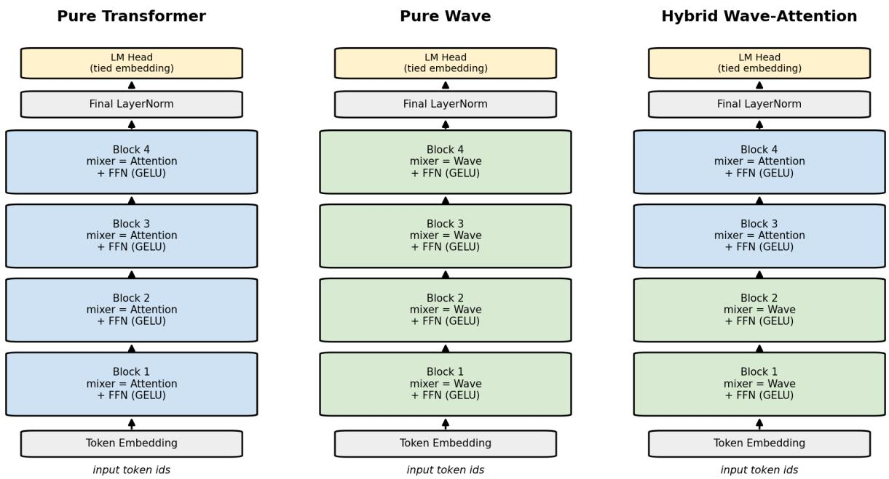
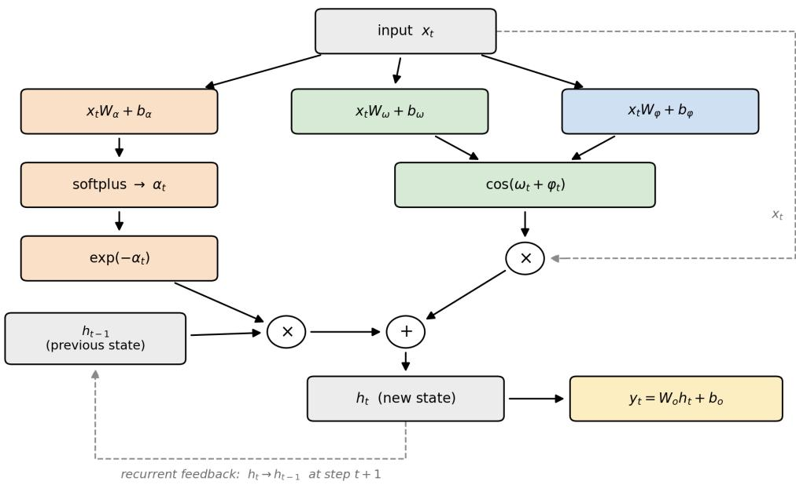
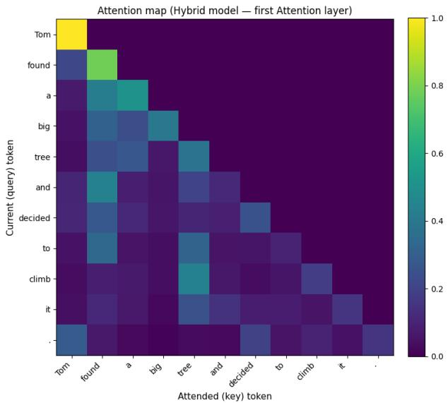
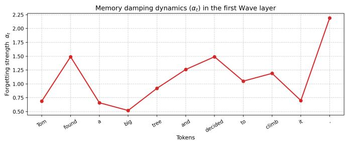
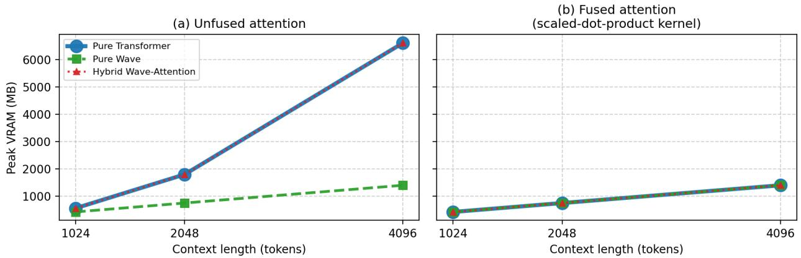
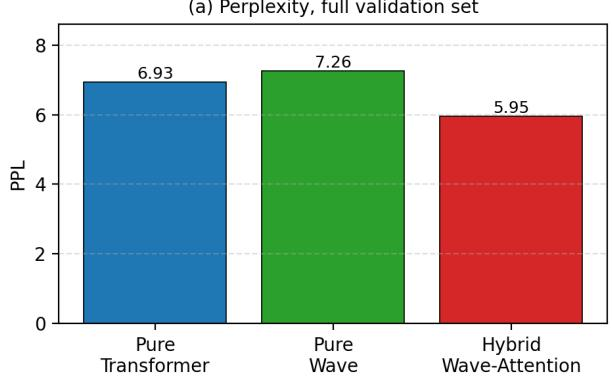
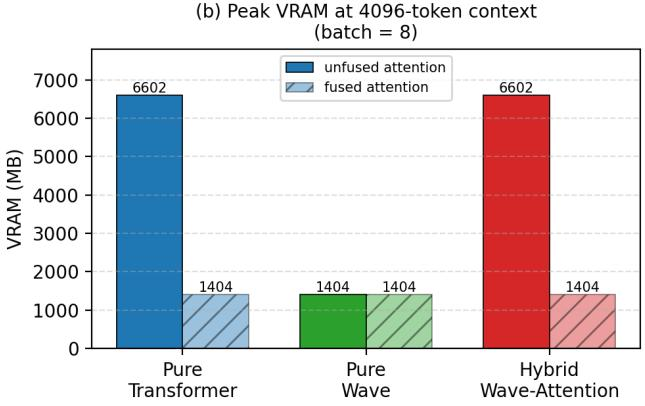
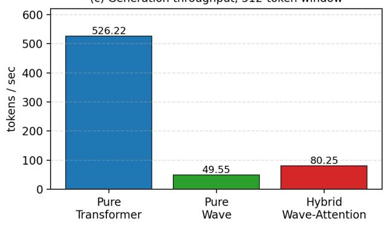
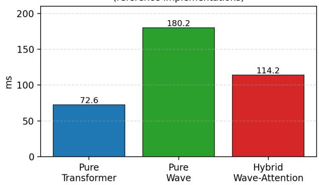

# Attention, Dynamic Wave and Hybrid Sequence Mixers in Language Models

Dmytro Babarytskyi

Kharkiv National University of Radio Electronics

Kharkiv, Ukraine

dmytro.babarytskyi@nure.ua

babaritskiydmytro@gmail.com

ORCID: 0009-0009-3614-9601

Oleksandr Babarytskyi

Military Law Institute

Yaroslav Mudryi National Law University

Kharkiv, Ukraine

aleksandr.babaritskiy@ukr.net

ORCID: 0000-0002-1690-1837

Abstract—Large Language Models (LLMs) rely on Multi-Head Attention (MHA) for sequence modeling, but scaling to long contexts is constrained by the quadratic cost of attention, motivating sub-quadratic recurrent alternatives. This paper formalizes a Dynamic Wave recurrent layer, based on inputdependent exponential damping and cosine phase modulation, and evaluates three 10.94M-parameter configurations—Pure Transformer, Pure Wave, and Hybrid Wave-Attention—on TinyStories under perplexity, latency, throughput and peak VRAM profiling up to 4096 tokens. The Hybrid configuration reaches the best perplexity, 5.95 on the full held-out split against 6.93 for the Transformer and 7.26 for Pure Wave. The efficiency picture, however, is governed by implementation rather than by architecture. Against an unfused attention baseline, Pure Wave uses 78.7% less peak VRAM at a 4096-token context (1404.3 MB vs. 6601.6 MB); against a fused scaled-dot-product attention kernel the same comparison yields no advantage at all (1404.3 MB vs. 1403.6 MB), and in training mode Pure Wave is 8.3% more expensive than the Transformer. Likewise, hoisting elementwise terms out of the recurrence loop speeds the layer up 2.53-fold with no custom kernel, reducing its latency gap to attention from 2.48-fold to 1.12-fold. A hybrid stack is found to inherit the cost of its more expensive mixer rather than the advantage of its cheaper one, its peak VRAM matching the Pure Transformer to within 0.1%. A closed-form memory model reproduces these measurements and predicts the context length beyond which attention overtakes the vocabulary projection. The findings indicate that reported efficiency gains for recurrent attention replacements must be stated relative to a named attention backend and a named implementation, and that hybridization is best justified on quality grounds.

Index Terms—Large Language Models, Sequence Modeling, Multi-Head Attention, Dynamic Wave Layer, Hybrid Architectures, Memory Efficiency, Context Scaling, Perplexity.

## I. INTRODUCTION

Large Language Models (LLMs) have fundamentally transformed the paradigms of natural language processing, computer vision, and software engineering by enabling sophisticated text generation, contextual reasoning, and zero-shot problemsolving [1], [2]. At the core of modern LLM architectures lies the Transformer model, which relies heavily on the Multi-Head Attention (MHA) mechanism to perform sequence modeling [3]. This mechanism enables the model to dynamically capture long-range global dependencies across a sequence, establishing

MHA as the standard for autoregressive language generation and deep context understanding.

Despite its unparalleled success, scaling traditional MHA to exceptionally long contexts remains constrained by its inherent quadratic computational complexity $O ( N ^ { 2 } )$ , where N denotes the sequence length. As the context window expands, the memory footprint required to store the Key-Value (KV) cache grows linearly with context length while the cost of the attention computation itself grows quadratically, together precipitating a critical “memory wall” that exhausts available Video RAM (VRAM) [4]. This memory problem not only drives up computational infrastructure costs but also leads to long-context degradation, where the model’s token-processing efficiency drops significantly, and its retrieval capabilities suffer from structural information loss deep within lengthy prompts [5].

To alleviate this quadratic complexity, alternative subquadratic sequence mixing paradigms have been proposed, including State-Space Models (SSMs), linear-time recurrent layers, and specialized linear attention approximations [6], [7]. Architectures such as Mamba and RWKV compress the sequence history into a fixed-size latent state, effectively reducing spatial complexity to O(N) during inference. However, these pure recurrent implementations frequently suffer from sequential processing latency on parallel hardware during training and can exhibit degraded semantic understanding. Specifically, they lack the strong global associative recall capabilities of standard MHA, leading to suboptimal performance on tasks that require tight, non-local token dependencies.

To address the trade-off between the expressive power of attention and the computational efficiency of recurrent networks, recent architectural trends have shifted toward hybrid sequence modeling paradigms [8], [9]. Models like Griffin and Jamba interleave MHA layers with gated linear recurrences or SSMs to achieve sub-quadratic memory scaling while preserving longrange contextual fidelity. Building on this paradigm, this paper investigates substituting standard attention with a Dynamic Wave recurrent layer that leverages exponential damping and phase modulation to maintain a stable, long-term memory state.

Existing literature extensively covers linear attention variants [10], [11] and pure state-space layer scaling [6], [12].

However, the specific behavior of a dynamic wave mechanism utilizing phase modulation in hybrid configurations remains insufficiently studied. More importantly, efficiency claims in this literature are frequently reported without stating which attention backend they are measured against, even though—as this paper shows—that choice can change the sign of the result.

This paper bridges these gaps by evaluating a Dynamic Wave layer and its integration into hybrid language models. Three distinct 10.94M-parameter model configurations—Pure Transformer, Pure Wave, and Hybrid Wave-Attention—are formalized and trained on the TinyStories corpus [13]. They are evaluated under a measurement protocol that isolates each configuration on a clean allocator, separates the cost of the sequence mixer from that of the shared language-model head, and reports every memory figure against both a fused and an unfused attention backend.

The main contributions of this paper are as follows:

• The mathematical apparatus of the Dynamic Wave recurrent layer, based on input-dependent exponential damping and cosine phase modulation, is formalized for sequence processing, and its relationship to complex-valued diago nal state spaces is made explicit.

• The recurrence is shown to be an associative scan, so that it admits the same ${ \cal O } ( \log T )$ -depth parallelization as the state-space layers it is compared against.

• Three comparable 10.94M-parameter architectures (Pure Transformer, Pure Wave, and Hybrid Wave-Attention) are proposed, implemented, and compared at a matched parameter budget.

• A measurement protocol is introduced that separates mixer memory from output-layer memory and controls for the attention backend, the compilation setting, and allocator state; it is shown that omitting these controls produces qualitatively wrong conclusions.

• An implementation-level ablation quantifies how much of the recurrent layer’s latency penalty is architectural and how much is an artifact of an unoptimized loop.

• A closed-form model of peak activation memory is derived and validated against measurement; it reproduces the observed figures and predicts the context length beyond which attention, rather than the vocabulary projection, dominates memory.

• A hardware-aware strategy selection model is developed to guide architectural choices under explicit operational constraints.

## II. RELATED WORK

## A. Quadratic Attention and Its Hardware Cost

Multi-Head Attention computes pairwise interactions between every pair of tokens in a sequence, giving the Transformer its characteristic $O ( T ^ { 2 } \cdot d )$ time and $O ( T \cdot d )$ key-value (KV) cache memory cost, where T is the sequence length [3]. FlashAttention and its successors reformulate the same computation to be IO-aware, avoiding materialization of the full $T \times T$ attention matrix in slow GPU memory and thereby reducing wall-clock cost and peak memory in practice [4], [14], [39]. These kernels reduce the constant factor of attention rather than its asymptotic scaling, and the KV cache still grows linearly with context length during autoregressive generation. As Section VII-E shows, however, that constant factor is large enough to dominate every memory comparison reported in this paper. Tay et al. provide a broad survey of this cost and the resulting search for sub-quadratic alternatives [15].

## B. Sparse and Low-Rank Attention Approximations

A first family of alternatives keeps the attention mechanism but restricts or approximates which token pairs interact. Longformer combines a local sliding window with a small number of global tokens [16]. Linformer projects the key and value sequences onto a lower-rank subspace, reducing complexity to $O ( T )$ at the cost of a fixed projection length [10]. Reformer replaces full attention with locality-sensitive hashing to approximate nearest-neighbor attention [17]. Performers approximate the softmax kernel with random feature maps to obtain a linear-time estimator of standard attention [11]. Ring Attention distributes exact attention across devices using blockwise computation to scale context length rather than reducing its asymptotic cost [18]. These methods remain attention-shaped: they still model pairwise or approximately pairwise token interaction, and most require either a specialized kernel or an accuracy trade-off to realize their theoretical savings.

## C. State-Space and Purely Recurrent Alternatives

A second family removes pairwise interaction entirely and replaces it with a compressed recurrent state. Mamba introduces an input-dependent (“selective”) state-space model whose transition parameters are computed from the input at every step, combined with a hardware-aware parallel scan [6]. RWKV reformulates attention as a linear, RNN-like recurrence that can be trained in parallel and run in constant memory during generation [7]. RetNet introduces an explicit multiscale exponential decay (“retention”) term as a direct algebraic substitute for softmax attention [19]. Katharopoulos et al. show that linear attention itself can be reformulated as a recurrent network, unifying the attention and RNN views [20]. S4 models long sequences with a structured, continuous-time state space discretized into a linear recurrence [12]; its diagonal successors S4D [21] and the Linear Recurrent Unit [22] keep a perchannel complex eigenvalue $\lambda = \exp ( - \nu + i \theta )$ , whose real part damps the state and whose imaginary part rotates it, so that a damped oscillation is already the standard behavior of a diagonal state-space channel. Hyena replaces attention with long implicit convolutions [23], and H3 combines two state-space layers with a multiplicative gate to approximate the recall behavior of attention [24]. More recent work shows that selective state spaces and linear attention are two views of one structured matrix family [40], and combines gating with the delta update rule to improve recall at a fixed state size [41]. Across this family, the recurring engineering requirement is a custom parallel-scan or convolutional kernel: without one, a sequential recurrence executed step-by-step in a standard deep-learning framework does not parallelize over the time dimension the way a matrix multiplication does. Section VII-D quantifies how much of that penalty is intrinsic to the sequential dependency and how much is merely unoptimized work placed inside the loop.

## D. Hybrid Sequence-Mixing Architectures

A third, more recent direction interleaves recurrent or convolutional layers with a smaller number of attention layers rather than replacing attention outright. Mega augments attention with a multi-scale exponential moving average to inject a recency bias [25]. Griffin interleaves gated linear recurrences with local attention blocks [8]. Jamba scales a transformer-SSM hybrid to production size, alternating Mamba and attention blocks in a fixed ratio [9]. A controlled comparison at a scale of eight billion parameters finds a hybrid with a small share of attention layers ahead of both pure forms [42], and a stack in which one softmax attention layer follows every seven linear-attention layers has been trained at the scale of hundreds of billions of parameters [43]. Attention itself was originally introduced as a complement to recurrent encoder–decoder models rather than as a replacement for them [26]. These results establish hybridization as a productive design space, typically placing recurrent or local layers to perform cheap, high-frequency sequence compression and reserving attention layers for global associative access over the compressed representation. The Hybrid Wave-Attention configuration evaluated here follows the same placement principle (Section IV).

## E. Recall Limitations and the Research Gap

Arora et al. show empirically that linear-time sequence models, despite matching attention on perplexity, systematically underperform standard attention on associative recall sub-tasks, and trace this gap to the fixed-size compressed state that such models must maintain [27]. This motivates treating a pure recurrent replacement of attention as one point in a design space rather than as a drop-in substitute. The Dynamic Wave layer studied here sits in this design space as a real-valued formulation of damped oscillation: where a diagonal state space obtains it from a fixed complex eigenvalue [21], [22], the Wave layer obtains it from a real damping term and an explicit cosine gate whose rate, frequency and phase are all functions of the current token, in the selective spirit of [6].

What the surveyed literature does not provide is measured— rather than asymptotic—memory behavior for such layers under a protocol that separates the cost of the sequence mixer from that of the shared output layer, names the attention implementation being compared against, and isolates each configuration from the others on the device. That gap is the subject of this paper: it formalizes the Dynamic Wave layer (Section III) and evaluates it, and a hybrid built from it, under such a protocol (Sections VI–VII).

## III. PROPOSED DYNAMIC WAVE LAYER

## A. Design Rationale

Retention-based and real-valued state-space layers such as RetNet and Mamba replace attention with a leaky integrator whose memory decays monotonically over time [6], [19]. Such a kernel can express recency bias but not constructive or destructive interference between tokens that are not adjacent, since a purely decaying, non-oscillatory kernel weights every past token with the same sign. Diagonal state spaces recover oscillation by moving to complex eigenvalues [21], [22], at the cost of complex-valued state and arithmetic. The Dynamic Wave layer keeps the state real and obtains the same qualitative behavior directly: it retains the exponential damping envelope, so that recent tokens are still weighted more heavily than distant ones, but modulates the contribution of each incoming token with a learned, input-dependent cosine term. Each channel of the hidden state therefore behaves like a driven, damped harmonic oscillator rather than a monotonically decaying accumulator: the sign and magnitude with which a token enters the running memory depends on a learned phase, so that subsequent tokens can reinforce or cancel earlier contributions. Both the damping rate and the oscillation frequency and phase are computed from the input at every time step, making the recurrence selective in the same sense as Mamba’s inputdependent transition parameters [6], while remaining a much simpler, single-layer recurrence than a full structured statespace model.

## B. Mathematical Formalization

Let $X ~ = ~ ( x _ { 1 } , \ldots , x _ { T } )$ with $x _ { t } ~ \in ~ \mathbb { R } ^ { d }$ denote the layernormalized input sequence of hidden dimension d. Three independent linear projections produce time-varying, inputdependent gate parameters for every channel:

$$
\begin{array} { r l } & { \alpha _ { t } = \mathrm { s o f t p l u s } ( x _ { t } W _ { \alpha } + b _ { \alpha } ) , } \\ & { \omega _ { t } = x _ { t } W _ { \omega } + b _ { \omega } , } \\ & { \varphi _ { t } = x _ { t } W _ { \varphi } + b _ { \varphi } , } \end{array}\tag{1}
$$

where $\alpha _ { t } \ > \ 0$ is the channel-wise forgetting rate, $\omega _ { t }$ is an instantaneous angular frequency and $\varphi _ { t }$ a phase offset. The hidden state $h _ { t } \in \mathbb { R } ^ { d }$ is then updated by a single-step, perchannel recurrence with $h _ { 0 } = 0$

$$
h _ { t } = \exp ( - \alpha _ { t } ) \odot h _ { t - 1 } + \cos ( \omega _ { t } + \varphi _ { t } ) \odot x _ { t } ,\tag{2}
$$

where $\odot$ denotes the Hadamard (element-wise) product. The first term exponentially damps the previous state channel-by channel; the second injects the current input, scaled by a cosine carrier whose frequency and phase are themselves functions of that same input. Unrolling the recurrence shows that the effective contribution of an earlier token $x _ { k }$ to the state at a later step t is scaled by the product of all intermediate damping factors and by $\cos ( \omega _ { k } + \varphi _ { k } )$ evaluated at the time $x _ { k }$ entered the recurrence—an exponentially decaying, phase-modulated memory kernel rather than a purely decaying one. Finally, the sequence of states is projected back to the model dimension by a linear output map:

$$
y _ { t } = W _ { o } h _ { t } + b _ { o } .\tag{3}
$$

## C. Parallel Form as an Associative Scan

Because $\alpha _ { t } , \omega _ { t }$ and $\varphi _ { t }$ depend only on $x _ { t }$ and not on $h _ { t - 1 }$ the coefficients of (2) are known before the recurrence begins. Writing $a _ { t } = \exp ( - \alpha _ { t } ) $ and $b _ { t } = \cos ( \omega _ { t } + \varphi _ { t } ) \odot x _ { t } ,$ , both obtainable for every timestep in one batched operation, (2) is the first-order linear recurrence

$$
h _ { t } = a _ { t } \odot h _ { t - 1 } + b _ { t } .\tag{4}
$$

Define on pairs of vectors the operator

$$
( a _ { i } , b _ { i } ) \bullet ( a _ { j } , b _ { j } ) = ( a _ { i } \odot a _ { j } , \ a _ { j } \odot b _ { i } + b _ { j } ) .\tag{5}
$$

This operator is associative: both bracketings of a triple reduce to $( a _ { 1 } \odot a _ { 2 } \odot a _ { 3 } , a _ { 3 } \odot ( a _ { 2 } \odot b _ { 1 } + b _ { 2 } ) + b _ { 3 } )$ , and (1, 0) is its identity. With $h _ { 0 } = 0$ , unrolling (4) gives

$$
h _ { t } = \pi _ { 2 } [ ( a _ { 1 } , b _ { 1 } ) \bullet ( a _ { 2 } , b _ { 2 } ) \bullet \cdot \cdot \cdot \bullet ( a _ { t } , b _ { t } ) ] ,\tag{6}
$$

where $\pi _ { 2 }$ selects the second component. The whole state sequence is therefore the prefix scan of $\{ ( a _ { t } , b _ { t } ) \} _ { t = 1 } ^ { T }$ under •, so a work-efficient parallel scan [28] evaluates all $T$ states in ${ \cal O } ( \log T )$ sequential depth and $O ( T \cdot d )$ work—the same construction used to parallelize linear recurrent networks [29] and the selective state-space layers of Section II [6], [12].

Two consequences matter for what follows. First, the sequential dependency in (2) is not an obstacle in principle: the layer admits exactly the same parallelization as the state-space layers it is compared against. Second, and independently of any scan, the fact that $a _ { t }$ and $b _ { t }$ are precomputable means they can simply be hoisted out of a sequential loop, leaving one multiply– add per step inside it. This restructuring changes neither the mathematics nor the parameter count, and Section VII-D measures what it is worth: most of the layer’s latency penalty, without writing a kernel at all.

## D. Integration into a Transformer Block

The Dynamic Wave layer is used as a drop-in replacement for the mixer sub-layer of a standard pre-norm Transformer block, so that Wave and Attention blocks can be freely interleaved in the same backbone. For layer l with mixer function Mixerl (either Multi-Head Attention or the Dynamic Wave recurrence):

$$
u ^ { ( l ) } = x ^ { ( l ) } + \mathrm { M i x e r } _ { l } \Big ( \mathrm { L N } _ { 1 } ( x ^ { ( l ) } ) \Big ) ,\tag{7}
$$

$$
x ^ { ( l + 1 ) } = u ^ { ( l ) } + \mathrm { F F N } \Big ( \mathrm { L N } _ { 2 } ( u ^ { ( l ) } ) \Big ) ,\tag{8}
$$

where $u ^ { ( l ) }$ is the intermediate state after the mixer sub-layer, $\mathrm { F F N } ( x ) = W _ { 2 } \mathrm { G E L U } ( W _ { 1 } x )$ with the smooth activation of Hendrycks and Gimpel [30], and pre-normalization is placed before rather than after each sub-layer following Xiong et al. [31]. Token embeddings are tied with the output (languagemodel head) projection. This block-level formalism is shared, unchanged, by all three configurations; the only difference between them is which mixer is instantiated at each layer index l. Both mixers carry exactly $3 d ^ { 2 } + 3 d$ projection parameters plus a $d ^ { 2 } + d$ output map, so the three configurations are parameter-matched by construction.

## E. Complexity Analysis

Table I compares the asymptotic time and memory cost of the two mixers. “Generation memory” refers to the memory required to produce one additional token given the tokens already generated: for attention this is the size of the KV cache, which grows with context length; for the Dynamic Wave recurrence it is, in principle, only the fixed-size state $h _ { t }$ independent of T. The training-memory row for attention is stated twice, because it is not a property of the mathematics but of the kernel: a fused, IO-aware implementation never materializes the $T \times T$ score matrix and is therefore $O ( T \cdot d )$ whereas an unfused implementation is $O ( T ^ { 2 } )$ . Section VII shows that this distinction, rather than the choice of mixer, determines every memory ranking reported in this paper.

## IV. MODEL ARCHITECTURES

## A. Shared Configuration

Three model configurations are trained and compared, all sharing an identical backbone, hyper-parameters, and parameter budget, so that any difference in behavior can be attributed to the choice and placement of the sequence-mixing layer rather than to model capacity. All three use hidden dimension $d = 3 8 4$ , feed-forward dimension 1536, 6 attention heads (where attention is used), 4 transformer blocks, and a 10 000- token BPE vocabulary, giving 10.94M trainable parameters for every configuration (Table II). Embedding and language-model head weights are tied.

## B. Pure Transformer (Baseline)

The baseline stacks four identical blocks, each using causal Multi-Head Attention as the mixer. This configuration is used both as the accuracy reference and as the only configuration compiled with torch.compile during training (Section VI-B).

## C. Pure Wave

The Pure Wave configuration replaces every mixer with the Dynamic Wave recurrence of Section III, keeping every other component—feed-forward blocks, normalization, embedding tying, optimizer, and schedule—identical to the baseline. This isolates the effect of removing attention entirely.

## D. Hybrid Wave-Attention

The Hybrid configuration places Wave layers first (blocks 1– 2) and Attention layers last (blocks 3–4). This ordering follows the placement principle observed in Griffin and Jamba [8], [9]: the lower, Wave-based blocks perform cheap, sequential compression of local context into a running state, while the upper, Attention-based blocks perform global associative refinement on top of an already-compressed representation, rather than needing to model long-range dependence from raw token embeddings directly. Fig. 1 illustrates the layer stack of all three configurations, and Fig. 2 the internal single-step computation of the Dynamic Wave layer described by (1)–(3).

TABLE I  
ASYMPTOTIC COMPLEXITY OF THE TWO MIXERS
<table><tr><td rowspan=1 colspan=1>Mixer</td><td rowspan=1 colspan=1>Training time</td><td rowspan=1 colspan=1>Training memory</td><td rowspan=1 colspan=1>Generation memory (per step, ideal)</td></tr><tr><td rowspan=1 colspan=1>Multi-Head Attention, unfused [3]</td><td rowspan=1 colspan=1> $\overline { { O ( T ^ { 2 } \cdot d ) } }$ </td><td rowspan=1 colspan=1> $\overline { { O ( T ^ { 2 } + T \cdot d ) } }$ </td><td rowspan=1 colspan=1> $\overline { { O ( T \cdot d ) \ ( \mathrm { K V } } }$ cache)</td></tr><tr><td rowspan=1 colspan=1>Multi-Head Attention, fused [4]</td><td rowspan=1 colspan=1> $\overline { { O ( T ^ { 2 } \cdot d ) } }$ </td><td rowspan=1 colspan=1> $\overline { { O ( T \cdot d ) } }$ </td><td rowspan=1 colspan=1> $\overline { { O ( T \cdot d ) ~ ( \mathrm { K V ~ c a c h e } ) } }$ </td></tr><tr><td rowspan=1 colspan=1>Dynamic Wave (proposed)</td><td rowspan=1 colspan=1> $\overline { { O ( T \cdot d ) } }$ </td><td rowspan=1 colspan=1> $\overline { { O ( T \cdot d ) } }$ </td><td rowspan=1 colspan=1>O(d) (fixed state), not realized—see Section VII-H</td></tr></table>

TABLE II  
SHARED HYPER-PARAMETERS AND MODEL CONFIGURATIONS
<table><tr><td rowspan=1 colspan=1>Configuration</td><td rowspan=1 colspan=1>Layer 1</td><td rowspan=1 colspan=1>Layer 2</td><td rowspan=1 colspan=1>Layer 3</td><td rowspan=1 colspan=1>Layer 4</td><td rowspan=1 colspan=1>Parameters</td></tr><tr><td rowspan=1 colspan=1>Pure Transformer</td><td rowspan=1 colspan=1>Attention</td><td rowspan=1 colspan=1>Attention</td><td rowspan=1 colspan=1>Attention</td><td rowspan=1 colspan=1>Attention</td><td rowspan=1 colspan=1>10.94M</td></tr><tr><td rowspan=1 colspan=1>Pure Wave</td><td rowspan=1 colspan=1>Wave</td><td rowspan=1 colspan=1>Wave</td><td rowspan=1 colspan=1>Wave</td><td rowspan=1 colspan=1>Wave</td><td rowspan=1 colspan=1>10.94M</td></tr><tr><td rowspan=1 colspan=1>Hybrid Wave-Attention</td><td rowspan=1 colspan=1>Wave</td><td rowspan=1 colspan=1>Wave</td><td rowspan=1 colspan=1>Attention</td><td rowspan=1 colspan=1>Attention</td><td rowspan=1 colspan=1>10.94M</td></tr></table>

## V. EVALUATION METRICS

## A. Perplexity

Language-modeling quality is measured by perplexity on held-out TinyStories chunks. For a batch b with per-token cross-entropy loss $\mathrm { C E } _ { b }$ (averaged over tokens in the batch), the mean loss over B evaluated batches and the corresponding perplexity are

$$
\mathcal { L } = \frac { 1 } { B } \sum _ { b = 1 } ^ { B } \mathrm { C E } _ { b } ,\tag{9}
$$

$$
\mathrm { P P L } = \exp ( \mathcal { L } ) .\tag{10}
$$

Two evaluation regimes are reported: a quick estimate over the first 50 evaluation batches, and a full evaluation over all 63 batches of the held-out split (2000 chunks not seen during training).

## B. Token Generation Throughput

Throughput is measured as generated tokens per second under greedy (arg-max) decoding, in two regimes that isolate the effect of context growth. In the bounded-window regime, the model generates 100 tokens while the context fed to the model at each step is truncated to the last 512 tokens, matching the sequence length used during training. In the unbounded, growing-context regime, the model generates 1500 tokens while the full, ever-growing context is re-fed at every step without truncation.

## C. Peak VRAM Profiling

Peak GPU memory is measured with torch.cuda.max\_ memory\_allocated. Four controls are applied, each of which was found to be necessary to obtain architectureattributable numbers:

1) Isolation. Each configuration is constructed, measured and destroyed on its own, with an explicit garbage collection and cache release before and after, so that no other model’s weights or allocator state contribute to its peak. Measuring the three configurations while all of them remain resident inflates every figure and, worse, makes the last-measured configuration inherit the most fragmented allocator.

2) Activation memory. The reported quantity is peak − steady state, where the steady state is measured after warm-up with only parameters resident. This removes the constant weight footprint from the comparison.

3) Output-layer separation. Every sweep is run twice, once with the tied language-model head and once stopping before it. The [B, T, V] logit tensor is the single largest allocation in the full model and is identical across the three configurations by construction, so it masks the mixers entirely unless removed (Section VII-D).

4) Named attention backend. Every attention measurement is reported for both an unfused implementation, which materializes the [B, H, T, T] score matrix, and a fused scaled-dot-product implementation, which does not.

Throughout, reference implementation denotes the code used to train the three models and to obtain the throughput and wall-clock results: causal attention through nn. MultiheadAttention with an explicit floating-point mask, and the Dynamic Wave recurrence with $\exp ( - \alpha _ { t } )$ and $\cos ( \omega _ { t } + \varphi _ { t } )$ evaluated inside the per-step loop. Optimized implementation denotes the same two mixers with attention routed through a fused scaled-dot-product kernel and the Wave recurrence restructured as described in Section III-B. The two differ only in how the same mathematics is executed; parameter counts and outputs are identical.

A short-context sweep measures peak VRAM and average forward-pass latency at sequence lengths of 128, 256 and 512 tokens with batch size 16, after warm-up, averaged over 30 timed iterations. An extreme-context sweep measures peak VRAM at 1024, 2048 and 4096 tokens with batch size 8. A separate sweep measures memory in training mode, with a backward pass, at 512 tokens and batch size 8.

## VI. EXPERIMENTAL SETUP

## A. Dataset and Tokenization

All models are trained on a 500 000-story subset of the TinyStories corpus [13], a dataset of short, syntactically simple children’s stories designed to let small models learn coherent English. A byte-pair-encoding tokenizer with a 10 000-token vocabulary is trained from scratch on the same subset using whitespace pre-tokenization. Tokenized stories are concatenated and split into fixed-length chunks of 512 tokens, yielding 207 113 training chunks; the last 2000 chunks are held out for evaluation and are not seen during training. Training batches of 32 chunks are sampled with shuffling and dropped-last batching, giving 6472 optimization steps per epoch.

Dynamic Wave layer — recurrence at step t  

Fig. 1. Layer configurations of the three evaluated 10.94M-parameter models.  
  
Fig. 2. Computation graph of the Dynamic Wave layer at step t.

## B. Training Configuration

All three configurations are trained for one epoch (6472 steps) with the AdamW optimizer (weight decay 0.01) [32], using a One-Cycle learning-rate schedule with cosine annealing, a peak learning rate of $5 \times 1 0 ^ { - 4 }$ , and a 500-step warm-up—the super-convergence recipe of Smith and Topin [33]. Training uses mixed-precision autocast with gradient scaling [34] and gradient-norm clipping at 1.0. All models are implemented in PyTorch [35]; the Pure Transformer baseline is additionally compiled with torch.compile, which lowers the model through TorchInductor onto Triton GPU kernels [36], [37], while the Pure Wave and Hybrid models are trained in eager mode, because torch.compile does not, at the time of writing, handle the explicit per-timestep Python loop of the Dynamic Wave recurrence. This asymmetry affects the training wall-clock comparison of Section VII-I and the generationthroughput comparison of Section VII-H, both of which were obtained with the compiled baseline. The memory and forward-latency benchmarks of Sections VII-D–VII-G are run uncompiled for all three configurations and are therefore free of it.

All experiments run on a single NVIDIA Tesla T4 GPU (16 GB GDDR6, Turing, compute capability 7.5) in a Kaggle notebook environment with Python 3.12.12, PyTorch 2.10.0 and CUDA 12.8. Because the T4 does not support BF16, mixedprecision training uses FP16 autocast with gradient scaling; all profiling runs use FP32.

## C. Research Questions

• RQ1: At a fixed parameter budget, does replacing Multi-Head Attention with the Dynamic Wave recurrence change language-modeling quality, and does a hybrid placement improve on both pure configurations?

• RQ2: Does the theoretical O(T) memory advantage of a recurrent mixer materialize in practice, and does the answer depend on the attention backend it is compared against?

• RQ3: How much of the recurrent mixer’s measured latency penalty is attributable to the sequential dependency itself, and how much to unoptimized work placed inside the loop?

• RQ4: Does a hybrid stack inherit the memory behavior of its cheaper or of its more expensive mixer?

## VII. RESULTS

## A. Language-Modeling Quality

Table III reports the quick, 50-batch perplexity estimate together with the short-context latency and memory sweep; Table IV reports the full, 63-batch evaluation over the entire held-out split. Both evaluations rank the three configurations identically: Hybrid Wave-Attention achieves the lowest (best) perplexity, Pure Transformer is second, and Pure Wave is third. On the full evaluation, Hybrid reaches a perplexity of 5.95 (average cross-entropy loss 1.7831) versus 6.93 (loss 1.9357) for the Transformer baseline and 7.26 (loss 1.9818) for Pure Wave—a 14.1% perplexity reduction relative to the baseline and 18.0% relative to Pure Wave. The quick 50-batch estimate (6.75 / 7.05 / 5.79) is consistent with this ranking and differs from the full evaluation by less than 0.3 perplexity points for every configuration.

  
Fig. 3. Attention map of the first Attention layer in the Hybrid model.

## B. Qualitative Generation Behavior

For the prompt “Once upon a time, a little boy named Tom went to the forest and found $\mathbf { a } ^ { \prime } { \mathrm { : } }$ all three models produce fluent, on-topic continuations under greedy decoding. The Transformer continues with “a big tree”, which Tom climbs; the Hybrid model produces a similar but independently phrased continuation about climbing a tree; Pure Wave instead introduces a different object (“a big, shiny rock”) and a different narrative arc, demonstrating that Pure Wave is not simply imitating the Transformer’s output distribution. On a second, longer prompt designed to probe entity tracking over a longer span, the Transformer and Hybrid models both continue coherently and keep referring to the already-introduced characters, while Pure Wave’s continuation introduces an ungrounded new character not present in the prompt—a mild form of entity drift consistent with the weaker associative-recall behavior reported for linear-time sequence models in general [27]. A temperature- and noise-robustness stress test on the Hybrid model (temperature 0.2, 1.5, and 10% random-token corruption of the prompt) shows graceful degradation in every case.

C. Interpretability: Attention Focus and Wave Memory Dynamics

To inspect how the two mixer types behave inside the trained Hybrid model, forward hooks were attached to its first Attention layer (block 3) and its first Wave layer (block 1) while processing the sentence “Tom found a big tree and decided to climb it.” Fig. 3 shows the resulting attention-weight matrix, and Fig. 4 the mean forgetting strength $\alpha _ { t }$ at every token position.

TABLE III  
QUICK BENCHMARK: QUALITY, FORWARD LATENCY, AND SHORT-CONTEXT ACTIVATION MEMORY (BATCH 16)
<table><tr><td rowspan=2 colspan=1>Model</td><td rowspan=2 colspan=1>PPL(quick)</td><td rowspan=1 colspan=3>Latency, reference impl.(ms)</td><td rowspan=1 colspan=1>Latency @512</td><td rowspan=1 colspan=2>Activation memory @512 (MB)</td></tr><tr><td rowspan=1 colspan=1>128</td><td rowspan=1 colspan=1>256</td><td rowspan=1 colspan=1>512</td><td rowspan=1 colspan=1>optimized (ms)</td><td rowspan=1 colspan=1>full model</td><td rowspan=1 colspan=1>mixer only</td></tr><tr><td rowspan=1 colspan=1>Pure Transformer</td><td rowspan=1 colspan=1>6.75</td><td rowspan=1 colspan=1>15.8</td><td rowspan=1 colspan=1>32.8</td><td rowspan=1 colspan=1>72.6</td><td rowspan=1 colspan=1>63.3</td><td rowspan=1 colspan=1>324.5</td><td rowspan=1 colspan=1>265.0</td></tr><tr><td rowspan=1 colspan=1>Pure Wave</td><td rowspan=1 colspan=1>7.05</td><td rowspan=1 colspan=1>46.1</td><td rowspan=1 colspan=1>89.2</td><td rowspan=1 colspan=1>180.2</td><td rowspan=1 colspan=1>71.2</td><td rowspan=1 colspan=1>324.5</td><td rowspan=1 colspan=1>120.0</td></tr><tr><td rowspan=1 colspan=1>Hybrid Wave-Attention</td><td rowspan=1 colspan=1>5.79</td><td rowspan=1 colspan=1>24.1</td><td rowspan=1 colspan=1>50.0</td><td rowspan=1 colspan=1>114.2</td><td rowspan=1 colspan=1>67.3</td><td rowspan=1 colspan=1>324.5</td><td rowspan=1 colspan=1>265.0</td></tr></table>

TABLE IV  
FULL-DATASET EVALUATION (63 HELD-OUT BATCHES)
<table><tr><td rowspan=1 colspan=1>Model</td><td rowspan=1 colspan=1>Avg. Cross-Entropy Loss</td><td rowspan=1 colspan=1>Perplexity</td></tr><tr><td rowspan=1 colspan=1>Pure Transformer</td><td rowspan=1 colspan=1>1.9357</td><td rowspan=1 colspan=1>6.93</td></tr><tr><td rowspan=1 colspan=1>Pure Wave</td><td rowspan=1 colspan=1>1.9818</td><td rowspan=1 colspan=1>7.26</td></tr><tr><td rowspan=1 colspan=1>Hybrid Wave-Attention</td><td rowspan=1 colspan=1>1.7831</td><td rowspan=1 colspan=1>5.95</td></tr></table>

  
Fig. 4. Dynamics of the memory damping coefficient $\alpha _ { t }$ in the first Wave layer of the Hybrid model.

In the first half of the sentence most of the attention mass in Fig. 3 stays on the current token and on the verb “found”. Later tokens attend selectively to earlier content words rather than to their immediate neighbors: “climb” and “it” place their largest weight on “tree” (0.44 and 0.25), and the sentencefinal period places it on the subject “Tom” (0.29). The $\alpha _ { t }$ dynamics in Fig. 4 show that the forgetting gate is not a fixed decay rate: the channel-averaged rate varies from token to token between 0.53 and 1.49 and reaches its maximum of 2.19 at the sentence-final period, where the state is flushed most strongly—a content-dependent, selective forgetting behavior reminiscent of Mamba’s input-dependent transition parameters [6], obtained here from a much simpler recurrence.

## D. Short-Context Speed and Memory Trade-off

At the short context lengths used during training (Table III), activation memory measured on the full model is identical across all three configurations at every length: 81.1, 162.2 and 324.5 MB at 128, 256 and 512 tokens respectively. This is not a property of the mixers. The peak is set by the [B, T, V] logit tensor produced by the tied language-model head, which at $T = 5 1 2$ with batch 16 in FP32 occupies 312.5 MiB, or 96% of the measured activation total, and which is identical across configurations by construction. Repeating the sweep with the head removed separates the mixers: at 512 tokens the unfused attention stack allocates 265.0 MB against 120.0 MB for the Wave stack, a factor of 2.2. Any memory comparison that includes the output layer at these scales measures the vocabulary projection, not the sequence mixer.

Latency separates the configurations sharply, but the separation is largely an implementation artifact. With the reference implementations—an unfused attention path and a Wave recurrence that evaluates $\exp ( - \alpha _ { t } )$ and $\cos ( \omega _ { t } + \varphi _ { t } )$ inside the per-step loop—Pure Wave requires 180.2 ms per forward pass at 512 tokens against 72.6 ms for the Transformer, a $2 . 4 8 \times$ penalty, with the Hybrid model at 114.2 ms in proportion to its share of Wave layers. Hoisting the two elementwise terms out of the loop, as noted in Section III-B, leaves the recurrence and the parameter count unchanged but reduces Pure Wave to 71.2 ms—a 2.53× speed-up obtained with no custom kernel, no fused scan, and no change to the mathematics. Against a fused attention baseline at 63.3 ms, the optimized Wave layer is then only 1.12× slower. The sequential dependency itself is therefore a far smaller obstacle at these sequence lengths than the amount of work placed inside the sequential region.

## E. Extreme-Context Memory Scaling

Table V and Fig. 5 report peak VRAM at 1024, 2048 and 4096 tokens with batch size 8, for both attention backends.

Against the unfused baseline the recurrent mixer’s advantage is large and grows with context: at 4096 tokens Pure Wave uses 1404.3 MB against 6601.6 MB for the Transformer, a 78.7% reduction, and on a mixer-only basis 480.0 MB against 6496.0 MB, a 92.6% reduction. Against a fused scaleddot-product kernel the same comparison collapses entirely: 1404.3 MB for Pure Wave against 1403.6 MB for the Transformer, a difference of 0.05% in the Transformer’s favor, and on a mixer-only basis 480.0 MB for both. The Dynamic Wave layer’s long-context memory advantage is thus not an advantage over attention as such, but over one particular way of computing attention—one that the field has already largely abandoned [4], [14], [39].

The Hybrid configuration answers RQ4 unambiguously and in the same way under both backends: its peak matches the Pure Transformer to within 0.1% (6602.5 MB vs. 6601.6 MB unfused; 1404.5 MB vs. 1403.6 MB fused). A hybrid stack inherits the cost of its more expensive mixer, not the advantage of its cheaper one, because the peak is set by the largest single allocation anywhere in the forward pass, and replacing half the attention layers with Wave layers does not reduce that maximum. Halving the number of attention layers therefore buys nothing in peak memory, although it would reduce aggregate KV-cache size during incremental decoding.

TABLE V  
PEAK VRAM (MB) AT EXTREME CONTEXT LENGTHS, BATCH 8, LANGUAGE-MODEL HEAD INCLUDED
<table><tr><td rowspan=2 colspan=1>Model</td><td rowspan=1 colspan=3>Unfused attention</td><td rowspan=1 colspan=3>Fused attention</td></tr><tr><td rowspan=1 colspan=1>1024</td><td rowspan=1 colspan=1>2048</td><td rowspan=1 colspan=1>4096</td><td rowspan=1 colspan=1>1024</td><td rowspan=1 colspan=1>2048</td><td rowspan=1 colspan=1>4096</td></tr><tr><td rowspan=1 colspan=1>Pure Transformer</td><td rowspan=1 colspan=1>565.4</td><td rowspan=1 colspan=1>1801.5</td><td rowspan=1 colspan=1>6601.6</td><td rowspan=1 colspan=1>429.9</td><td rowspan=1 colspan=1>755.5</td><td rowspan=1 colspan=1>1403.6</td></tr><tr><td rowspan=1 colspan=1>Pure Wave</td><td rowspan=1 colspan=1>430.6</td><td rowspan=1 colspan=1>756.2</td><td rowspan=1 colspan=1>1404.3</td><td rowspan=1 colspan=1>430.6</td><td rowspan=1 colspan=1>756.2</td><td rowspan=1 colspan=1>1404.3</td></tr><tr><td rowspan=1 colspan=1>Hybrid Wave-Attention</td><td rowspan=1 colspan=1>566.3</td><td rowspan=1 colspan=1>1802.3</td><td rowspan=1 colspan=1>6602.5</td><td rowspan=1 colspan=1>430.8</td><td rowspan=1 colspan=1>756.3</td><td rowspan=1 colspan=1>1404.5</td></tr></table>

## Peak VRAM vs. context length (batch = 8)

  
Fig. 5. Peak VRAM vs. context length at batch 8, under (a) an unfused attention implementation and (b) a fused scaled-dot-product kernel. The Pure Wave curve is identical in both panels because it contains no attention. Curves coincide where the underlying figures do: the Transformer and Hybrid curves overlie each other in (a), and all three overlie each other in (b), which is the result reported in Section VII-E.

## F. An Analytical Model of Peak Activation Memory

The measurements above are not only reproducible; they are predictable in closed form, which makes the qualitative conclusions independent of this particular hardware. In FP32, three tensor families account for essentially all activation memory in a forward pass:

$$
A _ { \mathrm { l o g i t } } = 4 B T V ,
$$

$$
{ \cal A } _ { \mathrm { a t t n } } = 8 B H T ^ { 2 } ,\tag{11}
$$

(12)

$$
A _ { \mathrm { l i n } } = 4 c B T d ,\tag{13}
$$

where B is the batch size, V the vocabulary size, H the number of heads, and c the number of $[ B , T , d ]$ activations simultaneously live inside a block. The factor 8 in $A _ { \mathrm { a t t n } }$ (rather than 4) reflects that the unfused path holds the raw score matrix and its softmax output at the same time; a fused kernel contributes no $T ^ { 2 }$ term at all. Fitting c to the mixer-only sweeps gives $c \approx 1 0$ for the Wave stack and c ≈ 11 for the attention stack.

Peak memory is then set by whichever of two moments in the forward pass is larger: the interior of a block, where the mixer’s own activations are live, or the final projection, where the logit tensor and the last hidden state are live together:

$$
A _ { \mathrm { p e a k } } \approx \mathrm { m a x } ( A _ { \mathrm { a t t n } } + A _ { \mathrm { l i n } } , \ A _ { \mathrm { l o g i t } } + 4 B T d ) .\tag{14}
$$

Table VI evaluates (14) against the measured configurations. Where the logit branch dominates, the model is exact to the reported precision; where the quadratic attention branch dominates it is accurate to a few percent at long context, degrading at short context as the constant-factor terms it does not model become comparatively larger.

The model also predicts, without any further measurement, the context length at which unfused attention overtakes the output layer as the dominant allocation. Setting $A _ { \mathrm { a t t n } } > A _ { \mathrm { l o g i t } }$ gives

$$
T ^ { * } > \frac { V } { 2 H } ,\tag{15}
$$

which for the vocabulary and head count used here is $T ^ { * }$ ≈ 10 000/12 ≈ 833 tokens. The measured crossover lies between 512 tokens, where the Transformer’s activation memory equals the Wave model’s at 324.5 MB, and 1024 tokens, where it exceeds it at 460.0 MB against 324.5 MB—as (15) requires.

Equation (15) also explains the otherwise surprising fused column of Table V. A fused kernel removes $A _ { \mathrm { a t t n } }$ entirely, leaving the logit branch dominant at every length tested, and that branch is identical for all three configurations by construction. The three architectures must therefore coincide, and they do, to within 0.1%. What is being compared in the fused regime is not the mixers at all but the shared vocabulary projection—which is the practical reason that a sub-quadratic mixer buys nothing here, and would begin to matter only for $T \gg T ^ { * }$ or for a substantially smaller vocabulary.

TABLE VI  
PREDICTED (14) VS. MEASURED ACTIVATION MEMORY (MB)
<table><tr><td rowspan=1 colspan=1>Configuration</td><td rowspan=1 colspan=1>B</td><td rowspan=1 colspan=1>T</td><td rowspan=1 colspan=1>Predicted</td><td rowspan=1 colspan=1>Measured</td><td rowspan=1 colspan=1>Error</td></tr><tr><td rowspan=1 colspan=1>Wave, with head</td><td rowspan=1 colspan=1>16</td><td rowspan=1 colspan=1>512</td><td rowspan=1 colspan=1>324.5</td><td rowspan=1 colspan=1>324.5</td><td rowspan=1 colspan=1>0.0%</td></tr><tr><td rowspan=1 colspan=1>Wave, with head</td><td rowspan=1 colspan=1>8</td><td rowspan=1 colspan=1>1024</td><td rowspan=1 colspan=1>324.5</td><td rowspan=1 colspan=1>324.5</td><td rowspan=1 colspan=1>0.0%</td></tr><tr><td rowspan=1 colspan=1>Wave, with head</td><td rowspan=1 colspan=1>8</td><td rowspan=1 colspan=1>2048</td><td rowspan=1 colspan=1>649.0</td><td rowspan=1 colspan=1>650.0</td><td rowspan=1 colspan=1>-0.2%</td></tr><tr><td rowspan=1 colspan=1>Wave, with head</td><td rowspan=1 colspan=1>8</td><td rowspan=1 colspan=1>4096</td><td rowspan=1 colspan=1>1298.0</td><td rowspan=1 colspan=1>1298.0</td><td rowspan=1 colspan=1>0.0%</td></tr><tr><td rowspan=1 colspan=1>Fused attn., with head</td><td rowspan=1 colspan=1>8</td><td rowspan=1 colspan=1>4096</td><td rowspan=1 colspan=1>1298.0</td><td rowspan=1 colspan=1>1298.0</td><td rowspan=1 colspan=1>0.0%</td></tr><tr><td rowspan=1 colspan=1>Fused attn., mixer only</td><td rowspan=1 colspan=1>8</td><td rowspan=1 colspan=1>4096</td><td rowspan=1 colspan=1>480.0</td><td rowspan=1 colspan=1>480.0</td><td rowspan=1 colspan=1>0.0%</td></tr><tr><td rowspan=1 colspan=1>Unfused attn., with head</td><td rowspan=1 colspan=1>8</td><td rowspan=1 colspan=1>2048</td><td rowspan=1 colspan=1>1776.0</td><td rowspan=1 colspan=1>1696.0</td><td rowspan=1 colspan=1>+4.7%</td></tr><tr><td rowspan=1 colspan=1>Unfused attn., with head</td><td rowspan=1 colspan=1>8</td><td rowspan=1 colspan=1>4096</td><td rowspan=1 colspan=1>6624.0</td><td rowspan=1 colspan=1>6496.0</td><td rowspan=1 colspan=1>+2.0%</td></tr></table>

TABLE VII

TRAINING ACTIVATION MEMORY, FORWARD AND BACKWARD, 512 TOKENS, BATCH 8 (MB)
<table><tr><td rowspan=1 colspan=1>Model</td><td rowspan=1 colspan=1>Unfused attention</td><td rowspan=1 colspan=1>Fused attention</td></tr><tr><td rowspan=1 colspan=1>Pure Transformer</td><td rowspan=1 colspan=1>789.2</td><td rowspan=1 colspan=1>573.6</td></tr><tr><td rowspan=1 colspan=1>Pure Wave</td><td rowspan=1 colspan=1>621.2</td><td rowspan=1 colspan=1>621.2</td></tr><tr><td rowspan=1 colspan=1>Hybrid Wave-Attention</td><td rowspan=1 colspan=1>705.2</td><td rowspan=1 colspan=1>597.4</td></tr></table>

## G. Training Memory

Table VII reports activation memory for a full training step (forward and backward) at 512 tokens with batch size 8. The ranking inverts relative to the unfused inference case. Against the unfused baseline Pure Wave retains an advantage (621.2 MB against 789.2 MB, 21.3% less), but against a fused attention baseline Pure Wave is the most expensive of the three configurations, at 621.2 MB against 573.6 MB, 8.3% more. The reason is that the Wave recurrence must retain every intermediate state $h _ { t }$ for the backward pass—an O(T ·d) autograd tape with T separate nodes—whereas a fused attention kernel recomputes its intermediates and stores comparatively little. A recurrent mixer that is cheaper at inference time is therefore not automatically cheaper to train.

## H. Inference Throughput: Bounded vs. Unbounded Context

Table VIII reports generation throughput for the reference implementations in the bounded-window regime (100 tokens generated, context truncated to the last 512 tokens) and in the unbounded, growing-context regime (1500 tokens generated, full un-truncated context re-fed at every step). In the boundedwindow regime the Transformer reaches 526.22 tokens/sec against 49.55 for Pure Wave and 80.25 for Hybrid. In the unbounded regime throughput collapses for the recurrent mixers: the Transformer falls to 102.31 tokens/sec, while Pure Wave falls to 3.96 and Hybrid to 7.75.

This collapse has a different cause from the forward-pass latency discussed in Section VII-D, and it is not removed by hoisting work out of the loop. The implementation recomputes the Dynamic Wave recurrence from the first token at every decoding step, because no incremental, state-caching decoding path is implemented: a mechanism that is O(T) per step by construction is thereby executed as $O ( T ^ { 2 } )$ in total. An incremental interface carrying only the fixed-size state $h _ { t }$ between steps was scaffolded during this study but is not implemented in the reference model used here; such a decoding path would remove this cost.

## I. Training Wall-Clock Time

Table IX reports the wall-clock duration of one full training epoch (6472 steps). The Pure Transformer trains in 18.36 minutes, versus 328.27 minutes for Pure Wave and 174.99 minutes for Hybrid. As discussed in Section VI-B, only the Transformer benefits from torch.compile here, so these figures conflate an architectural cost with an engineering one and should not be read as an architecture-only comparison. In the light of Section VII-D, a substantial part of the gap is attributable to the unoptimized recurrence rather than to the sequential dependency: the same 2.53× forward-pass speed-up would apply to every training step.

## VIII. DISCUSSION

## A. Hybridization Improves Quality, and Is Neutral for Peak Memory

The Hybrid configuration delivers the best languagemodeling quality of the three (14.1% lower perplexity than the Transformer baseline, Section VII-A) and the best qualitative entity-tracking behavior (Section VII-B), supporting the hypothesis that placing cheap sequential compression before global attention, as in Griffin and Jamba [8], [9], is an effective design pattern at this scale. On peak memory, however, it is indistinguishable from the Pure Transformer under both attention backends (Section VII-E). Peak memory is determined by the largest single allocation in the forward pass, so replacing half of the attention layers leaves that maximum untouched. A hybrid design should therefore be justified on the quality axis; on the peak-memory axis it is neither a gain nor a loss, and its benefit appears only in aggregate quantities such as KV-cache size during incremental decoding.

The isolation control of the protocol matters in practice. When the three configurations are measured co-resident on the device in a fixed order, the Hybrid configuration appears the most memory-hungry, at 8021.9 MB against 4373.9 MB for the Transformer; measured in isolation, the difference disappears and the results do not depend on the measurement order.

## B. Linear Memory Is Real, but Only Against an Unfused Baseline

Pure Wave shows a large, sustained memory advantage over unfused attention at long context—78.7% at 4096 tokens,

TABLE VIII  
GENERATION THROUGHPUT: BOUNDED VS. UNBOUNDED CONTEXT (REFERENCE IMPLEMENTATIONS)
<table><tr><td rowspan=1 colspan=1>Model</td><td rowspan=1 colspan=1>Bounded window, 100 tok (tok/s)</td><td rowspan=1 colspan=1>Unbounded context, 1500 tok (tok/s)</td><td rowspan=1 colspan=1>Slowdown</td></tr><tr><td rowspan=1 colspan=1>Pure Transformer</td><td rowspan=1 colspan=1>526.22</td><td rowspan=1 colspan=1>102.31</td><td rowspan=1 colspan=1>5.1×</td></tr><tr><td rowspan=1 colspan=1>Pure Wave</td><td rowspan=1 colspan=1>49.55</td><td rowspan=1 colspan=1>3.96</td><td rowspan=1 colspan=1>12.5×</td></tr><tr><td rowspan=1 colspan=1>Hybrid Wave-Attention</td><td rowspan=1 colspan=1>80.25</td><td rowspan=1 colspan=1>7.75</td><td rowspan=1 colspan=1>10.3×</td></tr></table>

## Comparative benchmark of the three architectures

(a) Perplexity, full validation set  

(c) Generation throughput, 512-token window  

(d) Forward latency at 512 tokens, batch 16 (reference implementations)  
  
Fig. 6. Comparative benchmark of the three architectures: perplexity, peak VRAM at 4096 tokens under both attention backends, generation throughput, and forward latency.

TABLE IX  
WALL-CLOCK TRAINING TIME, ONE EPOCH (6472 STEPS)
<table><tr><td rowspan=1 colspan=1>Model</td><td rowspan=1 colspan=1>Training time (min)</td><td rowspan=1 colspan=1>torch.compile</td></tr><tr><td rowspan=1 colspan=1>Pure Transformer</td><td rowspan=1 colspan=1>18.36</td><td rowspan=1 colspan=1>Yes</td></tr><tr><td rowspan=1 colspan=1>Pure Wave</td><td rowspan=1 colspan=1>328.27</td><td rowspan=1 colspan=1>No</td></tr><tr><td rowspan=1 colspan=1>Hybrid Wave-Attention</td><td rowspan=1 colspan=1>174.99</td><td rowspan=1 colspan=1>No</td></tr></table>

and 92.6% on a mixer-only basis. That advantage disappears completely against a fused scaled-dot-product kernel, where the two mixers are equal to within measurement noise, and reverses in training mode, where the Wave layer’s autograd tape makes it 8.3% more expensive than fused attention (Section VII-G).

This is the central methodological finding of this paper. An efficiency claim for a sub-quadratic sequence mixer is not well-defined unless the attention implementation it is measured against is named. Since fused, IO-aware attention is the default in current frameworks, comparisons against an unfused baseline should be regarded as upper bounds that are unlikely to be realized in deployment.

## C. Most of the Latency Penalty Is Not Architectural

The state-space literature attributes the wall-clock gap between recurrent mixers and attention to the absence of a parallel scan over the time dimension, which is why Mamba, S4 and RWKV pair their recurrences with dedicated kernels [6], [7], [12]. That account is incomplete for the layer studied here. Because $\alpha _ { t } , \omega _ { t }$ and $\varphi _ { t }$ depend only on $x _ { t } ,$ the transcendental terms can be evaluated for all timesteps at once before the loop begins; doing so speeds the layer up 2.53-fold and reduces its gap to attention from 2.48-fold with the reference implementations to 1.12-fold with the optimized ones (Section VII-D). What remains sequential is a single multiply–add per step, which is cheap.

A custom parallel-scan kernel therefore remains useful, but restructuring the loop should come first: at these sequence lengths the dominant cost was ordinary elementwise work placed inside the sequential region. The generation-time collapse of Section VII-H is a separate problem with a separate fix—state caching—and is not addressed by either change.

## D. Attention in a Hybrid Stack Retrieves Specific Tokens

The attention-weight visualization of Section VII-C shows that, inside the trained Hybrid model, later tokens in the example sentence attend selectively to particular earlier content words—the pronoun $\mathbf { \ddot { n } } ( t ^ { \prime } )$ to its referent “tree”—rather than spreading their weight across the context or concentrating it on immediate neighbors. Taken together with the $\alpha _ { t }$ dynamics of Fig. 4, this is consistent with a division of labor in which the Wave layers maintain a gated running summary while the Attention layers retrieve specific earlier tokens. The observation rests on a single example sentence (Section VIII-E).

## E. Limitations

Several scope limitations qualify the conclusions above. First, all models are trained for a single epoch, at a single scale (10.94M parameters), on a single, syntactically simple dataset [13]; whether the perplexity ranking observed here holds at larger scale, over multiple training seeds, or on more complex, long-document corpora such as The Pile [38] is not established. Second, the training wall-clock comparison of Section VII-I and the generation-throughput comparison of Section VII-H remain confounded by the torch.compile asymmetry, since both were measured with a compiled baseline against uncompiled recurrent configurations; only the memory and forward-latency benchmarks are compile-free for all three. Third, no incremental, state-caching decoding path is implemented, so the generation-throughput results measure the current reference implementation rather than the recurrence’s ceiling. Fourth, the interpretability analysis uses a single example sentence and is illustrative rather than systematic; broader protocols such as HELM [44] would be a natural extension. Fifth, the comparison includes no established subquadratic baseline: benchmarking the Dynamic Wave layer against Mamba [6], RWKV [7] and linear attention [20] at a matched parameter budget is required before any claim of relative merit within the recurrent family can be made, and a targeted associative-recall benchmark in the style of Zoology [27] would test directly the recall behavior that Section VII-B only illustrates. Sixth, all profiling is performed in FP32 on a single GPU architecture; mixed-precision and multi-device behavior may differ, particularly for the attention backends, whose relative cost depends strongly on kernel availability.

## IX. HARDWARE-AWARE STRATEGY SELECTION MODEL

Based on the results of Section VII, the following guidance is proposed for choosing among the three configurations, rather than treating one architecture as universally superior.

• If the best achievable language-modeling quality is the ob jective, use the Hybrid Wave-Attention model: it achieves the lowest perplexity of the three, and its peak memory is indistinguishable from the Pure Transformer, so the quality gain is essentially free in that dimension.

• If inference latency at short-to-moderate context is the binding constraint, use the Pure Transformer with a fused attention kernel: it is the fastest configuration in this regime (526.22 tokens/sec bounded-window generation), and the optimized Wave layer only approaches, without overtaking, its forward-pass latency.

• Deploy the Dynamic Wave layer for its memory profile only where a fused attention kernel is genuinely unavailable—an unusual situation in current frameworks. Where fused attention is available, expect parity at inference and a modest disadvantage during training.

• Do not assume a hybrid configuration is memory-favorable by construction, and do not assume it is unfavorable either: it tracks its most expensive mixer, so verify against that mixer at the target context length.

• Do not deploy the Dynamic Wave layer, in its current reference implementation, for unbounded-context autoregressive generation: without a state-caching decoding path its measured throughput is an order of magnitude below the Transformer baseline.

• Before investing in a custom parallel-scan kernel, first move all input-dependent elementwise computation out of the sequential region; in this study that single change gave a 2.53-fold speed-up.

## X. CONCLUSIONS

This paper formalized a Dynamic Wave recurrent layer, based on input-dependent exponential damping and cosine phase modulation, as an alternative and a complement to standard Multi-Head Attention, and evaluated three 10.94M-parameter configurations under a measurement protocol that isolates each configuration, separates mixer memory from output-layer memory, and names the attention backend for every figure.

On quality, the results are clear and favorable: the Hybrid Wave-Attention configuration achieves a perplexity of 5.95 on the full held-out split against 6.93 for the Transformer baseline and 7.26 for Pure Wave, and its peak memory matches the Transformer to within 0.1%, so this quality gain costs nothing in that dimension.

On efficiency, the results are conditional in a way that the framing of much of the sub-quadratic literature obscures. Pure Wave uses 78.7% less peak VRAM than attention at a 4096- token context when attention is computed without a fused kernel, and exactly as much when it is; in training mode it is 8.3% more expensive. Similarly, hoisting elementwise terms out of the recurrence loop sped the layer up 2.53-fold without any custom kernel, reducing its latency gap to attention from 2.48- fold to 1.12-fold. Neither of the two efficiency effects usually attributed to the recurrent architecture survives a controlled measurement: the memory advantage belongs to the attention baseline’s implementation, and most of the latency penalty to the Wave layer’s own.

The broader conclusion is methodological. Efficiency claims for attention replacements should state the attention backend, the compilation setting, the allocator protocol, and whether the output layer is included, because in this study such choices changed headline numbers by factors of two or more and, in two cases, reversed the ordering they implied. The recurrence studied here is an associative scan (Section III-C), so the parallel form is available in principle; what is missing is an implementation of it. Future work should supply that kernel together with a state-caching decoding path, disentangle the torch.compile asymmetry, benchmark the Dynamic Wave layer against Mamba [6], RWKV [7] and linear attention [20] at a matched budget, and extend the evaluation to larger models, multiple seeds, targeted associative-recall tests, and longer corpora such as The Pile [38].

## ACKNOWLEDGMENT

The study was performed without financial support.

## USE OF ARTIFICIAL INTELLIGENCE TOOLS

During the preparation of this work, the authors used Claude Opus 5 (Anthropic) in order to: review the measurement code and write the benchmark script of Sections V–VII; write the code that produces the figures from the recorded results; paraphrase and format the manuscript. The Dynamic Wave layer, the models and their training, the measurement protocol and the conclusions are the authors’ own. Every reported number was checked against the raw measurement output, and the memory model against the measurements in Table VI. After using this tool, the authors reviewed and edited the content as needed and take full responsibility for the content of the publication.

## REFERENCES

[1] A. Radford, J. Wu, R. Child, D. Luan, D. Amodei, and I. Sutskever, “Language models are unsupervised multitask learners,” OpenAI Blog, vol. 1, no. 8, p. 9, 2019.

[2] J. Kaplan, S. McCandlish, T. Henighan, T. B. Brown, B. Chess, R. Child, S. Gray, A. Radford, J. Wu, and D. Amodei, “Scaling laws for neural language models,” arXiv preprint arXiv:2001.08361, 2020.

[3] A. Vaswani, N. Shazeer, N. Parmar, J. Uszkoreit, L. Jones, A. N. Gomez, L. Kaiser, and I. Polosukhin, “Attention is all you need,” in Proc. Advances in Neural Information Processing Systems (NeurIPS), vol. 30, 2017, pp. 5998–6008.

[4] T. Dao, D. Y. Fu, S. Ermon, A. Rudra, and C. Ré, “FlashAttention: Fast and memory-efficient exact attention with IO-awareness,” in Proc. Advances in Neural Information Processing Systems (NeurIPS), vol. 35, 2022, pp. 16344–16359.

[5] N. F. Liu, K. Lin, J. Hewitt, A. Paranjape, M. Bevilacqua, F. Petroni, and P. Liang, “Lost in the middle: How language models use long contexts,” Transactions of the Association for Computational Linguistics, vol. 12, pp. 157–173, 2024.

[6] A. Gu and T. Dao, “Mamba: Linear-time sequence modeling with selective state spaces,” in Proc. Conference on Language Modeling (COLM), 2024.

[7] B. Peng et al., “RWKV: Reinventing RNNs for the transformer era,” in Findings of the Association for Computational Linguistics: EMNLP, 2023, pp. 14048–14077.

[8] S. De et al., “Griffin: Mixing gated linear recurrences with local attention for efficient language models,” arXiv preprint arXiv:2402.19427, 2024.

[9] O. Lieber et al., “Jamba: A hybrid Transformer-Mamba language model,” arXiv preprint arXiv:2403.19887, 2024.

[10] S. Wang, B. Z. Li, M. Khabsa, H. Fang, and H. Ma, “Linformer: Selfattention with linear complexity,” arXiv preprint arXiv:2006.04768, 2020.

[11] K. Choromanski et al., “Rethinking attention with performers,” in Proc. International Conference on Learning Representations (ICLR), 2021.

[12] A. Gu, K. Goel, and C. Ré, “Efficiently modeling long sequences with structured state spaces,” in Proc. International Conference on Learning Representations (ICLR), 2022.

[13] R. Eldan and Y. Li, “TinyStories: How small can language models be and still speak coherent English?” arXiv preprint arXiv:2305.07759, 2023.

[14] T. Dao, “FlashAttention-2: Faster attention with better parallelism and work partitioning,” in Proc. International Conference on Learning Representations (ICLR), 2024.

[15] Y. Tay, M. Dehghani, D. Bahri, and D. Metzler, “Efficient transformers: A survey,” ACM Computing Surveys, vol. 55, no. 6, pp. 1–28, 2022.

[16] I. Beltagy, M. E. Peters, and A. Cohan, “Longformer: The long-document transformer,” arXiv preprint arXiv:2004.05150, 2020.

[17] N. Kitaev, Ł. Kaiser, and A. Levskaya, “Reformer: The efficient transformer,” in Proc. International Conference on Learning Representations (ICLR), 2020.

[18] H. Liu, M. Zaharia, and P. Abbeel, “Ring Attention with blockwise transformers for near-infinite context,” in Proc. International Conference on Learning Representations (ICLR), 2024.

[19] Y. Sun et al., “Retentive network: A successor to transformer for large language models,” arXiv preprint arXiv:2307.08621, 2023.

[20] A. Katharopoulos, A. Vyas, N. Pappas, and F. Fleuret, “Transformers are RNNs: Fast autoregressive transformers with linear attention,” in Proc. International Conference on Machine Learning (ICML), 2020, pp. 5156–5165.

[21] A. Gu, A. Gupta, K. Goel, and C. Ré, “On the parameterization and initialization of diagonal state space models,” in Proc. Advances in Neural Information Processing Systems (NeurIPS), vol. 35, 2022, pp. 35971–35983.

[22] A. Orvieto, S. L. Smith, A. Gu, A. Fernando, C. Gulcehre, R. Pascanu, and S. De, “Resurrecting recurrent neural networks for long sequences,” in Proc. International Conference on Machine Learning (ICML), 2023, pp. 26670–26698.

[23] M. Poli et al., “Hyena hierarchy: Towards larger convolutional language models,” in Proc. International Conference on Machine Learning (ICML), 2023, pp. 28043–28078.

[24] D. Y. Fu, T. Dao, K. K. Saab, A. W. Thomas, A. Rudra, and C. Ré, “Hungry Hungry Hippos: Towards language modeling with state space models,” in Proc. International Conference on Learning Representations (ICLR), 2023.

[25] X. Ma, C. Zhou, X. Kong, J. He, L. Gui, G. Neubig, J. May, and L. Zettlemoyer, “Mega: Moving average equipped gated attention,” in Proc. International Conference on Learning Representations (ICLR), 2023.

[26] D. Bahdanau, K. Cho, and Y. Bengio, “Neural machine translation by jointly learning to align and translate,” in Proc. International Conference on Learning Representations (ICLR), 2015.

[27] S. Arora, S. Eyuboglu, A. Timalsina, I. Johnson, M. Poli, J. Zou, A. Rudra, and C. Ré, “Zoology: Measuring and improving recall in efficient language models,” in Proc. International Conference on Learning Representations (ICLR), 2024.

[28] G. E. Blelloch, “Prefix sums and their applications,” School of Computer Science, Carnegie Mellon University, Tech. Rep. CMU-CS-90-190, 1990.

[29] E. Martin and C. Cundy, “Parallelizing linear recurrent neural nets over sequence length,” in Proc. International Conference on Learning Representations (ICLR), 2018.

[30] D. Hendrycks and K. Gimpel, “Gaussian error linear units (GELUs),” arXiv preprint arXiv:1606.08415, 2016.

[31] R. Xiong et al., “On layer normalization in the transformer architecture,” in Proc. International Conference on Machine Learning (ICML), 2020, pp. 10524–10533.

[32] I. Loshchilov and F. Hutter, “Decoupled weight decay regularization,” in Proc. International Conference on Learning Representations (ICLR), 2019.

[33] L. N. Smith and N. Topin, “Super-convergence: Very fast training of neural networks using large learning rates,” in Artificial Intelligence and Machine Learning for Multi-Domain Operations Applications, Proc. SPIE, 2019, doi: 10.1117/12.2520589.

[34] P. Micikevicius et al., “Mixed precision training,” in Proc. International Conference on Learning Representations (ICLR), 2018.

[35] A. Paszke et al., “PyTorch: An imperative style, high-performance deep learning library,” in Proc. Advances in Neural Information Processing Systems (NeurIPS), vol. 32, 2019, pp. 8024–8035.

[36] J. Ansel et al., “PyTorch 2: Faster machine learning through dynamic graph compilation and reinforcement learning,” in Proc. ACM International Conference on Architectural Support for Programming Languages and Operating Systems (ASPLOS), 2024, pp. 229–243.

[37] P. Tillet, H. T. Kung, and D. Cox, “Triton: An intermediate language and compiler for tiled neural network computations,” in Proc. 3rd ACM SIGPLAN International Workshop on Machine Learning and Programming Languages (MAPL), 2019, pp. 10–19.

[38] L. Gao et al., “The Pile: An 800GB dataset of diverse text for language modeling,” arXiv preprint arXiv:2101.00027, 2020.

[39] J. Shah, G. Bikshandi, Y. Zhang, V. Thakkar, P. Ramani, and T. Dao, “FlashAttention-3: Fast and accurate attention with asynchrony and lowprecision,” in Proc. Advances in Neural Information Processing Systems (NeurIPS), vol. 37, 2024.

[40] T. Dao and A. Gu, “Transformers are SSMs: Generalized models and efficient algorithms through structured state space duality,” in Proc. International Conference on Machine Learning (ICML), 2024.

[41] S. Yang, J. Kautz, and A. Hatamizadeh, “Gated delta networks: Improving Mamba2 with delta rule,” in Proc. International Conference on Learning Representations (ICLR), 2025.

[42] R. Waleffe et al., “An empirical study of Mamba-based language models,” arXiv preprint arXiv:2406.07887, 2024.

[43] MiniMax et al., “MiniMax-01: Scaling foundation models with lightning attention,” arXiv preprint arXiv:2501.08313, 2025.

[44] P. Liang et al., “Holistic evaluation of language models,” Transactions on Machine Learning Research, 2023.