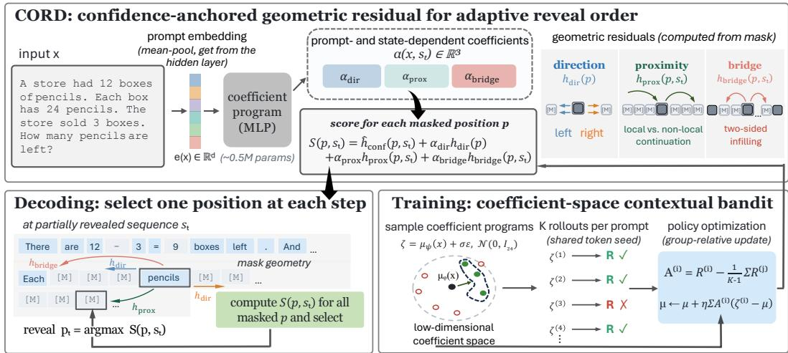
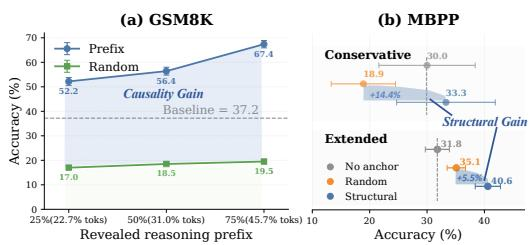
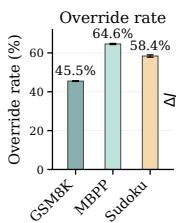
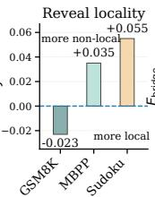
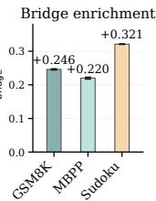
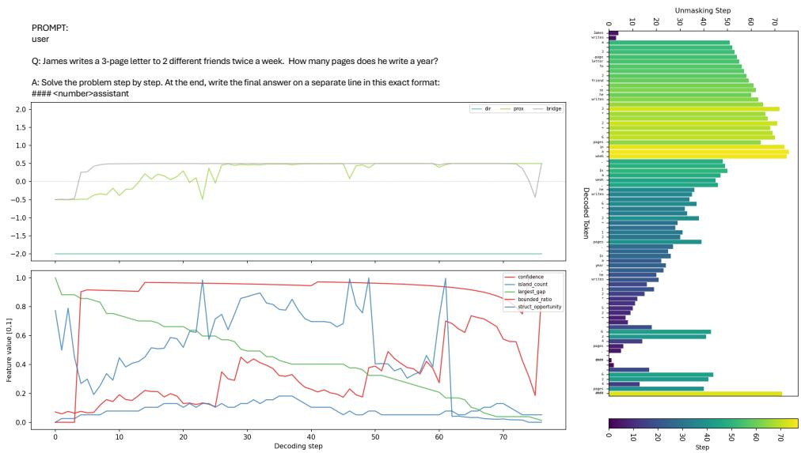
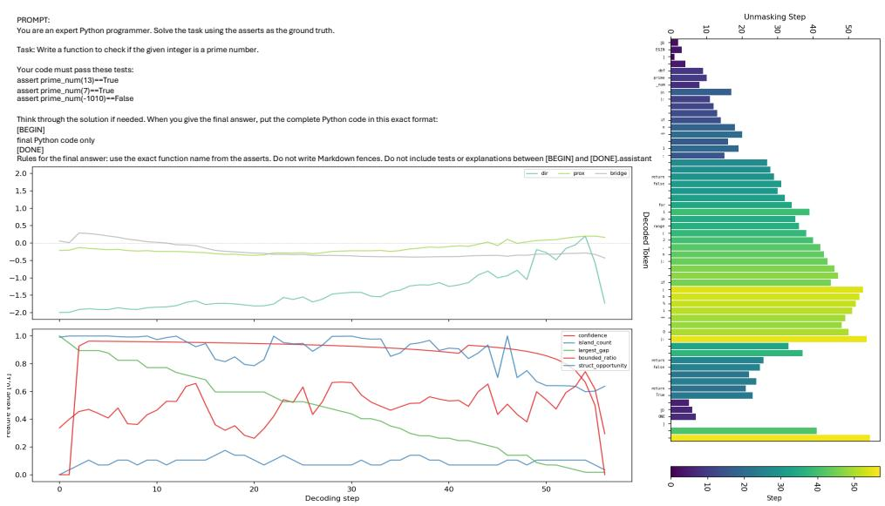

# CORD: CONFIDENCE-ANCHORED ORDER RESIDUAL DECODING FOR MASKED DIFFUSION LANGUAGE MODELS

Chengwei Zhou1,\* Zhaoyan Jia2,\* Massoud Pedram2 Gourav Datta1

1Case Western Reserve University, Cleveland, USA

2University of Southern California, Los Angeles, USA

\*Equal contribution.

## ABSTRACT

The decoding order of masked diffusion language models (dLLMs) can substantially affect generation quality, yet common decoders typically apply the same reveal rule throughout generation. Confidence provides a strong default, but it measures how decisively a position can be predicted now, not how useful revealing that position will be for subsequent decoding. We propose CORD, a lightweight prompt-conditioned policy that retains confidence decoding as a stable reference and learns when and how to depart from it through geometric residuals over generation direction, proximity to revealed context, and two-sided infilling. The residuals adapt to both the prompt and the evolving partial response. Rather than sampling a new policy action at every decoding step, CORD samples a single low-dimensional coefficient matrix per rollout, which induces an entire state-dependent reveal trajectory. This yields a contextual-bandit formulation trained directly from sequence-level rewards, without step-level credit assignment or backbone updates. Across three dLLMs and five reasoning, code, and constraint-satisfaction benchmarks, CORD improves average task success from 32.0% under confidence decoding to 48.2%, and further improves over the best per-domain fixed residual. Behavioral audits show that the learned residuals induce substantial, task-dependent changes in reveal locality and two-sided infilling. CORD adds only 0.53M trainable parameters, requires no additional backbone forward passes, and incurs only 5.39% inference latency overhead.

## 1 INTRODUCTION

Masked diffusion language models (dLLMs) can reveal masked response positions in different orders, unlike autoregressive models that generate strictly from left to right. Each revealed token becomes part of the context for subsequent predictions, so the reveal order can materially affect the final generation. For example, Kim et al. (2025) report that replacing random unmasking with a top-two probability-margin rule increases Sudoku accuracy from below 7% to roughly 90%, while yielding much smaller gains on natural-language reasoning. This disparity suggests that reveal order should be treated as part of the decoding strategy, and that the appropriate strategy can depend on the task. A common approach is to rank masked positions using a confidence statistic computed from the current predictive distribution. Such scores are inexpensive, since they are already available from the dLLM forward pass, and identify positions whose current token prediction is most decisive. However, confidence describes how predictable a position is now; it does not measure how useful revealing that position will be for later predictions. This distinction depends on the geometry of the partially revealed response. Sequential reasoning may benefit from extending an existing reasoning chain, whereas structured generation may benefit from first revealing distant structural anchors and then filling the gaps between them.

We verify this effect with frozen-backbone oracle experiments that control the amount of revealed information. We reveal selected ground-truth tokens before generation and compare them against the same number of randomly positioned ground-truth tokens, after which the remaining response is completed using standard confidence decoding. On GSM8K, revealing a correct causal prefix increases accuracy from 37.2% to as high as 67.4%, while token-matched random anchors remain below 20%. On MBPP, revealing structural program tokens outperforms matched random anchors by up to 14.4 points. These results show that, even at the same reveal budget, where information is revealed can substantially affect completion quality.

One way to exploit this structure is to learn the next reveal position directly. Prior work uses reinforcement learning with sequence-level rewards (Huang et al., 2025; Zhao et al., 2025; Jazbec et al., 2025; Chen et al., 2025) or auxiliary planning networks (Peng et al., 2025; Liu et al., 2025). These position-level formulations optimize a sequence of dependent discrete actions from final-response feedback, resulting in a large action space and temporal credit-assignment problem. Auxiliary planners can also add computation at every decoding step, while jointly updating a multi-billionparameter backbone substantially increases training cost.

To adapt reveal order with substantially lower optimization and inference overhead, we propose CORD. Instead of replacing confidence decoding with a token-level planner, CORD keeps confidence as the base ranking and learns bounded geometric corrections to it. CORD adjusts three complementary properties of the reveal order: generation direction, proximity to already revealed context, and preference for positions with revealed context on both sides. A lightweight promptconditioned network predicts a coefficient matrix, while features of the evolving partial response determine how these corrections change during decoding. CORD can therefore favor local continuation, non-local seeding, or two-sided infilling at different stages of generation. When the residual coefficients are zero, CORD reduces exactly to confidence-based (Top-2 margin) decoding, and the dLLM backbone remains frozen.

CORD is trained by exploring in the low-dimensional coefficient space rather than sampling a new reveal action at every step. For each prompt, the policy samples one coefficient matrix that deterministically induces the complete state-dependent reveal trajectory and receives a sequence-level reward. This converts reveal-order learning into a contextual-bandit problem and avoids step-level credit assignment. Across three masked diffusion models and five benchmarks spanning mathematical reasoning, code generation, and constraint satisfaction, CORD improves average task success from 30.6% under confidence-based decoding to 50.5% and also outperforms the best per-domain fixed geometric residual. Ablations show that prompt conditioning, within-rollout adaptation, and all three geometric residuals contribute to the gain. A behavioral analysis further shows task-dependent changes in reveal locality and two-sided infilling. CORD requires no additional backbone forward passes, adds only 0.53M trainable parameters, and incurs 5.39% inference latency overhead.

## 2 RELATED WORK

Masked diffusion language models. Absorbing-state discrete diffusion (Austin et al., 2021a) has been simplified into scalable masked-diffusion objectives (Lou et al., 2023; Sahoo et al., 2024; Shi et al., 2024; Ou et al., 2025), extended with variants such as soft masking (Hersche et al., 2026), and scaled to instruction-following models including LLaDA-8B-Instruct (Nie et al., 2025), its preference-optimized successor LLaDA-1.5 (Zhu et al., 2026), and the autoregressively initialized Dream-7B (Ye et al., 2025b); see Li et al. (2025) for a survey. Unlike autoregressive models, masked diffusion models admit multiple valid reveal orders at inference time. Although this freedom is immaterial for an exactly fitted model, it can substantially affect finite pretrained models. For example, Kim et al. (2025) show that a margin-based reveal rule raises Sudoku accuracy from below 7% to roughly 90%, while providing much smaller gains on natural-language reasoning. This disparity motivates our view that reveal order should be treated as a task- and state-dependent inductive bias rather than a fixed decoding choice.

Reveal-order strategies for MDMs. Existing approaches range from hand-designed reveal rules to learned planners. Confidence-ranked decoding descends from MaskGIT (Chang et al., 2022); modern dLLMs use max probability (Ye et al., 2025b), top-2 margin (Kim et al., 2025), negative entropy, or block-wise schedules, often in combination with caching, entropy-bounded thresholds, or adaptive block selection (Wu et al., 2026; Ben-Hamu et al., 2025; Israel et al., 2025; Luo et al., 2026). Recent work also identifies limitations of purely confidence-driven ordering, including boundary and trivial-token biases (Huang et al., 2026a), premature deferral of high-entropy connectives that can alter reasoning trajectories (Ni et al., 2026), and reduced sample diversity caused by coupling token prediction and reveal order (Olausson et al., 2026). These findings motivate augmenting confidence with information about the geometry of the partially revealed response rather than replacing confidence entirely. Learned methods instead optimize reveal order more directly. Some introduce explicit planners for unmasking or remasking (Peng et al., 2025; Liu et al., 2025; Peng et al., 2026; Zhou et al., 2026; Liu et al., 2026; Mohamud et al., 2026), while others distill oracle orders from ground-truth margins (Asano et al., 2026) or optimize reveal decisions using terminal or pathwise rewards (Huang et al., 2025; Zhao et al., 2025; Jazbec et al., 2025; Chen et al., 2025; Xu et al., 2026). These approaches typically operate at the level of positions or decoding steps and therefore face a large action space and long-horizon credit assignment; many also modify or jointly train the backbone. CORD takes a different route. We keep the pretrained confidence-based decoder as a fixed reference and learn a low-dimensional, prompt-conditioned residual over three interpretable geometric axes: direction, proximity to revealed context, and two-sided infilling. The resulting 24- dimensional coefficient program controls how these residuals evolve with the decoding state, while the dLLM backbone remains frozen. Exploration occurs once per rollout in coefficient space, after which the complete reveal trajectory is deterministic, yielding a contextual-bandit formulation rather than a step-level planning problem.

  
Figure 1: CORD. Top: a prompt-conditioned MLP produces state-dependent geometric residuals: direction, proximity, and bridge, that modify confidence-based reveal scores while keeping the dLLM frozen. Bottom left: CORD reveals the highest-scoring masked position at each step. Bottom right: training samples one low-dimensional coefficient program per rollout and optimizes it from sequence-level rewards as a contextual bandit.

## 3 METHOD

## 3.1 FROM TASK-SPECIFIC ORDERING BIASES TO DYNAMIC DECODING

Given a prompt x, a masked diffusion language model (dLLM) with frozen parameters θ predicts token distributions over all masked response po-+sitions and must decide which position to reveal (%next. We leave token prediction unchanged and study only this reveal-order decision.

We first ask whether different tasks actually prefer different forms of partial conditioning. To isolate this effect from learning, we conduct two oracle diagnostics with the dLLM backbone frozen and reveal selected ground-truth tokens before generation. On GSM8K, we reveal the first 25%, 50%, or 75% of the safe reasoning lines, while excluding the final reasoning line and answer, and compare against revealing the same number of

  
Figure 2: Oracle reveal diagnostics with frozen LLaDA. GSM8K favors a contiguous reasoning prefix, while MBPP benefits from structural anchors. Conservative uses core control-flow tokens (e.g. if, else, for); Extended additionally includes function (def, class), delimiter, and assignment tokens.

randomly located ground-truth tokens. On MBPP, we instead reveal the structural skeleton of the canonical program, e.g., if, else, for, while, and return, and compare against a tokenbudget-matched random control. In both cases, the remaining positions are completed by standard confidence LLaDA decoding. Figure 2 shows clear task-dependent preferences. On GSM8K, revealing a causal prefix raises accuracy from no-oracle 37.2% to as high as 67.4%, while matched random anchors remain below 20%. On MBPP, structural anchors outperform matched random anchors by up to 14.4 points. These results suggest that reasoning favors coherent prefix expansion, whereas code generation benefits from sparse structural scaffolds.

This suggests that no single reveal bias is uniformly appropriate. Sequential reasoning may favor coherent local continuation, while structured generation may benefit from non-local anchors that support later infilling. Moreover, the preferred bias can change during generation as newly revealed tokens reshape both the confidence-based landscape and the geometry of the remaining masked region.

CORD therefore retains confidence-based decoding as a stable default and learns only a bounded geometric residual that determines when and how to deviate from it. The residual can adjust generation direction, trade off local continuation against non-local seeding, and favor two-sided infilling, while depending on both the prompt and the evolving decoding state.

## 3.2 CONFIDENCE-ANCHORED REVEAL GEOMETRY

Let $s _ { t }$ denote the decoding state at step $t , \mathcal { M } ( s _ { t } )$ the set of still-masked response positions, and $R _ { \mathrm { r e s p } } ( s _ { t } )$ the set of already revealed response positions. For each $p \in \mathcal { M } ( s _ { t } )$ ), the frozen dLLM predicts

$$
\pi _ { p } ( v \mid s _ { t } ) = p _ { \theta } ( y _ { p } = v \mid s _ { t } ) .\tag{1}
$$

CORD retains confidence-based decoding as its base policy and learns only geometric residuals that modify the reveal ranking. Let $v _ { 1 } ( p )$ and $v _ { 2 } ( p )$ denote the two highest-probability non-special tokens at $p ,$ and let $\mathrm { i d } \mathbf { x } ( p ) \in \bar { \left\{ 1 , \ldots , L \right\} }$ denote its response position. We define

$$
\begin{array} { r l } & { h _ { \mathrm { a n c h o r } } ( p , s _ { t } ) = \pi _ { p } ( v _ { 1 } ( p ) \mid s _ { t } ) - \pi _ { p } ( v _ { 2 } ( p ) \mid s _ { t } ) , } \\ & { \qquad h _ { \mathrm { d i r } } ( p ) = 2 \frac { \mathrm { i } \mathrm { d } \mathrm { x } ( p ) - 1 } { L - 1 } - 1 , } \\ & { h _ { \mathrm { p r o x } } ( p , s _ { t } ) = \left\{ \begin{array} { l l } { ~ \operatorname* { m i n } _ { \substack { r \in R _ { \mathrm { r e s p } } ( s _ { t } ) } } \left| \mathrm { i d x } ( p ) - \mathrm { i d x } ( r ) \right| , } & { R _ { \mathrm { r e s p } } ( s _ { t } ) \neq \emptyset , } \\ { 0 , } & { R _ { \mathrm { r e s p } } ( s _ { t } ) = \emptyset , } \end{array} \right. } \\ & { h _ { \mathrm { b r i d g e } } ( p , s _ { t } ) = 1 \left[ \exists r _ { \ell } , r _ { r } \in R _ { \mathrm { r e s p } } ( s _ { t } ) : \mathrm { i d x } ( r _ { \ell } ) < \mathrm { i d x } ( p ) < \mathrm { i d x } ( r _ { r } ) \right] . } \end{array}\tag{2}
$$

These signals have complementary interpretations. $h _ { \mathrm { a n c h o r } }$ recovers the conventional confidencebased (Top-2 margin) decoder. For $h _ { \mathrm { d i r } } ,$ a negative coefficient favors earlier positions (left-to-right), whereas a positive coefficient favors later positions (right-to-left). For $h _ { \mathrm { p r o x } } .$ , a negative coefficient favors positions near already revealed response tokens and therefore encourages local continuation, whereas a positive coefficient favors distant positions and promotes non-local seeding. Finally, a positive coefficient on $h _ { \mathrm { b r i d g e } }$ favors positions with revealed response context on both sides and therefore encourages infilling. Prompt tokens are excluded from $R _ { \mathrm { r e s p } }$ so that the prompt–response boundary does not introduce an artificial positional bias.

Because these signals have different numerical ranges, we normalize each one over the currently masked positions: $\widetilde { h } _ { m } ( p , s _ { t } ) = \left\{ \begin{array} { l l } { \displaystyle \frac { h _ { m } ( p , s _ { t } ) - \mu _ { m } ^ { ( t ) } } { \sigma _ { m } ^ { ( t ) } } , } & { \sigma _ { m } ^ { ( t ) } \geq \epsilon _ { \mathrm { v a r } } , } \\ { 0 , } & { \mathrm { o t h e r w i s e } , } \end{array} \right.$ $\epsilon _ { \mathrm { v a r } } = 1 0 ^ { - 4 }$ , where $\mu _ { m } ^ { ( t ) }$ and $\sigma _ { m } ^ { ( t ) }$ are computed over $p \in \mathcal { M } ( s _ { t } )$ . Near-constant signals are therefore suppressed rather than amplified by normalization.

## 3.3 DYNAMIC GEOMETRIC RESIDUALS

CORD augments the normalized anchor score with a learned geometric residual:

$$
S ( p , s ) = \widetilde h _ { \mathrm { a n c h o r } } ( p , s ) + \alpha _ { \mathrm { d i r } } ( x , s ) \widetilde h _ { \mathrm { d i r } } ( p ) + \alpha _ { \mathrm { p r o x } } ( x , s ) \widetilde h _ { \mathrm { p r o x } } ( p , s ) + \alpha _ { \mathrm { b r i d g e } } ( x , s ) \widetilde h _ { \mathrm { b r i d g e } } ( p , s ) .\tag{3}
$$

At each decoding step, CORD reveals the single masked position with the largest score: $p ^ { \star } =$ $\operatorname { a r g m a x } _ { p \in \mathcal { M } ( s ) } \bar { S } ( p , \bar { s } )$ . The anchor term remains active at every step, while the residuals adjust the reveal geometry. In particular, $\alpha _ { \mathrm { d i r } }$ controls left-to-right versus right-to-left preference, $\alpha _ { \mathrm { p r o x } }$ trades off local continuation against non-local seeding, and $\alpha _ { \mathrm { b r i d g e } }$ controls the preference for positions with revealed context on both sides. Unlike hard routing, these residuals only modify the ranking and never exclude positions from consideration.

To let these preferences evolve during decoding without introducing a new stochastic policy action at every step, CORD predicts a single coefficient program. Let $B = 3$ denote the residual channels $\{ \mathrm { d i r } $ , prox, bridge} and let J denote the number of state-basis functions. For a prompt-conditioned matrix $C ( \boldsymbol { \dot { x } } ) \in \tilde { \mathbb { R } } ^ { \tilde { B } \times J }$ , the residual coefficients are

$$
\begin{array} { r } { \pmb { \alpha } ( x , s ) = \pmb { \alpha } _ { \mathrm { m a x } } \odot \mathrm { t a n h } \left( C ( x ) \mathbf { f } ( s ) \right) , } \end{array}\tag{4}
$$

where $\pmb { \alpha } _ { \mathrm { m a x } } \in \mathbb { R } _ { + } ^ { B }$ bounds the magnitude of each correction. We use the state basis

$$
\mathbf { f } ( s ) = \left[ \underbrace { 1 , ~ t , ~ \mathrm { s i n } ( \pi t ) } _ { \mathrm { d e f u s i o n } \mathrm { s t e p ~ b i a s } } , \underbrace { F _ { \mathrm { m e a n } } ( s ) , ~ F _ { \mathrm { c o n c } } ( s ) , ~ F _ { \mathrm { c o m p } } ( s ) , ~ F _ { \mathrm { b o u n d } } ( s ) , ~ F _ { \mathrm { g a p } } ( s ) } _ { \mathrm { s t a t e d e p e n d e n c i e s } } \right] ^ { \top } ,\tag{5}
$$

where $\begin{array} { r } { t \ = \ \frac { | R _ { \mathrm { r e s p } } ( s ) | } { L } } \end{array}$ is the fraction of the response already revealed. The first two state features summarize the confidence-based landscape:

$$
F _ { \mathrm { m e a n } } ( s ) = \frac { 1 } { | { \cal M } ( s ) | } \sum _ { p \in \mathcal { M } ( s ) } h _ { \mathrm { a n c h o r } } ( p , s ) , \quad F _ { \mathrm { c o n c } } ( s ) = Q _ { 0 , 9 } ( h _ { \mathrm { a n c h o r } } ( \cdot , s ) ) - Q _ { 0 , 5 } ( h _ { \mathrm { a n c h o r } } ( \cdot , s ) ) .\tag{6)(9}
$$

They measure the overall confidence-based level and whether a small subset of masked positions is substantially easier than the rest. The remaining features summarize the reveal geometry:

$$
F _ { \mathrm { c o m p } } ( s ) = \frac { N _ { \mathrm { c o m p } } ( s ) } { L } , \qquad F _ { \mathrm { b o u n d } } ( s ) = \frac { | \mathcal { B } ( s ) | } { | \mathcal { M } ( s ) | } , \qquad F _ { \mathrm { g a p } } ( s ) = \frac { G _ { \mathrm { m a x } } ( s ) } { L } ,\tag{7}
$$

where $N _ { \mathrm { c o m p } } ( s )$ is the number of contiguous revealed-response components, $B ( s )$ is the set of masked positions with revealed context on both sides, and $G _ { \mathrm { m a x } } ( s )$ is the length of the largest contiguous masked run.

A single $B \times J$ matrix therefore determines how the three geometric residuals evolve over the entire rollout. Once $C ( x )$ is fixed, the residual coefficients are deterministic functions of the current decoding state. The coefficient predictor is zero-initialized, so CORD begins exactly from confidence-based decoding and learns only residual departures from it.

## 3.4 PROMPT-CONDITIONED COEFFICIENT POLICY

The geometric residuals should depend on the input, since different prompts may favor different reveal-order corrections even within the same task. CORD therefore predicts the coefficient program directly from the prompt. The first backbone forward pass already processes the prompt together with the masked response block, so we mean-pool the intermediate prompt hidden states to obtain a representation $e ( x ) \ { \stackrel { } { \in } } \ \mathbb { R } ^ { d }$ without requiring an additional backbone forward pass.

A lightweight policy network predicts the mean coefficient vector:

$$
\mu _ { \psi } : \ e ( x ) \ \xrightarrow { \ f _ { \psi } : \ \mathrm { L i n e a r } ( d  1 2 8 )  \mathrm { S i L U }  \mathrm { L i n e a r } ( 1 2 8  m ) } \ \mu ( x ) \in \mathbb { R } ^ { n } , \qquad n = B J .\tag{8}
$$

We use a two-layer MLP with a 128-dimensional hidden layer and SiLU activation. The output $\mu _ { \psi } ( x )$ is reshaped into a coefficient matrix $C ( \boldsymbol { x } ) \in \mathbb { R } ^ { B \times J }$ . In our configuration, $B = 3$ residual channels and $J = 8$ state-basis functions, giving $n = 2 4$ . The final linear layer is initialized to zero, so CORD initially reduces exactly to confidence-based decoding. This parameterization separates prompt-level and state-level adaptation. The prompt determines the coefficient program $C ( x )$ , while the evolving state basis $\mathbf { f } \left( s \right)$ determines how this program is expressed as geometric residuals during decoding. Thus, a single prompt-conditioned coefficient matrix specifies an entire state-dependent reveal strategy without requiring a new policy decision at every decoding step. During training, CORD explores around the predicted mean in coefficient space; at inference, it directly uses the mean program $C ( x )$

## 3.5 TRAINING CORD IN COEFFICIENT SPACE

There is no ground-truth reveal order with which to supervise CORD directly: the quality of an ordering strategy is only known after the resulting response has been generated and evaluated. We therefore train the coefficient policy from sequence-level rewards. A token-level policy would make a stochastic decision at every decoding step, creating a long sequence of dependent actions and requiring temporal credit assignment. Instead, CORD places exploration in the low-dimensional coefficient space that parameterizes the entire dynamic reveal strategy.

For each prompt $x ,$ the policy predicts a mean coefficient vector $\pmb { \mu } ( x ) \in \mathbb { R } ^ { n }$ , where $n = B J$ . During training, we sample a perturbed coefficient vector

$$
C _ { \zeta } = \mathrm { r e s h a p e } _ { B \times J } \left( \zeta \right) , \qquad \zeta = \mu ( x ) + \sigma \epsilon , \qquad \epsilon \sim \mathcal { N } \left( { \bf 0 } , { \cal I } _ { n } \right) .\tag{9}
$$

The sampled matrix $C _ { \zeta }$ is held fixed for the entire rollout. At each decoding state $s ,$ it is combined with the current state basis $\mathbf { f } \left( s \right)$ through Eq. 4 to produce the geometric residual coefficients $\alpha ( x , s )$ Although these coefficients evolve with the decoding state, once ζ is sampled, all subsequent reveal decisions are deterministic.

Each prompt therefore defines a context $x ,$ the policy takes a single stochastic action $\zeta ,$ and the resulting decoding trajectory receives one sequence-level reward $r { : }$

$$
x \longrightarrow \zeta \longrightarrow \mathrm { f u l l d e c o d i n g ~ r o l l o u t } \longrightarrow r .\tag{10}
$$

CORD can thus be trained as a contextual bandit rather than as a long-horizon sequential policy. In our configuration, the stochastic action space has only $B J = 3 \times \mathbf { \bar { 8 } } = 2 4$ dimensions, while still inducing a state-dependent reveal strategy over the entire rollout. This avoids step-level credit assignment and keeps the frozen dLLM outside the policy-gradient computation.

At inference time, exploration is removed and we use the predicted mean coefficient program $C ( x ) = \mathrm { r e s h a p e } _ { B \times J } \left( \pmb { \mu } ( x ) \right)$ . Decoding is then deterministic using Eqs. 4 and 3.

## 3.6 SEQUENCE-LEVEL REWARD

CORD is trained from sequence-level feedback rather than supervision on individual reveal decisions. For rollout i, we use

$$
r ^ { ( i ) } = \mathbf { 1 } \left[ \mathrm { { a n s w e r } ^ { ( i ) } ~ i s ~ c o r r e c t } \right] + \lambda _ { \mathrm { { f m t } } } \mathbf { 1 } \left[ \mathrm { { o u t p u t } ^ { ( i ) } ~ i s ~ p a r s e a b l e } \right] + \lambda _ { \mathrm { { a n s } } } \overline { { \log p _ { \mathrm { { a n s } } } ^ { ( i ) } } } .\tag{11}
$$

The correctness term provides the primary supervision and directly evaluates whether the induced reveal strategy produces a successful final response. We do not prescribe a target reveal trajectory; instead, the coefficient policy is optimized according to the quality of the complete generation.

We use a small formatting reward, with $\lambda _ { \mathrm { f m t } } = 0 . 1$ , to distinguish malformed outputs from valid but incorrect responses. When additional graded feedback is useful, the optional answer-probability term re-masks the reference answer span and measures the mean log-probability assigned to the reference answer tokens. This requires one additional backbone forward pass. Task-specific verifiers define correctness. Mathematical responses are evaluated by answer extraction and symbolic equivalence, generated code is executed against the corresponding test cases in a resource-limited sandbox, and Sudoku outputs are checked for clue preservation together with row, column, and box constraints. Training and evaluation use the same verifier implementation.

## 3.7 GROUP-RELATIVE POLICY GRADIENT IN COEFFICIENT SPACE

For each prompt x, we generate a group of K sibling rollouts by sampling $\begin{array} { r } { \zeta ^ { ( i ) } \sim q _ { \psi } \left( \zeta \mid x \right) = } \end{array}$ $\mathcal { N } \left( \pmb { \mu } _ { \psi } ( x ) , \sigma ^ { 2 } I _ { n } \right) , i = 1 , \ldots , K$ . Each sampled vector is reshaped into a coefficient program $C _ { \zeta ^ { ( i ) } }$ and held fixed throughout the corresponding rollout. The log-density of a sampled coefficient vector is

$$
\log q _ { \psi } \left( \zeta ^ { ( i ) } \mid x \right) = - \frac { \left\| \zeta ^ { ( i ) } - \pmb { \mu } _ { \psi } ( x ) \right\| _ { 2 } ^ { 2 } } { 2 \sigma ^ { 2 } } - \frac { n } { 2 } \log \left( 2 \pi \sigma ^ { 2 } \right) ,\tag{12}
$$

with score-function gradient

$$
\nabla _ { \psi } \log q _ { \psi } \left( \zeta ^ { ( i ) } \mid x \right) = \left( \frac { \zeta ^ { ( i ) } - \pmb { \mu } _ { \psi } ( x ) } { \sigma ^ { 2 } } \right) ^ { \top } \nabla _ { \psi } \pmb { \mu } _ { \psi } ( x ) .\tag{13}
$$

The gradient therefore never passes through the discrete reveal trajectory: CORD learns which regions of coefficient space induce successful decoding strategies rather than differentiating through

the reveal decisions themselves. To reduce prompt-dependent reward variation without introducing a learned critic, we compare sibling rollouts generated from the same prompt. For rollout i, we use the leave-one-out group-relative advantage

$$
A ^ { ( i ) } = r ^ { ( i ) } - \frac { 1 } { K - 1 } \sum _ { j = 1 \atop j \not = i } ^ { K } r ^ { ( j ) } .\tag{14}
$$

The resulting advantage measures whether a coefficient perturbation performs better or worse than alternative perturbations for the same prompt. We do not normalize advantages by their within-group standard deviation. For binary or nearly binary verifier rewards, such normalization can disproportionately amplify groups containing only one success or one failure. If all sibling rollouts receive the same reward, then $A ^ { ( i ) } = 0 , \forall i \in \{ 1 , \dots , K \}$ , and the group contributes no policy-gradient signal. The resulting objective is $\begin{array} { r } { \mathcal { L } _ { \mathrm { P G } } = - \frac { 1 } { K } \sum _ { i = 1 } ^ { K } A ^ { ( i ) } } \end{array}$ log $q _ { \psi } \left( \zeta ^ { ( i ) } \mid x \right)$ . The corresponding update on the coefficient mean has the intuitive form $\begin{array} { r } { \pmb { \mu }  \pmb { \mu } + \frac { \eta } { K \sigma ^ { 2 } } \sum _ { i = 1 } ^ { K } A ^ { ( i ) } ( \pmb { \zeta } ^ { ( i ) } - \pmb { \mu } ) } \end{array}$ , so successful perturbations pull the predicted coefficient program toward themselves, while unsuccessful perturbations push it away. Finally, sibling rollouts for the same prompt share all randomness other than the sampled coefficient vector. When token generation is stochastic, we use common random numbers across siblings; when token generation is greedy, token selection is deterministic. This reduces variance in within-prompt comparisons by making reward differences primarily reflect the sampled reveal-order program. We perform one on-policy update per rollout batch and require neither a learned critic nor importance-ratio correction.

## 4 EXPERIMENTS

## 4.1 EXPERIMENTAL SETUP

We evaluate CORD on three frozen masked diffusion language models: LLaDA-8B-Instruct (Nie et al., 2025), LLaDA-1.5 (Zhu et al., 2026), and Dream-7B (Ye et al., 2025b). Unless stated otherwise, we train a separate lightweight CORD policy for each backbone while keeping all dLLM parameters frozen. Evaluating the same ordering framework across three independently trained checkpoints tests whether CORD exploits a general property of masked diffusion decoding rathe than a backbone-specific artifact. We evaluate three qualitatively different forms of dependency structure: mathematical reasoning on GSM8K (Cobbe et al., 2021) and MATH Hendrycks et al. (2021), code generation on HumanEval (Chen et al., 2021) and MBPP Austin et al. (2021b), and constraint satisfaction on Sudoku (Ye et al., 2025a). These domains are deliberately different in the dependencies they impose on the response: reasoning is largely sequential, code combines global structure with local completion, and Sudoku contains dense non-local constraints. This diversity allows us to test the central hypothesis of CORD, that no single reveal bias is uniformly optimal across tasks. Dataset construction, splits, prompt formatting, and verifier details are provided in Appendix A.

## 4.2 MAIN RESULTS: CORD GENERALIZES ACROSS MDMS

Table 1 compares CORD with representative reveal-order baselines across three masked diffusion language models. We include conventional confidence-, entropy-, and margin-decoding, stronger existing decoding methods, and a fixed-residual control that augments confidence-based with the same geometric signals used by CORD but does not adapt them across prompts or decoding states. Across the three backbones, CORD improves average task success from 30.6% under confidence decoding to 50.5%, a gain of 19.9 points. It also remains competitive with or outperforms stronger revealorder baselines across reasoning, code generation, and Sudoku. More importantly, CORD improves over the best per-domain fixed residuals from 50.0% to 50.5% on average. Because this control uses the same direction, proximity, and bridge signals, the remaining gain isolates the benefit of adapting the residuals to the prompt and evolving decoding state. The consistent performance across LLaDA-8B-Instruct, LLaDA-1.5-8B, and Dream-7B further suggests that this adaptation transfers across differently trained MDMs.

## 4.3 ABLATION

Does Reveal Geometry Need to Adapt? We evaluate adaptation variants on all five benchmarks and all three backbones, retraining the coefficient policy for each variant under the same optimization setup. The fixed-residual variant uses one shared residual across all prompts and decoding steps; prompt only predicts an input-specific but static residual;

Table 1: Main results across masked diffusion language models. Task success (%, higher is better). HumanEval and MBPP report pass@1; all other tasks report accuracy. The fixed residual uses the same geometric signals as CORD but keeps their coefficients constant throughout decoding.
<table><tr><td>Backbone</td><td>Decoding policy</td><td>GSM8K</td><td>MATH500</td><td>HumanEval</td><td>MBPP</td><td>Sudoku</td><td>Avg.</td></tr><tr><td rowspan="6"></td><td>Confidence Entropy</td><td>58.7 59.4</td><td>18.0 12.5</td><td>27.8 27.5</td><td>38.4 41.7</td><td>17.1 3.3</td><td>32.0 28.9</td></tr><tr><td></td><td></td><td></td><td></td><td></td><td></td><td></td></tr><tr><td>Margin (Kim et al., 2025)</td><td>58.4</td><td>22.2</td><td>28.8</td><td>42.1</td><td>25.8</td><td>35.5</td></tr><tr><td>EB-Sampler (Ben-Hamu et al., 2025)</td><td>61.4</td><td>12.7</td><td>27.1</td><td>42.7</td><td>33.8</td><td>35.5</td></tr><tr><td>Semi-AR† (Nie et al., 2025)</td><td>76.8</td><td>28.1</td><td>38.9</td><td>45.2</td><td>0.3</td><td>37.9</td></tr><tr><td>UNCODE (Huang et al., 2026a)</td><td>79.2</td><td>34.8</td><td>42.1</td><td>47.8</td><td>29.8</td><td>46.7</td></tr><tr><td></td><td>Best per-domain fixed residuals (Ours) CORD</td><td>78.4 78.2</td><td>34.9 34.9</td><td>41.9 42.7</td><td>48.9 48.9</td><td>35.7 36.1</td><td>48.0 48.2</td></tr><tr><td rowspan="10">LLaDA-1.5-8B</td><td>Confidence</td><td>60.7</td><td>19.5</td><td>25.1</td><td>42.1</td><td>19.1</td><td>33.3</td></tr><tr><td>Entropy</td><td>60.4</td><td>12.3</td><td>28.1</td><td>42.7</td><td>0.4</td><td>28.8</td></tr><tr><td>Margin</td><td>58.7</td><td>22.9</td><td>26.7</td><td>43.1</td><td>31.2</td><td>36.5</td></tr><tr><td>EB-Sampler</td><td>61.0</td><td>16.6</td><td>32.7</td><td>42.7</td><td>0.4</td><td>30.7</td></tr><tr><td>Semi-AR†</td><td>79.1</td><td>33.8</td><td>37.7</td><td>45.9</td><td>0.4</td><td>39.4</td></tr><tr><td>UNCODE</td><td>82.2</td><td>37.4</td><td>46.3</td><td>49.9</td><td>33.4</td><td>49.8</td></tr><tr><td></td><td></td><td></td><td></td><td></td><td></td><td></td></tr><tr><td>Best per-domain fixed residuals (Ours) CORD</td><td>81.8 82.6</td><td>37.6 37.4</td><td>46.8 46.9</td><td>46.8 50.3</td><td>36.1 36.2</td><td>49.8 50.7</td></tr><tr><td></td><td></td><td></td><td></td><td></td><td></td><td></td></tr><tr><td>Confidence</td><td>39.5</td><td>10.9</td><td>29.1</td><td>31.6</td><td>20.7</td><td>26.4</td></tr><tr><td rowspan="7">Dream-7B</td><td>Entropy</td><td>68.7</td><td>21.7</td><td>57.9</td><td>47.3</td><td>33.6</td><td>45.8</td></tr><tr><td>Margin</td><td></td><td></td><td></td><td></td><td></td><td></td></tr><tr><td></td><td>38.4</td><td>17.1</td><td>29.5</td><td>35.2</td><td>26.9</td><td>29.4</td></tr><tr><td>EB-Sampler</td><td>58.8</td><td>17.9</td><td>37.6</td><td>44.1</td><td>0.5</td><td>31.8</td></tr><tr><td>Semi-AR†</td><td>72.1</td><td>25.7</td><td>56.4</td><td>48.1</td><td>0.0</td><td>40.5</td></tr><tr><td></td><td></td><td></td><td></td><td></td><td>37.0</td><td></td></tr><tr><td>Best per-domain fixed residuals (Ours) CORD</td><td>80.2 80.2</td><td>35.7 36.1</td><td>58.6 58.4</td><td>49.7 50.7</td><td>37.1</td><td>52.2 52.5</td></tr></table>

† Semi-autoregressive decoding.

time only retains the explicit decoding-progress basis but removes state features; and state only keeps state features while removing the temporal basis. As shown in Table 2, full CORD achieves the best average performance, improving over the fixed residual by 4.4% and over the prompt-only variant by 4.5%. Neither time only (46.9%) nor state only (42.2%) matches the full model (50.5%), indicating that effective reveal geometry benefits from both decoding progress and feedback from the evolving partial response. The gains across all three backbones further suggest that this adaptation is not specific to a single MDM.

Table 2: Decomposing adaptation in CORD. Mean task success (%) across all benchmarks.
<table><tr><td>Variant</td><td>LLaDA-Inst. LLaDA-1.5 Dream Avg.</td><td></td><td></td></tr><tr><td>Confidence only</td><td>32.0</td><td>33.3</td><td>26.4 30.6</td></tr><tr><td>No prompt (fixed residual)</td><td>48.0</td><td>49.8</td><td>40.5 46.1</td></tr><tr><td>Prompt only (static)</td><td>42.8</td><td>48.1</td><td>47.1 46.0</td></tr><tr><td>Time only</td><td>46.3</td><td>45.1</td><td>49.2 46.9</td></tr><tr><td>State only</td><td>47.1</td><td>46.4</td><td>33.1 42.2</td></tr><tr><td>Full CORD</td><td>48.2</td><td>50.7</td><td>52.5 50.5</td></tr></table>

Are the Geometric Residuals Complementary? We ablate the three residual channels on LLaDA-8B-Instruct using one representative task from each domain: GSM8K for reasoning, MBPP for code, and Sudoku for constraint satisfaction. For each variant, we remove one residual channel and retrain the coefficient policy under the same training setup, leaving all other components unchanged;

the reported average is over these three tasks. As shown in Table 3, removing any channel reduces average performance, with drops of 9.0%, 5.5%, and 10.9% for direction, proximity, and bridge, respectively. Their effects are also task dependent: direction is especially important on GSM8K, while bridge is critical on Sudoku. Proximity provides a smaller but consistent contribution across all three tasks. These results support using complementary geometric corrections rather than a single alternative reveal bias.

Table 3: Ablation of geometric residuals. Task success (%) on LLaDA-8B-Instruct.
<table><tr><td>Variant</td><td>GSM8K MBPP</td><td></td><td>Sudoku</td><td> $\operatorname { A v g } .$ </td></tr><tr><td>-Direction</td><td>57.2</td><td>43.7</td><td>35.3</td><td>45.4</td></tr><tr><td>-Proximity</td><td>70.2</td><td>44.8</td><td>31.8</td><td>48.9</td></tr><tr><td>-Bridge</td><td>72.4</td><td>41.4</td><td>16.6</td><td>43.5</td></tr><tr><td>Full CORD</td><td>78.2</td><td>48.9</td><td>36.1</td><td>54.4</td></tr></table>

## 4.4 WHAT REVEAL GEOMETRY DOES CORD LEARN?

We conduct a post-hoc behavioral audit of the trained CORD policy on GSM8K, MBPP, and Sudoku, without additional training or oracle information based on LLaDA-8B-Instruct. For each prompt, we run CORD and an independent confidence-decoding baseline under the same generation configuration: 256 generation steps, response length 256, greedy token decoding $( T = 0 )$ , and EOS suppression. The backbone remains frozen throughout.

We measure three aspects of the realized reveal trajectory. First, the confidence-override rate records how often CORD selects a different position from confidence alone. Importantly, both decisions are computed on the same CORD state $s _ { t } ,$ avoiding confounding from trajectories that have already diverged. Second, reveal locality is quantified by the normalized jump distance between consecutive reveals, reported as $\Delta J ~ = ~ J _ { \mathrm { C O R D } } ~ - ~ J _ { \mathrm { c o n f } } ;$ negative values indicate more local decoding and positive values more non-local decoding. Third, bridge enrichment measures whether CORD selects positions with revealed context on both sides more often than their availability among the remaining masked positions would predict.

As shown in Figure 3, CORD substantially alters the confidence-based reveal order, overriding the same-state confidence decision on 45.5%, 64.6%, and 58.4% of decoding steps on GSM8K, MBPP, and Sudoku, respectively. The resulting geometry is task dependent: GSM8K becomes slightly more local $( \Delta J ~ = ~ - 0 . 0 2 3 ) .$ whereas MBPP and Sudoku become more nonlocal (+0.035 and +0.055). All three tasks also exhibit positive bridge enrichment, with $E _ { \mathrm { b r i d g e } } =$ +0.246, +0.220, and +0.321, respectively, showing that CORD actively favors two-sided infilling beyond what would arise from candidate availability alone. Together, these results show that the learned residuals induce substantial and taskspecific changes in the actual reveal trajectory.

  
Figure 3: Realized reveal behavior of CORD. $\Delta J < 0$ indicates more local decoding than confidence, whereas $\Delta J > 0$ indicates more non-local decoding. Positive $E _ { \mathrm { b r i d g e } }$ indicates preferential selection of two-sided masked positions beyond their availability.

## 4.5 EFFICIENCY

We measure inference efficiency on a single NVIDIA H200 GPU using LLaDA-8B-Instruct. Each example generates 256 response tokens with a maximum total sequence length of 1024. We run each decoding method 20 times and report the mean and standard deviation of end-to-end generation latency. Table 4 summarizes the results.

CORD introduces no additional backbone forward passes. Its prompt-conditioned coefficient matrix is predicted once per response, while direction, proximity, and bridge are computed from the current reveal mask at each decoding step. As a result, CORD increases latency only modestly, from 6.31 s for confidence decoding to 6.65 s, corresponding to a 5.39% overhead. The fixed-residual control incurs 3.80% overhead, indicating that most of the additional cost comes from geometric score computation, while the prompt-conditioned policy itself adds little inference cost. The main additional cost of CORD occurs during training, where multiple coefficient-space rollouts are evaluated for each prompt. At inference, exploration is removed and a single coefficient matrix is reused throughout the entire generation.

Table 4: Inference efficiency on LLaDA-8B-Instruct. Latency (s) is measured on one H200 over 20 runs with 256 generated tokens and a maximum sequence length of 1024; we report mean ± standard deviation.
<table><tr><td>Method</td><td>Extra Fwd. Aux. Params Latency (s) Overhead</td><td></td><td></td><td></td></tr><tr><td>Confidence</td><td>0</td><td>0</td><td> $6 . 3 1 \pm 0 . 3 1$ </td><td></td></tr><tr><td>Fixed residual</td><td>0</td><td>0</td><td> $6 . 5 5 \pm 0 . 2 8 \quad 3 . 8 0 \%$ </td><td></td></tr><tr><td>CORD</td><td>0</td><td>527,512</td><td>6.65 ± 0.30 5.39%</td><td></td></tr></table>

## 5 CONCLUSION

We introduced CORD, a lightweight framework for adaptive reveal-order selection in masked dif fusion language models. Rather than learning token-level orders from scratch, CORD retains confidence decoding as a stable reference and learns prompt- and state-dependent geometric residuals over direction, proximity, and two-sided infilling. Exploration occurs in a low-dimensional coefficient space, enabling sequence-level optimization as a contextual bandit while keeping the dLLM backbone frozen. Across three masked diffusion models and five reasoning, code-generation, and constraint-satisfaction benchmarks, CORD improves average task success from 32.0% to 48.2% over confidence decoding and also outperforms per-domain fixed residuals. Ablations confirm the importance of prompt conditioning, state adaptation, and all three residual channels. Behavioral audits further show substantial task-dependent changes in reveal locality and two-sided infilling. Finally, CORD requires no additional backbone forward passes and adds only 5.39% inference latency. Overall, effective diffusion decoding benefits from retaining confidence as a strong default while learning when and how to departfrom it.

## AI USE STATEMENT

Generative AI tools were used solely to assist with language editing, including improving grammar, clarity, and presentation of author-written text. They were not used to generate the research ideas, formulate the proposed method, design the experiments, produce or analyze experimental results, or make scientific claims. All AI-assisted edits were reviewed and revised by the authors to ensure technical correctness, consistency with the conducted experiments, and appropriate attribution of prior work. The authors take full responsibility for the final content of the manuscript.

## ETHICS STATEMENT

This work studies decoding algorithms for masked diffusion language models and does not involve human-subject experiments, collection of personally identifiable information, or acquisition of new sensitive data. Our evaluation uses established research benchmarks, and publicly available pretrained language models under their respective research-use terms. CORD changes the order in which masked positions are revealed but does not alter the underlying model parameters or introduce new model capabilities. Nevertheless, improvements in language-model decoding may inherit the broader risks associated with the underlying models, including generation of incorrect, biased, or unsafe content.

## REPRODUCIBILITY STATEMENT

We provide the information required to reproduce the main experiments in the paper and appendix. This includes the definitions and implementation details of the confidence-anchored geometric residuals, the prompt-conditioned coefficient policy, state-dependent coefficient modulation, coefficientspace exploration, group-relative policy-gradient training, sequence-level reward construction, and deterministic inference procedure. We additionally specify the evaluated backbones, benchmarks and data splits, decoding budgets, training hyperparameters, baseline configurations, task-specific verifiers, ablation settings, and computational resources. All comparisons use frozen pretrained backbones and follow the decoding and evaluation protocols described in Appendix A. The appendix further provides the mathematical justification for the coefficient-space estimator and the behavioral analyses used to characterize the learned reveal policies. We have also submitted the complete implementation together with the supplementary material, including the training, inference, evaluation, and analysis code needed to reproduce the reported experiments.

## REFERENCES

Hikaru Asano, Tadashi Kozuno, Kuniaki Saito, and Yukino Baba. Where-to-unmask: Groundtruth-guided unmasking order learning for masked diffusion language models. arXiv preprint arXiv:2602.09501, 2026.

Jacob Austin, Daniel D Johnson, Jonathan Ho, Daniel Tarlow, and Rianne Van Den Berg. Structured denoising diffusion models in discrete state-spaces. Advances in neural information processing systems, 34:17981–17993, 2021a.

Jacob Austin, Augustus Odena, Maxwell Nye, Maarten Bosma, Henryk Michalewski, David Dohan, Ellen Jiang, Carrie Cai, Michael Terry, Quoc Le, et al. Program synthesis with large language models. arXiv preprint arXiv:2108.07732, 2021b.

Heli Ben-Hamu, Itai Gat, Daniel Severo, Niklas S Nolte, and Brian Karrer. Accelerated sampling from masked diffusion models via entropy bounded unmasking. In Advances in Neural Information Processing Systems, volume 38, pp. 55981–56007, 2025.

Huiwen Chang, Han Zhang, Lu Jiang, Ce Liu, and William T Freeman. Maskgit: Masked generative image transformer. In 2022 IEEE/CVF Conference on Computer Vision and Pattern Recognition (CVPR), pp. 11305–11315. IEEE, 2022.

Mark Chen, Jerry Tworek, Heewoo Jun, Qiming Yuan, Henrique Ponde de Oliveira Pinto, Jared Kaplan, Harri Edwards, Yuri Burda, Nicholas Joseph, Greg Brockman, Alex Ray, Raul Puri, Gretchen Krueger, Michael Petrov, Heidy Khlaaf, Girish Sastry, Pamela Mishkin, Brooke Chan,

Scott Gray, Nick Ryder, Mikhail Pavlov, Alethea Power, Lukasz Kaiser, Mohammad Bavarian, Clemens Winter, Philippe Tillet, Felipe Petroski Such, Dave Cummings, Matthias Plappert, Fotios Chantzis, Elizabeth Barnes, Ariel Herbert-Voss, William Hebgen Guss, Alex Nichol, Alex Paino, Nikolas Tezak, Jie Tang, Igor Babuschkin, Suchir Balaji, Shantanu Jain, William Saunders, Christopher Hesse, Andrew N. Carr, Jan Leike, Josh Achiam, Vedant Misra, Evan Morikawa, Alec Radford, Matthew Knight, Miles Brundage, Mira Murati, Katie Mayer, Peter Welinder, Bob Mc-Grew, Dario Amodei, Sam McCandlish, Ilya Sutskever, and Wojciech Zaremba. Evaluating large language models trained on code, 2021.

Shirui Chen, Jiantao Jiao, Lillian J Ratliff, and Banghua Zhu. dultra: Ultra-fast diffusion language models via reinforcement learning. arXiv preprint arXiv:2512.21446, 2025.

Karl Cobbe, Vineet Kosaraju, Mohammad Bavarian, Mark Chen, Heewoo Jun, Lukasz Kaiser, Matthias Plappert, Jerry Tworek, Jacob Hilton, Reiichiro Nakano, Christopher Hesse, and John Schulman. Training verifiers to solve math word problems. arXiv preprint arXiv:2110.14168, 2021.

Dan Hendrycks, Collin Burns, Saurav Kadavath, Akul Arora, Steven Basart, Eric Tang, Dawn Song, and Jacob Steinhardt. Measuring mathematical problem solving with the math dataset. NeurIPS, 2021.

Michael Hersche, Samuel Moor-Smith, Thomas Hofmann, and Abbas Rahimi. Soft-masked diffusion language models. In International Conference on Learning Representations, volume 2026, pp. 105685–105716, 2026.

Pengcheng Huang, Tianming Liu, Zhenghao Liu, Yukun Yan, Shuo Wang, Tong Xiao, Zulong Chen, and Maosong Sun. Empirical analysis of decoding biases in masked diffusion models. In Annual Meeting of the Association for Computational Linguistics, pp. 6853–6876, 2026a. arXiv:2508.13021.

Zemin Huang, Zhiyang Chen, Zijun Wang, Tiancheng Li, and Guo-Jun Qi. Reinforcing the diffusion chain of lateral thought with diffusion language models. In Advances in Neural Information Processing Systems, volume 38, pp. 152677–152710, 2025.

Zemin Huang, Yuhang Wang, Zhiyang Chen, and Guo-Jun Qi. Don’t settle too early: Self-reflective remasking for diffusion language models. In International Conference on Learning Representations, volume 2026, pp. 56998–57026, 2026b.

Daniel Israel, Guy Van den Broeck, and Aditya Grover. Accelerating diffusion llms via adaptive parallel decoding. Advances in neural information processing systems, 38:52870–52888, 2025.

Metod Jazbec, Theo X Olausson, Louis Bethune, Pierre Ablin, Michael Kirchhof, Jo´ ao Monteiro,˜ Victor Turrisi, Jason Ramapuram, and Marco Cuturi. Learning unmasking policies for diffusion language models. arXiv preprint arXiv:2512.09106, 2025.

Jaeyeon Kim, Kulin Shah, Vasilis Kontonis, Sham Kakade, and Sitan Chen. Train for the worst, plan for the best: Understanding token ordering in masked diffusions. arXiv preprint arXiv:2502.06768, 2025. URL https://arxiv.org/abs/2502.06768.

Tianyi Li, Mingda Chen, Bowei Guo, and Zhiqiang Shen. A survey on diffusion language models. arXiv preprint arXiv:2508.10875, 2025.

Enshu Liu, Xuefei Ning, Yu Wang, and Zinan Lin. NI sampling: Accelerating discrete diffusion sampling by token order optimization. arXiv preprint arXiv:2604.18471, 2026. URL https: //arxiv.org/abs/2604.18471.

Sulin Liu, Juno Nam, Andrew Campbell, Hannes Stark, Yilun Xu, Tommi Jaakkola, and Rafael¨ Gomez-Bombarelli. Think while you generate: Discrete diffusion with planned denoising. In´ International Conference on Learning Representations, volume 2025, pp. 81979–82026, 2025.

Aaron Lou, Chenlin Meng, and Stefano Ermon. Discrete diffusion modeling by estimating the ratios of the data distribution. arXiv preprint arXiv:2310.16834, 2023.

Lizhuo Luo, Shenggui Li, Yonggang Wen, and Tianwei Zhang. DSB: Dynamic sliding block scheduling for diffusion LLMs. arXiv preprint arXiv:2602.05992, 2026. URL https:// arxiv.org/abs/2602.05992.

Jama Hussein Mohamud, Mohsin Hasan, Mirco Ravanelli, and Yoshua Bengio. Adaptive order policies for masked diffusion. arXiv preprint arXiv:2606.00295, 2026.

Zanlin Ni, Shenzhi Wang, Yang Yue, Tianyu Yu, Weilin Zhao, Yeguo Hua, Tianyi Chen, Jun Song, Cheng Yu, Bo Zheng, and Gao Huang. The flexibility trap: Why arbitrary order limits reasoning potential in diffusion language models. arXiv preprint arXiv:2601.15165, 2026. URL https: //arxiv.org/abs/2601.15165v1.

Shen Nie, Fengqi Zhu, Zebin You, Xiaolu Zhang, Jingyang Ou, Jun Hu, Jun Zhou, Yankai Lin, Ji-Rong Wen, and Chongxuan Li. Large language diffusion models. In Advances in Neural Information Processing Systems, volume 38, pp. 50608–50646, 2025.

Theo X Olausson, Metod Jazbec, Xi Wang, Armando Solar-Lezama, Christian A Naesseth, Stephan Mandt, and Eric Nalisnick. A tale of two temperatures: Simple, efficient, and diverse sampling from diffusion language models. arXiv preprint arXiv:2604.09921, 2026.

Jingyang Ou, Shen Nie, Kaiwen Xue, Fengqi Zhu, Jiacheng Sun, Zhenguo Li, and Chongxuan Li. Your absorbing discrete diffusion secretly models the conditional distributions of clean data. In International Conference on Learning Representations, volume 2025, pp. 64972–65009, 2025.

Fred Zhangzhi Peng, Zachary Bezemek, Sawan Patel, Jarrid Rector-Brooks, Sherwood Yao, Avishek Joey Bose, Alexander Tong, and Pranam Chatterjee. Path planning for masked diffusion model sampling. arXiv preprint arXiv:2502.03540, 2025.

Zhangzhi Peng, Zachary Bezemek, Jarrid Rector-Brooks, Shuibai Zhang, Michael Bronstein, Anru Zhang, Joey Bose, and Alexander Tong. Planner aware path learning in diffusion language models training. In International Conference on Learning Representations, volume 2026, pp. 126799– 126844, 2026.

Subham S Sahoo, Marianne Arriola, Yair Schiff, Aaron Gokaslan, Edgar Marroquin, Justin T Chiu, Alexander Rush, and Volodymyr Kuleshov. Simple and effective masked diffusion language models. Advances in Neural Information Processing Systems, 37:130136–130184, 2024.

Jiaxin Shi, Kehang Han, Zhe Wang, Arnaud Doucet, and Michalis Titsias. Simplified and generalized masked diffusion for discrete data. Advances in neural information processing systems, 37: 103131–103167, 2024.

Chengyue Wu, Hao Zhang, Shuchen Xue, Zhijian Liu, Shizhe Diao, Ligeng Zhu, Ping Luo, Song Han, and Enze Xie. Fast-dllm: Training-free acceleration of diffusion llm by enabling kv cache and parallel decoding. In International Conference on Learning Representations, volume 2026, pp. 57027–57051, 2026.

Jiawei Xu, Minghui Liu, Aakriti Agrawal, Yifan Chen, and Furong Huang. Scheduling thoughts: Learning the order of thought in diffusion language models. arXiv preprint arXiv:2606.23567, 2026.

Jiacheng Ye, Jiahui Gao, Shansan Gong, Lin Zheng, Xin Jiang, Zhenguo Li, and Lingpeng Kong. Beyond autoregression: Discrete diffusion for complex reasoning and planning, 2025a. URL https://arxiv.org/abs/2410.14157.

Jiacheng Ye, Zhihui Xie, Lin Zheng, Jiahui Gao, Zirui Wu, Xin Jiang, Zhenguo Li, and Lingpeng Kong. Dream 7B: Diffusion large language models. arXiv preprint arXiv:2508.15487, 2025b. URL https://arxiv.org/abs/2508.15487.

Longxuan Yu, Shaorong Zhang, Yu Fu, Hui Liu, Yue Dong, and Greg Ver Steeg. Revise, don’t freeze: Sampler-matched training for self-correcting masked diffusion language models, 2026. URL https://arxiv.org/abs/2606.01026.

Kevin Zhai, Sabbir Mollah, Zhenyi Wang, and Mubarak Shah. Core: Context-robust remasking for diffusion language models. arXiv preprint arXiv:2602.04096, 2026.

Hanyang Zhao, Dawen Liang, Wenpin Tang, David Yao, and Nathan Kallus. Diffpo: Training diffusion llms to reason fast and furious via reinforcement learning. arXiv preprint arXiv:2510.02212, 2025.

Yuyan Zhou, Kai Syun Hou, Weiyu Chen, and James Kwok. Attention-based sampler for diffusion language models. arXiv preprint arXiv:2604.08564, 2026.

Fengqi Zhu, Rongzhen Wang, Shen Nie, Xiaolu Zhang, Chunwei Wu, Jun Zhou, Yankai Lin, Ji-Rong Wen, and Chongxuan Li. Llada 1.5: Variance-reduced preference optimization for large language diffusion models. In Proceedings of the 64th Annual Meeting of the Association for Computational Linguistics (Volume 1: Long Papers), pp. 11425–11460, 2026.

## A EXPERIMENTAL DETAILS

## A.1 BACKBONES

We evaluate CORD on three masked diffusion language models: LLaDA-8B-Instruct (Nie et al., 2025), LLaDA-1.5 (Zhu et al., 2026), and Dream-7B (Ye et al., 2025b). We train a separate CORD policy for each backbone while keeping the underlying dLLM frozen.

## A.2 BENCHMARKS AND DATA SPLITS

The training mixture is chosen to expose the policy to qualitatively different response dependencies. Mathematical reasoning provides predominantly sequential dependencies, code generation combines structural and local dependencies, and Sudoku provides dense constraint interactions.

The stratified sampling ratio prevents the substantially smaller code collection from becoming negligible in a mixed-domain update. Repeated visits to a training prompt are not identical policy samples because each visit draws fresh coefficient-space perturbations.

We do not truncate prompts that exceed the available context budget. Such examples are removed before evaluation so that different reveal-order policies operate on exactly the same input.

## A.3 TRAINING CONFIGURATION

For each prompt, CORD samples one coefficient-space action and keeps it fixed for the complete rollout. Conditioned on this sample, reveal-position selection is deterministic. The coefficient sample is detached before evaluating its Gaussian log-density; otherwise the reparameterized sample and predicted mean cancel in the score-function term, as discussed in Appendix B.

Table 6 summarizes the training configuration. CORD uses B = 3 geometric residual channels: direction, proximity, and bridge, and $J \ = \ 8$ state basis functions. The coefficient-space action therefore has dimension $n = B J = 2 4$ . The state basis is as defined in Sec. 3.

We train separate runs with total epoch budgets $E \in \{ 2 0 , 3 0 , 4 0 \}$ using AdamW with an initial learning rate of $1 \times 1 0 ^ { - 3 }$ and cosine decay. For CORD built on LLaDA-8B-Instruct, training is performed on 8 NVIDIA H200 GPUs and a complete training run takes approximately 8 hours for 40 epochs.

The final policy layer is zero-initialized, so the predictive mean initially produces zero residual coefficients and CORD reduces exactly to confidence-based Top2-margin decoding. During training, Gaussian exploration is added only in the low-dimensional coefficient space, with σ annealed from 0.6 to 0.15 but never to zero. This exploration is necessary because top-1 reveal decisions make the sequence-level reward piecewise constant with respect to the coefficients; Appendix B details the corresponding score-function estimator.

## A.4 DECODING CONFIGURATION

Prompts are formatted using the native chat template of each instruction-tuned checkpoint. HumanEval inputs are passed in their standard function-signature and docstring format. All experi-

Table 5: Training and evaluation benchmarks.
<table><tr><td>config</td><td>value</td></tr><tr><td>math</td><td>GSM8K, MATH</td></tr><tr><td>code</td><td>HumanEval, MBPP</td></tr><tr><td>constraint satisfaction</td><td>4×4 Sudoku</td></tr><tr><td>training-domain sampling ratio</td><td>2:1:1 (math : code : Sudoku)</td></tr><tr><td>math training prompts</td><td>4000</td></tr><tr><td>code training prompts</td><td>500</td></tr><tr><td>Sudoku training prompts</td><td>2000</td></tr></table>

Table 6: Training configuration for CORD.
<table><tr><td>config</td><td>value</td></tr><tr><td>residual channels B</td><td>3</td></tr><tr><td>basis functions J</td><td>8</td></tr><tr><td>coefficient dimension n = BJ</td><td>24</td></tr><tr><td>policy hidden dimension</td><td>128</td></tr><tr><td>policy depth</td><td>2 linear layers</td></tr><tr><td>activation</td><td>SiLU</td></tr><tr><td>output-layer initialization</td><td>zeros</td></tr><tr><td>group size K</td><td>8</td></tr><tr><td>prompts per update</td><td>64</td></tr><tr><td>training epochs E</td><td>{20, 30, 40}</td></tr><tr><td>optimizer</td><td>AdamW</td></tr><tr><td>learning rate</td><td> $\{ 1 \times 1 0 ^ { - 3 } , 5 \times 1 0 ^ { - 4 } , 1 \times 1 0 ^ { - 4 } \}$ </td></tr><tr><td>learning-rate schedule</td><td>cosine decay</td></tr><tr><td>exploration scale σ</td><td>0.6 → 0.15</td></tr><tr><td>exploration schedule</td><td>linear decay over first 70% of training</td></tr><tr><td>format reward  $\lambda _ { \mathrm { f m t } }$ </td><td>0.1</td></tr><tr><td>answer-probability reward  $\lambda _ { \mathrm { a n s } }$ </td><td>0 by default</td></tr></table>

Table 7: Default decoding configuration.
<table><tr><td>config</td><td>value</td></tr><tr><td>generation length L</td><td>512</td></tr><tr><td>number of decoding steps T</td><td>512</td></tr><tr><td>positions revealed per step</td><td>1</td></tr><tr><td>maximum sequence length</td><td>2048</td></tr><tr><td>decoding schedule</td><td>pure any-order</td></tr><tr><td>position selection</td><td>top-1 by reveal score</td></tr><tr><td>inference coefficient</td><td>predictive mean  $\mu _ { \psi } ( x )$ </td></tr></table>

ments in the main paper use top-1 reveal: exactly one masked response position is committed at each decoding step.

## A.5 VERIFIERS

Sequence-level correctness is evaluated using task-specific deterministic verifiers. The same verifier implementation is used during training and evaluation.

GSM8K. We extract the committed final answer from the standard answer marker and compare the normalized numerical value with the reference answer.

MATH. We extract the final boxed answer and compare it using exact matching, normalization, and symbolic equivalence when parsing succeeds. Parse failures receive zero correctness reward and are logged separately.

HumanEval and MBPP. Generated programs are executed against the corresponding test cases in an isolated subprocess with a fixed timeout, memory limit, clean temporary directory, and network access disabled. A completion is correct only if all tests pass.

Sudoku. A generated board is accepted if it preserves all clues, assigns every cell, and satisfies every row, column, and box constraint. We verify constraints directly rather than comparing against one reference solution, allowing puzzles with multiple valid solutions.

We separately record parse failures, execution timeouts, and verifier failures to detect changes in measured reward caused by output-format or execution pathologies rather than improved task performance.

Table 8: Comparison with remasking-based decoding methods. Reported task performance (%) on overlapping reasoning and code benchmarks. CORD uses strictly monotonic decoding: once a token is revealed, it is never remasked or revised. Results from prior work are reproduced from their respective papers and are not directly comparable because model checkpoints, prompting, and decoding budgets differ.
<table><tr><td>Method</td><td></td><td>Remask Backbone Update</td><td>GSM8K</td><td>MATH-500</td><td>HumanEval</td><td>MBPP</td></tr><tr><td>CORE (Zhai et al., 2026)</td><td>√</td><td>×</td><td>52.7</td><td>17.1</td><td>17.1</td><td>24.8</td></tr><tr><td>SCOPE+D3IM (Yu et al., 2026)</td><td>√</td><td>√</td><td>73.8</td><td>30.0</td><td>34.8</td><td>36.6</td></tr><tr><td>RemeDi (Remask SFT) (Huang et al., 2026b)</td><td>√</td><td>√</td><td>86.3</td><td>52.2</td><td>71.3</td><td>57.8</td></tr><tr><td>CORD</td><td>x</td><td>X</td><td>78.2</td><td>34.9</td><td>42.7</td><td>48.9</td></tr></table>

## A.6 COMPARISON WITH REMASKING-BASED DECODERS

Recent work improves dLLM generation by allowing previously committed tokens to be reopened and revised. Table 8 compares CORD with representative methods from this line of work on overlapping reasoning and code benchmarks. In contrast, CORD is strictly monotonic: once a token is revealed, it is never remasked or revised, and the pretrained dLLM backbone remains frozen.

Despite this restriction, CORD substantially outperforms several remasking baselines in their reported results. Compared with CORE, CORD improves GSM8K, MATH, HumanEval, and MBPP by 25.5%, 17.8%, 25.6%, and 24.1%, respectively. CORE is training-free, but performs explicit inference-time revision by probing previously committed tokens and introduces additional revision forward passes beyond the standard decoding trajectory (Zhai et al., 2026). CORD instead modifies only the ordering of still-masked positions and requires no additional backbone evaluation. CORD also exceeds SCOPE+D3IM on the same four benchmarks, respectively. This comparison is notable because SCOPE+D3IM explicitly equips the model for revision: D3IM allows visible tokens to return to the masked state, while SCOPE performs sampler-matched post-training so that the backbone learns under the self-correcting decoding process. CORD obtains higher reported performance while leaving the pretrained backbone unchanged and never reopening a committed token. RemeDi represents a stronger form of learned self-correction. Its Remask-SFT model with the learned remask sampler reports 86.3%, 52.2%, 71.3%, and 57.8% on GSM8K, MATH, HumanEval, and MBPP, respectively (Huang et al., 2026b). Unlike CORD, however, RemeDi explicitly trains the model to identify and revise poor commitments through dedicated remasking post-training, including Remask SFT, and augments generation with a learned remask policy. CORD therefore does not match the strongest revision-trained model, but reaches comparable performance without any remasking capability or backbone update.

These results highlight two complementary ways to improve diffusion decoding. Remasking methods attempt to repair earlier commitments after they have been made, often through additional revision computation or remask-aware post-training. CORD instead improves the commitment itself by adapting which still-masked position should be revealed next. Its advantage over CORE and SCOPE+D3IM suggests that better reveal-order control alone can recover a substantial amount of performance that might otherwise require explicit revision.

## B PROPERTIES OF COEFFICIENT-SPACE TRAINING

We next justify the coefficient-space estimator used to train CORD. All quantities are defined locally when introduced.

Fix a prompt x. The policy predicts a coefficient mean $\pmb { \mu } ( x ) \in \mathbb { R } ^ { n }$ , where $n = B J$ , and samples

$$
q _ { \sigma } ( \zeta \mid x ) = \mathcal { N } \left( \pmb { \mu } ( x ) , \sigma ^ { 2 } I _ { n } \right) .\tag{15}
$$

Let u denote all rollout randomness other than $\zeta ,$ such as token-sampling random numbers. We assume u is independent of the coefficient sample and of the policy parameters. For fixed x and u, let $r _ { x } ( \zeta , u )$ denote the sequence-level reward obtained by the complete deterministic reveal trajectory induced by ζ. We assume $| r _ { x } ( \zeta , u ) | \le R$ for some finite $R$ and that $\mu ( x )$ is differentiable with respect to the policy parameters ψ.

## B.1 SCORE-FUNCTION GRADIENT

Define the Gaussian-smoothed training objective

$$
J _ { \sigma } ( \psi ) = \mathbb { E } _ { x , u } \mathbb { E } _ { \zeta \sim q _ { \sigma } ( \cdot | x ) } \left[ r _ { x } ( \zeta , u ) \right] .\tag{16}
$$

Proposition 1 (Coefficient-space score-function gradient). Under the bounded-reward assumption above,

$$
\nabla _ { \psi } J _ { \sigma } = \mathbb { E } _ { x , u , \zeta } \left[ r _ { x } ( \zeta , u ) \nabla _ { \psi } \log q _ { \sigma } ( \zeta \mid x ) \right] .\tag{17}
$$

Moreover,

$$
\nabla _ { \pmb { \mu } } \log q _ { \sigma } ( \pmb { \zeta } \mid x ) = \frac { \pmb { \zeta } - \pmb { \mu } ( x ) } { \sigma ^ { 2 } } .\tag{18}
$$

Proof. For fixed $( x , u )$ , write

$$
F ( \pmb { \mu } ) = \int r _ { x } ( \pmb { \zeta } , u ) q _ { \sigma } ( \pmb { \zeta } \mid \pmb { \mu } ) d \pmb { \zeta } .\tag{19}
$$

Because the reward is bounded and the derivative of a Gaussian location density is a Gaussian multi plied by a linear factor, differentiation can be exchanged with integration by dominated convergence on any compact neighborhood of $\mu .$ . Hence

$$
\nabla _ { \mu } F = \int r _ { x } ( \zeta , u ) q _ { \sigma } ( \zeta \mid \mu ) \nabla _ { \mu } \log q _ { \sigma } ( \zeta \mid \mu ) d \zeta .\tag{20}
$$

Averaging over $( x , u )$ and applying the chain rule through $\pmb { \mu } ( x ) = f _ { \psi } ( e ( x ) )$ gives Eq. 17. □

Importantly, this gradient differentiates the sampling density, not the discrete reveal trajectory. No derivative of the verifier or discrete reveal operation is required.

## B.2 LEAVE-ONE-OUT GROUP BASELINE

For one prompt, CORD samples $\zeta ^ { ( 1 ) } , \dots , \zeta ^ { ( K ) }$ independently from Eq. 15. All sibling rollouts share the same non-coefficient randomness u. Let

$$
r ^ { ( i ) } = r _ { x } \left( \zeta ^ { ( i ) } , u \right)\tag{21}
$$

and define

$$
A ^ { ( i ) } = r ^ { ( i ) } - \frac { 1 } { K - 1 } \sum _ { j \neq i } r ^ { ( j ) } .\tag{22}
$$

Proposition 2 (Unbiased leave-one-out estimator). The estimator

$$
\widehat { g } _ { \psi } = \frac { 1 } { K } \sum _ { i = 1 } ^ { K } A ^ { ( i ) } \nabla _ { \psi } \log q _ { \sigma } \left( \zeta ^ { ( i ) } \mid x \right)\tag{23}
$$

is unbiased for the gradient in Eq. 17.

Proof. Condition on $( x , u )$ . For rollout i, define

$$
b ^ { ( i ) } = \frac { 1 } { K - 1 } \sum _ { j \neq i } r ^ { ( j ) } .\tag{24}
$$

Since $b ^ { ( i ) }$ depends only on coefficient samples other than $\zeta ^ { ( i ) }$ , it is independent of $\zeta ^ { ( i ) }$ conditional on $( x , u )$ . Therefore,

$$
\mathbb { E } \left[ b ^ { ( i ) } \nabla _ { \psi } \log q _ { \sigma } \left( \zeta ^ { ( i ) } \mid x \right) \Big \vert x , u \right] = 0 ,\tag{25}
$$

because the score of a normalized density has zero expectation. The reward term is unbiased by Proposition 1. Averaging over the group and then over $( x , u )$ completes the proof. □

Sharing u therefore does not invalidate the leave-one-out baseline. The coefficient samples remain conditionally independent given the shared randomness.

## B.3 EQUAL-REWARD GROUPS

If every sampled rollout in a group receives the same reward, then Eq. 22 gives

$$
A ^ { ( i ) } = 0 \qquad \mathrm { f o r } \mathrm { e v e r y } i ,\tag{26}
$$

and the group contributes exactly zero gradient.

It is useful to contrast this with an unbaselined score estimator in coefficient space. Suppose, for fixed $( x , u )$ , the reward is constant as a function of the coefficient action,

$$
r _ { x } ( \zeta , u ) \equiv c .\tag{27}
$$

For the gradient with respect to the mean ${ \pmb \mu } ,$ the unbaselined estimator is

$$
\widehat { g } _ { \mu , 0 } = \frac { c } { K \sigma } \sum _ { i = 1 } ^ { K } \epsilon ^ { ( i ) } , \qquad \epsilon ^ { ( i ) } \sim \mathcal { N } ( \mathbf { 0 } , I _ { n } ) ,\tag{28}
$$

so

$$
\mathbb { E } \left[ \widehat { g } _ { \mu , 0 } \right] = 0 , \qquad \mathbb { E } \left[ \left. \widehat { g } _ { \mu , 0 } \right. _ { 2 } ^ { 2 } \right] = \frac { c ^ { 2 } n } { K \sigma ^ { 2 } } .\tag{29}
$$

Equation 29 applies to the coefficient-mean gradient; the gradient with respect to network parameters additionally contains the Jacobian $\nabla _ { \psi } \mu ( x )$ . The leave-one-out baseline removes this pure score noise exactly whenever the observed group rewards are identical.

## B.4 WHY WE DO NOT STANDARDIZE THE GROUP ADVANTAGE

Consider binary rewards and suppose that m of the K sibling rollouts are successful. With

$$
{ \widehat { p } } = { \frac { m } { K } } , \qquad { \widehat { s } } = { \sqrt { { \widehat { p } } ( 1 - { \widehat { p } } ) } } ,\tag{30}
$$

the magnitude of the standardized leave-one-out advantage is

$$
\frac { \left| A ^ { ( i ) } \right| } { \widehat s } = \left\{ \frac { K } { K - 1 } \sqrt { \frac { K - m } { m } } , \quad r ^ { ( i ) } = 1 , \right.\tag{31}
$$

Thus, a lone minority outcome in an otherwise nearly unanimous group receives a weight of order $\sqrt { K }$ , while a balanced group receives weights of order one. At unanimity, $\widehat s = 0$

More importantly, the scale $\widehat { s }$ depends on $r ^ { ( i ) }$ and hence on the action $\zeta ^ { ( i ) }$ . The conditional independence used in the proof of Proposition 2 therefore no longer applies after dividing by the within-group standard deviation. Such standardization is not guaranteed to preserve the unbiased score-function estimator, so we leave the advantages unstandardized.

## B.5 PIECEWISE-CONSTANT REWARD LANDSCAPE

The top-1 reveal operation partitions coefficient space into regions that induce the same reveal trajectory.

Proposition 3 (Local constancy). Fix $( x , u )$ and a coefficient vector $\zeta _ { 0 }$ . Suppose that at every decoding step induced by $\zeta _ { 0 } ,$ the highest and second-highest reveal scores are distinct. Then there exists an open neighborhood U of $\zeta _ { 0 }$ such that every $\bar { \zeta } \in \mathcal { U }$ induces the same reveal trajectory, generated response, and sequence reward.

Proof. At the first decoding step, the state is fixed. The sampled coefficient vector is reshaped linearly into $C _ { \zeta }$ , and Eq. 4 maps it continuously through tanh to the residual coefficients. Since the normalized confidence and geometric scores are fixed for the current state, each reveal score $S ( p , s ; \zeta )$ is a continuous function of $\zeta .$

A strict gap between the largest and second-largest reveal scores therefore persists in some open neighborhood of $\zeta _ { 0 } ,$ , so the same position is selected throughout that neighborhood. Given the same selected position and the same rollout randomness u, the revealed token and next decoding state are identical. Repeating this argument over the finite decoding trajectory and intersecting the resulting neighborhoods gives the desired open set $\mathcal { U } .$ □

Corollary 1 (Zero pathwise gradient inside a decoding region). At every coefficient vector satisfying the conditions ofProposition 3,

$$
\nabla _ { \zeta } r _ { x } ( \zeta , u ) = 0 .\tag{32}
$$

This explains why a pathwise derivative through $\zeta = \mu ( x ) +$ σϵ cannot provide the desired learning signal: away from reveal-order boundaries, the terminal reward is locally constant even though moving probability mass between decoding regions can change the expected reward.

Detaching the sampled action. The same observation has an implementation consequence. If $\zeta = \mu + \sigma \epsilon$ is left attached to $\pmb { \mu }$ while evaluating its Gaussian score, then

$$
\zeta - \mu = \sigma \epsilon\tag{33}
$$

is algebraically independent of $\pmb { \mu }$ and the intended score-function gradient is lost. We therefore stop gradients through the sampled coefficient action before evaluating its log-density.

## B.6 EXPLORATION AND VANISHING LEARNING SIGNAL

Proposition 3 also characterizes the limit $\sigma  0 .$

Proposition 4 (Consistency of the smoothed objective). Fix $( x , u )$ and suppose the policy mean $\mu ( x )$ lies in a locally constant decoding region. Then

$$
\operatorname* { l i m } _ { \sigma \to 0 } \mathbb { E } _ { \zeta \sim \mathcal { N } ( \pmb { \mu } ( x ) , \sigma ^ { 2 } I ) } \left[ r _ { x } ( \zeta , u ) \right] = r _ { x } \left( \pmb { \mu } ( x ) , u \right) .\tag{34}
$$

Proof. By Proposition 3, there exists $\rho > 0$ such that the reward is constant inside $B ( \pmb { \mu } , \rho )$ . Since the reward is bounded,

$$
\begin{array} { r } { | \mathbb { E } [ r _ { x } ] - r _ { x } ( \pmb { \mu } , \pmb { u } ) | \leq 2 R \mathrm { P r } \left[ \pmb { \zeta } \notin B ( \pmb { \mu } , \rho ) \right] , } \end{array}\tag{35}
$$

and the probability on the right tends to zero as $\sigma \to 0$

□

Proposition 5 (Vanishing exploration removes the group signal). Under the same conditions, for any fixed $K ,$

$$
\operatorname* { P r } \left[ r ^ { ( 1 ) } = \cdots = r ^ { ( K ) } \right] \to 1 \qquad a s \sigma \to 0 .\tag{36}
$$

Moreover, the second moment of the leave-one-out coefficient-mean estimator tends to zero.

Proof. All K samples fall inside the locally constant ball with probability tending to one, which proves the first claim. On this event every advantage is zero. Outside the ball, the advantages are bounded, while Gaussian tail probabilities decay exponentially in $1 / \sigma ^ { 2 }$ and dominate the polynomial $1 / \sigma ^ { 2 }$ factor in the Gaussian score. Hence the second moment of the coefficient-mean estimator also tends to zero. □

This result does not imply that exploration should never decrease. It shows only that annealing σ to zero while learning is still required eventually eliminates transitions between distinct decoding regions.

## B.7 COMMON RANDOM NUMBERS

When token generation is stochastic, we use the same token-sampling randomness u for all coefficient actions associated with one prompt.

For fixed u, define

$$
m ( u ) = \mathbb { E } _ { \zeta } \left[ r _ { x } ( \zeta , u ) \right] , \qquad v ( u ) = \operatorname { V a r } _ { \zeta } \left[ r _ { x } ( \zeta , u ) \right] .\tag{37}
$$

Proposition 6 (Variance reduction from shared randomness). For two independently sampled coefficient actions,

$$
\begin{array} { r l } & { \operatorname { V a r } \left[ r _ { x } \left( \zeta ^ { ( i ) } , u ^ { ( i ) } \right) - r _ { x } \left( \zeta ^ { ( j ) } , u ^ { ( j ) } \right) \right] } \\ & { \quad - \operatorname { V a r } \left[ r _ { x } \left( \zeta ^ { ( i ) } , u \right) - r _ { x } \left( \zeta ^ { ( j ) } , u \right) \right] } \\ & { = 2 \operatorname { V a r } _ { u } \left[ m ( u ) \right] \geq 0 . } \end{array}\tag{38}
$$

Proof. Write

$$
r _ { x } ( \zeta , u ) = m ( u ) + e ( \zeta , u ) , \qquad \mathbb { E } _ { \zeta } \left[ e ( \zeta , u ) \mid u \right] = 0 .\tag{39}
$$

With shared u, the two $m ( u )$ terms cancel, yielding variance $2 \mathbb { E } _ { u } [ v ( u ) ]$ . With independent $\boldsymbol { u } ^ { ( i ) }$ and $u ^ { ( j ) }$ , the difference additionally contains $m ( u ^ { ( i ) } ) - m ( u ^ { ( j ) } )$ , whose variance is $2 \operatorname { V a r } _ { u } [ m ( u ) ]$ ]. This yields Eq. 38. □

Under greedy token generation, u is degenerate and the two schemes coincide.

## C WHY CONFIDENCE ALONE DOES NOT DETERMINE REVEAL VALUE

CORD uses confidence as its base decoder, but augments it with geometric residuals. This section gives a simple motivation for why current per-position confidence need not identify the position whose revelation is most useful for future decoding. Because CORD reveals one token at a time, the issue is not a simultaneous product-of-marginals approximation. Rather, the choice of which position to reveal changes the context on which all subsequent predictions are conditioned.

Let $Q _ { p } ( \cdot \mid s )$ denote the current predictive marginal at masked position $p .$ A confidence-only reveal rule ranks positions using a statistic $c ( Q _ { p } )$ of this current marginal, such as maximum probability, top-two margin, or entropy. Such a statistic describes how decisive the model is at $p ,$ but does not by itself describe how revealing $p$ will affect the predictions at other positions.

To make this distinction explicit, consider a reference conditional distribution over the remaining masked variables and define the downstream influence of revealing position $p$ by

$$
I ( p ; s ) = \mathbb { E } _ { Y _ { p } \sim P _ { p } ( \cdot \mid s ) } \left[ \sum _ { q \in \mathcal { M } ( s ) \backslash \{ p \} } \mathrm { K L } \left( P _ { q } ( \cdot \mid s , Y _ { p } ) \| P _ { q } ( \cdot \mid s ) \right) \right] .\tag{40}
$$

This quantity is only a conceptual device: CORD does not estimate it during decoding. It captures the fact that two positions with similar current confidence can differ substantially in how much revealing them changes the future conditioning context.

Proposition 7 (Marginal confidence does not determine reveal influence). There exist two joint distributions over two binary variables with identical current marginals, and therefore identical values for every confidence statistic computed only from those marginals, but different reveal influence $I ( 1 ; s )$

Proof. Let $P ^ { ( 0 ) }$ be the independent uniform distribution over $\{ 0 , 1 \} ^ { 2 }$ and let $P ^ { ( 1 ) }$ be uniform over $\{ ( 0 , 0 ) , ( 1 , 1 ) \}$ }. Both have

$$
P ( Y _ { 1 } = 0 ) = P ( Y _ { 1 } = 1 ) = P ( Y _ { 2 } = 0 ) = P ( Y _ { 2 } = 1 ) = { \frac { 1 } { 2 } } ,\tag{41}
$$

so every statistic computed solely from the two current marginals is identical under $P ^ { ( 0 ) }$ and $P ^ { ( 1 ) }$

Under $P ^ { ( 0 ) }$ , observing $Y _ { 1 }$ leaves the distribution of $Y _ { 2 }$ unchanged, so

$$
I ^ { ( 0 ) } ( 1 ; s ) = 0 .\tag{42}
$$

Under $P ^ { ( 1 ) }$ , observing $Y _ { 1 }$ determines $Y _ { 2 }$ . Hence

$$
I ^ { ( 1 ) } ( 1 ; s ) = \log 2\tag{43}
$$

when the KL divergence uses natural logarithms. Thus identical current marginals can correspond to different downstream effects of revealing the same position. □

The proposition does not imply that geometric information recovers the unknown joint distribution, nor does CORD attempt to estimate Eq. 40. It only shows that a reveal rule based solely on current marginal confidence cannot, in general, determine the downstream effect of a reveal decision.

## C.1 WHAT CORD CHANGES

CORD keeps the frozen dLLM’s confidence score as the base ranking and adds residual biases derived from response geometry. Direction encodes a sequential prior, proximity distinguishes local continuation from non-local seeding, and the bridge signal identifies positions already surrounded by revealed context. These signals are not intended as estimators of latent dependence. Instead, they provide structured information unavailable to a confidence statistic that depends only on the current marginal at each position.

With one-token-at-a-time decoding, the role of order is straightforward. If position $p _ { t }$ is revealed at state $s _ { t }$ , the next model evaluation is conditioned on the updated state

$$
s _ { t + 1 } = s _ { t } \cup \{ ( p _ { t } , { \widehat { y } } _ { p _ { t } } ) \} .\tag{44}
$$

Choosing a different $p _ { t }$ can therefore produce a different sequence of future marginals even when the current confidence ranking is similar. CORD modifies this conditioning path through the reveal order; it does not alter the frozen token predictor itself.

## C.2 REVEAL-IMPACT DIAGNOSTIC

For offline analysis, the one-token-at-a-time setting permits a direct diagnostic of how strongly each reveal changes the model’s remaining predictions. Let $p _ { t }$ be the position revealed at step t and let $s _ { t + 1 }$ be the resulting state. We define

$$
g _ { t } = \frac { 1 } { | \mathcal { M } ( s _ { t + 1 } ) | } \sum _ { q \in \mathcal { M } ( s _ { t + 1 } ) } D \left( \pi _ { q } ( \cdot \mid s _ { t + 1 } ) , \pi _ { q } ( \cdot \mid s _ { t } ) \right) ,\tag{45}
$$

where $D$ is a distributional discrepancy such as Jensen–Shannon divergence. Because top-1 decoding already performs a new backbone evaluation after each reveal, both distributions are available from consecutive decoding states.

The trajectory-average impact is

$$
{ \overline { { g } } } = { \frac { 1 } { T - 1 } } \sum _ { t = 1 } ^ { T - 1 } g _ { t } .\tag{46}
$$

This quantity is not a training objective and is not claimed to estimate the true joint dependence structure. It is an internal sensitivity diagnostic: a large $g _ { t }$ means that revealing $p _ { t }$ substantially changes the model’s predictions at positions that remain masked. Comparing this quantity across confidence decoding and CORD helps characterize whether learned geometric departures tend to select positions with different downstream conditioning effects.

## D VISUALIZATIONS

  
Figure 4: A GSM8K rollout. Top: token-unmasking timeline for a held-out mathematical reasoning example. The realized reveal order is predominantly sequential, but with a few targeted jumps that expose useful later positions before the entire prefix has been completed. Bottom: the corresponding coefficient and state-feature trajectories. The direction coefficient remains strongly negative throughout the rollout, indicating a persistent left-to-right bias, while the bridge coefficient stays positive and the proximity coefficient gradually increases. Together, these signals produce a mostly local reasoning trajectory with occasional non-local or two-sided reveals when the evolving context makes them useful.

  
Figure 5: A MBPP rollout. Top: token-unmasking timeline for a held-out code-generation example. The reveal order is again largely structured and directional, but includes a small number of non-local reveals that help establish later code structure. Bottom: the corresponding coefficient and statefeature trajectories. Here the direction coefficient provides the dominant bias, while the proximity and bridge coefficients remain weaker and evolve more smoothly. The resulting trajectory reflects a coding regime in which the model largely builds the program in order, while still allowing selective departures from strict sequential decoding when they improve the surrounding context.

We provide qualitative rollout visualizations to illustrate how CORD translates its learned residual policy into concrete reveal orders. Each figure shows one representative held-out example. The upper panel is a token-unmasking timeline: each decoded token is paired with the decoding step at which it is revealed, so the plot directly exposes the realized reveal order. The lower panel shows the corresponding coefficient trajectories $\alpha _ { \mathrm { d i r } } , \alpha _ { \mathrm { p r o x } } .$ , and $\alpha _ { \mathrm { b r i d g e } } .$ , together with the normalized state features that drive them. These examples complement the quantitative behavioral audit in Sec. 4.4 by showing how the learned residuals evolve within a single rollout.

## E ALGORITHMIC DESCRIPTION

CORD separates stochastic exploration during training from deterministic decoding at inference. For each training prompt, the policy predicts the mean of a Gaussian distribution in the 24-dimensional coefficient space. We draw K coefficient samples from this distribution, and each sample is held fixed for an entire decoding rollout. Although the sampled coefficient matrix is fixed within a rollout, the resulting residual coefficients remain state-dependent because they are evaluated against the evolving state features $f ( s _ { t } )$ at every decoding step. Sequence-level rewards are then used to update only the lightweight CORD policy; the dLLM backbone remains frozen.

Algorithm 1: CORD training in coefficient space.   
Input: frozen dLLM θ; CORD policy $f _ { \psi } ;$ group size $\operatorname { K } ;$ exploration scale σ   
for each training epoch do   
sample stratified prompt batches using the 2:1:1 domain ratio;   
foreach prompt x do   
obtain prompt representation $e ( x )$ from the frozen backbone;   
predict coefficient mean $\pmb { \mu } _ { \psi } ( x ) \gets f _ { \psi } ( e ( x ) ) \in \mathbb { R } ^ { 2 4 }$   
for $i = 1 , \ldots , K$ do   
sample $\epsilon ^ { ( i ) } \sim \mathcal { N } ( \mathbf { 0 } , I ) ;$   
set   
$\zeta ^ { ( i ) } \gets \mathrm { d e t a c h } \Big ( \pmb { \mu } _ { \psi } ( x ) + \sigma \epsilon ^ { ( i ) } \Big )$   
;   
reshape $\zeta ^ { ( i ) }$ into $C ^ { ( i ) } \in \mathbb { R } ^ { 3 \times 8 } ;$   
initialize the response block as fully masked;   
for $t = 1 , \dots , \dot { T }$ do   
run the frozen dLLM once to obtain token predictions;   
compute the current state features $f ( s _ { t } ) { \mathrm { ; } }$   
compute $\pmb { \alpha } _ { t } ^ { ( i ) } = \pmb { \alpha } _ { \mathrm { m a x } }$ ⊙ tanh $( C ^ { ( i ) } f ( s _ { t } ) ) \colon$   
compute the confidence-anchored residual score $S ( \boldsymbol { p } , \boldsymbol { s } _ { t } )$ for all masked   
positions;   
reveal $p _ { t } ^ { \star } = \arg \operatorname* { m a x } _ { p \in \mathcal { M } ( s _ { t } ) } S ( p , s _ { t } ) ;$   
end   
compute the sequence-level reward $r ^ { ( i ) }$   
end   
compute leave-one-out group-relative advantages $A ^ { ( 1 ) } , \ldots , A ^ { ( K ) }$   
end   
update ψ using the coefficient-space policy-gradient objective;   
keep θ frozen;   
end   
Output: trained policy parameters $\psi$

At inference, exploration is removed entirely. Given a prompt $x ,$ CORD evaluates the policy once and uses its predictive mean,

$$
C ( x ) = \mathrm { r e s h a p e } _ { 3 \times 8 } \left( \pmb { \mu } _ { \psi } ( x ) \right) ,\tag{47}
$$

for the entire response. Importantly, fixing $C ( x )$ does not make the reveal strategy static. At decoding step t, the evolving partial response produces a new state representation $f { \bar { ( s _ { t } ) } }$ and hence new

residual coefficients,

$$
\alpha ( x , s _ { t } ) = \alpha _ { \mathrm { m a x } } \odot \mathrm { t a n h } ( C ( x ) f ( s _ { t } ) ) .\tag{48}
$$

CORD then adds the corresponding direction, proximity, and bridge residuals to the confidence score and reveals the highest-scoring masked position. Thus, the coefficient matrix is predicted only once per response, while the reveal geometry adapts throughout decoding without stochastic sampling or additional backbone evaluations.

Algorithm 2: CORD inference.   
Input: prompt x; frozen dLLM θ; trained CORD policy $f _ { \psi }$   
obtain prompt representation $e ( x )$   
compute $\pmb { \mu } _ { \psi } ( x ) = f _ { \psi } ( e ( x ) ) \mathrm { ; }$   
set $C ( x ) = \mathrm { r e s h a p e } _ { 3 \times 8 } ( \pmb { \mu } _ { \psi } ( x ) ) ;$   
initialize the response block as fully masked;   
for $t = 1 , \dots , \bar { T }$ do   
run the frozen dLLM once to obtain token predictions;   
compute state features $f ( s _ { t } ) ;$   
compute $\pmb { \alpha } ( x , s _ { t } ) = \pmb { \alpha } _ { \mathrm { m a x } } \odot$ tanh $( C ( x ) f ( s _ { t } ) )$ ;   
compute $S ( p , s _ { t } )$ for all $p \in \mathcal { M } ( s _ { t } ) ;$   
reveal $p _ { t } ^ { \star } = \arg \operatorname* { m a x } _ { p \in \mathcal { M } ( s _ { t } ) } S ( p , s _ { t } ) ;$   
end   
Output: completed response