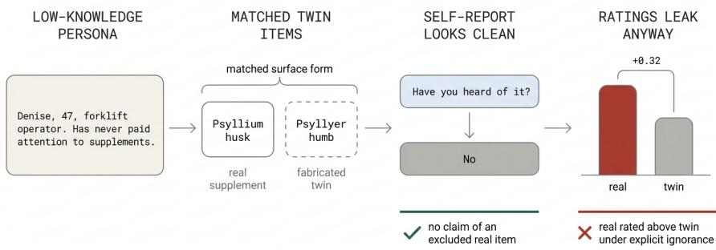
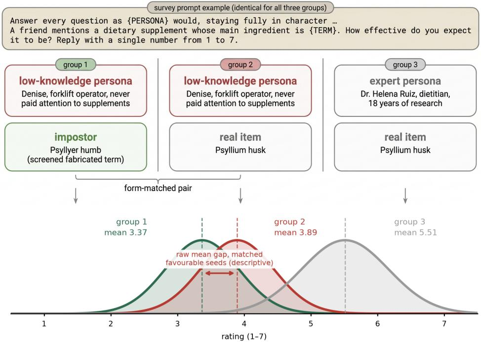

# Can LLMs Ignore What They Know? Measuring Knowledge Leakage in Persona-Based User Simulation

Sangmin Lee Sangwon Lee Sungbeom Choi Jeeseung Park Kibeom Myoung

Dalpha Inc.

{sangmin.lee, sangwon.lee, sungbeom.choi, jeeseung.park, kibeom.myoung}@dalpha.so

## Abstract

Ask a language model to play a thousand survey respondents and it will: one persona has never heard of your product, another uses it daily, and each answers your questionnaire in character. The catch is that every one of them is played by the same underlying model, which may hold item-specific knowledge the described persona could not have. When persona-conditioned responses are read as respondent-level simulations, each response should reflect the described persona’s knowledge, and the respondent written to know nothing must act as if the model’s knowledge were not there. We test whether it can, and find persistent favourable-item real–twin rating separation under the tested low-knowledge and explicit-ignorance prompts. We define the resulting problem (knowledge leakage: a response bias that arises when knowledge the real user could not have enters the simulated response) and present a methodology for measuring it quantitatively. The core instrument pairs real items with fabricated twins matched in surface form: screened fabricated variants designed to minimize prior item-specific knowledge. The paired difference therefore provides a diagnostic contrast for knowledge leakage even in rating tasks where no answer is correct, and it requires only black-box access. In a rating experiment across three knowledge-handling arms and five API endpoints from two model families, we find, first, that the personas we test do not fully suppress real-item existence and familiarity signals: a favourable-item real–twin rating contrast remains under an explicit in-context statement that the persona has never heard of the item. Second, the unfavourable-item contrast reverses sign across domain groups: pooling all unfavourable-content items across domains the contrast sits near zero (+0.077 [−0.057, +0.204]), yet the same estimator in the same conditions returns −0.359 where the rating scale asks about an item’s documented hazard and +0.438 where it asks about a company or an organisation. A pooled analysis of unfavourable-content items against zero therefore does not detect the opposing domain-group differences. All estimates are conditional on the adequacy of twin construction and screening; human low-knowledge baselines remain necessary for population-level interpretation.

## 1 Introduction

Conditioning a language model on a persona description and collecting its survey answers has moved from a curiosity to a practice: one model plays a thousand respondents at low cost, and a growing literature evaluates when such silicon samples track human ones [Argyle et al., 2023, Horton et al., 2023, Brand et al., 2024, Bail, 2024, Grossmann et al., 2023].

  
Figure 1: Overview. A low-knowledge persona (an excerpt from one of three profiles used for this domain) is shown an obscure real item and a fabricated twin matched in surface form (real pair from the study: Psyllium husk / Psyllyer humb). Told outright that it has never heard of the real item and asked whether it knows it, the persona says no: no claim of a tested real item in 96 questions at either of two endpoints (24 real items). In a separate rating experiment under the same explicit-ignorance condition, favourable real items are rated above their twins by +0.32, pooled over five endpoints and 88 favourable real–twin pairs.

Persona-conditioned rating is a simple form of user simulation: the model receives a user description and produces the response that user would give. The same failure mode could extend to interactive and agentic simulators, including task-oriented dialogue and τ-family benchmarks, whenever the simulated user should not know hidden database state or the correct task solution; leaked knowledge could make the user unnaturally cooperative and inflate measured agent performance [Yao et al., 2025, Seshadri et al., 2026].

The method rests on a premise that is rarely stated: each persona should answer from its own described knowledge. But every persona is played by the same model, which may hold documented facts about any item on the questionnaire, and nothing guarantees that knowledge stays out of a persona written not to have it. When facts the described user could not know move the simulated response, we call it knowledge leakage. Measuring it is harder than naming it. For subjective ratings there is no correct answer that would expose a contaminated one, and asking the persona whether it knows the item is circular: the answer is produced by the same simulation being audited, and a persona that leaks knowledge into ratings can also leak compliance into self-reports.

Our instrument breaks the circle with items designed to carry no stored knowledge. For each real item we fabricate twin candidates matched in surface form (same morphology and implied category), nonce terms with no evidence of prior existence, screened so that no study model claimed recognition in the pre-run screening pass. Real items whose twin candidates were all discarded enter no analysis, leaving 178 valenced items. The persona rates both; the twin is intended to absorb form cues, category priors, and response style while carrying no detectable item-specific knowledge. Under that matching assumption, a nonzero gap rejects the operational null that explicit ignorance makes real and matched-twin ratings behave alike. What this requires of the twin is stated and tested in §3. The paired contrast works where no standard validation exists: subjective ratings with no correct answer, no human reference, and only black-box access.

This paper makes two contributions. (A) A measurement method: the impostor-paired contrast (IPC), which reads a rating against the same persona’s rating of a fabricated item the models do not recognise. (B) Two components of the contrast: across five endpoints and every basis for ignorance the design can defend, the favourable-item contrast $d _ { \mathrm { p o s } }$ survives every restriction, and the unfavourable-item contrast $d _ { \mathrm { n e g } }$ changes sign across domain groups. Under the symmetry assumptions of §3, their half-sum $\cot { \frac { \varphi } { F } } = ( \dot { d } _ { \mathrm { p o s } } + \dot { d } _ { \mathrm { n e g } } ) / 2$ is the symmetric component and their half-difference $S = ( d _ { \mathrm { p o s } } - d _ { \mathrm { n e g } } ) / 2$ is the valence-sensitive component. Which dominates aligns with how directly the domain’s rating scale asks about the documented fact; because domain and question form vary together, this pattern is descriptive rather than causal. A pooled analysis against zero can miss both components.

Told outright that it has never heard of a real item, the persona never claims that one (0 of 96 questions at each of two endpoints, 24 items). The ratings do not: under explicit item-level ignorance, favourable real items are rated $d _ { \mathrm { p o s } } = + 0 . 3 2 4 \left[ + 0 . 2 4 3 , + 0 . 4 0 7 \right]$ above their favourable-seeded twins within the same arm, and the two gate-order arms under the self-report basis give +0.391 and +0.467. The unfavourable-item contrast is near zero pooled (+0.077) and splits by scale form: −0.359 where the scale asks about the documented hazard, +0.438 where it asks indirectly. Both signs hold in all three arms (§4).

§2 places the problem between silicon-sampling validation and work on parametric knowledge overriding instructed context, and traces the instrument to overclaiming scales and memorisation probes. §3 defines the paired contrast, the three knowledge-handling arms used to operationalize ignorance, and the decomposition into the two components. §4 reports the estimates: what the persona says about its own knowledge, what its ratings do under each basis for ignorance, and how the unfavourable-item result splits by what the rating scale asks. §5 draws out what this means for anyone reading persona ratings as survey responses, and what the design cannot settle.

## 2 Related Work

Silicon sampling and its validation. Conditioning a model on demographic or biographical context to simulate survey respondents was proposed as “silicon sampling” [Argyle et al., 2023], operationalised for replicating human-subject experiments [Aher et al., 2023], extended to economic agents and market research [Horton et al., 2023, Brand et al., 2024], and packaged into general social-simulation frameworks [Park et al., 2023]. Validation tempers the promise: simulated opinions are narrower than human ones and skew toward model defaults [Santurkar et al., 2023, Bisbee et al., 2024], alignment varies across subpopulations [Sun et al., 2024, Ma et al., 2026], persona formulation changes the output [Lutz et al., 2025], human response biases reproduce only selectively [Tjuatja et al., 2024], and persona surrogates can collapse the heterogeneity of the population they stand in for [Shi and Haupt, 2026]. Conceptual critiques warn against substituting model output for human evidence without validation [Lin, 2025]. Measured against real users, the external-validity gap is material: agent success shifts by up to 9 percentage points with the simulator choice, with systematic miscalibration across task difficulty and populations [Seshadri et al., 2026]. That line measures whether simulated behaviour matches human behaviour, not where a mismatched answer comes from; knowledge leakage is one unmeasured source.

Knowledge conflict and prior-belief intrusion. Parametric knowledge intrudes on instructed context: models answer from memory against the prompt [Zhou et al., 2023] and vary in receptivity to counter-parametric evidence [Xie et al., 2024, Wang et al., 2024]; self-knowledge benchmarks target the model’s own knowledge rather than a role-played character’s [Laine et al., 2024]. Prior beliefs bias LLM-as-judge evaluations [Zahraei et al., 2026], models presuppose facts about entities rather than verify their existence [Jung and Gonen, 2026], and answerability studies show they often fail to flag what cannot be answered [Slobodkin et al., 2023, Yin et al., 2023]. Closest to our question, role-play studies document knowledge-boundary violations directly: characters reveal knowledge beyond their point-in-time [Ahn et al., 2024], parametric knowledge pushes characters outside their scope [Sadeq et al., 2024], Bhat et al. [2025] validate whether persona agents correctly report and delimit their knowledge, and persona-assigned models act on associations their explicit statements deny [Gupta et al., 2024]. Together, these studies show that retained knowledge or dispositions can conflict with task- or persona-specified boundaries. Several of these works evaluate knowledgeboundary violations with verifiable answers or self-reports; prior-belief-intrusion work also studies subjective judgments. IPC focuses specifically on persona-conditioned real–twin rating contrasts under operationalized ignorance.

Instrument lineage. The fabricated-twin design borrows from two traditions. Psychometrics uses overclaiming: seeding real knowledge items with plausible foils and reading the foil endorsement rate as a measure of knowledge exaggeration [Paulhus et al., 2003, Atir et al., 2015]. Related machine-learning work measures training-data extraction and memorisation [Carlini et al., 2021, 2023], evaluates unlearning on fictitious [Maini et al., 2024] and real content [Eldan and Russinovich,

2023], and traces benchmark contamination via guided completion or rephrased samples [Golchin and Surdeanu, 2024, Yang et al., 2023]. We combine the two: foils built using surface-matching criteria, screened against the study models themselves, used not to score a respondent but to give subjective ratings the baseline they otherwise lack.

## 3 Method

Concept: items screened to carry no detectable stored knowledge. For each real survey item we generate fabricated-twin candidates: screened nonce terms matched in morphology and implied category, with no evidence of prior existence. The 178 valenced real items that retained a screened twin form the analysed battery; the rest were dropped before any rating was collected. The same persona rates both under the same instructions (Figure 2). A rating of a twin can contain everything about the persona’s response style and the item’s surface form, but no item-specific knowledge that survived screening. The impostor-paired contrast (IPC) is the real-item rating minus the paired twin rating; $d _ { \mathrm { p o s } }$ and $d _ { \mathrm { n e g } }$ denote its mean over items whose documented facts are favourable and unfavourable respectively; both are raw rating-point differences on the 1–7 scale, not standardized effects. A nonzero contrast under a persona written to know nothing rejects the operational null that explicit ignorance makes real and matched-twin ratings behave alike, conditional on the twin being a fair stand-in and on the screening having worked. It is a diagnostic of incomplete suppression, not a unique separation of stored knowledge from residual form-based inference. Without a human comparison it does not say how far the ratings are from what real respondents would give.

  
Figure 2: The three comparison groups. All groups receive the identical prompt template; conditions differ only in what fills the PERSONA and TERM slots (real study materials shown: persona excerpts and the pair Psyllium husk / Psyllyer humb, labelled impostor in the panel after the contrast that names it). The displayed group means are 3.37 for the low-knowledge persona on the fabricated twin, 3.89 for the same persona on the real item, and 5.51 for the expert persona permitted to use its knowledge. All three use the same 88 favourable seeds and their twins in the arm where the knowledge gate follows the rating (parse-ok); the low-knowledge real–twin comparison uses all parse-ok trials, unlike the gate-“no” subset in Table 1 (+0.467) and the primary explicit-ignorance contrast (+0.324). This panel illustrates the design, not the primary estimate. Curves are schematic; only the means are measured.

Decomposition. A positive IPC alone does not say what leaked. The persona could be responding to mere familiarity (the item reads as a real thing), or to content (what the item’s documented facts say). To separate them, real items are split by whether their documented facts are favourable or unfavourable. Real items of both valence classes enter every arm, and a subsequent collection added unfavourable-seeded twins to the three ignorance arms so that both contrasts rest on comparable item sets (88 favourable and 90 unfavourable paired seeds in each). If familiarity contributes equally to both item classes while content points in opposite directions, the two contrasts separate into channels,

$$
F = ( d _ { \mathrm { p o s } } + d _ { \mathrm { n e g } } ) / 2 ,\tag{1}
$$

$$
S = ( d _ { \mathrm { p o s } } - d _ { \mathrm { n e g } } ) / 2 ,\tag{2}
$$

where $F$ is the symmetric component and $S$ is the valence-sensitive component. Under the assumptions above, they correspond respectively to what survives regardless of what the facts say and what tracks their direction. §4 reports $d _ { \mathrm { p o s } }$ and $d _ { \mathrm { n e g } }$ with this decomposition; the split assumes the content effect has equal magnitude on both item classes.

Worked example. For household chemicals under explicit ignorance, Table 1 gives $d _ { \mathrm { p o s } } = + 0 . 2 8 5$ and $d _ { \mathrm { n e g } } = - 0 .$ 565 rating points. Thus $F = ( 0 . 2 8 \dot { 5 } - 0 . \dot { 5 } 6 5 ) / 2 = - 0 . 1 4 \bar { 0 }$ and $\dot { S } = ( 0 . 2 8 5 +$ $0 . 5 6 5 ) / \breve { 2 } = + 0 . 4 2 5$ . The observed favourable and unfavourable contrasts have opposite signs; $S$ is the larger algebraic component in magnitude. Interpreting these components as distinct mechanisms additionally requires the symmetry and additivity assumptions above.

Stimuli and screening. Real items are obscure but verifiable terms in six survey domains (supplements, skincare, food additives, household chemicals, brands, civic organisations), valence-coded from fixed reference sources before any model response was collected. The experiment draws up to 16 favourable and 16 unfavourable items per domain from a larger valence-coded source bank, which was itself screened with model outputs for obscurity; items whose twin candidates were all discarded in screening leave fewer in some domains, giving the 88 and 90 analysed. Twins were generated outside the evaluated families (a cross-family LLM plus an algorithmic nonword resampler) and screened three ways before use: character-gram, token-count, and surprisal checks intended to reduce surface-form differences; an adversarial realness probe; and discarding variants that any study model claimed to recognise. Matching was imperfect: stored whole-bank token-count discrimination exceeded its target (Appendix A). Construction metadata also records finite exact-phrase attestation checks; neither these checks nor non-recognition establish that a string never existed. The screening models are the study models, so the probe’s false-alarm rate is conditional on this selection. The result is not concentrated among the least plausible retained twins $( d _ { \mathrm { p o s } } + 0 . 2 9 0 { \mathrm { t o } } + 0 . 6 9 9$ across plausibility quartiles), and twins retain a no-persona seed-valence gap (+0.791). This gap suggests that surface form can retain valence cues; it does not determine the direction of bias in the primary explicit-ignorance contrast.

Conditions, scale, and inference. Two conditions establish that the persona does not know the particular item: self-reported non-recognition (the gate answer) and explicit item-level ignorance (a context sentence naming the item). The rating experiment crosses five endpoints (two providers), five persona-condition slots per domain (three low-knowledge profiles, one expert profile, and a no-persona control), three knowledge-handling arms (a familiarity gate before the rating; the same gate after the rating; an in-context sentence stating the person has never heard of the specific item), and six domains; it additionally includes two instruction and two question phrasings in a partially populated design, with scale direction randomised within cells rather than fully crossed, for 145,560 trials over 404 distinct items. The explicit-ignorance arm runs only under the low-knowledge profile slots. The item is the unit of information, since trials of one item agree far more than trials of different items: each contrast averages the available per-(seed, endpoint) real–twin differences. The primary explicit-ignorance slice has all 88 favourable seeds at each endpoint and hence equal endpoint weight; gate-filtered slices may have unequal coverage. Confidence intervals are bootstraps clustered on the real-item seed, keeping each real–twin pair together (10,000 resamples). Intervals quantify item-sampling uncertainty conditional on the tested endpoints, personas, and wordings. The primary estimand is the same-arm $d _ { \mathrm { p o s } }$ under explicit ignorance; domain, matching, and restriction analyses are exploratory. The result is not an averaging artefact: the trial-level superiority margin $P ( \dot { Y _ { \mathrm { r e a l } } } > Y _ { \mathrm { t w i n } } ) - P ( \dot { Y } _ { \mathrm { r e a l } } < Y _ { \mathrm { t w i n } } )$ , ties contributing to neither term, is +0.176 [+0.133, +0.220] in the same-arm slice.

Table 1: Main results. Real-minus-twin rating contrast on the 1–7 scale, favourable-content and unfavourable-content real items separately, with 95% bootstrap intervals clustered on the real-item seed. Each row in the upper block establishes that the persona does not know the particular item, by keeping only the trials in which it says no, applied to real and twin responses separately, or by writing the ignorance into the prompt. The lower block splits the primary condition by domain, ordered by how directly the rating scale asks about the item’s documented facts: $d _ { \mathrm { n e g } }$ runs from −0.565 where the scale asks about a documented hazard to +0.631 where it asks about purchase intent, which is why the pooled value is near zero. Positive values mean the real item was rated above its fabricated twin. The three ignorance-condition rows use all 88 favourable and 90 unfavourable paired seeds; each domain row uses the 10–16 paired seeds of that valence available within the domain.
<table><tr><td></td><td> $d _ { \mathrm { p o s } } ( 8 8 \mathrm { i t e m s } )$ </td><td></td><td> $d _ { \mathrm { n e g } }$  (90 items)</td></tr><tr><td colspan="4">Basis for treating the persona as ignorant</td></tr><tr><td>Explicit “never heard of it&quot; sentence (primary)</td><td>+0.324 [+0.243, +0.407]</td><td></td><td>+0.077 [-0.057, +0.204]</td></tr><tr><td>Gate before rating, “no”trials only</td><td>+0.391 [+0.305, +0.479]</td><td></td><td>+0.093 [-0.066, +0.249]</td></tr><tr><td>Gate after rating, “no&quot; trials only</td><td>+0.467 [+0.361, +0.576]</td><td>+0.096</td><td>[-0.062, +0.246]</td></tr><tr><td colspan="4">By domain, under the explicit sentence</td></tr><tr><td>household chemicals</td><td>+0.285 [+0.102, +0.512]</td><td></td><td>-0.565 [-0.956, -0.247]</td></tr><tr><td>food additives</td><td>+0.505 [+0.323, +0.682]</td><td>-0.153</td><td>[−0.463, +0.136]</td></tr><tr><td>skincare</td><td>+0.315 [+0.060, +0.556]</td><td>+0.162</td><td>[-0.080, +0.388</td></tr><tr><td>supplements</td><td>+0.328 [+0.143, +0.522]</td><td></td><td>+0.184 [+0.036, +0.346]</td></tr><tr><td>brands</td><td>+0.505 [+0.306, +0.715]</td><td></td><td>+0.631 [+0.410, +0.853]</td></tr><tr><td>civic organisations</td><td>+0.052 [+0.019, +0.092]</td><td></td><td>+0.244 [+0.076, +0.449</td></tr></table>

Table 2: The primary estimate split by serving endpoint and by low-knowledge profile slot (same-arm pairs under explicit item-level ignorance, 88 favourable seed pairs in every row, seed-clustered bootstrap). Every row is positive with an interval excluding zero. The endpoint estimates span a factor of two, so the pooled +0.324 is not one model’s behaviour, and the three A1–A3 profile slots, each instantiated separately in all six domains, agree to within 0.07 rating points.
<table><tr><td>Slice</td><td colspan="2"> $d _ { \mathrm { p o s } }$  [95% CI]</td></tr><tr><td>By serving endpoint</td><td></td><td></td></tr><tr><td>gemini-3.5-flash</td><td></td><td>+0.407 [+0.269, +0.551]</td></tr><tr><td>gemini-3.5-flash-lite</td><td></td><td>+0.348 [+0.225, +0.473]</td></tr><tr><td>gpt-5.6-luna</td><td>+0.188</td><td>[+0.102, +0.273]</td></tr><tr><td>gpt-5.6-sol</td><td>+0.289</td><td>[+0.194, +0.385]</td></tr><tr><td>gpt-5.6-terra</td><td>+0.388</td><td>[+0.285, +0.492]</td></tr><tr><td>By low-knowledge profile slot</td><td></td><td></td></tr><tr><td>slot A1</td><td></td><td>+0.364 [+0.272, +0.462]</td></tr><tr><td>slot A2</td><td></td><td>+0.295 [+0.206, +0.384]</td></tr><tr><td>slot A3</td><td></td><td>+0.313 [+0.232, +0.400]</td></tr></table>

## 4 Results

## 4.1 Self-report says the persona complies

Told in context that it has never heard of a given real item and asked whether it knows it, the persona never claims to: across 24 items, in 96 questions at each of two endpoints, not one claim (rule-based classification confirmed by a second automated pass). A low-knowledge profile alone does not make every item unknown: in the rating experiment, low-knowledge personas asked the gate claim to recognise 14.3% of favourable real items and 4.9% of unfavourable ones, against 0.0% of their twins. Those trials are not cases of a persona rating an item it should not know, so the gate-based estimates exclude them. Self-report, taken alone, says the persona filter works. The rest of this section shows the ratings say otherwise in the same condition: self-report and behaviour disagree, so asking the persona is not a sufficient check.

Table 3: Both contrasts per endpoint under explicit item-level ignorance (same-arm pairs, parse-ok; seed-clustered bootstrap). The $d _ { \mathrm { p o s } }$ column repeats Table 2; $d _ { \mathrm { n e g } }$ is given here because it varies in sign across endpoints, each pooling domains whose scales differ in how directly they ask about the item’s facts (§4).
<table><tr><td>Model</td><td> $d _ { \mathrm { p o s } }$  [95% CI]</td><td></td><td> $d _ { \mathrm { n e g } } \ [ 9 5 \% \mathrm { C I } ]$ </td></tr><tr><td>gpt-5.6-sol</td><td></td><td>+0.289 [+0.194, +0.385]</td><td> $+ 0 . 1 0 2 \left[ - 0 . 0 5 5 , + 0 . 2 6 2 \right]$ </td></tr><tr><td>gpt-5.6-terra</td><td>+0.388 [</td><td>[+0.285, +0.492]</td><td>-0.054  $\bar { \lceil - 0 . 2 2 8 , + 0 . 1 1 5 \rceil }$ </td></tr><tr><td>gpt-5.6-luna</td><td>+0.188</td><td>[+0.102, +0.273] -0.057</td><td> $\left[ - 0 . 2 0 0 , + 0 . 0 8 1 \right]$ </td></tr><tr><td>gemini-3.5-flash</td><td>+0.407 [+0.269, +0.551]</td><td></td><td>+0.253  $\mathsf { \Pi } [ + 0 . 0 9 0 , + 0 . 4 1 0 ]$ </td></tr><tr><td>gemini-3.5-flash-lite</td><td></td><td>+0.348 [+0.225, +0.473]</td><td>+0.141  $\left[ - 0 . 0 2 8 , + 0 . 3 0 3 \right]$ </td></tr></table>

## 4.2 Explicit non-recognition does not eliminate real–twin rating separation

Our primary estimand is the same-arm contrast under explicit item-level ignorance: $d _ { \mathrm { p o s } } = + 0 . 3 2 4$ $[ + 0 . 2 4 3 , + 0 . 4 0 7 ]$ over 88 favourable seed pairs, five endpoints, and three low-knowledge profile slots per domain (18 domain-specific profiles in total), with real and twin both rated inside the arm stating the person has never heard of the item. Within the explicit arm the contrast is positive with an interval excluding zero at each of the five endpoints and each of the A1–A3 profile slots separately (Table 2); the endpoint estimates range from $+ 0 . 1 8 8 ~ \mathrm { t o } ~ + 0 . 4 0 7$ . It is not carried by a few items either: 72 of the 88 favourable items are rated above their own twin, the median item difference is +0.228, and dropping the ten largest items leaves +0.229.

## 4.3 Self-reported non-recognition does not eliminate the contrast

The contrast survives both operational bases for item-level ignorance (Table 1): +0.430 restricted to $\mathrm { g a t e ^ { - } n o ^ { \prime } }$ trials (the two gate-order conditions pooled; separately +0.391 when the gate precedes the rating and +0.467 when it follows), and +0.324 within the explicit arm. In a separate two-endpoint extension, no tested real item was claimed under explicit exclusion (§4); independently, the fiveendpoint rating experiment retains this same-arm contrast. What survives explicit exclusion is a rating contrast consistent with residual familiarity or item-knowledge influence, not stated knowledge.

## 4.4 The unfavourable-item null hides two components

Pooling all unfavourable-content items across domains, the unfavourable-item contrast sits near zero in all three arms $\left( + 0 . 0 7 7 \left[ - 0 . 0 5 7 , + 0 . 2 0 4 \right] \right.$ under explicit ignorance; Table 1). Read at face value this would say the knowledge leakage is confined to favourable content. It does not.

The sign of the observed contrast aligns with how directly the rating scale asks about the documented fact. How safe is thisfor use around the home asks about the hazard directly; how likely are you to buy from this company does not, and the comparison is against a name that denotes no company at all. Splitting the domains on that property, the same estimator in the same condition returns −0.359 $[ - 0 . { \bar { 6 1 } } 3 , - { \bar { 0 } } . 1 2 5 ]$ where the scale asks about the fact and $+ 0 . 4 3 8 \ [ + 0 . 2 8 5 , + 0 . 5 9 9 ]$ where it asks indirectly, both intervals excluding zero. The unfavourable items are not immune; they are rated below their twins where the scale can register the hazard. This grouping was defined after observing the pooled null and is exploratory; domain, item identity, and question form vary together, so the design does not identify which factor causes the reversal.

In the decomposition of §3 the two groups separate. Among domains that ask about the fact the antisymmetric component carries the effect $( S \bar { = } + 0 . 3 7 7 \ : [ + 0 . \bar { 2 } 4 3 , + 0 . 5 2 1 ] )$ and the symmetric one covers zero $( F = \bar { + } 0 . 0 1 8 \ : [ - 0 . 1 2 7 , + 0 . 1 5 5 ] )$ ; among domains that ask indirectly the reverse holds $( F = + 0 . 3 4 2 \ : [ + 0 . 2 4 6 , + 0 . 4 4 4 ] , S = - 0 . 0 \dot { 9 } 6 \ : [ - 0 . 1 9 7 , + 0 . 0 0 5 ] )$ ; Table 4 gives the split per domain. The pattern is the same in all three arms (Table 5), and the partly-measuring domains fall between; the sign reversal itself does not depend on the decomposition. The reversal is also not an artefact of one elicitation form: it holds across both wording bundles and both scale directions, and $d _ { \mathrm { n e g } }$ changes sign by endpoint as well (Table 3).

Table 4: The two algebraic components by domain under explicit item-level ignorance, computed from Table 1 as $F \overset {  } { = } ( d _ { \mathrm { p o s } } + d _ { \mathrm { n e g } } ^ { \top } ) / 2$ and $S = ( d _ { \mathrm { p o s } } - d _ { \mathrm { n e g } } \bar { ) } / 2$ , ordered by how directly the scale asks about the item’s documented facts. Which component dominates flips along that ordering; the mechanism interpretation rests on the symmetry assumption of §3, the sign reversal does not.
<table><tr><td>Domain</td><td>F (symmetric)</td><td>S (valence-sensitive)</td></tr><tr><td>household chemicals</td><td>-0.140</td><td>+0.425</td></tr><tr><td>food additives</td><td>+0.176</td><td>+0.329</td></tr><tr><td>skincare</td><td>+0.238</td><td>+0.077</td></tr><tr><td>supplements</td><td>+0.256</td><td>+0.072</td></tr><tr><td>brands</td><td>+0.568</td><td>-0.063</td></tr><tr><td>civic organisations</td><td>+0.148</td><td>-0.096</td></tr></table>

Table 5: $d _ { \mathrm { n e g } }$ split by how directly the rating scale asks about the item’s documented facts, in each arm (32 unfavourable seeds per group; household chemicals and food additives against brands and civic organisations). The sign is negative on direct scales and positive on indirect scales in all three arms.
<table><tr><td>Arm</td><td>direct-scale domains</td><td>indirect-scale domains</td></tr><tr><td>explicit sentence</td><td>-0.359</td><td>+0.438</td></tr><tr><td>gate before, “no” only</td><td>-0.504</td><td>+0.638</td></tr><tr><td>gate after, “no” only</td><td>-0.443</td><td>+0.631</td></tr></table>

## 5 Discussion and Conclusion

What this means for synthetic surveys. A pooled check cannot see this failure. In our domain split, whether a rating moves with an item’s documented facts varies with what the question asks, so averaging over question types hides both directions at once, and a validation that compares pooled marginals against a human reference can pass while the bias is present. The audit we suggest is the instrument itself: seed the questionnaire with screened twins and read the real–twin gap per question type rather than pooled. It needs no human panel when used as a model-internal diagnostic and no access beyond the API the survey already uses; population-level validation still requires human comparison.

Conclusion. We asked whether a persona written to know nothing about an item can rate it as if that were true, and measured it with the impostor-paired contrast: a rating read against the same persona’s rating of a fabricated twin matched in surface form and screened so that no study model claims to recognise it. Across 145,560 rating trials from five endpoints on six survey domains, across three knowledge-handling conditions used to operationalize ignorance, the answer under this diagnostic is no: the tested prompts do not fully eliminate real–twin rating separation. Favourable real items are rated above their twins by +0.324 [+0.243, +0.407] when the ignorance is written into the prompt, and by +0.391 and +0.467 when it rests on the persona’s own denial; the effect is spread across items rather than carried by a few, and holds at every endpoint and in each of the three low-knowledge profile slots. The unfavourable-item contrast is near zero pooled, but that null combines domain-group contrasts of opposite sign: −0.359 where the scale asks about a documented hazard and +0.438 where it asks indirectly. In the separate 24-item, two-endpoint recognition extension, explicit ignorance elicited no recognition claims. Taken alongside the rating experiment, this shows why self-report alone is not a sufficient diagnostic.

## 6 Limitations

The following limits bound what this shows. We never measure a genuinely low-knowledge human, so these are divergences from the researcher’s specification rather than from a real population; an expert persona free to use its knowledge separates favourable from unfavourable items by at least 2.8 rating points, so the scale can resolve an effect several times larger than the one we report, but without a human baseline the direction of the resulting survey bias is not identified. Screening uses the study models themselves, so every estimate is conditional on that selection: it removes twins the models admit recognising but not those they deny, and held-out or cross-fitted screening would avoid the resulting dependence; a single twin per item also leaves individual pairs exposed to whatever that one string happens to carry. Real and fabricated strings differ lexically, so part of the contrast may be inference from item form rather than knowledge of the item, and we did not design a test that separates them. What the contrast does establish is narrower and, we think, sufficient for the practical claim: within these six domains and five endpoints, instructing a persona not to know something does not make its ratings behave as though it did not. The five tested endpoints are commercial APIs from two providers; the results do not establish generality to open-weight models or other model families. Multiple independent twins per item, held-out screening, low-knowledge human calibration, and a within-item manipulation of question form would address complementary validity questions; none is included in this study.

## Acknowledgments and Disclosure of Funding

All authors are affiliated with Dalpha Inc. The authors have no additional funding or competing interests to disclose.

## References

Gati Aher, Rosa I. Arriaga, and Adam Tauman Kalai. Using large language models to simulate multiple humans and replicate human subject studies. In ICML, 2023. arXiv:2208.10264.

Jaewoo Ahn, Taehyun Lee, Junyoung Lim, Jin-Hwa Kim, Sangdoo Yun, Hwaran Lee, and Gunhee Kim. Timechara: Evaluating point-in-time character hallucination of role-playing large language models. In Findings ofACL, 2024. pages 3291–3325.

Lisa P. Argyle, Ethan C. Busby, Nancy Fulda, Joshua R. Gubler, Christopher Rytting, and David Wingate. Out of one, many: Using language models to simulate human samples. Political Analysis, 31(3):337–351, 2023. doi: 10.1017/pan.2023.2.

Stav Atir, Emily Rosenzweig, and David Dunning. When knowledge knows no bounds: Selfperceived expertise predicts claims of impossible knowledge. Psychological Science, 26(8): 1295–1303, 2015. doi: 10.1177/0956797615588195.

Christopher A. Bail. Can generative AI improve social science? Proceedings of the National Academy ofSciences, 121(21), 2024. doi: 10.1073/pnas.2314021121.

Savita Bhat, Ishaan Shukla, and Shirish Karande. Know thyself: Validating knowledge awareness of LLM-based persona agents. In Proceedings of the 5th Workshop on Trustworthy NLP (TrustNLP), 2025.

James Bisbee, Joshua D. Clinton, Cassy Dorff, Brenton Kenkel, and Jennifer M. Larson. Synthetic replacements for human survey data? the perils of large language models. Political Analysis, 32 (4):401–416, 2024. doi: 10.1017/pan.2024.5.

James Brand, Ayelet Israeli, and Donald Ngwe. Using GPT for market research. In Proceedings of the 25th ACM Conference on Economics and Computation, pages 613–613, 2024. doi: 10.1145/ 3670865.3673479.

Nicholas Carlini, Florian Tramer, Eric Wallace, Matthew Jagielski, Ariel Herbert-Voss, Katherine Lee, Adam Roberts, Tom Brown, Dawn Song, Ulfar Erlingsson, Alina Oprea, and Colin Raffel. Extracting training data from large language models. In USENIX Security Symposium, 2021. arXiv:2012.07805.

Nicholas Carlini, Daphne Ippolito, Matthew Jagielski, Katherine Lee, Florian Tramer, and Chiyuan Zhang. Quantifying memorization across neural language models. In ICLR, 2023. arXiv:2202.07646.

Ronen Eldan and Mark Russinovich. Who’s harry potter? approximate unlearning in LLMs. arXiv preprint arXiv:2310.02238, 2023.

Shahriar Golchin and Mihai Surdeanu. Time travel in LLMs: Tracing data contamination in large language models. In ICLR, 2024. arXiv:2308.08493.

Igor Grossmann, Matthew Feinberg, Dawn C. Parker, Nicholas A. Christakis, Philip E. Tetlock, and William A. Cunningham. AI and the transformation of social science research. Science, 380(6650): 1108–1109, 2023. doi: 10.1126/science.adi1778.

Shashank Gupta, Vaishnavi Shrivastava, Ameet Deshpande, Ashwin Kalyan, Peter Clark, Ashish Sabharwal, and Tushar Khot. Bias runs deep: Implicit reasoning biases in persona-assigned LLMs. In ICLR, 2024.

John J. Horton, Apostolos Filippas, and Benjamin S. Manning. Large language models as simulated economic agents: What can we learn from homo silicus? arXiv preprint arXiv:2301.07543, 2023.

Haeji Jung and Hila Gonen. Phantombench: Benchmarking the non-existential threat of language models. arXiv preprint arXiv:2606.11105, 2026.

Rudolf Laine, Bilal Chughtai, Jan Betley, Kaivalya Hariharan, Jeremy Scheurer, Mikita Balesni, Marius Hobbhahn, Alexander Meinke, and Owain Evans. Me, myself, and AI: The situational awareness dataset (SAD) for LLMs. In NeurIPS Datasets and Benchmarks Track, 2024. arXiv:2407.04694.

Zhicheng Lin. Six fallacies in substituting large language models for human participants. Advances in Methods and Practices in Psychological Science, 2025. arXiv:2402.04470.

Marlene Lutz, Indira Sen, Georg Ahnert, Elisa Rogers, and Markus Strohmaier. The prompt makes the person(a): A systematic evaluation of sociodemographic persona prompting for large language models. arXiv preprint arXiv:2507.16076, 2025.

Xiangyu Ma, Mengmi Zhang, Shannon Ang, and Minne Chen. Tastes without distinction: silicon samples and the synthetic construction of tastes. arXiv preprint arXiv:2606.30085, 2026.

Pratyush Maini, Zhili Feng, Avi Schwarzschild, Zachary C. Lipton, and J. Zico Kolter. TOFU: A task of fictitious unlearning for LLMs. In COLM, 2024. arXiv:2401.06121.

Joon Sung Park, Joseph O’Brien, Carrie Jun Cai, Meredith Ringel Morris, Percy Liang, and Michael S. Bernstein. Generative agents: Interactive simulacra of human behavior. In Proceedings of the 36th Annual ACM Symposium on User Interface Software and Technology, pages 1–22, 2023. doi: 10.1145/3586183.3606763.

Delroy L. Paulhus, P. D. Harms, M. Nadine Bruce, and Daria C. Lysy. The over-claiming technique: Measuring self-enhancement independent of ability. Journal of Personality and Social Psychology, 84(4):890–904, 2003. doi: 10.1037/0022-3514.84.4.890.

Nafis Sadeq, Zhouhang Xie, Byungkyu Kang, Prarit Lamba, Xiang Gao, and Julian McAuley. Mitigating hallucination in fictional character role-play. In Findings of EMNLP, 2024. pages 14467–14479.

Shibani Santurkar, Esin Durmus, Faisal Ladhak, Cinoo Lee, Percy Liang, and Tatsunori Hashimoto. Whose opinions do language models reflect? In ICML, 2023. arXiv:2303.17548.

Preethi Seshadri, Samuel Cahyawijaya, Ayomide Odumakinde, Sameer Singh, and Seraphina Goldfarb-Tarrant. Lost in simulation: LLM-simulated users are unreliable proxies for human users in agentic evaluations. In ACL, 2026. arXiv:2601.17087.

Yuanming Shi and Andreas Haupt. The collapse of heterogeneity in silicon philosophers. arXiv preprint arXiv:2604.23575, 2026.

Aviv Slobodkin, Omer Goldman, Avi Caciularu, Ido Dagan, and Shauli Ravfogel. The curious case of hallucinatory (un)answerability: Finding truths in the hidden states of over-confident large language models. In EMNLP, 2023. arXiv:2310.11877.

Seungjong Sun, Eungu Lee, Dongyan Nan, Xiangying Zhao, Wonbyung Lee, Bernard J. Jansen, and Jang Hyun Kim. Random silicon sampling: Simulating human sub-population opinion using a large language model based on group-level demographic information. arXiv preprint arXiv:2402.18144, 2024.

Lindia Tjuatja, Valerie Chen, Tongshuang Wu, Ameet Talwalkwar, and Graham Neubig. Do LLMs exhibit human-like response biases? a case study in survey design. Transactions ofthe Association for Computational Linguistics, 12:1011–1026, 2024. doi: 10.1162/tacl\_a\_00685.

Yike Wang, Shangbin Feng, Heng Wang, Weijia Shi, Vidhisha Balachandran, Tianxing He, and Yulia Tsvetkov. Resolving knowledge conflicts in large language models. In COLM, 2024. arXiv:2310.00935.

Jian Xie, Kai Zhang, Jiangjie Chen, Renze Lou, and Yu Su. Adaptive chameleon or stubborn sloth: Revealing the behavior of large language models in knowledge conflicts. In ICLR, 2024. arXiv:2305.13300.

Shuo Yang, Wei-Lin Chiang, Lianmin Zheng, Joseph E. Gonzalez, and Ion Stoica. Rethinking benchmark and contamination for language models with rephrased samples. arXiv preprint arXiv:2311.04850, 2023.

Shunyu Yao, Noah Shinn, Pedram Razavi, and Karthik Narasimhan. τ-bench: A benchmark for tool-agent-user interaction in real-world domains. In International Conference on Learning Representations, 2025. URL https://openreview.net/forum?id=roNSXZpUDN.

Zhangyue Yin, Qiushi Sun, Qipeng Guo, Jiawen Wu, Xipeng Qiu, and Xuanjing Huang. Do large language models know what they don’t know? In Findings ofACL, 2023. arXiv:2305.18153.

Pardis Sadat Zahraei, Xiaoning Wang, Nimet Beyza Bozdag, Gokhan Tur, and Dilek Hakkani-Tür. Prior beliefs prejudice LLM-as-judge: Evidence from persuasion evaluation. In Findings ofthe Associationfor Computational Linguistics: ACL 2026, 2026.

Wenxuan Zhou, Sheng Zhang, Hoifung Poon, and Muhao Chen. Context-faithful prompting for large language models. In Findings of EMNLP, 2023. arXiv:2303.11315.

## A Design of the Rating Experiment

Items. The battery holds 404 items: 178 valenced real items, their 178 screened twins, and 48 filler items, which appear only in the two gate arms and enter no estimate.

Estimator algebra. Taking IPC separately on favourable- and unfavourable-content items,

$$
d _ { \mathrm { p o s } } = \alpha f ^ { + } + \beta s ^ { + } , d _ { \mathrm { n e g } } = \alpha f ^ { - } + \beta s ^ { - } .\tag{3}
$$

Under additivity, coefficients $( \alpha , \beta )$ common to both valence groups, symmetric familiarity $( f ^ { + } =$ $f ^ { - } = f )$ , and content of equal magnitude and opposite sign $( s ^ { + } = - s ^ { - } = s )$ , the observed components defined in $\ S 3$ recover the two channels: $F = ( d _ { \mathrm { p o s } } ^ { - } + d _ { \mathrm { n e g } } ) / 2 = \alpha f$ and $S = ( d _ { \mathrm { p o s } } -$ $d _ { \mathrm { n e g } } ) / 2 = \beta s$ . Scale nonlinearity, asymmetric content magnitude, or a familiarity–content interaction breaks the separation, so the channel magnitudes are conditional on these assumptions. What does not depend on them is the sign of $d _ { \mathrm { n e g } }$ itself, which is a direct contrast rather than a derived quantity.

Persona conditions. Each of the six domains has three low-knowledge profiles (A1–A3) describing distinct occupations, education levels, and interests, for 18 domain-specific low-knowledge profiles in total. Each domain also has one expert profile (B; six total) and a no-persona condition (C). All profiles are researcher-authored and correspond to no real individuals.

Conditions. The gate-before condition asks the knowledge gate before the rating; the gate-after condition asks it afterwards; the explicit condition writes item-level ignorance into the profile.

Scale and counterbalancing. Seven-point scales presented in both directions, with reverseddirection responses mapped back before analysis. The two paraphrase axes are not fully crossed: one of the four wording cells is empty, so paraphrase enters as a nuisance factor rather than an estimable one.

Inference. Confidence intervals are bootstraps over item clusters with 10,000 resamples, because items repeat across trials while trials within an item are not independent.

Expert-condition rating ranges. Under the expert profile, per-endpoint mean ratings run 5.312 to 5.714 on favourable items and 2.031 to 2.494 on unfavourable ones, a separation of at least 2.8 rating points across these endpoint ranges.

Screening accounting. The stimulus bank generated 1,158 candidate twins. Screening discarded 697 because at least one study model claimed to recognise the string in a pre-run recognition pass; 461 survived, and the run drew its 178 twins from that pool. Adversarial realness scores informed construction, but the stored selected twins do not uniformly minimize those scores among the recorded surviving candidates.

Screening records and matching limits. The stored construction metadata reports exact-phrase checks against Wikipedia, Wikidata, and OpenAlex on 12 August 2026. These are finite attestation checks, not an exhaustive proof of nonexistence; the retained-twin recognition filter uses the study endpoints themselves. Whole-bank metadata reports character-gram AUROC values of 0.471–0.620 across domains and token-count AUROC values of 0.602 for the OpenAI tokenizer proxy and 0.646 for Gemini, both exceeding the stated token-count target of < 0.60. These bank-level summaries were not recomputed for the 178 analysed pairs and do not establish equivalent matching quality in that subset. Residual lexical differences remain a limitation.

Valence coding. Each real item carries a documented fact that makes its record favourable or unfavourable, together with the reference page it was read from (Wikipedia or Wikidata plus regulatory or news sources). Items whose documented record was mixed or contested were not admitted to either tier. The coding is single-coder.

Trial counts and call parameters. Repeats are 2 question paraphrases × 3 draws = 6 per cell at temperature 1.0, doubled for a small set of twins collected twice and averaged before pairing (max tokens 16 for ratings, 200 for free-form; tools and grounding disabled; one resample on parse failure); the model strings are the literal API identifiers reported throughout.

Table 6: Rating-experiment design accounting. The two gate-order conditions were run across five persona-condition slots per domain with unequal trial counts per slot; the explicit condition used the three low-knowledge slots at equal size.
<table><tr><td>Condition</td><td>Slots/domain</td><td>Trials/slot*</td><td>Trials</td></tr><tr><td>gate, then rating</td><td>5</td><td>9,660–12,360</td><td>56,400</td></tr><tr><td>rating, then gate</td><td>5</td><td>9,660-12,360</td><td>56,400</td></tr><tr><td>item-level ignorance</td><td>3</td><td>10,920</td><td>32,760</td></tr><tr><td>Total</td><td></td><td></td><td>145,560</td></tr></table>

∗Aggregated over all domains and endpoints.

Real–twin pairing accounting. The analysed battery holds 178 valenced real items, 88 favourableseeded and 90 unfavourable-seeded, each with one screened twin; no twin is reused across seeds. Fourteen further real items had every twin candidate discarded in screening (8 favourable, 6 unfavourable). Since the estimator is defined only on a real–twin pair, those items were dropped before rating and do not appear in the analysis dataset.

Parse failures. A response is parse-ok when it yields a single integer on the 1–7 scale; anything else carries a parse-failure code and is excluded, never imputed. Of 145,560 trials, 453 (0.31%) failed to parse: 266 with the gate first, 174 with the gate last and 13 under the explicit sentence, so the primary condition has the least missingness of the three.

Wording and scale-direction subgroups. Within the same-arm explicit-ignorance slice, $d _ { \mathrm { p o s } }$ is +0.341 under one instruction–question wording bundle and +0.307 under the other (the two paraphrase axes were assigned jointly in this arm, so they alias and cannot be separated), and +0.298 / +0.358 under normal / reversed scale direction (88 seed pairs each).

## B Explicit-Exclusion Probe Extension

The probe covers 24 real items and their twins on two endpoints (gpt-5.6-sol, gemini-3.5-flash), each under two arms: the low-knowledge profile alone, and the same profile plus the in-context sentence stating the persona has never heard the term. With two profiles per domain (12 domain-specific profiles total) and 2 repeats this gives 768 calls; the explicit-arm real cell holds 96 responses per endpoint. Responses were classified by rule (leading negation or a no-knowledge marker within the first 80 characters) and checked by a second pass.