# DISCOVERING INTERPRETABLE ACOUSTIC FEATURES IN AUTOREGRESSIVE VOICE-CLONING TTS MODELS

Anuj Diwan University of Texas at Austin anuj.diwan@utexas.edu

David Harwath University of Texas at Austin harwath@utexas.edu

Eunsol Choi New York University eunsol@nyu.edu

## ABSTRACT

Voice-cloning TTS models synthesize an unseen speaker’s voice from brief speech prompts, but it remains unclear which acoustic properties they represent and use. We introduce a feature-based interpretability framework for autoregressive voice-cloning TTS models, analyzing features from sparse autoencoders (SAEs), PCA, and random directions via sparse probing, steering, and quantitative autointerpretability. We focus on Qwen3-TTS and extend probing and steering to 5 additional models to test generalization across architectures. These models encode concepts like pitch, energy, noise, and accent, but sparse prediction and steering are effective only for some concepts. Strong probing does not always translate to steering or vice-versa. SAEs are useful for sparse probing of human-labelled concepts and novel-concept discovery, while PCA is competitive for dense probing and steering. Auto-interpretability finds 684 automatically validated SAE features in Qwen3-TTS covering speaker clusters, speaking style, and recording conditions beyond known concepts. Overall, we perform a comprehensive interpretability study of autoregressive voice-cloning TTS models.

## 1 INTRODUCTION

Zero-shot voice-cloning TTS models (Chen et al., 2025; Du et al., 2024; Hu et al., 2026) synthesize speech in an unseen speaker’s voice from a few seconds of prompt speech. Speech entangles speaker identity, vocal texture, emotion, and pacing. We ask which concepts these models represent, whether they can be predicted from a few features and steered during generation, and what their features capture beyond predefined labels. We study these questions through sparse probing, generation-time steering, and quantitative auto-interpretability for novel concept discovery. This provides a way to test acoustic controls in TTS models and inspect speech properties beyond predefined labels.

Our analysis builds on sparse-autoencoder (SAE) work (Huben et al., 2024; Gao et al., 2025) that decomposes activations into interpretable feature dictionaries. Earlier speech SAE work (Aparin et al., 2026) studies encoders, while earlier TTS work (Varshavsky-Hassid et al., 2024; Lenglet et al., 2026) studies known concepts in non-voice-cloning models. We instead study known and novel concepts in zero-shot voice-cloning models. The closest speech auto-interpretability work, AudioSAE (Aparin et al., 2026), uses natural-language labels for qualitative inspection; we quantitatively test whether labels are coherent, predictive of held-out audio, and stable under relabeling. While CoCoEmo (Wang et al., 2026) uses supervised steering directions and controllable TTS systems (Diwan et al., 2025; Du et al., 2024) use explicit style labels, we steer using unsupervised feature dictionaries. While contemporaneous work on CosyVoice3 (Koriagin et al., 2026) also performs SAE probing and steering, we compare feature methods across 6 TTS models to test generalization across architectures. Rather than 3 select concepts, our steering evaluation covers 55 extractor concepts.

We study Qwen3-TTS (Hu et al., 2026) as our primary model, and extend probing and steering to 5 additional Fish, Higgs, and CosyVoice2 models to test generalization across architectures. We convert activations into utterance-level features using SAE, PCA, random directions, and untrained SAEs. We find that models encode pitch, energy, noise, accent, and emotion, but only some concepts are predictable from a few features. PCA and random directions are strong baselines, while SAEs outperform PCA on average in sparse prediction of human-labelled concepts. Feature directions can steer pitch, energy, noise, and spectral properties, with effects varying by model and concept. Strong sparse prediction does not always translate to steering or vice-versa. Auto-interpretability yields 684 automatically validated SAE features in Qwen3-TTS spanning shared voice profiles, speaking styles, and recording conditions beyond known concepts.

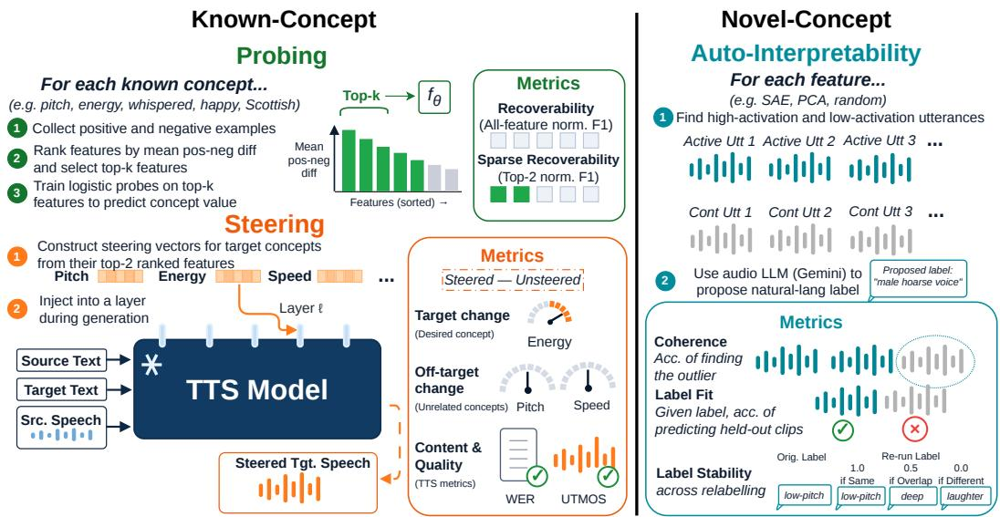  
Figure 1: Our main interpretability evaluation pipeline. We evaluate feature sets via known-concept probing and steering across 6 voice-cloning TTS models, and through quantitative auto-interpretability in Qwen3-TTS for novel concept discovery.

Future studies could use our probing setup to track representation changes during fine-tuning. Discovered features could also guide investigations of unwanted transfer of background music or reverberation from reference speech. Steering demos and discovered features are at https://anonymous.4open.science/w/tts\_interp\_demo/. Code will be released at https: //github.com/ajd12342/voice-cloning-interp.

In summary, our contributions are:

• We introduce a feature-based interpretability framework for zero-shot voice-cloning TTS, comparing SAE, PCA, and random features through sparse probing and generation-time steering. We probe 55 extractor-derived and 21 human-labelled concepts and steer all extractor concepts.

• We test the generalizability of our pipeline and findings across architectures, extending probing and steering from our detailed Qwen3-TTS study to 5 additional Fish, Higgs, and CosyVoice2 models.

• We develop a quantitative auto-interpretability pipeline that tests labeled features for coherence, predictive fit, and stability, discovering 684 automatically validated SAE features in Qwen3-TTS spanning voice profiles, speaking styles, and recording conditions.

## 2 MODELS, FEATURES, AND DATA

We use Qwen3-TTS-12Hz-0.6B-Base (Hu et al., 2026) (Qwen3-TTS) for our main probing, steering, and novel-concept analyses. We extend probing and steering to Fish S1-mini (Liao et al., 2024), Fish S2 Pro (Liao et al., 2026), Higgs TTS 2 (Boson AI, 2025), Higgs TTS 3 (Boson AI, 2026), and CosyVoice2-0.5B (Du et al., 2024) to test the generalization of our pipeline.

Figure 2 shows how we convert residual-stream activations into utterance-level features using TopK SAEs (Gao et al., 2025), PCA, random directions, and untrained SAEs.

## 2.1 MODELS AND ACTIVATION EXTRACTION

We restrict analysis to the autoregressive backbone residual stream in each model. During inference, we prefill each model with the reference text, target text and reference speech, autoregressively generate target speech, and finally use their respective decoders to decode the generated tokens into a waveform akin to other autoregressive TTS models (Du et al., 2024; Chen et al., 2025).

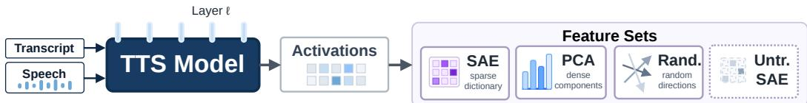  
Figure 2: Feature extraction from TTS residual-stream activations using SAE, PCA, random directions, and untrained SAEs. We study multiple layers in Qwen3-TTS and one in other models.

Qwen3-TTS We select Qwen3-TTS for its architectural compatibility with text SAEs (Gao et al., 2025), competitive TTS performance (Hu et al., 2026), and lack of explicit style supervision. We use the 0.6B variant, which represents speech with 16 codebooks at 12Hz. Its 28-layer backbone with hidden size d = 1024 predicts the first-codebook token for each speech frame, and a 5-layer multi-token prediction (MTP) module predicts the remaining 15 codebook tokens.

Other Models Fish S1-mini is a 0.5B model with a 28-layer backbone and hidden size $d = 1 0 2 4 .$ while Fish S2 Pro has a 4B backbone with 36 layers and d = 2560, followed by a 400M fast transformer. Both use 10 codec streams, the autoregressive backbone predicts the first stream, and a fast transformer predicts the remaining 9. Higgs TTS 2 has 28 backbone layers with $d = 3 0 7 2$ and 5.8B parameters: 3.6B in the language model and 2.2B in audio-specific feed-forward layers. Higgs TTS 3 (Boson AI, 2026) uses a 4B backbone with 36 layers and d = 2560. Both predict all 8 codec streams directly in the backbone, with the streams offset across generation steps. CosyVoice2 uses a 0.5B autoregressive language model with 24 layers and d = 896 to predict a single stream of semantic speech tokens. A conditional flow model converts these into mel features, followed by a vocoder. The flow model also receives reference speech tokens and reference mel features.

Activation Extraction For Qwen3-TTS, we tokenize each utterance’s transcript and observed speech, run a teacher-forced forward pass, and extract speech-region activations from layers {3, 9, 14, 19, 26} (early, 1 -depth, 1 -depth, 2 -depth, near-final). For the additional models, we extract activations at only one layer, approximately the same relative depth as Qwen3-TTS layer 19: layer 19 for Fish S1-mini and Higgs TTS 2, 24 for Fish S2 Pro and Higgs TTS 3, and 16 for CosyVoice2. We use stride-3 token subsampling for feature fitting and no subsampling otherwise.

## 2.2 CORPORA AND SPLITS

Main Corpus We use a 3.3k-hr main corpus (1.5M utterances, 151.2k speaker IDs) spanning clean audiobooks, in-the-wild speech, accents and emotional data drawn from LibriTTS-R (Koizumi et al., 2023), MSP-Podcast (Lotfian & Busso, 2019), Emilia (He et al., 2024), VoxCeleb (Nagrani et al., 2020) and more. We split it 85%/15% by speaker ID into disjoint feature-fitting and analysis splits containing 1.2M and 218.4k utterances, respectively. The feature-fitting split trains SAEs, fits PCA, and instantiates the remaining feature sets; the analysis split is used during evaluation. We use the full feature-fitting split for Qwen3-TTS and CosyVoice2, and a 20% random subset for the Fish and Higgs models due to compute constraints.

Other Evaluation Corpora The ParaSpeechCaps tag concept set is built from ParaSpeechCaps-Base (Diwan et al., 2025) and provides human-labelled annotations for 102.4k utterances from 566 speakers, filtered to 21 concepts that have enough speakers. The steering eval set contains 100 source utterances from 32 speakers and 100 target transcripts sampled from LibriTTS-R (Koizumi et al., 2023) test-clean. Full corpus statistics and details are in Appendix A.

## 2.3 FEATURE SETS

SAE We train a TopK SAE (Gao et al., 2025) for each studied layer on activations from the featurefitting split. Each SAE learns an M-feature dictionary with at most K active features per token. For Qwen3-TTS, we sweep M and K to balance reconstruction quality and the fraction of inactive features, selecting $M = \hat { \{ d , 2 d , 2 d , 4 d , 1 2 d \} }$ for layers {3, 9, 14, 19, 26} and $K = 9 6$ throughout. For Fish, Higgs and CosyVoice2, we fix $\dot { M } = 4 d$ and $\mathrm { { \dot { K } } = 9 6 }$ following Qwen3-TTS layer 19 without separate sweeps. We train with Adam, learning rate $5 \times 1 0 ^ { - 4 }$ , and batches of 4096 token activations. Full training settings and sweep results are in Appendices B and B.1. We max-pool each feature over tokens to obtain utterance-level features, as in Aparin et al. (2026).

Other Feature Sets For PCA, we fit principal components on mean-pooled activations from a 20% random subset of the feature-fitting split. For random directions, we project mean-pooled activations onto random unit vectors, matching the corresponding SAE width at each layer. We also use features from untrained SAEs with the same architecture as the trained SAEs.

## 3 PROBING AND STEERING KNOWN CONCEPTS

Figure 1 summarizes our evaluation of predefined acoustic and paralinguistic concepts, inspired by Wu et al. (2025). We compare prediction from a few features with the full feature set using Karvonen et al. (2025)’s sparse top-k probing, then steer aligned features to test whether they causally affect generated speech without changing other concepts.

## 3.1 KNOWN-CONCEPT LABELS

Extractor Concepts We run extractors for pitch, energy, voicing, timing, noise, formants, emotion dimensions, and gender over the main corpus analysis split. We apply reliability filters, such as minimum voiced frames, so each concept is evaluated only when well-defined, and average framelevel outputs when needed. These extractors are also run on generated waveforms during steering.

Human-Labelled Concepts We use the ParaSpeechCaps tag concept set defined in Section 2.2. Its annotations cover speaker and style concepts including vocal texture, clarity, loudness, emotion, and accent. These tags are used for sparse probing but not for steering because reliably assigning them to generated waveforms would require collecting human annotations.

## 3.2 SPARSE PROBING SETUP

Binary Dataset Setup We convert extractor and human labels into binary concepts. Continuousvalued concepts such as pitch become low- and high-tail concepts; probabilistic concepts, such as emotion, stay only high-tail; and human-labelled tags become binary concepts with tagged utterances as positives. We split each dataset 70%/10%/20% by speaker ID into disjoint train, val, and test splits for probing. This yields 55 extractor concepts and 21 final human-labelled concepts. More details in Appendix C.

Feature Selection and Probe Training For every concept, feature set, and layer, we rank features by the absolute positive-negative mean difference on the train split. We then train an ℓ2-regularized logistic probe on the top $\bar { k ^ { \prime } } \in \{ 1 , 2 , 5 , 1 0 , \mathrm { a l l } \}$ features, tune the decision threshold on val F1, and evaluate F1 on the test split. All models use the same splits for probe-training and held-out test sets. Comparisons across models use Qwen3-TTS layer 19 and the layers specified in Section 2.1 for the other models. Additional Qwen3-TTS details are in Appendix C.1.

Evaluation Metrics We report normalized F1 to compare concepts with different positive rates. For a given concept, let $\mathrm { F 1 } _ { \mathrm { n u l l } }$ be the F1 of an always-positive classifier on the test split and define normalized nF $1 _ { k } \overset { \cdot } { = } ( \mathrm { F } 1 _ { k } - \mathrm { F } 1 _ { \mathrm { n u l l } } ) / ( 1 - \mathrm { F } 1 _ { \mathrm { n u l l } } )$

Recoverability is nF $1 _ { k = \mathrm { a l l } }$ , measuring how well the full feature set recovers the concept. Sparse recoverability is nF1 $k { = } 2$ , measuring how well the concept can be recovered from only 2 features.

## 3.3 SPARSE PROBING RESULTS

Figure 3a reports all-feature and top-2 nF1 for the top 10 extractor and human-labelled concepts by SAE recoverability at Qwen3-TTS layer 19; full lists are in Appendix E.1. Figure 3b compares all-feature and top-2 recoverability across all six models.

Extractor concepts are broadly recoverable, with duration, energy, pitch, spectral tilt, and gender among the strongest. Pitch, energy, and gender also have strong sparse recoverability, while speaking rate, accent, and many spectral properties are much better predicted using all features.

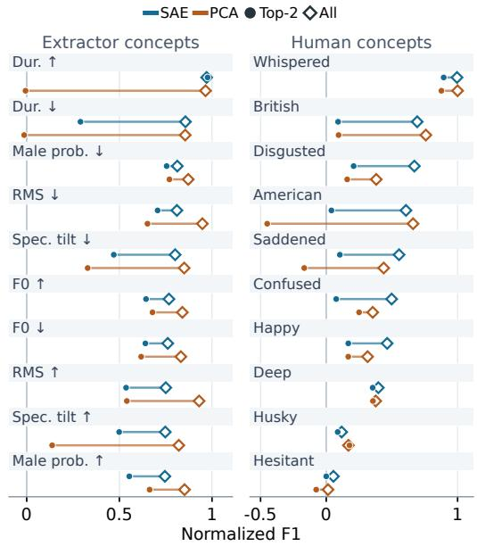  
(a) Qwen3-TTS layer 19

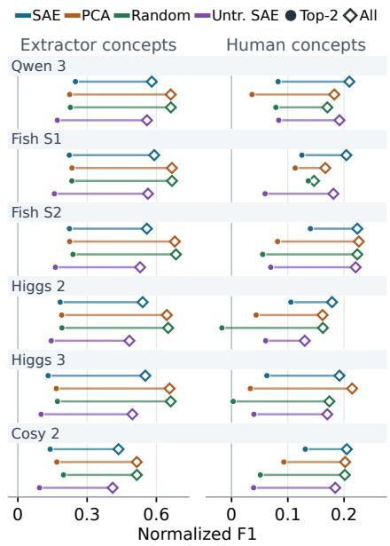  
(b) Six-model comparison  
Figure 3: All-feature and top-2 nF1. (a) Top 10 extractor and human-labelled concepts by SAE recoverability in Qwen3-TTS. Takeaway: Many concepts, especially extractor concepts, are recoverable but few are sparsely predicted from 2 features. (b) Mean nF1 over 55 extractor and 21 human-labelled concepts across 6 models (layers in Section 2.1). Full lists in Appendix E.1. Takeaway: PCA and random directions have higher all-feature extractor nF1 than SAE, while SAE has higher top-2 human-labelled nF1 than PCA across all six models.

Human-labelled concepts are less consistently recoverable; only accents and some styles are. Whispered has strong SAE sparse recoverability across all models. British accent is more sparsely recoverable from SAEs in Fish and CosyVoice2 than at Qwen3-TTS layer 19, although Qwen3-TTS improves at layer 26 (Appendix E.3).

Comparing feature sets, we find that across models, PCA and random directions have higher extractor-concept recoverability than SAE, while SAE exceeds PCA in sparse recoverability of human-labelled concepts (Figure 3b). SAE leads in sparse extractor-concept recoverability only in Qwen3-TTS. Results comparing various k values are in Appendix E.2.

Comparing models, we find broadly similar all-feature nF1 for extractor concepts in Qwen3-TTS, Fish, and Higgs. With only 2 features, Qwen3-TTS and Fish have higher mean nF1 than Higgs and CosyVoice2 (Figure 3b). CosyVoice2 also has lower all-feature nF1, particularly for energy and spectral concepts, although duration and speaking rate remain well predicted.

Layerwise analysis plots for Qwen3-TTS are in Appendix E.3. For SAE features, extractor concepts are already recoverable in early layers, but sparse recoverability is strongest later. Human-labelled concepts improve in both metrics from early to later layers.

## 3.4 STEERING SETUP

Steering asks whether features associated with known concepts can causally affect generation. We steer all 55 extractor concepts using their top-2 SAE, PCA, or random features. Like prior text (Subramani et al., 2022; Turner et al., 2024; Rimsky et al., 2024) and speech (Wang et al., 2026; Xie et al., 2025) steering, we intervene at inference rather than learning style conditioning through training (Wang et al., 2018; Diwan et al., 2025).

Generation Setup Each example pairs source audio and transcript with a target transcript. After prefilling with the source, we add λ times a steering vector to one layer’s residual stream during generation (Turner et al., 2024). Uniform steering compounded over time in Qwen3-TTS, so we linearly decay the intervention to zero over the expected generation length (Appendix C.2). We generate unsteered and steered speech at λ = 1 on the same 100 examples across models, using Qwen3-TTS layers 19 and 26 and the other models’ layers from Section 2.1.

Steering Vectors For SAE, PCA, and random directions, we sum the concept’s signed top-2 unit directions, each scaled by its cached activation standard deviation. Prior work instead tunes steering strength (Rimsky et al., 2024; Durmus et al., 2024; Chalnev et al., 2024). A supervised DiffMean topline (Marks & Tegmark, 2024) uses the positive-minus-negative mean activation, unit-normalized and scaled by the std along that direction (Appendix C.2).

Evaluation Metrics We compare extractor scores between steered and unsteered waveforms, normalizing paired changes by each concept’s analysis-split 95th–5th percentile range. Measurements and changes are not clipped, so scores can exceed 1.

Target Change measures intended change (Rimsky et al., 2024; Durmus et al., 2024) as the median signed normalized change across utterances, positive in the requested direction.

Off-target change measures side effects (Durmus et al., 2024; Chalnev et al., 2024) on protected concepts: non-target concepts we aim to preserve, excluding those strongly correlated with the target on the analysis split. We take the median absolute normalized change across utterances for each protected concept, then the median across concepts (Appendix C.2).

For Quality, we report paired mean ∆WER (percentage points) using Whisper large-v3 (Radford et al., 2023) and ∆UTMOS using UTMOS (Saeki et al., 2022).

## 3.5 STEERING RESULTS

Figure 4 compares models, averaging metrics across all 55 extractor concepts. Figure 5 shows the top 10 concepts by SAE Target Change at Qwen3-TTS layer 19 (λ = 1), and Figure 6 shows Qwen3-TTS strength sweeps. Expanded results are in Appendix C.3. We exclude human-labelled concepts because reliably evaluating them on generated speech would require new human annotations.

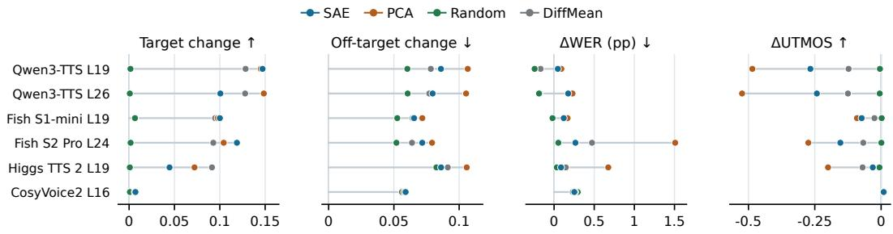  
Figure 4: Steering at λ = 1, averaged across 55 extractor concepts on 100 examples. Higgs TTS 3, where SAE steering severely degraded speech, is shown in Appendix C.3. Takeaway: In Qwen3-TTS and Fish, SAE target changes are competitive with PCA and supervised DiffMean, with smaller off-target changes than PCA; DiffMean has smaller UTMOS losses. Mean target changes are smaller in Higgs TTS 2 and CosyVoice2.

Comparing feature sets, we find that SAE, PCA, and DiffMean increase Target Change with strength. Stronger steering also increases off-target change and sometimes reduces quality (Figure 6). Random directions have near-zero Target Change despite competitive probing performance. In Qwen3-TTS and Fish, supervised DiffMean has the lowest off-target change, followed by SAE and PCA. SAE has smaller ∆WER and ∆UTMOS costs than PCA, while DiffMean has smaller UTMOS drops (Figure 4).

Comparing concepts, we find that steering works well for RMS, low-SNR, pitch, and spectral and voice-quality properties (Figure 5). Low-SNR and RMS quality costs are partly expected: low-SNR steering should add noise, while RMS interventions deliberately make speech much louder or quieter. Spectral and voice-quality effects also appear in Fish. Most SAE changes in accent and emotion scores are small, while timing results are mixed.

Comparing models, we find larger mean Target Change from SAE, PCA, and DiffMean in Qwen3- TTS and Fish than in Higgs TTS 2 and CosyVoice2 (Figure 4). At the studied layers, SAE pitch steering is strong in Qwen3-TTS and Fish but weak in Higgs TTS 2, where PCA and DiffMean are more effective. SAE instead steers RMS and formants in Higgs TTS 2. In Higgs TTS 3, SAE severely degrades speech (Figure 9).

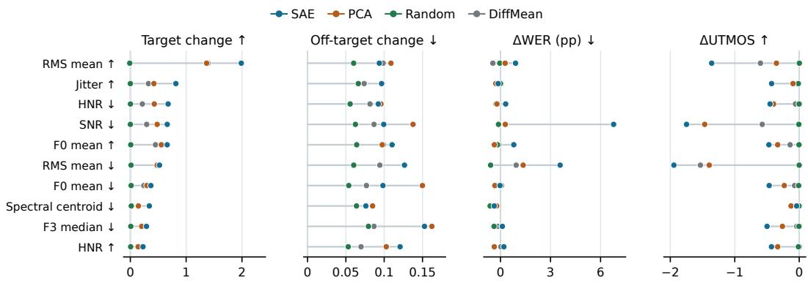  
Figure 5: Top 10 Qwen3-TTS layer-19 concepts by SAE median Target Change, comparing all four methods at λ = 1 on 100 examples. Takeaway: SAE target changes are largest for energy, pitch, spectral and voice-quality properties. Quality losses partly reflect deliberately reducing SNR or pushing RMS toward either extreme.

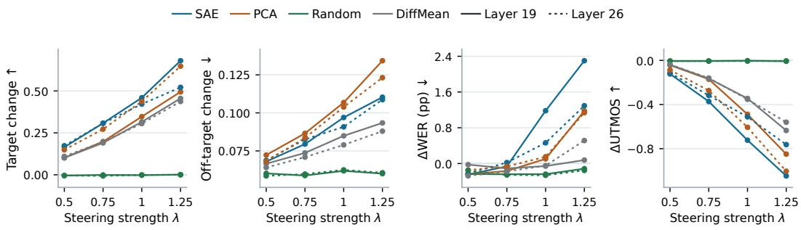  
Figure 6: Qwen3-TTS strength sweeps, averaged across a fixed set of 9 probing-selected targets on the same 100 utterances (Appendix C.2). Layers 19/26 use solid/dotted lines. Takeaway: SAE, PCA, and DiffMean increase target change with strength while random directions remain ineffective. SAE has lower off-target change than PCA but pays a WER/UTMOS cost.

Uniform steering in Qwen3-TTS can compound over time (e.g. progressively increasing pitch), motivating our decay schedule (Section 3.4). This anecdote suggests that the model may encode pitch locally rather than at the utterance-level, opening the possibility of temporally varying controls.

Comparing probing and steering, we find that strong probing does not always translate to steering. SAE sparse recoverability correlates weakly with Target Change across concepts in Qwen3-TTS, and barely at all in Fish (Appendix C.2). In Qwen3-TTS, top-2 SAE steering barely changes duration at layer 19 despite strong sparse recoverability, but increases spectral centroid at layer 26 despite weak sparse recoverability.

## 4 DISCOVERING NOVEL CONCEPTS

Known-concept evaluations test whether model features can capture predefined concepts. To study model behavior beyond those, we auto-interpret (Bills et al., 2023) features leveraging an audio LLM to label features using highly activating audio examples, as depicted in Figure 1. Due to API costs, we restrict this analysis to Qwen3-TTS. AudioSAE (Aparin et al., 2026) uses natural-language labels qualitatively. We instead evaluate labeled features using three quantitative metrics: Coherence, Label Fit, and Label Stability.

## 4.1 AUTO-INTERPRETABILITY SETUP

Features and Utterances We randomly sample 500 features per set at Qwen3-TTS layer 19. For SAE features, we z-score nonzero activations, selecting utterances with $z > 2$ as activating and activation 0 as contrasts. For PCA and random directions, we z-score over all utterances and use $z > 2$ as activating and $z \le 0$ as contrasts.

Label Generation For each feature, we randomly sample 5 activating and 5 contrast utterances and ask Gemini 3.5 Flash for the acoustic property that best separates them (Appendix D). An example of a generated label is ‘Whispered or highly breathy, hushed speech’.

Label Evaluation Our metrics assess the coherence of activating utterances, the predictive fit of labels on held-out audio, and their stability across reruns and resampling. Since Gemini is used both to generate and evaluate labels, these automated metrics alone do not establish independent ground-truth validation, but jointly test Gemini’s labeling abilities and feature-label alignment. They compare how consistently features can be described and predicted under a fixed audio LLM and protocol. We additionally measure human Label Fit on a subset of SAE features as an independent check (Section 4.2).

Coherence is the mean accuracy over 5 trials where Gemini identifies the outlier among 10 activating and 1 contrast utterance, following intruder-style evaluation (Paulo & Belrose, 2026).

Label Fit is the accuracy when Gemini classifies held-out utterances (10 activating, 10 contrast) as matching the label or not, following detection-based scoring (Paulo et al., 2025; Bills et al., 2023).

Label Stability compares labels regenerated from the original utterances and a disjoint set of 5 activating and 5 contrast utterances against the main label. Gemini scores each comparison as 1.0 for same, 0.5 for overlapping, and 0 for different/unclear; we average the two scores.

Automatically validated features have Coherence $\geq 3 / 5 ,$ , Label $\mathrm { F i t } \geq 0 . 7 5 .$ , and Label Stability $\geq 0 . 5 .$

Controls Random guessing gives $^ { 1 / 1 1 }$ Coherence, 0.5 Label Fit, and 0.375 Stability under uniform verdicts. Shuffled labels tests Label Fit with another feature’s label; random audio tests Coherence and Label Fit with randomly sampled utterances.

## 4.2 AUTO-INTERPRETABILITY RESULTS

Comparing feature sets, we find that SAE scores highest on all three metrics and yields the most validated features (92, versus 17 random and 1 PCA; Table 1). Random directions approach SAE on Label Fit but trail on Coherence and Stability, suggesting that Label Fit alone is insufficient for interpretability. PCA is near chance on Coherence and Label Fit. Shuffled-label and random-audio controls score near chance, indicating that the results depend on feature-matched labels and audio.

Human evaluation We measure human Label Fit on 50 validated and 50 nonvalidated SAE features randomly sampled from the original 500

Table 1: Auto-interpretability of 500 Qwen3-TTS layer-19 features per set (95% bootstrap intervals). Takeaway: SAE scores highest on all three metrics and yields the most validated features.
<table><tr><td>Feature Set</td><td></td><td>Coherence Label Fit Label Stab. Valid.</td><td></td><td></td></tr><tr><td>Rand. Guess</td><td> $0 . 0 9 { \scriptstyle \pm 0 . 0 3 }$ </td><td> $0 . 5 0 { \scriptstyle \pm 0 . 0 4 }$ </td><td> $0 . 3 8 { \scriptstyle \pm 0 . 0 4 }$ </td><td></td></tr><tr><td>Rand. Dir.</td><td>0.25±0.02</td><td> $0 . 6 0 { \scriptstyle \pm 0 . 0 1 }$ </td><td>0.32±0.02</td><td>17</td></tr><tr><td>PCA</td><td>0.08±0.01</td><td> $0 . 5 0 { \scriptstyle \pm 0 . 0 1 }$ </td><td> $0 . 2 2 { \scriptstyle \pm 0 . 0 2 }$ </td><td>1</td></tr><tr><td>SAE</td><td> $\mathbf { 0 . 4 3 { \scriptstyle \pm 0 . 0 3 } }$ </td><td> $\mathbf { 0 . 6 3 { \scriptstyle \pm 0 . 0 1 } }$ </td><td> $\mathbf { 0 . 4 1 { \scriptstyle \pm 0 . 0 3 } }$ </td><td>92</td></tr><tr><td>→ shuf. labels</td><td></td><td>0.50±0.01</td><td></td><td></td></tr><tr><td>→ rand. audio</td><td> $0 . 1 0 { \scriptstyle \pm 0 . 0 1 }$ </td><td> $0 . 5 0 { \scriptstyle \pm 0 . 0 1 }$ </td><td></td><td></td></tr></table>

layer-19 SAE features. For each feature, Amazon Mechanical Turk annotators judge whether its label matches each of 5 activating and 5 contrast utterances, with 2–3 ratings per clip. Validated features achieve higher human Label Fit (64.4% vs. 51.0%, averaged across features), with nonvalidated features near the 50% chance baseline. This suggests that validation selects labels that better distinguish activating from contrast utterances.

Discovered concepts We manually grouped the 92 validated SAE features by their primary label. Of these, 72 are speaker cluster features describing timbre and accent: $3 7$ male narration and synthetic-sounding reading voices, 14 female voices spanning British narration, conversation and breathy storytelling, and 21 other profiles including sports and podcast voices, gravelly male voices, and accented instruction. The remaining 20 cover accent (5), laughter (4), recording conditions (3), whispering and synthetic-sounding speech (2 each), plus vocal fry, disfluencies, sports commentary, and expressive podcast delivery.

Since SAEs performed best, we extend discovery to the remaining eligible layer-19 features, yielding 592 additional validated SAE features. These distinguish finer narration styles (deep audiobook voices, British academic reading, dramatic storytelling, robotic delivery), conversational profiles (raspy sports commentary, youthful gaming voices, gravelly lecturing), and laughter (during speech, amused delivery, background laughter). Other labels describe shouting, preaching, slow pacing, background music, reverberation, coughs, throat clearing, and backchannels.

Speaker diversity analysis Auto-interpretability found many speaker cluster features, motivating further analysis. For each SAE feature, we extract speaker embeddings (Ravanelli et al., 2021) and apply cosine agglomerative clustering (Appendix D). Speaker clusters differ from speaker IDs: validated SAE features span a median of 26 path-derived IDs across stored activating examples. Features with at most 5 embedding clusters account for 19.5% of eligible SAE features but 63.7% of the 684 validated features. This enrichment may reflect the substantial timbre capacity needed for voice-cloning, but also the auto-interpretability pipeline: timbre may be easier for the judge to perceive, describe, and verify, making such features more likely to pass all three checks.

## 5 RELATED WORK

SAEs for mechanistic interpretability SAEs learn overcomplete sparse dictionaries whose latents are often more interpretable than neurons (Huben et al., 2024; Bricken et al., 2023). We follow recent work in evaluating their usefulness through sparse prediction, causal interventions, and steering (Gao et al., 2025; Karvonen et al., 2025; Wu et al., 2025).

Interpreting speech and audio encoders SAEs, PCA, and related decompositions have been applied to speech/audio encoders (Chen et al., 2022; Hsu et al., 2021; Défossez et al., 2023), revealing features aligned with pitch, emotion, accent, and loudness (Aparin et al., 2026; Mariotte et al., 2025; Paek et al., 2025; van Rensburg et al., 2026). Some features can steer vocoders (Paek et al., 2025; van Rensburg et al., 2026) or reduce transcription errors (Aparin et al., 2026). Unlike this encoder-focused work, we study generative voice-cloning TTS models. Most of this work evaluates prespecified concepts. AudioSAE (Aparin et al., 2026) uses natural-language labels for qualitative inspection; we instead evaluate labels quantitatively.

TTS interpretability Prior TTS work finds PCA components for gender and intensity in Grad-TTS (Varshavsky-Hassid et al., 2024) and probes encoder-decoder TTS models for syllabic and phonemic features (Lenglet et al., 2026). These studies focus on known concepts in non-voicecloning models. We instead compare multiple feature sets through probing and steering of known concepts across 6 zero-shot voice-cloning TTS models, and discover novel concepts in Qwen3-TTS While contemporaneous work on CosyVoice3 (Koriagin et al., 2026) demonstrates steering with 3 selected SAE features, we systematically compare SAE and PCA steering across all 55 extractor targets, including off-target changes and speech quality. Our probing and steering comparisons span 6 TTS models, testing generalization across architectures.

Controllable TTS Most controllable TTS trains models on labels, style instructions, or reference audio (Guo et al., 2023; Yang et al., 2024; Liu et al., 2023; Diwan et al., 2025; Du et al., 2024; Chen et al., 2026). CoCoEmo and EmoSteer-TTS (Wang et al., 2026; Xie et al., 2025) use activation steering, but only along supervised emotion directions. Related emotion-sensitive neuron studies (Zhao et al., 2026a;b) also target predefined emotions in audio understanding and generation. Our steering experiments instead ask whether features from unsupervised dictionaries can serve directly as training-free controls for diverse acoustic concepts across frozen voice-cloning models.

## 6 CONCLUSION

We introduce a feature-based interpretability framework for voice-cloning TTS, combining probing and steering across 6 models with novel-concept discovery in Qwen3-TTS. Many acoustic and paralinguistic concepts are recoverable, but only some are strongly predicted from a few features. Steering effects vary by model and concept, and strong sparse prediction does not always translate to effective steering. PCA and random directions are strong probing baselines, while SAEs are useful for sparse prediction of human-labelled concepts and novel-concept discovery. Auto-interpretability identifies 684 automatically validated SAE features spanning speaker clusters, speaking style, and recording conditions in Qwen3-TTS. Future work should extend analysis to multilingual speech, study how features vary temporally, and explore composition of controls.

## ACKNOWLEDGEMENTS

We thank Shauli Ravfogel and members of the UT NLP community for helpful feedback, and the Amazon Mechanical Turk annotators who participated in our human evaluation. We thank the Google Gemini Academic Program for providing Google Cloud credits.

## AI USE STATEMENT

We used generative AI tools to implement methods and write code, refine experimental setups, and support qualitative analysis. All research ideas originated with the authors. Additionally, we used these tools to create plots, edit prose, fix LaTeX errors, and assist with literature searches. Gemini’s role in feature labeling and evaluation is described in Section 4. We reviewed all AI-assisted work, checking results against saved outputs, citations against original papers, and inspecting plots, feature groupings, and prose. We take responsibility for the final text, claims, code and artifacts.

## REFERENCES

Georgii Aparin, Tasnima Sadekova, Alexey Rukhovich, Assel Yermekova, Laida Kushnareva, Vadim Popov, Kristian Kuznetsov, and Irina Piontkovskaya. Audiosae: Towards understanding of audioprocessing models with sparse autoencoders, 2026. URL https://arxiv.org/abs/2602.05027.

Steven Bills, Nick Cammarata, Dan Mossing, Henk Tillman, Leo Gao, Gabriel Goh, Ilya Sutskever, Jan Leike, Jeff Wu, and William Saunders. Language models can explain neurons in language models. https://openaipublic.blob.core.windows.net/neuron-explainer/ paper/index.html, 2023.

Boson AI. Higgs Audio V2: Redefining Expressiveness in Audio Generation. https://github. com/boson-ai/higgs-audio, 2025. GitHub repository. Release blog available at https://www. boson.ai/blog/higgs-audio-v2.

Boson AI. Higgs tts 3: Conversational speech for voice ai from boson ai. https://huggingface.co/bosonai/higgs-tts-3-4b, 2026.

Trenton Bricken, Adly Templeton, Joshua Batson, Brian Chen, Adam Jermyn, Tom Conerly, Nick Turner, Cem Anil, Carson Denison, Amanda Askell, Robert Lasenby, Yifan Wu, Shauna Kravec, Nicholas Schiefer, Tim Maxwell, Nicholas Joseph, Zac Hatfield-Dodds, Alex Tamkin, Karina Nguyen, Brayden McLean, Josiah E Burke, Tristan Hume, Shan Carter, Tom Henighan, and Christopher Olah. Towards monosemanticity: Decomposing language models with dictionary learning. Transformer Circuits Thread, 2023. https://transformer-circuits.pub/2023/monosemantic features/index.html.

Sviatoslav Chalnev, Matthew Siu, and Arthur Conmy. Improving steering vectors by targeting sparse autoencoder features, 2024. URL https://arxiv.org/abs/2411.02193.

Dekun Chen, Xueyao Zhang, Yuancheng Wang, Kenan Dai, Li Ma, and Zhizheng Wu. Flexivoice: Enabling flexible style control in zero-shot TTS with natural language instructions. In The Fourteenth International Conference on Learning Representations, 2026. URL https: //openreview.net/forum?id=F7GmbfyVg9.

Sanyuan Chen, Chengyi Wang, Zhengyang Chen, Yu Wu, Shujie Liu, Zhuo Chen, Jinyu Li, Naoyuki Kanda, Takuya Yoshioka, Xiong Xiao, Jian Wu, Long Zhou, Shuo Ren, Yanmin Qian, Yao Qian, Jian Wu, Michael Zeng, Xiangzhan Yu, and Furu Wei. Wavlm: Large-scale self-supervised pre-training for full stack speech processing. IEEE Journal of Selected Topics in Signal Processing, 16(6):1505–1518, October 2022. ISSN 1941-0484. doi: 10.1109/jstsp.2022.3188113. URL http://dx.doi.org/10.1109/JSTSP.2022.3188113.

Sanyuan Chen, Chengyi Wang, Yu Wu, Ziqiang Zhang, Long Zhou, Shujie Liu, Zhuo Chen, Yanqing Liu, Huaming Wang, Jinyu Li, Lei He, Sheng Zhao, and Furu Wei. Neural codec language models are zero-shot text to speech synthesizers. IEEE Transactions on Audio, Speech and Language Processing, 33:705–718, 2025. doi: 10.1109/TASLPRO.2025.3530270.

Alexandre Défossez, Jade Copet, Gabriel Synnaeve, and Yossi Adi. High fidelity neural audio compression. Transactions on Machine Learning Research, 2023. ISSN 2835-8856. URL https://openreview.net/forum?id=ivCd8z8zR2. Featured Certification, Reproducibility Certification.

Anuj Diwan, Zhisheng Zheng, David Harwath, and Eunsol Choi. Scaling rich style-prompted text-tospeech datasets. In Christos Christodoulopoulos, Tanmoy Chakraborty, Carolyn Rose, and Violet Peng (eds.), Proceedings of the 2025 Conference on Empirical Methods in Natural Language Processing, pp. 3639–3659, Suzhou, China, November 2025. Association for Computational Linguistics. ISBN 979-8-89176-332-6. doi: 10.18653/v1/2025.emnlp-main.180. URL https: //aclanthology.org/2025.emnlp-main.180/.

Zhihao Du, Yuxuan Wang, Qian Chen, Xian Shi, Xiang Lv, Tianyu Zhao, Zhifu Gao, Yexin Yang, Changfeng Gao, Hui Wang, Fan Yu, Huadai Liu, Zhengyan Sheng, Yue Gu, Chong Deng, Wen Wang, Shiliang Zhang, Zhijie Yan, and Jingren Zhou. Cosyvoice 2: Scalable streaming speech synthesis with large language models, 2024. URL https://arxiv.org/abs/2412.10117.

Esin Durmus, Alex Tamkin, Jack Clark, Jerry Wei, Jonathan Marcus, Joshua Batson, Kunal Handa, Liane Lovitt, Meg Tong, Miles McCain, Oliver Rausch, Saffron Huang, Sam Bowman, Stuart Ritchie, Tom Henighan, and Deep Ganguli. Evaluating feature steering: A case study in mitigating social biases, 2024. URL https://anthropic.com/research/ evaluating-feature-steering.

Tiantian Feng, Jihwan Lee, Anfeng Xu, Yoonjeong Lee, Thanathai Lertpetchpun, Xuan Shi, Helin Wang, Thomas Thebaud, Laureano Moro-Velazquez, Dani Byrd, et al. Vox-profile: A speech foundation model benchmark for characterizing diverse speaker and speech traits. arXiv preprint arXiv:2505.14648, 2025.

Leo Gao, Tom Dupre la Tour, Henk Tillman, Gabriel Goh, Rajan Troll, Alec Radford, Ilya Sutskever, Jan Leike, and Jeffrey Wu. Scaling and evaluating sparse autoencoders. In Y. Yue, A. Garg, N. Peng, F. Sha, and R. Yu (eds.), International Conference on Learning Representations, volume 2025, pp. 26721–26754, 2025. URL https://proceedings.iclr.cc/paper\_files/paper/ 2025/file/42ef3308c230942d223c411adf182c88-Paper-Conference.pdf.

Zhifang Guo, Yichong Leng, Yihan Wu, Sheng Zhao, and Xu Tan. Prompttts: Controllable textto-speech with text descriptions. In ICASSP 2023 - 2023 IEEE International Conference on Acoustics, Speech and Signal Processing (ICASSP), pp. 1–5, 2023. doi: 10.1109/ICASSP49357. 2023.10096285.

Haorui He, Zengqiang Shang, Chaoren Wang, Xuyuan Li, Yicheng Gu, Hua Hua, Liwei Liu, Chen Yang, Jiaqi Li, Peiyang Shi, Yuancheng Wang, Kai Chen, Pengyuan Zhang, and Zhizheng Wu. Emilia: An extensive, multilingual, and diverse speech dataset for large-scale speech generation. In 2024 IEEE Spoken Language Technology Workshop (SLT), pp. 885–890, 2024. doi: 10.1109/ SLT61566.2024.10832365.

Wei-Ning Hsu, Benjamin Bolte, Yao-Hung Hubert Tsai, Kushal Lakhotia, Ruslan Salakhutdinov, and Abdelrahman Mohamed. Hubert: Self-supervised speech representation learning by masked prediction of hidden units. IEEE/ACM Transactions on Audio, Speech, and Language Processing, 29:3451–3460, 2021. doi: 10.1109/TASLP.2021.3122291.

Hangrui Hu, Xinfa Zhu, Ting He, Dake Guo, Bin Zhang, Xiong Wang, Zhifang Guo, Ziyue Jiang, Hongkun Hao, Zishan Guo, Xinyu Zhang, Pei Zhang, Baosong Yang, Jin Xu, Jingren Zhou, and Junyang Lin. Qwen3-tts technical report. arXiv preprint arXiv:2601.15621, 2026.

Robert Huben, Hoagy Cunningham, Logan Riggs Smith, Aidan Ewart, and Lee Sharkey. Sparse autoencoders find highly interpretable features in language models. In The Twelfth International Conference on Learning Representations, 2024. URL https://openreview.net/forum?id= F76bwRSLeK.

Yannick Jadoul, Bill Thompson, and Bart de Boer. Introducing Parselmouth: A Python interface to Praat. Journal ofPhonetics, 71:1–15, July 2018. doi: 10.1016/j.wocn.2018.07.001.

Adam Karvonen, Can Rager, Johnny Lin, Curt Tigges, Joseph Isaac Bloom, David Chanin, Yeu-Tong Lau, Eoin Farrell, Callum Stuart McDougall, Kola Ayonrinde, Demian Till, Matthew Wearden, Arthur Conmy, Samuel Marks, and Neel Nanda. SAEBench: A comprehensive benchmark for sparse autoencoders in language model interpretability. In Forty-second International Conference on Machine Learning, 2025. URL https://openreview.net/forum?id=qrU3yNfX0d.

Yuma Koizumi, Heiga Zen, Shigeki Karita, Yifan Ding, Kohei Yatabe, Nobuyuki Morioka, Michiel Bacchiani, Yu Zhang, Wei Han, and Ankur Bapna. LibriTTS-R: A Restored Multi-Speaker Text-to Speech Corpus. In Interspeech 2023, pp. 5496–5500, 2023. doi: 10.21437/Interspeech.2023-1584.

Nikita Koriagin, Georgii Aparin, Nikita Balagansky, and Daniil Gavrilov. Interpreting and steering a text-to-speech language model with sparse autoencoders, 2026. URL https://arxiv.org/abs/ 2606.10029.

Marvin Lavechin, Marianne Métais, Hadrien Titeux, Alodie Boissonnet, Jade Copet, Morgane Rivière, Elika Bergelson, Alejandrina Cristia, Emmanuel Dupoux, and Hervé Bredin. Brouhaha: multi-task training for voice activity detection, speech-to-noise ratio, and C50 room acoustics estimation. ASRU, 2023.

Martin Lenglet, Olivier Perrotin, and Gérard Bailly. A closer look at internal representations of end-toend text-to-speech models: How is phonetic and acoustic information encoded? Computer Speech and Language, 100:101985, 2026. ISSN 0885-2308. doi: https://doi.org/10.1016/j.csl.2026.101985. URL https://www.sciencedirect.com/science/article/pii/S0885230826000483.

Shijia Liao, Yuxuan Wang, Tianyu Li, Yifan Cheng, Ruoyi Zhang, Rongzhi Zhou, and Yijin Xing. Fish-speech: Leveraging large language models for advanced multilingual text-to-speech synthesis, 2024. URL https://arxiv.org/abs/2411.01156.

Shijia Liao, Yuxuan Wang, Songting Liu, Yifan Cheng, Ruoyi Zhang, Tianyu Li, Shidong Li, Yisheng Zheng, Xingwei Liu, Qingzheng Wang, Zhizhuo Zhou, Jiahua Liu, Xin Chen, and Dawei Han. Fish audio s2 technical report, 2026. URL https://arxiv.org/abs/2603.08823.

Guanghou Liu, Yongmao Zhang, Yi Lei, Yunlin Chen, Rui Wang, Lei Xie, and Zhifei Li. PromptStyle: Controllable Style Transfer for Text-to-Speech with Natural Language Descriptions. In Interspeech 2023, pp. 4888–4892, 2023. doi: 10.21437/Interspeech.2023-1779.

Steven R Livingstone and Frank A Russo. The ryerson audio-visual database of emotional speech and song (ravdess): A dynamic, multimodal set of facial and vocal expressions in north american english. PloS one, 13(5):e0196391, 2018.

Reza Lotfian and Carlos Busso. Building naturalistic emotionally balanced speech corpus by retrieving emotional speech from existing podcast recordings. IEEE Transactions on Affective Computing, 10(4):471–483, 2019. doi: 10.1109/TAFFC.2017.2736999.

Ziyang Ma, Zhisheng Zheng, Jiaxin Ye, Jinchao Li, Zhifu Gao, Shiliang Zhang, and Xie Chen. emotion2vec: Self-supervised pre-training for speech emotion representation. Proc. ACL 2024 Findings, 2024.

Théo Mariotte, Martin Lebourdais, Antonio Almudévar, Marie Tahon, Alfonso Ortega, and Nicolas Dugué. Sparse autoencoders make audio foundation models more explainable, 2025. URL https://arxiv.org/abs/2509.24793.

Samuel Marks and Max Tegmark. The geometry of truth: Emergent linear structure in large language model representations of true/false datasets. In First Conference on Language Modeling, 2024. URL https://openreview.net/forum?id=aajyHYjjsk.

Max Morrison, Caedon Hsieh, Nathan Pruyne, and Bryan Pardo. Cross-domain neural pitch and periodicity estimation. In arXiv preprint arXiv:2301.12258, 2023.

Arsha Nagrani, Joon Son Chung, Weidi Xie, and Andrew Zisserman. Voxceleb: Large-scale speaker verification in the wild. Computer Speech and Language, 60:101027, 2020. ISSN 0885-2308. doi: https://doi.org/10.1016/j.csl.2019.101027. URL https://www.sciencedirect.com/science/ article/pii/S0885230819302712.

Nathan Paek, Yongyi Zang, Qihui Yang, and Randal Leistikow. Learning interpretable features in audio latent spaces via sparse autoencoders. In Mechanistic Interpretability Workshop at NeurIPS 2025, 2025. URL https://openreview.net/forum?id=5fsYFQzzMX.

Gonçalo Paulo and Nora Belrose. Evaluating SAE interpretability without generating explanations. In The Fourteenth International Conference on Learning Representations, 2026. URL https: //openreview.net/forum?id=kHhMs642rR.

Gonçalo Santos Paulo, Alex Troy Mallen, Caden Juang, and Nora Belrose. Automatically interpreting millions of features in large language models. In Forty-second International Conference on Machine Learning, 2025. URL https://openreview.net/forum?id=EemtbhJOXc.

Alec Radford, Jong Wook Kim, Tao Xu, Greg Brockman, Christine McLeavey, and Ilya Sutskever. Robust speech recognition via large-scale weak supervision. In International conference on machine learning, pp. 28492–28518. PMLR, 2023.

Mirco Ravanelli, Titouan Parcollet, Peter Plantinga, Aku Rouhe, Samuele Cornell, Loren Lugosch, Cem Subakan, Nauman Dawalatabad, Abdelwahab Heba, Jianyuan Zhong, Ju-Chieh Chou, Sung-Lin Yeh, Szu-Wei Fu, Chien-Feng Liao, Elena Rastorgueva, François Grondin, William Aris, Hwidong Na, Yan Gao, Renato De Mori, and Yoshua Bengio. SpeechBrain: A general-purpose speech toolkit, 2021. arXiv:2106.04624.

Julius Richter, Yi-Chiao Wu, Steven Krenn, Simon Welker, Bunlong Lay, Shinji Watanabe, Alexander Richard, and Timo Gerkmann. EARS: An Anechoic Fullband Speech Dataset Benchmarked for Speech Enhancement and Dereverberation. In Interspeech 2024, pp. 4873–4877, 2024. doi: 10.21437/Interspeech.2024-153.

Nina Rimsky, Nick Gabrieli, Julian Schulz, Meg Tong, Evan Hubinger, and Alexander Turner. Steering llama 2 via contrastive activation addition. In Lun-Wei Ku, Andre Martins, and Vivek Srikumar (eds.), Proceedings of the 62nd Annual Meeting of the Association for Computational Linguistics (Volume 1: Long Papers), pp. 15504–15522, Bangkok, Thailand, August 2024. Association for Computational Linguistics. doi: 10.18653/v1/2024.acl-long.828. URL https://aclanthology.org/2024.acl-long.828/.

Takaaki Saeki, Detai Xin, Wataru Nakata, Tomoki Koriyama, Shinnosuke Takamichi, and Hiroshi Saruwatari. UTMOS: UTokyo-SaruLab System for VoiceMOS Challenge 2022. In Interspeech 2022, pp. 4521–4525, 2022. doi: 10.21437/Interspeech.2022-439.

Nishant Subramani, Nivedita Suresh, and Matthew Peters. Extracting latent steering vectors from pretrained language models. In Smaranda Muresan, Preslav Nakov, and Aline Villavicencio (eds.), Findings ofthe Associationfor Computational Linguistics: ACL 2022, pp. 566–581, Dublin, Ireland, May 2022. Association for Computational Linguistics. doi: 10.18653/v1/2022.findings-acl.48. URL https://aclanthology.org/2022.findings-acl.48/.

Alexander Matt Turner, Lisa Thiergart, Gavin Leech, David Udell, Juan J. Vazquez, Ulisse Mini, and Monte MacDiarmid. Steering language models with activation engineering, 2024. URL https://arxiv.org/abs/2308.10248.

Kyle Janse van Rensburg, Benjamin van Niekerk, and Herman Kamper. Interpreting speaker characteristics in the dimensions of self-supervised speech features, 2026. URL https://arxiv. org/abs/2603.03096.

Miri Varshavsky-Hassid, Roy Hirsch, Regev Cohen, Tomer Golany, Daniel Freedman, and Ehud Rivlin. On the semantic latent space of diffusion-based text-to-speech models. In Lun-Wei Ku, Andre Martins, and Vivek Srikumar (eds.), Proceedings ofthe 62nd Annual Meeting ofthe Association for Computational Linguistics (Volume 2: Short Papers), pp. 246–255, Bangkok, Thailand, August 2024. Association for Computational Linguistics. doi: 10.18653/v1/2024. acl-short.24. URL https://aclanthology.org/2024.acl-short.24/.

Siyi Wang, Shihong Tan, Siyi Liu, Hong Jia, Gongping Huang, James Bailey, and Ting Dang. Cocoemo: Composable and controllable human-like emotional tts via activation steering, 2026. URL https://arxiv.org/abs/2602.03420.

Yuxuan Wang, Daisy Stanton, Yu Zhang, RJ-Skerry Ryan, Eric Battenberg, Joel Shor, Ying Xiao, Ye Jia, Fei Ren, and Rif A. Saurous. Style tokens: Unsupervised style modeling, control and transfer in end-to-end speech synthesis. In Jennifer Dy and Andreas Krause (eds.), Proceedings of the 35th International Conference on Machine Learning, volume 80 of Proceedings ofMachine Learning Research, pp. 5180–5189. PMLR, 10–15 Jul 2018. URL https://proceedings.mlr. press/v80/wang18h.html.

Zhengxuan Wu, Aryaman Arora, Atticus Geiger, Zheng Wang, Jing Huang, Dan Jurafsky, Christopher D Manning, and Christopher Potts. Axbench: Steering LLMs? even simple baselines outperform sparse autoencoders. In Forty-second International Conference on Machine Learning, 2025. URL https://openreview.net/forum?id=K2CckZjNy0.

Tianxin Xie, Shan Yang, Chenxing Li, Dong Yu, and Li Liu. Emosteer-tts: Fine-grained and training-free emotion-controllable text-to-speech via activation steering, 2025. URL https: //arxiv.org/abs/2508.03543.

Junichi Yamagishi, Christophe Veaux, and Kirsten MacDonald. Cstr vctk corpus: English multispeaker corpus for cstr voice cloning toolkit (version 0.92), 2019. URL https://datashare.is. ed.ac.uk/handle/10283/3443.

Dongchao Yang, Songxiang Liu, Rongjie Huang, Chao Weng, and Helen Meng. Instructtts: Modelling expressive tts in discrete latent space with natural language style prompt. IEEE/ACM Transactions on Audio, Speech, and Language Processing, 32:2913–2925, 2024. doi: 10.1109/TASLP.2024. 3402088.

Xiutian Zhao, Björn Schuller, and Berrak Sisman. Discovering and causally validating emotionsensitive neurons in large audio-language models. In Maria Liakata, Viviane P. Moreira, Jiajun Zhang, and David Jurgens (eds.), Proceedings ofthe 64th Annual Meeting ofthe Associationfor Computational Linguistics (Volume 1: Long Papers), pp. 15056–15071, San Diego, California, United States, July 2026a. Association for Computational Linguistics. ISBN 979-8-89176-390-6. doi: 10.18653/v1/2026.acl-long.687. URL https://aclanthology.org/2026.acl-long.687/.

Xiutian Zhao, Ismail Rasim Ulgen, Philipp Koehn, Björn Schuller, and Berrak Sisman. Neuronlevel emotion control in speech-generative large audio-language models, 2026b. URL https: //arxiv.org/abs/2603.17231.

Kun Zhou, Berrak Sisman, Rui Liu, and Haizhou Li. Emotional voice conversion: Theory, databases and esd. Speech Communication, 137:1–18, 2022. ISSN 0167-6393. doi: https://doi.org/10. 1016/j.specom.2021.11.006. URL https://www.sciencedirect.com/science/article/pii/ S0167639321001308.

## A DATA DETAILS

Tables 2–4 report corpus and split statistics.

Speaker IDs. Tables 2–4 count corpus-specific IDs. LibriTTS-R, VCTK, VoxCeleb, EARS, ESD, and RAVDESS use their speaker or actor IDs. Emilia uses batch-local speaker IDs. MSP-Podcast uses annotated speaker IDs when available and a separate utterance ID otherwise. Splits keep each ID together.

ParaSpeechCaps tag concept set. We build the ParaSpeechCaps tag concept set from ParaSpeechCaps-Base (Diwan et al., 2025). We first filter tags that have fewer than 500 positive examples, leaving 35 concepts. After splitting 70%/10%/20% by speaker ID into disjoint train/val/test for probing, we filter any concepts that have at most 5 positive test speakers. This leaves a final list of 21 concepts, listed in Appendix C.

Table 2: Main corpus before splitting.
<table><tr><td>Dataset</td><td>Utts</td><td>Hrs</td><td>IDs</td></tr><tr><td>LibriTTS-R</td><td>230.7k</td><td>489.5</td><td>2.3k</td></tr><tr><td>MSP-Podcast</td><td>157.8k</td><td>247.9</td><td>54.3k</td></tr><tr><td>Emilia</td><td>766.0k</td><td>2.0k</td><td>88.8k</td></tr><tr><td>VCTK</td><td>49.0k</td><td>55.4</td><td>109</td></tr><tr><td>VoxCeleb</td><td>234.4k</td><td>500.0</td><td>5.6k</td></tr><tr><td>ESD</td><td>5.5k</td><td>5.4</td><td>10</td></tr><tr><td>RAVDESS</td><td>1.4k</td><td>1.5</td><td>24</td></tr><tr><td>EARS</td><td>11.4k</td><td>45.8</td><td>75</td></tr><tr><td>Total</td><td>1.5M</td><td>3.3k</td><td>151.2k</td></tr></table>

Table 3: Corpus split by speaker ID.
<table><tr><td>Split</td><td>Utts</td><td>Hrs</td><td>IDs</td></tr><tr><td>Feature-fitting</td><td>1.2M</td><td>2.8k</td><td>128.1k</td></tr><tr><td>Analysis</td><td>218.4k</td><td>506.1</td><td>23.2k</td></tr><tr><td>Total</td><td>1.5M</td><td>3.3k</td><td>151.2k</td></tr></table>

Table 4: Held-out evaluation corpora.

<table><tr><td>Dataset</td><td>Utts</td><td>Hrs</td><td>IDs</td></tr><tr><td>PSC tags</td><td>102.4k</td><td>224.3</td><td>566</td></tr><tr><td>Steering</td><td>100</td><td>0.22</td><td>32</td></tr></table>

Sources: LibriTTS-R (Koizumi et al., 2023), MSP-Podcast (Lotfian & Busso, 2019), Emilia (He et al., 2024), VCTK (Yamagishi et al., 2019), VoxCeleb (Nagrani et al., 2020), ESD (Zhou et al., 2022), RAVDESS (Livingstone & Russo, 2018), and EARS (Richter et al., 2024).

## B MODEL AND SAE TRAINING DETAILS

TopK SAE. For each studied layer, we train a TopK SAE (Gao et al., 2025) on speech-region residual-stream token activations. Given an activation $\mathbf { x } \in \mathbb { R } ^ { d }$ , the SAE computes

$$
{ \bf z } = W _ { \mathrm { e n c } } ( { \bf x } - { \bf b } _ { \mathrm { d e c } } ) + { \bf b } _ { \mathrm { e n c } } ,\tag{1}
$$

$$
\mathbf { f } = \operatorname { R e L U } \left( \operatorname { T o p K } ( \mathbf { z } ) \right) ,\tag{2}
$$

$$
\hat { \mathbf { x } } = W _ { \mathrm { d e c } } ^ { \top } \mathbf { f } + \mathbf { b } _ { \mathrm { d e c } } ,\tag{3}
$$

where $\mathrm { T o p K } ( \cdot )$ keeps the K largest values in z and zeros the rest, $W _ { \mathrm { e n c } } , W _ { \mathrm { d e c } } \in \mathbb { R } ^ { M \times d }$ are the encoder and decoder weights, each row $W _ { \mathrm { d e c } , j }$ is a decoder direction, and M is the dictionary size. Hard sparsity via TopK replaces the $L _ { 1 }$ penalty used in earlier SAE variants (Huben et al., 2024).

Objective and dead-feature loss. We minimize reconstruction error with an auxiliary dead-feature loss following Gao et al. (Gao et al., 2025):

$$
\mathcal { L } = \| \mathbf { x } - \hat { \mathbf { x } } \| _ { 2 } ^ { 2 } + \alpha \mathcal { L } _ { \mathrm { a u x } } ,\tag{4}
$$

with $\alpha = 1 / 3 2$ . A feature is considered dead if it has not activated in the last 5000 training steps. The auxiliary loss asks dead features to reconstruct the current residual $\mathbf { x } - { \hat { \mathbf { x } } } ,$ giving them gradient signal on variance not explained by live features.

Qwen3-TTS training setup. We hold out 1% of utterances for validation and train each SAE for 30 epochs. A preliminary streaming pass samples up to 400k train tokens for preprocessing statistics. We use Adam with batch size 4096, learning rate $5 \times 1 0 ^ { - 4 }$ , and a linear warmup of 5000 steps. We otherwise follow common SAE training practice (Bricken et al., 2023; Karvonen et al., 2025): decoder directions are projected to unit norm after every optimizer step, the component of $\nabla W _ { \mathrm { d e c } }$ parallel to each decoder direction is removed before the optimizer step, and encoder weights are initialized to match decoder directions. We normalize inputs by a per-layer scalar s chosen so that $\mathbb { E } [ \| s \mathbf { x } \| _ { 2 } ^ { 2 } ] = d .$ . The decoder bias $\mathbf { b } _ { \mathrm { d e c } }$ is initialized to the geometric median of the same train-token statistics pool.

Other models’ training setup. We use $M = 4 d , K = 9 6$ , and train with Adam for 100000 steps with batch size 4096 token activations, learning rate $5 \times 1 0 ^ { - 4 }$ , and 2000 warmup steps. We select the checkpoint with the best reconstruction-validation performance. Higgs TTS 3 uses the checkpoint at step 42000 as its SAE training deteriorated later.

Diagnostic metrics. We compute diagnostics on held-out activations $\{ { \bf x } _ { i } \} _ { i = } ^ { N }$ 1 with reconstructions $\{ \hat { \mathbf { x } } _ { i } \} _ { i = 1 } ^ { N }$ and SAE activations $\{ { \bar { \bf f } } _ { i } \} _ { i = 1 } ^ { N }$ . Explained variance (EV) is

$$
\mathrm { E V } = 1 - \frac { \sum _ { i } \| \mathbf { x } _ { i } - \hat { \mathbf { x } } _ { i } \| _ { 2 } ^ { 2 } } { \sum _ { i } \| \mathbf { x } _ { i } - \bar { \mathbf { x } } \| _ { 2 } ^ { 2 } } ,\tag{5}
$$

where x¯ is the held-out activation mean. For each feature $j ,$ its density is $\begin{array} { r } { p _ { j } = \frac { 1 } { N } \sum _ { i } { \bf 1 } [ f _ { i j } > 0 ] } \end{array}$ Dead-feature fraction (DFF) is $\begin{array} { r } { { \frac { 1 } { M } } \sum _ { j } { { \bf 1 } } [ p _ { j } = 0 ] } \end{array}$

## B.1 SAE HYPERPARAMETER SWEEPS

We compare 10-epoch Qwen3-TTS runs with widths $M \in \{ d , 2 d , 4 d , 8 d , 1 2 d , 1 6 d \}$ and $K \in$ {32, 64, 96, 128, 256}; evaluated combinations are shown in Figure 7. We choose the M for which DFF remained roughly below 0.15 across $K \in \{ 3 2 , 6 4 , 9 6 \}$ . Only layer 3 did not cleanly satisfy this rule, so we simply selected the smallest M = 1024 since larger M made the DFF worse. This selected $M = \{ d , \bar { 2 } \dot { d } , 2 d , 4 d , 1 2 d \}$ for layers {3, 9, 14, 19, 26}, showing that earlier layers prefer smaller dictionaries while later ones prefer wider dictionaries.

After choosing width, we selected K from the EV-vs-K curve. Figure 7 shows these curves for each probed layer. EV always rises with K, but DFF tends to jump once K becomes too large. We use $K = 9 6$ for all layers as it was a good shoulder point: it gives high EV while avoiding the larger DFF penalties seen at $\mathrm { \dot { \cal K } = 1 2 8 }$ for some layers.

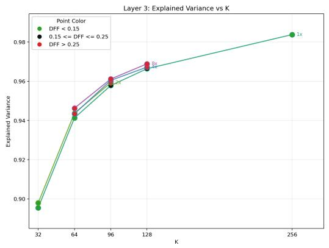

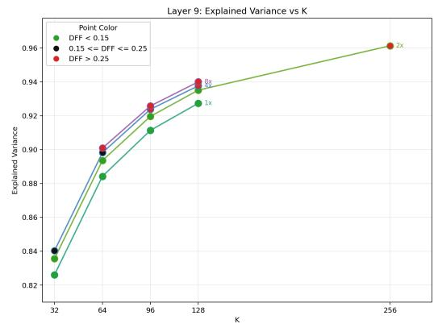

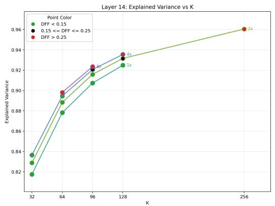

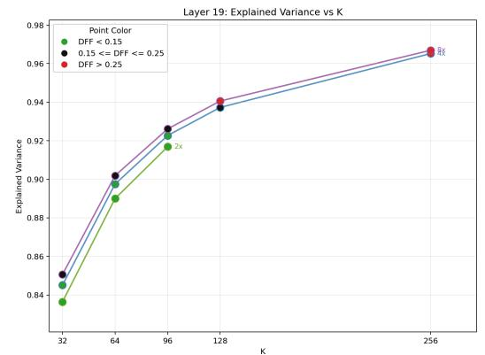

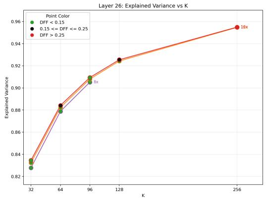  
Figure 7: EV-vs-K curves at epoch 10 for layers 3, 9 (top), 14, 19 (middle), and 26 (bottom). Lines vary M; point colors indicate DFF. We choose widths with DFF roughly below 0.15 across $K \in \{ 3 2 , 6 4 , 9 \bar { 6 } \}$ , except at layer 3, and select K near the curve’s shoulder.

## C KNOWN CONCEPTS

Known-concept probing uses extractor concepts from audio and metadata extractors run on the main-corpus analysis split, and human-labelled concepts from the ParaSpeechCaps tag concept set described in Appendix A.

Extractor inventory. Table 5 lists the automatic extractors and scalar values used before binarization. Each extractor writes scalar values and per-value reliability masks. Probing abstains on rows where an extractor marks a value unreliable, the value is missing, or the value is non-finite.

Table 5: Automatic concept extractors. Each scalar yields high- and low-tail concepts except emotion2vec and accent scores, which yield only high-tail concepts, giving 55 targets in total.
<table><tr><td>Family</td><td>Extractor</td><td>Scalar outputs used</td></tr><tr><td>Pitch and voicing Energy and spec-</td><td>PENN (Morrison et al., 2023) librosa RMS and spectral cen-</td><td>f0 mean, voiced fraction, mean voiced run sec, f0 slope rms mean, rms slope, spectral centroid mean</td></tr><tr><td>trum Timing</td><td>troid</td><td>WebRTC VAD, g2p speaking pause fraction, mean pause sec, speaking rate, dura-</td></tr><tr><td>Recording quality</td><td>rate, manifest duration Brouhaha (Lavechin et al.,</td><td>tion snr, c50, spectral tilt</td></tr><tr><td>Voice quality</td><td>2023); librosa STFT spectral tilt Praat/Parselmouth (Jadoul et al., jitter local, shimmer local, hnr db</td><td></td></tr><tr><td></td><td>2018) Praat/Parselmouth</td><td></td></tr><tr><td>Formants Gender</td><td>wav2vec2/XLS-R gender classi- gender male prob</td><td>f1 median, f2 median, f3 median</td></tr><tr><td>Emotion</td><td>fier</td><td>emotion2vec (Ma et al., 2024); emo2vec happy, emo2vec sad, arousal, valence</td></tr><tr><td>Accent</td><td>MSP-DIM VoxProfile/Whisper (Feng et al., 2025)</td><td>accent east asia, accent english, accent germanic, ac- cent north america, accent oceania, accent romance,</td></tr></table>

Binarization. We convert scalar values into 55 binary concepts. For scalars with both directions, we create high-tail and low-tail labels using the top and bottom 20% of reliable finite utterances. Positive examples are the corresponding tail, and negative examples are a random sample from reliable non-tail utterances, balanced to the number of positives. For emotion2vec and accent scores, we keep only high-confidence labels using the top 5% tail. Their negatives are high-confidence positives from other kept classes in the same family. We split each binary dataset 70%/10%/20% by speaker ID into disjoint train, val, and test splits before probing.

Human-labelled concepts. The 21 ParaSpeechCaps tags retained after filtering (Appendix A) are:

• Intrinsic: American, authoritative, booming, British, crisp, deep, flowing, hesitant, husky, loud, nasal, raspy, shrill, silky, slurred, and stammering.

• Situational: confused, disgusted, happy, saddened, and whispered.

## C.1 SPARSE PROBING DETAILS

Qwen3-TTS and CosyVoice2 additionally evaluate k ∈ {20, 50, 100, 200}. Features that are nonzero on less than 0.1% of probe-training utterances are excluded for probing. For each concept, feature set, and layer, features are ranked by the absolute positive-minus-negative mean activation difference. Ties are broken by feature index. After ranking, selected features are standardized using train means and stds before fitting.

Each probe is an ℓ2-regularized logistic regression fit with the sklearn liblinear solver, inverse regularization strength C = 1.0, and at most 1000 iterations. The decision threshold is selected on validation rows to maximize F1, with precision and then the smallest threshold possible used as tie-breakers.

## C.2 STEERING DETAILS

Steering vectors. For SAE steering, the intervention vector for concept c is

$$
\Delta _ { c } ( \lambda ) = \lambda \sum _ { j \in J _ { c } } \sigma _ { j } s _ { j } W _ { \mathrm { d e c } , j } / s _ { \mathrm { i n } } ,
$$

where $J _ { c }$ contains the top $2$ sparse-probing features, $\sigma _ { j }$ is the feature’s cached nonzero activation standard deviation, $s _ { j } ~ \in ~ \{ - 1 , 1 \}$ is the train-split association sign, $W _ { \mathrm { d e c } , j }$ is the SAE decoder direction, and $s _ { \mathrm { i n } }$ is the SAE input scale. PCA and random-direction steering use the same formula with the corresponding unit basis vector in place of $W _ { \mathrm { d e c } , j } / s _ { \mathrm { i n } } ;$ these bases are unit-normalized before steering. The difference-of-means topline uses

$$
\Delta _ { c } ( \lambda ) = \lambda \sigma _ { c } v _ { c } ,
$$

where $v _ { c }$ is the unit-normalized difference between positive and negative train-row mean hidden states and $\sigma _ { c }$ is the train-row standard deviation along that axis.

Qwen3-TTS strength sweep. We sweep $\lambda \in \{ 0 . 5 , 0 . 7 5 , 1 . 0 , 1 . 2 5 \}$ at Qwen3-TTS layers 19 and 26 on 100 examples. Both layers and all methods use the same 9 targets selected across the original probing sweep: duration ↑, F0 mean $\uparrow / \downarrow$ , male probability $\uparrow / \downarrow$ , pause length ↑, RMS mean $\uparrow / \downarrow$ and SNR ↓.

Temporal schedule. The intervention is applied only during generated-token steps, leaving the source-prompt prefill unmodified. For generated step t, we multiply the intervention by

$$
\alpha _ { t } = \operatorname* { m a x } ( 0 , 1 - t / T ) ,
$$

where T is the expected generated length estimated as the target/source transcript non-space character ratio times the number of source prompt codec tokens.

Protected concepts. We exclude the target scalar and concepts with analysis-split absolute Spearman correlation $\geq 0 . 3 5$ with the target. High/low labels of the same scalar count as one protected property.

Metric aggregation. For model comparisons and strength sweeps, we average available per-concept scores with equal weight, treating high/low directions separately. Missing scores are excluded from each metric’s average. Each protected property uses pairs with valid target and property measurements. Off-target change is omitted if any protected property has no valid pairs. Within each concept, ∆WER and ∆UTMOS are paired means across utterances, with WER in percentage points.

Probing and steering. Across 55 targets, SAE top-2 nF1 and Target Change have Spearman $\rho = 0 . 2 0 / 0 . 2 2$ at Qwen3-TTS layers $1 9 { \bar { / } } 2 6 .$ , and $- 0 . { \bar { 0 7 } } / 0 . 0 0$ in Fish S1/S2.

## C.3 ADDITIONAL STEERING RESULTS

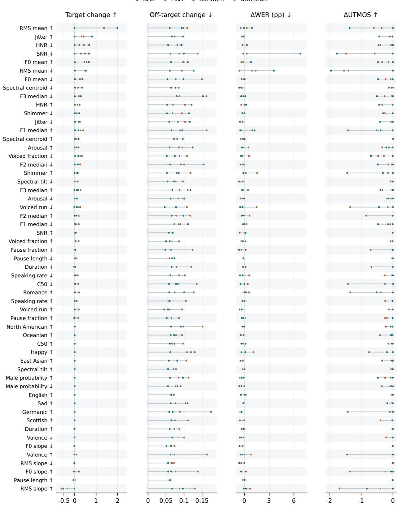  
Figure 8: Steering results for all 55 concepts at Qwen3-TTS layer 19, extending Figure 5. Concepts are ordered by descending SAE Target Change.

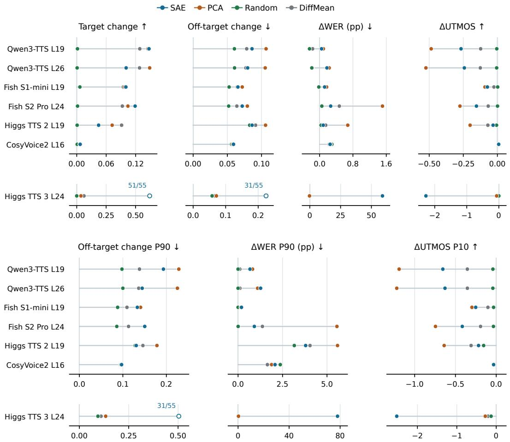  
Figure 9: Expanded model comparison from Figure 4, including Higgs TTS 3 on separate axes. Additional panels show larger off-target changes (90th percentile across protected-concept medians) and quality losses (90th/10th percentiles of utterance-level ∆WER/∆UTMOS), averaged across target concepts. Hollow markers indicate 51/55 target and 31/55 off-target scores for Higgs TTS 3 SAE due to unavailable extractor measurements; all quality means retain 55/55, including degraded speech.

## D AUTO-INTERPRETABILITY DETAILS

Feature sampling. All experiments use layer-19 features on the analysis split, with activating and contrast candidates defined in Section 4. Features must have at least 20 candidates of each type. We sample 500 per set from 3583 eligible SAE features (out of 4096), 1024 PCA features, and 4096 random directions.

Utterance sets. Sample counts follow Section 4. Label Fit uses held-out audio; Label Stability repeats the original evidence and uses a disjoint evidence set. Coherence trials randomize clip order. Audio is truncated to at most 20 seconds.

Validation. Features must pass all three thresholds in Section 4. The Coherence threshold of 3 correct trials out of 5 is the smallest integer threshold with one-sided binomial probability below 0.05 under random guessing $( p = 1 / 1 1 )$ ). Stability averages the original-clip and disjoint-clip comparisons. Among the 684 passing features, these components average 0.849 and 0.662, respectively.

Baselines and controls. Random-guessing baselines are analytical. The Stability reference assumes uniform guesses over same, overlapping, different, and unclear, giving expected support 0.25 · 1.0 + 0.25 · 0.5 = 0.375. Shuffled-label controls assign labels from another feature in the same set and layer, with no feature retaining its own label. Random-audio controls replace each clip with a random utterance. Both retain the original prompts and response formats.

Speaker diversity. We cluster speaker embeddings from all strongly activating utterances per feature (20–11778 for classified features), using average linkage and a cosine-distance cutoff of 0.4. Of all 4096 SAE features, 518 have 1–2 embedding clusters, 181 have 3–5, 2903 have more than 5, and 494 have fewer than 20 activating utterances and remain unclassified. The main comparison uses the 3583 auto-interpretability-eligible features of which 699 have at most 5 clusters.

## D.1 GEMINI PROMPT TEMPLATES

We use Gemini 3.5 Flash for all API calls. The exact prompts used for auto-interpretability are below.   
The request builder interleaves these prompts with text labels and inline audio attachments.

## Label generation prompt.

I'm studying learned features inside a speech synthesis model. I've attached two groups of short speech clips for a given feature.

The clips are attached inline in this message. Each audio attachment is

labels ACTIVATING\_1, ACTIVATING\_2, ... are Group A, and labels CONTRAST\_1, CONTRAST\_2, ... are Group B.

GROUP A (labels ACTIVATING\_\*): These clips all strongly activate a specific internal feature of the model.

GROUP B (labels CONTRAST\_\*): These are random clips that do NOT activate this feature.

Your task: Listen carefully to both groups and identify what acoustic, vocal, or recording property consistently distinguishes Group A from Group B.

First, listen for the most salient pattern without assuming it belongs to any predefined category. Learned model features can correspond to subtle, unusual, or cross-cutting properties.

After forming your initial hypothesis, use the following list only as a checklist of possibilities you may have missed, not as a constraint on the answer:

\- Voice quality (breathy, creaky, nasal, hoarse, resonant, thin, etc.)

\- Recording conditions (reverb, background noise type, microphone quality, room size, phone vs studio)

\- Prosody (monotone vs expressive, rising/falling intonation patterns, rhythm)

\- Speaking style (read speech vs conversational, formal vs casual, acted vs natural)

\- Tempo and pacing (fast, slow, many pauses, rushed)

\- Pitch register (not just high/low, but placement - head voice, chest voice)

\- Energy dynamics (consistently loud, quiet, dynamic range, fading)

\- Emotional tone (but be specific - not just "happy" but "politely enthusiastic" or "suppressed frustration")

\- Articulatory features (mumbling, crisp enunciation, specific vowel qualities, accent features)

\- Any other pattern you notice, even if subtle, weird, mixed, or hard to name Be specific and concrete. Don't say "Group A sounds different" - say exactly how. If you notice multiple distinguishing properties, list them in order of how consistent they are across all Group A clips. If you're uncertain, say so and give your best guess with a confidence level.

Prefer the pattern that best separates Group A from Group B, even if it does not fit cleanly into any category above. It is acceptable for the best explanation to combine multiple cues, such as "female speaker with close-mic studio audio" or "fast conversational delivery with clipped endings."

Important: this is a multimodal audio request. Do not answer as if you only have text labels. If your first instinct is to say you cannot access or play the audio, double-check the attached inline audio parts and use them. If the provider truly fails to expose the audio to you, still return the JSON schema below with confidence "low", explain the access problem in notes\_for\_human\_reviewer, and do not invent acoustic observations.

Return only one valid JSON object. Do not wrap it in markdown. Use exactly these keys:

\- primary\_pattern: one-line description

\- confidence: one of "high", "medium", or "low"

\- details: 2-3 sentences elaborating the pattern

\- secondary\_patterns: list of additional distinguishing features, if present

\- counter\_examples: list noting any Group A clips that don't fit the pattern, or Group B clips that do

\- distinguishing\_cues: list of short concrete acoustic/vocal/recording cues

\- label\_short: concise lowercase dashboard-friendly label

\- is\_likely\_speaker\_identity: boolean

\- notes\_for\_human\_reviewer: string

## Coherence prompt.

I'm studying whether a learned speech-model feature captures a coherent audio

concept. I attached several short clips. Most clips belong together because they strongly activate the same internal feature; exactly one clip is a random non-activating intruder.

Each audio attachment is immediately preceded by a label CLIP\_1, CLIP\_2, ... Listen to all clips and identify the one clip that does NOT belong with the others. Use the audio content, not the label names.

Return only one valid JSON object with exactly these keys:

\- intruder\_label: one of the provided CLIP\_\* labels

\- confidence: one of "high", "medium", or "low"

\- reason: short explanation of the acoustic/vocal/recording cue that made the selected clip seem different

## Label Fit prompt.

I'm evaluating an automatically generated description of a learned speech-model feature.

Description: "{label}"

Listen to the attached speech clip. Does this clip match the description above? Answer based on the audio, not on the file name or metadata.

Return only one valid JSON object with exactly these keys:

\- answer: "YES" or "NO"

\- confidence: one of "high", "medium", or "low"

\- reason: short explanation of the acoustic/vocal/recording cue you used

## Label Stability prompt.

I'm evaluating cross-validation consistency for automatic labels of learned speech-model features.

Each label was generated by an automatic labeling model that compared

activating audio clips for one learned feature against non-activating contrast

The main reported label was generated from the main labeling utterance set and is the label used for downstream detection scoring. The held-out label was

Main reported label:

"{main\_label}"

Held-out label ({heldout\_name}):

"{heldout\_label}"

Decide whether the held-out label supports the same underlying concept as the

main reported label. Treat paraphrases, different wording, and different levels

of specificity as the same if they point to a compatible acoustic/vocal

recording property. Mark them different if their central claims are

incompatible or mainly describe different properties.

Use this rubric:

\- same: The labels refer to substantially the same concept, even if phrased differently.

\- overlapping: The labels are compatible but one is broader, narrower, or captures only part of the other.

\- different: The labels describe different concepts.

\- unclear: There is not enough information to decide.

Return only one valid JSON object with exactly these keys:

\- verdict: one of "same", "overlapping", "different", or "unclear"

\- support\_score: one of 1.0, 0.5, or 0.0

\- confidence: one of "high", "medium", or "low"

\- reason: one short sentence explaining the judgment

## E ADDITIONAL RESULTS

## E.1 EXPANDED CONCEPT METRICS

Figures 10 and 11 show all human-labelled and extractor concepts at Qwen3-TTS layer 19 for all four methods, ordered by descending SAE all-feature nF1.

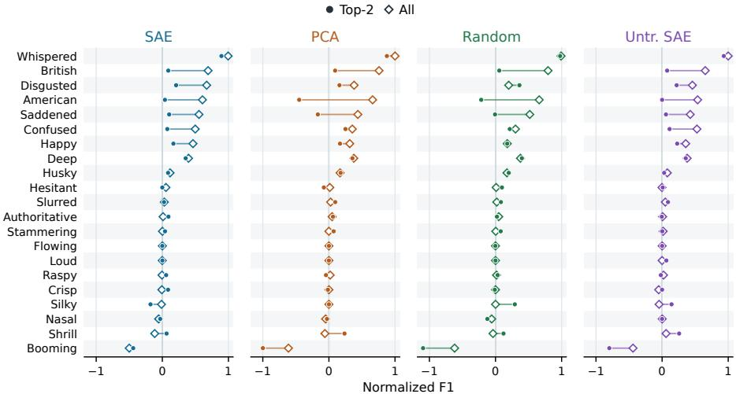  
Figure 10: All-feature and top-2 nF1 for all 21 human-labelled concepts.

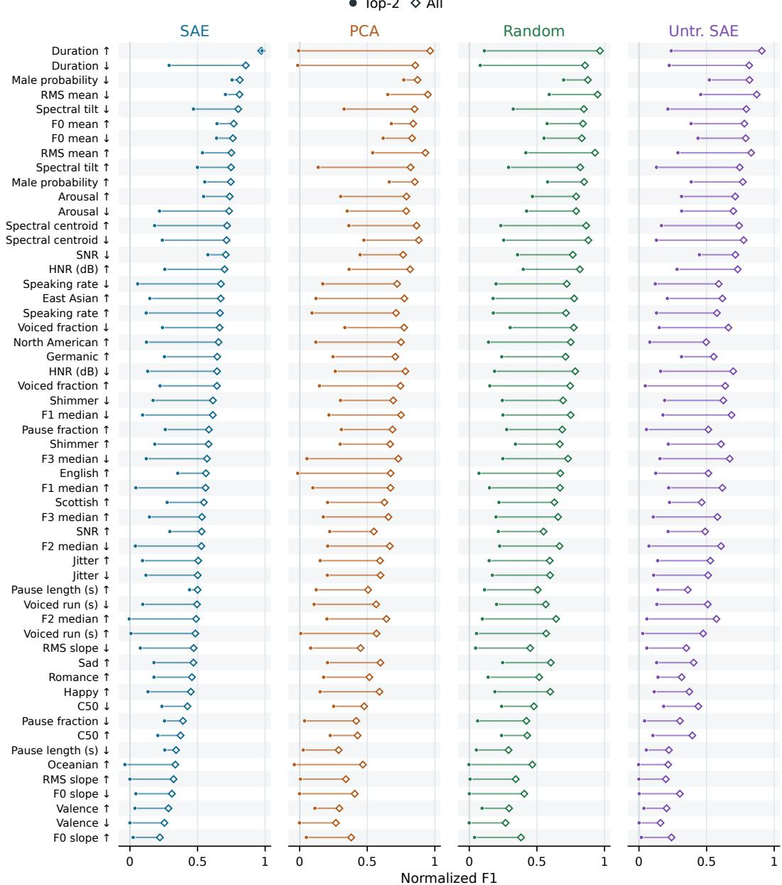  
Figure 11: All-feature and top-2 nF1 for all 55 extractor concepts at Qwen3-TTS layer 19, ordered by descending SAE all-feature nF1.

## E.2 PROBING ACROSS FEATURE COUNTS

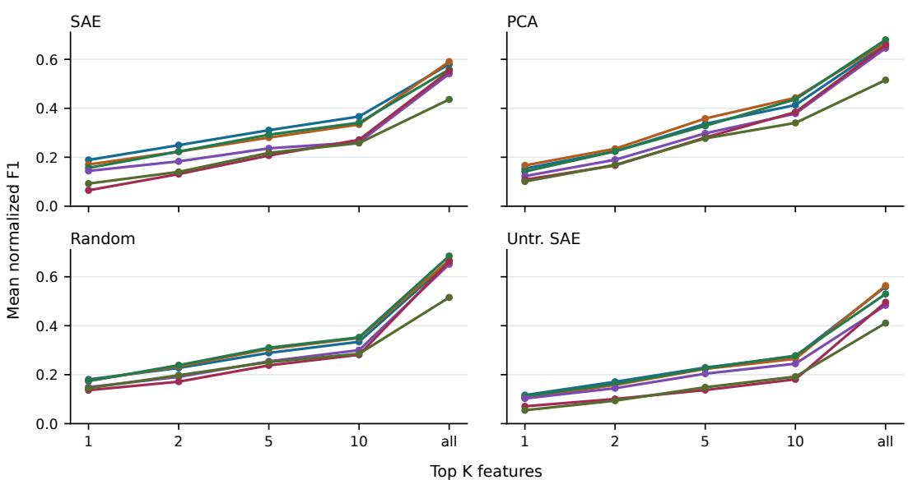  
Figure 12: Mean nF1 over all 55 extractor concepts as k increases. Takeaway: Extractor prediction improves with more features across all six models and four methods.

$$
\Phi \mathrm { - Q W e n ~ L 1 g ~ } \Phi \mathrm { - F i s h ~ } \mathsf { S } \mathrm { 1 } \mathrm { ~ L 1 9 ~ } \Phi \mathrm { - F i s h ~ } \mathsf { S } \mathrm { 2 } \mathrm { ~ L 2 4 ~ } \Phi \mathrm { - H i g g s ~ } 2 \mathrm { ~ L 1 9 ~ } \Phi \mathrm { - H i g g s ~ } 3 \mathrm { ~ L 2 4 ~ } \Phi \mathrm { - C o s y V o i c e 2 ~ L 1 6 ~ }
$$

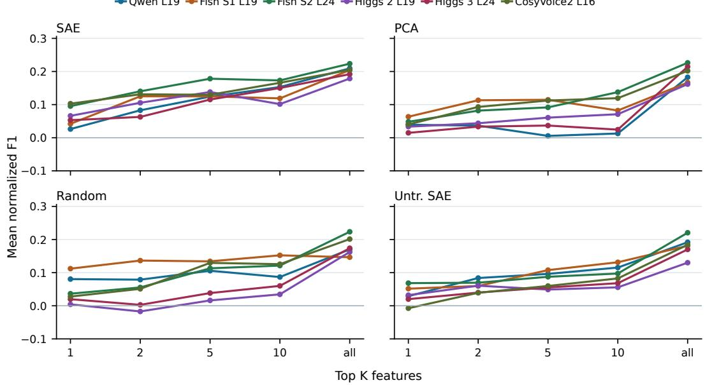  
Figure 13: Mean nF1 over all 21 human-labelled concepts. Takeaway: Prediction generally improves with more features, with SAE exceeding PCA at $k = 2 , 5 ,$ , 10 across all six models.

## E.3 KNOWN-CONCEPT LAYERWISE TRENDS

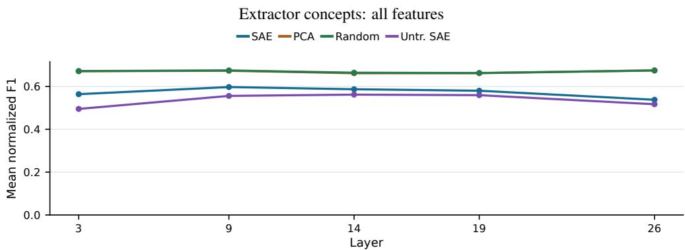

Extractor concepts: top-2 featuresSAE PCA Random Untr. SAE  
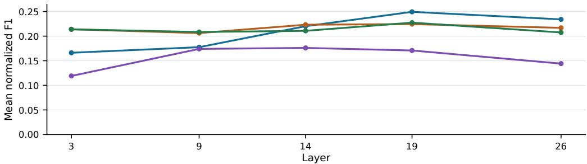

Human-labelled concepts: all featuresSAE PCA Random Untr. SAE  
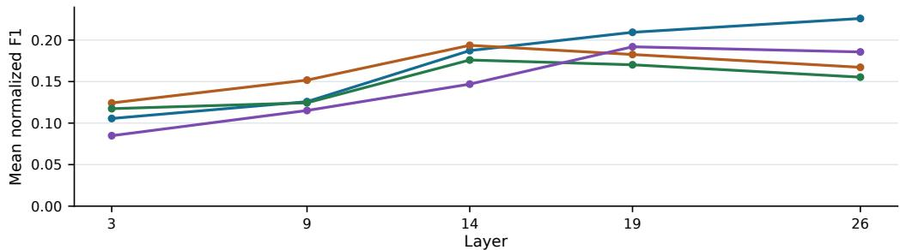

Human-labelled concepts: top-2 featuresSAE PCA Random Untr. SAE  
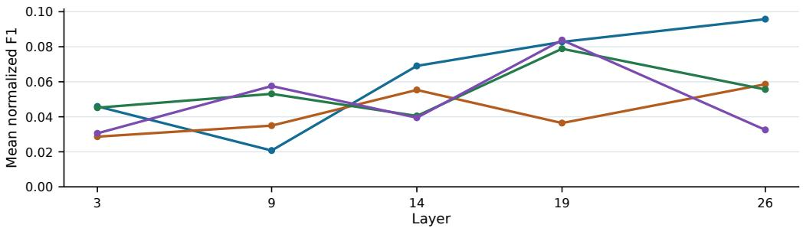  
Figure 14: Mean nF1 across Qwen3-TTS layers. From top to bottom: extractor all-feature, extractor top-2, human-labelled all-feature, and human-labelled top-2 scores. Takeaway: SAE top-2 prediction peaks at layer 19 for extractor concepts and layer 26 for human-labelled concepts.