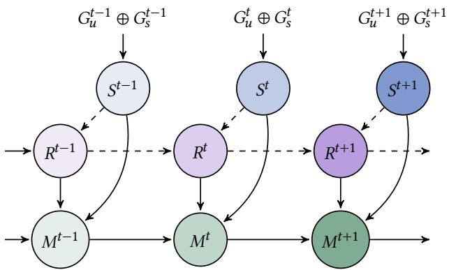
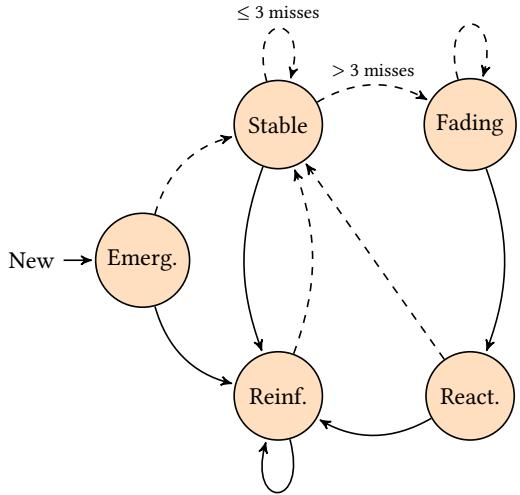
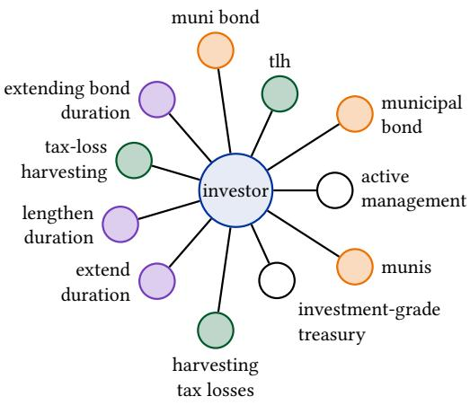
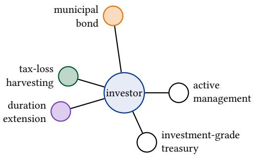
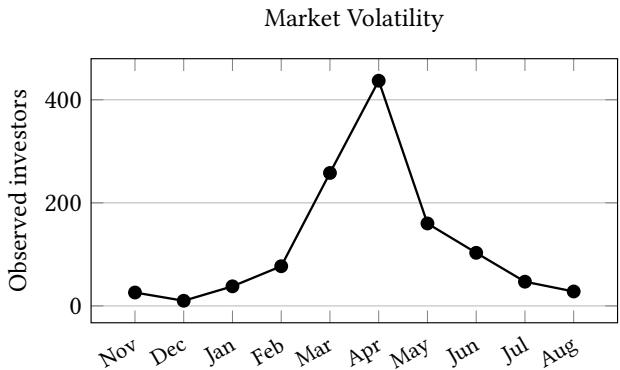
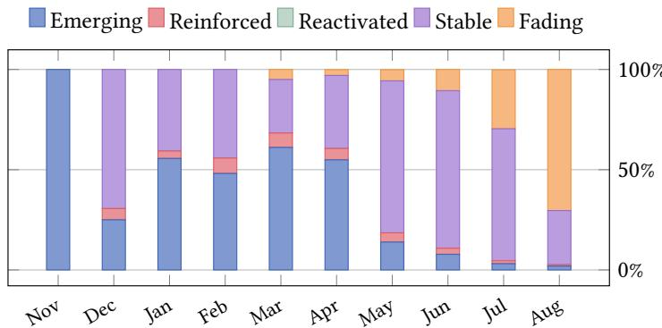

# FIRME: Registry-Anchored Memory Graphs for Evolving, Heterogeneous Investor Knowledge

Yunbai Zhang   
yunbai\_zhang@vanguard.com The Vanguard   
Malvern, Pennsylvania, USA Yunyi Gao   
yunyi\_gao@vanguard.com The Vanguard   
Malvern, Pennsylvania, USA   
Han-Tai Shiao<sup>†</sup>   
han-tai\_shiao@vanguard.com   
The Vanguard   
Malvern, Pennsylvania, USA

## Abstract

Financial AI workflows that reuse investor knowledge need persistent memory that integrates observations across sources and periods without losing identity or provenance. In a knowledge graph, recurring observations may use diferent surface forms, fragmenting relationship histories and preventing evidence from accumulating. We introduce Fusion and Identity Registry for Memory Evolution (FIRME), a registry-anchored memory graph that reconciles incoming observations to persistent canonical relationships and retains their source, time, and context. Within periods, rule-based fusion links investor-call discussions to portfolio cash flow signals, directly or through a fixed product–topic ontology. Across periods, canonical identities and persistent aliases direct recurring observations to the same relationship history; deterministic updates summarize reinforcement, inactivity, and reactivation. We evaluate FIRME on proprietary investor-call and cashflow records and on S&P 500 earnings-call transcripts. Compared with a historical registry that retains canonical identities and semantic fallback but omits alias memory, FIRME increases finalperiod Correct Match Rate by 7.8–12.1 percentage points across four dataset–backend setings under a fixed-judge and fallbackreview protocol. A blinded human audit of 200 incoming observations per seting finds Correct Match Rate gains of 9.0–16.5 points and reatachment-recall gains of 22.5–29.0 points, with higher observed merge precision in all four samples. A separate audit finds valid evidence paths for 293 of 300 outputs from full withinperiod fusion in the investor-call seting. Extraction-faithfulness and round-trip diagnostics assess source grounding and preservation of extractor-derived graph content.

## 1 Introduction

Understanding an investor’s interests requires atention to current evidence and to how those interests and relationships change with market conditions. The prominence of a concern such as market volatility may rise during turbulence, recede as conditions stabilize, and return when uncertainty increases. Reconstructing these trajectories therefore requires combining heterogeneous sources of evidence. Unstructured text, including call records and meeting notes, provides discussion context, whereas structured records, such as financial-activity tables, capture measurable behavior. Because interests can persist and return, past evidence should neither remain permanently active nor disappear when observations are absent. Agentic and tool-augmented financial workflows that reuse investor knowledge depend on maintaining this knowledge across interactions. This requires recurring observations to update the correct existing relationships while retaining their supporting evidence.

Maintaining evidence across sources and periods requires reconciliation. Structured records and unstructured text difer in format and vocabulary; the same entity or relationship can vary in name or phrasing over time. Before entering the knowledge store, new evidence must therefore be aligned across sources and matched to the correct persistent identity. Otherwise, observations describing the same relationship form separate entities or connections, each with a partial history, while cross-format supporting evidence remains disconnected. Fragmented relationship histories in agent memory can yield incomplete or redundant context for downstream reasoning about an investor’s recurring concerns. Stable identity is necessary to accumulate evidence under one persistent relationship and track its changes and lifecycle over time.

Temporal graph memories provide an important starting point. Zep/Graphiti reconciles extracted entities with existing graph nodes, deduplicates facts, links facts to source episodes, and represents when facts are valid or invalidated; its evaluation emphasizes retrieval-supported question answering and latency [20]. In the financial setings we study, the central question is how evidence for the same relationship accumulates and changes across periods. Incoming observations may use diferent names or come from diferent sources, and some periods may contain no matched observation. The graph-update challenge is to determine which relationship history receives each new observation and how that relationship’s evidence strength evolves with recurrence, inactivity, and renewed evidence.

We introduce Fusion and Identity Registry for Memory Evolution (FIRME), a knowledge graph (KG) memory framework, to address this challenge. A stable head identifier anchors whose relationship is being tracked, while an evolving registry reconciles target-name variants to canonical identities, anchoring what that relationship concerns. Together, these identities determine which persistent relationship history receives incoming evidence. The memory graph retains each observation’s relation label, source, time, and context. When conversational and structured evidence coexist, within-period fusion can recognize their corroboration while preserving both observations. Across periods, a recurring observation reinforces the corresponding history; periods without matched observations lower its evidence strength while leaving earlier evidence available. We test the incremental role of retained aliases against a control that still uses historical canonical reconciliation and semantic matching.

FIRME is intended to provide investors and financial professionals with a consolidated, longitudinal view of investor-related information. By accumulating observations under persistent relationship identities, it brings current evidence together with earlier observations across sources, preserving their provenance and historical context.

## 1.1 Related Work

Text-to-KG Construction and Canonicalization. Text-to-KG construction progressed from patern-based extraction and distant supervision [6, 17] to generative relation extraction [10] and LLM pipelines. LLM pipelines add schema control and canonicalization: EDC separates open extraction, schema definition, and canonicalization, while KGGen clusters related entities [18, 23]. GraphRAG structures extracted graphs for corpus-level summarization [4], whereas open-KG methods consolidate synonymous entity and relation expressions [3, 22]. These approaches reduce surface-form sparsity at construction time. They do not determine how recurring observations drawn from heterogeneous sources should accumulate under a single persistent relationship across successive time periods.

Temporal KGs and Dynamic Memory. Temporal KGs model fact validity, while completion models predict missing or future facts from historical representations [9, 11, 13, 16]. ATOM separates observation time from validity time [12]; Zep adds bitemporal facts, provenance, resolution, and conflict-based invalidation for agent memory [20]; and FinDKG propagates latent representations across financial-news snapshots for prediction [15]. These systems foreground fact validity, retrieval, or predictive state. We complement them by asking how recurring or absent evidence changes the salience and lifecycle of an explicit, auditable relationship edge retaining source, time, context, and participants. Recurrence strengthens its evidence state; non-observation lowers current prominence without erasing provenance; later evidence may reactivate it.

Heterogeneous Financial KG Fusion. Multi-source KG integration commonly uses entity alignment and ontology matching [19, 21]. Financial KG research spans news extraction, temporal linkage, deduplication, conflict handling, table-aware construction, and evolving fundamentals or events [1, 5, 14, 24, 25]. These sys tems primarily organize corporate news, disclosures, fundamentals, or discrete events. Investor-centric data require a diferent combination: conversational and structured observations may corroborate the same relationship without being duplicates, and missing evidence need not terminate that relationship, whose memory state may decay and later reactivate.

  
Figure 1: Coupled short- and long-term fusion in FIRME across consecutive periods. Each short-term graph $S ^ { t } = G _ { u } ^ { t }$ ⊕ $G _ { s } ^ { t }$ fuses unstructured and structured graphs. Dashed arrows show registry update from $R ^ { t - 1 }$ to $R ^ { t }$ , conditioned on $S ^ { t } ;$ solid arrows to $M ^ { t }$ show memory reconciliation of $S ^ { t }$ $R ^ { t } { } _ { : }$ , and $M ^ { t - 1 }$

## 1.2 Contributions

FIRME’s central contribution is an identity-conditioned update of persistent relationship histories across periods (Figure 1). Withinperiod corroboration supports this update in paired investor-call data, while lifecycle states make the resulting histories interpretable.

Coupled registry–memory recurrence. FIRME couples an evolving registry of canonical identities and retained aliases to a memory graph of relationship histories. A stable head identifier and a reconciled target identity determine which history receives each observation, even when names or evidence sources difer. The history retains each observation’s relation label, source, timestamp, and context; it receives at most one strength and lifecycle update per period. Against a no-alias control that retains historical canonical reconciliation and semantic fallback, full FIRME improves final-period Correct Match Rate (CMR) by 7.8–12.1 percentage points across four dataset–backend setings under the judge and fallback-review protocol (Table 3). In the shared blinded human audit (Table A2), reatachment recall improves by 22.5–29.0 points, and observed merge precision is higher in all four samples.

Audited within-period corroboration. For paired investorcall and cash-flow records, same-investor, same-period rules identify direct product corroboration and ontology-mediated support from a discussed topic. The derived product relationship references its supporting observations without merging topic and product identities. In the final-period Opus 4.6 human audit, 293 of 300 Full fusion outputs had valid evidence paths, including 91 of 94 outputs triggered by Rule 4 but not Rule 3 (Table 7).

Interpretable lifecycle state assignment. Given reconciled relationship histories, fixed rules update an evidence-strength score from matched or unmatched periods and assign one of five lifecycle states from match status, prior state, and consecutive unmatched periods. Each assigned state is traceable to retained observations and periods without a match, providing an interpretable summary of the relationship’s recorded evidence trajectory.

The longitudinal investor-call corpus includes paired cash-flow records and tests identity continuity and short-term corroboration. The transcript-only S&P 500 corpus tests temporal reconciliation under a broader entity schema. Extraction-faithfulness and roundtrip recovery diagnostics, lifecycle trajectories, and analytical parameter behavior provide complementary checks.

## 2 Problem Formulation

## 2.1 Preliminaries and Notation

A knowledge graph is $G = \left( V , { \mathcal { R } } , E \right)$ , where � is the entity set, ℛ the relation-type set, and $E \subseteq V \times { \mathcal { R } } \times V$ contains directed, typed edges $( u , r , \nu )$ from head � to tail � through relation �. In the investor-call fusion seting, FIRME constructs a graph with the three entity types and three relation types defined in Section 3.1. We call the product or topic at tail � the target entity; it is distinct from the head entity �. The S&P 500 transcript-only seting uses a broader set of extracted entity types.

## 2.2 Data Modalities

In the investor-call seting, FIRME integrates two modalities. At period �, unstructured data consists of text from call transcripts and meeting notes and yields $G _ { u } ^ { t }$ . Each tuple $( u , r , \nu )$ relates a person or organization � through � to a product or topic �. The extractor is prompted to identify relationships involving substantive discus sion.

Structured data consists of predefined records such as relational tables and yields $G _ { s } ^ { t }$ . A primary index identifies a person or organization; graph-construction rules specify which columns and value conditions instantiate edges. For example, an investor’s capital inflow into a product can instantiate an investor–product behavioral edge.

## 2.3 Problem Statement

Constructing a temporally coherent graph from these inputs poses three interrelated problems.

Short-term fusion. Given $G _ { u } ^ { t }$ and $G _ { s } ^ { t }$ within period �, shortterm fusion combines the two partial graphs into the coherent, consolidated graph $S ^ { t } = G _ { u } ^ { t }$ ⊕ $G _ { s } ^ { t }$ . Product- and topic-level evidence is aligned through a fixed product–topic ontology � (Appendix G), while ⊕ combines discursive evidence with structured cash-flow signals. The strong-interest relation is assigned only when both modalities corroborate a relationship; it is a rule-based evidential label, not a calibrated preference or stance estimate.

Long-term fusion. Long-term fusion maintains a temporally coherent memory graph as investment interests emerge, strengthen, persist, weaken, and may resurface after dormancy. Each canonical relationship in $M ^ { t }$ is a time-indexed edge whose atribute vector $\pmb { h } _ { t }$ accumulates observations $( u , r , \nu )$ and supporting evidence, together with first- and last-seen periods, a memory-strength score, and a lifecycle state. As Figure 1 shows, $S ^ { t }$ is normalized through the prior registry $R ^ { t - 1 } ;$ these edges are reconciled with the prior memory graph $M ^ { t - 1 }$ . These operations define

$$
\begin{array} { r l } & { { \cal R } ^ { t } = \Theta _ { 1 } \bigl ( { \cal R } ^ { t - 1 } , { \cal S } ^ { t } \bigr ) , } \\ & { { \cal M } ^ { t } = \Theta _ { 2 } \bigl ( { \cal M } ^ { t - 1 } , { \cal R } ^ { t } , { \cal S } ^ { t } \bigr ) , } \end{array}\tag{1}
$$

Table 1: Entity and relation schema for investor-call fusion.
<table><tr><td colspan="2">Entity types</td></tr><tr><td>person/org</td><td>Tracked investor or asset-management firm</td></tr><tr><td>product</td><td>Financial instrument (e.g., VOO, BND)</td></tr><tr><td>topic</td><td>Investment theme  $( \mathrm { e . g . } ,$  ESG Investing)</td></tr><tr><td colspan="2">Relation types</td></tr><tr><td>discussed</td><td>Product/topic identified as substantively</td></tr><tr><td>Unstructured</td><td>discussed</td></tr><tr><td>cf-signal Structured</td><td>Investor shows significant inflow into a</td></tr><tr><td></td><td>product</td></tr><tr><td>strong-interest</td><td></td></tr><tr><td>Fusion</td><td>Corroborating evidence in both modalities</td></tr></table>

where $\Theta _ { 1 }$ and $\Theta _ { 2 }$ denote the coupled registry and memory reconciliation dynamics. We initialize $R ^ { 0 } = M ^ { 0 } = \varnothing . \mathrm { A t } t = 1$ , candidates in $S ^ { 1 }$ are deduplicated by lemmatized string equality and then by semantic matching for unresolved same-type candidates; all normalized edges enter $M ^ { 1 }$ in the Emerging state with a baseline score of 0.5. For $t > 1$ , unresolved same-type candidates are semantically compared only with $R ^ { t - 1 }$

Entity normalization. Entity normalization determines whether text-extracted entities �<sub>�</sub> and �<sub>�</sub> in $G _ { u }$ denote the same entity. Without it, near-duplicates fragment one relationship’s history and burden both fusion stages; Section 3 presents the registry-based solution.

## 3 Methodology

## 3.1 Entity and Relation Schema

The investor-call fusion schema in Table 1 has three entity types: person/org for the person or organization whose relationships are tracked, product for a specific financial instrument, and topic for an investment theme or strategy. Three relation types link these head entities to products and topics. The discussed relation denotes a product or topic identified by the extractor as substantively discussed in the call. Structured cf-signal marks significant capital allocation toward a product, and strong-interest is a rulederived evidential label requiring cross-modal corroboration, not a calibrated preference or stance estimate.

The S&P 500 transcript-only evaluation uses a broader extraction schema, with entity types such as Company, Person, Product, GeographicRegion, and FinancialMetric. These entities enter temporal reconciliation without the investor-call cash-flow fusion rules.

The graph head is the tracked business entity: an investor or asset-management firm in the investor seting, or a reporting company in the S&P 500 corpus. In the investor-call corpus, the call’s canonical subject\_entity\_id and the cash-flow record’s owner identify the same investor. The actual call speaker is recorded separately in raw\_subject and speaker\_role; a speaker change does not change the graph head. Cross-modal corroboration therefore requires the same investor ID and period, as well as the product or topic conditions in Section 3.3.

## 3.2 Knowledge Graph Construction

FIRME’s text-to-graph component, LLM2Graph, builds the unstructured graph $G _ { u }$ by processing each document $d \in D$ and emitting $( u , r , \nu , d )$ , where � records the supporting textual evidence. In the investor-call seting, it preserves each source-provided head ID and maps raw product and topic mentions to period-local normalized candidates, assigning each a deterministic identifier derived from its entity type and lemmatized name. The extractor’s canonical layer performs period-local normalization without access to the historical entity registry or its learned aliases. The investor-call extraction system prompt is provided in Appendix F.1.

After period-local graph construction and, when structured data are available, short-term fusion, the persistent registry maps candidates to cross-period canonical identities through deterministicidentifier, normalized-name, and alias matching. LLM-based semantic matching against canonical names and aliases is reserved for unresolved same-type candidates. Matched candidates adopt the anchor ID and add their surface forms to the anchor’s alias set in �<sup>�</sup>. Only candidates unresolved after all matching tiers retain their identifiers and extend the registry.

The structured graph $G _ { s }$ captures cash-flow signals, namely capital inflows from investors into products, as $( u , \mathsf { c f - s i g n a l } , \nu )$ . Following the use-case definition of a material allocation, $G _ { s } ^ { t }$ includes an edge only when monthly inflow exceeds \$100K; otherwise, the signal is ignored to avoid over-counting weak signals. Each record’s owner field is the stable investor identifier.

## 3.3 Short-Term Fusion

Within each period, short-term fusion combines $G _ { u } ^ { t }$ and $G _ { s } ^ { t }$ into $S ^ { t } .$ Conversational product expressions are mapped to oficial prod uct identities (e.g., Vanguard S&P 500 ETF to VOO). We derived the product–topic ontology � from our proprietary internal resource, manually annotated by our financial analyst team, and froze it before evaluation. The association semantics, representative records, and their use in Rule 4 are illustrated in Appendix G. Original observations retain source indicator 1 for unstructured evidence or 2 for structured evidence. Corroborated product relationships receive the derived hybrid indicator 3; this does not change the source indicators of their observations.

Table 2 defines four rules. Rules 1–2 retain uncorroborated relationships with their original labels. Rule 3 performs direct corroboration: a current discussion and cash-flow signal for the same investor–product pair assign strong-interest to the product relationship. Rule 4 combines a current topic discussion with a current cash-flow signal for an ontology-linked product from the same investor. The product relationship is labeled strong-interest, while the topic relationship remains discussed. A topic may corroborate several allocated products without being duplicated in its own history.

Fusion retains the original targets and provenance of all observations. Under Rule 3, both observations belong to the same product history; under Rule 4, the product relationship references the supporting topic discussion, which also remains in its own topic history. All applicable direct and ontology-mediated support paths are retained as references, not additional observations. All original targets remain available for registry reconciliation. Appendix E provides pseudocode and cross-period examples.

## 3.4 Long-Term Memory Fusion

Long-term memory fusion combines registry-based entity reconciliation with rule-based edge reconciliation. Entity reconciliation establishes persistent identities, while edge reconciliation accumulates observations and updates relationship histories, memory strength, and lifecycle states across periods.

Cross-Period Entity Reconciliation. FIRME resolves incoming entities against the prior registry through identifier, normalized-name, and learned-alias matching, applied as sequential deterministic checks. That is, it first checks for an exact identifier match, then compares the incoming entity’s normalized name with registered canonical names, and finally checks for a matching alias previously associated with a canonical identity. The sequence stops once a match is found. For each unresolved entity, the candidate set comprises all entities of the same type in the prior registry $R ^ { t - 1 }$ . The LLM assigns semantic similarity scores to these candidates using their canonical names and aliases. The system prompt for semantic matching is provided in Appendix F.2. A deterministic rule filters candidates with scores $\ge ~ 0 . 8$ and selects the highest-scoring candidate. The incoming entity adopts the selected canonical ID, and its surface forms are added to that identity’s alias set. If no candidate meets the threshold, the entity is registered as new. An exploratory threshold-selection analysis is provided in Appendix D. Appendix C provides pseudocode.

Cross-Period Edge Reconciliation. After entity reconciliation, each original observation updates the history identified by its head ID and typed canonical target ID. Topic and product identities remain distinct; relation labels and source indicators are preserved per observation and excluded from the key. Each key undergoes one update per period: initialization if new, reinforcement if observed again, or decay if no current observation targets it. Multiple observations or corroboration paths do not produce additional score updates. Historical corroboration remains retrievable but does not count as current evidence. Relation upgrades follow Table 2 independently of memory-strength updates.

Within this procedure, the Memory Reinforcement–Decay Model updates the memory-strength score $\sigma _ { t } ( e ) \in [ 0 , 1 ]$ through a deterministic match gate. It draws on the gating intuition of long shortterm memory (LSTM) networks [7], rather than adopting their learned recurrent architecture. A new edge starts at $\sigma _ { \mathrm { i n i t } } ~ = ~ 0 . 5$ An existing matched edge is reinforced additively at rate $\alpha = 0 . 2 $

$$
\sigma _ { t } ( e ) = \operatorname* { m i n } ( 1 . 0 , \sigma _ { t - 1 } ( e ) + \alpha ) ,\tag{2}
$$

driving repeated matches toward saturation. An unmatched edge decays multiplicatively at retention rate $\gamma = 0 . 8$

$$
\sigma _ { t } ( e ) = \gamma \sigma _ { t - 1 } ( e ) ,\tag{3}
$$

giving exponential decay. Scores below 0.01 become zero, but the edge remains stored.

Lifecycle States. Lifecycle states provide an interpretable summary of each relationship’s temporal trajectory, determined by match status, prior state, and an inactivity counter for consecutive unmatched periods. An edge is Emerging when newly created; Reactivated when matched after Fading or with prior inactivity above �; Reinforced for other matches; Stable when unmatched with in activity at most �; and Fading when unmatched with inactivity above �.

Table 2: Short-term fusion rules in FIRME. Rules 1–2 retain uncorroborated relationships; Rules 3–4 assign strong-interest to products using current-period evidence from the same investor. Rule 4 retains the discussed-topic relationship. Original observations and provenance are preserved under all rules; TaxEff denotes Tax Eficiency.
<table><tr><td>Rule</td><td>Type</td><td>Antecedent</td><td>Consequent</td></tr><tr><td>1</td><td>Pass</td><td>discussed(Alice, VFIAX, 1)</td><td>⇒ discussed(Alice, VFIAX, 1)</td></tr><tr><td>2</td><td>Pass</td><td>cf-signal(Bob, VO0, 2)</td><td>⇒ cf-signal(Bob, V00, 2)</td></tr><tr><td>3</td><td>Fuse</td><td>discussed(Chris, BND, 1)⊕</td><td>⇒ strong-interest(Chris, BND, 3)</td></tr><tr><td></td><td>Fuse</td><td>cf-signal(Chris, BND, 2) discussed(Emma, TaxEff, 1)⊕</td><td></td></tr><tr><td>4</td><td></td><td>cf-signal(Emma, VTEB, 2),</td><td>⇒ discussed(Emma, TaxEff, 1)</td></tr><tr><td></td><td></td><td>with (VTEB, TaxEff) ∈ O</td><td>and strong-interest(Emma, VTEB, 3)</td></tr></table>

  
Figure 2: Memory-edge lifecycle with inactivity threshold $N = 3 .$ . The entry arrow initializes a relationship as Emerging. Solid transitions between states, including self-loops, denote matches; dashed transitions denote misses. Guards count consecutive misses including the current period; a match resets the count.

Initialization and matches reset the inactivity counter to zero; misses increment it. With $N = 3 ,$ an edge remains Stable through three consecutive unmatched periods and becomes Fading on the fourth (Figure 2). Scores decay from the first unmatched period, including periods in the Stable state. Appendix E provides worked examples. The resulting state estimates interest evolution from observed evidence rather than measuring latent preference directly.

Entity reconciliation and edge reconciliation implement $\Theta _ { 1 }$ and $\Theta _ { 2 } ,$ , respectively, in Equation 1. Edges are never removed; even zero-score edges remain available for reactivation.

Relationship as an Attribute Vector. Whereas the base relation � in a static triple $( u , r , \nu )$ is a single categorical label, its counterpart in $M ^ { t }$ is a time-dependent atribute vector,

$$
\begin{array} { r } { \boldsymbol { e } _ { t } = \left( \boldsymbol { u } , \boldsymbol { h } _ { t } , \nu \right) , } \end{array}\tag{4}
$$

where $\pmb { h } _ { t }$ stores each observation’s identifier, original typed target, relation type $r ,$ source indicator, timestamp, supporting context, and head identifier, plus speaker identity and role when available, together with edge-level first- and last-seen periods, memory state, and score $\sigma _ { t } ( e ) .$ . Corroboration records reference supporting observations and applicable ontology links without changing the observations’ original targets. Observations reconciled to the same canonical edge accumulate in $\pmb { h } _ { t }$ without overwriting earlier evidence, so score and state summarize the relationship’s evolving strength and lifecycle.

## 4 Empirical Evaluation

## 4.1 Evaluation Criteria and Setup

We evaluate FIRME primarily through memory usability, focusing on cross-period identity continuity and graph consolidation. Extraction faithfulness and round-trip recovery provide supporting diagnostics of source support and extractor-derived content preservation after graph-to-text-to-graph conversion. A final human audit evaluates the evidence supporting direct and ontology-mediated product corroboration.

We evaluate on two corpora. The first is a proprietary corpus of real investor-call transcripts paired with monthly portfolio cash-flow records; it spans 10 monthly periods with roughly 1,200 calls each. The transcripts and cash-flow records were obtained from routine business records and linked by investor identifier and month. Any personally identifiable information (PII) was masked. These data are not publicly available due to confidentiality restrictions.

The second corpus is the S&P 500 Earnings Transcripts Dataset [2]. We sampled 297 reporting companies with earnings calls dated February 2025 in the final period � and used their available transcripts across three reporting periods. Extracted entity types include companies, people, products and services, geographic regions, and financial topics. Each reporting company ID serves as a graph head. Because this corpus contains only transcripts, it evaluates extraction and temporal reconciliation, not cash-flow fusion.

Memory usability, extraction faithfulness, and round-trip recovery use evaluation inputs from the final period � . The final period contains approximately 1,300 investor calls with 10.3K incoming edges, and 297 S&P 500 earnings calls with approximately 6.3K incoming edges. The approximate edge totals refer to the Opus 4.6 reconciliation inputs. Round-trip recovery samples reference graphs from these final-period extracted outputs.

Unless stated otherwise, primary language-model components use Claude Opus 4.6 (Opus 4.6), and both corpora are additionally evaluated with GPT-5.4-mini; both backends use temperature 0.0. The extraction-faithfulness benchmark includes GraphRAG [4] as an additional comparison framework. Gemini 3.1 Pro serves as the fixed LLM judge across both datasets and all evaluated backends and strategies. It assesses grounding, normalization accuracy, and adjusted-precision grounding in round-trip recovery. Reatachment correctness is assessed through two complementary protocols. For LLM-Norm, FIRME w/o Alias Memory, and FIRME, Gemini 3.1 Pro evaluates all accepted reatachments, with two annotators reviewing cases initially judged incorrect (Appendix H). A separate blinded human audit establishes an adjudicated reference for 200 incoming units per dataset–backend seting, shared by all five strategies (Appendix A). Memory updates use reinforcement $\alpha = 0 . 2 $ , per-period retention $\gamma = 0 . 8 ,$ , initialization $\sigma _ { \mathrm { i n i t } } = 0 . 5 ,$ inactivity threshold $N = 3 ,$ and zeroing threshold 0.01. Deterministic identifier and name matches are accepted directly; unresolved candidates enter a semantic tier at threshold 0.8. This threshold was selected using the penultimate period $( T - 1 )$ of the investor-call corpus (Appendix D) and used for final-period evaluation.

## 4.2 Memory Usability

We first evaluate whether registry-anchored reconciliation enables recurring observations to accumulate under persistent relationship identities. We define identity continuity as linking semantically equivalent observations across periods to the same canonical rela tionship. We compare RAW exact surface forms, spaCy-Lemma deterministic lemmatization [8], LLM-Norm independent within period semantic normalization, FIRME w/o Alias Memory, and full FIRME. LLM-Norm normalizes each period independently, after which equal names or identifiers can be matched deterministically across periods. To evaluate the incremental contribution of persistent alias memory, we introduce FIRME w/o Alias Memory as a canonical-only historical registry control. It retains canonical-ID and canonical-name matching and cross-period semantic fallback, but removes the storage and reuse of alternative names. Ap pendix B details the control and the role of each comparison.

The Edge Compression Rate and Entity Compression Rate measure reductions in distinct edges and entities in cumulative memory relative to RAW; higher values indicate greater consolidation. The Memory Match Rate (MMR) is the fraction of incoming observations represented in $S ^ { t }$ that are reatached to cumulative memory $M ^ { t - 1 }$ , and Merge Precision measures the proportion of accepted reatachments judged to target the correct existing rela tionship. Correct Match Rate (CMR) is the proportion of incoming observations judged to be correctly reatached to cumulative prior memory:

$$
\mathrm { C M R } = \mathrm { M M R } \times \mathrm { M e r g e ~ P r e c i s i o n } .\tag{5}
$$

Within each dataset–backend seting, strategies share the same in coming observations. We evaluate whether each incoming observation is correctly reatached. Multiple observations can refer to the same historical relationship, so they remain separate evaluation units while contributing to one relationship history. CMR uses all incoming observations as its denominator. Human-audit reatachment recall instead measures the fraction of gold-recurring incoming units correctly reatached to their historical identities.



(a) LLM-Norm  
  
(b) FIRME  
Figure 3: Topic consolidation under LLM-Norm (a) and FIRME (b); colors link surface variants assigned to one canonical topic, while uncolored topics remain distinct.

Compression rates describe cumulative memory at the final period; MMR covers all final-period incoming observations. In Table 3, precision and CMR for LLM-Norm, FIRME w/o Alias Memory, and FIRME use the judge and fallback-review protocol. RAW and spaCy-Lemma use backend-specific human-audit precision; their CMR estimates multiply the reported population MMR by that precision. The final column reports human-audit reatachment recall. Appendix A provides the complete human-audit results.

Under the judge and fallback-review protocol, full FIRME increases CMR over FIRME w/o Alias Memory by 7.8–12.1 percentage points across the four setings (Table 3). These gains support the incremental contribution of persistent alias memory beyond canonical-only historical reconciliation. Full FIRME also achieves 2.3–3.7 times the CMR of LLM-Norm. The canonical-only control exceeds LLM-Norm in every seting, supporting the combined value of historical canonical reconciliation and semantic fallback.

Table 3: Memory usability. CR (compression rates) and MMR summarize population outputs. Precision uses human-audit estimates for RAW/spaCy-Lemma (†); otherwise, Gemini 3.1 Pro judges all accepted reattachments, with human review of initially incorrect cases. CMR is population MMR × precision. All reattachment recall values come from the shared human audit (200 incoming units per setting; CIs in Appendix A). Bold marks the highest CR, MMR, CMR, and recall within each setting.
<table><tr><td colspan="3">Dataset Backend Strategy</td><td rowspan="2">Edge CR</td><td rowspan="2">Entity CR</td><td rowspan="2">MMR</td><td rowspan="2">Merge precision</td><td rowspan="2">CMR</td><td rowspan="2">Reattachment Recall</td></tr><tr><td rowspan="2"></td><td rowspan="2">RAW</td></tr><tr><td>0.0%</td><td></td><td>0.0%</td><td>7.6%</td><td>100.0%†</td><td>7.6%†</td><td>15.0%</td></tr><tr><td rowspan="4">Investor calls</td><td rowspan="4">Opus 4.6</td><td>spaCy-Lemma</td><td>3.0%</td><td>7.6%</td><td>8.4%</td><td>94.1%†</td><td>7.9%†</td><td>20.0%</td></tr><tr><td>LLM-Norm FIRME w/o</td><td>6.1%</td><td>22.6%</td><td>8.3%</td><td>98.5%</td><td>8.2%</td><td>20.0%</td></tr><tr><td>Alias Memory</td><td>15.4%</td><td>43.7%</td><td>24.1%</td><td>92.3%</td><td>22.2%</td><td>52.5%</td></tr><tr><td>Full FIRME</td><td>20.2%</td><td>51.1%</td><td>31.8%</td><td>95.5%</td><td>30.4%</td><td>77.5%</td></tr><tr><td rowspan="5">calls</td><td rowspan="5">Investor GPT-5.4- mini</td><td>RAW</td><td>0.0%</td><td>0.0%</td><td>5.9%</td><td>100.0%†</td><td>5.9%†</td><td>15.0%</td></tr><tr><td>spaCy-Lemma</td><td>1.9%</td><td>4.2%</td><td>6.6%</td><td>100.0%†</td><td>6.6%†</td><td>16.3%</td></tr><tr><td>LLM-Norm FIRME w/o</td><td>10.0%</td><td>26.5%</td><td>9.0%</td><td>83.5%</td><td>7.5%</td><td>20.0%</td></tr><tr><td>Alias Memory</td><td>16.2%</td><td>35.2%</td><td>22.4%</td><td>83.3%</td><td>18.7%</td><td>46.3%</td></tr><tr><td>Full FIRME</td><td>20.7%</td><td>41.4%</td><td>31.9%</td><td>83.0%</td><td>26.5%</td><td>68.8%</td></tr><tr><td rowspan="5"></td><td rowspan="5">S&amp;P 500 Opus 4.6</td><td>RAW</td><td>0.0%</td><td>0.0%</td><td>19.0%</td><td>100.0%†</td><td>19.0%†</td><td>21.5%</td></tr><tr><td>spaCy-Lemma</td><td>4.7%</td><td>6.9%</td><td>25.3%</td><td>98.0%†</td><td>24.8%†</td><td>38.5%</td></tr><tr><td>LLM-Norm FIRME w/o</td><td>3.9%</td><td>6.0%</td><td>24.1%</td><td>99.3%</td><td>23.9%</td><td>36.2%</td></tr><tr><td>Alias Memory</td><td>8.8%</td><td>14.7%</td><td>49.2%</td><td>93.8%</td><td>46.1%</td><td>63.1%</td></tr><tr><td>Full FIRME</td><td>10.5%</td><td>17.9%</td><td>59.1%</td><td>97.2%</td><td>57.4%</td><td>88.5%</td></tr><tr><td rowspan="5">S&amp;P 500 mini</td><td rowspan="5">GPT-5.4-</td><td>RAW</td><td>0.0%</td><td>0.0%</td><td>14.1%</td><td>100.0%†</td><td>14.1%†</td><td>21.0%</td></tr><tr><td>spaCy-Lemma</td><td>2.3%</td><td>5.2%</td><td>16.3%</td><td>97.0%†</td><td>15.8%†</td><td>32.0%</td></tr><tr><td>LLM-Norm FIRME w/o</td><td>2.8%</td><td>7.1%</td><td>16.2%</td><td>99.5%</td><td>16.1%</td><td>30.0%</td></tr><tr><td>Alias Memory</td><td>5.4%</td><td>14.7%</td><td>28.6%</td><td>86.0%</td><td>24.6%</td><td>48.0%</td></tr><tr><td>Full FIRME</td><td>7.6%</td><td>18.2%</td><td>44.8%</td><td>82.0%</td><td>36.7%</td><td>77.0%</td></tr></table>

In this evaluation, merge precision improves with alias memory in both Opus 4.6 setings and changes litle on investor calls with GPT-5.4-mini. On S&P 500 with GPT-5.4-mini, CMR increases from 24.6% to 36.7%, while precision decreases from 86.0% to 82.0%. These judge-based results indicate a coverage–precision trade-of in that seting.

FIRME also yields the highest Edge Compression Rate and Entity Compression Rate in every seting, providing complementary evidence of reduced memory fragmentation. Figure 3 illustrates the reduction from 11 surface-form topics under LLM-Norm to five canonical topics under FIRME, while preserving distinct topics.

Human-audit methods. Because population coverage statistics do not establish correctness or missed matches, we complemented them with a blinded human audit. We randomly sampled 200 final-period incoming relationship units per dataset–backend seting without replacement, including unmatched units, and eval uated all five strategies against the same reference. Two annotators independently searched historical evidence through � − 1 and assigned recurring, new, or unresolved labels, blinded to strategy predictions, automated judgments, and each other’s labels. A third annotator adjudicated disagreements remaining after evidence-based discussion. Because fallback review covers only reatachments initially judged incorrect, the blinded audit also provides an independent check on errors among those judged correct. Appendix A details the evidence requirements, annotation agreement, metric denominators, and Wilson 95% confidence intervals.

Human-audit results. Compared with FIRME w/o Alias Memory, full FIRME increased observed human-audit CMR by 9.0– 16.5 percentage points and reatachment recall by 22.5–29.0 points across the four setings (Table A2). Human-audit merge precision was also higher in all four samples, ranging from 85.6% to 97.5%. Full FIRME achieved the highest observed human-audit CMR and recall among all five strategies in every seting. Its recalls on investor calls were 77.5% and 68.8% with Opus 4.6 and GPT-5.4-mini, respectively; corresponding S&P 500 recalls were 88.5% and 77.0% (Table 3). RAW and spaCy-Lemma had high observed precision on smaller accepted subsets, with recall ranging from 15.0% to 38.5%.

Across LLM-Norm, FIRME without Alias Memory, and Full FIRME, human-audit merge precision difered from populationprotocol estimates by 0.3–5.8 percentage points, while the CMR ordering was unchanged in all four setings (Tables 3 and A2). The broadly similar precision estimates and consistent CMR ordering provide independent human evidence supporting the population level finding that alias memory improves correct relationship recovery in the evaluated setings.

Table 4: Token consumption for approximately 1,300 investor calls in the final period � , using Opus 4.6. Totals cover entity canonicalization and cross-period semantic matching; earlier registry-construction periods are excluded. M denotes million tokens.
<table><tr><td>Strategy</td><td>Entity canon.</td><td>Semantic matching</td><td>Total</td></tr><tr><td>LLM-Norm</td><td>5.42M</td><td></td><td>5.42M</td></tr><tr><td>FIRME w/o Alias Memory</td><td>5.29M</td><td></td><td>1.39M 6.68M</td></tr><tr><td>Full FIRME</td><td>5.37M</td><td></td><td>0.83M 6.20M</td></tr></table>

Token consumption. FIRME stores accepted semantic matches as alias-to-canonical mappings for later reuse. Recurring aliases can then be resolved deterministically, whereas the no-alias control requires semantic fallback whenever canonical-ID and canonical-name matching fail. On approximately 1,300 investor calls in the final period � using Opus 4.6, the three strategies have similar entity-canonicalization token consumption (Table 4). Compared with FIRME w/o Alias Memory, full FIRME reduces semantic-matching consumption by 40.3% and total consumption across the two stages by 7.2%. These reductions are consistent with alias reuse. Measurements exclude earlier registry-construction costs.

## 4.3 Extraction Faithfulness

Reliable memory accumulation requires not only cross-period identity continuity but also source-grounded observations within each period. We therefore assess extraction faithfulness through quotation verification, entity traceability, and entity normalization. Extraction faithfulness was evaluated on all final-period textextracted relationships produced by each extractor–backend configuration, before fusion and cross-period reconciliation. We trace four stages: document, quoted evidence, raw entity mention, and normalized entity. Quotation Verification Rate is the share ofextracted evidence texts appearing in the source, flagging fabricated quotations. The Entity Traceability Rate measures the share of raw entity mentions located in their associated evidence text using 0.7 token-overlap fuzzy matching and a language-model fallback for paraphrases. Entity Normalization Accuracy is the share of raw-to-normalized mappings judged semantically correct. The Hallucination Rate is the proportion of evaluated relationships whose evidence fails quotation verification or whose raw target fails traceability. The Normalization Error Rate equals one minus normalization accuracy. These diagnostics do not separately assess relation entailment, direction, stance, or graph completeness. Because verification and normalization are independent, verified edges may be mismapped, while correctly mapped edges may contain hallucinated evidence.

GraphRAG used GPT-5.4-mini as its backend. Its text-unit iden tifiers linked schema-aligned relationships to source chunks, allowing us to apply the same criteria reported in Table 5. Appendix H describes the adapter. On investor calls, Opus 4.6 halved Hallucination Rate (3.3% versus 6.6%) and more than halved Normalization Error Rate (3.2% versus 7.74%) relative to GPT-5.4-mini; all Hallucination Rates were below 7%. On S&P 500, no backend dominated: GPT-5.4-mini lowered hallucination (5.87% versus 7.4%) but raised normalization error (22.16% versus 2.8%). Opus 4.6 normalization error was similar across corpora (3.2% and 2.8%). Against backend-matched GraphRAG, FIRME’s LLM2Graph extractor with GPT-5.4-mini roughly halved hallucination (5.87% versus 11.5%) but increased normalization error (22.16% versus 17.0%), so normalization varied more than hallucination across LLM2Graph backends under the fixed judge.

Table 5: Extraction-faithfulness Hallucination (Hall.) and Normalization Error (N.Err.) rates by extractor and backend.
<table><tr><td colspan="4">LLM</td></tr><tr><td>Dataset</td><td>Extractor</td><td>Backend</td><td>Hall.</td><td>N.Err.</td></tr><tr><td rowspan="3">Investor calls</td><td>LLM2Graph</td><td>Opus 4.6</td><td>3.3%</td><td>3.2%</td></tr><tr><td>LLM2Graph</td><td>GPT-5.4-mini</td><td>6.6%</td><td>7.74%</td></tr><tr><td></td><td></td><td></td><td></td></tr><tr><td rowspan="3">S&amp;P 500</td><td>LLM2Graph</td><td>Opus 4.6</td><td>7.4%</td><td>2.8%</td></tr><tr><td>LLM2Graph</td><td>GPT-5.4-mini</td><td>5.87%</td><td>22.16%</td></tr><tr><td>GraphRAG</td><td>GPT-5.4-mini</td><td>11.5%</td><td>17.0%</td></tr></table>

## 4.4 Round-Trip Recovery

An extractor may produce source-grounded outputs while still omiting information from the input during extraction. Beyond extraction faithfulness, we therefore evaluate preservation across representations. Round-trip recovery measures how much extractor-derived graph content survives graph-to-text generation and subsequent re-extraction. Each reference graph contains the complete Opus 4.6 LLM2Graph output for one final-period call. For each corpus, we sampled 1,000 reference graphs uniformly with replacement and generated one document for each sampled instance using a fixed Opus 4.6 generator. These documents were shared across all evaluated re-extraction backends; only the re-extraction backend varied. Because generation may add document-grounded topics absent from the reference graph, adjusted precision accepts an extra recovered item only when the fixed Gemini 3.1 Pro judge determines that the document explicitly supports it. We independently macro-average adjusted precision, recall, and F1 across instances at node and edge levels. Appendix H specifies node/edge matching and the metric formulas.

Table 6 shows similar investor-call node- and edge-level F1 across backends (0.923–0.931). For S&P 500, F1 is 0.862–0.865 with Opus 4.6 and 0.786–0.805 with GPT-5.4-mini, a larger gap. Adjusted precision remains 0.952–0.982, while recall carries most loss and reaches 0.697 on S&P inputs. High adjusted precision means recovered items match reference-graph content or have explicit support; lower recall means greater loss of reference-graph content. With shared Opus-generated documents, S&P-derived documents show lower preservation and greater backend sensitivity than investorcall-derived documents.

Table 6: Round-trip recovery: adjusted precision (Adj. P), recall (R), and F1, independently macro-averaged across instances at node and edge levels.
<table><tr><td colspan="2">LLM Dataset Backend</td><td colspan="2">Level Adj. P</td><td colspan="2">R</td></tr><tr><td rowspan="3">Investor calls</td><td></td><td>Node</td><td>0.952</td><td>0.918</td><td>F1 0.931</td></tr><tr><td>Opus 4.6</td><td>Edge</td><td>0.954</td><td>0.917</td><td>0.929</td></tr><tr><td>GPT-5.4-mini</td><td>Node Edge</td><td>0.963 0.968</td><td>0.902 0.898</td><td>0.926 0.923</td></tr><tr><td rowspan="3">S&amp;P 500</td><td>Opus 4.6</td><td>Node</td><td>0.982</td><td>0.786</td><td>0.865</td></tr><tr><td></td><td>Edge</td><td>0.982</td><td>0.783</td><td>0.862</td></tr><tr><td>GPT-5.4-mini</td><td>Node Edge</td><td>0.975 0.973</td><td>0.697 0.728</td><td>0.786 0.805</td></tr></table>

Table 7: Human audit of short-term fusion on final-period investor-call data using Opus 4.6. Precision uses final judgments after disagreement resolution. The final row is a subset of the 300 Full outputs and is included in the Full result.
<table><tr><td>Condition / output subset</td><td>Audited cases</td><td>Human-audit fusion precision</td></tr><tr><td>Direct fusion (Rule 3)</td><td>200</td><td>99.0% (198/200)</td></tr><tr><td>Full fusion (Rules 3+4)</td><td>300</td><td>97.7% (293/300)</td></tr><tr><td>Added by Rule 4 beyond Rule 3</td><td>94</td><td>96.8% (91/94)</td></tr></table>

## 4.5 Human Audit of Short-Term Fusion

The preceding evaluations assess identity continuity, source faithfulness, and content preservation. We now examine whether evidence from investor calls and cash-flow records supports the product corroborations produced by short-term fusion.

We audited final-period investor-call data using Opus 4.6. Log records were deduplicated by investor, product, and period, retaining their evidence references. We randomly sampled 200 relationships triggering Rule 3 and separately sampled 300 relationships triggering Rule 3 or Rule 4, without replacement within each respective population. Within the Full sample, log tags identified the subset triggering Rule 4 but not Rule 3. Two annotators independently reviewed all sampled relationships.

A correct corroboration required evidence from the same investor and period, correct product alignment, and an eligible cash flow signal. Transcript evidence had to support discussion of that product for Rule 3, or an appropriately linked ontology topic for Rule 4. Fusion precision was the proportion of reviewed relation ships with a valid evidence path under the evaluated rule set, using final judgments after disagreement resolution. Appendix H.1 provides annotation instructions and a VTEB disagreement illustrating resolution through the rule criteria.

Table 7 reports human-audit precision of 99.0% for Direct fu sion and 97.7% for Full fusion. Within the Full sample, 94 of 300 relationships (31.3%) triggered Rule 4 without triggering Rule 3. Of these, 91 were judged correct, yielding a precision of 96.8%. To gether, these findings support high precision for both direct and ontology-mediated corroboration in the audited seting.

## 5 Discussion

Correct registry reatachments extend one cumulative evidence history rather than create duplicate Emerging edges. FIRME’s higher CMR indicates that a larger fraction of incoming edges is judged to be correctly reatached to prior memory. MMR describes reatachment frequency, while Merge Precision measures accepted-link correctness. Accepted registry matches add their surface forms to the selected anchor’s persistent alias set; an incorrect registry match can therefore route later occurrences to the wrong anchor and history. Merge Precision therefore remains important alongside CMR when assessing incorrect reatachments.

## 5.1 Lifecycle Behavior Over Time

Figure 4 shows observed Market Volatility activity rising and then subsiding. Under Eqs. (2)–(3) and the lifecycle definitions in Section 3.4, consecutive unmatched periods shift accumulated memory from Emerging toward Stable and Fading; no Reactivated share appears in the observed window. These states reflect observed evidence rather than latent investor preference.

## 5.2 Analytical Parameter Behavior

Table 8 reports analytical, not empirical, sensitivity. Parameter � sets saturation speed; � sets the decay rate. Decay begins with the first miss, whereas � sets a separate threshold for Fading. Under the defaults, an edge starting at 0.5 saturates after three consecutive matches and retains 51% of its pre-decay score after three consecutive misses. Periods are monthly for investor calls but reporting-period-based for S&P 500, so identical parameters span diferent calendar durations.

Table 8: Analytical efects of � and � across low, default, and high settings; bold marks defaults.
<table><tr><td>Parameter / behavior</td><td>Low</td><td>Default</td><td>High</td></tr><tr><td>Reinforcement α</td><td>0.1</td><td>0.2</td><td>0.3</td></tr><tr><td>Matched periods to reach 1.0</td><td>5</td><td>3</td><td>2</td></tr><tr><td>Retention γ</td><td>0.7</td><td>0.8</td><td>0.9</td></tr><tr><td>% retained after 3 periods</td><td>34</td><td>51</td><td>73</td></tr></table>

## 6 Conclusion and Future Work

We introduced FIRME, a registry-anchored memory-graph framework for heterogeneous, time-varying investor evidence. Withinperiod ontology-mediated fusion combines document-derived and structured evidence with provenance. Cross-period registry reconciliation maps surface variants to canonical relationships, allowing evidence to accumulate in one history through deterministic lifecycle updates. Under the judge and fallback-review protocol, FIRME increased CMR over the no-alias control by 7.8–12.1 percentage points and achieved 2.3–3.7 times LLM-Norm’s CMR. The shared human audit found CMR gains of 9.0–16.5 points and reatachment-recall gains of22.5–29.0 points over the no-alias control, with higher observed merge precision in all four samples. Results support persistent identity for auditable evidence trajectories, not latent investor preference.



  
Figure 4: Market Volatility topic group in the investor-call corpus, November 2024–August 2025: monthly observed investors (left) and lifecycle-state shares over accumulated memory edges (right).

Future work should learn entity- and relation-specific decay, incorporate negative signals (outflows and dissatisfaction), support firm-level aggregation, and test longer windows, more backends, and independent judges and generators.

## 7 Limitations

FIRME’s lifecycle model is implemented as a deterministic state machine. Given reconciliation decisions, its memory-strength score and lifecycle state follow fixed, evidence-grounded updates; extraction and semantic matching remain model-dependent. The alias-memory ablation evaluates persistent aliases as a combined mechanism, but does not separately quantify the efects of canonical registry state and semantic fallback.

The proprietary investor-call corpus and the internal productannotation resource underlying the ontology are not publicly available, limiting independent reproduction of the corresponding experiments. The S&P 500 corpus contains transcripts for 297 sampled companies across three reporting periods but no paired structured cash-flow records. It therefore tests extraction and temporal reconciliation, not the full heterogeneous-fusion path. Neither window spans an annual cycle, limiting longer-term seasonality and lifecycle conclusions.

The human audit estimates reatachment recall for sampled incoming units against an adjudicated historical reference; a complete population reference remains unavailable. It is conditional on each backend’s extracted observation stream and does not measure extraction recall or relationships omited during extraction from the original calls. Estimates remain subject to sampling uncertainty and errors in historical search or reference labeling. The confidence intervals quantify sampling uncertainty conditional on the final reference.

The product–topic ontology, \$100K threshold, and lifecycle parameters are use-case specific; uniform reinforcement ignores relation type and evidence intensity. At memory update, an edge is unmatched when no current observation is successfully extracted, registry-normalized, and linked to it. This may reflect reduced engagement, missing inputs, or no observation opportunity, which the model cannot distinguish.

Two backends limit model-level generalization. Using Gemini 3.1 Pro as the fixed judge keeps the evaluator constant while the extractor varies. The manual fallback review and human audit may retain annotator subjectivity. The Gemini 3.1 Pro judge is separate from the Opus 4.6 extractor, although reliance on a single LLM judge may introduce evaluator-specific bias. Opus 4.6 also generated all round-trip documents; sharing them controls input variation, although generator–extractor afinity may remain.

## References

[1] Abhinav Arun, Fabrizio Dimino, Tejas Prakash Agarwal, Bhaskarjit Sarmah, and Stefano Pasquali. 2025. FinReflectKG: Agentic Construction and Evaluation of Financial Knowledge Graphs. In Proceedings ofthe 6th ACM International Conference on AIin Finance (Singapore, Singapore) (ICAIF’25). Association for Com puting Machinery, New York, NY, USA, 283–290. doi:10.1145/3768292.3770363

[2] Bose345. 2025. S&P 500 Earnings Transcripts Dataset. Hugging Face. https: //huggingface.co/datasets/Bose345/sp500\_earnings\_transcripts

[3] Sarthak Dash, Gaetano Rossiello, Sugato Bagchi, Nandana Mihindukulasooriya, and Alfio Gliozzo. 2021. Open Knowledge Graphs Canonicalization using Variational Autoencoders. In Proceedings of the 2021 Conference on Empirical Methods in Natural Language Processing (Online and Punta Cana, Dominican Republic). Association for Computational Linguistics, 10379–10394. doi:10.18653/v1/2021. emnlp-main.811

[4] Darren Edge, Ha Trinh, Newman Cheng, Joshua Bradley, Alex Chao, Apurva Mody, Steven Truit, Dasha Metropolitansky, Robert Osazuwa Ness, and Jonathan Larson. 2024. From Local to Global: A Graph RAG Approach to Query-Focused Summarization. arXiv:2404.16130 [cs.CL] doi:10.48550/arXiv. 2404.16130

[5] Sarah Elhammadi, Laks V. S. Lakshmanan, Raymond Ng, Michael Simpson, Baoxing Huai, Zhefeng Wang, and Lanjun Wang. 2020. A High Precision Pipeline for Financial Knowledge Graph Construction. In Proceedings ofthe 28th International Conference on Computational Linguistics (Barcelona, Spain (On line)). International Commitee on Computational Linguistics, 967–977. doi:10. 18653/v1/2020.coling-main.84

[6] Marti A. Hearst. 1992. Automatic Acquisition of Hyponyms from Large Text Corpora. In Proceedings of the 14th Conference on Computational Linguistics (Nantes, France), Vol. 2. Association for Computational Linguistics, Stroudsburg, PA, USA, 539–545. doi:10.3115/992133.992154

[7] Sepp Hochreiter and Jürgen Schmidhuber. 1997. Long Short-Term Memory. Neural Computation 9, 8 (1997), 1735–1780. doi:10.1162/neco.1997.9.8.1735

[8] Mathew Honnibal, Ines Montani, Sofie Van Landeghem, and Adriane Boyd. 2020. spaCy: Industrial-Strength Natural Language Processing in Python. Zen odo. doi:10.5281/zenodo.1212303

[9] Woojeong Jin, Meng Qu, Xisen Jin, and Xiang Ren. 2020. Recurrent Event Network: Autoregressive Structure Inference over Temporal Knowledge Graphs. In Proceedings ofthe 2020 Conference on Empirical Methods in Natural Language Processing (EMNLP) (Online). Association for Computational Linguistics, Strouds burg, PA, USA, 6669–6683. doi:10.18653/v1/2020.emnlp-main.541

[10] Martin Josifoski, Nicola De Cao, Maxime Peyrard, Fabio Petroni, and Robert West. 2022. GenIE: Generative Information Extraction. In Proceedings ofthe 2022

Conference of the North American Chapter of the Association for Computational Linguistics: Human Language Technologies (Seatle, United States). Association for Computational Linguistics, Stroudsburg, PA, USA, 4626–4643. doi:10.18653/ v1/2022.naacl-main.342

[11] Timothée Lacroix, Guillaume Obozinski, and Nicolas Usunier. 2020. Tensor Decompositions for Temporal Knowledge Base Completion. In International Conference on Learning Representations. https://openreview.net/forum?id= rke2P1BFwS

[12] Yassir Lairgi, Ludovic Moncla, Khalid Benabdeslem, Rémy Cazabet, and Pierre Cléau. 2026. ATOM: AdapTive and OptiMized dynamic temporal knowledge graph construction using LLMs. In Findings ofthe Association for Computational Linguistics: EACL 2026 (Rabat, Morocco). Association for Computational Lin guistics, 950–966. doi:10.18653/v1/2026.findings-eacl.49

[13] Julien Leblay and Melisachew Wudage Chekol. 2018. Deriving Validity Time in Knowledge Graph. In Companion Proceedings of the Web Conference 2018 (Lyon, France). International World Wide Web Conferences Steering Commitee, Republic and Canton of Geneva, CHE, 1771–1776. doi:10.1145/3184558.3191639

[14] Xiang Li, Penglei Sun, Wanyun Zhou, Zikai Wei, Yongqi Zhang, and Xiaowen Chu. 2026. FinKario: Event-Enhanced Automated Construction of Financial Knowledge Graph. In Proceedings of the 64th Annual Meeting of the Association for Computational Linguistics (Volume 1: Long Papers) (San Diego, California, United States). Association for Computational Linguistics, 9826–9845. doi:10.18653/v1/2026.acl-long.446

[15] Xiaohui Victor Li and Francesco Sanna Passino. 2024. FinDKG: Dynamic Knowl edge Graphs with Large Language Models for Detecting Global Trends in Financial Markets. In Proceedings ofthe 5th ACM International Conference on AI in Fi nance (Brooklyn, NY, USA) (ICAIF ’24). Association for Computing Machinery, New York, NY, USA, 573–581. doi:10.1145/3677052.3698603

[16] Zixuan Li, Xiaolong Jin, Wei Li, Saiping Guan, Jiafeng Guo, Huawei Shen, Yuanzhuo Wang, and Xueqi Cheng. 2021. Temporal Knowledge Graph Reason ing Based on Evolutional Representation Learning. In Proceedings of the 44th International ACM SIGIR Conference on Research and Development in Informa tion Retrieval (Virtual Event, Canada). Association for Computing Machinery, New York, NY, USA, 408–417. doi:10.1145/3404835.3462963

[17] Mike Mintz, Steven Bills, Rion Snow, and Daniel Jurafsky. 2009. Distant Supervision for Relation Extraction without Labeled Data. In Proceedings ofthe Joint Conference ofthe 47th Annual Meeting ofthe ACL and the 4th International Joint Conference on Natural Language Processing of the AFNLP (Suntec, Singapore). Association for Computational Linguistics, Stroudsburg, PA, USA, 1003–1011. https://aclanthology.org/P09-1113

[18] Belinda Mo, Kyssen Yu, Joshua Kazdan, Joan Cabezas, Proud Mpala, Lisa Yu, Chris Cundy, Charilaos Kanatsoulis, and Sanmi Koyejo. 2025. KGGen: Ex tracting Knowledge Graphs from Plain Text with Language Models. In Advances in Neural Information Processing Systems, Vol. 38. Curran Associates, Inc., 30092–30115. https://proceedings.neurips.cc/paper\_files/paper/2025/file 2b368455e832d2b1a60bcad8c4c6481f-Paper-Conference.pdf

[19] Lorena Otero-Cerdeira, Francisco J. Rodríguez-Martínez, and Alma Gómez-Rodríguez. 2015. Ontology Matching: A Literature Review. Expert Systems with Applications 42, 2 (2015), 949–971. doi:10.1016/j.eswa.2014.08.032

[20] Preston Rasmussen, Pavlo Paliychuk, Travis Beauvais, Jack Ryan, and Daniel Chalef. 2025. Zep: A Temporal Knowledge Graph Architecture for Agent Mem ory. arXiv:2501.13956 [cs.CL] doi:10.48550/arXiv.2501.13956

[21] Zequn Sun, Qingheng Zhang, Wei Hu, Chengming Wang, Muhao Chen, Farahnaz Akrami, and Chengkai Li. 2020. A Benchmarking Study of Embedding Based Entity Alignment for Knowledge Graphs. Proceedings of the VLDB Endowment 13, 11 (2020), 2326–2340. doi:10.14778/3407790.3407828

[22] Shikhar Vashishth, Prince Jain, and Partha Talukdar. 2018. CESI: Canonicalizing Open Knowledge Bases using Embeddings and Side Information. In Proceedings ofthe 2018 World Wide Web Conference (Lyon, France). Association for Computing Machinery, New York, NY, USA, 1317–1327. doi:10.1145/3178876.3186030

[23] Bowen Zhang and Harold Soh. 2024. Extract, Define, Canonicalize: An LLMbased Framework for Knowledge Graph Construction. In Proceedings ofthe 2024 Conference on Empirical Methods in Natural Language Processing (Miami, Florida, USA). Association for Computational Linguistics, 9820–9836. doi:10.18653/v1/ 2024.emnlp-main.548

[24] Xinyi Zhu, Liping Wang, Hao Xin, Xiaohan Wang, Zhifeng Jia, Jiyao Wang, Chunming Ma, and Yuxiang Zeng. 2023. T-FinKB: A Platform of Temporal Financial Knowledge Base Construction. In 2023 IEEE 39th International Conference on Data Engineering (ICDE) (Anaheim, CA, USA). IEEE Computer Society, 3671–3674. doi:10.1109/ICDE55515.2023.00295

[25] Xinyi Zhu, Hao Xin, Yanyan Shen, and Lei Chen. 2023. HIT - An Efective Approach to Build a Dynamic Financial Knowledge Base. In Database Systems for Advanced Applications (Lecture Notes in Computer Science, Vol. 13944). Springer, Cham, 716–731. doi:10.1007/978-3-031-30672-3\_48

## Appendix

## A Human Audit of Relationship Reattachment

Sampling and historical reference. For each dataset–backend setting, we sampled 200 final-period incoming relationship units uniformly without replacement from the complete incoming population, including units left unmatched by the strategies. Each incoming observation counted as one unit; observations were not deduplicated for evaluation. Multiple observations could originate from the same call. All five strategies shared the sampled units and reference within a seting. RAW and spaCy-Lemma predictions were scored against the existing frozen reference without repeating annotation. Extracted streams and sampled units could difer between Opus 4.6 and GPT-5.4-mini.

Two annotators independently reviewed all 800 units, yielding 1,600 initial reviews. Each of the two primary annotators spent approximately 65 hours on annotation. They inspected incoming source evidence and searched historical relationship observations and supporting evidence available through � − 1. The eligible history and identity criteria were shared across strategies. Historical search extended beyond strategy-proposed candidates. Annotators were blinded to strategy predictions, automated judgments, and each other’s initial labels.

Evidence-aware labels. Each unit received a MATCH, NEW, or UNRESOLVED label. MATCH required an evidence-supported historical relationship with the same head and typed target identity. Supported aliases and synonymous expressions could identify the same target; relationship-label diferences alone did not establish diferent identities. NEW required a search of eligible history that found no corresponding relationship. Insuficient evi dence led to UNRESOLVED. Annotation records linked incoming units and historical counterparts to witness edges, call identifiers, turn identifiers or stable source locators, supporting excerpts, and a short rationale.

Independent agreement and adjudication. Initial labels were preserved before discussion. Substantive agreement required both annotators to select NEW or MATCH to the same historical identity. Diferent valid evidence passages supporting that identity counted as agreement. Diferent decisions or identities, initial uncertainty, and insuficient supporting evidence entered resolution. The two annotators discussed these cases using their evidence records; a third annotator adjudicated remaining disagreements. Agreement was computed from independent initial annotations, and strategy performance used the final adjudicated reference. Initial substantive agreement was 704/800 (88.0%); 22 of the 96 cases requiring resolution received third-person review. All final labels were resolved (Table A1).

Table A1: Human-audit annotation agreement and reference composition. Each setting contains 200 units. Agreement precedes discussion; third-person reviews are a subset of cases requiring resolution.
<table><tr><td>Setting</td><td>Initial substantive agreement</td><td>Cases requiring resolution</td><td>Third-person reviews</td><td>Final recurring / new / unresolved</td></tr><tr><td>Investor × Opus 4.6</td><td>176/200 (88.0%)</td><td>24</td><td>6</td><td>80 /  120  / 0</td></tr><tr><td>Investor × GPT-5.4-mini</td><td>172/200 (86.0%)</td><td>28</td><td>7</td><td>80  / 120 / 0</td></tr><tr><td>S&amp;P 500 × Opus 4.6</td><td>182/200 (91.0%)</td><td>18</td><td>4</td><td>130 / 70 / 0</td></tr><tr><td>S&amp;P 500 × GPT-5.4-mini</td><td>174/200 (87.0%)</td><td>26</td><td>5</td><td>100 / 100 / 0</td></tr><tr><td>Total</td><td>704/800 (88.0%)</td><td>96</td><td>22</td><td>390 / 410 / 0</td></tr></table>

Performance measures and uncertainty. A reatachment was correct when its historical relationship identity matched the adjudicated reference. Human-audit CMR divides correct reatachments by all 200 sampled incoming units. Human-audit merge precision divides by accepted reatachments; human-audit reattachment recall divides by gold recurring units. A recurring unit atached to the wrong historical identity counts as both an incorrect accepted reatachment and a failure to recover the correct relationship. A new unit correctly left unmatched does not count as a correct reatachment. Human-audit F1 is the harmonic mean of precision and recall, 2��/(� + �), using unrounded values from the same adjudicated reference.

Table A2 reports CMR, precision, and recall with two-sided Wilson 95% confidence intervals using each metric’s denominator; F1 is reported as a point estimate. These pointwise intervals use a binomial approximation to random incoming-unit sampling without finite-population correction, conditional on the adjudicated reference. No units were excluded for unresolved final labels. Reattachment recall is conditional on the extracted streams and eligible history; extraction recall over the original transcripts is outside this audit’s scope.

Connection to Table 3. RAW and spaCy-Lemma human-audit precision also supplies their Table 3 precision entries. Their CMR there multiplies the reported population MMR by this precision; Table A2 computes human-audit CMR directly as correct reattachments divided by 200. The former uses population acceptance rates and the later uses sample acceptance rates, so their CMR estimates can difer. Baseline precision estimates use 12–51 accepted cases per seting, with uncertainty reported below.

F1 comparison. Full FIRME achieved the highest observed human-audit F1 in every seting (76.4–92.7%), exceeding FIRME w/o Alias Memory by 17.2–20.5 percentage points.

Table A2: Human-audit performance on 200 shared incoming units per setting. Gold recurring counts are shared across strategies; accepted and correct reattachments are strategy-specific. All metrics are percentages; brackets give Wilson 95% confidence intervals for CMR, precision, and recall. F1 is a point estimate. Bold marks the highest CMR, recall, and F1 within each setting.
<table><tr><td>Dataset × backend</td><td>Strategy</td><td>Gold recurring</td><td>Accepted reattach. reattach.</td><td>Correct</td><td>Human-audit CMR</td><td>Human-audit merge precision</td><td>Human-audit reattachment recall</td><td>F1</td></tr><tr><td rowspan="5">Investor × Opus 4.6</td><td>RAW</td><td>80</td><td>12</td><td>12</td><td>6.0 [3.5, 10.2]</td><td>100.0 [75.8, 100.0]</td><td>15.0 [8.8, 24.4]</td><td>26.1</td></tr><tr><td>spaCy-Lemma</td><td>80</td><td>17</td><td>16</td><td>8.0 [5.0, 12.6]</td><td>94.1 [73.0, 99.0]</td><td>20.0 [12.7, 30.0]</td><td>33.0</td></tr><tr><td>LLM-Norm FIRME w/o</td><td>80</td><td>17</td><td>16</td><td>8.0 [5.0, 12.6]</td><td>94.1 [73.0, 99.0]</td><td>20.0 [12.7, 30.0]</td><td>33.0</td></tr><tr><td>Alias Memory</td><td>80</td><td>48</td><td>42</td><td>21.0 [15.9, 27.2]</td><td>87.5 [75.3, 94.1]</td><td>52.5 [41.7, 63.1]</td><td>65.6</td></tr><tr><td>Full FIRME</td><td>80</td><td>64</td><td>62</td><td>31.0 [25.0, 37.7]</td><td>96.9 [89.3, 99.1]</td><td>77.5 [67.2, 85.3]</td><td>86.1</td></tr><tr><td rowspan="5">Investor × GPT-5.4-mini</td><td>RAW</td><td>80</td><td>12</td><td>12</td><td>6.0 [3.5, 10.2]</td><td>100.0 [75.8, 100.0]</td><td>15.0 [8.8, 24.4]</td><td>26.1</td></tr><tr><td>spaCy-Lemma</td><td>80</td><td>13</td><td>13</td><td>6.5 [3.8, 10.8]</td><td>100.0 [77.2, 100.0]</td><td>16.3 [9.7, 25.8]</td><td>28.0</td></tr><tr><td>LLM-Norm FIRME w/o</td><td>80</td><td>18</td><td>16</td><td>8.0 [5.0, 12.6]</td><td>88.9 [67.2, 96.9]</td><td>20.0 [12.7, 30.0]</td><td>32.7</td></tr><tr><td>Alias Memory</td><td>80</td><td>45</td><td>37</td><td>18.5 [13.7, 24.5]</td><td>82.2 [68.7, 90.7]</td><td>46.3 [35.7, 57.1]</td><td>59.2</td></tr><tr><td>Full FIRME</td><td>80</td><td>64</td><td>55</td><td>27.5 [21.8, 34.1]</td><td>85.9 [75.4, 92.4]</td><td>68.8 [57.9, 77.8]</td><td>76.4</td></tr><tr><td rowspan="5">S&amp;P 500 × Opus 4.6</td><td>RAW</td><td>130</td><td>28</td><td>28</td><td>14.0 [9.9, 19.5]</td><td>100.0 [87.9, 100.0]</td><td>21.5 [15.3, 29.4]</td><td>35.4</td></tr><tr><td>spaCy-Lemma</td><td>130</td><td>51</td><td>50</td><td>25.0 [19.5, 31.4]</td><td>98.0 [89.7, 99.7]</td><td>38.5 [30.5, 47.0]</td><td>55.2</td></tr><tr><td>LLM-Norm FIRME w/o</td><td>130</td><td>48</td><td>47</td><td>23.5 [18.2, 29.8]</td><td>97.9 [89.1, 99.6]</td><td>36.2 [28.4, 44.7]</td><td>52.8</td></tr><tr><td>Alias Memory</td><td>130</td><td>88</td><td>82</td><td>41.0 [34.4, 47.9]</td><td>93.2 [85.9, 96.8]</td><td>63.1 [54.5, 70.9]</td><td>75.2</td></tr><tr><td>Full FIRME</td><td>130</td><td>118</td><td>115</td><td>57.5 [50.6, 64.1]</td><td>97.5 [92.8, 99.1]</td><td>88.5 [81.8, 92.9]</td><td>92.7</td></tr><tr><td rowspan="5">S&amp;P 500 × GPT-5.4-mini</td><td>RAW</td><td>100</td><td>21</td><td>21</td><td>10.5 [7.0, 15.5]</td><td>100.0 [84.5, 100.0]</td><td>21.0 [14.2, 30.0]</td><td>34.7</td></tr><tr><td>spaCy-Lemma</td><td>100</td><td>33</td><td>32</td><td>16.0 [11.6, 21.7]</td><td>97.0 [84.7, 99.5]</td><td>32.0 [23.7, 41.7]</td><td>48.1</td></tr><tr><td>LLM-Norm FIRME w/o</td><td>100</td><td>32</td><td>30</td><td>15.0 [10.7, 20.6]</td><td>93.8 [79.9, 98.3]</td><td>30.0 [21.9, 39.6]</td><td>45.5</td></tr><tr><td>Alias Memory</td><td>100</td><td>57</td><td>48</td><td>24.0 [18.6, 30.4]</td><td>84.2 [72.6, 91.5]</td><td>48.0 [38.5, 57.7]</td><td>61.1</td></tr><tr><td>Full FIRME</td><td>100</td><td>90</td><td>77</td><td>38.5 [32.0, 45.4]</td><td>85.6 [76.8, 91.4]</td><td>77.0 [67.8, 84.2]</td><td>81.1</td></tr></table>

## B Reconciliation Strategies and Alias-Memory Control

Table B1 summarizes the three strategies used to interpret the contribution of persistent alias memory. FIRME w/o Alias Memory retains historical canonical identities and cross-period semantic fallback, so its comparison with full FIRME evaluates the incremental contribution of alias memory beyond canonical-only historical reconciliation.

Table B1: Reconciliation capabilities and comparison roles. Historical registry use refers to resolving incoming names against existing canonical identities; LLM-Norm can still reattach equal normalized names or identifiers through deterministic match ing.
<table><tr><td>Strategy</td><td>Brief description</td><td>Historical registry used during reconciliation</td><td>Learned alias memory</td><td>Cross-period semantic fallback</td><td>Role in the comparison</td></tr><tr><td>LLM-Norm</td><td>Independent within-period semantic normalization</td><td>No</td><td>No</td><td>No</td><td>Reference for independent normalization</td></tr><tr><td>FIRME w/o Alias Memory</td><td>Canonical registry with deterministic and semantic matching, without alias memory</td><td>Yes; canonical IDs and names</td><td>No</td><td>Yes</td><td>Controls for historical reconciliation and semantic fallback while removing alias memory</td></tr><tr><td>Full FIRME</td><td>Registry reconciliation with Yes; canonical IDs, names, Yes persistent alias reuse</td><td>and aliases</td><td></td><td>Yes</td><td>Evaluates the incremental contribution of alias memory relative to the no-alias control</td></tr></table>

The no-alias control disables learned-alias accumulation, deterministic alias lookup, and alias information in semantic candidate descrip tions. Both FIRME variants retain cross-period semantic fallback and maintain their own evolving registries over the same period sequence, with the same incoming observations, backend, matching threshold, and fusion rules. The no-alias registry retains accepted canonical assignments but does not accumulate their alternative names. LLM-Norm can still reatach equal normalized names or identifiers through deterministic matching; it does not use historical canonical identities to resolve incoming names.

## C Cross-Period Entity Reconciliation Pseudocode

The procedure below updates the entity registry for $t \geq 1$ , after within-period fusion. The first period establishes the registry; sub sequent periods reconcile incoming entities against the prior registry. Candidates include all original target entities retained in $S ^ { t }$ including topic antecedents used by Rule 4.

Initialization: Set $R ^ { 0 } = \varnothing$ before processing the first period. Input: Incoming graph Input: Incoming graph ${ \mathbf { } } S ^ { t } ,$ prior registry prior registry $R ^ { t - 1 }$

Output: Updated entity registry $R ^ { t } .$   
1 if $t = 1 { : }$   
2 Initialize $R ^ { 1 }$ from deduplicated target entities in $S ^ { 1 } { } _ { ; }$ , retaining their   
aliases   
3 return $R ^ { 1 }$   
4 $R ^ { t } \gets \mathrm { c o p y } ( R ^ { t - 1 } )$   
5 for each distinct target entity � in $S ^ { t } { : }$   
6 anchor ← deterministic\_match $\mathsf { \Omega } _ { \mathsf { I } } ( \nu , R ^ { t - 1 } )$   
7 if no anchor is found:   
8 anchor ← semantic\_match(�, $, R ^ { t - 1 } )$   
9 if an anchor is found:   
10 Add $\nu \mathrm { { s } }$ surface forms to the anchor’s alias set in $R ^ { t }$   
11 else:   
12 Register � with its original identifier in $R ^ { t }$   
13 return $R ^ { t }$

At $t \ = \ 1 ,$ deduplication uses lemmatized-name equality, fol lowed by semantic matching for unresolved same-type candidates, as described in Section 2.3. For $t \ > \ 1$ , deterministic matching checks identifiers, normalized names, and learned aliases in sequence, stopping at the first match. Semantic matching considers canonical names and aliases of same-type entities in the prior registry. All matching queries for these subsequent periods read $R ^ { t - 1 } ;$ new identities and accepted aliases are writen to �<sup>�</sup>. Matched incoming targets adopt the selected canonical IDs for edge reconcil iation; head IDs remain unchanged.

## D Exploratory Semantic Threshold Selection

Evaluation setup. We evaluated all 5,610 distinct entities that remained unresolved after deterministic identifier, normalizedname, and alias matching in the penultimate period $( T - 1 )$ of the investor-call corpus. The same entity set was evaluated at thresholds of 0.7, 0.8, and 0.9 using Opus 4.6. The LLM scored same-type registry candidates using their canonical names and aliases, following a similarity rubric with worked examples. At each threshold, the rule-based matcher selected the highest-scoring candidate whose score met or exceeded the threshold.

Entity match rate. At each threshold, we calculate the fraction of evaluated unresolved entities accepted by semantic matching:

# matched entities   
Entity match rate =   
# evaluated unresolved entities

Human-audited precision. Two annotators independently reviewed accepted semantic matches, each assessing 100 matches per threshold. A match was judged correct when the incoming entity and the selected registry identity denoted the same entity. Each annotator’s precision was the number of correct matches divided by 100. We report the arithmetic mean of the two annotators’ precision estimates.

Table D1: Exploratory threshold analysis for semantic entity matching on investor-call data using Opus 4.6. Bold indicates the selected threshold.
<table><tr><td>Threshold</td><td>Entity match rate</td><td>Mean human-audited precision</td></tr><tr><td>0.7</td><td>41.7%</td><td>85.0%</td></tr><tr><td>0.8</td><td>35.5%</td><td>94.5%</td></tr><tr><td>0.9</td><td>17.0%</td><td>95.5%</td></tr></table>

Threshold selection. We selected 0.8 to improve precision over 0.7 while retaining more matches than 0.9 (Table D1).

## E Rule-Based Fusion and Memory Continuity

## E.1 Rule-Based Short-Term Fusion

The procedure summarizes all four rules in Table 2 for one period. Product identities are aligned as in Section 3.3, and �<sup>�</sup> contains only eligible cash-flow signals. Using the paper’s (�, �, �) notation, � denotes the investor (head), and � denotes the product target in the cash-flow edges below.

Input: $G _ { u } ^ { t } , G _ { s } ^ { t }$ , and ontology �. Output: Fused graph �<sup>�</sup>.

```html
1 �<sup>�</sup> ← retain_and_group(�<sup>�</sup><sub>�</sub> ∪ �<sup>�</sup><sub>�</sub>)
2 for each distinct edge (�, cf-signal, � ) ∈ �<sup>�</sup><sub>�</sub>:
3 if Rule 3 or 4 applies to this edge:
4 Label the relationship from � to � in �<sup>�</sup> as strong-interest, source 3
5 Reference all matching observations and applicable ontology links
6 return �<sup>�</sup>
```

Initialization groups relationships by investor and typed target, retaining each original observation once with its target, relation, source, and provenance. All matches of Rules 3–4 are evaluated against the unchanged current-period inputs; upgrades afect only the derived product label and source indicator. Supporting observations are referenced without being consumed or copied. Topic relationships and uncorroborated product relationships retain their original labels.

## E.2 Topic and Product Histories Across Periods

Emma discusses Tax Eficiency in three successive periods. In the second period, she also has an eligible cash-flow signal for VTEB, which the ontology links to Tax Eficiency. Rule 4 assigns strong-interest to the VTEB relationship while retaining discussed for the topic. Table E1 illustrates the deterministic memory updates; it is not a measured investor trajectory.

Table E1: Illustrative continuity of Emma’s topic and product histories. Memory columns report score and lifecycle state. Each relationship receives one update per period; a new relationship is initialized without an additional reinforcement.

<table><tr><td>Period</td><td>Current observations</td><td>Topic memory</td><td>VTEB memory</td></tr><tr><td>1</td><td>Topic Obs. 1: Tax Efficiency discussion</td><td>0.50, Emerging</td><td>Not yet present</td></tr><tr><td rowspan="2">2</td><td>Topic Obs. 2: Tax Efficiency discussion;</td><td>0.70, Reinforced</td><td>0.50, Emerging</td></tr><tr><td>Cash-flow Obs. 1: VTEB inflow</td><td></td><td></td></tr><tr><td>3</td><td>Topic Obs. 3: Tax Efficiency discussion</td><td>0.90, Reinforced 0.40, Stable</td><td></td></tr></table>

The topic history retains all three discussion observations. The VTEB history retains the cash-flow observation and a reference to th supporting discussion in Period 2. In Period 3, the topic is reinforced, while VTEB decays because it has no new observation. Historical support remains retrievable but does not trigger another update.

If one discussion corroborates several allocated products, each product references the same discussion. The topic history and each ob served product history are updated once per period, regardless of the number of support paths. This also applies when Rules 3 and 4 both support the same product. An ontology link alone creates no topic observation: without a current topic discussion, a cash-flow signal does not trigger Rule 4 or reinforce that topic.

Table E2: Illustrative memory-strength updates with initialization 0.50, reinforcement 0.20, retention 0.80, and inactivity threshold � = 3. Step 0 denotes this relationship’s initialization, not global period 0. Reinforcement is capped at 1.00.
<table><tr><td>Step</td><td>Event</td><td>Calculation</td><td>Score</td><td>Memory state</td></tr><tr><td>0</td><td>New</td><td>Initialization</td><td>0.50</td><td>Emerging</td></tr><tr><td>1</td><td>Matched</td><td>0.50 + 0.20</td><td>0.70</td><td>Reinforced</td></tr><tr><td>2</td><td>Matched</td><td>0.70 + 0.20</td><td>0.90</td><td>Reinforced</td></tr><tr><td>3</td><td>Matched</td><td>min(1.00, 0.90 + 0.20)</td><td>1.00</td><td>Reinforced</td></tr><tr><td>4</td><td>Unmatched</td><td>1.00 × 0.80</td><td>0.80</td><td>Stable</td></tr><tr><td>5</td><td>Unmatched</td><td>0.80 × 0.80</td><td>0.64</td><td>Stable</td></tr><tr><td>6</td><td>Matched</td><td>0.64 + 0.20</td><td>0.84</td><td>Reinforced</td></tr></table>

## F System Prompts

## F.1 Relationship Extraction

Both investor-call prompt listings replace legacy advisor wording and role labels with investor, referring to the same business entity and identifier. The extraction prompt below describes the investor-call schema; the S&P 500 extraction uses a broader entity-type schema.

You are a financial domain relationship extractor. Extract relationships between an investor and products/topics   
substantively discussed in a call.   
For each extracted relationship, return two linked layers:   
- Raw: source evidence and mention metadata.   
- Canonical: normalized fields for graph construction.   
Raw layer:   
- raw\_subject: the speaker who mentioned the entity.   
- raw\_relation: the exact relation phrase from the transcript.   
- raw\_object: the exact entity mention, copied unchanged   
from the transcript.   
- speaker\_role: e.g. "investor" or "crew".   
- mention\_origin: e.g. "investor\_proactive", "investor\_responsive",   
or "crew\_introduced".   
- evidence\_text: a contiguous, verbatim transcript excerpt   
containing raw\_object.   
- turn\_ids: the source turn IDs.   
- confidence: extraction confidence between 0.0 and 1.0.   
Canonical layer:   
- subject\_entity\_id: the investor's stable entity ID, regardless of speaker.   
- relation\_type: "DISCUSSED".   
- object\_entity\_name: the normalized/canonical entity name.   
- object\_entity\_type: "product" or "topic".   
- entity\_match\_status: "known" or "unknown".   
Rules:   
- Extract only from the transcript. Do not infer relationships   
from general knowledge.   
- Preserve raw\_relation, raw\_object, and evidence\_text verbatim.   
Do not correct grammar, expand abbreviations, or reword them.   
- Unknown entities should still be extracted.   
- Return valid JSON only.   
Output format:   
{   
"relationships": [   
{   
"raw": {   
"raw\_subject":   
"raw\_relation":   
"raw\_object":   
"speaker\_role": "investor",   
"mention\_origin": "investor\_proactive",   
"evidence\_text": ".   
"turn\_ids": [1],   
"confidence": 0.0   
},   
"canonical": {   
"subject\_entity\_id": "...   
"relation\_type": "DISCUSSED",   
"object\_entity\_name":   
"object\_entity\_type": "topic",   
"entity\_match\_status": "known"   
}   
]   
}

## F.2 Semantic Entity Matching

The following system prompt was used for semantic entity matching by full FIRME in the investor-call experiments. A similar prompt with minor adaptations was used for the S&P 500 experiments. It is applied only to incoming entities that remain unresolved after determin istic matching. The LLM scores all supplied same-type registry candidates using their canonical names and aliases. For FIRME w/o Alias Memory, candidate descriptions omit alias information, as specified in Appendix B. Thresholding, highest-score selection, and canonical-ID assignment are performed programmatically as described in Section 3.4.

You are a knowledge graph entity matcher for investor interest tracking.   
Input:   
You are given a batch of short-term edges and their associated same-type registry candidates.   
Each registry candidate includes a canonical ID, a canonical name, and aliases.   
For each incoming target entity from the short-term edges, score its semantic similarity to   
every supplied same-type registry candidate using the candidate's canonical name and aliases.   
Scoring:   
- 1.0: Same entity or concept.   
- 0.8 <= score < 1.0: Likely the same entity or concept.   
- 0.5 <= score < 0.8: Related but distinct.   
- 0.0 <= score < 0.5: Different meanings.   
Examples:   
- "Municipal Bonds" and "Muni Bond": equivalent entities (0.9+).   
- "Tax-Free product" and "Tax-Exempt product": closely related concepts (0.8+).   
- "Fixed Income" and "Growth Equities": distinct concepts (0.2).   
Output format:   
Return only JSON keyed by incoming entity name. Each value must list all supplied candidates,   
with one numeric score per candidate. Always return the candidate's canonical name and canonical   
ID exactly as provided, including when similarity is established through an alias.   
Example output:   
{   
"Municipal Bonds": [   
{   
"memory\_entity": "Muni Bond",   
"memory\_entity\_id": "XXXX",   
"similarity\_score": 1.0   
}   
]   
}

## G Product–Topic Ontology: Representation and Use

The ontology is derived from a proprietary internal resource manually annotated by our financial analyst team and covering approximately 17,000 unique financial products. This resource is not publicly available. For the investor-call use case, we extracted the relevant product– topic associations from this broader resource; selected records are shown below.

We use a fixed product–topic ontology � as background domain knowledge for short-term fusion. In this work, � denotes a lightweight set of associations between financial products and investment topics. A link $( p , t ) \in O$ indicates that product � is associated with topic �. A product may be associated with multiple topics, and a topic may be associated with multiple products. These associations express topical relevance rather than entity equivalence.

```json
[
{
"product_id": "VFIAX",
"product_name": "Vanguard 500 Index Fund Admiral Shares",
"product_category": "Large Blend",
"topic_name": [
"Passive / Index Investing",
"Large Cap"
],
"relation": "RELATED_TO"
},
{
"product_id": "VTIP",
"product_name": "Vanguard Short-Term Inflation-Protected Securities ETF",
"product_category": "Short-Term Inflation-Protected Bond",
"topic_name": [
"Fixed Income",
"Inflation-Protected Bond / TIPS",
"Short Duration / Short End of Curve"
],
"relation": "RELATED_TO"
},
{
"product_id": "VGT",
"product_name": "Vanguard Information Technology ETF",
"product_category": "Technology",
"topic_name": [
"Tech Stocks",
"Sector Funds",
"Passive / Index Investing"
],
"relation": "RELATED_TO"
}
]
```

Under Rule 4, these associations connect topic-level discussion with product-level cash-flow evidence. For example, suppose an investor discusses Large Cap and has an eligible cash-flow signal for VFIAX in the same period. Because (VFIAX, Large Cap) ∈ �, the discussion corroborates the product allocation. FIRME labels the investor–VFIAX relationship as strong-interest while retaining the investor–Large Cap relationship as discussed. An ontology link alone does not constitute an investor observation or trigger this upgrade.

## H Additional Evaluation Details

Population judge and human fallback. For each accepted reattachment, the judge received the incoming relationship and its source evidence, together with the selected historical relationship and supporting evidence available through � − 1. Correctness required the same head and typed target identity. Two annotators reviewed cases initially judged incorrect; disagreements were resolved through evidence-based discussion, and the resulting human label replaced the initial judgment.

GraphRAG adapter. The GraphRAG adapter retained relationship-level raw mentions, normalized targets, and candidate evidence excerpts from the extraction outputs. Text-unit identifiers located the original source passages, against which the candidate evidence and mentions were checked. Normalization was assessed on the corresponding raw-to-normalized target pairs.

Round-trip matching and scoring. Nodes were matched one-toone using entity type and normalized-name equality under a fixed normalization rule. An edge matched only when its aligned endpoints, relation type, and direction matched the reference edge. For each sampled instance, let $n _ { \mathrm { r e f } }$ and $n _ { \mathrm { r e c } }$ count reference and recovered items, respectively, and let $n _ { \mathrm { m a t c h } }$ count matched items. Let $n _ { \mathrm { e x t r a } }$ count otherwise unmatched recovered items judged by Gemini 3.1 Pro to be explicitly supported by the generated document. At each of the node and edge levels,

$$
\begin{array} { l } { { \displaystyle P _ { \mathrm { a d j } } = \frac { n _ { \mathrm { m a t c h } } + n _ { \mathrm { e x t r a } } } { n _ { \mathrm { r e c } } } } , } \\ { { \displaystyle R = \frac { n _ { \mathrm { m a t c h } } } { n _ { \mathrm { r e f } } } } , } \\ { { \displaystyle F _ { 1 } = \frac { 2 P _ { \mathrm { a d j } } R } { P _ { \mathrm { a d j } } + R } } . } \end{array}
$$

Grounded extra items contribute to adjusted precision but do not count as recovered reference items. We calculate each metric per sampled instance and then macro-average it separately across instances.

## H.1 Short-Term Fusion Annotation

Annotation instructions. The review unit was an investor– product–period relationship, together with its retained transcript evidence, structured cash-flow records, and any cited product– topic ontology entry. Reviewers checked three aspects: investor, product, and period alignment; source support for the discussion and eligible cash-flow signal; and justification under the applica ble fusion rule. Rule 3 required discussion of the same product as the cash-flow signal. Rule 4 required discussion of a topic appropriately associated with that product in the frozen ontology. Direct outputs required a valid Rule 3 path; Full outputs required at least one valid Rule 3 or Rule 4 path. Correctness therefore concerned the evidence supporting the corroborated relationship.

Two annotators independently assessed every relationship in both samples. The reported counts reflect their final judgments after disagreement resolution.

Disagreement resolution: a VTEB case. One disagreement concerned an investor–VTEB relationship. Annotator A judged the corroboration correct because the topic discussion, ontology link to VTEB, and eligible cash-flow signal aligned. Annotator B judged it incorrect because the transcript did not directly mention VTEB. The annotators revisited the evidence and Rule 4 criteria. Because Rule 4 permits corroboration through a topic–product association, a direct product mention was not required. The relationship was therefore resolved as correct. This case illustrates how the rule criteria guided resolution of a disputed judgment.