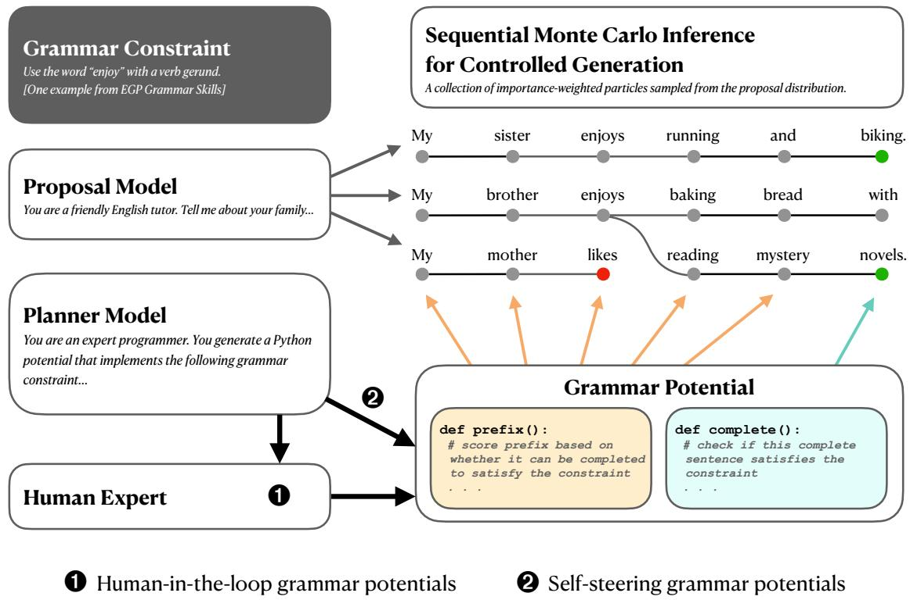
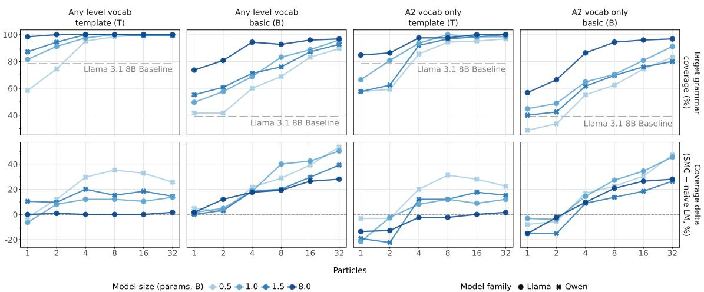
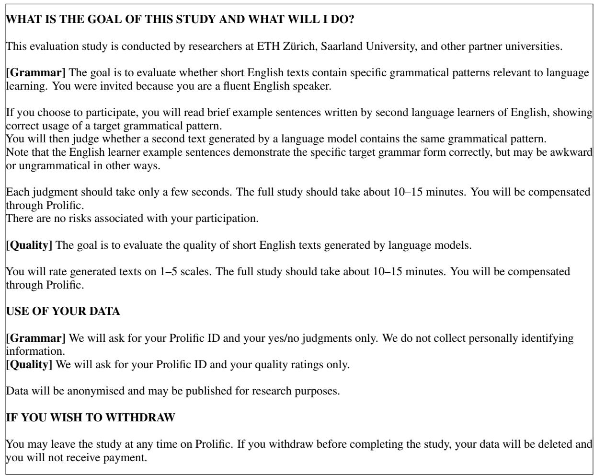
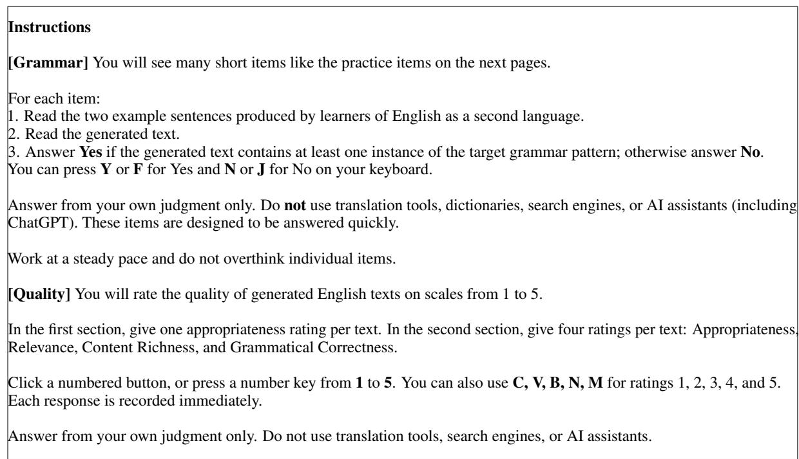
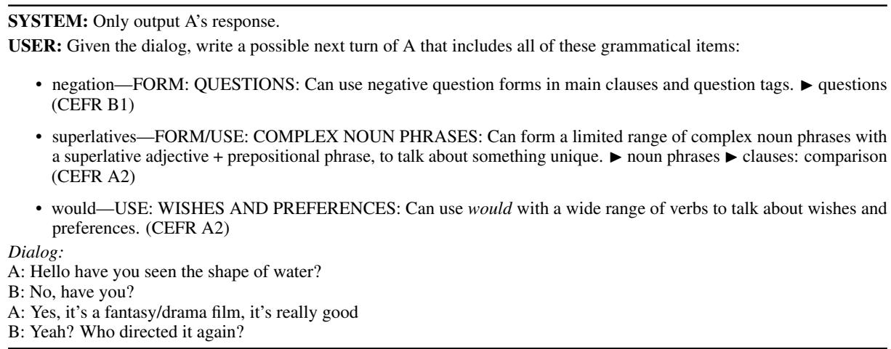
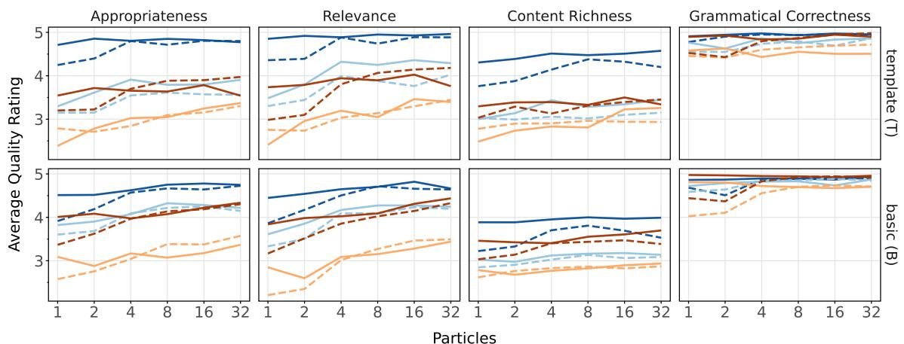
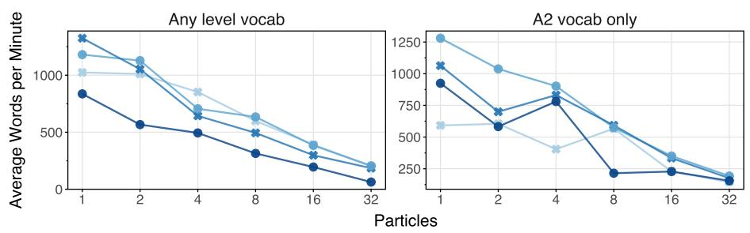
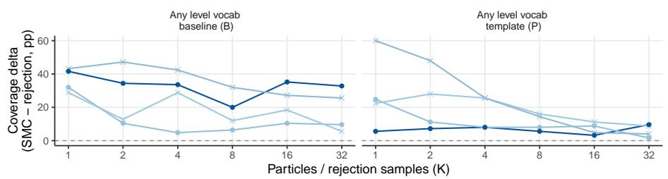

# Grammar Control for Language Learning with Sequential Monte Carlo and Small Language Models

Kate McCurdy1 Jacob Hoover Vigly2 Thomas Hikaru Clark3 Karolina Stanczak´ 4 Yahya Emara5 Joshua B. Tenenbaum2,3 Alexander K. Lew6 Ryan Cotterell4 Timothy J. O’Donnell2,7,8,9

1University of Göttingen 2CHI-FRO 3MIT 4ETH Zürich 5Cornell University 6Yale University 7McGill University 8Mila 9Canada CIFAR AI Chair

## Abstract

Second language learners benefit from exposure to level-appropriate grammar in interactive language use. While prompted frontier language models can usually produce target grammar structures, less resource-intensive models that can be run on device often fail in this task. We use sequential Monte Carlo (SMC) to steer dialogue turn generation in small language models toward target grammar constructions from an expert-developed pedagogical resource. With a minimal set of hand-coded potential functions, SMC achieves near-perfect coverage of target grammar, enabling small models to outperform state-of-the-art results from models 140 times larger. We also use code synthesis with frontier models to generate new potentials, showing that our method scales to hundreds of target grammar skills with no need for additional training or supervised data.

## 1 Introduction

A key task in second language pedagogy is exposing language learners to level-appropriate target grammatical structures in diverse natural contexts. For example, a learner who speaks English at an advanced beginner level (e.g., level A2 in CEFR, the Common European Framework of Reference) should be able to understand and use the verb enjoy followed by a verb in its gerund (-ing) form (e.g., enjoy swimming, enjoy cooking). A capable English-language instructor can use this target construction in dialogue (e.g., I enjoy cycling. What exercises do you enjoy?), encouraging learners to practice and develop this grammatical skill—that is, producing grammatical constructions (e.g., enjoy swimming) rather than ungrammatical word sequences (e.g., enjoy to swim). We would like language models to provide similar interactive support for learners.

Whether a model can do so reliably, however, depends heavily on its scale. Frontier language models can usually produce learner-appropriate grammatical constructions through prompting, but smaller, less resource-intensive models often fail to reliably produce grammar targets (Sun et al., 2023; Ribeiro-Flucht et al., 2025). Bridging this gap could make efficient, on-device language learning tools more feasible, reducing costs and reliance on cloud-based frontier-model APIs while broadening access to learning applications.

This problem is naturally formulated as a constrained generation task: Given some set of levelappropriate grammar skills, we want to constrain language model generations such that they contain the target constructions. Pedagogical resources such as the English Grammar Profile (O’Keeffe and Mark, 2017) identify a range of grammatical targets at specific proficiency levels. Previous research has investigated grammar control via prompting, fine-tuning, reinforcement learning, and classifierbased constrained decoding, but none have yet achieved reliable elicitation of target constructions from small language models (Okano et al., 2023; Glandorf and Meurers, 2024; Glandorf et al., 2025).

We can formulate constrained generation as a probabilistic inference problem. A language model defines a prior p(x) over strings $\boldsymbol { x } \in \Sigma ^ { * }$ , where Σ is an alphabet of tokens. Given a potential $\varphi ( { \pmb x } ) - { \pmb a }$ binary function that checks whether a string x satisfies the constraint—we want to sample from the posterior $\begin{array} { r } { \frac { p ( \pmb { x } ) \varphi ( \pmb { x } ) } { \sum _ { \pmb { x } ^ { \prime } \in \Sigma ^ { * } } p ( \pmb { x } ^ { \prime } ) \varphi ( \pmb { x } ^ { \prime } ) } } \end{array}$ . The denominator term sums over all strings, which is intractable; this motivates use of approximate inference techniques such as sequential Monte Carlo (SMC). SMC builds an importance-weighted population of candidate strings (particles) whose empirical distribution approximates the target posterior. Recent work has used SMC to approximate target distributions for constrained generation from language models (Lew et al., 2023; Zhao et al., 2024; Loula et al., 2025; Lipkin et al., 2025; Xefteri et al., 2025; Grand et al., 2025; Emara et al., 2026; Golowich et al., 2026; Kim et al., 2025). Crucially, SMC operates at inference time on any base language model. In our setting, it enables small, efficient models to achieve high levels of target grammar coverage without additional training.

In this work, we specify potential functions via the GenLM Control library,1 using short, interpretable, human-readable programs to steer generation. For example, a potential function for the enjoy + gerund construction might parse the candidate sentence and return a high score if and only if the verb enjoy is followed by a verb gerund, excluding superficially similar sequences (e.g., enjoy something). Because potential functions can be implemented as explicit programs, they can be flexibly developed, modified, and composed. Programmers can directly write functions to specify target grammar constructions, which we do in Experiment 1. Such programs can also be synthesized by large language models, and refined through iterative generation and testing, a technique known as self-steering SMC (Grand et al., 2025); we demonstrate that this approach can scale to cover tens (Experiment 2) or hundreds (Experiment 3) of targets. In all cases, potential functions can be inspected and refined by domain experts (e.g., instructors or curriculum designers), allowing flexible adaptation for specific pedagogical goals.

In this work, we apply SMC2 to elicit dialogue turns with target grammar constructions from language models with fewer than 10 billion parameters (Figure 1). We make the following contributions:

• We show that SMC steering can raise the target grammar accuracy of a model with 0.5B parameters from 58% up to 98%— outperforming previous state-of-the-art (SotA) from a model 140 times larger— while optionally composing with other pedagogicallymotivated constraints (Experiment 1).

• We show that frontier models can effectively synthesize grammar potential functions through self-steering, and combining up to 6 generated potentials at inference time outperforms previous SotA results (Experiment 2).

<table><tr><td>ID (CEFR)</td><td>Can-do statement, describing grammar skill</td><td>Examples of correct target use in English learner corpora</td></tr><tr><td>258 (A1)</td><td>FORM: PHRASE + PHRASE My home is very light and very com- Can use single word conjunc- fortable. tions (and, but, or&#x27;) to I live with my mother and her combine phrases.</td><td>boyfriend. My house is small but very nice.</td></tr><tr><td>262 (A1)</td><td>Can use but&#x27;to add an unex- small but it is very easy to clean. pected contrast.</td><td>USE: &#x27;BUT&#x27;, CONCESSIVE I really like my home, it is very I like my home, it&#x27;s small but so comfortable.</td></tr><tr><td>265 (B1)</td><td>CLAUSES clauses and sentences, often to you won&#x27;t have to pay a thing! advantage.</td><td>FORM/USE: &#x27;PLUS&#x27; WITH I would be more than pleased to re- ceive you at home, it&#x27;s not too big, Can use &#x27;plus&#x27; to connect but we could have a lot of fun, plus point out a positive addition or It will be fun because everyone is going to be there. Plus, the park is the best place for a picnic, we can run and just have fun!</td></tr></table>

Table 1: Example EGP target grammar skills.

Moreover, this approach scales to hundreds of targets with no need for supervised data or additional training (Experiment 3).

## 2 Background

Previous research on dialogue adaptation for second language learning has investigated learnerappropriate constraints on vocabulary (Tyen et al., 2022; Qian et al., 2023) and certain grammar categories (Okano et al., 2023). More recently, Ribeiro-Flucht et al. (2025) and Glandorf et al. (2025) explore controlled dialogue generation with a wider range of target grammar constructions grounded in the pedagogical framework of the English Grammar Profile (EGP), and establish SotA performance for specific learner-appropriate grammar targets. As our experiments replicate their setup, we first introduce the EGP, and then review these two recent studies in greater depth.

## 2.1 Targets: English Grammar Profile

We use the English Grammar Profile (EGP; O’Keeffe and Mark, 2017), a pedagogical resource that lists 1,222 grammar skills for learners of English at specific proficiency levels. This resource was developed through analysis of learner corpora, and identifies each grammar skill with the proficiency level in the Common European Framework of Reference (CEFR) at which it is typically mastered. A skill is considered mastered when learners correctly produce the target grammar construction in appropriate contexts.

EGP grammar skills are expressed as “can do” statements with supporting examples, and may target either a specific grammatical form, its use in a particular discourse context, or both.3 Table 1 gives some example skills from the category “coordinating conjunctions.” Note that, while target grammar constructions are expressed clearly, some skills are open to ambiguity in interpretation; for instance, evaluators of EGP ID 262 may differ in judgments of an “unexpected contrast.” While we aim for consistent evaluation, such ambiguities lead to unavoidable annotator variation and noise.

<table><tr><td>Prompt style</td><td>Prompt</td></tr><tr><td>B (Basic)</td><td>You are a friendly English tutor. I want to practice by &#x27;Discussing enjoyable hobbies&#x27;.</td></tr><tr><td>T (Template)</td><td>I am a beginner English student. I want to practice patterns with to and -ing by Discussing hobbies with enjoy + ing&#x27;. I want to ensure that I can use enjoy&#x27; followed by the -ing&#x27; form. For example, &#x27;I enjoy eating, I enjoy doing, I enjoy going. . .&#x27;. Let&#x27;s do a Q&amp;A exercise. You (the AI) are a friendly English tutor. Tell me What you enjoy doing. Then ask me the same with short questions. (I enjoy reading. What do you enjoy doing?’, &#x27;When I go out I enjoy</td></tr></table>

Table 2: Partial basic vs. template prompts for EGP skill 1082 (enjoy + -ing) with the topic “hobbies” (Ribeiro-Flucht et al., 2025). For complete prompts and further details, see Appendix B.

## 2.2 Prior work

EGP skills have been used to define target grammar constructions in two recent studies establishing SotA for pedagogical grammar control, which our experiments build upon. Ribeiro-Flucht et al. (2025) assess tutoring dialogue scenarios in which the language model is prompted to use a target grammar construction while engaging an L2 English student in dialogue on a specific topic. They identify 5 grammar skills at proficiency level A2, and test each skill with different topics. The authors compare two prompting approaches: a basic (B) prompt with relatively minimal instructions, and a more elaborate template-based (T) prompt with detailed instructions and few-shot examples (Table 2). They also run a pedagogically-informed grammar check, and prompt models to regenerate any response with grammar beyond a B1 proficiency level. They find that template prompting substantially increases accurate production of target grammar constructions across a range of model scales, with a peak performance of 91% from Llama 3.3 70B, rising to 96.3% with an additional validation step.

Glandorf et al. (2025) assess naturalistic dialogue generation in Llama 3.1 8B. They use a wider range of 29 EGP grammar skills, spanning proficiency levels from A1 to C1, and additionally test combinations of up to 6 grammar targets applied to a single generation. Instead of different prompts, the authors compare two technical approaches to improving model performance: supervised finetuning, and constrained generation using guided decoding with Future Discriminators for Generation (FUDGE; Yang and Klein, 2021). They find that a hybrid combining both approaches achieves the highest performance, with an average accuracy of 64% across grammar target combinations, ranging from 87% with one target to 50% with 6.

## 3 Methods

In this section, we explain how we implement potential functions to steer generation toward target grammar constructions from EGP skills, and how those generations are evaluated. Experiments 1 and 2 focus on the specific grammar skills targeted in prior work, while Experiment 3 covers the full set of skills in the English Grammar Profile.

## 3.1 Generation

Problem formulation. Let Σ be an alphabet, i.e., a finite, nonempty set of tokens, and let p be a language model, i.e., a probability distribution over Σ∗, the set of all finite strings over Σ. Given a binary potential $\varphi \colon \Sigma ^ { * } \  \ \{ 0 , 1 \}$ , define the target posterior $\pi ( { \pmb x } ) \ { \stackrel { \mathrm { d e f } } { = } } \ p ( { \pmb x } ) \varphi ( { \pmb x } ) / Z .$ where the normalizing constant (marginal likelihood) $\begin{array} { r } { Z \stackrel { \mathrm { d e f } } { = } \sum _ { { \pmb y } \in \Sigma ^ { * } } p ( { \pmb y } ) \varphi ( { \pmb y } ) } \end{array}$ sums over all strings $\ b { y } \in \Sigma ^ { * }$ This normalizing constant cannot generally be tractably computed, so sampling from the target distribution requires approximate inference techniques. We approximate π with sequential Monte Carlo (SMC), which maintains a collection of M particles iteratively extended from a proposal language model ${ \boldsymbol { q . } } ^ { 4 }$ During generation, particles are iteratively extended, reweighted against the target, and occasionally resampled to focus computation on promising partial strings (see Appendix A for details). SMC yields a posterior approximation as a weighted set of particles; in this work we always select the top-weighted particle for evaluation.

  
Figure 1: Approach Overview. We use explicit grammar constraints, encoded in potential functions, to steer generation in a small language model with sequential Monte Carlo.

Implementation of grammar potentials. We use GenLM Control (v0.3.1) to implement SMC for constrained generation. This library allows us to express potentials as Python programs (Figure 1). In the GenLM Control API, a potential exposes two methods: (1) a complete method, called once to evaluate φ on afinished string, and (2) a prefix method, called at every generation step to score the current partial sequence. Two considerations motivate the separation. First, a complete method may require a completed phrase to correctly confirm the presence of a particular grammatical construct. Second, complete may be expensive to compute; evaluating it only once per particle, at termination, keeps decoding fast. We exploit the design freedom of prefix to provide a cheap incremental steering signal that rewards partial sequences with candidate cues (e.g., a penalty that reduces when a regular expression detects the string enjoy), while complete verifies the full target structure on the finished sequence (e.g., parsing the sentence with enjoy to confirm a dependent verb gerund). We use the spaCy library (v3.8.14; Honnibal et al., 2020) to implement strict grammar checking in potentials complete method; for examples, see Table 6 (Appendix B).

Implementation of vocabulary potential. Motivated by the level-appropriate constraints explored in prior work, we additionally implement a GenLM potential to restrict generation to a defined vocabulary list. This potential runs an identical binary check for both prefix and complete, penalizing any particle with words outside the vocabulary whitelist. As GenLM supports flexibly composing multiple potentials, we combine this vocabulary restriction with grammar targets in Experiment 1.

Self-steering potential function generation. In Experiments 2 and 3, we assess automated generation of potential functions using the self-steering language models approach proposed by Grand et al. (2025). In this technique, a large frontier language model (the Planner model; cf. Figure 1) is prompted to write a program implementing the target constraint, and then immediately tests the program by using it to steer generation in a smaller language model. If the test generation does not satisfy the constraint—i.e., in our case, does not produce the target grammar construction specified by a given EGP skill—then the Planner model can iterate by generating and testing a new potential function. Our goal in self-steering is to evaluate the feasibility of scaling generation of potential functions. Hand-coding each potential may take too much effort to be practical in large-scale pedagogical applications, but automated generation with self-steering can reduce this burden; a single run of the Planner model produces interpretable Python programs that are easy to correct if needed, and these programs along with a small language model are the only requirements to run at inference time.

## 3.2 Evaluation

Grammar coverage. We use an LLM (GPT-5- nano) to evaluate grammar target presence for generations in all experiments. Specifically, we pass in the full EGP specification for a particular target grammar construct (e.g., Table 1) with a set of texts and prompt the model to assign True or False to each text based on the presence of the target construct. As this approach differs from the evaluation methods of the prior work we reproduce in Experiments 1 and 2, we validate our pipeline by running on their original generated texts. Table 5 in Appendix B compares our grammar annotation approach to previously reported results on the same set of generations. While we find minor discrepancies between our evaluation and original reported numbers, overall trends (i.e., relative performance of models) appear consistent. For additional validation, we use an alternative LLM (Claude Haiku 4.5) as a judge for Experiment 1, and find 94.5% agreement with GPT-5-nano; see Appendix C for details and example disagreements.

Speed, memory, and quality. For other metrics, we reproduce the evaluation of Glandorf et al. (2025). We assess the same dialogue generation quality metrics (Appropriateness, Relevance, Content Richness, Grammatical Correctness) using LLM-as-judge, with the same model (GPT-4o) and prompts as their experiment. Ribeiro-Flucht et al. (2025) use human annotators to evaluate generation appropriateness; we instead use LLMs as described here. We also follow Glandorf et al. (2025) in calculating generation speed in words per minute, as a more intuitively relevant measure than token-based generation speed. Second-language learners have an estimated reading speed of 70 to 90 words per minute (Iwahori, 2008), so we take this range as a lower bound for acceptable generation speed. We additionally assess the computational demands of SMC for both GPU- and CPU-based settings with memory profiling (Appendix E).

Human validation. As human judgment is particularly important to second-language-learning applications, we additionally validate both our grammar and quality evaluation pipelines through human comparison. We take a randomly sampled subset of 99 SMC generations from Experiments 1 and 2, and recruit online crowdworkers to judge target grammar presence (11 raters) and generation quality (13 raters). Results are broadly consistent with our automated pipeline; see details in Appendix C.

Baseline. SMC constrains generation by utilizing inference-time compute to generate and resample particles in parallel. For a fair comparison with comparable inference budgets, we compare SMC generation in Experiments 1 and 2 to two baselines: 1) standard language model decoding with best-of-M selection and 2) rejection sampling (sampling complete generations, and rejecting those that lack the target construction). For each SMC run with M particles, we sample M generations from the same language model with the same prompt; we implement the rejection sampling baseline by removing incremental steering (i.e., setting the potential’s .prefix() method to accept all prefixes) and retaining only the final grammar check (the .complete() method) to reject generations that do not satisfy the hard grammar constraint. For both SMC generation and rejection sampling, we select the top-weighted particle; for our standard language model decoding baseline, we take the top generated sequence measured by lowest average per-token surprisal. See detailed rejection sampling results in Appendix B.

## 4 Experiments

## 4.1 Experiment 1

This experiment replicates the grammar control task posed by Ribeiro-Flucht et al. (2025), using SMC to steer generation with hand-coded symbolic potential functions for 5 target grammar constructions. We explore three research questions. The first compares directly to Ribeiro-Flucht et al.’s results: beyond the original prompting effect, can SMC steering boost accurate production of target grammar constructions in Llama 3.1 8B?

The second measures performance across model scales: can SMC additionally boost target grammar production in even smaller models? Our third research question explores how SMC potentials can flexibly compose multiple relevant constraints. This is motivated by our pedagogical application: in order to support gradual learning, L2 language instructors often deliberately introduce new grammatical constructions using only vocabulary words familiar to their students. We therefore ask whether SMC-based steering can maintain target accuracy and response quality while using a restricted vocabulary, i.e., only the set of words typically known to A2-level English learners.

## 4.1.1 Task

Ribeiro-Flucht et al. (2025) identify 5 target grammar skills, and for each skill, 5 different communicative scenarios where that grammar construction could naturally appear in conversation. Each context-skill combination is assessed with both the Basic (B) and Template (T) prompt in 5 distinct runs, totaling 2 × 125 generations per model. We focus comparison on their smallest tested model, Llama 3.1 8B, which rises from 39% accuracy with Basic to 78% with Template prompting. As discussed in §2.2, we use an LLM-based evaluation pipeline validated on the original study’s generated texts (Appendix B). In terms of accuracy, our replication appears slightly lower than the original paper; however, this may reflect noise as discussed in §2.1, so we compare to their original reported accuracy rates.

## 4.1.2 Our approach

Language models. We assess generation with four small open-source instruction-tuned models. From the Llama family (Grattafiori et al., 2024), we evaluate Llama 3.1 8B and Llama 3.2 1B; from Qwen (Yang et al., 2024), we evaluate Qwen 2 1.5B and 0.5B.

Grammar potentials. We write potential functions for each of the 5 grammar skills as described in §3.1. Table 6 in Appendix B lists the five EGP grammar skills targeted in Experiment 1, and illustrates how we implement potential functions to constrain generation.

Vocabulary potential. We explore a further pedagogical capacity of SMC: restricting generation to a constrained vocabulary appropriate to the learner’s proficiency level, as described in §3.1. Using a related pedagogical resource from the Cambridge English Profile initiative (Cambridge University Press, 2018), we construct a vocabulary list comprising only words identified with an A2 proficiency level, yielding approximately 3,400 unique word forms.

## 4.1.3 Results

Target grammar accuracy. We find that SMC combined with detailed template (T) prompting enables small models to achieve near-perfect target grammar coverage (Figure 2). This improvement is largest for smaller models: while Llama 3.1 8B reaches ceiling accuracy with template prompting alone, increasing the particle budget from 1 to 8 pushes accuracy from 58% to 98% in the smallest model, Qwen 2 0.5B.5 Notably, this is an improvement on the best overall performance reported by Ribeiro-Flucht et al. (2025), i.e., 96% accuracy for Llama 3.3 70B; with inference-time SMC-steered generation, this SotA result is exceeded by a model 140 times smaller.

Vocabulary restriction and quality. We see that increasing particle budget enables similarly high performance even when the vocabulary is constrained to a fixed list of A2-level words. For example, Qwen 2 0.5B achieves 95% accuracy with 4 particles and no vocabulary restriction, but this drops to 85% when the vocabulary restriction is added; however, raising the particle budget to 8 brings accuracy to 94% even with restricted vocabulary. Higher particle budgets also improve response quality across the board, but the effect is more pronounced for A2-vocabulary-only generations (Figure 7, Appendix B). In terms of speed, increasing particle budgets slows down generation, but rates remain acceptable (i.e., greater than 100 words per minute) up to 32 particles—with the one exception of Llama 3.1 8B, which generates 60 words per minute at 32 particles (Figure 8, Appendix B). These results demonstrate the key trade-off: we can compensate for smaller model size and capability, including additional pedagogically-motivated restrictions, with increased computation at inference time via SMC.

## 4.2 Experiment 2

Experiment 2 applies our methods to the grammar control task posed by Glandorf et al. (2025, Task 1). In this case, instead of hand-coding potential functions as in Experiment 1, we use self-steering with a Planner language model (Grand et al., 2025) to generate and iteratively revise potentials for the 29 targeted grammar skills. We investigate whether SMC with generated potentials improves target accuracy relative to previous approaches.

Figure 2: Experiment 1: Target grammar coverage by number of particles and model scale. Marker shapes denote model family (Llama vs. Qwen). Grammar coverage improves both with increasing particle count and increasing model size (top row), with smaller models showing the largest improvement relative to language model baseline (bottom row). Top row dotted line shows Llama 3.1 8B accuracy reported from the original study.
<table><tr><td rowspan="3">Glaa.</td><td colspan="6">Number of Constraints 1</td><td colspan="4">Average Quality Rating</td></tr><tr><td>Llama 3.1 8B 70.6</td><td>2 62.0</td><td>3</td><td>4</td><td>6</td><td>Mean</td><td>App.</td><td>C.R.</td><td>G.C.</td><td>Rel.</td></tr><tr><td></td><td></td><td>48.0</td><td>46.5</td><td>42.0</td><td>53.8</td><td>4.45</td><td>4.35</td><td>2.90</td><td>4.92</td></tr><tr><td>+ fine-tuning + decoding</td><td>76.0 81.6</td><td>61.5</td><td>49.3</td><td>49.2</td><td>44.7</td><td>56.2</td><td>4.09</td><td>3.98</td><td>2.29</td><td>4.70</td></tr><tr><td>+ both (hybrid)</td><td>86.5</td><td>72.2 69.8</td><td>65.7 66.7</td><td>60.8 60.0</td><td>65.3 59.5</td><td>69.1 68.5</td><td>4.31</td><td>4.27</td><td>2.80</td><td>4.87</td></tr><tr><td></td><td>Particles</td><td></td><td></td><td></td><td></td><td></td><td>3.45</td><td>3.32</td><td>2.02</td><td>4.13</td></tr><tr><td rowspan="9">S(r Ors)</td><td></td><td></td><td></td><td></td><td></td><td></td><td></td><td></td><td></td><td></td></tr><tr><td>1</td><td>63.1</td><td>52.0</td><td>48.0 44.8</td><td>38.2</td><td>49.2</td><td>4.12</td><td>3.11</td><td>4.56</td><td>4.20</td></tr><tr><td>2</td><td>73.4</td><td>63.0 47.0</td><td>45.3</td><td>38.0</td><td>53.3</td><td>4.10</td><td>3.10</td><td>4.55</td><td>4.10</td></tr><tr><td>4</td><td>79.8</td><td>74.0</td><td>60.7</td><td>62.8 60.3</td><td>67.5</td><td>3.96</td><td>3.06</td><td>4.45</td><td>4.03</td></tr><tr><td>8</td><td>82.5</td><td>77.8</td><td>64.3</td><td>67.0 66.7</td><td>71.6</td><td>3.94</td><td>3.05</td><td>4.46</td><td>4.04</td></tr><tr><td>16</td><td>84.5</td><td>85.3</td><td>64.6</td><td>70.0 65.7</td><td>74.0</td><td>3.98</td><td>3.06</td><td>4.48</td><td>4.02</td></tr><tr><td>32</td><td>86.6</td><td>86.3</td><td>74.3</td><td>75.0 68.2</td><td>78.1</td><td>3.94</td><td>3.03</td><td>4.50</td><td>4.02</td></tr><tr><td></td><td></td><td></td><td></td><td></td><td></td><td></td><td></td><td></td><td></td></tr></table>

Table 3: Experiment 2: Llama 3.1 8B (middle) accuracy (% target coverage) across grammar skills; (right) average quality metrics (Appropriateness, Content Richness, Grammatical Correctness, Relevance). Top block shows results from Glandorf et al. (2025, Task 1), using higher accuracy numbers from our evaluation pipeline (Appendix B); bottom shows SMC generation at different particle budgets. With 8 particles, SMC outperforms previous approaches in producing up to 6 target grammar constructions.

## 4.2.1 Task

Glandorf et al. (2025) assess controlled generation within naturalistic dialogues, with four conversational turns as context preceding the target generation. For each generation, the authors randomly sample context from a natural dialogue dataset, and then randomly sample 1, 2, 3, 4, or 6 EGP grammar skills to target, out of the set of 29. The language model is then prompted with the preceding dialogue context and target grammar constructions. For an example prompt and more detailed experiment description, see Appendix B.2.

Glandorf et al. (2025) explore three different strategies to increase grammar control in Llama 3.1 8B. First, they train independent BERT-based classifiers for each grammar skill, retaining those with at least 80% accuracy on a set of hand-annotated grammar judgments. These classifiers are then used for two distinct purposes. First, the classifiers are used to extract dialogue turns which contain target grammar constructions, creating a dataset for supervised fine-tuning. Second, the classifiers are additionally trained as “future discriminators” on the fine-tuned data: given a generated prefix sequence, they estimate the probability that the complete sentence will contain the target construction. These discriminators are then used to steer guided decoding with FUDGE (Yang and Klein, 2021). Finally, the hybrid approach combines both, using future discriminators to guide decoding on the fine-tuned Llama model.

Glandorf et al.’s FUDGE-based decoding is similar in spirit to our SMC approach: both reweight a pretrained LM at each generation step using a future-looking signal that approximates the partial sequence’s expected future constraint-satisfaction. However, the two methods differ in some important respects. For one, their future discriminators are neural classifiers trained per grammar skill on labeled examples, whereas our prefix potentials are short interpretable Python programs requiring no per-skill data (see Appendix A). Moreover, in Glandorf et al.’s setup FUDGE produces a single sampled trajectory, via a locally guided decoding strategy with top-k and epsilon pruning; we instead sample from the LM and reweight by the potential across M particles with adaptive resampling. This lets us trade inference compute for accuracy by scaling the number of particles, as shown in Experiment 1.

## 4.2.2 Our approach

Self-steering potential generation. We use selfsteered code synthesis following Grand et al. (2025), with GPT-5.4 as our Planner model. We prompt the Planner with detailed instructions using Experiment 1’s hand-coded potentials as few-shot examples. Once the potential is generated, it is used to steer generation in Llama 3.1 8B with 16 particles. The Planner then assesses whether generation contains the target; if not, the potential is regenerated up to 5 iterations.

Programmatic and manual repair. Despite the various checks built into our self-steering pipeline, we find that the Planner model can still generate invalid or low-quality grammar potential functions; however, these are easily corrected retroactively. We approach potential repair in two ways. First, we run a script over all potentials to automatically fix common code errors in handling spaCy attributes. Second, we identify 8 specific grammar skills with consistently low accuracy in initial runs, and manually revise the potentials to better fit their targets.

## 4.2.3 Results

For ease of comparison, rather than sampling anew, we replicate the exact dialogue constraint combinations and contexts used by Glandorf et al. (2025) in Task 1. In contrast to the previous experiment, our pipeline here consistently assigns higher target accuracy to the same text generations (Appendix B.2). In the same spirit of fair comparison, we recognize possible evaluation noise and report the higher accuracy numbers from our pipeline (Table 3).

At 4 particles, Llama 3.1 8B with SMC outperforms Glandorf et al.’s fine-tuned model; at 8 particles, it bests guided decoding, the other inferencetime approach; and at 32 particles, it outperforms the hybrid model combining both. The advantage is especially noticeable for cases where generation must satisfy multiple grammar constraints. These findings point toward the flexibility and scalability of SMC: steered by auto-generated and lightly edited potential functions, we find that Llama 3.1 8B can reliably produce up to 6 target grammar constructions out of the box, outperforming the SotA results of Glandorf et al.’s hybrid model with no additional training on the base model.

## 4.3 Experiment 3

Task. As a proof of concept, we apply the selfsteering approach to scale potential generation to all 1,222 grammar skills in the EGP. We experiment with two different Planner models: GPT-4o-mini, a small low-latency frontier model, and GPT-5.4, OpenAI’s flagship model at the time these experiments were conducted. We use both models in two capacities: a) as Planner models generating grammar potentials to steer Llama 3.1 8B, and b) as comparative performance baselines with one-shot accuracy. For all potentials, we run the same script to fix common spaCy errors used in Experiment 2, but perform no further correction.

Results. Overall, we find that the self-steering approach scales successfully: of the 1,222 grammar skills in the EGP, Planner model GPT-5.4 generates viable potential functions for 99%, with only 4 constraints excluded for nontrivial errors. We use these potentials to steer Llama 3.1 8B using SMC with 16 particles. We find that, while performance remains below the skyline of the most capable Planner (GPT-5.4), it nevertheless matches the smaller frontier Planner model GPT-4o-mini (Table 4). Using high-quality potentials generated from GPT-5.4, SMC elicits robustly high accuracy from Llama 3.1 8B across diverse EGP grammar targets, exceeding 70% even for high proficiency levels with complex grammar skills. This illustrates the viability and efficiency of scaling SMC: we achieve broad coverage without any supervised data, using only a large Planner model to generate potentials from EGP grammar skills, and a small language model to use those potentials during inference.

<table><tr><td></td><td>Proficiency Level (CEFR)</td><td>A1</td><td>A2</td><td>B1</td><td>B2</td><td>C1</td><td>C2</td></tr><tr><td rowspan="2">GPT-4o-mini</td><td>Number of grammar skills</td><td>109</td><td>288</td><td>338</td><td>242</td><td>129</td><td>112</td></tr><tr><td>One-shot accuracy</td><td>84.1</td><td>76.9</td><td>77.4</td><td>69.5</td><td>77.3</td><td>73.8</td></tr><tr><td rowspan="2">GPT-5.4</td><td>Planner for Llama 3.1 8B SMC (16)</td><td>86.0</td><td>79.6</td><td>76.7</td><td>70.0</td><td>79.0</td><td>65.9</td></tr><tr><td>One-shot accuracy Planner for Llama 3.1 8B SMC (16)</td><td>95.4 88.7</td><td>97.3 81.2</td><td>96.5 81.6</td><td>96.6 72.2</td><td>93.8 80.1</td><td>95.8 74.6</td></tr></table>

Table 4: Experiment 3: target grammar coverage by proficiency level for 1,218 EGP grammar constructions. Using grammar potentials generated by a small Planner model (GPT-4o-mini), Llama 3.1 8B with SMC (16 particles) achieves comparable performance to one-shot generation from the Planner model. Potentials generated by a larger Planner model (GPT-5.4) improve Llama-SMC performance, but not enough to equal the larger Planner on its own.

## 5 Conclusion

We have shown that SMC-based constrained generation can elicit target grammatical constructions from small language models with highly accurate coverage, outperforming both much larger models that rely on prompting alone, and comparable small models with dedicated fine-tuning. A core contribution of our framework is the explicit representation of grammatical knowledge in human-readable potential functions: these can be hand-coded by domain experts, synthesized by a frontier model, or some combination of the two. This flexibility lets our approach scale effectively while enabling transparent specification and correction if needed. Our approach opens new possibilities for pedagogical applications of small language models in lowresource settings, broadening accessibility for the world’s language learners.

## Limitations

Our experiments have several limitations. First, we evaluate generation using single dialogue turns rather than extended multi-turn interactions in a learning context; a full user study with language learners would be needed to confirm the pedagogical value of this approach in practice. Second, while SMC achieves high grammar coverage, increasing the particle budget slows generation, and at 32 particles Llama 3.1 8B falls below the minimum reading speed we consider acceptable. This suggests further work is needed to improve inference efficiency, for example through better proposal distributions or particle pruning. Third, our potential approach depends on mature NLP tooling (spaCy) and an expert-developed pedagogical resource (the EGP), both of which are predominantly available for English; extending the approach to other languages would require developing equivalent resources. Finally, the self-steering pipeline still requires some human intervention, both programmatic and manual repair of generated potentials. To support more efficient scaling, future work should identify ways to improve the potential generation pipeline.

AI Usage. We use AI agents for coding support, and lightly in writing and revision. We have thoroughly reviewed all AI suggestions, and take full responsibility for the text.

## References

Cambridge University Press. 2018. English Vocabulary Profile. https://www.englishprofile.org/.

Yahya Emara, Mauricio Barba da Costa, Chi-Chih Chang, Cameron Freer, Tim Vieira, Ryan Cotterell, and Mohamed S. Abdelfattah. 2026. Faster LLM inference via sequential Monte Carlo. Preprint, arXiv:2604.15672.

Dominik Glandorf, Peng Cui, Detmar Meurers, and Mrinmaya Sachan. 2025. Grammar control in dialogue response generation for language learning chatbots. In Proceedings ofthe 2025 Conference ofthe Nations ofthe Americas Chapter ofthe Association for Computational Linguistics: Human Language Technologies (Volume 1: Long Papers), pages 9820– 9839, Albuquerque, New Mexico. Association for Computational Linguistics.

Dominik Glandorf and Detmar Meurers. 2024. Towards fine-grained pedagogical control over English grammar complexity in educational text generation. In Proceedings ofthe 19th Workshop on Innovative Use of NLP for Building Educational Applications (BEA 2024), pages 299–308, Mexico City, Mexico. Association for Computational Linguistics.

Noah Golowich, Fan Chen, Dhruv Rohatgi, Raghav Singhal, Carles Domingo-Enrich, Dylan J. Foster, and Akshay Krishnamurthy. 2026. Reject, resample, repeat: Understanding parallel reasoning in language model inference. Preprint, arXiv:2603.07887.

Karthik Gopalakrishnan, Behnam Hedayatnia, Qinlang Chen, Anna Gottardi, Sanjeev Kwatra, Anu Venkatesh, Raefer Gabriel, and Dilek Hakkani-Tür. 2019. Topical-Chat: Towards knowledge-grounded open-domain conversations. In Proceedings ofInterspeech 2019, pages 1891–1895.

Gabriel Grand, Joshua B. Tenenbaum, Vikash K. Mansinghka, Alexander K. Lew, and Jacob Andreas. 2025. Self-steering language models. In Second Conference on Language Modeling (COLM), Montréal, Canada.

Aaron Grattafiori, Abhimanyu Dubey, Abhinav Jauhri, Abhinav Pandey, Abhishek Kadian, Ahmad Al-Dahle, Aiesha Letman, Akhil Mathur, Alan Schelten, Alex Vaughan, Amy Yang, Angela Fan, Anirudh Goyal, Anthony Hartshorn, Aobo Yang, Archi Mitra, Archie Sravankumar, Artem Korenev, Arthur Hinsvark, and 542 others. 2024. The Llama 3 herd of models. Preprint, arXiv:2407.21783.

Matthew Honnibal, Ines Montani, Sofie Van Landeghem, and Adriane Boyd. 2020. spaCy: Industrialstrength natural language processing in Python. Zenodo.

Yurika Iwahori. 2008. Developing reading fluency: A study of extensive reading in EFL. Reading in a Foreign Language, 20(1):70–91.

Sooyeon Kim, Giung Nam, Byoungwoo Park, and Juho Lee. 2025. Improving constrained language generation via self-distilled twisted sequential Monte Carlo. In NeurIPS 2025 Workshop on Frontiers in Probabilistic Inference: Learning Meets Sampling.

Alexander K. Lew, Tan Zhi-Xuan, Gabriel Grand, and Vikash K. Mansinghka. 2023. Sequential Monte Carlo steering of large language models using probabilistic programs. In ICML 2023 Workshop on Sampling and Optimization in Discrete Space.

Ben Lipkin, Benjamin LeBrun, Jacob Hoover Vigly, João Loula, David R. MacIver, Li Du, Jason Eisner, Ryan Cotterell, Vikash Mansinghka, Timothy J. O’Donnell, Alexander K. Lew, and Tim Vieira. 2025. Fast controlled generation from language models with adaptive weighted rejection sampling. In Second Conference on Language Modeling (COLM), Montréal, Canada.

João Loula, Benjamin LeBrun, Li Du, Ben Lipkin, Clemente Pasti, Gabriel Grand, Tianyu Liu, Yahya Emara, Marjorie Freedman, Jason Eisner, Ryan Cotterell, Vikash Mansinghka, Alexander Lew, Tim Vieira, and Timothy J. O’Donnell. 2025. Syntactic and semantic control of large language models via sequential Monte Carlo. In The Thirteenth International Conference on Learning Representations, pages 64758–64791.

Yuki Okano, Kotaro Funakoshi, Ryo Nagata, and Manabu Okumura. 2023. Generating dialog responses with specified grammatical items for second language learning. In Proceedings of the 18th Workshop on Innovative Use ofNLPfor Building Educational Applications (BEA 2023), pages 184–194, Toronto, Canada. Association for Computational Linguistics.

Anne O’Keeffe and Geraldine Mark. 2017. The English Grammar Profile of learner competence: Methodology and key findings. International Journal of Corpus Linguistics, 22(4):457–489.

Kun Qian, Ryan Shea, Yu Li, Luke Kutszik Fryer, and Zhou Yu. 2023. User adaptive language learning chatbots with a curriculum. In Artificial Intelligence in Education. Posters and Late Breaking Results, Workshops and Tutorials, Industry and Innovation Tracks, Practitioners, Doctoral Consortium and Blue Sky, volume 1831 of Communications in Computer and Information Science, pages 308–313, Cham. Springer Nature Switzerland.

Luisa Ribeiro-Flucht, Xiaobin Chen, and Detmar Meurers. 2025. A framework for proficiency-aligned grammar practice in LLM-based dialogue systems. In Proceedings ofthe 20th Workshop on Innovative Use of NLP for Building Educational Applications (BEA 2025), pages 978–987, Vienna, Austria. Association for Computational Linguistics.

Nelly Sagirov and Xiaobin Chen. 2025. POLKE: A system for comprehensively annotating pedagogicallyoriented grammatical structure use in language production. SocArXiv preprint. Manuscript submitted for publication to Behavior Research Methods.

Jiao Sun, Yufei Tian, Wangchunshu Zhou, Nan Xu, Qian Hu, Rahul Gupta, John Wieting, Nanyun Peng, and Xuezhe Ma. 2023. Evaluating large language models on controlled generation tasks. In Proceedings ofthe 2023 Conference on Empirical Methods in Natural Language Processing, pages 3155–3168, Singapore. Association for Computational Linguistics.

Gladys Tyen, Mark Brenchley, Andrew Caines, and Paula Buttery. 2022. Towards an open-domain chatbot for language practice. In Proceedings of the 17th Workshop on Innovative Use of NLP for Building Educational Applications (BEA 2022), pages 234–249, Seattle, Washington. Association for Computational Linguistics.

Vicky Xefteri, Tim Vieira, Ryan Cotterell, and Afra Amini. 2025. Syntactic control of language models by posterior inference. In Findings of the Associationfor Computational Linguistics: ACL 2025, pages 25350–25365, Vienna, Austria. Association for Computational Linguistics.

An Yang, Baosong Yang, Binyuan Hui, Bo Zheng, Bowen Yu, Chang Zhou, Chengpeng Li, Chengyuan Li, Dayiheng Liu, Fei Huang, Guanting Dong, Haoran Wei, Huan Lin, Jialong Tang, Jialin Wang, Jian Yang, Jianhong Tu, Jianwei Zhang, Jianxin Ma, and

43 others. 2024. Qwen2 technical report. Preprint, arXiv:2407.10671.

Kevin Yang and Dan Klein. 2021. FUDGE: Controlled text generation with future discriminators. In Proceedings ofthe 2021 Conference ofthe North American Chapter ofthe Associationfor Computational Linguistics: Human Language Technologies, pages 3511–3535, Online. Association for Computational Linguistics.

Stephen Zhao, Rob Brekelmans, Alireza Makhzani, and Roger Baker Grosse. 2024. Probabilistic inference in language models via twisted sequential Monte Carlo. In Proceedings ofthe 41st International Conference on Machine Learning, pages 60704–60748. PMLR.

Kangyan Zhou, Shrimai Prabhumoye, and Alan W Black. 2018. A dataset for document grounded conversations. In Proceedings of the 2018 Conference on Empirical Methods in Natural Language Processing, pages 708–713, Brussels, Belgium. Association for Computational Linguistics.

## A SMC for constrained generation

This appendix provides additional detail on the sequential Monte Carlo procedure described in §3.1, and its implementation in the GenLM Control library we use. The background on SMC presented here is standard, applied to our setting of constrained generation from language models following the treatments of Lew et al. (2023); Loula et al. (2025) and Lipkin et al. (2025), to which we refer the reader for more complete coverage.

Foundations. Let $\Sigma$ be an alphabet, i.e., a finite, nonempty set of tokens. A language model $p$ is a probability distribution over $\Sigma ^ { * }$ , the set of finite strings over $\Sigma$ . Define the prefix probability of $\ b { x } \in \Sigma ^ { * }$ under $p \operatorname { a s } ^ { 6 }$

$$
{ \vec { p } } ( \mathbf { x } ) \triangleq \sum _ { \mathbf { x ^ { \prime } } \in \Sigma ^ { * } } \mathbb { 1 } [ \mathbf { x } \preceq \mathbf { x ^ { \prime } } ] p ( \mathbf { \boldsymbol { x } ^ { \prime } } ) ,\tag{1}
$$

and the conditional prefix probability of $x ^ { \prime } \in \Sigma \cup$ {□} given $\ b { x } \in \Sigma ^ { * }$ as

$$
\vec { p } ( x ^ { \prime } \mid x ) \stackrel { \mathrm { d e f } } { = } \left\{ { p ( x ) / { \vec { p } ( x ) } } \right. \stackrel { \mathrm { i f } } { x ^ { \prime } = \Gamma } = \sqcap ,\tag{2}
$$

This lets us write the following autoregressive factorization of $p ( { \pmb x } )$ for any $\ b { x } \in \Sigma ^ { * }$

$$
p ( \pmb { x } ) = \vec { p } ( \sqsupset | \pmb { x } ) \prod _ { t = 1 } ^ { | \pmb { x } | } \vec { p } ( x _ { t } \mid \pmb { x } _ { < t } ) .\tag{3}
$$

Controlled generation setting. In our setting, for a prior language model $p$ and a (complete) potential $\varphi \colon \Sigma ^ { * } \to \mathbb { R } _ { \geq 0 } , ^ { 7 }$ we define the target (posterior) distribution as

$$
\pi ( \mathbf { x } ) \triangleq { \frac { p ( \mathbf { x } ) \varphi ( \mathbf { x } ) } { Z } } ,\tag{4}
$$

with $\begin{array} { r } { Z \stackrel { \mathrm { d e f } } { = } \sum _ { { \pmb x } ^ { \prime } \in \Sigma ^ { * } } p ( { \pmb x } ^ { \prime } ) \varphi ( { \pmb x } ^ { \prime } ) } \end{array}$ being the normalizing constant. SMC approximates the intractable $\pi$ by sampling from a tractable proposal distribution $q ,$ a language model over the same alphabet,8 and denote its prefix probability $\vec { q } ( \pmb { x } )$ and conditional prefix probability $\vec { q } ( x ^ { \prime } \mid x )$ , defined as in eqs. (1) to (3). In the simplest case $q = p ,$ , but $q$ may differ from the prior in general.

Particle approximation. SMC is an instance of importance sampling (IS), which produces a discrete random estimate of an intractable target distribution by reweighting samples (called particles) drawn from a tractable proposal. Sample particles $\pmb { x } ^ { ( m ) } \overset { \mathrm { i . i . d . } } { \sim } q ,$ for $m = 1 , \ldots , M .$ , and assign each particle an importance weight

$$
w ^ { ( m ) } \triangleq \frac { p ( \pmb { x } ^ { ( m ) } ) \varphi ( \pmb { x } ^ { ( m ) } ) } { q ( \pmb { x } ^ { ( m ) } ) } = Z \frac { \pi ( \pmb { x } ^ { ( m ) } ) } { q ( \pmb { x } ^ { ( m ) } ) } ,\tag{5}
$$

proportional to the density ratio $\pi / q$ (this weight can be thought of as correcting for the fact that the particle was sampled from $q$ rather than from $\pi )$ . The weighted collection of particles $\left( \pmb { x } ^ { ( m ) } , \pmb { w } ^ { ( m ) } \right) _ { m = 1 } ^ { M }$ allows us to define an unbiased estimate of the normalizing constant $Z$ as

$$
{ \widehat { Z } } \ { \stackrel { \mathrm { d e f } } { = } } \ { \frac { 1 } { M } } \sum _ { m = 1 } ^ { M } w ^ { ( m ) } ,\tag{6}
$$

and form the consistent (but biased) selfnormalized importance sampling estimate of the target distribution $\pi .$ , as

$$
\textstyle { \widehat { \pi } } ( \pmb { x } ) \ { \stackrel { \mathrm { d e f } } { = } } \ { \frac { { \frac { 1 } { M } } \sum _ { m = 1 } ^ { M } w ^ { ( m ) } \mathbb { 1 } [ \pmb { x } = \pmb { x } ^ { ( m ) } ] } { \widehat { Z } } } .\tag{7}
$$

SMC extends IS by constructing the particles sequentially: Rather than sampling complete strings $\mathbf { \boldsymbol { x } } ^ { ( m ) } \sim q$ and then computing the full weight ratio of eq. (5), SMC extends partial strings token by token, updating each particle’s weight incrementally, as described below.

Prefix potential. To enable incremental reweighting at each generation step, we additionally specify a prefix potential ${ \vec { \varphi } } .$ Given a complete potential $\varphi ,$ a function $\vec { \varphi } \colon \Sigma ^ { * }  \mathbb { R } _ { \geq 0 }$ is a prefix potential for $\varphi$ if it satisfies the following monotonicity constraint: $\vec { \varphi } ( \pmb { x } ) = 0 \implies \vec { \varphi } ( \pmb { x } ^ { \prime } ) = \varphi ( \pmb { x } ^ { \prime } ) = 0$ for every $\pmb { x } ^ { \prime } \in \Sigma ^ { * }$ with ${ \pmb x } \preceq { \pmb x } ^ { \prime }$ . Intuitively, that is, if the prefix potential zeroes out a partial sequence, then it must remain zero on all completions of that partial sequence, and those completions must already have zero weight under the complete potential. From $\vec { \varphi }$ we define the incremental prefix potential of $x ^ { \prime } \in \Sigma \cup \{ \Sigma \}$ given $\ b { x } \in \Sigma ^ { * }$ , analogously to the conditional prefix probability:

$$
\vec { \varphi } ( x ^ { \prime } \mid x ) \stackrel { \mathrm { d e f } } { = } \left\{ \begin{array} { l l } { \varphi ( { \pmb x } ) / \vec { \varphi } ( { \pmb x } ) } & { \mathrm { i f ~ } x ^ { \prime } = \sqcup , } \\ { \vec { \varphi } ( { \pmb x } x ^ { \prime } ) / \vec { \varphi } ( { \pmb x } ) } & { \mathrm { o t h e r w i s e . } } \end{array} \right.\tag{8}
$$

Equation (8) is only needed when $\vec { \varphi } ( { \pmb x } ) > 0 \colon$ by the monotonicity constraint, a particle with $\vec { \varphi } ( { \pmb x } ) = 0$ already has weight zero, and every completion of it has zero potential, so it can be discarded. Without loss of generality, we take $\vec { \varphi } ( \epsilon ) = 1 . { } ^ { 9 }$ The monotonicity constraint then ensures that $\varphi$ admits an autoregressive factorization through these incremental prefix potentials, analogous to eq. (3).

Within the monotonicity constraint, $\vec { \varphi }$ is a design choice: Choosing $\vec { \varphi }$ to track $\varphi \mathbf { \bar { s } }$ structure on partial sequences (e.g., rewarding partial sentences containing the target construction’s lexical cues) reduces the variance of the SMC weights without changing the target. The variance-minimizing choice is the optimal twist function $\vec { \varphi } ^ { \star } ( { \pmb x } )$ = $\mathbb { E } _ { \pmb { x } ^ { \prime } \sim p } [ \varphi ( \pmb { x } ^ { \prime } ) \mid \pmb { x } \preceq \pmb { x } ^ { \prime } ]$ , but since this is generally intractable, $\vec { \varphi }$ may be designed by hand or learned (see Zhao et al., 2024; Loula et al., 2025).

SMC: Extend and Resample. SMC produces the particle approximation of eq. (7) by iterating two steps until all particles terminate.

(1) Extend. Each particle samples a next token (or EOS) $x _ { t } ^ { ( m ) } \sim \vec { q } ( \cdot \mid x _ { < t } ^ { ( m ) } )$ . Its importance weight at step $t , w _ { t } ^ { ( m ) }$ , is then defined via the following recurrence relation, with $w _ { 0 } ^ { ( m ) }$ def = 1:

$$
w _ { t } ^ { ( m ) } = w _ { t - 1 } ^ { ( m ) } . \frac { \vec { p } ( x _ { t } ^ { ( m ) } \mid x _ { < t } ^ { ( m ) } ) \cdot \vec { \varphi } ( x _ { t } ^ { ( m ) } \mid x _ { < t } ^ { ( m ) } ) } { \vec { q } ( x _ { t } ^ { ( m ) } \mid x _ { < t } ^ { ( m ) } ) } .\tag{9}
$$

The numerator of the correction factor combines the prior LM with the incremental prefix potential; the denominator is the proposal. Sampling $x _ { t } ^ { ( m ) } =$ □ terminates generation in a particular particle; via eq. (8), the step’s weight factor specializes to a final reweighting by $\varphi / \vec { \varphi }$ times the LM/proposal importance correction $\vec { p } / \vec { q } ( = 1$ when $q = p )$ . In the absence of resampling (step 2, below), chaining eq. (9) via the chain rules for $p , \varphi$ , and $q$ telescopes to the IS weight of eq. (5) at termination (SMC then reduces to sequential importance sampling). With resampling, individual cumulative weights are reset and no longer equal the IS weights, but the empirical estimator of eq. (7) remains a consistent estimate of $\pi$

(2) Resample. When the normalized effective

sample size

$$
\mathrm { E S S } _ { t } \ { \stackrel { \mathrm { d e f } } { = } } \ { \frac { \big ( } { \sum _ { m = 1 } ^ { M } w _ { t } ^ { ( m ) } \big ) ^ { 2 } } { M \sum _ { m = 1 } ^ { M } \big ( w _ { t } ^ { ( m ) } \big ) ^ { 2 } } }\tag{10}
$$

drops below some resampling threshold (a global hyperparameter of the SMC algorithm, set to 0.5 by default in GenLM Control), particles are stochastically pruned and replicated in proportion to their weights, and all weights are reset to the average $\begin{array} { r } { \bar { w } _ { t } ~ = ~ \frac { 1 } { M } \sum _ { m = 1 } ^ { M } w _ { t } ^ { ( \bar { m } ) } } \end{array}$ This preserves the unnormalized total weight while concentrating particles on promising partial sequences (those scored higher by $\vec { \varphi } )$

GenLM Control implementation. The framework above maps directly onto the GenLM Control library’s potential API, which exposes a potential via two methods, for scoring $\ b { x } \in \Sigma ^ { * }$ (following eq. (8)):

• prefix: realizes the prefix potential $\vec { \varphi } ( { \pmb x } )$ Called once per particle per step, to compute the incremental prefix potential.

• complete: realizes the complete potential $\varphi ( { \pmb x } )$ . Called only once per particle, when □ is sampled.

This structure is useful when the complete potential is expensive to evaluate (e.g., requires a full dependency parse, as in our experiments): The expensive complete evaluation is deferred until termination, while a cheaper prefix method is evaluated at every step.

Note, Loula et al. (2025) draw a further distinction between efficient potentials, which can be incorporated into the proposal at the token level (requiring evaluation on every token in the alphabet in order to normalize the proposal’s conditional prefix probability distribution), and expensive potentials, used as critics that reweight particles after sampling from the proposal, as in eq. (9). This choice is reflected in the GenLM Control API with the option to incorporate a potential directly into the proposal, or pass it as a critic. In this work we use all potentials as critics. We note that GenLM Control also provides Adaptive Weighted Rejection Sampling (AWRS; Lipkin et al., 2025), an efficient token-level algorithm that draws unbiased samples from the local product of a language model and a hard token-level constraint; integrating AWRS into the proposal step we leave to future work.

## B Replication Details

## B.1 Experiment 1

Table 6 presents all five grammar skills targeted in Experiment 1, and how we implement them using the GenLM Control API. Table 7 gives complete prompts used in Experiment 1, and compares our prompts and terms to the original study.

Ribeiro-Flucht et al. (2025) assess target grammar coverage with POLKE (Sagirov and Chen, 2025), an annotation pipeline customized for the EGP. Our preliminary exploration with the open POLKE API found it poorly suited to our highdemand needs, e.g., a tendency to crash with repeated calls. Table 5a shows that our LLM-based evaluation of their generated dialogue data consistently assesses lower per-turn accuracy, but overall reproduces their key findings: use of the template prompt T, especially with their additional verification step T + V, substantially boosts target grammar coverage over the baseline prompt B, but neither small nor larger language models approach full target grammar coverage. Figure 8 shows average generation speed for Experiment 1. Note that increasing particles slows generation, but speed remains within acceptable bounds for all but the largest model; with 32 particles, every model except Llama 3.1 8B still generates more than 100 words per minute. Figure 9 and Table 15 report results from the rejection sampling baseline.

## B.2 Experiment 2

Task 1 of Glandorf et al. (2025) focuses on 29 grammar skills drawn from 3 EGP subcategories (“superlatives”, “would”, and “negation”) across all proficiency levels. This task assesses controlled generation within naturalistic dialogues, with four conversational turns as context preceding the target generation. For each task, the authors randomly sample a context from one of two dialogue datasets: Document Grounded Dataset (Zhou et al., 2018) and Topical-Chat (Gopalakrishnan et al., 2019). They then randomly sample 1, 2, or 3 EGP subcategories, and then 1 or 2 grammar skills from each category, so that 1, 2, 3, 4, or 6 grammatical items are targeted. For each individual generation task, the language model receives a template prompt listing the EGP Subcategory, Guideword, Can-do statement, and CEFR Level of each targeted grammar skill, and is instructed to use all grammatical items in the dialogue’s next turn. Table 18 provides an example dialogue turn prompt.

Glandorf et al. (2025) train independent BERTbased classifiers for each grammar skill. These classifiers are used both to evaluate target grammar coverage in generation—target grammar structures are evaluated as present when detected by a classifier model—and to steer language generation in their constrained decoding and hybrid models. Table 5b reports their results for the base model Llama 3.1 8B and three different strategies for grammar control: fine-tuning with prompt templates for the target grammar skills, classifier-steered constrained decoding with FUDGE (Yang and Klein, 2021), and a hybrid approach with constrained decoding on a fine-tuned model, which achieved the best performance overall. The same table also reports results on these generations using our LLM-as-judge evaluation pipeline. In contrast to the previous experiment, our pipeline here consistently assigns higher target accuracy to the same text generations, especially the multiple-constraint conditions of the constrained decoding model. Nevertheless, we see the same overall directional effects as originally reported: highest single-constraint accuracy from the hybrid model, and robustly decreasing target coverage with increasing number of constraints. Table 15 reports results from the rejection sampling baseline.

## C Annotation Validation

## C.1 LLM validation

To validate our annotations, we reran Experiment 1 evaluation with a second LLM, Claude Haiku 4.5, on the same set of generations originally annotated by GPT-5-nano. Both models received an identical prompt: the full EGP specification for the target construct (cf. Table 1) together with the set of generated texts, with instructions to label each text as containing the construct or not. We find that the two models agree 94.5% of the time. As expected, the disagreements concentrate on the smallest models at the lowest particle counts, where generations are borderline-grammatical. In Table 8, we present representative examples of model disagreements.

## C.2 Human validation

We obtain additional human judgments on a random sample of generations. Data collection was conducted by authors from ETH Zürich; in compliance with the institution’s ethics commission, only anonymized responses are collected without identifiable personal data. We recruit online annotators using the Prolific platform and pay them a rate equivalent to \$12/hour. Participants are asked for consent (Table 9) and provided study-appropriate instructions (Table 10).

<table><tr><td>Model</td><td>B</td><td>T</td><td>T+V</td></tr><tr><td>Llama 3.1 8B</td><td>39.0</td><td>78.4</td><td></td></tr><tr><td>our eval</td><td>32.6</td><td>77.6</td><td></td></tr><tr><td>Llama 3.3 70B</td><td>37.0</td><td>91.4</td><td>96.3</td></tr><tr><td>our eval</td><td>31.7</td><td>84.8</td><td>85.8</td></tr><tr><td>DeepSeek V3</td><td>34.2</td><td>87.8</td><td>95.0</td></tr><tr><td>our eval</td><td>28.6</td><td>81.0</td><td>84.2</td></tr><tr><td>GPT-40</td><td>35.5</td><td>80.5</td><td>91.5</td></tr><tr><td>our eval</td><td>25.8</td><td>75.0</td><td>81.1</td></tr></table>

(a) Ribeiro-Flucht et al. (2025, Table 3). B is Basic prompt, T is Template prompt, and T + V is Template with an additional inference-time Validation step.

<table><tr><td>N. constraints</td><td>1</td><td>2</td><td>3</td><td>4</td><td>6 Mean</td></tr><tr><td>Llama 3.1 8B</td><td>60.8</td><td>47.5</td><td>38.0</td><td>37.2 32.3</td><td>43.2</td></tr><tr><td>our eval</td><td>70.6</td><td>62.0</td><td>48.0</td><td>46.5 42.0</td><td>53.8</td></tr><tr><td>+ fine-tuning our eval</td><td>69.3 76.0</td><td>55.5</td><td>46.3 49.3</td><td>45.0 41.2</td><td>51.5 56.2</td></tr><tr><td></td><td></td><td>61.5</td><td></td><td>49.2 44.7</td><td></td></tr><tr><td>+ decoding</td><td>77.9</td><td>61.5</td><td>51.3</td><td>51.7 53.8</td><td>59.3</td></tr><tr><td>our eval</td><td>81.6</td><td>72.2</td><td>65.7</td><td>60.8 65.3</td><td>69.1</td></tr><tr><td>+ both</td><td>86.7</td><td>66.0</td><td>62.7</td><td>53.2 49.8</td><td>63.7</td></tr><tr><td>our eval</td><td>86.5</td><td>69.8</td><td>66.7</td><td>60.0 59.5</td><td>68.5</td></tr></table>

(b) Glandorf et al. (2025, Table 2). Number refers to number of unique constraints applied to generation task.  
Table 5: Validating our evaluation pipeline. We use GPT-5-nano for evaluation where prior work uses specialized classifiers. Here, we show reported results for the constrained generation tasks reproduced in Experiments 1 and 2, along with accuracy from our evaluation pipeline on the same set of generated texts.

<table><tr><td>EGP entry EGP ID</td><td>Can-do statement</td><td>Examples</td><td>Potential function .prefix()</td><td>.complete()</td></tr><tr><td>115</td><td>gree adverbs to modify can come! common gradable ad- It&#x27;s really important for me, jectives.</td><td>Can use a range of de- I&#x27;m so happy because you because I need to do some homework.</td><td>extremely, pretty).</td><td>Reduce penalty for String contains some adjec- degree adverb (really, tive (tag_ = ADJ) with very, so, too, quite, a dependent degree adverb (dep_ = advmod).</td></tr><tr><td>786</td><td>form with an increas- tails about tomorrow. ing range of verbs.</td><td>Can use the affirmative I forgot to tell you some de- I spent about £35 on all those clothes.</td><td>past-verb-like string tag_ = VBD. ([a-zA-Z]+ed, was, were, went, got, ...).</td><td>Reduce penalty for String contains token with</td></tr><tr><td>874</td><td>Can use the present simple with adverbs of indefinite frequency.</td><td>People usually try to eat their breakfast before 9 am. They always make special things for their celebrations.</td><td>Reduce penalty for fre- String dom, frequently).</td><td>contains some quency adverb (usually, present-tense main verb sometimes, always, of- (tag_ = {VBP , VBZ, VB}) ten, never, rarely, sel- with a dependent frequency adverb (dep_ = advmod).</td></tr><tr><td>930</td><td>Can use it as an empty subject in subject posi- Now it&#x27;s 3 pm. tion, particularly with weather or time.</td><td>It&#x27;s warm and windy.</td><td>Reduce for it and it (is/was/&#x27;s).</td><td>penalty String contains token with + lemma = be and dependent it (dep_ = nsubj).</td></tr><tr><td>1082</td><td>Can use enjoy followed We enjoy playing the piano by the -ing form.</td><td>and singing together. You know I really enjoy lis- tening to music.</td><td>word+ing.</td><td>Reduce penalty for String contains enjoy with enjoy and enjoy + some verb gerund (tag_ = VBG) as head or dependent.</td></tr></table>

Table 6: Grammar constraints in Experiment 1, all at CEFR level A2. ID, “can do” statement, and examples are taken from the English Grammar Profile. Rightmost columns illustrate how we implement these constraints as potential functions. Prefix methods use regular expressions for fast steering, while complete methods use dependency parses to enforce correct target grammar.

<table><tr><td>Prompt style</td><td>Study</td><td>Prompt</td></tr><tr><td>B (Baseline)</td><td>Ribeiro-Flucht et al. (2025)</td><td>You are a friendly English tutor. I want to practice by &#x27;Discussing enjoyable hobbies&#x27;. Please use direct, short and simple sentences and easy words. Output only your next turn. Now let&#x27;s naturally start our conversation. User: Hello! System:</td></tr><tr><td>B (Basic)</td><td>Ours</td><td>You are a friendly English tutor. I want to practice by Discussing hobbies with enjoy + ing&quot;. Please use direct, short and simple sentences and easy words. Output only your next turn. Now let&#x27;s naturally start our conversation. User: Hello! Tell me about yourself and the topic, and then ask about me.</td></tr><tr><td>P (Prompt)</td><td>Ribeiro-Flucht et al. (2025)</td><td>I am a beginner English student. I want to practice patterns_with to and -ing by Discussing hobbies with &#x27;enjoy + ing&#x27;. I want to ensure that I can use &#x27;enjoy&#x27; followed by the &#x27;-ing&#x27; form. For example, &#x27;I enjoy eating, I enjoy doing, I enjoy going. . .&#x27;. Let&#x27;s do a Q&amp;A exercise. You (the AI) are a friendly English tutor. Tell me What you enjoy doing. Then ask me the same with short questions. (&#x27;I enjoy reading. What do you enjoy doing?&#x27;, &#x27;When I go out I enjoy dancing. How about you?&#x27;) Please use direct, short</td></tr><tr><td>T (Template)</td><td>Ours</td><td>let&#x27;s naturally start our conversation. User: Hello! System: I am a A2 English student. I want to practice enjoy + ing pattern (FORM: ‘ENJOY&#x27; + ‘-ING&#x27;) by Discussing hobbies with enjoy + ing&#x27;. I want to ensure that I can use enjoy&#x27; followed by the -ing&#x27; form.. For example, I enjoy eating, I enjoy doing, I enjoy going. . .. Let&#x27;s do a Q&amp;A exercise. You (the AI) are a friendly English tutor. Tell me What you enjoy doing. Then ask me the same with short questions. (I enjoy reading. What do you enjoy doing?&#x27;, &#x27;When I go out I enjoy dancing. How about you?&#x27;) Please use direct, short and simple sentences and easy words. Output only</td></tr></table>

Table 7: Complete basic vs. template prompts for EGP skill 1082 (enjoy + -ing) with the topic “hobbies.” As shown here, our Experiment 1 prompts have minor changes from the original, and we refer to the prompt categories with different terms.

From Experiment 1, we sample 2 (out of 5) topic prompts for each of 3 (out of 5) grammar constraints. We only consider generations from the more successful template (T) prompt condition, but sample from each of the 2 vocabulary conditions (unrestricted vs. A2-only). We compare generations from our largest model (Llama 3.1 8B) and smallest (Qwen 2 0.5B). Given overall high performance in this task, we assess generations from the lower span of particle compute budgets, sampling generations with 1, 4, and 16 particles. This yields 72 individual generations to be rated.

From Experiment 2, we consider only generations from Llama 3.1 8B, and focus sampling across cases with 1, 3, and 6 target grammar constraints. As this task is harder, we shift to evaluating a range of higher particle counts: 2, 8, and 32. We evaluate 3 individual cases respectively from each of these conditions, yielding 27 individual generations.

We run two separate surveys: one for grammar evaluation, and one for quality evaluation. Both use the same set of sampled items from each experiment. For grammar evaluation, we provide a lightweight setup parallel to the LLM evaluation; however, where the LLM receives the entire EGP specification, the human raters instead see a minimal overview which names the target grammar structure and provides two example EGP learner sentences with the target grammar structure emphasized in bold (Figure 3). In Experiment 2, some generations have multiple grammar targets— in these cases we present the same generation separately to the rater for independent evaluation of each grammar target (Figure 5). We include four attention checks in the grammar survey, and retain only raters who pass at least three attention checks (11 participants total).

The quality survey uses 1–5 rating scales parallel to the two original experiments. Generations from Experiment 1 are assessed with a provided rubric (Figure 4). As Experiment 2 uses natural dialogue data, we provide the context of preceding dialogue turns and ask participants to rate each generation along four quality dimensions (Figure 6). Due to experimenter error, 5 raters completed a version of the quality survey with no attention checks. We retain their responses along with 8 raters who passed at least one out of two attention checks (13 participants total).

  
Figure 3: Example grammar evaluation task for Experiment 1.

Results. Overall, we find the human ratings slightly lower but directionally consistent with our evaluation pipeline. In Experiment 1, we see that increasing the SMC particle budget improves both target grammar accuracy (Table 11a) and perceived quality (Table 13a), and this effect is most drastic for the smallest model, Qwen 2 0.5B. For the longer generations in Experiment 2, increasing the particle budget similarly improves grammar accuracy in both single- and multiple-target conditions (Table 11b). For the quality assessment, however, human evaluators assign lower quality ratings on average compared to the automated pipeline, and we do not see the same quality improvement from increasing particle counts as in Experiment 1 (Table 13b). This contrasts with the automated grammar (Table 12) and quality (Table 14) ratings on the same sampled generations, which are generally higher but show the same general trend of improvement with increased particle count, with the exception of quality ratings in Experiment 2.

## D Example Generations

Please see Tables 19, 20, and 21 for example generations from Experiments 1, 2, and 3 respectively.

## E Memory profiling

To account for device memory needs, we profile memory usage from sample generations on both GPU (Table 16) and CPU (Table 17). For the latter, we use a quantized version of Llama 3.1 8B; as GenLM does not yet support quantization, we simulate memory usage through parallel generation.

<table><tr><td></td><td></td><td></td><td>GPT-5-nano</td><td>Claude Haiku 4.5</td><td>Gd</td></tr><tr><td>Can use a range of degree adverbs to modify common gradable adjec-</td><td>Llama 3.1 8B, M=16, B, A2</td><td>My house is big and white. It has a long, bright front door. The garden is very</td><td>√</td><td>x</td><td>√</td></tr><tr><td>tives. Can use the affirmative form with</td><td>Llama 3.2 1B,</td><td>green and clean. Yesterday, I was at school.</td><td>√</td><td>x</td><td>√</td></tr><tr><td>an increasing range of verbs. Can use a range of degree adverbs to modify common gradable adjec-</td><td>M=1, B, A2 Llama 3.1 8B, M=16, B, A2</td><td>I&#x27;m an English teacher. I teach students how to read, write, and speak English</td><td>x</td><td>√</td><td>x</td></tr><tr><td>tives. Can use enjoy followed by the -ing form.</td><td>Qwen 2 1.5B, M=32, B, A2</td><td>very well and clearly. Certainly! [... ] How about going to the beach for a day? It&#x27;s a great way to relax</td><td>x</td><td>√</td><td>x</td></tr><tr><td>Can use enjoy followed by the -ing</td><td>Llama 3.2 1B, M=8, B, any</td><td>and enjoy the sun.  $I . . . J$  [. . . ] I&#x27;ll respond with the next part of the question in “enjoying&quot; + “ing&quot;.</td><td>√</td><td>x</td><td>x</td></tr><tr><td>form. Can use the affirmative form with an increasing range of verbs.</td><td>Llama 3.2° 1B, M=16, T, A2</td><td>I used to play with balls in a park.</td><td>x</td><td>√</td><td>√</td></tr></table>

Table 8: Representative annotator disagreements from Experiment 1 generations. The setup column indicates the model, SMC particle count M, prompt format (B: basic, T: template), and vocabulary restriction (A2-only / any).

  
Figure 4: Example quality evaluation task for Experiment 1. Note that the quality response rubric here is cut off, but goes to level 5. We use the same quality rubric as Ribeiro-Flucht et al. (2025).  
Figure 5: Example grammar evaluation task for Experiment 2. Raters are asked to evaluate one grammar target at a time; generations with multiple grammar targets are presented multiple times so raters can independently assess each target.

  
Table 9: Informed consent page shown to participants. [Grammar] / [Quality] introduce the wording used in those respective surveys.

  
Table 10: Task instructions page shown to participants. [Grammar] / [Quality] indicate the wording used in those respective surveys.

<table><tr><td>Model</td><td>N. particles 1</td><td>4</td><td>16</td></tr><tr><td colspan="4">Unrestricted vocabulary</td></tr><tr><td>Llama 3.1 8B</td><td>95.5%</td><td>100.0%</td><td>95.5%</td></tr><tr><td>Qwen 2 0.5B</td><td>34.8%</td><td>80.3%</td><td>98.5%</td></tr><tr><td colspan="4">A2-only vocabulary</td></tr><tr><td>Llama 3.1 8B</td><td>81.8%</td><td>98.5%</td><td>90.9%</td></tr><tr><td>Qwen 2 0.5B</td><td>39.4%</td><td>65.2%</td><td>97.0%</td></tr></table>

(a) Experiment 1 (6 items per model–particle condition). Columns are number of SMC particles.

<table><tr><td colspan="2">N. targets</td><td colspan="2"></td></tr><tr><td>N. particles</td><td>1</td><td>3</td><td>6</td></tr><tr><td>2</td><td>81.8%</td><td>48.5%</td><td>42.9%</td></tr><tr><td>8</td><td>78.8%</td><td>55.6%</td><td>51.0%</td></tr><tr><td>32</td><td>87.9%</td><td>66.7%</td><td>60.1%</td></tr></table>

(b) Experiment 2 (Llama 3.1 8B, 3 items per condition).  
Table 11: Human-evaluated grammar target accuracy (n = 11 participants).

<table><tr><td>Model</td><td>N. particles 1</td><td>4</td><td>16</td></tr><tr><td colspan="4">Unrestricted vocabulary</td></tr><tr><td>Llama 3.1 8B</td><td>100.0%</td><td>100.0%</td><td>100.0%</td></tr><tr><td>Qwen 2 0.5B</td><td>50.0%</td><td>83.3%</td><td>100.0%</td></tr><tr><td colspan="4">A2-only vocabulary</td></tr><tr><td>Llama 3.1 8B</td><td>83.3%</td><td>100.0%</td><td>100.0%</td></tr><tr><td>Qwen 2 0.5B</td><td>50.0%</td><td>83.3%</td><td>100.0%</td></tr></table>

(a) Experiment 1 (6 items per model–particle condition). Columns are number of SMC particles.

<table><tr><td colspan="2">N. targets</td><td rowspan="2">3</td><td rowspan="2">6</td></tr><tr><td>N. particles</td><td>1</td></tr><tr><td>2</td><td>100.0%</td><td>55.6%</td><td>27.8%</td></tr><tr><td>8</td><td>100.0%</td><td>77.8%</td><td>61.1%</td></tr><tr><td>32</td><td>100.0%</td><td>77.8%</td><td>66.7%</td></tr></table>

(b) Experiment 2 (Llama 3.1 8B, 3 items per condition).  
Table 12: Automated grammar target accuracy on the human-evaluation sample.

<table><tr><td>N. particles</td><td>1</td><td>4</td><td>16</td></tr><tr><td>Unrestricted vocabulary</td><td></td><td></td><td></td></tr><tr><td>Llama 3.1 8B</td><td>3.17</td><td>3.59</td><td>4.08</td></tr><tr><td>Qwen 2 0.5B</td><td>2.33</td><td>2.77</td><td>3.59</td></tr><tr><td>A2-only vocabulary</td><td></td><td></td><td></td></tr><tr><td>Llama 3.1 8B</td><td>2.73</td><td>3.53</td><td>3.47</td></tr><tr><td>Qwen 2 0.5B</td><td>2.05</td><td>2.08</td><td>2.64</td></tr></table>

(a) Experiment 1 (6 items per model–particle condition). Appropriateness only (1–5).

<table><tr><td colspan="5">Metric</td></tr><tr><td>N. particles</td><td>App.</td><td>Rel.</td><td>CR</td><td>GC</td></tr><tr><td>2</td><td>3.71</td><td>3.79</td><td>3.74</td><td>4.21</td></tr><tr><td>8</td><td>3.58</td><td>3.83</td><td>3.71</td><td>4.11</td></tr><tr><td>32</td><td>3.51</td><td>3.73</td><td>3.75</td><td>4.15</td></tr></table>

(b) Experiment 2 (Llama 3.1 8B, 8–9 items per particle condition). App.=appropriateness; Rel.=relevance; CR=content richness; GC=grammatical correctness.

Table 13: Human-evaluated quality ratings (n = 13 participants). Mean ratings on a 1–5 scale.
<table><tr><td colspan="3">N. particles</td><td rowspan="2">16</td></tr><tr><td>Model</td><td>1</td><td>4</td></tr><tr><td>Unrestricted vocabulary</td><td></td><td></td><td></td></tr><tr><td>Llama 3.1 8B</td><td>5.00</td><td>4.67</td><td>5.00</td></tr><tr><td>Qwen 2 0.5B</td><td>2.17</td><td>2.00</td><td>4.60</td></tr><tr><td>A2-only vocabulary</td><td></td><td></td><td></td></tr><tr><td>Llama 3.1 8B</td><td>3.67</td><td>4.67</td><td>5.00</td></tr><tr><td>Qwen 2 0.5B</td><td>2.67</td><td>2.67</td><td>3.40</td></tr></table>

(a) Experiment 1 (6 items per model–particle condition). Appropriateness only (1–5).

<table><tr><td colspan="5">Metric</td></tr><tr><td>N. particles</td><td>App.</td><td>Rel.</td><td>CR</td><td>GC</td></tr><tr><td>2</td><td>4.00</td><td>4.11</td><td>3.11</td><td>4.22</td></tr><tr><td>8</td><td>3.11</td><td>3.22</td><td>2.67</td><td>4.22</td></tr><tr><td>32</td><td>3.56</td><td>4.00</td><td>2.78</td><td>4.67</td></tr></table>

(b) Experiment 2 (Llama 3.1 8B, 9 items per particle condition). App.=appropriateness; Rel.=relevance; CR=content richness; GC=grammatical correctness.

Table 14: Automated quality ratings on the human-evaluation sample. Mean ratings on a 1–5 scale.

<table><tr><td></td><td></td><td></td><td colspan="6">Target-grammar coverage (%)</td></tr><tr><td>Experiment</td><td>Model</td><td>Prompt</td><td>M=1</td><td>M=2</td><td>M=4</td><td>M=8</td><td>M=16</td><td>M=32</td></tr><tr><td>1</td><td>Llama 3.1 8B</td><td>B</td><td>32.0</td><td>46.4</td><td>60.8</td><td>72.8</td><td>60.8</td><td>64.0</td></tr><tr><td></td><td></td><td>T</td><td>92.8</td><td>92.8</td><td>92.0</td><td>94.4</td><td>96.8</td><td>90.4</td></tr><tr><td></td><td>Llama 3.2 1B</td><td>B</td><td>17.6</td><td>47.2</td><td>64.0</td><td>76.8</td><td>78.4</td><td>86.4</td></tr><tr><td></td><td></td><td>T</td><td>56.8</td><td>80.0</td><td>89.6</td><td>92.0</td><td>91.2</td><td>98.4</td></tr><tr><td></td><td>Qwen 2 0.5B</td><td>B</td><td>12.8</td><td>28.8</td><td>31.2</td><td>56.8</td><td>64.8</td><td>84.0</td></tr><tr><td></td><td></td><td>T</td><td>36.0</td><td>46.4</td><td>69.6</td><td>82.4</td><td>88.8</td><td>91.2</td></tr><tr><td></td><td>Qwen 2 1.5B</td><td>B</td><td>12.0</td><td>13.6</td><td>28.8</td><td>44.0</td><td>60.0</td><td>67.2</td></tr><tr><td></td><td></td><td>T</td><td>27.2</td><td>46.4</td><td>74.4</td><td>85.6</td><td>94.4</td><td>95.2</td></tr><tr><td>2</td><td>Llama 3.2 1B</td><td></td><td>19.1</td><td>28.7</td><td>34.3</td><td>42.0</td><td>50.1</td><td>55.7</td></tr><tr><td></td><td>Qwen 2 0.5B</td><td></td><td>4.1</td><td>7.1</td><td>12.7</td><td>19.6</td><td>28.3</td><td>37.1</td></tr><tr><td></td><td>Qwen 2 1.5B</td><td></td><td>5.0</td><td>8.2</td><td>13.8</td><td>20.7</td><td>26.5</td><td>33.6</td></tr></table>

Table 15: Rejection-sampling results. Rejection failures without a selected string count as zero coverage, while runs with no terminated string use their highest-weight particle. Experiment 1 reports target grammar coverage for basic (B) and template (T) prompts across 125 task sets per configuration. Experiment 2 reports the percentage of 1,322 dialogue cases with at least one terminated completion that passed every complete() check.

<table><tr><td>Experiment Model</td><td></td><td>Peak memory (GiB)</td><td> $M { = } 1$ </td><td> $M { = } 2$ </td><td> $M { = } 4$ </td><td> $M { = } 8$ </td><td> $M { = } 1 6$ </td><td> $M { = } 3 2$ </td></tr><tr><td>1</td><td>Llama 3.1 8B</td><td>Host RSS</td><td>5.64</td><td>5.59</td><td>5.35</td><td>5.21</td><td>5.28</td><td>5.50</td></tr><tr><td></td><td></td><td>GPU VRAM</td><td>15.84</td><td>16.95</td><td>19.66</td><td>26.23</td><td>39.44</td><td>39.08</td></tr><tr><td></td><td>Qwen 2 0.5B</td><td>Host RSS</td><td>1.90</td><td>1.81</td><td>1.85</td><td>1.99</td><td>1.99</td><td>2.34</td></tr><tr><td></td><td></td><td>GPU VRAM</td><td>1.60</td><td>2.00</td><td>2.78</td><td>15.45</td><td>8.91</td><td>35.54</td></tr><tr><td>2</td><td>Llama 3.1 8B</td><td>Host RSS</td><td>5.48</td><td>5.53</td><td>4.88</td><td>5.59</td><td>5.10</td><td>5.67</td></tr><tr><td></td><td></td><td>GPU VRAM</td><td>16.55</td><td>19.05</td><td>24.23</td><td>38.91</td><td>39.36</td><td>39.16</td></tr><tr><td></td><td>Qwen 2 0.5B</td><td>Host RSS</td><td>1.87</td><td>1.98</td><td>1.97</td><td>2.14</td><td>2.23</td><td>2.16</td></tr><tr><td></td><td></td><td>GPU VRAM</td><td>1.74</td><td>4.60</td><td>5.23</td><td>15.25</td><td>9.79</td><td>27.08</td></tr></table>

Table 16: Peak memory (Resident Set Size, i.e., physical RAM usage, and GPU VRAM) for GPU SMC runs with a 100-token generation budget for our largest and smallest models on an A100 with 40 GiB. Experiment 1 profiles one generation task, while Experiment 2 reports peak memory usage over the first three tasks, so these are stochastic assessments rather than worst-case bounds.

<table><tr><td>Experiment Model</td><td></td><td>Tested</td><td>Quantization</td><td>M=1</td><td> $M { = } 2$ </td><td> $M { = } 4$ </td><td> $M { = } 8$ </td><td> $M { = } 1 6$ </td><td> $M { = } 3 2$ </td></tr><tr><td>1</td><td>Qwen 2 0.5B</td><td>SMC</td><td>None</td><td>2.31</td><td>2.07</td><td>2.72</td><td>2.95</td><td>3.36</td><td>4.96</td></tr><tr><td>2</td><td>Qwen 2 0.5B</td><td>SMC</td><td>None</td><td>2.34</td><td>2.41</td><td>2.96</td><td>4.63</td><td>3.71</td><td>7.49</td></tr><tr><td>1</td><td>Llama 3.1 8B</td><td>standard baseline</td><td>Q4_K_M</td><td>7.87</td><td>7.92</td><td>7.98</td><td>8.18</td><td>8.46</td><td>9.00</td></tr></table>

Table 17: Peak memory (process-tree Resident Set Size) in GiB for CPU-only runs with a 100-token budget, comparing the smallest Qwen model and quantized Llama. M is the particle count for Qwen SMC. As GenLM does not yet support quantized models, the Llama model instead runs the standard language model baseline with Q4\_K\_M quantization and M parallel generations for four CPU threads.

  
Table 18: Example prompt for Experiment 2 (three simultaneous grammar constraints).

<table><tr><td>Grammar target</td><td>Unrestricted vocabulary</td><td>A2 vocabulary</td></tr><tr><td>jective</td><td>Degree adverb + ad- 1. I love ice cream. I think it's extremely cold 1. I have one sister, she is very kind. My mom is and very sweet. What about burgers? Do you really helpful. My dad is so funny. And I have think burgers are quite big? 2. I have two very nice sisters. My mum is very 2. My garden is very big. It's full of flowers and kind. My dad is very successful. Do you have trees. My kitchen is quite old, but it's very clean.</td><td>one dog, he is quite old. Is your house old too?</td></tr><tr><td>tive)</td><td>Past simple (affirma- 1. I visited my family last month. We ate pizza 1. I went to the supermarket. I bought some eggs together. What about last month? Did you eat at I made breakfast. I ate toast. I drank tea. home or at a restaurant? 2. Last year was great. I studied English hard. I 2. I am happy to talk to you about last week.</td><td>What did you do yesterday morning? read six books. I went to the beach three times. I I visited my parents on Sunday. I bought some flowers for my mother. They were very beautiful.</td></tr><tr><td>quency adverb</td><td>Present simple + fre- 1. I usually wake up at 6. I eat breakfast some- 1. I usually go for a walk on Saturday morning. times, but not every day. Do you have breakfast I always watch a movie on Sunday night. Some- in the morning? 2. People in my country often eat vegetables 5 2. In my country, people often eat breakfast at times a week. How about your country?</td><td>times I play with my dog. home and then lunch at work. Sometimes they order pizza for dinner. Where are you from?</td></tr><tr><td>Empty subject it</td><td>1. I am in London, UK. It is 25 degrees Celsius here. How is the weather here. How is the weather where you are? there? (Waiting for your answer...) 2. I was in my office yesterday. Here it was quiet and we are working on English lessons. Yesterday was a busy day in office. How was it</td><td>1. I'm in a small town in the mountains. It is cold 2. I was on the beach. Here it was windy yester- day. How was it there?</td></tr><tr><td>enjoy + -ing</td><td>1. I enjoy swimming in the ocean. Sometimes, I 1. When I am on holiday, I enjoy swimming in enjoy watching the sunset. Do you enjoy hiking the sea. How about you? or do you like lying on the beach? 2. I don't enjoy reading books at night before surfing or tennis? bed, it makes me sleepy. What kind of exercise 2. I enjoy swimming. I like it because it's good</td><td>Do you enjoy playing games on holiday, like</td></tr><tr><td colspan="2" rowspan="1">#     Grammar targets                    Generation</td></tr><tr><td colspan="2" rowspan="1">ANEGATION: Can form negative state- A: I'm not surprised about Carol Burnett, many people don't have1ments of main verbs in the present con- a clue about that. What I can't understand is why some chefs aren'ttinuous and present perfect with 'be’ working on making affordable meals for people.and 'have' +'not/n't'.BCLAUSES: Can form conditional sub- A: If that were the case, I think sculpture would qualify as anordinate clauses with 'if’ + past sim- Olympic sport, but I'm not sure if it would have been included ifple, and would in the main clause, tochess were removed from the Olympic programme long ago.talk about an imagined situation, of-ten in the context of advice or opinion-giving.</td></tr><tr><td colspan="2" rowspan="3">ANEGATION: Can form negative state- I don't know if it's true, but I read that those cables have a lower3ments of main verbs in the present transmission loss than any other material, that's probably whysimple with 'don't' + main verb.; they're the best choice for that job, I'd imagine.ADJECTIVES: Can form an increasing range of complex noun phraseswith a superlative adjective + prepositional phrase, to talk about somethingunique.; MODALITY: Can use 'wouldto talk about imagined situations in thepast.BNEGATION: Can form negative state- A: Yeah, he was my best friend, but I never thought he would getments of main verbs in the past sim- caught, didn't he? I mean, he always said he'd retire a millionaireple with 'didn't' + main verb.; ADJEC- by the time he was 30, but I guess that didn't happen.TIVES: Can use the irregular superla-tive adjective 'best' in the phrase 'mybest friend'.; MODALITY: Can use'would' to talk about the future in thepast.</td></tr><tr><td colspan="1" rowspan="1">bs in the past sim-</td></tr><tr><td colspan="1" rowspan="1">ple with 'didn't' + main v</td></tr><tr><td colspan="1" rowspan="2">A6</td><td colspan="1" rowspan="1">NEGATION: Can use uncontracted</td></tr><tr><td colspan="1" rowspan="1">'not’ for emphasis or in formal con-</td></tr><tr><td colspan="1" rowspan="1"></td><td colspan="1" rowspan="1">texts.; NEGATION: Can use nega-</td></tr><tr><td colspan="1" rowspan="3"></td><td colspan="1" rowspan="1">tive form 'can't'.; ADJECTIVES: Can</td></tr><tr><td colspan="1" rowspan="1">form an increasing range of com</td></tr><tr><td colspan="1" rowspan="1">plex noun phrases with a superlative</td></tr><tr><td></td><td colspan="1" rowspan="1">adjective + prepositional phrase, to</td></tr><tr><td></td><td colspan="1" rowspan="1">talk about something unique.; ADJEC-</td></tr><tr><td></td><td colspan="1" rowspan="1">TIVES: Can form a limited range of</td></tr><tr><td></td><td colspan="1" rowspan="1">complex noun phrases with a superla-</td></tr><tr><td></td><td colspan="1" rowspan="1">tive adjective + prepositional phrase,</td></tr><tr><td></td><td colspan="1" rowspan="1">to talk about something unique.;</td></tr><tr><td></td><td colspan="1" rowspan="1">MODALITY: Can use 'would like' to</td></tr><tr><td></td><td colspan="1" rowspan="1">talk about wishes and preferences.</td></tr><tr><td></td><td colspan="1" rowspan="1"></td></tr><tr><td></td><td colspan="1" rowspan="1">NEGATION: Can form negative state-</td></tr><tr><td></td><td colspan="1" rowspan="1">tive adjective + prepositional phrase</td></tr><tr><td></td><td colspan="1" rowspan="1">to talk about something unique.; AD-</td></tr><tr><td></td><td colspan="1" rowspan="1">with a superlative adjective + preposi-</td></tr><tr><td></td><td colspan="1" rowspan="1">tional phrase, to talk about something</td></tr><tr><td></td><td colspan="1" rowspan="1">unique.; MODALITY: Can use 'would</td></tr><tr><td></td><td colspan="1" rowspan="1">to talk about the future in the past.;</td></tr><tr><td>CEFR level</td><td>EGP target</td><td>Generation</td></tr><tr><td>A1</td><td>conjunctions ('and', 'but', 'or'). pre-modifying a limited range of nouns of British soldiers on warships like the HMS Queen Elizabeth?</td><td>CLAUSES: Can combine two main It's a heartwarming movie and very emotionally moving, especially declarative clauses using co-ordinating in the way it portrays the relationships between the characters. NOUNS: Can form noun phrases by A: That's interesting, but can you tell me more about the portrayal</td></tr><tr><td>A2</td><td>with another noun. ined situations. noun to refer to something that is hap- the awesome connection between the actors and their characters.</td><td>PRESENT: Can use the present simple A: I'm here. Don't worry, we can take our time. If we didn't have after 'if’ to talk about real and imag- to meet, we probably would stay at home and watch another movie. PRONOUNS: Can use 'this' as a pro- A: I completely agree, THIS is what makes the movie so special -</td></tr><tr><td>B1</td><td>pening now. premodifiers + 'ones'. MODALITY: Can use  $\mathrm { i t ^ { 3 } + \ ' b e ^ { 3 } + \ ' i m - }$  portant' + ('that') clause.</td><td>PRONOUNS: Can use determiners + Actually, I'm not really in the mood for anything right now, but ones that have action and adventure are usually my favorite ones. B: Of course, lots of action and imagination. A: Exactly, it is often very important that a movie has a well-</td></tr><tr><td>B2</td><td>ther' in front or mid position, followed by 'nor' to introduce the second clause, for emphasis. adverbs and adverb phrases to refer to would be an excellent opportunity to shine on the big screen.</td><td>structured narrative. CLAUSES: Can combine two main Neither the Nighthowlers' appearance nor the timing of their debut clauses of the same type using 'nei- in the movie is what initially caught my attention, I must say. ADVERBS: Can use a wide range of Slowly, I consider the possibility, but then I immediately decide it</td></tr><tr><td>C1</td><td>the timing of an event. future, especially in institutional con- texts. FOCUS: Can use 'Wh-'cleft clauses as What's often overlooked in this movie is the brilliant character</td><td>MODALITY: Can use 'be set to’ to A: Well, I guess that's what robots like me are always set to learn, talk about strong assertion about the new things and improve our film taste - Iron Man and Robocop.</td></tr><tr><td>C2</td><td>that follows, for focus. ject and verb, to give focus. as a subordinating conjunction, to give social issues, which I think is a great way to address them.</td><td>titles or subtitles, to point to something development of Gru, which sets the tone for the rest of the film. ADVERBS: Can use 'hardly' in front Hardly had I seen the movie where a robbery occurred from position followed by an inverted sub- Chicago to Paris when I couldn't help but think of its implau- sible plot. CONJUNCTIONS: Can use 'in that' A: apparently it's quite effective in that it uses satire to highlight</td></tr></table>

Table 19: Experiment 1: Example tutor turns under grammar potentials alone (middle) and with an additional A2 vocabulary potential (right). Each cell shows two generations from distinct communicative scenarios for the same target constraint (16 SMC particles, template prompt).

Table 20: Experiment 2: Example dialogue continuations for one, three, and six simultaneous EGP constraints. Each block shows two distinct target constraint combinations (rows A and B) from the Task 1 benchmark (16 SMC particles).

Table 21: Experiment 3: Example dialogue continuations for single EGP constraints across CEFR levels (two examples per level), using self-steered and repaired potentials (16 SMC particles).

  
Figure 6: Example quality evaluation task for Experiment 2. Raters see the preceding dialogue context, and are prompted to independently rate the four quality dimensions used by Glandorf et al. (2025)—after rating Appropriateness (as shown here), the participant is next prompted to rate Content Richness and so on.

Model size (params, B) 0.5 1.0 1.5 8.0 Model family Llama Qwen  
  
Model Llama 3.1 8B Llama 3.2 1B Qwen 2 0.5B Qwen 2 1.5B  
Figure 7: Experiment 1: Average quality metrics by number of SMC particles.

  
Figure 8: Experiment 1: Average generation speed by vocabulary constraint and number of SMC particles.

  
Model size (params, B) 0.5 1.0 1.5 8.0 Model family Llama Qwen  
Figure 9: Experiment 1: SMC improvement in target grammar production over rejection sampling baseline.