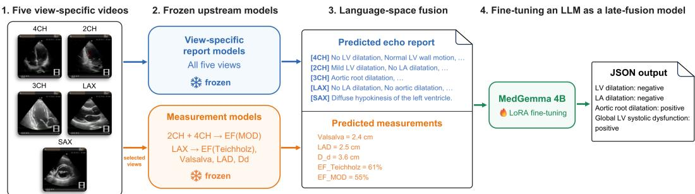
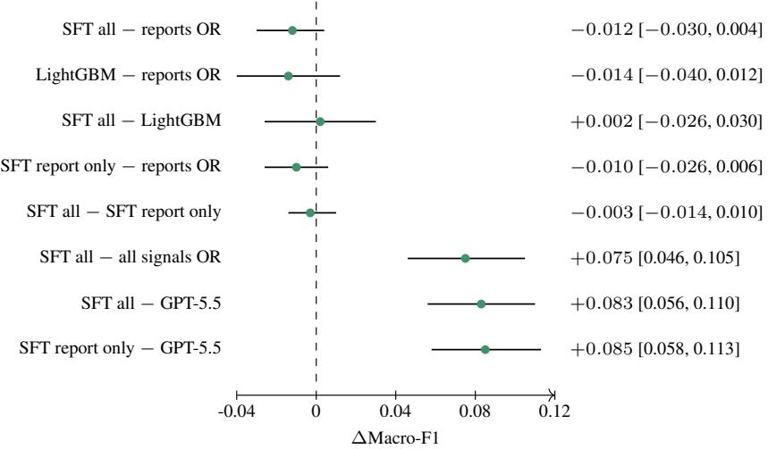

# Integrating Heterogeneous Echocardiography AI Outputs in Language Space: Learnable Late Fusion with a Supervised LLM

Ryo Takizawa Tempei Kabayama

Ryo Matsuoka

Yuta Ando

Chiemi Yamazaki Shun Kitamura

Satoshi Kodera Norihiko Takeda

The University of Tokyo Hospital takizawa@isi.imi.i.u-tokyo.ac.jp

## Abstract

View- and target-specific echocardiography AI models capture useful but complementary information and may not achieve sufficient predictive performance in isolation. A learned ensemble is a natural way to combine these outputs, but heterogeneous models typically require each output to be converted into a binary decision, probability, confidence score, or fixed-length feature vector. We developed a supervised large language model (LLM)-based late-fusion module that directly aggregates view-specific predicted finding statements and predicted measurements in language space and learns a case-level fusion function. In patient-level three-fold cross-validation of 859 examinations from 646 patients, the proposed method integrated heterogeneous outputs within a single framework, performed comparably to the best-performing reference strategy evaluated, and outperformed a general-purpose LLM without task-specific training. These results suggest that a supervised LLM can combine multiple upstream models without model-specific output conversion or feature engineering that requires medical knowledge.

## 1 Introduction

Multiple echocardiographic views provide complementary information about cardiac morphology and function. Deep-learning-based echocardiographic analysis has progressed from view classification and chamber segmentation to ejection-fraction estimation and disease or finding classification [7, 12]. More recently, vision–language foundation models trained on large collections of paired videos and reports, as well as methods that address many interpretation tasks within a single model, have been reported [2, 4]. Nevertheless, individual models currently may not provide adequate examination-level performance, motivating the integration of complementary evidence captured by different models.

A conventional learned ensemble is stacked generalization, in which a meta-learner is trained on the outputs of upstream models [11]. Meta-learners such as logistic regression, gradient boosting, and multilayer perceptrons can learn the reliability of multiple models and correlations among their errors. Connecting heterogeneous upstream models to a common meta-learner, however, generally requires defining each output as a binary decision, probability, confidence score, or fixed-length numerical feature. When an upstream model or evaluation target changes, the corresponding output layer, threshold, feature schema, and missing-value handling must often be redesigned.

Echocardiography AI outputs may contain a mixture of text describing severity and uncertainty, continuous measurements, units, and missing items. Binarizing these outputs or converting them into fixed-length features in advance can discard information. An LLM can place the original outputs of different models into a common context comprising natural language and numbers—that is, language space—and learn a fusion function without model-specific binarization or feature engineering. This common interface may reduce feature engineering when upstream models or input items are added or changed. LLMs have begun to be used as orchestrators that combine the outputs of multiple medical AI tools [3, 10], but it remains unclear whether task-specific supervised learning can adapt the fusion process to the error distributions of particular upstream models.

We developed a supervised MedGemma-based LLM fusion module that jointly classifies four findings at the examination level: left ventricular (LV) dilatation, left atrial (LA) dilatation, aortic root dilatation, and global LV systolic dysfunction. Upstream report models predict finding statements, including presence and severity (e.g., mild, moderate, and severe), from as many as five echocardiographic views. Measurement models predict LV end-diastolic diameter $( D _ { d } )$ , LA diameter (LAD), sinus of Valsalva diameter, biplane Simpson ejection fraction $( \mathrm { E F _ { M O D } ) }$ , and Teichholz ejection fraction $( \mathrm { E F _ { T e i c h h o l z } } )$ from the corresponding views. The proposed method directly places these predicted statements and measurements into a shared text context. We investigated whether a single learnable framework could integrate heterogeneous upstream outputs without manually mapping each output to a target or designing conversions to binary decisions or confidence scores. Patient-level cross-validation evaluated predictive performance, behavior in the presence of weak inputs, and performance relative to a general-purpose LLM unable to learn a fusion strategy tailored to the upstream models.

Our main contributions are threefold:

1. We construct a supervised LLM late-fusion module that directly integrates view-specific predicted finding statements and predicted measurements in language space, without modelspecific engineering.

2. We evaluate simultaneous prediction of four targets from multiple imperfect upstream models using patient-level three-fold cross-validation of 859 examinations from 646 patients.

3. We characterize the value and limitations of a supervised LLM as a fusion module in terms of a common representation for heterogeneous outputs, behavior with weak inputs, and the potential to extend the input configuration.

## 2 Related work

## 2.1 Automated echocardiography analysis and model integration

Echocardiography AI has expanded from individual perception tasks toward examination-level interpretation. Zhang et al. [12] reported an automated pipeline spanning view identification, segmentation, quantification, and disease detection across multiple standard views. EchoNet-Dynamic performs LV segmentation, ejection-fraction estimation, and cardiomyopathy classification from echocardiography videos, demonstrating the benefit of temporal information from the entire video [7]. EchoCLIP demonstrated the utility of vision–language pretraining on a large collection of paired echocardiographic video frames and reports [2], while PanEcho addressed numerous interpretation tasks across diverse views within a single model [4]. These studies focus on representation learning in an upstream model or end-to-end examination interpretation. In contrast, we study learned downstream fusion of several individually imperfect upstream models with heterogeneous output formats.

## 2.2 Learned ensembles and fusion in language space

Stacking is a general framework in which upstream-model predictions are inputs to a meta-learner that learns a fusion function [11]. Although it can combine models to outperform individual predictors, conventional meta-learners require upstream outputs to be represented as consistent numerical features. For a classification model, one might select a binary prediction or probability; for a regression model, a continuous value; and for a generative model, an extracted finding or embedding. A fixed-length schema must then be designed for the model configuration. This preprocessing adds design work when heterogeneous models are connected or updated and may discard severity, negation, or ambiguity expressed in text.

The central motivation for using an LLM in this work is its ability to directly process finding statements, numbers, units, missing items, and a variable number of outputs in a common naturallanguage input space. The upstream models need not expose standardized probabilities or confidence scores, and their original predictive representations are preserved while examination-level fusion is learned. Echo-CoPilot uses multiple LLM-based agents to invoke specialized echocardiography tools and reconcile structural, pathological, and quantitative perspectives [3], while EchoSonar-R unifies classification and report generation across multiple views [10]. Our work differs by neither providing images directly to the LLM nor allowing it to select tools at inference time. Instead, it applies supervised late fusion to fixed outputs from existing view-specific report and measurement models.

## 3 Method

## 3.1 Problem setting and dataset

This retrospective observational study used echocardiography examinations acquired at a single center. The analysis included 859 examinations from 646 patients obtained between January 2015 and December 2023. Of the 646 patients, 135 had more than one examination. Additional details are provided in Appendix A.

## 3.2 Reference labels

Reference labels were extracted from predefined findings in clinical reports written by physicians during routine care. The four evaluation targets were (1) LV dilatation, (2) LA dilatation, (3) aortic root dilatation, and (4) global LV systolic dysfunction, each represented as positive or negative.

Mild-or-greater enlargement was considered positive for the LV and LA, and aortic root dilatation was considered positive when explicitly documented. Global LV systolic dysfunction was considered positive on the basis of prespecified descriptions such as diffuse LV wall-motion reduction. Descriptions corresponding to normal, absent, trace, borderline, or low-normal were classified as negative.

## 3.3 Upstream model outputs

## 3.3.1 View-specific predicted finding statements

The upstream report prediction model was a multitask classifier that predicted the severity or type of predefined findings separately from apical four-chamber (4CH), apical two-chamber (2CH), apical three-chamber (3CH), parasternal long-axis (LAX), and parasternal short-axis (SAX) views. Anatomically informative views differed by target. Predictions were available from 4CH, 2CH, and LAX for LV and LA dilatation; from 3CH and LAX for aortic root dilatation; and from 4CH, 2CH, 3CH, and SAX for global LV systolic dysfunction.

The report model’s VideoEncoder used a ViViT-type encoder pretrained by the Video CLIP method of Takizawa et al. [9]. During pretraining, the encoder received a fixed-length sequence of 32 frames from each video and produced a 512-dimensional video embedding. A BERTJapaneseV3 text encoder processed Japanese clinical reports of up to 256 tokens. The two encoders were trained with a bidirectional contrastive loss that treated matched video–report pairs as positives. Pretraining used 747,900 videos and examination-level clinical reports from 60,747 examinations of 29,886 patients across the five views [9].

For the upstream report model used here, view-specific multitask classification heads were attached to the pretrained VideoEncoder to predict multiple findings observable in a single echocardiography video. The highest-probability class for each finding was selected and deterministically converted to an English finding statement using a predefined mapping. For late fusion, statements were concatenated by view; class probabilities were not used. Thus, report inputs to the LLM were templated statements that retained the type and severity of a finding, including terms such as mild, moderate, and severe, rather than freely generated text.

Report predictions were generated in advance and held fixed during late-fusion training and evaluation; the upstream report model parameters were not updated. The late-fusion cohort excluded all examinations and patients used to train the report model.

  
Figure 1: Study pipeline. View-specific report models produce finding statements, and measurement models produce continuous values. These heterogeneous outputs are formatted as examination-level text and passed to a supervised MedGemma-based fusion module, which jointly returns four binary findings in a fixed JSON schema.

## 3.3.2 Predicted measurements

The measurement model combined semantic segmentation of 4CH, 2CH, and LAX videos with geometric postprocessing that involved no additional learning. For each view, a segmentation model consisting of DeepLabV3 [1] with an ImageNet-pretrained ResNet-50 backbone and a lightweight U-Net-style upsampling module was transfer learned independently. The 4CH model delineated the myocardial and blood-pool region (MASS), LV, LA, right ventricle (RV), and right atrium (RA); the 2CH model delineated MASS, LV, and LA; and the LAX model delineated the LV, interventricular septum (IVS), LV posterior wall (LVPW), aorta (AO), and LA.

Frame-wise segmentation logits were first smoothed temporally with a Gaussian moving average. End-diastolic (ED) and end-systolic (ES) candidates were detected from the time series of LV and LA areas: local maxima of LV area were ED candidates, and local minima were ES candidates. The minimum inter-peak interval was 0.5 s and the ED–ES search window was 0.1–0.5 s. An ES candidate was additionally required to have an LA area above the cardiac-cycle mean within a ±0.1-s window. When multiple ED–ES pairs were available, the pair whose derived EF was closest to the reference value of 62.5% was selected.

For ED and ES frames in 4CH and 2CH, contours were extracted from the LV probability map with marching squares and smoothed using a low-pass Fourier-descriptor filter. When the LV contour was inadequate, the procedure fell back to the contour of the MASS region containing the LV. The LV inflow corresponding to the mitral annulus was estimated from proximity to the LA contour, and the most distant point on the LV contour was designated the apex. The line joining these points defined the LV long axis. After rotating the contour to make the long axis horizontal, we divided the axis into 20 equal segments. The upper and lower contour portions were fitted separately with polynomials at each position, and the distance between the curves defined the disk diameter. Pixel lengths were converted to centimeters using pixel spacing in the DICOM metadata.

For the biplane method of disks (MOD) using 2CH and 4CH, the long-axis lengths and 20 disk diameters obtained within an examination were averaged separately for ED and ES. We used the larger of the mean long-axis lengths from the two views in diastole and the smaller in systole:

$$
\begin{array} { r } { L _ { d } = \operatorname* { m a x } ( \bar { L } _ { d , \mathrm { 4 C H } } , \bar { L } _ { d , \mathrm { 2 C H } } ) , \qquad L _ { s } = \operatorname* { m i n } ( \bar { L } _ { s , \mathrm { 4 C H } } , \bar { L } _ { s , \mathrm { 2 C H } } ) . } \end{array}\tag{1}
$$

Treating the product of the corresponding diameters in the two views as an elliptical cross-section, we computed

$$
\mathrm { E D V _ { M O D } } = \frac { \pi } { 4 } \frac { L _ { d } } { 2 0 } \sum _ { i = 1 } ^ { 2 0 } \bar { d } _ { d , 4 \mathrm { C H } } ^ { i } \bar { d } _ { d , \mathrm { 2 C H } } ^ { i } ,\tag{2}
$$

$$
\mathrm { E S V } _ { \mathrm { M O D } } = \frac { \pi } { 4 } \frac { L _ { s } } { 2 0 } \sum _ { i = 1 } ^ { 2 0 } \bar { d } _ { s , \mathrm { 4 C H } } ^ { i } \bar { d } _ { s , \mathrm { 2 C H } } ^ { i } ,\tag{3}
$$

where $\bar { d } _ { d , \iota } ^ { i }$ and $\bar { d } _ { s , \ i } ^ { i }$ are the mean within-examination diameters of disk i in view v. Finally, EFMOD = $\mathrm { ( E D V _ { M O D } - E S V _ { M O D } ) / E D V _ { M O D } \times 1 0 0 }$

In LAX, the LV, IVS, LVPW, AO, and LA were treated as band-like structures bounded by two opposing contours. Candidate shape corners were extracted at local maxima of contour curvature. Boundaries were divided according to segment length and the area of the enclosing polygon, after which their anatomical orientations were aligned using the centroids of adjacent structures. Dynamic time warping established point correspondences between opposing boundaries, and the distances between matched points formed a local diameter profile. The LV internal diameter was measured 2 cm apical to the position corresponding to the mitral leaflet tips, yielding $D _ { d }$ at ED and $D _ { s }$ at ES. The maximum diameter of the profile corresponding to the aortic sinus defined the sinus of Valsalva diameter, and the diameter near the LA contour centroid defined LAD.

Teichholz volumes were calculated from $D _ { d }$ and $D _ { s }$ in centimeters:

$$
\mathrm { E D V } _ { \mathrm { T e i c h h o l z } } = \frac { 7 } { 2 . 4 + D _ { d } } D _ { d } ^ { 3 } , \qquad \mathrm { E S V } _ { \mathrm { T e i c h h o l z } } = \frac { 7 } { 2 . 4 + D _ { s } } D _ { s } ^ { 3 } ,\tag{4}
$$

and $\mathrm { E F _ { T e i c h h o l z } = ( E D V _ { T e i c h h o l z } - E S V _ { T e i c h h o l z } ) / E D V _ { T e i c h h o l z } \times 1 0 0 }$ . For late-fusion inputs, the values were listed as text in the order of $\mathrm { E F _ { T e i c h h o l z } } ,$ Valsalva sinus diameter, LAD, $D _ { d } ,$ and $\mathrm { E F _ { M O D } }$ for each examination.

The measurements associated with the four targets were $D _ { d }$ for LV dilatation, LAD for LA dilatation, sinus of Valsalva diameter for aortic root dilatation, and $\mathrm { E F _ { M O D } }$ and $\mathrm { E F _ { T e i c h h o l z } }$ for global LV systolic dysfunction (see Appendix B for details). Measurements were computed and fixed before late-fusion training, and the measurement-model parameters were not updated. The late-fusion cohort excluded all examinations and patients used to train the measurement model.

## 3.4 Fusion task in language space

For each examination, all available view-specific predicted finding statements and measurements were converted to templated text that distinguished the view, measurement name, value, and unit (Figure 1). Report predictions remained as finding statements, and measurement predictions remained continuous. We neither binarized upstream outputs in advance nor required upstream models to provide probabilities or confidence scores. A system prompt supplied the LLM with the positive and negative definitions for each target, and the model returned all four targets simultaneously in a fixed JSON schema. The output was parsed into four separate binary decisions. The exact system prompt, user-prompt template, and JSON schema are provided in Appendix C.

## 3.5 Supervised fine-tuning

We used google/medgemma-4b-it [8] as the base model and applied low-rank adaptation (LoRA) [5] for parameter-efficient fine-tuning. The target modules were the query, key, value, and output projections in the attention layers and the gate, up, and down projections in the feed-forward layers. The fine-tuning configuration is provided in Appendix D.

For every fold, all original training examinations were retained once. We then sampled, with replacement, an additional set twice the size of the original training set, producing three times as many training examples as in the unaugmented set. For each of the four labels, we calculated the item-specific positive rate required in the additional sample to bring the final training-set positive rate close to 0.30 and iteratively updated examination weights 200 times. Normalized weights were capped at 6.0 to avoid excessive duplication of rare label combinations. Test sets were not modified.

## 4 Results

## 4.1 Evaluation setting

We performed three-fold cross-validation with patients as the splitting unit (Table 1). All examinations from a patient were assigned to the same fold. The split approximately balanced the numbers of examinations, patients, positives for each of the four targets, and observed label combinations across folds. Every examination appeared in a test set exactly once, and predictions from the three test folds were concatenated to form out-of-fold (OOF) predictions for the full cohort.

Table 1: Patient-level three-fold cross-validation splits. Positive counts refer to each test fold.
<table><tr><td rowspan="2">Fold</td><td colspan="2">Train</td><td colspan="2">Test</td><td colspan="2">LV dil. LA dil. Root dil. LV dysf.</td><td colspan="2"></td></tr><tr><td></td><td>Exams Patients Exams Patients</td><td></td><td></td><td>Pos.</td><td>Pos.</td><td>Pos.</td><td>Pos.</td></tr><tr><td>1</td><td>573</td><td>431</td><td>286</td><td>215</td><td>26</td><td>95</td><td>49</td><td>23</td></tr><tr><td>2</td><td>572</td><td>430</td><td>287</td><td>216</td><td>26</td><td>95</td><td>49</td><td>23</td></tr><tr><td>3</td><td>573</td><td>431</td><td>286</td><td>215</td><td>25</td><td>94</td><td>49</td><td>24</td></tr><tr><td>Overall</td><td>一</td><td>一</td><td>859</td><td>646</td><td>77</td><td>284</td><td>147</td><td>70</td></tr></table>

Table 2: Standalone performance of upstream predictions. Dashes indicate that a view did not output the target. Measurement thresholds maximized positive-class F1 on the corresponding training fold.

(a) View-specific report prediction F1
<table><tr><td>Target</td><td>4CH 2CH 3CH</td><td>LAX</td><td>SAX</td></tr><tr><td>LV dilatation</td><td>0.677 0.687</td><td>0.687</td><td>一</td></tr><tr><td>LA dilatation</td><td>0.7280.721</td><td></td><td>0.736 一</td></tr><tr><td>Aortic root dilatation</td><td></td><td>0.459 0.547</td><td>0.688</td></tr><tr><td colspan="4">Global LV systolic dysfunction 0.731 0.731 0.748</td></tr></table>

(b) Predicted measurements, fold-specific thresholds, and OOF F1
<table><tr><td>Target</td><td>Measurement</td><td>Fold 1</td><td>Fold 2 Fold 3</td><td></td><td>OOF F1</td></tr><tr><td>LV dilatation</td><td>Dd (cm)</td><td>≥ 5.15 ≥</td><td>5.25 ≥</td><td>5.05</td><td>0.634</td></tr><tr><td>LA dilatation</td><td>LAD (cm)</td><td>&gt; 2.85</td><td>2.95</td><td>2.85</td><td>0.681</td></tr><tr><td>Aortic root dilatation</td><td>Valsalva (cm)</td><td>7 2.75</td><td>2.75</td><td>2.75</td><td>0.506</td></tr><tr><td>Global LV dysfunction</td><td>EFMOD (%)</td><td>&lt; 42.5</td><td>&lt; 41.5</td><td>&lt; 42.5</td><td>0.459</td></tr><tr><td>Global LV dysfunction</td><td> $\mathrm { E F _ { T e i c h h o l z } }$  (%)</td><td>&lt; 42.5</td><td>&lt; 35.5</td><td>V 42.5</td><td>0.417</td></tr></table>

## 4.2 Standalone performance of upstream models

Table 2 reports standalone F1 scores for each upstream signal and the fold-specific thresholds used to binarize measurement predictions. Report predictions were evaluated separately for each viewspecific classification head. For measurements, the threshold and decision direction selected on each outer fold’s training set were fixed and applied to that fold’s test set. All F1 scores were calculated after combining the three test folds into an OOF evaluation.

Report-prediction F1 exceeded the corresponding measurement-prediction F1 for LV dilatation, LA dilatation, and global LV systolic dysfunction. For aortic root dilatation, performance differed substantially between views.

## 4.3 Main results

We evaluated the proposed method from two perspectives: whether it could achieve a reasonable fusion strategy and whether learning the fusion strategy was necessary. To this end, we defined three classes of baseline: interpretable fixed rules, conventional learned fusion, and a general-purpose LLM without additional training.

Interpretable fixed-rule baselines. For each target, we computed OR and AND across all report predictions from the available views, across all measurements, and across all report and measurement signals. For example, all signals OR was positive if any available report prediction or binarized measurement was positive, whereas all signals AND was positive only if all were positive. Continuous measurements required by the fixed rules were binarized using the thresholds described in Table 2. Because their mappings from inputs to final decisions could be traced explicitly, these fixed rules served as interpretable baselines for evaluating learned LLM fusion.

Conventional learned LightGBM baseline. To compare the proposed method with learned fusion corresponding to conventional stacked generalization, we constructed a baseline using LightGBM [6] as the meta-learner. For each of the four targets, the corresponding view-specific report-prediction classes were converted to one-hot vectors, concatenated with the corresponding continuous measurements, and provided to an independent binary classifier. Specifically, LV dilatation used report predictions from 4CH, 2CH, and LAX together with $D _ { d } ;$ LA dilatation used report predictions from 4CH, 2CH, and LAX together with LAD; aortic root dilatation used report predictions from 3CH and LAX together with the Valsalva sinus diameter; and global LV systolic dysfunction used report predictions from 4CH, 2CH, 3CH, and SAX together with EFMOD and EFTeichholz. This input design required explicit mappings between evaluation targets and upstream outputs, as well as a fixed-length feature schema.

Table 3: Overall performance of the fusion methods. Bold values mark the highest value in each column.
<table><tr><td colspan="5"></td></tr><tr><td>Method</td><td></td><td></td><td>Macro-F1 Micro-F1 Exact match Hamming acc.</td><td>mean±SD</td></tr><tr><td>Reports OR</td><td>0.703</td><td>0.709</td><td>0.639 0.891</td><td>0.703±0.042</td></tr><tr><td>Reports AND</td><td>0.576</td><td>0.587</td><td>0.653 0.894</td><td>0.571±0.052</td></tr><tr><td>Measurements OR</td><td>0.565</td><td>0.586</td><td>0.483 0.832</td><td>0.567±0.047</td></tr><tr><td>Measurements AND</td><td>0.559</td><td>0.598</td><td>0.531 0.851</td><td>0.557±0.018</td></tr><tr><td>All signals OR</td><td>0.615</td><td>0.629</td><td>0.477 0.826</td><td>0.619±0.059</td></tr><tr><td>All signals AND</td><td>0.473</td><td>0.525</td><td>0.637 0.886</td><td>0.469±0.048</td></tr><tr><td>LightGBM</td><td>0.688</td><td>0.698</td><td>0.637 0.890</td><td>0.687±0.048</td></tr><tr><td>LLM (SFT, all)</td><td>0.690</td><td>0.699</td><td>0.634 0.889</td><td>0.690±0.020</td></tr><tr><td>LLM (SFT, report only)</td><td>0.693</td><td>0.696</td><td>0.633 0.889</td><td>0.693±0.033</td></tr><tr><td>GPT-5.5</td><td>0.608</td><td>0.631</td><td>0.515 0.848</td><td>0.608±0.031</td></tr></table>

The LightGBM hyperparameters were fixed in advance at 200 trees, a learning rate of 0.03, a maximum depth of 3, a maximum of 7 leaves, a minimum of 20 child samples, and L2 regularization of 1.0. The original outer-training examinations were not resampled, and balanced class weights were used during training. Within the training set of each outer fold, we generated three-fold OOF predictions using patients as the splitting unit and selected the binary decision threshold that maximized positive-class F1. The model was then refit on the full outer-training set, and the selected threshold was held fixed when applied to the outer-test set.

Strong general-purpose LLM baseline. Because LLMs possess medical-domain knowledge, it was not self-evident that a fusion strategy needed to be learned. To assess the need to learn a strategy tailored to the upstream models, we provided the same prompts used for supervised fine-tuning (SFT) to the strong general-purpose LLM gpt-5.5 and had it classify all examinations. Reasoning effort was set to none, and each examination was evaluated once.

Metrics. The primary descriptive metric was Macro-F1, the mean positive-class F1 across the four targets. Accuracy alone was not used as the primary metric because prevalences differed and positive examples of LV dilatation and global LV systolic dysfunction were uncommon. Secondary metrics were Micro-F1 pooled across all target decisions, exact match (the fraction of examinations for which all four targets were correct), and Hamming accuracy (the fraction of all binary decisions that were correct). All four targets could be extracted under the fixed schema from every output of SFT all, the report-only ablation described below, and GPT-5.5; no samples were excluded from evaluation because of parsing failures.

Differences in Macro-F1 between methods were assessed with a paired patient-cluster bootstrap of 20,000 replicates, evaluating both methods in the same bootstrap sample. This exploratory analysis was added after inspection of the primary results and was not a prespecified confirmatory test. We describe whether each 95% CI includes zero but do not interpret the analysis as a superiority or non-inferiority test. Between-fold standard deviations are descriptive of the data subsets and trained models and were not used for statistical inference. Because the bootstrap resampled fixed OOF predictions, it did not capture variability from retraining models or re-estimating thresholds under altered training data.

A supervised LLM matches conventional learned fusion and a strong fixed fusion strategy. The proposed LLM (SFT, all) achieved a Macro-F1 of 0.690. Among the fixed reference strategies, reports OR performed best, with a Macro-F1 of 0.703. LightGBM, the conventional learned fusion method, achieved a Macro-F1 of 0.688 (Table 3).

Table 4: Target-specific F1. Bold values mark the highest point estimate in each row.
<table><tr><td>Target</td><td>Reports OR LightGBM</td><td></td><td>SFT all SFT report only</td><td></td><td>GPT-5.5</td></tr><tr><td>LV dilatation</td><td>0.733</td><td>0.727</td><td>0.696</td><td>0.721</td><td>0.731</td></tr><tr><td>LA dilatation</td><td>0.767</td><td>0.771</td><td>0.778</td><td>0.770</td><td>0.766</td></tr><tr><td>Aortic root dilatation</td><td>0.569</td><td>0.542</td><td>0.545</td><td>0.545</td><td>0.528</td></tr><tr><td>Global LV dysfunction</td><td>0.741</td><td>0.713</td><td>0.742</td><td>0.735</td><td>0.405</td></tr><tr><td>Macro-F1</td><td>0.703</td><td>0.688</td><td>0.690</td><td>0.693</td><td>0.608</td></tr></table>

  
Figure 2: Exploratory paired patient-cluster bootstrap differences in Macro-F1. Points show paired differences, horizontal lines show 95% CIs, and numeric annotations give the point estimate followed by the CI. Analyses use fixed OOF predictions.

The Macro-F1 difference between SFT all and LightGBM was +0.002, and the 95% CI from the exploratory paired patient-cluster bootstrap included zero ([−0.026, 0.030]; Figure 2). The difference between SFT all and reports OR was likewise small, and its CI included zero. These results do not establish statistical equivalence or non-inferiority, but the point estimates indicate that the supervised LLM reached fusion performance close to both the conventional learned fusion method and the strong fixed reference strategy evaluated here.

LightGBM required a fixed-length schema designed in advance, including mappings between targets and view-specific report and measurement inputs, one-hot encoding of report classes, and a separate classifier for each target. Reports OR similarly required such mappings and prior binarization of each output. In contrast, SFT all was not given explicit features mapping individual outputs to evaluation targets and instead processed finding statements and continuous values within a shared text context. Its performance under this condition was comparable to LightGBM and reports OR, indicating that language-based LLM fusion without target-specific structured feature engineering can achieve performance similar to conventional learned fusion.

The ranking of fixed rules also depended on the metric. Reports AND had lower Macro-F1 but the highest exact match and Hamming accuracy (Table 3). Because negative examples dominated this dataset, a conservative AND rule benefited metrics that reward correctness across all targets or decisions, whereas reports OR better detected positive classes and therefore achieved higher Macro-F1.

No single method consistently dominated across targets. Compared with LightGBM, SFT all was slightly higher for LA dilatation, aortic root dilatation, and global LV systolic dysfunction, but lower for LV dilatation. Compared with reports OR, SFT all was higher for LA dilatation and global LV systolic dysfunction but lower for LV dilatation and aortic root dilatation (Table 4).

Learned fusion avoids degradation from indiscriminately adding weak measurements. Report predictions were the dominant upstream signals in this study; reference strategies that used measurements, such as all signals OR, performed worse than report-only strategies such as reports OR (Table 3). Measurements could therefore behave as noise rather than complementary information and impair SFT all. To examine this possibility, we trained LLM (SFT, report only) as a diagnostic ablation. Its training conditions, system prompt, and output schema matched SFT all, but measurement inputs were removed. Similar performance would indicate that SFT all did not indiscriminately use weak measurements and could suppress their influence.

SFT all and SFT report only had nearly identical overall performance, and the CI for their paired difference included zero (Table 3 and Figure 2). At the target level, adding measurements increased recall for LA dilatation and global LV systolic dysfunction, but precision–recall trade-offs kept the F1 differences small. SFT all was slightly lower for LV dilatation, and the two models made identical predictions for every examination for aortic root dilatation (Table 4).

Moreover, indiscriminately applying OR to all signals yielded a Macro-F1 of 0.615, whereas SFT all and LightGBM achieved 0.690 and 0.688, respectively. Thus, indiscriminately adding measurements with low standalone performance can degrade fusion performance, while both supervised learned fusion methods avoided this degradation.

Task-specific learning yields more appropriate fusion than a general-purpose LLM. GPT-5.5 without additional training had lower Macro-F1 and exact match than SFT all, and the CI for the paired difference excluded zero (Table 3 and Figure 2).

The target-specific F1 difference was especially large for global LV systolic dysfunction (Table 4). GPT-5.5 produced many false positives alongside high recall, whereas SFT all suppressed false positives and achieved a better precision–recall balance. The general-purpose LLM appeared to respond too strongly in an effort to avoid missing a finding, while SFT all adapted its decisions to the upstream models’ error characteristics.

This finding indicates that, even with a strong LLM, general medical knowledge and prompt-specified decision definitions alone may be insufficient to account for upstream-model-specific reliability and correlated errors, and that supervised learning from examination labels is useful for acquiring an appropriate fusion strategy.

## 5 Conclusion and limitations

Supervised LLM late fusion processed multi-view report predictions and measurement predictions in one framework without hand-designed, target-specific fusion rules. The proposed model performed comparably to both reports OR, the best fixed rule evaluated, and LightGBM, a conventional learned fusion method using a fixed-length feature schema, while outperforming naive fusion that indiscriminately incorporated weak inputs and a general-purpose LLM without task-specific training. Its performance also remained comparable to a report-only model, indicating that it avoided the degradation caused by indiscriminately adding measurements when report predictions dominated. These findings support the potential of language-based fusion without target-specific structured feature engineering to achieve performance similar to the conventional learned fusion method evaluated here.

This study has several limitations. First, it used only retrospective, single-center data; generalization to external institutions and future time periods was not evaluated. Second, only 77 examinations were positive for LV dilatation and 70 for global LV systolic dysfunction, resulting in wide CIs for some estimates. Third, we did not vary the number or configuration of input models, simulate missing views, or evaluate robustness to perturbations. The claimed extensibility is therefore currently a design-level advantage rather than an empirically demonstrated property. Fourth, LightGBM was evaluated with a single hyperparameter configuration fixed in advance and therefore does not represent the upper bound of performance attainable by conventional fusion. Validation with different input configurations, additional conventional meta-learners, and external data is needed.

## References

[1] Liang-Chieh Chen, George Papandreou, Florian Schroff, and Hartwig Adam. Rethinking atrous convolution for semantic image segmentation. arXiv preprint arXiv:1706.05587, 2017.

[2] Matthew Christensen, Milan Vukadinovic, Neal Yuan, and David Ouyang. Vision–language foundation model for echocardiogram interpretation. Nature Medicine, 30:1481–1488, 2024.

[3] Moein Heidari, Ali Mehrabian, Mohammad Amin Roohi, Wenjin Chen, David J. Foran, Jasmine Grewal, and Ilker Hacihaliloglu. Echo-CoPilot: A multiple-perspective agentic framework for reliable echocardiog raphy interpretation. arXiv preprint arXiv:2512.09944, 2025.

[4] Gregory Holste, Evangelos K. Oikonomou, Márton Tokodi, Attila Kovács, Zhangyang Wang, and Rohan Khera. Complete AI-enabled echocardiography interpretation with multitask deep learning. JAMA, 334(4): 306–318, 2025.

[5] Edward J. Hu, Yelong Shen, Phillip Wallis, et al. LoRA: Low-rank adaptation of large language models. In International Conference on Learning Representations, 2022.

[6] Guolin Ke, Qi Meng, Thomas Finley, Taifeng Wang, Wei Chen, Weidong Ma, Qiwei Ye, and Tie-Yan Liu. LightGBM: A highly efficient gradient boosting decision tree. In Advances in Neural Information Processing Systems, volume 30, pages 3146–3154, 2017.

[7] David Ouyang, Bryan He, Amirata Ghorbani, et al. Video-based AI for beat-to-beat assessment of cardiac function. Nature, 580:252–256, 2020.

[8] Andrew Sellergren, Sahar Kazemzadeh, Tiam Jaroensri, et al. MedGemma technical report. arXiv preprint arXiv:2507.05201, 2025.

[9] Ryo Takizawa, Satoshi Kodera, Tempei Kabayama, Ryo Matsuoka, Yuta Ando, Yuto Nakamura, Haruki Settai, and Norihiko Takeda. Video CLIP model for multi-view echocardiography interpretation. In NeurIPS 2025 Workshop on Learningfrom Time-Seriesfor Health, 2025.

[10] Darya Taratynova, Ahmed Aly, Numan Saeed, and Mohammad Yaqub. EchoSonar-R: A multi-view reasoning-enabled model for disease classification and report generation in echocardiography. arXiv preprint arXiv:2606.28164, 2026.

[11] David H. Wolpert. Stacked generalization. Neural Networks, 5(2):241–259, 1992.

[12] Jeffrey Zhang, Sravani Gajjala, Pulkit Agrawal, et al. Fully automated echocardiogram interpretation in clinical practice. Circulation, 138(16):1623–1635, 2018.

## A Cohort characteristics

Table 5 summarizes the sex and age distributions of the 859 examinations. Because some patients contributed more than one examination, these are examination-level summaries.

Table 5: Examination-level cohort characteristics.
<table><tr><td>Characteristic</td><td>Summary</td></tr><tr><td>Sex, male, n (%)</td><td>496 (57.7%)</td></tr><tr><td>Sex, female, n (%)  $\mathrm { A g e , }$  median [IQR], years</td><td>363 (42.3%)</td></tr><tr><td>Age, range, years</td><td>63.0 [49.0–74.0] 8-93</td></tr></table>

## B Target-specific input signals

Table 6: Report and measurement inputs associated with each evaluation target.
<table><tr><td>Target</td><td>Report inputs</td><td>Measurement inputs</td><td>Positive direction</td></tr><tr><td>LV dilatation</td><td>4CH, 2CH, LAX</td><td> $D _ { d }$ </td><td>Larger</td></tr><tr><td>LA dilatation</td><td>4CH, 2CH, LAX</td><td>LAD</td><td>Larger</td></tr><tr><td>Aortic root dilatation</td><td>3CH, LAX</td><td>Valsalva diameter</td><td>Larger</td></tr><tr><td>Global LV dysfunction</td><td>4CH, 2CH, 3CH, SAX</td><td> $\mathrm { E F _ { M O D } , E F _ { T e i c h h o l z } }$ </td><td>Smaller</td></tr></table>

## C Prompts and output schema

The system prompt was:   
You are an expert echocardiography interpreter.   
Determine whether each condition is positive or negative.   
- Classify each condition as negative if normal, absent, trace,   
borderline, or low-normal; otherwise, classify it as positive.   
- Some predictions in given reports and measurements may conflict.   
Output in the following format:   
<answer>   
{   
"LV dilatation": "positive|negative",   
"LA dilatation": "positive|negative",   
"Aortic root dilatation": "positive|negative",   
"Global LV systolic dysfunction": "positive|negative"   
}   
</answer>   
An example user prompt for LLM (SFT, all) was:   
Predicted echo report:   
[4CH]   
No left ventricular enlargement. Normal left ventricular wall   
motion. Mild left atrial enlargement present.   
[2CH]   
No left ventricular enlargement. Normal left ventricular wall   
motion. Mild left atrial enlargement present.   
[3CH]   
Normal left ventricular wall motion. No aortic dilatation.   
[LAX]   
No left ventricular enlargement. Mild left atrial enlargement   
present. No aortic dilatation.   
[SAX]   
Normal left ventricular wall motion.   
Measurements predicted from LAX:   
- EF(Teichholz)[%]: 54   
- Valsalva[cm]: 3.7   
- LAD[cm]: 3.8   
- Dd[cm]: 4.7   
Biplane Simpson (MOD) measurement predicted from 2CH and 4CH:   
- EF[%]: 66   
For LLM (SFT, report only), the input ended after the five view-specific finding-statement block   
under Predicted echo report:. The teacher completion and inference output used th   
<answer> tag and four-target JSON object shown in the system prompt.

## D Supervised fine-tuning configuration

Table 7: Supervised fine-tuning configuration.
<table><tr><td>Hyperparameter</td><td>Setting</td></tr><tr><td>Base model</td><td> $\mathsf { g o o g l e / m e d g e m m a - 4 b - i t }$ </td></tr><tr><td>LoRA rank / alpha / dropout</td><td> $8 / 1 6 / 0 . 0 5$ </td></tr><tr><td>Learning rate</td><td> $1 \times 1 0 ^ { - 5 }$ </td></tr><tr><td>Warmup ratio / scheduler</td><td> $0 . 0 5 / \mathrm { l i n e a r }$ </td></tr><tr><td>Epochs</td><td>5</td></tr><tr><td>Per-GPU batch size</td><td>4</td></tr><tr><td>GPUs</td><td> $\mathrm { A 1 0 0 } \times 4$ </td></tr><tr><td>Numerical precision</td><td>bfloat16</td></tr></table>