# KV Cache Quantization for Diffusion Language Models

Yan Tai1,4, Yunan Ding3,4, Guangzhao Li1,2, Siqi Luo1, Chaoyang Zhang2, Guangtao Zhai1, Guodong Guo4,†, Xiaohong Liu1,2,†

1Shanghai Jiao Tong University 2Shanghai Innovation Institute

3The Hong Kong Polytechnic University

4Ningbo Institute of Digital Twin, Eastern Institute of Technology, Ningbo, China

Correspondence: gdguo@eitech.edu.cn, xiaohongliu@sjtu.edu.cn

## Abstract

KV cache quantization is well studied for autoregressive language models, where cached prefix states are exact under causal attention and quantization is mainly a cache reconstruction problem. Diffusion language models (dLLMs) break this assumption. Fast dLLM inference reuses KV states across denoising steps, but bidirectional token representations can change as masked tokens are revealed, so the reused cache may already differ from full recomputation before quantization is applied. We study KV cache quantization under this cache-reuse error. We adapt KIVI and KVQuant to Fast-dLLM-style prefix and dual cache reuse, and introduce TRACE and dLLM-KVQ. TRACE reconstructs feasible dLLM reveal trajectories from prompt-answer pairs, providing calibration states that match iterative masked decoding. dLLM-KVQ uses these trajectories to choose per-layer K-cache entries that remain in high precision according to output- and attention-level behavior metrics, while applying standard low-bit value quantization. Across LLaDA and Dream evaluations on GSM8K, HumanEval, MATH, and MBPP, dLLM-KVQ achieves the highest average score among quantized methods across the reported 4-bit and 2-bit prefix/dual cache settings.

## 1 Introduction

Diffusion language models (dLLMs) generate text by iteratively refining partially masked sequences rather than by strict left-to-right next-token prediction (Austin et al., 2021a; Lou et al., 2023; Sahoo et al., 2024; Shi et al., 2024; Nie et al., 2026; Ye et al., 2025). Efficient dLLM inference therefore often reuses KV states across denoising steps, as in the prefix and dual cache modes of Fast-dLLM (Wu et al., 2025) and adaptive cache updates in dLLM-Cache (Liu et al., 2025). This makes KV cache compression a natural next step, but it also changes the assumptions behind standard autoregressive (AR) KV cache quantization.

In AR decoding, cached prefix states are exact under causal self-attention (Vaswani et al., 2017): future generated tokens do not change the key and value states of previous tokens. In dLLM decoding, layers use bidirectional self-attention over the current masked sequence. When tokens inside the active block are revealed, prefix or suffix token states can also change under full recomputation. Cache reuse avoids this recomputation by keeping selected regions fixed, so the reused cache is an approximation to the full-recompute cache. Figure 1 (b) illustrates this difference.

This difference makes direct AR-to-dLLM transfer unreliable. AR KV quantizers such as KIVI (Liu et al., 2024) and KVQuant (Hooper et al., 2024) are usually motivated as approximating an unquantized reference cache with fewer bits. In a dLLM cache-reuse path, quantization is applied to a cache that may already differ from full recomputation. The deployed cache therefore contains both cache-reuse error and quantization error. Reducing reconstruction error of the reused cache alone may not preserve attention patterns, token scores, or final task decisions.

This setting creates two practical challenges. First, calibration data must reflect masked denoising states rather than only complete prompt-answer sequences, because the same final answer can be reached through different reveal orders. Second, the quantization objective should be tied to model behavior. This is especially important for K caches, where a small numerical perturbation can shift attention mass among reused and recomputed tokens.

To our knowledge, this is the first systematic study of KV cache quantization for dLLMs. We adapt KIVI and KVQuant to a unified Fast-dLLM cache interface and evaluate them under prefix and dual cache reuse. We then introduce TRACE, a trajectory reconstruction procedure that assigns each answer token in a prompt-answer pair to a legal reveal step under the dLLM block schedule.

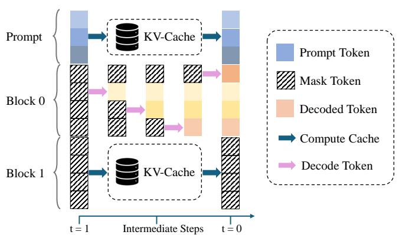  
(a) Process of block diffusion with Fast-dLLM

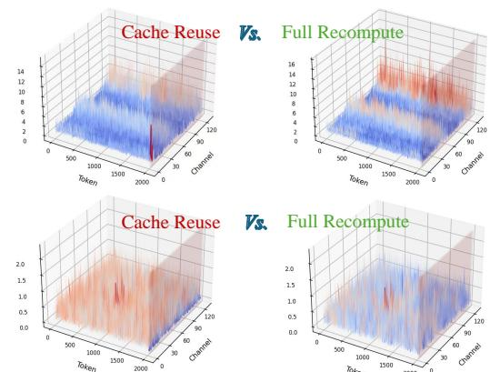  
(b) Mismatch between cache and recompute state  
Figure 1: Fast-dLLM cache reuse and cache-reuse error. (a) Dual cache reuses prefix and suffix KV states from a block-initial forward pass while recomputing only the active block. (b) The reused cache can differ from the corresponding full-recompute cache after masked tokens inside the block are revealed.

These reconstructed denoising states provide calibration data that matches masked iterative decoding without storing full multi-step logits or KV caches. Figure 2 summarizes how this trajectory construction supports offline policy fitting and online cache quantization.

Building on this calibration, dLLM-KVQ selects a small set of K-cache entries to keep in high precision. The policy is chosen per model, cache mode, bit-width, and layer using outputand attention-level metrics measured on reconstructed trajectories. At inference time, it uses only information available from the block-initial forward pass, while the V cache follows a standard low-bit quantize-dequantize path. Across LLaDA-Instruct and Dream-Base-7B on GSM8K, HumanEval, MATH, and MBPP, dLLM-KVQ obtains the highest average score among the evaluated quantized methods in the reported 4-bit and 2-bit prefix/dual settings.

The paper makes four contributions:

• We formulate dLLM KV cache quantization under cache reuse and separate cache-reuse error from quantization error.

• We propose TRACE to reconstruct dLLM reveal trajectories from prompt-answer pairs for calibration.

• We propose dLLM-KVQ to select per-layer highprecision K-token budgets from behavior metrics and apply them using only block-initial information.

• We show that dLLM-KVQ obtains the best fourtask average among quantized methods across all reported models, cache modes, and bit-widths.

## 2 Preliminary

dLLM Block Diffusion. Following discrete and masked diffusion language modeling (Austin et al., 2021a; Lou et al., 2023; Sahoo et al., 2024; Shi et al., 2024; Arriola et al., 2025), let p be the prompt and $x _ { t }$ be the partially generated response at denoising step t, where unrevealed positions are <mask>. Unlike AR decoding, which appends one new token to a fixed prefix, a dLLM repeatedly rewrites a partially masked sequence. In block-wise decoding, the response is divided into blocks $\boldsymbol { B } _ { 1 } , \dots , \boldsymbol { B } _ { B }$ At each denoising step t inside the current block $B _ { b } .$ the model predicts distributions for masked positions and reveals a scheduled subset of highconfidence tokens, following the iterative masked decoding pattern used in non-autoregressive and diffusion-style generation (Ghazvininejad et al., 2019; Wu et al., 2025):

$$
x _ { t + 1 , i } = \left\{ \begin{array} { l l } { \arg \operatorname* { m a x } _ { v } p _ { \theta } ( v  { | } p , x _ { t } , i ) , } & { i \in \mathcal { R } _ { b , t } , } \\ { x _ { t , i } , } & { \mathrm { o t h e r w i s e } , } \end{array} \right.
$$

where $\mathcal { R } _ { b , t } \subseteq B _ { b }$ is the set of positions revealed at step t.

dLLM Cache. Following Fast-dLLM (Wu et al., 2025) and recent adaptive dLLM caching work (Liu et al., 2025), we consider two cache reuse modes for efficient dLLM inference. If the model is fully recomputed at every denoising step, layer ℓ produces a full cache $C _ { t } ^ { \ell } = ( K _ { t } ^ { \ell } , V _ { t } ^ { \ell } )$ from the current state $( p , x _ { t } )$ . Fast-dLLM avoids this cost by running a full forward pass at the beginning of a block, storing the resulting KV cache, and reusing selected regions during later denoising steps. Prefix cache reuses the prefix region and recomputes the active block plus suffix. Dual cache reuses both prefix and suffix and recomputes only the active block. We denote either cache mode by

$$
\begin{array} { r l } & { C _ { t , m } ^ { \ell , \mathrm { r e u s e } } = \Gamma _ { m } \Big ( C _ { \tau _ { b } } ^ { \ell , \mathrm { f u l l } } , C _ { t } ^ { \ell , \mathrm { l o c a l } } , { \mathcal { B } } _ { b } \Big ) , } \\ & { \qquad m \in \{ \mathrm { p r e f i x } , \mathrm { d u a l } \} . } \end{array}
$$

where $\tau _ { b }$ is the block-initial step at which the reusable cache is built, $C _ { t } ^ { \ell , \mathrm { l o c a l } }$ is the cache recomputed for the active regions, and $\Gamma _ { m }$ selects which token regions are reused and which are recomputed. Figure 1(a) illustrates Fast-dLLM’s dual cache reuse process, where cached regions (prefix and suffix) are reused while the active block is progressively denoised over intermediate steps.

## 3 Why dLLM KV Cache Quantization Is Different

KV cache quantization for autoregressive (AR) LLMs is usually framed as a reconstruction problem (Liu et al., 2024; Hooper et al., 2024): the unquantized cache is the reference cache, and the quantizer should approximate it with less memory. For diffusion language models (dLLMs), this view is incomplete. dLLM cache methods such as Fast-dLLM accelerate dLLM decoding by reusing cache states computed by a block-initial forward pass, which are approximations to full recomputation (Wu et al., 2025; Liu et al., 2025). Our quantization study is applied on top of this cache reuse mechanism. Therefore, the cache to be quantized may already differ from the cache that full recomputation would produce. This section defines this difference and explains why it changes the quantization problem.

## 3.1 Cache-Reuse Error

The key difference from AR decoding is that dLLM layers use bidirectional self-attention over the current masked sequence. Consider a block after its initial step $\tau _ { b } ,$ and a later denoising step t in the same block. Some positions in $B _ { b }$ may have changed from <mask> to concrete tokens during these intervening steps. Under full recomputation, prefix and suffix token states are recomputed together with this updated block, so their K/V entries can change. Under prefix or dual cache reuse, the reused prefix or suffix entries remain the ones computed at $\tau _ { b }$

We write this cache-reuse error as:

$$
E _ { t , m } ^ { \ell , \mathrm { r e u s e } } = C _ { t , m } ^ { \ell , \mathrm { r e u s e } } - C _ { t } ^ { \ell , \mathrm { f u l l } } .
$$

In AR LLMs, the analogous term is zero for cached prefix tokens under standard causal attention (Vaswani et al., 2017): past token states do not depend on future generated tokens. In dLLMs, $E ^ { \mathrm { r e u s e } }$ is generally nonzero. The key and value plots in Figure 1 make this empirical fact visible: even for the same block, layer, and head, the reused cache state and the later full-recompute cache can have different feature distributions.

## 3.2 Quantization Error Is Not the Only Error

For AR cache quantization, the deployed cache is usually $\widehat { C } _ { t } = Q _ { \beta } ( C _ { t } )$ , where $Q _ { \beta }$ is a β-bit quantizer (Liu et al., 2024; Hooper et al., 2024; Lin et al., 2025). The cache error is simply $Q _ { \beta } ( C _ { t } ) - C _ { t }$ , so improving cache reconstruction is a natural objective.

For dLLMs with cache reuse, quantization is applied to $C _ { t , m } ^ { \mathrm { r e u s e } }$ , but the reference behavior we would like to preserve is the behavior of $C _ { t } ^ { \mathrm { f u l l } }$ . The resulting cache error is therefore

$$
\begin{array} { r l } & { \widehat { C } _ { t , m } ^ { \ell } - C _ { t } ^ { \ell , \mathrm { f u l l } } = \underbrace { C _ { t , m } ^ { \ell , \mathrm { r e u s e } } - C _ { t } ^ { \ell , \mathrm { f u l l } } } _ { \mathrm { c a c h e - r e u s e ~ e r r o r } } } \\ & { ~ + \underbrace { Q _ { \beta } ( C _ { t , m } ^ { \ell , \mathrm { r e u s e } } ) - C _ { t , m } ^ { \ell , \mathrm { r e u s e } } } _ { \mathrm { q u a n t i z a t i o n ~ e r r o r } } . } \end{array}
$$

This decomposition is the main reason AR reconstruction objectives are insufficient here. A dLLM quantizer is not only approximating an unquantized cache; it is modifying a cache that may already differ from full recomputation. As a result, reducing quantization error alone may fail to predict generation quality.

## 3.3 Problem Definition

Given a distribution of denoising states $\tau$ , a cache mode $m ,$ and a memory budget $\rho ,$ the goal is to learn or choose an online cache quantization policy that preserves model behavior under cache reuse. Let $y _ { t } ^ { \mathrm { f u l l } } ~ = ~ f _ { \theta } ( p , x _ { t } , C _ { t } ^ { \mathrm { f u l l } } )$ and $\widehat { y } _ { t , m } =$ $f _ { \theta } ( p , x _ { t } , Q _ { \beta } ( C _ { t , m } ^ { \mathrm { r e u s e } } ) )$ . We write the objective as

$$
\begin{array} { r l } { \displaystyle \operatorname* { m i n } _ { Q _ { \beta } } } & { \mathbb { E } _ { ( p , x _ { t } , m ) \sim T } \left[ \mathcal { D } _ { \mathrm { b e h } } ( y _ { t } ^ { \mathrm { f u l l } } , \widehat { y } _ { t , m } ) \right] } \\ { \mathrm { s . t . } } & { \mathrm { M e m } ( Q _ { \beta } ( C ) ) \leq \rho \mathrm { M e m } ( C ) . } \end{array}
$$

Here $\mathcal { D } _ { \mathrm { b e h } }$ can measure output logits, token margins, attention behavior, or downstream decisions. The next challenge is calibration: representative denoising states are needed, but storing full multi-step logits and KV caches is too expensive. The following method section addresses this with TRACE trajectory calibration and the dLLM-KVQ quantization policy.

## 4 dLLM-KVQ

Section 3 shows that dLLM cache quantization must handle cache-reuse error in addition to ordinary quantization error. dLLM-KVQ addresses this with a calibration-and-deployment design. The offline stage reconstructs likely dLLM decoding trajectories and uses them to choose which K-cache entries stay in high precision. The online stage then applies this policy to the cache states produced by the block-initial forward pass and reused by the cache mechanism. Thus full recomputation is used only for calibration analysis, not during deployment. Figure 2 shows the full pipeline.

K-side focus. The design goal is behavior preservation under cache reuse, especially stable attention choices. K states enter the query-key scores that define attention weights, while V states are read only after those weights are chosen. K quantization can therefore redirect attention across reused and recomputed positions; V quantization perturbs the content at positions already selected by attention. dLLM-KVQ accordingly spends the adaptive high-precision budget on K and keeps V on a conservative low-bit QDQ path.

## 4.1 TRACE Trajectory Calibration

TRACE is designed to answer a simple calibration question: given a prompt and a final answer, which reveal trajectory is most consistent with the model under the dLLM block schedule? This differs from standard AR calibration, where a complete sequence can be processed once. A dLLM calibration sample must instead contain intermediate masked states, because the model’s prediction and cache behavior depend on which answer tokens have already been revealed. Figure 2(a) illustrates this trajectory construction stage.

For a prompt-answer pair $( p , y )$ , TRACE assigns each answer token $y _ { i }$ to one legal reveal step. The assignment is initialized by any schedule-consistent allocation, i.e., every token is placed inside its block window and each step receives the prescribed reveal budget. For a token $y _ { i }$ in block $b ,$ the legal window $\mathcal { W } _ { i }$ is the set of reveal steps assigned to that block. The reveal budgets $\{ k _ { t } \}$ satisfy $\textstyle \sum _ { t } k _ { t } = | y |$ and define how many answer tokens are assigned to each step in calibration. Given an assignment at refinement round $^ { r , }$ we roll out the corresponding masked states $\{ x _ { t } ^ { ( r ) } \}$ and compute the state matrix $s _ { i , t } ^ { ( r ) } =$ log $p _ { \theta } ( y _ { i } \mid p , x _ { t } ^ { ( r ) } )$ for legal token-step pairs. The next assignment is obtained by

Algorithm 1 TRACE trajectory reconstruction   
Require: prompt p, answer y, reveal budgets $\{ k _ { t } \}$ , legal win  
dows $\{ { \mathcal W } _ { i } \} .$ rounds $R$   
1: Initialize a feasible assignment $A ^ { ( 0 ) } \in { \mathcal { C } }$   
2: for $r = 0 , \ldots , R - 1$ do   
3: Build masked states $\{ x _ { t } ^ { ( r ) } \}$ from $A ^ { ( r ) }$   
4: Compute $S ^ { ( r ) } = [ \log $ pθ $( y _ { i } \mid p , x _ { t } ^ { ( r ) } ) ]$   
5: Solve Eq. 4.1 by min-cost flow   
6: if $A ^ { \prime } = \hat { A } ^ { ( r ) }$ then   
7: return $A ^ { \prime }$   
8: end if   
9: Set $\overline { { A } } ^ { ( r + 1 ) }  A ^ { \prime }$   
10: end for   
11: return $A ^ { ( R ) }$

$$
A ^ { ( r + 1 ) } = \arg \operatorname* { m a x } _ { A \in \mathcal { C } } \langle A , S ^ { ( r ) } \rangle ,
$$

where C is the set of assignments satisfying the block window and per-step reveal-budget constraints. This linear assignment problem is solved as min-cost max-flow (Edmonds and Karp, 1972) with edge cost − $\cdot s _ { i , t } ^ { ( r ) }$ . Equivalently, each answer token sends one unit of flow to one legal step, and each step receives exactly $k _ { t }$ units. The rollout and assignment steps are repeated until the trajectory stabilizes or a small refinement limit is reached. The saved artifact contains only the prompt, answer, and reveal assignment. Logits and KV caches are recomputed on demand for later diagnostics.

Quantization format. We use quantizedequantize (QDQ) to denote the simulated low-bit cache path, a common abstraction in post-training quantization and low-bit LLM serving (Yao et al., 2022; Xiao et al., 2023; Shao et al., 2024; Lin et al., 2025). dLLM-KVQ keeps the K/V grouping used by representative AR KV-cache quantizers (Liu et al., 2024; Hooper et al., 2024); the implementation details and distribution plots are given in Appendix A.4.

## 4.2 K-Cache Policy Selection

The policy determines how many K-cache tokens in each group should remain in high precision instead of being quantized to low bit-width. The use of attention-derived token scores is related in spirit to AR KV retention methods that exploit persistent or prompt-local attention concentration (Zhang et al.,

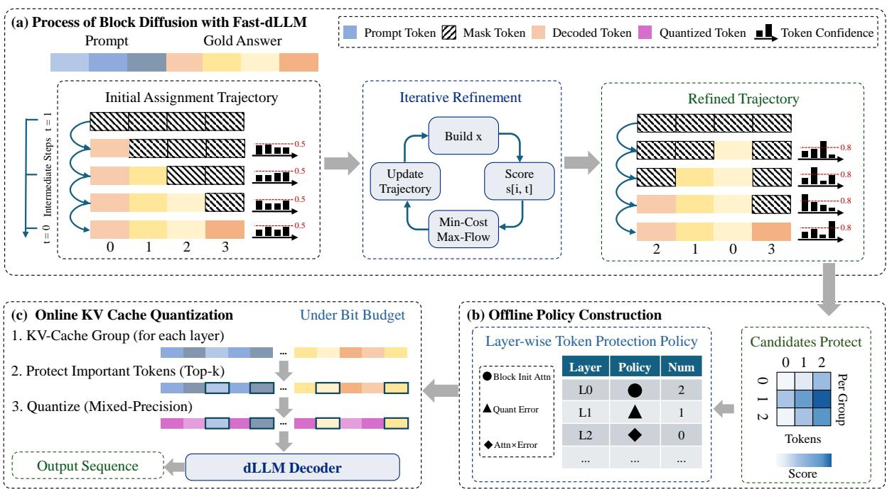  
Figure 2: dLLM-KVQ pipeline. (a) TRACE reconstructs masked-denoising trajectories from prompt-answer pairs. (b) Offline diagnostics fit per-layer K-cache policies from behavior and attention metrics. (c) Online quantization applies the selected policy to block-initial reused cache states.

2023; Xiao et al., 2024; Li et al., 2024; Cai et al., 2024), but here the score is used to decide which K tokens keep high precision rather than which tokens remain in the cache. For a cache mode m and layer ℓ, the policy selects a candidate $a = ( s , p ) \colon$ s is a token-importance score and p is the number of K tokens per group kept in high precision. The candidate score can be based on attention from the block-initial forward pass, K quantization error when all K tokens are quantized, or their normalized product. The high-precision budget is selected from {0, 1, 2, 4} in our main experiments. Budget p = 0 corresponds to ordinary low-bit K quantization.

The full-recompute cache in Section 3 is the reference used to define cache-reuse error. Policy selection is instead expressed relative to the same reused cache with all K tokens quantized, because every inference-time candidate starts from that cache state. This offline fitting stage is summarized in Figure 2(b). For a record r from a reconstructed trajectory–identified by a calibration sample, cache mode, block, denoising step, and layer– and candidate a, let $\Delta _ { q } ( a , r )$ be the improvement over this baseline for behavior metric q. Metrics whose smaller values are better, such as score distance or attention KL, use baseline minus candidate. Metrics whose larger values are better, such as top-

1 agreement or top-K recall, use candidate minus baseline. In our experiments, q includes centered score distance, attention KL, top-1 key agreement, and top-K key recall. Centered score distance compares the logit-score vector after removing its mean; the key-agreement metrics test whether the largestattended or top-K attended cache tokens are preserved. Define

$$
\begin{array} { r l } {  { \mathcal { L } _ { m , \ell } ( a ) = - \sum _ { q } w _ { q } \mathbb { E } _ { r \in \mathcal { D } _ { m , \ell } } \Delta _ { q } ( a , r ) } } \\ & { + \lambda \mathbb { E } _ { r \in \mathcal { D } _ { m , \ell } } B ( a , r ) , } \end{array}
$$

Here $\mathcal { D } _ { m , \ell }$ is the diagnostic record set for cache mode m and layer $\ell , w _ { q }$ are fixed metric weights, λ weights the bit-width penalty, and $B ( \boldsymbol { a } , \boldsymbol { r } )$ measures effective bit-width. dLLM-KVQ selects $\begin{array} { r } { a _ { m , \ell } ^ { * } = \arg \operatorname* { m i n } _ { a \in \mathcal { A } _ { m , \ell } } \mathcal { L } _ { m , \ell } ( a ) } \end{array}$ . The feasible set also enforces reliability constraints, including a maximum effective K bit-width and a minimum win rate on the score-distance metric. Policies are selected separately for each model, cache mode, target bit-width, and layer. This objective is not optimized by gradient descent. It chooses a discrete deployment policy from trajectory-level measurements.

## 4.3 Online dLLM-KVQ Quantization

At inference time, dLLM-KVQ uses only information available during the block-initial forward pass. For the current cache mode and layer, it retrieves the selected score type and high-precision budget, as shown in Figure 2(c). If the score is based on attention, the importance of cache token i is the average attention probability, computed in that block-initial pass, assigned by active-block queries:

$$
\begin{array} { r l } & { I _ { i } ^ { \mathrm { a t t n } } = \displaystyle \frac { 1 } { | \mathcal { H } | | \mathcal { Q } _ { b } | } \sum _ { h \in \mathcal { H } } \sum _ { q \in \mathcal { Q } _ { b } } A _ { \ell , h , q , i } ^ { \mathrm { i n i t } } , } \\ & { \boldsymbol { A } _ { \ell , h , q , i } ^ { \mathrm { i n i t } } = \left[ { \mathrm { s o f t m a x } \left( \frac { q _ { \ell , h , q } ^ { \mathrm { i n i t } } ( K _ { \ell , h } ^ { \mathrm { i n i t } } ) ^ { \top } } { \sqrt { d _ { h } } } \right) } \right] _ { i } . } \end{array}
$$

Here H is the set of attention heads, $\mathcal { Q } _ { b }$ is the set of query positions in the active block $B _ { b } .$ , and $d _ { h }$ is the head dimension. If the score is quantization error, the importance is the token-wise reconstruction error produced by ordinary low-bit K quantization without protection:

$$
I _ { i } ^ { \mathrm { q e } } = \left. K _ { \ell , i } ^ { \mathrm { i n i t } } - \left[ \operatorname { Q D Q } _ { \beta } ^ { \mathrm { b a s e } } ( K _ { \ell , G ( i ) } ^ { \mathrm { i n i t } } ) \right] _ { i } \right. _ { 2 } .
$$

Here $\mathrm { Q D Q } _ { \beta } ^ { \mathrm { b a s e } }$ denotes the baseline K quantizedequantize operator at bit-width $\beta$ with highprecision budget $p = 0$ , and G(i) is the token group containing token i. The hybrid score multiplies normalized block-initial attention and normalized quantization error.

KIVI-style K quantization groups K-cache tokens along the token dimension. Within each group, dLLM-KVQ keeps the top-p tokens under $I _ { i }$ in high precision. The remaining tokens are quantized with min-max quantize-dequantize, where the range is estimated only from the tokens that will be quantized in the same group. This exclusion prevents high-precision outliers from expanding the quantization grid for the low-bit tokens. The V cache uses the standard contiguous low-bit quantize-dequantize described in Appendix A.4, without residual tails or clipping in the submitted method.

The offline and online stages are deliberately separated. Offline diagnostics may compare candidate policies against full recomputation to choose the policy. Online inference does not access full recomputation. It applies the selected policy to the reused cache state already required by dLLM cache reuse.

## 5 Experiments

Setup. Our experimental protocol follows FastdLLM (Wu et al., 2025), which provides the prefix and dual cache-reuse mechanisms studied in this work. We evaluate on LLaDA-Instruct (Nie et al., 2026) and Dream-Base-7B (Ye et al., 2025) with the same benchmark suite: GSM8K (Cobbe et al., 2021), HumanEval (Chen et al., 2021), MATH (Hendrycks et al., 2021), and MBPP (Austin et al., 2021b). All reported runs use generation length 256, block length 32, and Fast-dLLM’s confidence-threshold parallel decoding with threshold 0.9. We evaluate 4-bit and 2- bit KV-cache quantization in both prefix and dual cache modes, using NVIDIA H200 140GB GPUs. Detailed few-shot settings, calibration data construction, and quantizer hyperparameters are provided in Appendix A.1.

Baselines. The no-cache row is the originalinference reference. The direct baselines for cache quantization are the prefix-cache and dualcache rows, because quantized methods are applied on top of these cache mechanisms. We compare against KIVI (Liu et al., 2024) and KVQuant (Hooper et al., 2024) after adapting both methods to the same dLLM cache interface.

## 5.1 Main Results

Tables 1 and 2 report the main result matrix. Each quantized row should be compared with the matching cache-only reference in the same model, cache mode, and bit-width block. Across both models, both cache modes, and both bit-widths, dLLM-KVQ obtains the highest average score among the evaluated quantized methods.

For LLaDA, dLLM-KVQ is strongest in the prefix-cache setting. At 4-bit it improves the average over KIVI and KVQuant (45.34 versus 44.50 and 44.21) and also recovers the cache-only MBPP score. At 2-bit, where ordinary low-bit cache quantization is more fragile, dLLM-KVQ keeps the best average and avoids the large MBPP drop observed for KVQuant. Dual cache is more mixed at the task level: KIVI is better on HumanEval in the 4- bit setting and KIVI or KVQuant tie dLLM-KVQ on some 2-bit tasks. However, dLLM-KVQ still gives the best dual-cache average at both bit-widths, mainly by keeping GSM8K, MATH, and MBPP from moving in different adverse directions.

Dream shows a different failure pattern. KVQuant is often the strongest method on GSM8K, especially in dual cache, but the same rows lose accuracy on HumanEval, MATH, and MBPP. This task imbalance is why KVQuant has lower average scores than dLLM-KVQ in every Dream setting, even when it wins one task. dLLM-KVQ does not dominate every individual cell; rather, it gives the most stable average behavior across tasks, models, cache modes, and bit-widths. This supports the analysis in Section 3: cache reconstruction error alone is not a reliable predictor of generation quality under dLLM cache reuse, because the useful quantization policy depends on how cache perturbations affect attention and output decisions.

(a) 4-bit
<table><tr><td>Method</td><td></td><td>GSM8K HumanEval MATH</td><td></td><td>MBPP</td><td>Avg.</td></tr><tr><td>LLaDA full attention</td><td>78.62</td><td>42.07</td><td>33.36</td><td>29.80</td><td>45.96</td></tr><tr><td>Prefix cache</td><td></td><td></td><td></td><td></td><td></td></tr><tr><td>Cache only</td><td>78.47</td><td>42.07</td><td>33.18</td><td>26.6045.08</td><td></td></tr><tr><td>KIVI KVQuant</td><td>77.33</td><td>42.68</td><td>32.40</td><td>25.60</td><td>44.50</td></tr><tr><td>dLLM-KVQ</td><td>77.48 77.94</td><td>42.07 43.90</td><td>32.68 32.92</td><td>24.60</td><td>44.21</td></tr><tr><td></td><td></td><td></td><td></td><td>26.60</td><td>45.34</td></tr><tr><td>Dual cache Cache only</td><td></td><td>35.98</td><td></td><td></td><td></td></tr><tr><td></td><td>77.94</td><td></td><td>32.62</td><td></td><td>25.8043.09</td></tr><tr><td>KIVI</td><td>76.35</td><td>37.20</td><td>32.62</td><td></td><td>25.6042.94</td></tr><tr><td>KVQuant</td><td>78.01</td><td>35.37</td><td>32.90</td><td></td><td>25.8043.02</td></tr><tr><td>dLLM-KVQ</td><td>78.62</td><td>34.76</td><td>33.02</td><td></td><td>26.8043.30</td></tr></table>

(b) 2-bit
<table><tr><td>Method</td><td>GSM8K HumanEval MATH</td><td></td><td></td><td>MBPP Avg.</td></tr><tr><td>LLaDA full attention</td><td>78.62</td><td>42.07</td><td>33.36</td><td>29.80 45.96</td></tr><tr><td>Prefix cache Cache only</td><td>78.47</td><td>42.07</td><td>33.18</td><td>26.6045.08</td></tr><tr><td>KIVI</td><td>76.50</td><td>38.41</td><td>32.38</td><td>27.20 43.62</td></tr><tr><td>KVQuant</td><td>76.27</td><td>39.63</td><td>32.30</td><td>17.60 41.45</td></tr><tr><td>dLLM-KVQ</td><td>77.18</td><td>39.63</td><td>32.90</td><td>27.8044.38</td></tr><tr><td>Dual cache</td><td></td><td></td><td></td><td></td></tr><tr><td>Cache only</td><td>77.94</td><td>35.98</td><td>32.62</td><td>25.8043.09</td></tr><tr><td>KIVI</td><td>77.56</td><td>34.15</td><td>31.86</td><td>27.80 42.84</td></tr><tr><td>KVQuant</td><td>77.48</td><td>35.98</td><td>31.94</td><td>17.0040.60</td></tr><tr><td>dLLM-KVQ</td><td>77.79</td><td>35.98</td><td>32.04</td><td>27.2043.25</td></tr></table>

Table 1: LLaDA results under 4-bit and 2-bit KV cache quantization. LLaDA full attention denotes no-cache original inference. Cache-only rows are unquantized cache references. For dLLM-KVQ, each row reports the selected configuration in the current result matrix. Average denotes the arithmetic mean over GSM8K, HumanEval, MATH, and MBPP.

(a) 4-bit
<table><tr><td>Method</td><td>GSM8K HumanEval</td><td></td><td>MATH</td><td>MBPP</td><td> $\operatorname { A v g } .$ </td></tr><tr><td>Dream full attention</td><td>74.15</td><td>39.63</td><td>34.18</td><td>54.40</td><td>50.59</td></tr><tr><td>Prefix cache Cache only</td><td>74.60</td><td>43.29</td><td>34.20</td><td></td><td>55.20 51.82</td></tr><tr><td>KIVI</td><td>73.69</td><td>40.85</td><td>33.74</td><td>54.20</td><td>50.62</td></tr><tr><td>KVQuant</td><td>74.83</td><td>37.80</td><td>33.86</td><td>54.60</td><td>50.27</td></tr><tr><td>dLLM-KVQ</td><td>74.53</td><td>41.46</td><td>34.28</td><td>56.20</td><td>51.62</td></tr><tr><td>Dual cache</td><td></td><td></td><td></td><td></td><td></td></tr><tr><td>Cache only</td><td>74.91</td><td>37.20</td><td>33.50</td><td>53.00</td><td>49.65</td></tr><tr><td>KIVI</td><td>73.24</td><td>37.20</td><td>33.70</td><td>53.00</td><td>49.29</td></tr><tr><td>KVQuant</td><td>75.89</td><td>35.98</td><td>33.30</td><td></td><td>52.8049.49</td></tr><tr><td>dLLM-KVQ</td><td>74.91</td><td>37.80</td><td>34.04</td><td></td><td>53.60 50.09</td></tr></table>

(b) 2-bit
<table><tr><td>Method</td><td>GSM8K HumanEval</td><td></td><td>MATH</td><td>MBPP</td><td>Avg.</td></tr><tr><td>Dream full attention</td><td>74.15</td><td>39.63</td><td>34.18</td><td>54.40</td><td>50.59</td></tr><tr><td>Prefix cache</td><td></td><td></td><td></td><td></td><td></td></tr><tr><td>Cache only</td><td>74.60</td><td>43.29</td><td>34.20</td><td></td><td>55.2051.82</td></tr><tr><td>KIVI</td><td>71.57</td><td>40.24 36.59</td><td>31.52</td><td>52.60</td><td>48.98</td></tr><tr><td>KVQuant dLLM-KVQ</td><td>73.92 71.80</td><td>42.07</td><td>32.28 32.36</td><td>52.20 53.20</td><td>48.75</td></tr><tr><td></td><td></td><td></td><td></td><td></td><td>49.86</td></tr><tr><td>Dual cache Cache only</td><td>74.91</td><td>37.20</td><td>33.50</td><td>53.00</td><td>49.65</td></tr><tr><td>KIVI</td><td>70.43</td><td>39.02</td><td>31.36</td><td></td><td></td></tr><tr><td>KVQuant</td><td>72.71</td><td>29.88</td><td>31.52</td><td>51.60</td><td>48.10 51.2046.33</td></tr><tr><td></td><td></td><td></td><td></td><td></td><td></td></tr><tr><td>dLLM-KVQ</td><td>71.72</td><td>39.02</td><td>32.56</td><td></td><td>52.00 48.83</td></tr></table>

Table 2: Dream results under 4-bit and 2-bit KV cache quantization. Dream full attention denotes no-cache original inference. Cache-only rows are unquantized cache references. For dLLM-KVQ, each row reports the selected configuration in the current result matrix. Average denotes the arithmetic mean over GSM8K, HumanEval, MATH, and MBPP.

## 5.2 Ablation Studies

The ablations use LLaDA, MBPP, 4-bit quantization, and Fast-dLLM cache modes to isolate whether the selected K policy is useful at inference time.

Task-level K-policy controls. Table 3 compares inference-time K policies while keeping K/V quantization active. Fixed attention-based rules remain below dLLM-KVQ in both cache modes, even when they spend more K precision. In prefix cache, dLLM-KVQ matches the KIVI K/V and cacheonly MBPP score, whereas the fixed attention rules reduce the score. In dual cache, the selected policy improves over both KIVI K/V and the best fixed rule in the table. The result does not claim that the K policy alone beats every KIVI K/V baseline; it shows that a single layer-independent highprecision rule is insufficient, and that policy selection must depend on the layer and cache mode.

Trajectory-level diagnostics. Table 4 evaluates the same policy on reconstructed denoising states not used for task scoring. Each paired record compares the selected policy with the baseline that quantizes all K tokens to low bit-width. The policy improves centered-score distance on 96.4%/94.9% of prefix/dual records and attention KL on 88.9%/90.0%, while also improving top-

(a) Prefix policy controls
<table><tr><td>Method</td><td>K high-precision rule</td><td>MBPP</td></tr><tr><td>KIVI K/V</td><td>None; all low-bit</td><td>26.60</td></tr><tr><td>Fixed K rule</td><td>Attention,  $p = 4$ </td><td>25.60</td></tr><tr><td>Fixed K rule</td><td>Attention,  $p = 2$ </td><td>25.20</td></tr><tr><td>dLLM-KVQ</td><td>Selected per layer</td><td>26.60</td></tr></table>

(b) Dual policy controls
<table><tr><td>Method</td><td>K high-precision rule</td><td>MBPP</td></tr><tr><td>Cache only</td><td></td><td>25.80</td></tr><tr><td>KIVI K/V</td><td>None; all low-bit</td><td>25.60</td></tr><tr><td>Fixed K rule</td><td>Attention, p = 2</td><td>25.20</td></tr><tr><td>Fixed K rule dLLM-KVQ</td><td> $\mathrm { A t t n . } { \times } \mathrm { Q - e r r o r , } p = 2$  Selected per layer</td><td>26.00 26.80</td></tr></table>

Table 3: Task-level LLaDA MBPP policy controls under 4-bit K/V cache quantization. Scores are pass@1. The p value denotes how many K tokens per token group are kept in high precision. Fixed K-rule rows use the same rule in every layer, while dLLM-KVQ selects this rule separately for each layer using trajectory calibration. Dual rows use the same generation length, block length, and cache mode as Table 1.

<table><tr><td colspan="5">Win rate (%)</td></tr><tr><td>Mode</td><td>L2</td><td>KL</td><td>Top-1 Top-K</td><td>Eff. bits</td></tr><tr><td>Prefix</td><td>96.4</td><td>88.9</td><td>72.9</td><td>85.9 4.77</td></tr><tr><td>Dual</td><td>94.9</td><td>90.0 71.7</td><td>82.5</td><td>4.60</td></tr></table>

Table 4: Trajectory-level win rates for the compiled Kside policy on LLaDA 4-bit calibration traces. Each win rate is the percentage of paired records improved over unprotected K quantization; L2 and KL are converted to improvements by lower distance/divergence, while Top-1 and Top-K use higher agreement/recall.

1 key agreement and top-K key recall on most records. These diagnostics are not downstream task scores, but they check the mechanism that motivates the method: the selected high-precision K entries should preserve both output scores and the attention choices induced by the reused cache. The effective K bit-widths are 4.77 in prefix cache and 4.60 in dual cache, below the 4.9-bit policy cap, so the diagnostic gain is not explained only by a large precision increase. Together with the task-level controls, this indicates that the benefit comes from choosing which K entries to protect, not merely from adding a uniform high-precision reserve.

## 6 Related Works

Diffusion language models and fast inference. Diffusion and masked language models generate text through iterative denoising rather than causal next-token prediction (Lou et al., 2023; Sahoo et al., 2024; Shi et al., 2024). Recent systems such as LLaDA and Dream show that bidirectional masked denoising can support general language, math, and code tasks at LLM scale (Nie et al., 2026; Ye et al., 2025). Fast-dLLM, dLLM-Cache, and Block Diffusion reduce the repeated full-sequence computation required by iterative denoising through block-wise generation, cache reuse, adaptive updates, or parallel token sampling (Wu et al., 2025;

Liu et al., 2025; Arriola et al., 2025). These acceleration methods differ in schedule, but they share the issue studied in this paper: reused KV states are approximate because bidirectional token representations can change after later tokens are revealed. dLLM-KVQ is orthogonal to these systems and quantizes the reused cache states they produce.

KV cache quantization. LLM compression has been extensively studied through post-training weight and activation quantization, including methods such as SmoothQuant, GPTQ, and AWQ (Xiao et al., 2023; Frantar et al., 2022; Lin et al., 2024). KV cache quantization targets a different bottleneck: the activation memory that grows with context length, batch size, and generation length during inference. KIVI and KVQuant are representative AR KV-cache quantizers, using asymmetric K/V granularity, pre-RoPE key quantization, nonuniform datatypes, and outlier handling (Liu et al., 2024; Hooper et al., 2024). These methods assume cached prefix states are exact reference states under causal attention. In dLLMs, the reused cache is itself an approximation to full recomputation. We therefore adapt KIVI and KVQuant as baselines, but evaluate quantization with behavior-level metrics and introduce trajectory-calibrated K-side quantization under stale-cache mismatch.

## 7 Conclusion

We studied KV cache quantization for diffusion language models and show that cache reuse shifts the objective from cache reconstruction to behavior preservation under reuse-induced error. TRACE calibrates denoising trajectories, and dLLM-KVQ uses these states to select K-side policies with conservative V-side quantize-dequantize. Results on LLaDA and Dream, together with LLaDA trajectory diagnostics, support dLLM-KVQ as a reproducible dLLM cache-quantization algorithm.

## 8 Limitations

The evaluation covers two representative diffusion language models, two Fast-dLLM cache modes, four tasks, and both 4-bit and 2-bit KV-cache settings. It does not exhaust all decoding schedules, sequence lengths, batch sizes, or future dLLM architectures. These extensions are natural follow-up settings for calibration and policy selection rather than changes to the core cache-reuse error studied here.

dLLM-KVQ spends its adaptive budget on K states because the method is designed to preserve attention behavior under cache reuse. The V cache is therefore kept on a simple low-bit quantizedequantize path. More specialized V-side policies may provide additional gains, especially in regimes where value reconstruction rather than attention stability becomes the dominant factor, but they are orthogonal to the main K-side behavior-preservation result. Finally, this paper reports task quality and effective-bit accounting. End-to-end serving speed depends on fused low-bit attention kernels and runtime integration, as in prior LLM serving and quantized-serving systems (Kwon et al., 2023; Lin et al., 2025).

## References

Marianne Arriola, Aaron Gokaslan, Justin Chiu, Zhihan Yang, Zhixuan Qi, Jiaqi Han, Subham Sahoo, and Volodymyr Kuleshov. 2025. Block diffusion: Interpolating between autoregressive and diffusion language models. In International Conference on Learning Representations, volume 2025, pages 50726–50753.

Jacob Austin, Daniel D Johnson, Jonathan Ho, Daniel Tarlow, and Rianne Van Den Berg. 2021a. Structured denoising diffusion models in discrete state-spaces. Advances in neural information processing systems, 34:17981–17993.

Jacob Austin, Augustus Odena, Maxwell Nye, Maarten Bosma, Henryk Michalewski, David Dohan, Ellen Jiang, Carrie Cai, Michael Terry, Quoc Le, and 1 others. 2021b. Program synthesis with large language models. arXiv preprint arXiv:2108.07732.

Zefan Cai, Yichi Zhang, Bofei Gao, Yuliang Liu, Yucheng Li, Tianyu Liu, Keming Lu, Wayne Xiong, Yue Dong, Junjie Hu, and 1 others. 2024. Pyramidkv: Dynamic kv cache compression based on pyramidal information funneling. arXiv preprint arXiv:2406.02069.

Mark Chen, Jerry Tworek, Heewoo Jun, Qiming Yuan, Henrique Ponde De Oliveira Pinto, Jared Kaplan, Harri Edwards, Yuri Burda, Nicholas Joseph, Greg

Brockman, and 1 others. 2021. Evaluating large language models trained on code. arXiv preprint arXiv:2107.03374.

Peter Clark, Isaac Cowhey, Oren Etzioni, Tushar Khot, Ashish Sabharwal, Carissa Schoenick, and Oyvind Tafjord. 2018. Think you have solved question answering? try arc, the ai2 reasoning challenge. arXiv preprint arXiv:1803.05457.

Karl Cobbe, Vineet Kosaraju, Mohammad Bavarian, Mark Chen, Heewoo Jun, Lukasz Kaiser, Matthias Plappert, Jerry Tworek, Jacob Hilton, Reiichiro Nakano, Christopher Hesse, and John Schulman. 2021. Training verifiers to solve math word problems. arXiv preprint arXiv:2110.14168.

Ning Ding, Yulin Chen, Bokai Xu, Yujia Qin, Shengding Hu, Zhiyuan Liu, Maosong Sun, and Bowen Zhou. 2023. Enhancing chat language models by scaling high-quality instructional conversations. In Proceedings of the 2023 Conference on Empirical Methods in Natural Language Processing, pages 3029–3051.

Jack Edmonds and Richard M Karp. 1972. Theoretical improvements in algorithmic efficiency for network flow problems. Journal of the ACM (JACM), 19(2):248–264.

Elias Frantar, Saleh Ashkboos, Torsten Hoefler, and Dan Alistarh. 2022. Gptq: Accurate post-training quantization for generative pre-trained transformers. arXiv preprint arXiv:2210.17323.

Leo Gao, Jonathan Tow, Baber Abbasi, Stella Biderman, Sid Black, Anthony DiPofi, Charles Foster, Laurence Golding, Jeffrey Hsu, Alain Le Noac’h, Haonan Li, Kyle McDonell, Niklas Muennighoff, Chris Ociepa, Jason Phang, Laria Reynolds, Hailey Schoelkopf, Aviya Skowron, Lintang Sutawika, and 5 others. 2024. The language model evaluation harness.

Marjan Ghazvininejad, Omer Levy, Yinhan Liu, and Luke Zettlemoyer. 2019. Mask-predict: Parallel decoding of conditional masked language models. In Proceedings of the 2019 conference on empirical methods in natural language processing and the 9th international joint conference on natural language processing (EMNLP-IJCNLP), pages 6112–6121.

Dan Hendrycks, Collin Burns, Saurav Kadavath, Akul Arora, Steven Basart, Eric Tang, Dawn Song, and Jacob Steinhardt. 2021. Measuring mathematical problem solving with the math dataset. arXiv preprint arXiv:2103.03874.

Coleman Hooper, Sehoon Kim, Hiva Mohammadzadeh, Michael W Mahoney, Yakun S Shao, Kurt Keutzer, and Amir Gholami. 2024. Kvquant: Towards 10 million context length llm inference with kv cache quantization. Advances in Neural Information Processing Systems, 37:1270–1303.

Hamel Husain, Ho-Hsiang Wu, Tiferet Gazit, Miltiadis Allamanis, and Marc Brockschmidt. 2019. Codesearchnet challenge: Evaluating the state of semantic code search. arXiv preprint arXiv:1909.09436.

Woosuk Kwon, Zhuohan Li, Siyuan Zhuang, Ying Sheng, Lianmin Zheng, Cody Hao Yu, Joseph Gon zalez, Hao Zhang, and Ion Stoica. 2023. Efficient memory management for large language model serving with pagedattention. In Proceedings ofthe 29th symposium on operating systems principles, pages 611–626.

Yuhong Li, Yingbing Huang, Bowen Yang, Bharat Venkitesh, Acyr Locatelli, Hanchen Ye, Tianle Cai, Patrick Lewis, and Deming Chen. 2024. Snapkv: Llm knows what you are looking for before generation. Advances in Neural Information Processing Systems, 37:22947–22970.

Ji Lin, Jiaming Tang, Haotian Tang, Shang Yang, Wei-Ming Chen, Wei-Chen Wang, Guangxuan Xiao, Xingyu Dang, Chuang Gan, and Song Han. 2024. Awq: Activation-aware weight quantization for ondevice llm compression and acceleration. Proceedings ofmachine learning and systems, 6:87–100.

Yujun Lin, Haotian Tang, Shang Yang, Zhekai Zhang, Guangxuan Xiao, Chuang Gan, and Song Han. 2025. Qserve: W4a8kv4 quantization and system co-design for efficient llm serving. Proceedings of Machine Learning and Systems, 7.

Zhiyuan Liu, Yicun Yang, Yaojie Zhang, Junjie Chen, Chang Zou, Qingyan Wei, Shaobo Wang, Yichen Zhu, and Linfeng Zhang. 2025. dllm-cache: Acceler ating diffusion large language models with adaptive caching. arXiv preprint arXiv:2506.06295.

Zirui Liu, Jiayi Yuan, Hongye Jin, Shaochen Zhong, Zhaozhuo Xu, Vladimir Braverman, Beidi Chen, and Xia Hu. 2024. Kivi: A tuning-free asymmetric 2bit quantization for kv cache. arXiv preprint arXiv:2402.02750.

Aaron Lou, Chenlin Meng, and Stefano Ermon. 2023. Discrete diffusion modeling by estimating the ratios of the data distribution. arXiv preprint arXiv:2310.16834.

Shen Nie, Fengqi Zhu, Zebin You, Xiaolu Zhang, Jingyang Ou, Jun Hu, Jun Zhou, Yankai Lin, Ji-Rong Wen, and Chongxuan Li. 2026. Large language diffusion models. Advances in Neural Information Processing Systems, 38:50608–50646.

Colin Raffel, Noam Shazeer, Adam Roberts, Katherine Lee, Sharan Narang, Michael Matena, Yanqi Zhou, Wei Li, and Peter J. Liu. 2020. Exploring the limits of transfer learning with a unified text-to-text transformer. Journal of Machine Learning Research, 21(140):1–67.

Subham S Sahoo, Marianne Arriola, Yair Schiff, Aaron Gokaslan, Edgar Marroquin, Justin T Chiu, Alexander Rush, and Volodymyr Kuleshov. 2024. Simple

and effective masked diffusion language models. Advances in Neural Information Processing Systems, 37:130136–130184.

Wenqi Shao, Mengzhao Chen, Zhaoyang Zhang, Peng Xu, Lirui Zhao, Zhiqian Li, Kaipeng Zhang, Peng Gao, Yu Qiao, and Ping Luo. 2024. Omniquant: Omnidirectionally calibrated quantization for large language models. In International Conference on Learning Representations, volume 2024, pages 45472– 45496.

Jiaxin Shi, Kehang Han, Zhe Wang, Arnaud Doucet, and Michalis Titsias. 2024. Simplified and generalized masked diffusion for discrete data. Advances in neural information processing systems, 37:103131– 103167.

Ashish Vaswani, Noam Shazeer, Niki Parmar, Jakob Uszkoreit, Llion Jones, Aidan N Gomez, Łukasz Kaiser, and Illia Polosukhin. 2017. Attention is all you need. Advances in neural information processing systems, 30.

Chengyue Wu, Hao Zhang, Shuchen Xue, Zhijian Liu, Shizhe Diao, Ligeng Zhu, Ping Luo, Song Han, and Enze Xie. 2025. Fast-dllm: Training-free acceleration of diffusion llm by enabling kv cache and parallel decoding. arXiv preprint arXiv:2505.22618.

Guangxuan Xiao, Ji Lin, Mickael Seznec, Hao Wu, Julien Demouth, and Song Han. 2023. Smoothquant: Accurate and efficient post-training quantization for large language models. In International conference on machine learning, pages 38087–38099. PMLR.

Guangxuan Xiao, Yuandong Tian, Beidi Chen, Song Han, and Mike Lewis. 2024. Efficient streaming language models with attention sinks. In International Conference on Learning Representations, volume 2024, pages 21875–21895.

Zhewei Yao, Reza Yazdani Aminabadi, Minjia Zhang, Xiaoxia Wu, Conglong Li, and Yuxiong He. 2022. ZeroQuant: Efficient and affordable post-training quantization for large-scale transformers. In Advances in Neural Information Processing Systems, volume 35.

Jiacheng Ye, Zhihui Xie, Lin Zheng, Jiahui Gao, Zirui Wu, Xin Jiang, Zhenguo Li, and Lingpeng Kong. 2025. Dream 7b: Diffusion large language models. arXiv preprint arXiv:2508.15487.

Zhenyu Zhang, Ying Sheng, Tianyi Zhou, Tianlong Chen, Lianmin Zheng, Ruisi Cai, Zhao Song, Yuandong Tian, Christopher Ré, Clark Barrett, and 1 others. 2023. H2o: Heavy-hitter oracle for efficient generative inference of large language models. Advances in Neural Information Processing Systems, 36:34661–34710.

## A Additional Method Details

## A.1 Experimental Setup

We follow the Fast-dLLM evaluation protocol (Wu et al., 2025) while adding KVcache quantization. The evaluated models are GSAI-ML/LLaDA-8B-Instruct (Nie et al., 2026) and Dream-org/Dream-v0-Base-7B (Ye et al., 2025). The benchmark suite is shared across both models: GSM8K (Cobbe et al., 2021), MATH (Hendrycks et al., 2021), HumanEval (Chen et al., 2021), and MBPP (Austin et al., 2021b). We use the lm-eval task definitions (Gao et al., 2024) with 5-shot GSM8K, 4-shot MATH, 0-shot HumanEval, and 3-shot MBPP. Experiments are run on NVIDIA H200 140GB GPUs.

All reported task runs use generation length 256, block length 32, and confidence-threshold parallel decoding with threshold 0.9. Prefix and dual cache modes are evaluated separately. The no-cache row is the original diffusion inference reference; prefixcache and dual-cache rows are the direct cacheonly references for the corresponding quantized methods. All quantized rows use both 4-bit and 2-bit KV-cache settings and quantize both K and V unless otherwise stated.

For adapted KIVI (Liu et al., 2024), adapted KVQuant (Hooper et al., 2024), and dLLM-KVQ, implementation details are provided in Appendix A.3. For dLLM-KVQ, we use group size 32, the standard contiguous value-side QDQ path, and a fixed K-token budget policy selected from TRACE diagnostics. Online dLLM-KVQ inference uses attention scores computed during the blockinitial forward pass and the fixed policy table; it does not use full-recompute statistics at evaluation time.

The calibration corpus is a compact mixed dataset constructed from C4 (Raffel et al., 2020), UltraChat (Ding et al., 2023), ARC (Clark et al., 2018), and CodeSearchNet-Python (Husain et al., 2019). The default collection script saves 1000 C4 records, 500 UltraChat records, 300 ARC records, and 200 CodeSearchNet records with a minimum length filter. For trajectory calibration, we use the chat-style mixed\_chat loader: it samples promptanswer pairs from the instruction, QA, and code buckets with weights 0.50, 0.25, and 0.25, respectively, applies the model chat template to prompts when available, appends EOS to answers when available, and truncates answers to a multiple of the block length. dLLM-KVQ policy fitting uses eight calibration trajectory samples per model, cache mode, and bit width.

## A.2 Responsible Research and Reproducibility Details

Artifacts and intended use. This paper studies inference-time KV-cache quantization. We use publicly released pretrained checkpoints, GSAI-ML/LLaDA-8B-Instruct and Dream-org/Dream-v0-Base-7B, and do not train new base models. The model cards list MIT for LLaDA and Apache-2.0 for Dream; the LLaDA card reports 8B parameters, and the Dream checkpoint is a 7B-class diffusion language model whose current model card reports an 8B parameter scale. We use Fast-dLLM, KIVI, KVQuant, Hugging Face Transformers, Accelerate, and lm-eval; KIVI and KVQuant are modified only to run through the same Fast-dLLM cache wrapper described in Appendix A.3. Any released code or policy files are intended for research evaluation of dLLM cache compression. We do not redistribute pretrained model weights, benchmark datasets, or the public calibration corpora.

Data, domains, and splits. All evaluation benchmarks are public English-language or Python-code benchmarks used through lm-eval. We evaluate on the official test/evaluation sets: GSM8K has 1,319 test examples, HumanEval has 164 programming tasks, MATH has 5,000 test examples, and MBPP has 500 test examples in the evaluated split. Few-shot settings are reported in Appendix A.1. Calibration uses English text, instruction/QA examples, and Python code from C4, UltraChat, ARC, and CodeSearchNet-Python. The calibration corpus is used only to construct prompt-answer pairs and reconstructed denoising trajectories; benchmark test labels are not used for policy fitting.

Privacy, offensive content, and data release. We do not collect new human-subject data, run new annotation studies, infer protected attributes, or scrape new data sources. We rely on the public releases and documentation of the original datasets and do not perform an additional manual PII or offensive-content audit. Calibration artifacts may contain tokenized or decoded snippets from the source corpora, so they should be treated as derived research artifacts subject to the original dataset terms and should not be redistributed without checking those terms. The task benchmarks and calibration sources may contain naturally occurring web, instruction, or code text; our method does not attempt to filter or classify such content.

Experimental reporting. The reported task results are single-run inference evaluations under fixed decoding and quantization settings, not averages over random seeds. Table averages are arithmetic means over the four reported tasks. The main task runs use transformers==4.49.0, lm\_ $\mathtt { e v a l } = = 0 . 4 . 8 .$ , and accelerate==0.34.2. The main experiments and diagnostics ran on NVIDIA H200 140GB GPUs. The study did not train or fine-tune models; computation came from calibration, diagnostics, and benchmark inference. Exact aggregate GPU-hours across all exploratory diagnostics were not centrally logged, so we report the available infrastructure, model sizes, benchmark sizes, and fixed hyperparameters rather than an exact total GPU-hour budget.

Risks and AI assistance. The method may reduce the cost of serving diffusion language models, which can improve accessibility but can also lower the cost of misuse inherited from the underlying models. The method does not provide new safety filtering, privacy protection, or defenses against malicious generation. Code-generation evaluation can execute generated Python programs, so it should be run only in an appropriate sandbox. AI assistants were used during paper preparation for codebase navigation, editing support, checklist organization, and drafting candidate wording. They were not treated as authors and did not make final research or writing decisions; all included content was reviewed by the authors.

## A.3 KIVI and KVQuant Adaptations

We port KIVI and KVQuant into the same Fast-dLLM cache interface used by dLLM-KVQ. All quantizers wrap the model with a common cache wrapper: before a forward pass, quantized past\_key\_values are dequantized; after a cacheproducing forward pass, the returned K/V cache is quantized and stored. The wrapper receives the current block range and cache mode, so the same quantizer code is used for prefix and dual cache reuse.

For KIVI, we keep the asymmetric granularity of the original method: K is quantized along the token dimension with channel-wise scales, and V is quantized along the channel dimension with tokenwise scales. The original AR decoding implementation maintains residual high-precision tails during generation. In our Fast-dLLM adaptation, cache states are stored at block-level reuse points, so the main experiments disable the residual tail with residual\_length=0 and use group size 32. This makes the KIVI baseline a direct low-bit quantization of the reused dLLM cache rather than a separate AR streaming-cache policy.

For KVQuant, we fit a bit-width-specific calibration state from collected Fast-dLLM KV cache traces. The calibration script stores native cache samples and, when enabled, Fisher-style activationgradient weights. It also reshapes Dream’s 3D cache layout into the common [batch, heads, tokens, dim] layout used by the calibration code. The deployed quantizer loads the fitted per-layer key/value state, applies non-uniform lookup quantization, keeps sparse outlier handling enabled with sparsity threshold 0.99, and sets first\_few\_fp16=0. KVQuant uses pre-RoPE cache keys when the model exposes that cacheposition mode; the other reported quantizers use the native post-RoPE cache path.

## A.4 Quantization Granularity

dLLM-KVQ follows the K/V granularity used by representative AR KV-cache quantizers (Liu et al., 2024; Hooper et al., 2024). Key activations show channel-wise structure across tokens, while value activations are better represented by token-wise channel grouping. Accordingly, K is quantized with channel-wise scales over token groups, and V is quantized with token-wise scales over channel groups. The dLLM-specific part of dLLM-KVQ is the policy that decides which K-cache tokens stay in high precision, not a new basic QDQ format.

## A.5 TRACE Flow Construction

TRACE assigns answer tokens only. Prompt tokens are fixed context and are never flow items. For an answer token $y _ { i } ,$ let $\mathcal { W } _ { i }$ be the legal reveal window induced by its block. Given the score matrix $S$ = $\left[ s _ { i , t } \right]$ , the assignment solved in each refinement round is

$$
\begin{array} { c l } { \displaystyle \operatorname* { m a x } _ { A } } & { \displaystyle \sum _ { i } \displaystyle \sum _ { t \in \mathcal { W } _ { i } } A _ { i , t } s _ { i , t } } \\ { \mathrm { s . t . } } & { \displaystyle \sum _ { t \in \mathcal { W } _ { i } } A _ { i , t } = 1 \quad \forall i , } \\ & { \displaystyle \sum _ { i } A _ { i , t } = k _ { t } \quad \forall t , } \\ & { A _ { i , t } \in \{ 0 , 1 \} . } \end{array}
$$

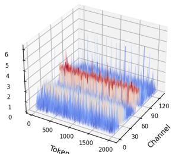  
(a) Key cache, example 1

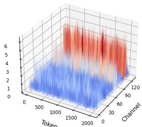  
(b) Key cache, example 2

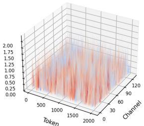  
(c) Value cache, example 1

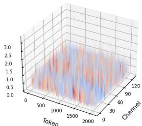  
(d) Value cache, example 2  
Figure 3: Representative K/V cache distributions used to choose quantization granularity.

The corresponding min-cost flow graph has a source node, one node for each answer token, one node for each reveal step, and a sink node. Sourceto-token edges have capacity one and zero cost. Token-to-step edges exist only when $t \in \mathcal W _ { i }$ , have capacity one, and have cost $- s _ { i , t } .$ . Step-to-sink edges have capacity $k _ { t }$ and zero cost. The total flow equals the number of answer tokens. This construction enforces that every answer token is revealed once and that every reveal step receives its prescribed budget.

The initializer only needs to satisfy the same feasibility constraints. The current implementation uses a deterministic schedule-consistent initializer so that calibration artifacts are reproducible. We run a small fixed number of rollout-refinement rounds and stop early when the assignment no longer changes. Additional sensitivity results for initialization and refinement depth will be reported with the final calibration ablations.

## A.6 Policy Diagnostics and Selection

Diagnostics compare each candidate against a baseline that quantizes all K tokens in the reused cache to low bit-width. Each paired record uses the same cache mode, sample index, block, step, and layer. Lower-is-better metrics include centered score distance and attention KL. Higher-is-better metrics include top-1 key agreement, top-K key recall, and score cosine. Each metric is converted to a signed improvement over this baseline before policy selection.

The default candidate set uses three token scores available at inference time: attention from the block-initial forward pass, K quantization error, and the normalized product of the two. The highprecision K-token budget per group is chosen from {0, 1, 2, 4}. The current selection weights are 1.0 for centered score distance, 0.001 for attention KL, 0.10 for top-1 agreement, and 0.05 for top-K recall. A candidate is accepted only when it improves the weighted score, has sufficient paired records, passes a centered-score win-rate gate, and stays within the effective K bit-width cap. The main experiments use a win-rate gate of 0.5 and an effective K bit-width cap of 4.9.

The full paper will include the selected per-layer policies for each reported model, cache mode, and bit-width. This table is omitted from the main text because it is long, but it is part of the fixed experimental configuration rather than a task-specific tuning step.

## A.7 Online Quantization Details

K-cache quantization uses contiguous groups along the token dimension. For each group, the selected policy ranks tokens by the chosen score and keeps the top-p tokens in high precision. The remaining tokens are quantized with low-bit min-max QDQ. The high-precision tokens are excluded from min and max estimation so that outliers do not enlarge the low-bit quantization interval for the remaining tokens. If $p = 0$ , the operator reduces to ordinary KIVI-style K quantization.

V-cache quantization uses the standard valueside low-bit QDQ path with token-wise scales over channel groups. The submitted dLLM-KVQ does not use residual tails, clipping, or learned valueside policies. This is an intentional scope choice for the submitted method. Value-side policy variants showed weaker transfer in our diagnostics, so the method focuses on deciding which K tokens remain in high precision.

## A.8 Additional Results to Report

The camera-ready appendix should include the following supporting material:

• Full per-layer policy tables for LLaDA and Dream.

• Additional K/V cache distribution plots across layers and heads.

• TRACE initialization and refinement-depth sensitivity.

• Effective-bit-width and high-precision Ktoken budget accounting. Runtime, throughput, and peak-memory measurements are outside the current experimental claims because they require the optimized-kernel implementation.

• Calibration-sample sensitivity and per-layer policy visualizations.

• Appendix-only V-side diagnostics, including fixed channel grouping, range-scale, and clipping controls.

• Complete 4-bit and 2-bit tables for prefix and dual cache modes.

## A.9 Additional Cache Visualizations

We additionally visualize K/V cache activations at several denoising steps within the same active block. These plots are qualitative checks rather than policy-selection metrics. Each surface shows the absolute value of one cache head over token and channel axes; the shaded red planes mark the active block. The examples use layer 5 and head 0 because they are readable for both LLaDA and Dream and avoid the very large outlier scales that appear in a few deeper Dream layers.

Figure 4 shows K-cache surfaces. For both models, the K cache contains clear channel-aligned high-magnitude regions inside and around the active block. Figure 5 shows the corresponding Vcache surfaces, which are less sharply concentrated for LLaDA but still structured for Dream. The visual difference between K and V is consistent with using different K/V quantization granularity, while the model-specific scale and pattern differences support selecting policies separately for each model and cache mode.

LLaDA, t=376  
LLaDA, t=383  
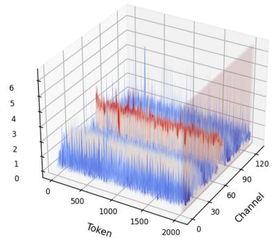  
Dream, t=376

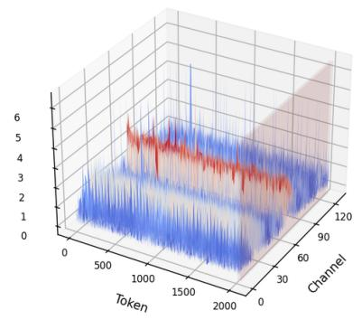

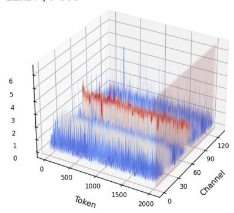  
Dream, t=383

Dream, t=380  
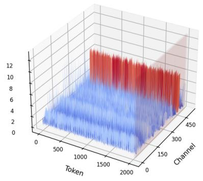

  
Figure 4: K-cache absolute-value surfaces across denoising steps in the same active block. The top row shows LLaDA and the bottom row shows Dream; columns show early, middle, and late denoising steps for block [2016, 2048).

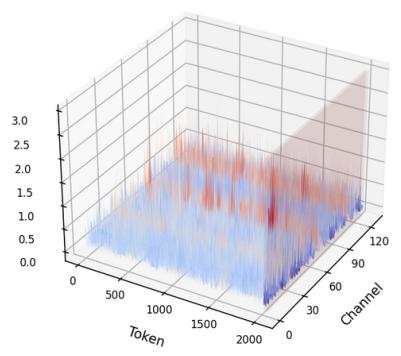

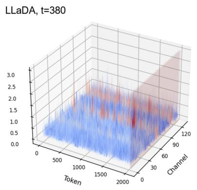

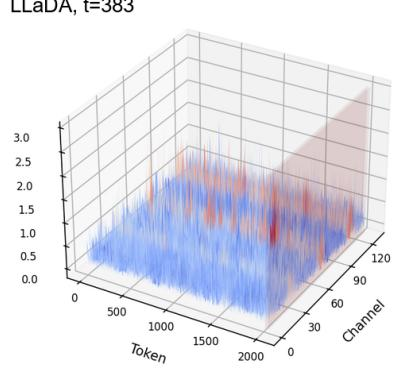

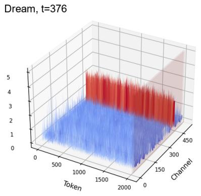

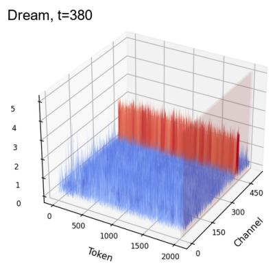

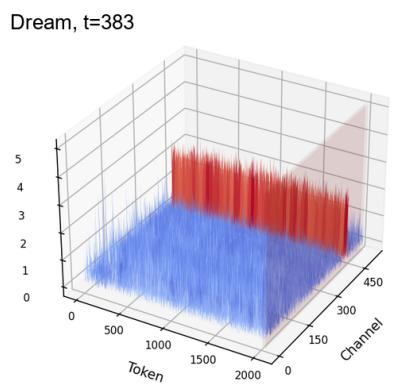  
Figure 5: V-cache absolute-value surfaces for the same layer, head, block, and denoising steps as Figure 4.